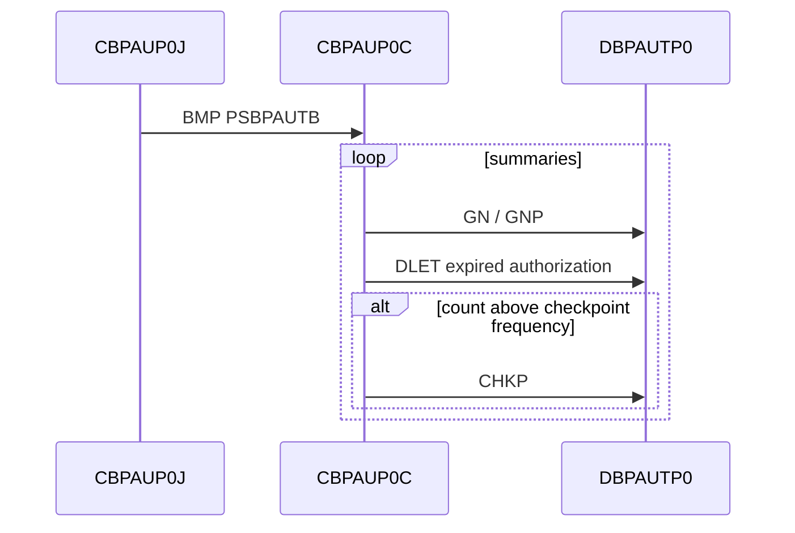

# CBPAUP0C checkpoint

Evidence: `app/app-authorization-ims-db2-mq/jcl/CBPAUP0J.jcl:25`, `app/app-authorization-ims-db2-mq/cbl/CBPAUP0C.cbl:201-205`, `app/app-authorization-ims-db2-mq/cbl/CBPAUP0C.cbl:223`, `app/app-authorization-ims-db2-mq/cbl/CBPAUP0C.cbl:310`, `app/app-authorization-ims-db2-mq/cbl/CBPAUP0C.cbl:355`.

