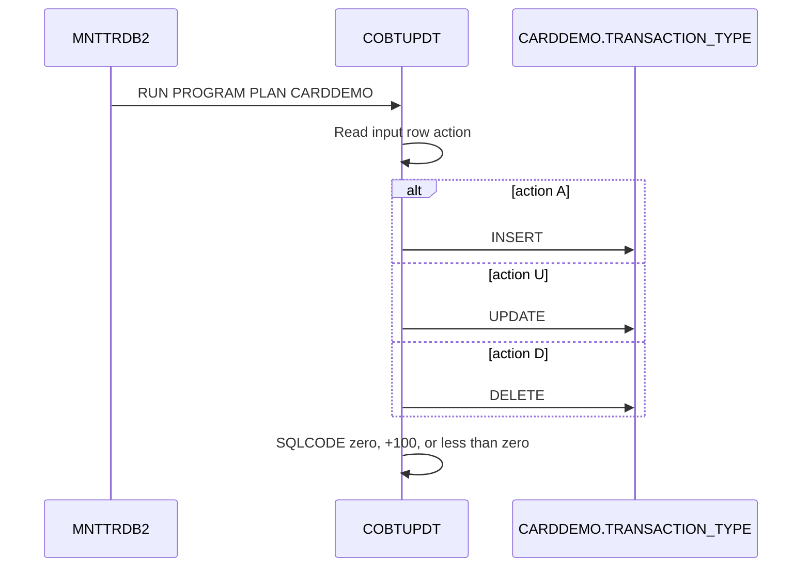

# COBTUPDT transaction-type maintenance

Evidence: `app/app-transaction-type-db2/jcl/MNTTRDB2.jcl:30`, `app/app-transaction-type-db2/cbl/COBTUPDT.cbl:111-119`, `app/app-transaction-type-db2/cbl/COBTUPDT.cbl:137`, `app/app-transaction-type-db2/cbl/COBTUPDT.cbl:171`, `app/app-transaction-type-db2/cbl/COBTUPDT.cbl:201`.

