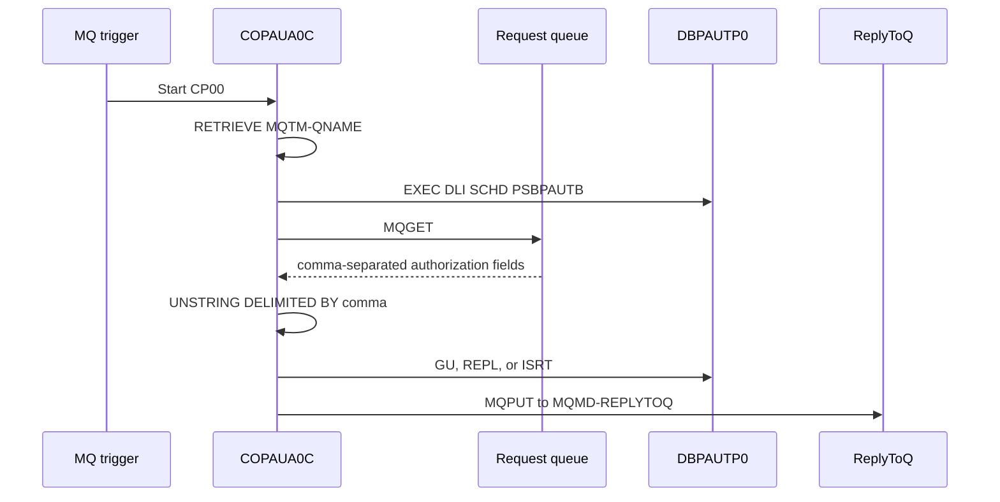

# COPAUA0C authorization request

Evidence: `app/app-authorization-ims-db2-mq/cbl/COPAUA0C.cbl:238`, `app/app-authorization-ims-db2-mq/cbl/COPAUA0C.cbl:293`, `app/app-authorization-ims-db2-mq/cbl/COPAUA0C.cbl:354-374`, `app/app-authorization-ims-db2-mq/cbl/COPAUA0C.cbl:413-414`, `app/app-authorization-ims-db2-mq/cbl/COPAUA0C.cbl:620`.

