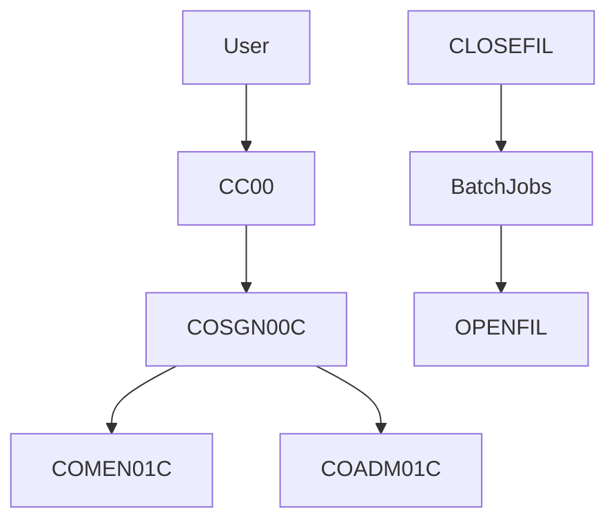
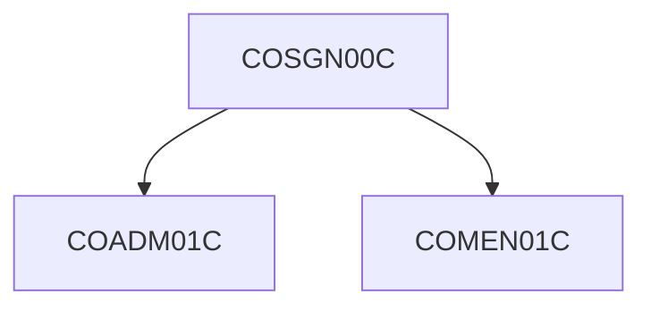
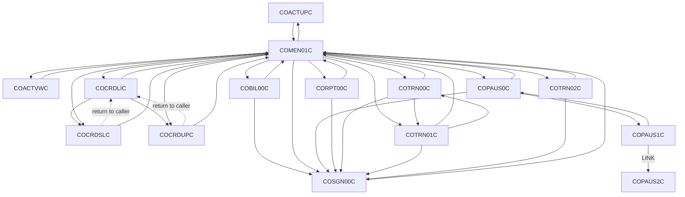
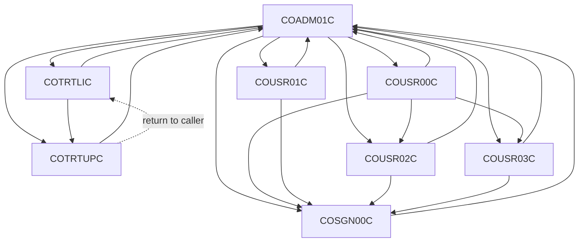
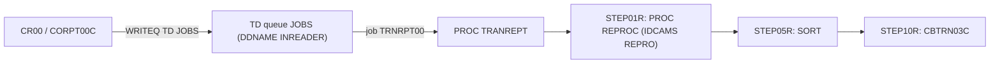
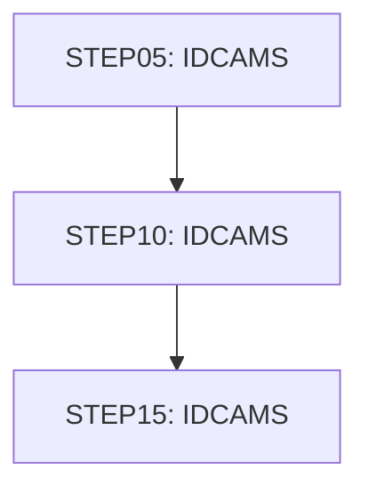
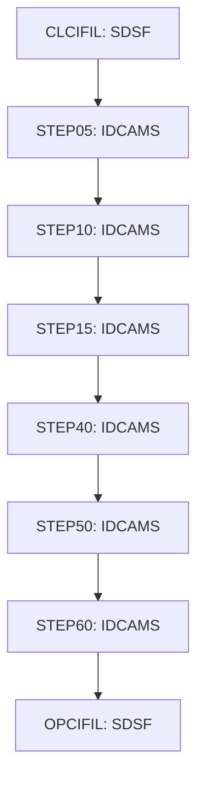

# CardDemo combined documentation

This file gathers the documentation skills, the reading and writing rules, and the Markdown documents under `docs/` into one reading order. The original files are unchanged. Each section keeps the wording of its source. Headings are nested under this document so the pieces can be read as one book. A link that pointed at another included document now points at that section.

Four kinds of material are included.

- **Skills.** The mainframe documentation skills that drive discovery, analysis, and assembly, including their templates and the rule text shipped inside the skill package.
- **Rules.** The copies installed in `.cursor/rules` for this repository. They are not byte-identical to the copies shipped with the skills, so both sets are kept.
- **Documents.** Every Markdown file under `docs/application-documentation` and `docs/_work`.
- **Skill scripts and schemas.** The Python scripts, JSON schemas and YAML templates shipped inside the skills, as code listings in Part 5.

Machine-readable JSON inventories under `docs/_work`, the Word files under `docs/application-documentation` (`CardDemo-complete-documentation.docx`; `CardDemo-complete-documentation.docx` holds the same application pages as Part 3), the repository-local generator scripts under `docs/_work`, and figure images are not pasted into this file. Markdown links that pointed at those files now use a path from the repository root.

Batch worksheets under `docs/_work/batches/` are analysis indexes and are not included; the validated analysis they produced appears in the program, copybook and coverage pages.

Document date: 2026-10-20 (date of the last validation run).

<a id="requirements-coverage-summary"></a>
## Requirements coverage summary

This section maps each documentation requirement to the place in this file that answers it. Every number below is read from the last run of the validation scripts (`docs/_work/coverage/coverage.json` generated 2026-10-20T03:47:19, `docs/_work/coverage/gaps.json` generated 2026-10-20T03:47:20) and from `docs/_work/rules/rules.json`; none is typed by hand. Coverage criteria passing: 33 of 33.

The percentages measure presence and validated source anchors: every listed element appears on its page with its source line, and every rule anchor was found verbatim in the cited lines. They do not prove that each description is semantically correct. Open SME questions are listed in requirement 9 and stay open until an SME answers them.

### 1. Complete code coverage (44 COBOL programs)

Where: [program index](#docs-application-documentation-07-programs-index) and one page per program, for example [CBTRN02C](#docs-application-documentation-07-programs-cbtrn02c). Each page has divisions and sections, files and data stores, embedded CICS/SQL/DL/I commands, calls and transfers, copybooks, data items, a statement inventory, control flow, every paragraph with its logic and statements in source order, business rules, and error handling.

Measured: programs 44 of 44; paragraphs with validated logic 881 of 881; procedure statements shown 10152 of 10152; decision points 2230 of 2230; EXEC CICS/SQL/DLI blocks 286 of 286; CALL statements 62 of 62; file SELECTs 54 of 54; data items 2327 of 2327; statements the parser could not classify: 0 unclassified, 0 not shown.

### 2. Business rules coverage

Where: [business rules catalog](#docs-application-documentation-09-business-rules-catalog), [programs without business rules](#docs-application-documentation-09-business-rules-catalog-programs-without-business-rules), and the Business rules section of each program page.

Measured: 392 rules (authorization 1, calculation 23, data-integrity 13, decision 107, error-policy 69, routing 49, security 1, temporal 1, transformation 36, validation 92). Programs with rules: 39. Programs with a recorded no-rule reason: 5 (CBACT02C, CBACT03C, CBCUS01C, CBSTM03B, COBSWAIT). Programs with rules or a reason: 44 of 44. Business-candidate decision points linked to a rule or a reviewed reason: 1242 of 1242. Rules traceable to verified source and present in the catalog: 392 of 392.

### 3. Copybook coverage

Where: one layout page per copybook (41 COBOL copybooks and 3 DB2 DCLGEN members), for example [COMEN02Y](#docs-application-documentation-08-data-layouts-comen02y), with a record structure table (level, PIC, usage, start, end, length, OCCURS, REDEFINES, VALUE, line), level-88 conditions, Used by, and field references by program; [copybook usage matrix](#docs-application-documentation-17-dependencies-copybook-usage). Procedure-code copybooks show their paragraphs instead of a field table. No copybook contains a COPY statement, so there are no copybook-to-copybook references.

Measured: copybook pages 44 of 44; fields 559 of 559; level-88 conditions 70 of 70; copybook paragraphs 20 of 20; COPY statements in programs 366 of 366.

### 4. JCL and dependency coverage

Where: [job catalog](#docs-application-documentation-06-batch-job-catalog) and one page per job, for example [POSTTRAN](#docs-application-documentation-06-batch-jobs-posttran) (steps, EXEC and DD statements, PROC-supplied datasets, programs run, OPEN mode per DD, COND, return codes and abends set by the program, scheduler and script dependencies); PROC pages such as [REPROC](#docs-application-documentation-06-batch-procs-reproc); [batch schedule flow](#docs-application-documentation-06-batch-batch-schedule-flow); [job dependencies](#docs-application-documentation-17-dependencies-job-dependencies); [program dependencies](#docs-application-documentation-17-dependencies-program-dependencies); [CICS resources](#docs-application-documentation-05-online-cics-resources); [transaction catalog](#docs-application-documentation-05-online-transaction-catalog); [CRUD matrix](#docs-application-documentation-08-data-crud-matrix); [integration interfaces](#docs-application-documentation-10-integration-interfaces).

Measured: jobs 55 of 55; PROC and template members 7 of 7; steps 163 of 163; DD statements 792 of 792; COND/IF conditions 30 of 30; dataset flow edges 243 of 243; scheduler and script edges 81 of 81 (CA7 28, Control-M 12 with OUTCOND and INCOND lines, script submits 41); CICS resources 89 of 89; CICS transactions: 24 documented, 1 unresolved, 0 missing; program dependencies 175 of 175.

### 5. Complete documentation outputs

Where: Part 3 of this file holds every page of `docs/application-documentation/`; [page count reconciliation](#docs-application-documentation-18-coverage-gap-report-page-count-reconciliation) explains the difference from the earlier figure.

Measured: 419 Markdown pages in the package against 404 reported earlier. The 15 extra pages are produced only by the detail, coverage and gap scripts (PROC pages, CICS resources, data definitions, dependency pages, coverage and gap reports). The validator counted 419 documents.

### 6. Source traceability

Where: every program, copybook, job, rule and dependency row cites `path:line` or `path:start-end`; [cross-reference and traceability](#docs-application-documentation-14-cross-reference-traceability).

Measured: 15808 of 15808 distinct references valid (each path exists and each line range lies inside the file). Rule anchors verified verbatim in the cited lines: 392 of 392. Paragraph descriptions that name an identifier from their own code: 881 of 881.

### 7. Automated coverage validation

Where: scripts in Part 5: [extract_structure.py](#skills-mainframe-doc-orchestrator-scripts-extract-structure) (source inventory of paragraphs, statements, data items, steps, DDs), [coverage_validate.py](#skills-mainframe-doc-orchestrator-scripts-coverage-validate) (compares source against pages), [gap_report.py](#skills-mainframe-doc-orchestrator-scripts-gap-report), [check_package.py](#skills-mainframe-doc-assembly-qa-scripts-check-package). Machine-readable results: `docs/_work/coverage/coverage.json`, `gaps.json`, `check_package.json`. Human-readable: [coverage report](#docs-application-documentation-18-coverage-coverage-report).

Measured: 33 of 33 criteria pass. Inventory: 276 documented, 55 excluded, 0 missing.

### 8. Incremental execution

Where: [batch analysis contract](#skills-mainframe-doc-orchestrator-batch-analysis), [batching rule](#cursor-rules-mainframe-doc-batching), [batch_manager.py](#skills-mainframe-doc-orchestrator-scripts-batch-manager) (plan, per-batch validation, checkpoints, status and next), and the run log [progress](#docs-work-progress). Checkpoints: `docs/_work/batches/<ID>/checkpoint.json`; batch status changes only through `batch_manager.py check`, which also marks a batch stale when its source hash changes.

### 9. Gap report

Where: [gap report](#docs-application-documentation-18-coverage-gap-report) and the narrative register [gaps, assumptions and open questions](#docs-application-documentation-16-gaps-assumptions-open-questions).

Measured: 361 components: documented 298, partially documented 0, missing 0, unanalyzed 0, unresolved 15, requires SME clarification 48. Registers: 120 SME questions, 74 conflicting definitions, 10 ambiguous dependencies, 14 unresolved items, 72 Unverified statements (evidence is only a comment, README or label). Excluded with a reason: 55 inventory entries.

### 10. Final acceptance

Where: [acceptance criteria and measured coverage](#docs-application-documentation-18-coverage-coverage-report) and [what these numbers do not prove](#docs-application-documentation-18-coverage-coverage-report-what-these-numbers-do-not-prove).

Measured: all coverage criteria pass: True; missing components: 0; unanalyzed components: 0; package acceptance rule met: True. Every inventoried item is documented or classified with a reason. This is structural and anchor-validated coverage, not 100% semantic coverage.

## Contents

- [Requirements coverage summary](#requirements-coverage-summary)
- [Part 1. Documentation skills](#part-1-documentation-skills)
  - [mainframe-doc-orchestrator](#part-1-documentation-skills-mainframe-doc-orchestrator)
    - [Mainframe Documentation Orchestrator](#skills-mainframe-doc-orchestrator-skill)
    - [Bootstrapping a Repository](#skills-mainframe-doc-orchestrator-bootstrap)
    - [Batch semantic analysis (analyst contract)](#skills-mainframe-doc-orchestrator-batch-analysis)
  - [mainframe-inventory-discovery](#part-1-documentation-skills-mainframe-inventory-discovery)
    - [Mainframe Inventory Discovery](#skills-mainframe-inventory-discovery-skill)
    - [Discovery Reference](#skills-mainframe-inventory-discovery-reference)
  - [cobol-program-analysis](#part-1-documentation-skills-cobol-program-analysis)
    - [Program Analysis (COBOL / Assembler)](#skills-cobol-program-analysis-skill)
    - [Program Analysis Reference](#skills-cobol-program-analysis-reference)
  - [cics-online-analysis](#part-1-documentation-skills-cics-online-analysis)
    - [CICS Online Analysis](#skills-cics-online-analysis-skill)
    - [CICS Online Reference](#skills-cics-online-analysis-reference)
  - [batch-jcl-analysis](#part-1-documentation-skills-batch-jcl-analysis)
    - [Batch / JCL Analysis](#skills-batch-jcl-analysis-skill)
    - [Batch / JCL Reference](#skills-batch-jcl-analysis-reference)
  - [mainframe-data-model-analysis](#part-1-documentation-skills-mainframe-data-model-analysis)
    - [Mainframe Data Model Analysis](#skills-mainframe-data-model-analysis-skill)
    - [Data Model Reference](#skills-mainframe-data-model-analysis-reference)
  - [mainframe-integration-analysis](#part-1-documentation-skills-mainframe-integration-analysis)
    - [Mainframe Integration Analysis](#skills-mainframe-integration-analysis-skill)
  - [business-rules-extraction](#part-1-documentation-skills-business-rules-extraction)
    - [Business Rules Extraction](#skills-business-rules-extraction-skill)
    - [Business Rules - Examples and Style](#skills-business-rules-extraction-reference)
  - [build-deploy-security-analysis](#part-1-documentation-skills-build-deploy-security-analysis)
    - [Build, Deploy, Security and Operations Analysis](#skills-build-deploy-security-analysis-skill)
  - [mainframe-doc-assembly-qa](#part-1-documentation-skills-mainframe-doc-assembly-qa)
    - [Documentation Assembly and QA](#skills-mainframe-doc-assembly-qa-skill)
  - [Documentation templates](#part-1-documentation-skills-documentation-templates)
    - [{{application_name}} - Application Documentation](#skills-mainframe-doc-orchestrator-templates-00-index)
    - [Executive Summary](#skills-mainframe-doc-orchestrator-templates-01-executive-summary)
    - [System Context and Architecture](#skills-mainframe-doc-orchestrator-templates-02-system-context-architecture)
    - [Technology Stack](#skills-mainframe-doc-orchestrator-templates-03-technology-stack)
    - [Component Inventory](#skills-mainframe-doc-orchestrator-templates-04-component-inventory)
    - [COMMAREA and Inter-Program Contracts](#skills-mainframe-doc-orchestrator-templates-05-online-commarea-contract)
    - [Online Navigation Flow](#skills-mainframe-doc-orchestrator-templates-05-online-navigation-flow)
    - [Screen {{mapset}} / {{map}} - {{screen_title}}](#skills-mainframe-doc-orchestrator-templates-05-online-screen-spec-template)
    - [Online Transaction Catalog](#skills-mainframe-doc-orchestrator-templates-05-online-transaction-catalog)
    - [Batch Schedule and Data Flow](#skills-mainframe-doc-orchestrator-templates-06-batch-batch-schedule-flow)
    - [Batch Job Catalog](#skills-mainframe-doc-orchestrator-templates-06-batch-job-catalog)
    - [Job {{job_name}} - {{job_title}}](#skills-mainframe-doc-orchestrator-templates-06-batch-job-spec-template)
    - [Program Specifications](#skills-mainframe-doc-orchestrator-templates-07-programs-index)
    - [Program {{program_id}} - {{program_title}}](#skills-mainframe-doc-orchestrator-templates-07-programs-program-spec-template)
    - [CRUD Matrix](#skills-mainframe-doc-orchestrator-templates-08-data-crud-matrix)
    - [Data Model](#skills-mainframe-doc-orchestrator-templates-08-data-data-model)
    - [Dataset {{dataset_name}}](#skills-mainframe-doc-orchestrator-templates-08-data-dataset-spec-template)
    - [DB2 Table {{table_name}}](#skills-mainframe-doc-orchestrator-templates-08-data-db2-table-template)
    - [IMS Database {{dbd_name}}](#skills-mainframe-doc-orchestrator-templates-08-data-ims-database-template)
    - [MQ Interface {{interface_name}}](#skills-mainframe-doc-orchestrator-templates-08-data-mq-interface-template)
    - [Record Layout {{copybook}}](#skills-mainframe-doc-orchestrator-templates-08-data-record-layout-template)
    - [Business Rules Catalog](#skills-mainframe-doc-orchestrator-templates-09-business-rules-catalog)
    - [Integration Interfaces](#skills-mainframe-doc-orchestrator-templates-10-integration-interfaces)
    - [Security and Access](#skills-mainframe-doc-orchestrator-templates-11-security-access)
    - [Error Handling and Messages](#skills-mainframe-doc-orchestrator-templates-12-error-handling-messages)
    - [Build, Deployment and Operations](#skills-mainframe-doc-orchestrator-templates-13-build-deploy-operations)
    - [Cross-Reference and Traceability](#skills-mainframe-doc-orchestrator-templates-14-cross-reference-traceability)
    - [Glossary](#skills-mainframe-doc-orchestrator-templates-15-glossary)
    - [Gaps, Assumptions and Open Questions](#skills-mainframe-doc-orchestrator-templates-16-gaps-assumptions-open-questions)
    - [Coverage Checklist](#skills-mainframe-doc-orchestrator-templates-checklists-coverage-checklist)
    - [QA Checklist (Phase B)](#skills-mainframe-doc-orchestrator-templates-checklists-qa-checklist)
  - [Rules shipped with the skills](#part-1-documentation-skills-rules-shipped-with-the-skills)
    - [Reading CICS CSD and BMS](#skills-mainframe-doc-orchestrator-assets-rules-cics-bms-csd-reading)
    - [Reading COBOL Source](#skills-mainframe-doc-orchestrator-assets-rules-cobol-source-reading)
    - [Documentation Output Standards](#skills-mainframe-doc-orchestrator-assets-rules-doc-output-standards)
    - [Reading IMS, DB2 and MQ Artifacts](#skills-mainframe-doc-orchestrator-assets-rules-ims-db2-mq-reading)
    - [Reading JCL, PROCs and Control Cards](#skills-mainframe-doc-orchestrator-assets-rules-jcl-proc-reading)
    - [Batched Analysis and Coverage Validation](#skills-mainframe-doc-orchestrator-assets-rules-mainframe-doc-batching)
    - [Mainframe Documentation - Core Rules](#skills-mainframe-doc-orchestrator-assets-rules-mainframe-doc-core)
    - [Reading Scheduler Definitions](#skills-mainframe-doc-orchestrator-assets-rules-scheduler-reading)
- [Part 2. Rules installed in this repository](#part-2-rules-installed-in-this-repository)
  - [Installed reading and writing rules](#part-2-rules-installed-in-this-repository-installed-reading-and-writing-rules)
    - [Reading CICS CSD and BMS](#cursor-rules-cics-bms-csd-reading)
    - [Reading COBOL Source](#cursor-rules-cobol-source-reading)
    - [Documentation Output Standards](#cursor-rules-doc-output-standards)
    - [Reading IMS, DB2 and MQ Artifacts](#cursor-rules-ims-db2-mq-reading)
    - [Reading JCL, PROCs and Control Cards](#cursor-rules-jcl-proc-reading)
    - [Batched Analysis and Coverage Validation](#cursor-rules-mainframe-doc-batching)
    - [Mainframe Documentation - Core Rules](#cursor-rules-mainframe-doc-core)
    - [Reading Scheduler Definitions](#cursor-rules-scheduler-reading)
- [Part 3. Application documentation](#part-3-application-documentation)
  - [Overview](#part-3-application-documentation-overview)
    - [CardDemo - Application Documentation](#docs-application-documentation-00-index)
    - [Executive summary](#docs-application-documentation-01-executive-summary)
    - [System context and architecture](#docs-application-documentation-02-system-context-architecture)
    - [Technology stack](#docs-application-documentation-03-technology-stack)
    - [Component inventory](#docs-application-documentation-04-component-inventory)
  - [Online](#part-3-application-documentation-online)
    - [CICS resource definitions](#docs-application-documentation-05-online-cics-resources)
    - [COMMAREA contract](#docs-application-documentation-05-online-commarea-contract)
    - [Navigation flow](#docs-application-documentation-05-online-navigation-flow)
    - [Screen COACTUP](#docs-application-documentation-05-online-screens-coactup)
    - [Screen COACTVW](#docs-application-documentation-05-online-screens-coactvw)
    - [Screen COADM01](#docs-application-documentation-05-online-screens-coadm01)
    - [Screen COBIL00](#docs-application-documentation-05-online-screens-cobil00)
    - [Screen COCRDLI](#docs-application-documentation-05-online-screens-cocrdli)
    - [Screen COCRDSL](#docs-application-documentation-05-online-screens-cocrdsl)
    - [Screen COCRDUP](#docs-application-documentation-05-online-screens-cocrdup)
    - [Screen COMEN01](#docs-application-documentation-05-online-screens-comen01)
    - [Screen COPAU00](#docs-application-documentation-05-online-screens-copau00)
    - [Screen COPAU01](#docs-application-documentation-05-online-screens-copau01)
    - [Screen CORPT00](#docs-application-documentation-05-online-screens-corpt00)
    - [Screen COSGN00](#docs-application-documentation-05-online-screens-cosgn00)
    - [Screen COTRN00](#docs-application-documentation-05-online-screens-cotrn00)
    - [Screen COTRN01](#docs-application-documentation-05-online-screens-cotrn01)
    - [Screen COTRN02](#docs-application-documentation-05-online-screens-cotrn02)
    - [Screen COTRTLI](#docs-application-documentation-05-online-screens-cotrtli)
    - [Screen COTRTUP](#docs-application-documentation-05-online-screens-cotrtup)
    - [Screen COUSR00](#docs-application-documentation-05-online-screens-cousr00)
    - [Screen COUSR01](#docs-application-documentation-05-online-screens-cousr01)
    - [Screen COUSR02](#docs-application-documentation-05-online-screens-cousr02)
    - [Screen COUSR03](#docs-application-documentation-05-online-screens-cousr03)
    - [Transaction catalog](#docs-application-documentation-05-online-transaction-catalog)
  - [Batch](#part-3-application-documentation-batch)
    - [Batch schedule flow](#docs-application-documentation-06-batch-batch-schedule-flow)
    - [Job catalog](#docs-application-documentation-06-batch-job-catalog)
    - [Job ACCTFILE](#docs-application-documentation-06-batch-jobs-acctfile)
    - [Job CARDFILE](#docs-application-documentation-06-batch-jobs-cardfile)
    - [Job CBADMCDJ](#docs-application-documentation-06-batch-jobs-cbadmcdj)
    - [Job CBEXPORT](#docs-application-documentation-06-batch-jobs-cbexport)
    - [Job CBIMPORT](#docs-application-documentation-06-batch-jobs-cbimport)
    - [Job CBLDBMS](#docs-application-documentation-06-batch-jobs-cbldbms)
    - [Job CBPAUP0J](#docs-application-documentation-06-batch-jobs-cbpaup0j)
    - [Job CICCMP](#docs-application-documentation-06-batch-jobs-ciccmp)
    - [Job CIDBCMP](#docs-application-documentation-06-batch-jobs-cidbcmp)
    - [Job CLOSEFIL](#docs-application-documentation-06-batch-jobs-closefil)
    - [Job CNJBATMP](#docs-application-documentation-06-batch-jobs-cnjbatmp)
    - [Job COMBTRAN](#docs-application-documentation-06-batch-jobs-combtran)
    - [Job CREADB2](#docs-application-documentation-06-batch-jobs-creadb2)
    - [Job CREASTMT](#docs-application-documentation-06-batch-jobs-creastmt)
    - [Job CUSTFILE](#docs-application-documentation-06-batch-jobs-custfile)
    - [Job DALYREJS](#docs-application-documentation-06-batch-jobs-dalyrejs)
    - [Job DBPAUTP0](#docs-application-documentation-06-batch-jobs-dbpautp0)
    - [Job DEFCUST](#docs-application-documentation-06-batch-jobs-defcust)
    - [Job DEFGDGB](#docs-application-documentation-06-batch-jobs-defgdgb)
    - [Job DEFGDGD](#docs-application-documentation-06-batch-jobs-defgdgd)
    - [Job DISCGRP](#docs-application-documentation-06-batch-jobs-discgrp)
    - [Job DUSRSECJ](#docs-application-documentation-06-batch-jobs-dusrsecj)
    - [Job ESDSRRDS](#docs-application-documentation-06-batch-jobs-esdsrrds)
    - [Job FTPJCLS](#docs-application-documentation-06-batch-jobs-ftpjcls)
    - [Job IMSMQCMP](#docs-application-documentation-06-batch-jobs-imsmqcmp)
    - [Job INTCALC](#docs-application-documentation-06-batch-jobs-intcalc)
    - [Job INTRDRJ1](#docs-application-documentation-06-batch-jobs-intrdrj1)
    - [Job INTRDRJ2](#docs-application-documentation-06-batch-jobs-intrdrj2)
    - [Job LISTFILS](#docs-application-documentation-06-batch-jobs-listfils)
    - [Job LOADPADB](#docs-application-documentation-06-batch-jobs-loadpadb)
    - [Job MNTTRDB2](#docs-application-documentation-06-batch-jobs-mnttrdb2)
    - [Job OPENFIL](#docs-application-documentation-06-batch-jobs-openfil)
    - [Job POSTTRAN](#docs-application-documentation-06-batch-jobs-posttran)
    - [Job PRTCATBL](#docs-application-documentation-06-batch-jobs-prtcatbl)
    - [Job RACFCMDS](#docs-application-documentation-06-batch-jobs-racfcmds)
    - [Job READACCT](#docs-application-documentation-06-batch-jobs-readacct)
    - [Job READCARD](#docs-application-documentation-06-batch-jobs-readcard)
    - [Job READCUST](#docs-application-documentation-06-batch-jobs-readcust)
    - [Job READXREF](#docs-application-documentation-06-batch-jobs-readxref)
    - [Job REPRTEST](#docs-application-documentation-06-batch-jobs-reprtest)
    - [Job REPTFILE](#docs-application-documentation-06-batch-jobs-reptfile)
    - [Job SORTTEST](#docs-application-documentation-06-batch-jobs-sorttest)
    - [Job TCATBALF](#docs-application-documentation-06-batch-jobs-tcatbalf)
    - [Job TRANBKP](#docs-application-documentation-06-batch-jobs-tranbkp)
    - [Job TRANCATG](#docs-application-documentation-06-batch-jobs-trancatg)
    - [Job TRANEXTR](#docs-application-documentation-06-batch-jobs-tranextr)
    - [Job TRANFILE](#docs-application-documentation-06-batch-jobs-tranfile)
    - [Job TRANIDX](#docs-application-documentation-06-batch-jobs-tranidx)
    - [Job TRANREPT](#docs-application-documentation-06-batch-jobs-tranrept)
    - [Job TRANTYPE](#docs-application-documentation-06-batch-jobs-trantype)
    - [Job TXT2PDF1](#docs-application-documentation-06-batch-jobs-txt2pdf1)
    - [Job UNLDGSAM](#docs-application-documentation-06-batch-jobs-unldgsam)
    - [Job UNLDPADB](#docs-application-documentation-06-batch-jobs-unldpadb)
    - [Job WAITSTEP](#docs-application-documentation-06-batch-jobs-waitstep)
    - [Job XREFFILE](#docs-application-documentation-06-batch-jobs-xreffile)
    - [PROC BLDCIDB2](#docs-application-documentation-06-batch-procs-bldcidb2)
    - [PROC BUILDBAT](#docs-application-documentation-06-batch-procs-buildbat)
    - [PROC BUILDBMS](#docs-application-documentation-06-batch-procs-buildbms)
    - [PROC BUILDONL](#docs-application-documentation-06-batch-procs-buildonl)
    - [JCL template COMPILE_BATCH.JCL](#docs-application-documentation-06-batch-procs-compile-batch-jcl)
    - [PROC REPROC](#docs-application-documentation-06-batch-procs-reproc)
    - [PROC TRANREPT](#docs-application-documentation-06-batch-procs-tranrept)
  - [Programs](#part-3-application-documentation-programs)
    - [Program CBACT01C](#docs-application-documentation-07-programs-cbact01c)
    - [Program CBACT02C](#docs-application-documentation-07-programs-cbact02c)
    - [Program CBACT03C](#docs-application-documentation-07-programs-cbact03c)
    - [Program CBACT04C](#docs-application-documentation-07-programs-cbact04c)
    - [Program CBCUS01C](#docs-application-documentation-07-programs-cbcus01c)
    - [Program CBEXPORT](#docs-application-documentation-07-programs-cbexport)
    - [Program CBIMPORT](#docs-application-documentation-07-programs-cbimport)
    - [Program CBPAUP0C](#docs-application-documentation-07-programs-cbpaup0c)
    - [Program CBSTM03A](#docs-application-documentation-07-programs-cbstm03a)
    - [Program CBSTM03B](#docs-application-documentation-07-programs-cbstm03b)
    - [Program CBTRN01C](#docs-application-documentation-07-programs-cbtrn01c)
    - [Program CBTRN02C](#docs-application-documentation-07-programs-cbtrn02c)
    - [Program CBTRN03C](#docs-application-documentation-07-programs-cbtrn03c)
    - [Program COACCT01](#docs-application-documentation-07-programs-coacct01)
    - [Program COACTUPC](#docs-application-documentation-07-programs-coactupc)
    - [Program COACTVWC](#docs-application-documentation-07-programs-coactvwc)
    - [Program COADM01C](#docs-application-documentation-07-programs-coadm01c)
    - [Program COBDATFT](#docs-application-documentation-07-programs-cobdatft)
    - [Program COBIL00C](#docs-application-documentation-07-programs-cobil00c)
    - [Program COBSWAIT](#docs-application-documentation-07-programs-cobswait)
    - [Program COBTUPDT](#docs-application-documentation-07-programs-cobtupdt)
    - [Program COCRDLIC](#docs-application-documentation-07-programs-cocrdlic)
    - [Program COCRDSLC](#docs-application-documentation-07-programs-cocrdslc)
    - [Program COCRDUPC](#docs-application-documentation-07-programs-cocrdupc)
    - [Program CODATE01](#docs-application-documentation-07-programs-codate01)
    - [Program COMEN01C](#docs-application-documentation-07-programs-comen01c)
    - [Program COPAUA0C](#docs-application-documentation-07-programs-copaua0c)
    - [Program COPAUS0C](#docs-application-documentation-07-programs-copaus0c)
    - [Program COPAUS1C](#docs-application-documentation-07-programs-copaus1c)
    - [Program COPAUS2C](#docs-application-documentation-07-programs-copaus2c)
    - [Program CORPT00C](#docs-application-documentation-07-programs-corpt00c)
    - [Program COSGN00C](#docs-application-documentation-07-programs-cosgn00c)
    - [Program COTRN00C](#docs-application-documentation-07-programs-cotrn00c)
    - [Program COTRN01C](#docs-application-documentation-07-programs-cotrn01c)
    - [Program COTRN02C](#docs-application-documentation-07-programs-cotrn02c)
    - [Program COTRTLIC](#docs-application-documentation-07-programs-cotrtlic)
    - [Program COTRTUPC](#docs-application-documentation-07-programs-cotrtupc)
    - [Program COUSR00C](#docs-application-documentation-07-programs-cousr00c)
    - [Program COUSR01C](#docs-application-documentation-07-programs-cousr01c)
    - [Program COUSR02C](#docs-application-documentation-07-programs-cousr02c)
    - [Program COUSR03C](#docs-application-documentation-07-programs-cousr03c)
    - [Program CSUTLDTC](#docs-application-documentation-07-programs-csutldtc)
    - [Program DBUNLDGS](#docs-application-documentation-07-programs-dbunldgs)
    - [Programs](#docs-application-documentation-07-programs-index)
    - [Program MVSWAIT](#docs-application-documentation-07-programs-mvswait)
    - [Program PAUDBLOD](#docs-application-documentation-07-programs-paudblod)
    - [Program PAUDBUNL](#docs-application-documentation-07-programs-paudbunl)
  - [Data](#part-3-application-documentation-data)
    - [CRUD matrix](#docs-application-documentation-08-data-crud-matrix)
    - [Data definitions](#docs-application-documentation-08-data-data-definitions)
    - [Data model](#docs-application-documentation-08-data-data-model)
    - [Dataset (MQMD-REPLYTOQ)](#docs-application-documentation-08-data-datasets-mqmd-replytoq)
    - [Dataset (MQTM-QNAME)](#docs-application-documentation-08-data-datasets-mqtm-qname)
    - [Dataset AWS.CUSTDATA.CLUSTER](#docs-application-documentation-08-data-datasets-aws-custdata-cluster)
    - [Dataset AWS.M2.CARDDEMO.ACCTDATA.PS](#docs-application-documentation-08-data-datasets-aws-m2-carddemo-acctdata-ps)
    - [Dataset AWS.M2.CARDDEMO.ACCTDATA.VSAM.KSDS](#docs-application-documentation-08-data-datasets-aws-m2-carddemo-acctdata-vsam-ksds)
    - [Dataset AWS.M2.CARDDEMO.BIND](#docs-application-documentation-08-data-datasets-aws-m2-carddemo-bind)
    - [Dataset AWS.M2.CARDDEMO.BMS](#docs-application-documentation-08-data-datasets-aws-m2-carddemo-bms)
    - [Dataset AWS.M2.CARDDEMO.CARDDATA.PS](#docs-application-documentation-08-data-datasets-aws-m2-carddemo-carddata-ps)
    - [Dataset AWS.M2.CARDDEMO.CARDDATA.VSAM.AIX](#docs-application-documentation-08-data-datasets-aws-m2-carddemo-carddata-vsam-aix)
    - [Dataset AWS.M2.CARDDEMO.CARDDATA.VSAM.AIX.PATH](#docs-application-documentation-08-data-datasets-aws-m2-carddemo-carddata-vsam-aix-path)
    - [Dataset AWS.M2.CARDDEMO.CARDDATA.VSAM.KSDS](#docs-application-documentation-08-data-datasets-aws-m2-carddemo-carddata-vsam-ksds)
    - [Dataset AWS.M2.CARDDEMO.CARDXREF.PS](#docs-application-documentation-08-data-datasets-aws-m2-carddemo-cardxref-ps)
    - [Dataset AWS.M2.CARDDEMO.CARDXREF.VSAM.AIX](#docs-application-documentation-08-data-datasets-aws-m2-carddemo-cardxref-vsam-aix)
    - [Dataset AWS.M2.CARDDEMO.CARDXREF.VSAM.AIX.PATH](#docs-application-documentation-08-data-datasets-aws-m2-carddemo-cardxref-vsam-aix-path)
    - [Dataset AWS.M2.CARDDEMO.CARDXREF.VSAM.KSDS](#docs-application-documentation-08-data-datasets-aws-m2-carddemo-cardxref-vsam-ksds)
    - [Dataset AWS.M2.CARDDEMO.CBL](#docs-application-documentation-08-data-datasets-aws-m2-carddemo-cbl)
    - [Dataset AWS.M2.CARDDEMO.CNTL](#docs-application-documentation-08-data-datasets-aws-m2-carddemo-cntl)
    - [Dataset AWS.M2.CARDDEMO.CPY](#docs-application-documentation-08-data-datasets-aws-m2-carddemo-cpy)
    - [Dataset AWS.M2.CARDDEMO.CUSTDATA.PS](#docs-application-documentation-08-data-datasets-aws-m2-carddemo-custdata-ps)
    - [Dataset AWS.M2.CARDDEMO.CUSTDATA.VSAM.KSDS](#docs-application-documentation-08-data-datasets-aws-m2-carddemo-custdata-vsam-ksds)
    - [Dataset AWS.M2.CARDDEMO.DALYREJS.G0022V00](#docs-application-documentation-08-data-datasets-aws-m2-carddemo-dalyrejs-g0022v00)
    - [Dataset AWS.M2.CARDDEMO.DALYREJS.G0023V00](#docs-application-documentation-08-data-datasets-aws-m2-carddemo-dalyrejs-g0023v00)
    - [Dataset AWS.M2.CARDDEMO.DALYREJS.G0024V00](#docs-application-documentation-08-data-datasets-aws-m2-carddemo-dalyrejs-g0024v00)
    - [Dataset AWS.M2.CARDDEMO.DALYREJS.G0025V00](#docs-application-documentation-08-data-datasets-aws-m2-carddemo-dalyrejs-g0025v00)
    - [Dataset AWS.M2.CARDDEMO.DALYREJS.G0026V00](#docs-application-documentation-08-data-datasets-aws-m2-carddemo-dalyrejs-g0026v00)
    - [Dataset AWS.M2.CARDDEMO.DALYREJS](#docs-application-documentation-08-data-datasets-aws-m2-carddemo-dalyrejs)
    - [Dataset AWS.M2.CARDDEMO.DALYTRAN.PS.INIT](#docs-application-documentation-08-data-datasets-aws-m2-carddemo-dalytran-ps-init)
    - [Dataset AWS.M2.CARDDEMO.DALYTRAN.PS](#docs-application-documentation-08-data-datasets-aws-m2-carddemo-dalytran-ps)
    - [Dataset AWS.M2.CARDDEMO.DATEPARM](#docs-application-documentation-08-data-datasets-aws-m2-carddemo-dateparm)
    - [Dataset AWS.M2.CARDDEMO.DCL](#docs-application-documentation-08-data-datasets-aws-m2-carddemo-dcl)
    - [Dataset AWS.M2.CARDDEMO.DISCGRP.BKUP](#docs-application-documentation-08-data-datasets-aws-m2-carddemo-discgrp-bkup)
    - [Dataset AWS.M2.CARDDEMO.DISCGRP.PS](#docs-application-documentation-08-data-datasets-aws-m2-carddemo-discgrp-ps)
    - [Dataset AWS.M2.CARDDEMO.DISCGRP.VSAM.KSDS](#docs-application-documentation-08-data-datasets-aws-m2-carddemo-discgrp-vsam-ksds)
    - [Dataset AWS.M2.CARDDEMO.EXPORT.DATA](#docs-application-documentation-08-data-datasets-aws-m2-carddemo-export-data)
    - [Dataset AWS.M2.CARDDEMO.JCL](#docs-application-documentation-08-data-datasets-aws-m2-carddemo-jcl)
    - [Dataset AWS.M2.CARDDEMO.JCL.UTIL](#docs-application-documentation-08-data-datasets-aws-m2-carddemo-jcl-util)
    - [Dataset AWS.M2.CARDDEMO.LISTCAT](#docs-application-documentation-08-data-datasets-aws-m2-carddemo-listcat)
    - [Dataset AWS.M2.CARDDEMO.LISTING](#docs-application-documentation-08-data-datasets-aws-m2-carddemo-listing)
    - [Dataset AWS.M2.CARDDEMO.LOADLIB](#docs-application-documentation-08-data-datasets-aws-m2-carddemo-loadlib)
    - [Dataset AWS.M2.CARDDEMO.LST](#docs-application-documentation-08-data-datasets-aws-m2-carddemo-lst)
    - [Dataset AWS.M2.CARDDEMO.PRC.UTIL](#docs-application-documentation-08-data-datasets-aws-m2-carddemo-prc-util)
    - [Dataset AWS.M2.CARDDEMO.PROC](#docs-application-documentation-08-data-datasets-aws-m2-carddemo-proc)
    - [Dataset AWS.M2.CARDDEMO.REXX.UTIL](#docs-application-documentation-08-data-datasets-aws-m2-carddemo-rexx-util)
    - [Dataset AWS.M2.CARDDEMO.SECURITY.PS](#docs-application-documentation-08-data-datasets-aws-m2-carddemo-security-ps)
    - [Dataset AWS.M2.CARDDEMO.SYSTRAN.G0018V00](#docs-application-documentation-08-data-datasets-aws-m2-carddemo-systran-g0018v00)
    - [Dataset AWS.M2.CARDDEMO.SYSTRAN.G0019V00](#docs-application-documentation-08-data-datasets-aws-m2-carddemo-systran-g0019v00)
    - [Dataset AWS.M2.CARDDEMO.SYSTRAN.G0020V00](#docs-application-documentation-08-data-datasets-aws-m2-carddemo-systran-g0020v00)
    - [Dataset AWS.M2.CARDDEMO.SYSTRAN.G0021V00](#docs-application-documentation-08-data-datasets-aws-m2-carddemo-systran-g0021v00)
    - [Dataset AWS.M2.CARDDEMO.SYSTRAN.G0022V00](#docs-application-documentation-08-data-datasets-aws-m2-carddemo-systran-g0022v00)
    - [Dataset AWS.M2.CARDDEMO.SYSTRAN](#docs-application-documentation-08-data-datasets-aws-m2-carddemo-systran)
    - [Dataset AWS.M2.CARDDEMO.TCATBALF.BKUP.G0005V00](#docs-application-documentation-08-data-datasets-aws-m2-carddemo-tcatbalf-bkup-g0005v00)
    - [Dataset AWS.M2.CARDDEMO.TCATBALF.BKUP.G0006V00](#docs-application-documentation-08-data-datasets-aws-m2-carddemo-tcatbalf-bkup-g0006v00)
    - [Dataset AWS.M2.CARDDEMO.TCATBALF.BKUP.G0007V00](#docs-application-documentation-08-data-datasets-aws-m2-carddemo-tcatbalf-bkup-g0007v00)
    - [Dataset AWS.M2.CARDDEMO.TCATBALF.BKUP.G0008V00](#docs-application-documentation-08-data-datasets-aws-m2-carddemo-tcatbalf-bkup-g0008v00)
    - [Dataset AWS.M2.CARDDEMO.TCATBALF.BKUP.G0009V00](#docs-application-documentation-08-data-datasets-aws-m2-carddemo-tcatbalf-bkup-g0009v00)
    - [Dataset AWS.M2.CARDDEMO.TCATBALF.BKUP](#docs-application-documentation-08-data-datasets-aws-m2-carddemo-tcatbalf-bkup)
    - [Dataset AWS.M2.CARDDEMO.TCATBALF.PS](#docs-application-documentation-08-data-datasets-aws-m2-carddemo-tcatbalf-ps)
    - [Dataset AWS.M2.CARDDEMO.TCATBALF.REPT](#docs-application-documentation-08-data-datasets-aws-m2-carddemo-tcatbalf-rept)
    - [Dataset AWS.M2.CARDDEMO.TCATBALF.VSAM.KSDS](#docs-application-documentation-08-data-datasets-aws-m2-carddemo-tcatbalf-vsam-ksds)
    - [Dataset AWS.M2.CARDDEMO.TRANCATG.PS.BKUP](#docs-application-documentation-08-data-datasets-aws-m2-carddemo-trancatg-ps-bkup)
    - [Dataset AWS.M2.CARDDEMO.TRANCATG.PS](#docs-application-documentation-08-data-datasets-aws-m2-carddemo-trancatg-ps)
    - [Dataset AWS.M2.CARDDEMO.TRANCATG.VSAM.KSDS](#docs-application-documentation-08-data-datasets-aws-m2-carddemo-trancatg-vsam-ksds)
    - [Dataset AWS.M2.CARDDEMO.TRANREPT.G0010V00](#docs-application-documentation-08-data-datasets-aws-m2-carddemo-tranrept-g0010v00)
    - [Dataset AWS.M2.CARDDEMO.TRANREPT.G0011V00](#docs-application-documentation-08-data-datasets-aws-m2-carddemo-tranrept-g0011v00)
    - [Dataset AWS.M2.CARDDEMO.TRANREPT.G0012V00](#docs-application-documentation-08-data-datasets-aws-m2-carddemo-tranrept-g0012v00)
    - [Dataset AWS.M2.CARDDEMO.TRANREPT.G0013V00](#docs-application-documentation-08-data-datasets-aws-m2-carddemo-tranrept-g0013v00)
    - [Dataset AWS.M2.CARDDEMO.TRANREPT.G0014V00](#docs-application-documentation-08-data-datasets-aws-m2-carddemo-tranrept-g0014v00)
    - [Dataset AWS.M2.CARDDEMO.TRANREPT](#docs-application-documentation-08-data-datasets-aws-m2-carddemo-tranrept)
    - [Dataset AWS.M2.CARDDEMO.TRANSACT.BKUP.G0001V00](#docs-application-documentation-08-data-datasets-aws-m2-carddemo-transact-bkup-g0001v00)
    - [Dataset AWS.M2.CARDDEMO.TRANSACT.BKUP.G0002V00](#docs-application-documentation-08-data-datasets-aws-m2-carddemo-transact-bkup-g0002v00)
    - [Dataset AWS.M2.CARDDEMO.TRANSACT.BKUP.G0003V00](#docs-application-documentation-08-data-datasets-aws-m2-carddemo-transact-bkup-g0003v00)
    - [Dataset AWS.M2.CARDDEMO.TRANSACT.BKUP.G0004V00](#docs-application-documentation-08-data-datasets-aws-m2-carddemo-transact-bkup-g0004v00)
    - [Dataset AWS.M2.CARDDEMO.TRANSACT.BKUP.G0005V00](#docs-application-documentation-08-data-datasets-aws-m2-carddemo-transact-bkup-g0005v00)
    - [Dataset AWS.M2.CARDDEMO.TRANSACT.BKUP.G0006V00](#docs-application-documentation-08-data-datasets-aws-m2-carddemo-transact-bkup-g0006v00)
    - [Dataset AWS.M2.CARDDEMO.TRANSACT.BKUP.G0007V00](#docs-application-documentation-08-data-datasets-aws-m2-carddemo-transact-bkup-g0007v00)
    - [Dataset AWS.M2.CARDDEMO.TRANSACT.BKUP.G0008V00](#docs-application-documentation-08-data-datasets-aws-m2-carddemo-transact-bkup-g0008v00)
    - [Dataset AWS.M2.CARDDEMO.TRANSACT.BKUP.G0009V00](#docs-application-documentation-08-data-datasets-aws-m2-carddemo-transact-bkup-g0009v00)
    - [Dataset AWS.M2.CARDDEMO.TRANSACT.BKUP.G0010V00](#docs-application-documentation-08-data-datasets-aws-m2-carddemo-transact-bkup-g0010v00)
    - [Dataset AWS.M2.CARDDEMO.TRANSACT.BKUP.G0011V00](#docs-application-documentation-08-data-datasets-aws-m2-carddemo-transact-bkup-g0011v00)
    - [Dataset AWS.M2.CARDDEMO.TRANSACT.BKUP.G0012V00](#docs-application-documentation-08-data-datasets-aws-m2-carddemo-transact-bkup-g0012v00)
    - [Dataset AWS.M2.CARDDEMO.TRANSACT.BKUP.G0013V00](#docs-application-documentation-08-data-datasets-aws-m2-carddemo-transact-bkup-g0013v00)
    - [Dataset AWS.M2.CARDDEMO.TRANSACT.BKUP.G0014V00](#docs-application-documentation-08-data-datasets-aws-m2-carddemo-transact-bkup-g0014v00)
    - [Dataset AWS.M2.CARDDEMO.TRANSACT.BKUP.G0015V00](#docs-application-documentation-08-data-datasets-aws-m2-carddemo-transact-bkup-g0015v00)
    - [Dataset AWS.M2.CARDDEMO.TRANSACT.BKUP.G0016V00](#docs-application-documentation-08-data-datasets-aws-m2-carddemo-transact-bkup-g0016v00)
    - [Dataset AWS.M2.CARDDEMO.TRANSACT.BKUP.G0017V00](#docs-application-documentation-08-data-datasets-aws-m2-carddemo-transact-bkup-g0017v00)
    - [Dataset AWS.M2.CARDDEMO.TRANSACT.BKUP.G0018V00](#docs-application-documentation-08-data-datasets-aws-m2-carddemo-transact-bkup-g0018v00)
    - [Dataset AWS.M2.CARDDEMO.TRANSACT.BKUP.G0019V00](#docs-application-documentation-08-data-datasets-aws-m2-carddemo-transact-bkup-g0019v00)
    - [Dataset AWS.M2.CARDDEMO.TRANSACT.BKUP.G0020V00](#docs-application-documentation-08-data-datasets-aws-m2-carddemo-transact-bkup-g0020v00)
    - [Dataset AWS.M2.CARDDEMO.TRANSACT.BKUP.G0021V00](#docs-application-documentation-08-data-datasets-aws-m2-carddemo-transact-bkup-g0021v00)
    - [Dataset AWS.M2.CARDDEMO.TRANSACT.BKUP.G0022V00](#docs-application-documentation-08-data-datasets-aws-m2-carddemo-transact-bkup-g0022v00)
    - [Dataset AWS.M2.CARDDEMO.TRANSACT.BKUP.G0023V00](#docs-application-documentation-08-data-datasets-aws-m2-carddemo-transact-bkup-g0023v00)
    - [Dataset AWS.M2.CARDDEMO.TRANSACT.BKUP.G0024V00](#docs-application-documentation-08-data-datasets-aws-m2-carddemo-transact-bkup-g0024v00)
    - [Dataset AWS.M2.CARDDEMO.TRANSACT.BKUP.G0025V00](#docs-application-documentation-08-data-datasets-aws-m2-carddemo-transact-bkup-g0025v00)
    - [Dataset AWS.M2.CARDDEMO.TRANSACT.BKUP.G0026V00](#docs-application-documentation-08-data-datasets-aws-m2-carddemo-transact-bkup-g0026v00)
    - [Dataset AWS.M2.CARDDEMO.TRANSACT.BKUP.G0027V00](#docs-application-documentation-08-data-datasets-aws-m2-carddemo-transact-bkup-g0027v00)
    - [Dataset AWS.M2.CARDDEMO.TRANSACT.BKUP.G0028V00](#docs-application-documentation-08-data-datasets-aws-m2-carddemo-transact-bkup-g0028v00)
    - [Dataset AWS.M2.CARDDEMO.TRANSACT.BKUP.G0029V00](#docs-application-documentation-08-data-datasets-aws-m2-carddemo-transact-bkup-g0029v00)
    - [Dataset AWS.M2.CARDDEMO.TRANSACT.BKUP.G0030V00](#docs-application-documentation-08-data-datasets-aws-m2-carddemo-transact-bkup-g0030v00)
    - [Dataset AWS.M2.CARDDEMO.TRANSACT.BKUP.G0031V00](#docs-application-documentation-08-data-datasets-aws-m2-carddemo-transact-bkup-g0031v00)
    - [Dataset AWS.M2.CARDDEMO.TRANSACT.BKUP.G0032V00](#docs-application-documentation-08-data-datasets-aws-m2-carddemo-transact-bkup-g0032v00)
    - [Dataset AWS.M2.CARDDEMO.TRANSACT.BKUP.G0033V00](#docs-application-documentation-08-data-datasets-aws-m2-carddemo-transact-bkup-g0033v00)
    - [Dataset AWS.M2.CARDDEMO.TRANSACT.BKUP.G0034V00](#docs-application-documentation-08-data-datasets-aws-m2-carddemo-transact-bkup-g0034v00)
    - [Dataset AWS.M2.CARDDEMO.TRANSACT.BKUP.G0035V00](#docs-application-documentation-08-data-datasets-aws-m2-carddemo-transact-bkup-g0035v00)
    - [Dataset AWS.M2.CARDDEMO.TRANSACT.BKUP.G0036V00](#docs-application-documentation-08-data-datasets-aws-m2-carddemo-transact-bkup-g0036v00)
    - [Dataset AWS.M2.CARDDEMO.TRANSACT.BKUP.G0037V00](#docs-application-documentation-08-data-datasets-aws-m2-carddemo-transact-bkup-g0037v00)
    - [Dataset AWS.M2.CARDDEMO.TRANSACT.BKUP.G0038V00](#docs-application-documentation-08-data-datasets-aws-m2-carddemo-transact-bkup-g0038v00)
    - [Dataset AWS.M2.CARDDEMO.TRANSACT.BKUP.G0039V00](#docs-application-documentation-08-data-datasets-aws-m2-carddemo-transact-bkup-g0039v00)
    - [Dataset AWS.M2.CARDDEMO.TRANSACT.BKUP.G0040V00](#docs-application-documentation-08-data-datasets-aws-m2-carddemo-transact-bkup-g0040v00)
    - [Dataset AWS.M2.CARDDEMO.TRANSACT.BKUP.G0041V00](#docs-application-documentation-08-data-datasets-aws-m2-carddemo-transact-bkup-g0041v00)
    - [Dataset AWS.M2.CARDDEMO.TRANSACT.BKUP.G0042V00](#docs-application-documentation-08-data-datasets-aws-m2-carddemo-transact-bkup-g0042v00)
    - [Dataset AWS.M2.CARDDEMO.TRANSACT.BKUP.G0043V00](#docs-application-documentation-08-data-datasets-aws-m2-carddemo-transact-bkup-g0043v00)
    - [Dataset AWS.M2.CARDDEMO.TRANSACT.BKUP.G0044V00](#docs-application-documentation-08-data-datasets-aws-m2-carddemo-transact-bkup-g0044v00)
    - [Dataset AWS.M2.CARDDEMO.TRANSACT.BKUP.G0045V00](#docs-application-documentation-08-data-datasets-aws-m2-carddemo-transact-bkup-g0045v00)
    - [Dataset AWS.M2.CARDDEMO.TRANSACT.BKUP.G0046V00](#docs-application-documentation-08-data-datasets-aws-m2-carddemo-transact-bkup-g0046v00)
    - [Dataset AWS.M2.CARDDEMO.TRANSACT.BKUP.G0047V00](#docs-application-documentation-08-data-datasets-aws-m2-carddemo-transact-bkup-g0047v00)
    - [Dataset AWS.M2.CARDDEMO.TRANSACT.BKUP.G0048V00](#docs-application-documentation-08-data-datasets-aws-m2-carddemo-transact-bkup-g0048v00)
    - [Dataset AWS.M2.CARDDEMO.TRANSACT.BKUP.G0049V00](#docs-application-documentation-08-data-datasets-aws-m2-carddemo-transact-bkup-g0049v00)
    - [Dataset AWS.M2.CARDDEMO.TRANSACT.BKUP.G0050V00](#docs-application-documentation-08-data-datasets-aws-m2-carddemo-transact-bkup-g0050v00)
    - [Dataset AWS.M2.CARDDEMO.TRANSACT.BKUP.G0051V00](#docs-application-documentation-08-data-datasets-aws-m2-carddemo-transact-bkup-g0051v00)
    - [Dataset AWS.M2.CARDDEMO.TRANSACT.BKUP.G0052V00](#docs-application-documentation-08-data-datasets-aws-m2-carddemo-transact-bkup-g0052v00)
    - [Dataset AWS.M2.CARDDEMO.TRANSACT.BKUP.G0053V00](#docs-application-documentation-08-data-datasets-aws-m2-carddemo-transact-bkup-g0053v00)
    - [Dataset AWS.M2.CARDDEMO.TRANSACT.BKUP.G0054V00](#docs-application-documentation-08-data-datasets-aws-m2-carddemo-transact-bkup-g0054v00)
    - [Dataset AWS.M2.CARDDEMO.TRANSACT.BKUP.G0055V00](#docs-application-documentation-08-data-datasets-aws-m2-carddemo-transact-bkup-g0055v00)
    - [Dataset AWS.M2.CARDDEMO.TRANSACT.BKUP.G0056V00](#docs-application-documentation-08-data-datasets-aws-m2-carddemo-transact-bkup-g0056v00)
    - [Dataset AWS.M2.CARDDEMO.TRANSACT.BKUP.G0057V00](#docs-application-documentation-08-data-datasets-aws-m2-carddemo-transact-bkup-g0057v00)
    - [Dataset AWS.M2.CARDDEMO.TRANSACT.BKUP.G0058V00](#docs-application-documentation-08-data-datasets-aws-m2-carddemo-transact-bkup-g0058v00)
    - [Dataset AWS.M2.CARDDEMO.TRANSACT.BKUP.G0059V00](#docs-application-documentation-08-data-datasets-aws-m2-carddemo-transact-bkup-g0059v00)
    - [Dataset AWS.M2.CARDDEMO.TRANSACT.BKUP.G0060V00](#docs-application-documentation-08-data-datasets-aws-m2-carddemo-transact-bkup-g0060v00)
    - [Dataset AWS.M2.CARDDEMO.TRANSACT.BKUP.G0061V00](#docs-application-documentation-08-data-datasets-aws-m2-carddemo-transact-bkup-g0061v00)
    - [Dataset AWS.M2.CARDDEMO.TRANSACT.BKUP.G0062V00](#docs-application-documentation-08-data-datasets-aws-m2-carddemo-transact-bkup-g0062v00)
    - [Dataset AWS.M2.CARDDEMO.TRANSACT.BKUP.G0063V00](#docs-application-documentation-08-data-datasets-aws-m2-carddemo-transact-bkup-g0063v00)
    - [Dataset AWS.M2.CARDDEMO.TRANSACT.BKUP.G0064V00](#docs-application-documentation-08-data-datasets-aws-m2-carddemo-transact-bkup-g0064v00)
    - [Dataset AWS.M2.CARDDEMO.TRANSACT.BKUP.G0065V00](#docs-application-documentation-08-data-datasets-aws-m2-carddemo-transact-bkup-g0065v00)
    - [Dataset AWS.M2.CARDDEMO.TRANSACT.BKUP.G0066V00](#docs-application-documentation-08-data-datasets-aws-m2-carddemo-transact-bkup-g0066v00)
    - [Dataset AWS.M2.CARDDEMO.TRANSACT.BKUP.G0067V00](#docs-application-documentation-08-data-datasets-aws-m2-carddemo-transact-bkup-g0067v00)
    - [Dataset AWS.M2.CARDDEMO.TRANSACT.BKUP.G0068V00](#docs-application-documentation-08-data-datasets-aws-m2-carddemo-transact-bkup-g0068v00)
    - [Dataset AWS.M2.CARDDEMO.TRANSACT.BKUP.G0069V00](#docs-application-documentation-08-data-datasets-aws-m2-carddemo-transact-bkup-g0069v00)
    - [Dataset AWS.M2.CARDDEMO.TRANSACT.BKUP.G0070V00](#docs-application-documentation-08-data-datasets-aws-m2-carddemo-transact-bkup-g0070v00)
    - [Dataset AWS.M2.CARDDEMO.TRANSACT.BKUP.G0071V00](#docs-application-documentation-08-data-datasets-aws-m2-carddemo-transact-bkup-g0071v00)
    - [Dataset AWS.M2.CARDDEMO.TRANSACT.BKUP.G0072V00](#docs-application-documentation-08-data-datasets-aws-m2-carddemo-transact-bkup-g0072v00)
    - [Dataset AWS.M2.CARDDEMO.TRANSACT.BKUP.G0073V00](#docs-application-documentation-08-data-datasets-aws-m2-carddemo-transact-bkup-g0073v00)
    - [Dataset AWS.M2.CARDDEMO.TRANSACT.BKUP.G0074V00](#docs-application-documentation-08-data-datasets-aws-m2-carddemo-transact-bkup-g0074v00)
    - [Dataset AWS.M2.CARDDEMO.TRANSACT.BKUP.G0075V00](#docs-application-documentation-08-data-datasets-aws-m2-carddemo-transact-bkup-g0075v00)
    - [Dataset AWS.M2.CARDDEMO.TRANSACT.BKUP.G0076V00](#docs-application-documentation-08-data-datasets-aws-m2-carddemo-transact-bkup-g0076v00)
    - [Dataset AWS.M2.CARDDEMO.TRANSACT.BKUP](#docs-application-documentation-08-data-datasets-aws-m2-carddemo-transact-bkup)
    - [Dataset AWS.M2.CARDDEMO.TRANSACT.COMBINED.G0015V00](#docs-application-documentation-08-data-datasets-aws-m2-carddemo-transact-combined-g0015v00)
    - [Dataset AWS.M2.CARDDEMO.TRANSACT.COMBINED.G0016V00](#docs-application-documentation-08-data-datasets-aws-m2-carddemo-transact-combined-g0016v00)
    - [Dataset AWS.M2.CARDDEMO.TRANSACT.COMBINED.G0017V00](#docs-application-documentation-08-data-datasets-aws-m2-carddemo-transact-combined-g0017v00)
    - [Dataset AWS.M2.CARDDEMO.TRANSACT.COMBINED.G0018V00](#docs-application-documentation-08-data-datasets-aws-m2-carddemo-transact-combined-g0018v00)
    - [Dataset AWS.M2.CARDDEMO.TRANSACT.COMBINED.G0019V00](#docs-application-documentation-08-data-datasets-aws-m2-carddemo-transact-combined-g0019v00)
    - [Dataset AWS.M2.CARDDEMO.TRANSACT.COMBINED](#docs-application-documentation-08-data-datasets-aws-m2-carddemo-transact-combined)
    - [Dataset AWS.M2.CARDDEMO.TRANSACT.DALY.G0001V00](#docs-application-documentation-08-data-datasets-aws-m2-carddemo-transact-daly-g0001v00)
    - [Dataset AWS.M2.CARDDEMO.TRANSACT.DALY.G0002V00](#docs-application-documentation-08-data-datasets-aws-m2-carddemo-transact-daly-g0002v00)
    - [Dataset AWS.M2.CARDDEMO.TRANSACT.DALY.G0003V00](#docs-application-documentation-08-data-datasets-aws-m2-carddemo-transact-daly-g0003v00)
    - [Dataset AWS.M2.CARDDEMO.TRANSACT.DALY.G0004V00](#docs-application-documentation-08-data-datasets-aws-m2-carddemo-transact-daly-g0004v00)
    - [Dataset AWS.M2.CARDDEMO.TRANSACT.DALY.G0005V00](#docs-application-documentation-08-data-datasets-aws-m2-carddemo-transact-daly-g0005v00)
    - [Dataset AWS.M2.CARDDEMO.TRANSACT.DALY.G0006V00](#docs-application-documentation-08-data-datasets-aws-m2-carddemo-transact-daly-g0006v00)
    - [Dataset AWS.M2.CARDDEMO.TRANSACT.DALY.G0007V00](#docs-application-documentation-08-data-datasets-aws-m2-carddemo-transact-daly-g0007v00)
    - [Dataset AWS.M2.CARDDEMO.TRANSACT.DALY.G0008V00](#docs-application-documentation-08-data-datasets-aws-m2-carddemo-transact-daly-g0008v00)
    - [Dataset AWS.M2.CARDDEMO.TRANSACT.DALY.G0009V00](#docs-application-documentation-08-data-datasets-aws-m2-carddemo-transact-daly-g0009v00)
    - [Dataset AWS.M2.CARDDEMO.TRANSACT.DALY.G0010V00](#docs-application-documentation-08-data-datasets-aws-m2-carddemo-transact-daly-g0010v00)
    - [Dataset AWS.M2.CARDDEMO.TRANSACT.DALY.G0011V00](#docs-application-documentation-08-data-datasets-aws-m2-carddemo-transact-daly-g0011v00)
    - [Dataset AWS.M2.CARDDEMO.TRANSACT.DALY.G0012V00](#docs-application-documentation-08-data-datasets-aws-m2-carddemo-transact-daly-g0012v00)
    - [Dataset AWS.M2.CARDDEMO.TRANSACT.DALY.G0013V00](#docs-application-documentation-08-data-datasets-aws-m2-carddemo-transact-daly-g0013v00)
    - [Dataset AWS.M2.CARDDEMO.TRANSACT.DALY.G0014V00](#docs-application-documentation-08-data-datasets-aws-m2-carddemo-transact-daly-g0014v00)
    - [Dataset AWS.M2.CARDDEMO.TRANSACT.DALY.G0015V00](#docs-application-documentation-08-data-datasets-aws-m2-carddemo-transact-daly-g0015v00)
    - [Dataset AWS.M2.CARDDEMO.TRANSACT.DALY.G0016V00](#docs-application-documentation-08-data-datasets-aws-m2-carddemo-transact-daly-g0016v00)
    - [Dataset AWS.M2.CARDDEMO.TRANSACT.DALY.G0017V00](#docs-application-documentation-08-data-datasets-aws-m2-carddemo-transact-daly-g0017v00)
    - [Dataset AWS.M2.CARDDEMO.TRANSACT.DALY.G0018V00](#docs-application-documentation-08-data-datasets-aws-m2-carddemo-transact-daly-g0018v00)
    - [Dataset AWS.M2.CARDDEMO.TRANSACT.DALY.G0019V00](#docs-application-documentation-08-data-datasets-aws-m2-carddemo-transact-daly-g0019v00)
    - [Dataset AWS.M2.CARDDEMO.TRANSACT.DALY.G0020V00](#docs-application-documentation-08-data-datasets-aws-m2-carddemo-transact-daly-g0020v00)
    - [Dataset AWS.M2.CARDDEMO.TRANSACT.DALY.G0021V00](#docs-application-documentation-08-data-datasets-aws-m2-carddemo-transact-daly-g0021v00)
    - [Dataset AWS.M2.CARDDEMO.TRANSACT.DALY.G0022V00](#docs-application-documentation-08-data-datasets-aws-m2-carddemo-transact-daly-g0022v00)
    - [Dataset AWS.M2.CARDDEMO.TRANSACT.DALY.G0023V00](#docs-application-documentation-08-data-datasets-aws-m2-carddemo-transact-daly-g0023v00)
    - [Dataset AWS.M2.CARDDEMO.TRANSACT.DALY.G0024V00](#docs-application-documentation-08-data-datasets-aws-m2-carddemo-transact-daly-g0024v00)
    - [Dataset AWS.M2.CARDDEMO.TRANSACT.DALY.G0025V00](#docs-application-documentation-08-data-datasets-aws-m2-carddemo-transact-daly-g0025v00)
    - [Dataset AWS.M2.CARDDEMO.TRANSACT.DALY.G0026V00](#docs-application-documentation-08-data-datasets-aws-m2-carddemo-transact-daly-g0026v00)
    - [Dataset AWS.M2.CARDDEMO.TRANSACT.DALY.G0027V00](#docs-application-documentation-08-data-datasets-aws-m2-carddemo-transact-daly-g0027v00)
    - [Dataset AWS.M2.CARDDEMO.TRANSACT.DALY.G0028V00](#docs-application-documentation-08-data-datasets-aws-m2-carddemo-transact-daly-g0028v00)
    - [Dataset AWS.M2.CARDDEMO.TRANSACT.DALY.G0029V00](#docs-application-documentation-08-data-datasets-aws-m2-carddemo-transact-daly-g0029v00)
    - [Dataset AWS.M2.CARDDEMO.TRANSACT.DALY.G0030V00](#docs-application-documentation-08-data-datasets-aws-m2-carddemo-transact-daly-g0030v00)
    - [Dataset AWS.M2.CARDDEMO.TRANSACT.DALY](#docs-application-documentation-08-data-datasets-aws-m2-carddemo-transact-daly)
    - [Dataset AWS.M2.CARDDEMO.TRANSACT.VSAM.AIX](#docs-application-documentation-08-data-datasets-aws-m2-carddemo-transact-vsam-aix)
    - [Dataset AWS.M2.CARDDEMO.TRANSACT.VSAM.AIX.PATH](#docs-application-documentation-08-data-datasets-aws-m2-carddemo-transact-vsam-aix-path)
    - [Dataset AWS.M2.CARDDEMO.TRANSACT.VSAM.KSDS](#docs-application-documentation-08-data-datasets-aws-m2-carddemo-transact-vsam-ksds)
    - [Dataset AWS.M2.CARDDEMO.TRANTYPE.BKUP](#docs-application-documentation-08-data-datasets-aws-m2-carddemo-trantype-bkup)
    - [Dataset AWS.M2.CARDDEMO.TRANTYPE.PS](#docs-application-documentation-08-data-datasets-aws-m2-carddemo-trantype-ps)
    - [Dataset AWS.M2.CARDDEMO.TRANTYPE.VSAM.KSDS](#docs-application-documentation-08-data-datasets-aws-m2-carddemo-trantype-vsam-ksds)
    - [Dataset AWS.M2.CARDDEMO.TRXFL.VSAM.KSDS](#docs-application-documentation-08-data-datasets-aws-m2-carddemo-trxfl-vsam-ksds)
    - [Dataset AWS.M2.CARDDEMO.USRSEC.PS](#docs-application-documentation-08-data-datasets-aws-m2-carddemo-usrsec-ps)
    - [Dataset AWS.M2.CARDDEMO.USRSEC.VSAM.ESDS](#docs-application-documentation-08-data-datasets-aws-m2-carddemo-usrsec-vsam-esds)
    - [Dataset AWS.M2.CARDDEMO.USRSEC.VSAM.KSDS](#docs-application-documentation-08-data-datasets-aws-m2-carddemo-usrsec-vsam-ksds)
    - [Dataset AWS.M2.CARDDEMO.USRSEC.VSAM.RRDS](#docs-application-documentation-08-data-datasets-aws-m2-carddemo-usrsec-vsam-rrds)
    - [Dataset CARD.DEMO.ERROR](#docs-application-documentation-08-data-datasets-card-demo-error)
    - [Dataset CARD.DEMO.REPLY.ACCT](#docs-application-documentation-08-data-datasets-card-demo-reply-acct)
    - [Dataset CARD.DEMO.REPLY.DATE](#docs-application-documentation-08-data-datasets-card-demo-reply-date)
    - [Dataset CARDDEMO.AUTHFRDS](#docs-application-documentation-08-data-datasets-carddemo-authfrds)
    - [Dataset CARDDEMO.TRANSACTION_TYPE](#docs-application-documentation-08-data-datasets-carddemo-transaction-type)
    - [Dataset CARDDEMO.TRANSACTION_TYPE_CATEGORY](#docs-application-documentation-08-data-datasets-carddemo-transaction-type-category)
    - [Dataset DBPAUTP0](#docs-application-documentation-08-data-datasets-dbpautp0)
    - [Dataset DBPAUTX0](#docs-application-documentation-08-data-datasets-dbpautx0)
    - [Dataset JOBS](#docs-application-documentation-08-data-datasets-jobs)
    - [Dataset PADFLDBD](#docs-application-documentation-08-data-datasets-padfldbd)
    - [Dataset PASFLDBD](#docs-application-documentation-08-data-datasets-pasfldbd)
    - [DB2 table CARDDEMO.AUTHFRDS](#docs-application-documentation-08-data-db2-carddemo-authfrds)
    - [DB2 table CARDDEMO.TRANSACTION_TYPE](#docs-application-documentation-08-data-db2-carddemo-transaction-type)
    - [DB2 table CARDDEMO.TRANSACTION_TYPE_CATEGORY](#docs-application-documentation-08-data-db2-carddemo-transaction-type-category)
    - [IMS DBPAUTP0](#docs-application-documentation-08-data-ims-dbpautp0)
    - [IMS DBPAUTX0](#docs-application-documentation-08-data-ims-dbpautx0)
    - [IMS PADFLDBD](#docs-application-documentation-08-data-ims-padfldbd)
    - [IMS PASFLDBD](#docs-application-documentation-08-data-ims-pasfldbd)
    - [Layout AUTHFRDS](#docs-application-documentation-08-data-layouts-authfrds)
    - [Layout CCPAUERY](#docs-application-documentation-08-data-layouts-ccpauery)
    - [Layout CCPAURLY](#docs-application-documentation-08-data-layouts-ccpaurly)
    - [Layout CCPAURQY](#docs-application-documentation-08-data-layouts-ccpaurqy)
    - [Layout CIPAUDTY](#docs-application-documentation-08-data-layouts-cipaudty)
    - [Layout CIPAUSMY](#docs-application-documentation-08-data-layouts-cipausmy)
    - [Layout COADM02Y](#docs-application-documentation-08-data-layouts-coadm02y)
    - [Layout COCOM01Y](#docs-application-documentation-08-data-layouts-cocom01y)
    - [Layout CODATECN](#docs-application-documentation-08-data-layouts-codatecn)
    - [Layout COMEN02Y](#docs-application-documentation-08-data-layouts-comen02y)
    - [Layout COSTM01](#docs-application-documentation-08-data-layouts-costm01)
    - [Layout COTTL01Y](#docs-application-documentation-08-data-layouts-cottl01y)
    - [Layout CSDAT01Y](#docs-application-documentation-08-data-layouts-csdat01y)
    - [Layout CSDB2RPY](#docs-application-documentation-08-data-layouts-csdb2rpy)
    - [Layout CSDB2RWY](#docs-application-documentation-08-data-layouts-csdb2rwy)
    - [Layout CSLKPCDY](#docs-application-documentation-08-data-layouts-cslkpcdy)
    - [Layout CSMSG01Y](#docs-application-documentation-08-data-layouts-csmsg01y)
    - [Layout CSMSG02Y](#docs-application-documentation-08-data-layouts-csmsg02y)
    - [Layout CSSETATY](#docs-application-documentation-08-data-layouts-cssetaty)
    - [Layout CSSTRPFY](#docs-application-documentation-08-data-layouts-csstrpfy)
    - [Layout CSUSR01Y](#docs-application-documentation-08-data-layouts-csusr01y)
    - [Layout CSUTLDPY](#docs-application-documentation-08-data-layouts-csutldpy)
    - [Layout CSUTLDWY](#docs-application-documentation-08-data-layouts-csutldwy)
    - [Layout CUSTREC](#docs-application-documentation-08-data-layouts-custrec)
    - [Layout CVACT01Y](#docs-application-documentation-08-data-layouts-cvact01y)
    - [Layout CVACT02Y](#docs-application-documentation-08-data-layouts-cvact02y)
    - [Layout CVACT03Y](#docs-application-documentation-08-data-layouts-cvact03y)
    - [Layout CVCRD01Y](#docs-application-documentation-08-data-layouts-cvcrd01y)
    - [Layout CVCUS01Y](#docs-application-documentation-08-data-layouts-cvcus01y)
    - [Layout CVEXPORT](#docs-application-documentation-08-data-layouts-cvexport)
    - [Layout CVTRA01Y](#docs-application-documentation-08-data-layouts-cvtra01y)
    - [Layout CVTRA02Y](#docs-application-documentation-08-data-layouts-cvtra02y)
    - [Layout CVTRA03Y](#docs-application-documentation-08-data-layouts-cvtra03y)
    - [Layout CVTRA04Y](#docs-application-documentation-08-data-layouts-cvtra04y)
    - [Layout CVTRA05Y](#docs-application-documentation-08-data-layouts-cvtra05y)
    - [Layout CVTRA06Y](#docs-application-documentation-08-data-layouts-cvtra06y)
    - [Layout CVTRA07Y](#docs-application-documentation-08-data-layouts-cvtra07y)
    - [Layout DCLTRCAT](#docs-application-documentation-08-data-layouts-dcltrcat)
    - [Layout DCLTRTYP](#docs-application-documentation-08-data-layouts-dcltrtyp)
    - [Layout IMSFUNCS](#docs-application-documentation-08-data-layouts-imsfuncs)
    - [Layout PADFLPCB](#docs-application-documentation-08-data-layouts-padflpcb)
    - [Layout PASFLPCB](#docs-application-documentation-08-data-layouts-pasflpcb)
    - [Layout PAUTBPCB](#docs-application-documentation-08-data-layouts-pautbpcb)
    - [Layout UNUSED1Y](#docs-application-documentation-08-data-layouts-unused1y)
    - [MQ (MQMD-REPLYTOQ)](#docs-application-documentation-08-data-mq-mqmd-replytoq)
    - [MQ (MQTM-QNAME)](#docs-application-documentation-08-data-mq-mqtm-qname)
    - [MQ CARD.DEMO.ERROR](#docs-application-documentation-08-data-mq-card-demo-error)
    - [MQ CARD.DEMO.REPLY.ACCT](#docs-application-documentation-08-data-mq-card-demo-reply-acct)
    - [MQ CARD.DEMO.REPLY.DATE](#docs-application-documentation-08-data-mq-card-demo-reply-date)
  - [Cross-cutting reference](#part-3-application-documentation-cross-cutting-reference)
    - [Business rules catalog](#docs-application-documentation-09-business-rules-catalog)
    - [Integration interfaces](#docs-application-documentation-10-integration-interfaces)
    - [Security and access](#docs-application-documentation-11-security-access)
    - [Error handling and messages](#docs-application-documentation-12-error-handling-messages)
    - [Build, deploy and operations](#docs-application-documentation-13-build-deploy-operations)
    - [Cross-reference and traceability](#docs-application-documentation-14-cross-reference-traceability)
    - [Glossary](#docs-application-documentation-15-glossary)
    - [Gaps, assumptions, and open questions](#docs-application-documentation-16-gaps-assumptions-open-questions)
    - [Copybook usage matrix](#docs-application-documentation-17-dependencies-copybook-usage)
    - [Dependencies](#docs-application-documentation-17-dependencies-index)
    - [Job dependencies](#docs-application-documentation-17-dependencies-job-dependencies)
    - [Program dependencies](#docs-application-documentation-17-dependencies-program-dependencies)
    - [Coverage report](#docs-application-documentation-18-coverage-coverage-report)
    - [Gap report](#docs-application-documentation-18-coverage-gap-report)
    - [Aws Mainframe Credit-Card-Demo](#docs-application-documentation-carddemo-end-to-end)
- [Part 4. Working papers](#part-4-working-papers)
  - [Working register](#part-4-working-papers-working-register)
    - [Gaps register](#docs-work-gaps)
    - [Documentation progress](#docs-work-progress)
  - [Integration sequences](#part-4-working-papers-integration-sequences)
    - [CBPAUP0C checkpoint](#docs-work-integration-sequences-cbpaup0c-checkpoint)
    - [COACCT01 account reply](#docs-work-integration-sequences-coacct01-account-reply)
    - [COBTUPDT transaction-type maintenance](#docs-work-integration-sequences-cobtupdt-maintain-type)
    - [COPAUA0C authorization request](#docs-work-integration-sequences-copaua0c-auth-request)
  - [Record layouts](#part-4-working-papers-record-layouts)
    - [AUTHFRDS](#docs-work-layouts-authfrds)
    - [CCPAUERY](#docs-work-layouts-ccpauery)
    - [CCPAURLY](#docs-work-layouts-ccpaurly)
    - [CCPAURQY](#docs-work-layouts-ccpaurqy)
    - [CIPAUDTY](#docs-work-layouts-cipaudty)
    - [CIPAUSMY](#docs-work-layouts-cipausmy)
    - [COADM02Y](#docs-work-layouts-coadm02y)
    - [COCOM01Y](#docs-work-layouts-cocom01y)
    - [CODATECN](#docs-work-layouts-codatecn)
    - [COMEN02Y](#docs-work-layouts-comen02y)
    - [COSTM01](#docs-work-layouts-costm01)
    - [COTTL01Y](#docs-work-layouts-cottl01y)
    - [CSDAT01Y](#docs-work-layouts-csdat01y)
    - [CSDB2RPY](#docs-work-layouts-csdb2rpy)
    - [CSDB2RWY](#docs-work-layouts-csdb2rwy)
    - [CSLKPCDY](#docs-work-layouts-cslkpcdy)
    - [CSMSG01Y](#docs-work-layouts-csmsg01y)
    - [CSMSG02Y](#docs-work-layouts-csmsg02y)
    - [CSSETATY](#docs-work-layouts-cssetaty)
    - [CSSTRPFY](#docs-work-layouts-csstrpfy)
    - [CSUSR01Y](#docs-work-layouts-csusr01y)
    - [CSUTLDPY](#docs-work-layouts-csutldpy)
    - [CSUTLDWY](#docs-work-layouts-csutldwy)
    - [CUSTREC](#docs-work-layouts-custrec)
    - [CVACT01Y](#docs-work-layouts-cvact01y)
    - [CVACT02Y](#docs-work-layouts-cvact02y)
    - [CVACT03Y](#docs-work-layouts-cvact03y)
    - [CVCRD01Y](#docs-work-layouts-cvcrd01y)
    - [CVCUS01Y](#docs-work-layouts-cvcus01y)
    - [CVEXPORT](#docs-work-layouts-cvexport)
    - [CVTRA01Y](#docs-work-layouts-cvtra01y)
    - [CVTRA02Y](#docs-work-layouts-cvtra02y)
    - [CVTRA03Y](#docs-work-layouts-cvtra03y)
    - [CVTRA04Y](#docs-work-layouts-cvtra04y)
    - [CVTRA05Y](#docs-work-layouts-cvtra05y)
    - [CVTRA06Y](#docs-work-layouts-cvtra06y)
    - [CVTRA07Y](#docs-work-layouts-cvtra07y)
    - [DCLTRCAT](#docs-work-layouts-dcltrcat)
    - [DCLTRTYP](#docs-work-layouts-dcltrtyp)
    - [IMSFUNCS](#docs-work-layouts-imsfuncs)
    - [PADFLPCB](#docs-work-layouts-padflpcb)
    - [PASFLPCB](#docs-work-layouts-pasflpcb)
    - [PAUTBPCB](#docs-work-layouts-pautbpcb)
    - [UNUSED1Y](#docs-work-layouts-unused1y)
  - [Rules extracted by program](#part-4-working-papers-rules-extracted-by-program)
    - [CBACT04C](#docs-work-rules-by-program-cbact04c)
    - [CBPAUP0C](#docs-work-rules-by-program-cbpaup0c)
    - [COACTUPC](#docs-work-rules-by-program-coactupc)
    - [COACTVWC](#docs-work-rules-by-program-coactvwc)
    - [COADM01C](#docs-work-rules-by-program-coadm01c)
    - [COBDATFT](#docs-work-rules-by-program-cobdatft)
    - [COBTUPDT](#docs-work-rules-by-program-cobtupdt)
    - [COCRDSLC](#docs-work-rules-by-program-cocrdslc)
    - [COCRDUPC](#docs-work-rules-by-program-cocrdupc)
    - [COMEN01C](#docs-work-rules-by-program-comen01c)
    - [COSGN00C](#docs-work-rules-by-program-cosgn00c)
    - [COTRTUPC](#docs-work-rules-by-program-cotrtupc)
- [Part 5. Skill scripts and schemas](#part-5-skill-scripts-and-schemas)
  - [mainframe-doc-orchestrator](#part-5-skill-scripts-and-schemas-mainframe-doc-orchestrator)
    - [mainframe-doc-orchestrator/assets/project-profile.template.yaml](#skills-mainframe-doc-orchestrator-assets-project-profile-template)
    - [mainframe-doc-orchestrator/schemas/dataset-facts.schema.json](#skills-mainframe-doc-orchestrator-schemas-dataset-facts-schema)
    - [mainframe-doc-orchestrator/schemas/inventory.schema.json](#skills-mainframe-doc-orchestrator-schemas-inventory-schema)
    - [mainframe-doc-orchestrator/schemas/job-facts.schema.json](#skills-mainframe-doc-orchestrator-schemas-job-facts-schema)
    - [mainframe-doc-orchestrator/schemas/program-facts.schema.json](#skills-mainframe-doc-orchestrator-schemas-program-facts-schema)
    - [mainframe-doc-orchestrator/schemas/rule.schema.json](#skills-mainframe-doc-orchestrator-schemas-rule-schema)
    - [mainframe-doc-orchestrator/scripts/batch_manager.py](#skills-mainframe-doc-orchestrator-scripts-batch-manager)
    - [mainframe-doc-orchestrator/scripts/coverage_validate.py](#skills-mainframe-doc-orchestrator-scripts-coverage-validate)
    - [mainframe-doc-orchestrator/scripts/extract_structure.py](#skills-mainframe-doc-orchestrator-scripts-extract-structure)
    - [mainframe-doc-orchestrator/scripts/gap_report.py](#skills-mainframe-doc-orchestrator-scripts-gap-report)
    - [mainframe-doc-orchestrator/scripts/render_detail.py](#skills-mainframe-doc-orchestrator-scripts-render-detail)
    - [mainframe-doc-orchestrator/scripts/schedule_lines.py](#skills-mainframe-doc-orchestrator-scripts-schedule-lines)
  - [mainframe-inventory-discovery](#part-5-skill-scripts-and-schemas-mainframe-inventory-discovery)
    - [mainframe-inventory-discovery/scripts/classify_inventory.py](#skills-mainframe-inventory-discovery-scripts-classify-inventory)
    - [mainframe-inventory-discovery/scripts/scan_references.py](#skills-mainframe-inventory-discovery-scripts-scan-references)
    - [mainframe-inventory-discovery/scripts/signatures.json](#skills-mainframe-inventory-discovery-scripts-signatures)
  - [mainframe-data-model-analysis](#part-5-skill-scripts-and-schemas-mainframe-data-model-analysis)
    - [mainframe-data-model-analysis/scripts/copybook_layout.py](#skills-mainframe-data-model-analysis-scripts-copybook-layout)
  - [mainframe-doc-assembly-qa](#part-5-skill-scripts-and-schemas-mainframe-doc-assembly-qa)
    - [mainframe-doc-assembly-qa/scripts/build_docx.py](#skills-mainframe-doc-assembly-qa-scripts-build-docx)
    - [mainframe-doc-assembly-qa/scripts/check_package.py](#skills-mainframe-doc-assembly-qa-scripts-check-package)

<a id="part-1-documentation-skills"></a>
## Part 1. Documentation skills

<a id="part-1-documentation-skills-mainframe-doc-orchestrator"></a>
### mainframe-doc-orchestrator

<a id="skills-mainframe-doc-orchestrator-skill"></a>
#### Mainframe Documentation Orchestrator

Source file: `skills/mainframe-doc-orchestrator/SKILL.md`

```yaml
name: mainframe-doc-orchestrator
description: >-
  Orchestrates evidence-based reverse engineering and documentation of legacy
  mainframe applications (COBOL, PL/I, Assembler, CICS, IMS, DB2, VSAM, MQ, JCL,
  schedulers). Coordinates discovery, analysis and assembly skills, intermediate
  fact inventories and documentation templates. Use when the user asks to
  document, reverse-engineer, inventory, or analyze a mainframe / legacy
  application or repository, or to prepare a modernization documentation package.
```


Drives a two-stage pipeline: **Phase A** extracts facts from source into
machine-readable inventories; **Phase B** renders those facts into a
Markdown + Mermaid documentation package using the templates in this skill.
Nothing in the final package may be stated without source evidence.

<a id="skills-mainframe-doc-orchestrator-skill-inputs"></a>
##### Inputs

1. `docs-toolkit/project-profile.yaml` in the target repo. If missing, run the
   bootstrap in [bootstrap.md](#skills-mainframe-doc-orchestrator-bootstrap) first.
2. Templates: [templates/](templates/) (override per repo via
   `template_overrides` in the profile).
3. Schemas for intermediate facts: [schemas/](schemas/).

<a id="skills-mainframe-doc-orchestrator-skill-non-negotiable-principles"></a>
##### Non-negotiable principles

- Evidence first: every fact carries `source: path:line[-line]`.
- No hardcoded assumptions: names, prefixes, HLQs, modules, and technologies
  are discovered, then recorded in the profile or inventories. Naming
  conventions (e.g. `CO*` = online) may be *observed* and reported, never
  used as the sole classification signal.
- Confidence tag on every derived statement: `Confirmed` (directly in code),
  `Inferred` (derived from multiple facts; state the reasoning), `Unverified`
  (from comments/READMEs only, or unresolved).
- Unknowns go to the gaps register (`docs/_work/gaps.md`), never guessed.
- Never edit application source. Write only to the profile's `work_dir` and
  `output_dir`.
- Environment placeholders (`&HLQ`, `&SYSUID`, `<<schema>>`, `&&SYSPARM`) are
  documented as parameters, never resolved to invented values.

<a id="skills-mainframe-doc-orchestrator-skill-workflow"></a>
##### Workflow

Copy this checklist into `docs/_work/progress.md` and update it as you go:

```
Phase 0  Setup
- [ ] 0.1 Profile exists and validated (bootstrap.md)
- [ ] 0.2 Rules installed in .cursor/rules
Phase A  Extraction (write to work_dir)
- [ ] A1 Inventory + classification       -> mainframe-inventory-discovery
- [ ] A2 Program facts (COBOL/ASM/PLI)    -> cobol-program-analysis
- [ ] A3 Online facts (CSD/BMS/flows)     -> cics-online-analysis
- [ ] A4 Batch facts (JCL/PROC/sched)     -> batch-jcl-analysis
- [ ] A5 Data facts (layouts/VSAM/DB2/IMS/MQ) -> mainframe-data-model-analysis
- [ ] A6 Integration facts (MQ/DLI/SQL/FTP)   -> mainframe-integration-analysis
- [ ] A7 Business rules                   -> business-rules-extraction
- [ ] A8 Build/deploy/security/ops        -> build-deploy-security-analysis
- [ ] A9 Cross-reference + CRUD matrix consolidation
Phase S  Structure and batched semantics (write to work_dir)
- [ ] S1 extract_structure.py             -> structure/ (every paragraph, statement, data item, step, DD)
- [ ] S2 batch_manager.py init + worksheets -> batches/manifest.json, batches/<ID>/worksheet.md, semantic/ skeletons
- [ ] S3 One batch at a time: fill semantic/programs|copybooks/*.json ([batch-analysis.md](#skills-mainframe-doc-orchestrator-batch-analysis))
- [ ] S4 batch_manager.py check <ID>      -> batches/<ID>/checkpoint.json; repeat S3 until validated (0 ungrounded paragraphs)
- [ ] S5 semantic/reviews/<MEMBER>.json + batch_manager.py check-reviews -> legacy rules of non-COBOL members (Assembler, PL/I) re-verified
Phase B  Assembly (write to output_dir)
- [ ] B1 Render templates                 -> mainframe-doc-assembly-qa
- [ ] B1b render_detail.py                -> program, layout, job, PROC, CICS, data-definition, dependency pages
- [ ] B2 coverage_validate.py (all acceptance criteria pass) + check_package.py (0 issues)
- [ ] B3 gap_report.py + QA checklist + gaps register published
- [ ] B4 build_docx.py                    -> one DOCX holding every Markdown page (full detail, not a summary)
```

Phase S exists because summary-level analysis silently drops logic once a
program exceeds the context window. The extractor lists every element
deterministically; the analyst only adds meaning, in batches small enough to
read completely, and the validator rejects any batch that leaves a paragraph
undescribed, cites lines outside the paragraph, or quotes an anchor that is
not in the cited code. Never mark a batch complete by editing `status` by
hand; only `batch_manager.py check` sets it.

<a id="skills-mainframe-doc-orchestrator-skill-ordering-and-dependencies"></a>
###### Ordering and dependencies

- A1 must finish before anything else; all later steps iterate over
  `inventory.json`, not over ad-hoc directory listings.
- A2 before A3/A4/A6/A7 (they consume program facts).
- A5 can run in parallel with A2; A9 requires A2-A6.
- For large repos, process one module (from the profile) at a time and
  checkpoint each artifact's status in `inventory.json` (`analysis_status`).

<a id="skills-mainframe-doc-orchestrator-skill-work-directory-layout-workdir"></a>
###### Work directory layout (`work_dir`)

```
inventory.json            # every file, type, module, status (schemas/inventory.schema.json)
references.json           # raw cross-reference scan (discovery)
programs/<NAME>.json      # schemas/program-facts.schema.json
jobs/<NAME>.json          # schemas/job-facts.schema.json
batch/schedule.json, batch/dataflow.json
datasets/<NAME>.json      # schemas/dataset-facts.schema.json
layouts/<COPYBOOK>.json|.md   # copybook_layout.py output
data/entities.json
online/transactions.json, online/screens/<MAPSET>.json, online/navigation.json,
online/commarea.json, online/queues.json
integration/interfaces.json, integration/sequences/*.md
rules/rules.json          # schemas/rule.schema.json
ops/build.json, ops/deploy.json, ops/security.json, ops/runbook.json
xref/crud-matrix.json, xref/call-graph.json, xref/copybook-usage.json
gaps.md, progress.md
structure/programs/<PGM>.json     # extract_structure.py: divisions, paragraphs, statements, decisions, data items
structure/copybooks/<CPY>.json, structure/copybook-usage.json
structure/jcl/<MEMBER>.json       # PROCs as <MEMBER>__PROC, templates as <MEMBER>__TEMPLATE
structure/csd.json, structure/data-definitions.json, structure/summary.json
batches/manifest.json             # batch plan + status (only batch_manager.py writes status)
batches/<ID>/worksheet.md, batches/<ID>/checkpoint.json
semantic/programs/<PGM>.json      # analyst output: paragraph logic, rules, no-rule reasons, observations
semantic/copybooks/<CPY>.json
semantic/reviews/<MEMBER>.json    # legacy-rule reviews for non-COBOL members (validated by check-reviews)
batches/reviews-checkpoint.json
rules/rules.json (schema rules/2), rules/rules-legacy.json
coverage/coverage.json, coverage/gaps.json, coverage/check_package.json
```

<a id="skills-mainframe-doc-orchestrator-skill-bundled-tools-python-31-standard-library-only"></a>
###### Bundled tools (Python 3.1+, standard library only)

| Script | Skill | Purpose |
|---|---|---|
| `scripts/classify_inventory.py` | mainframe-inventory-discovery | content-signature classification -> inventory.json |
| `scripts/scan_references.py` | mainframe-inventory-discovery | baseline cross-references -> references.json |
| `scripts/copybook_layout.py` | mainframe-data-model-analysis | byte offsets/lengths for copybooks |
| `scripts/check_package.py` | mainframe-doc-assembly-qa | `<inventory.json> <output_dir> [--json path]`: coverage, links, placeholders, Mermaid lint |
| `scripts/build_docx.py` | mainframe-doc-assembly-qa | `<output_dir> <docx> [--title T] [--date D]`: every Markdown page in one DOCX (headings, tables, lists, code, internal links) |
| `scripts/extract_structure.py` | this skill | `<inventory.json> <work_dir> [--only cobol\|copybook\|jcl\|csd\|data]` -> structure/; records every procedure statement, including field-to-field MOVEs (`data_moves`) and anything it cannot classify (`unclassified`) |
| `scripts/batch_manager.py` | this skill | `init\|worksheets\|check\|check-reviews\|status\|next <work_dir>`: batch plan, validation (anchors, decision coverage, paragraph-logic grounding), checkpoints |
| `scripts/schedule_lines.py` | this skill | `<work_dir> [--repo .]`: adds OUTCOND/INCOND/JOB line numbers to Control-M facts in `batch/schedule.json`; exit 1 lists facts it cannot locate exactly once |
| `scripts/render_detail.py` | this skill | `<work_dir> <output_dir>`: detailed pages from structure + validated semantics; statement inventory, statements in source order, copybook field references by program, PROC-supplied datasets on job steps |
| `scripts/coverage_validate.py` | this skill | `<work_dir> <output_dir>`: coverage.json + 18-coverage/coverage-report.md; exit 1 on any failed criterion. Includes procedure statements, all decision points, logic grounding, rule traceability, scheduler and dataflow edges, data items by name and line |
| `scripts/gap_report.py` | this skill | `<work_dir> <output_dir> [--claimed-pages N]`: gaps.json + 18-coverage/gap-report.md |

Script output is a baseline: always confirm against the source before
stating a fact as Confirmed.

Run Python with `PYTHONIOENCODING=utf-8` on Windows consoles. Scripts read
JSON as `utf-8-sig`; write JSON without a BOM.

<a id="skills-mainframe-doc-orchestrator-skill-resume-incremental-runs"></a>
###### Resume / incremental runs

- Re-read `progress.md` and `inventory.json`; skip artifacts whose
  `analysis_status` is `done` and whose `sha256` is unchanged.
- If a source changed, re-run its analysis and every dependent step listed
  in `xref/*` (callers, jobs, screens using it).
- Phase S resume: `batch_manager.py status <work_dir>` shows every batch;
  `batch_manager.py next <work_dir>` names the first batch that is not
  validated. `check` recomputes source sha256 values, so a changed program
  turns its batch back to `failed` (stale) automatically. Re-run `extract_structure.py`
  first when sources change, then re-check, then re-render.
- Batches can run in parallel (one agent per batch) because each writes only
  its own `semantic/` files and checkpoint. Run `check all` afterwards to
  rewrite the manifest from the checkpoints.
- After any change to `batch/schedule.json`, run `schedule_lines.py` first;
  `coverage_validate.py` marks a scheduler edge partial when its citation
  has no line number.
- After any change: `render_detail.py`, `coverage_validate.py`, `gap_report.py`,
  `check_package.py`, then `build_docx.py`, in that order. Do not report
  coverage that the last `coverage_validate.py` run did not measure.
- A validator category that fails on a correct page is a validator bug: fix
  the matcher and record why, never edit pages or semantics to satisfy it.

<a id="skills-mainframe-doc-orchestrator-skill-scope-adaptation"></a>
##### Scope adaptation

Technologies are enabled by what discovery finds, not by assumption. For each
template section whose technology is absent, keep the heading and write
`Not applicable - no <technology> artifacts found (see inventory.json)`.

<a id="skills-mainframe-doc-orchestrator-skill-output-package"></a>
##### Output package

Rendered into `output_dir` using [templates/](templates/) (structure in
`templates/00-index.md`). Diagrams are Mermaid; follow the conventions in the
`doc-output-standards` rule. `render_detail.py` adds `06-batch/procs/`,
`05-online/cics-resources.md`, `08-data/data-definitions.md`,
`17-dependencies/` and `14-cross-reference-traceability.md` (every rule to
program, paragraph, source lines, CICS transactions that start or reach the
program, and JCL steps; online and batch flows) and replaces program, layout
and job pages with the detailed versions; the validators add `18-coverage/`.
`gap_report.py` also lists every Unverified statement found in the work
folder JSON, with its source. `build_docx.py`
writes the whole package as one Word file; a summary DOCX is never a
substitute for the pages.

<a id="skills-mainframe-doc-orchestrator-skill-acceptance"></a>
##### Acceptance

The package is accepted only when `coverage_validate.py` reports every
criterion as pass, `check_package.py` reports 0 issues, and the gap report
shows 0 `missing` and 0 `unanalyzed` components. Items classified
`unresolved` or `requires SME clarification` are acceptable only with the
reason recorded. Coverage percentages are measurements of presence and
validated anchors, not of semantic correctness; say so when reporting them.

<a id="skills-mainframe-doc-orchestrator-skill-related-skills"></a>
##### Related skills

mainframe-inventory-discovery, cobol-program-analysis, cics-online-analysis,
batch-jcl-analysis, mainframe-data-model-analysis,
mainframe-integration-analysis, business-rules-extraction,
build-deploy-security-analysis, mainframe-doc-assembly-qa.

---

<a id="skills-mainframe-doc-orchestrator-bootstrap"></a>
#### Bootstrapping a Repository

Source file: `skills/mainframe-doc-orchestrator/bootstrap.md`


Run once per target repository before Phase A.

<a id="skills-mainframe-doc-orchestrator-bootstrap-1-install-rules"></a>
##### 1. Install rules

Copy every file from [assets/rules/](assets/rules/) into the target repo's
`.cursor/rules/`. Do not edit their content per repo; repo-specific facts go
into the profile. If the repo uses extensions not covered by a rule's
`globs`, extend the glob list in the installed copy only.

<a id="skills-mainframe-doc-orchestrator-bootstrap-2-create-the-profile"></a>
##### 2. Create the profile

1. Copy [assets/project-profile.template.yaml](#skills-mainframe-doc-orchestrator-assets-project-profile-template)
   to `docs-toolkit/project-profile.yaml`.
2. Fill it from evidence only:
   - List top-level directories and file-extension counts (case-insensitive).
   - Identify source roots (directories containing program, copybook, JCL,
     map or definition sources).
   - Identify modules: a module is a directory or naming group that the repo
     itself documents or structures as a unit (README, sub-tree, CSD group,
     scheduler application). Record the evidence for each module.
   - Record existing documentation (READMEs, diagrams, data-model files) as
     `existing_docs`. They are secondary evidence (`Unverified` until
     confirmed by code).
   - Record binary or non-analyzable content in `exclude` (archives, images,
     EBCDIC data) with a reason; excluded files are still listed in the
     inventory with `type: excluded`.
   - Record placeholder / symbolic tokens observed (e.g. `&HLQ`, `<<name>>`).
3. Leave any value you cannot confirm as `null` and add a gap entry.

<a id="skills-mainframe-doc-orchestrator-bootstrap-3-create-work-and-output-folders"></a>
##### 3. Create work and output folders

Create `work_dir` and `output_dir` from the profile (empty). Copy
`templates/` only if the user wants repo-local template overrides; point
`template_overrides` at that folder.

<a id="skills-mainframe-doc-orchestrator-bootstrap-4-validate"></a>
##### 4. Validate

- Every `source_roots` path exists.
- Every module path exists.
- `output_dir` is not inside a source root.

---

<a id="skills-mainframe-doc-orchestrator-batch-analysis"></a>
#### Batch semantic analysis (analyst contract)

Source file: `skills/mainframe-doc-orchestrator/batch-analysis.md`


This file is the contract for one analyst (human or agent) working on one
batch from `<work_dir>/batches/manifest.json`. Structural facts are already
extracted by `scripts/extract_structure.py`; the analyst adds meaning that a
parser cannot: paragraph logic, business rules, copybook purpose, anomalies
and SME questions. Every claim must be checkable against the source.

<a id="skills-mainframe-doc-orchestrator-batch-analysis-inputs-per-batch"></a>
##### Inputs per batch

- `batches/<ID>/worksheet-<PGM>.md` - paragraph index with line ranges,
  decision points that look like business logic, calculations, existing
  rules to review. It is an index only: read the whole source.
- `structure/programs/<PGM>.json` - full structural facts if needed.
- The program source and every copybook it copies (paths in
  `structure/copybook-usage.json`).

<a id="skills-mainframe-doc-orchestrator-batch-analysis-outputs-per-batch-write-nothing-else"></a>
##### Outputs per batch (write nothing else)

- `semantic/programs/<PGM>.json` for each program in the batch (a skeleton
  is already there - fill it, keep `program`, `source_path`,
  `source_sha256`, `batch`).
- `semantic/copybooks/<CPY>.json` for each copybook in `copybooks_owned`.

Never edit application source, structure files, other batches' files,
`manifest.json`, or `rules/rules.json`.

<a id="skills-mainframe-doc-orchestrator-batch-analysis-program-semantics-fields"></a>
##### Program semantics fields

| Field | Content |
|---|---|
| `status` | `complete` when finished (validator rejects `skeleton`) |
| `summary.text` | 3-8 sentences: what the program does, runtime (batch/CICS/IMS/MQ), inputs, outputs, main flow. |
| `summary.evidence` | list of `path:start-end` ranges supporting the summary |
| `paragraphs[]` | one entry per structural paragraph, same `name`; `logic` = 1-4 concrete sentences naming fields, files, conditions and outcomes; `confidence` `Confirmed` (direct paraphrase of code) or `Inferred` (intent summarized - say why). The checker warns when a description names no identifier, literal or paragraph name from that paragraph's code (`ungrounded_paragraphs`); finish with zero |
| `rules[]` | see below |
| `existing_rules_reviewed[]` | one per pre-existing rule listed in the worksheet: `verdict` `confirmed`/`corrected`/`disputed`, `source` (corrected range if needed), `anchor`, `note` |
| `no_rule_decisions[]` | `{source, reason}` for business-candidate decision lines that are NOT business rules (presentation attributes, cursor placement, defensive/technical checks, message housekeeping) |
| `no_business_rules_reason` | required when `rules` is empty: explain what the program does instead (e.g. a pure file-dump utility) |
| `observations[]` | `{kind, text, source}`; kind = `anomaly`, `dead-code`, `unchecked-io`, `hardcoded-value`, `conflict`, `security` |
| `sme_questions[]` | `{question, source}` for behaviour that the code cannot settle |

<a id="skills-mainframe-doc-orchestrator-batch-analysis-what-is-a-business-rule-here"></a>
##### What is a business rule here

Validations, calculations, processing decisions (record selection and
filtering, routing/navigation choices driven by data or user role,
pagination limits, status transitions), data transformations with
business meaning, error policies that change business outcome (reject,
skip, abend with a return code), and security/authorization checks.
Do not invent rules for code that only moves data, opens files, or sets
screen attributes. A program may have zero rules; then say why.

Rule fields:

```json
{
  "id": "BR-<PGM>-001",
  "category": "validation|calculation|decision|transformation|error-policy|security|data-integrity|routing",
  "statement": "Plain-language rule, precise about fields, values and outcome.",
  "paragraph": "<exact paragraph name containing source>",
  "source": "<path>:<start>-<end>",
  "anchor": "<verbatim code fragment that appears inside source>",
  "additional_sources": ["<path>:<start>-<end>"],
  "conditions": "condition text in business terms",
  "outcome": "what happens (message literal, reject code, file written)",
  "data": ["FIELD-NAMES"],
  "messages": ["literal text"],
  "confidence": "Confirmed|Inferred"
}
```

- `source` is a tight range (the IF/EVALUATE block or COMPUTE), inside the
  named paragraph. For logic in a copybook, set `"copybook": "<CPY>"` and
  cite the copybook path.
- `anchor` is copied from the code (whitespace and case are normalised by
  the checker; comment lines are ignored). Pick a distinctive fragment, e.g.
  `IF ACCT-CREDIT-LIMIT >= WS-TEMP-BAL`.
- Never cite a line you have not read. Never quote a literal you have not seen.

<a id="skills-mainframe-doc-orchestrator-batch-analysis-decision-coverage"></a>
##### Decision coverage

Every line listed under "Decision points that look like business logic" in
the worksheet must fall inside a rule `source`/`additional_sources` range, an
existing-rule review `source`, or a `no_rule_decisions` range. The checker
reports uncovered lines as warnings; finish with zero.

<a id="skills-mainframe-doc-orchestrator-batch-analysis-statements-the-parser-records"></a>
##### Statements the parser records

`structure/programs/<PGM>.json` lists, per paragraph, every procedure
statement: decisions, calculations, file I/O, EXEC blocks, CALLs, PERFORMs,
GO TOs, literal MOVEs, field-to-field MOVEs (`data_moves`, with `from`/`to`),
SETs, DISPLAYs, terminations, other verbs (STRING, INITIALIZE, procedure
COPY, ENTRY, NEXT SENTENCE), and `unclassified` for anything else. Use it to
check that a description does not skip a step; the rendered page lists all
of them in source order.

<a id="skills-mainframe-doc-orchestrator-batch-analysis-legacy-rules-of-non-cobol-members"></a>
##### Legacy rules of non-COBOL members

Legacy rules implemented in Assembler or other members outside the COBOL
batches are reviewed in `semantic/reviews/<MEMBER>.json`:

```json
{
  "member": "<MEMBER>", "language": "Assembler",
  "source_path": "<path>", "source_sha256": "<sha256 of the file>",
  "summary": "what the member does, with path:line evidence",
  "existing_rules_reviewed": [
    {"id": "<legacy rule id>", "verdict": "confirmed|corrected|disputed",
     "source": "<path>:<start>-<end>", "anchor": "<verbatim fragment>", "note": "why (20+ characters)"}
  ],
  "observations": ["text with path:line and confidence"]
}
```

Validate with `batch_manager.py check-reviews docs/_work`; it checks the
hash, the rule ids, verdicts, notes and anchors, and writes
`batches/reviews-checkpoint.json`. `check all` runs it too.

<a id="skills-mainframe-doc-orchestrator-batch-analysis-copybook-semantics-fields"></a>
##### Copybook semantics fields

`purpose` (2-5 sentences: what record/structure it defines, who uses it),
`evidence` (`path:line` ranges), `key_fields[]` `{name, meaning, source}`
where `name` is an exact data item, 88-level or paragraph name of that
copybook, `observations[]`. Set `status` to `complete`.

<a id="skills-mainframe-doc-orchestrator-batch-analysis-checkpoint-and-validation"></a>
##### Checkpoint and validation

After each program (not only at the end) run from the repository root:

```
$env:PYTHONIOENCODING='utf-8'
python <skills>/mainframe-doc-orchestrator/scripts/batch_manager.py check docs/_work <PGM-or-CPY> --no-manifest
```

Fix every issue until the status is `validated` and no uncovered decision
warning remains. The per-batch `batches/<ID>/checkpoint.json` records the
result, so an interrupted batch resumes at the first program that is not
`validated`. The orchestrator later runs `check all` (which updates the
manifest) and the package validator.

---

<a id="part-1-documentation-skills-mainframe-inventory-discovery"></a>
### mainframe-inventory-discovery

<a id="skills-mainframe-inventory-discovery-skill"></a>
#### Mainframe Inventory Discovery

Source file: `skills/mainframe-inventory-discovery/SKILL.md`

```yaml
name: mainframe-inventory-discovery
description: >-
  Builds a complete, evidence-backed inventory of a mainframe application
  repository by classifying every file by content signature (COBOL, copybook,
  BMS, CSD, JCL, PROC, control cards, IMS DBD/PSB, DB2 DDL/DCLGEN, Assembler,
  scheduler, scripts, data, docs), detecting encodings and fixed-format
  sequence areas, and producing a raw cross-reference scan. Use as the first
  step of mainframe reverse engineering or when asked to inventory a legacy
  codebase.
disable-model-invocation: true
```


Produces `<work_dir>/inventory.json`, `<work_dir>/references.json` and an
unclassified-files report. Every later analysis step iterates over this
inventory.

<a id="skills-mainframe-inventory-discovery-skill-steps"></a>
##### Steps

1. **Read the profile** (`docs-toolkit/project-profile.yaml`) for `work_dir`,
   `exclude`, `modules`, `data_samples`.
2. **Classify files** (deterministic, content-first):

   ```bash
   python <skill_dir>/scripts/classify_inventory.py <repo_root> \
       --out <work_dir>/inventory.json \
       --exclude "**/*.zip" --exclude "**/.git/**" \
       --module base=app/* --module ext-a=app/app-ext-a/**
   ```

   - Signatures live in [scripts/signatures.json](#skills-mainframe-inventory-discovery-scripts-signatures);
     priority order matters (first match wins). Extend that file for new
     languages (PL/I, REXX, Easytrieve, Natural) instead of hardcoding.
   - Module globs: pass one `--module id=glob` per profile module. When
     several match, the longest (most specific) glob wins.
   - Scripts are Python 3.1+ compatible (no third-party packages).
3. **Scan references**:

   ```bash
   python <skill_dir>/scripts/scan_references.py <work_dir>/inventory.json \
       --out <work_dir>/references.json
   ```

   This gives raw `COPY`, `CALL`, `EXEC CICS/SQL/DLI` verbs and targets, MQ
   calls, `SELECT ... ASSIGN`, JCL `EXEC PGM/PROC`, DD/DSN, CSD `DEFINE`, and
   BMS map names, all with line numbers, comments and sequence areas
   excluded. It is a *baseline*; analysis skills confirm and enrich it.
4. **Review results**
   - Read `summary.by_type` and `unclassified`. For each unclassified file,
     open it and either add a signature, add a profile `path_hints` entry,
     or record it as a gap. Target: 0 unclassified.
   - Check `format.sequence_area` and `format.max_line_length` to decide the
     parsing mode (fixed vs free format) per file.
   - Binary/EBCDIC files are kept as `data-binary`; never parse them as text.
     Their layout comes from the copybook named in JCL or docs.
5. **Resolve references** (write `inventory.json` field `resolved_refs`):
   - Match each referenced member (copybook, program, PROC, mapset) to an
     inventory entry case-insensitively, ignoring extension.
   - Unmatched names: classify as `system` (known vendor members, see
     [reference.md](#skills-mainframe-inventory-discovery-reference)) or `external-or-missing` -> gap entry.
6. **Record technologies found** per module (CICS, BMS, VSAM, DB2, IMS DB,
   IMS DC, MQ, Assembler, GDG, sort, FTP, schedulers...) with evidence, and
   update the profile `modules[].technologies`.

<a id="skills-mainframe-inventory-discovery-skill-outputs-checklist"></a>
##### Outputs checklist

- [ ] `inventory.json` validates against `schemas/inventory.schema.json`
      in the orchestrator skill
- [ ] `references.json` present
- [ ] Unclassified count = 0 or each listed in `gaps.md`
- [ ] Technology matrix per module recorded with evidence
- [ ] Orphans listed: copybooks never copied, programs never invoked by
      CSD/JCL/CALL/XCTL, jobs never scheduled (these are findings, not errors)

<a id="skills-mainframe-inventory-discovery-skill-additional-resources"></a>
##### Additional resources

- Taxonomy, signatures and system member lists: [reference.md](#skills-mainframe-inventory-discovery-reference)

---

<a id="skills-mainframe-inventory-discovery-reference"></a>
#### Discovery Reference

Source file: `skills/mainframe-inventory-discovery/reference.md`


<a id="skills-mainframe-inventory-discovery-reference-artifact-taxonomy-type-values"></a>
##### Artifact taxonomy (`type` values)

| type | Meaning |
|---|---|
| cobol-program | Compilable COBOL (has PROCEDURE DIVISION / PROGRAM-ID) |
| cobol-copybook | COBOL data/procedure fragment for COPY |
| bms-symbolic-map | Copybook generated from a BMS mapset (fields with L/F/A/I/O suffixes) |
| db2-dclgen | DCLGEN: EXEC SQL DECLARE TABLE + host structure |
| pli-program / pli-include | PL/I source (extend signatures when found) |
| asm-program | Assembler source (CSECT, START, AMODE/RMODE) |
| asm-macro | Assembler macro definition (MACRO ... MEND) |
| asm-copybook | Assembler COPY member with DSECTs/EQUs only (no CSECT) |
| bms-mapset | BMS macro source (DFHMSD/DFHMDI/DFHMDF) |
| cics-csd | CSD / RDO definitions (DEFINE ... GROUP) |
| jcl-job | JCL with a JOB card |
| jcl-proc | Cataloged procedure (PROC without JOB) |
| jcl-template | JCL with template placeholders meant for generation |
| control-cards | Utility input (IDCAMS, SORT, SQL, DSN commands) without JCL |
| ims-dbd / ims-psb | IMS database / program specification definitions |
| db2-ddl | SQL DDL |
| mq-definition | MQSC definitions (DEFINE QLOCAL/QREMOTE/PROCESS) |
| scheduler-ca7 / scheduler-controlm / scheduler-other | Scheduler exports |
| script-shell / script-rexx / script-awk | Automation scripts |
| catalog-listing | IDCAMS LISTCAT or similar catalog report |
| data-text / data-binary | Sample/test data (ASCII text / EBCDIC or binary) |
| documentation / diagram / archive / repo-meta / placeholder | Non-source |
| unclassified | No signature matched - must be resolved |

<a id="skills-mainframe-inventory-discovery-reference-signature-principles"></a>
##### Signature principles

- Signatures are regexes over the upper-cased first 64 KB of the file, with
  `MULTILINE`. Content signatures run before extension hints.
- Order specific before generic: `bms-symbolic-map` and `db2-dclgen` before
  `cobol-copybook`; `jcl-job` before `jcl-proc`; `cics-csd` before
  `control-cards`.
- Binary detection: NUL bytes, or more than 30% of bytes outside printable
  ASCII. EBCDIC hint: high share of bytes 0x40 (space) and 0xC1-0xE9
  (letters) with few ASCII letters.

<a id="skills-mainframe-inventory-discovery-reference-system-vendor-members-not-application-code"></a>
##### System / vendor members (not application code)

- CICS: DFHAID, DFHBMSCA, DFHATTR, DFHEIBLK, DFHCOMMAREA, DFHRESP, DFHVALUE
- DB2: SQLCA, SQLDA, DSNTEP2/4, DSNTIAUL, DSNTIAR, DSNHPC, DSNUTILB
- IMS: CBLTDLI, AIBTDLI, DFSRRC00, DFSURGU0/DFSURGL0, DFSUDMP0, DLITCBL
- MQ: CMQV, CMQODV, CMQMDV, CMQGMOV, CMQPMOV, CMQTML, MQCONN/MQOPEN/MQGET/
  MQPUT/MQPUT1/MQCLOSE/MQDISC/MQINQ
- LE / runtime: CEE3ABD, CEEDAYS, CEELOCT, CEEDATM, CEEGMT, IGZEBST,
  ILBOABN0
- z/OS utilities: IDCAMS, IEBGENER, IEBCOPY, IEFBR14, IEBPTPCH, IKJEFT01,
  IKJEFT1B, SORT/DFSORT/SYNCSORT/ICETOOL/ICEMAN, IGYCRCTL, ASMA90, HEWL,
  IEWL, IEWBLINK, DFHECP1$/DFHECP1, DFHCSDUP, SDSF, FTP, IRXJCL, TXT2PDF

Unknown names are never assumed to be system members; add them here only
with evidence (vendor documentation or JCL STEPLIB pointing outside the
application).

<a id="skills-mainframe-inventory-discovery-reference-technology-evidence-signals"></a>
##### Technology evidence signals

| Technology | Signals |
|---|---|
| CICS | `EXEC CICS`, CSD file, DFHCOMMAREA, DFHECP1 translator step |
| BMS | DFHMSD, symbolic map copybooks |
| VSAM | IDCAMS DEFINE CLUSTER/AIX/PATH, `ORGANIZATION IS INDEXED/RELATIVE`, CSD FILE |
| GDG | IDCAMS DEFINE GDG, `DSN=...(+1)` |
| DB2 | `EXEC SQL`, DDL, DCLGEN, DSN commands, DB2ENTRY |
| IMS DB | DBD/PSB, `EXEC DLI`, `CALL 'CBLTDLI'`, DFSRRC00 |
| IMS DC | `CALL 'CBLTDLI'` with IO-PCB GU/ISRT, MFS sources |
| MQ | MQOPEN/MQGET/MQPUT calls, CMQ* copybooks, MQSC |
| Batch sort | SORT/ICETOOL steps, `SORT` verb in COBOL |
| Internal reader / FTP | `SYSOUT=(A,INTRDR)`, TDQ to INTRDR, FTP steps |

---

<a id="part-1-documentation-skills-cobol-program-analysis"></a>
### cobol-program-analysis

<a id="skills-cobol-program-analysis-skill"></a>
#### Program Analysis (COBOL / Assembler)

Source file: `skills/cobol-program-analysis/SKILL.md`

```yaml
name: cobol-program-analysis
description: >-
  Performs deep, evidence-backed analysis of individual mainframe programs
  (COBOL batch, CICS online, IMS/DB2/MQ variants, Assembler subroutines):
  structure, copybooks, files and DD mapping, data items and flags, paragraph
  control flow, calls, embedded CICS/SQL/DLI/MQ commands, error handling,
  abends and record-level CRUD. Produces program-facts JSON per program. Use
  when reverse-engineering or documenting a specific legacy program.
disable-model-invocation: true
```


Input: `inventory.json` + `references.json` from discovery. Output:
`<work_dir>/programs/<PROGRAM-ID>.json` matching
`schemas/program-facts.schema.json` (orchestrator skill), plus updates to
`xref/call-graph.json`, `xref/copybook-usage.json`, `xref/crud-matrix.json`.

Read the `cobol-source-reading` rule before starting. Analyze one program at
a time; read the whole source (not just grep hits) for every program.

Detailed (paragraph-level) analysis runs in orchestrator Phase S: the
paragraph, statement, decision and data-item lists come from
`extract_structure.py` (`<work_dir>/structure/programs/<PGM>.json`), and the
analyst fills `<work_dir>/semantic/programs/<PGM>.json` per
[../mainframe-doc-orchestrator/batch-analysis.md](#skills-mainframe-doc-orchestrator-batch-analysis),
then runs `batch_manager.py check`. Program facts from this skill remain the
input for call graphs, CRUD and dataset bindings.

<a id="skills-cobol-program-analysis-skill-per-program-checklist"></a>
##### Per-program checklist

```
- [ ] 1 Identity: PROGRAM-ID, file path, header comments (Unverified), version banner
- [ ] 2 Runtime type: batch / CICS / IMS BMP / DLI batch / called subprogram / ASM
- [ ] 3 Interfaces: LINKAGE SECTION, PROCEDURE DIVISION USING, DFHCOMMAREA, PCBs, RETURN-CODE
- [ ] 4 Copybooks: COPY / INCLUDE with REPLACING, purpose of each
- [ ] 5 Files: SELECT/ASSIGN -> ddname, ORGANIZATION, ACCESS, RECORD KEY, ALTERNATE KEY, FILE STATUS, FD record
- [ ] 6 Data: key working-storage groups, level-88 conditions, constants, tables (OCCURS/INDEXED BY)
- [ ] 7 Control flow: paragraph list, PERFORM graph, GO TO, sections, entry/exit points
- [ ] 8 External calls: CALL (static/dynamic + resolved targets), XCTL/LINK/START, MQ, LE services
- [ ] 9 Embedded commands: every EXEC CICS/SQL/DLI with options and handled RESP/SQLCODE/status
- [ ] 10 Data access CRUD: per file/table/segment/queue: Create/Read/Update/Delete/Browse
- [ ] 11 Error handling: FILE STATUS checks, RESP evaluations, HANDLE ABEND/CONDITION, SQLCODE, abend codes, messages
- [ ] 12 Business logic summary + candidate rules (handed to business-rules-extraction)
- [ ] 13 Observations: dead code, unused copybooks/paragraphs, hardcoded values, anomalies
```

<a id="skills-cobol-program-analysis-skill-method"></a>
##### Method

1. **Runtime type** - decide from evidence, in this order: `EXEC CICS` or
   DFHCOMMAREA -> CICS; `EXEC DLI`/`CBLTDLI` + PSB in JCL -> IMS; `EXEC SQL`
   -> DB2 (combinable); `PROCEDURE DIVISION USING` with no JCL `EXEC PGM`
   for it -> subprogram; JCL `EXEC PGM=` -> batch main. Record every
   signal.
2. **Control flow** - list paragraphs/sections in source order with line
   ranges. Build the PERFORM graph (`PERFORM X`, `PERFORM X THRU Y`, inline
   `PERFORM UNTIL/VARYING`), GO TO edges, and fall-through. Identify the
   mainline (first paragraph(s) until `GOBACK`/`STOP RUN`/`EXEC CICS RETURN`).
   Render later as a Mermaid flowchart; keep it at paragraph level.
3. **Dynamic targets** - for each variable XCTL/LINK/CALL target, trace
   every MOVE into the variable and VALUE clauses in copybooks (option
   tables). Output each resolved target with its evidence line.
4. **CRUD** - map each I/O verb to its resource:
   - COBOL: OPEN mode (INPUT/OUTPUT/I-O/EXTEND), READ/READ NEXT/START,
     WRITE, REWRITE, DELETE.
   - CICS: READ (UPDATE), WRITE, REWRITE, DELETE, STARTBR/READNEXT/READPREV,
     WRITEQ/READQ TS/TD.
   - SQL: SELECT/INSERT/UPDATE/DELETE/cursor FETCH.
   - DLI: GU/GN/GNP (read), ISRT (create), REPL (update), DLET (delete).
   - MQ: GET (consume), PUT/PUT1 (produce).
   Resolve logical names to physical: ddname -> JCL DSN, CICS FILE -> CSD
   DSNAME, PCB -> PSB/DBD.
5. **Error handling** - record each check (condition, action, message
   literal, abend code, RETURN-CODE set). Note unchecked I/O as an
   observation.
6. **Assembler programs** - capture CSECT/ENTRY names, AMODE/RMODE,
   register save/linkage convention, parameter list (R1), macros used
   (system macros such as STIMER, WTO, TIME, GETMAIN vs application macros
   in the inventory), SVCs, and the COBOL callers.

<a id="skills-cobol-program-analysis-skill-output-quality-bar"></a>
##### Output quality bar

- Every list entry has `source` with line numbers.
- Paragraph purpose sentences are derived from code, not names; tag
  `Inferred` when summarizing multi-paragraph behavior.
- Do not paraphrase comments as facts; quote and tag `Unverified`.

<a id="skills-cobol-program-analysis-skill-additional-resources"></a>
##### Additional resources

- Construct and code tables (USAGE sizes, file status, CICS RESP, SQLCODE,
  DL/I status, LE abend services): [reference.md](#skills-cobol-program-analysis-reference)

---

<a id="skills-cobol-program-analysis-reference"></a>
#### Program Analysis Reference

Source file: `skills/cobol-program-analysis/reference.md`


<a id="skills-cobol-program-analysis-reference-storage-sizes-bytes"></a>
##### Storage sizes (bytes)

| PIC / USAGE | Size |
|---|---|
| X(n), 9(n) DISPLAY, A(n) | n (sign overpunch adds no byte; SIGN SEPARATE adds 1) |
| S9(1-4) COMP/BINARY/COMP-5 | 2 |
| S9(5-9) COMP | 4 |
| S9(10-18) COMP | 8 |
| S9(n) COMP-3 / PACKED-DECIMAL | floor(n/2)+1 (n = total digits incl. decimals) |
| COMP-1 / COMP-2 | 4 / 8 |
| POINTER, INDEX | 4 (8 under 64-bit LP(64)) |
| N(n) / NATIONAL | 2n |
| Edited (Z,9,.,-,$,CR,DB,B,/) | count of edit characters |

`V` is an implied decimal and takes no storage. `P` scaling takes no
storage. REDEFINES does not add length. OCCURS multiplies; OCCURS DEPENDING
ON gives a maximum length - document both minimum and maximum.

<a id="skills-cobol-program-analysis-reference-cobol-file-status-first-digit-class"></a>
##### COBOL FILE STATUS (first digit = class)

| Code | Meaning |
|---|---|
| 00 | Success |
| 02 | Success, duplicate alternate key |
| 04 | Record length mismatch |
| 05 | Optional file not present |
| 10 | End of file |
| 21 | Sequence error (KSDS sequential write) |
| 22 | Duplicate key |
| 23 | Record not found |
| 24 | Boundary violation |
| 30 | Permanent I/O error |
| 35 | File not found at OPEN |
| 37 | OPEN mode not permitted |
| 39 | Attribute conflict at OPEN |
| 41/42 | Already open / not open |
| 46 | Read after EOF |
| 47/48/49 | Operation not permitted for OPEN mode |
| 9x | Implementor-defined (VSAM return/feedback in extended status) |

<a id="skills-cobol-program-analysis-reference-cics-resp-dfhresp-common-values"></a>
##### CICS RESP (DFHRESP) common values

| Name | Value | Name | Value |
|---|---|---|---|
| NORMAL | 0 | NOTFND | 13 |
| ERROR | 1 | DUPREC | 14 |
| INVREQ | 16 | DUPKEY | 15 |
| ENDFILE | 20 | ILLOGIC | 21 |
| LENGERR | 22 | QZERO | 23 |
| ITEMERR | 26 | PGMIDERR | 27 |
| TRANSIDERR | 28 | ENDDATA | 29 |
| QIDERR | 44 | NOTOPEN | 19 |
| DISABLED | 84 | MAPFAIL | 36 |
| NOTAUTH | 70 | IOERR | 17 |

Programs often compare RESP to numeric literals (e.g. `WHEN 13`); translate
them using this table and cite both.

<a id="skills-cobol-program-analysis-reference-sqlcode"></a>
##### SQLCODE

0 success; +100 not found / end of cursor; -803 duplicate key; -811 more
than one row; -805/-818 package/timestamp; -904 unavailable resource;
-911/-913 deadlock/timeout; -530/-532 RI violations; -180/-181 bad
date/time; -305 null without indicator.

<a id="skills-cobol-program-analysis-reference-dli-status-codes"></a>
##### DL/I status codes

blank success; GE not found; GB end of database; II duplicate on ISRT;
GA/GK crossed hierarchy level/segment type (GN); AI open error; AK invalid
field; AM invalid call for PROCOPT; TG/TH PSB not scheduled / termination;
DA key changed on REPL; DJ no prior hold.

<a id="skills-cobol-program-analysis-reference-mq-completion-reason"></a>
##### MQ completion / reason

MQCC_OK 0, MQCC_WARNING 1, MQCC_FAILED 2. Frequent reasons: 2033
NO_MSG_AVAILABLE, 2085 UNKNOWN_OBJECT_NAME, 2009 CONNECTION_BROKEN,
2035 NOT_AUTHORIZED, 2080 TRUNCATED_MSG_FAILED.

<a id="skills-cobol-program-analysis-reference-le-abend-services"></a>
##### LE / abend services

- `CEE3ABD` - force abend with user code (record code and timing).
- `CEEDAYS`/`CEEDATE`/`CEESECS` - date conversion; record picture strings.
- `CEELOCT`, `CEEGMT` - current time.
- CICS `ABEND ABCODE('xxxx')` - record code; `HANDLE ABEND LABEL/PROGRAM`.

<a id="skills-cobol-program-analysis-reference-constructs-to-always-capture"></a>
##### Constructs to always capture

- `REDEFINES` (variant records - document each view and its discriminator).
- `OCCURS DEPENDING ON` (variable length; name the counter field).
- Level-88 with THRU ranges and multiple values.
- `INITIALIZE`, `INSPECT`, `STRING`/`UNSTRING` (format parsing, e.g. CSV
  messages), `SEARCH`/`SEARCH ALL` (table lookups = reference data rules).
- `FUNCTION` intrinsics (CURRENT-DATE, NUMVAL, UPPER-CASE, INTEGER-OF-DATE).
- `SORT`/`MERGE` with INPUT/OUTPUT PROCEDURE.
- `ENTRY` statements (alternate entry points), `GOBACK` vs `STOP RUN`.

---

<a id="part-1-documentation-skills-cics-online-analysis"></a>
### cics-online-analysis

<a id="skills-cics-online-analysis-skill"></a>
#### CICS Online Analysis

Source file: `skills/cics-online-analysis/SKILL.md`

```yaml
name: cics-online-analysis
description: >-
  Reverse-engineers the online (CICS) layer of a mainframe application: CSD
  resource definitions, transaction-to-program mapping, BMS mapsets into
  screen specifications and mockups, PF-key behavior, pseudo-conversational
  state and COMMAREA contracts, menu/option tables and the full navigation
  graph, plus TS/TD queue and START usage. Use when documenting CICS
  transactions, screens, or user navigation flows of a legacy application.
disable-model-invocation: true
```


Inputs: inventory, references, program facts. Outputs under
`<work_dir>/online/`: `transactions.json`, `screens/<MAPSET>.json`,
`navigation.json`, `commarea.json`, `queues.json`. Follow the
`cics-bms-csd-reading` rule.

<a id="skills-cics-online-analysis-skill-steps"></a>
##### Steps

```
- [ ] 1 Resource catalog from every CSD file (all DEFINE types, group, source file)
- [ ] 2 Transaction catalog: TRANSID -> PROGRAM (CSD) cross-checked with programs' own TRANSID usage
- [ ] 3 Screens: per mapset/map, field table + 24x80 (or SIZE) mockup
- [ ] 4 Screen <-> program binding: SEND/RECEIVE MAP/MAPSET per program
- [ ] 5 Interaction model per program: first-time vs re-entry, AID keys handled
- [ ] 6 COMMAREA contract(s): layout, who sets/reads each field
- [ ] 7 Navigation graph: XCTL/LINK/RETURN TRANSID/START edges with conditions
- [ ] 8 Queues and async: TSQ/TDQ names, purpose, START/RETRIEVE, internal reader submission
- [ ] 9 Consistency check: CSD vs code vs docs (missing/extra resources -> gaps)
```

<a id="skills-cics-online-analysis-skill-1-2-resources-and-transactions"></a>
###### 1-2 Resources and transactions
- Parse all CSD files (base and modules). For each TRANSACTION record its
  PROGRAM and group; for each PROGRAM its language/attributes; FILE ->
  DSNAME and allowed operations; LIBRARY -> load library DSNs; TDQUEUE ->
  destination; DB2ENTRY/DB2TRAN -> plan and transids.
- A program that is invoked only via XCTL/LINK may have no TRANSACTION -
  record this, don't treat it as an error.
- Transactions in docs but not in CSD (or vice versa) -> gaps register.

<a id="skills-cics-online-analysis-skill-3-screen-specification"></a>
###### 3 Screen specification
For each map: title literals, every field (name, row, col, length,
attributes, color, initial text, input/output/protected/hidden), plus a
monospace mockup built strictly from POS/LENGTH/INITIAL. Unnamed literal
fields go in the mockup; named fields appear as placeholders of their
length (`_` for input, `X`/`9` for output).
Link each field to the program logic that fills or validates it (from the
symbolic map suffix references in program facts).

<a id="skills-cics-online-analysis-skill-5-interaction-model"></a>
###### 5 Interaction model
For each online program, document:
- Entry detection (`EIBCALEN = 0`, COMMAREA context flags such as a
  "re-enter" 88-level).
- AID handling: `EIBAID` / `DFHENTER`, `DFHPFn`, `DFHCLEAR`, `DFHPAn` - one
  row per key with resulting action and target.
- Validation sequence and messages per field (feed to business rules).
- Exit: `RETURN TRANSID(...) COMMAREA(...)` (pseudo-conversational), plain
  `RETURN`, `XCTL`, `SEND TEXT`.

<a id="skills-cics-online-analysis-skill-7-navigation-graph"></a>
###### 7 Navigation graph
- Edges: `from program -> to program/transaction`, mechanism (XCTL, LINK,
  RETURN TRANSID, START), trigger (key/option/condition), evidence.
- Resolve variable targets through COMMAREA fields set by the caller and
  through option-table copybooks (OCCURS of program names/option text,
  often with user-type restrictions). Each resolved edge cites the VALUE
  line it came from.
- Produce per-role views when the code distinguishes user types (e.g.
  admin vs regular), with evidence of the check.

<a id="skills-cics-online-analysis-skill-8-async-queues"></a>
###### 8 Async / queues
- `WRITEQ TD QUEUE(x)` where x maps to an internal reader TDQUEUE ->
  online-submitted batch job; capture the JCL written (often literal lines
  in working storage) and link to the batch job docs.
- `START TRANSID ... INTERVAL/TIME`, `RETRIEVE` -> async tasks, MQ triggers.

<a id="skills-cics-online-analysis-skill-additional-resources"></a>
##### Additional resources

- Mockup conventions, attribute byte meanings, AID constants:
  [reference.md](#skills-cics-online-analysis-reference)

---

<a id="skills-cics-online-analysis-reference"></a>
#### CICS Online Reference

Source file: `skills/cics-online-analysis/reference.md`


<a id="skills-cics-online-analysis-reference-bms-attrb-values"></a>
##### BMS ATTRB values

| Value | Meaning |
|---|---|
| ASKIP | Protected, cursor skips the field (labels, outputs) |
| PROT | Protected, cursor stops |
| UNPROT | Input-capable |
| NUM | Numeric-only input (with UNPROT) |
| BRT / NORM / DRK | Bright / normal / dark (hidden, e.g. passwords) |
| IC | Initial cursor position |
| FSET | Modified data tag set - field always returned on RECEIVE |

Other DFHMDF options: `COLOR`, `HILIGHT` (BLINK/REVERSE/UNDERLINE),
`JUSTIFY` (LEFT/RIGHT, BLANK/ZERO), `PICIN`/`PICOUT`, `GRPNAME`, `OCCURS`
(repeated rows -> list screens), `VALIDN` (MUSTFILL/MUSTENTER).

<a id="skills-cics-online-analysis-reference-symbolic-map-suffixes"></a>
##### Symbolic map suffixes

| Suffix | Meaning |
|---|---|
| L | Input length (also cursor positioning when set to -1) |
| F | Flag byte (X'80' = field erased) |
| A | Attribute byte (overrides ATTRB at SEND) |
| I | Input data |
| O | Output data |
| C/P/H/V | Color / programmed symbols / highlight / validation (EXTATT) |

The input structure is `<MAP>I`; the output structure `<MAP>O` redefines it.

<a id="skills-cics-online-analysis-reference-aid-constants-dfhaid"></a>
##### AID constants (DFHAID)

DFHENTER, DFHCLEAR, DFHPA1-3, DFHPF1-24, DFHPEN, DFHOPID, DFHMSRE,
DFHTRIG. Programs often map PF keys to actions through EVALUATE EIBAID or
through a translated "key pressed" flag set in a common routine - follow
that indirection.

<a id="skills-cics-online-analysis-reference-mockup-convention"></a>
##### Mockup convention

```
Row/Col ruler    1        10        20        30 ...
01 | Tran: XXXX          <title literal>              Date: mm/dd/yy
02 | Prog: XXXXXXXX                                   Time: hh:mm:ss
...
- Literal text exactly as INITIAL
- Input fields: '_' x LENGTH;  output fields: 'X' x LENGTH (or '9' for NUM)
- Hidden (DRK) input: '*' x LENGTH
- Attribute byte occupies the column before POS; do not overwrite literals
```

<a id="skills-cics-online-analysis-reference-pseudo-conversational-checklist"></a>
##### Pseudo-conversational checklist

- What survives between tasks: COMMAREA only (plus TSQ if used). List it.
- First-time path vs re-entry path vs return-from-called-program path.
- Who clears/initializes the COMMAREA; length passed vs expected.
- Program-to-program context fields (from/to program, from/to transid,
  last map, user id/type, selected keys, page tokens for browsing).

<a id="skills-cics-online-analysis-reference-browselist-screens"></a>
##### Browse/list screens

Capture: browse key, direction keys (PF7/PF8 or similar), page size
(OCCURS rows on the map), first/last key retention in COMMAREA, selection
column semantics (e.g. 'S' select, 'U' update, 'D' delete), and end-of-file
messages.

---

<a id="part-1-documentation-skills-batch-jcl-analysis"></a>
### batch-jcl-analysis

<a id="skills-batch-jcl-analysis-skill"></a>
#### Batch / JCL Analysis

Source file: `skills/batch-jcl-analysis/SKILL.md`

```yaml
name: batch-jcl-analysis
description: >-
  Reverse-engineers the batch layer of a mainframe application: JCL jobs and
  steps, PROC expansion and overrides, DD-to-dataset mapping, utilities
  (IDCAMS, SORT, IEBGENER, IKJEFT01/DB2, DFSRRC00/IMS, FTP), GDG usage,
  condition codes and restart, and the job dependency network from
  schedulers (CA7, Control-M, TWS) and driver scripts. Use when documenting
  batch jobs, batch schedules, run books or data flows of a legacy system.
disable-model-invocation: true
```


Inputs: inventory, references (jcl-*), program facts. Outputs:
`<work_dir>/jobs/<JOBNAME>.json` (schema `job-facts.schema.json`),
`<work_dir>/batch/schedule.json`, `<work_dir>/batch/dataflow.json`.
Follow the `jcl-proc-reading` and `scheduler-reading` rules.

<a id="skills-batch-jcl-analysis-skill-steps"></a>
##### Steps

```
- [ ] 1 Job catalog: every jcl-job (name, file, JOB card params, description comments [Unverified])
- [ ] 2 Step detail: program/PROC, PARM, COND/IF, DDs with DSN/DISP/DCB/SPACE
- [ ] 3 PROC expansion + symbolic resolution (only from source); unresolved -> parameters list
- [ ] 4 Step purpose: application program (link to program facts) or utility operation (parse SYSIN)
- [ ] 5 Dataset lineage: per DSN, which steps create/read/update/delete it (incl. GDG generations)
- [ ] 6 Restart/recovery: DISP abnormal actions, COND logic, checkpoints, rerun prerequisites
- [ ] 7 Schedule: edges from every scheduler/script source; calendars, times, cyclic jobs
- [ ] 8 Online-submitted jobs: jobs written to internal reader by CICS or other jobs
- [ ] 9 Unscheduled/orphan jobs, and scheduled jobs without JCL -> findings/gaps
```

<a id="skills-batch-jcl-analysis-skill-2-dd---program-file-mapping"></a>
###### 2 DD -> program file mapping
Match each DD name to the program's `SELECT ... ASSIGN TO` (or CICS/ASM
DCB DDNAME). Unused DDs and unmatched SELECTs are both findings. Record
physical attributes from JCL, VSAM attributes from IDCAMS DEFINE or LISTCAT.

<a id="skills-batch-jcl-analysis-skill-4-utility-operations"></a>
###### 4 Utility operations
Summarize in plain language, citing control statements:
- IDCAMS: DELETE/DEFINE CLUSTER/AIX/PATH/GDG, REPRO (from -> to, key
  ranges), BLDINDEX, PRINT, LISTCAT, `SET MAXCC`, `IF LASTCC`.
- SORT/ICETOOL: key fields (position, length, format, order), INCLUDE/OMIT
  conditions, INREC/OUTREC/BUILD reformatting, SUM, OUTFIL splits. Map
  positions to copybook fields where the input layout is known.
- IEBGENER/IEBCOPY: source -> target; IEFBR14: allocation/deletion via DISP.
- IKJEFT01/IKJEFT1B: `DSN SYSTEM()` + `RUN PROGRAM() PLAN()`, BIND, or
  DSNTEP2/4, DSNTIAUL SQL; DB2 utilities (LOAD/UNLOAD).
- DFSRRC00: `PARM=(DLI|BMP|DBB,program,psb,...)` -> IMS program and PSB.
- FTP / TXT2PDF / SDSF / custom tools: inputs, outputs, target hosts as
  parameters (never invent hosts).

<a id="skills-batch-jcl-analysis-skill-5-dataset-lineage"></a>
###### 5 Dataset lineage
Build `dataflow.json` edges `job.step -> DSN (mode)`; use DISP and program
OPEN mode to classify create/read/update/delete. Combine with schedule to
produce the end-to-end batch data flow diagram (Mermaid flowchart).

<a id="skills-batch-jcl-analysis-skill-7-schedule-reconstruction"></a>
###### 7 Schedule reconstruction
- Merge sources but keep provenance per edge (CA7 trigger, Control-M
  condition, script order). Report disagreements explicitly.
- Express calendars as given (DAYS=ALL, weekday flags, SCHID) - do not
  translate to business meaning without evidence.
- Output a Mermaid flowchart per scheduler folder/application plus a
  combined critical path (Inferred) when sources agree.

<a id="skills-batch-jcl-analysis-skill-additional-resources"></a>
##### Additional resources

- Utility control-statement cheat sheet, DISP/COND semantics, GDG rules:
  [reference.md](#skills-batch-jcl-analysis-reference)

---

<a id="skills-batch-jcl-analysis-reference"></a>
#### Batch / JCL Reference

Source file: `skills/batch-jcl-analysis/reference.md`


<a id="skills-batch-jcl-analysis-reference-disp"></a>
##### DISP

`DISP=(status,normal-end,abnormal-end)`

| Field | Values |
|---|---|
| status | NEW (create), OLD (exclusive), SHR (shared), MOD (append/create) |
| normal-end | CATLG, KEEP, PASS, DELETE, UNCATLG |
| abnormal-end | same as normal-end (defaults to normal-end value) |

CRUD mapping: NEW -> Create; OLD/SHR + program INPUT -> Read; OLD + OUTPUT
-> Replace; MOD/EXTEND -> Append; I-O -> Update; DELETE -> Delete.

<a id="skills-batch-jcl-analysis-reference-cond-if"></a>
##### COND / IF

- `COND=(code,op,stepname)` on EXEC: step is **bypassed** when the test is
  true (inverse logic). `COND=EVEN` / `ONLY` relate to abends.
- `// IF (STEP.RC <= 4) THEN ... // ELSE ... // ENDIF` - normal logic.
- JOB-level COND applies to all steps.

<a id="skills-batch-jcl-analysis-reference-gdg"></a>
##### GDG

- Base defined by `IDCAMS DEFINE GDG(NAME(x) LIMIT(n) [SCRATCH|NOSCRATCH]
  [EMPTY|NOEMPTY])`.
- `(+1)` new generation in this job, `(0)` current, `(-1)` previous; all
  relative numbers in a job refer to the state at job start.

<a id="skills-batch-jcl-analysis-reference-idcams-define-cluster-essentials"></a>
##### IDCAMS DEFINE CLUSTER essentials

`NAME`, `INDEXED|NONINDEXED|NUMBERED|LINEAR` (KSDS/ESDS/RRDS/LDS),
`KEYS(length offset)` (offset is 0-based), `RECORDSIZE(avg max)`,
`SHAREOPTIONS`, `FREESPACE`, `CISZ`, `REUSE`, DATA/INDEX components.
AIX: `RELATE(base)`, `KEYS`, `UNIQUEKEY|NONUNIQUEKEY`, `UPGRADE`; PATH:
`PATHENTRY(aix)`; `BLDINDEX INDATASET OUTDATASET`.

<a id="skills-batch-jcl-analysis-reference-dfsort-essentials"></a>
##### DFSORT essentials

- `SORT FIELDS=(pos,len,fmt,A|D,...)`; formats CH, ZD, PD, BI, FI, AC.
- `INCLUDE/OMIT COND=(pos,len,fmt,op,value)`.
- `INREC/OUTREC FIELDS|BUILD=(...)`, `OVERLAY`, `IFTHEN`.
- `SUM FIELDS=NONE` removes duplicates.
- `OUTFIL FNAMES=dd,INCLUDE=...` splits outputs.
Positions are 1-based; for RECFM=V add 4 bytes for the RDW.

<a id="skills-batch-jcl-analysis-reference-ims-batch-dfsrrc00"></a>
##### IMS batch (DFSRRC00)

`PARM='DLI,pgm,psb'` (DL/I batch), `'BMP,pgm,psb'` (BMP, needs IMS
online), `'DBB,...'`; DDs: IMS (DBD/PSB libraries), DFSRESLB, IEFRDER
(log), database DDs matching DBD DATASET DD1 names.

<a id="skills-batch-jcl-analysis-reference-db2-batch"></a>
##### DB2 batch

- `IKJEFT01` + SYSTSIN: `DSN SYSTEM(ssid)`, `RUN PROGRAM(p) PLAN(pl)
  LIB(...)`, `BIND PLAN/PACKAGE`, `FREE`.
- `DSNTEP2/DSNTEP4` execute SQL from SYSIN; `DSNTIAUL` unloads to SYSREC
  with generated LOAD control (SYSPUNCH).
- `DSNUTILB` utilities: LOAD, UNLOAD, REORG, RUNSTATS.

<a id="skills-batch-jcl-analysis-reference-internal-reader"></a>
##### Internal reader

`//dd DD SYSOUT=(A,INTRDR)` or a CICS TDQUEUE whose DD points to INTRDR:
JCL written to it is submitted as a new job. Record the submitter and the
generated job card/steps.

<a id="skills-batch-jcl-analysis-reference-return-codes"></a>
##### Return codes

Program `RETURN-CODE`/`MOVE n TO RETURN-CODE`, `CEE3ABD` user abends
(Unnnn), system abends (Sxxx: S0C7 data exception, S0C4 protection, S806
module not found, S013 open DCB conflict, S322 time, SB37/SD37/SE37 space).

---

<a id="part-1-documentation-skills-mainframe-data-model-analysis"></a>
### mainframe-data-model-analysis

<a id="skills-mainframe-data-model-analysis-skill"></a>
#### Mainframe Data Model Analysis

Source file: `skills/mainframe-data-model-analysis/SKILL.md`

```yaml
name: mainframe-data-model-analysis
description: >-
  Reverse-engineers the data layer of a mainframe application: copybook
  record layouts with byte offsets (COMP, COMP-3, REDEFINES, OCCURS
  DEPENDING ON), VSAM clusters/AIX/paths, sequential and GDG datasets, DB2
  tables/indexes/DCLGEN, IMS DBD hierarchies and PSB sensitivity, MQ
  message formats, logical entity model, CRUD matrix and sample-data
  profiling. Use when documenting files, databases, record layouts, data
  dictionaries or data lineage of a legacy system.
disable-model-invocation: true
```


Outputs: `<work_dir>/datasets/<NAME>.json` (schema
`dataset-facts.schema.json`), `<work_dir>/layouts/<COPYBOOK>.json|.md`,
`<work_dir>/data/entities.json`, `<work_dir>/xref/crud-matrix.json`.
Follow `cobol-source-reading` and `ims-db2-mq-reading` rules.

<a id="skills-mainframe-data-model-analysis-skill-steps"></a>
##### Steps

```
- [ ] 1 Layouts: run copybook_layout.py on every record copybook; verify totals
- [ ] 2 Physical stores: VSAM (IDCAMS DEFINE + LISTCAT), sequential/GDG (JCL DCB), DB2, IMS, MQ, TS/TD queues
- [ ] 3 Store <-> layout binding: which copybook describes which store (FD, INTO(), DCLGEN, PCB/segment, MQ buffer)
- [ ] 4 Keys and indexes: primary keys, AIX/paths, DB2 indexes, IMS sequence fields/secondary indexes
- [ ] 5 Logical entities + relationships (keys shared across stores), with evidence
- [ ] 6 CRUD matrix: program/job x store with C/R/U/D/B
- [ ] 7 Data dictionary: field meaning, domain (88-levels), format, validation rules
- [ ] 8 Sample data profile (text samples only)
- [ ] 9 Discrepancies: length mismatches (copybook vs LRECL vs DDL vs DBD BYTES), unused fields
```

<a id="skills-mainframe-data-model-analysis-skill-1-layouts"></a>
###### 1 Layouts

```bash
python <skill_dir>/scripts/copybook_layout.py <copybook> \
    --json <work_dir>/layouts/<NAME>.json --md <work_dir>/layouts/<NAME>.md
```

- Fixed format by default; pass `--free` for free-format sources (check
  the `format` info in `inventory.json`).
- Copybooks without an 01 level are laid out as `(FRAGMENT)`; offsets are
  relative to where they are copied.
- Apply `COPY ... REPLACING` manually where used (prefix changes).
- Verify each total against every independent source: JCL LRECL (+4 for
  RECFM=V), IDCAMS RECORDSIZE, DBD `BYTES=`, comments (Unverified). Record
  agreements and mismatches.

<a id="skills-mainframe-data-model-analysis-skill-2-4-physical-stores"></a>
###### 2-4 Physical stores
- VSAM: from IDCAMS DEFINE in JCL/control cards: type, KEYS(len off),
  RECORDSIZE, AIX RELATE/UNIQUEKEY/UPGRADE, PATH. Cross-check with
  `LISTCAT` reports when present (attributes, counts, dates are
  point-in-time facts - label them as such).
- Online access names: CSD FILE -> DSNAME (base or PATH).
- DB2: DDL columns, types, nullability, PK/FK, indexes, tablespace; DCLGEN
  host-variable mapping; schema/database placeholders kept as parameters.
- IMS: DBD access method, segments (parent, bytes, sequence field), index
  DBDs (LCHILD/XDFLD), dataset DDs; PSB PCBs with PROCOPT per segment.
- MQ: message layouts (copybook or delimited string built with STRING/
  UNSTRING), queue roles. Queue definitions only if MQSC exists.

<a id="skills-mainframe-data-model-analysis-skill-5-entities"></a>
###### 5 Entities
An entity is a business concept with an identifying key observed in code
(e.g. a key field carried across several stores). Relationships require
evidence: a program reading store B with a key taken from store A, an AIX
over a foreign key, a DB2 FK, an IMS parent/child. Render as Mermaid
`erDiagram`; label each relationship with its evidence type.

<a id="skills-mainframe-data-model-analysis-skill-8-sample-data"></a>
###### 8 Sample data
- Text samples: count records, check record length vs layout, list
  observed distinct values for code fields (status, type) and compare with
  88-levels. Never copy personal-looking data verbatim into docs; show
  masked examples.
- Binary/EBCDIC samples: record existence, size, and implied record count
  (size / LRECL) only.

<a id="skills-mainframe-data-model-analysis-skill-additional-resources"></a>
##### Additional resources

- VSAM/DB2/IMS attribute glossaries and mismatch checks: [reference.md](#skills-mainframe-data-model-analysis-reference)

---

<a id="skills-mainframe-data-model-analysis-reference"></a>
#### Data Model Reference

Source file: `skills/mainframe-data-model-analysis/reference.md`


<a id="skills-mainframe-data-model-analysis-reference-vsam-types"></a>
##### VSAM types

| Type | IDCAMS | COBOL | Notes |
|---|---|---|---|
| KSDS | INDEXED | ORGANIZATION INDEXED, RECORD KEY | KEYS(len offset) offset 0-based |
| ESDS | NONINDEXED | ORGANIZATION SEQUENTIAL (VSAM) | RBA access |
| RRDS | NUMBERED | ORGANIZATION RELATIVE, RELATIVE KEY | slot number |
| LDS | LINEAR | n/a | DB2/system use |
| AIX | DEFINE AIX RELATE() | ALTERNATE RECORD KEY [WITH DUPLICATES] | access via PATH |

CICS accesses an AIX through a FILE whose DSNAME is the PATH.

<a id="skills-mainframe-data-model-analysis-reference-sequential-datasets"></a>
##### Sequential datasets

RECFM F/FB/V/VB/FBA/VBA/U; LRECL; BLKSIZE (0 = system-determined).
FBA/VBA = ASA carriage control in byte 1 (reports). VB LRECL includes the
4-byte RDW.

<a id="skills-mainframe-data-model-analysis-reference-db2-to-cobol-type-mapping"></a>
##### DB2 to COBOL type mapping

| DB2 | COBOL host variable |
|---|---|
| CHAR(n) | PIC X(n) |
| VARCHAR(n) | 49 LEN PIC S9(4) COMP + 49 TEXT PIC X(n) |
| SMALLINT | PIC S9(4) COMP |
| INTEGER | PIC S9(9) COMP |
| BIGINT | PIC S9(18) COMP |
| DECIMAL(p,s) | PIC S9(p-s)V9(s) COMP-3 |
| DATE / TIME / TIMESTAMP | PIC X(10) / X(8) / X(26) |
Nullable columns need indicator variables (PIC S9(4) COMP); note missing
indicators.

<a id="skills-mainframe-data-model-analysis-reference-ims-essentials"></a>
##### IMS essentials

- Access methods: HDAM/PHDAM (hashed), HIDAM/PHIDAM (indexed root),
  HISAM, HSAM, GSAM (sequential files via DL/I), DEDB, INDEX.
- `FIELD NAME=(x,SEQ,U|M)` = sequence (key) field, unique or multiple.
- PROCOPT: G get, I insert, R replace, D delete, A all, L load, P path,
  O read-only (no hold), E exclusive.
- Segment search arguments (SSA) in code show the access path; qualified
  SSAs (`SEG(FIELD op value)`) reveal key usage.

<a id="skills-mainframe-data-model-analysis-reference-mismatch-checks-record-each-result"></a>
##### Mismatch checks (record each result)

| Check | Sources compared |
|---|---|
| Record length | copybook total, JCL LRECL, IDCAMS RECORDSIZE max, DBD BYTES, docs |
| Key | IDCAMS KEYS(len off) vs copybook field at offset off+1 with length len |
| AIX key | AIX KEYS vs field; UNIQUEKEY vs program duplicate handling |
| DB2 columns | DDL vs DCLGEN vs program host variables |
| Segment layout | DBD FIELD START/BYTES vs copybook offsets |
| Code values | 88-level values vs sample data distinct values |

<a id="skills-mainframe-data-model-analysis-reference-data-dictionary-columns"></a>
##### Data dictionary columns

Field, entity, store(s), offset/length, format (PIC/USAGE or SQL type),
domain (88-levels/lookup tables), source of value (program/paragraph that
sets it), validations (BR-ids), sensitivity (PII/PCI candidates such as card
numbers, CVV, SSN, DOB, names, addresses - tag `Inferred` from field names
and confirm via usage).

---

<a id="part-1-documentation-skills-mainframe-integration-analysis"></a>
### mainframe-integration-analysis

<a id="skills-mainframe-integration-analysis-skill"></a>
#### Mainframe Integration Analysis

Source file: `skills/mainframe-integration-analysis/SKILL.md`

```yaml
name: mainframe-integration-analysis
description: >-
  Documents integration and middleware interactions of a mainframe
  application: MQ request/reply and trigger patterns, IMS DL/I call
  sequences and PSB scheduling, DB2 SQL/cursor/commit behaviour, CICS
  two-phase commit and SYNCPOINT, file transfers (FTP), internal-reader job
  submission, program-to-program interfaces and external system touchpoints.
  Use when describing interfaces, message formats, transactional boundaries
  or external dependencies of a legacy system.
disable-model-invocation: true
```


Outputs: `<work_dir>/integration/interfaces.json` (one entry per
interface), `<work_dir>/integration/sequences/<name>.md` (Mermaid
`sequenceDiagram` drafts). Inputs: program facts, online and batch facts,
data facts. Follow the `ims-db2-mq-reading` rule.

<a id="skills-mainframe-integration-analysis-skill-interface-catalog-one-entry-each"></a>
##### Interface catalog (one entry each)

| Field | Content |
|---|---|
| id | `IF-<module>-NNN` |
| type | MQ, IMS-DLI, DB2, CICS-LINK, CICS-START, TDQ, TSQ, FILE-TRANSFER, INTRDR, CALL-API, OTHER |
| direction | inbound / outbound / bidirectional / internal |
| producer / consumer | programs, jobs, external parties (as parameters if unnamed) |
| endpoint | queue, PSB/DBD, table, host/dataset (placeholders kept) |
| trigger | terminal, MQ trigger, schedule, START interval, batch step |
| message/record format | layout ref (copybook or delimited fields in order) |
| transactional behaviour | syncpoint scope, commit/rollback, retry, poison handling |
| error handling | reason/status codes handled, replies on error, logging |
| evidence | `path:line` list |

<a id="skills-mainframe-integration-analysis-skill-patterns-to-recognise"></a>
##### Patterns to recognise

<a id="skills-mainframe-integration-analysis-skill-mq"></a>
###### MQ
- Trigger start: CICS transaction started by the trigger monitor;
  `EXEC CICS RETRIEVE` into MQTM gives the queue name. Document the
  queue as `runtime-provided (from trigger message)` unless defined
  elsewhere.
- Request/reply: MQGET on request queue, MQPUT/MQPUT1 to `ReplyToQ` from
  the MQMD or a fixed reply queue; note correlation (MsgId -> CorrelId).
- Loop shape: get-wait loops, browse vs destructive get, max messages
  per task, syncpoint options (MQGMO_SYNCPOINT / NO_SYNCPOINT).
- Message parsing: UNSTRING DELIMITED BY ',' etc. - list field order and
  types; build output via STRING.

<a id="skills-mainframe-integration-analysis-skill-ims-dli"></a>
###### IMS DL/I
- CICS: `EXEC DLI SCHD PSB(x)` ... calls ... `TERM`; batch: PCB masks via
  `ENTRY 'DLITCBL' USING` or PROCEDURE DIVISION USING; `CALL 'CBLTDLI'`
  with function codes.
- Record each call: function (GU/GHU/GN/GHN/GNP/GHNP/ISRT/REPL/DLET/CHKP/
  XRST/ROLB), PCB, segment(s) and SSA qualification, status checks.
- Checkpoint/restart (CHKP/XRST) frequency and restart data.

<a id="skills-mainframe-integration-analysis-skill-db2"></a>
###### DB2
- Static SQL statements, cursors (scrollable, WITH HOLD, FOR UPDATE OF),
  COMMIT/ROLLBACK placement, isolation if stated, plan/package names.
- Dynamic SQL (PREPARE/EXECUTE) - capture the statement text source.

<a id="skills-mainframe-integration-analysis-skill-units-of-work"></a>
###### Units of work
- CICS: SYNCPOINT, SYNCPOINT ROLLBACK, implicit at task end; resources in
  the same UOW (VSAM recoverable files, DB2, IMS, MQ under syncpoint).
- Batch: COMMIT frequency, IMS CHKP, restartability.
- Draw one sequence diagram per significant flow (e.g. inbound request ->
  validation -> data updates -> reply).

<a id="skills-mainframe-integration-analysis-skill-files-and-jobs"></a>
###### Files and jobs
- FTP steps / scripts: direction, local dataset, remote target as
  parameter; text vs binary mode; credentials source (never copy secrets).
- Internal reader: who submits which job, with what substitution.
- Shell/remote scripts that upload, compile or submit: these are
  operational interfaces - link to build-deploy-security-analysis output.

<a id="skills-mainframe-integration-analysis-skill-quality-bar"></a>
##### Quality bar

- No interface without at least one code or definition evidence line.
- External parties named only as they appear (queue/host names,
  comments tagged Unverified). Missing counterpart = gap.

---

<a id="part-1-documentation-skills-business-rules-extraction"></a>
### business-rules-extraction

<a id="skills-business-rules-extraction-skill"></a>
#### Business Rules Extraction

Source file: `skills/business-rules-extraction/SKILL.md`

```yaml
name: business-rules-extraction
description: >-
  Extracts, classifies and documents business rules embedded in legacy
  mainframe code (COBOL, CICS, batch, SQL, JCL/SORT logic): validations,
  calculations, decisions, routing, authorization, data integrity,
  reference-data lookups and messages, each with a stable ID, plain-language
  statement, conditions, outcomes, source traceability and confidence. Use
  when building a business rules catalog or explaining what a legacy
  program does in business terms.
disable-model-invocation: true
```


Output: `<work_dir>/rules/rules.json` (schema `rule.schema.json`) and
`<work_dir>/rules/by-program/<PROGRAM>.md` drafts. Inputs: program facts
(candidate rules section), online facts (validation per field), batch facts
(SORT INCLUDE/OMIT, IDCAMS IF LASTCC), data facts (88-levels).

Program rules are written per batch in `semantic/programs/<PGM>.json`
(contract: [../mainframe-doc-orchestrator/batch-analysis.md](#skills-mainframe-doc-orchestrator-batch-analysis)).
`render_detail.py` consolidates them with earlier rules into
`rules/rules.json` (schema `rules/2`; the earlier file is kept as
`rules/rules-legacy.json`, and each earlier rule carries the batch review
verdict). Every business-candidate decision point from
`extract_structure.py` must end up in a rule or in `no_rule_decisions` with
a reason; a program with no rules states `no_business_rules_reason`.

<a id="skills-business-rules-extraction-skill-what-counts-as-a-rule"></a>
##### What counts as a rule

| Category | Code signals |
|---|---|
| validation | IF/EVALUATE on input fields followed by error message / error flag / reject |
| calculation | COMPUTE, ADD/SUBTRACT/MULTIPLY/DIVIDE on monetary/quantity fields, ROUNDED |
| decision | EVALUATE TRUE / nested IF choosing different processing |
| routing | XCTL/LINK/CALL target selection, menu option tables, user-type checks |
| authorization | user type/role checks, approve/decline logic, limits |
| data-integrity | existence checks before update, duplicate checks, READ UPDATE + REWRITE sequences, cross-file consistency |
| lifecycle | status field transitions (open/closed/active/expired) |
| reference-data | table lookups (SEARCH, READ of code files/tables) that drive behaviour |
| temporal | date comparisons (expiry, cycle, age, purge windows) |
| batch-selection | SORT INCLUDE/OMIT, record filtering, reject criteria |

Not rules: pure technical plumbing (screen attribute setting, RESP checks
without business meaning) - document those in program specs instead.

<a id="skills-business-rules-extraction-skill-procedure-per-program"></a>
##### Procedure per program

1. Walk the paragraph graph from the mainline; for each decision point
   classify as rule / technical.
2. For each rule capture:
   - `id`: `BR-<MODULE>-<PROGRAM>-NNN` (stable; never renumber, retire
     instead). MODULE = profile module id upper-cased, letters/digits only;
     rules spanning programs use `BR-<MODULE>-NNN`.
   - `statement`: one sentence in business language ("A transaction is
     rejected when the card's account is not found in the cross-reference").
   - `conditions` and `outcomes` in structured form (field, operator,
     value/field) using source field names plus business names.
   - `data`: fields/stores involved; `messages`: literal texts shown/logged.
   - `trigger`: screen action, batch step, message arrival.
   - `source`: `path:start-end` (decision lines + action lines).
   - `confidence`: Confirmed (literal code logic) / Inferred (business
     meaning derived from names or context - say why) / Unverified.
3. Deduplicate: identical logic in several programs -> one rule with
   multiple `implementations`; note inconsistencies between copies as
   findings (e.g. different limits or messages).
4. Calculations: give the formula with field names, rounding, precision
   (PIC scale), order of operations, and a worked example only if all inputs
   are defined by code or sample data.
5. Constants: magic numbers/literals in conditions are listed with their
   location as candidate parameters.
6. Decision tables: for EVALUATE with 3+ branches, render a table
   (condition columns -> outcome).

<a id="skills-business-rules-extraction-skill-review-checklist"></a>
##### Review checklist

- [ ] Every validation message literal in the program appears in some rule or in the error catalog
- [ ] Every COMPUTE on business fields is covered
- [ ] Every 88-level used in a condition has its meaning stated
- [ ] Rules reference data dictionary fields by exact name
- [ ] No rule without `source` lines

---

<a id="skills-business-rules-extraction-reference"></a>
#### Business Rules - Examples and Style

Source file: `skills/business-rules-extraction/reference.md`


Examples use neutral names; replace with the real source names.

<a id="skills-business-rules-extraction-reference-example-validation-rule"></a>
##### Example: validation rule

```json
{
  "id": "BR-BASE-PGMX-003",
  "category": "validation",
  "statement": "Sign-on is refused when the entered password does not match the stored password for the user.",
  "trigger": "ENTER on sign-on screen",
  "conditions": [{"field": "SEC-USR-PWD", "op": "!=", "value_field": "WS-USER-PWD"}],
  "outcomes": [{"action": "redisplay screen", "message": "Wrong Password. Try again ..."}],
  "data": ["USRSEC file: SEC-USR-PWD"],
  "implementations": [{"program": "PGMX", "source": "path/PGMX.cbl:223-246"}],
  "confidence": "Confirmed",
  "notes": "Input is upper-cased before comparison (path/PGMX.cbl:133-136)."
}
```

<a id="skills-business-rules-extraction-reference-example-calculation-rule"></a>
##### Example: calculation rule

```json
{
  "id": "BR-BASE-PGMY-001",
  "category": "calculation",
  "statement": "Monthly interest for a category balance is balance x annual rate / 1200.",
  "formula": "WS-MONTHLY-INT = (TRAN-CAT-BAL * DIS-INT-RATE) / 1200",
  "precision": "result PIC S9(09)V99, no ROUNDED -> truncation",
  "inputs": ["TRAN-CAT-BAL (category balance file)", "DIS-INT-RATE (disclosure group file)"],
  "implementations": [{"program": "PGMY", "source": "path/PGMY.cbl:NNN-NNN"}],
  "confidence": "Confirmed"
}
```

(The formula shown is illustrative of the format only; always copy the
actual expression from code.)

<a id="skills-business-rules-extraction-reference-statement-style"></a>
##### Statement style

- Present tense, business subject first: "An account ...", "A card ...".
- Name the outcome precisely: rejected, written to reject file with reason
  code X, screen redisplayed with message, abend Unnnn.
- When business meaning comes from names only, add: "(Inferred from field
  names)".
- One rule per independent condition-outcome pair; group related rules by
  `group` (e.g. "account update field validations").

<a id="skills-business-rules-extraction-reference-decision-table-format"></a>
##### Decision table format

| # | Condition A | Condition B | Outcome | Source |
|---|---|---|---|---|
| 1 | true | - | ... | path:line |
| 2 | false | true | ... | path:line |
| 3 | false | false | ... | path:line |

---

<a id="part-1-documentation-skills-build-deploy-security-analysis"></a>
### build-deploy-security-analysis

<a id="skills-build-deploy-security-analysis-skill"></a>
#### Build, Deploy, Security and Operations Analysis

Source file: `skills/build-deploy-security-analysis/SKILL.md`

```yaml
name: build-deploy-security-analysis
description: >-
  Documents how a mainframe application is built, deployed, secured and
  operated: compile/translate/link/bind procedures (COBOL, CICS, DB2, IMS,
  MQ, BMS, Assembler), load libraries, CSD install, environment setup and
  data-load jobs, deployment/automation scripts, runtime packages for
  rehosting platforms, RACF and application-level security (users, roles,
  passwords), and operational run-book tasks. Use when producing build,
  deployment, security or operations documentation for a legacy system.
disable-model-invocation: true
```


Outputs: `<work_dir>/ops/build.json`, `<work_dir>/ops/deploy.json`,
`<work_dir>/ops/security.json`, `<work_dir>/ops/runbook.json`.

<a id="skills-build-deploy-security-analysis-skill-steps"></a>
##### Steps

```
- [ ] 1 Build chains per source type
- [ ] 2 Library / dataset naming used by build and runtime (as parameters)
- [ ] 3 Environment setup sequence (dataset definition, data load, CSD install, DB2/IMS setup)
- [ ] 4 Automation scripts (upload, compile, submit, refresh) and their order
- [ ] 5 Runtime packages for other platforms (archives) - list, do not unpack unless asked
- [ ] 6 Security: platform (RACF commands, CICS security attributes) and application-level
- [ ] 7 Operations run book: open/close files, NEWCOPY, restart, purge, backup, monitoring outputs
- [ ] 8 Configuration and environment parameters catalog
```

<a id="skills-build-deploy-security-analysis-skill-1-build-chains"></a>
###### 1 Build chains
For each compile JCL/PROC: steps in order with programs (e.g. DB2
precompiler, CICS translator, COBOL compiler, binder, BMS assembly for
map + DSECT, DBD/PSB gen, bind), key options (PARM), input/output
libraries, and which source types use it. Identify the mapping
source type -> build PROC from evidence (JCL comments, PROC names used by
sample compile jobs, scripts) - never from assumption.

<a id="skills-build-deploy-security-analysis-skill-3-environment-setup"></a>
###### 3 Environment setup
Reconstruct the install/initialize order from READMEs (Unverified) and
confirm each step against the actual JCL (what it defines/loads). Record
prerequisites (DB2 subsystem, IMS, MQ queue manager, CICS region) as
parameters.

<a id="skills-build-deploy-security-analysis-skill-6-security"></a>
###### 6 Security
- Platform: RACF ADDUSER/ADDGROUP/PERMIT/RDEFINE commands, CICS resource
  security attributes (RESSEC, CMDSEC), DB2 GRANTs, MQ authority if present.
- Application: sign-on logic, user store (file/table), user types/roles and
  where enforced, password handling (storage format, comparison, case),
  session context in COMMAREA, admin-only functions and how they are
  guarded. Report weaknesses as neutral findings (e.g. plain-text
  password comparison) with evidence - no exploit detail.
- Never reproduce credentials found in source/docs; reference their
  location only.

<a id="skills-build-deploy-security-analysis-skill-7-run-book"></a>
###### 7 Run book
Per operational task: purpose, job/transaction/command, prerequisites,
inputs/outputs, expected result/RC, failure handling and restart, evidence.
Include CICS commands documented for operators (CEMT/CEDA/CECI) and jobs
that open/close CICS files around batch.

<a id="skills-build-deploy-security-analysis-skill-8-parameters"></a>
###### 8 Parameters
Catalog every environment token (HLQ, schema, subsystem IDs, queue
manager, region names, symbolic parameters) with where it is defined and
used. Values only if defined in source; otherwise `deployment-provided`.

---

<a id="part-1-documentation-skills-mainframe-doc-assembly-qa"></a>
### mainframe-doc-assembly-qa

<a id="skills-mainframe-doc-assembly-qa-skill"></a>
#### Documentation Assembly and QA

Source file: `skills/mainframe-doc-assembly-qa/SKILL.md`

```yaml
name: mainframe-doc-assembly-qa
description: >-
  Assembles the final mainframe application documentation package from
  extracted fact inventories using the orchestrator's Markdown + Mermaid
  templates, then validates it: artifact coverage against the inventory,
  cross-reference and link integrity, Mermaid syntax conventions, evidence
  and confidence tagging, and the gaps register. Use in the final phase of
  legacy application documentation or when checking a generated package
  for completeness.
disable-model-invocation: true
```


Inputs: everything under `<work_dir>`; templates from the orchestrator
skill (`templates/`, or `template_overrides` from the profile). Output:
`<output_dir>/` package as defined by `templates/00-index.md`.

<a id="skills-mainframe-doc-assembly-qa-skill-assembly-order"></a>
##### Assembly order

```
- [ ] 1 Copy package skeleton from templates/00-index.md (folders + file list)
- [ ] 2 Reference docs first: 15-glossary, 04-component-inventory, 08-data/*
- [ ] 3 Per-artifact docs: 07-programs/<PGM>.md, 06-batch/jobs/<JOB>.md, 05-online/screens/<MAP>.md, 08-data/datasets/<DS>.md
- [ ] 4 Cross-cutting docs: 05-online flows, 06-batch schedule, 09 rules, 10 integration, 11 security, 12 errors, 13 ops
- [ ] 5 Traceability: 14-cross-reference-traceability (matrices from xref/*)
- [ ] 6 Overview docs last: 01-executive-summary, 02-architecture, 03-technology-stack
- [ ] 7 16-gaps-assumptions-open-questions from work_dir/gaps.md
- [ ] 8 Run QA (below) until clean
```

Rules for rendering:
- Replace every `{{placeholder}}` in templates; delete template guidance
  blocks (`<!-- guide: ... -->`) after use.
- Keep optional sections; fill with `Not applicable - <reason>`.
- Per-artifact files are generated for **every** inventory item of that
  type; use the per-artifact template (`*.template.md`).
- Diagrams: Mermaid only, following the `doc-output-standards` rule;
  split large graphs by module.
- Write overview text only from facts already rendered in detail docs.

<a id="skills-mainframe-doc-assembly-qa-skill-qa"></a>
##### QA

Run the coverage checker:

```bash
python <skill_dir>/scripts/check_package.py <work_dir>/inventory.json <output_dir>
```

It reports:
- inventory artifacts (analyzable types) never mentioned in the package,
- broken relative Markdown links,
- leftover `{{placeholders}}` and template guide comments,
- Mermaid blocks with risky syntax (spaces in node IDs, styling, click,
  reserved IDs),
- files without a `## Sources` section.

`check_package.py` only proves that names and links are present. Measured
coverage comes from the orchestrator scripts:

```bash
python <orchestrator>/scripts/render_detail.py <work_dir> <output_dir>
python <orchestrator>/scripts/coverage_validate.py <work_dir> <output_dir>
python <orchestrator>/scripts/gap_report.py <work_dir> <output_dir> [--claimed-pages N]
```

`coverage_validate.py` checks every paragraph, EXEC block, CALL, SELECT,
data item, copybook field and 88-level, COPY edge, JCL step, DD and
condition, CICS resource, data definition, dataset and dependency against
the page that should document it, resolves every `path:line` reference,
and counts semantic coverage only from validated batches. It writes
`<work_dir>/coverage/coverage.json` and `<output_dir>/18-coverage/coverage-report.md`
and exits 1 if any acceptance criterion fails. `gap_report.py` assigns
each component one status (missing, unanalyzed, partially documented,
unresolved, requires SME clarification, documented) and lists conflicts,
ambiguous dependencies and SME questions.

Then complete [../mainframe-doc-orchestrator/templates/checklists/qa-checklist.md](#skills-mainframe-doc-orchestrator-templates-checklists-qa-checklist)
manually (semantic checks the script cannot do) and record the result in
`<output_dir>/16-gaps-assumptions-open-questions.md` under "QA results".

<a id="skills-mainframe-doc-assembly-qa-skill-exit-criteria"></a>
##### Exit criteria

- `coverage_validate.py` passes every acceptance criterion; gap report has
  0 missing and 0 unanalyzed components.
- Checker reports 0 uncovered artifacts (or each justified in the gaps doc).
- 0 broken links, 0 placeholders, 0 Mermaid warnings.
- Every business rule, interface and dataset referenced from at least one
  program or job doc, and vice versa.
- Gaps register lists every Unverified item that affects understanding.

---

<a id="part-1-documentation-skills-documentation-templates"></a>
### Documentation templates

<a id="skills-mainframe-doc-orchestrator-templates-00-index"></a>
#### {{application_name}} - Application Documentation

Source file: `skills/mainframe-doc-orchestrator/templates/00-index.md`


<!-- guide: Package root. Keep this structure; per-artifact folders get one file per inventory item. Remove sections only for technologies proven absent, and say so in the "Scope" table. -->

| Item | Value |
|---|---|
| Application | {{application_name}} |
| Repository | {{repo_root}} |
| Inventory snapshot | {{inventory_generated_at}} ({{file_count}} files) |
| Documentation generated | {{generation_date}} |
| Toolkit | mainframe-doc-orchestrator |

<a id="skills-mainframe-doc-orchestrator-templates-00-index-how-to-read-this-package"></a>
##### How to read this package

{{reading_guide}}
<!-- guide: 3-5 sentences: start with 01 (business view), 02 (architecture), then drill into 05/06/07/08. Explain confidence tags Confirmed / Inferred / Unverified. -->

<a id="skills-mainframe-doc-orchestrator-templates-00-index-scope"></a>
##### Scope

| Technology | Present | Evidence |
|---|---|---|
{{technology_scope_rows}}
<!-- guide: One row per technology from discovery (CICS, BMS, VSAM, GDG, DB2, IMS DB, IMS DC, MQ, Assembler, schedulers, FTP, ...). Present = Yes/No. -->

<a id="skills-mainframe-doc-orchestrator-templates-00-index-contents"></a>
##### Contents

| # | Document | Purpose |
|---|---|---|
| 01 | [Executive summary](#skills-mainframe-doc-orchestrator-templates-01-executive-summary) | Business purpose, capabilities, key facts |
| 02 | [System context and architecture](#skills-mainframe-doc-orchestrator-templates-02-system-context-architecture) | Context, layers, modules, main flows |
| 03 | [Technology stack](#skills-mainframe-doc-orchestrator-templates-03-technology-stack) | Languages, middleware, utilities, versions |
| 04 | [Component inventory](#skills-mainframe-doc-orchestrator-templates-04-component-inventory) | Every artifact by type and module |
| 05 | [Online](#skills-mainframe-doc-orchestrator-templates-05-online-transaction-catalog) | Transactions, screens, navigation, COMMAREA |
| 06 | [Batch](#skills-mainframe-doc-orchestrator-templates-06-batch-job-catalog) | Jobs, steps, schedule, data flow |
| 07 | [Programs](#skills-mainframe-doc-orchestrator-templates-07-programs-index) | One specification per program |
| 08 | [Data](#skills-mainframe-doc-orchestrator-templates-08-data-data-model) | Entities, datasets, layouts, DB2, IMS, MQ, CRUD |
| 09 | [Business rules](#skills-mainframe-doc-orchestrator-templates-09-business-rules-catalog) | Rule catalog with traceability |
| 10 | [Integration interfaces](#skills-mainframe-doc-orchestrator-templates-10-integration-interfaces) | MQ, IMS, DB2, file transfer, job submission |
| 11 | [Security and access](#skills-mainframe-doc-orchestrator-templates-11-security-access) | Users, roles, platform security |
| 12 | [Error handling and messages](#skills-mainframe-doc-orchestrator-templates-12-error-handling-messages) | Messages, codes, abends |
| 13 | [Build, deploy and operations](#skills-mainframe-doc-orchestrator-templates-13-build-deploy-operations) | Build chains, setup, run book |
| 14 | [Cross-reference and traceability](#skills-mainframe-doc-orchestrator-templates-14-cross-reference-traceability) | Matrices |
| 15 | [Glossary](#skills-mainframe-doc-orchestrator-templates-15-glossary) | Business and technical terms |
| 16 | [Gaps, assumptions, open questions](#skills-mainframe-doc-orchestrator-templates-16-gaps-assumptions-open-questions) | Unknowns, conflicts, QA results |

<a id="skills-mainframe-doc-orchestrator-templates-00-index-package-layout"></a>
##### Package layout

```
00-index.md ... 16-*.md
05-online/   transaction-catalog.md, navigation-flow.md, commarea-contract.md, screens/<MAPSET>.md
06-batch/    job-catalog.md, batch-schedule-flow.md, jobs/<JOBNAME>.md
07-programs/ index.md, <PROGRAM>.md
08-data/     data-model.md, crud-matrix.md, datasets/<NAME>.md, layouts/<COPYBOOK>.md,
             db2/<TABLE>.md, ims/<DBD>.md, mq/<INTERFACE>.md
```

<a id="skills-mainframe-doc-orchestrator-templates-00-index-sources"></a>
##### Sources

- `{{work_dir}}/inventory.json`

---

<a id="skills-mainframe-doc-orchestrator-templates-01-executive-summary"></a>
#### Executive Summary

Source file: `skills/mainframe-doc-orchestrator/templates/01-executive-summary.md`


<!-- guide: Business-readable. Every claim must be backed by detail docs; link to them. No technology jargon in the first two sections. -->

<a id="skills-mainframe-doc-orchestrator-templates-01-executive-summary-purpose-of-the-application"></a>
##### Purpose of the application

{{business_purpose}}
<!-- guide: 1-2 paragraphs. Derive from what the programs actually do (transactions, jobs, data). Cite README statements as Unverified unless confirmed. -->

<a id="skills-mainframe-doc-orchestrator-templates-01-executive-summary-users-and-roles"></a>
##### Users and roles

| Role | How identified in the system | Main capabilities | Evidence |
|---|---|---|---|
{{role_rows}}

<a id="skills-mainframe-doc-orchestrator-templates-01-executive-summary-business-capabilities"></a>
##### Business capabilities

| Capability | Channel (online/batch/message) | Key components | Details |
|---|---|---|---|
{{capability_rows}}

<a id="skills-mainframe-doc-orchestrator-templates-01-executive-summary-key-business-objects"></a>
##### Key business objects

{{business_objects}}
<!-- guide: Entities from 08-data/data-model.md with one-line meaning each. -->

<a id="skills-mainframe-doc-orchestrator-templates-01-executive-summary-size-and-composition"></a>
##### Size and composition

| Measure | Value |
|---|---|
| Programs (by type) | {{program_counts}} |
| Online transactions / screens | {{online_counts}} |
| Batch jobs / scheduled jobs | {{batch_counts}} |
| Datasets / DB2 tables / IMS databases / queues | {{data_counts}} |
| Business rules catalogued | {{rule_count}} |
| Lines of code (non-comment) | {{loc}} |

<a id="skills-mainframe-doc-orchestrator-templates-01-executive-summary-optional-extension-modules"></a>
##### Optional / extension modules

{{module_summary}}

<a id="skills-mainframe-doc-orchestrator-templates-01-executive-summary-notable-findings"></a>
##### Notable findings

{{key_findings}}
<!-- guide: Up to 10 bullets: risks, anomalies, dead code, security observations, data mismatches - each linked to the detailed section. -->

<a id="skills-mainframe-doc-orchestrator-templates-01-executive-summary-modernization-observations"></a>
##### Modernization observations

{{modernization_observations}}
<!-- guide: Only when profile documentation.include_modernization_observations is true. Neutral, evidence-based (e.g. tight coupling via shared COMMAREA, hardcoded values, batch windows). Tag Inferred. -->

<a id="skills-mainframe-doc-orchestrator-templates-01-executive-summary-sources"></a>
##### Sources

{{sources}}

<a id="skills-mainframe-doc-orchestrator-templates-01-executive-summary-confidence"></a>
##### Confidence

{{confidence_summary}}

---

<a id="skills-mainframe-doc-orchestrator-templates-02-system-context-architecture"></a>
#### System Context and Architecture

Source file: `skills/mainframe-doc-orchestrator/templates/02-system-context-architecture.md`


<a id="skills-mainframe-doc-orchestrator-templates-02-system-context-architecture-system-context"></a>
##### System context

```mermaid
flowchart LR
    {{context_diagram}}
```
<!-- guide: Actors (user roles, external systems, schedulers, MQ clients, file partners) around the application boundary. External parties only as evidenced (queue names, FTP targets as parameters). -->

{{context_narrative}}

<a id="skills-mainframe-doc-orchestrator-templates-02-system-context-architecture-logical-architecture"></a>
##### Logical architecture

```mermaid
flowchart TB
    {{layer_diagram}}
```
<!-- guide: Layers: presentation (BMS/3270), online logic (CICS programs), batch logic (jobs/programs), data access (VSAM/DB2/IMS/MQ), shared components (copybooks, utilities, ASM). -->

| Layer | Components | Technology | Notes |
|---|---|---|---|
{{layer_rows}}

<a id="skills-mainframe-doc-orchestrator-templates-02-system-context-architecture-modules"></a>
##### Modules

| Module | Scope | Paths | Technologies | Depends on | Evidence |
|---|---|---|---|---|---|
{{module_rows}}

<a id="skills-mainframe-doc-orchestrator-templates-02-system-context-architecture-key-end-to-end-flows"></a>
##### Key end-to-end flows

<!-- guide: 3-8 flows that matter most (e.g. sign-on and menu, a maintenance transaction, daily batch posting, message-driven processing). One Mermaid diagram + short narrative each, linking to detail docs. -->

{{flow_sections}}

<a id="skills-mainframe-doc-orchestrator-templates-02-system-context-architecture-runtime-environment"></a>
##### Runtime environment

| Element | Value / parameter | Evidence |
|---|---|---|
{{runtime_rows}}
<!-- guide: CICS region/applid usage, DB2 subsystem, IMS, MQ queue manager, load libraries, HLQ - values only if in source; otherwise parameter names. -->

<a id="skills-mainframe-doc-orchestrator-templates-02-system-context-architecture-architectural-characteristics"></a>
##### Architectural characteristics

{{characteristics}}
<!-- guide: Pseudo-conversational design, shared COMMAREA contract, file-based integration, batch windows (open/close files), transaction boundaries, reuse via copybooks. Tag Inferred where summarized. -->

<a id="skills-mainframe-doc-orchestrator-templates-02-system-context-architecture-sources"></a>
##### Sources

{{sources}}

<a id="skills-mainframe-doc-orchestrator-templates-02-system-context-architecture-confidence"></a>
##### Confidence

{{confidence_summary}}

---

<a id="skills-mainframe-doc-orchestrator-templates-03-technology-stack"></a>
#### Technology Stack

Source file: `skills/mainframe-doc-orchestrator/templates/03-technology-stack.md`


<a id="skills-mainframe-doc-orchestrator-templates-03-technology-stack-languages"></a>
##### Languages

| Language | Artifact types | Count | Dialect / features observed | Evidence |
|---|---|---|---|---|
{{language_rows}}
<!-- guide: e.g. COBOL (fixed format, sequence area present in N files, intrinsic functions used), Assembler, JCL, BMS macros, SQL DDL, DBD/PSB macros, shell, awk. -->

<a id="skills-mainframe-doc-orchestrator-templates-03-technology-stack-middleware-and-subsystems"></a>
##### Middleware and subsystems

| Subsystem | Used for | Interfaces (API/commands) | Modules | Evidence |
|---|---|---|---|---|
{{middleware_rows}}

<a id="skills-mainframe-doc-orchestrator-templates-03-technology-stack-data-storage-technologies"></a>
##### Data storage technologies

| Technology | Organisation types | Count | Evidence |
|---|---|---|---|
{{storage_rows}}

<a id="skills-mainframe-doc-orchestrator-templates-03-technology-stack-system-utilities-and-vendor-programs"></a>
##### System utilities and vendor programs

| Utility | Purpose in this application | Jobs using it |
|---|---|---|
{{utility_rows}}

<a id="skills-mainframe-doc-orchestrator-templates-03-technology-stack-data-formats"></a>
##### Data formats

| Format | Where used | Evidence |
|---|---|---|
{{format_rows}}
<!-- guide: DISPLAY numeric, COMP, COMP-3, signed zoned, REDEFINES variants, OCCURS DEPENDING ON, RECFM F/FB/V/VB/FBA, EBCDIC samples, CSV-in-message, HTML/text reports. -->

<a id="skills-mainframe-doc-orchestrator-templates-03-technology-stack-build-and-tooling"></a>
##### Build and tooling

| Tool | Role | Evidence |
|---|---|---|
{{tooling_rows}}

<a id="skills-mainframe-doc-orchestrator-templates-03-technology-stack-platform-targets"></a>
##### Platform targets

{{platform_targets}}
<!-- guide: Rehost runtime packages or alternative platforms present in the repo (archives) - list as found; do not describe contents not inspected. -->

<a id="skills-mainframe-doc-orchestrator-templates-03-technology-stack-sources"></a>
##### Sources

{{sources}}

<a id="skills-mainframe-doc-orchestrator-templates-03-technology-stack-confidence"></a>
##### Confidence

{{confidence_summary}}

---

<a id="skills-mainframe-doc-orchestrator-templates-04-component-inventory"></a>
#### Component Inventory

Source file: `skills/mainframe-doc-orchestrator/templates/04-component-inventory.md`


<!-- guide: Generated from inventory.json. Every analyzable artifact appears exactly once in a table below. Link each name to its detail doc. -->

<a id="skills-mainframe-doc-orchestrator-templates-04-component-inventory-summary-by-type-and-module"></a>
##### Summary by type and module

| Type | {{module_columns}} | Total |
|---|---|---|
{{type_module_matrix}}

<a id="skills-mainframe-doc-orchestrator-templates-04-component-inventory-programs"></a>
##### Programs

| Program | Module | Type (batch/online/sub/ASM) | Function (one line) | Invoked by | Doc |
|---|---|---|---|---|---|
{{program_rows}}

<a id="skills-mainframe-doc-orchestrator-templates-04-component-inventory-copybooks"></a>
##### Copybooks

| Copybook | Module | Kind (record layout / COMMAREA / table / map / PCB / DCLGEN / procedure) | Length | Used by | Doc |
|---|---|---|---|---|---|
{{copybook_rows}}

<a id="skills-mainframe-doc-orchestrator-templates-04-component-inventory-bms-mapsets"></a>
##### BMS mapsets

| Mapset | Maps | Used by program(s) | Transaction | Doc |
|---|---|---|---|---|
{{mapset_rows}}

<a id="skills-mainframe-doc-orchestrator-templates-04-component-inventory-cics-resource-definitions"></a>
##### CICS resource definitions

| Resource type | Name | Group | Source file | Key attributes |
|---|---|---|---|---|
{{csd_rows}}

<a id="skills-mainframe-doc-orchestrator-templates-04-component-inventory-jcl-jobs-and-procedures"></a>
##### JCL jobs and procedures

| Member | Kind (job/proc/template) | Module | Programs/utilities | Scheduled | Doc |
|---|---|---|---|---|---|
{{jcl_rows}}

<a id="skills-mainframe-doc-orchestrator-templates-04-component-inventory-control-cards"></a>
##### Control cards

| Member | Utility | Used by job(s) | Purpose |
|---|---|---|---|
{{ctl_rows}}

<a id="skills-mainframe-doc-orchestrator-templates-04-component-inventory-database-definitions"></a>
##### Database definitions

| Member | Kind (DDL/DCLGEN/DBD/PSB/MQSC) | Objects defined | Doc |
|---|---|---|---|
{{dbdef_rows}}

<a id="skills-mainframe-doc-orchestrator-templates-04-component-inventory-scheduler-definitions-scripts-other"></a>
##### Scheduler definitions, scripts, other

| File | Kind | Purpose | Doc |
|---|---|---|---|
{{other_rows}}

<a id="skills-mainframe-doc-orchestrator-templates-04-component-inventory-sample-data-and-non-source-content"></a>
##### Sample data and non-source content

| Path | Kind | Encoding | Described by layout | Notes |
|---|---|---|---|---|
{{data_rows}}

<a id="skills-mainframe-doc-orchestrator-templates-04-component-inventory-orphans-and-anomalies"></a>
##### Orphans and anomalies

{{orphans}}
<!-- guide: Copybooks never copied, programs never invoked, jobs never scheduled, CSD entries without source, source without CSD entries. These are findings, not errors. -->

<a id="skills-mainframe-doc-orchestrator-templates-04-component-inventory-sources"></a>
##### Sources

- `{{work_dir}}/inventory.json`, `{{work_dir}}/references.json`

<a id="skills-mainframe-doc-orchestrator-templates-04-component-inventory-confidence"></a>
##### Confidence

{{confidence_summary}}

---

<a id="skills-mainframe-doc-orchestrator-templates-05-online-commarea-contract"></a>
#### COMMAREA and Inter-Program Contracts

Source file: `skills/mainframe-doc-orchestrator/templates/05-online/commarea-contract.md`


<!-- guide: One section per distinct COMMAREA / LINKAGE contract (shared copybook or program-specific extension). -->

<a id="skills-mainframe-doc-orchestrator-templates-05-online-commarea-contract-contractname"></a>
##### {{contract_name}}

| Item | Value |
|---|---|
| Copybook | {{copybook}} |
| Length | {{length}} |
| Programs using it | {{programs}} |
| Extensions | {{extensions}} |
<!-- guide: Programs often append a program-specific area after the shared one; document each extension and its owner. -->

<a id="skills-mainframe-doc-orchestrator-templates-05-online-commarea-contract-layout"></a>
###### Layout

{{layout_table}}
<!-- guide: From work_dir/layouts/<COPYBOOK>.md (offset, length, PIC, 88-levels). -->

<a id="skills-mainframe-doc-orchestrator-templates-05-online-commarea-contract-field-usage"></a>
###### Field usage

| Field | Meaning | Set by (program:paragraph) | Read by | Evidence |
|---|---|---|---|---|
{{usage_rows}}

<a id="skills-mainframe-doc-orchestrator-templates-05-online-commarea-contract-state-protocol"></a>
###### State protocol

{{state_protocol}}
<!-- guide: How first-entry / re-entry / return-from-called is signalled; who resets fields; what must be set before XCTL. -->

<a id="skills-mainframe-doc-orchestrator-templates-05-online-commarea-contract-other-inter-program-interfaces"></a>
##### Other inter-program interfaces

| Caller | Callee | Mechanism | Parameters (USING / COMMAREA / CHANNEL) | Return info | Evidence |
|---|---|---|---|---|---|
{{call_rows}}

<a id="skills-mainframe-doc-orchestrator-templates-05-online-commarea-contract-sources"></a>
##### Sources

{{sources}}

<a id="skills-mainframe-doc-orchestrator-templates-05-online-commarea-contract-confidence"></a>
##### Confidence

{{confidence_summary}}

---

<a id="skills-mainframe-doc-orchestrator-templates-05-online-navigation-flow"></a>
#### Online Navigation Flow

Source file: `skills/mainframe-doc-orchestrator/templates/05-online/navigation-flow.md`


<a id="skills-mainframe-doc-orchestrator-templates-05-online-navigation-flow-overall-navigation"></a>
##### Overall navigation

```mermaid
flowchart TD
    {{navigation_diagram}}
```
<!-- guide: Nodes = transactions/programs (label "TRANSID / PROGRAM"). Edges labelled with trigger (option number, PF key, condition) and mechanism (XCTL/LINK/RETURN TRANSID/START). Split per module or role if > 40 nodes. -->

<a id="skills-mainframe-doc-orchestrator-templates-05-online-navigation-flow-navigation-by-role"></a>
##### Navigation by role

{{role_sections}}
<!-- guide: One diagram or table per user type when code differentiates roles; cite the check (e.g. user-type 88-level evaluation). -->

<a id="skills-mainframe-doc-orchestrator-templates-05-online-navigation-flow-menu-and-option-tables"></a>
##### Menu and option tables

| Menu program | Option # | Text | Target program | Restriction | Source (VALUE line) |
|---|---|---|---|---|---|
{{menu_rows}}

<a id="skills-mainframe-doc-orchestrator-templates-05-online-navigation-flow-transfer-edges"></a>
##### Transfer edges

| From | To | Mechanism | Trigger / condition | COMMAREA passed | Evidence |
|---|---|---|---|---|---|
{{edge_rows}}

<a id="skills-mainframe-doc-orchestrator-templates-05-online-navigation-flow-unresolved-targets"></a>
##### Unresolved targets

{{unresolved}}
<!-- guide: Variable targets that could not be traced to values. -->

<a id="skills-mainframe-doc-orchestrator-templates-05-online-navigation-flow-sources"></a>
##### Sources

{{sources}}

<a id="skills-mainframe-doc-orchestrator-templates-05-online-navigation-flow-confidence"></a>
##### Confidence

{{confidence_summary}}

---

<a id="skills-mainframe-doc-orchestrator-templates-05-online-screen-spec-template"></a>
#### Screen {{mapset}} / {{map}} - {{screen_title}}

Source file: `skills/mainframe-doc-orchestrator/templates/05-online/screen-spec.template.md`


<!-- guide: One file per mapset (sections per map if several). Output to 05-online/screens/<MAPSET>.md. -->

| Item | Value |
|---|---|
| Mapset / map | {{mapset}} / {{map}} |
| Source | `{{bms_path}}` |
| Symbolic map copybook | {{symbolic_copybook}} |
| Size | {{rows}} x {{cols}} |
| Mapset options | {{dfhmsd_options}} |
| Used by program(s) | {{programs}} |
| Transaction(s) | {{transids}} |

<a id="skills-mainframe-doc-orchestrator-templates-05-online-screen-spec-template-purpose"></a>
##### Purpose

{{purpose}}

<a id="skills-mainframe-doc-orchestrator-templates-05-online-screen-spec-template-layout-mockup"></a>
##### Layout mockup

```text
{{mockup}}
```
<!-- guide: Built strictly from POS/LENGTH/INITIAL per cics-online-analysis reference. Include a column ruler. -->

<a id="skills-mainframe-doc-orchestrator-templates-05-online-screen-spec-template-fields"></a>
##### Fields

| Field | Row | Col | Len | Kind (input/output/literal/hidden) | Attributes | Color | Initial | Filled / validated by | Rules |
|---|---|---|---|---|---|---|---|---|---|
{{field_rows}}

<a id="skills-mainframe-doc-orchestrator-templates-05-online-screen-spec-template-function-keys"></a>
##### Function keys

| Key | Action | Target / result | Evidence |
|---|---|---|---|
{{key_rows}}

<a id="skills-mainframe-doc-orchestrator-templates-05-online-screen-spec-template-validation-and-messages"></a>
##### Validation and messages

| Field | Check | Message text | Cursor positioned | Rule | Evidence |
|---|---|---|---|---|---|
{{validation_rows}}

<a id="skills-mainframe-doc-orchestrator-templates-05-online-screen-spec-template-behaviour"></a>
##### Behaviour

{{behaviour}}
<!-- guide: First display vs re-display, data retrieval to populate, list paging, selection codes, confirmation steps. -->

<a id="skills-mainframe-doc-orchestrator-templates-05-online-screen-spec-template-sources"></a>
##### Sources

{{sources}}

<a id="skills-mainframe-doc-orchestrator-templates-05-online-screen-spec-template-confidence"></a>
##### Confidence

{{confidence_summary}}

---

<a id="skills-mainframe-doc-orchestrator-templates-05-online-transaction-catalog"></a>
#### Online Transaction Catalog

Source file: `skills/mainframe-doc-orchestrator/templates/05-online/transaction-catalog.md`


<!-- guide: One row per CICS TRANSACTION in any CSD, plus transids used in code but not defined (flag them). -->

<a id="skills-mainframe-doc-orchestrator-templates-05-online-transaction-catalog-transactions"></a>
##### Transactions

| Transid | Program | Mapset / map | Function | Entry from | Role restriction | CSD group / file | Module | Doc |
|---|---|---|---|---|---|---|---|---|
{{transaction_rows}}

<a id="skills-mainframe-doc-orchestrator-templates-05-online-transaction-catalog-programs-without-a-transaction"></a>
##### Programs without a transaction

| Program | Invoked via (XCTL/LINK/CALL/trigger) | From | Doc |
|---|---|---|---|
{{no_transid_rows}}

<a id="skills-mainframe-doc-orchestrator-templates-05-online-transaction-catalog-other-cics-resources"></a>
##### Other CICS resources

| Type | Name | Purpose | Used by | Attributes | Source |
|---|---|---|---|---|---|
{{resource_rows}}
<!-- guide: FILE (DSNAME, operations), LIBRARY, TDQUEUE, TSMODEL, DB2CONN/DB2ENTRY/DB2TRAN, others found. -->

<a id="skills-mainframe-doc-orchestrator-templates-05-online-transaction-catalog-definition-discrepancies"></a>
##### Definition discrepancies

{{discrepancies}}
<!-- guide: Defined but unused, used but undefined, attribute conflicts (e.g. FILE allows DELETE but no program deletes), README vs CSD differences. -->

<a id="skills-mainframe-doc-orchestrator-templates-05-online-transaction-catalog-related-documents"></a>
##### Related documents

- [Navigation flow](#skills-mainframe-doc-orchestrator-templates-05-online-navigation-flow)
- [COMMAREA contract](#skills-mainframe-doc-orchestrator-templates-05-online-commarea-contract)
- Screens: {{screen_links}}

<a id="skills-mainframe-doc-orchestrator-templates-05-online-transaction-catalog-sources"></a>
##### Sources

{{sources}}

<a id="skills-mainframe-doc-orchestrator-templates-05-online-transaction-catalog-confidence"></a>
##### Confidence

{{confidence_summary}}

---

<a id="skills-mainframe-doc-orchestrator-templates-06-batch-batch-schedule-flow"></a>
#### Batch Schedule and Data Flow

Source file: `skills/mainframe-doc-orchestrator/templates/06-batch/batch-schedule-flow.md`


<a id="skills-mainframe-doc-orchestrator-templates-06-batch-batch-schedule-flow-schedule-sources"></a>
##### Schedule sources

| Source | Kind (CA7/Control-M/TWS/script/README) | Jobs covered | Evidence |
|---|---|---|---|
{{schedule_sources}}

<a id="skills-mainframe-doc-orchestrator-templates-06-batch-batch-schedule-flow-schedules"></a>
##### Schedules

<!-- guide: One section per scheduler folder/application/script. Keep provenance; do not merge sources silently. -->

<a id="skills-mainframe-doc-orchestrator-templates-06-batch-batch-schedule-flow-schedulename"></a>
###### {{schedule_name}}

| Item | Value |
|---|---|
| Source | {{source}} |
| Calendar / days | {{calendar}} |
| Time window | {{time_window}} |
| Cyclic | {{cyclic}} |

```mermaid
flowchart LR
    {{schedule_diagram}}
```

| Predecessor | Successor | Condition / trigger | Evidence |
|---|---|---|---|
{{edge_rows}}

<a id="skills-mainframe-doc-orchestrator-templates-06-batch-batch-schedule-flow-source-agreement"></a>
##### Source agreement

{{agreement}}
<!-- guide: Where sources agree/disagree on order or membership. -->

<a id="skills-mainframe-doc-orchestrator-templates-06-batch-batch-schedule-flow-end-to-end-batch-data-flow"></a>
##### End-to-end batch data flow

```mermaid
flowchart LR
    {{dataflow_diagram}}
```
<!-- guide: Jobs (rectangles) and datasets (cylinders "[(DSN)]") with create/read/update edges, from work_dir/batch/dataflow.json. -->

<a id="skills-mainframe-doc-orchestrator-templates-06-batch-batch-schedule-flow-online-batch-interplay"></a>
##### Online / batch interplay

{{online_batch}}
<!-- guide: Files closed/opened in CICS around batch, online-submitted jobs, shared datasets updated by both. -->

<a id="skills-mainframe-doc-orchestrator-templates-06-batch-batch-schedule-flow-sources"></a>
##### Sources

{{sources}}

<a id="skills-mainframe-doc-orchestrator-templates-06-batch-batch-schedule-flow-confidence"></a>
##### Confidence

{{confidence_summary}}

---

<a id="skills-mainframe-doc-orchestrator-templates-06-batch-job-catalog"></a>
#### Batch Job Catalog

Source file: `skills/mainframe-doc-orchestrator/templates/06-batch/job-catalog.md`


<a id="skills-mainframe-doc-orchestrator-templates-06-batch-job-catalog-jobs"></a>
##### Jobs

| Job | Purpose | Steps | Programs / utilities | Main inputs | Main outputs | Scheduled (source) | Submitted by | Module | Doc |
|---|---|---|---|---|---|---|---|---|---|
{{job_rows}}

<a id="skills-mainframe-doc-orchestrator-templates-06-batch-job-catalog-job-categories"></a>
##### Job categories

{{categories}}
<!-- guide: Group jobs by role as evidenced: environment setup/definition, data load/refresh, business processing, reporting, maintenance/purge, utilities/samples, build/compile. State the evidence for each grouping. -->

<a id="skills-mainframe-doc-orchestrator-templates-06-batch-job-catalog-procedures-procs"></a>
##### Procedures (PROCs)

| PROC | Steps | Symbolic parameters (defaults) | Used by | Source |
|---|---|---|---|---|
{{proc_rows}}

<a id="skills-mainframe-doc-orchestrator-templates-06-batch-job-catalog-jobs-submitted-dynamically"></a>
##### Jobs submitted dynamically

| Job / JCL text | Submitted by | Mechanism (TDQ/INTRDR) | Evidence |
|---|---|---|---|
{{dynamic_rows}}

<a id="skills-mainframe-doc-orchestrator-templates-06-batch-job-catalog-findings"></a>
##### Findings

{{findings}}
<!-- guide: Unscheduled jobs, jobs referencing undefined datasets, DD/SELECT mismatches, duplicate purposes. -->

<a id="skills-mainframe-doc-orchestrator-templates-06-batch-job-catalog-related-documents"></a>
##### Related documents

- [Batch schedule and data flow](#skills-mainframe-doc-orchestrator-templates-06-batch-batch-schedule-flow)
- Job specifications: {{job_links}}

<a id="skills-mainframe-doc-orchestrator-templates-06-batch-job-catalog-sources"></a>
##### Sources

{{sources}}

<a id="skills-mainframe-doc-orchestrator-templates-06-batch-job-catalog-confidence"></a>
##### Confidence

{{confidence_summary}}

---

<a id="skills-mainframe-doc-orchestrator-templates-06-batch-job-spec-template"></a>
#### Job {{job_name}} - {{job_title}}

Source file: `skills/mainframe-doc-orchestrator/templates/06-batch/job-spec.template.md`


<!-- guide: Output to 06-batch/jobs/<JOBNAME>.md. One per jcl-job in the inventory. -->

| Item | Value |
|---|---|
| Source | `{{jcl_path}}` |
| Job card | {{job_card}} |
| Module | {{module}} |
| Scheduling | {{schedule_summary}} |
| Predecessors / successors | {{deps}} |
| Restartable | {{restart}} |

<a id="skills-mainframe-doc-orchestrator-templates-06-batch-job-spec-template-purpose"></a>
##### Purpose

{{purpose}}

<a id="skills-mainframe-doc-orchestrator-templates-06-batch-job-spec-template-step-flow"></a>
##### Step flow

```mermaid
flowchart TD
    {{step_diagram}}
```

<a id="skills-mainframe-doc-orchestrator-templates-06-batch-job-spec-template-steps"></a>
##### Steps

<a id="skills-mainframe-doc-orchestrator-templates-06-batch-job-spec-template-stepname---stepprogram"></a>
###### {{step_name}} - {{step_program}}

| Item | Value |
|---|---|
| Program / PROC | {{step_program}} |
| PARM | {{parm}} |
| Condition | {{cond}} |
| Function | {{step_function}} |
<!-- guide: Application program -> link to 07-programs/<PGM>.md. Utility -> summarize control statements in plain language. -->

| DD | Dataset | DISP | DCB / space | Program file (SELECT) | Usage (C/R/U/D) | Layout |
|---|---|---|---|---|---|---|
{{dd_rows}}

{{control_statements}}
<!-- guide: Fenced block of in-stream control cards with an explanation table when non-trivial. -->

<!-- guide: Repeat the step section for each step. -->

<a id="skills-mainframe-doc-orchestrator-templates-06-batch-job-spec-template-datasets-created-consumed"></a>
##### Datasets created / consumed

| Dataset | Role | Generation (GDG) | Downstream consumers |
|---|---|---|---|
{{dataset_rows}}

<a id="skills-mainframe-doc-orchestrator-templates-06-batch-job-spec-template-return-codes-abends-and-restart"></a>
##### Return codes, abends and restart

{{rc_and_restart}}

<a id="skills-mainframe-doc-orchestrator-templates-06-batch-job-spec-template-parameters"></a>
##### Parameters

| Symbol | Value in source | Meaning | Evidence |
|---|---|---|---|
{{param_rows}}

<a id="skills-mainframe-doc-orchestrator-templates-06-batch-job-spec-template-sources"></a>
##### Sources

{{sources}}

<a id="skills-mainframe-doc-orchestrator-templates-06-batch-job-spec-template-confidence"></a>
##### Confidence

{{confidence_summary}}

---

<a id="skills-mainframe-doc-orchestrator-templates-07-programs-index"></a>
#### Program Specifications

Source file: `skills/mainframe-doc-orchestrator/templates/07-programs/index.md`


| Program | Type | Module | Function | Transaction / job | Calls / transfers to | Doc |
|---|---|---|---|---|---|---|
{{program_rows}}

<a id="skills-mainframe-doc-orchestrator-templates-07-programs-index-call-graph"></a>
##### Call graph

```mermaid
flowchart LR
    {{call_graph}}
```
<!-- guide: Static CALL, resolved dynamic CALL, XCTL, LINK edges; label edge with mechanism. Split by module if large. -->

<a id="skills-mainframe-doc-orchestrator-templates-07-programs-index-shared-components"></a>
##### Shared components

| Component | Kind (copybook/subprogram/ASM routine) | Used by | Doc |
|---|---|---|---|
{{shared_rows}}

<a id="skills-mainframe-doc-orchestrator-templates-07-programs-index-sources"></a>
##### Sources

{{sources}}

<a id="skills-mainframe-doc-orchestrator-templates-07-programs-index-confidence"></a>
##### Confidence

{{confidence_summary}}

---

<a id="skills-mainframe-doc-orchestrator-templates-07-programs-program-spec-template"></a>
#### Program {{program_id}} - {{program_title}}

Source file: `skills/mainframe-doc-orchestrator/templates/07-programs/program-spec.template.md`


<!-- guide: Output to 07-programs/<PROGRAM-ID>.md, one per program (COBOL, ASM, PL/I). Populate from work_dir/programs/<PGM>.json. -->

| Item | Value |
|---|---|
| Source | `{{source_path}}` ({{loc}} lines, {{format}}) |
| Language / runtime type | {{language}} / {{runtime_type}} |
| Module | {{module}} |
| Invoked by | {{invoked_by}} |
| Transaction / job step | {{entry_points}} |
| Header description | {{header_description}} (Unverified) |
| Version banner | {{version_banner}} |

<a id="skills-mainframe-doc-orchestrator-templates-07-programs-program-spec-template-purpose"></a>
##### Purpose

{{purpose}}
<!-- guide: 1-3 paragraphs in business language, derived from logic. Link rules BR-... -->

<a id="skills-mainframe-doc-orchestrator-templates-07-programs-program-spec-template-interfaces"></a>
##### Interfaces

<a id="skills-mainframe-doc-orchestrator-templates-07-programs-program-spec-template-inputs-and-outputs"></a>
###### Inputs and outputs

| Resource | Kind (file/VSAM/table/segment/queue/map/COMMAREA/parm) | Logical name | Physical name | Access | Layout | Evidence |
|---|---|---|---|---|---|---|
{{io_rows}}

<a id="skills-mainframe-doc-orchestrator-templates-07-programs-program-spec-template-linkage-commarea"></a>
###### Linkage / COMMAREA

{{linkage}}

<a id="skills-mainframe-doc-orchestrator-templates-07-programs-program-spec-template-called-programs-and-services"></a>
###### Called programs and services

| Target | Mechanism (CALL static/dynamic, XCTL, LINK, START, MQ, LE) | When | Parameters | Evidence |
|---|---|---|---|---|
{{call_rows}}

<a id="skills-mainframe-doc-orchestrator-templates-07-programs-program-spec-template-copybooks"></a>
##### Copybooks

| Copybook | Purpose | REPLACING | Doc |
|---|---|---|---|
{{copybook_rows}}

<a id="skills-mainframe-doc-orchestrator-templates-07-programs-program-spec-template-processing-logic"></a>
##### Processing logic

<a id="skills-mainframe-doc-orchestrator-templates-07-programs-program-spec-template-control-flow"></a>
###### Control flow

```mermaid
flowchart TD
    {{paragraph_flow}}
```

<a id="skills-mainframe-doc-orchestrator-templates-07-programs-program-spec-template-paragraphs"></a>
###### Paragraphs

| Paragraph / section | Lines | Purpose | Performs / transfers | Rules |
|---|---|---|---|---|
{{paragraph_rows}}

<a id="skills-mainframe-doc-orchestrator-templates-07-programs-program-spec-template-narrative"></a>
###### Narrative

{{logic_narrative}}
<!-- guide: Step-by-step description of mainline, major branches and loops. For online programs: first-time vs re-entry, AID handling. For batch: open, read loop, per-record processing, totals, close. -->

<a id="skills-mainframe-doc-orchestrator-templates-07-programs-program-spec-template-embedded-commands"></a>
##### Embedded commands

| Kind (CICS/SQL/DLI/MQ) | Command | Resource | Options of note | Response handling | Line |
|---|---|---|---|---|---|
{{command_rows}}

<a id="skills-mainframe-doc-orchestrator-templates-07-programs-program-spec-template-business-rules-implemented"></a>
##### Business rules implemented

| Rule | Summary | Lines |
|---|---|---|
{{rule_rows}}

<a id="skills-mainframe-doc-orchestrator-templates-07-programs-program-spec-template-error-handling"></a>
##### Error handling

| Condition | Detection | Action (message/abend/RC/rollback) | Message / code | Lines |
|---|---|---|---|---|
{{error_rows}}

<a id="skills-mainframe-doc-orchestrator-templates-07-programs-program-spec-template-data-crud"></a>
##### Data CRUD

| Store | C | R | U | D | Browse | Notes |
|---|---|---|---|---|---|---|
{{crud_rows}}

<a id="skills-mainframe-doc-orchestrator-templates-07-programs-program-spec-template-observations"></a>
##### Observations

{{observations}}
<!-- guide: Dead code, unused copybooks/paragraphs, hardcoded literals, inconsistent checks, unhandled responses, performance notes. Evidence-based. -->

<a id="skills-mainframe-doc-orchestrator-templates-07-programs-program-spec-template-sources"></a>
##### Sources

{{sources}}

<a id="skills-mainframe-doc-orchestrator-templates-07-programs-program-spec-template-confidence"></a>
##### Confidence

{{confidence_summary}}

---

<a id="skills-mainframe-doc-orchestrator-templates-08-data-crud-matrix"></a>
#### CRUD Matrix

Source file: `skills/mainframe-doc-orchestrator/templates/08-data/crud-matrix.md`


<!-- guide: From work_dir/xref/crud-matrix.json. Letters: C create, R read, U update, D delete, B browse. Split by module or store kind if wider than ~12 columns. -->

<a id="skills-mainframe-doc-orchestrator-templates-08-data-crud-matrix-programs-x-stores"></a>
##### Programs x stores

| Program | {{store_columns}} |
|---|---|
{{program_rows}}

<a id="skills-mainframe-doc-orchestrator-templates-08-data-crud-matrix-jobs-x-datasets"></a>
##### Jobs x datasets

| Job.step | {{dataset_columns}} |
|---|---|
{{job_rows}}

<a id="skills-mainframe-doc-orchestrator-templates-08-data-crud-matrix-observations"></a>
##### Observations

{{observations}}
<!-- guide: Stores written by many programs, read-only stores, stores never read, online and batch writers of the same store. -->

<a id="skills-mainframe-doc-orchestrator-templates-08-data-crud-matrix-sources"></a>
##### Sources

{{sources}}

<a id="skills-mainframe-doc-orchestrator-templates-08-data-crud-matrix-confidence"></a>
##### Confidence

{{confidence_summary}}

---

<a id="skills-mainframe-doc-orchestrator-templates-08-data-data-model"></a>
#### Data Model

Source file: `skills/mainframe-doc-orchestrator/templates/08-data/data-model.md`


<a id="skills-mainframe-doc-orchestrator-templates-08-data-data-model-logical-entities"></a>
##### Logical entities

```mermaid
erDiagram
    {{er_diagram}}
```
<!-- guide: Entities and relationships with evidence type in the label (shared key, AIX, FK, IMS parent). -->

| Entity | Meaning | Identifier | Physical store(s) | Layout | Evidence |
|---|---|---|---|---|---|
{{entity_rows}}

<a id="skills-mainframe-doc-orchestrator-templates-08-data-data-model-relationships"></a>
##### Relationships

| From | To | Cardinality | Basis (evidence type) | Evidence |
|---|---|---|---|---|
{{relationship_rows}}

<a id="skills-mainframe-doc-orchestrator-templates-08-data-data-model-physical-stores"></a>
##### Physical stores

| Store | Kind (KSDS/ESDS/RRDS/AIX/PATH/PS/GDG/DB2/IMS/MQ/TSQ/TDQ) | Key | Record length | Layout | CICS name | Doc |
|---|---|---|---|---|---|---|
{{store_rows}}

<a id="skills-mainframe-doc-orchestrator-templates-08-data-data-model-data-dictionary-key-fields"></a>
##### Data dictionary (key fields)

| Field | Entity | Format | Domain / values | Set by | Validated by | Sensitivity |
|---|---|---|---|---|---|---|
{{dictionary_rows}}
<!-- guide: Full per-field detail lives in layouts/<COPYBOOK>.md; list business-significant fields here. -->

<a id="skills-mainframe-doc-orchestrator-templates-08-data-data-model-consistency-checks"></a>
##### Consistency checks

| Check | Result | Details | Evidence |
|---|---|---|---|
{{check_rows}}
<!-- guide: Results of mainframe-data-model-analysis mismatch checks. -->

<a id="skills-mainframe-doc-orchestrator-templates-08-data-data-model-sample-data-profile"></a>
##### Sample data profile

{{sample_profile}}

<a id="skills-mainframe-doc-orchestrator-templates-08-data-data-model-related-documents"></a>
##### Related documents

- [CRUD matrix](#skills-mainframe-doc-orchestrator-templates-08-data-crud-matrix)
- Datasets: {{dataset_links}}
- Layouts: {{layout_links}}
- DB2: {{db2_links}} - IMS: {{ims_links}} - MQ: {{mq_links}}

<a id="skills-mainframe-doc-orchestrator-templates-08-data-data-model-sources"></a>
##### Sources

{{sources}}

<a id="skills-mainframe-doc-orchestrator-templates-08-data-data-model-confidence"></a>
##### Confidence

{{confidence_summary}}

---

<a id="skills-mainframe-doc-orchestrator-templates-08-data-dataset-spec-template"></a>
#### Dataset {{dataset_name}}

Source file: `skills/mainframe-doc-orchestrator/templates/08-data/dataset-spec.template.md`


<!-- guide: Output to 08-data/datasets/<NAME>.md. NAME = DSN with placeholders kept (or a stable short name, stated). One per distinct physical dataset/cluster/GDG base. -->

| Item | Value |
|---|---|
| DSN | `{{dsn}}` |
| Organisation | {{organisation}} |
| Key (offset, length) / AIX | {{keys}} |
| Record format / length | {{recfm}} / {{lrecl}} |
| Layout copybook | {{layout}} |
| Defined by | {{defined_by}} |
| CICS FILE name(s) | {{cics_files}} |
| GDG limit / options | {{gdg}} |
| Catalog facts (point in time) | {{listcat}} |
| Sample data | {{sample}} |

<a id="skills-mainframe-doc-orchestrator-templates-08-data-dataset-spec-template-purpose"></a>
##### Purpose

{{purpose}}

<a id="skills-mainframe-doc-orchestrator-templates-08-data-dataset-spec-template-access"></a>
##### Access

| Program / job step | Access (C/R/U/D/B) | Via (DD / FILE / AIX path) | Evidence |
|---|---|---|---|
{{access_rows}}

<a id="skills-mainframe-doc-orchestrator-templates-08-data-dataset-spec-template-lifecycle"></a>
##### Lifecycle

{{lifecycle}}
<!-- guide: Created / loaded by, refreshed by, backed up by, deleted/redefined by; online availability windows (CICS open/close). -->

<a id="skills-mainframe-doc-orchestrator-templates-08-data-dataset-spec-template-consistency"></a>
##### Consistency

{{consistency}}

<a id="skills-mainframe-doc-orchestrator-templates-08-data-dataset-spec-template-sources"></a>
##### Sources

{{sources}}

<a id="skills-mainframe-doc-orchestrator-templates-08-data-dataset-spec-template-confidence"></a>
##### Confidence

{{confidence_summary}}

---

<a id="skills-mainframe-doc-orchestrator-templates-08-data-db2-table-template"></a>
#### DB2 Table {{table_name}}

Source file: `skills/mainframe-doc-orchestrator/templates/08-data/db2-table.template.md`


<!-- guide: Output to 08-data/db2/<TABLE>.md. Keep schema/database placeholders as parameters. -->

| Item | Value |
|---|---|
| Qualified name | `{{qualified_name}}` |
| Tablespace / database | {{tablespace}} |
| DDL source | `{{ddl_path}}` |
| DCLGEN | {{dclgen}} |
| Plans / packages | {{plans}} |

<a id="skills-mainframe-doc-orchestrator-templates-08-data-db2-table-template-columns"></a>
##### Columns

| Column | Type | Null | Default | Key | Host variable (DCLGEN) | Meaning |
|---|---|---|---|---|---|---|
{{column_rows}}

<a id="skills-mainframe-doc-orchestrator-templates-08-data-db2-table-template-keys-and-indexes"></a>
##### Keys and indexes

| Name | Kind (PK/unique/index/FK) | Columns (order) | Source |
|---|---|---|---|
{{index_rows}}

<a id="skills-mainframe-doc-orchestrator-templates-08-data-db2-table-template-access-by-programs"></a>
##### Access by programs

| Program | Statement (SELECT/INSERT/UPDATE/DELETE/cursor) | Predicates / columns | SQLCODE handling | Lines |
|---|---|---|---|---|
{{access_rows}}

<a id="skills-mainframe-doc-orchestrator-templates-08-data-db2-table-template-loading-and-extraction"></a>
##### Loading and extraction

{{load_extract}}
<!-- guide: Jobs that create, load (DSNTEP*/LOAD), unload (DSNTIAUL/UNLOAD) or maintain the table. -->

<a id="skills-mainframe-doc-orchestrator-templates-08-data-db2-table-template-consistency"></a>
##### Consistency

{{consistency}}

<a id="skills-mainframe-doc-orchestrator-templates-08-data-db2-table-template-sources"></a>
##### Sources

{{sources}}

<a id="skills-mainframe-doc-orchestrator-templates-08-data-db2-table-template-confidence"></a>
##### Confidence

{{confidence_summary}}

---

<a id="skills-mainframe-doc-orchestrator-templates-08-data-ims-database-template"></a>
#### IMS Database {{dbd_name}}

Source file: `skills/mainframe-doc-orchestrator/templates/08-data/ims-database.template.md`


<!-- guide: Output to 08-data/ims/<DBD>.md; include related index DBDs and PSBs. -->

| Item | Value |
|---|---|
| DBD source | `{{dbd_path}}` |
| Access method | {{access}} |
| Dataset group / DD | {{datasets}} |
| Index databases | {{index_dbds}} |
| PSBs referencing it | {{psbs}} |

<a id="skills-mainframe-doc-orchestrator-templates-08-data-ims-database-template-hierarchy"></a>
##### Hierarchy

```mermaid
flowchart TD
    {{hierarchy_diagram}}
```

<a id="skills-mainframe-doc-orchestrator-templates-08-data-ims-database-template-segments"></a>
##### Segments

| Segment | Parent | Bytes | Sequence field (start, bytes, type, unique) | Layout copybook | Pointers / rules |
|---|---|---|---|---|---|
{{segment_rows}}

<a id="skills-mainframe-doc-orchestrator-templates-08-data-ims-database-template-secondary-index-relationships"></a>
##### Secondary / index relationships

{{index_relationships}}

<a id="skills-mainframe-doc-orchestrator-templates-08-data-ims-database-template-psb-sensitivity"></a>
##### PSB sensitivity

| PSB | PCB (type, DBD) | PROCOPT | Sensitive segments (PROCOPT) | Used by programs | Source |
|---|---|---|---|---|---|
{{psb_rows}}

<a id="skills-mainframe-doc-orchestrator-templates-08-data-ims-database-template-access-by-programs"></a>
##### Access by programs

| Program | Call / command | Segment(s) and SSA | Status handling | Lines |
|---|---|---|---|---|
{{access_rows}}

<a id="skills-mainframe-doc-orchestrator-templates-08-data-ims-database-template-load-unload-and-maintenance"></a>
##### Load, unload and maintenance

{{maintenance}}

<a id="skills-mainframe-doc-orchestrator-templates-08-data-ims-database-template-sources"></a>
##### Sources

{{sources}}

<a id="skills-mainframe-doc-orchestrator-templates-08-data-ims-database-template-confidence"></a>
##### Confidence

{{confidence_summary}}

---

<a id="skills-mainframe-doc-orchestrator-templates-08-data-mq-interface-template"></a>
#### MQ Interface {{interface_name}}

Source file: `skills/mainframe-doc-orchestrator/templates/08-data/mq-interface.template.md`


<!-- guide: Output to 08-data/mq/<INTERFACE>.md. One per request/reply pair or one-way flow. -->

| Item | Value |
|---|---|
| Interface id | {{interface_id}} |
| Pattern | {{pattern}} |
| Request queue | {{request_queue}} |
| Reply queue | {{reply_queue}} |
| Queue manager | {{queue_manager}} |
| Trigger | {{trigger}} |
| Programs | {{programs}} |

<a id="skills-mainframe-doc-orchestrator-templates-08-data-mq-interface-template-interaction"></a>
##### Interaction

```mermaid
sequenceDiagram
    {{sequence_diagram}}
```

<a id="skills-mainframe-doc-orchestrator-templates-08-data-mq-interface-template-message-formats"></a>
##### Message formats

<a id="skills-mainframe-doc-orchestrator-templates-08-data-mq-interface-template-request"></a>
###### Request

| # | Field | Format / length | Meaning | Parsed into | Evidence |
|---|---|---|---|---|---|
{{request_rows}}

<a id="skills-mainframe-doc-orchestrator-templates-08-data-mq-interface-template-reply"></a>
###### Reply

| # | Field | Format / length | Meaning | Built from | Evidence |
|---|---|---|---|---|---|
{{reply_rows}}

<a id="skills-mainframe-doc-orchestrator-templates-08-data-mq-interface-template-mq-calls-and-options"></a>
##### MQ calls and options

| Program | Call | Key options (open/get/put options, wait, syncpoint, persistence) | Reason codes handled | Lines |
|---|---|---|---|---|
{{call_rows}}

<a id="skills-mainframe-doc-orchestrator-templates-08-data-mq-interface-template-error-and-edge-handling"></a>
##### Error and edge handling

{{error_handling}}

<a id="skills-mainframe-doc-orchestrator-templates-08-data-mq-interface-template-sources"></a>
##### Sources

{{sources}}

<a id="skills-mainframe-doc-orchestrator-templates-08-data-mq-interface-template-confidence"></a>
##### Confidence

{{confidence_summary}}

---

<a id="skills-mainframe-doc-orchestrator-templates-08-data-record-layout-template"></a>
#### Record Layout {{copybook}}

Source file: `skills/mainframe-doc-orchestrator/templates/08-data/record-layout.template.md`


<!-- guide: Output to 08-data/layouts/<COPYBOOK>.md. Table body generated by copybook_layout.py (--md), then enriched with meanings. -->

| Item | Value |
|---|---|
| Source | `{{copybook_path}}` |
| Record(s) | {{records}} |
| Total length | {{length}} |
| Describes | {{described_stores}} |
| Used by | {{used_by}} |
| Variants (REDEFINES) | {{variants}} |
| Variable length (ODO) | {{odo}} |

<a id="skills-mainframe-doc-orchestrator-templates-08-data-record-layout-template-layout"></a>
##### Layout

{{layout_table}}
<!-- guide: Columns: Lvl, Field, Start, End, Len, Occurs, PIC, Usage, Redefines, Line - plus Meaning column added during enrichment. Start/End are 1-based. -->

<a id="skills-mainframe-doc-orchestrator-templates-08-data-record-layout-template-field-meanings-and-domains"></a>
##### Field meanings and domains

| Field | Meaning | Domain (88-levels / lookups) | Rules | Sensitivity |
|---|---|---|---|---|
{{meaning_rows}}

<a id="skills-mainframe-doc-orchestrator-templates-08-data-record-layout-template-length-verification"></a>
##### Length verification

| Source | Length | Agrees |
|---|---|---|
{{length_checks}}

<a id="skills-mainframe-doc-orchestrator-templates-08-data-record-layout-template-sources"></a>
##### Sources

{{sources}}

<a id="skills-mainframe-doc-orchestrator-templates-08-data-record-layout-template-confidence"></a>
##### Confidence

{{confidence_summary}}

---

<a id="skills-mainframe-doc-orchestrator-templates-09-business-rules-catalog"></a>
#### Business Rules Catalog

Source file: `skills/mainframe-doc-orchestrator/templates/09-business-rules-catalog.md`


<!-- guide: From work_dir/rules/rules.json. Group by business area (derived from module/entity), then category. IDs are stable. -->

<a id="skills-mainframe-doc-orchestrator-templates-09-business-rules-catalog-summary"></a>
##### Summary

| Area | Validation | Calculation | Decision | Routing | Authorization | Data integrity | Lifecycle | Reference | Temporal | Batch selection | Total |
|---|---|---|---|---|---|---|---|---|---|---|---|
{{summary_rows}}

<a id="skills-mainframe-doc-orchestrator-templates-09-business-rules-catalog-areaname"></a>
##### {{area_name}}

<a id="skills-mainframe-doc-orchestrator-templates-09-business-rules-catalog-ruleid---ruletitle"></a>
###### {{rule_id}} - {{rule_title}}

| Item | Value |
|---|---|
| Category | {{category}} |
| Statement | {{statement}} |
| Trigger | {{trigger}} |
| Conditions | {{conditions}} |
| Outcomes | {{outcomes}} |
| Data | {{data}} |
| Messages | {{messages}} |
| Implementations | {{implementations}} |
| Confidence | {{confidence}} |

{{rule_details}}
<!-- guide: Formula (calculations), decision table (3+ branches), notes on inconsistencies between implementations. Repeat block per rule. -->

<a id="skills-mainframe-doc-orchestrator-templates-09-business-rules-catalog-candidate-parameters-hardcoded-values"></a>
##### Candidate parameters (hardcoded values)

| Value | Meaning | Used in rules | Locations |
|---|---|---|---|
{{constant_rows}}

<a id="skills-mainframe-doc-orchestrator-templates-09-business-rules-catalog-inconsistencies"></a>
##### Inconsistencies

{{inconsistencies}}

<a id="skills-mainframe-doc-orchestrator-templates-09-business-rules-catalog-sources"></a>
##### Sources

{{sources}}

<a id="skills-mainframe-doc-orchestrator-templates-09-business-rules-catalog-confidence"></a>
##### Confidence

{{confidence_summary}}

---

<a id="skills-mainframe-doc-orchestrator-templates-10-integration-interfaces"></a>
#### Integration Interfaces

Source file: `skills/mainframe-doc-orchestrator/templates/10-integration-interfaces.md`


<a id="skills-mainframe-doc-orchestrator-templates-10-integration-interfaces-interface-map"></a>
##### Interface map

```mermaid
flowchart LR
    {{interface_diagram}}
```

<a id="skills-mainframe-doc-orchestrator-templates-10-integration-interfaces-catalog"></a>
##### Catalog

| Id | Type | Direction | Producer | Consumer | Endpoint | Trigger | Format | Doc |
|---|---|---|---|---|---|---|---|---|
{{interface_rows}}
<!-- guide: Types: MQ, IMS-DLI, DB2, CICS-LINK, CICS-START, TDQ, TSQ, FILE-TRANSFER, INTRDR, CALL-API, OTHER. -->

<a id="skills-mainframe-doc-orchestrator-templates-10-integration-interfaces-units-of-work-and-transactional-boundaries"></a>
##### Units of work and transactional boundaries

| Flow | Resources in the unit of work | Commit point | Rollback / compensation | Evidence |
|---|---|---|---|---|
{{uow_rows}}

<a id="skills-mainframe-doc-orchestrator-templates-10-integration-interfaces-key-interaction-sequences"></a>
##### Key interaction sequences

{{sequence_sections}}
<!-- guide: One Mermaid sequenceDiagram per significant flow. -->

<a id="skills-mainframe-doc-orchestrator-templates-10-integration-interfaces-file-transfers-and-job-submission"></a>
##### File transfers and job submission

| Id | Mechanism | Local dataset | Remote / target (parameter) | Mode | Evidence |
|---|---|---|---|---|---|
{{transfer_rows}}

<a id="skills-mainframe-doc-orchestrator-templates-10-integration-interfaces-external-dependencies"></a>
##### External dependencies

| Dependency | Kind | Required by | Evidence |
|---|---|---|---|
{{dependency_rows}}

<a id="skills-mainframe-doc-orchestrator-templates-10-integration-interfaces-sources"></a>
##### Sources

{{sources}}

<a id="skills-mainframe-doc-orchestrator-templates-10-integration-interfaces-confidence"></a>
##### Confidence

{{confidence_summary}}

---

<a id="skills-mainframe-doc-orchestrator-templates-11-security-access"></a>
#### Security and Access

Source file: `skills/mainframe-doc-orchestrator/templates/11-security-access.md`


<!-- guide: Never reproduce credentials; reference their location. Report weaknesses neutrally with evidence. -->

<a id="skills-mainframe-doc-orchestrator-templates-11-security-access-authentication"></a>
##### Authentication

{{authentication}}
<!-- guide: Sign-on transaction/program, user store, comparison logic (case handling, format), failure handling, lockout (if any). -->

<a id="skills-mainframe-doc-orchestrator-templates-11-security-access-users-roles-and-authorization"></a>
##### Users, roles and authorization

| Role / user type | Identified by | Allowed functions | Enforcement point | Evidence |
|---|---|---|---|---|
{{role_rows}}

<a id="skills-mainframe-doc-orchestrator-templates-11-security-access-function-access-matrix"></a>
##### Function access matrix

| Function (transaction/option) | {{role_columns}} | Enforcement |
|---|---|---|
{{access_rows}}

<a id="skills-mainframe-doc-orchestrator-templates-11-security-access-platform-security"></a>
##### Platform security

| Mechanism | Definitions found | Scope | Evidence |
|---|---|---|---|
{{platform_rows}}
<!-- guide: RACF commands, CICS RESSEC/CMDSEC, DB2 GRANT, MQ authority, dataset profiles. "None found" is a valid result. -->

<a id="skills-mainframe-doc-orchestrator-templates-11-security-access-sensitive-data"></a>
##### Sensitive data

| Field / store | Kind (PII/PCI/credential) | Protection observed | Evidence |
|---|---|---|---|
{{sensitive_rows}}

<a id="skills-mainframe-doc-orchestrator-templates-11-security-access-security-observations"></a>
##### Security observations

{{observations}}

<a id="skills-mainframe-doc-orchestrator-templates-11-security-access-sources"></a>
##### Sources

{{sources}}

<a id="skills-mainframe-doc-orchestrator-templates-11-security-access-confidence"></a>
##### Confidence

{{confidence_summary}}

---

<a id="skills-mainframe-doc-orchestrator-templates-12-error-handling-messages"></a>
#### Error Handling and Messages

Source file: `skills/mainframe-doc-orchestrator/templates/12-error-handling-messages.md`


<a id="skills-mainframe-doc-orchestrator-templates-12-error-handling-messages-error-handling-patterns"></a>
##### Error handling patterns

{{patterns}}
<!-- guide: Shared routines/copybooks for messages, file-status checks, RESP handling, abend routines (e.g. common abend paragraph calling LE), HANDLE ABEND, SQLCODE/DL/I status/MQ reason checks. -->

<a id="skills-mainframe-doc-orchestrator-templates-12-error-handling-messages-user-messages-online"></a>
##### User messages (online)

| Message text | Program | Condition | Severity | Rule | Lines |
|---|---|---|---|---|---|
{{online_message_rows}}

<a id="skills-mainframe-doc-orchestrator-templates-12-error-handling-messages-batch-messages-and-displays"></a>
##### Batch messages and displays

| Text / DISPLAY | Program | Condition | Destination (SYSOUT/report) | Lines |
|---|---|---|---|---|
{{batch_message_rows}}

<a id="skills-mainframe-doc-orchestrator-templates-12-error-handling-messages-abend-and-return-codes"></a>
##### Abend and return codes

| Code | Kind (user abend / CICS ABCODE / RC) | Raised by | Condition | Operator action | Lines |
|---|---|---|---|---|---|
{{abend_rows}}

<a id="skills-mainframe-doc-orchestrator-templates-12-error-handling-messages-status-code-handling-coverage"></a>
##### Status code handling coverage

| Program | I/O operations | Checked | Unchecked | Notes |
|---|---|---|---|---|
{{coverage_rows}}

<a id="skills-mainframe-doc-orchestrator-templates-12-error-handling-messages-sources"></a>
##### Sources

{{sources}}

<a id="skills-mainframe-doc-orchestrator-templates-12-error-handling-messages-confidence"></a>
##### Confidence

{{confidence_summary}}

---

<a id="skills-mainframe-doc-orchestrator-templates-13-build-deploy-operations"></a>
#### Build, Deployment and Operations

Source file: `skills/mainframe-doc-orchestrator/templates/13-build-deploy-operations.md`


<a id="skills-mainframe-doc-orchestrator-templates-13-build-deploy-operations-build-chains"></a>
##### Build chains

| Source type | Build JCL / PROC | Steps (translator, precompiler, compiler, binder, bind, gen) | Key options | Output library | Evidence |
|---|---|---|---|---|---|
{{build_rows}}

```mermaid
flowchart LR
    {{build_diagram}}
```

<a id="skills-mainframe-doc-orchestrator-templates-13-build-deploy-operations-libraries-and-naming-parameters"></a>
##### Libraries and naming parameters

| Parameter / library | Purpose | Defined in | Used by |
|---|---|---|---|
{{library_rows}}

<a id="skills-mainframe-doc-orchestrator-templates-13-build-deploy-operations-environment-setup-sequence"></a>
##### Environment setup sequence

| # | Step | Job / command | Creates / loads | Prerequisites | Evidence |
|---|---|---|---|---|---|
{{setup_rows}}

<a id="skills-mainframe-doc-orchestrator-templates-13-build-deploy-operations-cics-resource-installation"></a>
##### CICS resource installation

{{cics_install}}

<a id="skills-mainframe-doc-orchestrator-templates-13-build-deploy-operations-database-and-middleware-setup"></a>
##### Database and middleware setup

{{db_mw_setup}}
<!-- guide: DB2 objects creation/bind, IMS DBDGEN/PSBGEN/ACBGEN and loads, MQ queue definitions - as found. -->

<a id="skills-mainframe-doc-orchestrator-templates-13-build-deploy-operations-automation-scripts"></a>
##### Automation scripts

| Script | Purpose | Actions (in order) | Targets (parameters) | Evidence |
|---|---|---|---|---|
{{script_rows}}

<a id="skills-mainframe-doc-orchestrator-templates-13-build-deploy-operations-run-book"></a>
##### Run book

| Task | When | How (job / transaction / command) | Prerequisites | Expected result | On failure | Evidence |
|---|---|---|---|---|---|---|
{{runbook_rows}}

<a id="skills-mainframe-doc-orchestrator-templates-13-build-deploy-operations-configuration-parameters"></a>
##### Configuration parameters

| Token | Meaning | Defined | Used in | Value source |
|---|---|---|---|---|
{{parameter_rows}}

<a id="skills-mainframe-doc-orchestrator-templates-13-build-deploy-operations-alternative-runtime-packages"></a>
##### Alternative runtime packages

{{runtime_packages}}

<a id="skills-mainframe-doc-orchestrator-templates-13-build-deploy-operations-sources"></a>
##### Sources

{{sources}}

<a id="skills-mainframe-doc-orchestrator-templates-13-build-deploy-operations-confidence"></a>
##### Confidence

{{confidence_summary}}

---

<a id="skills-mainframe-doc-orchestrator-templates-14-cross-reference-traceability"></a>
#### Cross-Reference and Traceability

Source file: `skills/mainframe-doc-orchestrator/templates/14-cross-reference-traceability.md`


<!-- guide: Generated from work_dir/xref/*. Large matrices may be split per module. -->

<a id="skills-mainframe-doc-orchestrator-templates-14-cross-reference-traceability-transaction---program---map---data"></a>
##### Transaction -> program -> map -> data

| Transaction | Program | Mapset | Stores accessed | Rules | Doc |
|---|---|---|---|---|---|
{{online_trace_rows}}

<a id="skills-mainframe-doc-orchestrator-templates-14-cross-reference-traceability-job---step---program---data"></a>
##### Job -> step -> program -> data

| Job | Step | Program / utility | Datasets | Rules | Doc |
|---|---|---|---|---|---|
{{batch_trace_rows}}

<a id="skills-mainframe-doc-orchestrator-templates-14-cross-reference-traceability-copybook-usage"></a>
##### Copybook usage

| Copybook | Programs | Copybooks including it |
|---|---|---|
{{copybook_rows}}

<a id="skills-mainframe-doc-orchestrator-templates-14-cross-reference-traceability-program-call-relationships"></a>
##### Program call relationships

| Caller | Callee | Mechanism | Evidence |
|---|---|---|---|
{{call_rows}}

<a id="skills-mainframe-doc-orchestrator-templates-14-cross-reference-traceability-business-rule-traceability"></a>
##### Business rule traceability

| Rule | Programs | Screens / jobs | Data | Lines |
|---|---|---|---|---|
{{rule_rows}}

<a id="skills-mainframe-doc-orchestrator-templates-14-cross-reference-traceability-dataset-name-to-logical-name"></a>
##### Dataset name to logical name

| DSN | DD names (jobs) | CICS FILE names | Program SELECT names |
|---|---|---|---|
{{name_rows}}

<a id="skills-mainframe-doc-orchestrator-templates-14-cross-reference-traceability-sources"></a>
##### Sources

{{sources}}

<a id="skills-mainframe-doc-orchestrator-templates-14-cross-reference-traceability-confidence"></a>
##### Confidence

{{confidence_summary}}

---

<a id="skills-mainframe-doc-orchestrator-templates-15-glossary"></a>
#### Glossary

Source file: `skills/mainframe-doc-orchestrator/templates/15-glossary.md`


<!-- guide: Business terms (from screens, messages, field names - tag Inferred) and technical terms/acronyms used anywhere in the package. Alphabetical. -->

<a id="skills-mainframe-doc-orchestrator-templates-15-glossary-business-terms"></a>
##### Business terms

| Term | Definition | Where used | Confidence |
|---|---|---|---|
{{business_term_rows}}

<a id="skills-mainframe-doc-orchestrator-templates-15-glossary-technical-terms-and-acronyms"></a>
##### Technical terms and acronyms

| Term | Definition |
|---|---|
{{technical_term_rows}}

<a id="skills-mainframe-doc-orchestrator-templates-15-glossary-naming-conventions-observed"></a>
##### Naming conventions observed

| Pattern | Applies to | Examples | Exceptions |
|---|---|---|---|
{{naming_rows}}
<!-- guide: Observed from inventory, e.g. program prefixes, copybook suffixes, dataset qualifiers. Observations only; never used to classify. -->

<a id="skills-mainframe-doc-orchestrator-templates-15-glossary-sources"></a>
##### Sources

{{sources}}

---

<a id="skills-mainframe-doc-orchestrator-templates-16-gaps-assumptions-open-questions"></a>
#### Gaps, Assumptions and Open Questions

Source file: `skills/mainframe-doc-orchestrator/templates/16-gaps-assumptions-open-questions.md`


<!-- guide: From work_dir/gaps.md plus all Unverified/Inferred items with material impact. Every row needs location and what would resolve it. -->

<a id="skills-mainframe-doc-orchestrator-templates-16-gaps-assumptions-open-questions-gaps-missing-or-unresolvable-information"></a>
##### Gaps (missing or unresolvable information)

| Id | Area | Description | Location | Impact | Resolution needed |
|---|---|---|---|---|---|
{{gap_rows}}

<a id="skills-mainframe-doc-orchestrator-templates-16-gaps-assumptions-open-questions-conflicts-between-sources"></a>
##### Conflicts between sources

| Id | Topic | Source A says | Source B says | Resolution |
|---|---|---|---|---|
{{conflict_rows}}

<a id="skills-mainframe-doc-orchestrator-templates-16-gaps-assumptions-open-questions-inferences-relied-upon"></a>
##### Inferences relied upon

| Id | Statement | Reasoning | Used in |
|---|---|---|---|
{{inference_rows}}

<a id="skills-mainframe-doc-orchestrator-templates-16-gaps-assumptions-open-questions-external-or-missing-members"></a>
##### External or missing members

| Name | Referenced by | Kind (system / external / missing) |
|---|---|---|
{{missing_rows}}

<a id="skills-mainframe-doc-orchestrator-templates-16-gaps-assumptions-open-questions-open-questions-for-subject-matter-experts"></a>
##### Open questions for subject-matter experts

{{questions}}

<a id="skills-mainframe-doc-orchestrator-templates-16-gaps-assumptions-open-questions-qa-results"></a>
##### QA results

| Check | Result | Date |
|---|---|---|
{{qa_rows}}

<a id="skills-mainframe-doc-orchestrator-templates-16-gaps-assumptions-open-questions-sources"></a>
##### Sources

{{sources}}

---

<a id="skills-mainframe-doc-orchestrator-templates-checklists-coverage-checklist"></a>
#### Coverage Checklist

Source file: `skills/mainframe-doc-orchestrator/templates/checklists/coverage-checklist.md`


Use during Phase A to make sure every artifact family was analyzed. Tick
only when the corresponding work_dir output exists for **all** items of
that type (counts from `inventory.json` summary).

| Artifact type | Count in inventory | Analyzed | Output location | Done |
|---|---|---|---|---|
| cobol-program | | | programs/*.json | [ ] |
| asm-program / asm-macro / asm-copybook | | | programs/*.json | [ ] |
| cobol-copybook | | | layouts/*.json, xref/copybook-usage.json | [ ] |
| bms-symbolic-map | | | online/screens/*.json (linked) | [ ] |
| db2-dclgen | | | datasets/db2 facts | [ ] |
| bms-mapset | | | online/screens/*.json | [ ] |
| cics-csd | | | online/transactions.json | [ ] |
| jcl-job | | | jobs/*.json | [ ] |
| jcl-proc / jcl-template | | | jobs/*.json (expansion), ops/build.json | [ ] |
| control-cards | | | jobs/*.json (step control) | [ ] |
| ims-dbd / ims-psb | | | datasets/ims facts | [ ] |
| db2-ddl | | | datasets/db2 facts | [ ] |
| mq-definition | | | integration/interfaces.json | [ ] |
| scheduler-* | | | batch/schedule.json | [ ] |
| script-* | | | ops/deploy.json, batch/schedule.json | [ ] |
| catalog-listing | | | datasets/*.json (catalog facts) | [ ] |
| data-text / data-binary | | | data/samples profile | [ ] |
| documentation / diagram | | | existing_docs cross-check notes | [ ] |
| unclassified | must be 0 | | gaps.md | [ ] |

<a id="skills-mainframe-doc-orchestrator-templates-checklists-coverage-checklist-cross-cutting"></a>
##### Cross-cutting

- [ ] Every program has runtime type and invoker(s) (or flagged orphan)
- [ ] Every dynamic transfer target resolved or listed as a gap
- [ ] Every DD in every job mapped to a program file or utility use
- [ ] Every CICS FILE mapped to a dataset and a layout
- [ ] Every dataset/table/segment/queue has at least one accessor in the CRUD matrix (or flagged)
- [ ] Every record copybook length verified against at least one other source
- [ ] Every scheduler edge has provenance
- [ ] Every validation message literal is linked to a rule or error-catalog entry
- [ ] Technologies per module recorded in the profile with evidence

<a id="skills-mainframe-doc-orchestrator-templates-checklists-coverage-checklist-measured-acceptance-phase-s-and-b-from-coveragevalidatepy"></a>
##### Measured acceptance (Phase S and B, from `coverage_validate.py`)

Copy the "Measured" column from `18-coverage/coverage-report.md`; do not
estimate.

| Criterion | Target | Measured | Pass |
|---|---|---|---|
| Programs: page + validated semantics | 100% | | [ ] |
| Paragraphs listed with line range | 100% | | [ ] |
| Paragraphs with validated logic | 100% | | [ ] |
| EXEC CICS/SQL/DLI, CALL, SELECT cited | 100% | | [ ] |
| Programs with rules or no-rule reason | 100% | | [ ] |
| Business-candidate decisions linked to a rule or reason | 100% | | [ ] |
| Copybook fields, 88-levels, COPY edges documented | 100% | | [ ] |
| JCL jobs, PROCs, steps, DDs, conditions documented | 100% | | [ ] |
| CICS resources documented; transactions documented or unresolved | 0 missing | | [ ] |
| Data definitions, datasets, dependencies documented | 100% | | [ ] |
| Inventory artifacts documented or excluded with reason | 0 missing | | [ ] |
| Source references resolve | 0 invalid | | [ ] |
| Gap report: missing / unanalyzed | 0 / 0 | | [ ] |
| `check_package.py` issues | 0 | | [ ] |

---

<a id="skills-mainframe-doc-orchestrator-templates-checklists-qa-checklist"></a>
#### QA Checklist (Phase B)

Source file: `skills/mainframe-doc-orchestrator/templates/checklists/qa-checklist.md`


Run `check_package.py` first (mainframe-doc-assembly-qa); then verify the
semantic items below. Record results in `16-gaps-assumptions-open-questions.md`.

<a id="skills-mainframe-doc-orchestrator-templates-checklists-qa-checklist-automated-must-be-zero"></a>
##### Automated (must be zero)

- [ ] Uncovered artifacts
- [ ] Broken relative links
- [ ] Leftover `{{placeholders}}` / template guide comments
- [ ] Mermaid warnings
- [ ] Documents without a Sources section

<a id="skills-mainframe-doc-orchestrator-templates-checklists-qa-checklist-accuracy-sample-at-least-10-of-each-document-type-minimum-3"></a>
##### Accuracy (sample at least 10% of each document type, minimum 3)

- [ ] Cited lines actually contain the stated logic
- [ ] Record lengths and offsets match the layout script output
- [ ] Transaction -> program mapping matches CSD
- [ ] Job step programs and DSNs match JCL
- [ ] Schedule edges match scheduler definitions
- [ ] Business rule statements match code conditions (no added meaning without Inferred tag)
- [ ] No placeholder or symbolic parameter was replaced with an invented value

<a id="skills-mainframe-doc-orchestrator-templates-checklists-qa-checklist-consistency"></a>
##### Consistency

- [ ] Same artifact named identically everywhere
- [ ] Counts in executive summary equal counts in inventory/catalogs
- [ ] Each rule referenced from its program spec(s) and vice versa
- [ ] Glossary covers every acronym used

<a id="skills-mainframe-doc-orchestrator-templates-checklists-qa-checklist-readability"></a>
##### Readability

- [ ] Executive summary understandable without mainframe knowledge
- [ ] Each detail doc starts with purpose in plain language
- [ ] Diagrams render and are readable (split when > ~40 nodes)

<a id="skills-mainframe-doc-orchestrator-templates-checklists-qa-checklist-safety"></a>
##### Safety

- [ ] No credentials, personal data or real card numbers reproduced (masked examples only)
- [ ] Security weaknesses described neutrally without exploit detail

---

<a id="part-1-documentation-skills-rules-shipped-with-the-skills"></a>
### Rules shipped with the skills

<a id="skills-mainframe-doc-orchestrator-assets-rules-cics-bms-csd-reading"></a>
#### Reading CICS CSD and BMS

Source file: `skills/mainframe-doc-orchestrator/assets/rules/cics-bms-csd-reading.mdc`

```yaml
description: How to read CICS CSD resource definitions and BMS mapsets for online reverse engineering
globs: **/*.{bms,BMS,csd,CSD,rdo,RDO}
alwaysApply: false
```


<a id="skills-mainframe-doc-orchestrator-assets-rules-cics-bms-csd-reading-csd-dfhcsdup-rdo-definitions"></a>
##### CSD (DFHCSDUP / RDO definitions)
- A resource starts with `DEFINE <TYPE>(<name>) GROUP(<group>)`; attributes
  continue until the next `DEFINE`. Types include TRANSACTION, PROGRAM,
  MAPSET, FILE, LIBRARY, TDQUEUE, TSMODEL, DB2CONN, DB2ENTRY, DB2TRAN,
  URIMAP, WEBSERVICE, PIPELINE, CONNECTION. Capture every type found, not
  just a fixed list.
- Key attributes: TRANSACTION -> PROGRAM, TWASIZE, TASKDATALOC;
  PROGRAM -> LANGUAGE, EXECKEY, CONCURRENCY, DATALOCATION;
  FILE -> DSNAME, ADD/BROWSE/DELETE/READ/UPDATE, RECORDFORMAT, STRINGS;
  TDQUEUE -> TYPE, DDNAME/DSNAME, TRIGGERLEVEL, TRANSID;
  DB2ENTRY/DB2TRAN -> PLAN, TRANSID.
- Several CSD files may exist (base plus optional modules); keep the source
  file and group with each resource.
- Program-referenced FILE names (EXEC CICS READ DATASET/FILE) must be
  matched to CSD FILE entries to get physical DSNs.

<a id="skills-mainframe-doc-orchestrator-assets-rules-cics-bms-csd-reading-bms-macros"></a>
##### BMS macros
- `DFHMSD` = mapset (TYPE, MODE, LANG, CTRL, STORAGE, TIOAPFX, EXTATT).
  `DFHMDI` = map (SIZE, LINE, COLUMN). `DFHMDF` = field.
- Continuation is a non-blank in column 72; join lines first.
- For each DFHMDF capture: label (unnamed = literal), POS=(row,col), LENGTH,
  ATTRB (ASKIP/PROT/UNPROT, NUM, BRT/NORM/DRK, IC, FSET), COLOR, HILIGHT,
  INITIAL, PICIN/PICOUT, JUSTIFY, GRPNAME, OCCURS.
- Named fields generate symbolic-map fields with suffixes L (length),
  F/A (flag/attribute), I (input), O (output), C/P/H/V (extended attrs).
  Link program references (e.g. `USERIDI OF COSGN0AI`) back to the BMS
  field.
- Input fields = UNPROT; protected/ASKIP named fields are output only;
  DRK fields are hidden (often passwords).
- Build the screen mockup from POS and LENGTH, not from guesses.

---

<a id="skills-mainframe-doc-orchestrator-assets-rules-cobol-source-reading"></a>
#### Reading COBOL Source

Source file: `skills/mainframe-doc-orchestrator/assets/rules/cobol-source-reading.mdc`

```yaml
description: How to read fixed-format COBOL programs and copybooks accurately during reverse engineering
globs: **/*.{cbl,CBL,cob,COB,cobol,cpy,CPY,copy,dcl,DCL}
alwaysApply: false
```


<a id="skills-mainframe-doc-orchestrator-assets-rules-cobol-source-reading-reference-format"></a>
##### Reference format
- Columns 1-6 sequence area, 7 indicator, 8-11 Area A, 12-72 Area B,
  73-80 identification area. Ignore 1-6 and 73-80 when parsing; numbers there
  (e.g. `00410032`) are not code.
- Column 7: `*` or `/` comment, `-` continuation of the previous literal or
  word, `D` debugging line. Comment lines are never code evidence.
- If lines are not 80-column aligned (free format, tabs, stripped
  sequence area), detect it per file and record it in the program facts.
- Keywords and names are case-insensitive; normalize to upper case for
  matching, but cite original lines.

<a id="skills-mainframe-doc-orchestrator-assets-rules-cobol-source-reading-statements-spanning-lines"></a>
##### Statements spanning lines
- `EXEC CICS|SQL|DLI ... END-EXEC` routinely spans lines; join the block
  before extracting the verb and options.
- A sentence ends with a period; scope terminators (`END-IF`, `END-EVALUATE`,
  `END-PERFORM`) end constructs. Track both.

<a id="skills-mainframe-doc-orchestrator-assets-rules-cobol-source-reading-copybooks"></a>
##### Copybooks
- Resolve `COPY name [OF|IN lib] [REPLACING ...]` and `EXEC SQL INCLUDE`.
  Apply REPLACING (including `==pseudo-text==`) before using field names.
- Search all copybook locations in the inventory; match member names
  case-insensitively and with or without extension.
- System copybooks (`DFHAID`, `DFHBMSCA`, `DFHATTR`, `SQLCA`, `CMQ*`) are
  external: record them, do not flag as missing application code.

<a id="skills-mainframe-doc-orchestrator-assets-rules-cobol-source-reading-dynamic-targets"></a>
##### Dynamic targets
- `XCTL/LINK PROGRAM(var)`, `CALL var`, `START TRANSID(var)`: resolve `var`
  by tracing MOVEs, VALUE clauses and table copybooks (OCCURS + REDEFINES
  of literal tables). List every resolvable value with its source line; mark
  the rest `Unverified` and log a gap.

<a id="skills-mainframe-doc-orchestrator-assets-rules-cobol-source-reading-data-definitions"></a>
##### Data definitions
- Record level numbers, PIC, USAGE (DISPLAY, COMP, COMP-3, COMP-5, BINARY),
  SIGN, REDEFINES, OCCURS [DEPENDING ON], level-88 values, VALUE and FILLER.
- Compute byte lengths from PIC + USAGE; never copy lengths from comments
  without checking (comments like `RECLN 300` are `Unverified`).

---

<a id="skills-mainframe-doc-orchestrator-assets-rules-doc-output-standards"></a>
#### Documentation Output Standards

Source file: `skills/mainframe-doc-orchestrator/assets/rules/doc-output-standards.mdc`

```yaml
description: Formatting, structure, traceability and Mermaid standards for the generated application documentation package
globs: docs/**
alwaysApply: false
```


<a id="skills-mainframe-doc-orchestrator-assets-rules-doc-output-standards-structure"></a>
##### Structure
- Follow the template set (index `00-index.md` defines the package). File
  names: lower-case, hyphenated; per-artifact files use the artifact's exact
  source name (`07-programs/<PROGRAM-ID>.md`, `06-batch/jobs/<JOBNAME>.md`).
- One H1 per file; sections in template order. Keep empty optional sections
  with `Not applicable - <reason>`.
- Every file ends with a "Sources" section listing cited `path:line` refs and
  a "Confidence" note summarizing Inferred/Unverified items.

<a id="skills-mainframe-doc-orchestrator-assets-rules-doc-output-standards-writing"></a>
##### Writing
- Plain language first, technical detail after. Expand acronyms on first use
  per file and add them to the glossary.
- Reference other documents with relative Markdown links.
- Tables for enumerable facts only; explain meaning in prose.
- No speculation words ("probably", "likely") without an `Inferred` tag and
  reasoning.

<a id="skills-mainframe-doc-orchestrator-assets-rules-doc-output-standards-mermaid"></a>
##### Mermaid
- Node IDs without spaces (camelCase or underscores); quote labels with
  special characters: `A["Step 1: Read (VSAM)"]`.
- Quote edge labels containing punctuation: `A -->|"XCTL (menu)"| B`.
- No styling, colors, classDef or click events.
- Avoid reserved IDs (`end`, `graph`, `subgraph`).
- Split diagrams over ~40 nodes into per-module diagrams.
- Diagram types: `flowchart` for navigation/batch/call graphs,
  `sequenceDiagram` for MQ/CICS interactions, `erDiagram` for data models,
  `stateDiagram-v2` for record/status lifecycles.

<a id="skills-mainframe-doc-orchestrator-assets-rules-doc-output-standards-traceability"></a>
##### Traceability
- Business rules referenced by ID (`BR-...`); every program, job, dataset,
  screen and table referenced by its exact source name.

---

<a id="skills-mainframe-doc-orchestrator-assets-rules-ims-db2-mq-reading"></a>
#### Reading IMS, DB2 and MQ Artifacts

Source file: `skills/mainframe-doc-orchestrator/assets/rules/ims-db2-mq-reading.mdc`

```yaml
description: How to read IMS DBD/PSB, DB2 DDL/DCLGEN and MQ artifacts for data and integration reverse engineering
globs: **/*.{dbd,DBD,psb,PSB,ddl,DDL,sql,SQL,dcl,DCL,mqsc,MQSC}
alwaysApply: false
```


<a id="skills-mainframe-doc-orchestrator-assets-rules-ims-db2-mq-reading-ims-dbd"></a>
##### IMS DBD
- `DBD NAME=,ACCESS=(HIDAM|HDAM|HISAM|INDEX|GSAM|...)`; `DATASET DD1=`;
  `SEGM NAME=,PARENT=,BYTES=,POINTER=`; `FIELD NAME=(name,SEQ,U|M),START=,
  BYTES=,TYPE=`; `LCHILD`/`XDFLD` for secondary indexes.
- Build the hierarchy from PARENT; root has PARENT=0. Record key fields and
  index relationships between DBDs.
- Macro continuation is a non-blank in column 72.

<a id="skills-mainframe-doc-orchestrator-assets-rules-ims-db2-mq-reading-ims-psb"></a>
##### IMS PSB
- `PCB TYPE=DB,DBDNAME=,PROCOPT=,KEYLEN=` then `SENSEG NAME=,PARENT=,
  PROCOPT=`; `PCB TYPE=GSAM`; `PSBGEN LANG=,PSBNAME=`.
- PROCOPT letters (G,I,R,D,A,L,P,O,E) define allowed operations; record them
  per segment. Map PSB to programs via JCL (`DFSRRC00 PARM=(DLI|BMP,pgm,psb)`)
  or CICS `EXEC DLI SCHD PSB(...)`.

<a id="skills-mainframe-doc-orchestrator-assets-rules-ims-db2-mq-reading-db2"></a>
##### DB2
- DDL: CREATE DATABASE/TABLESPACE/TABLE/INDEX/VIEW/ALIAS, constraints,
  primary/foreign keys. Schema/database names are often placeholders -
  keep them as parameters.
- DCLGEN: `EXEC SQL DECLARE ... TABLE` plus the COBOL host structure; verify
  column-to-host-variable type mapping against DDL and report mismatches.
- Program SQL: capture statement type, tables, columns, host variables,
  cursors (DECLARE/OPEN/FETCH/CLOSE, WITH HOLD, FOR UPDATE), and SQLCODE
  handling. Plans/packages come from bind JCL or CSD DB2ENTRY.

<a id="skills-mainframe-doc-orchestrator-assets-rules-ims-db2-mq-reading-mq"></a>
##### MQ
- Queue names can be literals, variables, CSD/TDQ trigger data, or come from
  the trigger message (MQTM via EXEC CICS RETRIEVE). Do not assume a queue
  name exists in code; trace it, otherwise record as `runtime-provided`.
- Capture per call: MQCONN/MQOPEN options, MQGET (wait, syncpoint),
  MQPUT/MQPUT1 (persistence, reply-to queue, correl/msg id), MQCLOSE,
  and the message layout copybook or string format.

---

<a id="skills-mainframe-doc-orchestrator-assets-rules-jcl-proc-reading"></a>
#### Reading JCL, PROCs and Control Cards

Source file: `skills/mainframe-doc-orchestrator/assets/rules/jcl-proc-reading.mdc`

```yaml
description: How to read JCL, cataloged/in-stream PROCs and control cards for batch reverse engineering
globs: **/*.{jcl,JCL,prc,PRC,proc,PROC,ctl,CTL,jcllib}
alwaysApply: false
```


<a id="skills-mainframe-doc-orchestrator-assets-rules-jcl-proc-reading-syntax"></a>
##### Syntax
- `//` starts a statement, `//*` is a comment, `/*` ends in-stream data,
  `//` alone ends the job. Columns 73-80 are ignored.
- Continuation: a statement continues when the operand field ends with a
  comma and the next line starts with `//` and the operand begins in
  columns 4-16. Join continuations before parsing.
- In-stream data (`DD *`, `DD DATA,DLM=xx`) holds control statements
  (IDCAMS, SORT, DSNTEP4/DSNTIAUL SQL, IKJEFT01 TSO/DSN commands, FTP
  scripts). Parse it with the rules for that utility.

<a id="skills-mainframe-doc-orchestrator-assets-rules-jcl-proc-reading-resolution"></a>
##### Resolution
- Expand `EXEC procname` / `EXEC PROC=` using PROCs from the inventory
  (JCLLIB ORDER, in-stream PROC...PEND). Apply step-qualified DD and
  parameter overrides (`//STEP.DD DD ...`, `PARM.STEP=`).
- Substitute symbolics only from `SET`, PROC defaults or EXEC overrides
  that appear in source. Unresolved symbolics stay as `&NAME` parameters.
- `DSN=&&TEMP` is a temporary dataset; `(+1)`, `(0)`, `(-1)` are GDG
  relative generations - record base name and generation separately.

<a id="skills-mainframe-doc-orchestrator-assets-rules-jcl-proc-reading-what-to-capture-per-step"></a>
##### What to capture per step
- Program (`PGM=`) or PROC, PARM, COND / IF-THEN-ELSE / RESTART, REGION.
- Each DD: ddname, DSN, DISP (status, normal, abnormal), DCB/RECFM/LRECL,
  SPACE, UNIT, SYSOUT, DUMMY, concatenations.
- Map ddnames to program `SELECT ... ASSIGN TO` names to link files to
  record layouts.
- Utilities: record the operation performed (e.g. IDCAMS DEFINE CLUSTER,
  REPRO, DELETE; SORT FIELDS/INCLUDE/OUTREC; IEBGENER copy).

<a id="skills-mainframe-doc-orchestrator-assets-rules-jcl-proc-reading-caution"></a>
##### Caution
- A job may be submitted by a CICS program (TDQ to internal reader) or by
  another job (`INTRDR`): capture the submitter.
- Job order is not implied by file names; take it from schedulers, scripts,
  or documented run books, with evidence.

---

<a id="skills-mainframe-doc-orchestrator-assets-rules-mainframe-doc-batching"></a>
#### Batched Analysis and Coverage Validation

Source file: `skills/mainframe-doc-orchestrator/assets/rules/mainframe-doc-batching.mdc`

```yaml
description: Batched, checkpointed semantic analysis and coverage validation for mainframe documentation (structure extraction, batch manifest, validators, gap report)
globs: docs/_work/**
alwaysApply: false
```


Applies when analyzing programs or copybooks in depth, resuming an
interrupted documentation run, or reporting coverage.

<a id="skills-mainframe-doc-orchestrator-assets-rules-mainframe-doc-batching-work-in-batches-never-from-memory"></a>
##### Work in batches, never from memory
- Run `extract_structure.py` before semantic work. It lists every
 paragraph, statement, decision point, data item, JCL step and DD; do not
 rebuild those lists by reading.
- Process one batch from `docs/_work/batches/manifest.json` at a time, or one
 agent per batch. Follow the contract in the orchestrator skill's
 `batch-analysis.md`.
- Read each program completely before writing its semantic file. The
 worksheet is an index, not a substitute for the source.
- A batch writes only its own `semantic/programs|copybooks/*.json`. Never
 edit `structure/`, `manifest.json`, other batches' files, or `rules/rules.json`.

<a id="skills-mainframe-doc-orchestrator-assets-rules-mainframe-doc-batching-checkpoints"></a>
##### Checkpoints
- Run `batch_manager.py check docs/_work <PGM|CPY|BATCH>` after each program.
 Status changes only through this command, never by hand.
- Resume with `batch_manager.py status` / `next`. A source whose sha256
 changed is stale and must be re-analyzed.
- Record progress and the commands used in `docs/_work/progress.md`.

<a id="skills-mainframe-doc-orchestrator-assets-rules-mainframe-doc-batching-evidence-checks-the-validator-enforces"></a>
##### Evidence checks the validator enforces
- Every structural paragraph has a logic description.
- Every rule cites a range inside its named paragraph (or copybook) and an
 anchor copied verbatim from those lines.
- Every business-candidate decision point is covered by a rule, a reviewed
 legacy rule, or a `no_rule_decisions` entry with a reason.
- A program with no rules states `no_business_rules_reason`.
- Every paragraph description names at least one identifier, literal or
 paragraph name from its own code (no `ungrounded_paragraphs`).
- Legacy rules in non-COBOL members are re-verified in
 `semantic/reviews/<MEMBER>.json` and pass `batch_manager.py check-reviews`.

<a id="skills-mainframe-doc-orchestrator-assets-rules-mainframe-doc-batching-reporting-coverage"></a>
##### Reporting coverage
- After any change, run in order: `render_detail.py`, `coverage_validate.py`,
 `gap_report.py`, `check_package.py`, `build_docx.py`.
- A coverage failure on a correct page means the validator is wrong: fix the
 matcher, never the page or the semantics, and note it in `progress.md`.
- Quote only numbers from the last `coverage_validate.py` / `gap_report.py`
 run. State that structural and anchor-validated coverage is not proof of
 semantic correctness; SME questions stay open until answered.
- Items that cannot be resolved stay classified (`unresolved`, `requires SME
 clarification`) with a reason; they are never dropped to raise a percentage.

---

<a id="skills-mainframe-doc-orchestrator-assets-rules-mainframe-doc-core"></a>
#### Mainframe Documentation - Core Rules

Source file: `skills/mainframe-doc-orchestrator/assets/rules/mainframe-doc-core.mdc`

```yaml
description: Core evidence and integrity rules for reverse-engineering and documenting mainframe applications
alwaysApply: true
```


Applies whenever analyzing this repository or writing documentation for it.

<a id="skills-mainframe-doc-orchestrator-assets-rules-mainframe-doc-core-evidence"></a>
##### Evidence
- Every fact written to `docs/_work/**` or the documentation package cites its
  source as `path:line` or `path:start-end` (repo-relative, forward slashes).
- Tag derived statements: `Confirmed` (stated by code/definitions),
  `Inferred` (reasoned from several facts - give the chain), `Unverified`
  (only comments, READMEs, diagrams, or unresolved dynamic values).
- READMEs, comments and diagrams are secondary evidence. When they conflict
  with code, code wins; record the conflict in the gaps register.

<a id="skills-mainframe-doc-orchestrator-assets-rules-mainframe-doc-core-no-assumptions"></a>
##### No assumptions
- Do not infer an artifact's role from its name alone. Naming patterns may be
  reported as observations, backed by the inventory.
- Do not invent values for placeholders or symbolics (`&HLQ`, `&SYSUID`,
  `<<schema>>`, `&&SYSPARM`); document them as parameters.
- Unresolvable items (dynamic program names, runtime queue names, missing
  copybooks, external system programs) go to `docs/_work/gaps.md` with the
  location and what would resolve them.
- Missing members referenced by COPY/INCLUDE/EXEC PGM/PROC are recorded as
  `external-or-missing`, never silently dropped.

<a id="skills-mainframe-doc-orchestrator-assets-rules-mainframe-doc-core-integrity"></a>
##### Integrity
- Never modify application source, definitions, data or scripts.
- Write only under the profile's `work_dir` and `output_dir`.
- Use the project profile (`docs-toolkit/project-profile.yaml`) for
  repo-specific facts; keep skills and rules generic.

<a id="skills-mainframe-doc-orchestrator-assets-rules-mainframe-doc-core-completeness"></a>
##### Completeness
- Every inventoried artifact must be referenced by at least one output
  document, or listed as excluded with a reason.

---

<a id="skills-mainframe-doc-orchestrator-assets-rules-scheduler-reading"></a>
#### Reading Scheduler Definitions

Source file: `skills/mainframe-doc-orchestrator/assets/rules/scheduler-reading.mdc`

```yaml
description: How to read job scheduler definitions (CA7, Control-M, TWS/OPC, Zeke) and driver scripts to rebuild batch flow
globs: **/scheduler/**, **/*.{ca7,CA7,controlm,xml,tws,opc}, **/scripts/**
alwaysApply: false
```


The batch flow is reconstructed only from scheduler definitions, driver
scripts, or documented run books - never from job names.

<a id="skills-mainframe-doc-orchestrator-assets-rules-scheduler-reading-ca7-ljob-listall-reports"></a>
##### CA7 (LJOB / LIST=ALL reports)
- Each `JOB=<name>` block: JCL member, system, schedule ID, last run.
- `TRIGGERED JOBS` / `TRIGGERED BY` sections give successor/predecessor
  edges; `REQUIREMENTS` give dataset/job prerequisites.
- Ignore report headers/page breaks; join job blocks across pages.

<a id="skills-mainframe-doc-orchestrator-assets-rules-scheduler-reading-control-m-xml-deftable"></a>
##### Control-M (XML DEFTABLE)
- `FOLDER` / `SMART_FOLDER` group jobs; `JOB` has JOBNAME, MEMNAME,
  DESCRIPTION, DAYS/WEEKDAYS/month flags, TIMEFROM/TIMETO, CYCLIC, MAXRERUN.
- `INCOND` = prerequisite condition, `OUTCOND SIGN="+"` = condition added on
  success, `SIGN="-"` = condition removed. Edges are built by matching
  OUTCOND(+) names to INCOND names, also across folders.
- Calendars: DAYS="ALL", DAYS="SA", RULE_BASED_CALENDARS, etc.

<a id="skills-mainframe-doc-orchestrator-assets-rules-scheduler-reading-other-schedulers"></a>
##### Other schedulers
- TWS/OPC: application, operations, predecessors (`ADDEP`/`PRE`).
- If an unknown format is found, document the raw structure and record a gap.

<a id="skills-mainframe-doc-orchestrator-assets-rules-scheduler-reading-driver-scripts"></a>
##### Driver scripts
- Shell/REXX/FTP scripts that submit JCL in sequence (`put`, `submit`,
  `SUBMIT`) define an execution order; record it with line evidence and note
  waits/sleeps.

<a id="skills-mainframe-doc-orchestrator-assets-rules-scheduler-reading-output"></a>
##### Output
- One edge list per scheduler source: predecessor, successor, condition,
  calendar, source line. Conflicts between sources are reported, not merged
  silently.

---

<a id="part-2-rules-installed-in-this-repository"></a>
## Part 2. Rules installed in this repository

<a id="part-2-rules-installed-in-this-repository-installed-reading-and-writing-rules"></a>
### Installed reading and writing rules

<a id="cursor-rules-cics-bms-csd-reading"></a>
#### Reading CICS CSD and BMS

Source file: `.cursor/rules/cics-bms-csd-reading.mdc`

```yaml
description: How to read CICS CSD resource definitions and BMS mapsets for online reverse engineering
globs: **/*.{bms,BMS,csd,CSD,rdo,RDO}
alwaysApply: false
```


<a id="cursor-rules-cics-bms-csd-reading-csd-dfhcsdup-rdo-definitions"></a>
##### CSD (DFHCSDUP / RDO definitions)
- A resource starts with `DEFINE <TYPE>(<name>) GROUP(<group>)`; attributes
  continue until the next `DEFINE`. Types include TRANSACTION, PROGRAM,
  MAPSET, FILE, LIBRARY, TDQUEUE, TSMODEL, DB2CONN, DB2ENTRY, DB2TRAN,
  URIMAP, WEBSERVICE, PIPELINE, CONNECTION. Capture every type found, not
  just a fixed list.
- Key attributes: TRANSACTION -> PROGRAM, TWASIZE, TASKDATALOC;
  PROGRAM -> LANGUAGE, EXECKEY, CONCURRENCY, DATALOCATION;
  FILE -> DSNAME, ADD/BROWSE/DELETE/READ/UPDATE, RECORDFORMAT, STRINGS;
  TDQUEUE -> TYPE, DDNAME/DSNAME, TRIGGERLEVEL, TRANSID;
  DB2ENTRY/DB2TRAN -> PLAN, TRANSID.
- Several CSD files may exist (base plus optional modules); keep the source
  file and group with each resource.
- Program-referenced FILE names (EXEC CICS READ DATASET/FILE) must be
  matched to CSD FILE entries to get physical DSNs.

<a id="cursor-rules-cics-bms-csd-reading-bms-macros"></a>
##### BMS macros
- `DFHMSD` = mapset (TYPE, MODE, LANG, CTRL, STORAGE, TIOAPFX, EXTATT).
  `DFHMDI` = map (SIZE, LINE, COLUMN). `DFHMDF` = field.
- Continuation is a non-blank in column 72; join lines first.
- For each DFHMDF capture: label (unnamed = literal), POS=(row,col), LENGTH,
  ATTRB (ASKIP/PROT/UNPROT, NUM, BRT/NORM/DRK, IC, FSET), COLOR, HILIGHT,
  INITIAL, PICIN/PICOUT, JUSTIFY, GRPNAME, OCCURS.
- Named fields generate symbolic-map fields with suffixes L (length),
  F/A (flag/attribute), I (input), O (output), C/P/H/V (extended attrs).
  Link program references (e.g. `USERIDI OF COSGN0AI`) back to the BMS
  field.
- Input fields = UNPROT; protected/ASKIP named fields are output only;
  DRK fields are hidden (often passwords).
- Build the screen mockup from POS and LENGTH, not from guesses.

---

<a id="cursor-rules-cobol-source-reading"></a>
#### Reading COBOL Source

Source file: `.cursor/rules/cobol-source-reading.mdc`

```yaml
description: How to read fixed-format COBOL programs and copybooks accurately during reverse engineering
globs: **/*.{cbl,CBL,cob,COB,cobol,cpy,CPY,copy,dcl,DCL}
alwaysApply: false
```


<a id="cursor-rules-cobol-source-reading-reference-format"></a>
##### Reference format
- Columns 1-6 sequence area, 7 indicator, 8-11 Area A, 12-72 Area B,
  73-80 identification area. Ignore 1-6 and 73-80 when parsing; numbers there
  (e.g. `00410032`) are not code.
- Column 7: `*` or `/` comment, `-` continuation of the previous literal or
  word, `D` debugging line. Comment lines are never code evidence.
- If lines are not 80-column aligned (free format, tabs, stripped
  sequence area), detect it per file and record it in the program facts.
- Keywords and names are case-insensitive; normalize to upper case for
  matching, but cite original lines.

<a id="cursor-rules-cobol-source-reading-statements-spanning-lines"></a>
##### Statements spanning lines
- `EXEC CICS|SQL|DLI ... END-EXEC` routinely spans lines; join the block
  before extracting the verb and options.
- A sentence ends with a period; scope terminators (`END-IF`, `END-EVALUATE`,
  `END-PERFORM`) end constructs. Track both.

<a id="cursor-rules-cobol-source-reading-copybooks"></a>
##### Copybooks
- Resolve `COPY name [OF|IN lib] [REPLACING ...]` and `EXEC SQL INCLUDE`.
  Apply REPLACING (including `==pseudo-text==`) before using field names.
- Search all copybook locations in the inventory; match member names
  case-insensitively and with or without extension.
- System copybooks (`DFHAID`, `DFHBMSCA`, `DFHATTR`, `SQLCA`, `CMQ*`) are
  external: record them, do not flag as missing application code.

<a id="cursor-rules-cobol-source-reading-dynamic-targets"></a>
##### Dynamic targets
- `XCTL/LINK PROGRAM(var)`, `CALL var`, `START TRANSID(var)`: resolve `var`
  by tracing MOVEs, VALUE clauses and table copybooks (OCCURS + REDEFINES
  of literal tables). List every resolvable value with its source line; mark
  the rest `Unverified` and log a gap.

<a id="cursor-rules-cobol-source-reading-data-definitions"></a>
##### Data definitions
- Record level numbers, PIC, USAGE (DISPLAY, COMP, COMP-3, COMP-5, BINARY),
  SIGN, REDEFINES, OCCURS [DEPENDING ON], level-88 values, VALUE and FILLER.
- Compute byte lengths from PIC + USAGE; never copy lengths from comments
  without checking (comments like `RECLN 300` are `Unverified`).

---

<a id="cursor-rules-doc-output-standards"></a>
#### Documentation Output Standards

Source file: `.cursor/rules/doc-output-standards.mdc`

```yaml
description: Formatting, structure, traceability and Mermaid standards for the generated application documentation package
globs: docs/**
alwaysApply: false
```


<a id="cursor-rules-doc-output-standards-structure"></a>
##### Structure
- Follow the template set (index `00-index.md` defines the package). File
  names: lower-case, hyphenated; per-artifact files use the artifact's exact
  source name (`07-programs/<PROGRAM-ID>.md`, `06-batch/jobs/<JOBNAME>.md`).
- One H1 per file; sections in template order. Keep empty optional sections
  with `Not applicable - <reason>`.
- Every file ends with a "Sources" section listing cited `path:line` refs and
  a "Confidence" note summarizing Inferred/Unverified items.

<a id="cursor-rules-doc-output-standards-writing"></a>
##### Writing
- Plain language first, technical detail after. Expand acronyms on first use
  per file and add them to the glossary.
- Reference other documents with relative Markdown links.
- Tables for enumerable facts only; explain meaning in prose.
- No speculation words ("probably", "likely") without an `Inferred` tag and
  reasoning.

<a id="cursor-rules-doc-output-standards-mermaid"></a>
##### Mermaid
- Node IDs without spaces (camelCase or underscores); quote labels with
  special characters: `A["Step 1: Read (VSAM)"]`.
- Quote edge labels containing punctuation: `A -->|"XCTL (menu)"| B`.
- No styling, colors, classDef or click events.
- Avoid reserved IDs (`end`, `graph`, `subgraph`).
- Split diagrams over ~40 nodes into per-module diagrams.
- Diagram types: `flowchart` for navigation/batch/call graphs,
  `sequenceDiagram` for MQ/CICS interactions, `erDiagram` for data models,
  `stateDiagram-v2` for record/status lifecycles.

<a id="cursor-rules-doc-output-standards-traceability"></a>
##### Traceability
- Business rules referenced by ID (`BR-...`); every program, job, dataset,
  screen and table referenced by its exact source name.

---

<a id="cursor-rules-ims-db2-mq-reading"></a>
#### Reading IMS, DB2 and MQ Artifacts

Source file: `.cursor/rules/ims-db2-mq-reading.mdc`

```yaml
description: How to read IMS DBD/PSB, DB2 DDL/DCLGEN and MQ artifacts for data and integration reverse engineering
globs: **/*.{dbd,DBD,psb,PSB,ddl,DDL,sql,SQL,dcl,DCL,mqsc,MQSC}
alwaysApply: false
```


<a id="cursor-rules-ims-db2-mq-reading-ims-dbd"></a>
##### IMS DBD
- `DBD NAME=,ACCESS=(HIDAM|HDAM|HISAM|INDEX|GSAM|...)`; `DATASET DD1=`;
  `SEGM NAME=,PARENT=,BYTES=,POINTER=`; `FIELD NAME=(name,SEQ,U|M),START=,
  BYTES=,TYPE=`; `LCHILD`/`XDFLD` for secondary indexes.
- Build the hierarchy from PARENT; root has PARENT=0. Record key fields and
  index relationships between DBDs.
- Macro continuation is a non-blank in column 72.

<a id="cursor-rules-ims-db2-mq-reading-ims-psb"></a>
##### IMS PSB
- `PCB TYPE=DB,DBDNAME=,PROCOPT=,KEYLEN=` then `SENSEG NAME=,PARENT=,
  PROCOPT=`; `PCB TYPE=GSAM`; `PSBGEN LANG=,PSBNAME=`.
- PROCOPT letters (G,I,R,D,A,L,P,O,E) define allowed operations; record them
  per segment. Map PSB to programs via JCL (`DFSRRC00 PARM=(DLI|BMP,pgm,psb)`)
  or CICS `EXEC DLI SCHD PSB(...)`.

<a id="cursor-rules-ims-db2-mq-reading-db2"></a>
##### DB2
- DDL: CREATE DATABASE/TABLESPACE/TABLE/INDEX/VIEW/ALIAS, constraints,
  primary/foreign keys. Schema/database names are often placeholders -
  keep them as parameters.
- DCLGEN: `EXEC SQL DECLARE ... TABLE` plus the COBOL host structure; verify
  column-to-host-variable type mapping against DDL and report mismatches.
- Program SQL: capture statement type, tables, columns, host variables,
  cursors (DECLARE/OPEN/FETCH/CLOSE, WITH HOLD, FOR UPDATE), and SQLCODE
  handling. Plans/packages come from bind JCL or CSD DB2ENTRY.

<a id="cursor-rules-ims-db2-mq-reading-mq"></a>
##### MQ
- Queue names can be literals, variables, CSD/TDQ trigger data, or come from
  the trigger message (MQTM via EXEC CICS RETRIEVE). Do not assume a queue
  name exists in code; trace it, otherwise record as `runtime-provided`.
- Capture per call: MQCONN/MQOPEN options, MQGET (wait, syncpoint),
  MQPUT/MQPUT1 (persistence, reply-to queue, correl/msg id), MQCLOSE,
  and the message layout copybook or string format.

---

<a id="cursor-rules-jcl-proc-reading"></a>
#### Reading JCL, PROCs and Control Cards

Source file: `.cursor/rules/jcl-proc-reading.mdc`

```yaml
description: How to read JCL, cataloged/in-stream PROCs and control cards for batch reverse engineering
globs: **/*.{jcl,JCL,prc,PRC,proc,PROC,ctl,CTL,jcllib}
alwaysApply: false
```


<a id="cursor-rules-jcl-proc-reading-syntax"></a>
##### Syntax
- `//` starts a statement, `//*` is a comment, `/*` ends in-stream data,
  `//` alone ends the job. Columns 73-80 are ignored.
- Continuation: a statement continues when the operand field ends with a
  comma and the next line starts with `//` and the operand begins in
  columns 4-16. Join continuations before parsing.
- In-stream data (`DD *`, `DD DATA,DLM=xx`) holds control statements
  (IDCAMS, SORT, DSNTEP4/DSNTIAUL SQL, IKJEFT01 TSO/DSN commands, FTP
  scripts). Parse it with the rules for that utility.

<a id="cursor-rules-jcl-proc-reading-resolution"></a>
##### Resolution
- Expand `EXEC procname` / `EXEC PROC=` using PROCs from the inventory
  (JCLLIB ORDER, in-stream PROC...PEND). Apply step-qualified DD and
  parameter overrides (`//STEP.DD DD ...`, `PARM.STEP=`).
- Substitute symbolics only from `SET`, PROC defaults or EXEC overrides
  that appear in source. Unresolved symbolics stay as `&NAME` parameters.
- `DSN=&&TEMP` is a temporary dataset; `(+1)`, `(0)`, `(-1)` are GDG
  relative generations - record base name and generation separately.

<a id="cursor-rules-jcl-proc-reading-what-to-capture-per-step"></a>
##### What to capture per step
- Program (`PGM=`) or PROC, PARM, COND / IF-THEN-ELSE / RESTART, REGION.
- Each DD: ddname, DSN, DISP (status, normal, abnormal), DCB/RECFM/LRECL,
  SPACE, UNIT, SYSOUT, DUMMY, concatenations.
- Map ddnames to program `SELECT ... ASSIGN TO` names to link files to
  record layouts.
- Utilities: record the operation performed (e.g. IDCAMS DEFINE CLUSTER,
  REPRO, DELETE; SORT FIELDS/INCLUDE/OUTREC; IEBGENER copy).

<a id="cursor-rules-jcl-proc-reading-caution"></a>
##### Caution
- A job may be submitted by a CICS program (TDQ to internal reader) or by
  another job (`INTRDR`): capture the submitter.
- Job order is not implied by file names; take it from schedulers, scripts,
  or documented run books, with evidence.

---

<a id="cursor-rules-mainframe-doc-batching"></a>
#### Batched Analysis and Coverage Validation

Source file: `.cursor/rules/mainframe-doc-batching.mdc`

```yaml
description: Batched, checkpointed semantic analysis and coverage validation for mainframe documentation (structure extraction, batch manifest, validators, gap report)
globs: docs/_work/**
alwaysApply: false
```


Applies when analyzing programs or copybooks in depth, resuming an
interrupted documentation run, or reporting coverage.

<a id="cursor-rules-mainframe-doc-batching-work-in-batches-never-from-memory"></a>
##### Work in batches, never from memory
- Run `extract_structure.py` before semantic work. It lists every
 paragraph, statement, decision point, data item, JCL step and DD; do not
 rebuild those lists by reading.
- Process one batch from `docs/_work/batches/manifest.json` at a time, or one
 agent per batch. Follow the contract in the orchestrator skill's
 `batch-analysis.md`.
- Read each program completely before writing its semantic file. The
 worksheet is an index, not a substitute for the source.
- A batch writes only its own `semantic/programs|copybooks/*.json`. Never
 edit `structure/`, `manifest.json`, other batches' files, or `rules/rules.json`.

<a id="cursor-rules-mainframe-doc-batching-checkpoints"></a>
##### Checkpoints
- Run `batch_manager.py check docs/_work <PGM|CPY|BATCH>` after each program.
 Status changes only through this command, never by hand.
- Resume with `batch_manager.py status` / `next`. A source whose sha256
 changed is stale and must be re-analyzed.
- Record progress and the commands used in `docs/_work/progress.md`.

<a id="cursor-rules-mainframe-doc-batching-evidence-checks-the-validator-enforces"></a>
##### Evidence checks the validator enforces
- Every structural paragraph has a logic description.
- Every rule cites a range inside its named paragraph (or copybook) and an
 anchor copied verbatim from those lines.
- Every business-candidate decision point is covered by a rule, a reviewed
 legacy rule, or a `no_rule_decisions` entry with a reason.
- A program with no rules states `no_business_rules_reason`.
- Every paragraph description names at least one identifier, literal or
 paragraph name from its own code (no `ungrounded_paragraphs`).
- Legacy rules in non-COBOL members are re-verified in
 `semantic/reviews/<MEMBER>.json` and pass `batch_manager.py check-reviews`.

<a id="cursor-rules-mainframe-doc-batching-reporting-coverage"></a>
##### Reporting coverage
- After any change, run in order: `render_detail.py`, `coverage_validate.py`,
 `gap_report.py`, `check_package.py`, `build_docx.py`.
- A coverage failure on a correct page means the validator is wrong: fix the
 matcher, never the page or the semantics, and note it in `progress.md`.
- Quote only numbers from the last `coverage_validate.py` / `gap_report.py`
 run. State that structural and anchor-validated coverage is not proof of
 semantic correctness; SME questions stay open until answered.
- Items that cannot be resolved stay classified (`unresolved`, `requires SME
 clarification`) with a reason; they are never dropped to raise a percentage.

---

<a id="cursor-rules-mainframe-doc-core"></a>
#### Mainframe Documentation - Core Rules

Source file: `.cursor/rules/mainframe-doc-core.mdc`

```yaml
description: Core evidence and integrity rules for reverse-engineering and documenting mainframe applications
alwaysApply: true
```


Applies whenever analyzing this repository or writing documentation for it.

<a id="cursor-rules-mainframe-doc-core-evidence"></a>
##### Evidence
- Every fact written to `docs/_work/**` or the documentation package cites its
  source as `path:line` or `path:start-end` (repo-relative, forward slashes).
- Tag derived statements: `Confirmed` (stated by code/definitions),
  `Inferred` (reasoned from several facts - give the chain), `Unverified`
  (only comments, READMEs, diagrams, or unresolved dynamic values).
- READMEs, comments and diagrams are secondary evidence. When they conflict
  with code, code wins; record the conflict in the gaps register.

<a id="cursor-rules-mainframe-doc-core-no-assumptions"></a>
##### No assumptions
- Do not infer an artifact's role from its name alone. Naming patterns may be
  reported as observations, backed by the inventory.
- Do not invent values for placeholders or symbolics (`&HLQ`, `&SYSUID`,
  `<<schema>>`, `&&SYSPARM`); document them as parameters.
- Unresolvable items (dynamic program names, runtime queue names, missing
  copybooks, external system programs) go to `docs/_work/gaps.md` with the
  location and what would resolve them.
- Missing members referenced by COPY/INCLUDE/EXEC PGM/PROC are recorded as
  `external-or-missing`, never silently dropped.

<a id="cursor-rules-mainframe-doc-core-integrity"></a>
##### Integrity
- Never modify application source, definitions, data or scripts.
- Write only under the profile's `work_dir` and `output_dir`.
- Use the project profile (`docs-toolkit/project-profile.yaml`) for
  repo-specific facts; keep skills and rules generic.

<a id="cursor-rules-mainframe-doc-core-completeness"></a>
##### Completeness
- Every inventoried artifact must be referenced by at least one output
  document, or listed as excluded with a reason.

---

<a id="cursor-rules-scheduler-reading"></a>
#### Reading Scheduler Definitions

Source file: `.cursor/rules/scheduler-reading.mdc`

```yaml
description: How to read job scheduler definitions (CA7, Control-M, TWS/OPC, Zeke) and driver scripts to rebuild batch flow
globs: **/scheduler/**, **/*.{ca7,CA7,controlm,xml,tws,opc}, **/scripts/**
alwaysApply: false
```


The batch flow is reconstructed only from scheduler definitions, driver
scripts, or documented run books - never from job names.

<a id="cursor-rules-scheduler-reading-ca7-ljob-listall-reports"></a>
##### CA7 (LJOB / LIST=ALL reports)
- Each `JOB=<name>` block: JCL member, system, schedule ID, last run.
- `TRIGGERED JOBS` / `TRIGGERED BY` sections give successor/predecessor
  edges; `REQUIREMENTS` give dataset/job prerequisites.
- Ignore report headers/page breaks; join job blocks across pages.

<a id="cursor-rules-scheduler-reading-control-m-xml-deftable"></a>
##### Control-M (XML DEFTABLE)
- `FOLDER` / `SMART_FOLDER` group jobs; `JOB` has JOBNAME, MEMNAME,
  DESCRIPTION, DAYS/WEEKDAYS/month flags, TIMEFROM/TIMETO, CYCLIC, MAXRERUN.
- `INCOND` = prerequisite condition, `OUTCOND SIGN="+"` = condition added on
  success, `SIGN="-"` = condition removed. Edges are built by matching
  OUTCOND(+) names to INCOND names, also across folders.
- Calendars: DAYS="ALL", DAYS="SA", RULE_BASED_CALENDARS, etc.

<a id="cursor-rules-scheduler-reading-other-schedulers"></a>
##### Other schedulers
- TWS/OPC: application, operations, predecessors (`ADDEP`/`PRE`).
- If an unknown format is found, document the raw structure and record a gap.

<a id="cursor-rules-scheduler-reading-driver-scripts"></a>
##### Driver scripts
- Shell/REXX/FTP scripts that submit JCL in sequence (`put`, `submit`,
  `SUBMIT`) define an execution order; record it with line evidence and note
  waits/sleeps.

<a id="cursor-rules-scheduler-reading-output"></a>
##### Output
- One edge list per scheduler source: predecessor, successor, condition,
  calendar, source line. Conflicts between sources are reported, not merged
  silently.

---

<a id="part-3-application-documentation"></a>
## Part 3. Application documentation

<a id="part-3-application-documentation-overview"></a>
### Overview

<a id="docs-application-documentation-00-index"></a>
#### CardDemo - Application Documentation

Source file: `docs/application-documentation/00-index.md`


| Item | Value |
|---|---|
| Application | CardDemo |
| Repository | aws-mainframe-modernization-carddemo |
| Inventory snapshot | docs/_work/inventory.json (331 files) |
| Documentation generated | 2026-10-11 |
| Toolkit | mainframe-doc-orchestrator |

<a id="docs-application-documentation-00-index-how-to-read-this-package"></a>
##### How to read this package

Share [CardDemo, end to end](#docs-application-documentation-carddemo-end-to-end) when one document has to describe the whole repository. The same guide as a Word file is `CardDemo-end-to-end.docx` in this folder. Start with the executive summary for what the application does, then the architecture page for how online and batch work fit together. Use the transaction, job, program, and data pages for a single artifact. Confirmed means the code or definition states it. Inferred means it was reasoned from several cited facts. Unverified means it comes from a comment, a README, or a diagram.

<a id="docs-application-documentation-00-index-scope"></a>
##### Scope

| Technology | Present | Evidence |
|---|---|---|
| Assembler | Yes | Yes. asm-program count 2. |
| BMS | Yes | Yes. bms-mapset count 21. |
| CA7 | Yes | Yes. scheduler-ca7 count 1. |
| CICS | Yes | Yes. CSD members are in the inventory. |
| Control-M | Yes | Yes. scheduler-controlm count 1. |
| DB2 | Yes | Yes. DDL and DCLGEN members are in the inventory. |
| FTP | Yes | Yes. FTPJCLS and the shell submit scripts. |
| GDG | Yes | Yes. DEFGDGB defines generation data groups. |
| IMS DB | Yes | Yes. DBD and PSB members are in the inventory. |
| MQ | Yes | Yes. Queue literals are in the vsammq programs. |
| VSAM | Yes | Yes. Dataset facts include KSDS, ESDS, RRDS, and AIX. |

<a id="docs-application-documentation-00-index-contents"></a>
##### Contents

| # | Document | Purpose |
|---|---|---|
|  | [CardDemo, end to end](#docs-application-documentation-carddemo-end-to-end) | One document for the full online and batch flow |
| 01 | [Executive summary](#docs-application-documentation-01-executive-summary) | What the application does |
| 02 | [System context and architecture](#docs-application-documentation-02-system-context-architecture) | Online, batch, and modules |
| 03 | [Technology stack](#docs-application-documentation-03-technology-stack) | Languages and middleware found |
| 04 | [Component inventory](#docs-application-documentation-04-component-inventory) | Every inventoried file |
| 05 | [Online](#docs-application-documentation-05-online-transaction-catalog) | Transactions, screens, navigation |
| 06 | [Batch](#docs-application-documentation-06-batch-job-catalog) | Jobs and schedules |
| 07 | [Programs](#docs-application-documentation-07-programs-index) | One page per program |
| 08 | [Data](#docs-application-documentation-08-data-data-model) | Datasets, layouts, CRUD |
| 09 | [Business rules](#docs-application-documentation-09-business-rules-catalog) | Confirmed rules |
| 10 | [Integration](#docs-application-documentation-10-integration-interfaces) | MQ, IMS, DB2, file transfer |
| 11 | [Security](#docs-application-documentation-11-security-access) | Sign-on, roles, platform security |
| 12 | [Messages](#docs-application-documentation-12-error-handling-messages) | Message literals |
| 13 | [Build and operations](#docs-application-documentation-13-build-deploy-operations) | Compile, setup, run book |
| 14 | [Cross-reference](#docs-application-documentation-14-cross-reference-traceability) | Calls, copybooks, rules |
| 15 | [Glossary](#docs-application-documentation-15-glossary) | Terms used in this package |
| 16 | [Gaps](#docs-application-documentation-16-gaps-assumptions-open-questions) | Unknowns and QA |
| 17 | [Dependencies](#docs-application-documentation-17-dependencies-index) | Program, copybook, and job dependencies |
| 18 | [Coverage report](#docs-application-documentation-18-coverage-coverage-report) | Measured coverage and acceptance criteria |
| 18 | [Gap report](#docs-application-documentation-18-coverage-gap-report) | Per-component status, conflicts, SME questions |

<a id="docs-application-documentation-00-index-detailed-pages"></a>
###### Detailed pages

| Area | Index | Pages |
|---|---|---|
| Programs | [07-programs/index.md](#docs-application-documentation-07-programs-index) | One page per program: divisions, files, EXEC commands, PERFORM graph, paragraph logic, rules, decision coverage |
| Copybooks | [08-data/data-model.md](#docs-application-documentation-08-data-data-model) | `08-data/layouts/<copybook>.md`: fields, offsets, OCCURS, REDEFINES, 88-levels, users |
| JCL jobs | [06-batch/job-catalog.md](#docs-application-documentation-06-batch-job-catalog) | `06-batch/jobs/<job>.md`: steps, DD statements, conditions, return codes |
| Procedures | [06-batch/procs/](docs/application-documentation/06-batch/procs/) | One page per PROC and the job template |
| CICS | [05-online/cics-resources.md](#docs-application-documentation-05-online-cics-resources) | Every CSD resource definition |
| Data definitions | [08-data/data-definitions.md](#docs-application-documentation-08-data-data-definitions) | DB2 DDL, IMS DBD and PSB objects |

<a id="docs-application-documentation-00-index-sources"></a>
##### Sources

- `docs/_work/inventory.json`
- `docs/_work/structure/summary.json`
- `docs/_work/coverage/coverage.json`

<a id="docs-application-documentation-00-index-confidence"></a>
##### Confidence

Confirmed facts are copied from the work files cited above. Header comments remain Unverified. Paragraph purposes remain Inferred where the program fact says so.

---

<a id="docs-application-documentation-01-executive-summary"></a>
#### Executive summary

Source file: `docs/application-documentation/01-executive-summary.md`


<a id="docs-application-documentation-01-executive-summary-purpose-of-the-application"></a>
##### Purpose of the application

CardDemo is a sample credit-card servicing application. A person signs on with a user id and a password. An administrator receives a different menu from other users. Online screens maintain accounts, cards, customers, users, and transactions. Batch jobs post transactions, calculate interest, and refresh files.

The sign-on screen text calls it a credit card demo application (`app/bms/COSGN00.bms`, mockup in [COSGN00](#docs-application-documentation-05-online-screens-cosgn00)).

<a id="docs-application-documentation-01-executive-summary-users-and-roles"></a>
##### Users and roles

| Role | How identified | Main capabilities | Evidence |
|---|---|---|---|
| Administrator | User type A | Admin menu COADM01C | app/cpy/COCOM01Y.cpy:27 |
| User | User type U | User menu. Options marked admin-only are refused. | app/cpy/COCOM01Y.cpy:28 |

<a id="docs-application-documentation-01-executive-summary-business-capabilities"></a>
##### Business capabilities

| Capability | Channel | Key components | Details |
|---|---|---|---|
| Sign on | Online | CC00 COSGN00C | [Transactions](#docs-application-documentation-05-online-transaction-catalog) |
| Account, card, and customer maintenance | Online | Menu programs | [Programs](#docs-application-documentation-07-programs-index) |
| Post transactions and calculate interest | Batch | POSTTRAN INTCALC | [Jobs](#docs-application-documentation-06-batch-job-catalog) |
| Transaction types in DB2 | Online and batch | COTRTUPC COBTUPDT | [Rules](#docs-application-documentation-09-business-rules-catalog) |
| Pending authorization expiry | Batch IMS | CBPAUP0C | [Rules](#docs-application-documentation-09-business-rules-catalog) |
| Account and date replies | Message | COACCT01 CODATE01 | [Interfaces](#docs-application-documentation-10-integration-interfaces) |

<a id="docs-application-documentation-01-executive-summary-key-business-objects"></a>
##### Key business objects

Account, card, customer, card cross-reference, and authorization-fraud rows are the entities with a cited field or key. See [data model](#docs-application-documentation-08-data-data-model).

<a id="docs-application-documentation-01-executive-summary-size-and-composition"></a>
##### Size and composition

| Measure | Value |
|---|---|
| Inventory files | 331 |
| Program facts | 46 |
| Non-comment lines on program facts | 26341 |
| Transactions | 25 |
| Mapsets | 21 |
| JCL jobs | 55 |
| Dataset pages | 204 |
| Business rules | 50 |
| Interfaces | 14 |

<a id="docs-application-documentation-01-executive-summary-optional-modules"></a>
##### Optional modules

Authorization (IMS, DB2, MQ), transaction-type DB2, and VSAM-MQ are separate source trees. File counts are in the architecture page.

<a id="docs-application-documentation-01-executive-summary-notable-findings"></a>
##### Notable findings

- CBTRN01C has no caller, job, or transaction. See [gaps](#docs-application-documentation-16-gaps-assumptions-open-questions).
- CICS transaction definitions set resource and command security off. DB2 grants in the create script are to PUBLIC. See [security](#docs-application-documentation-11-security-access).
- Several record layouts share a length, so they are not tied to one dataset.
- No database description gen job is in the repository.

<a id="docs-application-documentation-01-executive-summary-sources"></a>
##### Sources

- `docs/_work/inventory.json`
- `docs/_work/programs/`
- `app/bms/COSGN00.bms`
- `app/cpy/COCOM01Y.cpy:27`

<a id="docs-application-documentation-01-executive-summary-confidence"></a>
##### Confidence

Confirmed facts are copied from the work files cited above. Header comments remain Unverified. Paragraph purposes remain Inferred where the program fact says so.

---

<a id="docs-application-documentation-02-system-context-architecture"></a>
#### System context and architecture

Source file: `docs/application-documentation/02-system-context-architecture.md`


People use CICS transactions. Batch jobs close the online files, update data, and open the files again. Optional modules add DB2 transaction types, IMS pending authorizations, and MQ request handling.



<a id="docs-application-documentation-02-system-context-architecture-modules"></a>
##### Modules

| Module | Files |
|---|---|
| (none) | 20 |
| auth | 40 |
| base | 169 |
| build | 71 |
| trantype | 27 |
| vsammq | 4 |

Module assignment uses the longest matching glob in `docs-toolkit/project-profile.yaml`.

<a id="docs-application-documentation-02-system-context-architecture-sources"></a>
##### Sources

- `docs/_work/xref/online-trace.json`
- `app/jcl/CLOSEFIL.jcl:26-30`
- `app/jcl/OPENFIL.jcl:26-30`
- `docs-toolkit/project-profile.yaml`

<a id="docs-application-documentation-02-system-context-architecture-confidence"></a>
##### Confidence

Confirmed facts are copied from the work files cited above. Header comments remain Unverified. Paragraph purposes remain Inferred where the program fact says so.

---

<a id="docs-application-documentation-03-technology-stack"></a>
#### Technology stack

Source file: `docs/application-documentation/03-technology-stack.md`


| Technology | Present | Evidence |
|---|---|---|
| Assembler | Yes | Yes. asm-program count 2. |
| BMS | Yes | Yes. bms-mapset count 21. |
| CA7 | Yes | Yes. scheduler-ca7 count 1. |
| CICS | Yes | Yes. CSD members are in the inventory. |
| Control-M | Yes | Yes. scheduler-controlm count 1. |
| DB2 | Yes | Yes. DDL and DCLGEN members are in the inventory. |
| FTP | Yes | Yes. FTPJCLS and the shell submit scripts. |
| GDG | Yes | Yes. DEFGDGB defines generation data groups. |
| IMS DB | Yes | Yes. DBD and PSB members are in the inventory. |
| MQ | Yes | Yes. Queue literals are in the vsammq programs. |
| VSAM | Yes | Yes. Dataset facts include KSDS, ESDS, RRDS, and AIX. |

Compile programs recorded in the build chains: IGYCRCTL, HEWL, DSNHPC, DFHECP1$, ASMA90, IEWL.

No product version is taken from a comment. Library names such as OEM.CICSTS.V05R06M0 appear as dataset names in sample PROCs (`samples/proc/BUILDONL.prc:28`).

<a id="docs-application-documentation-03-technology-stack-sources"></a>
##### Sources

- `docs/_work/inventory.json`
- `docs/_work/ops/build.json`
- `samples/proc/BUILDONL.prc:28`

<a id="docs-application-documentation-03-technology-stack-confidence"></a>
##### Confidence

Confirmed facts are copied from the work files cited above. Header comments remain Unverified. Paragraph purposes remain Inferred where the program fact says so.

---

<a id="docs-application-documentation-04-component-inventory"></a>
#### Component inventory

Source file: `docs/application-documentation/04-component-inventory.md`


Every file in `docs/_work/inventory.json` is listed here. Types `placeholder`, `repo-meta`, and `excluded` are included so the exclusion is visible.

| Path | Type | Module |
|---|---|---|
| .gitignore | repo-meta |  |
| CODE_OF_CONDUCT.md | repo-meta |  |
| CONTRIBUTING.md | repo-meta |  |
| LICENSE | repo-meta |  |
| NOTICE | repo-meta |  |
| README.md | documentation |  |
| app/app-authorization-ims-db2-mq/README.md | documentation | auth |
| app/app-authorization-ims-db2-mq/bms/COPAU00.bms | bms-mapset | auth |
| app/app-authorization-ims-db2-mq/bms/COPAU01.bms | bms-mapset | auth |
| app/app-authorization-ims-db2-mq/cbl/CBPAUP0C.cbl | cobol-program | auth |
| app/app-authorization-ims-db2-mq/cbl/COPAUA0C.cbl | cobol-program | auth |
| app/app-authorization-ims-db2-mq/cbl/COPAUS0C.cbl | cobol-program | auth |
| app/app-authorization-ims-db2-mq/cbl/COPAUS1C.cbl | cobol-program | auth |
| app/app-authorization-ims-db2-mq/cbl/COPAUS2C.cbl | cobol-program | auth |
| app/app-authorization-ims-db2-mq/cbl/DBUNLDGS.CBL | cobol-program | auth |
| app/app-authorization-ims-db2-mq/cbl/PAUDBLOD.CBL | cobol-program | auth |
| app/app-authorization-ims-db2-mq/cbl/PAUDBUNL.CBL | cobol-program | auth |
| app/app-authorization-ims-db2-mq/cpy/CCPAUERY.cpy | cobol-copybook | auth |
| app/app-authorization-ims-db2-mq/cpy/CCPAURLY.cpy | cobol-copybook | auth |
| app/app-authorization-ims-db2-mq/cpy/CCPAURQY.cpy | cobol-copybook | auth |
| app/app-authorization-ims-db2-mq/cpy/CIPAUDTY.cpy | cobol-copybook | auth |
| app/app-authorization-ims-db2-mq/cpy/CIPAUSMY.cpy | cobol-copybook | auth |
| app/app-authorization-ims-db2-mq/cpy/IMSFUNCS.cpy | cobol-copybook | auth |
| app/app-authorization-ims-db2-mq/cpy/PADFLPCB.CPY | cobol-copybook | auth |
| app/app-authorization-ims-db2-mq/cpy/PASFLPCB.CPY | cobol-copybook | auth |
| app/app-authorization-ims-db2-mq/cpy/PAUTBPCB.CPY | cobol-copybook | auth |
| app/app-authorization-ims-db2-mq/cpy-bms/COPAU00.cpy | bms-symbolic-map | auth |
| app/app-authorization-ims-db2-mq/cpy-bms/COPAU01.cpy | bms-symbolic-map | auth |
| app/app-authorization-ims-db2-mq/csd/CRDDEMO2.csd | cics-csd | auth |
| app/app-authorization-ims-db2-mq/data/EBCDIC/AWS.M2.CARDDEMO.IMSDATA.DBPAUTP0.dat | data-binary | auth |
| app/app-authorization-ims-db2-mq/dcl/AUTHFRDS.dcl | db2-dclgen | auth |
| app/app-authorization-ims-db2-mq/ddl/AUTHFRDS.ddl | db2-ddl | auth |
| app/app-authorization-ims-db2-mq/ddl/XAUTHFRD.ddl | db2-ddl | auth |
| app/app-authorization-ims-db2-mq/ims/DBPAUTP0.dbd | ims-dbd | auth |
| app/app-authorization-ims-db2-mq/ims/DBPAUTX0.dbd | ims-dbd | auth |
| app/app-authorization-ims-db2-mq/ims/DLIGSAMP.PSB | ims-psb | auth |
| app/app-authorization-ims-db2-mq/ims/PADFLDBD.DBD | ims-dbd | auth |
| app/app-authorization-ims-db2-mq/ims/PASFLDBD.DBD | ims-dbd | auth |
| app/app-authorization-ims-db2-mq/ims/PAUTBUNL.PSB | ims-psb | auth |
| app/app-authorization-ims-db2-mq/ims/PSBPAUTB.psb | ims-psb | auth |
| app/app-authorization-ims-db2-mq/ims/PSBPAUTL.psb | ims-psb | auth |
| app/app-authorization-ims-db2-mq/jcl/CBPAUP0J.jcl | jcl-job | auth |
| app/app-authorization-ims-db2-mq/jcl/DBPAUTP0.jcl | jcl-job | auth |
| app/app-authorization-ims-db2-mq/jcl/LOADPADB.JCL | jcl-job | auth |
| app/app-authorization-ims-db2-mq/jcl/UNLDGSAM.JCL | jcl-job | auth |
| app/app-authorization-ims-db2-mq/jcl/UNLDPADB.JCL | jcl-job | auth |
| app/app-transaction-type-db2/README.md | documentation | trantype |
| app/app-transaction-type-db2/bms/COTRTLI.bms | bms-mapset | trantype |
| app/app-transaction-type-db2/bms/COTRTUP.bms | bms-mapset | trantype |
| app/app-transaction-type-db2/cbl/COBTUPDT.cbl | cobol-program | trantype |
| app/app-transaction-type-db2/cbl/COTRTLIC.cbl | cobol-program | trantype |
| app/app-transaction-type-db2/cbl/COTRTUPC.cbl | cobol-program | trantype |
| app/app-transaction-type-db2/cpy/CSDB2RPY.cpy | cobol-copybook | trantype |
| app/app-transaction-type-db2/cpy/CSDB2RWY.cpy | cobol-copybook | trantype |
| app/app-transaction-type-db2/cpy-bms/COTRTLI.cpy | bms-symbolic-map | trantype |
| app/app-transaction-type-db2/cpy-bms/COTRTUP.cpy | bms-symbolic-map | trantype |
| app/app-transaction-type-db2/csd/CRDDEMOD.csd | cics-csd | trantype |
| app/app-transaction-type-db2/ctl/DB2CREAT.ctl | db2-ddl | trantype |
| app/app-transaction-type-db2/ctl/DB2FREE.ctl | control-cards | trantype |
| app/app-transaction-type-db2/ctl/DB2LTCAT.ctl | control-cards | trantype |
| app/app-transaction-type-db2/ctl/DB2LTTYP.ctl | control-cards | trantype |
| app/app-transaction-type-db2/ctl/DB2TEP41.ctl | control-cards | trantype |
| app/app-transaction-type-db2/ctl/DB2TIAD1.ctl | control-cards | trantype |
| app/app-transaction-type-db2/ctl/REPROCT.ctl | control-cards | trantype |
| app/app-transaction-type-db2/dcl/DCLTRCAT.dcl | db2-dclgen | trantype |
| app/app-transaction-type-db2/dcl/DCLTRTYP.dcl | db2-dclgen | trantype |
| app/app-transaction-type-db2/ddl/TRNTYCAT.ddl | db2-ddl | trantype |
| app/app-transaction-type-db2/ddl/TRNTYPE.ddl | db2-ddl | trantype |
| app/app-transaction-type-db2/ddl/XTRNTYCAT.ddl | db2-ddl | trantype |
| app/app-transaction-type-db2/ddl/XTRNTYPE.ddl | db2-ddl | trantype |
| app/app-transaction-type-db2/jcl/CREADB21.jcl | jcl-job | trantype |
| app/app-transaction-type-db2/jcl/MNTTRDB2.jcl | jcl-job | trantype |
| app/app-transaction-type-db2/jcl/TRANEXTR.jcl | jcl-job | trantype |
| app/app-vsam-mq/README.md | documentation | vsammq |
| app/app-vsam-mq/cbl/COACCT01.cbl | cobol-program | vsammq |
| app/app-vsam-mq/cbl/CODATE01.cbl | cobol-program | vsammq |
| app/app-vsam-mq/csd/CRDDEMOM.csd | cics-csd | vsammq |
| app/asm/COBDATFT.asm | asm-program | base |
| app/asm/MVSWAIT.asm | asm-program | base |
| app/bms/COACTUP.bms | bms-mapset | base |
| app/bms/COACTVW.bms | bms-mapset | base |
| app/bms/COADM01.bms | bms-mapset | base |
| app/bms/COBIL00.bms | bms-mapset | base |
| app/bms/COCRDLI.bms | bms-mapset | base |
| app/bms/COCRDSL.bms | bms-mapset | base |
| app/bms/COCRDUP.bms | bms-mapset | base |
| app/bms/COMEN01.bms | bms-mapset | base |
| app/bms/CORPT00.bms | bms-mapset | base |
| app/bms/COSGN00.bms | bms-mapset | base |
| app/bms/COTRN00.bms | bms-mapset | base |
| app/bms/COTRN01.bms | bms-mapset | base |
| app/bms/COTRN02.bms | bms-mapset | base |
| app/bms/COUSR00.bms | bms-mapset | base |
| app/bms/COUSR01.bms | bms-mapset | base |
| app/bms/COUSR02.bms | bms-mapset | base |
| app/bms/COUSR03.bms | bms-mapset | base |
| app/catlg/LISTCAT.txt | catalog-listing | base |
| app/cbl/CBACT01C.cbl | cobol-program | base |
| app/cbl/CBACT02C.cbl | cobol-program | base |
| app/cbl/CBACT03C.cbl | cobol-program | base |
| app/cbl/CBACT04C.cbl | cobol-program | base |
| app/cbl/CBCUS01C.cbl | cobol-program | base |
| app/cbl/CBEXPORT.cbl | cobol-program | base |
| app/cbl/CBIMPORT.cbl | cobol-program | base |
| app/cbl/CBSTM03A.CBL | cobol-program | base |
| app/cbl/CBSTM03B.CBL | cobol-program | base |
| app/cbl/CBTRN01C.cbl | cobol-program | base |
| app/cbl/CBTRN02C.cbl | cobol-program | base |
| app/cbl/CBTRN03C.cbl | cobol-program | base |
| app/cbl/COACTUPC.cbl | cobol-program | base |
| app/cbl/COACTVWC.cbl | cobol-program | base |
| app/cbl/COADM01C.cbl | cobol-program | base |
| app/cbl/COBIL00C.cbl | cobol-program | base |
| app/cbl/COBSWAIT.cbl | cobol-program | base |
| app/cbl/COCRDLIC.cbl | cobol-program | base |
| app/cbl/COCRDSLC.cbl | cobol-program | base |
| app/cbl/COCRDUPC.cbl | cobol-program | base |
| app/cbl/COMEN01C.cbl | cobol-program | base |
| app/cbl/CORPT00C.cbl | cobol-program | base |
| app/cbl/COSGN00C.cbl | cobol-program | base |
| app/cbl/COTRN00C.cbl | cobol-program | base |
| app/cbl/COTRN01C.cbl | cobol-program | base |
| app/cbl/COTRN02C.cbl | cobol-program | base |
| app/cbl/COUSR00C.cbl | cobol-program | base |
| app/cbl/COUSR01C.cbl | cobol-program | base |
| app/cbl/COUSR02C.cbl | cobol-program | base |
| app/cbl/COUSR03C.cbl | cobol-program | base |
| app/cbl/CSUTLDTC.cbl | cobol-program | base |
| app/cpy/COADM02Y.cpy | cobol-copybook | base |
| app/cpy/COCOM01Y.cpy | cobol-copybook | base |
| app/cpy/CODATECN.cpy | cobol-copybook | base |
| app/cpy/COMEN02Y.cpy | cobol-copybook | base |
| app/cpy/COSTM01.CPY | cobol-copybook | base |
| app/cpy/COTTL01Y.cpy | cobol-copybook | base |
| app/cpy/CSDAT01Y.cpy | cobol-copybook | base |
| app/cpy/CSLKPCDY.cpy | cobol-copybook | base |
| app/cpy/CSMSG01Y.cpy | cobol-copybook | base |
| app/cpy/CSMSG02Y.cpy | cobol-copybook | base |
| app/cpy/CSSETATY.cpy | cobol-copybook | base |
| app/cpy/CSSTRPFY.cpy | cobol-copybook | base |
| app/cpy/CSUSR01Y.cpy | cobol-copybook | base |
| app/cpy/CSUTLDPY.cpy | cobol-copybook | base |
| app/cpy/CSUTLDWY.cpy | cobol-copybook | base |
| app/cpy/CUSTREC.cpy | cobol-copybook | base |
| app/cpy/CVACT01Y.cpy | cobol-copybook | base |
| app/cpy/CVACT02Y.cpy | cobol-copybook | base |
| app/cpy/CVACT03Y.cpy | cobol-copybook | base |
| app/cpy/CVCRD01Y.cpy | cobol-copybook | base |
| app/cpy/CVCUS01Y.cpy | cobol-copybook | base |
| app/cpy/CVEXPORT.cpy | cobol-copybook | base |
| app/cpy/CVTRA01Y.cpy | cobol-copybook | base |
| app/cpy/CVTRA02Y.cpy | cobol-copybook | base |
| app/cpy/CVTRA03Y.cpy | cobol-copybook | base |
| app/cpy/CVTRA04Y.cpy | cobol-copybook | base |
| app/cpy/CVTRA05Y.cpy | cobol-copybook | base |
| app/cpy/CVTRA06Y.cpy | cobol-copybook | base |
| app/cpy/CVTRA07Y.cpy | cobol-copybook | base |
| app/cpy/UNUSED1Y.cpy | cobol-copybook | base |
| app/cpy-bms/.gitkeep | placeholder | base |
| app/cpy-bms/COACTUP.CPY | bms-symbolic-map | base |
| app/cpy-bms/COACTVW.CPY | bms-symbolic-map | base |
| app/cpy-bms/COADM01.CPY | bms-symbolic-map | base |
| app/cpy-bms/COBIL00.CPY | bms-symbolic-map | base |
| app/cpy-bms/COCRDLI.CPY | bms-symbolic-map | base |
| app/cpy-bms/COCRDSL.CPY | bms-symbolic-map | base |
| app/cpy-bms/COCRDUP.CPY | bms-symbolic-map | base |
| app/cpy-bms/COMEN01.CPY | bms-symbolic-map | base |
| app/cpy-bms/CORPT00.CPY | bms-symbolic-map | base |
| app/cpy-bms/COSGN00.CPY | bms-symbolic-map | base |
| app/cpy-bms/COTRN00.CPY | bms-symbolic-map | base |
| app/cpy-bms/COTRN01.CPY | bms-symbolic-map | base |
| app/cpy-bms/COTRN02.CPY | bms-symbolic-map | base |
| app/cpy-bms/COUSR00.CPY | bms-symbolic-map | base |
| app/cpy-bms/COUSR01.CPY | bms-symbolic-map | base |
| app/cpy-bms/COUSR02.CPY | bms-symbolic-map | base |
| app/cpy-bms/COUSR03.CPY | bms-symbolic-map | base |
| app/csd/.gitkeep | placeholder | base |
| app/csd/CARDDEMO.CSD | cics-csd | base |
| app/ctl/REPROCT.ctl | control-cards | base |
| app/data/ASCII/acctdata.txt | data-text | base |
| app/data/ASCII/carddata.txt | data-text | base |
| app/data/ASCII/cardxref.txt | data-text | base |
| app/data/ASCII/custdata.txt | data-text | base |
| app/data/ASCII/dailytran.txt | data-text | base |
| app/data/ASCII/discgrp.txt | data-text | base |
| app/data/ASCII/tcatbal.txt | data-text | base |
| app/data/ASCII/trancatg.txt | data-text | base |
| app/data/ASCII/trantype.txt | data-text | base |
| app/data/EBCDIC/.gitkeep | placeholder | base |
| app/data/EBCDIC/AWS.M2.CARDDEMO.ACCDATA.PS | data-binary | base |
| app/data/EBCDIC/AWS.M2.CARDDEMO.ACCTDATA.PS | data-binary | base |
| app/data/EBCDIC/AWS.M2.CARDDEMO.CARDDATA.PS | data-binary | base |
| app/data/EBCDIC/AWS.M2.CARDDEMO.CARDXREF.PS | data-binary | base |
| app/data/EBCDIC/AWS.M2.CARDDEMO.CUSTDATA.PS | data-binary | base |
| app/data/EBCDIC/AWS.M2.CARDDEMO.DALYTRAN.PS | data-binary | base |
| app/data/EBCDIC/AWS.M2.CARDDEMO.DALYTRAN.PS.INIT | data-binary | base |
| app/data/EBCDIC/AWS.M2.CARDDEMO.DISCGRP.PS | data-binary | base |
| app/data/EBCDIC/AWS.M2.CARDDEMO.EXPORT.DATA.PS | data-binary | base |
| app/data/EBCDIC/AWS.M2.CARDDEMO.TCATBALF.PS | data-binary | base |
| app/data/EBCDIC/AWS.M2.CARDDEMO.TRANCATG.PS | data-binary | base |
| app/data/EBCDIC/AWS.M2.CARDDEMO.TRANTYPE.PS | data-binary | base |
| app/data/EBCDIC/AWS.M2.CARDDEMO.USRSEC.PS | data-binary | base |
| app/jcl/ACCTFILE.jcl | jcl-job | base |
| app/jcl/CARDFILE.jcl | jcl-job | base |
| app/jcl/CBADMCDJ.jcl | jcl-job | base |
| app/jcl/CBEXPORT.jcl | jcl-job | base |
| app/jcl/CBIMPORT.jcl | jcl-job | base |
| app/jcl/CLOSEFIL.jcl | jcl-job | base |
| app/jcl/COMBTRAN.jcl | jcl-job | base |
| app/jcl/CREASTMT.JCL | jcl-job | base |
| app/jcl/CUSTFILE.jcl | jcl-job | base |
| app/jcl/DALYREJS.jcl | jcl-job | base |
| app/jcl/DEFCUST.jcl | jcl-job | base |
| app/jcl/DEFGDGB.jcl | jcl-job | base |
| app/jcl/DEFGDGD.jcl | jcl-job | base |
| app/jcl/DISCGRP.jcl | jcl-job | base |
| app/jcl/DUSRSECJ.jcl | jcl-job | base |
| app/jcl/ESDSRRDS.jcl | jcl-job | base |
| app/jcl/FTPJCL.JCL | jcl-job | base |
| app/jcl/INTCALC.jcl | jcl-job | base |
| app/jcl/INTRDRJ1.JCL | jcl-job | base |
| app/jcl/INTRDRJ2.JCL | jcl-job | base |
| app/jcl/OPENFIL.jcl | jcl-job | base |
| app/jcl/POSTTRAN.jcl | jcl-job | base |
| app/jcl/PRTCATBL.jcl | jcl-job | base |
| app/jcl/READACCT.jcl | jcl-job | base |
| app/jcl/READCARD.jcl | jcl-job | base |
| app/jcl/READCUST.jcl | jcl-job | base |
| app/jcl/READXREF.jcl | jcl-job | base |
| app/jcl/REPTFILE.jcl | jcl-job | base |
| app/jcl/TCATBALF.jcl | jcl-job | base |
| app/jcl/TRANBKP.jcl | jcl-job | base |
| app/jcl/TRANCATG.jcl | jcl-job | base |
| app/jcl/TRANFILE.jcl | jcl-job | base |
| app/jcl/TRANIDX.jcl | jcl-job | base |
| app/jcl/TRANREPT.jcl | jcl-job | base |
| app/jcl/TRANTYPE.jcl | jcl-job | base |
| app/jcl/TXT2PDF1.JCL | jcl-job | base |
| app/jcl/WAITSTEP.jcl | jcl-job | base |
| app/jcl/XREFFILE.jcl | jcl-job | base |
| app/maclib/ASMWAIT.mac | asm-macro | base |
| app/maclib/COCDATFT.mac | asm-copybook | base |
| app/proc/REPROC.prc | jcl-proc | base |
| app/proc/TRANREPT.prc | jcl-proc | base |
| app/scheduler/CardDemo.ca7 | scheduler-ca7 | base |
| app/scheduler/CardDemo.controlm | scheduler-controlm | base |
| diagrams/Admin-Menu.png | diagram |  |
| diagrams/Application-Flow-Admin.png | diagram |  |
| diagrams/Application-Flow-User.png | diagram |  |
| diagrams/CARDDEMO-DataModel.drawio | diagram |  |
| diagrams/Main-Menu.png | diagram |  |
| diagrams/Signon-Screen.png | diagram |  |
| diagrams/auth_details.png | diagram |  |
| diagrams/auth_flow.png | diagram |  |
| diagrams/auth_fraud.png | diagram |  |
| diagrams/auth_summary.png | diagram |  |
| diagrams/db2_model.png | diagram |  |
| diagrams/ims_model.png | diagram |  |
| docs-toolkit/README.md | documentation |  |
| docs-toolkit/project-profile.yaml | documentation |  |
| samples/jcl/BATCMP.jcl | jcl-job | build |
| samples/jcl/BMSCMP.jcl | jcl-job | build |
| samples/jcl/CICCMP.jcl | jcl-job | build |
| samples/jcl/CICDBCMP.jcl | jcl-job | build |
| samples/jcl/IMSMQCMP.jcl | jcl-job | build |
| samples/jcl/LISTCAT.jcl | jcl-job | build |
| samples/jcl/RACFCMDS.jcl | jcl-job | build |
| samples/jcl/REPRTEST.jcl | jcl-job | build |
| samples/jcl/SORTTEST.jcl | jcl-job | build |
| samples/m2/mf/CardDemo_runtime.zip | excluded | build |
| samples/m2/unikix/UniKix_CardDemo_runtime_v1.zip | excluded | build |
| samples/proc/BLDCIDB2.prc | jcl-proc | build |
| samples/proc/BUILDBAT.prc | jcl-proc | build |
| samples/proc/BUILDBMS.prc | jcl-proc | build |
| samples/proc/BUILDONL.prc | jcl-proc | build |
| scripts/compile_batch.jcl.template | jcl-template | build |
| scripts/git-addSrcVersionInfo.sh | script-shell | build |
| scripts/local_compile.sh | script-shell | build |
| scripts/pad.awk | script-awk | build |
| scripts/remote_compile.sh | script-shell | build |
| scripts/remote_refresh.sh | script-shell | build |
| scripts/remote_submit.sh | script-shell | build |
| scripts/run_full_batch.sh | script-shell | build |
| scripts/run_interest_calc.sh | script-shell | build |
| scripts/run_posting.sh | script-shell | build |
| scripts/upld_module.sh | script-shell | build |
| scripts/markers/ACCTFILE | placeholder | build |
| scripts/markers/CARDFILE | placeholder | build |
| scripts/markers/CBACT01C | placeholder | build |
| scripts/markers/CBACT02C | placeholder | build |
| scripts/markers/CBACT03C | placeholder | build |
| scripts/markers/CBACT04C | placeholder | build |
| scripts/markers/CBCUS01C | placeholder | build |
| scripts/markers/CBTRN01C | placeholder | build |
| scripts/markers/CBTRN02C | placeholder | build |
| scripts/markers/CBTRN03C | placeholder | build |
| scripts/markers/CUSTFILE | placeholder | build |
| scripts/markers/CVACT01Y | placeholder | build |
| scripts/markers/CVACT02Y | placeholder | build |
| scripts/markers/CVACT03Y | placeholder | build |
| scripts/markers/CVCUS01Y | placeholder | build |
| scripts/markers/CVTRA01Y | placeholder | build |
| scripts/markers/CVTRA02Y | placeholder | build |
| scripts/markers/CVTRA03Y | placeholder | build |
| scripts/markers/CVTRA04Y | placeholder | build |
| scripts/markers/CVTRA05Y | placeholder | build |
| scripts/markers/CVTRA06Y | placeholder | build |
| scripts/markers/CVTRA07Y | placeholder | build |
| scripts/markers/DALYREJS | placeholder | build |
| scripts/markers/DEFGDGB | placeholder | build |
| scripts/markers/DISCGRP | placeholder | build |
| scripts/markers/LISTCAT | placeholder | build |
| scripts/markers/POSTTRAN | placeholder | build |
| scripts/markers/RACFCMDS | placeholder | build |
| scripts/markers/READACCT | placeholder | build |
| scripts/markers/READCARD | placeholder | build |
| scripts/markers/READCUST | placeholder | build |
| scripts/markers/READXREF | placeholder | build |
| scripts/markers/REPRO | placeholder | build |
| scripts/markers/REPROC | placeholder | build |
| scripts/markers/REPROCT | placeholder | build |
| scripts/markers/REPRTEST | placeholder | build |
| scripts/markers/REPTFILE | placeholder | build |
| scripts/markers/TCATBAL | placeholder | build |
| scripts/markers/TCATBALF | placeholder | build |
| scripts/markers/TRANCAT | placeholder | build |
| scripts/markers/TRANCATG | placeholder | build |
| scripts/markers/TRANFILE | placeholder | build |
| scripts/markers/TRANREPT | placeholder | build |
| scripts/markers/TRANTYPE | placeholder | build |
| scripts/markers/XREFFILE | placeholder | build |

<a id="docs-application-documentation-04-component-inventory-counts-by-type"></a>
##### Counts by type

| Type | Count |
|---|---|
| asm-copybook | 1 |
| asm-macro | 1 |
| asm-program | 2 |
| bms-mapset | 21 |
| bms-symbolic-map | 21 |
| catalog-listing | 1 |
| cics-csd | 4 |
| cobol-copybook | 41 |
| cobol-program | 44 |
| control-cards | 7 |
| data-binary | 14 |
| data-text | 9 |
| db2-dclgen | 3 |
| db2-ddl | 7 |
| diagram | 12 |
| documentation | 6 |
| excluded | 2 |
| ims-dbd | 4 |
| ims-psb | 4 |
| jcl-job | 55 |
| jcl-proc | 6 |
| jcl-template | 1 |
| placeholder | 48 |
| repo-meta | 5 |
| scheduler-ca7 | 1 |
| scheduler-controlm | 1 |
| script-awk | 1 |
| script-shell | 9 |

<a id="docs-application-documentation-04-component-inventory-sources"></a>
##### Sources

- `docs/_work/inventory.json`

<a id="docs-application-documentation-04-component-inventory-confidence"></a>
##### Confidence

Confirmed facts are copied from the work files cited above. Header comments remain Unverified. Paragraph purposes remain Inferred where the program fact says so.

---

<a id="part-3-application-documentation-online"></a>
### Online

<a id="docs-application-documentation-05-online-cics-resources"></a>
#### CICS resource definitions

Source file: `docs/application-documentation/05-online/cics-resources.md`


Every DEFINE statement in the CICS System Definition (CSD) files, parsed by `extract_structure.py`.

<a id="docs-application-documentation-05-online-cics-resources-db2entry-2"></a>
##### DB2ENTRY (2)

| Name | Group | Key attributes | Description | Source |
|---|---|---|---|---|
| AWS01PLN | CARDDEMO | ACCOUNTREC(TXID), AUTHTYPE(USERID), CHANGEAGENT(CSDAPI), CHANGEAGREL(0730) | DB2 RETRY FOR AWS01PLN PLAN | `app/app-authorization-ims-db2-mq/csd/CRDDEMO2.csd:69-74` |
| CARDDEMO | CARDDEMO | ACCOUNTREC(TXID), AUTHTYPE(USERID), CHANGEAGENT(CSDAPI), CHANGEAGREL(0730) | DB2 RETRY FOR CARDDEMO PLAN | `app/app-transaction-type-db2/csd/CRDDEMOD.csd:45-50` |

<a id="docs-application-documentation-05-online-cics-resources-db2tran-3"></a>
##### DB2TRAN (3)

| Name | Group | Key attributes | Description | Source |
|---|---|---|---|---|
| CPVDTRAN | CARDDEMO | CHANGEAGENT(CSDAPI), CHANGEAGREL(0730), CHANGETIME(23/03/24 11:16:53), CHANGEUSRID(AWSUSER) | DB2TRAN FOR SDB2 TRANSACTION | `app/app-authorization-ims-db2-mq/csd/CRDDEMO2.csd:75-79` |
| CTLITRAN | CARDDEMO | CHANGEAGENT(CSDAPI), CHANGEAGREL(0730), CHANGETIME(23/03/24 11:16:53), CHANGEUSRID(AWSUSER) | DB2TRAN FOR CTLI TRANSACTION | `app/app-transaction-type-db2/csd/CRDDEMOD.csd:51-55` |
| CTTUTRAN | CARDDEMO | CHANGEAGENT(CSDAPI), CHANGEAGREL(0730), CHANGETIME(23/03/24 11:16:53), CHANGEUSRID(AWSUSER) | DB2TRAN FOR CTTU TRANSACTION | `app/app-transaction-type-db2/csd/CRDDEMOD.csd:56-60` |

<a id="docs-application-documentation-05-online-cics-resources-file-8"></a>
##### FILE (8)

| Name | Group | Key attributes | Description | Source |
|---|---|---|---|---|
| ACCTDAT | CARDDEMO | DSNAME AWS.M2.CARDDEMO.ACCTDATA.VSAM.KSDS |  | `app/csd/CARDDEMO.CSD:1-12` |
| CARDAIX | CARDDEMO | DSNAME AWS.M2.CARDDEMO.CARDDATA.VSAM.AIX.PATH |  | `app/csd/CARDDEMO.CSD:13-24` |
| CARDDAT | CARDDEMO | DSNAME AWS.M2.CARDDEMO.CARDDATA.VSAM.KSDS |  | `app/csd/CARDDEMO.CSD:25-36` |
| CCXREF | CARDDEMO | DSNAME AWS.M2.CARDDEMO.CARDXREF.VSAM.KSDS | CARD TO ACCOUNT XREF | `app/csd/CARDDEMO.CSD:37-49` |
| CUSTDAT | CARDDEMO | DSNAME AWS.M2.CARDDEMO.CUSTDATA.VSAM.KSDS | CARDDEMO CUSTOMER DATA | `app/csd/CARDDEMO.CSD:50-62` |
| CXACAIX | CARDDEMO | DSNAME AWS.M2.CARDDEMO.CARDXREF.VSAM.AIX.PATH | ALTERNATE INDEX TO CCXREF VIA ACCOUNT KEY | `app/csd/CARDDEMO.CSD:63-75` |
| TRANSACT | CARDDEMO | DSNAME AWS.M2.CARDDEMO.TRANSACT.VSAM.KSDS |  | `app/csd/CARDDEMO.CSD:76-87` |
| USRSEC | CARDDEMO | DSNAME AWS.M2.CARDDEMO.USRSEC.VSAM.KSDS |  | `app/csd/CARDDEMO.CSD:88-99` |

<a id="docs-application-documentation-05-online-cics-resources-library-3"></a>
##### LIBRARY (3)

| Name | Group | Key attributes | Description | Source |
|---|---|---|---|---|
| CARDDLIB | CARDDEMO | DSNAME01 AWS.M2.CARDDEMO.LOADLIB |  | `app/app-vsam-mq/csd/CRDDEMOM.csd:37-41` |
| CARDDLIB | CARDDEMO | DSNAME01 AWS.M2.CARDDEMO.LOADLIB |  | `app/csd/CARDDEMO.CSD:489-493` |
| COM2DOLL | CARDDEMO | DSNAME01 AWS.M2.CARDDEMO.LOADLIB |  | `app/csd/CARDDEMO.CSD:494-498` |

<a id="docs-application-documentation-05-online-cics-resources-mapset-21"></a>
##### MAPSET (21)

| Name | Group | Key attributes | Description | Source |
|---|---|---|---|---|
| COPAU00 | CARDDEMO | CHANGEAGENT(CSDAPI), CHANGEAGREL(0730), CHANGETIME(23/03/09 18:09:14), CHANGEUSRID(AWSUSER) | CREDIT CARD AUTHORIZATION SUMMARY MAP | `app/app-authorization-ims-db2-mq/csd/CRDDEMO2.csd:1-5` |
| COPAU01 | CARDDEMO | CHANGEAGENT(CSDAPI), CHANGEAGREL(0730), CHANGETIME(23/03/09 18:09:26), CHANGEUSRID(AWSUSER) | CREDIT CARD AUTHORIZATION DETAILS MAP | `app/app-authorization-ims-db2-mq/csd/CRDDEMO2.csd:6-10` |
| COTRTLI | CARDDEMO | CHANGEAGENT(CSDAPI), CHANGEAGREL(0730), CHANGETIME(23/03/09 18:09:14), CHANGEUSRID(AWSUSER) | CREDIT CARD TRAN TYPE INQ MAP | `app/app-transaction-type-db2/csd/CRDDEMOD.csd:1-5` |
| COTRTUP | CARDDEMO | CHANGEAGENT(CSDAPI), CHANGEAGREL(0730), CHANGETIME(23/03/09 18:09:26), CHANGEUSRID(AWSUSER) | CREDIT CARD TRAN TYPE MAINT MAP | `app/app-transaction-type-db2/csd/CRDDEMOD.csd:6-10` |
| COACTUP | CARDDEMO | CHANGEAGENT(CSDAPI), CHANGEAGREL(0730), CHANGETIME(22/06/10 20:04:10), CHANGEUSRID(AWSUSER) | CREDIT CARD ACCOUNT UPDATE MAP | `app/csd/CARDDEMO.CSD:100-104` |
| COACTVW | CARDDEMO | CHANGEAGENT(CSDAPI), CHANGEAGREL(0730), CHANGETIME(22/05/13 12:54:20), CHANGEUSRID(AWSUSER) | VIEW ACCOUNT | `app/csd/CARDDEMO.CSD:105-109` |
| COADM01 | CARDDEMO | CHANGEAGENT(CSDAPI), CHANGEAGREL(0730), CHANGETIME(22/03/17 00:19:05), CHANGEUSRID(AWSUSER) |  | `app/csd/CARDDEMO.CSD:110-113` |
| COBIL00 | CARDDEMO | CHANGEAGENT(CSDAPI), CHANGEAGREL(0730), CHANGETIME(22/06/13 11:16:51), CHANGEUSRID(AWSUSER) |  | `app/csd/CARDDEMO.CSD:114-117` |
| COCRDLI | CARDDEMO | CHANGEAGENT(CSDAPI), CHANGEAGREL(0730), CHANGETIME(22/03/08 18:43:57), CHANGEUSRID(AWSUSER) | LIST CARDS | `app/csd/CARDDEMO.CSD:118-122` |
| COCRDSL | CARDDEMO | CHANGEAGENT(CSDAPI), CHANGEAGREL(0730), CHANGETIME(22/03/08 18:43:30), CHANGEUSRID(AWSUSER) | SEARCH CARDS | `app/csd/CARDDEMO.CSD:123-127` |
| COCRDUP | CARDDEMO | CHANGEAGENT(CSDAPI), CHANGEAGREL(0730), CHANGETIME(22/05/07 16:02:35), CHANGEUSRID(AWSUSER) | CREDIT CARD UPDATE MAPSET | `app/csd/CARDDEMO.CSD:128-132` |
| COMEN01 | CARDDEMO | CHANGEAGENT(CSDAPI), CHANGEAGREL(0730), CHANGETIME(22/03/15 00:25:09), CHANGEUSRID(AWSUSER) |  | `app/csd/CARDDEMO.CSD:133-136` |
| CORPT00 | CARDDEMO | CHANGEAGENT(CSDAPI), CHANGEAGREL(0730), CHANGETIME(22/07/05 17:10:07), CHANGEUSRID(AWSUSER) |  | `app/csd/CARDDEMO.CSD:137-140` |
| COSGN00 | CARDDEMO | CHANGEAGENT(CSDAPI), CHANGEAGREL(0730), CHANGETIME(22/02/19 19:48:31), CHANGEUSRID(AWSUSER) |  | `app/csd/CARDDEMO.CSD:141-144` |
| COTRN00 | CARDDEMO | CHANGEAGENT(CSDAPI), CHANGEAGREL(0730), CHANGETIME(22/06/09 20:48:42), CHANGEUSRID(AWSUSER) |  | `app/csd/CARDDEMO.CSD:145-148` |
| COTRN01 | CARDDEMO | CHANGEAGENT(CSDAPI), CHANGEAGREL(0730), CHANGETIME(22/06/09 21:36:34), CHANGEUSRID(AWSUSER) |  | `app/csd/CARDDEMO.CSD:149-152` |
| COTRN02 | CARDDEMO | CHANGEAGENT(CSDAPI), CHANGEAGREL(0730), CHANGETIME(22/07/13 22:39:09), CHANGEUSRID(AWSUSER) |  | `app/csd/CARDDEMO.CSD:153-156` |
| COUSR00 | CARDDEMO | CHANGEAGENT(CSDBATCH), CHANGEAGREL(0730), CHANGETIME(22/06/09 20:20:13), CHANGEUSRID(AWSUSER) |  | `app/csd/CARDDEMO.CSD:157-160` |
| COUSR01 | CARDDEMO | CHANGEAGENT(CSDAPI), CHANGEAGREL(0730), CHANGETIME(22/05/02 20:11:37), CHANGEUSRID(AWSUSER) |  | `app/csd/CARDDEMO.CSD:161-164` |
| COUSR02 | CARDDEMO | CHANGEAGENT(CSDAPI), CHANGEAGREL(0730), CHANGETIME(22/05/03 19:39:17), CHANGEUSRID(AWSUSER) |  | `app/csd/CARDDEMO.CSD:165-168` |
| COUSR03 | CARDDEMO | CHANGEAGENT(CSDAPI), CHANGEAGREL(0730), CHANGETIME(22/06/09 20:37:46), CHANGEUSRID(AWSUSER) |  | `app/csd/CARDDEMO.CSD:169-172` |

<a id="docs-application-documentation-05-online-cics-resources-program-26"></a>
##### PROGRAM (26)

| Name | Group | Key attributes | Description | Source |
|---|---|---|---|---|
| COPAUA0C | CARDDEMO | LANGUAGE COBOL |  | `app/app-authorization-ims-db2-mq/csd/CRDDEMO2.csd:11-17` |
| COPAUS0C | CARDDEMO | LANGUAGE COBOL |  | `app/app-authorization-ims-db2-mq/csd/CRDDEMO2.csd:18-24` |
| COPAUS1C | CARDDEMO | LANGUAGE COBOL |  | `app/app-authorization-ims-db2-mq/csd/CRDDEMO2.csd:25-31` |
| COPAUS2C | CARDDEMO | LANGUAGE COBOL |  | `app/app-authorization-ims-db2-mq/csd/CRDDEMO2.csd:32-38` |
| COTRTLIC | CARDDEMO | LANGUAGE COBOL |  | `app/app-transaction-type-db2/csd/CRDDEMOD.csd:11-17` |
| COTRTUPC | CARDDEMO | LANGUAGE COBOL |  | `app/app-transaction-type-db2/csd/CRDDEMOD.csd:18-24` |
| COACCT01 | CARDDEMO | LANGUAGE | LIST CARDS | `app/app-vsam-mq/csd/CRDDEMOM.csd:1-8` |
| CODATE01 | CARDDEMO | LANGUAGE | LIST CARDS | `app/app-vsam-mq/csd/CRDDEMOM.csd:9-16` |
| COACTUPC | CARDDEMO | LANGUAGE | CREDIT CARD DEMO ACCOUNT UPDATE | `app/csd/CARDDEMO.CSD:173-180` |
| COACTVWC | CARDDEMO | LANGUAGE | VIEW ACCT | `app/csd/CARDDEMO.CSD:181-188` |
| COADM01C | CARDDEMO | LANGUAGE COBOL |  | `app/csd/CARDDEMO.CSD:189-195` |
| COBIL00C | CARDDEMO | LANGUAGE COBOL |  | `app/csd/CARDDEMO.CSD:196-202` |
| COCRDLIC | CARDDEMO | LANGUAGE | LIST CARDS | `app/csd/CARDDEMO.CSD:203-210` |
| COCRDSEC | CARDDEMO | LANGUAGE  (no source in repository) | CREDIT CARD SEARCH | `app/csd/CARDDEMO.CSD:211-218` |
| COCRDSLC | CARDDEMO | LANGUAGE | VIEW CARD DETAIL | `app/csd/CARDDEMO.CSD:219-226` |
| COCRDUPC | CARDDEMO | LANGUAGE | CREDIT CARD UPDATE SCREEN | `app/csd/CARDDEMO.CSD:227-234` |
| COMEN01C | CARDDEMO | LANGUAGE COBOL |  | `app/csd/CARDDEMO.CSD:235-241` |
| CORPT00C | CARDDEMO | LANGUAGE COBOL |  | `app/csd/CARDDEMO.CSD:242-248` |
| COSGN00C | CARDDEMO | LANGUAGE | LOGIN | `app/csd/CARDDEMO.CSD:249-256` |
| COTRN00C | CARDDEMO | LANGUAGE COBOL |  | `app/csd/CARDDEMO.CSD:257-263` |
| COTRN01C | CARDDEMO | LANGUAGE COBOL |  | `app/csd/CARDDEMO.CSD:264-270` |
| COTRN02C | CARDDEMO | LANGUAGE COBOL |  | `app/csd/CARDDEMO.CSD:271-277` |
| COUSR00C | CARDDEMO | LANGUAGE COBOL |  | `app/csd/CARDDEMO.CSD:278-284` |
| COUSR01C | CARDDEMO | LANGUAGE COBOL |  | `app/csd/CARDDEMO.CSD:285-291` |
| COUSR02C | CARDDEMO | LANGUAGE COBOL |  | `app/csd/CARDDEMO.CSD:292-298` |
| COUSR03C | CARDDEMO | LANGUAGE COBOL |  | `app/csd/CARDDEMO.CSD:299-305` |

<a id="docs-application-documentation-05-online-cics-resources-tdqueue-1"></a>
##### TDQUEUE (1)

| Name | Group | Key attributes | Description | Source |
|---|---|---|---|---|
| JOBS | CARDDEMO | TYPE EXTRA DDNAME INREADER | SUBMIT JOBS FROM CICS | `app/csd/CARDDEMO.CSD:499-505` |

<a id="docs-application-documentation-05-online-cics-resources-transaction-25"></a>
##### TRANSACTION (25)

| Name | Group | Key attributes | Description | Source |
|---|---|---|---|---|
| CPVD | CARDDEMO | PROGRAM [COPAUS1C](#docs-application-documentation-07-programs-copaus1c) |  | `app/app-authorization-ims-db2-mq/csd/CRDDEMO2.csd:39-48` |
| CPVS | CARDDEMO | PROGRAM [COPAUS0C](#docs-application-documentation-07-programs-copaus0c) |  | `app/app-authorization-ims-db2-mq/csd/CRDDEMO2.csd:49-58` |
| CP00 | CARDDEMO | PROGRAM [COPAUA0C](#docs-application-documentation-07-programs-copaua0c) |  | `app/app-authorization-ims-db2-mq/csd/CRDDEMO2.csd:59-68` |
| CTLI | CARDDEMO | PROGRAM [COTRTLIC](#docs-application-documentation-07-programs-cotrtlic) |  | `app/app-transaction-type-db2/csd/CRDDEMOD.csd:25-34` |
| CTTU | CARDDEMO | PROGRAM [COTRTUPC](#docs-application-documentation-07-programs-cotrtupc) |  | `app/app-transaction-type-db2/csd/CRDDEMOD.csd:35-44` |
| CDRA | CARDDEMO | PROGRAM [COACCT01](#docs-application-documentation-07-programs-coacct01) |  | `app/app-vsam-mq/csd/CRDDEMOM.csd:17-26` |
| CDRD | CARDDEMO | PROGRAM [CODATE01](#docs-application-documentation-07-programs-codate01) |  | `app/app-vsam-mq/csd/CRDDEMOM.csd:27-36` |
| CAUP | CARDDEMO | PROGRAM [COACTUPC](#docs-application-documentation-07-programs-coactupc) | CREDIT CARD DEMO ACCOUNT UPDATE | `app/csd/CARDDEMO.CSD:306-316` |
| CAVW | CARDDEMO | PROGRAM [COACTVWC](#docs-application-documentation-07-programs-coactvwc) |  | `app/csd/CARDDEMO.CSD:317-326` |
| CA00 | CARDDEMO | PROGRAM [COADM01C](#docs-application-documentation-07-programs-coadm01c) |  | `app/csd/CARDDEMO.CSD:327-336` |
| CB00 | CARDDEMO | PROGRAM [COBIL00C](#docs-application-documentation-07-programs-cobil00c) |  | `app/csd/CARDDEMO.CSD:337-346` |
| CCDL | CARDDEMO | PROGRAM [COCRDSLC](#docs-application-documentation-07-programs-cocrdslc) |  | `app/csd/CARDDEMO.CSD:347-356` |
| CCLI | CARDDEMO | PROGRAM [COCRDLIC](#docs-application-documentation-07-programs-cocrdlic) |  | `app/csd/CARDDEMO.CSD:357-366` |
| CCUP | CARDDEMO | PROGRAM [COCRDUPC](#docs-application-documentation-07-programs-cocrdupc) | CREDIT CARD UPDATE TRANSACTION | `app/csd/CARDDEMO.CSD:367-377` |
| CC00 | CARDDEMO | PROGRAM [COSGN00C](#docs-application-documentation-07-programs-cosgn00c) |  | `app/csd/CARDDEMO.CSD:378-387` |
| CDV1 | CARDDEMO | PROGRAM COCRDSEC (no source in repository) | DEVELOPER TRANSACTION - 1 | `app/csd/CARDDEMO.CSD:388-398` |
| CM00 | CARDDEMO | PROGRAM [COMEN01C](#docs-application-documentation-07-programs-comen01c) |  | `app/csd/CARDDEMO.CSD:399-408` |
| CR00 | CARDDEMO | PROGRAM [CORPT00C](#docs-application-documentation-07-programs-corpt00c) |  | `app/csd/CARDDEMO.CSD:409-418` |
| CT00 | CARDDEMO | PROGRAM [COTRN00C](#docs-application-documentation-07-programs-cotrn00c) |  | `app/csd/CARDDEMO.CSD:419-428` |
| CT01 | CARDDEMO | PROGRAM [COTRN01C](#docs-application-documentation-07-programs-cotrn01c) |  | `app/csd/CARDDEMO.CSD:429-438` |
| CT02 | CARDDEMO | PROGRAM [COTRN02C](#docs-application-documentation-07-programs-cotrn02c) |  | `app/csd/CARDDEMO.CSD:439-448` |
| CU00 | CARDDEMO | PROGRAM [COUSR00C](#docs-application-documentation-07-programs-cousr00c) |  | `app/csd/CARDDEMO.CSD:449-458` |
| CU01 | CARDDEMO | PROGRAM [COUSR01C](#docs-application-documentation-07-programs-cousr01c) |  | `app/csd/CARDDEMO.CSD:459-468` |
| CU02 | CARDDEMO | PROGRAM [COUSR02C](#docs-application-documentation-07-programs-cousr02c) |  | `app/csd/CARDDEMO.CSD:469-478` |
| CU03 | CARDDEMO | PROGRAM [COUSR03C](#docs-application-documentation-07-programs-cousr03c) |  | `app/csd/CARDDEMO.CSD:479-488` |

<a id="docs-application-documentation-05-online-cics-resources-sources"></a>
##### Sources

- `app/app-authorization-ims-db2-mq/csd/CRDDEMO2.csd`
- `app/app-transaction-type-db2/csd/CRDDEMOD.csd`
- `app/app-vsam-mq/csd/CRDDEMOM.csd`
- `app/csd/CARDDEMO.CSD`
- `docs/_work/structure/csd.json`

<a id="docs-application-documentation-05-online-cics-resources-confidence"></a>
##### Confidence

Confirmed: copied from the CSD definitions.

---

<a id="docs-application-documentation-05-online-commarea-contract"></a>
#### COMMAREA contract

Source file: `docs/application-documentation/05-online/commarea-contract.md`


The 01 name is CARDDEMO-COMMAREA. The comment that calls it a communication area is Unverified.

| Field | Picture | Evidence |
|---|---|---|
| CDEMO-FROM-TRANID | X(04) | app/cpy/COCOM01Y.cpy:21 |
| CDEMO-FROM-PROGRAM | X(08) | app/cpy/COCOM01Y.cpy:22 |
| CDEMO-TO-TRANID | X(04) | app/cpy/COCOM01Y.cpy:23 |
| CDEMO-TO-PROGRAM | X(08) | app/cpy/COCOM01Y.cpy:24 |
| CDEMO-USER-ID | X(08) | app/cpy/COCOM01Y.cpy:25 |
| CDEMO-USER-TYPE | X(01) | app/cpy/COCOM01Y.cpy:26 |
| CDEMO-USRTYP-ADMIN |  | app/cpy/COCOM01Y.cpy:27 |
| CDEMO-USRTYP-USER |  | app/cpy/COCOM01Y.cpy:28 |
| CDEMO-PGM-CONTEXT | 9(01) | app/cpy/COCOM01Y.cpy:29 |
| CDEMO-PGM-ENTER |  | app/cpy/COCOM01Y.cpy:30 |
| CDEMO-PGM-REENTER |  | app/cpy/COCOM01Y.cpy:31 |
| CDEMO-CUST-ID | 9(09) | app/cpy/COCOM01Y.cpy:33 |
| CDEMO-CUST-FNAME | X(25) | app/cpy/COCOM01Y.cpy:34 |
| CDEMO-CUST-MNAME | X(25) | app/cpy/COCOM01Y.cpy:35 |
| CDEMO-CUST-LNAME | X(25) | app/cpy/COCOM01Y.cpy:36 |
| CDEMO-ACCT-ID | 9(11) | app/cpy/COCOM01Y.cpy:38 |
| CDEMO-ACCT-STATUS | X(01) | app/cpy/COCOM01Y.cpy:39 |
| CDEMO-CARD-NUM | 9(16) | app/cpy/COCOM01Y.cpy:41 |
| CDEMO-LAST-MAP | X(7) | app/cpy/COCOM01Y.cpy:43 |
| CDEMO-LAST-MAPSET | X(7) | app/cpy/COCOM01Y.cpy:44 |

<a id="docs-application-documentation-05-online-commarea-contract-sources"></a>
##### Sources

- `app/cpy/COCOM01Y.cpy:19`
- `docs/_work/online/commarea.json`

<a id="docs-application-documentation-05-online-commarea-contract-confidence"></a>
##### Confidence

Confirmed facts are copied from the work files cited above. Header comments remain Unverified. Paragraph purposes remain Inferred where the program fact says so.

---

<a id="docs-application-documentation-05-online-navigation-flow"></a>
#### Navigation flow

Source file: `docs/application-documentation/05-online/navigation-flow.md`


Sign-on transfers an admin user to COADM01C and any other user to COMEN01C.



<a id="docs-application-documentation-05-online-navigation-flow-resolved-screen-flow"></a>
##### Resolved screen flow

The diagrams below use the resolved targets of every dynamic transfer (`CDEMO-TO-PROGRAM`, `CCARD-NEXT-PROG`, and the `LIT-*` / `WS-PGM-*` constants). A solid arrow is Confirmed by a literal or `VALUE` clause. A dotted arrow is a return to the calling program through `CDEMO-FROM-PROGRAM`, which is Inferred from the callers found in source. Each program's own sign-off transfer to `COSGN00C` is drawn, but `COSGN00C` is shown only as the start of the menu it leads to.

<a id="docs-application-documentation-05-online-navigation-flow-user-menu-comen01c"></a>
###### User menu (COMEN01C)



<a id="docs-application-documentation-05-online-navigation-flow-admin-menu-coadm01c"></a>
###### Admin menu (COADM01C)



`COMEN01C` transfers to `COPAUS0C` only when `INQUIRE PROGRAM` returns NORMAL (`app/cbl/COMEN01C.cbl:147-159`). `COCRDLIC` reaches `COCRDSLC` and `COCRDUPC` through `CCARD-NEXT-PROG` (`app/cbl/COCRDLIC.cbl:526`, `app/cbl/COCRDLIC.cbl:554`, values at `app/cbl/COCRDLIC.cbl:195-204`). `COPAUS1C` links to `COPAUS2C` through `WS-PGM-AUTH-FRAUD` (`app/app-authorization-ims-db2-mq/cbl/COPAUS1C.cbl:35`, `app/app-authorization-ims-db2-mq/cbl/COPAUS1C.cbl:248-249`). Per-edge evidence is in the table below and in `docs/_work/online/navigation.json` (`resolved_to`).

<a id="docs-application-documentation-05-online-navigation-flow-edge-table"></a>
##### Edge table

The edge table is the full extracted navigation set. Dynamic targets show the programs they resolve to.

| From | To | Mechanism | Confidence | Evidence |
|---|---|---|---|---|
| COACTUPC | CDEMO-TO-PROGRAM (resolves to COMEN01C; Inferred) | XCTL | Inferred | app/cbl/COACTUPC.cbl:956 |
| COACTUPC | LIT-THISTRANID (resolves to CAUP; Confirmed) | RETURN-TRANSID | Confirmed | app/cbl/COACTUPC.cbl:1015 |
| COACTVWC | CDEMO-TO-PROGRAM (resolves to COMEN01C; Inferred) | XCTL | Inferred | app/cbl/COACTVWC.cbl:349 |
| COACTVWC | LIT-THISTRANID (resolves to CAVW; Confirmed) | RETURN-TRANSID | Confirmed | app/cbl/COACTVWC.cbl:402 |
| COADM01C | CA00 | RETURN-TRANSID | Confirmed | app/cbl/COADM01C.cbl:111 |
| COADM01C | CDEMO-TO-PROGRAM (resolves to COSGN00C; Confirmed) | XCTL | Confirmed | app/cbl/COADM01C.cbl:168 |
| COADM01C | CA00 | RETURN-TRANSID | Confirmed | app/cbl/COADM01C.cbl:280 |
| COADM01C | COUSR00C | XCTL | Confirmed | app/cbl/COADM01C.cbl:146 |
| COADM01C | COUSR01C | XCTL | Confirmed | app/cbl/COADM01C.cbl:146 |
| COADM01C | COUSR02C | XCTL | Confirmed | app/cbl/COADM01C.cbl:146 |
| COADM01C | COUSR03C | XCTL | Confirmed | app/cbl/COADM01C.cbl:146 |
| COADM01C | COTRTLIC | XCTL | Confirmed | app/cbl/COADM01C.cbl:146 |
| COADM01C | COTRTUPC | XCTL | Confirmed | app/cbl/COADM01C.cbl:146 |
| COADM01C | COSGN00C | XCTL | Confirmed | app/cbl/COADM01C.cbl:166 |
| COBIL00C | CB00 | RETURN-TRANSID | Confirmed | app/cbl/COBIL00C.cbl:146 |
| COBIL00C | CDEMO-TO-PROGRAM (resolves to COMEN01C, COSGN00C; Confirmed) | XCTL | Confirmed | app/cbl/COBIL00C.cbl:281 |
| COCRDLIC | LIT-MENUPGM (resolves to COMEN01C; Confirmed) | XCTL | Confirmed | app/cbl/COCRDLIC.cbl:402 |
| COCRDLIC | CCARD-NEXT-PROG (resolves to COCRDSLC; Confirmed) | XCTL | Confirmed | app/cbl/COCRDLIC.cbl:538 |
| COCRDLIC | CCARD-NEXT-PROG (resolves to COCRDUPC; Confirmed) | XCTL | Confirmed | app/cbl/COCRDLIC.cbl:566 |
| COCRDLIC | LIT-THISTRANID (resolves to CCLI; Confirmed) | RETURN-TRANSID | Confirmed | app/cbl/COCRDLIC.cbl:615 |
| COCRDSLC | CDEMO-TO-PROGRAM (resolves to COCRDLIC, COMEN01C; Inferred) | XCTL | Inferred | app/cbl/COCRDSLC.cbl:331 |
| COCRDSLC | LIT-THISTRANID (resolves to CCDL; Confirmed) | RETURN-TRANSID | Confirmed | app/cbl/COCRDSLC.cbl:402 |
| COCRDUPC | CDEMO-TO-PROGRAM (resolves to COCRDLIC, COMEN01C; Inferred) | XCTL | Inferred | app/cbl/COCRDUPC.cbl:473 |
| COCRDUPC | LIT-THISTRANID (resolves to CCUP; Confirmed) | RETURN-TRANSID | Confirmed | app/cbl/COCRDUPC.cbl:554 |
| COMEN01C | CM00 | RETURN-TRANSID | Confirmed | app/cbl/COMEN01C.cbl:107 |
| COMEN01C | CDEMO-TO-PROGRAM (resolves to COSGN00C; Confirmed) | XCTL | Confirmed | app/cbl/COMEN01C.cbl:201 |
| COMEN01C | COACTVWC | XCTL | Confirmed | app/cbl/COMEN01C.cbl:185 |
| COMEN01C | COACTUPC | XCTL | Confirmed | app/cbl/COMEN01C.cbl:185 |
| COMEN01C | COCRDLIC | XCTL | Confirmed | app/cbl/COMEN01C.cbl:185 |
| COMEN01C | COCRDSLC | XCTL | Confirmed | app/cbl/COMEN01C.cbl:185 |
| COMEN01C | COCRDUPC | XCTL | Confirmed | app/cbl/COMEN01C.cbl:185 |
| COMEN01C | COTRN00C | XCTL | Confirmed | app/cbl/COMEN01C.cbl:185 |
| COMEN01C | COTRN01C | XCTL | Confirmed | app/cbl/COMEN01C.cbl:185 |
| COMEN01C | COTRN02C | XCTL | Confirmed | app/cbl/COMEN01C.cbl:185 |
| COMEN01C | CORPT00C | XCTL | Confirmed | app/cbl/COMEN01C.cbl:185 |
| COMEN01C | COBIL00C | XCTL | Confirmed | app/cbl/COMEN01C.cbl:185 |
| COMEN01C | COPAUS0C | XCTL | Confirmed | app/cbl/COMEN01C.cbl:185 |
| COMEN01C | COSGN00C | XCTL | Confirmed | app/cbl/COMEN01C.cbl:199 |
| COPAUS0C | CPVS | RETURN-TRANSID | Confirmed | app/app-authorization-ims-db2-mq/cbl/COPAUS0C.cbl:254 |
| COPAUS0C | CDEMO-TO-PROGRAM (resolves to COPAUS1C; Confirmed) | XCTL | Confirmed | app/app-authorization-ims-db2-mq/cbl/COPAUS0C.cbl:322 |
| COPAUS0C | CDEMO-TO-PROGRAM (resolves to COMEN01C, COSGN00C; Confirmed) | XCTL | Confirmed | app/app-authorization-ims-db2-mq/cbl/COPAUS0C.cbl:674 |
| COPAUS1C | CPVD | RETURN-TRANSID | Confirmed | app/app-authorization-ims-db2-mq/cbl/COPAUS1C.cbl:202 |
| COPAUS1C | COPAUS2C | LINK | Confirmed | app/app-authorization-ims-db2-mq/cbl/COPAUS1C.cbl:248 |
| COPAUS1C | CDEMO-TO-PROGRAM (resolves to COPAUS0C; Confirmed) | XCTL | Confirmed | app/app-authorization-ims-db2-mq/cbl/COPAUS1C.cbl:367 |
| CORPT00C | CR00 | RETURN-TRANSID | Confirmed | app/cbl/CORPT00C.cbl:199 |
| CORPT00C | CDEMO-TO-PROGRAM (resolves to COMEN01C, COSGN00C; Confirmed) | XCTL | Confirmed | app/cbl/CORPT00C.cbl:548 |
| CORPT00C | CR00 | RETURN-TRANSID | Confirmed | app/cbl/CORPT00C.cbl:587 |
| COSGN00C | CC00 | RETURN-TRANSID | Confirmed | app/cbl/COSGN00C.cbl:98 |
| COSGN00C | COADM01C | XCTL | Confirmed | app/cbl/COSGN00C.cbl:231 |
| COSGN00C | COMEN01C | XCTL | Confirmed | app/cbl/COSGN00C.cbl:236 |
| COTRN00C | CT00 | RETURN-TRANSID | Confirmed | app/cbl/COTRN00C.cbl:138 |
| COTRN00C | CDEMO-TO-PROGRAM (resolves to COTRN01C; Confirmed) | XCTL | Confirmed | app/cbl/COTRN00C.cbl:192 |
| COTRN00C | CDEMO-TO-PROGRAM (resolves to COMEN01C, COSGN00C; Confirmed) | XCTL | Confirmed | app/cbl/COTRN00C.cbl:518 |
| COTRN01C | CT01 | RETURN-TRANSID | Confirmed | app/cbl/COTRN01C.cbl:136 |
| COTRN01C | CDEMO-TO-PROGRAM (resolves to COMEN01C, COSGN00C, COTRN00C; Confirmed) | XCTL | Confirmed | app/cbl/COTRN01C.cbl:205 |
| COTRN02C | CT02 | RETURN-TRANSID | Confirmed | app/cbl/COTRN02C.cbl:156 |
| COTRN02C | CDEMO-TO-PROGRAM (resolves to COMEN01C, COSGN00C; Confirmed) | XCTL | Confirmed | app/cbl/COTRN02C.cbl:508 |
| COTRN02C | CT02 | RETURN-TRANSID | Confirmed | app/cbl/COTRN02C.cbl:530 |
| COTRTLIC | CDEMO-TO-PROGRAM (resolves to COADM01C; Inferred) | XCTL | Inferred | app/app-transaction-type-db2/cbl/COTRTLIC.cbl:620 |
| COTRTLIC | COTRTUPC | XCTL | Confirmed | app/app-transaction-type-db2/cbl/COTRTLIC.cbl:648 |
| COTRTLIC | CTLI | RETURN-TRANSID | Confirmed | app/app-transaction-type-db2/cbl/COTRTLIC.cbl:910 |
| COTRTUPC | CDEMO-TO-PROGRAM (resolves to COADM01C, COTRTLIC; Inferred) | XCTL | Inferred | app/app-transaction-type-db2/cbl/COTRTUPC.cbl:457 |
| COTRTUPC | LIT-THISTRANID (resolves to CTTU; Confirmed) | RETURN-TRANSID | Confirmed | app/app-transaction-type-db2/cbl/COTRTUPC.cbl:567 |
| COUSR00C | CU00 | RETURN-TRANSID | Confirmed | app/cbl/COUSR00C.cbl:141 |
| COUSR00C | CDEMO-TO-PROGRAM (resolves to COUSR02C; Confirmed) | XCTL | Confirmed | app/cbl/COUSR00C.cbl:196 |
| COUSR00C | CDEMO-TO-PROGRAM (resolves to COUSR03C; Confirmed) | XCTL | Confirmed | app/cbl/COUSR00C.cbl:206 |
| COUSR00C | CDEMO-TO-PROGRAM (resolves to COADM01C, COSGN00C; Confirmed) | XCTL | Confirmed | app/cbl/COUSR00C.cbl:514 |
| COUSR01C | CU01 | RETURN-TRANSID | Confirmed | app/cbl/COUSR01C.cbl:107 |
| COUSR01C | CDEMO-TO-PROGRAM (resolves to COADM01C, COSGN00C; Confirmed) | XCTL | Confirmed | app/cbl/COUSR01C.cbl:175 |
| COUSR02C | CU02 | RETURN-TRANSID | Confirmed | app/cbl/COUSR02C.cbl:135 |
| COUSR02C | CDEMO-TO-PROGRAM (resolves to COADM01C, COSGN00C; Confirmed) | XCTL | Confirmed | app/cbl/COUSR02C.cbl:258 |
| COUSR03C | CU03 | RETURN-TRANSID | Confirmed | app/cbl/COUSR03C.cbl:134 |
| COUSR03C | CDEMO-TO-PROGRAM (resolves to COADM01C, COSGN00C; Confirmed) | XCTL | Confirmed | app/cbl/COUSR03C.cbl:205 |

<a id="docs-application-documentation-05-online-navigation-flow-sources"></a>
##### Sources

- `app/cbl/COCRDLIC.cbl:187-204`
- `app/cbl/COCRDLIC.cbl:526-567`
- `app/cbl/COMEN01C.cbl:36`
- `app/cbl/COMEN01C.cbl:179-185`
- `app/cbl/COADM01C.cbl:36`
- `app/cbl/COADM01C.cbl:142-146`
- `app/app-authorization-ims-db2-mq/cbl/COPAUS1C.cbl:33-35`
- `app/app-authorization-ims-db2-mq/cbl/COPAUS0C.cbl:33-35`
- `app/app-transaction-type-db2/cbl/COTRTLIC.cbl:43-54`
- `app/cbl/COSGN00C.cbl:230-239`
- `docs/_work/online/navigation.json`

<a id="docs-application-documentation-05-online-navigation-flow-confidence"></a>
##### Confidence

Confirmed facts are copied from the work files cited above. Header comments remain Unverified. Paragraph purposes remain Inferred where the program fact says so.

---

<a id="docs-application-documentation-05-online-screens-coactup"></a>
#### Screen COACTUP

Source file: `docs/application-documentation/05-online/screens/COACTUP.md`


| Item | Value |
|---|---|
| Mapset | COACTUP |
| Maps | CACTUPA |
| Source | app/bms/COACTUP.bms:20 |
| Module | base |
| Programs |  |
| Transactions |  |

<a id="docs-application-documentation-05-online-screens-coactup-purpose"></a>
##### Purpose

Mapset COACTUP is defined in the BMS source cited below. Field text in the mockup comes from BMS INITIAL and POS values already extracted.

<a id="docs-application-documentation-05-online-screens-coactup-map-cactupa"></a>
##### Map CACTUPA

<a id="docs-application-documentation-05-online-screens-coactup-layout-mockup"></a>
##### Layout mockup

```text
XXXXXXXXXX          XXXXXXXXXXXXXXXXXXXXXXXXXXXXXXXXXXXXXXXX    Date: mm/dd/yy
Prog: XXXXXXXX      XXXXXXXXXXXXXXXXXXXXXXXXXXXXXXXXXXXXXXXX    Time: hh:mm:ss

                                Update Account
                  Account Number :   ___________        Active Y/N:  _
       Opened : ____ - __ - __        Credit Limit        : _______________
       Expiry : ____ - __ - __        Cash credit Limit   : _______________
       Reissue: ____ - __ - __        Current Balance     : _______________
                                      Current Cycle Credit: _______________
       Account Group: __________      Current Cycle Debit : _______________
                               Customer Details
       Customer id  : _________                 SSN:  999 - 99 - 9999
       Date of birth: ____ - __ - __            FICO Score:  ___
First Name                 Middle Name:               Last Name :
_________________________  _________________________  _________________________
Address: __________________________________________________   State     __
         __________________________________________________   Zip       _____
City     __________________________________________________   Country   ___
Phone 1: ___ ___ ____  Government Issued Id Ref    :     ____________________
Phone 2: ___ ___ ____  EFT Account Id:  __________  Primary Card Holder Y/N: _

                      XXXXXXXXXXXXXXXXXXXXXXXXXXXXXXXXXXXXXXXXXXXXX
XXXXXXXXXXXXXXXXXXXXXXXXXXXXXXXXXXXXXXXXXXXXXXXXXXXXXXXXXXXXXXXXXXXXXXXXXXXXXX
ENTER=Process F3=Exit F5=Save F12=Cancel
```

<a id="docs-application-documentation-05-online-screens-coactup-fields"></a>
##### Fields

| Field | Row | Col | Len | Attributes | Color | Initial | Evidence |
|---|---|---|---|---|---|---|---|
|  | 1 | 1 | 5 | (ASKIP,NORM) | BLUE | Tran: | app/bms/COACTUP.bms:29 |
| TRNNAME | 1 | 7 | 4 | (ASKIP,FSET,NORM) | BLUE |  | app/bms/COACTUP.bms:34 |
| TITLE01 | 1 | 21 | 40 | (ASKIP,NORM) | YELLOW |  | app/bms/COACTUP.bms:38 |
|  | 1 | 65 | 5 | (ASKIP,NORM) | BLUE | Date: | app/bms/COACTUP.bms:42 |
| CURDATE | 1 | 71 | 8 | (ASKIP,NORM) | BLUE | mm/dd/yy | app/bms/COACTUP.bms:47 |
|  | 2 | 1 | 5 | (ASKIP,NORM) | BLUE | Prog: | app/bms/COACTUP.bms:52 |
| PGMNAME | 2 | 7 | 8 | (ASKIP,NORM) | BLUE |  | app/bms/COACTUP.bms:57 |
| TITLE02 | 2 | 21 | 40 | (ASKIP,NORM) | YELLOW |  | app/bms/COACTUP.bms:61 |
|  | 2 | 65 | 5 | (ASKIP,NORM) | BLUE | Time: | app/bms/COACTUP.bms:65 |
| CURTIME | 2 | 71 | 8 | (ASKIP,NORM) | BLUE | hh:mm:ss | app/bms/COACTUP.bms:70 |
|  | 4 | 33 | 14 |  | NEUTRAL | Update Account | app/bms/COACTUP.bms:75 |
|  | 5 | 19 | 16 | (ASKIP,NORM) | TURQUOISE | Account Number : | app/bms/COACTUP.bms:79 |
| ACCTSID | 5 | 38 | 11 | (IC,UNPROT) |  |  | app/bms/COACTUP.bms:84 |
|  | 5 | 50 | 0 |  |  |  | app/bms/COACTUP.bms:88 |
|  | 5 | 57 | 12 |  | TURQUOISE | Active Y/N:  | app/bms/COACTUP.bms:90 |
| ACSTTUS | 5 | 70 | 1 | (UNPROT) |  |  | app/bms/COACTUP.bms:94 |
|  | 5 | 72 | 0 |  |  |  | app/bms/COACTUP.bms:98 |
|  | 6 | 8 | 8 |  | TURQUOISE | Opened : | app/bms/COACTUP.bms:100 |
| OPNYEAR | 6 | 17 | 4 | (FSET,UNPROT) |  |  | app/bms/COACTUP.bms:104 |
|  | 6 | 22 | 1 |  |  | - | app/bms/COACTUP.bms:109 |
| OPNMON | 6 | 24 | 2 | (UNPROT) |  |  | app/bms/COACTUP.bms:112 |
|  | 6 | 27 | 1 |  |  | - | app/bms/COACTUP.bms:117 |
| OPNDAY | 6 | 29 | 2 | (UNPROT) |  |  | app/bms/COACTUP.bms:120 |
|  | 6 | 32 | 0 |  |  |  | app/bms/COACTUP.bms:125 |
|  | 6 | 39 | 21 | (ASKIP,NORM) | TURQUOISE | Credit Limit        : | app/bms/COACTUP.bms:127 |
| ACRDLIM | 6 | 61 | 15 | (FSET,UNPROT) |  |  | app/bms/COACTUP.bms:132 |
|  | 6 | 77 | 0 |  |  |  | app/bms/COACTUP.bms:136 |
|  | 7 | 8 | 8 |  | TURQUOISE | Expiry : | app/bms/COACTUP.bms:138 |
| EXPYEAR | 7 | 17 | 4 | (UNPROT) |  |  | app/bms/COACTUP.bms:142 |
|  | 7 | 22 | 1 |  |  | - | app/bms/COACTUP.bms:147 |
| EXPMON | 7 | 24 | 2 | (UNPROT) |  |  | app/bms/COACTUP.bms:150 |
|  | 7 | 27 | 1 |  |  | - | app/bms/COACTUP.bms:155 |
| EXPDAY | 7 | 29 | 2 | (UNPROT) |  |  | app/bms/COACTUP.bms:158 |
|  | 7 | 32 | 0 |  |  |  | app/bms/COACTUP.bms:163 |
|  | 7 | 39 | 21 | (ASKIP,NORM) | TURQUOISE | Cash credit Limit   : | app/bms/COACTUP.bms:165 |
| ACSHLIM | 7 | 61 | 15 | (FSET,UNPROT) |  |  | app/bms/COACTUP.bms:170 |
|  | 7 | 77 | 0 |  |  |  | app/bms/COACTUP.bms:174 |
|  | 8 | 8 | 8 |  | TURQUOISE | Reissue: | app/bms/COACTUP.bms:176 |
| RISYEAR | 8 | 17 | 4 | (UNPROT) |  |  | app/bms/COACTUP.bms:180 |
|  | 8 | 22 | 1 |  |  | - | app/bms/COACTUP.bms:185 |
| RISMON | 8 | 24 | 2 | (UNPROT) |  |  | app/bms/COACTUP.bms:188 |
|  | 8 | 27 | 1 |  |  | - | app/bms/COACTUP.bms:193 |
| RISDAY | 8 | 29 | 2 | (UNPROT) |  |  | app/bms/COACTUP.bms:196 |
|  | 8 | 32 | 0 |  |  |  | app/bms/COACTUP.bms:201 |
|  | 8 | 39 | 21 | (ASKIP,NORM) | TURQUOISE | Current Balance     : | app/bms/COACTUP.bms:203 |
| ACURBAL | 8 | 61 | 15 | (FSET,UNPROT) |  |  | app/bms/COACTUP.bms:208 |
|  | 8 | 77 | 0 |  |  |  | app/bms/COACTUP.bms:212 |
|  | 9 | 39 | 21 | (ASKIP,NORM) | TURQUOISE | Current Cycle Credit: | app/bms/COACTUP.bms:214 |
| ACRCYCR | 9 | 61 | 15 | (FSET,UNPROT) |  |  | app/bms/COACTUP.bms:219 |
|  | 9 | 77 | 0 |  |  |  | app/bms/COACTUP.bms:223 |
|  | 10 | 8 | 14 |  | TURQUOISE | Account Group: | app/bms/COACTUP.bms:225 |
| AADDGRP | 10 | 23 | 10 | (UNPROT) |  |  | app/bms/COACTUP.bms:229 |
|  | 10 | 34 | 0 |  |  |  | app/bms/COACTUP.bms:233 |
|  | 10 | 39 | 21 | (ASKIP,NORM) | TURQUOISE | Current Cycle Debit : | app/bms/COACTUP.bms:235 |
| ACRCYDB | 10 | 61 | 15 | (FSET,UNPROT) |  |  | app/bms/COACTUP.bms:240 |
|  | 10 | 77 | 0 |  |  |  | app/bms/COACTUP.bms:244 |
|  | 11 | 32 | 16 |  | NEUTRAL | Customer Details | app/bms/COACTUP.bms:246 |
|  | 12 | 8 | 14 |  | TURQUOISE | Customer id  : | app/bms/COACTUP.bms:250 |
| ACSTNUM | 12 | 23 | 9 | (UNPROT) |  |  | app/bms/COACTUP.bms:254 |
|  | 12 | 33 | 0 |  |  |  | app/bms/COACTUP.bms:258 |
|  | 12 | 49 | 4 |  | TURQUOISE | SSN: | app/bms/COACTUP.bms:260 |
| ACTSSN1 | 12 | 55 | 3 | (UNPROT) |  | 999 | app/bms/COACTUP.bms:264 |
|  | 12 | 59 | 1 |  |  | - | app/bms/COACTUP.bms:269 |
| ACTSSN2 | 12 | 61 | 2 | (UNPROT) |  | 99 | app/bms/COACTUP.bms:272 |
|  | 12 | 64 | 1 |  |  | - | app/bms/COACTUP.bms:277 |
| ACTSSN3 | 12 | 66 | 4 | (UNPROT) |  | 9999 | app/bms/COACTUP.bms:280 |
|  | 12 | 71 | 0 |  |  |  | app/bms/COACTUP.bms:285 |
|  | 13 | 8 | 14 |  | TURQUOISE | Date of birth: | app/bms/COACTUP.bms:287 |
| DOBYEAR | 13 | 23 | 4 | (UNPROT) |  |  | app/bms/COACTUP.bms:291 |
|  | 13 | 28 | 1 |  |  | - | app/bms/COACTUP.bms:296 |
| DOBMON | 13 | 30 | 2 | (UNPROT) |  |  | app/bms/COACTUP.bms:299 |
|  | 13 | 33 | 1 |  |  | - | app/bms/COACTUP.bms:304 |
| DOBDAY | 13 | 35 | 2 | (UNPROT) |  |  | app/bms/COACTUP.bms:307 |
|  | 13 | 38 | 0 |  |  |  | app/bms/COACTUP.bms:312 |
|  | 13 | 49 | 11 |  | TURQUOISE | FICO Score: | app/bms/COACTUP.bms:314 |
| ACSTFCO | 13 | 62 | 3 | (UNPROT) |  |  | app/bms/COACTUP.bms:318 |
|  | 13 | 66 | 0 |  |  |  | app/bms/COACTUP.bms:322 |
|  | 14 | 1 | 10 |  | TURQUOISE | First Name | app/bms/COACTUP.bms:324 |
|  | 14 | 28 | 13 |  | TURQUOISE | Middle Name:  | app/bms/COACTUP.bms:328 |
|  | 14 | 55 | 12 |  | TURQUOISE | Last Name :  | app/bms/COACTUP.bms:332 |
| ACSFNAM | 15 | 1 | 25 | (UNPROT) |  |  | app/bms/COACTUP.bms:336 |
|  | 15 | 27 | 0 |  |  |  | app/bms/COACTUP.bms:340 |
| ACSMNAM | 15 | 28 | 25 | (UNPROT) |  |  | app/bms/COACTUP.bms:342 |
|  | 15 | 54 | 0 |  |  |  | app/bms/COACTUP.bms:346 |
| ACSLNAM | 15 | 55 | 25 | (UNPROT) |  |  | app/bms/COACTUP.bms:348 |
|  | 16 | 1 | 8 |  | TURQUOISE | Address: | app/bms/COACTUP.bms:352 |
| ACSADL1 | 16 | 10 | 50 | (UNPROT) |  |  | app/bms/COACTUP.bms:356 |
|  | 16 | 61 | 0 |  |  |  | app/bms/COACTUP.bms:360 |
|  | 16 | 63 | 6 |  | TURQUOISE | State  | app/bms/COACTUP.bms:362 |
| ACSSTTE | 16 | 73 | 2 | (UNPROT) |  |  | app/bms/COACTUP.bms:366 |
|  | 16 | 76 | 0 |  |  |  | app/bms/COACTUP.bms:370 |
| ACSADL2 | 17 | 10 | 50 | (UNPROT) |  |  | app/bms/COACTUP.bms:372 |
|  | 17 | 61 | 0 |  |  |  | app/bms/COACTUP.bms:376 |
|  | 17 | 63 | 3 |  | TURQUOISE | Zip | app/bms/COACTUP.bms:378 |
| ACSZIPC | 17 | 73 | 5 | (UNPROT) |  |  | app/bms/COACTUP.bms:382 |
|  | 17 | 79 | 0 |  |  |  | app/bms/COACTUP.bms:386 |
|  | 18 | 1 | 5 |  | TURQUOISE | City  | app/bms/COACTUP.bms:388 |
| ACSCITY | 18 | 10 | 50 | (UNPROT) |  |  | app/bms/COACTUP.bms:392 |
|  | 18 | 61 | 0 |  |  |  | app/bms/COACTUP.bms:396 |
|  | 18 | 63 | 7 |  | TURQUOISE | Country | app/bms/COACTUP.bms:398 |
| ACSCTRY | 18 | 73 | 3 | (UNPROT) |  |  | app/bms/COACTUP.bms:402 |
|  | 18 | 77 | 0 |  |  |  | app/bms/COACTUP.bms:406 |
|  | 19 | 1 | 8 |  | TURQUOISE | Phone 1: | app/bms/COACTUP.bms:408 |
| ACSPH1A | 19 | 10 | 3 | (UNPROT) |  |  | app/bms/COACTUP.bms:412 |
| ACSPH1B | 19 | 14 | 3 | (UNPROT) |  |  | app/bms/COACTUP.bms:417 |
| ACSPH1C | 19 | 18 | 4 | (UNPROT) |  |  | app/bms/COACTUP.bms:422 |
|  | 19 | 23 | 0 |  |  |  | app/bms/COACTUP.bms:427 |
|  | 19 | 24 | 30 |  | TURQUOISE | Government Issued Id Ref    :  | app/bms/COACTUP.bms:429 |
| ACSGOVT | 19 | 58 | 20 | (UNPROT) |  |  | app/bms/COACTUP.bms:433 |
|  | 19 | 79 | 0 |  |  |  | app/bms/COACTUP.bms:437 |
|  | 20 | 1 | 8 |  | TURQUOISE | Phone 2: | app/bms/COACTUP.bms:439 |
| ACSPH2A | 20 | 10 | 3 | (UNPROT) |  |  | app/bms/COACTUP.bms:443 |
| ACSPH2B | 20 | 14 | 3 | (UNPROT) |  |  | app/bms/COACTUP.bms:448 |
| ACSPH2C | 20 | 18 | 4 | (UNPROT) |  |  | app/bms/COACTUP.bms:453 |
|  | 20 | 23 | 0 |  |  |  | app/bms/COACTUP.bms:458 |
|  | 20 | 24 | 16 |  | TURQUOISE | EFT Account Id:  | app/bms/COACTUP.bms:460 |
| ACSEFTC | 20 | 41 | 10 | (UNPROT) |  |  | app/bms/COACTUP.bms:464 |
|  | 20 | 52 | 0 |  |  |  | app/bms/COACTUP.bms:468 |
|  | 20 | 53 | 24 |  | TURQUOISE | Primary Card Holder Y/N: | app/bms/COACTUP.bms:470 |
| ACSPFLG | 20 | 78 | 1 | (UNPROT) |  |  | app/bms/COACTUP.bms:474 |
|  | 20 | 80 | 0 |  |  |  | app/bms/COACTUP.bms:478 |
| INFOMSG | 22 | 23 | 45 | (ASKIP) | NEUTRAL |  | app/bms/COACTUP.bms:480 |
|  | 22 | 69 | 0 |  |  |  | app/bms/COACTUP.bms:485 |
|  | 1 | 1 | 9 |  |  |  | app/bms/COACTUP.bms:487 |
| ERRMSG | 23 | 1 | 78 | (ASKIP,BRT,FSET) | RED |  | app/bms/COACTUP.bms:489 |
| FKEYS | 24 | 1 | 21 | (ASKIP,NORM) | YELLOW | ENTER=Process F3=Exit | app/bms/COACTUP.bms:493 |
| FKEY05 | 24 | 23 | 7 | (ASKIP,DRK) | YELLOW | F5=Save | app/bms/COACTUP.bms:498 |
| FKEY12 | 24 | 31 | 10 | (ASKIP,DRK) | YELLOW | F12=Cancel | app/bms/COACTUP.bms:503 |

<a id="docs-application-documentation-05-online-screens-coactup-function-keys"></a>
##### Function keys

| Key | Action | Target | Evidence |
|---|---|---|---|
|   |   |   |   |

<a id="docs-application-documentation-05-online-screens-coactup-validation-and-messages"></a>
##### Validation and messages

Message literals for these programs are indexed in [Error handling](#docs-application-documentation-12-error-handling-messages).

<a id="docs-application-documentation-05-online-screens-coactup-behaviour"></a>
##### Behaviour

See the program specifications linked from the transaction catalog for first-time display and AID handling.

<a id="docs-application-documentation-05-online-screens-coactup-sources"></a>
##### Sources

- `app/bms/COACTUP.bms:20`
- `docs/_work/online/screens/COACTUP.json`

<a id="docs-application-documentation-05-online-screens-coactup-confidence"></a>
##### Confidence

Confirmed facts are copied from the work files cited above. Header comments remain Unverified. Paragraph purposes remain Inferred where the program fact says so.

---

<a id="docs-application-documentation-05-online-screens-coactvw"></a>
#### Screen COACTVW

Source file: `docs/application-documentation/05-online/screens/COACTVW.md`


| Item | Value |
|---|---|
| Mapset | COACTVW |
| Maps | CACTVWA |
| Source | app/bms/COACTVW.bms:20 |
| Module | base |
| Programs |  |
| Transactions |  |

<a id="docs-application-documentation-05-online-screens-coactvw-purpose"></a>
##### Purpose

Mapset COACTVW is defined in the BMS source cited below. Field text in the mockup comes from BMS INITIAL and POS values already extracted.

<a id="docs-application-documentation-05-online-screens-coactvw-map-cactvwa"></a>
##### Map CACTVWA

<a id="docs-application-documentation-05-online-screens-coactvw-layout-mockup"></a>
##### Layout mockup

```text
XXXXXXXXXX          XXXXXXXXXXXXXXXXXXXXXXXXXXXXXXXXXXXXXXXX    Date: mm/dd/yy
Prog: XXXXXXXX      XXXXXXXXXXXXXXXXXXXXXXXXXXXXXXXXXXXXXXXX    Time: hh:mm:ss

                                View Account
                  Account Number :   ___________        Active Y/N:  X
       Opened:  XXXXXXXXXX            Credit Limit        : XXXXXXXXXXXXXXX
       Expiry:  XXXXXXXXXX            Cash credit Limit   : XXXXXXXXXXXXXXX
       Reissue: XXXXXXXXXX            Current Balance     : XXXXXXXXXXXXXXX
                                      Current Cycle Credit: XXXXXXXXXXXXXXX
       Account Group: XXXXXXXXXX      Current Cycle Debit : XXXXXXXXXXXXXXX
                               Customer Details
       Customer id  : XXXXXXXXX                 SSN: XXXXXXXXXXXX
       Date of birth: XXXXXXXXXX                FICO Score: XXX
First Name                 Middle Name:               Last Name :
XXXXXXXXXXXXXXXXXXXXXXXXX  XXXXXXXXXXXXXXXXXXXXXXXXX  XXXXXXXXXXXXXXXXXXXXXXXXX
Address: XXXXXXXXXXXXXXXXXXXXXXXXXXXXXXXXXXXXXXXXXXXXXXXXXX   State     XX
         XXXXXXXXXXXXXXXXXXXXXXXXXXXXXXXXXXXXXXXXXXXXXXXXXX   Zip       XXXXX
City     XXXXXXXXXXXXXXXXXXXXXXXXXXXXXXXXXXXXXXXXXXXXXXXXXX   Country   XXX
Phone 1: XXXXXXXXXXXXX Government Issued Id Ref    :     XXXXXXXXXXXXXXXXXXXX
Phone 2: XXXXXXXXXXXXX EFT Account Id:  XXXXXXXXXX  Primary Card Holder Y/N: X

                      XXXXXXXXXXXXXXXXXXXXXXXXXXXXXXXXXXXXXXXXXXXXX
XXXXXXXXXXXXXXXXXXXXXXXXXXXXXXXXXXXXXXXXXXXXXXXXXXXXXXXXXXXXXXXXXXXXXXXXXXXXXX
  F3=Exit
```

<a id="docs-application-documentation-05-online-screens-coactvw-fields"></a>
##### Fields

| Field | Row | Col | Len | Attributes | Color | Initial | Evidence |
|---|---|---|---|---|---|---|---|
|  | 1 | 1 | 5 | (ASKIP,NORM) | BLUE | Tran: | app/bms/COACTVW.bms:29 |
| TRNNAME | 1 | 7 | 4 | (ASKIP,FSET,NORM) | BLUE |  | app/bms/COACTVW.bms:34 |
| TITLE01 | 1 | 21 | 40 | (ASKIP,NORM) | YELLOW |  | app/bms/COACTVW.bms:38 |
|  | 1 | 65 | 5 | (ASKIP,NORM) | BLUE | Date: | app/bms/COACTVW.bms:42 |
| CURDATE | 1 | 71 | 8 | (ASKIP,NORM) | BLUE | mm/dd/yy | app/bms/COACTVW.bms:47 |
|  | 2 | 1 | 5 | (ASKIP,NORM) | BLUE | Prog: | app/bms/COACTVW.bms:52 |
| PGMNAME | 2 | 7 | 8 | (ASKIP,NORM) | BLUE |  | app/bms/COACTVW.bms:57 |
| TITLE02 | 2 | 21 | 40 | (ASKIP,NORM) | YELLOW |  | app/bms/COACTVW.bms:61 |
|  | 2 | 65 | 5 | (ASKIP,NORM) | BLUE | Time: | app/bms/COACTVW.bms:65 |
| CURTIME | 2 | 71 | 8 | (ASKIP,NORM) | BLUE | hh:mm:ss | app/bms/COACTVW.bms:70 |
|  | 4 | 33 | 12 |  | NEUTRAL | View Account | app/bms/COACTVW.bms:75 |
|  | 5 | 19 | 16 | (ASKIP,NORM) | TURQUOISE | Account Number : | app/bms/COACTVW.bms:79 |
| ACCTSID | 5 | 38 | 11 | (FSET,IC,NORM,UNPROT) | GREEN |  | app/bms/COACTVW.bms:84 |
|  | 5 | 50 | 0 |  |  |  | app/bms/COACTVW.bms:91 |
|  | 5 | 57 | 12 |  | TURQUOISE | Active Y/N:  | app/bms/COACTVW.bms:93 |
| ACSTTUS | 5 | 70 | 1 | (ASKIP) |  |  | app/bms/COACTVW.bms:97 |
|  | 5 | 72 | 0 |  |  |  | app/bms/COACTVW.bms:101 |
|  | 6 | 8 | 7 |  | TURQUOISE | Opened: | app/bms/COACTVW.bms:103 |
| ADTOPEN | 6 | 17 | 10 |  |  |  | app/bms/COACTVW.bms:107 |
|  | 6 | 28 | 0 |  |  |  | app/bms/COACTVW.bms:110 |
|  | 6 | 39 | 21 | (ASKIP,NORM) | TURQUOISE | Credit Limit        : | app/bms/COACTVW.bms:112 |
| ACRDLIM | 6 | 61 | 15 |  |  |  | app/bms/COACTVW.bms:117 |
|  | 6 | 77 | 0 |  |  |  | app/bms/COACTVW.bms:122 |
|  | 7 | 8 | 7 |  | TURQUOISE | Expiry: | app/bms/COACTVW.bms:124 |
| AEXPDT | 7 | 17 | 10 |  |  |  | app/bms/COACTVW.bms:128 |
|  | 7 | 28 | 0 |  |  |  | app/bms/COACTVW.bms:131 |
|  | 7 | 39 | 21 | (ASKIP,NORM) | TURQUOISE | Cash credit Limit   : | app/bms/COACTVW.bms:133 |
| ACSHLIM | 7 | 61 | 15 |  |  |  | app/bms/COACTVW.bms:138 |
|  | 7 | 77 | 0 |  |  |  | app/bms/COACTVW.bms:143 |
|  | 8 | 8 | 8 |  | TURQUOISE | Reissue: | app/bms/COACTVW.bms:145 |
| AREISDT | 8 | 17 | 10 |  |  |  | app/bms/COACTVW.bms:149 |
|  | 8 | 28 | 0 |  |  |  | app/bms/COACTVW.bms:152 |
|  | 8 | 39 | 21 | (ASKIP,NORM) | TURQUOISE | Current Balance     : | app/bms/COACTVW.bms:154 |
| ACURBAL | 8 | 61 | 15 |  |  |  | app/bms/COACTVW.bms:159 |
|  | 8 | 77 | 0 |  |  |  | app/bms/COACTVW.bms:164 |
|  | 9 | 39 | 21 | (ASKIP,NORM) | TURQUOISE | Current Cycle Credit: | app/bms/COACTVW.bms:166 |
| ACRCYCR | 9 | 61 | 15 |  |  |  | app/bms/COACTVW.bms:171 |
|  | 9 | 77 | 0 |  |  |  | app/bms/COACTVW.bms:176 |
|  | 10 | 8 | 14 |  | TURQUOISE | Account Group: | app/bms/COACTVW.bms:178 |
| AADDGRP | 10 | 23 | 10 |  |  |  | app/bms/COACTVW.bms:182 |
|  | 10 | 34 | 0 |  |  |  | app/bms/COACTVW.bms:185 |
|  | 10 | 39 | 21 | (ASKIP,NORM) | TURQUOISE | Current Cycle Debit : | app/bms/COACTVW.bms:187 |
| ACRCYDB | 10 | 61 | 15 |  |  |  | app/bms/COACTVW.bms:192 |
|  | 10 | 77 | 0 |  |  |  | app/bms/COACTVW.bms:197 |
|  | 11 | 32 | 16 |  | NEUTRAL | Customer Details | app/bms/COACTVW.bms:199 |
|  | 12 | 8 | 14 |  | TURQUOISE | Customer id  : | app/bms/COACTVW.bms:203 |
| ACSTNUM | 12 | 23 | 9 |  |  |  | app/bms/COACTVW.bms:207 |
|  | 12 | 33 | 0 |  |  |  | app/bms/COACTVW.bms:210 |
|  | 12 | 49 | 4 |  | TURQUOISE | SSN: | app/bms/COACTVW.bms:212 |
| ACSTSSN | 12 | 54 | 12 |  |  |  | app/bms/COACTVW.bms:216 |
|  | 12 | 67 | 0 |  |  |  | app/bms/COACTVW.bms:219 |
|  | 13 | 8 | 14 |  | TURQUOISE | Date of birth: | app/bms/COACTVW.bms:221 |
| ACSTDOB | 13 | 23 | 10 |  |  |  | app/bms/COACTVW.bms:225 |
|  | 13 | 34 | 0 |  |  |  | app/bms/COACTVW.bms:228 |
|  | 13 | 49 | 11 |  | TURQUOISE | FICO Score: | app/bms/COACTVW.bms:230 |
| ACSTFCO | 13 | 61 | 3 |  |  |  | app/bms/COACTVW.bms:234 |
|  | 13 | 65 | 0 |  |  |  | app/bms/COACTVW.bms:237 |
|  | 14 | 1 | 10 |  | TURQUOISE | First Name | app/bms/COACTVW.bms:239 |
|  | 14 | 28 | 13 |  | TURQUOISE | Middle Name:  | app/bms/COACTVW.bms:243 |
|  | 14 | 55 | 12 |  | TURQUOISE | Last Name :  | app/bms/COACTVW.bms:247 |
| ACSFNAM | 15 | 1 | 25 |  |  |  | app/bms/COACTVW.bms:251 |
|  | 15 | 27 | 0 |  |  |  | app/bms/COACTVW.bms:254 |
| ACSMNAM | 15 | 28 | 25 |  |  |  | app/bms/COACTVW.bms:256 |
|  | 15 | 54 | 0 |  |  |  | app/bms/COACTVW.bms:259 |
| ACSLNAM | 15 | 55 | 25 |  |  |  | app/bms/COACTVW.bms:261 |
|  | 16 | 1 | 8 |  | TURQUOISE | Address: | app/bms/COACTVW.bms:264 |
| ACSADL1 | 16 | 10 | 50 |  |  |  | app/bms/COACTVW.bms:268 |
|  | 16 | 61 | 0 |  |  |  | app/bms/COACTVW.bms:271 |
|  | 16 | 63 | 6 |  | TURQUOISE | State  | app/bms/COACTVW.bms:273 |
| ACSSTTE | 16 | 73 | 2 |  |  |  | app/bms/COACTVW.bms:277 |
|  | 16 | 76 | 0 |  |  |  | app/bms/COACTVW.bms:280 |
| ACSADL2 | 17 | 10 | 50 |  |  |  | app/bms/COACTVW.bms:282 |
|  | 17 | 61 | 0 |  |  |  | app/bms/COACTVW.bms:285 |
|  | 17 | 63 | 3 |  | TURQUOISE | Zip | app/bms/COACTVW.bms:287 |
| ACSZIPC | 17 | 73 | 5 |  |  |  | app/bms/COACTVW.bms:291 |
|  | 17 | 79 | 0 |  |  |  | app/bms/COACTVW.bms:295 |
|  | 18 | 1 | 5 |  | TURQUOISE | City  | app/bms/COACTVW.bms:297 |
| ACSCITY | 18 | 10 | 50 |  |  |  | app/bms/COACTVW.bms:301 |
|  | 18 | 61 | 0 |  |  |  | app/bms/COACTVW.bms:304 |
|  | 18 | 63 | 7 |  | TURQUOISE | Country | app/bms/COACTVW.bms:306 |
| ACSCTRY | 18 | 73 | 3 |  |  |  | app/bms/COACTVW.bms:310 |
|  | 18 | 77 | 0 |  |  |  | app/bms/COACTVW.bms:313 |
|  | 19 | 1 | 8 |  | TURQUOISE | Phone 1: | app/bms/COACTVW.bms:315 |
| ACSPHN1 | 19 | 10 | 13 |  |  |  | app/bms/COACTVW.bms:319 |
|  | 19 | 24 | 30 |  | TURQUOISE | Government Issued Id Ref    :  | app/bms/COACTVW.bms:322 |
| ACSGOVT | 19 | 58 | 20 |  |  |  | app/bms/COACTVW.bms:326 |
|  | 19 | 79 | 0 |  |  |  | app/bms/COACTVW.bms:329 |
|  | 20 | 1 | 8 |  | TURQUOISE | Phone 2: | app/bms/COACTVW.bms:331 |
| ACSPHN2 | 20 | 10 | 13 |  |  |  | app/bms/COACTVW.bms:335 |
|  | 20 | 24 | 16 |  | TURQUOISE | EFT Account Id:  | app/bms/COACTVW.bms:338 |
| ACSEFTC | 20 | 41 | 10 |  |  |  | app/bms/COACTVW.bms:342 |
|  | 20 | 52 | 0 |  |  |  | app/bms/COACTVW.bms:345 |
|  | 20 | 53 | 24 |  | TURQUOISE | Primary Card Holder Y/N: | app/bms/COACTVW.bms:347 |
| ACSPFLG | 20 | 78 | 1 |  |  |  | app/bms/COACTVW.bms:351 |
|  | 20 | 80 | 0 |  |  |  | app/bms/COACTVW.bms:354 |
| INFOMSG | 22 | 23 | 45 | (PROT) | NEUTRAL |  | app/bms/COACTVW.bms:356 |
|  | 22 | 69 | 0 |  |  |  | app/bms/COACTVW.bms:361 |
|  | 1 | 1 | 9 |  |  |  | app/bms/COACTVW.bms:363 |
| ERRMSG | 23 | 1 | 78 | (ASKIP,BRT,FSET) | RED |  | app/bms/COACTVW.bms:365 |
|  | 24 | 1 | 60 | (ASKIP,NORM) | TURQUOISE |   F3=Exit  | app/bms/COACTVW.bms:369 |

<a id="docs-application-documentation-05-online-screens-coactvw-function-keys"></a>
##### Function keys

| Key | Action | Target | Evidence |
|---|---|---|---|
|   |   |   |   |

<a id="docs-application-documentation-05-online-screens-coactvw-validation-and-messages"></a>
##### Validation and messages

Message literals for these programs are indexed in [Error handling](#docs-application-documentation-12-error-handling-messages).

<a id="docs-application-documentation-05-online-screens-coactvw-behaviour"></a>
##### Behaviour

See the program specifications linked from the transaction catalog for first-time display and AID handling.

<a id="docs-application-documentation-05-online-screens-coactvw-sources"></a>
##### Sources

- `app/bms/COACTVW.bms:20`
- `docs/_work/online/screens/COACTVW.json`

<a id="docs-application-documentation-05-online-screens-coactvw-confidence"></a>
##### Confidence

Confirmed facts are copied from the work files cited above. Header comments remain Unverified. Paragraph purposes remain Inferred where the program fact says so.

---

<a id="docs-application-documentation-05-online-screens-coadm01"></a>
#### Screen COADM01

Source file: `docs/application-documentation/05-online/screens/COADM01.md`


| Item | Value |
|---|---|
| Mapset | COADM01 |
| Maps | COADM1A |
| Source | app/bms/COADM01.bms:19 |
| Module | base |
| Programs | COADM01C |
| Transactions | CA00 |

<a id="docs-application-documentation-05-online-screens-coadm01-purpose"></a>
##### Purpose

Mapset COADM01 is defined in the BMS source cited below. Field text in the mockup comes from BMS INITIAL and POS values already extracted.

<a id="docs-application-documentation-05-online-screens-coadm01-map-coadm1a"></a>
##### Map COADM1A

<a id="docs-application-documentation-05-online-screens-coadm01-layout-mockup"></a>
##### Layout mockup

```text
Tran: XXXX          XXXXXXXXXXXXXXXXXXXXXXXXXXXXXXXXXXXXXXXX    Date: mm/dd/yy
Prog: XXXXXXXX      XXXXXXXXXXXXXXXXXXXXXXXXXXXXXXXXXXXXXXXX    Time: hh:mm:ss

                                  Admin Menu


              Please select an option : 99


XXXXXXXXXXXXXXXXXXXXXXXXXXXXXXXXXXXXXXXXXXXXXXXXXXXXXXXXXXXXXXXXXXXXXXXXXXXXXX
ENTER=Continue  F3=Exit
```

<a id="docs-application-documentation-05-online-screens-coadm01-fields"></a>
##### Fields

| Field | Row | Col | Len | Attributes | Color | Initial | Evidence |
|---|---|---|---|---|---|---|---|
|  | 1 | 1 | 5 | (ASKIP,NORM) | BLUE | Tran: | app/bms/COADM01.bms:29 |
| TRNNAME | 1 | 7 | 4 | (ASKIP,FSET,NORM) | BLUE |  | app/bms/COADM01.bms:34 |
| TITLE01 | 1 | 21 | 40 | (ASKIP,FSET,NORM) | YELLOW |  | app/bms/COADM01.bms:38 |
|  | 1 | 65 | 5 | (ASKIP,NORM) | BLUE | Date: | app/bms/COADM01.bms:42 |
| CURDATE | 1 | 71 | 8 | (ASKIP,FSET,NORM) | BLUE | mm/dd/yy | app/bms/COADM01.bms:47 |
|  | 2 | 1 | 5 | (ASKIP,NORM) | BLUE | Prog: | app/bms/COADM01.bms:52 |
| PGMNAME | 2 | 7 | 8 | (ASKIP,FSET,NORM) | BLUE |  | app/bms/COADM01.bms:57 |
| TITLE02 | 2 | 21 | 40 | (ASKIP,FSET,NORM) | YELLOW |  | app/bms/COADM01.bms:61 |
|  | 2 | 65 | 5 | (ASKIP,NORM) | BLUE | Time: | app/bms/COADM01.bms:65 |
| CURTIME | 2 | 71 | 8 | (ASKIP,FSET,NORM) | BLUE | hh:mm:ss | app/bms/COADM01.bms:70 |
|  | 4 | 35 | 10 | (ASKIP,BRT) | NEUTRAL | Admin Menu | app/bms/COADM01.bms:75 |
| OPTN001 | 6 | 20 | 40 | (ASKIP,FSET,NORM) | BLUE |   | app/bms/COADM01.bms:80 |
| OPTN002 | 7 | 20 | 40 | (ASKIP,FSET,NORM) | BLUE |   | app/bms/COADM01.bms:85 |
| OPTN003 | 8 | 20 | 40 | (ASKIP,FSET,NORM) | BLUE |   | app/bms/COADM01.bms:90 |
| OPTN004 | 9 | 20 | 40 | (ASKIP,FSET,NORM) | BLUE |   | app/bms/COADM01.bms:95 |
| OPTN005 | 10 | 20 | 40 | (ASKIP,FSET,NORM) | BLUE |   | app/bms/COADM01.bms:100 |
| OPTN006 | 11 | 20 | 40 | (ASKIP,FSET,NORM) | BLUE |   | app/bms/COADM01.bms:105 |
| OPTN007 | 12 | 20 | 40 | (ASKIP,FSET,NORM) | BLUE |   | app/bms/COADM01.bms:110 |
| OPTN008 | 13 | 20 | 40 | (ASKIP,FSET,NORM) | BLUE |   | app/bms/COADM01.bms:115 |
| OPTN009 | 14 | 20 | 40 | (ASKIP,FSET,NORM) | BLUE |   | app/bms/COADM01.bms:120 |
| OPTN010 | 15 | 20 | 40 | (ASKIP,FSET,NORM) | BLUE |   | app/bms/COADM01.bms:125 |
| OPTN011 | 16 | 20 | 40 | (ASKIP,FSET,NORM) | BLUE |   | app/bms/COADM01.bms:130 |
| OPTN012 | 17 | 20 | 40 | (ASKIP,FSET,NORM) | BLUE |   | app/bms/COADM01.bms:135 |
|  | 20 | 15 | 25 | (ASKIP,BRT) | TURQUOISE | Please select an option : | app/bms/COADM01.bms:140 |
| OPTION | 20 | 41 | 2 | (FSET,IC,NORM,NUM,UNPROT) |  |  | app/bms/COADM01.bms:145 |
|  | 20 | 44 | 0 | (ASKIP,NORM) | GREEN |  | app/bms/COADM01.bms:150 |
| ERRMSG | 23 | 1 | 78 | (ASKIP,BRT,FSET) | RED |  | app/bms/COADM01.bms:154 |
|  | 24 | 1 | 23 | (ASKIP,NORM) | YELLOW | ENTER=Continue  F3=Exit | app/bms/COADM01.bms:158 |

<a id="docs-application-documentation-05-online-screens-coadm01-function-keys"></a>
##### Function keys

| Key | Action | Target | Evidence |
|---|---|---|---|
| DFHENTER | WHEN DFHENTER |  | app/cbl/COADM01C.cbl:98 |
| DFHPF3 | WHEN DFHPF3 |  | app/cbl/COADM01C.cbl:100 |

<a id="docs-application-documentation-05-online-screens-coadm01-validation-and-messages"></a>
##### Validation and messages

Message literals for these programs are indexed in [Error handling](#docs-application-documentation-12-error-handling-messages).

<a id="docs-application-documentation-05-online-screens-coadm01-behaviour"></a>
##### Behaviour

See the program specifications linked from the transaction catalog for first-time display and AID handling.

<a id="docs-application-documentation-05-online-screens-coadm01-sources"></a>
##### Sources

- `app/bms/COADM01.bms:19`
- `docs/_work/online/screens/COADM01.json`

<a id="docs-application-documentation-05-online-screens-coadm01-confidence"></a>
##### Confidence

Confirmed facts are copied from the work files cited above. Header comments remain Unverified. Paragraph purposes remain Inferred where the program fact says so.

---

<a id="docs-application-documentation-05-online-screens-cobil00"></a>
#### Screen COBIL00

Source file: `docs/application-documentation/05-online/screens/COBIL00.md`


| Item | Value |
|---|---|
| Mapset | COBIL00 |
| Maps | COBIL0A |
| Source | app/bms/COBIL00.bms:19 |
| Module | base |
| Programs | COBIL00C |
| Transactions | CB00 |

<a id="docs-application-documentation-05-online-screens-cobil00-purpose"></a>
##### Purpose

Mapset COBIL00 is defined in the BMS source cited below. Field text in the mockup comes from BMS INITIAL and POS values already extracted.

<a id="docs-application-documentation-05-online-screens-cobil00-map-cobil0a"></a>
##### Map COBIL0A

<a id="docs-application-documentation-05-online-screens-cobil00-layout-mockup"></a>
##### Layout mockup

```text
Tran: XXXX          XXXXXXXXXXXXXXXXXXXXXXXXXXXXXXXXXXXXXXXX    Date: mm/dd/yy
Prog: XXXXXXXX      XXXXXXXXXXXXXXXXXXXXXXXXXXXXXXXXXXXXXXXX    Time: hh:mm:ss

                                  Bill Payment

     Enter Acct ID: ___________

     ------------------------------------------------ ---------------------


     Your current balance is:  XXXXXXXXXXXXXX


     Do you want to pay your balance now. Please con- firm _  (Y/N)


XXXXXXXXXXXXXXXXXXXXXXXXXXXXXXXXXXXXXXXXXXXXXXXXXXXXXXXXXXXXXXXXXXXXXXXXXXXXXX
ENTER=Continue  F3=Back  F4=Clear
```

<a id="docs-application-documentation-05-online-screens-cobil00-fields"></a>
##### Fields

| Field | Row | Col | Len | Attributes | Color | Initial | Evidence |
|---|---|---|---|---|---|---|---|
|  | 1 | 1 | 5 | (ASKIP,NORM) | BLUE | Tran: | app/bms/COBIL00.bms:29 |
| TRNNAME | 1 | 7 | 4 | (ASKIP,FSET,NORM) | BLUE |  | app/bms/COBIL00.bms:34 |
| TITLE01 | 1 | 21 | 40 | (ASKIP,FSET,NORM) | YELLOW |  | app/bms/COBIL00.bms:38 |
|  | 1 | 65 | 5 | (ASKIP,NORM) | BLUE | Date: | app/bms/COBIL00.bms:42 |
| CURDATE | 1 | 71 | 8 | (ASKIP,FSET,NORM) | BLUE | mm/dd/yy | app/bms/COBIL00.bms:47 |
|  | 2 | 1 | 5 | (ASKIP,NORM) | BLUE | Prog: | app/bms/COBIL00.bms:52 |
| PGMNAME | 2 | 7 | 8 | (ASKIP,FSET,NORM) | BLUE |  | app/bms/COBIL00.bms:57 |
| TITLE02 | 2 | 21 | 40 | (ASKIP,FSET,NORM) | YELLOW |  | app/bms/COBIL00.bms:61 |
|  | 2 | 65 | 5 | (ASKIP,NORM) | BLUE | Time: | app/bms/COBIL00.bms:65 |
| CURTIME | 2 | 71 | 8 | (ASKIP,FSET,NORM) | BLUE | hh:mm:ss | app/bms/COBIL00.bms:70 |
|  | 4 | 35 | 12 | (ASKIP,BRT) | NEUTRAL | Bill Payment | app/bms/COBIL00.bms:75 |
|  | 6 | 6 | 14 | (ASKIP,NORM) | GREEN | Enter Acct ID: | app/bms/COBIL00.bms:80 |
| ACTIDIN | 6 | 21 | 11 | (FSET,IC,NORM,UNPROT) | GREEN |  | app/bms/COBIL00.bms:85 |
|  | 6 | 33 | 0 | (ASKIP,NORM) |  |  | app/bms/COBIL00.bms:90 |
|  | 8 | 6 | 70 |  | YELLOW | ------------------------------------------------ ----------------------- | app/bms/COBIL00.bms:93 |
|  | 11 | 6 | 25 | (ASKIP,NORM) | TURQUOISE | Your current balance is:  | app/bms/COBIL00.bms:98 |
| CURBAL | 11 | 32 | 14 | (ASKIP,FSET,NORM) | BLUE |  | app/bms/COBIL00.bms:103 |
|  | 11 | 47 | 0 |  |  |  | app/bms/COBIL00.bms:107 |
|  | 15 | 6 | 53 | (ASKIP,NORM) | TURQUOISE | Do you want to pay your balance now. Please con- firm:  | app/bms/COBIL00.bms:109 |
| CONFIRM | 15 | 60 | 1 | (FSET,NORM,UNPROT) | GREEN |  | app/bms/COBIL00.bms:115 |
|  | 15 | 62 | 0 |  |  |  | app/bms/COBIL00.bms:120 |
|  | 15 | 63 | 5 | (ASKIP,NORM) | NEUTRAL | (Y/N) | app/bms/COBIL00.bms:122 |
| ERRMSG | 23 | 1 | 78 | (ASKIP,BRT,FSET) | RED |  | app/bms/COBIL00.bms:127 |
|  | 24 | 1 | 33 | (ASKIP,NORM) | YELLOW | ENTER=Continue  F3=Back  F4=Clear | app/bms/COBIL00.bms:131 |

<a id="docs-application-documentation-05-online-screens-cobil00-function-keys"></a>
##### Function keys

| Key | Action | Target | Evidence |
|---|---|---|---|
| DFHENTER | WHEN DFHENTER |  | app/cbl/COBIL00C.cbl:126 |
| DFHPF3 | WHEN DFHPF3 |  | app/cbl/COBIL00C.cbl:128 |
| DFHPF4 | WHEN DFHPF4 |  | app/cbl/COBIL00C.cbl:136 |

<a id="docs-application-documentation-05-online-screens-cobil00-validation-and-messages"></a>
##### Validation and messages

Message literals for these programs are indexed in [Error handling](#docs-application-documentation-12-error-handling-messages).

<a id="docs-application-documentation-05-online-screens-cobil00-behaviour"></a>
##### Behaviour

See the program specifications linked from the transaction catalog for first-time display and AID handling.

<a id="docs-application-documentation-05-online-screens-cobil00-sources"></a>
##### Sources

- `app/bms/COBIL00.bms:19`
- `docs/_work/online/screens/COBIL00.json`

<a id="docs-application-documentation-05-online-screens-cobil00-confidence"></a>
##### Confidence

Confirmed facts are copied from the work files cited above. Header comments remain Unverified. Paragraph purposes remain Inferred where the program fact says so.

---

<a id="docs-application-documentation-05-online-screens-cocrdli"></a>
#### Screen COCRDLI

Source file: `docs/application-documentation/05-online/screens/COCRDLI.md`


| Item | Value |
|---|---|
| Mapset | COCRDLI |
| Maps | CCRDLIA |
| Source | app/bms/COCRDLI.bms:20 |
| Module | base |
| Programs |  |
| Transactions |  |

<a id="docs-application-documentation-05-online-screens-cocrdli-purpose"></a>
##### Purpose

Mapset COCRDLI is defined in the BMS source cited below. Field text in the mockup comes from BMS INITIAL and POS values already extracted.

<a id="docs-application-documentation-05-online-screens-cocrdli-map-ccrdlia"></a>
##### Map CCRDLIA

<a id="docs-application-documentation-05-online-screens-cocrdli-layout-mockup"></a>
##### Layout mockup

```text
Tran: XXXX          XXXXXXXXXXXXXXXXXXXXXXXXXXXXXXXXXXXXXXXX    Date: mm/dd/yy
Prog: XXXXXXXX      XXXXXXXXXXXXXXXXXXXXXXXXXXXXXXXXXXXXXXXX    Time: hh:mm:ss

                              List Credit Cards                      Page  XXX

                     Account Number    :   ___________
                     Credit Card Number:   ________________

         Select     Account Number           Card Number         Active
         ------    ---------------        ---------------       --------
           X         XXXXXXXXXXX          XXXXXXXXXXXXXXXX        X
           X X       XXXXXXXXXXX          XXXXXXXXXXXXXXXX        X
           X X       XXXXXXXXXXX          XXXXXXXXXXXXXXXX        X
           X X       XXXXXXXXXXX          XXXXXXXXXXXXXXXX        X
           X X       XXXXXXXXXXX          XXXXXXXXXXXXXXXX        X
           X X       XXXXXXXXXXX          XXXXXXXXXXXXXXXX        X
           X X       XXXXXXXXXXX          XXXXXXXXXXXXXXXX        X


                  XXXXXXXXXXXXXXXXXXXXXXXXXXXXXXXXXXXXXXXXXXXXX


XXXXXXXXXXXXXXXXXXXXXXXXXXXXXXXXXXXXXXXXXXXXXXXXXXXXXXXXXXXXXXXXXXXXXXXXXXXXXX
  F3=Exit F7=Backward  F8=Forward
```

<a id="docs-application-documentation-05-online-screens-cocrdli-fields"></a>
##### Fields

| Field | Row | Col | Len | Attributes | Color | Initial | Evidence |
|---|---|---|---|---|---|---|---|
|  | 1 | 1 | 5 | (ASKIP,NORM) | BLUE | Tran: | app/bms/COCRDLI.bms:29 |
| TRNNAME | 1 | 7 | 4 | (ASKIP,FSET,NORM) | BLUE |  | app/bms/COCRDLI.bms:34 |
| TITLE01 | 1 | 21 | 40 | (ASKIP,NORM) | YELLOW |  | app/bms/COCRDLI.bms:38 |
|  | 1 | 65 | 5 | (ASKIP,NORM) | BLUE | Date: | app/bms/COCRDLI.bms:42 |
| CURDATE | 1 | 71 | 8 | (ASKIP,NORM) | BLUE | mm/dd/yy | app/bms/COCRDLI.bms:47 |
|  | 2 | 1 | 5 | (ASKIP,NORM) | BLUE | Prog: | app/bms/COCRDLI.bms:52 |
| PGMNAME | 2 | 7 | 8 | (ASKIP,NORM) | BLUE |  | app/bms/COCRDLI.bms:57 |
| TITLE02 | 2 | 21 | 40 | (ASKIP,NORM) | YELLOW |  | app/bms/COCRDLI.bms:61 |
|  | 2 | 65 | 5 | (ASKIP,NORM) | BLUE | Time: | app/bms/COCRDLI.bms:65 |
| CURTIME | 2 | 71 | 8 | (ASKIP,NORM) | BLUE | hh:mm:ss | app/bms/COCRDLI.bms:70 |
|  | 4 | 31 | 17 |  | NEUTRAL | List Credit Cards | app/bms/COCRDLI.bms:75 |
|  | 4 | 70 | 5 |  |  | Page  | app/bms/COCRDLI.bms:79 |
| PAGENO | 4 | 76 | 3 |  |  |  | app/bms/COCRDLI.bms:82 |
|  | 6 | 22 | 19 | (ASKIP,NORM) | TURQUOISE | Account Number    : | app/bms/COCRDLI.bms:84 |
| ACCTSID | 6 | 44 | 11 | (FSET,IC,NORM,UNPROT) | GREEN |  | app/bms/COCRDLI.bms:89 |
|  | 6 | 56 | 0 |  |  |  | app/bms/COCRDLI.bms:94 |
|  | 7 | 22 | 19 | (ASKIP,NORM) | TURQUOISE | Credit Card Number: | app/bms/COCRDLI.bms:96 |
| CARDSID | 7 | 44 | 16 | (FSET,NORM,UNPROT) | GREEN |  | app/bms/COCRDLI.bms:101 |
|  | 7 | 61 | 0 |  |  |  | app/bms/COCRDLI.bms:106 |
|  | 9 | 10 | 10 |  | NEUTRAL | Select     | app/bms/COCRDLI.bms:108 |
|  | 9 | 21 | 14 |  | NEUTRAL | Account Number | app/bms/COCRDLI.bms:112 |
|  | 9 | 45 | 13 |  | NEUTRAL |  Card Number  | app/bms/COCRDLI.bms:116 |
|  | 9 | 66 | 7 |  | NEUTRAL | Active  | app/bms/COCRDLI.bms:120 |
|  | 10 | 10 | 6 |  | NEUTRAL | ------ | app/bms/COCRDLI.bms:124 |
|  | 10 | 20 | 15 |  | NEUTRAL | --------------- | app/bms/COCRDLI.bms:128 |
|  | 10 | 43 | 15 |  | NEUTRAL | --------------- | app/bms/COCRDLI.bms:132 |
|  | 10 | 65 | 8 |  | NEUTRAL | -------- | app/bms/COCRDLI.bms:136 |
| CRDSEL1 | 11 | 12 | 1 | (FSET,NORM,PROT) | DEFAULT |  | app/bms/COCRDLI.bms:140 |
|  | 11 | 14 | 0 |  |  |  | app/bms/COCRDLI.bms:145 |
| ACCTNO1 | 11 | 22 | 11 | (NORM,PROT) | DEFAULT |  | app/bms/COCRDLI.bms:147 |
| CRDNUM1 | 11 | 43 | 16 | (NORM,PROT) | DEFAULT |  | app/bms/COCRDLI.bms:152 |
| CRDSTS1 | 11 | 67 | 1 | (NORM,PROT) | DEFAULT |  | app/bms/COCRDLI.bms:157 |
| CRDSEL2 | 12 | 12 | 1 | (FSET,NORM,PROT) | DEFAULT |  | app/bms/COCRDLI.bms:162 |
|  | 12 | 14 | 0 |  |  |  | app/bms/COCRDLI.bms:167 |
| CRDSTP2 | 12 | 14 | 1 | (ASKIP,DRK,FSET) | DEFAULT |  | app/bms/COCRDLI.bms:169 |
| ACCTNO2 | 12 | 22 | 11 | (NORM,PROT) | DEFAULT |  | app/bms/COCRDLI.bms:174 |
| CRDNUM2 | 12 | 43 | 16 | (NORM,PROT) | DEFAULT |  | app/bms/COCRDLI.bms:179 |
| CRDSTS2 | 12 | 67 | 1 | (NORM,PROT) | DEFAULT |  | app/bms/COCRDLI.bms:184 |
| CRDSEL3 | 13 | 12 | 1 | (FSET,NORM,PROT) | DEFAULT |  | app/bms/COCRDLI.bms:189 |
|  | 13 | 14 | 0 |  |  |  | app/bms/COCRDLI.bms:194 |
| CRDSTP3 | 13 | 14 | 1 | (ASKIP,DRK,FSET) | DEFAULT |  | app/bms/COCRDLI.bms:196 |
| ACCTNO3 | 13 | 22 | 11 | (NORM,PROT) | DEFAULT |  | app/bms/COCRDLI.bms:201 |
| CRDNUM3 | 13 | 43 | 16 | (NORM,PROT) | DEFAULT |  | app/bms/COCRDLI.bms:206 |
| CRDSTS3 | 13 | 67 | 1 | (NORM,PROT) | DEFAULT |  | app/bms/COCRDLI.bms:211 |
| CRDSEL4 | 14 | 12 | 1 | (FSET,NORM,PROT) | DEFAULT |  | app/bms/COCRDLI.bms:216 |
|  | 14 | 14 | 0 |  |  |  | app/bms/COCRDLI.bms:221 |
| CRDSTP4 | 14 | 14 | 1 | (ASKIP,DRK,FSET) | DEFAULT |  | app/bms/COCRDLI.bms:223 |
| ACCTNO4 | 14 | 22 | 11 | (NORM,PROT) | DEFAULT |  | app/bms/COCRDLI.bms:228 |
| CRDNUM4 | 14 | 43 | 16 | (NORM,PROT) | DEFAULT |  | app/bms/COCRDLI.bms:233 |
| CRDSTS4 | 14 | 67 | 1 | (NORM,PROT) | DEFAULT |  | app/bms/COCRDLI.bms:238 |
| CRDSEL5 | 15 | 12 | 1 | (FSET,NORM,PROT) | DEFAULT |  | app/bms/COCRDLI.bms:243 |
|  | 15 | 14 | 0 |  |  |  | app/bms/COCRDLI.bms:248 |
| CRDSTP5 | 15 | 14 | 1 | (ASKIP,DRK,FSET) | DEFAULT |  | app/bms/COCRDLI.bms:250 |
| ACCTNO5 | 15 | 22 | 11 | (NORM,PROT) | DEFAULT |  | app/bms/COCRDLI.bms:255 |
| CRDNUM5 | 15 | 43 | 16 | (NORM,PROT) | DEFAULT |  | app/bms/COCRDLI.bms:260 |
| CRDSTS5 | 15 | 67 | 1 | (NORM,PROT) | DEFAULT |  | app/bms/COCRDLI.bms:265 |
| CRDSEL6 | 16 | 12 | 1 | (FSET,NORM,PROT) | DEFAULT |  | app/bms/COCRDLI.bms:270 |
|  | 16 | 14 | 0 |  |  |  | app/bms/COCRDLI.bms:275 |
| CRDSTP6 | 16 | 14 | 1 | (ASKIP,DRK,FSET) | DEFAULT |  | app/bms/COCRDLI.bms:277 |
| ACCTNO6 | 16 | 22 | 11 | (NORM,PROT) | DEFAULT |  | app/bms/COCRDLI.bms:282 |
| CRDNUM6 | 16 | 43 | 16 | (NORM,PROT) | DEFAULT |  | app/bms/COCRDLI.bms:287 |
| CRDSTS6 | 16 | 67 | 1 | (NORM,PROT) | DEFAULT |  | app/bms/COCRDLI.bms:292 |
| CRDSEL7 | 17 | 12 | 1 | (FSET,NORM,PROT) | DEFAULT |  | app/bms/COCRDLI.bms:297 |
|  | 17 | 14 | 0 |  |  |  | app/bms/COCRDLI.bms:302 |
| CRDSTP7 | 17 | 14 | 1 | (ASKIP,DRK,FSET) | DEFAULT |  | app/bms/COCRDLI.bms:304 |
| ACCTNO7 | 17 | 22 | 11 | (NORM,PROT) | DEFAULT |  | app/bms/COCRDLI.bms:309 |
| CRDNUM7 | 17 | 43 | 16 | (NORM,PROT) | DEFAULT |  | app/bms/COCRDLI.bms:314 |
| CRDSTS7 | 17 | 67 | 1 | (NORM,PROT) | DEFAULT |  | app/bms/COCRDLI.bms:319 |
| INFOMSG | 20 | 19 | 45 | (PROT) | NEUTRAL |  | app/bms/COCRDLI.bms:324 |
|  | 20 | 65 | 0 |  |  |  | app/bms/COCRDLI.bms:329 |
| ERRMSG | 23 | 1 | 78 | (ASKIP,BRT,FSET) | RED |  | app/bms/COCRDLI.bms:331 |
|  | 24 | 1 | 78 | (ASKIP,NORM) | TURQUOISE |   F3=Exit F7=Backward  F8=Forward | app/bms/COCRDLI.bms:335 |

<a id="docs-application-documentation-05-online-screens-cocrdli-function-keys"></a>
##### Function keys

| Key | Action | Target | Evidence |
|---|---|---|---|
|   |   |   |   |

<a id="docs-application-documentation-05-online-screens-cocrdli-validation-and-messages"></a>
##### Validation and messages

Message literals for these programs are indexed in [Error handling](#docs-application-documentation-12-error-handling-messages).

<a id="docs-application-documentation-05-online-screens-cocrdli-behaviour"></a>
##### Behaviour

See the program specifications linked from the transaction catalog for first-time display and AID handling.

<a id="docs-application-documentation-05-online-screens-cocrdli-sources"></a>
##### Sources

- `app/bms/COCRDLI.bms:20`
- `docs/_work/online/screens/COCRDLI.json`

<a id="docs-application-documentation-05-online-screens-cocrdli-confidence"></a>
##### Confidence

Confirmed facts are copied from the work files cited above. Header comments remain Unverified. Paragraph purposes remain Inferred where the program fact says so.

---

<a id="docs-application-documentation-05-online-screens-cocrdsl"></a>
#### Screen COCRDSL

Source file: `docs/application-documentation/05-online/screens/COCRDSL.md`


| Item | Value |
|---|---|
| Mapset | COCRDSL |
| Maps | CCRDSLA |
| Source | app/bms/COCRDSL.bms:20 |
| Module | base |
| Programs |  |
| Transactions |  |

<a id="docs-application-documentation-05-online-screens-cocrdsl-purpose"></a>
##### Purpose

Mapset COCRDSL is defined in the BMS source cited below. Field text in the mockup comes from BMS INITIAL and POS values already extracted.

<a id="docs-application-documentation-05-online-screens-cocrdsl-map-ccrdsla"></a>
##### Map CCRDSLA

<a id="docs-application-documentation-05-online-screens-cocrdsl-layout-mockup"></a>
##### Layout mockup

```text
Tran: XXXX          XXXXXXXXXXXXXXXXXXXXXXXXXXXXXXXXXXXXXXXX    Date: mm/dd/yy
Prog: XXXXXXXX      XXXXXXXXXXXXXXXXXXXXXXXXXXXXXXXXXXXXXXXX    Time: hh:mm:ss

                             View Credit Card Detail


                      Account Number    :   ___________
                      Card Number       :   ________________


   Name on card      :  XXXXXXXXXXXXXXXXXXXXXXXXXXXXXXXXXXXXXXXXXXXXXXXXXX

   Card Active Y/N   :  X

   Expiry Date       :  XX / XXXX


                        XXXXXXXXXXXXXXXXXXXXXXXXXXXXXXXXXXXXXXXX


XXXXXXXXXXXXXXXXXXXXXXXXXXXXXXXXXXXXXXXXXXXXXXXXXXXXXXXXXXXXXXXXXXXXXXXXXXXXXXXX
ENTER=Search Cards  F3=Exit
```

<a id="docs-application-documentation-05-online-screens-cocrdsl-fields"></a>
##### Fields

| Field | Row | Col | Len | Attributes | Color | Initial | Evidence |
|---|---|---|---|---|---|---|---|
|  | 1 | 1 | 5 | (ASKIP,NORM) | BLUE | Tran: | app/bms/COCRDSL.bms:29 |
| TRNNAME | 1 | 7 | 4 | (ASKIP,FSET,NORM) | BLUE |  | app/bms/COCRDSL.bms:34 |
| TITLE01 | 1 | 21 | 40 | (ASKIP,NORM) | YELLOW |  | app/bms/COCRDSL.bms:38 |
|  | 1 | 65 | 5 | (ASKIP,NORM) | BLUE | Date: | app/bms/COCRDSL.bms:42 |
| CURDATE | 1 | 71 | 8 | (ASKIP,NORM) | BLUE | mm/dd/yy | app/bms/COCRDSL.bms:47 |
|  | 2 | 1 | 5 | (ASKIP,NORM) | BLUE | Prog: | app/bms/COCRDSL.bms:52 |
| PGMNAME | 2 | 7 | 8 | (ASKIP,NORM) | BLUE |  | app/bms/COCRDSL.bms:57 |
| TITLE02 | 2 | 21 | 40 | (ASKIP,NORM) | YELLOW |  | app/bms/COCRDSL.bms:61 |
|  | 2 | 65 | 5 | (ASKIP,NORM) | BLUE | Time: | app/bms/COCRDSL.bms:65 |
| CURTIME | 2 | 71 | 8 | (ASKIP,NORM) | BLUE | hh:mm:ss | app/bms/COCRDSL.bms:70 |
|  | 4 | 30 | 23 |  | NEUTRAL | View Credit Card Detail | app/bms/COCRDSL.bms:75 |
|  | 7 | 23 | 19 | (ASKIP,NORM) | TURQUOISE | Account Number    : | app/bms/COCRDSL.bms:79 |
| ACCTSID | 7 | 45 | 11 | (FSET,IC,NORM,UNPROT) | DEFAULT |  | app/bms/COCRDSL.bms:84 |
|  | 7 | 57 | 0 |  |  |  | app/bms/COCRDSL.bms:89 |
|  | 8 | 23 | 19 | (ASKIP,NORM) | TURQUOISE | Card Number       : | app/bms/COCRDSL.bms:91 |
| CARDSID | 8 | 45 | 16 | (FSET,NORM,UNPROT) | DEFAULT |  | app/bms/COCRDSL.bms:96 |
|  | 8 | 62 | 0 |  |  |  | app/bms/COCRDSL.bms:101 |
|  | 11 | 4 | 20 |  | TURQUOISE | Name on card      : | app/bms/COCRDSL.bms:103 |
| CRDNAME | 11 | 25 | 50 |  |  |  | app/bms/COCRDSL.bms:107 |
|  | 11 | 76 | 0 |  |  |  | app/bms/COCRDSL.bms:110 |
|  | 13 | 4 | 20 |  | TURQUOISE | Card Active Y/N   :  | app/bms/COCRDSL.bms:112 |
| CRDSTCD | 13 | 25 | 1 | (ASKIP) |  |  | app/bms/COCRDSL.bms:116 |
|  | 13 | 27 | 0 |  |  |  | app/bms/COCRDSL.bms:120 |
|  | 15 | 4 | 20 |  | TURQUOISE | Expiry Date       :  | app/bms/COCRDSL.bms:122 |
| EXPMON | 15 | 25 | 2 | (ASKIP) |  |  | app/bms/COCRDSL.bms:126 |
|  | 15 | 28 | 1 |  |  | / | app/bms/COCRDSL.bms:130 |
| EXPYEAR | 15 | 30 | 4 | (ASKIP) |  |  | app/bms/COCRDSL.bms:133 |
|  | 15 | 35 | 0 |  |  |  | app/bms/COCRDSL.bms:137 |
| INFOMSG | 20 | 25 | 40 | (PROT) | NEUTRAL |  | app/bms/COCRDSL.bms:139 |
| ERRMSG | 23 | 1 | 80 | (ASKIP,BRT,FSET) | RED |  | app/bms/COCRDSL.bms:144 |
| FKEYS | 24 | 1 | 75 | (ASKIP,NORM) | YELLOW | ENTER=Search Cards  F3=Exit | app/bms/COCRDSL.bms:148 |

<a id="docs-application-documentation-05-online-screens-cocrdsl-function-keys"></a>
##### Function keys

| Key | Action | Target | Evidence |
|---|---|---|---|
|   |   |   |   |

<a id="docs-application-documentation-05-online-screens-cocrdsl-validation-and-messages"></a>
##### Validation and messages

Message literals for these programs are indexed in [Error handling](#docs-application-documentation-12-error-handling-messages).

<a id="docs-application-documentation-05-online-screens-cocrdsl-behaviour"></a>
##### Behaviour

See the program specifications linked from the transaction catalog for first-time display and AID handling.

<a id="docs-application-documentation-05-online-screens-cocrdsl-sources"></a>
##### Sources

- `app/bms/COCRDSL.bms:20`
- `docs/_work/online/screens/COCRDSL.json`

<a id="docs-application-documentation-05-online-screens-cocrdsl-confidence"></a>
##### Confidence

Confirmed facts are copied from the work files cited above. Header comments remain Unverified. Paragraph purposes remain Inferred where the program fact says so.

---

<a id="docs-application-documentation-05-online-screens-cocrdup"></a>
#### Screen COCRDUP

Source file: `docs/application-documentation/05-online/screens/COCRDUP.md`


| Item | Value |
|---|---|
| Mapset | COCRDUP |
| Maps | CCRDUPA |
| Source | app/bms/COCRDUP.bms:20 |
| Module | base |
| Programs |  |
| Transactions |  |

<a id="docs-application-documentation-05-online-screens-cocrdup-purpose"></a>
##### Purpose

Mapset COCRDUP is defined in the BMS source cited below. Field text in the mockup comes from BMS INITIAL and POS values already extracted.

<a id="docs-application-documentation-05-online-screens-cocrdup-map-ccrdupa"></a>
##### Map CCRDUPA

<a id="docs-application-documentation-05-online-screens-cocrdup-layout-mockup"></a>
##### Layout mockup

```text
Tran: XXXX          XXXXXXXXXXXXXXXXXXXXXXXXXXXXXXXXXXXXXXXX    Date: mm/dd/yy
Prog: XXXXXXXX      XXXXXXXXXXXXXXXXXXXXXXXXXXXXXXXXXXXXXXXX    Time: hh:mm:ss

                             Update Credit Card Details


                      Account Number    :   XXXXXXXXXXX
                      Card Number       :   ________________


   Name on card      :  __________________________________________________

   Card Active Y/N   :  _

   Expiry Date       :  __ / ____  XX


                        XXXXXXXXXXXXXXXXXXXXXXXXXXXXXXXXXXXXXXXX


XXXXXXXXXXXXXXXXXXXXXXXXXXXXXXXXXXXXXXXXXXXXXXXXXXXXXXXXXXXXXXXXXXXXXXXXXXXXXXXX
ENTER=Process F3=Exit F5=Save F12=Cancel
```

<a id="docs-application-documentation-05-online-screens-cocrdup-fields"></a>
##### Fields

| Field | Row | Col | Len | Attributes | Color | Initial | Evidence |
|---|---|---|---|---|---|---|---|
|  | 1 | 1 | 5 | (ASKIP,NORM) | BLUE | Tran: | app/bms/COCRDUP.bms:29 |
| TRNNAME | 1 | 7 | 4 | (ASKIP,FSET,NORM) | BLUE |  | app/bms/COCRDUP.bms:34 |
| TITLE01 | 1 | 21 | 40 | (ASKIP,NORM) | YELLOW |  | app/bms/COCRDUP.bms:38 |
|  | 1 | 65 | 5 | (ASKIP,NORM) | BLUE | Date: | app/bms/COCRDUP.bms:42 |
| CURDATE | 1 | 71 | 8 | (ASKIP,NORM) | BLUE | mm/dd/yy | app/bms/COCRDUP.bms:47 |
|  | 2 | 1 | 5 | (ASKIP,NORM) | BLUE | Prog: | app/bms/COCRDUP.bms:52 |
| PGMNAME | 2 | 7 | 8 | (ASKIP,NORM) | BLUE |  | app/bms/COCRDUP.bms:57 |
| TITLE02 | 2 | 21 | 40 | (ASKIP,NORM) | YELLOW |  | app/bms/COCRDUP.bms:61 |
|  | 2 | 65 | 5 | (ASKIP,NORM) | BLUE | Time: | app/bms/COCRDUP.bms:65 |
| CURTIME | 2 | 71 | 8 | (ASKIP,NORM) | BLUE | hh:mm:ss | app/bms/COCRDUP.bms:70 |
|  | 4 | 30 | 26 |  | NEUTRAL | Update Credit Card Details | app/bms/COCRDUP.bms:75 |
|  | 7 | 23 | 19 | (ASKIP,NORM) | TURQUOISE | Account Number    : | app/bms/COCRDUP.bms:79 |
| ACCTSID | 7 | 45 | 11 | (FSET,IC,NORM,PROT) | DEFAULT |  | app/bms/COCRDUP.bms:84 |
|  | 7 | 57 | 0 |  |  |  | app/bms/COCRDUP.bms:89 |
|  | 8 | 23 | 19 | (ASKIP,NORM) | TURQUOISE | Card Number       : | app/bms/COCRDUP.bms:91 |
| CARDSID | 8 | 45 | 16 | (FSET,NORM,UNPROT) | DEFAULT |  | app/bms/COCRDUP.bms:96 |
|  | 8 | 62 | 0 |  |  |  | app/bms/COCRDUP.bms:101 |
|  | 11 | 4 | 20 |  | TURQUOISE | Name on card      : | app/bms/COCRDUP.bms:103 |
| CRDNAME | 11 | 25 | 50 | (UNPROT) |  |  | app/bms/COCRDUP.bms:107 |
|  | 11 | 76 | 0 |  |  |  | app/bms/COCRDUP.bms:111 |
|  | 13 | 4 | 20 |  | TURQUOISE | Card Active Y/N   :  | app/bms/COCRDUP.bms:113 |
| CRDSTCD | 13 | 25 | 1 | (UNPROT) |  |  | app/bms/COCRDUP.bms:117 |
|  | 13 | 27 | 0 |  |  |  | app/bms/COCRDUP.bms:121 |
|  | 15 | 4 | 20 |  | TURQUOISE | Expiry Date       :  | app/bms/COCRDUP.bms:123 |
| EXPMON | 15 | 25 | 2 | (UNPROT) |  |  | app/bms/COCRDUP.bms:127 |
|  | 15 | 28 | 1 |  |  | / | app/bms/COCRDUP.bms:132 |
| EXPYEAR | 15 | 30 | 4 | (UNPROT) |  |  | app/bms/COCRDUP.bms:135 |
|  | 15 | 35 | 0 |  |  |  | app/bms/COCRDUP.bms:140 |
| EXPDAY | 15 | 36 | 2 | (DRK,FSET,PROT) |  |  | app/bms/COCRDUP.bms:142 |
|  | 15 | 39 | 0 |  |  |  | app/bms/COCRDUP.bms:147 |
| INFOMSG | 20 | 25 | 40 | (PROT) | NEUTRAL |  | app/bms/COCRDUP.bms:149 |
| ERRMSG | 23 | 1 | 80 | (ASKIP,BRT,FSET) | RED |  | app/bms/COCRDUP.bms:154 |
| FKEYS | 24 | 1 | 21 | (ASKIP,NORM) | YELLOW | ENTER=Process F3=Exit | app/bms/COCRDUP.bms:158 |
| FKEYSC | 24 | 23 | 18 | (ASKIP,DRK) | YELLOW | F5=Save F12=Cancel | app/bms/COCRDUP.bms:163 |

<a id="docs-application-documentation-05-online-screens-cocrdup-function-keys"></a>
##### Function keys

| Key | Action | Target | Evidence |
|---|---|---|---|
|   |   |   |   |

<a id="docs-application-documentation-05-online-screens-cocrdup-validation-and-messages"></a>
##### Validation and messages

Message literals for these programs are indexed in [Error handling](#docs-application-documentation-12-error-handling-messages).

<a id="docs-application-documentation-05-online-screens-cocrdup-behaviour"></a>
##### Behaviour

See the program specifications linked from the transaction catalog for first-time display and AID handling.

<a id="docs-application-documentation-05-online-screens-cocrdup-sources"></a>
##### Sources

- `app/bms/COCRDUP.bms:20`
- `docs/_work/online/screens/COCRDUP.json`

<a id="docs-application-documentation-05-online-screens-cocrdup-confidence"></a>
##### Confidence

Confirmed facts are copied from the work files cited above. Header comments remain Unverified. Paragraph purposes remain Inferred where the program fact says so.

---

<a id="docs-application-documentation-05-online-screens-comen01"></a>
#### Screen COMEN01

Source file: `docs/application-documentation/05-online/screens/COMEN01.md`


| Item | Value |
|---|---|
| Mapset | COMEN01 |
| Maps | COMEN1A |
| Source | app/bms/COMEN01.bms:19 |
| Module | base |
| Programs | COMEN01C |
| Transactions | CM00 |

<a id="docs-application-documentation-05-online-screens-comen01-purpose"></a>
##### Purpose

Mapset COMEN01 is defined in the BMS source cited below. Field text in the mockup comes from BMS INITIAL and POS values already extracted.

<a id="docs-application-documentation-05-online-screens-comen01-map-comen1a"></a>
##### Map COMEN1A

<a id="docs-application-documentation-05-online-screens-comen01-layout-mockup"></a>
##### Layout mockup

```text
Tran: XXXX          XXXXXXXXXXXXXXXXXXXXXXXXXXXXXXXXXXXXXXXX    Date: mm/dd/yy
Prog: XXXXXXXX      XXXXXXXXXXXXXXXXXXXXXXXXXXXXXXXXXXXXXXXX    Time: hh:mm:ss

                                  Main Menu


              Please select an option : 99


XXXXXXXXXXXXXXXXXXXXXXXXXXXXXXXXXXXXXXXXXXXXXXXXXXXXXXXXXXXXXXXXXXXXXXXXXXXXXX
ENTER=Continue  F3=Exit
```

<a id="docs-application-documentation-05-online-screens-comen01-fields"></a>
##### Fields

| Field | Row | Col | Len | Attributes | Color | Initial | Evidence |
|---|---|---|---|---|---|---|---|
|  | 1 | 1 | 5 | (ASKIP,NORM) | BLUE | Tran: | app/bms/COMEN01.bms:29 |
| TRNNAME | 1 | 7 | 4 | (ASKIP,FSET,NORM) | BLUE |  | app/bms/COMEN01.bms:34 |
| TITLE01 | 1 | 21 | 40 | (ASKIP,FSET,NORM) | YELLOW |  | app/bms/COMEN01.bms:38 |
|  | 1 | 65 | 5 | (ASKIP,NORM) | BLUE | Date: | app/bms/COMEN01.bms:42 |
| CURDATE | 1 | 71 | 8 | (ASKIP,FSET,NORM) | BLUE | mm/dd/yy | app/bms/COMEN01.bms:47 |
|  | 2 | 1 | 5 | (ASKIP,NORM) | BLUE | Prog: | app/bms/COMEN01.bms:52 |
| PGMNAME | 2 | 7 | 8 | (ASKIP,FSET,NORM) | BLUE |  | app/bms/COMEN01.bms:57 |
| TITLE02 | 2 | 21 | 40 | (ASKIP,FSET,NORM) | YELLOW |  | app/bms/COMEN01.bms:61 |
|  | 2 | 65 | 5 | (ASKIP,NORM) | BLUE | Time: | app/bms/COMEN01.bms:65 |
| CURTIME | 2 | 71 | 8 | (ASKIP,FSET,NORM) | BLUE | hh:mm:ss | app/bms/COMEN01.bms:70 |
|  | 4 | 35 | 9 | (ASKIP,BRT) | NEUTRAL | Main Menu | app/bms/COMEN01.bms:75 |
| OPTN001 | 6 | 20 | 40 | (ASKIP,FSET,NORM) | BLUE |   | app/bms/COMEN01.bms:80 |
| OPTN002 | 7 | 20 | 40 | (ASKIP,FSET,NORM) | BLUE |   | app/bms/COMEN01.bms:85 |
| OPTN003 | 8 | 20 | 40 | (ASKIP,FSET,NORM) | BLUE |   | app/bms/COMEN01.bms:90 |
| OPTN004 | 9 | 20 | 40 | (ASKIP,FSET,NORM) | BLUE |   | app/bms/COMEN01.bms:95 |
| OPTN005 | 10 | 20 | 40 | (ASKIP,FSET,NORM) | BLUE |   | app/bms/COMEN01.bms:100 |
| OPTN006 | 11 | 20 | 40 | (ASKIP,FSET,NORM) | BLUE |   | app/bms/COMEN01.bms:105 |
| OPTN007 | 12 | 20 | 40 | (ASKIP,FSET,NORM) | BLUE |   | app/bms/COMEN01.bms:110 |
| OPTN008 | 13 | 20 | 40 | (ASKIP,FSET,NORM) | BLUE |   | app/bms/COMEN01.bms:115 |
| OPTN009 | 14 | 20 | 40 | (ASKIP,FSET,NORM) | BLUE |   | app/bms/COMEN01.bms:120 |
| OPTN010 | 15 | 20 | 40 | (ASKIP,FSET,NORM) | BLUE |   | app/bms/COMEN01.bms:125 |
| OPTN011 | 16 | 20 | 40 | (ASKIP,FSET,NORM) | BLUE |   | app/bms/COMEN01.bms:130 |
| OPTN012 | 17 | 20 | 40 | (ASKIP,FSET,NORM) | BLUE |   | app/bms/COMEN01.bms:135 |
|  | 20 | 15 | 25 | (ASKIP,BRT) | TURQUOISE | Please select an option : | app/bms/COMEN01.bms:140 |
| OPTION | 20 | 41 | 2 | (FSET,IC,NORM,NUM,UNPROT) |  |  | app/bms/COMEN01.bms:145 |
|  | 20 | 44 | 0 | (ASKIP,NORM) | GREEN |  | app/bms/COMEN01.bms:150 |
| ERRMSG | 23 | 1 | 78 | (ASKIP,BRT,FSET) | RED |  | app/bms/COMEN01.bms:154 |
|  | 24 | 1 | 23 | (ASKIP,NORM) | YELLOW | ENTER=Continue  F3=Exit | app/bms/COMEN01.bms:158 |

<a id="docs-application-documentation-05-online-screens-comen01-function-keys"></a>
##### Function keys

| Key | Action | Target | Evidence |
|---|---|---|---|
| DFHENTER | WHEN DFHENTER |  | app/cbl/COMEN01C.cbl:94 |
| DFHPF3 | WHEN DFHPF3 |  | app/cbl/COMEN01C.cbl:96 |

<a id="docs-application-documentation-05-online-screens-comen01-validation-and-messages"></a>
##### Validation and messages

Message literals for these programs are indexed in [Error handling](#docs-application-documentation-12-error-handling-messages).

<a id="docs-application-documentation-05-online-screens-comen01-behaviour"></a>
##### Behaviour

See the program specifications linked from the transaction catalog for first-time display and AID handling.

<a id="docs-application-documentation-05-online-screens-comen01-sources"></a>
##### Sources

- `app/bms/COMEN01.bms:19`
- `docs/_work/online/screens/COMEN01.json`

<a id="docs-application-documentation-05-online-screens-comen01-confidence"></a>
##### Confidence

Confirmed facts are copied from the work files cited above. Header comments remain Unverified. Paragraph purposes remain Inferred where the program fact says so.

---

<a id="docs-application-documentation-05-online-screens-copau00"></a>
#### Screen COPAU00

Source file: `docs/application-documentation/05-online/screens/COPAU00.md`


| Item | Value |
|---|---|
| Mapset | COPAU00 |
| Maps | COPAU0A |
| Source | app/app-authorization-ims-db2-mq/bms/COPAU00.bms:19 |
| Module | auth |
| Programs | COPAUS0C |
| Transactions | CPVS |

<a id="docs-application-documentation-05-online-screens-copau00-purpose"></a>
##### Purpose

Mapset COPAU00 is defined in the BMS source cited below. Field text in the mockup comes from BMS INITIAL and POS values already extracted.

<a id="docs-application-documentation-05-online-screens-copau00-map-copau0a"></a>
##### Map COPAU0A

<a id="docs-application-documentation-05-online-screens-copau00-layout-mockup"></a>
##### Layout mockup

```text
Tran: XXXX          XXXXXXXXXXXXXXXXXXXXXXXXXXXXXXXXXXXXXXXX    Date: mm/dd/yy
Prog: XXXXXXXX      XXXXXXXXXXXXXXXXXXXXXXXXXXXXXXXXXXXXXXXX    Time: hh:mm:ss
                             View Authorizations

  Search Acct Id: ___________
  Name:  XXXXXXXXXXXXXXXXXXXXXXXXX         Customer Id:  XXXXXXXXX
         XXXXXXXXXXXXXXXXXXXXXXXXX         Acct Status:  X
         XXXXXXXXXXXXXXXXXXXXXXXXX
         PH:  XXXXXXXXXXXXX                Approval # :  XXX   Decline #:  XXX

     Credit Lim:                  Cash Lim:              Appr Amt:
     Credit Bal:                  Cash Bal:              Decl Amt:

 Sel    Transaction ID      Date       Time     Type   A/D  STS      Amount
 ---   ----------------   --------  --------    ----   ---  ---   ------------


           Type
XXXXXXXXXXXXXXXXXXXXXXXXXXXXXXXXXXXXXXXXXXXXXXXXXXXXXXXXXXXXXXXXXXXXXXXXXXXXXX
ENTER=Continue  F3=Back  F7=Backward  F8=Forwar-
```

<a id="docs-application-documentation-05-online-screens-copau00-fields"></a>
##### Fields

| Field | Row | Col | Len | Attributes | Color | Initial | Evidence |
|---|---|---|---|---|---|---|---|
|  | 1 | 1 | 5 | (ASKIP,NORM) | BLUE | Tran: | app/app-authorization-ims-db2-mq/bms/COPAU00.bms:29 |
| TRNNAME | 1 | 7 | 4 | (ASKIP,FSET,NORM) | BLUE |  | app/app-authorization-ims-db2-mq/bms/COPAU00.bms:34 |
| TITLE01 | 1 | 21 | 40 | (ASKIP,FSET,NORM) | YELLOW |  | app/app-authorization-ims-db2-mq/bms/COPAU00.bms:38 |
|  | 1 | 65 | 5 | (ASKIP,NORM) | BLUE | Date: | app/app-authorization-ims-db2-mq/bms/COPAU00.bms:42 |
| CURDATE | 1 | 71 | 8 | (ASKIP,FSET,NORM) | BLUE | mm/dd/yy | app/app-authorization-ims-db2-mq/bms/COPAU00.bms:47 |
|  | 2 | 1 | 5 | (ASKIP,NORM) | BLUE | Prog: | app/app-authorization-ims-db2-mq/bms/COPAU00.bms:52 |
| PGMNAME | 2 | 7 | 8 | (ASKIP,FSET,NORM) | BLUE |  | app/app-authorization-ims-db2-mq/bms/COPAU00.bms:57 |
| TITLE02 | 2 | 21 | 40 | (ASKIP,FSET,NORM) | YELLOW |  | app/app-authorization-ims-db2-mq/bms/COPAU00.bms:61 |
|  | 2 | 65 | 5 | (ASKIP,NORM) | BLUE | Time: | app/app-authorization-ims-db2-mq/bms/COPAU00.bms:65 |
| CURTIME | 2 | 71 | 8 | (ASKIP,FSET,NORM) | BLUE | hh:mm:ss | app/app-authorization-ims-db2-mq/bms/COPAU00.bms:70 |
|  | 3 | 30 | 19 |  | NEUTRAL | View Authorizations | app/app-authorization-ims-db2-mq/bms/COPAU00.bms:75 |
|  | 5 | 3 | 15 | (ASKIP,NORM) | TURQUOISE | Search Acct Id: | app/app-authorization-ims-db2-mq/bms/COPAU00.bms:79 |
| ACCTID | 5 | 19 | 11 | (FSET,NORM,UNPROT) | GREEN |  | app/app-authorization-ims-db2-mq/bms/COPAU00.bms:84 |
|  | 5 | 31 | 0 | (ASKIP,NORM) |  |  | app/app-authorization-ims-db2-mq/bms/COPAU00.bms:89 |
|  | 6 | 3 | 6 |  | DEFAULT | Name:  | app/app-authorization-ims-db2-mq/bms/COPAU00.bms:92 |
| CNAME | 6 | 10 | 25 | (ASKIP,NORM) | BLUE |  | app/app-authorization-ims-db2-mq/bms/COPAU00.bms:96 |
|  | 6 | 44 | 13 |  |  | Customer Id:  | app/app-authorization-ims-db2-mq/bms/COPAU00.bms:100 |
| CUSTID | 6 | 58 | 9 | (ASKIP,NORM) | BLUE |  | app/app-authorization-ims-db2-mq/bms/COPAU00.bms:103 |
| ADDR001 | 7 | 10 | 25 | (ASKIP,NORM) | BLUE |  | app/app-authorization-ims-db2-mq/bms/COPAU00.bms:107 |
|  | 7 | 44 | 13 |  |  | Acct Status:  | app/app-authorization-ims-db2-mq/bms/COPAU00.bms:111 |
| ACCSTAT | 7 | 58 | 1 | (ASKIP,NORM) | BLUE |  | app/app-authorization-ims-db2-mq/bms/COPAU00.bms:114 |
| ADDR002 | 8 | 10 | 25 | (ASKIP,NORM) | BLUE |  | app/app-authorization-ims-db2-mq/bms/COPAU00.bms:118 |
|  | 9 | 10 | 3 |  |  | PH: | app/app-authorization-ims-db2-mq/bms/COPAU00.bms:122 |
| PHONE1 | 9 | 15 | 13 | (ASKIP,NORM) | BLUE |  | app/app-authorization-ims-db2-mq/bms/COPAU00.bms:125 |
|  | 9 | 44 | 13 |  |  | Approval # :  | app/app-authorization-ims-db2-mq/bms/COPAU00.bms:129 |
| APPRCNT | 9 | 58 | 3 | (ASKIP,NORM) | BLUE |  | app/app-authorization-ims-db2-mq/bms/COPAU00.bms:132 |
|  | 9 | 64 | 10 |  |  | Decline #: | app/app-authorization-ims-db2-mq/bms/COPAU00.bms:136 |
| DECLCNT | 9 | 76 | 3 | (ASKIP,NORM) | BLUE |  | app/app-authorization-ims-db2-mq/bms/COPAU00.bms:139 |
|  | 11 | 6 | 11 |  | DEFAULT | Credit Lim: | app/app-authorization-ims-db2-mq/bms/COPAU00.bms:143 |
| CREDLIM | 11 | 19 | 12 | (ASKIP,FSET,NORM) | BLUE |   | app/app-authorization-ims-db2-mq/bms/COPAU00.bms:147 |
|  | 11 | 35 | 9 |  | DEFAULT | Cash Lim: | app/app-authorization-ims-db2-mq/bms/COPAU00.bms:152 |
| CASHLIM | 11 | 46 | 9 | (ASKIP,FSET,NORM) | BLUE |   | app/app-authorization-ims-db2-mq/bms/COPAU00.bms:156 |
|  | 11 | 58 | 9 |  | DEFAULT | Appr Amt: | app/app-authorization-ims-db2-mq/bms/COPAU00.bms:161 |
| APPRAMT | 11 | 69 | 10 | (ASKIP,FSET,NORM) | BLUE |   | app/app-authorization-ims-db2-mq/bms/COPAU00.bms:165 |
|  | 12 | 6 | 11 |  | DEFAULT | Credit Bal: | app/app-authorization-ims-db2-mq/bms/COPAU00.bms:170 |
| CREDBAL | 12 | 19 | 12 | (ASKIP,FSET,NORM) | BLUE |   | app/app-authorization-ims-db2-mq/bms/COPAU00.bms:174 |
|  | 12 | 35 | 9 |  | DEFAULT | Cash Bal: | app/app-authorization-ims-db2-mq/bms/COPAU00.bms:179 |
| CASHBAL | 12 | 46 | 9 | (ASKIP,FSET,NORM) | BLUE |   | app/app-authorization-ims-db2-mq/bms/COPAU00.bms:183 |
|  | 12 | 58 | 9 |  | DEFAULT | Decl Amt: | app/app-authorization-ims-db2-mq/bms/COPAU00.bms:188 |
| DECLAMT | 12 | 69 | 10 | (ASKIP,FSET,NORM) | BLUE |   | app/app-authorization-ims-db2-mq/bms/COPAU00.bms:192 |
|  | 14 | 2 | 3 | (ASKIP,NORM) | NEUTRAL | Sel | app/app-authorization-ims-db2-mq/bms/COPAU00.bms:197 |
|  | 14 | 8 | 16 | (ASKIP,NORM) | NEUTRAL |  Transaction ID  | app/app-authorization-ims-db2-mq/bms/COPAU00.bms:202 |
|  | 14 | 27 | 8 | (ASKIP,NORM) | NEUTRAL |   Date   | app/app-authorization-ims-db2-mq/bms/COPAU00.bms:207 |
|  | 14 | 38 | 8 | (ASKIP,NORM) | NEUTRAL |   Time   | app/app-authorization-ims-db2-mq/bms/COPAU00.bms:212 |
|  | 14 | 49 | 5 | (ASKIP,NORM) | NEUTRAL | Type  | app/app-authorization-ims-db2-mq/bms/COPAU00.bms:217 |
|  | 14 | 56 | 3 | (ASKIP,NORM) | NEUTRAL | A/D | app/app-authorization-ims-db2-mq/bms/COPAU00.bms:222 |
|  | 14 | 61 | 3 | (ASKIP,NORM) | NEUTRAL | STS | app/app-authorization-ims-db2-mq/bms/COPAU00.bms:227 |
|  | 14 | 67 | 12 | (ASKIP,NORM) | NEUTRAL |    Amount    | app/app-authorization-ims-db2-mq/bms/COPAU00.bms:232 |
|  | 15 | 2 | 3 | (ASKIP,NORM) | NEUTRAL | --- | app/app-authorization-ims-db2-mq/bms/COPAU00.bms:237 |
|  | 15 | 8 | 16 | (ASKIP,NORM) | NEUTRAL | ---------------- | app/app-authorization-ims-db2-mq/bms/COPAU00.bms:242 |
|  | 15 | 27 | 8 | (ASKIP,NORM) | NEUTRAL | -------- | app/app-authorization-ims-db2-mq/bms/COPAU00.bms:247 |
|  | 15 | 37 | 8 | (ASKIP,NORM) | NEUTRAL | -------- | app/app-authorization-ims-db2-mq/bms/COPAU00.bms:252 |
|  | 15 | 49 | 4 | (ASKIP,NORM) | NEUTRAL | ---- | app/app-authorization-ims-db2-mq/bms/COPAU00.bms:257 |
|  | 15 | 56 | 3 | (ASKIP,NORM) | NEUTRAL | --- | app/app-authorization-ims-db2-mq/bms/COPAU00.bms:262 |
|  | 15 | 61 | 3 | (ASKIP,NORM) | NEUTRAL | --- | app/app-authorization-ims-db2-mq/bms/COPAU00.bms:267 |
|  | 15 | 67 | 12 | (ASKIP,NORM) | NEUTRAL | ------------ | app/app-authorization-ims-db2-mq/bms/COPAU00.bms:272 |
| SEL0001 | 16 | 3 | 1 | (FSET,NORM,UNPROT) | GREEN |   | app/app-authorization-ims-db2-mq/bms/COPAU00.bms:277 |
|  | 16 | 5 | 0 | (ASKIP,NORM) |  |  | app/app-authorization-ims-db2-mq/bms/COPAU00.bms:283 |
| TRNID01 | 16 | 8 | 16 | (ASKIP,FSET,NORM) | BLUE |   | app/app-authorization-ims-db2-mq/bms/COPAU00.bms:286 |
| PDATE01 | 16 | 27 | 8 | (ASKIP,FSET,NORM) | BLUE |   | app/app-authorization-ims-db2-mq/bms/COPAU00.bms:291 |
| PTIME01 | 16 | 38 | 8 | (ASKIP,FSET,NORM) | BLUE |   | app/app-authorization-ims-db2-mq/bms/COPAU00.bms:296 |
| PTYPE01 | 16 | 49 | 4 | (ASKIP,FSET,NORM) | BLUE |   | app/app-authorization-ims-db2-mq/bms/COPAU00.bms:301 |
| PAPRV01 | 16 | 58 | 1 | (ASKIP,FSET,NORM) | BLUE |   | app/app-authorization-ims-db2-mq/bms/COPAU00.bms:306 |
| PSTAT01 | 16 | 63 | 1 | (ASKIP,FSET,NORM) | BLUE |   | app/app-authorization-ims-db2-mq/bms/COPAU00.bms:311 |
| PAMT001 | 16 | 67 | 12 | (ASKIP,FSET,NORM) | BLUE |   | app/app-authorization-ims-db2-mq/bms/COPAU00.bms:316 |
| SEL0002 | 17 | 3 | 1 | (FSET,NORM,UNPROT) | GREEN |   | app/app-authorization-ims-db2-mq/bms/COPAU00.bms:321 |
|  | 17 | 5 | 0 | (ASKIP,NORM) |  |  | app/app-authorization-ims-db2-mq/bms/COPAU00.bms:327 |
| TRNID02 | 17 | 8 | 16 | (ASKIP,FSET,NORM) | BLUE |   | app/app-authorization-ims-db2-mq/bms/COPAU00.bms:330 |
| PDATE02 | 17 | 27 | 8 | (ASKIP,FSET,NORM) | BLUE |   | app/app-authorization-ims-db2-mq/bms/COPAU00.bms:335 |
| PTIME02 | 17 | 38 | 8 | (ASKIP,FSET,NORM) | BLUE |   | app/app-authorization-ims-db2-mq/bms/COPAU00.bms:340 |
| PTYPE02 | 17 | 49 | 4 | (ASKIP,FSET,NORM) | BLUE |   | app/app-authorization-ims-db2-mq/bms/COPAU00.bms:345 |
| PAPRV02 | 17 | 58 | 1 | (ASKIP,FSET,NORM) | BLUE |   | app/app-authorization-ims-db2-mq/bms/COPAU00.bms:350 |
| PSTAT02 | 17 | 63 | 1 | (ASKIP,FSET,NORM) | BLUE |   | app/app-authorization-ims-db2-mq/bms/COPAU00.bms:355 |
| PAMT002 | 17 | 67 | 12 | (ASKIP,FSET,NORM) | BLUE |   | app/app-authorization-ims-db2-mq/bms/COPAU00.bms:360 |
| SEL0003 | 18 | 3 | 1 | (FSET,NORM,UNPROT) | GREEN |   | app/app-authorization-ims-db2-mq/bms/COPAU00.bms:365 |
|  | 18 | 5 | 0 | (ASKIP,NORM) |  |  | app/app-authorization-ims-db2-mq/bms/COPAU00.bms:371 |
| TRNID03 | 18 | 8 | 16 | (ASKIP,FSET,NORM) | BLUE |   | app/app-authorization-ims-db2-mq/bms/COPAU00.bms:374 |
| PDATE03 | 18 | 27 | 8 | (ASKIP,FSET,NORM) | BLUE |   | app/app-authorization-ims-db2-mq/bms/COPAU00.bms:379 |
| PTIME03 | 18 | 38 | 8 | (ASKIP,FSET,NORM) | BLUE |   | app/app-authorization-ims-db2-mq/bms/COPAU00.bms:384 |
| PTYPE03 | 18 | 49 | 4 | (ASKIP,FSET,NORM) | BLUE |   | app/app-authorization-ims-db2-mq/bms/COPAU00.bms:389 |
| PAPRV03 | 18 | 58 | 1 | (ASKIP,FSET,NORM) | BLUE |   | app/app-authorization-ims-db2-mq/bms/COPAU00.bms:394 |
| PSTAT03 | 18 | 63 | 1 | (ASKIP,FSET,NORM) | BLUE |   | app/app-authorization-ims-db2-mq/bms/COPAU00.bms:399 |
| PAMT003 | 18 | 67 | 12 | (ASKIP,FSET,NORM) | BLUE |   | app/app-authorization-ims-db2-mq/bms/COPAU00.bms:404 |
| SEL0004 | 19 | 3 | 1 | (FSET,NORM,UNPROT) | GREEN |   | app/app-authorization-ims-db2-mq/bms/COPAU00.bms:409 |
|  | 19 | 5 | 0 | (ASKIP,NORM) |  |  | app/app-authorization-ims-db2-mq/bms/COPAU00.bms:415 |
| TRNID04 | 19 | 8 | 16 | (ASKIP,FSET,NORM) | BLUE |   | app/app-authorization-ims-db2-mq/bms/COPAU00.bms:418 |
| PDATE04 | 19 | 27 | 8 | (ASKIP,FSET,NORM) | BLUE |   | app/app-authorization-ims-db2-mq/bms/COPAU00.bms:423 |
| PTIME04 | 19 | 38 | 8 | (ASKIP,FSET,NORM) | BLUE |   | app/app-authorization-ims-db2-mq/bms/COPAU00.bms:428 |
| PTYPE04 | 19 | 49 | 4 | (ASKIP,FSET,NORM) | BLUE |   | app/app-authorization-ims-db2-mq/bms/COPAU00.bms:433 |
| PAPRV04 | 19 | 58 | 1 | (ASKIP,FSET,NORM) | BLUE |   | app/app-authorization-ims-db2-mq/bms/COPAU00.bms:438 |
| PSTAT04 | 19 | 63 | 1 | (ASKIP,FSET,NORM) | BLUE |   | app/app-authorization-ims-db2-mq/bms/COPAU00.bms:443 |
| PAMT004 | 19 | 67 | 12 | (ASKIP,FSET,NORM) | BLUE |   | app/app-authorization-ims-db2-mq/bms/COPAU00.bms:448 |
| TRNID05 | 20 | 8 | 16 | (ASKIP,FSET,NORM) | BLUE |   | app/app-authorization-ims-db2-mq/bms/COPAU00.bms:453 |
| PDATE05 | 20 | 27 | 8 | (ASKIP,FSET,NORM) | BLUE |   | app/app-authorization-ims-db2-mq/bms/COPAU00.bms:458 |
| PTIME05 | 20 | 38 | 8 | (ASKIP,FSET,NORM) | BLUE |   | app/app-authorization-ims-db2-mq/bms/COPAU00.bms:463 |
| PTYPE05 | 20 | 49 | 4 | (ASKIP,FSET,NORM) | BLUE |   | app/app-authorization-ims-db2-mq/bms/COPAU00.bms:468 |
| PAPRV05 | 20 | 58 | 1 | (ASKIP,FSET,NORM) | BLUE |   | app/app-authorization-ims-db2-mq/bms/COPAU00.bms:473 |
| PSTAT05 | 20 | 63 | 1 | (ASKIP,FSET,NORM) | BLUE |   | app/app-authorization-ims-db2-mq/bms/COPAU00.bms:478 |
| PAMT005 | 20 | 67 | 12 | (ASKIP,FSET,NORM) | BLUE |   | app/app-authorization-ims-db2-mq/bms/COPAU00.bms:483 |
| SEL0005 | 20 | 3 | 1 | (FSET,NORM,UNPROT) | GREEN |   | app/app-authorization-ims-db2-mq/bms/COPAU00.bms:488 |
|  | 20 | 5 | 0 | (ASKIP,NORM) |  |  | app/app-authorization-ims-db2-mq/bms/COPAU00.bms:494 |
|  | 22 | 12 | 52 | (ASKIP,BRT) | NEUTRAL | Type  | app/app-authorization-ims-db2-mq/bms/COPAU00.bms:497 |
| ERRMSG | 23 | 1 | 78 | (ASKIP,BRT,FSET) | RED |  | app/app-authorization-ims-db2-mq/bms/COPAU00.bms:503 |
|  | 24 | 1 | 48 | (ASKIP,NORM) | YELLOW | ENTER=Continue  F3=Back  F7=Backward  F8=Forwar- d | app/app-authorization-ims-db2-mq/bms/COPAU00.bms:507 |

<a id="docs-application-documentation-05-online-screens-copau00-function-keys"></a>
##### Function keys

| Key | Action | Target | Evidence |
|---|---|---|---|
| DFHENTER | WHEN DFHENTER |  | app/app-authorization-ims-db2-mq/cbl/COPAUS0C.cbl:225 |
| DFHPF3 | WHEN DFHPF3 |  | app/app-authorization-ims-db2-mq/cbl/COPAUS0C.cbl:235 |
| DFHPF7 | WHEN DFHPF7 |  | app/app-authorization-ims-db2-mq/cbl/COPAUS0C.cbl:239 |
| DFHPF8 | WHEN DFHPF8 |  | app/app-authorization-ims-db2-mq/cbl/COPAUS0C.cbl:242 |

<a id="docs-application-documentation-05-online-screens-copau00-validation-and-messages"></a>
##### Validation and messages

Message literals for these programs are indexed in [Error handling](#docs-application-documentation-12-error-handling-messages).

<a id="docs-application-documentation-05-online-screens-copau00-behaviour"></a>
##### Behaviour

See the program specifications linked from the transaction catalog for first-time display and AID handling.

<a id="docs-application-documentation-05-online-screens-copau00-sources"></a>
##### Sources

- `app/app-authorization-ims-db2-mq/bms/COPAU00.bms:19`
- `docs/_work/online/screens/COPAU00.json`

<a id="docs-application-documentation-05-online-screens-copau00-confidence"></a>
##### Confidence

Confirmed facts are copied from the work files cited above. Header comments remain Unverified. Paragraph purposes remain Inferred where the program fact says so.

---

<a id="docs-application-documentation-05-online-screens-copau01"></a>
#### Screen COPAU01

Source file: `docs/application-documentation/05-online/screens/COPAU01.md`


| Item | Value |
|---|---|
| Mapset | COPAU01 |
| Maps | COPAU1A |
| Source | app/app-authorization-ims-db2-mq/bms/COPAU01.bms:19 |
| Module | auth |
| Programs | COPAUS1C |
| Transactions | CPVD |

<a id="docs-application-documentation-05-online-screens-copau01-purpose"></a>
##### Purpose

Mapset COPAU01 is defined in the BMS source cited below. Field text in the mockup comes from BMS INITIAL and POS values already extracted.

<a id="docs-application-documentation-05-online-screens-copau01-map-copau1a"></a>
##### Map COPAU1A

<a id="docs-application-documentation-05-online-screens-copau01-layout-mockup"></a>
##### Layout mockup

```text
Tran: XXXX          XXXXXXXXXXXXXXXXXXXXXXXXXXXXXXXXXXXXXXXX    Date: mm/dd/yy
Prog: XXXXXXXX      XXXXXXXXXXXXXXXXXXXXXXXXXXXXXXXXXXXXXXXX    Time: hh:mm:ss

                          View Authorization Details


 Card #:  XXXXXXXXXXXXXXXX    Auth Date:               Auth Time:

 Auth Resp:      Resp Reason:                          Auth Code:

 Amount:                    POS Entry Mode:            Source   :

 MCC Code:              Card Exp. Date:            Auth Type:

 Tran Id:                     Match Status:        Fraud Status:

 Merchant Details ------------------------------- ---------------------------

 Name:                                  Merchant ID:

 City:                                  State:        Zip:

XXXXXXXXXXXXXXXXXXXXXXXXXXXXXXXXXXXXXXXXXXXXXXXXXXXXXXXXXXXXXXXXXXXXXXXXXXXXXX
 F3=Back  F5=Mark/Remove Fraud  F8=Next Auth
```

<a id="docs-application-documentation-05-online-screens-copau01-fields"></a>
##### Fields

| Field | Row | Col | Len | Attributes | Color | Initial | Evidence |
|---|---|---|---|---|---|---|---|
|  | 1 | 1 | 5 | (ASKIP,NORM) | BLUE | Tran: | app/app-authorization-ims-db2-mq/bms/COPAU01.bms:29 |
| TRNNAME | 1 | 7 | 4 | (ASKIP,NORM) | BLUE |  | app/app-authorization-ims-db2-mq/bms/COPAU01.bms:34 |
| TITLE01 | 1 | 21 | 40 | (ASKIP,NORM) | YELLOW |  | app/app-authorization-ims-db2-mq/bms/COPAU01.bms:38 |
|  | 1 | 65 | 5 | (ASKIP,NORM) | BLUE | Date: | app/app-authorization-ims-db2-mq/bms/COPAU01.bms:42 |
| CURDATE | 1 | 71 | 8 | (ASKIP,NORM) | BLUE | mm/dd/yy | app/app-authorization-ims-db2-mq/bms/COPAU01.bms:47 |
|  | 2 | 1 | 5 | (ASKIP,NORM) | BLUE | Prog: | app/app-authorization-ims-db2-mq/bms/COPAU01.bms:52 |
| PGMNAME | 2 | 7 | 8 | (ASKIP,NORM) | BLUE |  | app/app-authorization-ims-db2-mq/bms/COPAU01.bms:57 |
| TITLE02 | 2 | 21 | 40 | (ASKIP,NORM) | YELLOW |  | app/app-authorization-ims-db2-mq/bms/COPAU01.bms:61 |
|  | 2 | 65 | 5 | (ASKIP,NORM) | BLUE | Time: | app/app-authorization-ims-db2-mq/bms/COPAU01.bms:65 |
| CURTIME | 2 | 71 | 8 | (ASKIP,NORM) | BLUE | hh:mm:ss | app/app-authorization-ims-db2-mq/bms/COPAU01.bms:70 |
|  | 4 | 27 | 26 | (ASKIP,BRT) | NEUTRAL | View Authorization Details | app/app-authorization-ims-db2-mq/bms/COPAU01.bms:75 |
|  | 7 | 2 | 7 | (ASKIP,NORM) | TURQUOISE | Card #: | app/app-authorization-ims-db2-mq/bms/COPAU01.bms:80 |
| CARDNUM | 7 | 11 | 16 | (ASKIP,NORM) | PINK |  | app/app-authorization-ims-db2-mq/bms/COPAU01.bms:85 |
|  | 7 | 31 | 10 | (ASKIP,NORM) | TURQUOISE | Auth Date: | app/app-authorization-ims-db2-mq/bms/COPAU01.bms:89 |
| AUTHDT | 7 | 43 | 10 | (ASKIP,NORM) | PINK |   | app/app-authorization-ims-db2-mq/bms/COPAU01.bms:94 |
|  | 7 | 56 | 10 | (ASKIP,NORM) | TURQUOISE | Auth Time: | app/app-authorization-ims-db2-mq/bms/COPAU01.bms:99 |
| AUTHTM | 7 | 68 | 10 | (ASKIP,NORM) | PINK |   | app/app-authorization-ims-db2-mq/bms/COPAU01.bms:104 |
|  | 9 | 2 | 10 | (ASKIP,NORM) | TURQUOISE | Auth Resp: | app/app-authorization-ims-db2-mq/bms/COPAU01.bms:109 |
| AUTHRSP | 9 | 14 | 1 | (ASKIP,NORM) | PINK |   | app/app-authorization-ims-db2-mq/bms/COPAU01.bms:114 |
|  | 9 | 18 | 12 | (ASKIP,NORM) | TURQUOISE | Resp Reason: | app/app-authorization-ims-db2-mq/bms/COPAU01.bms:119 |
| AUTHRSN | 9 | 32 | 20 | (ASKIP,NORM) | BLUE |   | app/app-authorization-ims-db2-mq/bms/COPAU01.bms:124 |
|  | 9 | 56 | 10 | (ASKIP,NORM) | TURQUOISE | Auth Code: | app/app-authorization-ims-db2-mq/bms/COPAU01.bms:129 |
| AUTHCD | 9 | 68 | 6 | (ASKIP,NORM) | BLUE |   | app/app-authorization-ims-db2-mq/bms/COPAU01.bms:134 |
|  | 11 | 2 | 7 | (ASKIP,NORM) | TURQUOISE | Amount: | app/app-authorization-ims-db2-mq/bms/COPAU01.bms:139 |
| AUTHAMT | 11 | 11 | 12 | (ASKIP,NORM) | BLUE |   | app/app-authorization-ims-db2-mq/bms/COPAU01.bms:144 |
|  | 11 | 29 | 15 | (ASKIP,NORM) | TURQUOISE | POS Entry Mode: | app/app-authorization-ims-db2-mq/bms/COPAU01.bms:149 |
| POSEMD | 11 | 46 | 4 | (ASKIP,NORM) | BLUE |   | app/app-authorization-ims-db2-mq/bms/COPAU01.bms:154 |
|  | 11 | 56 | 10 | (ASKIP,NORM) | TURQUOISE | Source   : | app/app-authorization-ims-db2-mq/bms/COPAU01.bms:159 |
| AUTHSRC | 11 | 68 | 10 | (ASKIP,NORM) | BLUE |   | app/app-authorization-ims-db2-mq/bms/COPAU01.bms:164 |
|  | 13 | 2 | 9 | (ASKIP,NORM) | TURQUOISE | MCC Code: | app/app-authorization-ims-db2-mq/bms/COPAU01.bms:169 |
| MCCCD | 13 | 13 | 4 | (ASKIP,NORM) | BLUE |   | app/app-authorization-ims-db2-mq/bms/COPAU01.bms:174 |
|  | 13 | 25 | 15 | (ASKIP,NORM) | TURQUOISE | Card Exp. Date: | app/app-authorization-ims-db2-mq/bms/COPAU01.bms:179 |
| CRDEXP | 13 | 42 | 5 | (ASKIP,NORM) | BLUE |   | app/app-authorization-ims-db2-mq/bms/COPAU01.bms:184 |
|  | 13 | 52 | 10 | (ASKIP,NORM) | TURQUOISE | Auth Type: | app/app-authorization-ims-db2-mq/bms/COPAU01.bms:189 |
| AUTHTYP | 13 | 64 | 14 | (ASKIP,NORM) | BLUE |   | app/app-authorization-ims-db2-mq/bms/COPAU01.bms:194 |
|  | 15 | 2 | 18 | (ASKIP,NORM) | TURQUOISE | Tran Id: | app/app-authorization-ims-db2-mq/bms/COPAU01.bms:199 |
| TRNID | 15 | 12 | 15 | (ASKIP,NORM) | BLUE |   | app/app-authorization-ims-db2-mq/bms/COPAU01.bms:204 |
|  | 15 | 31 | 13 | (ASKIP,NORM) | TURQUOISE | Match Status: | app/app-authorization-ims-db2-mq/bms/COPAU01.bms:209 |
| AUTHMTC | 15 | 46 | 1 | (ASKIP,NORM) | RED |   | app/app-authorization-ims-db2-mq/bms/COPAU01.bms:214 |
|  | 15 | 52 | 13 | (ASKIP,NORM) | TURQUOISE | Fraud Status: | app/app-authorization-ims-db2-mq/bms/COPAU01.bms:219 |
| AUTHFRD | 15 | 67 | 10 | (ASKIP,NORM) | RED |   | app/app-authorization-ims-db2-mq/bms/COPAU01.bms:224 |
|  | 17 | 2 | 76 |  | NEUTRAL | Merchant Details ------------------------------- ----------------------------- | app/app-authorization-ims-db2-mq/bms/COPAU01.bms:229 |
|  | 19 | 2 | 5 | (ASKIP,NORM) | TURQUOISE | Name: | app/app-authorization-ims-db2-mq/bms/COPAU01.bms:234 |
| MERNAME | 19 | 9 | 25 | (ASKIP,NORM) | BLUE |   | app/app-authorization-ims-db2-mq/bms/COPAU01.bms:239 |
|  | 19 | 41 | 12 | (ASKIP,NORM) | TURQUOISE | Merchant ID: | app/app-authorization-ims-db2-mq/bms/COPAU01.bms:244 |
| MERID | 19 | 55 | 15 | (ASKIP,NORM) | BLUE |   | app/app-authorization-ims-db2-mq/bms/COPAU01.bms:249 |
|  | 21 | 2 | 5 | (ASKIP,NORM) | TURQUOISE | City: | app/app-authorization-ims-db2-mq/bms/COPAU01.bms:254 |
| MERCITY | 21 | 9 | 25 | (ASKIP,NORM) | BLUE |   | app/app-authorization-ims-db2-mq/bms/COPAU01.bms:259 |
|  | 21 | 41 | 6 | (ASKIP,NORM) | TURQUOISE | State: | app/app-authorization-ims-db2-mq/bms/COPAU01.bms:264 |
| MERST | 21 | 49 | 2 | (ASKIP,NORM) | BLUE |   | app/app-authorization-ims-db2-mq/bms/COPAU01.bms:269 |
|  | 21 | 55 | 4 | (ASKIP,NORM) | TURQUOISE | Zip: | app/app-authorization-ims-db2-mq/bms/COPAU01.bms:274 |
| MERZIP | 21 | 61 | 10 | (ASKIP,NORM) | BLUE |   | app/app-authorization-ims-db2-mq/bms/COPAU01.bms:279 |
| ERRMSG | 23 | 1 | 78 | (ASKIP,BRT,FSET) | RED |  | app/app-authorization-ims-db2-mq/bms/COPAU01.bms:284 |
|  | 24 | 1 | 45 | (ASKIP,NORM) | YELLOW |  F3=Back  F5=Mark/Remove Fraud  F8=Next Auth | app/app-authorization-ims-db2-mq/bms/COPAU01.bms:288 |

<a id="docs-application-documentation-05-online-screens-copau01-function-keys"></a>
##### Function keys

| Key | Action | Target | Evidence |
|---|---|---|---|
| DFHENTER | WHEN DFHENTER |  | app/app-authorization-ims-db2-mq/cbl/COPAUS1C.cbl:181 |
| DFHPF3 | WHEN DFHPF3 |  | app/app-authorization-ims-db2-mq/cbl/COPAUS1C.cbl:184 |
| DFHPF5 | WHEN DFHPF5 |  | app/app-authorization-ims-db2-mq/cbl/COPAUS1C.cbl:187 |
| DFHPF8 | WHEN DFHPF8 |  | app/app-authorization-ims-db2-mq/cbl/COPAUS1C.cbl:190 |

<a id="docs-application-documentation-05-online-screens-copau01-validation-and-messages"></a>
##### Validation and messages

Message literals for these programs are indexed in [Error handling](#docs-application-documentation-12-error-handling-messages).

<a id="docs-application-documentation-05-online-screens-copau01-behaviour"></a>
##### Behaviour

See the program specifications linked from the transaction catalog for first-time display and AID handling.

<a id="docs-application-documentation-05-online-screens-copau01-sources"></a>
##### Sources

- `app/app-authorization-ims-db2-mq/bms/COPAU01.bms:19`
- `docs/_work/online/screens/COPAU01.json`

<a id="docs-application-documentation-05-online-screens-copau01-confidence"></a>
##### Confidence

Confirmed facts are copied from the work files cited above. Header comments remain Unverified. Paragraph purposes remain Inferred where the program fact says so.

---

<a id="docs-application-documentation-05-online-screens-corpt00"></a>
#### Screen CORPT00

Source file: `docs/application-documentation/05-online/screens/CORPT00.md`


| Item | Value |
|---|---|
| Mapset | CORPT00 |
| Maps | CORPT0A |
| Source | app/bms/CORPT00.bms:19 |
| Module | base |
| Programs | CORPT00C |
| Transactions | CR00 |

<a id="docs-application-documentation-05-online-screens-corpt00-purpose"></a>
##### Purpose

Mapset CORPT00 is defined in the BMS source cited below. Field text in the mockup comes from BMS INITIAL and POS values already extracted.

<a id="docs-application-documentation-05-online-screens-corpt00-map-corpt0a"></a>
##### Map CORPT0A

<a id="docs-application-documentation-05-online-screens-corpt00-layout-mockup"></a>
##### Layout mockup

```text
Tran: XXXX          XXXXXXXXXXXXXXXXXXXXXXXXXXXXXXXXXXXXXXXX    Date: mm/dd/yy
Prog: XXXXXXXX      XXXXXXXXXXXXXXXXXXXXXXXXXXXXXXXXXXXXXXXX    Time: hh:mm:ss

                             Transaction Reports


              Monthly (Current Month)

              Yearly (Current Year)

              Custom (Date Range)

              Start Date :     /    /        (MM/DD/YYYY)
                End Date :     /    /        (MM/DD/YYYY)


     The Report will be submitted for printing. Plea- se confirm _  (Y/N)


XXXXXXXXXXXXXXXXXXXXXXXXXXXXXXXXXXXXXXXXXXXXXXXXXXXXXXXXXXXXXXXXXXXXXXXXXXXXXX
ENTER=Continue  F3=Back
```

<a id="docs-application-documentation-05-online-screens-corpt00-fields"></a>
##### Fields

| Field | Row | Col | Len | Attributes | Color | Initial | Evidence |
|---|---|---|---|---|---|---|---|
|  | 1 | 1 | 5 | (ASKIP,NORM) | BLUE | Tran: | app/bms/CORPT00.bms:29 |
| TRNNAME | 1 | 7 | 4 | (ASKIP,FSET,NORM) | BLUE |  | app/bms/CORPT00.bms:34 |
| TITLE01 | 1 | 21 | 40 | (ASKIP,FSET,NORM) | YELLOW |  | app/bms/CORPT00.bms:38 |
|  | 1 | 65 | 5 | (ASKIP,NORM) | BLUE | Date: | app/bms/CORPT00.bms:42 |
| CURDATE | 1 | 71 | 8 | (ASKIP,FSET,NORM) | BLUE | mm/dd/yy | app/bms/CORPT00.bms:47 |
|  | 2 | 1 | 5 | (ASKIP,NORM) | BLUE | Prog: | app/bms/CORPT00.bms:52 |
| PGMNAME | 2 | 7 | 8 | (ASKIP,FSET,NORM) | BLUE |  | app/bms/CORPT00.bms:57 |
| TITLE02 | 2 | 21 | 40 | (ASKIP,FSET,NORM) | YELLOW |  | app/bms/CORPT00.bms:61 |
|  | 2 | 65 | 5 | (ASKIP,NORM) | BLUE | Time: | app/bms/CORPT00.bms:65 |
| CURTIME | 2 | 71 | 8 | (ASKIP,FSET,NORM) | BLUE | hh:mm:ss | app/bms/CORPT00.bms:70 |
|  | 4 | 30 | 19 | (ASKIP,BRT) | NEUTRAL | Transaction Reports | app/bms/CORPT00.bms:75 |
| MONTHLY | 7 | 10 | 1 | (FSET,IC,NORM,UNPROT) | GREEN |   | app/bms/CORPT00.bms:80 |
|  | 7 | 12 | 0 | (ASKIP,NORM) |  |  | app/bms/CORPT00.bms:86 |
|  | 7 | 15 | 23 | (ASKIP,BRT) | TURQUOISE | Monthly (Current Month) | app/bms/CORPT00.bms:89 |
| YEARLY | 9 | 10 | 1 | (FSET,NORM,UNPROT) | GREEN |   | app/bms/CORPT00.bms:94 |
|  | 9 | 12 | 0 | (ASKIP,NORM) |  |  | app/bms/CORPT00.bms:100 |
|  | 9 | 15 | 23 | (ASKIP,BRT) | TURQUOISE | Yearly (Current Year) | app/bms/CORPT00.bms:103 |
| CUSTOM | 11 | 10 | 1 | (FSET,NORM,UNPROT) | GREEN |   | app/bms/CORPT00.bms:108 |
|  | 11 | 12 | 0 | (ASKIP,NORM) |  |  | app/bms/CORPT00.bms:114 |
|  | 11 | 15 | 23 | (ASKIP,BRT) | TURQUOISE | Custom (Date Range) | app/bms/CORPT00.bms:117 |
|  | 13 | 15 | 12 | (ASKIP,NORM) | TURQUOISE | Start Date : | app/bms/CORPT00.bms:122 |
| SDTMM | 13 | 29 | 2 | (FSET,NORM,NUM,UNPROT) | GREEN |    | app/bms/CORPT00.bms:127 |
|  | 13 | 32 | 1 | (ASKIP,NORM) | BLUE | / | app/bms/CORPT00.bms:133 |
| SDTDD | 13 | 34 | 2 | (FSET,NORM,NUM,UNPROT) | GREEN |    | app/bms/CORPT00.bms:138 |
|  | 13 | 37 | 1 | (ASKIP,NORM) | BLUE | / | app/bms/CORPT00.bms:144 |
| SDTYYYY | 13 | 39 | 4 | (FSET,NORM,NUM,UNPROT) | GREEN |      | app/bms/CORPT00.bms:149 |
|  | 13 | 44 | 0 |  |  |  | app/bms/CORPT00.bms:155 |
|  | 13 | 46 | 12 |  | BLUE | (MM/DD/YYYY) | app/bms/CORPT00.bms:157 |
|  | 14 | 15 | 12 | (ASKIP,NORM) | TURQUOISE |   End Date : | app/bms/CORPT00.bms:161 |
| EDTMM | 14 | 29 | 2 | (FSET,NORM,NUM,UNPROT) | GREEN |    | app/bms/CORPT00.bms:166 |
|  | 14 | 32 | 1 | (ASKIP,NORM) | BLUE | / | app/bms/CORPT00.bms:172 |
| EDTDD | 14 | 34 | 2 | (FSET,NORM,NUM,UNPROT) | GREEN |    | app/bms/CORPT00.bms:177 |
|  | 14 | 37 | 1 | (ASKIP,NORM) | BLUE | / | app/bms/CORPT00.bms:183 |
| EDTYYYY | 14 | 39 | 4 | (FSET,NORM,NUM,UNPROT) | GREEN |      | app/bms/CORPT00.bms:188 |
|  | 14 | 44 | 0 |  |  |  | app/bms/CORPT00.bms:194 |
|  | 14 | 46 | 12 |  | BLUE | (MM/DD/YYYY) | app/bms/CORPT00.bms:196 |
|  | 19 | 6 | 59 | (ASKIP,NORM) | TURQUOISE | The Report will be submitted for printing. Plea- se confirm:  | app/bms/CORPT00.bms:200 |
| CONFIRM | 19 | 66 | 1 | (FSET,NORM,UNPROT) | GREEN |  | app/bms/CORPT00.bms:206 |
|  | 19 | 68 | 0 |  |  |  | app/bms/CORPT00.bms:211 |
|  | 19 | 69 | 5 | (ASKIP,NORM) | NEUTRAL | (Y/N) | app/bms/CORPT00.bms:213 |
| ERRMSG | 23 | 1 | 78 | (ASKIP,BRT,FSET) | RED |  | app/bms/CORPT00.bms:218 |
|  | 24 | 1 | 23 | (ASKIP,NORM) | YELLOW | ENTER=Continue  F3=Back | app/bms/CORPT00.bms:222 |

<a id="docs-application-documentation-05-online-screens-corpt00-function-keys"></a>
##### Function keys

| Key | Action | Target | Evidence |
|---|---|---|---|
| DFHENTER | WHEN DFHENTER |  | app/cbl/CORPT00C.cbl:185 |
| DFHPF3 | WHEN DFHPF3 |  | app/cbl/CORPT00C.cbl:187 |

<a id="docs-application-documentation-05-online-screens-corpt00-validation-and-messages"></a>
##### Validation and messages

Message literals for these programs are indexed in [Error handling](#docs-application-documentation-12-error-handling-messages).

<a id="docs-application-documentation-05-online-screens-corpt00-behaviour"></a>
##### Behaviour

See the program specifications linked from the transaction catalog for first-time display and AID handling.

<a id="docs-application-documentation-05-online-screens-corpt00-sources"></a>
##### Sources

- `app/bms/CORPT00.bms:19`
- `docs/_work/online/screens/CORPT00.json`

<a id="docs-application-documentation-05-online-screens-corpt00-confidence"></a>
##### Confidence

Confirmed facts are copied from the work files cited above. Header comments remain Unverified. Paragraph purposes remain Inferred where the program fact says so.

---

<a id="docs-application-documentation-05-online-screens-cosgn00"></a>
#### Screen COSGN00

Source file: `docs/application-documentation/05-online/screens/COSGN00.md`


| Item | Value |
|---|---|
| Mapset | COSGN00 |
| Maps | COSGN0A |
| Source | app/bms/COSGN00.bms:19 |
| Module | base |
| Programs | COSGN00C |
| Transactions | CC00 |

<a id="docs-application-documentation-05-online-screens-cosgn00-purpose"></a>
##### Purpose

Mapset COSGN00 is defined in the BMS source cited below. Field text in the mockup comes from BMS INITIAL and POS values already extracted.

<a id="docs-application-documentation-05-online-screens-cosgn00-map-cosgn0a"></a>
##### Map COSGN0A

<a id="docs-application-documentation-05-online-screens-cosgn00-layout-mockup"></a>
##### Layout mockup

```text
Tran : XXXX         XXXXXXXXXXXXXXXXXXXXXXXXXXXXXXXXXXXXXXXX   Date : mm/dd/yy
Prog : XXXXXXXX     XXXXXXXXXXXXXXXXXXXXXXXXXXXXXXXXXXXXXXXX   Time : Ahh:mm:ss
AppID: XXXXXXXX                                                SysID:

     This is a Credit Card Demo Application for Main- frame Modernizati

                    +========================================+
                    |%%%%%%%  NATIONAL RESERVE NOTE  %%%%%%%%|
                    |%(1)  THE UNITED STATES OF KICSLAND (1)%|
                    |%$$              ___       ********  $$%|
                    |%$    {x}       (o o)                 $%|
                    |%$     ******  (  V  )      O N E     $%|
                    |%(1)          ---m-m---             (1)%|
                    |%%~~~~~~~~~~~ ONE DOLLAR ~~~~~~~~~~~~~%%|
                    +========================================+

               Type your User ID and Password, then press ENTE-

                            User ID     : ________ (8 Char)
                            Password    : ________ (8 Char)


XXXXXXXXXXXXXXXXXXXXXXXXXXXXXXXXXXXXXXXXXXXXXXXXXXXXXXXXXXXXXXXXXXXXXXXXXXXXXX
ENTER=Sign-on  F3=Exit
```

<a id="docs-application-documentation-05-online-screens-cosgn00-fields"></a>
##### Fields

| Field | Row | Col | Len | Attributes | Color | Initial | Evidence |
|---|---|---|---|---|---|---|---|
|  | 1 | 1 | 6 | (ASKIP,NORM) | BLUE | Tran : | app/bms/COSGN00.bms:29 |
| TRNNAME | 1 | 8 | 4 | (ASKIP,FSET,NORM) | BLUE |  | app/bms/COSGN00.bms:34 |
| TITLE01 | 1 | 21 | 40 | (ASKIP,FSET,NORM) | YELLOW |  | app/bms/COSGN00.bms:38 |
|  | 1 | 64 | 6 | (ASKIP,NORM) | BLUE | Date : | app/bms/COSGN00.bms:42 |
| CURDATE | 1 | 71 | 8 | (ASKIP,FSET,NORM) | BLUE | mm/dd/yy | app/bms/COSGN00.bms:47 |
|  | 2 | 1 | 6 | (ASKIP,NORM) | BLUE | Prog : | app/bms/COSGN00.bms:52 |
| PGMNAME | 2 | 8 | 8 | (FSET,NORM,PROT) | BLUE |  | app/bms/COSGN00.bms:57 |
| TITLE02 | 2 | 21 | 40 | (ASKIP,FSET,NORM) | YELLOW |  | app/bms/COSGN00.bms:61 |
|  | 2 | 64 | 6 | (ASKIP,NORM) | BLUE | Time : | app/bms/COSGN00.bms:65 |
| CURTIME | 2 | 71 | 9 | (FSET,NORM,PROT) | BLUE | Ahh:mm:ss | app/bms/COSGN00.bms:70 |
|  | 3 | 1 | 6 | (FSET,NORM,PROT) | BLUE | AppID: | app/bms/COSGN00.bms:75 |
| APPLID | 3 | 8 | 8 | (FSET,NORM,PROT) | BLUE |  | app/bms/COSGN00.bms:80 |
|  | 3 | 64 | 6 | (ASKIP,NORM) | BLUE | SysID: | app/bms/COSGN00.bms:84 |
| SYSID | 3 | 71 | 8 | (FSET,NORM,PROT) | BLUE |          | app/bms/COSGN00.bms:89 |
|  | 5 | 6 | 66 | (ASKIP,NORM) | NEUTRAL | This is a Credit Card Demo Application for Main- frame Modernization | app/bms/COSGN00.bms:94 |
|  | 7 | 21 | 42 | (ASKIP,NORM) | BLUE | +========================================+ | app/bms/COSGN00.bms:100 |
|  | 8 | 21 | 42 | (ASKIP,NORM) | BLUE | /%%%%%%%  NATIONAL RESERVE NOTE  %%%%%%%%/ | app/bms/COSGN00.bms:105 |
|  | 9 | 21 | 42 | (ASKIP,NORM) | BLUE | /%(1)  THE UNITED STATES OF KICSLAND (1)%/ | app/bms/COSGN00.bms:110 |
|  | 10 | 21 | 42 | (ASKIP,NORM) | BLUE | /%$$              ___       ********  $$%/ | app/bms/COSGN00.bms:115 |
|  | 11 | 21 | 42 | (ASKIP,NORM) | BLUE | /%$    {x}       (o o)                 $%/ | app/bms/COSGN00.bms:120 |
|  | 12 | 21 | 42 | (ASKIP,NORM) | BLUE | /%$     ******  (  V  )      O N E     $%/ | app/bms/COSGN00.bms:125 |
|  | 13 | 21 | 42 | (ASKIP,NORM) | BLUE | /%(1)          ---m-m---             (1)%/ | app/bms/COSGN00.bms:130 |
|  | 14 | 21 | 42 | (ASKIP,NORM) | BLUE | /%%~~~~~~~~~~~ ONE DOLLAR ~~~~~~~~~~~~~%%/ | app/bms/COSGN00.bms:135 |
|  | 15 | 21 | 42 | (ASKIP,NORM) | BLUE | +========================================+ | app/bms/COSGN00.bms:140 |
|  | 17 | 16 | 49 | (ASKIP,NORM) | TURQUOISE | Type your User ID and Password, then press ENTE- R: | app/bms/COSGN00.bms:145 |
|  | 19 | 29 | 13 | (ASKIP,NORM) | TURQUOISE | User ID     : | app/bms/COSGN00.bms:151 |
| USERID | 19 | 43 | 8 | (FSET,IC,NORM,UNPROT) | GREEN |  | app/bms/COSGN00.bms:156 |
|  | 19 | 52 | 0 | (ASKIP,NORM) | GREEN |  | app/bms/COSGN00.bms:161 |
|  | 19 | 52 | 8 | (ASKIP,NORM) | BLUE | (8 Char) | app/bms/COSGN00.bms:165 |
|  | 20 | 29 | 13 | (ASKIP,NORM) | TURQUOISE | Password    : | app/bms/COSGN00.bms:170 |
| PASSWD | 20 | 43 | 8 | (DRK,FSET,UNPROT) | GREEN | ________ | app/bms/COSGN00.bms:175 |
|  | 20 | 52 | 0 | (ASKIP,NORM) | GREEN |  | app/bms/COSGN00.bms:181 |
|  | 20 | 52 | 8 | (ASKIP,NORM) | BLUE | (8 Char) | app/bms/COSGN00.bms:185 |
|  | 20 | 61 | 1 | (DRK,UNPROT) |  |   | app/bms/COSGN00.bms:190 |
|  | 20 | 63 | 0 | (ASKIP,NORM) |  |  | app/bms/COSGN00.bms:194 |
| ERRMSG | 23 | 1 | 78 | (ASKIP,BRT,FSET) | RED |  | app/bms/COSGN00.bms:197 |
|  | 24 | 1 | 22 | (ASKIP,NORM) | YELLOW | ENTER=Sign-on  F3=Exit | app/bms/COSGN00.bms:201 |

<a id="docs-application-documentation-05-online-screens-cosgn00-function-keys"></a>
##### Function keys

| Key | Action | Target | Evidence |
|---|---|---|---|
| DFHENTER | WHEN DFHENTER |  | app/cbl/COSGN00C.cbl:86 |
| DFHPF3 | WHEN DFHPF3 |  | app/cbl/COSGN00C.cbl:88 |

<a id="docs-application-documentation-05-online-screens-cosgn00-validation-and-messages"></a>
##### Validation and messages

Message literals for these programs are indexed in [Error handling](#docs-application-documentation-12-error-handling-messages).

<a id="docs-application-documentation-05-online-screens-cosgn00-behaviour"></a>
##### Behaviour

See the program specifications linked from the transaction catalog for first-time display and AID handling.

<a id="docs-application-documentation-05-online-screens-cosgn00-sources"></a>
##### Sources

- `app/bms/COSGN00.bms:19`
- `docs/_work/online/screens/COSGN00.json`

<a id="docs-application-documentation-05-online-screens-cosgn00-confidence"></a>
##### Confidence

Confirmed facts are copied from the work files cited above. Header comments remain Unverified. Paragraph purposes remain Inferred where the program fact says so.

---

<a id="docs-application-documentation-05-online-screens-cotrn00"></a>
#### Screen COTRN00

Source file: `docs/application-documentation/05-online/screens/COTRN00.md`


| Item | Value |
|---|---|
| Mapset | COTRN00 |
| Maps | COTRN0A |
| Source | app/bms/COTRN00.bms:19 |
| Module | base |
| Programs | COTRN00C |
| Transactions | CT00 |

<a id="docs-application-documentation-05-online-screens-cotrn00-purpose"></a>
##### Purpose

Mapset COTRN00 is defined in the BMS source cited below. Field text in the mockup comes from BMS INITIAL and POS values already extracted.

<a id="docs-application-documentation-05-online-screens-cotrn00-map-cotrn0a"></a>
##### Map COTRN0A

<a id="docs-application-documentation-05-online-screens-cotrn00-layout-mockup"></a>
##### Layout mockup

```text
Tran: XXXX          XXXXXXXXXXXXXXXXXXXXXXXXXXXXXXXXXXXXXXXX    Date: mm/dd/yy
Prog: XXXXXXXX      XXXXXXXXXXXXXXXXXXXXXXXXXXXXXXXXXXXXXXXX    Time: hh:mm:ss

                             List Transactions                  Page:

    Search Tran ID: ________________

 Sel    Transaction ID      Date          Description                Amount
 ---   ----------------   --------   --------------------------   ------------


           Type

XXXXXXXXXXXXXXXXXXXXXXXXXXXXXXXXXXXXXXXXXXXXXXXXXXXXXXXXXXXXXXXXXXXXXXXXXXXXXX
ENTER=Continue  F3=Back  F7=Backward  F8=Forwar-
```

<a id="docs-application-documentation-05-online-screens-cotrn00-fields"></a>
##### Fields

| Field | Row | Col | Len | Attributes | Color | Initial | Evidence |
|---|---|---|---|---|---|---|---|
|  | 1 | 1 | 5 | (ASKIP,NORM) | BLUE | Tran: | app/bms/COTRN00.bms:29 |
| TRNNAME | 1 | 7 | 4 | (ASKIP,FSET,NORM) | BLUE |  | app/bms/COTRN00.bms:34 |
| TITLE01 | 1 | 21 | 40 | (ASKIP,FSET,NORM) | YELLOW |  | app/bms/COTRN00.bms:38 |
|  | 1 | 65 | 5 | (ASKIP,NORM) | BLUE | Date: | app/bms/COTRN00.bms:42 |
| CURDATE | 1 | 71 | 8 | (ASKIP,FSET,NORM) | BLUE | mm/dd/yy | app/bms/COTRN00.bms:47 |
|  | 2 | 1 | 5 | (ASKIP,NORM) | BLUE | Prog: | app/bms/COTRN00.bms:52 |
| PGMNAME | 2 | 7 | 8 | (ASKIP,FSET,NORM) | BLUE |  | app/bms/COTRN00.bms:57 |
| TITLE02 | 2 | 21 | 40 | (ASKIP,FSET,NORM) | YELLOW |  | app/bms/COTRN00.bms:61 |
|  | 2 | 65 | 5 | (ASKIP,NORM) | BLUE | Time: | app/bms/COTRN00.bms:65 |
| CURTIME | 2 | 71 | 8 | (ASKIP,FSET,NORM) | BLUE | hh:mm:ss | app/bms/COTRN00.bms:70 |
|  | 4 | 30 | 17 | (ASKIP,BRT) | NEUTRAL | List Transactions | app/bms/COTRN00.bms:75 |
|  | 4 | 65 | 5 | (ASKIP,BRT) | TURQUOISE | Page: | app/bms/COTRN00.bms:80 |
| PAGENUM | 4 | 71 | 8 | (ASKIP,FSET,NORM) | BLUE |   | app/bms/COTRN00.bms:85 |
|  | 6 | 5 | 15 | (ASKIP,NORM) | TURQUOISE | Search Tran ID: | app/bms/COTRN00.bms:90 |
| TRNIDIN | 6 | 21 | 16 | (FSET,NORM,UNPROT) | GREEN |  | app/bms/COTRN00.bms:95 |
|  | 6 | 38 | 0 | (ASKIP,NORM) |  |  | app/bms/COTRN00.bms:100 |
|  | 8 | 2 | 3 | (ASKIP,NORM) | NEUTRAL | Sel | app/bms/COTRN00.bms:103 |
|  | 8 | 8 | 16 | (ASKIP,NORM) | NEUTRAL |  Transaction ID  | app/bms/COTRN00.bms:108 |
|  | 8 | 27 | 8 | (ASKIP,NORM) | NEUTRAL |   Date   | app/bms/COTRN00.bms:113 |
|  | 8 | 38 | 26 | (ASKIP,NORM) | NEUTRAL |      Description           | app/bms/COTRN00.bms:118 |
|  | 8 | 67 | 12 | (ASKIP,NORM) | NEUTRAL |    Amount    | app/bms/COTRN00.bms:123 |
|  | 9 | 2 | 3 | (ASKIP,NORM) | NEUTRAL | --- | app/bms/COTRN00.bms:128 |
|  | 9 | 8 | 16 | (ASKIP,NORM) | NEUTRAL | ---------------- | app/bms/COTRN00.bms:133 |
|  | 9 | 27 | 8 | (ASKIP,NORM) | NEUTRAL | -------- | app/bms/COTRN00.bms:138 |
|  | 9 | 38 | 26 | (ASKIP,NORM) | NEUTRAL | -------------------------- | app/bms/COTRN00.bms:143 |
|  | 9 | 67 | 12 | (ASKIP,NORM) | NEUTRAL | ------------ | app/bms/COTRN00.bms:148 |
| SEL0001 | 10 | 3 | 1 | (FSET,NORM,UNPROT) | GREEN |   | app/bms/COTRN00.bms:153 |
|  | 10 | 5 | 0 | (ASKIP,NORM) |  |  | app/bms/COTRN00.bms:159 |
| TRNID01 | 10 | 8 | 16 | (ASKIP,FSET,NORM) | BLUE |   | app/bms/COTRN00.bms:162 |
| TDATE01 | 10 | 27 | 8 | (ASKIP,FSET,NORM) | BLUE |   | app/bms/COTRN00.bms:167 |
| TDESC01 | 10 | 38 | 26 | (ASKIP,FSET,NORM) | BLUE |   | app/bms/COTRN00.bms:172 |
| TAMT001 | 10 | 67 | 12 | (ASKIP,FSET,NORM) | BLUE |   | app/bms/COTRN00.bms:177 |
| SEL0002 | 11 | 3 | 1 | (FSET,NORM,UNPROT) | GREEN |   | app/bms/COTRN00.bms:182 |
|  | 11 | 5 | 0 | (ASKIP,NORM) |  |  | app/bms/COTRN00.bms:188 |
| TRNID02 | 11 | 8 | 16 | (ASKIP,FSET,NORM) | BLUE |   | app/bms/COTRN00.bms:191 |
| TDATE02 | 11 | 27 | 8 | (ASKIP,FSET,NORM) | BLUE |   | app/bms/COTRN00.bms:196 |
| TDESC02 | 11 | 38 | 26 | (ASKIP,FSET,NORM) | BLUE |   | app/bms/COTRN00.bms:201 |
| TAMT002 | 11 | 67 | 12 | (ASKIP,FSET,NORM) | BLUE |   | app/bms/COTRN00.bms:206 |
| SEL0003 | 12 | 3 | 1 | (FSET,NORM,UNPROT) | GREEN |   | app/bms/COTRN00.bms:211 |
|  | 12 | 5 | 0 | (ASKIP,NORM) |  |  | app/bms/COTRN00.bms:217 |
| TRNID03 | 12 | 8 | 16 | (ASKIP,FSET,NORM) | BLUE |   | app/bms/COTRN00.bms:220 |
| TDATE03 | 12 | 27 | 8 | (ASKIP,FSET,NORM) | BLUE |   | app/bms/COTRN00.bms:225 |
| TDESC03 | 12 | 38 | 26 | (ASKIP,FSET,NORM) | BLUE |   | app/bms/COTRN00.bms:230 |
| TAMT003 | 12 | 67 | 12 | (ASKIP,FSET,NORM) | BLUE |   | app/bms/COTRN00.bms:235 |
| SEL0004 | 13 | 3 | 1 | (FSET,NORM,UNPROT) | GREEN |   | app/bms/COTRN00.bms:240 |
|  | 13 | 5 | 0 | (ASKIP,NORM) |  |  | app/bms/COTRN00.bms:246 |
| TRNID04 | 13 | 8 | 16 | (ASKIP,FSET,NORM) | BLUE |   | app/bms/COTRN00.bms:249 |
| TDATE04 | 13 | 27 | 8 | (ASKIP,FSET,NORM) | BLUE |   | app/bms/COTRN00.bms:254 |
| TDESC04 | 13 | 38 | 26 | (ASKIP,FSET,NORM) | BLUE |   | app/bms/COTRN00.bms:259 |
| TAMT004 | 13 | 67 | 12 | (ASKIP,FSET,NORM) | BLUE |   | app/bms/COTRN00.bms:264 |
| SEL0005 | 14 | 3 | 1 | (FSET,NORM,UNPROT) | GREEN |   | app/bms/COTRN00.bms:269 |
|  | 14 | 5 | 0 | (ASKIP,NORM) |  |  | app/bms/COTRN00.bms:275 |
| TRNID05 | 14 | 8 | 16 | (ASKIP,FSET,NORM) | BLUE |   | app/bms/COTRN00.bms:278 |
| TDATE05 | 14 | 27 | 8 | (ASKIP,FSET,NORM) | BLUE |   | app/bms/COTRN00.bms:283 |
| TDESC05 | 14 | 38 | 26 | (ASKIP,FSET,NORM) | BLUE |   | app/bms/COTRN00.bms:288 |
| TAMT005 | 14 | 67 | 12 | (ASKIP,FSET,NORM) | BLUE |   | app/bms/COTRN00.bms:293 |
| SEL0006 | 15 | 3 | 1 | (FSET,NORM,UNPROT) | GREEN |   | app/bms/COTRN00.bms:298 |
|  | 15 | 5 | 0 | (ASKIP,NORM) |  |  | app/bms/COTRN00.bms:304 |
| TRNID06 | 15 | 8 | 16 | (ASKIP,FSET,NORM) | BLUE |   | app/bms/COTRN00.bms:307 |
| TDATE06 | 15 | 27 | 8 | (ASKIP,FSET,NORM) | BLUE |   | app/bms/COTRN00.bms:312 |
| TDESC06 | 15 | 38 | 26 | (ASKIP,FSET,NORM) | BLUE |   | app/bms/COTRN00.bms:317 |
| TAMT006 | 15 | 67 | 12 | (ASKIP,FSET,NORM) | BLUE |   | app/bms/COTRN00.bms:322 |
| SEL0007 | 16 | 3 | 1 | (FSET,NORM,UNPROT) | GREEN |   | app/bms/COTRN00.bms:327 |
|  | 16 | 5 | 0 | (ASKIP,NORM) |  |  | app/bms/COTRN00.bms:333 |
| TRNID07 | 16 | 8 | 16 | (ASKIP,FSET,NORM) | BLUE |   | app/bms/COTRN00.bms:336 |
| TDATE07 | 16 | 27 | 8 | (ASKIP,FSET,NORM) | BLUE |   | app/bms/COTRN00.bms:341 |
| TDESC07 | 16 | 38 | 26 | (ASKIP,FSET,NORM) | BLUE |   | app/bms/COTRN00.bms:346 |
| TAMT007 | 16 | 67 | 12 | (ASKIP,FSET,NORM) | BLUE |   | app/bms/COTRN00.bms:351 |
| SEL0008 | 17 | 3 | 1 | (FSET,NORM,UNPROT) | GREEN |   | app/bms/COTRN00.bms:356 |
|  | 17 | 5 | 0 | (ASKIP,NORM) |  |  | app/bms/COTRN00.bms:362 |
| TRNID08 | 17 | 8 | 16 | (ASKIP,FSET,NORM) | BLUE |   | app/bms/COTRN00.bms:365 |
| TDATE08 | 17 | 27 | 8 | (ASKIP,FSET,NORM) | BLUE |   | app/bms/COTRN00.bms:370 |
| TDESC08 | 17 | 38 | 26 | (ASKIP,FSET,NORM) | BLUE |   | app/bms/COTRN00.bms:375 |
| TAMT008 | 17 | 67 | 12 | (ASKIP,FSET,NORM) | BLUE |   | app/bms/COTRN00.bms:380 |
| SEL0009 | 18 | 3 | 1 | (FSET,NORM,UNPROT) | GREEN |   | app/bms/COTRN00.bms:385 |
|  | 18 | 5 | 0 | (ASKIP,NORM) |  |  | app/bms/COTRN00.bms:391 |
| TRNID09 | 18 | 8 | 16 | (ASKIP,FSET,NORM) | BLUE |   | app/bms/COTRN00.bms:394 |
| TDATE09 | 18 | 27 | 8 | (ASKIP,FSET,NORM) | BLUE |   | app/bms/COTRN00.bms:399 |
| TDESC09 | 18 | 38 | 26 | (ASKIP,FSET,NORM) | BLUE |   | app/bms/COTRN00.bms:404 |
| TAMT009 | 18 | 67 | 12 | (ASKIP,FSET,NORM) | BLUE |   | app/bms/COTRN00.bms:409 |
| SEL0010 | 19 | 3 | 1 | (FSET,NORM,UNPROT) | GREEN |   | app/bms/COTRN00.bms:414 |
|  | 19 | 5 | 0 | (ASKIP,NORM) |  |  | app/bms/COTRN00.bms:420 |
| TRNID10 | 19 | 8 | 16 | (ASKIP,FSET,NORM) | BLUE |   | app/bms/COTRN00.bms:423 |
| TDATE10 | 19 | 27 | 8 | (ASKIP,FSET,NORM) | BLUE |   | app/bms/COTRN00.bms:428 |
| TDESC10 | 19 | 38 | 26 | (ASKIP,FSET,NORM) | BLUE |   | app/bms/COTRN00.bms:433 |
| TAMT010 | 19 | 67 | 12 | (ASKIP,FSET,NORM) | BLUE |   | app/bms/COTRN00.bms:438 |
|  | 21 | 12 | 50 | (ASKIP,BRT) | NEUTRAL | Type  | app/bms/COTRN00.bms:444 |
| ERRMSG | 23 | 1 | 78 | (ASKIP,BRT,FSET) | RED |  | app/bms/COTRN00.bms:450 |
|  | 24 | 1 | 48 | (ASKIP,NORM) | YELLOW | ENTER=Continue  F3=Back  F7=Backward  F8=Forwar- d | app/bms/COTRN00.bms:454 |

<a id="docs-application-documentation-05-online-screens-cotrn00-function-keys"></a>
##### Function keys

| Key | Action | Target | Evidence |
|---|---|---|---|
| DFHENTER | WHEN DFHENTER |  | app/cbl/COTRN00C.cbl:120 |
| DFHPF3 | WHEN DFHPF3 |  | app/cbl/COTRN00C.cbl:122 |
| DFHPF7 | WHEN DFHPF7 |  | app/cbl/COTRN00C.cbl:125 |
| DFHPF8 | WHEN DFHPF8 |  | app/cbl/COTRN00C.cbl:127 |

<a id="docs-application-documentation-05-online-screens-cotrn00-validation-and-messages"></a>
##### Validation and messages

Message literals for these programs are indexed in [Error handling](#docs-application-documentation-12-error-handling-messages).

<a id="docs-application-documentation-05-online-screens-cotrn00-behaviour"></a>
##### Behaviour

See the program specifications linked from the transaction catalog for first-time display and AID handling.

<a id="docs-application-documentation-05-online-screens-cotrn00-sources"></a>
##### Sources

- `app/bms/COTRN00.bms:19`
- `docs/_work/online/screens/COTRN00.json`

<a id="docs-application-documentation-05-online-screens-cotrn00-confidence"></a>
##### Confidence

Confirmed facts are copied from the work files cited above. Header comments remain Unverified. Paragraph purposes remain Inferred where the program fact says so.

---

<a id="docs-application-documentation-05-online-screens-cotrn01"></a>
#### Screen COTRN01

Source file: `docs/application-documentation/05-online/screens/COTRN01.md`


| Item | Value |
|---|---|
| Mapset | COTRN01 |
| Maps | COTRN1A |
| Source | app/bms/COTRN01.bms:19 |
| Module | base |
| Programs | COTRN01C |
| Transactions | CT01 |

<a id="docs-application-documentation-05-online-screens-cotrn01-purpose"></a>
##### Purpose

Mapset COTRN01 is defined in the BMS source cited below. Field text in the mockup comes from BMS INITIAL and POS values already extracted.

<a id="docs-application-documentation-05-online-screens-cotrn01-map-cotrn1a"></a>
##### Map COTRN1A

<a id="docs-application-documentation-05-online-screens-cotrn01-layout-mockup"></a>
##### Layout mockup

```text
Tran: XXXX          XXXXXXXXXXXXXXXXXXXXXXXXXXXXXXXXXXXXXXXX    Date: mm/dd/yy
Prog: XXXXXXXX      XXXXXXXXXXXXXXXXXXXXXXXXXXXXXXXXXXXXXXXX    Time: hh:mm:ss

                             View Transaction

     Enter Tran ID:

     ------------------------------------------------ ---------------------

     Transaction ID:                        Card Number:

     Type CD:         Category CD:           Source:

     Description:

     Amount:                  Orig Date:                Proc Date:

     Merchant ID:               Merchant Name:

     Merchant City:                                 Merchant Zip:


XXXXXXXXXXXXXXXXXXXXXXXXXXXXXXXXXXXXXXXXXXXXXXXXXXXXXXXXXXXXXXXXXXXXXXXXXXXXXX
ENTER=Fetch  F3=Back  F4=Clear  F5=Browse Tran.
```

<a id="docs-application-documentation-05-online-screens-cotrn01-fields"></a>
##### Fields

| Field | Row | Col | Len | Attributes | Color | Initial | Evidence |
|---|---|---|---|---|---|---|---|
|  | 1 | 1 | 5 | (ASKIP,NORM) | BLUE | Tran: | app/bms/COTRN01.bms:29 |
| TRNNAME | 1 | 7 | 4 | (ASKIP,FSET,NORM) | BLUE |  | app/bms/COTRN01.bms:34 |
| TITLE01 | 1 | 21 | 40 | (ASKIP,FSET,NORM) | YELLOW |  | app/bms/COTRN01.bms:38 |
|  | 1 | 65 | 5 | (ASKIP,NORM) | BLUE | Date: | app/bms/COTRN01.bms:42 |
| CURDATE | 1 | 71 | 8 | (ASKIP,FSET,NORM) | BLUE | mm/dd/yy | app/bms/COTRN01.bms:47 |
|  | 2 | 1 | 5 | (ASKIP,NORM) | BLUE | Prog: | app/bms/COTRN01.bms:52 |
| PGMNAME | 2 | 7 | 8 | (ASKIP,FSET,NORM) | BLUE |  | app/bms/COTRN01.bms:57 |
| TITLE02 | 2 | 21 | 40 | (ASKIP,FSET,NORM) | YELLOW |  | app/bms/COTRN01.bms:61 |
|  | 2 | 65 | 5 | (ASKIP,NORM) | BLUE | Time: | app/bms/COTRN01.bms:65 |
| CURTIME | 2 | 71 | 8 | (ASKIP,FSET,NORM) | BLUE | hh:mm:ss | app/bms/COTRN01.bms:70 |
|  | 4 | 30 | 16 | (ASKIP,BRT) | NEUTRAL | View Transaction | app/bms/COTRN01.bms:75 |
|  | 6 | 6 | 14 | (ASKIP,NORM) | TURQUOISE | Enter Tran ID: | app/bms/COTRN01.bms:80 |
| TRNIDIN | 6 | 21 | 16 | (FSET,IC,NORM,UNPROT) | GREEN |   | app/bms/COTRN01.bms:85 |
|  | 6 | 38 | 0 | (ASKIP,NORM) |  |  | app/bms/COTRN01.bms:91 |
|  | 8 | 6 | 70 | (ASKIP,NORM) | NEUTRAL | ------------------------------------------------ ----------------------- | app/bms/COTRN01.bms:94 |
|  | 10 | 6 | 15 | (ASKIP,NORM) | TURQUOISE | Transaction ID: | app/bms/COTRN01.bms:100 |
| TRNID | 10 | 22 | 16 | (ASKIP,NORM) | BLUE |   | app/bms/COTRN01.bms:105 |
|  | 10 | 39 | 0 | (ASKIP,NORM) |  |  | app/bms/COTRN01.bms:110 |
|  | 10 | 45 | 12 | (ASKIP,NORM) | TURQUOISE | Card Number: | app/bms/COTRN01.bms:113 |
| CARDNUM | 10 | 58 | 16 | (ASKIP,NORM) | BLUE |   | app/bms/COTRN01.bms:118 |
|  | 10 | 75 | 0 | (ASKIP,NORM) | GREEN |  | app/bms/COTRN01.bms:123 |
|  | 12 | 6 | 8 | (ASKIP,NORM) | TURQUOISE | Type CD: | app/bms/COTRN01.bms:127 |
| TTYPCD | 12 | 15 | 2 | (ASKIP,NORM) | BLUE |   | app/bms/COTRN01.bms:132 |
|  | 12 | 18 | 0 |  |  |  | app/bms/COTRN01.bms:137 |
|  | 12 | 23 | 12 | (ASKIP,NORM) | TURQUOISE | Category CD: | app/bms/COTRN01.bms:139 |
| TCATCD | 12 | 36 | 4 | (ASKIP,NORM) | BLUE |   | app/bms/COTRN01.bms:144 |
|  | 12 | 41 | 0 |  |  |  | app/bms/COTRN01.bms:149 |
|  | 12 | 46 | 7 | (ASKIP,NORM) | TURQUOISE | Source: | app/bms/COTRN01.bms:151 |
| TRNSRC | 12 | 54 | 10 | (ASKIP,NORM) | BLUE |   | app/bms/COTRN01.bms:156 |
|  | 12 | 65 | 0 |  |  |  | app/bms/COTRN01.bms:161 |
|  | 14 | 6 | 12 | (ASKIP,NORM) | TURQUOISE | Description: | app/bms/COTRN01.bms:163 |
| TDESC | 14 | 19 | 60 | (ASKIP,NORM) | BLUE |   | app/bms/COTRN01.bms:168 |
|  | 14 | 80 | 0 |  |  |  | app/bms/COTRN01.bms:173 |
|  | 16 | 6 | 7 | (ASKIP,NORM) | TURQUOISE | Amount: | app/bms/COTRN01.bms:175 |
| TRNAMT | 16 | 14 | 12 | (ASKIP,NORM) | BLUE |   | app/bms/COTRN01.bms:180 |
|  | 16 | 27 | 0 |  |  |  | app/bms/COTRN01.bms:185 |
|  | 16 | 31 | 10 | (ASKIP,NORM) | TURQUOISE | Orig Date: | app/bms/COTRN01.bms:187 |
| TORIGDT | 16 | 42 | 10 | (ASKIP,NORM) | BLUE |   | app/bms/COTRN01.bms:192 |
|  | 16 | 53 | 0 |  |  |  | app/bms/COTRN01.bms:197 |
|  | 16 | 57 | 10 | (ASKIP,NORM) | TURQUOISE | Proc Date: | app/bms/COTRN01.bms:199 |
| TPROCDT | 16 | 68 | 10 | (ASKIP,NORM) | BLUE |   | app/bms/COTRN01.bms:204 |
|  | 16 | 79 | 0 |  |  |  | app/bms/COTRN01.bms:209 |
|  | 18 | 6 | 12 | (ASKIP,NORM) | TURQUOISE | Merchant ID: | app/bms/COTRN01.bms:211 |
| MID | 18 | 19 | 9 | (ASKIP,NORM) | BLUE |   | app/bms/COTRN01.bms:216 |
|  | 18 | 29 | 0 |  |  |  | app/bms/COTRN01.bms:221 |
|  | 18 | 33 | 14 | (ASKIP,NORM) | TURQUOISE | Merchant Name: | app/bms/COTRN01.bms:223 |
| MNAME | 18 | 48 | 30 | (ASKIP,NORM) | BLUE |   | app/bms/COTRN01.bms:228 |
|  | 18 | 79 | 0 |  |  |  | app/bms/COTRN01.bms:233 |
|  | 20 | 6 | 14 | (ASKIP,NORM) | TURQUOISE | Merchant City: | app/bms/COTRN01.bms:235 |
| MCITY | 20 | 21 | 25 | (ASKIP,NORM) | BLUE |   | app/bms/COTRN01.bms:240 |
|  | 20 | 47 | 0 |  |  |  | app/bms/COTRN01.bms:245 |
|  | 20 | 53 | 13 | (ASKIP,NORM) | TURQUOISE | Merchant Zip: | app/bms/COTRN01.bms:247 |
| MZIP | 20 | 67 | 10 | (ASKIP,NORM) | BLUE |   | app/bms/COTRN01.bms:252 |
|  | 20 | 78 | 0 |  |  |  | app/bms/COTRN01.bms:257 |
| ERRMSG | 23 | 1 | 78 | (ASKIP,BRT,FSET) | RED |  | app/bms/COTRN01.bms:259 |
|  | 24 | 1 | 47 | (ASKIP,NORM) | YELLOW | ENTER=Fetch  F3=Back  F4=Clear  F5=Browse Tran.-  | app/bms/COTRN01.bms:263 |

<a id="docs-application-documentation-05-online-screens-cotrn01-function-keys"></a>
##### Function keys

| Key | Action | Target | Evidence |
|---|---|---|---|
| DFHENTER | WHEN DFHENTER |  | app/cbl/COTRN01C.cbl:113 |
| DFHPF3 | WHEN DFHPF3 |  | app/cbl/COTRN01C.cbl:115 |
| DFHPF4 | WHEN DFHPF4 |  | app/cbl/COTRN01C.cbl:123 |
| DFHPF5 | WHEN DFHPF5 |  | app/cbl/COTRN01C.cbl:125 |

<a id="docs-application-documentation-05-online-screens-cotrn01-validation-and-messages"></a>
##### Validation and messages

Message literals for these programs are indexed in [Error handling](#docs-application-documentation-12-error-handling-messages).

<a id="docs-application-documentation-05-online-screens-cotrn01-behaviour"></a>
##### Behaviour

See the program specifications linked from the transaction catalog for first-time display and AID handling.

<a id="docs-application-documentation-05-online-screens-cotrn01-sources"></a>
##### Sources

- `app/bms/COTRN01.bms:19`
- `docs/_work/online/screens/COTRN01.json`

<a id="docs-application-documentation-05-online-screens-cotrn01-confidence"></a>
##### Confidence

Confirmed facts are copied from the work files cited above. Header comments remain Unverified. Paragraph purposes remain Inferred where the program fact says so.

---

<a id="docs-application-documentation-05-online-screens-cotrn02"></a>
#### Screen COTRN02

Source file: `docs/application-documentation/05-online/screens/COTRN02.md`


| Item | Value |
|---|---|
| Mapset | COTRN02 |
| Maps | COTRN2A |
| Source | app/bms/COTRN02.bms:19 |
| Module | base |
| Programs | COTRN02C |
| Transactions | CT02 |

<a id="docs-application-documentation-05-online-screens-cotrn02-purpose"></a>
##### Purpose

Mapset COTRN02 is defined in the BMS source cited below. Field text in the mockup comes from BMS INITIAL and POS values already extracted.

<a id="docs-application-documentation-05-online-screens-cotrn02-map-cotrn2a"></a>
##### Map COTRN2A

<a id="docs-application-documentation-05-online-screens-cotrn02-layout-mockup"></a>
##### Layout mockup

```text
Tran: XXXX          XXXXXXXXXXXXXXXXXXXXXXXXXXXXXXXXXXXXXXXX    Date: mm/dd/yy
Prog: XXXXXXXX      XXXXXXXXXXXXXXXXXXXXXXXXXXXXXXXXXXXXXXXX    Time: hh:mm:ss

                             Add Transaction

     Enter Acct #:                  (or)     Card #:  ________________

     ------------------------------------------------ ---------------------

     Type CD:         Category CD:           Source:

     Description:

     Amount:                  Orig Date:                Proc Date:
            (-99999999.99)              (YYYY-MM-DD)              (YYYY-MM-DD)
     Merchant ID:               Merchant Name:

     Merchant City:                                 Merchant Zip:


     You are about to add this transaction. Please c- onfirm  _  (Y/N)

XXXXXXXXXXXXXXXXXXXXXXXXXXXXXXXXXXXXXXXXXXXXXXXXXXXXXXXXXXXXXXXXXXXXXXXXXXXXXX
ENTER=Continue  F3=Back  F4=Clear  F5=Copy Last- Tran
```

<a id="docs-application-documentation-05-online-screens-cotrn02-fields"></a>
##### Fields

| Field | Row | Col | Len | Attributes | Color | Initial | Evidence |
|---|---|---|---|---|---|---|---|
|  | 1 | 1 | 5 | (ASKIP,NORM) | BLUE | Tran: | app/bms/COTRN02.bms:29 |
| TRNNAME | 1 | 7 | 4 | (ASKIP,FSET,NORM) | BLUE |  | app/bms/COTRN02.bms:34 |
| TITLE01 | 1 | 21 | 40 | (ASKIP,FSET,NORM) | YELLOW |  | app/bms/COTRN02.bms:38 |
|  | 1 | 65 | 5 | (ASKIP,NORM) | BLUE | Date: | app/bms/COTRN02.bms:42 |
| CURDATE | 1 | 71 | 8 | (ASKIP,FSET,NORM) | BLUE | mm/dd/yy | app/bms/COTRN02.bms:47 |
|  | 2 | 1 | 5 | (ASKIP,NORM) | BLUE | Prog: | app/bms/COTRN02.bms:52 |
| PGMNAME | 2 | 7 | 8 | (ASKIP,FSET,NORM) | BLUE |  | app/bms/COTRN02.bms:57 |
| TITLE02 | 2 | 21 | 40 | (ASKIP,FSET,NORM) | YELLOW |  | app/bms/COTRN02.bms:61 |
|  | 2 | 65 | 5 | (ASKIP,NORM) | BLUE | Time: | app/bms/COTRN02.bms:65 |
| CURTIME | 2 | 71 | 8 | (ASKIP,FSET,NORM) | BLUE | hh:mm:ss | app/bms/COTRN02.bms:70 |
|  | 4 | 30 | 15 | (ASKIP,BRT) | NEUTRAL | Add Transaction | app/bms/COTRN02.bms:75 |
|  | 6 | 6 | 13 | (ASKIP,NORM) | TURQUOISE | Enter Acct #: | app/bms/COTRN02.bms:80 |
| ACTIDIN | 6 | 21 | 11 | (FSET,IC,NORM,UNPROT) | GREEN |   | app/bms/COTRN02.bms:85 |
|  | 6 | 33 | 0 | (ASKIP,NORM) |  |  | app/bms/COTRN02.bms:91 |
|  | 6 | 37 | 4 | (ASKIP,NORM) | NEUTRAL | (or) | app/bms/COTRN02.bms:94 |
|  | 6 | 46 | 7 | (ASKIP,NORM) | TURQUOISE | Card #: | app/bms/COTRN02.bms:99 |
| CARDNIN | 6 | 55 | 16 | (FSET,NORM,UNPROT) | GREEN |  | app/bms/COTRN02.bms:104 |
|  | 6 | 72 | 0 |  |  |  | app/bms/COTRN02.bms:109 |
|  | 8 | 6 | 70 | (ASKIP,NORM) | NEUTRAL | ------------------------------------------------ ----------------------- | app/bms/COTRN02.bms:111 |
|  | 10 | 6 | 8 | (ASKIP,NORM) | TURQUOISE | Type CD: | app/bms/COTRN02.bms:117 |
| TTYPCD | 10 | 15 | 2 | (FSET,NORM,UNPROT) | GREEN |   | app/bms/COTRN02.bms:122 |
|  | 10 | 18 | 0 |  |  |  | app/bms/COTRN02.bms:128 |
|  | 10 | 23 | 12 | (ASKIP,NORM) | TURQUOISE | Category CD: | app/bms/COTRN02.bms:130 |
| TCATCD | 10 | 36 | 4 | (FSET,NORM,UNPROT) | GREEN |   | app/bms/COTRN02.bms:135 |
|  | 10 | 41 | 0 |  |  |  | app/bms/COTRN02.bms:141 |
|  | 10 | 46 | 7 | (ASKIP,NORM) | TURQUOISE | Source: | app/bms/COTRN02.bms:143 |
| TRNSRC | 10 | 54 | 10 | (FSET,NORM,UNPROT) | GREEN |   | app/bms/COTRN02.bms:148 |
|  | 10 | 65 | 0 |  |  |  | app/bms/COTRN02.bms:154 |
|  | 12 | 6 | 12 | (ASKIP,NORM) | TURQUOISE | Description: | app/bms/COTRN02.bms:156 |
| TDESC | 12 | 19 | 60 | (FSET,NORM,UNPROT) | GREEN |   | app/bms/COTRN02.bms:161 |
|  | 12 | 80 | 0 |  |  |  | app/bms/COTRN02.bms:167 |
|  | 14 | 6 | 7 | (ASKIP,NORM) | TURQUOISE | Amount: | app/bms/COTRN02.bms:169 |
| TRNAMT | 14 | 14 | 12 | (FSET,NORM,UNPROT) | GREEN |   | app/bms/COTRN02.bms:174 |
|  | 14 | 27 | 0 |  |  |  | app/bms/COTRN02.bms:180 |
|  | 14 | 31 | 10 | (ASKIP,NORM) | TURQUOISE | Orig Date: | app/bms/COTRN02.bms:182 |
| TORIGDT | 14 | 42 | 10 | (FSET,NORM,UNPROT) | GREEN |   | app/bms/COTRN02.bms:187 |
|  | 14 | 53 | 0 |  |  |  | app/bms/COTRN02.bms:193 |
|  | 14 | 57 | 10 | (ASKIP,NORM) | TURQUOISE | Proc Date: | app/bms/COTRN02.bms:195 |
| TPROCDT | 14 | 68 | 10 | (FSET,NORM,UNPROT) | GREEN |   | app/bms/COTRN02.bms:200 |
|  | 14 | 79 | 0 |  |  |  | app/bms/COTRN02.bms:206 |
|  | 15 | 13 | 14 | (ASKIP,NORM) | BLUE | (-99999999.99) | app/bms/COTRN02.bms:208 |
|  | 15 | 41 | 12 | (ASKIP,NORM) | BLUE | (YYYY-MM-DD) | app/bms/COTRN02.bms:213 |
|  | 15 | 67 | 12 | (ASKIP,NORM) | BLUE | (YYYY-MM-DD) | app/bms/COTRN02.bms:218 |
|  | 16 | 6 | 12 | (ASKIP,NORM) | TURQUOISE | Merchant ID: | app/bms/COTRN02.bms:223 |
| MID | 16 | 19 | 9 | (FSET,NORM,UNPROT) | GREEN |   | app/bms/COTRN02.bms:228 |
|  | 16 | 29 | 0 |  |  |  | app/bms/COTRN02.bms:234 |
|  | 16 | 33 | 14 | (ASKIP,NORM) | TURQUOISE | Merchant Name: | app/bms/COTRN02.bms:236 |
| MNAME | 16 | 48 | 30 | (FSET,NORM,UNPROT) | GREEN |   | app/bms/COTRN02.bms:241 |
|  | 16 | 79 | 0 |  |  |  | app/bms/COTRN02.bms:247 |
|  | 18 | 6 | 14 | (ASKIP,NORM) | TURQUOISE | Merchant City: | app/bms/COTRN02.bms:249 |
| MCITY | 18 | 21 | 25 | (FSET,NORM,UNPROT) | GREEN |   | app/bms/COTRN02.bms:254 |
|  | 18 | 47 | 0 |  |  |  | app/bms/COTRN02.bms:260 |
|  | 18 | 53 | 13 | (ASKIP,NORM) | TURQUOISE | Merchant Zip: | app/bms/COTRN02.bms:262 |
| MZIP | 18 | 67 | 10 | (FSET,NORM,UNPROT) | GREEN |   | app/bms/COTRN02.bms:267 |
|  | 18 | 78 | 0 |  |  |  | app/bms/COTRN02.bms:273 |
|  | 21 | 6 | 55 | (ASKIP,NORM) | TURQUOISE | You are about to add this transaction. Please c- onfirm : | app/bms/COTRN02.bms:275 |
| CONFIRM | 21 | 63 | 1 | (FSET,NORM,UNPROT) | GREEN |  | app/bms/COTRN02.bms:281 |
|  | 21 | 65 | 0 |  |  |  | app/bms/COTRN02.bms:286 |
|  | 21 | 66 | 5 | (ASKIP,NORM) | NEUTRAL | (Y/N) | app/bms/COTRN02.bms:288 |
| ERRMSG | 23 | 1 | 78 | (ASKIP,BRT,FSET) | RED |  | app/bms/COTRN02.bms:293 |
|  | 24 | 1 | 53 | (ASKIP,NORM) | YELLOW | ENTER=Continue  F3=Back  F4=Clear  F5=Copy Last- Tran. | app/bms/COTRN02.bms:297 |

<a id="docs-application-documentation-05-online-screens-cotrn02-function-keys"></a>
##### Function keys

| Key | Action | Target | Evidence |
|---|---|---|---|
| DFHENTER | WHEN DFHENTER |  | app/cbl/COTRN02C.cbl:134 |
| DFHPF3 | WHEN DFHPF3 |  | app/cbl/COTRN02C.cbl:136 |
| DFHPF4 | WHEN DFHPF4 |  | app/cbl/COTRN02C.cbl:144 |
| DFHPF5 | WHEN DFHPF5 |  | app/cbl/COTRN02C.cbl:146 |

<a id="docs-application-documentation-05-online-screens-cotrn02-validation-and-messages"></a>
##### Validation and messages

Message literals for these programs are indexed in [Error handling](#docs-application-documentation-12-error-handling-messages).

<a id="docs-application-documentation-05-online-screens-cotrn02-behaviour"></a>
##### Behaviour

See the program specifications linked from the transaction catalog for first-time display and AID handling.

<a id="docs-application-documentation-05-online-screens-cotrn02-sources"></a>
##### Sources

- `app/bms/COTRN02.bms:19`
- `docs/_work/online/screens/COTRN02.json`

<a id="docs-application-documentation-05-online-screens-cotrn02-confidence"></a>
##### Confidence

Confirmed facts are copied from the work files cited above. Header comments remain Unverified. Paragraph purposes remain Inferred where the program fact says so.

---

<a id="docs-application-documentation-05-online-screens-cotrtli"></a>
#### Screen COTRTLI

Source file: `docs/application-documentation/05-online/screens/COTRTLI.md`


| Item | Value |
|---|---|
| Mapset | COTRTLI |
| Maps | CTRTLIA |
| Source | app/app-transaction-type-db2/bms/COTRTLI.bms:20 |
| Module | trantype |
| Programs |  |
| Transactions |  |

<a id="docs-application-documentation-05-online-screens-cotrtli-purpose"></a>
##### Purpose

Mapset COTRTLI is defined in the BMS source cited below. Field text in the mockup comes from BMS INITIAL and POS values already extracted.

<a id="docs-application-documentation-05-online-screens-cotrtli-map-ctrtlia"></a>
##### Map CTRTLIA

<a id="docs-application-documentation-05-online-screens-cotrtli-layout-mockup"></a>
##### Layout mockup

```text
Tran: XXXX          XXXXXXXXXXXXXXXXXXXXXXXXXXXXXXXXXXXXXXXX    Date: mm/dd/yy
Prog: XXXXXXXX      XXXXXXXXXXXXXXXXXXXXXXXXXXXXXXXXXXXXXXXX    Time: hh:mm:ss

                           Maintain Transaction Type                 Page  XXX

                             Type Filter:  __

   Description Filter:  __________________________________________________

   Select      Type                      Description
   ------     -----     ------------------------------------------------ -
     X          XX      __________________________________________________
     X          XX      __________________________________________________
     X          XX      __________________________________________________
     X          XX      __________________________________________________
     X          XX      __________________________________________________
     X          XX      __________________________________________________
     X          XX      __________________________________________________
     X          XX      XXXXXXXXXXXXXXXXXXXXXXXXXXXXXXXXXXXXXXXXXXXXXXXXXX

                  XXXXXXXXXXXXXXXXXXXXXXXXXXXXXXXXXXXXXXXXXXXXX

XXXXXXXXXXXXXXXXXXXXXXXXXXXXXXXXXXXXXXXXXXXXXXXXXXXXXXXXXXXXXXXXXXXXXXXXXXXXXX
F2=Add   F3=Exit  F7=Page Up   F8=Page Dn  F10=Save
```

<a id="docs-application-documentation-05-online-screens-cotrtli-fields"></a>
##### Fields

| Field | Row | Col | Len | Attributes | Color | Initial | Evidence |
|---|---|---|---|---|---|---|---|
|  | 1 | 1 | 5 | (ASKIP,NORM) | BLUE | Tran: | app/app-transaction-type-db2/bms/COTRTLI.bms:29 |
| TRNNAME | 1 | 7 | 4 | (ASKIP,FSET,NORM) | BLUE |  | app/app-transaction-type-db2/bms/COTRTLI.bms:34 |
| TITLE01 | 1 | 21 | 40 | (ASKIP,NORM) | YELLOW |  | app/app-transaction-type-db2/bms/COTRTLI.bms:38 |
|  | 1 | 65 | 5 | (ASKIP,NORM) | BLUE | Date: | app/app-transaction-type-db2/bms/COTRTLI.bms:42 |
| CURDATE | 1 | 71 | 8 | (ASKIP,NORM) | BLUE | mm/dd/yy | app/app-transaction-type-db2/bms/COTRTLI.bms:47 |
|  | 2 | 1 | 5 | (ASKIP,NORM) | BLUE | Prog: | app/app-transaction-type-db2/bms/COTRTLI.bms:52 |
| PGMNAME | 2 | 7 | 8 | (ASKIP,NORM) | BLUE |  | app/app-transaction-type-db2/bms/COTRTLI.bms:57 |
| TITLE02 | 2 | 21 | 40 | (ASKIP,NORM) | YELLOW |  | app/app-transaction-type-db2/bms/COTRTLI.bms:61 |
|  | 2 | 65 | 5 | (ASKIP,NORM) | BLUE | Time: | app/app-transaction-type-db2/bms/COTRTLI.bms:65 |
| CURTIME | 2 | 71 | 8 | (ASKIP,NORM) | BLUE | hh:mm:ss | app/app-transaction-type-db2/bms/COTRTLI.bms:70 |
|  | 4 | 28 | 25 |  | NEUTRAL | Maintain Transaction Type | app/app-transaction-type-db2/bms/COTRTLI.bms:75 |
|  | 4 | 70 | 5 |  |  | Page  | app/app-transaction-type-db2/bms/COTRTLI.bms:79 |
| PAGENO | 4 | 76 | 3 |  |  |  | app/app-transaction-type-db2/bms/COTRTLI.bms:82 |
|  | 6 | 30 | 12 | (ASKIP,NORM) | TURQUOISE | Type Filter: | app/app-transaction-type-db2/bms/COTRTLI.bms:84 |
| TRTYPE | 6 | 44 | 2 | (FSET,IC,NORM,UNPROT) | GREEN |  | app/app-transaction-type-db2/bms/COTRTLI.bms:89 |
|  | 6 | 47 | 0 |  |  |  | app/app-transaction-type-db2/bms/COTRTLI.bms:94 |
|  | 8 | 4 | 19 | (ASKIP,NORM) | TURQUOISE | Description Filter: | app/app-transaction-type-db2/bms/COTRTLI.bms:96 |
| TRDESC | 8 | 25 | 50 | (FSET,NORM,UNPROT) | GREEN |  | app/app-transaction-type-db2/bms/COTRTLI.bms:101 |
|  | 8 | 76 | 0 |  |  |  | app/app-transaction-type-db2/bms/COTRTLI.bms:106 |
|  | 10 | 4 | 10 |  | NEUTRAL | Select     | app/app-transaction-type-db2/bms/COTRTLI.bms:108 |
|  | 10 | 16 | 4 |  | NEUTRAL | Type | app/app-transaction-type-db2/bms/COTRTLI.bms:112 |
|  | 10 | 42 | 11 |  | NEUTRAL | Description | app/app-transaction-type-db2/bms/COTRTLI.bms:116 |
|  | 11 | 4 | 6 |  | NEUTRAL | ------ | app/app-transaction-type-db2/bms/COTRTLI.bms:120 |
|  | 11 | 15 | 5 |  | NEUTRAL | ----- | app/app-transaction-type-db2/bms/COTRTLI.bms:124 |
|  | 11 | 25 | 50 |  | NEUTRAL | ------------------------------------------------ --- | app/app-transaction-type-db2/bms/COTRTLI.bms:128 |
| TRTSEL1 | 12 | 6 | 1 | (FSET,NORM,PROT) | DEFAULT |  | app/app-transaction-type-db2/bms/COTRTLI.bms:133 |
|  | 12 | 8 | 0 |  |  |  | app/app-transaction-type-db2/bms/COTRTLI.bms:138 |
| TRTTYP1 | 12 | 17 | 2 | (FSET,NORM,PROT) | DEFAULT |  | app/app-transaction-type-db2/bms/COTRTLI.bms:140 |
|  | 12 | 20 | 0 |  |  |  | app/app-transaction-type-db2/bms/COTRTLI.bms:145 |
| TRTYPD1 | 12 | 25 | 50 | (FSET,NORM,UNPROT) | DEFAULT |  | app/app-transaction-type-db2/bms/COTRTLI.bms:147 |
|  | 12 | 76 | 0 |  |  |  | app/app-transaction-type-db2/bms/COTRTLI.bms:152 |
| TRTSEL2 | 13 | 6 | 1 | (FSET,NORM,PROT) | DEFAULT |  | app/app-transaction-type-db2/bms/COTRTLI.bms:154 |
|  | 13 | 8 | 0 |  |  |  | app/app-transaction-type-db2/bms/COTRTLI.bms:159 |
| TRTTYP2 | 13 | 17 | 2 | (FSET,NORM,PROT) | DEFAULT |  | app/app-transaction-type-db2/bms/COTRTLI.bms:161 |
|  | 13 | 20 | 0 |  |  |  | app/app-transaction-type-db2/bms/COTRTLI.bms:166 |
| TRTYPD2 | 13 | 25 | 50 | (FSET,NORM,UNPROT) | DEFAULT |  | app/app-transaction-type-db2/bms/COTRTLI.bms:168 |
|  | 13 | 76 | 0 |  |  |  | app/app-transaction-type-db2/bms/COTRTLI.bms:173 |
| TRTSEL3 | 14 | 6 | 1 | (FSET,NORM,PROT) | DEFAULT |  | app/app-transaction-type-db2/bms/COTRTLI.bms:175 |
|  | 14 | 8 | 0 |  |  |  | app/app-transaction-type-db2/bms/COTRTLI.bms:180 |
| TRTTYP3 | 14 | 17 | 2 | (FSET,NORM,PROT) | DEFAULT |  | app/app-transaction-type-db2/bms/COTRTLI.bms:182 |
|  | 14 | 20 | 0 |  |  |  | app/app-transaction-type-db2/bms/COTRTLI.bms:187 |
| TRTYPD3 | 14 | 25 | 50 | (FSET,NORM,UNPROT) | DEFAULT |  | app/app-transaction-type-db2/bms/COTRTLI.bms:189 |
|  | 14 | 76 | 0 |  |  |  | app/app-transaction-type-db2/bms/COTRTLI.bms:194 |
| TRTSEL4 | 15 | 6 | 1 | (FSET,NORM,PROT) | DEFAULT |  | app/app-transaction-type-db2/bms/COTRTLI.bms:196 |
|  | 15 | 8 | 0 |  |  |  | app/app-transaction-type-db2/bms/COTRTLI.bms:201 |
| TRTTYP4 | 15 | 17 | 2 | (FSET,NORM,PROT) | DEFAULT |  | app/app-transaction-type-db2/bms/COTRTLI.bms:203 |
|  | 15 | 20 | 0 |  |  |  | app/app-transaction-type-db2/bms/COTRTLI.bms:208 |
| TRTYPD4 | 15 | 25 | 50 | (FSET,NORM,UNPROT) | DEFAULT |  | app/app-transaction-type-db2/bms/COTRTLI.bms:210 |
|  | 15 | 76 | 0 |  |  |  | app/app-transaction-type-db2/bms/COTRTLI.bms:215 |
| TRTSEL5 | 16 | 6 | 1 | (FSET,NORM,PROT) | DEFAULT |  | app/app-transaction-type-db2/bms/COTRTLI.bms:217 |
|  | 16 | 8 | 0 |  |  |  | app/app-transaction-type-db2/bms/COTRTLI.bms:222 |
| TRTTYP5 | 16 | 17 | 2 | (FSET,NORM,PROT) | DEFAULT |  | app/app-transaction-type-db2/bms/COTRTLI.bms:224 |
|  | 16 | 20 | 0 |  |  |  | app/app-transaction-type-db2/bms/COTRTLI.bms:229 |
| TRTYPD5 | 16 | 25 | 50 | (FSET,NORM,UNPROT) | DEFAULT |  | app/app-transaction-type-db2/bms/COTRTLI.bms:231 |
|  | 16 | 76 | 0 |  |  |  | app/app-transaction-type-db2/bms/COTRTLI.bms:236 |
| TRTSEL6 | 17 | 6 | 1 | (FSET,NORM,PROT) | DEFAULT |  | app/app-transaction-type-db2/bms/COTRTLI.bms:238 |
|  | 17 | 8 | 0 |  |  |  | app/app-transaction-type-db2/bms/COTRTLI.bms:243 |
| TRTTYP6 | 17 | 17 | 2 | (FSET,NORM,PROT) | DEFAULT |  | app/app-transaction-type-db2/bms/COTRTLI.bms:245 |
|  | 17 | 20 | 0 |  |  |  | app/app-transaction-type-db2/bms/COTRTLI.bms:250 |
| TRTYPD6 | 17 | 25 | 50 | (FSET,NORM,UNPROT) | DEFAULT |  | app/app-transaction-type-db2/bms/COTRTLI.bms:252 |
|  | 17 | 76 | 0 |  |  |  | app/app-transaction-type-db2/bms/COTRTLI.bms:257 |
| TRTSEL7 | 18 | 6 | 1 | (FSET,NORM,PROT) | DEFAULT |  | app/app-transaction-type-db2/bms/COTRTLI.bms:259 |
|  | 18 | 8 | 0 |  |  |  | app/app-transaction-type-db2/bms/COTRTLI.bms:264 |
| TRTTYP7 | 18 | 17 | 2 | (FSET,NORM,PROT) | DEFAULT |  | app/app-transaction-type-db2/bms/COTRTLI.bms:266 |
|  | 18 | 20 | 0 |  |  |  | app/app-transaction-type-db2/bms/COTRTLI.bms:271 |
| TRTYPD7 | 18 | 25 | 50 | (FSET,NORM,UNPROT) | DEFAULT |  | app/app-transaction-type-db2/bms/COTRTLI.bms:273 |
|  | 18 | 76 | 0 |  |  |  | app/app-transaction-type-db2/bms/COTRTLI.bms:278 |
| TRTSELA | 19 | 6 | 1 | (FSET,NORM,PROT) | DEFAULT |  | app/app-transaction-type-db2/bms/COTRTLI.bms:280 |
|  | 19 | 8 | 0 |  |  |  | app/app-transaction-type-db2/bms/COTRTLI.bms:285 |
| TRTTYPA | 19 | 17 | 2 | (FSET,NORM,PROT) | DEFAULT |  | app/app-transaction-type-db2/bms/COTRTLI.bms:287 |
|  | 19 | 20 | 0 |  |  |  | app/app-transaction-type-db2/bms/COTRTLI.bms:292 |
| TRTDSCA | 19 | 25 | 50 | (FSET,NORM,PROT) | DEFAULT |  | app/app-transaction-type-db2/bms/COTRTLI.bms:294 |
|  | 19 | 76 | 0 |  |  |  | app/app-transaction-type-db2/bms/COTRTLI.bms:299 |
| INFOMSG | 21 | 19 | 45 | (PROT) | NEUTRAL |  | app/app-transaction-type-db2/bms/COTRTLI.bms:301 |
|  | 21 | 65 | 0 |  |  |  | app/app-transaction-type-db2/bms/COTRTLI.bms:306 |
| ERRMSG | 23 | 1 | 78 | (ASKIP,BRT,FSET) | RED |  | app/app-transaction-type-db2/bms/COTRTLI.bms:308 |
| BUTNF02 | 24 | 1 | 7 | (ASKIP,NORM) | TURQUOISE | F2=Add | app/app-transaction-type-db2/bms/COTRTLI.bms:312 |
| BUTNF03 | 24 | 10 | 7 | (ASKIP,NORM) | TURQUOISE | F3=Exit | app/app-transaction-type-db2/bms/COTRTLI.bms:317 |
| BUTNF07 | 24 | 19 | 10 | (ASKIP,NORM) | TURQUOISE | F7=Page Up | app/app-transaction-type-db2/bms/COTRTLI.bms:322 |
| BUTNF08 | 24 | 32 | 10 | (ASKIP,NORM) | TURQUOISE | F8=Page Dn | app/app-transaction-type-db2/bms/COTRTLI.bms:327 |
| BUTNF10 | 24 | 44 | 8 | (ASKIP,NORM) | TURQUOISE | F10=Save | app/app-transaction-type-db2/bms/COTRTLI.bms:332 |

<a id="docs-application-documentation-05-online-screens-cotrtli-function-keys"></a>
##### Function keys

| Key | Action | Target | Evidence |
|---|---|---|---|
|   |   |   |   |

<a id="docs-application-documentation-05-online-screens-cotrtli-validation-and-messages"></a>
##### Validation and messages

Message literals for these programs are indexed in [Error handling](#docs-application-documentation-12-error-handling-messages).

<a id="docs-application-documentation-05-online-screens-cotrtli-behaviour"></a>
##### Behaviour

See the program specifications linked from the transaction catalog for first-time display and AID handling.

<a id="docs-application-documentation-05-online-screens-cotrtli-sources"></a>
##### Sources

- `app/app-transaction-type-db2/bms/COTRTLI.bms:20`
- `docs/_work/online/screens/COTRTLI.json`

<a id="docs-application-documentation-05-online-screens-cotrtli-confidence"></a>
##### Confidence

Confirmed facts are copied from the work files cited above. Header comments remain Unverified. Paragraph purposes remain Inferred where the program fact says so.

---

<a id="docs-application-documentation-05-online-screens-cotrtup"></a>
#### Screen COTRTUP

Source file: `docs/application-documentation/05-online/screens/COTRTUP.md`


| Item | Value |
|---|---|
| Mapset | COTRTUP |
| Maps | CTRTUPA |
| Source | app/app-transaction-type-db2/bms/COTRTUP.bms:20 |
| Module | trantype |
| Programs |  |
| Transactions |  |

<a id="docs-application-documentation-05-online-screens-cotrtup-purpose"></a>
##### Purpose

Mapset COTRTUP is defined in the BMS source cited below. Field text in the mockup comes from BMS INITIAL and POS values already extracted.

<a id="docs-application-documentation-05-online-screens-cotrtup-map-ctrtupa"></a>
##### Map CTRTUPA

<a id="docs-application-documentation-05-online-screens-cotrtup-layout-mockup"></a>
##### Layout mockup

```text
Tran: XXXX          XXXXXXXXXXXXXXXXXXXXXXXXXXXXXXXXXXXXXXXX    Date: mm/dd/yy
Prog: XXXXXXXX      XXXXXXXXXXXXXXXXXXXXXXXXXXXXXXXXXXXXXXXX    Time: hh:mm:ss


                           Maintain Transaction Type


   Transaction Type  :   __

   Description       :   __________________________________________________


                      XXXXXXXXXXXXXXXXXXXXXXXXXXXXXXXXXXXXXXXXXXXXX
XXXXXXXXXXXXXXXXXXXXXXXXXXXXXXXXXXXXXXXXXXXXXXXXXXXXXXXXXXXXXXXXXXXXXXXXXXXXXX
ENTER=Process F3=Exit F4=Delete F5=Save   F6=Add                    F12=Cancel
```

<a id="docs-application-documentation-05-online-screens-cotrtup-fields"></a>
##### Fields

| Field | Row | Col | Len | Attributes | Color | Initial | Evidence |
|---|---|---|---|---|---|---|---|
|  | 1 | 1 | 5 | (ASKIP,NORM) | BLUE | Tran: | app/app-transaction-type-db2/bms/COTRTUP.bms:29 |
| TRNNAME | 1 | 7 | 4 | (ASKIP,FSET,NORM) | BLUE |  | app/app-transaction-type-db2/bms/COTRTUP.bms:34 |
| TITLE01 | 1 | 21 | 40 | (ASKIP,NORM) | YELLOW |  | app/app-transaction-type-db2/bms/COTRTUP.bms:38 |
|  | 1 | 65 | 5 | (ASKIP,NORM) | BLUE | Date: | app/app-transaction-type-db2/bms/COTRTUP.bms:42 |
| CURDATE | 1 | 71 | 8 | (ASKIP,NORM) | BLUE | mm/dd/yy | app/app-transaction-type-db2/bms/COTRTUP.bms:47 |
|  | 2 | 1 | 5 | (ASKIP,NORM) | BLUE | Prog: | app/app-transaction-type-db2/bms/COTRTUP.bms:52 |
| PGMNAME | 2 | 7 | 8 | (ASKIP,NORM) | BLUE |  | app/app-transaction-type-db2/bms/COTRTUP.bms:57 |
| TITLE02 | 2 | 21 | 40 | (ASKIP,NORM) | YELLOW |  | app/app-transaction-type-db2/bms/COTRTUP.bms:61 |
|  | 2 | 65 | 5 | (ASKIP,NORM) | BLUE | Time: | app/app-transaction-type-db2/bms/COTRTUP.bms:65 |
| CURTIME | 2 | 71 | 8 | (ASKIP,NORM) | BLUE | hh:mm:ss | app/app-transaction-type-db2/bms/COTRTUP.bms:70 |
|  | 7 | 28 | 25 |  | NEUTRAL | Maintain Transaction Type | app/app-transaction-type-db2/bms/COTRTUP.bms:75 |
|  | 12 | 4 | 19 | (ASKIP,NORM) | TURQUOISE | Transaction Type  : | app/app-transaction-type-db2/bms/COTRTUP.bms:79 |
| TRTYPCD | 12 | 26 | 2 | (IC,UNPROT) |  |  | app/app-transaction-type-db2/bms/COTRTUP.bms:84 |
|  | 12 | 29 | 0 |  |  |  | app/app-transaction-type-db2/bms/COTRTUP.bms:88 |
|  | 14 | 4 | 19 |  | TURQUOISE | Description       : | app/app-transaction-type-db2/bms/COTRTUP.bms:90 |
| TRTYDSC | 14 | 26 | 50 | (UNPROT) |  |  | app/app-transaction-type-db2/bms/COTRTUP.bms:94 |
|  | 14 | 77 | 0 |  |  |  | app/app-transaction-type-db2/bms/COTRTUP.bms:98 |
| INFOMSG | 22 | 23 | 45 | (ASKIP) | NEUTRAL |  | app/app-transaction-type-db2/bms/COTRTUP.bms:100 |
|  | 22 | 69 | 0 |  |  |  | app/app-transaction-type-db2/bms/COTRTUP.bms:105 |
| ERRMSG | 23 | 1 | 78 | (ASKIP,BRT,FSET) | RED |  | app/app-transaction-type-db2/bms/COTRTUP.bms:107 |
| FKEYS | 24 | 1 | 21 | (ASKIP,NORM) | YELLOW | ENTER=Process F3=Exit | app/app-transaction-type-db2/bms/COTRTUP.bms:111 |
| FKEY04 | 24 | 23 | 9 | (ASKIP,DRK) | YELLOW | F4=Delete | app/app-transaction-type-db2/bms/COTRTUP.bms:116 |
| FKEY05 | 24 | 33 | 8 | (ASKIP,DRK) | YELLOW | F5=Save | app/app-transaction-type-db2/bms/COTRTUP.bms:121 |
| FKEY06 | 24 | 43 | 6 | (ASKIP,DRK) | YELLOW | F6=Add | app/app-transaction-type-db2/bms/COTRTUP.bms:126 |
| FKEY12 | 24 | 69 | 10 | (ASKIP,DRK) | YELLOW | F12=Cancel | app/app-transaction-type-db2/bms/COTRTUP.bms:131 |

<a id="docs-application-documentation-05-online-screens-cotrtup-function-keys"></a>
##### Function keys

| Key | Action | Target | Evidence |
|---|---|---|---|
|   |   |   |   |

<a id="docs-application-documentation-05-online-screens-cotrtup-validation-and-messages"></a>
##### Validation and messages

Message literals for these programs are indexed in [Error handling](#docs-application-documentation-12-error-handling-messages).

<a id="docs-application-documentation-05-online-screens-cotrtup-behaviour"></a>
##### Behaviour

See the program specifications linked from the transaction catalog for first-time display and AID handling.

<a id="docs-application-documentation-05-online-screens-cotrtup-sources"></a>
##### Sources

- `app/app-transaction-type-db2/bms/COTRTUP.bms:20`
- `docs/_work/online/screens/COTRTUP.json`

<a id="docs-application-documentation-05-online-screens-cotrtup-confidence"></a>
##### Confidence

Confirmed facts are copied from the work files cited above. Header comments remain Unverified. Paragraph purposes remain Inferred where the program fact says so.

---

<a id="docs-application-documentation-05-online-screens-cousr00"></a>
#### Screen COUSR00

Source file: `docs/application-documentation/05-online/screens/COUSR00.md`


| Item | Value |
|---|---|
| Mapset | COUSR00 |
| Maps | COUSR0A |
| Source | app/bms/COUSR00.bms:19 |
| Module | base |
| Programs | COUSR00C |
| Transactions | CU00 |

<a id="docs-application-documentation-05-online-screens-cousr00-purpose"></a>
##### Purpose

Mapset COUSR00 is defined in the BMS source cited below. Field text in the mockup comes from BMS INITIAL and POS values already extracted.

<a id="docs-application-documentation-05-online-screens-cousr00-map-cousr0a"></a>
##### Map COUSR0A

<a id="docs-application-documentation-05-online-screens-cousr00-layout-mockup"></a>
##### Layout mockup

```text
Tran: XXXX          XXXXXXXXXXXXXXXXXXXXXXXXXXXXXXXXXXXXXXXX    Date: mm/dd/yy
Prog: XXXXXXXX      XXXXXXXXXXXXXXXXXXXXXXXXXXXXXXXXXXXXXXXX    Time: hh:mm:ss

                                  List Users                    Page:

    Search User ID: ________

    Sel    User ID          First Name              Last Name          Type
    ---    --------    --------------------    --------------------    ----


           Type

XXXXXXXXXXXXXXXXXXXXXXXXXXXXXXXXXXXXXXXXXXXXXXXXXXXXXXXXXXXXXXXXXXXXXXXXXXXXXX
ENTER=Continue  F3=Back  F7=Backward  F8=Forwar-
```

<a id="docs-application-documentation-05-online-screens-cousr00-fields"></a>
##### Fields

| Field | Row | Col | Len | Attributes | Color | Initial | Evidence |
|---|---|---|---|---|---|---|---|
|  | 1 | 1 | 5 | (ASKIP,NORM) | BLUE | Tran: | app/bms/COUSR00.bms:29 |
| TRNNAME | 1 | 7 | 4 | (ASKIP,FSET,NORM) | BLUE |  | app/bms/COUSR00.bms:34 |
| TITLE01 | 1 | 21 | 40 | (ASKIP,FSET,NORM) | YELLOW |  | app/bms/COUSR00.bms:38 |
|  | 1 | 65 | 5 | (ASKIP,NORM) | BLUE | Date: | app/bms/COUSR00.bms:42 |
| CURDATE | 1 | 71 | 8 | (ASKIP,FSET,NORM) | BLUE | mm/dd/yy | app/bms/COUSR00.bms:47 |
|  | 2 | 1 | 5 | (ASKIP,NORM) | BLUE | Prog: | app/bms/COUSR00.bms:52 |
| PGMNAME | 2 | 7 | 8 | (ASKIP,FSET,NORM) | BLUE |  | app/bms/COUSR00.bms:57 |
| TITLE02 | 2 | 21 | 40 | (ASKIP,FSET,NORM) | YELLOW |  | app/bms/COUSR00.bms:61 |
|  | 2 | 65 | 5 | (ASKIP,NORM) | BLUE | Time: | app/bms/COUSR00.bms:65 |
| CURTIME | 2 | 71 | 8 | (ASKIP,FSET,NORM) | BLUE | hh:mm:ss | app/bms/COUSR00.bms:70 |
|  | 4 | 35 | 10 | (ASKIP,BRT) | NEUTRAL | List Users | app/bms/COUSR00.bms:75 |
|  | 4 | 65 | 5 | (ASKIP,BRT) | TURQUOISE | Page: | app/bms/COUSR00.bms:80 |
| PAGENUM | 4 | 71 | 8 | (ASKIP,FSET,NORM) | BLUE |   | app/bms/COUSR00.bms:85 |
|  | 6 | 5 | 15 | (ASKIP,NORM) | TURQUOISE | Search User ID: | app/bms/COUSR00.bms:90 |
| USRIDIN | 6 | 21 | 8 | (FSET,NORM,UNPROT) | GREEN |  | app/bms/COUSR00.bms:95 |
|  | 6 | 30 | 0 | (ASKIP,NORM) |  |  | app/bms/COUSR00.bms:100 |
|  | 8 | 5 | 3 | (ASKIP,NORM) | NEUTRAL | Sel | app/bms/COUSR00.bms:103 |
|  | 8 | 12 | 8 | (ASKIP,NORM) | NEUTRAL | User ID  | app/bms/COUSR00.bms:108 |
|  | 8 | 24 | 20 | (ASKIP,NORM) | NEUTRAL |      First Name      | app/bms/COUSR00.bms:113 |
|  | 8 | 48 | 20 | (ASKIP,NORM) | NEUTRAL |      Last Name       | app/bms/COUSR00.bms:118 |
|  | 8 | 72 | 4 | (ASKIP,NORM) | NEUTRAL | Type | app/bms/COUSR00.bms:123 |
|  | 9 | 5 | 3 | (ASKIP,NORM) | NEUTRAL | --- | app/bms/COUSR00.bms:128 |
|  | 9 | 12 | 8 | (ASKIP,NORM) | NEUTRAL | -------- | app/bms/COUSR00.bms:133 |
|  | 9 | 24 | 20 | (ASKIP,NORM) | NEUTRAL | -------------------- | app/bms/COUSR00.bms:138 |
|  | 9 | 48 | 20 | (ASKIP,NORM) | NEUTRAL | -------------------- | app/bms/COUSR00.bms:143 |
|  | 9 | 72 | 4 | (ASKIP,NORM) | NEUTRAL | ---- | app/bms/COUSR00.bms:148 |
| SEL0001 | 10 | 6 | 1 | (FSET,NORM,UNPROT) | GREEN |   | app/bms/COUSR00.bms:153 |
|  | 10 | 8 | 0 | (ASKIP,NORM) |  |  | app/bms/COUSR00.bms:159 |
| USRID01 | 10 | 12 | 8 | (ASKIP,FSET,NORM) | BLUE |   | app/bms/COUSR00.bms:162 |
| FNAME01 | 10 | 24 | 20 | (ASKIP,FSET,NORM) | BLUE |   | app/bms/COUSR00.bms:167 |
| LNAME01 | 10 | 48 | 20 | (ASKIP,FSET,NORM) | BLUE |   | app/bms/COUSR00.bms:172 |
| UTYPE01 | 10 | 73 | 1 | (ASKIP,FSET,NORM) | BLUE |   | app/bms/COUSR00.bms:177 |
| SEL0002 | 11 | 6 | 1 | (FSET,NORM,UNPROT) | GREEN |   | app/bms/COUSR00.bms:182 |
|  | 11 | 8 | 0 | (ASKIP,NORM) |  |  | app/bms/COUSR00.bms:188 |
| USRID02 | 11 | 12 | 8 | (ASKIP,FSET,NORM) | BLUE |   | app/bms/COUSR00.bms:191 |
| FNAME02 | 11 | 24 | 20 | (ASKIP,FSET,NORM) | BLUE |   | app/bms/COUSR00.bms:196 |
| LNAME02 | 11 | 48 | 20 | (ASKIP,FSET,NORM) | BLUE |   | app/bms/COUSR00.bms:201 |
| UTYPE02 | 11 | 73 | 1 | (ASKIP,FSET,NORM) | BLUE |   | app/bms/COUSR00.bms:206 |
| SEL0003 | 12 | 6 | 1 | (FSET,NORM,UNPROT) | GREEN |   | app/bms/COUSR00.bms:211 |
|  | 12 | 8 | 0 | (ASKIP,NORM) |  |  | app/bms/COUSR00.bms:217 |
| USRID03 | 12 | 12 | 8 | (ASKIP,FSET,NORM) | BLUE |   | app/bms/COUSR00.bms:220 |
| FNAME03 | 12 | 24 | 20 | (ASKIP,FSET,NORM) | BLUE |   | app/bms/COUSR00.bms:225 |
| LNAME03 | 12 | 48 | 20 | (ASKIP,FSET,NORM) | BLUE |   | app/bms/COUSR00.bms:230 |
| UTYPE03 | 12 | 73 | 1 | (ASKIP,FSET,NORM) | BLUE |   | app/bms/COUSR00.bms:235 |
| SEL0004 | 13 | 6 | 1 | (FSET,NORM,UNPROT) | GREEN |   | app/bms/COUSR00.bms:240 |
|  | 13 | 8 | 0 | (ASKIP,NORM) |  |  | app/bms/COUSR00.bms:246 |
| USRID04 | 13 | 12 | 8 | (ASKIP,FSET,NORM) | BLUE |   | app/bms/COUSR00.bms:249 |
| FNAME04 | 13 | 24 | 20 | (ASKIP,FSET,NORM) | BLUE |   | app/bms/COUSR00.bms:254 |
| LNAME04 | 13 | 48 | 20 | (ASKIP,FSET,NORM) | BLUE |   | app/bms/COUSR00.bms:259 |
| UTYPE04 | 13 | 73 | 1 | (ASKIP,FSET,NORM) | BLUE |   | app/bms/COUSR00.bms:264 |
| SEL0005 | 14 | 6 | 1 | (FSET,NORM,UNPROT) | GREEN |   | app/bms/COUSR00.bms:269 |
|  | 14 | 8 | 0 | (ASKIP,NORM) |  |  | app/bms/COUSR00.bms:275 |
| USRID05 | 14 | 12 | 8 | (ASKIP,FSET,NORM) | BLUE |   | app/bms/COUSR00.bms:278 |
| FNAME05 | 14 | 24 | 20 | (ASKIP,FSET,NORM) | BLUE |   | app/bms/COUSR00.bms:283 |
| LNAME05 | 14 | 48 | 20 | (ASKIP,FSET,NORM) | BLUE |   | app/bms/COUSR00.bms:288 |
| UTYPE05 | 14 | 73 | 1 | (ASKIP,FSET,NORM) | BLUE |   | app/bms/COUSR00.bms:293 |
| SEL0006 | 15 | 6 | 1 | (FSET,NORM,UNPROT) | GREEN |   | app/bms/COUSR00.bms:298 |
|  | 15 | 8 | 0 | (ASKIP,NORM) |  |  | app/bms/COUSR00.bms:304 |
| USRID06 | 15 | 12 | 8 | (ASKIP,FSET,NORM) | BLUE |   | app/bms/COUSR00.bms:307 |
| FNAME06 | 15 | 24 | 20 | (ASKIP,FSET,NORM) | BLUE |   | app/bms/COUSR00.bms:312 |
| LNAME06 | 15 | 48 | 20 | (ASKIP,FSET,NORM) | BLUE |   | app/bms/COUSR00.bms:317 |
| UTYPE06 | 15 | 73 | 1 | (ASKIP,FSET,NORM) | BLUE |   | app/bms/COUSR00.bms:322 |
| SEL0007 | 16 | 6 | 1 | (FSET,NORM,UNPROT) | GREEN |   | app/bms/COUSR00.bms:327 |
|  | 16 | 8 | 0 | (ASKIP,NORM) |  |  | app/bms/COUSR00.bms:333 |
| USRID07 | 16 | 12 | 8 | (ASKIP,FSET,NORM) | BLUE |   | app/bms/COUSR00.bms:336 |
| FNAME07 | 16 | 24 | 20 | (ASKIP,FSET,NORM) | BLUE |   | app/bms/COUSR00.bms:341 |
| LNAME07 | 16 | 48 | 20 | (ASKIP,FSET,NORM) | BLUE |   | app/bms/COUSR00.bms:346 |
| UTYPE07 | 16 | 73 | 1 | (ASKIP,FSET,NORM) | BLUE |   | app/bms/COUSR00.bms:351 |
| SEL0008 | 17 | 6 | 1 | (FSET,NORM,UNPROT) | GREEN |   | app/bms/COUSR00.bms:356 |
|  | 17 | 8 | 0 | (ASKIP,NORM) |  |  | app/bms/COUSR00.bms:362 |
| USRID08 | 17 | 12 | 8 | (ASKIP,FSET,NORM) | BLUE |   | app/bms/COUSR00.bms:365 |
| FNAME08 | 17 | 24 | 20 | (ASKIP,FSET,NORM) | BLUE |   | app/bms/COUSR00.bms:370 |
| LNAME08 | 17 | 48 | 20 | (ASKIP,FSET,NORM) | BLUE |   | app/bms/COUSR00.bms:375 |
| UTYPE08 | 17 | 73 | 1 | (ASKIP,FSET,NORM) | BLUE |   | app/bms/COUSR00.bms:380 |
| SEL0009 | 18 | 6 | 1 | (FSET,NORM,UNPROT) | GREEN |   | app/bms/COUSR00.bms:385 |
|  | 18 | 8 | 0 | (ASKIP,NORM) |  |  | app/bms/COUSR00.bms:391 |
| USRID09 | 18 | 12 | 8 | (ASKIP,FSET,NORM) | BLUE |   | app/bms/COUSR00.bms:394 |
| FNAME09 | 18 | 24 | 20 | (ASKIP,FSET,NORM) | BLUE |   | app/bms/COUSR00.bms:399 |
| LNAME09 | 18 | 48 | 20 | (ASKIP,FSET,NORM) | BLUE |   | app/bms/COUSR00.bms:404 |
| UTYPE09 | 18 | 73 | 1 | (ASKIP,FSET,NORM) | BLUE |   | app/bms/COUSR00.bms:409 |
| SEL0010 | 19 | 6 | 1 | (FSET,NORM,UNPROT) | GREEN |   | app/bms/COUSR00.bms:414 |
|  | 19 | 8 | 0 | (ASKIP,NORM) |  |  | app/bms/COUSR00.bms:420 |
| USRID10 | 19 | 12 | 8 | (ASKIP,FSET,NORM) | BLUE |   | app/bms/COUSR00.bms:423 |
| FNAME10 | 19 | 24 | 20 | (ASKIP,FSET,NORM) | BLUE |   | app/bms/COUSR00.bms:428 |
| LNAME10 | 19 | 48 | 20 | (ASKIP,FSET,NORM) | BLUE |   | app/bms/COUSR00.bms:433 |
| UTYPE10 | 19 | 73 | 1 | (ASKIP,FSET,NORM) | BLUE |   | app/bms/COUSR00.bms:438 |
|  | 21 | 12 | 56 | (ASKIP,BRT) | NEUTRAL | Type  | app/bms/COUSR00.bms:443 |
| ERRMSG | 23 | 1 | 78 | (ASKIP,BRT,FSET) | RED |  | app/bms/COUSR00.bms:449 |
|  | 24 | 1 | 48 | (ASKIP,NORM) | YELLOW | ENTER=Continue  F3=Back  F7=Backward  F8=Forwar- d | app/bms/COUSR00.bms:453 |

<a id="docs-application-documentation-05-online-screens-cousr00-function-keys"></a>
##### Function keys

| Key | Action | Target | Evidence |
|---|---|---|---|
| DFHENTER | WHEN DFHENTER |  | app/cbl/COUSR00C.cbl:123 |
| DFHPF3 | WHEN DFHPF3 |  | app/cbl/COUSR00C.cbl:125 |
| DFHPF7 | WHEN DFHPF7 |  | app/cbl/COUSR00C.cbl:128 |
| DFHPF8 | WHEN DFHPF8 |  | app/cbl/COUSR00C.cbl:130 |

<a id="docs-application-documentation-05-online-screens-cousr00-validation-and-messages"></a>
##### Validation and messages

Message literals for these programs are indexed in [Error handling](#docs-application-documentation-12-error-handling-messages).

<a id="docs-application-documentation-05-online-screens-cousr00-behaviour"></a>
##### Behaviour

See the program specifications linked from the transaction catalog for first-time display and AID handling.

<a id="docs-application-documentation-05-online-screens-cousr00-sources"></a>
##### Sources

- `app/bms/COUSR00.bms:19`
- `docs/_work/online/screens/COUSR00.json`

<a id="docs-application-documentation-05-online-screens-cousr00-confidence"></a>
##### Confidence

Confirmed facts are copied from the work files cited above. Header comments remain Unverified. Paragraph purposes remain Inferred where the program fact says so.

---

<a id="docs-application-documentation-05-online-screens-cousr01"></a>
#### Screen COUSR01

Source file: `docs/application-documentation/05-online/screens/COUSR01.md`


| Item | Value |
|---|---|
| Mapset | COUSR01 |
| Maps | COUSR1A |
| Source | app/bms/COUSR01.bms:19 |
| Module | base |
| Programs | COUSR01C |
| Transactions | CU01 |

<a id="docs-application-documentation-05-online-screens-cousr01-purpose"></a>
##### Purpose

Mapset COUSR01 is defined in the BMS source cited below. Field text in the mockup comes from BMS INITIAL and POS values already extracted.

<a id="docs-application-documentation-05-online-screens-cousr01-map-cousr1a"></a>
##### Map COUSR1A

<a id="docs-application-documentation-05-online-screens-cousr01-layout-mockup"></a>
##### Layout mockup

```text
Tran: XXXX          XXXXXXXXXXXXXXXXXXXXXXXXXXXXXXXXXXXXXXXX    Date: mm/dd/yy
Prog: XXXXXXXX      XXXXXXXXXXXXXXXXXXXXXXXXXXXXXXXXXXXXXXXX    Time: hh:mm:ss

                                  Add User


     First Name: ____________________       Last Name: ____________________


     User ID: ________ (8 Char)             Password: ******** (8 Char)


     User Type: _ (A=Admin, U=User)


XXXXXXXXXXXXXXXXXXXXXXXXXXXXXXXXXXXXXXXXXXXXXXXXXXXXXXXXXXXXXXXXXXXXXXXXXXXXXX
ENTER=Add User  F3=Back  F4=Clear  F12=Exit
```

<a id="docs-application-documentation-05-online-screens-cousr01-fields"></a>
##### Fields

| Field | Row | Col | Len | Attributes | Color | Initial | Evidence |
|---|---|---|---|---|---|---|---|
|  | 1 | 1 | 5 | (ASKIP,NORM) | BLUE | Tran: | app/bms/COUSR01.bms:29 |
| TRNNAME | 1 | 7 | 4 | (ASKIP,FSET,NORM) | BLUE |  | app/bms/COUSR01.bms:34 |
| TITLE01 | 1 | 21 | 40 | (ASKIP,FSET,NORM) | YELLOW |  | app/bms/COUSR01.bms:38 |
|  | 1 | 65 | 5 | (ASKIP,NORM) | BLUE | Date: | app/bms/COUSR01.bms:42 |
| CURDATE | 1 | 71 | 8 | (ASKIP,FSET,NORM) | BLUE | mm/dd/yy | app/bms/COUSR01.bms:47 |
|  | 2 | 1 | 5 | (ASKIP,NORM) | BLUE | Prog: | app/bms/COUSR01.bms:52 |
| PGMNAME | 2 | 7 | 8 | (ASKIP,FSET,NORM) | BLUE |  | app/bms/COUSR01.bms:57 |
| TITLE02 | 2 | 21 | 40 | (ASKIP,FSET,NORM) | YELLOW |  | app/bms/COUSR01.bms:61 |
|  | 2 | 65 | 5 | (ASKIP,NORM) | BLUE | Time: | app/bms/COUSR01.bms:65 |
| CURTIME | 2 | 71 | 8 | (ASKIP,FSET,NORM) | BLUE | hh:mm:ss | app/bms/COUSR01.bms:70 |
|  | 4 | 35 | 9 | (ASKIP,BRT) | NEUTRAL | Add User | app/bms/COUSR01.bms:75 |
|  | 8 | 6 | 11 |  | TURQUOISE | First Name: | app/bms/COUSR01.bms:80 |
| FNAME | 8 | 18 | 20 | (FSET,IC,NORM,UNPROT) | GREEN |  | app/bms/COUSR01.bms:84 |
|  | 8 | 39 | 0 | (ASKIP,NORM) |  |  | app/bms/COUSR01.bms:89 |
|  | 8 | 45 | 10 | (ASKIP,NORM) | TURQUOISE | Last Name: | app/bms/COUSR01.bms:92 |
| LNAME | 8 | 56 | 20 | (FSET,NORM,UNPROT) | GREEN |  | app/bms/COUSR01.bms:97 |
|  | 8 | 77 | 0 | (ASKIP,NORM) | GREEN |  | app/bms/COUSR01.bms:102 |
|  | 11 | 6 | 8 | (ASKIP,NORM) | TURQUOISE | User ID: | app/bms/COUSR01.bms:106 |
| USERID | 11 | 15 | 8 | (FSET,NORM,UNPROT) | GREEN |  | app/bms/COUSR01.bms:111 |
|  | 11 | 24 | 8 | (ASKIP,NORM) | BLUE | (8 Char) | app/bms/COUSR01.bms:116 |
|  | 11 | 45 | 9 | (ASKIP,NORM) | TURQUOISE | Password: | app/bms/COUSR01.bms:121 |
| PASSWD | 11 | 55 | 8 | (DRK,FSET,UNPROT) | GREEN |  | app/bms/COUSR01.bms:126 |
|  | 11 | 64 | 8 | (ASKIP,NORM) | BLUE | (8 Char) | app/bms/COUSR01.bms:131 |
|  | 14 | 6 | 11 | (ASKIP,NORM) | TURQUOISE | User Type:  | app/bms/COUSR01.bms:136 |
| USRTYPE | 14 | 17 | 1 | (FSET,NORM,UNPROT) | GREEN |  | app/bms/COUSR01.bms:141 |
|  | 14 | 19 | 17 | (ASKIP,NORM) | BLUE | (A=Admin, U=User) | app/bms/COUSR01.bms:146 |
| ERRMSG | 23 | 1 | 78 | (ASKIP,BRT,FSET) | RED |  | app/bms/COUSR01.bms:151 |
|  | 24 | 1 | 43 | (ASKIP,NORM) | YELLOW | ENTER=Add User  F3=Back  F4=Clear  F12=Exit | app/bms/COUSR01.bms:155 |

<a id="docs-application-documentation-05-online-screens-cousr01-function-keys"></a>
##### Function keys

| Key | Action | Target | Evidence |
|---|---|---|---|
| DFHENTER | WHEN DFHENTER |  | app/cbl/COUSR01C.cbl:91 |
| DFHPF3 | WHEN DFHPF3 |  | app/cbl/COUSR01C.cbl:93 |
| DFHPF4 | WHEN DFHPF4 |  | app/cbl/COUSR01C.cbl:96 |

<a id="docs-application-documentation-05-online-screens-cousr01-validation-and-messages"></a>
##### Validation and messages

Message literals for these programs are indexed in [Error handling](#docs-application-documentation-12-error-handling-messages).

<a id="docs-application-documentation-05-online-screens-cousr01-behaviour"></a>
##### Behaviour

See the program specifications linked from the transaction catalog for first-time display and AID handling.

<a id="docs-application-documentation-05-online-screens-cousr01-sources"></a>
##### Sources

- `app/bms/COUSR01.bms:19`
- `docs/_work/online/screens/COUSR01.json`

<a id="docs-application-documentation-05-online-screens-cousr01-confidence"></a>
##### Confidence

Confirmed facts are copied from the work files cited above. Header comments remain Unverified. Paragraph purposes remain Inferred where the program fact says so.

---

<a id="docs-application-documentation-05-online-screens-cousr02"></a>
#### Screen COUSR02

Source file: `docs/application-documentation/05-online/screens/COUSR02.md`


| Item | Value |
|---|---|
| Mapset | COUSR02 |
| Maps | COUSR2A |
| Source | app/bms/COUSR02.bms:19 |
| Module | base |
| Programs | COUSR02C |
| Transactions | CU02 |

<a id="docs-application-documentation-05-online-screens-cousr02-purpose"></a>
##### Purpose

Mapset COUSR02 is defined in the BMS source cited below. Field text in the mockup comes from BMS INITIAL and POS values already extracted.

<a id="docs-application-documentation-05-online-screens-cousr02-map-cousr2a"></a>
##### Map COUSR2A

<a id="docs-application-documentation-05-online-screens-cousr02-layout-mockup"></a>
##### Layout mockup

```text
Tran: XXXX          XXXXXXXXXXXXXXXXXXXXXXXXXXXXXXXXXXXXXXXX    Date: mm/dd/yy
Prog: XXXXXXXX      XXXXXXXXXXXXXXXXXXXXXXXXXXXXXXXXXXXXXXXX    Time: hh:mm:ss

                                  Update User

     Enter User ID: ________

     ***********************************************- DFHMDF ATTRB=(ASKIP,N


                 ____________________       Last Name: ____________________

     Password: ******** (8 Char)

     User Type: _ (A=Admin, U=User)


XXXXXXXXXXXXXXXXXXXXXXXXXXXXXXXXXXXXXXXXXXXXXXXXXXXXXXXXXXXXXXXXXXXXXXXXXXXXXX
ENTER=Fetch  F3=Save&&Exit  F4=Clear  F5=Save  - F12=Cance
```

<a id="docs-application-documentation-05-online-screens-cousr02-fields"></a>
##### Fields

| Field | Row | Col | Len | Attributes | Color | Initial | Evidence |
|---|---|---|---|---|---|---|---|
|  | 1 | 1 | 5 | (ASKIP,NORM) | BLUE | Tran: | app/bms/COUSR02.bms:29 |
| TRNNAME | 1 | 7 | 4 | (ASKIP,FSET,NORM) | BLUE |  | app/bms/COUSR02.bms:34 |
| TITLE01 | 1 | 21 | 40 | (ASKIP,FSET,NORM) | YELLOW |  | app/bms/COUSR02.bms:38 |
|  | 1 | 65 | 5 | (ASKIP,NORM) | BLUE | Date: | app/bms/COUSR02.bms:42 |
| CURDATE | 1 | 71 | 8 | (ASKIP,FSET,NORM) | BLUE | mm/dd/yy | app/bms/COUSR02.bms:47 |
|  | 2 | 1 | 5 | (ASKIP,NORM) | BLUE | Prog: | app/bms/COUSR02.bms:52 |
| PGMNAME | 2 | 7 | 8 | (ASKIP,FSET,NORM) | BLUE |  | app/bms/COUSR02.bms:57 |
| TITLE02 | 2 | 21 | 40 | (ASKIP,FSET,NORM) | YELLOW |  | app/bms/COUSR02.bms:61 |
|  | 2 | 65 | 5 | (ASKIP,NORM) | BLUE | Time: | app/bms/COUSR02.bms:65 |
| CURTIME | 2 | 71 | 8 | (ASKIP,FSET,NORM) | BLUE | hh:mm:ss | app/bms/COUSR02.bms:70 |
|  | 4 | 35 | 11 | (ASKIP,BRT) | NEUTRAL | Update User | app/bms/COUSR02.bms:75 |
|  | 6 | 6 | 14 | (ASKIP,NORM) | GREEN | Enter User ID: | app/bms/COUSR02.bms:80 |
| USRIDIN | 6 | 21 | 8 | (FSET,IC,NORM,UNPROT) | GREEN |  | app/bms/COUSR02.bms:85 |
|  | 6 | 30 | 0 | (ASKIP,NORM) |  |  | app/bms/COUSR02.bms:90 |
|  | 8 | 6 | 70 | (ASKIP,NORM) | YELLOW | ***********************************************- DFHMDF ATTRB=(ASKIP,NORM),                                     - COLOR=TURQUOISE,                                        - LENGTH=11,                                              - POS=(11,6),                                             - INITIAL= | app/bms/COUSR02.bms:93 |
| FNAME | 11 | 18 | 20 | (FSET,NORM,UNPROT) | GREEN |  | app/bms/COUSR02.bms:103 |
|  | 11 | 39 | 0 | (ASKIP,NORM) |  |  | app/bms/COUSR02.bms:108 |
|  | 11 | 45 | 10 | (ASKIP,NORM) | TURQUOISE | Last Name: | app/bms/COUSR02.bms:111 |
| LNAME | 11 | 56 | 20 | (FSET,NORM,UNPROT) | GREEN |  | app/bms/COUSR02.bms:116 |
|  | 11 | 77 | 0 | (ASKIP,NORM) | GREEN |  | app/bms/COUSR02.bms:121 |
|  | 13 | 6 | 9 | (ASKIP,NORM) | TURQUOISE | Password: | app/bms/COUSR02.bms:125 |
| PASSWD | 13 | 16 | 8 | (DRK,FSET,UNPROT) | GREEN |  | app/bms/COUSR02.bms:130 |
|  | 13 | 25 | 8 | (ASKIP,NORM) | BLUE | (8 Char) | app/bms/COUSR02.bms:135 |
|  | 15 | 6 | 11 | (ASKIP,NORM) | TURQUOISE | User Type:  | app/bms/COUSR02.bms:140 |
| USRTYPE | 15 | 17 | 1 | (FSET,NORM,UNPROT) | GREEN |  | app/bms/COUSR02.bms:145 |
|  | 15 | 19 | 17 | (ASKIP,NORM) | BLUE | (A=Admin, U=User) | app/bms/COUSR02.bms:150 |
| ERRMSG | 23 | 1 | 78 | (ASKIP,BRT,FSET) | RED |  | app/bms/COUSR02.bms:155 |
|  | 24 | 1 | 58 | (ASKIP,NORM) | YELLOW | ENTER=Fetch  F3=Save&&Exit  F4=Clear  F5=Save  - F12=Cancel | app/bms/COUSR02.bms:159 |

<a id="docs-application-documentation-05-online-screens-cousr02-function-keys"></a>
##### Function keys

| Key | Action | Target | Evidence |
|---|---|---|---|
| DFHENTER | WHEN DFHENTER |  | app/cbl/COUSR02C.cbl:109 |
| DFHPF3 | WHEN DFHPF3 |  | app/cbl/COUSR02C.cbl:111 |
| DFHPF4 | WHEN DFHPF4 |  | app/cbl/COUSR02C.cbl:120 |
| DFHPF5 | WHEN DFHPF5 |  | app/cbl/COUSR02C.cbl:122 |
| DFHPF12 | WHEN DFHPF12 |  | app/cbl/COUSR02C.cbl:124 |

<a id="docs-application-documentation-05-online-screens-cousr02-validation-and-messages"></a>
##### Validation and messages

Message literals for these programs are indexed in [Error handling](#docs-application-documentation-12-error-handling-messages).

<a id="docs-application-documentation-05-online-screens-cousr02-behaviour"></a>
##### Behaviour

See the program specifications linked from the transaction catalog for first-time display and AID handling.

<a id="docs-application-documentation-05-online-screens-cousr02-sources"></a>
##### Sources

- `app/bms/COUSR02.bms:19`
- `docs/_work/online/screens/COUSR02.json`

<a id="docs-application-documentation-05-online-screens-cousr02-confidence"></a>
##### Confidence

Confirmed facts are copied from the work files cited above. Header comments remain Unverified. Paragraph purposes remain Inferred where the program fact says so.

---

<a id="docs-application-documentation-05-online-screens-cousr03"></a>
#### Screen COUSR03

Source file: `docs/application-documentation/05-online/screens/COUSR03.md`


| Item | Value |
|---|---|
| Mapset | COUSR03 |
| Maps | COUSR3A |
| Source | app/bms/COUSR03.bms:19 |
| Module | base |
| Programs | COUSR03C |
| Transactions | CU03 |

<a id="docs-application-documentation-05-online-screens-cousr03-purpose"></a>
##### Purpose

Mapset COUSR03 is defined in the BMS source cited below. Field text in the mockup comes from BMS INITIAL and POS values already extracted.

<a id="docs-application-documentation-05-online-screens-cousr03-map-cousr3a"></a>
##### Map COUSR3A

<a id="docs-application-documentation-05-online-screens-cousr03-layout-mockup"></a>
##### Layout mockup

```text
Tran: XXXX          XXXXXXXXXXXXXXXXXXXXXXXXXXXXXXXXXXXXXXXX    Date: mm/dd/yy
Prog: XXXXXXXX      XXXXXXXXXXXXXXXXXXXXXXXXXXXXXXXXXXXXXXXX    Time: hh:mm:ss

                                  Delete User

     Enter User ID: ________

     ***********************************************- DFHMDF ATTRB=(ASKIP,N


                 XXXXXXXXXXXXXXXXXXXX

     Last Name:  XXXXXXXXXXXXXXXXXXXX

     User Type: X (A=Admin, U=User)


XXXXXXXXXXXXXXXXXXXXXXXXXXXXXXXXXXXXXXXXXXXXXXXXXXXXXXXXXXXXXXXXXXXXXXXXXXXXXX
ENTER=Fetch  F3=Back  F4=Clear  F5=Delete
```

<a id="docs-application-documentation-05-online-screens-cousr03-fields"></a>
##### Fields

| Field | Row | Col | Len | Attributes | Color | Initial | Evidence |
|---|---|---|---|---|---|---|---|
|  | 1 | 1 | 5 | (ASKIP,NORM) | BLUE | Tran: | app/bms/COUSR03.bms:29 |
| TRNNAME | 1 | 7 | 4 | (ASKIP,FSET,NORM) | BLUE |  | app/bms/COUSR03.bms:34 |
| TITLE01 | 1 | 21 | 40 | (ASKIP,FSET,NORM) | YELLOW |  | app/bms/COUSR03.bms:38 |
|  | 1 | 65 | 5 | (ASKIP,NORM) | BLUE | Date: | app/bms/COUSR03.bms:42 |
| CURDATE | 1 | 71 | 8 | (ASKIP,FSET,NORM) | BLUE | mm/dd/yy | app/bms/COUSR03.bms:47 |
|  | 2 | 1 | 5 | (ASKIP,NORM) | BLUE | Prog: | app/bms/COUSR03.bms:52 |
| PGMNAME | 2 | 7 | 8 | (ASKIP,FSET,NORM) | BLUE |  | app/bms/COUSR03.bms:57 |
| TITLE02 | 2 | 21 | 40 | (ASKIP,FSET,NORM) | YELLOW |  | app/bms/COUSR03.bms:61 |
|  | 2 | 65 | 5 | (ASKIP,NORM) | BLUE | Time: | app/bms/COUSR03.bms:65 |
| CURTIME | 2 | 71 | 8 | (ASKIP,FSET,NORM) | BLUE | hh:mm:ss | app/bms/COUSR03.bms:70 |
|  | 4 | 35 | 11 | (ASKIP,BRT) | NEUTRAL | Delete User | app/bms/COUSR03.bms:75 |
|  | 6 | 6 | 14 | (ASKIP,NORM) | GREEN | Enter User ID: | app/bms/COUSR03.bms:80 |
| USRIDIN | 6 | 21 | 8 | (FSET,IC,NORM,UNPROT) | GREEN |  | app/bms/COUSR03.bms:85 |
|  | 6 | 30 | 0 | (ASKIP,NORM) |  |  | app/bms/COUSR03.bms:90 |
|  | 8 | 6 | 70 | (ASKIP,NORM) | YELLOW | ***********************************************- DFHMDF ATTRB=(ASKIP,NORM),                                     - COLOR=TURQUOISE,                                        - LENGTH=11,                                              - POS=(11,6),                                             - INITIAL= | app/bms/COUSR03.bms:93 |
| FNAME | 11 | 18 | 20 | (ASKIP,FSET,NORM) | BLUE |  | app/bms/COUSR03.bms:103 |
|  | 11 | 39 | 0 | (ASKIP,NORM) |  |  | app/bms/COUSR03.bms:108 |
|  | 13 | 6 | 10 | (ASKIP,NORM) | TURQUOISE | Last Name: | app/bms/COUSR03.bms:111 |
| LNAME | 13 | 18 | 20 | (ASKIP,FSET,NORM) | BLUE |  | app/bms/COUSR03.bms:116 |
|  | 13 | 39 | 0 | (ASKIP,NORM) | GREEN |  | app/bms/COUSR03.bms:121 |
|  | 15 | 6 | 11 | (ASKIP,NORM) | TURQUOISE | User Type:  | app/bms/COUSR03.bms:125 |
| USRTYPE | 15 | 17 | 1 | (ASKIP,FSET,NORM) | BLUE |  | app/bms/COUSR03.bms:130 |
|  | 15 | 19 | 17 | (ASKIP,NORM) | BLUE | (A=Admin, U=User) | app/bms/COUSR03.bms:135 |
| ERRMSG | 23 | 1 | 78 | (ASKIP,BRT,FSET) | RED |  | app/bms/COUSR03.bms:140 |
|  | 24 | 1 | 58 | (ASKIP,NORM) | YELLOW | ENTER=Fetch  F3=Back  F4=Clear  F5=Delete | app/bms/COUSR03.bms:144 |

<a id="docs-application-documentation-05-online-screens-cousr03-function-keys"></a>
##### Function keys

| Key | Action | Target | Evidence |
|---|---|---|---|
| DFHENTER | WHEN DFHENTER |  | app/cbl/COUSR03C.cbl:109 |
| DFHPF3 | WHEN DFHPF3 |  | app/cbl/COUSR03C.cbl:111 |
| DFHPF4 | WHEN DFHPF4 |  | app/cbl/COUSR03C.cbl:119 |
| DFHPF5 | WHEN DFHPF5 |  | app/cbl/COUSR03C.cbl:121 |
| DFHPF12 | WHEN DFHPF12 |  | app/cbl/COUSR03C.cbl:123 |

<a id="docs-application-documentation-05-online-screens-cousr03-validation-and-messages"></a>
##### Validation and messages

Message literals for these programs are indexed in [Error handling](#docs-application-documentation-12-error-handling-messages).

<a id="docs-application-documentation-05-online-screens-cousr03-behaviour"></a>
##### Behaviour

See the program specifications linked from the transaction catalog for first-time display and AID handling.

<a id="docs-application-documentation-05-online-screens-cousr03-sources"></a>
##### Sources

- `app/bms/COUSR03.bms:19`
- `docs/_work/online/screens/COUSR03.json`

<a id="docs-application-documentation-05-online-screens-cousr03-confidence"></a>
##### Confidence

Confirmed facts are copied from the work files cited above. Header comments remain Unverified. Paragraph purposes remain Inferred where the program fact says so.

---

<a id="docs-application-documentation-05-online-transaction-catalog"></a>
#### Transaction catalog

Source file: `docs/application-documentation/05-online/transaction-catalog.md`


| Transaction | Program | Mapset | Rules | Evidence |
|---|---|---|---|---|
| CPVD | COPAUS1C | COPAU01 |  | app/app-authorization-ims-db2-mq/csd/CRDDEMO2.csd:39 |
| CPVS | COPAUS0C | COPAU00 |  | app/app-authorization-ims-db2-mq/csd/CRDDEMO2.csd:49 |
| CP00 | COPAUA0C |  |  | app/app-authorization-ims-db2-mq/csd/CRDDEMO2.csd:59 |
| CTLI | COTRTLIC |  |  | app/app-transaction-type-db2/csd/CRDDEMOD.csd:25 |
| CTTU | COTRTUPC |  |  | app/app-transaction-type-db2/csd/CRDDEMOD.csd:35 |
| CDRA | COACCT01 |  |  | app/app-vsam-mq/csd/CRDDEMOM.csd:17 |
| CDRD | CODATE01 |  |  | app/app-vsam-mq/csd/CRDDEMOM.csd:27 |
| CAUP | COACTUPC |  |  | app/csd/CARDDEMO.CSD:306 |
| CAVW | COACTVWC |  |  | app/csd/CARDDEMO.CSD:317 |
| CA00 | COADM01C | COADM01 | BR-BASE-001, BR-BASE-002, BR-BASE-COADM01C-001 | app/csd/CARDDEMO.CSD:327 |
| CB00 | COBIL00C | COBIL00 |  | app/csd/CARDDEMO.CSD:337 |
| CCDL | COCRDSLC |  |  | app/csd/CARDDEMO.CSD:347 |
| CCLI | COCRDLIC |  |  | app/csd/CARDDEMO.CSD:357 |
| CCUP | COCRDUPC |  |  | app/csd/CARDDEMO.CSD:367 |
| CC00 | COSGN00C | COSGN00 | BR-BASE-COSGN00C-001, BR-BASE-COSGN00C-002, BR-BASE-COSGN00C-003, BR-BASE-COSGN00C-004, BR-BASE-COSGN00C-005, BR-BASE-COSGN00C-006 | app/csd/CARDDEMO.CSD:378 |
| CDV1 | COCRDSEC |  |  | app/csd/CARDDEMO.CSD:388 |
| CM00 | COMEN01C | COMEN01 | BR-BASE-001, BR-BASE-002, BR-BASE-COMEN01C-001, BR-BASE-COMEN01C-002 | app/csd/CARDDEMO.CSD:399 |
| CR00 | CORPT00C | CORPT00 |  | app/csd/CARDDEMO.CSD:409 |
| CT00 | COTRN00C | COTRN00 |  | app/csd/CARDDEMO.CSD:419 |
| CT01 | COTRN01C | COTRN01 |  | app/csd/CARDDEMO.CSD:429 |
| CT02 | COTRN02C | COTRN02 |  | app/csd/CARDDEMO.CSD:439 |
| CU00 | COUSR00C | COUSR00 |  | app/csd/CARDDEMO.CSD:449 |
| CU01 | COUSR01C | COUSR01 |  | app/csd/CARDDEMO.CSD:459 |
| CU02 | COUSR02C | COUSR02 |  | app/csd/CARDDEMO.CSD:469 |
| CU03 | COUSR03C | COUSR03 |  | app/csd/CARDDEMO.CSD:479 |

<a id="docs-application-documentation-05-online-transaction-catalog-screens"></a>
##### Screens

- [COACTUP](#docs-application-documentation-05-online-screens-coactup)
- [COACTVW](#docs-application-documentation-05-online-screens-coactvw)
- [COADM01](#docs-application-documentation-05-online-screens-coadm01)
- [COBIL00](#docs-application-documentation-05-online-screens-cobil00)
- [COCRDLI](#docs-application-documentation-05-online-screens-cocrdli)
- [COCRDSL](#docs-application-documentation-05-online-screens-cocrdsl)
- [COCRDUP](#docs-application-documentation-05-online-screens-cocrdup)
- [COMEN01](#docs-application-documentation-05-online-screens-comen01)
- [COPAU00](#docs-application-documentation-05-online-screens-copau00)
- [COPAU01](#docs-application-documentation-05-online-screens-copau01)
- [CORPT00](#docs-application-documentation-05-online-screens-corpt00)
- [COSGN00](#docs-application-documentation-05-online-screens-cosgn00)
- [COTRN00](#docs-application-documentation-05-online-screens-cotrn00)
- [COTRN01](#docs-application-documentation-05-online-screens-cotrn01)
- [COTRN02](#docs-application-documentation-05-online-screens-cotrn02)
- [COTRTLI](#docs-application-documentation-05-online-screens-cotrtli)
- [COTRTUP](#docs-application-documentation-05-online-screens-cotrtup)
- [COUSR00](#docs-application-documentation-05-online-screens-cousr00)
- [COUSR01](#docs-application-documentation-05-online-screens-cousr01)
- [COUSR02](#docs-application-documentation-05-online-screens-cousr02)
- [COUSR03](#docs-application-documentation-05-online-screens-cousr03)

<a id="docs-application-documentation-05-online-transaction-catalog-sources"></a>
##### Sources

- `docs/_work/online/transactions.json`
- `docs/_work/xref/online-trace.json`

<a id="docs-application-documentation-05-online-transaction-catalog-confidence"></a>
##### Confidence

Confirmed facts are copied from the work files cited above. Header comments remain Unverified. Paragraph purposes remain Inferred where the program fact says so.

---

<a id="part-3-application-documentation-batch"></a>
### Batch

<a id="docs-application-documentation-06-batch-batch-schedule-flow"></a>
#### Batch schedule flow

Source file: `docs/application-documentation/06-batch/batch-schedule-flow.md`


CA7 and Control-M are separate lists. A job name that appears in both is not one chain.

<a id="docs-application-documentation-06-batch-batch-schedule-flow-ca7-triggers"></a>
##### CA7 triggers

| From | To | SCHID | Evidence |
|---|---|---|---|
| CLOSEFIL | CBPAUP0J | 030 | app/scheduler/CardDemo.ca7:43 |
| CBPAUP0J | POSTTRAN | 030 | app/scheduler/CardDemo.ca7:70 |
| POSTTRAN | WAITSTEP | 030 | app/scheduler/CardDemo.ca7:97 |
| WAITSTEP | OPENFIL | 030 | app/scheduler/CardDemo.ca7:124 |
| CLOSEFIL | TRANTYPE | 030 | app/scheduler/CardDemo.ca7:162 |
| TRANTYPE | WAITSTEP | 030 | app/scheduler/CardDemo.ca7:189 |
| WAITSTEP | CLOSEFIL1 | 031 | app/scheduler/CardDemo.ca7:216 |
| WAITSTEP | CLOSEFIL2 | 032 | app/scheduler/CardDemo.ca7:217 |
| CLOSEFIL1 | TRANCATG | 031 | app/scheduler/CardDemo.ca7:244 |
| CLOSEFIL2 | TCATBALF | 032 | app/scheduler/CardDemo.ca7:271 |
| TRANCATG | WAITSTEP | 031 | app/scheduler/CardDemo.ca7:298 |
| WAITSTEP | CLOSEFIL | 030 | app/scheduler/CardDemo.ca7:303 |
| TCATBALF | WAITSTEP | 032 | app/scheduler/CardDemo.ca7:330 |
| WAITSTEP | CLOSEFIL | 030 | app/scheduler/CardDemo.ca7:335 |
| CLOSEFIL | READACCT | 030 | app/scheduler/CardDemo.ca7:340 |
| READACCT | READCARD | 030 | app/scheduler/CardDemo.ca7:367 |
| READCARD | READCUST | 030 | app/scheduler/CardDemo.ca7:394 |
| READCUST | READXREF | 030 | app/scheduler/CardDemo.ca7:421 |
| READXREF | WAITSTEP | 030 | app/scheduler/CardDemo.ca7:448 |
| WAITSTEP | OPENFIL | 030 | app/scheduler/CardDemo.ca7:453 |
| CLOSEFIL | CREASTMT | 030 | app/scheduler/CardDemo.ca7:468 |
| CREASTMT | TXT2PDF1 | 030 | app/scheduler/CardDemo.ca7:495 |
| TXT2PDF1 | WAITSTEP | 030 | app/scheduler/CardDemo.ca7:522 |
| WAITSTEP | OPENFIL | 030 | app/scheduler/CardDemo.ca7:527 |
| OPENFIL | CLOSEFIL | 031 | app/scheduler/CardDemo.ca7:532 |
| CLOSEFIL | PRTCATBL | 031 | app/scheduler/CardDemo.ca7:537 |
| PRTCATBL | WAITSTEP | 031 | app/scheduler/CardDemo.ca7:564 |
| WAITSTEP | OPENFIL | 031 | app/scheduler/CardDemo.ca7:569 |

<a id="docs-application-documentation-06-batch-batch-schedule-flow-control-m-conditions"></a>
##### Control-M conditions

| Folder | From | To | Condition | Evidence |
|---|---|---|---|---|
| DAILY-TransactionBackup | CLOSEFIL | TRANBKP | DAILY-TransactionBackup-CLOSEFIL | app/scheduler/CardDemo.controlm |
| DAILY-TransactionBackup | TRANBKP | WAITSTEP | DAILY-TransactionBackup-TRANBKP | app/scheduler/CardDemo.controlm |
| DAILY-TransactionBackup | WAITSTEP | OPENFIL | DAILY-TransactionBackup-WAITSTEP | app/scheduler/CardDemo.controlm |
| MONTHLY-InterestCalculation | CLOSEFIL | INTCALC | MONTHLY-InterestCalculation-CLOSEFIL | app/scheduler/CardDemo.controlm |
| MONTHLY-InterestCalculation | INTCALC | COMBTRAN | MONTHLY-InterestCalculation-INTCALC | app/scheduler/CardDemo.controlm |
| MONTHLY-InterestCalculation | COMBTRAN | WAITSTEP | MONTHLY-InterestCalculation-COMBTRAN | app/scheduler/CardDemo.controlm |
| MONTHLY-InterestCalculation | WAITSTEP | OPENFIL | MONTHLY-InterestCalculation-WAITSTEP | app/scheduler/CardDemo.controlm |
| WEEKLY-TransactionTypesDBRefresh | MNTTRDB2 | CLOSEFIL | WEEKLY-TransactionTypesDBRefresh-MNTTRDB2 | app/scheduler/CardDemo.controlm |
| WEEKLY-DisclosureGroupsRefresh | CLOSEFIL | DISCGRP | WEEKLY-DisclosureGroupsRefresh-CLOSEFIL | app/scheduler/CardDemo.controlm |
| WEEKLY-DisclosureGroupsRefresh | DISCGRP | WAITSTEP | WEEKLY-DisclosureGroupsRefresh-DISCGRP | app/scheduler/CardDemo.controlm |
| WEEKLY-DisclosureGroupsRefresh | WAITSTEP | OPENFIL | WEEKLY-DisclosureGroupsRefresh-WAITSTEP | app/scheduler/CardDemo.controlm |
| WEEKLY-TransactionTypesDBRefresh | MNTTRDB2 | TRANEXTR | WEEKLY-TransactionTypesDBRefresh-MNTTRDB2 | app/scheduler/CardDemo.controlm |

CA7 jobs CLOSEFIL1 and CLOSEFIL2 name JCL member CLOSEFIL.

<a id="docs-application-documentation-06-batch-batch-schedule-flow-online-submission"></a>
##### Online submission

Neither scheduler names this path. The online program [CORPT00C](#docs-application-documentation-07-programs-corpt00c) (transaction `CR00`) writes the JCL of job `TRNRPT00` to the extrapartition TD queue [JOBS](#docs-application-documentation-08-data-datasets-jobs), one 80-byte line at a time (`app/cbl/CORPT00C.cbl:497-520`). Confirmed.



`TRNRPT00` executes `PROC=TRANREPT` and overrides `STEP05R.SYMNAMES` and `STEP10R.DATEPARM` with the start and end dates from the screen (`app/cbl/CORPT00C.cbl:94-121`). The step order is from `app/proc/TRANREPT.prc:21`, `:35`, and `:57`. Confirmed. The link from the queue to job execution depends on DD `INREADER` in the CICS region JCL, which is not in this repository, so that edge is Unverified.

<a id="docs-application-documentation-06-batch-batch-schedule-flow-sources"></a>
##### Sources

- `app/scheduler/CardDemo.ca7`
- `app/scheduler/CardDemo.controlm`
- `app/cbl/CORPT00C.cbl:94-121`
- `app/cbl/CORPT00C.cbl:497-520`
- `app/proc/TRANREPT.prc:21-57`
- `app/csd/CARDDEMO.CSD:499-503`
- `docs/_work/batch/schedule.json`

<a id="docs-application-documentation-06-batch-batch-schedule-flow-confidence"></a>
##### Confidence

Confirmed facts are copied from the work files cited above. Header comments remain Unverified. Paragraph purposes remain Inferred where the program fact says so.

---

<a id="docs-application-documentation-06-batch-job-catalog"></a>
#### Job catalog

Source file: `docs/application-documentation/06-batch/job-catalog.md`


55 JCL members.

- [ACCTFILE](#docs-application-documentation-06-batch-jobs-acctfile)
- [CARDFILE](#docs-application-documentation-06-batch-jobs-cardfile)
- [CBADMCDJ](#docs-application-documentation-06-batch-jobs-cbadmcdj)
- [CBEXPORT](#docs-application-documentation-06-batch-jobs-cbexport)
- [CBIMPORT](#docs-application-documentation-06-batch-jobs-cbimport)
- [CBLDBMS](#docs-application-documentation-06-batch-jobs-cbldbms)
- [CBPAUP0J](#docs-application-documentation-06-batch-jobs-cbpaup0j)
- [CICCMP](#docs-application-documentation-06-batch-jobs-ciccmp)
- [CIDBCMP](#docs-application-documentation-06-batch-jobs-cidbcmp)
- [CLOSEFIL](#docs-application-documentation-06-batch-jobs-closefil)
- [CNJBATMP](#docs-application-documentation-06-batch-jobs-cnjbatmp)
- [COMBTRAN](#docs-application-documentation-06-batch-jobs-combtran)
- [CREADB2](#docs-application-documentation-06-batch-jobs-creadb2)
- [CREASTMT](#docs-application-documentation-06-batch-jobs-creastmt)
- [CUSTFILE](#docs-application-documentation-06-batch-jobs-custfile)
- [DALYREJS](#docs-application-documentation-06-batch-jobs-dalyrejs)
- [DBPAUTP0](#docs-application-documentation-06-batch-jobs-dbpautp0)
- [DEFCUST](#docs-application-documentation-06-batch-jobs-defcust)
- [DEFGDGB](#docs-application-documentation-06-batch-jobs-defgdgb)
- [DEFGDGD](#docs-application-documentation-06-batch-jobs-defgdgd)
- [DISCGRP](#docs-application-documentation-06-batch-jobs-discgrp)
- [DUSRSECJ](#docs-application-documentation-06-batch-jobs-dusrsecj)
- [ESDSRRDS](#docs-application-documentation-06-batch-jobs-esdsrrds)
- [FTPJCLS](#docs-application-documentation-06-batch-jobs-ftpjcls)
- [IMSMQCMP](#docs-application-documentation-06-batch-jobs-imsmqcmp)
- [INTCALC](#docs-application-documentation-06-batch-jobs-intcalc)
- [INTRDRJ1](#docs-application-documentation-06-batch-jobs-intrdrj1)
- [INTRDRJ2](#docs-application-documentation-06-batch-jobs-intrdrj2)
- [LISTFILS](#docs-application-documentation-06-batch-jobs-listfils)
- [LOADPADB](#docs-application-documentation-06-batch-jobs-loadpadb)
- [MNTTRDB2](#docs-application-documentation-06-batch-jobs-mnttrdb2)
- [OPENFIL](#docs-application-documentation-06-batch-jobs-openfil)
- [POSTTRAN](#docs-application-documentation-06-batch-jobs-posttran)
- [PRTCATBL](#docs-application-documentation-06-batch-jobs-prtcatbl)
- [RACFCMDS](#docs-application-documentation-06-batch-jobs-racfcmds)
- [READACCT](#docs-application-documentation-06-batch-jobs-readacct)
- [READCARD](#docs-application-documentation-06-batch-jobs-readcard)
- [READCUST](#docs-application-documentation-06-batch-jobs-readcust)
- [READXREF](#docs-application-documentation-06-batch-jobs-readxref)
- [REPRTEST](#docs-application-documentation-06-batch-jobs-reprtest)
- [REPTFILE](#docs-application-documentation-06-batch-jobs-reptfile)
- [SORTTEST](#docs-application-documentation-06-batch-jobs-sorttest)
- [TCATBALF](#docs-application-documentation-06-batch-jobs-tcatbalf)
- [TRANBKP](#docs-application-documentation-06-batch-jobs-tranbkp)
- [TRANCATG](#docs-application-documentation-06-batch-jobs-trancatg)
- [TRANEXTR](#docs-application-documentation-06-batch-jobs-tranextr)
- [TRANFILE](#docs-application-documentation-06-batch-jobs-tranfile)
- [TRANIDX](#docs-application-documentation-06-batch-jobs-tranidx)
- [TRANREPT](#docs-application-documentation-06-batch-jobs-tranrept)
- [TRANTYPE](#docs-application-documentation-06-batch-jobs-trantype)
- [TXT2PDF1](#docs-application-documentation-06-batch-jobs-txt2pdf1)
- [UNLDGSAM](#docs-application-documentation-06-batch-jobs-unldgsam)
- [UNLDPADB](#docs-application-documentation-06-batch-jobs-unldpadb)
- [WAITSTEP](#docs-application-documentation-06-batch-jobs-waitstep)
- [XREFFILE](#docs-application-documentation-06-batch-jobs-xreffile)

<a id="docs-application-documentation-06-batch-job-catalog-sources"></a>
##### Sources

- `docs/_work/jobs/`

<a id="docs-application-documentation-06-batch-job-catalog-confidence"></a>
##### Confidence

Confirmed facts are copied from the work files cited above. Header comments remain Unverified. Paragraph purposes remain Inferred where the program fact says so.

---

<a id="docs-application-documentation-06-batch-jobs-acctfile"></a>
#### Job ACCTFILE

Source file: `docs/application-documentation/06-batch/jobs/ACCTFILE.md`


| Item | Value |
|---|---|
| Source | `app/jcl/ACCTFILE.jcl` |
| Member | ACCTFILE |
| Job card | `app/jcl/ACCTFILE.jcl:1-2` |
| CLASS / MSGCLASS | A / 0 |
| NOTIFY | &SYSUID |
| Job COND |  |
| Steps | 3 |
| Module | base |

<a id="docs-application-documentation-06-batch-jobs-acctfile-purpose"></a>
##### Purpose

Comment in the JCL (Unverified, `app/jcl/ACCTFILE.jcl:20`): DELETE ACCOUNT VSAM FILE IF ONE ALREADY EXISTS

<a id="docs-application-documentation-06-batch-jobs-acctfile-step-flow"></a>
##### Step flow



<a id="docs-application-documentation-06-batch-jobs-acctfile-steps"></a>
##### Steps

<a id="docs-application-documentation-06-batch-jobs-acctfile-step05"></a>
###### STEP05

| Item | Value |
|---|---|
| EXEC | `app/jcl/ACCTFILE.jcl:22` |
| Program | IDCAMS |
| PROC |  |
| Application program |  |
| PARM |  |
| COND |  |
| Function (earlier pass) | IDCAMS delete |

| DD | Dataset / output | DISP | DCB | Program file and OPEN mode | Control data | Line |
|---|---|---|---|---|---|---|
| SYSPRINT | SYSOUT=* |  |  |  |  | `app/jcl/ACCTFILE.jcl:23` |
| SYSIN | * |  |  |  | in-stream lines 25-27; statements: DELETE | `app/jcl/ACCTFILE.jcl:24` |

<a id="docs-application-documentation-06-batch-jobs-acctfile-step10"></a>
###### STEP10

| Item | Value |
|---|---|
| EXEC | `app/jcl/ACCTFILE.jcl:33` |
| Program | IDCAMS |
| PROC |  |
| Application program |  |
| PARM |  |
| COND |  |
| Function (earlier pass) | IDCAMS define VSAM cluster |

| DD | Dataset / output | DISP | DCB | Program file and OPEN mode | Control data | Line |
|---|---|---|---|---|---|---|
| SYSPRINT | SYSOUT=* |  |  |  |  | `app/jcl/ACCTFILE.jcl:34` |
| SYSIN | * |  |  |  | in-stream lines 36-49; statements: DEFINE; NAME(): AWS.M2.CARDDEMO.ACCTDATA.VSAM.KSDS AWS.M2.CARDDEMO.ACCTDATA.VSAM.KSDS.DATA AWS.M2.CARDDEMO.ACCTDATA.VSAM.KSDS.INDEX | `app/jcl/ACCTFILE.jcl:35` |

<a id="docs-application-documentation-06-batch-jobs-acctfile-step15"></a>
###### STEP15

| Item | Value |
|---|---|
| EXEC | `app/jcl/ACCTFILE.jcl:54` |
| Program | IDCAMS |
| PROC |  |
| Application program |  |
| PARM |  |
| COND |  |
| Function (earlier pass) | IDCAMS REPRO copy |

| DD | Dataset / output | DISP | DCB | Program file and OPEN mode | Control data | Line |
|---|---|---|---|---|---|---|
| SYSPRINT | SYSOUT=* |  |  |  |  | `app/jcl/ACCTFILE.jcl:55` |
| ACCTDATA | AWS.M2.CARDDEMO.ACCTDATA.PS | SHR |  |  |  | `app/jcl/ACCTFILE.jcl:56-57` |
| ACCTVSAM | AWS.M2.CARDDEMO.ACCTDATA.VSAM.KSDS | SHR |  |  |  | `app/jcl/ACCTFILE.jcl:58-59` |
| SYSIN | * |  |  |  | in-stream lines 61-61; statements: REPRO | `app/jcl/ACCTFILE.jcl:60` |

<a id="docs-application-documentation-06-batch-jobs-acctfile-scheduling-and-dependencies"></a>
##### Scheduling and dependencies

| Mechanism | From | To | Evidence |
|---|---|---|---|
| Shell submit | scripts/remote_refresh.sh | ACCTFILE | `scripts/remote_refresh.sh:17` |
| Shell submit | scripts/run_full_batch.sh | ACCTFILE | `scripts/run_full_batch.sh:17` |
| Shell submit | scripts/run_posting.sh | ACCTFILE | `scripts/run_posting.sh:17` |

<a id="docs-application-documentation-06-batch-jobs-acctfile-parameters"></a>
##### Parameters

Symbols left as parameters (not resolved): `&SYSUID`.

<a id="docs-application-documentation-06-batch-jobs-acctfile-sources"></a>
##### Sources

- `app/jcl/ACCTFILE.jcl`
- `docs/_work/structure/jcl/ACCTFILE.json`
- `docs/_work/jobs/ACCTFILE.json`

<a id="docs-application-documentation-06-batch-jobs-acctfile-confidence"></a>
##### Confidence

Steps, DDs, conditions and control-data summaries are Confirmed from the JCL. OPEN modes come from the program source. Comments are Unverified.

---

<a id="docs-application-documentation-06-batch-jobs-cardfile"></a>
#### Job CARDFILE

Source file: `docs/application-documentation/06-batch/jobs/CARDFILE.md`


| Item | Value |
|---|---|
| Source | `app/jcl/CARDFILE.jcl` |
| Member | CARDFILE |
| Job card | `app/jcl/CARDFILE.jcl:1-2` |
| CLASS / MSGCLASS | A / 0 |
| NOTIFY | &SYSUID |
| Job COND |  |
| Steps | 8 |
| Module | base |

<a id="docs-application-documentation-06-batch-jobs-cardfile-purpose"></a>
##### Purpose

Comment in the JCL (Unverified, `app/jcl/CARDFILE.jcl:20`): Close files in CICS region

<a id="docs-application-documentation-06-batch-jobs-cardfile-step-flow"></a>
##### Step flow



<a id="docs-application-documentation-06-batch-jobs-cardfile-steps"></a>
##### Steps

<a id="docs-application-documentation-06-batch-jobs-cardfile-clcifil"></a>
###### CLCIFIL

| Item | Value |
|---|---|
| EXEC | `app/jcl/CARDFILE.jcl:22` |
| Program | SDSF |
| PROC |  |
| Application program |  |
| PARM |  |
| COND |  |
| Function (earlier pass) | Operator command |

| DD | Dataset / output | DISP | DCB | Program file and OPEN mode | Control data | Line |
|---|---|---|---|---|---|---|
| ISFOUT | SYSOUT=* |  |  |  |  | `app/jcl/CARDFILE.jcl:23` |
| CMDOUT | SYSOUT=* |  |  |  |  | `app/jcl/CARDFILE.jcl:24` |
| ISFIN | * |  |  |  | in-stream lines 26-27 | `app/jcl/CARDFILE.jcl:25` |

<a id="docs-application-documentation-06-batch-jobs-cardfile-step05"></a>
###### STEP05

| Item | Value |
|---|---|
| EXEC | `app/jcl/CARDFILE.jcl:33` |
| Program | IDCAMS |
| PROC |  |
| Application program |  |
| PARM |  |
| COND |  |
| Function (earlier pass) | IDCAMS delete |

| DD | Dataset / output | DISP | DCB | Program file and OPEN mode | Control data | Line |
|---|---|---|---|---|---|---|
| SYSPRINT | SYSOUT=* |  |  |  |  | `app/jcl/CARDFILE.jcl:34` |
| SYSIN | * |  |  |  | in-stream lines 36-41; statements: DELETE | `app/jcl/CARDFILE.jcl:35` |

<a id="docs-application-documentation-06-batch-jobs-cardfile-step10"></a>
###### STEP10

| Item | Value |
|---|---|
| EXEC | `app/jcl/CARDFILE.jcl:47` |
| Program | IDCAMS |
| PROC |  |
| Application program |  |
| PARM |  |
| COND |  |
| Function (earlier pass) | IDCAMS define VSAM cluster |

| DD | Dataset / output | DISP | DCB | Program file and OPEN mode | Control data | Line |
|---|---|---|---|---|---|---|
| SYSPRINT | SYSOUT=* |  |  |  |  | `app/jcl/CARDFILE.jcl:48` |
| SYSIN | * |  |  |  | in-stream lines 50-63; statements: DEFINE; NAME(): AWS.M2.CARDDEMO.CARDDATA.VSAM.KSDS AWS.M2.CARDDEMO.CARDDATA.VSAM.KSDS.DATA AWS.M2.CARDDEMO.CARDDATA.VSAM.KSDS.INDEX | `app/jcl/CARDFILE.jcl:49` |

<a id="docs-application-documentation-06-batch-jobs-cardfile-step15"></a>
###### STEP15

| Item | Value |
|---|---|
| EXEC | `app/jcl/CARDFILE.jcl:68` |
| Program | IDCAMS |
| PROC |  |
| Application program |  |
| PARM |  |
| COND |  |
| Function (earlier pass) | IDCAMS REPRO copy |

| DD | Dataset / output | DISP | DCB | Program file and OPEN mode | Control data | Line |
|---|---|---|---|---|---|---|
| SYSPRINT | SYSOUT=* |  |  |  |  | `app/jcl/CARDFILE.jcl:69` |
| CARDDATA | AWS.M2.CARDDEMO.CARDDATA.PS | SHR |  |  |  | `app/jcl/CARDFILE.jcl:70-71` |
| CARDVSAM | AWS.M2.CARDDEMO.CARDDATA.VSAM.KSDS | SHR |  |  |  | `app/jcl/CARDFILE.jcl:72-73` |
| SYSIN | * |  |  |  | in-stream lines 75-75; statements: REPRO | `app/jcl/CARDFILE.jcl:74` |

<a id="docs-application-documentation-06-batch-jobs-cardfile-step40"></a>
###### STEP40

| Item | Value |
|---|---|
| EXEC | `app/jcl/CARDFILE.jcl:80` |
| Program | IDCAMS |
| PROC |  |
| Application program |  |
| PARM |  |
| COND |  |
| Function (earlier pass) | IDCAMS define alternate index |

| DD | Dataset / output | DISP | DCB | Program file and OPEN mode | Control data | Line |
|---|---|---|---|---|---|---|
| SYSPRINT | SYSOUT=* |  |  |  |  | `app/jcl/CARDFILE.jcl:81` |
| SYSIN | * |  |  |  | in-stream lines 83-92; statements: DEFINE; NAME(): AWS.M2.CARDDEMO.CARDDATA.VSAM.AIX AWS.M2.CARDDEMO.CARDDATA.VSAM.AIX.DATA AWS.M2.CARDDEMO.CARDDATA.VSAM.AIX.INDEX | `app/jcl/CARDFILE.jcl:82` |

<a id="docs-application-documentation-06-batch-jobs-cardfile-step50"></a>
###### STEP50

| Item | Value |
|---|---|
| EXEC | `app/jcl/CARDFILE.jcl:97` |
| Program | IDCAMS |
| PROC |  |
| Application program |  |
| PARM |  |
| COND |  |
| Function (earlier pass) | IDCAMS define path |

| DD | Dataset / output | DISP | DCB | Program file and OPEN mode | Control data | Line |
|---|---|---|---|---|---|---|
| SYSPRINT | SYSOUT=* |  |  |  |  | `app/jcl/CARDFILE.jcl:98` |
| SYSIN | * |  |  |  | in-stream lines 100-102; statements: DEFINE; NAME(): AWS.M2.CARDDEMO.CARDDATA.VSAM.AIX.PATH | `app/jcl/CARDFILE.jcl:99` |

<a id="docs-application-documentation-06-batch-jobs-cardfile-step60"></a>
###### STEP60

| Item | Value |
|---|---|
| EXEC | `app/jcl/CARDFILE.jcl:107` |
| Program | IDCAMS |
| PROC |  |
| Application program |  |
| PARM |  |
| COND |  |
| Function (earlier pass) | Utility step IDCAMS |

| DD | Dataset / output | DISP | DCB | Program file and OPEN mode | Control data | Line |
|---|---|---|---|---|---|---|
| SYSPRINT | SYSOUT=* |  |  |  |  | `app/jcl/CARDFILE.jcl:108` |
| SYSIN | * |  |  |  | in-stream lines 110-112; statements: BLDINDEX | `app/jcl/CARDFILE.jcl:109` |

<a id="docs-application-documentation-06-batch-jobs-cardfile-opcifil"></a>
###### OPCIFIL

| Item | Value |
|---|---|
| EXEC | `app/jcl/CARDFILE.jcl:118` |
| Program | SDSF |
| PROC |  |
| Application program |  |
| PARM |  |
| COND |  |
| Function (earlier pass) | Operator command |

| DD | Dataset / output | DISP | DCB | Program file and OPEN mode | Control data | Line |
|---|---|---|---|---|---|---|
| ISFOUT | SYSOUT=* |  |  |  |  | `app/jcl/CARDFILE.jcl:119` |
| CMDOUT | SYSOUT=* |  |  |  |  | `app/jcl/CARDFILE.jcl:120` |
| ISFIN | * |  |  |  | in-stream lines 122-123 | `app/jcl/CARDFILE.jcl:121` |

<a id="docs-application-documentation-06-batch-jobs-cardfile-scheduling-and-dependencies"></a>
##### Scheduling and dependencies

| Mechanism | From | To | Evidence |
|---|---|---|---|
| Shell submit | scripts/remote_refresh.sh | CARDFILE | `scripts/remote_refresh.sh:20` |
| Shell submit | scripts/run_full_batch.sh | CARDFILE | `scripts/run_full_batch.sh:20` |

<a id="docs-application-documentation-06-batch-jobs-cardfile-parameters"></a>
##### Parameters

Symbols left as parameters (not resolved): `&SYSUID`.

<a id="docs-application-documentation-06-batch-jobs-cardfile-sources"></a>
##### Sources

- `app/jcl/CARDFILE.jcl`
- `docs/_work/structure/jcl/CARDFILE.json`
- `docs/_work/jobs/CARDFILE.json`

<a id="docs-application-documentation-06-batch-jobs-cardfile-confidence"></a>
##### Confidence

Steps, DDs, conditions and control-data summaries are Confirmed from the JCL. OPEN modes come from the program source. Comments are Unverified.

---

<a id="docs-application-documentation-06-batch-jobs-cbadmcdj"></a>
#### Job CBADMCDJ

Source file: `docs/application-documentation/06-batch/jobs/CBADMCDJ.md`


| Item | Value |
|---|---|
| Source | `app/jcl/CBADMCDJ.jcl` |
| Member | CBADMCDJ |
| Job card | `app/jcl/CBADMCDJ.jcl:1-2` |
| CLASS / MSGCLASS | A / H |
| NOTIFY | &SYSUID |
| Job COND |  |
| Steps | 1 |
| Module | base |

<a id="docs-application-documentation-06-batch-jobs-cbadmcdj-purpose"></a>
##### Purpose

Comment in the JCL (Unverified, `app/jcl/CBADMCDJ.jcl:20`): Create Resources for Card Demo application               ******

<a id="docs-application-documentation-06-batch-jobs-cbadmcdj-step-flow"></a>
##### Step flow

```mermaid
flowchart TD
    S0["STEP1: DFHCSDUP"]
```

<a id="docs-application-documentation-06-batch-jobs-cbadmcdj-steps"></a>
##### Steps

<a id="docs-application-documentation-06-batch-jobs-cbadmcdj-step1"></a>
###### STEP1

| Item | Value |
|---|---|
| EXEC | `app/jcl/CBADMCDJ.jcl:27-28` |
| Program | DFHCSDUP |
| PROC |  |
| Application program |  |
| PARM | `'CSD(READWRITE),PAGESIZE(60),NOCOMPAT'` |
| COND |  |
| Function (earlier pass) | Utility step DFHCSDUP |

| DD | Dataset / output | DISP | DCB | Program file and OPEN mode | Control data | Line |
|---|---|---|---|---|---|---|
| STEPLIB | OEM.CICSTS.V05R06M0.CICS.SDFHLOAD | SHR |  |  |  | `app/jcl/CBADMCDJ.jcl:29` |
| DFHCSD | OEM.CICSTS.DFHCSD | SHR |  |  |  | `app/jcl/CBADMCDJ.jcl:30` |
| OUTDD | SYSOUT=* |  |  |  |  | `app/jcl/CBADMCDJ.jcl:31` |
| SYSPRINT | SYSOUT=* |  |  |  |  | `app/jcl/CBADMCDJ.jcl:32` |
| SYSIN | * |  |  |  | in-stream lines 34-162; statements: DEFINE | `app/jcl/CBADMCDJ.jcl:33` |

<a id="docs-application-documentation-06-batch-jobs-cbadmcdj-scheduling-and-dependencies"></a>
##### Scheduling and dependencies

Not referenced by the CA7 or Control-M exports or the shell scripts (see the gap report).

<a id="docs-application-documentation-06-batch-jobs-cbadmcdj-jcl-library-include-and-set"></a>
##### JCL library, INCLUDE and SET

| Statement | Text | Line |
|---|---|---|
| SET | HLQ=AWS.M2.CARDDEMO | `app/jcl/CBADMCDJ.jcl:25` |

<a id="docs-application-documentation-06-batch-jobs-cbadmcdj-parameters"></a>
##### Parameters

Symbols left as parameters (not resolved): `&SYSUID`.

<a id="docs-application-documentation-06-batch-jobs-cbadmcdj-sources"></a>
##### Sources

- `app/jcl/CBADMCDJ.jcl`
- `docs/_work/structure/jcl/CBADMCDJ.json`
- `docs/_work/jobs/CBADMCDJ.json`

<a id="docs-application-documentation-06-batch-jobs-cbadmcdj-confidence"></a>
##### Confidence

Steps, DDs, conditions and control-data summaries are Confirmed from the JCL. OPEN modes come from the program source. Comments are Unverified.

---

<a id="docs-application-documentation-06-batch-jobs-cbexport"></a>
#### Job CBEXPORT

Source file: `docs/application-documentation/06-batch/jobs/CBEXPORT.md`


| Item | Value |
|---|---|
| Source | `app/jcl/CBEXPORT.jcl` |
| Member | CBEXPORT |
| Job card | `app/jcl/CBEXPORT.jcl:1-2` |
| CLASS / MSGCLASS | A / 0 |
| NOTIFY | &SYSUID |
| Job COND |  |
| Steps | 2 |
| Module | base |

<a id="docs-application-documentation-06-batch-jobs-cbexport-purpose"></a>
##### Purpose

No descriptive comment in the JCL.

Application programs run by this job: [CBEXPORT](#docs-application-documentation-07-programs-cbexport).

CBEXPORT: CBEXPORT is a batch COBOL program that produces a branch-migration export file. It reads the customer (CUSTFILE), account (ACCTFILE), card cross-reference (XREFFILE), transaction (TRANSACT) and card (CARDFILE) indexed files sequentially and writes every record into one 500-byte multi-record file EXPFILE using the CVEXPORT layout. Each record gets a type code (C, A, X, T, D), a run timestamp, a global sequence number and constant branch '0001' / region 'NORTH'; several numeric fields are packed into COMP or COMP-3 to save space. At the end it displays per-type and total counts. Any open, read or write error abends the program via CEE3ABD. (Inferred, from the program analysis)

<a id="docs-application-documentation-06-batch-jobs-cbexport-step-flow"></a>
##### Step flow

```mermaid
flowchart TD
    S0["STEP01: IDCAMS"]
    S1["STEP02: CBEXPORT"]
    S0 --> S1
```

<a id="docs-application-documentation-06-batch-jobs-cbexport-steps"></a>
##### Steps

<a id="docs-application-documentation-06-batch-jobs-cbexport-step01"></a>
###### STEP01

| Item | Value |
|---|---|
| EXEC | `app/jcl/CBEXPORT.jcl:24` |
| Program | IDCAMS |
| PROC |  |
| Application program |  |
| PARM |  |
| COND |  |
| Function (earlier pass) | IDCAMS delete |

| DD | Dataset / output | DISP | DCB | Program file and OPEN mode | Control data | Line |
|---|---|---|---|---|---|---|
| SYSPRINT | SYSOUT=* |  |  |  |  | `app/jcl/CBEXPORT.jcl:25` |
| SYSIN | * |  |  |  | in-stream lines 27-38; statements: DELETE SET DEFINE; NAME(): AWS.M2.CARDDEMO.EXPORT.DATA AWS.M2.CARDDEMO.EXPORT.DATA.DATA AWS.M2.CARDDEMO.EXPORT.DATA.INDEX | `app/jcl/CBEXPORT.jcl:26` |

<a id="docs-application-documentation-06-batch-jobs-cbexport-step02"></a>
###### STEP02

| Item | Value |
|---|---|
| EXEC | `app/jcl/CBEXPORT.jcl:43` |
| Program | [CBEXPORT](#docs-application-documentation-07-programs-cbexport) |
| PROC |  |
| Application program |  |
| PARM |  |
| COND |  |
| Function (earlier pass) | Executes program CBEXPORT |

| DD | Dataset / output | DISP | DCB | Program file and OPEN mode | Control data | Line |
|---|---|---|---|---|---|---|
| STEPLIB | AWS.M2.CARDDEMO.LOADLIB | SHR |  |  |  | `app/jcl/CBEXPORT.jcl:44-45` |
| CUSTFILE | AWS.M2.CARDDEMO.CUSTDATA.VSAM.KSDS | SHR |  | CUSTOMER-INPUT OPEN INPUT (`app/cbl/CBEXPORT.cbl:35-39`) |  | `app/jcl/CBEXPORT.jcl:49-50` |
| ACCTFILE | AWS.M2.CARDDEMO.ACCTDATA.VSAM.KSDS | SHR |  | ACCOUNT-INPUT OPEN INPUT (`app/cbl/CBEXPORT.cbl:41-45`) |  | `app/jcl/CBEXPORT.jcl:51-52` |
| XREFFILE | AWS.M2.CARDDEMO.CARDXREF.VSAM.KSDS | SHR |  | XREF-INPUT OPEN INPUT (`app/cbl/CBEXPORT.cbl:47-51`) |  | `app/jcl/CBEXPORT.jcl:53-54` |
| TRANSACT | AWS.M2.CARDDEMO.TRANSACT.VSAM.KSDS | SHR |  | TRANSACTION-INPUT OPEN INPUT (`app/cbl/CBEXPORT.cbl:53-57`) |  | `app/jcl/CBEXPORT.jcl:55-56` |
| CARDFILE | AWS.M2.CARDDEMO.CARDDATA.VSAM.KSDS | SHR |  | CARD-INPUT OPEN INPUT (`app/cbl/CBEXPORT.cbl:59-63`) |  | `app/jcl/CBEXPORT.jcl:57-58` |
| EXPFILE | AWS.M2.CARDDEMO.EXPORT.DATA | SHR |  | EXPORT-OUTPUT OPEN OUTPUT (`app/cbl/CBEXPORT.cbl:65-69`) |  | `app/jcl/CBEXPORT.jcl:62-63` |
| SYSOUT | SYSOUT=* |  |  |  |  | `app/jcl/CBEXPORT.jcl:67` |
| SYSPRINT | SYSOUT=* |  |  |  |  | `app/jcl/CBEXPORT.jcl:68` |

Return codes and abends set by CBEXPORT: abend via CEE3ABD (`app/cbl/CBEXPORT.cbl:579`).

<a id="docs-application-documentation-06-batch-jobs-cbexport-scheduling-and-dependencies"></a>
##### Scheduling and dependencies

Not referenced by the CA7 or Control-M exports or the shell scripts (see the gap report).

<a id="docs-application-documentation-06-batch-jobs-cbexport-parameters"></a>
##### Parameters

Symbols left as parameters (not resolved): `&SYSUID`.

<a id="docs-application-documentation-06-batch-jobs-cbexport-sources"></a>
##### Sources

- `app/jcl/CBEXPORT.jcl`
- `docs/_work/structure/jcl/CBEXPORT.json`
- `docs/_work/jobs/CBEXPORT.json`

<a id="docs-application-documentation-06-batch-jobs-cbexport-confidence"></a>
##### Confidence

Steps, DDs, conditions and control-data summaries are Confirmed from the JCL. OPEN modes come from the program source. Comments are Unverified.

---

<a id="docs-application-documentation-06-batch-jobs-cbimport"></a>
#### Job CBIMPORT

Source file: `docs/application-documentation/06-batch/jobs/CBIMPORT.md`


| Item | Value |
|---|---|
| Source | `app/jcl/CBIMPORT.jcl` |
| Member | CBIMPORT |
| Job card | `app/jcl/CBIMPORT.jcl:1-2` |
| CLASS / MSGCLASS | A / 0 |
| NOTIFY | &SYSUID |
| Job COND |  |
| Steps | 1 |
| Module | base |

<a id="docs-application-documentation-06-batch-jobs-cbimport-purpose"></a>
##### Purpose

No descriptive comment in the JCL.

Application programs run by this job: [CBIMPORT](#docs-application-documentation-07-programs-cbimport).

CBIMPORT: CBIMPORT is the batch counterpart of CBEXPORT for branch migration. It reads the 500-byte multi-record export file EXPFILE (layout CVEXPORT) and splits it by record type into sequential customer (CUSTOUT), account (ACCTOUT), card cross-reference (XREFOUT), transaction (TRNXOUT) and card (CARDOUT) files in the standard CardDemo layouts, unpacking COMP/COMP-3 fields. Records with an unknown type are logged to the 132-byte error file ERROUT and skipped. The validation step is a stub that always reports no errors. It ends by displaying read, import, error and unknown-type counts; open, read and master-file write errors abend the run via CEE3ABD. (Inferred, from the program analysis)

<a id="docs-application-documentation-06-batch-jobs-cbimport-step-flow"></a>
##### Step flow

```mermaid
flowchart TD
    S0["STEP01: CBIMPORT"]
```

<a id="docs-application-documentation-06-batch-jobs-cbimport-steps"></a>
##### Steps

<a id="docs-application-documentation-06-batch-jobs-cbimport-step01"></a>
###### STEP01

| Item | Value |
|---|---|
| EXEC | `app/jcl/CBIMPORT.jcl:22` |
| Program | [CBIMPORT](#docs-application-documentation-07-programs-cbimport) |
| PROC |  |
| Application program |  |
| PARM |  |
| COND |  |
| Function (earlier pass) | Executes program CBIMPORT |

| DD | Dataset / output | DISP | DCB | Program file and OPEN mode | Control data | Line |
|---|---|---|---|---|---|---|
| STEPLIB | AWS.M2.CARDDEMO.LOADLIB | SHR |  |  |  | `app/jcl/CBIMPORT.jcl:23-24` |
| EXPFILE | AWS.M2.CARDDEMO.EXPORT.DATA | SHR |  | EXPORT-INPUT OPEN INPUT (`app/cbl/CBIMPORT.cbl:37-41`) |  | `app/jcl/CBIMPORT.jcl:28-29` |
| CUSTOUT | AWS.M2.CARDDEMO.CUSTDATA.IMPORT | (NEW,CATLG,DELETE) | (RECFM=FB,LRECL=500,BLKSIZE=0) | CUSTOMER-OUTPUT OPEN OUTPUT (`app/cbl/CBIMPORT.cbl:43-46`) |  | `app/jcl/CBIMPORT.jcl:33-37` |
| ACCTOUT | AWS.M2.CARDDEMO.ACCTDATA.IMPORT | (NEW,CATLG,DELETE) | (RECFM=FB,LRECL=300,BLKSIZE=0) | ACCOUNT-OUTPUT OPEN OUTPUT (`app/cbl/CBIMPORT.cbl:48-51`) |  | `app/jcl/CBIMPORT.jcl:38-42` |
| XREFOUT | AWS.M2.CARDDEMO.CARDXREF.IMPORT | (NEW,CATLG,DELETE) | (RECFM=FB,LRECL=50,BLKSIZE=0) | XREF-OUTPUT OPEN OUTPUT (`app/cbl/CBIMPORT.cbl:53-56`) |  | `app/jcl/CBIMPORT.jcl:43-47` |
| TRNXOUT | AWS.M2.CARDDEMO.TRANSACT.IMPORT | (NEW,CATLG,DELETE) | (RECFM=FB,LRECL=350,BLKSIZE=0) | TRANSACTION-OUTPUT OPEN OUTPUT (`app/cbl/CBIMPORT.cbl:58-61`) |  | `app/jcl/CBIMPORT.jcl:48-52` |
| ERROUT | AWS.M2.CARDDEMO.IMPORT.ERRORS | (NEW,CATLG,DELETE) | (RECFM=FB,LRECL=132,BLKSIZE=0) | ERROR-OUTPUT OPEN OUTPUT (`app/cbl/CBIMPORT.cbl:68-71`) |  | `app/jcl/CBIMPORT.jcl:56-60` |
| SYSOUT | SYSOUT=* |  |  |  |  | `app/jcl/CBIMPORT.jcl:64` |
| SYSPRINT | SYSOUT=* |  |  |  |  | `app/jcl/CBIMPORT.jcl:65` |

Return codes and abends set by CBIMPORT: abend via CEE3ABD (`app/cbl/CBIMPORT.cbl:484`).

<a id="docs-application-documentation-06-batch-jobs-cbimport-scheduling-and-dependencies"></a>
##### Scheduling and dependencies

Not referenced by the CA7 or Control-M exports or the shell scripts (see the gap report).

<a id="docs-application-documentation-06-batch-jobs-cbimport-parameters"></a>
##### Parameters

Symbols left as parameters (not resolved): `&SYSUID`.

<a id="docs-application-documentation-06-batch-jobs-cbimport-sources"></a>
##### Sources

- `app/jcl/CBIMPORT.jcl`
- `docs/_work/structure/jcl/CBIMPORT.json`
- `docs/_work/jobs/CBIMPORT.json`

<a id="docs-application-documentation-06-batch-jobs-cbimport-confidence"></a>
##### Confidence

Steps, DDs, conditions and control-data summaries are Confirmed from the JCL. OPEN modes come from the program source. Comments are Unverified.

---

<a id="docs-application-documentation-06-batch-jobs-cbldbms"></a>
#### Job CBLDBMS

Source file: `docs/application-documentation/06-batch/jobs/CBLDBMS.md`


| Item | Value |
|---|---|
| Source | `samples/jcl/BMSCMP.jcl` |
| Member | BMSCMP |
| Job card | `samples/jcl/BMSCMP.jcl:1-2` |
| CLASS / MSGCLASS | A / H |
| NOTIFY | &SYSUID |
| Job COND |  |
| Steps | 2 |
| Module | build |

<a id="docs-application-documentation-06-batch-jobs-cbldbms-purpose"></a>
##### Purpose

Comment in the JCL (Unverified, `samples/jcl/BMSCMP.jcl:4`): Change CICSMAP to your map name everywhere

<a id="docs-application-documentation-06-batch-jobs-cbldbms-step-flow"></a>
##### Step flow

```mermaid
flowchart TD
    S0["STEP1: PROC BUILDBMS"]
    S1["SDSF1: SDSF"]
    S0 --> S1
```

<a id="docs-application-documentation-06-batch-jobs-cbldbms-steps"></a>
##### Steps

<a id="docs-application-documentation-06-batch-jobs-cbldbms-step1"></a>
###### STEP1

| Item | Value |
|---|---|
| EXEC | `samples/jcl/BMSCMP.jcl:38` |
| Program |  |
| PROC | BUILDBMS |
| Application program |  |
| PARM |  |
| COND |  |
| Function (earlier pass) | Executes procedure BUILDBMS |

No DD statements.

<a id="docs-application-documentation-06-batch-jobs-cbldbms-sdsf1"></a>
###### SDSF1

| Item | Value |
|---|---|
| EXEC | `samples/jcl/BMSCMP.jcl:42` |
| Program | SDSF |
| PROC |  |
| Application program |  |
| PARM |  |
| COND |  |
| Function (earlier pass) | Operator command |

| DD | Dataset / output | DISP | DCB | Program file and OPEN mode | Control data | Line |
|---|---|---|---|---|---|---|
| ISFOUT | SYSOUT=* |  |  |  |  | `samples/jcl/BMSCMP.jcl:43` |
| CMDOUT | SYSOUT=* |  |  |  |  | `samples/jcl/BMSCMP.jcl:44` |
| ISFIN | * |  |  |  | in-stream lines 46-46 | `samples/jcl/BMSCMP.jcl:45` |

<a id="docs-application-documentation-06-batch-jobs-cbldbms-scheduling-and-dependencies"></a>
##### Scheduling and dependencies

Not referenced by the CA7 or Control-M exports or the shell scripts (see the gap report).

<a id="docs-application-documentation-06-batch-jobs-cbldbms-jcl-library-include-and-set"></a>
##### JCL library, INCLUDE and SET

| Statement | Text | Line |
|---|---|---|
| JCLLIB | ORDER=&HLQ..CARDDEMO.PRC.UTIL | `samples/jcl/BMSCMP.jcl:37` |
| SET | HLQ=AWS.M2 | `samples/jcl/BMSCMP.jcl:32` |

<a id="docs-application-documentation-06-batch-jobs-cbldbms-parameters"></a>
##### Parameters

Symbols left as parameters (not resolved): `&HLQ`, `&SYSUID`.

<a id="docs-application-documentation-06-batch-jobs-cbldbms-sources"></a>
##### Sources

- `samples/jcl/BMSCMP.jcl`
- `docs/_work/structure/jcl/BMSCMP.json`
- `docs/_work/jobs/CBLDBMS.json`

<a id="docs-application-documentation-06-batch-jobs-cbldbms-confidence"></a>
##### Confidence

Steps, DDs, conditions and control-data summaries are Confirmed from the JCL. OPEN modes come from the program source. Comments are Unverified.

---

<a id="docs-application-documentation-06-batch-jobs-cbpaup0j"></a>
#### Job CBPAUP0J

Source file: `docs/application-documentation/06-batch/jobs/CBPAUP0J.md`


| Item | Value |
|---|---|
| Source | `app/app-authorization-ims-db2-mq/jcl/CBPAUP0J.jcl` |
| Member | CBPAUP0J |
| Job card | `app/app-authorization-ims-db2-mq/jcl/CBPAUP0J.jcl:1-2` |
| CLASS / MSGCLASS | A / H |
| NOTIFY | &SYSUID |
| Job COND |  |
| Steps | 1 |
| Module | auth |

<a id="docs-application-documentation-06-batch-jobs-cbpaup0j-purpose"></a>
##### Purpose

Comment in the JCL (Unverified, `app/app-authorization-ims-db2-mq/jcl/CBPAUP0J.jcl:21`): EXECUTE IMS PROGRAM TO DELETE EXPIRED AUTHORIZATIONS

Application programs run by this job: [CBPAUP0C](#docs-application-documentation-07-programs-cbpaup0c).

CBPAUP0C: CBPAUP0C is a batch IMS DL/I program (PSB name PSBPAUTB in working storage, PCB number 2) that purges expired pending authorizations from the pending-authorization IMS database. It reads a SYSIN parameter card (expiry days, checkpoint frequency, checkpoint display frequency, debug flag) and applies defaults when values are missing. It walks every PAUTSUM0 summary root segment with GN and, for each, every PAUTDTL1 child detail with GNP; a detail whose age in days (current YYDDD minus the un-complemented authorization date) reaches the expiry threshold is deleted with DLET and its amount/count is backed out of the in-memory summary counters. After the children are processed, the summary is deleted when its approved count is zero or less. IMS checkpoints (CHKP with id 'RMAD'+counter) are taken every P-CHKP-FREQ summaries and at end of run; read/delete totals are displayed and any unexpected DL/I status ends the run with RETURN-CODE 16. (Inferred, from the program analysis)

<a id="docs-application-documentation-06-batch-jobs-cbpaup0j-step-flow"></a>
##### Step flow

```mermaid
flowchart TD
    S0["STEP01: DFSRRC00"]
```

<a id="docs-application-documentation-06-batch-jobs-cbpaup0j-steps"></a>
##### Steps

<a id="docs-application-documentation-06-batch-jobs-cbpaup0j-step01"></a>
###### STEP01

| Item | Value |
|---|---|
| EXEC | `app/app-authorization-ims-db2-mq/jcl/CBPAUP0J.jcl:24-25` |
| Program | DFSRRC00 |
| PROC |  |
| Application program | [CBPAUP0C](#docs-application-documentation-07-programs-cbpaup0c) via DFSRRC00 PARM |
| PARM | `'BMP,CBPAUP0C,PSBPAUTB'` |
| COND |  |
| Function (earlier pass) | IMS BMP program CBPAUP0C PSB PSBPAUTB |

| DD | Dataset / output | DISP | DCB | Program file and OPEN mode | Control data | Line |
|---|---|---|---|---|---|---|
| STEPLIB | IMS.SDFSRESL | SHR |  |  |  | `app/app-authorization-ims-db2-mq/jcl/CBPAUP0J.jcl:26` |
| STEPLIB (concat) | XXXXXXXX.PROD.LOADLIB | SHR |  |  |  | `app/app-authorization-ims-db2-mq/jcl/CBPAUP0J.jcl:27` |
| DFSRESLB | IMS.SDFSRESL | SHR |  |  |  | `app/app-authorization-ims-db2-mq/jcl/CBPAUP0J.jcl:28` |
| PROCLIB | IMS.PROCLIB | SHR |  |  |  | `app/app-authorization-ims-db2-mq/jcl/CBPAUP0J.jcl:29` |
| DFSSEL | IMS.SDFSRESL | SHR |  |  |  | `app/app-authorization-ims-db2-mq/jcl/CBPAUP0J.jcl:31` |
| IMS | IMS.PSBLIB | SHR |  |  |  | `app/app-authorization-ims-db2-mq/jcl/CBPAUP0J.jcl:33` |
| IMS (concat) | IMS.DBDLIB | SHR |  |  |  | `app/app-authorization-ims-db2-mq/jcl/CBPAUP0J.jcl:34` |
| SYSIN | * |  |  |  | in-stream lines 37-37 | `app/app-authorization-ims-db2-mq/jcl/CBPAUP0J.jcl:36` |
| SYSOUX | SYSOUT=* |  |  |  |  | `app/app-authorization-ims-db2-mq/jcl/CBPAUP0J.jcl:39` |
| SYSOUT | SYSOUT=* |  |  |  |  | `app/app-authorization-ims-db2-mq/jcl/CBPAUP0J.jcl:40` |
| SYSABOUT | SYSOUT=* |  |  |  |  | `app/app-authorization-ims-db2-mq/jcl/CBPAUP0J.jcl:41` |
| ABENDAID | SYSOUT=* |  |  |  |  | `app/app-authorization-ims-db2-mq/jcl/CBPAUP0J.jcl:42` |
| IEFRDER | DUMMY |  |  |  |  | `app/app-authorization-ims-db2-mq/jcl/CBPAUP0J.jcl:43` |
| IMSLOGR | DUMMY |  |  |  |  | `app/app-authorization-ims-db2-mq/jcl/CBPAUP0J.jcl:44` |
| SYSPRINT | SYSOUT=* |  |  |  |  | `app/app-authorization-ims-db2-mq/jcl/CBPAUP0J.jcl:45` |
| SYSUDUMP | SYSOUT=* |  |  |  |  | `app/app-authorization-ims-db2-mq/jcl/CBPAUP0J.jcl:46` |
| IMSERR | SYSOUT=* |  |  |  |  | `app/app-authorization-ims-db2-mq/jcl/CBPAUP0J.jcl:47` |

Return codes and abends set by CBPAUP0C: RETURN-CODE 16 (`app/app-authorization-ims-db2-mq/cbl/CBPAUP0C.cbl:382`).

<a id="docs-application-documentation-06-batch-jobs-cbpaup0j-scheduling-and-dependencies"></a>
##### Scheduling and dependencies

| Mechanism | From | To | Evidence |
|---|---|---|---|
| CA7 trigger | CLOSEFIL | CBPAUP0J | `app/scheduler/CardDemo.ca7:43` |
| CA7 trigger | CBPAUP0J | POSTTRAN | `app/scheduler/CardDemo.ca7:70` |

<a id="docs-application-documentation-06-batch-jobs-cbpaup0j-parameters"></a>
##### Parameters

Symbols left as parameters (not resolved): `&SYSUID`.

<a id="docs-application-documentation-06-batch-jobs-cbpaup0j-sources"></a>
##### Sources

- `app/app-authorization-ims-db2-mq/jcl/CBPAUP0J.jcl`
- `docs/_work/structure/jcl/CBPAUP0J.json`
- `docs/_work/jobs/CBPAUP0J.json`

<a id="docs-application-documentation-06-batch-jobs-cbpaup0j-confidence"></a>
##### Confidence

Steps, DDs, conditions and control-data summaries are Confirmed from the JCL. OPEN modes come from the program source. Comments are Unverified.

---

<a id="docs-application-documentation-06-batch-jobs-ciccmp"></a>
#### Job CICCMP

Source file: `docs/application-documentation/06-batch/jobs/CICCMP.md`


| Item | Value |
|---|---|
| Source | `samples/jcl/CICCMP.jcl` |
| Member | CICCMP |
| Job card | `samples/jcl/CICCMP.jcl:1-2` |
| CLASS / MSGCLASS | A / H |
| NOTIFY | &SYSUID |
| Job COND |  |
| Steps | 2 |
| Module | build |

<a id="docs-application-documentation-06-batch-jobs-ciccmp-purpose"></a>
##### Purpose

Comment in the JCL (Unverified, `samples/jcl/CICCMP.jcl:4`): change CICSPGMN to your program name everywhere

<a id="docs-application-documentation-06-batch-jobs-ciccmp-step-flow"></a>
##### Step flow

```mermaid
flowchart TD
    S0["CICSCMP: PROC BUILDONL"]
    S1["NEWCOPY: SDSF"]
    S0 --> S1
```

<a id="docs-application-documentation-06-batch-jobs-ciccmp-steps"></a>
##### Steps

<a id="docs-application-documentation-06-batch-jobs-ciccmp-cicscmp"></a>
###### CICSCMP

| Item | Value |
|---|---|
| EXEC | `samples/jcl/CICCMP.jcl:41` |
| Program |  |
| PROC | BUILDONL |
| Application program |  |
| PARM |  |
| COND |  |
| Function (earlier pass) | Executes procedure BUILDONL |

No DD statements.

<a id="docs-application-documentation-06-batch-jobs-ciccmp-newcopy"></a>
###### NEWCOPY

| Item | Value |
|---|---|
| EXEC | `samples/jcl/CICCMP.jcl:45` |
| Program | SDSF |
| PROC |  |
| Application program |  |
| PARM |  |
| COND | `(4,LT)` |
| Function (earlier pass) | Operator command |

| DD | Dataset / output | DISP | DCB | Program file and OPEN mode | Control data | Line |
|---|---|---|---|---|---|---|
| ISFOUT | SYSOUT=* |  |  |  |  | `samples/jcl/CICCMP.jcl:46` |
| CMDOUT | SYSOUT=* |  |  |  |  | `samples/jcl/CICCMP.jcl:47` |
| ISFIN | * |  |  |  | in-stream lines 49-49 | `samples/jcl/CICCMP.jcl:48` |

<a id="docs-application-documentation-06-batch-jobs-ciccmp-scheduling-and-dependencies"></a>
##### Scheduling and dependencies

Not referenced by the CA7 or Control-M exports or the shell scripts (see the gap report).

<a id="docs-application-documentation-06-batch-jobs-ciccmp-jcl-library-include-and-set"></a>
##### JCL library, INCLUDE and SET

| Statement | Text | Line |
|---|---|---|
| JCLLIB | ORDER=&HLQ..CARDDEMO.PRC.UTIL | `samples/jcl/CICCMP.jcl:37` |
| SET | HLQ=AWS.M2 | `samples/jcl/CICCMP.jcl:32` |
| SET | MEMNAME=CICSPGMN | `samples/jcl/CICCMP.jcl:33` |

<a id="docs-application-documentation-06-batch-jobs-ciccmp-parameters"></a>
##### Parameters

Symbols left as parameters (not resolved): `&HLQ`, `&MEMNAME`, `&SYSUID`.

<a id="docs-application-documentation-06-batch-jobs-ciccmp-sources"></a>
##### Sources

- `samples/jcl/CICCMP.jcl`
- `docs/_work/structure/jcl/CICCMP.json`
- `docs/_work/jobs/CICCMP.json`

<a id="docs-application-documentation-06-batch-jobs-ciccmp-confidence"></a>
##### Confidence

Steps, DDs, conditions and control-data summaries are Confirmed from the JCL. OPEN modes come from the program source. Comments are Unverified.

---

<a id="docs-application-documentation-06-batch-jobs-cidbcmp"></a>
#### Job CIDBCMP

Source file: `docs/application-documentation/06-batch/jobs/CIDBCMP.md`


| Item | Value |
|---|---|
| Source | `samples/jcl/CICDBCMP.jcl` |
| Member | CICDBCMP |
| Job card | `samples/jcl/CICDBCMP.jcl:1-2` |
| CLASS / MSGCLASS | A / H |
| NOTIFY | &SYSUID |
| Job COND |  |
| Steps | 1 |
| Module | build |

<a id="docs-application-documentation-06-batch-jobs-cidbcmp-purpose"></a>
##### Purpose

Comment in the JCL (Unverified, `samples/jcl/CICDBCMP.jcl:4`): change CICSDB2P to your program name everywhere

<a id="docs-application-documentation-06-batch-jobs-cidbcmp-step-flow"></a>
##### Step flow

```mermaid
flowchart TD
    S0["CICSCMP: PROC BLDCIDB2"]
```

<a id="docs-application-documentation-06-batch-jobs-cidbcmp-steps"></a>
##### Steps

<a id="docs-application-documentation-06-batch-jobs-cidbcmp-cicscmp"></a>
###### CICSCMP

| Item | Value |
|---|---|
| EXEC | `samples/jcl/CICDBCMP.jcl:54` |
| Program |  |
| PROC | BLDCIDB2 |
| Application program |  |
| PARM |  |
| COND |  |
| Function (earlier pass) | Executes procedure BLDCIDB2 |

No DD statements.

<a id="docs-application-documentation-06-batch-jobs-cidbcmp-scheduling-and-dependencies"></a>
##### Scheduling and dependencies

Not referenced by the CA7 or Control-M exports or the shell scripts (see the gap report).

<a id="docs-application-documentation-06-batch-jobs-cidbcmp-jcl-library-include-and-set"></a>
##### JCL library, INCLUDE and SET

| Statement | Text | Line |
|---|---|---|
| JCLLIB | ORDER=&HLQ..PROC.UTIL | `samples/jcl/CICDBCMP.jcl:46` |
| SET | HLQ=AWS.M2.CARDDEMO | `samples/jcl/CICDBCMP.jcl:33` |
| SET | SSID=DAZ1 | `samples/jcl/CICDBCMP.jcl:34` |
| SET | MEMNAME=CICSDB2P | `samples/jcl/CICDBCMP.jcl:35` |
| SET | SRCLIB=&HLQ..CBL | `samples/jcl/CICDBCMP.jcl:36` |
| SET | COPYLIB=&HLQ..CPY | `samples/jcl/CICDBCMP.jcl:37` |
| SET | DCLLIB=&HLQ..DCL | `samples/jcl/CICDBCMP.jcl:38` |
| SET | LOADLIB=&HLQ..LOADLIB | `samples/jcl/CICDBCMP.jcl:39` |
| SET | DBRMLIB=&HLQ..DBRMLIB | `samples/jcl/CICDBCMP.jcl:40` |
| SET | SYSLBLK=3200 | `samples/jcl/CICDBCMP.jcl:41` |
| SET | PLAN=CARDDEMO | `samples/jcl/CICDBCMP.jcl:42` |

<a id="docs-application-documentation-06-batch-jobs-cidbcmp-parameters"></a>
##### Parameters

Symbols left as parameters (not resolved): `&HLQ`, `&MEMNAME`, `&PLAN`, `&SSID`, `&SYSUID`.

<a id="docs-application-documentation-06-batch-jobs-cidbcmp-sources"></a>
##### Sources

- `samples/jcl/CICDBCMP.jcl`
- `docs/_work/structure/jcl/CICDBCMP.json`
- `docs/_work/jobs/CIDBCMP.json`

<a id="docs-application-documentation-06-batch-jobs-cidbcmp-confidence"></a>
##### Confidence

Steps, DDs, conditions and control-data summaries are Confirmed from the JCL. OPEN modes come from the program source. Comments are Unverified.

---

<a id="docs-application-documentation-06-batch-jobs-closefil"></a>
#### Job CLOSEFIL

Source file: `docs/application-documentation/06-batch/jobs/CLOSEFIL.md`


| Item | Value |
|---|---|
| Source | `app/jcl/CLOSEFIL.jcl` |
| Member | CLOSEFIL |
| Job card | `app/jcl/CLOSEFIL.jcl:1-2` |
| CLASS / MSGCLASS | A / 0 |
| NOTIFY | &SYSUID |
| Job COND |  |
| Steps | 1 |
| Module | base |

<a id="docs-application-documentation-06-batch-jobs-closefil-purpose"></a>
##### Purpose

Comment in the JCL (Unverified, `app/jcl/CLOSEFIL.jcl:20`): Close files in CICS region

<a id="docs-application-documentation-06-batch-jobs-closefil-step-flow"></a>
##### Step flow

```mermaid
flowchart TD
    S0["CLCIFIL: SDSF"]
```

<a id="docs-application-documentation-06-batch-jobs-closefil-steps"></a>
##### Steps

<a id="docs-application-documentation-06-batch-jobs-closefil-clcifil"></a>
###### CLCIFIL

| Item | Value |
|---|---|
| EXEC | `app/jcl/CLOSEFIL.jcl:22` |
| Program | SDSF |
| PROC |  |
| Application program |  |
| PARM |  |
| COND |  |
| Function (earlier pass) | Operator command |

| DD | Dataset / output | DISP | DCB | Program file and OPEN mode | Control data | Line |
|---|---|---|---|---|---|---|
| ISFOUT | SYSOUT=* |  |  |  |  | `app/jcl/CLOSEFIL.jcl:23` |
| CMDOUT | SYSOUT=* |  |  |  |  | `app/jcl/CLOSEFIL.jcl:24` |
| ISFIN | * |  |  |  | in-stream lines 26-30 | `app/jcl/CLOSEFIL.jcl:25` |

<a id="docs-application-documentation-06-batch-jobs-closefil-scheduling-and-dependencies"></a>
##### Scheduling and dependencies

| Mechanism | From | To | Evidence |
|---|---|---|---|
| CA7 trigger | CLOSEFIL | CBPAUP0J | `app/scheduler/CardDemo.ca7:43` |
| CA7 trigger | CLOSEFIL | TRANTYPE | `app/scheduler/CardDemo.ca7:162` |
| CA7 trigger | WAITSTEP | CLOSEFIL | `app/scheduler/CardDemo.ca7:303` |
| CA7 trigger | WAITSTEP | CLOSEFIL | `app/scheduler/CardDemo.ca7:335` |
| CA7 trigger | CLOSEFIL | READACCT | `app/scheduler/CardDemo.ca7:340` |
| CA7 trigger | CLOSEFIL | CREASTMT | `app/scheduler/CardDemo.ca7:468` |
| CA7 trigger | OPENFIL | CLOSEFIL | `app/scheduler/CardDemo.ca7:532` |
| CA7 trigger | CLOSEFIL | PRTCATBL | `app/scheduler/CardDemo.ca7:537` |
| Control-M condition DAILY-TransactionBackup-CLOSEFIL | CLOSEFIL | TRANBKP | `app/scheduler/CardDemo.controlm:5` (OUTCOND), `app/scheduler/CardDemo.controlm:9` (INCOND) |
| Control-M condition MONTHLY-InterestCalculation-CLOSEFIL | CLOSEFIL | INTCALC | `app/scheduler/CardDemo.controlm:66` (OUTCOND), `app/scheduler/CardDemo.controlm:70` (INCOND) |
| Control-M condition WEEKLY-TransactionTypesDBRefresh-MNTTRDB2 | MNTTRDB2 | CLOSEFIL | `app/scheduler/CardDemo.controlm:28` (OUTCOND), `app/scheduler/CardDemo.controlm:34` (INCOND) |
| Control-M condition WEEKLY-DisclosureGroupsRefresh-CLOSEFIL | CLOSEFIL | DISCGRP | `app/scheduler/CardDemo.controlm:35` (OUTCOND), `app/scheduler/CardDemo.controlm:39` (INCOND) |
| Shell submit | scripts/remote_refresh.sh | CLOSEFIL | `scripts/remote_refresh.sh:13` |
| Shell submit | scripts/run_full_batch.sh | CLOSEFIL | `scripts/run_full_batch.sh:13` |
| Shell submit | scripts/run_interest_calc.sh | CLOSEFIL | `scripts/run_interest_calc.sh:15` |
| Shell submit | scripts/run_posting.sh | CLOSEFIL | `scripts/run_posting.sh:13` |

<a id="docs-application-documentation-06-batch-jobs-closefil-parameters"></a>
##### Parameters

Symbols left as parameters (not resolved): `&SYSUID`.

<a id="docs-application-documentation-06-batch-jobs-closefil-sources"></a>
##### Sources

- `app/jcl/CLOSEFIL.jcl`
- `docs/_work/structure/jcl/CLOSEFIL.json`
- `docs/_work/jobs/CLOSEFIL.json`

<a id="docs-application-documentation-06-batch-jobs-closefil-confidence"></a>
##### Confidence

Steps, DDs, conditions and control-data summaries are Confirmed from the JCL. OPEN modes come from the program source. Comments are Unverified.

---

<a id="docs-application-documentation-06-batch-jobs-cnjbatmp"></a>
#### Job CNJBATMP

Source file: `docs/application-documentation/06-batch/jobs/CNJBATMP.md`


| Item | Value |
|---|---|
| Source | `samples/jcl/BATCMP.jcl` |
| Member | BATCMP |
| Job card | `samples/jcl/BATCMP.jcl:1-2` |
| CLASS / MSGCLASS | A / H |
| NOTIFY | &SYSUID |
| Job COND |  |
| Steps | 1 |
| Module | build |

<a id="docs-application-documentation-06-batch-jobs-cnjbatmp-purpose"></a>
##### Purpose

Comment in the JCL (Unverified, `samples/jcl/BATCMP.jcl:4`): change BATCHPGM to your program name everywhere

<a id="docs-application-documentation-06-batch-jobs-cnjbatmp-step-flow"></a>
##### Step flow

```mermaid
flowchart TD
    S0["BATCMP: PROC BUILDBAT"]
```

<a id="docs-application-documentation-06-batch-jobs-cnjbatmp-steps"></a>
##### Steps

<a id="docs-application-documentation-06-batch-jobs-cnjbatmp-batcmp"></a>
###### BATCMP

| Item | Value |
|---|---|
| EXEC | `samples/jcl/BATCMP.jcl:42` |
| Program |  |
| PROC | BUILDBAT |
| Application program |  |
| PARM |  |
| COND |  |
| Function (earlier pass) | Executes procedure BUILDBAT |

No DD statements.

<a id="docs-application-documentation-06-batch-jobs-cnjbatmp-scheduling-and-dependencies"></a>
##### Scheduling and dependencies

Not referenced by the CA7 or Control-M exports or the shell scripts (see the gap report).

<a id="docs-application-documentation-06-batch-jobs-cnjbatmp-jcl-library-include-and-set"></a>
##### JCL library, INCLUDE and SET

| Statement | Text | Line |
|---|---|---|
| JCLLIB | ORDER=&HLQ..CARDDEMO.PRC.UTIL | `samples/jcl/BATCMP.jcl:38` |
| SET | MEMNAME=BATCHPGM | `samples/jcl/BATCMP.jcl:33` |
| SET | HLQ=AWS.M2 | `samples/jcl/BATCMP.jcl:34` |

<a id="docs-application-documentation-06-batch-jobs-cnjbatmp-parameters"></a>
##### Parameters

Symbols left as parameters (not resolved): `&HLQ`, `&MEMNAME`, `&SYSUID`.

<a id="docs-application-documentation-06-batch-jobs-cnjbatmp-sources"></a>
##### Sources

- `samples/jcl/BATCMP.jcl`
- `docs/_work/structure/jcl/BATCMP.json`
- `docs/_work/jobs/CNJBATMP.json`

<a id="docs-application-documentation-06-batch-jobs-cnjbatmp-confidence"></a>
##### Confidence

Steps, DDs, conditions and control-data summaries are Confirmed from the JCL. OPEN modes come from the program source. Comments are Unverified.

---

<a id="docs-application-documentation-06-batch-jobs-combtran"></a>
#### Job COMBTRAN

Source file: `docs/application-documentation/06-batch/jobs/COMBTRAN.md`


| Item | Value |
|---|---|
| Source | `app/jcl/COMBTRAN.jcl` |
| Member | COMBTRAN |
| Job card | `app/jcl/COMBTRAN.jcl:1-2` |
| CLASS / MSGCLASS | A / 0 |
| NOTIFY | &SYSUID |
| Job COND |  |
| Steps | 2 |
| Module | base |

<a id="docs-application-documentation-06-batch-jobs-combtran-purpose"></a>
##### Purpose

Comment in the JCL (Unverified, `app/jcl/COMBTRAN.jcl:20`): Sort current transaction file and system generated transactions

<a id="docs-application-documentation-06-batch-jobs-combtran-step-flow"></a>
##### Step flow

```mermaid
flowchart TD
    S0["STEP05R: SORT"]
    S1["STEP10: IDCAMS"]
    S0 --> S1
```

<a id="docs-application-documentation-06-batch-jobs-combtran-steps"></a>
##### Steps

<a id="docs-application-documentation-06-batch-jobs-combtran-step05r"></a>
###### STEP05R

| Item | Value |
|---|---|
| EXEC | `app/jcl/COMBTRAN.jcl:22` |
| Program | SORT |
| PROC |  |
| Application program |  |
| PARM |  |
| COND |  |
| Function (earlier pass) | SORT control |

| DD | Dataset / output | DISP | DCB | Program file and OPEN mode | Control data | Line |
|---|---|---|---|---|---|---|
| SORTIN | AWS.M2.CARDDEMO.TRANSACT.BKUP(0) | SHR |  |  |  | `app/jcl/COMBTRAN.jcl:23-24` |
| SORTIN (concat) | AWS.M2.CARDDEMO.SYSTRAN(0) | SHR |  |  |  | `app/jcl/COMBTRAN.jcl:25-26` |
| SYMNAMES | * |  |  |  | in-stream lines 28-28 | `app/jcl/COMBTRAN.jcl:27` |
| SYSIN | * |  |  |  | in-stream lines 30-30; statements: SORT | `app/jcl/COMBTRAN.jcl:29` |
| SYSOUT | SYSOUT=* |  |  |  |  | `app/jcl/COMBTRAN.jcl:32` |
| SORTOUT | AWS.M2.CARDDEMO.TRANSACT.COMBINED(+1) | (NEW,CATLG,DELETE) | (*.SORTIN) |  |  | `app/jcl/COMBTRAN.jcl:33-37` |

<a id="docs-application-documentation-06-batch-jobs-combtran-step10"></a>
###### STEP10

| Item | Value |
|---|---|
| EXEC | `app/jcl/COMBTRAN.jcl:41` |
| Program | IDCAMS |
| PROC |  |
| Application program |  |
| PARM |  |
| COND |  |
| Function (earlier pass) | IDCAMS REPRO copy |

| DD | Dataset / output | DISP | DCB | Program file and OPEN mode | Control data | Line |
|---|---|---|---|---|---|---|
| SYSPRINT | SYSOUT=* |  |  |  |  | `app/jcl/COMBTRAN.jcl:42` |
| TRANSACT | AWS.M2.CARDDEMO.TRANSACT.COMBINED(+1) | SHR |  |  |  | `app/jcl/COMBTRAN.jcl:43-44` |
| TRANVSAM | AWS.M2.CARDDEMO.TRANSACT.VSAM.KSDS | SHR |  |  |  | `app/jcl/COMBTRAN.jcl:45-46` |
| SYSIN | * |  |  |  | in-stream lines 48-48; statements: REPRO | `app/jcl/COMBTRAN.jcl:47` |

<a id="docs-application-documentation-06-batch-jobs-combtran-scheduling-and-dependencies"></a>
##### Scheduling and dependencies

| Mechanism | From | To | Evidence |
|---|---|---|---|
| Control-M condition MONTHLY-InterestCalculation-INTCALC | INTCALC | COMBTRAN | `app/scheduler/CardDemo.controlm:72` (OUTCOND), `app/scheduler/CardDemo.controlm:76` (INCOND) |
| Control-M condition MONTHLY-InterestCalculation-COMBTRAN | COMBTRAN | WAITSTEP | `app/scheduler/CardDemo.controlm:78` (OUTCOND), `app/scheduler/CardDemo.controlm:82` (INCOND) |
| Shell submit | scripts/run_full_batch.sh | COMBTRAN | `scripts/run_full_batch.sh:58` |
| Shell submit | scripts/run_interest_calc.sh | COMBTRAN | `scripts/run_interest_calc.sh:26` |

<a id="docs-application-documentation-06-batch-jobs-combtran-parameters"></a>
##### Parameters

Symbols left as parameters (not resolved): `&SYSUID`.

<a id="docs-application-documentation-06-batch-jobs-combtran-sources"></a>
##### Sources

- `app/jcl/COMBTRAN.jcl`
- `docs/_work/structure/jcl/COMBTRAN.json`
- `docs/_work/jobs/COMBTRAN.json`

<a id="docs-application-documentation-06-batch-jobs-combtran-confidence"></a>
##### Confidence

Steps, DDs, conditions and control-data summaries are Confirmed from the JCL. OPEN modes come from the program source. Comments are Unverified.

---

<a id="docs-application-documentation-06-batch-jobs-creadb2"></a>
#### Job CREADB2

Source file: `docs/application-documentation/06-batch/jobs/CREADB2.md`


| Item | Value |
|---|---|
| Source | `app/app-transaction-type-db2/jcl/CREADB21.jcl` |
| Member | CREADB21 |
| Job card | `app/app-transaction-type-db2/jcl/CREADB21.jcl:1-2` |
| CLASS / MSGCLASS | A / A |
| NOTIFY | &SYSUID |
| Job COND |  |
| Steps | 5 |
| Module | trantype |

<a id="docs-application-documentation-06-batch-jobs-creadb2-purpose"></a>
##### Purpose

Comment in the JCL (Unverified, `app/app-transaction-type-db2/jcl/CREADB21.jcl:19`): Create CARDDEMO Database in DAZ1 subsystem (SSID=DAZ1)   ****** 00040021

<a id="docs-application-documentation-06-batch-jobs-creadb2-step-flow"></a>
##### Step flow

```mermaid
flowchart TD
    S0["FREEPLN: IKJEFT01"]
    S1["CRCRDDB: IKJEFT01"]
    S0 --> S1
    S2["LDTTYPE: IEFBR14"]
    S1 --> S2
    S3["RUNTEP2: IKJEFT01"]
    S2 --> S3
    S4["LDTCCAT: IKJEFT01"]
    S3 --> S4
```

<a id="docs-application-documentation-06-batch-jobs-creadb2-steps"></a>
##### Steps

<a id="docs-application-documentation-06-batch-jobs-creadb2-freepln"></a>
###### FREEPLN

| Item | Value |
|---|---|
| EXEC | `app/app-transaction-type-db2/jcl/CREADB21.jcl:40` |
| Program | IKJEFT01 |
| PROC |  |
| Application program |  |
| PARM |  |
| COND |  |
| Function (earlier pass) | Utility step IKJEFT01 |

| DD | Dataset / output | DISP | DCB | Program file and OPEN mode | Control data | Line |
|---|---|---|---|---|---|---|
| STEPLIB | OEM.DB2.DAZ1.SDSNEXIT | SHR |  |  |  | `app/app-transaction-type-db2/jcl/CREADB21.jcl:41` |
| STEPLIB (concat) | OEMA.DB2.VERSIONA.SDSNLOAD | SHR |  |  |  | `app/app-transaction-type-db2/jcl/CREADB21.jcl:42` |
| SYSPRINT | SYSOUT=* |  |  |  |  | `app/app-transaction-type-db2/jcl/CREADB21.jcl:43` |
| SYSTSPRT | SYSOUT=* |  |  |  |  | `app/app-transaction-type-db2/jcl/CREADB21.jcl:44` |
| SYSUDUMP | SYSOUT=* |  |  |  |  | `app/app-transaction-type-db2/jcl/CREADB21.jcl:45` |
| SYSTSIN | &LBNM..CNTL(DB2FREE) | SHR |  |  |  | `app/app-transaction-type-db2/jcl/CREADB21.jcl:46` |

<a id="docs-application-documentation-06-batch-jobs-creadb2-crcrddb"></a>
###### CRCRDDB

| Item | Value |
|---|---|
| EXEC | `app/app-transaction-type-db2/jcl/CREADB21.jcl:52` |
| Program | IKJEFT01 |
| PROC |  |
| Application program |  |
| PARM |  |
| COND |  |
| Function (earlier pass) | Utility step IKJEFT01 |

| DD | Dataset / output | DISP | DCB | Program file and OPEN mode | Control data | Line |
|---|---|---|---|---|---|---|
| STEPLIB | OEM.DB2.&DB2S..RUNLIB.LOAD | SHR |  |  |  | `app/app-transaction-type-db2/jcl/CREADB21.jcl:53` |
| STEPLIB (concat) | OEMA.DB2.VERSIONA.SDSNLOAD | SHR |  |  |  | `app/app-transaction-type-db2/jcl/CREADB21.jcl:54` |
| SYSTSPRT | SYSOUT=* |  |  |  |  | `app/app-transaction-type-db2/jcl/CREADB21.jcl:55` |
| SYSUDUMP | SYSOUT=* |  |  |  |  | `app/app-transaction-type-db2/jcl/CREADB21.jcl:56` |
| SYSPRINT | SYSOUT=* |  |  |  |  | `app/app-transaction-type-db2/jcl/CREADB21.jcl:57` |
| SYSTSIN | &LBNM..CNTL(DB2TIAD1) | SHR |  |  |  | `app/app-transaction-type-db2/jcl/CREADB21.jcl:58` |
| SYSIN | &LBNM..CNTL(DB2CREAT) | SHR |  |  |  | `app/app-transaction-type-db2/jcl/CREADB21.jcl:59` |

<a id="docs-application-documentation-06-batch-jobs-creadb2-ldttype"></a>
###### LDTTYPE

| Item | Value |
|---|---|
| EXEC | `app/app-transaction-type-db2/jcl/CREADB21.jcl:64` |
| Program | IEFBR14 |
| PROC |  |
| Application program |  |
| PARM |  |
| COND | `(0,NE)` |
| Function (earlier pass) | Utility step IEFBR14 |

No DD statements.

<a id="docs-application-documentation-06-batch-jobs-creadb2-runtep2"></a>
###### RUNTEP2

| Item | Value |
|---|---|
| EXEC | `app/app-transaction-type-db2/jcl/CREADB21.jcl:65` |
| Program | IKJEFT01 |
| PROC |  |
| Application program |  |
| PARM |  |
| COND |  |
| Function (earlier pass) | Utility step IKJEFT01 |

| DD | Dataset / output | DISP | DCB | Program file and OPEN mode | Control data | Line |
|---|---|---|---|---|---|---|
| STEPLIB | OEM.DB2.&DB2S..RUNLIB.LOAD | SHR |  |  |  | `app/app-transaction-type-db2/jcl/CREADB21.jcl:66` |
| STEPLIB (concat) | OEMA.DB2.VERSIONA.SDSNLOAD | SHR |  |  |  | `app/app-transaction-type-db2/jcl/CREADB21.jcl:67` |
| SYSTSPRT | SYSOUT=* |  |  |  |  | `app/app-transaction-type-db2/jcl/CREADB21.jcl:68` |
| SYSUDUMP | SYSOUT=* |  |  |  |  | `app/app-transaction-type-db2/jcl/CREADB21.jcl:69` |
| SYSPRINT | SYSOUT=* |  |  |  |  | `app/app-transaction-type-db2/jcl/CREADB21.jcl:70` |
| SYSTSIN | &LBNM..CNTL(DB2TEP41) | SHR |  |  |  | `app/app-transaction-type-db2/jcl/CREADB21.jcl:71` |
| SYSIN | &LBNM..CNTL(DB2LTTYP) | SHR |  |  |  | `app/app-transaction-type-db2/jcl/CREADB21.jcl:72` |

<a id="docs-application-documentation-06-batch-jobs-creadb2-ldtccat"></a>
###### LDTCCAT

| Item | Value |
|---|---|
| EXEC | `app/app-transaction-type-db2/jcl/CREADB21.jcl:77` |
| Program | IKJEFT01 |
| PROC |  |
| Application program |  |
| PARM |  |
| COND | `(0,NE)` |
| Function (earlier pass) | Utility step IKJEFT01 |

| DD | Dataset / output | DISP | DCB | Program file and OPEN mode | Control data | Line |
|---|---|---|---|---|---|---|
| STEPLIB | OEM.DB2.&DB2S..RUNLIB.LOAD | SHR |  |  |  | `app/app-transaction-type-db2/jcl/CREADB21.jcl:78` |
| STEPLIB (concat) | OEMA.DB2.VERSIONA.SDSNLOAD | SHR |  |  |  | `app/app-transaction-type-db2/jcl/CREADB21.jcl:79` |
| SYSTSPRT | SYSOUT=* |  |  |  |  | `app/app-transaction-type-db2/jcl/CREADB21.jcl:80` |
| SYSUDUMP | SYSOUT=* |  |  |  |  | `app/app-transaction-type-db2/jcl/CREADB21.jcl:81` |
| SYSPRINT | SYSOUT=* |  |  |  |  | `app/app-transaction-type-db2/jcl/CREADB21.jcl:82` |
| SYSTSIN | &LBNM..CNTL(DB2TEP41) | SHR |  |  |  | `app/app-transaction-type-db2/jcl/CREADB21.jcl:83` |
| SYSIN | &LBNM..CNTL(DB2LTCAT) | SHR |  |  |  | `app/app-transaction-type-db2/jcl/CREADB21.jcl:84` |

<a id="docs-application-documentation-06-batch-jobs-creadb2-scheduling-and-dependencies"></a>
##### Scheduling and dependencies

Not referenced by the CA7 or Control-M exports or the shell scripts (see the gap report).

<a id="docs-application-documentation-06-batch-jobs-creadb2-jcl-library-include-and-set"></a>
##### JCL library, INCLUDE and SET

| Statement | Text | Line |
|---|---|---|
| SET | CODER=AWS | `app/app-transaction-type-db2/jcl/CREADB21.jcl:28` |
| SET | LBNM=&CODER..M2.CARDDEMO | `app/app-transaction-type-db2/jcl/CREADB21.jcl:29` |
| SET | DB2S=DAZ1 | `app/app-transaction-type-db2/jcl/CREADB21.jcl:30` |

<a id="docs-application-documentation-06-batch-jobs-creadb2-parameters"></a>
##### Parameters

Symbols left as parameters (not resolved): `&DB2S`, `&LBNM`, `&SYSUID`.

<a id="docs-application-documentation-06-batch-jobs-creadb2-sources"></a>
##### Sources

- `app/app-transaction-type-db2/jcl/CREADB21.jcl`
- `docs/_work/structure/jcl/CREADB21.json`
- `docs/_work/jobs/CREADB2.json`

<a id="docs-application-documentation-06-batch-jobs-creadb2-confidence"></a>
##### Confidence

Steps, DDs, conditions and control-data summaries are Confirmed from the JCL. OPEN modes come from the program source. Comments are Unverified.

---

<a id="docs-application-documentation-06-batch-jobs-creastmt"></a>
#### Job CREASTMT

Source file: `docs/application-documentation/06-batch/jobs/CREASTMT.md`


| Item | Value |
|---|---|
| Source | `app/jcl/CREASTMT.JCL` |
| Member | CREASTMT |
| Job card | `app/jcl/CREASTMT.JCL:1-2` |
| CLASS / MSGCLASS | A / H |
| NOTIFY | &SYSUID |
| Job COND |  |
| Steps | 5 |
| Module | base |

<a id="docs-application-documentation-06-batch-jobs-creastmt-purpose"></a>
##### Purpose

Comment in the JCL (Unverified, `app/jcl/CREASTMT.JCL:19`): This JCL will create statement for each CARD present in the XREF

Application programs run by this job: [CBSTM03A](#docs-application-documentation-07-programs-cbstm03a).

CBSTM03A: CBSTM03A is the batch account-statement program; it writes each statement in two formats, an 80-byte plain-text file (STMTFILE) and a 100-byte HTML file (HTMLFILE). All file access goes through subroutine CBSTM03B. It first displays the job's DD names from the z/OS TIOT, then uses an ALTER/GO TO state machine to open the transaction file, load every transaction into an in-memory table grouped by card number (max 51 cards x 10 transactions), and open the cross-reference, customer and account files. For each card cross-reference record it reads the customer and account by key, writes a statement header (name, address, account id, balance, FICO score), lists that card's transactions and prints their total. Read failures for cross-reference, customer or account abend the run. The header says the program deliberately uses control-block addressing, ALTER/GO TO, COMP/COMP-3, a 2-D array and a subroutine call to exercise modernization tooling. (Inferred, from the program analysis)

<a id="docs-application-documentation-06-batch-jobs-creastmt-step-flow"></a>
##### Step flow

```mermaid
flowchart TD
    S0["DELDEF01: IDCAMS"]
    S1["STEP010: SORT"]
    S0 --> S1
    S2["STEP020: IDCAMS"]
    S1 --> S2
    S3["STEP030: IEFBR14"]
    S2 --> S3
    S4["STEP040: CBSTM03A"]
    S3 --> S4
```

<a id="docs-application-documentation-06-batch-jobs-creastmt-steps"></a>
##### Steps

<a id="docs-application-documentation-06-batch-jobs-creastmt-deldef01"></a>
###### DELDEF01

| Item | Value |
|---|---|
| EXEC | `app/jcl/CREASTMT.JCL:22` |
| Program | IDCAMS |
| PROC |  |
| Application program |  |
| PARM |  |
| COND |  |
| Function (earlier pass) | IDCAMS delete |

| DD | Dataset / output | DISP | DCB | Program file and OPEN mode | Control data | Line |
|---|---|---|---|---|---|---|
| SYSPRINT | SYSOUT=* |  |  |  |  | `app/jcl/CREASTMT.JCL:23` |
| SYSIN | * |  |  |  | in-stream lines 25-39; statements: DELETE SET DEFINE; NAME(): AWS.M2.CARDDEMO.TRXFL.DATA AWS.M2.CARDDEMO.TRXFL.INDEX AWS.M2.CARDDEMO.TRXFL.VSAM.KSDS | `app/jcl/CREASTMT.JCL:24` |

<a id="docs-application-documentation-06-batch-jobs-creastmt-step010"></a>
###### STEP010

| Item | Value |
|---|---|
| EXEC | `app/jcl/CREASTMT.JCL:44` |
| Program | SORT |
| PROC |  |
| Application program |  |
| PARM |  |
| COND |  |
| Function (earlier pass) | SORT control |

| DD | Dataset / output | DISP | DCB | Program file and OPEN mode | Control data | Line |
|---|---|---|---|---|---|---|
| SORTIN | AWS.M2.CARDDEMO.TRANSACT.VSAM.KSDS | SHR |  |  |  | `app/jcl/CREASTMT.JCL:45` |
| SYSPRINT | SYSOUT=* |  |  |  |  | `app/jcl/CREASTMT.JCL:46` |
| SYSOUT | SYSOUT=* |  |  |  |  | `app/jcl/CREASTMT.JCL:47` |
| SORTOUT | AWS.M2.CARDDEMO.TRXFL.SEQ | (NEW,CATLG,DELETE) | (LRECL=350,BLKSIZE=3500,RECFM=FB) |  |  | `app/jcl/CREASTMT.JCL:48-51` |
| SYSIN | * |  |  |  | in-stream lines 53-54; statements: SORT OUTREC | `app/jcl/CREASTMT.JCL:52` |

<a id="docs-application-documentation-06-batch-jobs-creastmt-step020"></a>
###### STEP020

| Item | Value |
|---|---|
| EXEC | `app/jcl/CREASTMT.JCL:56` |
| Program | IDCAMS |
| PROC |  |
| Application program |  |
| PARM |  |
| COND | `(0,NE)` |
| Function (earlier pass) | IDCAMS REPRO copy |

| DD | Dataset / output | DISP | DCB | Program file and OPEN mode | Control data | Line |
|---|---|---|---|---|---|---|
| SYSPRINT | SYSOUT=* |  |  |  |  | `app/jcl/CREASTMT.JCL:57` |
| INFILE | AWS.M2.CARDDEMO.TRXFL.SEQ | SHR |  |  |  | `app/jcl/CREASTMT.JCL:58` |
| OUTFILE | AWS.M2.CARDDEMO.TRXFL.VSAM.KSDS | SHR |  |  |  | `app/jcl/CREASTMT.JCL:59` |
| SYSIN | * |  |  |  | in-stream lines 61-61; statements: REPRO | `app/jcl/CREASTMT.JCL:60` |

<a id="docs-application-documentation-06-batch-jobs-creastmt-step030"></a>
###### STEP030

| Item | Value |
|---|---|
| EXEC | `app/jcl/CREASTMT.JCL:66` |
| Program | IEFBR14 |
| PROC |  |
| Application program |  |
| PARM |  |
| COND | `(0,NE)` |
| Function (earlier pass) | Utility step IEFBR14 |

| DD | Dataset / output | DISP | DCB | Program file and OPEN mode | Control data | Line |
|---|---|---|---|---|---|---|
| HTMLFILE | AWS.M2.CARDDEMO.STATEMNT.HTML | (MOD,DELETE,DELETE) | (LRECL=80,BLKSIZE=3200,RECFM=FB) |  |  | `app/jcl/CREASTMT.JCL:67-71` |
| STMTFILE | AWS.M2.CARDDEMO.STATEMNT.PS | (MOD,DELETE,DELETE) | (LRECL=80,BLKSIZE=8000,RECFM=FB) |  |  | `app/jcl/CREASTMT.JCL:72-75` |

<a id="docs-application-documentation-06-batch-jobs-creastmt-step040"></a>
###### STEP040

| Item | Value |
|---|---|
| EXEC | `app/jcl/CREASTMT.JCL:79` |
| Program | [CBSTM03A](#docs-application-documentation-07-programs-cbstm03a) |
| PROC |  |
| Application program |  |
| PARM |  |
| COND | `(0,NE)` |
| Function (earlier pass) | Executes program CBSTM03A |

| DD | Dataset / output | DISP | DCB | Program file and OPEN mode | Control data | Line |
|---|---|---|---|---|---|---|
| STEPLIB | AWS.M2.CARDDEMO.LOADLIB | SHR |  |  |  | `app/jcl/CREASTMT.JCL:80` |
| SYSPRINT | SYSOUT=* |  |  |  |  | `app/jcl/CREASTMT.JCL:81` |
| SYSOUT | SYSOUT=* |  |  |  |  | `app/jcl/CREASTMT.JCL:82` |
| TRNXFILE | AWS.M2.CARDDEMO.TRXFL.VSAM.KSDS | SHR |  |  |  | `app/jcl/CREASTMT.JCL:83` |
| XREFFILE | AWS.M2.CARDDEMO.CARDXREF.VSAM.KSDS | SHR |  |  |  | `app/jcl/CREASTMT.JCL:84` |
| ACCTFILE | AWS.M2.CARDDEMO.ACCTDATA.VSAM.KSDS | SHR |  |  |  | `app/jcl/CREASTMT.JCL:85` |
| CUSTFILE | AWS.M2.CARDDEMO.CUSTDATA.VSAM.KSDS | SHR |  |  |  | `app/jcl/CREASTMT.JCL:86` |
| STMTFILE | AWS.M2.CARDDEMO.STATEMNT.PS | (NEW,CATLG,DELETE) | (LRECL=80,BLKSIZE=8000,RECFM=FB) | STMT-FILE OPEN OUTPUT (`app/cbl/CBSTM03A.CBL:39`) |  | `app/jcl/CREASTMT.JCL:87-91` |
| HTMLFILE | AWS.M2.CARDDEMO.STATEMNT.HTML | (NEW,CATLG,DELETE) | (LRECL=100,BLKSIZE=800,RECFM=FB) | HTML-FILE OPEN OUTPUT (`app/cbl/CBSTM03A.CBL:40`) |  | `app/jcl/CREASTMT.JCL:92-96` |

Return codes and abends set by CBSTM03A: abend via CEE3ABD (`app/cbl/CBSTM03A.CBL:923`).

<a id="docs-application-documentation-06-batch-jobs-creastmt-scheduling-and-dependencies"></a>
##### Scheduling and dependencies

| Mechanism | From | To | Evidence |
|---|---|---|---|
| CA7 trigger | CLOSEFIL | CREASTMT | `app/scheduler/CardDemo.ca7:468` |
| CA7 trigger | CREASTMT | TXT2PDF1 | `app/scheduler/CardDemo.ca7:495` |

<a id="docs-application-documentation-06-batch-jobs-creastmt-parameters"></a>
##### Parameters

Symbols left as parameters (not resolved): `&SYSUID`.

<a id="docs-application-documentation-06-batch-jobs-creastmt-sources"></a>
##### Sources

- `app/jcl/CREASTMT.JCL`
- `docs/_work/structure/jcl/CREASTMT.json`
- `docs/_work/jobs/CREASTMT.json`

<a id="docs-application-documentation-06-batch-jobs-creastmt-confidence"></a>
##### Confidence

Steps, DDs, conditions and control-data summaries are Confirmed from the JCL. OPEN modes come from the program source. Comments are Unverified.

---

<a id="docs-application-documentation-06-batch-jobs-custfile"></a>
#### Job CUSTFILE

Source file: `docs/application-documentation/06-batch/jobs/CUSTFILE.md`


| Item | Value |
|---|---|
| Source | `app/jcl/CUSTFILE.jcl` |
| Member | CUSTFILE |
| Job card | `app/jcl/CUSTFILE.jcl:1-2` |
| CLASS / MSGCLASS | A / 0 |
| NOTIFY | &SYSUID |
| Job COND |  |
| Steps | 5 |
| Module | base |

<a id="docs-application-documentation-06-batch-jobs-custfile-purpose"></a>
##### Purpose

Comment in the JCL (Unverified, `app/jcl/CUSTFILE.jcl:20`): Close files in CICS region

<a id="docs-application-documentation-06-batch-jobs-custfile-step-flow"></a>
##### Step flow

```mermaid
flowchart TD
    S0["CLCIFIL: SDSF"]
    S1["STEP05: IDCAMS"]
    S0 --> S1
    S2["STEP10: IDCAMS"]
    S1 --> S2
    S3["STEP15: IDCAMS"]
    S2 --> S3
    S4["OPCIFIL: SDSF"]
    S3 --> S4
```

<a id="docs-application-documentation-06-batch-jobs-custfile-steps"></a>
##### Steps

<a id="docs-application-documentation-06-batch-jobs-custfile-clcifil"></a>
###### CLCIFIL

| Item | Value |
|---|---|
| EXEC | `app/jcl/CUSTFILE.jcl:22` |
| Program | SDSF |
| PROC |  |
| Application program |  |
| PARM |  |
| COND |  |
| Function (earlier pass) | Operator command |

| DD | Dataset / output | DISP | DCB | Program file and OPEN mode | Control data | Line |
|---|---|---|---|---|---|---|
| ISFOUT | SYSOUT=* |  |  |  |  | `app/jcl/CUSTFILE.jcl:23` |
| CMDOUT | SYSOUT=* |  |  |  |  | `app/jcl/CUSTFILE.jcl:24` |
| ISFIN | * |  |  |  | in-stream lines 26-26 | `app/jcl/CUSTFILE.jcl:25` |

<a id="docs-application-documentation-06-batch-jobs-custfile-step05"></a>
###### STEP05

| Item | Value |
|---|---|
| EXEC | `app/jcl/CUSTFILE.jcl:32` |
| Program | IDCAMS |
| PROC |  |
| Application program |  |
| PARM |  |
| COND |  |
| Function (earlier pass) | IDCAMS delete |

| DD | Dataset / output | DISP | DCB | Program file and OPEN mode | Control data | Line |
|---|---|---|---|---|---|---|
| SYSPRINT | SYSOUT=* |  |  |  |  | `app/jcl/CUSTFILE.jcl:33` |
| SYSIN | * |  |  |  | in-stream lines 35-37; statements: DELETE | `app/jcl/CUSTFILE.jcl:34` |

<a id="docs-application-documentation-06-batch-jobs-custfile-step10"></a>
###### STEP10

| Item | Value |
|---|---|
| EXEC | `app/jcl/CUSTFILE.jcl:43` |
| Program | IDCAMS |
| PROC |  |
| Application program |  |
| PARM |  |
| COND |  |
| Function (earlier pass) | IDCAMS define VSAM cluster |

| DD | Dataset / output | DISP | DCB | Program file and OPEN mode | Control data | Line |
|---|---|---|---|---|---|---|
| SYSPRINT | SYSOUT=* |  |  |  |  | `app/jcl/CUSTFILE.jcl:44` |
| SYSIN | * |  |  |  | in-stream lines 46-59; statements: DEFINE; NAME(): AWS.M2.CARDDEMO.CUSTDATA.VSAM.KSDS AWS.M2.CARDDEMO.CUSTDATA.VSAM.KSDS.DATA AWS.M2.CARDDEMO.CUSTDATA.VSAM.KSDS.INDEX | `app/jcl/CUSTFILE.jcl:45` |

<a id="docs-application-documentation-06-batch-jobs-custfile-step15"></a>
###### STEP15

| Item | Value |
|---|---|
| EXEC | `app/jcl/CUSTFILE.jcl:64` |
| Program | IDCAMS |
| PROC |  |
| Application program |  |
| PARM |  |
| COND |  |
| Function (earlier pass) | IDCAMS REPRO copy |

| DD | Dataset / output | DISP | DCB | Program file and OPEN mode | Control data | Line |
|---|---|---|---|---|---|---|
| SYSPRINT | SYSOUT=* |  |  |  |  | `app/jcl/CUSTFILE.jcl:65` |
| CUSTDATA | AWS.M2.CARDDEMO.CUSTDATA.PS | SHR |  |  |  | `app/jcl/CUSTFILE.jcl:66-67` |
| CUSTVSAM | AWS.M2.CARDDEMO.CUSTDATA.VSAM.KSDS | SHR |  |  |  | `app/jcl/CUSTFILE.jcl:68-69` |
| SYSIN | * |  |  |  | in-stream lines 71-71; statements: REPRO | `app/jcl/CUSTFILE.jcl:70` |

<a id="docs-application-documentation-06-batch-jobs-custfile-opcifil"></a>
###### OPCIFIL

| Item | Value |
|---|---|
| EXEC | `app/jcl/CUSTFILE.jcl:76` |
| Program | SDSF |
| PROC |  |
| Application program |  |
| PARM |  |
| COND |  |
| Function (earlier pass) | Operator command |

| DD | Dataset / output | DISP | DCB | Program file and OPEN mode | Control data | Line |
|---|---|---|---|---|---|---|
| ISFOUT | SYSOUT=* |  |  |  |  | `app/jcl/CUSTFILE.jcl:77` |
| CMDOUT | SYSOUT=* |  |  |  |  | `app/jcl/CUSTFILE.jcl:78` |
| ISFIN | * |  |  |  | in-stream lines 80-80 | `app/jcl/CUSTFILE.jcl:79` |

<a id="docs-application-documentation-06-batch-jobs-custfile-scheduling-and-dependencies"></a>
##### Scheduling and dependencies

| Mechanism | From | To | Evidence |
|---|---|---|---|
| Shell submit | scripts/remote_refresh.sh | CUSTFILE | `scripts/remote_refresh.sh:26` |
| Shell submit | scripts/run_full_batch.sh | CUSTFILE | `scripts/run_full_batch.sh:26` |

<a id="docs-application-documentation-06-batch-jobs-custfile-parameters"></a>
##### Parameters

Symbols left as parameters (not resolved): `&SYSUID`.

<a id="docs-application-documentation-06-batch-jobs-custfile-sources"></a>
##### Sources

- `app/jcl/CUSTFILE.jcl`
- `docs/_work/structure/jcl/CUSTFILE.json`
- `docs/_work/jobs/CUSTFILE.json`

<a id="docs-application-documentation-06-batch-jobs-custfile-confidence"></a>
##### Confidence

Steps, DDs, conditions and control-data summaries are Confirmed from the JCL. OPEN modes come from the program source. Comments are Unverified.

---

<a id="docs-application-documentation-06-batch-jobs-dalyrejs"></a>
#### Job DALYREJS

Source file: `docs/application-documentation/06-batch/jobs/DALYREJS.md`


| Item | Value |
|---|---|
| Source | `app/jcl/DALYREJS.jcl` |
| Member | DALYREJS |
| Job card | `app/jcl/DALYREJS.jcl:1` |
| CLASS / MSGCLASS | A / 0 |
| NOTIFY | &SYSUID |
| Job COND |  |
| Steps | 1 |
| Module | base |

<a id="docs-application-documentation-06-batch-jobs-dalyrejs-purpose"></a>
##### Purpose

Comment in the JCL (Unverified, `app/jcl/DALYREJS.jcl:19`): DELETE TRANSACATION MASTER VSAM FILE IF ONE ALREADY EXISTS

<a id="docs-application-documentation-06-batch-jobs-dalyrejs-step-flow"></a>
##### Step flow

```mermaid
flowchart TD
    S0["STEP05: IDCAMS"]
```

<a id="docs-application-documentation-06-batch-jobs-dalyrejs-steps"></a>
##### Steps

<a id="docs-application-documentation-06-batch-jobs-dalyrejs-step05"></a>
###### STEP05

| Item | Value |
|---|---|
| EXEC | `app/jcl/DALYREJS.jcl:21` |
| Program | IDCAMS |
| PROC |  |
| Application program |  |
| PARM |  |
| COND |  |
| Function (earlier pass) | IDCAMS define GDG |

| DD | Dataset / output | DISP | DCB | Program file and OPEN mode | Control data | Line |
|---|---|---|---|---|---|---|
| SYSPRINT | SYSOUT=* |  |  |  |  | `app/jcl/DALYREJS.jcl:22` |
| SYSIN | * |  |  |  | in-stream lines 24-28; statements: DEFINE; NAME(): AWS.M2.CARDDEMO.DALYREJS | `app/jcl/DALYREJS.jcl:23` |

<a id="docs-application-documentation-06-batch-jobs-dalyrejs-scheduling-and-dependencies"></a>
##### Scheduling and dependencies

Not referenced by the CA7 or Control-M exports or the shell scripts (see the gap report).

<a id="docs-application-documentation-06-batch-jobs-dalyrejs-parameters"></a>
##### Parameters

Symbols left as parameters (not resolved): `&SYSUID`.

<a id="docs-application-documentation-06-batch-jobs-dalyrejs-sources"></a>
##### Sources

- `app/jcl/DALYREJS.jcl`
- `docs/_work/structure/jcl/DALYREJS.json`
- `docs/_work/jobs/DALYREJS.json`

<a id="docs-application-documentation-06-batch-jobs-dalyrejs-confidence"></a>
##### Confidence

Steps, DDs, conditions and control-data summaries are Confirmed from the JCL. OPEN modes come from the program source. Comments are Unverified.

---

<a id="docs-application-documentation-06-batch-jobs-dbpautp0"></a>
#### Job DBPAUTP0

Source file: `docs/application-documentation/06-batch/jobs/DBPAUTP0.md`


| Item | Value |
|---|---|
| Source | `app/app-authorization-ims-db2-mq/jcl/DBPAUTP0.jcl` |
| Member | DBPAUTP0 |
| Job card | `app/app-authorization-ims-db2-mq/jcl/DBPAUTP0.jcl:1-2` |
| CLASS / MSGCLASS | A / X |
| NOTIFY | &SYSUID |
| Job COND |  |
| Steps | 2 |
| Module | auth |

<a id="docs-application-documentation-06-batch-jobs-dbpautp0-purpose"></a>
##### Purpose

Comment in the JCL (Unverified, `app/app-authorization-ims-db2-mq/jcl/DBPAUTP0.jcl:5`): DELETE OUTPUT DATASET

<a id="docs-application-documentation-06-batch-jobs-dbpautp0-step-flow"></a>
##### Step flow

```mermaid
flowchart TD
    S0["STEPDEL: IEFBR14"]
    S1["UNLOAD: DFSRRC00"]
    S0 --> S1
```

<a id="docs-application-documentation-06-batch-jobs-dbpautp0-steps"></a>
##### Steps

<a id="docs-application-documentation-06-batch-jobs-dbpautp0-stepdel"></a>
###### STEPDEL

| Item | Value |
|---|---|
| EXEC | `app/app-authorization-ims-db2-mq/jcl/DBPAUTP0.jcl:7` |
| Program | IEFBR14 |
| PROC |  |
| Application program |  |
| PARM |  |
| COND |  |
| Function (earlier pass) | Utility step IEFBR14 |

| DD | Dataset / output | DISP | DCB | Program file and OPEN mode | Control data | Line |
|---|---|---|---|---|---|---|
| SYSPRINT | SYSOUT=* |  |  |  |  | `app/app-authorization-ims-db2-mq/jcl/DBPAUTP0.jcl:8` |
| SYSUT1 | AWS.M2.CARDDEMO.IMSDATA.DBPAUTP0 | (MOD,DELETE) |  |  |  | `app/app-authorization-ims-db2-mq/jcl/DBPAUTP0.jcl:9-10` |

<a id="docs-application-documentation-06-batch-jobs-dbpautp0-unload"></a>
###### UNLOAD

| Item | Value |
|---|---|
| EXEC | `app/app-authorization-ims-db2-mq/jcl/DBPAUTP0.jcl:15-16` |
| Program | DFSRRC00 |
| PROC |  |
| Application program | DFSURGU0 (no source in repository) via DFSRRC00 PARM |
| PARM | `(ULU,DFSURGU0,DBPAUTP0)` |
| COND |  |
| Function (earlier pass) | IMS (ULU program DFSURGU0 PSB DBPAUTP0) |

| DD | Dataset / output | DISP | DCB | Program file and OPEN mode | Control data | Line |
|---|---|---|---|---|---|---|
| STEPLIB | OEMA.IMS.IMSP.SDFSRESL | SHR |  |  |  | `app/app-authorization-ims-db2-mq/jcl/DBPAUTP0.jcl:18` |
| STEPLIB (concat) | AWS.M2.CARDDEMO.LOADLIB | SHR |  |  |  | `app/app-authorization-ims-db2-mq/jcl/DBPAUTP0.jcl:19` |
| DFSRESLB | OEMA.IMS.IMSP.SDFSRESL | SHR |  |  |  | `app/app-authorization-ims-db2-mq/jcl/DBPAUTP0.jcl:20` |
| IMS | OEM.IMS.IMSP.PSBLIB | SHR |  |  |  | `app/app-authorization-ims-db2-mq/jcl/DBPAUTP0.jcl:21` |
| IMS (concat) | OEM.IMS.IMSP.DBDLIB | SHR |  |  |  | `app/app-authorization-ims-db2-mq/jcl/DBPAUTP0.jcl:22` |
| SYSPRINT | SYSOUT=* |  |  |  |  | `app/app-authorization-ims-db2-mq/jcl/DBPAUTP0.jcl:23` |
| DFSURGU1 | AWS.M2.CARDDEMO.IMSDATA.DBPAUTP0 | (,CATLG,DELETE) | (LRECL=27990,RECFM=VB,BLKSIZE=0) |  |  | `app/app-authorization-ims-db2-mq/jcl/DBPAUTP0.jcl:25-29` |
| DDPAUTP0 | OEM.IMS.IMSP.PAUTHDB | SHR |  |  |  | `app/app-authorization-ims-db2-mq/jcl/DBPAUTP0.jcl:31` |
| DDPAUTX0 | OEM.IMS.IMSP.PAUTHDBX | SHR |  |  |  | `app/app-authorization-ims-db2-mq/jcl/DBPAUTP0.jcl:32` |
| DFSVSAMP | OEMPP.IMS.V15R01MB.PROCLIB(DFSVSMDB) | SHR |  |  |  | `app/app-authorization-ims-db2-mq/jcl/DBPAUTP0.jcl:33` |
| DFSCTL | * |  |  |  | in-stream lines 35-35 | `app/app-authorization-ims-db2-mq/jcl/DBPAUTP0.jcl:34` |
| SYSUDUMP | SYSOUT=* |  | (RECFM=FBA,LRECL=133) |  |  | `app/app-authorization-ims-db2-mq/jcl/DBPAUTP0.jcl:36-38` |
| RECON1 | OEM.IMS.IMSP.RECON1 | SHR |  |  |  | `app/app-authorization-ims-db2-mq/jcl/DBPAUTP0.jcl:40` |
| RECON2 | OEM.IMS.IMSP.RECON2 | SHR |  |  |  | `app/app-authorization-ims-db2-mq/jcl/DBPAUTP0.jcl:41` |
| RECON3 | OEM.IMS.IMSP.RECON3 | SHR |  |  |  | `app/app-authorization-ims-db2-mq/jcl/DBPAUTP0.jcl:42` |
| DFSWRK01 | DUMMY |  |  |  |  | `app/app-authorization-ims-db2-mq/jcl/DBPAUTP0.jcl:44` |
| DFSSRT01 | DUMMY |  |  |  |  | `app/app-authorization-ims-db2-mq/jcl/DBPAUTP0.jcl:45` |

<a id="docs-application-documentation-06-batch-jobs-dbpautp0-scheduling-and-dependencies"></a>
##### Scheduling and dependencies

Not referenced by the CA7 or Control-M exports or the shell scripts (see the gap report).

<a id="docs-application-documentation-06-batch-jobs-dbpautp0-parameters"></a>
##### Parameters

Symbols left as parameters (not resolved): `&SYSUID`.

<a id="docs-application-documentation-06-batch-jobs-dbpautp0-sources"></a>
##### Sources

- `app/app-authorization-ims-db2-mq/jcl/DBPAUTP0.jcl`
- `docs/_work/structure/jcl/DBPAUTP0.json`
- `docs/_work/jobs/DBPAUTP0.json`

<a id="docs-application-documentation-06-batch-jobs-dbpautp0-confidence"></a>
##### Confidence

Steps, DDs, conditions and control-data summaries are Confirmed from the JCL. OPEN modes come from the program source. Comments are Unverified.

---

<a id="docs-application-documentation-06-batch-jobs-defcust"></a>
#### Job DEFCUST

Source file: `docs/application-documentation/06-batch/jobs/DEFCUST.md`


| Item | Value |
|---|---|
| Source | `app/jcl/DEFCUST.jcl` |
| Member | DEFCUST |
| Job card | `app/jcl/DEFCUST.jcl:1-2` |
| CLASS / MSGCLASS | A / 0 |
| NOTIFY | &SYSUID |
| Job COND |  |
| Steps | 2 |
| Module | base |

<a id="docs-application-documentation-06-batch-jobs-defcust-purpose"></a>
##### Purpose

Comment in the JCL (Unverified, `app/jcl/DEFCUST.jcl:20`): DELETE CUSTOMER VSAM FILE IF ONE ALREADY EXISTS

<a id="docs-application-documentation-06-batch-jobs-defcust-step-flow"></a>
##### Step flow

```mermaid
flowchart TD
    S0["STEP05: IDCAMS"]
    S1["STEP05: IDCAMS"]
    S0 --> S1
```

<a id="docs-application-documentation-06-batch-jobs-defcust-steps"></a>
##### Steps

<a id="docs-application-documentation-06-batch-jobs-defcust-step05"></a>
###### STEP05

| Item | Value |
|---|---|
| EXEC | `app/jcl/DEFCUST.jcl:22` |
| Program | IDCAMS |
| PROC |  |
| Application program |  |
| PARM |  |
| COND |  |
| Function (earlier pass) | IDCAMS delete |

| DD | Dataset / output | DISP | DCB | Program file and OPEN mode | Control data | Line |
|---|---|---|---|---|---|---|
| SYSPRINT | SYSOUT=* |  |  |  |  | `app/jcl/DEFCUST.jcl:23` |
| SYSIN | * |  |  |  | in-stream lines 25-26; statements: DELETE | `app/jcl/DEFCUST.jcl:24` |

<a id="docs-application-documentation-06-batch-jobs-defcust-step05-2"></a>
###### STEP05

| Item | Value |
|---|---|
| EXEC | `app/jcl/DEFCUST.jcl:32` |
| Program | IDCAMS |
| PROC |  |
| Application program |  |
| PARM |  |
| COND |  |
| Function (earlier pass) | IDCAMS define VSAM cluster |

| DD | Dataset / output | DISP | DCB | Program file and OPEN mode | Control data | Line |
|---|---|---|---|---|---|---|
| SYSPRINT | SYSOUT=* |  |  |  |  | `app/jcl/DEFCUST.jcl:33` |
| SYSIN | * |  |  |  | in-stream lines 35-46; statements: DEFINE; NAME(): AWS.CUSTDATA.CLUSTER AWS.CUSTDATA.CLUSTER.DATA AWS.CUSTDATA.CLUSTER.INDEX | `app/jcl/DEFCUST.jcl:34` |

<a id="docs-application-documentation-06-batch-jobs-defcust-scheduling-and-dependencies"></a>
##### Scheduling and dependencies

Not referenced by the CA7 or Control-M exports or the shell scripts (see the gap report).

<a id="docs-application-documentation-06-batch-jobs-defcust-parameters"></a>
##### Parameters

Symbols left as parameters (not resolved): `&SYSUID`.

<a id="docs-application-documentation-06-batch-jobs-defcust-sources"></a>
##### Sources

- `app/jcl/DEFCUST.jcl`
- `docs/_work/structure/jcl/DEFCUST.json`
- `docs/_work/jobs/DEFCUST.json`

<a id="docs-application-documentation-06-batch-jobs-defcust-confidence"></a>
##### Confidence

Steps, DDs, conditions and control-data summaries are Confirmed from the JCL. OPEN modes come from the program source. Comments are Unverified.

---

<a id="docs-application-documentation-06-batch-jobs-defgdgb"></a>
#### Job DEFGDGB

Source file: `docs/application-documentation/06-batch/jobs/DEFGDGB.md`


| Item | Value |
|---|---|
| Source | `app/jcl/DEFGDGB.jcl` |
| Member | DEFGDGB |
| Job card | `app/jcl/DEFGDGB.jcl:1` |
| CLASS / MSGCLASS | A / 0 |
| NOTIFY | &SYSUID |
| Job COND |  |
| Steps | 1 |
| Module | base |

<a id="docs-application-documentation-06-batch-jobs-defgdgb-purpose"></a>
##### Purpose

Comment in the JCL (Unverified, `app/jcl/DEFGDGB.jcl:19`): DEFINE GDG BASES NEEDED BY CARDDEMO PROJECT

<a id="docs-application-documentation-06-batch-jobs-defgdgb-step-flow"></a>
##### Step flow

```mermaid
flowchart TD
    S0["STEP05: IDCAMS"]
```

<a id="docs-application-documentation-06-batch-jobs-defgdgb-steps"></a>
##### Steps

<a id="docs-application-documentation-06-batch-jobs-defgdgb-step05"></a>
###### STEP05

| Item | Value |
|---|---|
| EXEC | `app/jcl/DEFGDGB.jcl:21` |
| Program | IDCAMS |
| PROC |  |
| Application program |  |
| PARM |  |
| COND |  |
| Function (earlier pass) | IDCAMS define GDG |

| DD | Dataset / output | DISP | DCB | Program file and OPEN mode | Control data | Line |
|---|---|---|---|---|---|---|
| SYSPRINT | SYSOUT=* |  |  |  |  | `app/jcl/DEFGDGB.jcl:22` |
| SYSIN | * |  |  |  | in-stream lines 24-59; statements: DEFINE; NAME(): AWS.M2.CARDDEMO.SYSTRAN AWS.M2.CARDDEMO.TCATBALF.BKUP AWS.M2.CARDDEMO.TRANREPT AWS.M2.CARDDEMO.TRANSACT.BKUP AWS.M2.CARDDEMO.TRANSACT.COMBINED AWS.M2.CARDDEMO.TRANSACT.DALY | `app/jcl/DEFGDGB.jcl:23` |

<a id="docs-application-documentation-06-batch-jobs-defgdgb-scheduling-and-dependencies"></a>
##### Scheduling and dependencies

Not referenced by the CA7 or Control-M exports or the shell scripts (see the gap report).

<a id="docs-application-documentation-06-batch-jobs-defgdgb-parameters"></a>
##### Parameters

Symbols left as parameters (not resolved): `&SYSUID`.

<a id="docs-application-documentation-06-batch-jobs-defgdgb-sources"></a>
##### Sources

- `app/jcl/DEFGDGB.jcl`
- `docs/_work/structure/jcl/DEFGDGB.json`
- `docs/_work/jobs/DEFGDGB.json`

<a id="docs-application-documentation-06-batch-jobs-defgdgb-confidence"></a>
##### Confidence

Steps, DDs, conditions and control-data summaries are Confirmed from the JCL. OPEN modes come from the program source. Comments are Unverified.

---

<a id="docs-application-documentation-06-batch-jobs-defgdgd"></a>
#### Job DEFGDGD

Source file: `docs/application-documentation/06-batch/jobs/DEFGDGD.md`


| Item | Value |
|---|---|
| Source | `app/jcl/DEFGDGD.jcl` |
| Member | DEFGDGD |
| Job card | `app/jcl/DEFGDGD.jcl:1` |
| CLASS / MSGCLASS | A / 0 |
| NOTIFY | &SYSUID |
| Job COND |  |
| Steps | 6 |
| Module | base |

<a id="docs-application-documentation-06-batch-jobs-defgdgd-purpose"></a>
##### Purpose

Comment in the JCL (Unverified, `app/jcl/DEFGDGD.jcl:2`): RESTART=STEP30                                                     JOB05067

<a id="docs-application-documentation-06-batch-jobs-defgdgd-step-flow"></a>
##### Step flow

```mermaid
flowchart TD
    S0["STEP10: IDCAMS"]
    S1["STEP20: IEBGENER"]
    S0 --> S1
    S2["STEP30: IDCAMS"]
    S1 --> S2
    S3["STEP40: IEBGENER"]
    S2 --> S3
    S4["STEP50: IDCAMS"]
    S3 --> S4
    S5["STEP60: IEBGENER"]
    S4 --> S5
```

<a id="docs-application-documentation-06-batch-jobs-defgdgd-steps"></a>
##### Steps

<a id="docs-application-documentation-06-batch-jobs-defgdgd-step10"></a>
###### STEP10

| Item | Value |
|---|---|
| EXEC | `app/jcl/DEFGDGD.jcl:24` |
| Program | IDCAMS |
| PROC |  |
| Application program |  |
| PARM |  |
| COND |  |
| Function (earlier pass) | IDCAMS define GDG |

| DD | Dataset / output | DISP | DCB | Program file and OPEN mode | Control data | Line |
|---|---|---|---|---|---|---|
| SYSPRINT | SYSOUT=* |  |  |  |  | `app/jcl/DEFGDGD.jcl:25` |
| SYSIN | * |  |  |  | in-stream lines 27-31; statements: DEFINE; NAME(): AWS.M2.CARDDEMO.TRANTYPE.BKUP | `app/jcl/DEFGDGD.jcl:26` |

<a id="docs-application-documentation-06-batch-jobs-defgdgd-step20"></a>
###### STEP20

| Item | Value |
|---|---|
| EXEC | `app/jcl/DEFGDGD.jcl:36` |
| Program | IEBGENER |
| PROC |  |
| Application program |  |
| PARM |  |
| COND | `(0,NE)` |
| Function (earlier pass) | Utility step IEBGENER |

| DD | Dataset / output | DISP | DCB | Program file and OPEN mode | Control data | Line |
|---|---|---|---|---|---|---|
| SYSPRINT | SYSOUT=* |  |  |  |  | `app/jcl/DEFGDGD.jcl:37` |
| SYSIN | DUMMY |  |  |  |  | `app/jcl/DEFGDGD.jcl:38` |
| SYSUT1 | AWS.M2.CARDDEMO.TRANTYPE.PS | SHR |  |  |  | `app/jcl/DEFGDGD.jcl:39` |
| SYSUT2 | AWS.M2.CARDDEMO.TRANTYPE.BKUP(+1) | (NEW,CATLG) | (LRECL=60,RECFM=FB,BLKSIZE=600) |  |  | `app/jcl/DEFGDGD.jcl:40-43` |

<a id="docs-application-documentation-06-batch-jobs-defgdgd-step30"></a>
###### STEP30

| Item | Value |
|---|---|
| EXEC | `app/jcl/DEFGDGD.jcl:47` |
| Program | IDCAMS |
| PROC |  |
| Application program |  |
| PARM |  |
| COND | `(0,NE)` |
| Function (earlier pass) | IDCAMS define GDG |

| DD | Dataset / output | DISP | DCB | Program file and OPEN mode | Control data | Line |
|---|---|---|---|---|---|---|
| SYSPRINT | SYSOUT=* |  |  |  |  | `app/jcl/DEFGDGD.jcl:48` |
| SYSIN | * |  |  |  | in-stream lines 50-54; statements: DEFINE; NAME(): AWS.M2.CARDDEMO.TRANCATG.PS.BKUP | `app/jcl/DEFGDGD.jcl:49` |

<a id="docs-application-documentation-06-batch-jobs-defgdgd-step40"></a>
###### STEP40

| Item | Value |
|---|---|
| EXEC | `app/jcl/DEFGDGD.jcl:59` |
| Program | IEBGENER |
| PROC |  |
| Application program |  |
| PARM |  |
| COND | `(0,NE)` |
| Function (earlier pass) | Utility step IEBGENER |

| DD | Dataset / output | DISP | DCB | Program file and OPEN mode | Control data | Line |
|---|---|---|---|---|---|---|
| SYSPRINT | SYSOUT=* |  |  |  |  | `app/jcl/DEFGDGD.jcl:60` |
| SYSIN | DUMMY |  |  |  |  | `app/jcl/DEFGDGD.jcl:61` |
| SYSUT1 | AWS.M2.CARDDEMO.TRANCATG.PS | SHR |  |  |  | `app/jcl/DEFGDGD.jcl:62` |
| SYSUT2 | AWS.M2.CARDDEMO.TRANCATG.PS.BKUP(+1) | (NEW,CATLG) | (LRECL=60,RECFM=FB,BLKSIZE=600) |  |  | `app/jcl/DEFGDGD.jcl:63-66` |

<a id="docs-application-documentation-06-batch-jobs-defgdgd-step50"></a>
###### STEP50

| Item | Value |
|---|---|
| EXEC | `app/jcl/DEFGDGD.jcl:70` |
| Program | IDCAMS |
| PROC |  |
| Application program |  |
| PARM |  |
| COND |  |
| Function (earlier pass) | IDCAMS define GDG |

| DD | Dataset / output | DISP | DCB | Program file and OPEN mode | Control data | Line |
|---|---|---|---|---|---|---|
| SYSPRINT | SYSOUT=* |  |  |  |  | `app/jcl/DEFGDGD.jcl:71` |
| SYSIN | * |  |  |  | in-stream lines 73-77; statements: DEFINE; NAME(): AWS.M2.CARDDEMO.DISCGRP.BKUP | `app/jcl/DEFGDGD.jcl:72` |

<a id="docs-application-documentation-06-batch-jobs-defgdgd-step60"></a>
###### STEP60

| Item | Value |
|---|---|
| EXEC | `app/jcl/DEFGDGD.jcl:82` |
| Program | IEBGENER |
| PROC |  |
| Application program |  |
| PARM |  |
| COND | `(0,NE)` |
| Function (earlier pass) | Utility step IEBGENER |

| DD | Dataset / output | DISP | DCB | Program file and OPEN mode | Control data | Line |
|---|---|---|---|---|---|---|
| SYSPRINT | SYSOUT=* |  |  |  |  | `app/jcl/DEFGDGD.jcl:83` |
| SYSIN | DUMMY |  |  |  |  | `app/jcl/DEFGDGD.jcl:84` |
| SYSUT1 | AWS.M2.CARDDEMO.DISCGRP.PS | SHR |  |  |  | `app/jcl/DEFGDGD.jcl:85` |
| SYSUT2 | AWS.M2.CARDDEMO.DISCGRP.BKUP(+1) | (NEW,CATLG) | (LRECL=50,RECFM=FB,BLKSIZE=500) |  |  | `app/jcl/DEFGDGD.jcl:86-89` |

<a id="docs-application-documentation-06-batch-jobs-defgdgd-scheduling-and-dependencies"></a>
##### Scheduling and dependencies

Not referenced by the CA7 or Control-M exports or the shell scripts (see the gap report).

<a id="docs-application-documentation-06-batch-jobs-defgdgd-parameters"></a>
##### Parameters

Symbols left as parameters (not resolved): `&SYSUID`.

<a id="docs-application-documentation-06-batch-jobs-defgdgd-sources"></a>
##### Sources

- `app/jcl/DEFGDGD.jcl`
- `docs/_work/structure/jcl/DEFGDGD.json`
- `docs/_work/jobs/DEFGDGD.json`

<a id="docs-application-documentation-06-batch-jobs-defgdgd-confidence"></a>
##### Confidence

Steps, DDs, conditions and control-data summaries are Confirmed from the JCL. OPEN modes come from the program source. Comments are Unverified.

---

<a id="docs-application-documentation-06-batch-jobs-discgrp"></a>
#### Job DISCGRP

Source file: `docs/application-documentation/06-batch/jobs/DISCGRP.md`


| Item | Value |
|---|---|
| Source | `app/jcl/DISCGRP.jcl` |
| Member | DISCGRP |
| Job card | `app/jcl/DISCGRP.jcl:1-2` |
| CLASS / MSGCLASS | A / 0 |
| NOTIFY | &SYSUID |
| Job COND |  |
| Steps | 3 |
| Module | base |

<a id="docs-application-documentation-06-batch-jobs-discgrp-purpose"></a>
##### Purpose

Comment in the JCL (Unverified, `app/jcl/DISCGRP.jcl:20`): DELETE DISCLOSURE GROUP VSAM FILE IF ONE ALREADY EXISTS

<a id="docs-application-documentation-06-batch-jobs-discgrp-step-flow"></a>
##### Step flow

```mermaid
flowchart TD
    S0["STEP05: IDCAMS"]
    S1["STEP10: IDCAMS"]
    S0 --> S1
    S2["STEP15: IDCAMS"]
    S1 --> S2
```

<a id="docs-application-documentation-06-batch-jobs-discgrp-steps"></a>
##### Steps

<a id="docs-application-documentation-06-batch-jobs-discgrp-step05"></a>
###### STEP05

| Item | Value |
|---|---|
| EXEC | `app/jcl/DISCGRP.jcl:22` |
| Program | IDCAMS |
| PROC |  |
| Application program |  |
| PARM |  |
| COND |  |
| Function (earlier pass) | IDCAMS delete |

| DD | Dataset / output | DISP | DCB | Program file and OPEN mode | Control data | Line |
|---|---|---|---|---|---|---|
| SYSPRINT | SYSOUT=* |  |  |  |  | `app/jcl/DISCGRP.jcl:23` |
| SYSIN | * |  |  |  | in-stream lines 25-27; statements: DELETE SET | `app/jcl/DISCGRP.jcl:24` |

<a id="docs-application-documentation-06-batch-jobs-discgrp-step10"></a>
###### STEP10

| Item | Value |
|---|---|
| EXEC | `app/jcl/DISCGRP.jcl:33` |
| Program | IDCAMS |
| PROC |  |
| Application program |  |
| PARM |  |
| COND |  |
| Function (earlier pass) | IDCAMS define VSAM cluster |

| DD | Dataset / output | DISP | DCB | Program file and OPEN mode | Control data | Line |
|---|---|---|---|---|---|---|
| SYSPRINT | SYSOUT=* |  |  |  |  | `app/jcl/DISCGRP.jcl:34` |
| SYSIN | * |  |  |  | in-stream lines 36-49; statements: DEFINE; NAME(): AWS.M2.CARDDEMO.DISCGRP.VSAM.KSDS AWS.M2.CARDDEMO.DISCGRP.VSAM.KSDS.DATA AWS.M2.CARDDEMO.DISCGRP.VSAM.KSDS.INDEX | `app/jcl/DISCGRP.jcl:35` |

<a id="docs-application-documentation-06-batch-jobs-discgrp-step15"></a>
###### STEP15

| Item | Value |
|---|---|
| EXEC | `app/jcl/DISCGRP.jcl:54` |
| Program | IDCAMS |
| PROC |  |
| Application program |  |
| PARM |  |
| COND |  |
| Function (earlier pass) | IDCAMS REPRO copy |

| DD | Dataset / output | DISP | DCB | Program file and OPEN mode | Control data | Line |
|---|---|---|---|---|---|---|
| SYSPRINT | SYSOUT=* |  |  |  |  | `app/jcl/DISCGRP.jcl:55` |
| DISCGRP | AWS.M2.CARDDEMO.DISCGRP.PS | SHR |  |  |  | `app/jcl/DISCGRP.jcl:56-57` |
| DISCVSAM | AWS.M2.CARDDEMO.DISCGRP.VSAM.KSDS | OLD |  |  |  | `app/jcl/DISCGRP.jcl:58-59` |
| SYSIN | * |  |  |  | in-stream lines 61-61; statements: REPRO | `app/jcl/DISCGRP.jcl:60` |

<a id="docs-application-documentation-06-batch-jobs-discgrp-scheduling-and-dependencies"></a>
##### Scheduling and dependencies

| Mechanism | From | To | Evidence |
|---|---|---|---|
| Control-M condition WEEKLY-DisclosureGroupsRefresh-CLOSEFIL | CLOSEFIL | DISCGRP | `app/scheduler/CardDemo.controlm:35` (OUTCOND), `app/scheduler/CardDemo.controlm:39` (INCOND) |
| Control-M condition WEEKLY-DisclosureGroupsRefresh-DISCGRP | DISCGRP | WAITSTEP | `app/scheduler/CardDemo.controlm:41` (OUTCOND), `app/scheduler/CardDemo.controlm:45` (INCOND) |
| Shell submit | scripts/remote_refresh.sh | DISCGRP | `scripts/remote_refresh.sh:32` |
| Shell submit | scripts/run_full_batch.sh | DISCGRP | `scripts/run_full_batch.sh:32` |

<a id="docs-application-documentation-06-batch-jobs-discgrp-parameters"></a>
##### Parameters

Symbols left as parameters (not resolved): `&SYSUID`.

<a id="docs-application-documentation-06-batch-jobs-discgrp-sources"></a>
##### Sources

- `app/jcl/DISCGRP.jcl`
- `docs/_work/structure/jcl/DISCGRP.json`
- `docs/_work/jobs/DISCGRP.json`

<a id="docs-application-documentation-06-batch-jobs-discgrp-confidence"></a>
##### Confidence

Steps, DDs, conditions and control-data summaries are Confirmed from the JCL. OPEN modes come from the program source. Comments are Unverified.

---

<a id="docs-application-documentation-06-batch-jobs-dusrsecj"></a>
#### Job DUSRSECJ

Source file: `docs/application-documentation/06-batch/jobs/DUSRSECJ.md`


| Item | Value |
|---|---|
| Source | `app/jcl/DUSRSECJ.jcl` |
| Member | DUSRSECJ |
| Job card | `app/jcl/DUSRSECJ.jcl:1-2` |
| CLASS / MSGCLASS | A / H |
| NOTIFY | &SYSUID |
| Job COND |  |
| Steps | 4 |
| Module | base |

<a id="docs-application-documentation-06-batch-jobs-dusrsecj-purpose"></a>
##### Purpose

Comment in the JCL (Unverified, `app/jcl/DUSRSECJ.jcl:20`): PRE DELETE STEP

<a id="docs-application-documentation-06-batch-jobs-dusrsecj-step-flow"></a>
##### Step flow

```mermaid
flowchart TD
    S0["PREDEL: IEFBR14"]
    S1["STEP01: IEBGENER"]
    S0 --> S1
    S2["STEP02: IDCAMS"]
    S1 --> S2
    S3["STEP03: IDCAMS"]
    S2 --> S3
```

<a id="docs-application-documentation-06-batch-jobs-dusrsecj-steps"></a>
##### Steps

<a id="docs-application-documentation-06-batch-jobs-dusrsecj-predel"></a>
###### PREDEL

| Item | Value |
|---|---|
| EXEC | `app/jcl/DUSRSECJ.jcl:23` |
| Program | IEFBR14 |
| PROC |  |
| Application program |  |
| PARM |  |
| COND |  |
| Function (earlier pass) | Utility step IEFBR14 |

| DD | Dataset / output | DISP | DCB | Program file and OPEN mode | Control data | Line |
|---|---|---|---|---|---|---|
| DD01 | AWS.M2.CARDDEMO.USRSEC.PS | (MOD,DELETE,DELETE) |  |  |  | `app/jcl/DUSRSECJ.jcl:25-26` |

<a id="docs-application-documentation-06-batch-jobs-dusrsecj-step01"></a>
###### STEP01

| Item | Value |
|---|---|
| EXEC | `app/jcl/DUSRSECJ.jcl:32` |
| Program | IEBGENER |
| PROC |  |
| Application program |  |
| PARM |  |
| COND |  |
| Function (earlier pass) | Utility step IEBGENER |

| DD | Dataset / output | DISP | DCB | Program file and OPEN mode | Control data | Line |
|---|---|---|---|---|---|---|
| SYSUT1 | * |  |  |  | in-stream lines 35-44 | `app/jcl/DUSRSECJ.jcl:34` |
| SYSUT2 | AWS.M2.CARDDEMO.USRSEC.PS | (NEW,CATLG,DELETE) | (LRECL=80,RECFM=FB,DSORG=PS,BLKSIZE=0) |  |  | `app/jcl/DUSRSECJ.jcl:46-49` |
| SYSPRINT | SYSOUT=* |  |  |  |  | `app/jcl/DUSRSECJ.jcl:51` |
| SYSIN | DUMMY |  |  |  |  | `app/jcl/DUSRSECJ.jcl:52` |

<a id="docs-application-documentation-06-batch-jobs-dusrsecj-step02"></a>
###### STEP02

| Item | Value |
|---|---|
| EXEC | `app/jcl/DUSRSECJ.jcl:58` |
| Program | IDCAMS |
| PROC |  |
| Application program |  |
| PARM |  |
| COND |  |
| Function (earlier pass) | IDCAMS delete |

| DD | Dataset / output | DISP | DCB | Program file and OPEN mode | Control data | Line |
|---|---|---|---|---|---|---|
| SYSPRINT | SYSOUT=* |  |  |  |  | `app/jcl/DUSRSECJ.jcl:60` |
| SYSIN | * |  |  |  | in-stream lines 62-73; statements: DELETE SET DEFINE; NAME(): AWS.M2.CARDDEMO.USRSEC.VSAM.KSDS AWS.M2.CARDDEMO.USRSEC.VSAM.KSDS.DAT AWS.M2.CARDDEMO.USRSEC.VSAM.KSDS.IDX | `app/jcl/DUSRSECJ.jcl:61` |

<a id="docs-application-documentation-06-batch-jobs-dusrsecj-step03"></a>
###### STEP03

| Item | Value |
|---|---|
| EXEC | `app/jcl/DUSRSECJ.jcl:80` |
| Program | IDCAMS |
| PROC |  |
| Application program |  |
| PARM |  |
| COND |  |
| Function (earlier pass) | IDCAMS REPRO copy |

| DD | Dataset / output | DISP | DCB | Program file and OPEN mode | Control data | Line |
|---|---|---|---|---|---|---|
| IN | AWS.M2.CARDDEMO.USRSEC.PS | SHR |  |  |  | `app/jcl/DUSRSECJ.jcl:82` |
| OUT | AWS.M2.CARDDEMO.USRSEC.VSAM.KSDS | SHR |  |  |  | `app/jcl/DUSRSECJ.jcl:83` |
| SYSOUT | SYSOUT=* |  |  |  |  | `app/jcl/DUSRSECJ.jcl:84` |
| SYSPRINT | SYSOUT=* |  |  |  |  | `app/jcl/DUSRSECJ.jcl:85` |
| SYSIN | * |  |  |  | in-stream lines 87-87; statements: REPRO | `app/jcl/DUSRSECJ.jcl:86` |

<a id="docs-application-documentation-06-batch-jobs-dusrsecj-scheduling-and-dependencies"></a>
##### Scheduling and dependencies

| Mechanism | From | To | Evidence |
|---|---|---|---|
| Shell submit | scripts/remote_refresh.sh | DUSRSECJ | `scripts/remote_refresh.sh:44` |
| Shell submit | scripts/run_full_batch.sh | DUSRSECJ | `scripts/run_full_batch.sh:41` |

<a id="docs-application-documentation-06-batch-jobs-dusrsecj-parameters"></a>
##### Parameters

Symbols left as parameters (not resolved): `&SYSUID`.

<a id="docs-application-documentation-06-batch-jobs-dusrsecj-sources"></a>
##### Sources

- `app/jcl/DUSRSECJ.jcl`
- `docs/_work/structure/jcl/DUSRSECJ.json`
- `docs/_work/jobs/DUSRSECJ.json`

<a id="docs-application-documentation-06-batch-jobs-dusrsecj-confidence"></a>
##### Confidence

Steps, DDs, conditions and control-data summaries are Confirmed from the JCL. OPEN modes come from the program source. Comments are Unverified.

---

<a id="docs-application-documentation-06-batch-jobs-esdsrrds"></a>
#### Job ESDSRRDS

Source file: `docs/application-documentation/06-batch/jobs/ESDSRRDS.md`


| Item | Value |
|---|---|
| Source | `app/jcl/ESDSRRDS.jcl` |
| Member | ESDSRRDS |
| Job card | `app/jcl/ESDSRRDS.jcl:1-2` |
| CLASS / MSGCLASS | A / H |
| NOTIFY | &SYSUID |
| Job COND |  |
| Steps | 6 |
| Module | base |

<a id="docs-application-documentation-06-batch-jobs-esdsrrds-purpose"></a>
##### Purpose

Comment in the JCL (Unverified, `app/jcl/ESDSRRDS.jcl:21`): PRE DELETE STEP

<a id="docs-application-documentation-06-batch-jobs-esdsrrds-step-flow"></a>
##### Step flow

```mermaid
flowchart TD
    S0["PREDEL: IEFBR14"]
    S1["STEP01: IEBGENER"]
    S0 --> S1
    S2["STEP02: IDCAMS"]
    S1 --> S2
    S3["STEP03: IDCAMS"]
    S2 --> S3
    S4["STEP04: IDCAMS"]
    S3 --> S4
    S5["STEP05: IDCAMS"]
    S4 --> S5
```

<a id="docs-application-documentation-06-batch-jobs-esdsrrds-steps"></a>
##### Steps

<a id="docs-application-documentation-06-batch-jobs-esdsrrds-predel"></a>
###### PREDEL

| Item | Value |
|---|---|
| EXEC | `app/jcl/ESDSRRDS.jcl:24` |
| Program | IEFBR14 |
| PROC |  |
| Application program |  |
| PARM |  |
| COND |  |
| Function (earlier pass) | Utility step IEFBR14 |

| DD | Dataset / output | DISP | DCB | Program file and OPEN mode | Control data | Line |
|---|---|---|---|---|---|---|
| DD01 | AWS.M2.CARDDEMO.ESDSRRDS.PS | (MOD,DELETE,DELETE) |  |  |  | `app/jcl/ESDSRRDS.jcl:26-27` |

<a id="docs-application-documentation-06-batch-jobs-esdsrrds-step01"></a>
###### STEP01

| Item | Value |
|---|---|
| EXEC | `app/jcl/ESDSRRDS.jcl:33` |
| Program | IEBGENER |
| PROC |  |
| Application program |  |
| PARM |  |
| COND |  |
| Function (earlier pass) | Utility step IEBGENER |

| DD | Dataset / output | DISP | DCB | Program file and OPEN mode | Control data | Line |
|---|---|---|---|---|---|---|
| SYSUT1 | * |  |  |  | in-stream lines 36-45 | `app/jcl/ESDSRRDS.jcl:35` |
| SYSUT2 | AWS.M2.CARDDEMO.ESDSRRDS.PS | (NEW,CATLG,DELETE) | (LRECL=80,RECFM=FB,DSORG=PS,BLKSIZE=0) |  |  | `app/jcl/ESDSRRDS.jcl:47-50` |
| SYSPRINT | SYSOUT=* |  |  |  |  | `app/jcl/ESDSRRDS.jcl:52` |
| SYSIN | DUMMY |  |  |  |  | `app/jcl/ESDSRRDS.jcl:53` |

<a id="docs-application-documentation-06-batch-jobs-esdsrrds-step02"></a>
###### STEP02

| Item | Value |
|---|---|
| EXEC | `app/jcl/ESDSRRDS.jcl:59` |
| Program | IDCAMS |
| PROC |  |
| Application program |  |
| PARM |  |
| COND |  |
| Function (earlier pass) | IDCAMS delete |

| DD | Dataset / output | DISP | DCB | Program file and OPEN mode | Control data | Line |
|---|---|---|---|---|---|---|
| SYSPRINT | SYSOUT=* |  |  |  |  | `app/jcl/ESDSRRDS.jcl:61` |
| SYSIN | * |  |  |  | in-stream lines 63-72; statements: DELETE SET DEFINE; NAME(): AWS.M2.CARDDEMO.USRSEC.VSAM.ESDS AWS.M2.CARDDEMO.USRSEC.VSAM.ESDS.DAT | `app/jcl/ESDSRRDS.jcl:62` |

<a id="docs-application-documentation-06-batch-jobs-esdsrrds-step03"></a>
###### STEP03

| Item | Value |
|---|---|
| EXEC | `app/jcl/ESDSRRDS.jcl:79` |
| Program | IDCAMS |
| PROC |  |
| Application program |  |
| PARM |  |
| COND |  |
| Function (earlier pass) | IDCAMS REPRO copy |

| DD | Dataset / output | DISP | DCB | Program file and OPEN mode | Control data | Line |
|---|---|---|---|---|---|---|
| IN | AWS.M2.CARDDEMO.ESDSRRDS.PS | SHR |  |  |  | `app/jcl/ESDSRRDS.jcl:81` |
| OUT | AWS.M2.CARDDEMO.USRSEC.VSAM.ESDS | SHR |  |  |  | `app/jcl/ESDSRRDS.jcl:82` |
| SYSOUT | SYSOUT=* |  |  |  |  | `app/jcl/ESDSRRDS.jcl:83` |
| SYSPRINT | SYSOUT=* |  |  |  |  | `app/jcl/ESDSRRDS.jcl:84` |
| SYSIN | * |  |  |  | in-stream lines 86-86; statements: REPRO | `app/jcl/ESDSRRDS.jcl:85` |

<a id="docs-application-documentation-06-batch-jobs-esdsrrds-step04"></a>
###### STEP04

| Item | Value |
|---|---|
| EXEC | `app/jcl/ESDSRRDS.jcl:93` |
| Program | IDCAMS |
| PROC |  |
| Application program |  |
| PARM |  |
| COND |  |
| Function (earlier pass) | IDCAMS delete |

| DD | Dataset / output | DISP | DCB | Program file and OPEN mode | Control data | Line |
|---|---|---|---|---|---|---|
| SYSPRINT | SYSOUT=* |  |  |  |  | `app/jcl/ESDSRRDS.jcl:95` |
| SYSIN | * |  |  |  | in-stream lines 97-106; statements: DELETE SET DEFINE; NAME(): AWS.M2.CARDDEMO.USRSEC.VSAM.RRDS AWS.M2.CARDDEMO.USRSEC.VSAM.RRDS.DAT | `app/jcl/ESDSRRDS.jcl:96` |

<a id="docs-application-documentation-06-batch-jobs-esdsrrds-step05"></a>
###### STEP05

| Item | Value |
|---|---|
| EXEC | `app/jcl/ESDSRRDS.jcl:113` |
| Program | IDCAMS |
| PROC |  |
| Application program |  |
| PARM |  |
| COND |  |
| Function (earlier pass) | IDCAMS REPRO copy |

| DD | Dataset / output | DISP | DCB | Program file and OPEN mode | Control data | Line |
|---|---|---|---|---|---|---|
| IN | AWS.M2.CARDDEMO.ESDSRRDS.PS | SHR |  |  |  | `app/jcl/ESDSRRDS.jcl:115` |
| OUT | AWS.M2.CARDDEMO.USRSEC.VSAM.RRDS | SHR |  |  |  | `app/jcl/ESDSRRDS.jcl:116` |
| SYSOUT | SYSOUT=* |  |  |  |  | `app/jcl/ESDSRRDS.jcl:117` |
| SYSPRINT | SYSOUT=* |  |  |  |  | `app/jcl/ESDSRRDS.jcl:118` |
| SYSIN | * |  |  |  | in-stream lines 120-120; statements: REPRO | `app/jcl/ESDSRRDS.jcl:119` |

<a id="docs-application-documentation-06-batch-jobs-esdsrrds-scheduling-and-dependencies"></a>
##### Scheduling and dependencies

Not referenced by the CA7 or Control-M exports or the shell scripts (see the gap report).

<a id="docs-application-documentation-06-batch-jobs-esdsrrds-parameters"></a>
##### Parameters

Symbols left as parameters (not resolved): `&SYSUID`.

<a id="docs-application-documentation-06-batch-jobs-esdsrrds-sources"></a>
##### Sources

- `app/jcl/ESDSRRDS.jcl`
- `docs/_work/structure/jcl/ESDSRRDS.json`
- `docs/_work/jobs/ESDSRRDS.json`

<a id="docs-application-documentation-06-batch-jobs-esdsrrds-confidence"></a>
##### Confidence

Steps, DDs, conditions and control-data summaries are Confirmed from the JCL. OPEN modes come from the program source. Comments are Unverified.

---

<a id="docs-application-documentation-06-batch-jobs-ftpjcls"></a>
#### Job FTPJCLS

Source file: `docs/application-documentation/06-batch/jobs/FTPJCLS.md`


| Item | Value |
|---|---|
| Source | `app/jcl/FTPJCL.JCL` |
| Member | FTPJCL |
| Job card | `app/jcl/FTPJCL.JCL:1-2` |
| CLASS / MSGCLASS | A / H |
| NOTIFY | &SYSUID |
| Job COND |  |
| Steps | 1 |
| Module | base |

<a id="docs-application-documentation-06-batch-jobs-ftpjcls-purpose"></a>
##### Purpose

Comment in the JCL (Unverified, `app/jcl/FTPJCL.JCL:22`): FTP JOB TO RECEIVE A FILE

<a id="docs-application-documentation-06-batch-jobs-ftpjcls-step-flow"></a>
##### Step flow

```mermaid
flowchart TD
    S0["STEP1: FTP"]
```

<a id="docs-application-documentation-06-batch-jobs-ftpjcls-steps"></a>
##### Steps

<a id="docs-application-documentation-06-batch-jobs-ftpjcls-step1"></a>
###### STEP1

| Item | Value |
|---|---|
| EXEC | `app/jcl/FTPJCL.JCL:30` |
| Program | FTP |
| PROC |  |
| Application program |  |
| PARM |  |
| COND |  |
| Function (earlier pass) | Utility step FTP |

| DD | Dataset / output | DISP | DCB | Program file and OPEN mode | Control data | Line |
|---|---|---|---|---|---|---|
| SYSIN | * |  |  |  | in-stream lines 33-41; statements: CD PUT QUIT | `app/jcl/FTPJCL.JCL:32` |

<a id="docs-application-documentation-06-batch-jobs-ftpjcls-scheduling-and-dependencies"></a>
##### Scheduling and dependencies

Not referenced by the CA7 or Control-M exports or the shell scripts (see the gap report).

<a id="docs-application-documentation-06-batch-jobs-ftpjcls-parameters"></a>
##### Parameters

Symbols left as parameters (not resolved): `&SYSUID`.

<a id="docs-application-documentation-06-batch-jobs-ftpjcls-sources"></a>
##### Sources

- `app/jcl/FTPJCL.JCL`
- `docs/_work/structure/jcl/FTPJCL.json`
- `docs/_work/jobs/FTPJCLS.json`

<a id="docs-application-documentation-06-batch-jobs-ftpjcls-confidence"></a>
##### Confidence

Steps, DDs, conditions and control-data summaries are Confirmed from the JCL. OPEN modes come from the program source. Comments are Unverified.

---

<a id="docs-application-documentation-06-batch-jobs-imsmqcmp"></a>
#### Job IMSMQCMP

Source file: `docs/application-documentation/06-batch/jobs/IMSMQCMP.md`


| Item | Value |
|---|---|
| Source | `samples/jcl/IMSMQCMP.jcl` |
| Member | IMSMQCMP |
| Job card | `samples/jcl/IMSMQCMP.jcl:1` |
| CLASS / MSGCLASS | A /  |
| NOTIFY | &SYSUID |
| Job COND |  |
| Steps | 6 |
| Module | build |

<a id="docs-application-documentation-06-batch-jobs-imsmqcmp-purpose"></a>
##### Purpose

Comment in the JCL (Unverified, `samples/jcl/IMSMQCMP.jcl:19`): Sample IMS MQ CICS COBOL Compile JCL                     ******

<a id="docs-application-documentation-06-batch-jobs-imsmqcmp-step-flow"></a>
##### Step flow

```mermaid
flowchart TD
    S0["TRN: DFHECP1$"]
    S1["COBOL: IGYCRCTL"]
    S0 --> S1
    S2["COPYIMS: IEBGENER"]
    S1 --> S2
    S3["COPYLINK: IEBGENER"]
    S2 --> S3
    S4["COPYMQ: IEBGENER"]
    S3 --> S4
    S5["LKED: IEWL"]
    S4 --> S5
```

<a id="docs-application-documentation-06-batch-jobs-imsmqcmp-steps"></a>
##### Steps

<a id="docs-application-documentation-06-batch-jobs-imsmqcmp-trn"></a>
###### TRN

| Item | Value |
|---|---|
| EXEC | `samples/jcl/IMSMQCMP.jcl:28` |
| Program | DFHECP1$ |
| PROC |  |
| Application program |  |
| PARM | `'CICS,DLI,COBOL3'` |
| COND |  |
| Function (earlier pass) | Executes program DFHECP1$ |

| DD | Dataset / output | DISP | DCB | Program file and OPEN mode | Control data | Line |
|---|---|---|---|---|---|---|
| STEPLIB | &CICSHLQ..CICS.SDFHLOAD | SHR |  |  |  | `samples/jcl/IMSMQCMP.jcl:29` |
| SYSIN | &HLQ..COBOL.SRC(IMSMQPGM) | SHR |  |  |  | `samples/jcl/IMSMQCMP.jcl:30` |
| SYSPRINT | SYSOUT=* |  |  |  |  | `samples/jcl/IMSMQCMP.jcl:31` |
| SYSPUNCH | &&SYSCIN | (,PASS) | BLKSIZE=400 |  |  | `samples/jcl/IMSMQCMP.jcl:32-35` |

<a id="docs-application-documentation-06-batch-jobs-imsmqcmp-cobol"></a>
###### COBOL

| Item | Value |
|---|---|
| EXEC | `samples/jcl/IMSMQCMP.jcl:37-38` |
| Program | IGYCRCTL |
| PROC |  |
| Application program |  |
| PARM | `'NODYNAM,OBJECT,RENT,APOST,MAP,XREF'` |
| COND | `(4,LT)` |
| Function (earlier pass) | Utility step IGYCRCTL |

| DD | Dataset / output | DISP | DCB | Program file and OPEN mode | Control data | Line |
|---|---|---|---|---|---|---|
| STEPLIB | IGY.SIGYCOMP.V63 | SHR |  |  |  | `samples/jcl/IMSMQCMP.jcl:39` |
| STEPLIB (concat) | CEE.SCEERUN | SHR |  |  |  | `samples/jcl/IMSMQCMP.jcl:40` |
| STEPLIB (concat) | CEE.SCEERUN2 | SHR |  |  |  | `samples/jcl/IMSMQCMP.jcl:41` |
| SYSPRINT | SYSOUT=* |  |  |  |  | `samples/jcl/IMSMQCMP.jcl:42` |
| SYSLIN | &&LOADSET | (MOD,PASS) | (BLKSIZE=3200) |  |  | `samples/jcl/IMSMQCMP.jcl:43-45` |
| SYSUT1 |  |  |  |  |  | `samples/jcl/IMSMQCMP.jcl:46` |
| SYSUT2 |  |  |  |  |  | `samples/jcl/IMSMQCMP.jcl:47` |
| SYSUT3 |  |  |  |  |  | `samples/jcl/IMSMQCMP.jcl:48` |
| SYSUT4 |  |  |  |  |  | `samples/jcl/IMSMQCMP.jcl:49` |
| SYSUT5 |  |  |  |  |  | `samples/jcl/IMSMQCMP.jcl:50` |
| SYSUT6 |  |  |  |  |  | `samples/jcl/IMSMQCMP.jcl:51` |
| SYSUT7 |  |  |  |  |  | `samples/jcl/IMSMQCMP.jcl:52` |
| SYSUT8 |  |  |  |  |  | `samples/jcl/IMSMQCMP.jcl:53` |
| SYSUT9 |  |  |  |  |  | `samples/jcl/IMSMQCMP.jcl:54` |
| SYSUT10 |  |  |  |  |  | `samples/jcl/IMSMQCMP.jcl:55` |
| SYSUT11 |  |  |  |  |  | `samples/jcl/IMSMQCMP.jcl:56` |
| SYSUT12 |  |  |  |  |  | `samples/jcl/IMSMQCMP.jcl:57` |
| SYSUT13 |  |  |  |  |  | `samples/jcl/IMSMQCMP.jcl:58` |
| SYSUT14 |  |  |  |  |  | `samples/jcl/IMSMQCMP.jcl:59` |
| SYSUT15 |  |  |  |  |  | `samples/jcl/IMSMQCMP.jcl:60` |
| SYSMDECK |  |  |  |  |  | `samples/jcl/IMSMQCMP.jcl:61` |
| SYSLIB | CEE.SCEESAMP | SHR |  |  |  | `samples/jcl/IMSMQCMP.jcl:62` |
| SYSLIB (concat) | &CICSHLQ..CICS.SDFHCOB | SHR |  |  |  | `samples/jcl/IMSMQCMP.jcl:63` |
| SYSLIB (concat) | &MQHLQ..SCSQCOBC | SHR |  |  |  | `samples/jcl/IMSMQCMP.jcl:64` |
| SYSLIB (concat) | &HLQ..COBCOPY | SHR |  |  |  | `samples/jcl/IMSMQCMP.jcl:65` |
| SYSIN | &&SYSCIN | (OLD,DELETE) |  |  |  | `samples/jcl/IMSMQCMP.jcl:66` |

<a id="docs-application-documentation-06-batch-jobs-imsmqcmp-copyims"></a>
###### COPYIMS

| Item | Value |
|---|---|
| EXEC | `samples/jcl/IMSMQCMP.jcl:71` |
| Program | IEBGENER |
| PROC |  |
| Application program |  |
| PARM |  |
| COND | `(4,LT)` |
| Function (earlier pass) | Utility step IEBGENER |

| DD | Dataset / output | DISP | DCB | Program file and OPEN mode | Control data | Line |
|---|---|---|---|---|---|---|
| SYSPRINT | SYSOUT=* |  |  |  |  | `samples/jcl/IMSMQCMP.jcl:72` |
| SYSUT1 | * |  |  |  | in-stream lines 74-75 | `samples/jcl/IMSMQCMP.jcl:73` |
| SYSUT2 | &&COPYIMS | (NEW,PASS) | (LRECL=80,BLKSIZE=400,RECFM=FB) |  |  | `samples/jcl/IMSMQCMP.jcl:76-78` |
| SYSPRINT | SYSOUT=* |  |  |  |  | `samples/jcl/IMSMQCMP.jcl:79` |
| SYSIN | DUMMY |  |  |  |  | `samples/jcl/IMSMQCMP.jcl:80` |

<a id="docs-application-documentation-06-batch-jobs-imsmqcmp-copylink"></a>
###### COPYLINK

| Item | Value |
|---|---|
| EXEC | `samples/jcl/IMSMQCMP.jcl:82` |
| Program | IEBGENER |
| PROC |  |
| Application program |  |
| PARM |  |
| COND | `(4,LT)` |
| Function (earlier pass) | Utility step IEBGENER |

| DD | Dataset / output | DISP | DCB | Program file and OPEN mode | Control data | Line |
|---|---|---|---|---|---|---|
| SYSUT1 | * |  |  |  | in-stream lines 84-84; statements: INCLUDE | `samples/jcl/IMSMQCMP.jcl:83` |
| SYSUT2 | &&COPYLINK | (NEW,PASS) | (LRECL=80,BLKSIZE=400,RECFM=FB) |  |  | `samples/jcl/IMSMQCMP.jcl:85-87` |
| SYSPRINT | SYSOUT=* |  |  |  |  | `samples/jcl/IMSMQCMP.jcl:88` |
| SYSIN | DUMMY |  |  |  |  | `samples/jcl/IMSMQCMP.jcl:89` |

<a id="docs-application-documentation-06-batch-jobs-imsmqcmp-copymq"></a>
###### COPYMQ

| Item | Value |
|---|---|
| EXEC | `samples/jcl/IMSMQCMP.jcl:91` |
| Program | IEBGENER |
| PROC |  |
| Application program |  |
| PARM |  |
| COND | `(4,LT)` |
| Function (earlier pass) | Utility step IEBGENER |

| DD | Dataset / output | DISP | DCB | Program file and OPEN mode | Control data | Line |
|---|---|---|---|---|---|---|
| SYSUT1 | * |  |  |  | in-stream lines 93-93; statements: INCLUDE | `samples/jcl/IMSMQCMP.jcl:92` |
| SYSUT2 | &&COPYMQ | (NEW,PASS) | (LRECL=80,BLKSIZE=400,RECFM=FB) |  |  | `samples/jcl/IMSMQCMP.jcl:94-96` |
| SYSPRINT | SYSOUT=* |  |  |  |  | `samples/jcl/IMSMQCMP.jcl:97` |
| SYSIN | DUMMY |  |  |  |  | `samples/jcl/IMSMQCMP.jcl:98` |

<a id="docs-application-documentation-06-batch-jobs-imsmqcmp-lked"></a>
###### LKED

| Item | Value |
|---|---|
| EXEC | `samples/jcl/IMSMQCMP.jcl:100` |
| Program | IEWL |
| PROC |  |
| Application program |  |
| PARM | `'LIST,XREF'` |
| COND | `(4,LT)` |
| Function (earlier pass) | Utility step IEWL |

| DD | Dataset / output | DISP | DCB | Program file and OPEN mode | Control data | Line |
|---|---|---|---|---|---|---|
| SYSLIB | &MQHLQ..SCSQLOAD | SHR |  |  |  | `samples/jcl/IMSMQCMP.jcl:101` |
| SYSLIB (concat) | SYS1.LINKLIB | SHR |  |  |  | `samples/jcl/IMSMQCMP.jcl:102` |
| SYSLIB (concat) | CEE.SCEELKED | SHR |  |  |  | `samples/jcl/IMSMQCMP.jcl:103` |
| SYSLIB (concat) | &CICSHLQ..CICS.SDFHLOAD | SHR |  |  |  | `samples/jcl/IMSMQCMP.jcl:104` |
| SYSLIB (concat) | &IMSHLQ..SDFSRESL | SHR |  |  |  | `samples/jcl/IMSMQCMP.jcl:105` |
| CSQSTUB | &MQHLQ..SCSQLOAD | SHR |  |  |  | `samples/jcl/IMSMQCMP.jcl:106` |
| SYSLIN | &&COPYLINK | (OLD,DELETE) |  |  |  | `samples/jcl/IMSMQCMP.jcl:107` |
| SYSLIN (concat) | &&COPYMQ | (OLD,DELETE) |  |  |  | `samples/jcl/IMSMQCMP.jcl:108` |
| SYSLIN (concat) | &&LOADSET | (OLD,DELETE) |  |  |  | `samples/jcl/IMSMQCMP.jcl:109` |
| SYSLIN (concat) | &&COPYIMS | (OLD,DELETE) |  |  |  | `samples/jcl/IMSMQCMP.jcl:110` |
| SYSPRINT | SYSOUT=* |  |  |  |  | `samples/jcl/IMSMQCMP.jcl:111` |
| SYSLMOD | &HLQ..CICSLOAD(IMSMQPGM) | SHR |  |  |  | `samples/jcl/IMSMQCMP.jcl:112-113` |
| SYSUT1 |  |  |  |  |  | `samples/jcl/IMSMQCMP.jcl:114` |

<a id="docs-application-documentation-06-batch-jobs-imsmqcmp-scheduling-and-dependencies"></a>
##### Scheduling and dependencies

Not referenced by the CA7 or Control-M exports or the shell scripts (see the gap report).

<a id="docs-application-documentation-06-batch-jobs-imsmqcmp-jcl-library-include-and-set"></a>
##### JCL library, INCLUDE and SET

| Statement | Text | Line |
|---|---|---|
| SET | HLQ=AWS.M2 | `samples/jcl/IMSMQCMP.jcl:23` |
| SET | CICSHLQ=CICSTS | `samples/jcl/IMSMQCMP.jcl:24` |
| SET | IMSHLQ=IMS | `samples/jcl/IMSMQCMP.jcl:25` |
| SET | MQHLQ=MQ | `samples/jcl/IMSMQCMP.jcl:26` |

<a id="docs-application-documentation-06-batch-jobs-imsmqcmp-parameters"></a>
##### Parameters

Symbols left as parameters (not resolved): `&&COPYIMS`, `&&COPYLINK`, `&&COPYMQ`, `&&LOADSET`, `&&SYSCIN`, `&CICSHLQ`, `&HLQ`, `&IMSHLQ`, `&MQHLQ`, `&SYSUID`.

<a id="docs-application-documentation-06-batch-jobs-imsmqcmp-sources"></a>
##### Sources

- `samples/jcl/IMSMQCMP.jcl`
- `docs/_work/structure/jcl/IMSMQCMP.json`
- `docs/_work/jobs/IMSMQCMP.json`

<a id="docs-application-documentation-06-batch-jobs-imsmqcmp-confidence"></a>
##### Confidence

Steps, DDs, conditions and control-data summaries are Confirmed from the JCL. OPEN modes come from the program source. Comments are Unverified.

---

<a id="docs-application-documentation-06-batch-jobs-intcalc"></a>
#### Job INTCALC

Source file: `docs/application-documentation/06-batch/jobs/INTCALC.md`


| Item | Value |
|---|---|
| Source | `app/jcl/INTCALC.jcl` |
| Member | INTCALC |
| Job card | `app/jcl/INTCALC.jcl:1-2` |
| CLASS / MSGCLASS | A / 0 |
| NOTIFY | &SYSUID |
| Job COND |  |
| Steps | 1 |
| Module | base |

<a id="docs-application-documentation-06-batch-jobs-intcalc-purpose"></a>
##### Purpose

Comment in the JCL (Unverified, `app/jcl/INTCALC.jcl:20`): Process transaction balance file and compute interest and fees.

Application programs run by this job: [CBACT04C](#docs-application-documentation-07-programs-cbact04c).

CBACT04C: CBACT04C is the batch interest calculator. It reads the transaction category balance file TCATBALF sequentially (records grouped by account id) and, for each category, looks up the annual interest rate in the disclosure group file DISCGRP by account group, transaction type and category, falling back to the 'DEFAULT' group. For non-zero rates it computes monthly interest as balance x rate / 1200 and writes an interest transaction (type '01', category 5) to the sequential TRANSACT file, using the run date passed in PARM-DATE to build transaction ids. At each change of account it adds the accumulated interest to the account balance in ACCTFILE (opened I-O), resets the cycle credit and debit totals and rewrites the account. Missing accounts, cross-references or default rates and any I/O error abend the job with code 999. (Inferred, from the program analysis)

<a id="docs-application-documentation-06-batch-jobs-intcalc-step-flow"></a>
##### Step flow

```mermaid
flowchart TD
    S0["STEP15: CBACT04C"]
```

<a id="docs-application-documentation-06-batch-jobs-intcalc-steps"></a>
##### Steps

<a id="docs-application-documentation-06-batch-jobs-intcalc-step15"></a>
###### STEP15

| Item | Value |
|---|---|
| EXEC | `app/jcl/INTCALC.jcl:22` |
| Program | [CBACT04C](#docs-application-documentation-07-programs-cbact04c) |
| PROC |  |
| Application program |  |
| PARM | `'2022071800'` |
| COND |  |
| Function (earlier pass) | Executes program CBACT04C |

| DD | Dataset / output | DISP | DCB | Program file and OPEN mode | Control data | Line |
|---|---|---|---|---|---|---|
| STEPLIB | AWS.M2.CARDDEMO.LOADLIB | SHR |  |  |  | `app/jcl/INTCALC.jcl:23-24` |
| SYSPRINT | SYSOUT=* |  |  |  |  | `app/jcl/INTCALC.jcl:25` |
| SYSOUT | SYSOUT=* |  |  |  |  | `app/jcl/INTCALC.jcl:26` |
| TCATBALF | AWS.M2.CARDDEMO.TCATBALF.VSAM.KSDS | SHR |  | TCATBAL-FILE OPEN INPUT (`app/cbl/CBACT04C.cbl:28-32`) |  | `app/jcl/INTCALC.jcl:27-28` |
| XREFFILE | AWS.M2.CARDDEMO.CARDXREF.VSAM.KSDS | SHR |  | XREF-FILE OPEN INPUT (`app/cbl/CBACT04C.cbl:34-39`) |  | `app/jcl/INTCALC.jcl:29-30` |
| XREFFIL1 | AWS.M2.CARDDEMO.CARDXREF.VSAM.AIX.PATH | SHR |  |  |  | `app/jcl/INTCALC.jcl:31-32` |
| ACCTFILE | AWS.M2.CARDDEMO.ACCTDATA.VSAM.KSDS | SHR |  | ACCOUNT-FILE OPEN I-O (`app/cbl/CBACT04C.cbl:41-45`) |  | `app/jcl/INTCALC.jcl:33-34` |
| DISCGRP | AWS.M2.CARDDEMO.DISCGRP.VSAM.KSDS | SHR |  | DISCGRP-FILE OPEN INPUT (`app/cbl/CBACT04C.cbl:47-51`) |  | `app/jcl/INTCALC.jcl:35-36` |
| TRANSACT | AWS.M2.CARDDEMO.SYSTRAN(+1) | (NEW,CATLG,DELETE) | (RECFM=F,LRECL=350,BLKSIZE=0) | TRANSACT-FILE OPEN OUTPUT (`app/cbl/CBACT04C.cbl:53-56`) |  | `app/jcl/INTCALC.jcl:37-41` |

Return codes and abends set by CBACT04C: abend via CEE3ABD (`app/cbl/CBACT04C.cbl:632`).

<a id="docs-application-documentation-06-batch-jobs-intcalc-scheduling-and-dependencies"></a>
##### Scheduling and dependencies

| Mechanism | From | To | Evidence |
|---|---|---|---|
| Control-M condition MONTHLY-InterestCalculation-CLOSEFIL | CLOSEFIL | INTCALC | `app/scheduler/CardDemo.controlm:66` (OUTCOND), `app/scheduler/CardDemo.controlm:70` (INCOND) |
| Control-M condition MONTHLY-InterestCalculation-INTCALC | INTCALC | COMBTRAN | `app/scheduler/CardDemo.controlm:72` (OUTCOND), `app/scheduler/CardDemo.controlm:76` (INCOND) |
| Shell submit | scripts/run_full_batch.sh | INTCALC | `scripts/run_full_batch.sh:51` |
| Shell submit | scripts/run_interest_calc.sh | INTCALC | `scripts/run_interest_calc.sh:19` |

<a id="docs-application-documentation-06-batch-jobs-intcalc-parameters"></a>
##### Parameters

Symbols left as parameters (not resolved): `&SYSUID`.

<a id="docs-application-documentation-06-batch-jobs-intcalc-sources"></a>
##### Sources

- `app/jcl/INTCALC.jcl`
- `docs/_work/structure/jcl/INTCALC.json`
- `docs/_work/jobs/INTCALC.json`

<a id="docs-application-documentation-06-batch-jobs-intcalc-confidence"></a>
##### Confidence

Steps, DDs, conditions and control-data summaries are Confirmed from the JCL. OPEN modes come from the program source. Comments are Unverified.

---

<a id="docs-application-documentation-06-batch-jobs-intrdrj1"></a>
#### Job INTRDRJ1

Source file: `docs/application-documentation/06-batch/jobs/INTRDRJ1.md`


| Item | Value |
|---|---|
| Source | `app/jcl/INTRDRJ1.JCL` |
| Member | INTRDRJ1 |
| Job card | `app/jcl/INTRDRJ1.JCL:1-2` |
| CLASS / MSGCLASS | A / H |
| NOTIFY | &SYSUID |
| Job COND |  |
| Steps | 2 |
| Module | base |

<a id="docs-application-documentation-06-batch-jobs-intrdrj1-purpose"></a>
##### Purpose

Comment in the JCL (Unverified, `app/jcl/INTRDRJ1.JCL:4`): THIS INTRDR JOB WILL TRIGGER ANOTHER JCL

<a id="docs-application-documentation-06-batch-jobs-intrdrj1-step-flow"></a>
##### Step flow

```mermaid
flowchart TD
    S0["IDCAMS: IDCAMS"]
    S1["STEP01: IEBGENER"]
    S0 --> S1
```

<a id="docs-application-documentation-06-batch-jobs-intrdrj1-steps"></a>
##### Steps

<a id="docs-application-documentation-06-batch-jobs-intrdrj1-idcams"></a>
###### IDCAMS

| Item | Value |
|---|---|
| EXEC | `app/jcl/INTRDRJ1.JCL:6` |
| Program | IDCAMS |
| PROC |  |
| Application program |  |
| PARM |  |
| COND |  |
| Function (earlier pass) | IDCAMS REPRO copy |

| DD | Dataset / output | DISP | DCB | Program file and OPEN mode | Control data | Line |
|---|---|---|---|---|---|---|
| SYSPRINT | SYSOUT=* |  |  |  |  | `app/jcl/INTRDRJ1.JCL:7` |
| IN | AWS.M2.CARDEMO.FTP.TEST | SHR |  |  |  | `app/jcl/INTRDRJ1.JCL:8` |
| OUT | AWS.M2.CARDEMO.FTP.TEST.BKUP | SHR |  |  |  | `app/jcl/INTRDRJ1.JCL:9` |
| SYSIN | * |  |  |  | in-stream lines 11-11; statements: REPRO | `app/jcl/INTRDRJ1.JCL:10` |

<a id="docs-application-documentation-06-batch-jobs-intrdrj1-step01"></a>
###### STEP01

| Item | Value |
|---|---|
| EXEC | `app/jcl/INTRDRJ1.JCL:14` |
| Program | IEBGENER |
| PROC |  |
| Application program |  |
| PARM |  |
| COND |  |
| Function (earlier pass) | Utility step IEBGENER |

| DD | Dataset / output | DISP | DCB | Program file and OPEN mode | Control data | Line |
|---|---|---|---|---|---|---|
| SYSPRINT | SYSOUT=* |  |  |  |  | `app/jcl/INTRDRJ1.JCL:15` |
| SYSIN | DUMMY |  |  |  |  | `app/jcl/INTRDRJ1.JCL:16` |
| SYSUT1 | AWS.M2.CARDDEMO.JCL(INTRDRJ2) | SHR |  |  |  | `app/jcl/INTRDRJ1.JCL:17` |
| SYSUT2 | SYSOUT=(A,INTRDR) |  | (LRECL=80,BLKSIZE=80) |  |  | `app/jcl/INTRDRJ1.JCL:18` |

<a id="docs-application-documentation-06-batch-jobs-intrdrj1-scheduling-and-dependencies"></a>
##### Scheduling and dependencies

Not referenced by the CA7 or Control-M exports or the shell scripts (see the gap report).

<a id="docs-application-documentation-06-batch-jobs-intrdrj1-parameters"></a>
##### Parameters

Symbols left as parameters (not resolved): `&SYSUID`.

<a id="docs-application-documentation-06-batch-jobs-intrdrj1-sources"></a>
##### Sources

- `app/jcl/INTRDRJ1.JCL`
- `docs/_work/structure/jcl/INTRDRJ1.json`
- `docs/_work/jobs/INTRDRJ1.json`

<a id="docs-application-documentation-06-batch-jobs-intrdrj1-confidence"></a>
##### Confidence

Steps, DDs, conditions and control-data summaries are Confirmed from the JCL. OPEN modes come from the program source. Comments are Unverified.

---

<a id="docs-application-documentation-06-batch-jobs-intrdrj2"></a>
#### Job INTRDRJ2

Source file: `docs/application-documentation/06-batch/jobs/INTRDRJ2.md`


| Item | Value |
|---|---|
| Source | `app/jcl/INTRDRJ2.JCL` |
| Member | INTRDRJ2 |
| Job card | `app/jcl/INTRDRJ2.JCL:1-2` |
| CLASS / MSGCLASS | A / H |
| NOTIFY | &SYSUID |
| Job COND |  |
| Steps | 1 |
| Module | base |

<a id="docs-application-documentation-06-batch-jobs-intrdrj2-purpose"></a>
##### Purpose

Comment in the JCL (Unverified, `app/jcl/INTRDRJ2.JCL:4`): THIS JOB IS TO CREATE PHYSICAL VSAM FILE FOR IMS DEMODB    ****

<a id="docs-application-documentation-06-batch-jobs-intrdrj2-step-flow"></a>
##### Step flow

```mermaid
flowchart TD
    S0["IDCAMS: IDCAMS"]
```

<a id="docs-application-documentation-06-batch-jobs-intrdrj2-steps"></a>
##### Steps

<a id="docs-application-documentation-06-batch-jobs-intrdrj2-idcams"></a>
###### IDCAMS

| Item | Value |
|---|---|
| EXEC | `app/jcl/INTRDRJ2.JCL:7` |
| Program | IDCAMS |
| PROC |  |
| Application program |  |
| PARM |  |
| COND |  |
| Function (earlier pass) | IDCAMS REPRO copy |

| DD | Dataset / output | DISP | DCB | Program file and OPEN mode | Control data | Line |
|---|---|---|---|---|---|---|
| SYSPRINT | SYSOUT=* |  |  |  |  | `app/jcl/INTRDRJ2.JCL:8` |
| IN | AWS.M2.CARDEMO.FTP.TEST.BKUP | SHR |  |  |  | `app/jcl/INTRDRJ2.JCL:9` |
| OUT | AWS.M2.CARDEMO.FTP.TEST.BKUP.INTRDR | SHR |  |  |  | `app/jcl/INTRDRJ2.JCL:10` |
| SYSIN | * |  |  |  | in-stream lines 12-12; statements: REPRO | `app/jcl/INTRDRJ2.JCL:11` |

<a id="docs-application-documentation-06-batch-jobs-intrdrj2-scheduling-and-dependencies"></a>
##### Scheduling and dependencies

Not referenced by the CA7 or Control-M exports or the shell scripts (see the gap report).

<a id="docs-application-documentation-06-batch-jobs-intrdrj2-parameters"></a>
##### Parameters

Symbols left as parameters (not resolved): `&SYSUID`.

<a id="docs-application-documentation-06-batch-jobs-intrdrj2-sources"></a>
##### Sources

- `app/jcl/INTRDRJ2.JCL`
- `docs/_work/structure/jcl/INTRDRJ2.json`
- `docs/_work/jobs/INTRDRJ2.json`

<a id="docs-application-documentation-06-batch-jobs-intrdrj2-confidence"></a>
##### Confidence

Steps, DDs, conditions and control-data summaries are Confirmed from the JCL. OPEN modes come from the program source. Comments are Unverified.

---

<a id="docs-application-documentation-06-batch-jobs-listfils"></a>
#### Job LISTFILS

Source file: `docs/application-documentation/06-batch/jobs/LISTFILS.md`


| Item | Value |
|---|---|
| Source | `samples/jcl/LISTCAT.jcl` |
| Member | LISTCAT |
| Job card | `samples/jcl/LISTCAT.jcl:1` |
| CLASS / MSGCLASS | A / 0 |
| NOTIFY | &SYSUID |
| Job COND |  |
| Steps | 2 |
| Module | build |

<a id="docs-application-documentation-06-batch-jobs-listfils-purpose"></a>
##### Purpose

Comment in the JCL (Unverified, `samples/jcl/LISTCAT.jcl:19`): List catalog for all the files in CARDDEMO application

<a id="docs-application-documentation-06-batch-jobs-listfils-step-flow"></a>
##### Step flow

```mermaid
flowchart TD
    S0["STEP01: IEFBR14"]
    S1["STEP05: IDCAMS"]
    S0 --> S1
```

<a id="docs-application-documentation-06-batch-jobs-listfils-steps"></a>
##### Steps

<a id="docs-application-documentation-06-batch-jobs-listfils-step01"></a>
###### STEP01

| Item | Value |
|---|---|
| EXEC | `samples/jcl/LISTCAT.jcl:21` |
| Program | IEFBR14 |
| PROC |  |
| Application program |  |
| PARM |  |
| COND |  |
| Function (earlier pass) | Utility step IEFBR14 |

| DD | Dataset / output | DISP | DCB | Program file and OPEN mode | Control data | Line |
|---|---|---|---|---|---|---|
| DD1 | AWS.M2.CARDDEMO.LISTCAT | (MOD,DELETE,DELETE) | (RECFM=FBA,LRECL=133,BLKSIZE=0) |  |  | `samples/jcl/LISTCAT.jcl:22-26` |

<a id="docs-application-documentation-06-batch-jobs-listfils-step05"></a>
###### STEP05

| Item | Value |
|---|---|
| EXEC | `samples/jcl/LISTCAT.jcl:27` |
| Program | IDCAMS |
| PROC |  |
| Application program |  |
| PARM |  |
| COND | `(0,NE)` |
| Function (earlier pass) | Utility step IDCAMS |

| DD | Dataset / output | DISP | DCB | Program file and OPEN mode | Control data | Line |
|---|---|---|---|---|---|---|
| SYSPRINT | AWS.M2.CARDDEMO.LISTCAT | (NEW,CATLG,DELETE) | (RECFM=FBA,LRECL=133,BLKSIZE=0) |  |  | `samples/jcl/LISTCAT.jcl:28-32` |
| SYSIN | * |  |  |  | in-stream lines 34-35; statements: LISTCAT | `samples/jcl/LISTCAT.jcl:33` |

<a id="docs-application-documentation-06-batch-jobs-listfils-scheduling-and-dependencies"></a>
##### Scheduling and dependencies

Not referenced by the CA7 or Control-M exports or the shell scripts (see the gap report).

<a id="docs-application-documentation-06-batch-jobs-listfils-parameters"></a>
##### Parameters

Symbols left as parameters (not resolved): `&SYSUID`.

<a id="docs-application-documentation-06-batch-jobs-listfils-sources"></a>
##### Sources

- `samples/jcl/LISTCAT.jcl`
- `docs/_work/structure/jcl/LISTCAT.json`
- `docs/_work/jobs/LISTFILS.json`

<a id="docs-application-documentation-06-batch-jobs-listfils-confidence"></a>
##### Confidence

Steps, DDs, conditions and control-data summaries are Confirmed from the JCL. OPEN modes come from the program source. Comments are Unverified.

---

<a id="docs-application-documentation-06-batch-jobs-loadpadb"></a>
#### Job LOADPADB

Source file: `docs/application-documentation/06-batch/jobs/LOADPADB.md`


| Item | Value |
|---|---|
| Source | `app/app-authorization-ims-db2-mq/jcl/LOADPADB.JCL` |
| Member | LOADPADB |
| Job card | `app/app-authorization-ims-db2-mq/jcl/LOADPADB.JCL:1-2` |
| CLASS / MSGCLASS | A / H |
| NOTIFY | &SYSUID |
| Job COND |  |
| Steps | 1 |
| Module | auth |

<a id="docs-application-documentation-06-batch-jobs-loadpadb-purpose"></a>
##### Purpose

Comment in the JCL (Unverified, `app/app-authorization-ims-db2-mq/jcl/LOADPADB.JCL:20`): YLIBS JCLLIB ORDER=VIPINGP.CNTL.PROCLIB

Application programs run by this job: [PAUDBLOD](#docs-application-documentation-07-programs-paudblod).

PAUDBLOD: PAUDBLOD is a batch IMS DL/I load utility (run by LOADPADB.JCL as BMP with PSB PSBPAUTB) that reloads the pending authorization database from the two sequential files produced by PAUDBUNL. It first reads every summary record from INFILE1 and inserts it as a PAUTSUM0 root, tolerating duplicates ('II'). It then reads every record of INFILE2 (packed account id plus detail); for records with a numeric account key it positions on the parent root with a qualified GU (ACCNTID EQ key) and inserts the PAUTDTL1 child, again tolerating duplicates. Open failures and unexpected insert statuses end the run with RETURN-CODE 16. (Inferred, from the program analysis)

<a id="docs-application-documentation-06-batch-jobs-loadpadb-step-flow"></a>
##### Step flow

```mermaid
flowchart TD
    S0["STEP01: DFSRRC00"]
```

<a id="docs-application-documentation-06-batch-jobs-loadpadb-steps"></a>
##### Steps

<a id="docs-application-documentation-06-batch-jobs-loadpadb-step01"></a>
###### STEP01

| Item | Value |
|---|---|
| EXEC | `app/app-authorization-ims-db2-mq/jcl/LOADPADB.JCL:26-27` |
| Program | DFSRRC00 |
| PROC |  |
| Application program | [PAUDBLOD](#docs-application-documentation-07-programs-paudblod) via DFSRRC00 PARM |
| PARM | `'BMP,PAUDBLOD,PSBPAUTB'` |
| COND |  |
| Function (earlier pass) | IMS BMP program PAUDBLOD PSB PSBPAUTB |

| DD | Dataset / output | DISP | DCB | Program file and OPEN mode | Control data | Line |
|---|---|---|---|---|---|---|
| STEPLIB | OEMA.IMS.IMSP.SDFSRESL | SHR |  |  |  | `app/app-authorization-ims-db2-mq/jcl/LOADPADB.JCL:28` |
| STEPLIB (concat) | OEMA.IMS.IMSP.SDFSRESL.V151 | SHR |  |  |  | `app/app-authorization-ims-db2-mq/jcl/LOADPADB.JCL:29` |
| STEPLIB (concat) | AWS.M2.CARDDEMO.LOADLIB | SHR |  |  |  | `app/app-authorization-ims-db2-mq/jcl/LOADPADB.JCL:30` |
| DFSRESLB | OEMA.IMS.IMSP.SDFSRESL | SHR |  |  |  | `app/app-authorization-ims-db2-mq/jcl/LOADPADB.JCL:31` |
| IMS | OEM.IMS.IMSP.PSBLIB | SHR |  |  |  | `app/app-authorization-ims-db2-mq/jcl/LOADPADB.JCL:33` |
| IMS (concat) | OEM.IMS.IMSP.DBDLIB | SHR |  |  |  | `app/app-authorization-ims-db2-mq/jcl/LOADPADB.JCL:34` |
| INFILE1 | AWS.M2.CARDDEMO.PAUTDB.ROOT.FILEO | SHR |  | INFILE1 OPEN INPUT (`app/app-authorization-ims-db2-mq/cbl/PAUDBLOD.CBL:26-29`) |  | `app/app-authorization-ims-db2-mq/jcl/LOADPADB.JCL:36` |
| INFILE2 | AWS.M2.CARDDEMO.PAUTDB.CHILD.FILEO | SHR |  | INFILE2 OPEN INPUT (`app/app-authorization-ims-db2-mq/cbl/PAUDBLOD.CBL:32-35`) |  | `app/app-authorization-ims-db2-mq/jcl/LOADPADB.JCL:38` |
| DFSVSAMP | OEMPP.IMS.V15R01MB.PROCLIB(DFSVSMDB) | SHR |  |  |  | `app/app-authorization-ims-db2-mq/jcl/LOADPADB.JCL:44-45` |
| IMSLOGR | DUMMY |  |  |  |  | `app/app-authorization-ims-db2-mq/jcl/LOADPADB.JCL:46` |
| IEFRDER | DUMMY |  |  |  |  | `app/app-authorization-ims-db2-mq/jcl/LOADPADB.JCL:47` |
| SYSPRINT | SYSOUT=* |  |  |  |  | `app/app-authorization-ims-db2-mq/jcl/LOADPADB.JCL:48` |
| SYSUDUMP | SYSOUT=* |  |  |  |  | `app/app-authorization-ims-db2-mq/jcl/LOADPADB.JCL:49` |
| IMSERR | SYSOUT=* |  |  |  |  | `app/app-authorization-ims-db2-mq/jcl/LOADPADB.JCL:50` |

Return codes and abends set by PAUDBLOD: RETURN-CODE 16 (`app/app-authorization-ims-db2-mq/cbl/PAUDBLOD.CBL:365`).

<a id="docs-application-documentation-06-batch-jobs-loadpadb-scheduling-and-dependencies"></a>
##### Scheduling and dependencies

Not referenced by the CA7 or Control-M exports or the shell scripts (see the gap report).

<a id="docs-application-documentation-06-batch-jobs-loadpadb-parameters"></a>
##### Parameters

Symbols left as parameters (not resolved): `&SYSUID`.

<a id="docs-application-documentation-06-batch-jobs-loadpadb-sources"></a>
##### Sources

- `app/app-authorization-ims-db2-mq/jcl/LOADPADB.JCL`
- `docs/_work/structure/jcl/LOADPADB.json`
- `docs/_work/jobs/LOADPADB.json`

<a id="docs-application-documentation-06-batch-jobs-loadpadb-confidence"></a>
##### Confidence

Steps, DDs, conditions and control-data summaries are Confirmed from the JCL. OPEN modes come from the program source. Comments are Unverified.

---

<a id="docs-application-documentation-06-batch-jobs-mnttrdb2"></a>
#### Job MNTTRDB2

Source file: `docs/application-documentation/06-batch/jobs/MNTTRDB2.md`


| Item | Value |
|---|---|
| Source | `app/app-transaction-type-db2/jcl/MNTTRDB2.jcl` |
| Member | MNTTRDB2 |
| Job card | `app/app-transaction-type-db2/jcl/MNTTRDB2.jcl:1-2` |
| CLASS / MSGCLASS | A / H |
| NOTIFY | &SYSUID |
| Job COND |  |
| Steps | 1 |
| Module | trantype |

<a id="docs-application-documentation-06-batch-jobs-mnttrdb2-purpose"></a>
##### Purpose

Comment in the JCL (Unverified, `app/app-transaction-type-db2/jcl/MNTTRDB2.jcl:5`): USE THIS JOB TO MAINTAIN DB2 TRANSACTION TABLE, INSERTING,      *//

Application programs run by this job: [COBTUPDT](#docs-application-documentation-07-programs-cobtupdt).

COBTUPDT: COBTUPDT is a batch DB2 program that applies transaction type maintenance records from a sequential input file (DD INPFILE) to the CARDDEMO.TRANSACTION_TYPE table. Each 53-byte record carries an action code, a 2-character transaction type code and a 50-character description. Action 'A' inserts, 'U' updates the description, 'D' deletes, and '*' lines are skipped as comments. Any other action, a SQL error or a row-not-found on update/delete is displayed and sets RETURN-CODE 4, but processing continues with the next record. The input file is closed and the program ends with STOP RUN after end of file. (Inferred, from the program analysis)

<a id="docs-application-documentation-06-batch-jobs-mnttrdb2-step-flow"></a>
##### Step flow

```mermaid
flowchart TD
    S0["STEP1: IKJEFT01"]
```

<a id="docs-application-documentation-06-batch-jobs-mnttrdb2-steps"></a>
##### Steps

<a id="docs-application-documentation-06-batch-jobs-mnttrdb2-step1"></a>
###### STEP1

| Item | Value |
|---|---|
| EXEC | `app/app-transaction-type-db2/jcl/MNTTRDB2.jcl:21` |
| Program | IKJEFT01 |
| PROC |  |
| Application program | [COBTUPDT](#docs-application-documentation-07-programs-cobtupdt) via TSO DSN RUN PROGRAM |
| PARM |  |
| COND |  |
| Function (earlier pass) | RUN PROGRAM(COBTUPDT) PLAN(CARDDEMO) |

| DD | Dataset / output | DISP | DCB | Program file and OPEN mode | Control data | Line |
|---|---|---|---|---|---|---|
| STEPLIB | OEM.DB2.DAZ1.SDSNEXIT | SHR |  |  |  | `app/app-transaction-type-db2/jcl/MNTTRDB2.jcl:22` |
| STEPLIB (concat) | OEMA.DB2.VERSIONA.SDSNLOAD | SHR |  |  |  | `app/app-transaction-type-db2/jcl/MNTTRDB2.jcl:23` |
| STEPLIB (concat) | AWS.M2.CARDDEMO.LOADLIB | SHR |  |  |  | `app/app-transaction-type-db2/jcl/MNTTRDB2.jcl:24` |
| DBRMLIB | AWS.M2.CARDDEMO.DBRMLIB | SHR |  |  |  | `app/app-transaction-type-db2/jcl/MNTTRDB2.jcl:25` |
| SYSTSPRT | SYSOUT=* |  |  |  |  | `app/app-transaction-type-db2/jcl/MNTTRDB2.jcl:26` |
| INPFILE | INPFILE | SHR |  | TR-RECORD OPEN INPUT (`app/app-transaction-type-db2/cbl/COBTUPDT.cbl:31-34`) |  | `app/app-transaction-type-db2/jcl/MNTTRDB2.jcl:27` |
| SYSTSIN | * |  |  |  | in-stream lines 29-30; statements: DSN RUN; RUN PROGRAM(COBTUPDT) | `app/app-transaction-type-db2/jcl/MNTTRDB2.jcl:28` |

Return codes and abends set by COBTUPDT: RETURN-CODE 4 (`app/app-transaction-type-db2/cbl/COBTUPDT.cbl:232`).

<a id="docs-application-documentation-06-batch-jobs-mnttrdb2-scheduling-and-dependencies"></a>
##### Scheduling and dependencies

| Mechanism | From | To | Evidence |
|---|---|---|---|
| Control-M condition WEEKLY-TransactionTypesDBRefresh-MNTTRDB2 | MNTTRDB2 | CLOSEFIL | `app/scheduler/CardDemo.controlm:28` (OUTCOND), `app/scheduler/CardDemo.controlm:34` (INCOND) |
| Control-M condition WEEKLY-TransactionTypesDBRefresh-MNTTRDB2 | MNTTRDB2 | TRANEXTR | `app/scheduler/CardDemo.controlm:28` (OUTCOND), `app/scheduler/CardDemo.controlm:59` (INCOND) |

<a id="docs-application-documentation-06-batch-jobs-mnttrdb2-parameters"></a>
##### Parameters

Symbols left as parameters (not resolved): `&SYSUID`.

<a id="docs-application-documentation-06-batch-jobs-mnttrdb2-sources"></a>
##### Sources

- `app/app-transaction-type-db2/jcl/MNTTRDB2.jcl`
- `docs/_work/structure/jcl/MNTTRDB2.json`
- `docs/_work/jobs/MNTTRDB2.json`

<a id="docs-application-documentation-06-batch-jobs-mnttrdb2-confidence"></a>
##### Confidence

Steps, DDs, conditions and control-data summaries are Confirmed from the JCL. OPEN modes come from the program source. Comments are Unverified.

---

<a id="docs-application-documentation-06-batch-jobs-openfil"></a>
#### Job OPENFIL

Source file: `docs/application-documentation/06-batch/jobs/OPENFIL.md`


| Item | Value |
|---|---|
| Source | `app/jcl/OPENFIL.jcl` |
| Member | OPENFIL |
| Job card | `app/jcl/OPENFIL.jcl:1-2` |
| CLASS / MSGCLASS | A / 0 |
| NOTIFY | &SYSUID |
| Job COND |  |
| Steps | 1 |
| Module | base |

<a id="docs-application-documentation-06-batch-jobs-openfil-purpose"></a>
##### Purpose

Comment in the JCL (Unverified, `app/jcl/OPENFIL.jcl:20`): Open files in CICS region

<a id="docs-application-documentation-06-batch-jobs-openfil-step-flow"></a>
##### Step flow

```mermaid
flowchart TD
    S0["OPCIFIL: SDSF"]
```

<a id="docs-application-documentation-06-batch-jobs-openfil-steps"></a>
##### Steps

<a id="docs-application-documentation-06-batch-jobs-openfil-opcifil"></a>
###### OPCIFIL

| Item | Value |
|---|---|
| EXEC | `app/jcl/OPENFIL.jcl:22` |
| Program | SDSF |
| PROC |  |
| Application program |  |
| PARM |  |
| COND |  |
| Function (earlier pass) | Operator command |

| DD | Dataset / output | DISP | DCB | Program file and OPEN mode | Control data | Line |
|---|---|---|---|---|---|---|
| ISFOUT | SYSOUT=* |  |  |  |  | `app/jcl/OPENFIL.jcl:23` |
| CMDOUT | SYSOUT=* |  |  |  |  | `app/jcl/OPENFIL.jcl:24` |
| ISFIN | * |  |  |  | in-stream lines 26-30 | `app/jcl/OPENFIL.jcl:25` |

<a id="docs-application-documentation-06-batch-jobs-openfil-scheduling-and-dependencies"></a>
##### Scheduling and dependencies

| Mechanism | From | To | Evidence |
|---|---|---|---|
| CA7 trigger | WAITSTEP | OPENFIL | `app/scheduler/CardDemo.ca7:124` |
| CA7 trigger | WAITSTEP | OPENFIL | `app/scheduler/CardDemo.ca7:453` |
| CA7 trigger | WAITSTEP | OPENFIL | `app/scheduler/CardDemo.ca7:527` |
| CA7 trigger | OPENFIL | CLOSEFIL | `app/scheduler/CardDemo.ca7:532` |
| CA7 trigger | WAITSTEP | OPENFIL | `app/scheduler/CardDemo.ca7:569` |
| Control-M condition DAILY-TransactionBackup-WAITSTEP | WAITSTEP | OPENFIL | `app/scheduler/CardDemo.controlm:17` (OUTCOND), `app/scheduler/CardDemo.controlm:21` (INCOND) |
| Control-M condition MONTHLY-InterestCalculation-WAITSTEP | WAITSTEP | OPENFIL | `app/scheduler/CardDemo.controlm:84` (OUTCOND), `app/scheduler/CardDemo.controlm:88` (INCOND) |
| Control-M condition WEEKLY-DisclosureGroupsRefresh-WAITSTEP | WAITSTEP | OPENFIL | `app/scheduler/CardDemo.controlm:47` (OUTCOND), `app/scheduler/CardDemo.controlm:51` (INCOND) |
| Shell submit | scripts/remote_refresh.sh | OPENFIL | `scripts/remote_refresh.sh:50` |
| Shell submit | scripts/run_full_batch.sh | OPENFIL | `scripts/run_full_batch.sh:66` |
| Shell submit | scripts/run_interest_calc.sh | OPENFIL | `scripts/run_interest_calc.sh:34` |
| Shell submit | scripts/run_posting.sh | OPENFIL | `scripts/run_posting.sh:34` |

<a id="docs-application-documentation-06-batch-jobs-openfil-parameters"></a>
##### Parameters

Symbols left as parameters (not resolved): `&SYSUID`.

<a id="docs-application-documentation-06-batch-jobs-openfil-sources"></a>
##### Sources

- `app/jcl/OPENFIL.jcl`
- `docs/_work/structure/jcl/OPENFIL.json`
- `docs/_work/jobs/OPENFIL.json`

<a id="docs-application-documentation-06-batch-jobs-openfil-confidence"></a>
##### Confidence

Steps, DDs, conditions and control-data summaries are Confirmed from the JCL. OPEN modes come from the program source. Comments are Unverified.

---

<a id="docs-application-documentation-06-batch-jobs-posttran"></a>
#### Job POSTTRAN

Source file: `docs/application-documentation/06-batch/jobs/POSTTRAN.md`


| Item | Value |
|---|---|
| Source | `app/jcl/POSTTRAN.jcl` |
| Member | POSTTRAN |
| Job card | `app/jcl/POSTTRAN.jcl:1-2` |
| CLASS / MSGCLASS | A / 0 |
| NOTIFY | &SYSUID |
| Job COND |  |
| Steps | 1 |
| Module | base |

<a id="docs-application-documentation-06-batch-jobs-posttran-purpose"></a>
##### Purpose

Comment in the JCL (Unverified, `app/jcl/POSTTRAN.jcl:20`): Process and load daily transaction file and create transaction

Application programs run by this job: [CBTRN02C](#docs-application-documentation-07-programs-cbtrn02c).

CBTRN02C: CBTRN02C is a batch COBOL program (run by job POSTTRAN, step STEP15) that posts the daily transaction file. It reads the sequential DALYTRAN file and validates each record against the card cross-reference KSDS (XREFFILE) and the account master KSDS (ACCTFILE): unknown card (reason 100), unknown account (101), over credit limit (102) or received after account expiration (103). Valid transactions are posted: the transaction category balance (TCATBALF, keyed by account/type/category) is created or incremented, the account current balance and cycle credit/debit totals are updated and rewritten, and the transaction is written to the transaction master (TRANFILE) with a current processing timestamp. Invalid transactions are written to the DALYREJS file with an 80-byte reason trailer. At the end it displays processed/rejected counts and sets return code 4 if any record was rejected; fatal file errors abend with code 999. (Inferred, from the program analysis)

<a id="docs-application-documentation-06-batch-jobs-posttran-step-flow"></a>
##### Step flow

```mermaid
flowchart TD
    S0["STEP15: CBTRN02C"]
```

<a id="docs-application-documentation-06-batch-jobs-posttran-steps"></a>
##### Steps

<a id="docs-application-documentation-06-batch-jobs-posttran-step15"></a>
###### STEP15

| Item | Value |
|---|---|
| EXEC | `app/jcl/POSTTRAN.jcl:23` |
| Program | [CBTRN02C](#docs-application-documentation-07-programs-cbtrn02c) |
| PROC |  |
| Application program |  |
| PARM |  |
| COND |  |
| Function (earlier pass) | Executes program CBTRN02C |

| DD | Dataset / output | DISP | DCB | Program file and OPEN mode | Control data | Line |
|---|---|---|---|---|---|---|
| STEPLIB | AWS.M2.CARDDEMO.LOADLIB | SHR |  |  |  | `app/jcl/POSTTRAN.jcl:24-25` |
| SYSPRINT | SYSOUT=* |  |  |  |  | `app/jcl/POSTTRAN.jcl:26` |
| SYSOUT | SYSOUT=* |  |  |  |  | `app/jcl/POSTTRAN.jcl:27` |
| TRANFILE | AWS.M2.CARDDEMO.TRANSACT.VSAM.KSDS | SHR |  | TRANSACT-FILE OPEN OUTPUT (`app/cbl/CBTRN02C.cbl:34-38`) |  | `app/jcl/POSTTRAN.jcl:28-29` |
| DALYTRAN | AWS.M2.CARDDEMO.DALYTRAN.PS | SHR |  | DALYTRAN-FILE OPEN INPUT (`app/cbl/CBTRN02C.cbl:29-32`) |  | `app/jcl/POSTTRAN.jcl:30-31` |
| XREFFILE | AWS.M2.CARDDEMO.CARDXREF.VSAM.KSDS | SHR |  | XREF-FILE OPEN INPUT (`app/cbl/CBTRN02C.cbl:40-44`) |  | `app/jcl/POSTTRAN.jcl:32-33` |
| DALYREJS | AWS.M2.CARDDEMO.DALYREJS(+1) | (NEW,CATLG,DELETE) | (RECFM=F,LRECL=430,BLKSIZE=0) | DALYREJS-FILE OPEN OUTPUT (`app/cbl/CBTRN02C.cbl:46-49`) |  | `app/jcl/POSTTRAN.jcl:34-38` |
| ACCTFILE | AWS.M2.CARDDEMO.ACCTDATA.VSAM.KSDS | SHR |  | ACCOUNT-FILE OPEN I-O (`app/cbl/CBTRN02C.cbl:51-55`) |  | `app/jcl/POSTTRAN.jcl:39-40` |
| TCATBALF | AWS.M2.CARDDEMO.TCATBALF.VSAM.KSDS | SHR |  | TCATBAL-FILE OPEN I-O (`app/cbl/CBTRN02C.cbl:57-61`) |  | `app/jcl/POSTTRAN.jcl:41-42` |

Return codes and abends set by CBTRN02C: RETURN-CODE 4 (`app/cbl/CBTRN02C.cbl:230`); abend via CEE3ABD (`app/cbl/CBTRN02C.cbl:711`).

<a id="docs-application-documentation-06-batch-jobs-posttran-scheduling-and-dependencies"></a>
##### Scheduling and dependencies

| Mechanism | From | To | Evidence |
|---|---|---|---|
| CA7 trigger | CBPAUP0J | POSTTRAN | `app/scheduler/CardDemo.ca7:70` |
| CA7 trigger | POSTTRAN | WAITSTEP | `app/scheduler/CardDemo.ca7:97` |
| Shell submit | scripts/run_full_batch.sh | POSTTRAN | `scripts/run_full_batch.sh:47` |
| Shell submit | scripts/run_posting.sh | POSTTRAN | `scripts/run_posting.sh:26` |

<a id="docs-application-documentation-06-batch-jobs-posttran-parameters"></a>
##### Parameters

Symbols left as parameters (not resolved): `&SYSUID`.

<a id="docs-application-documentation-06-batch-jobs-posttran-sources"></a>
##### Sources

- `app/jcl/POSTTRAN.jcl`
- `docs/_work/structure/jcl/POSTTRAN.json`
- `docs/_work/jobs/POSTTRAN.json`

<a id="docs-application-documentation-06-batch-jobs-posttran-confidence"></a>
##### Confidence

Steps, DDs, conditions and control-data summaries are Confirmed from the JCL. OPEN modes come from the program source. Comments are Unverified.

---

<a id="docs-application-documentation-06-batch-jobs-prtcatbl"></a>
#### Job PRTCATBL

Source file: `docs/application-documentation/06-batch/jobs/PRTCATBL.md`


| Item | Value |
|---|---|
| Source | `app/jcl/PRTCATBL.jcl` |
| Member | PRTCATBL |
| Job card | `app/jcl/PRTCATBL.jcl:1-2` |
| CLASS / MSGCLASS | A / 0 |
| NOTIFY | &SYSUID |
| Job COND |  |
| Steps | 3 |
| Module | base |

<a id="docs-application-documentation-06-batch-jobs-prtcatbl-purpose"></a>
##### Purpose

Comment in the JCL (Unverified, `app/jcl/PRTCATBL.jcl:27`): Unload the processed transaction category balance file

<a id="docs-application-documentation-06-batch-jobs-prtcatbl-step-flow"></a>
##### Step flow

```mermaid
flowchart TD
    S0["DELDEF: IEFBR14"]
    S1["STEP05R: PROC REPROC"]
    S0 --> S1
    S2["STEP10R: SORT"]
    S1 --> S2
```

<a id="docs-application-documentation-06-batch-jobs-prtcatbl-steps"></a>
##### Steps

<a id="docs-application-documentation-06-batch-jobs-prtcatbl-deldef"></a>
###### DELDEF

| Item | Value |
|---|---|
| EXEC | `app/jcl/PRTCATBL.jcl:21` |
| Program | IEFBR14 |
| PROC |  |
| Application program |  |
| PARM |  |
| COND |  |
| Function (earlier pass) | Utility step IEFBR14 |

| DD | Dataset / output | DISP | DCB | Program file and OPEN mode | Control data | Line |
|---|---|---|---|---|---|---|
| THEFILE | AWS.M2.CARDDEMO.TCATBALF.REPT | (MOD,DELETE) |  |  |  | `app/jcl/PRTCATBL.jcl:22-25` |

<a id="docs-application-documentation-06-batch-jobs-prtcatbl-step05r"></a>
###### STEP05R

| Item | Value |
|---|---|
| EXEC | `app/jcl/PRTCATBL.jcl:29-30` |
| Program |  |
| PROC | REPROC |
| Application program |  |
| PARM |  |
| COND |  |
| Function (earlier pass) | Executes procedure REPROC (IDCAMS REPRO) |

| DD | Dataset / output | DISP | DCB | Program file and OPEN mode | Control data | Line |
|---|---|---|---|---|---|---|
| PRC001.FILEIN | AWS.M2.CARDDEMO.TCATBALF.VSAM.KSDS | SHR |  |  |  | `app/jcl/PRTCATBL.jcl:32-33` |
| PRC001.FILEOUT | AWS.M2.CARDDEMO.TCATBALF.BKUP(+1) | (NEW,CATLG,DELETE) | (LRECL=50,RECFM=FB,BLKSIZE=0) |  |  | `app/jcl/PRTCATBL.jcl:35-39` |

Datasets supplied by PROC REPROC for this step:

| Dataset | Usage | Line |
|---|---|---|
| AWS.M2.CARDDEMO.CNTL(REPROCT) | R | `app/proc/REPROC.prc:27-28` |

<a id="docs-application-documentation-06-batch-jobs-prtcatbl-step10r"></a>
###### STEP10R

| Item | Value |
|---|---|
| EXEC | `app/jcl/PRTCATBL.jcl:43` |
| Program | SORT |
| PROC |  |
| Application program |  |
| PARM |  |
| COND |  |
| Function (earlier pass) | SORT control |

| DD | Dataset / output | DISP | DCB | Program file and OPEN mode | Control data | Line |
|---|---|---|---|---|---|---|
| SORTIN | AWS.M2.CARDDEMO.TCATBALF.BKUP(+1) | SHR |  |  |  | `app/jcl/PRTCATBL.jcl:44-45` |
| SYMNAMES | * |  |  |  | in-stream lines 47-50 | `app/jcl/PRTCATBL.jcl:46` |
| SYSIN | * |  |  |  | in-stream lines 52-56; statements: SORT OUTREC | `app/jcl/PRTCATBL.jcl:51` |
| SYSOUT | SYSOUT=* |  |  |  |  | `app/jcl/PRTCATBL.jcl:58` |
| SORTOUT | AWS.M2.CARDDEMO.TCATBALF.REPT | (NEW,CATLG,DELETE) | (LRECL=40,RECFM=FB,BLKSIZE=0) |  |  | `app/jcl/PRTCATBL.jcl:59-63` |

<a id="docs-application-documentation-06-batch-jobs-prtcatbl-scheduling-and-dependencies"></a>
##### Scheduling and dependencies

| Mechanism | From | To | Evidence |
|---|---|---|---|
| CA7 trigger | CLOSEFIL | PRTCATBL | `app/scheduler/CardDemo.ca7:537` |
| CA7 trigger | PRTCATBL | WAITSTEP | `app/scheduler/CardDemo.ca7:564` |

<a id="docs-application-documentation-06-batch-jobs-prtcatbl-jcl-library-include-and-set"></a>
##### JCL library, INCLUDE and SET

| Statement | Text | Line |
|---|---|---|
| JCLLIB | ORDER=('AWS.M2.CARDDEMO.PROC') | `app/jcl/PRTCATBL.jcl:19` |

<a id="docs-application-documentation-06-batch-jobs-prtcatbl-parameters"></a>
##### Parameters

Symbols left as parameters (not resolved): `&SYSUID`.

<a id="docs-application-documentation-06-batch-jobs-prtcatbl-sources"></a>
##### Sources

- `app/jcl/PRTCATBL.jcl`
- `docs/_work/structure/jcl/PRTCATBL.json`
- `docs/_work/jobs/PRTCATBL.json`

<a id="docs-application-documentation-06-batch-jobs-prtcatbl-confidence"></a>
##### Confidence

Steps, DDs, conditions and control-data summaries are Confirmed from the JCL. OPEN modes come from the program source. Comments are Unverified.

---

<a id="docs-application-documentation-06-batch-jobs-racfcmds"></a>
#### Job RACFCMDS

Source file: `docs/application-documentation/06-batch/jobs/RACFCMDS.md`


| Item | Value |
|---|---|
| Source | `samples/jcl/RACFCMDS.jcl` |
| Member | RACFCMDS |
| Job card | `samples/jcl/RACFCMDS.jcl:1-2` |
| CLASS / MSGCLASS | A / Y |
| NOTIFY | &SYSUID |
| Job COND |  |
| Steps | 1 |
| Module | build |

<a id="docs-application-documentation-06-batch-jobs-racfcmds-purpose"></a>
##### Purpose

Comment in the JCL (Unverified, `samples/jcl/RACFCMDS.jcl:22`): Adding a transaction to a profile (CARD)

<a id="docs-application-documentation-06-batch-jobs-racfcmds-step-flow"></a>
##### Step flow

```mermaid
flowchart TD
    S0["TSOBAT: IKJEFT01"]
```

<a id="docs-application-documentation-06-batch-jobs-racfcmds-steps"></a>
##### Steps

<a id="docs-application-documentation-06-batch-jobs-racfcmds-tsobat"></a>
###### TSOBAT

| Item | Value |
|---|---|
| EXEC | `samples/jcl/RACFCMDS.jcl:19` |
| Program | IKJEFT01 |
| PROC |  |
| Application program |  |
| PARM |  |
| COND |  |
| Function (earlier pass) | Utility step IKJEFT01 |

| DD | Dataset / output | DISP | DCB | Program file and OPEN mode | Control data | Line |
|---|---|---|---|---|---|---|
| SYSTSPRT | SYSOUT=* |  |  |  |  | `samples/jcl/RACFCMDS.jcl:21` |
| SYSTSIN | * |  |  |  | in-stream lines 24-24 | `samples/jcl/RACFCMDS.jcl:23` |
| SYSTSIN | * |  |  |  | in-stream lines 29-29 | `samples/jcl/RACFCMDS.jcl:28` |

<a id="docs-application-documentation-06-batch-jobs-racfcmds-scheduling-and-dependencies"></a>
##### Scheduling and dependencies

Not referenced by the CA7 or Control-M exports or the shell scripts (see the gap report).

<a id="docs-application-documentation-06-batch-jobs-racfcmds-parameters"></a>
##### Parameters

Symbols left as parameters (not resolved): `&SYSUID`.

<a id="docs-application-documentation-06-batch-jobs-racfcmds-sources"></a>
##### Sources

- `samples/jcl/RACFCMDS.jcl`
- `docs/_work/structure/jcl/RACFCMDS.json`
- `docs/_work/jobs/RACFCMDS.json`

<a id="docs-application-documentation-06-batch-jobs-racfcmds-confidence"></a>
##### Confidence

Steps, DDs, conditions and control-data summaries are Confirmed from the JCL. OPEN modes come from the program source. Comments are Unverified.

---

<a id="docs-application-documentation-06-batch-jobs-readacct"></a>
#### Job READACCT

Source file: `docs/application-documentation/06-batch/jobs/READACCT.md`


| Item | Value |
|---|---|
| Source | `app/jcl/READACCT.jcl` |
| Member | READACCT |
| Job card | `app/jcl/READACCT.jcl:1-2` |
| CLASS / MSGCLASS | A / H |
| NOTIFY | &SYSUID |
| Job COND |  |
| Steps | 2 |
| Module | base |

<a id="docs-application-documentation-06-batch-jobs-readacct-purpose"></a>
##### Purpose

Comment in the JCL (Unverified, `app/jcl/READACCT.jcl:20`): PRE DELETE STEP

Application programs run by this job: [CBACT01C](#docs-application-documentation-07-programs-cbact01c).

CBACT01C: CBACT01C is a batch COBOL program that reads the account master KSDS (ACCTFILE) sequentially and writes three derived extract files. For each account it displays the record, writes a fixed-layout copy to OUTFILE (with the reissue date reformatted by assembler routine COBDATFT and a 2525.00 default for zero cycle debit), writes an ARRYFILE record with an OCCURS 5 balance array partly filled with literal amounts, and writes two variable-length records (12 and 39 bytes) to VBRCFILE. Any open, read, write or close error displays the file status and abends with code 999. The output contents (hardcoded amounts, multiple record formats) suggest the program exercises file formats rather than implementing a production business process (Inferred from the literals in 1400-POPUL-ARRAY-RECORD and the default in 1300-POPUL-ACCT-RECORD). (Inferred, from the program analysis)

<a id="docs-application-documentation-06-batch-jobs-readacct-step-flow"></a>
##### Step flow

```mermaid
flowchart TD
    S0["PREDEL: IEFBR14"]
    S1["STEP05: CBACT01C"]
    S0 --> S1
```

<a id="docs-application-documentation-06-batch-jobs-readacct-steps"></a>
##### Steps

<a id="docs-application-documentation-06-batch-jobs-readacct-predel"></a>
###### PREDEL

| Item | Value |
|---|---|
| EXEC | `app/jcl/READACCT.jcl:22` |
| Program | IEFBR14 |
| PROC |  |
| Application program |  |
| PARM |  |
| COND |  |
| Function (earlier pass) | Utility step IEFBR14 |

| DD | Dataset / output | DISP | DCB | Program file and OPEN mode | Control data | Line |
|---|---|---|---|---|---|---|
| DD01 | AWS.M2.CARDDEMO.ACCTDATA.PSCOMP | (MOD,DELETE,DELETE) |  |  |  | `app/jcl/READACCT.jcl:23-24` |
| DD02 | AWS.M2.CARDDEMO.ACCTDATA.ARRYPS | (MOD,DELETE,DELETE) |  |  |  | `app/jcl/READACCT.jcl:25-26` |
| DD03 | AWS.M2.CARDDEMO.ACCTDATA.VBPS | (MOD,DELETE,DELETE) |  |  |  | `app/jcl/READACCT.jcl:27-28` |

<a id="docs-application-documentation-06-batch-jobs-readacct-step05"></a>
###### STEP05

| Item | Value |
|---|---|
| EXEC | `app/jcl/READACCT.jcl:32` |
| Program | [CBACT01C](#docs-application-documentation-07-programs-cbact01c) |
| PROC |  |
| Application program |  |
| PARM |  |
| COND |  |
| Function (earlier pass) | Executes program CBACT01C |

| DD | Dataset / output | DISP | DCB | Program file and OPEN mode | Control data | Line |
|---|---|---|---|---|---|---|
| STEPLIB | AWS.M2.CARDDEMO.LOADLIB | SHR |  |  |  | `app/jcl/READACCT.jcl:33-34` |
| ACCTFILE | AWS.M2.CARDDEMO.ACCTDATA.VSAM.KSDS | SHR |  | ACCTFILE-FILE OPEN INPUT (`app/cbl/CBACT01C.cbl:29-33`) |  | `app/jcl/READACCT.jcl:35-36` |
| OUTFILE | AWS.M2.CARDDEMO.ACCTDATA.PSCOMP | (NEW,CATLG,DELETE) | (LRECL=107,RECFM=FB,DSORG=PS,BLKSIZE=0) | OUT-FILE OPEN OUTPUT (`app/cbl/CBACT01C.cbl:35-38`) |  | `app/jcl/READACCT.jcl:37-40` |
| ARRYFILE | AWS.M2.CARDDEMO.ACCTDATA.ARRYPS | (NEW,CATLG,DELETE) | (LRECL=110,RECFM=FB,DSORG=PS,BLKSIZE=0) | ARRY-FILE OPEN OUTPUT (`app/cbl/CBACT01C.cbl:40-43`) |  | `app/jcl/READACCT.jcl:41-44` |
| VBRCFILE | AWS.M2.CARDDEMO.ACCTDATA.VBPS | (NEW,CATLG,DELETE) | (LRECL=84,RECFM=VB,DSORG=PS,BLKSIZE=0) | VBRC-FILE OPEN OUTPUT (`app/cbl/CBACT01C.cbl:45-48`) |  | `app/jcl/READACCT.jcl:45-48` |
| SYSOUT | SYSOUT=* |  |  |  |  | `app/jcl/READACCT.jcl:49` |
| SYSPRINT | SYSOUT=* |  |  |  |  | `app/jcl/READACCT.jcl:50` |

Return codes and abends set by CBACT01C: abend via CEE3ABD (`app/cbl/CBACT01C.cbl:410`).

<a id="docs-application-documentation-06-batch-jobs-readacct-scheduling-and-dependencies"></a>
##### Scheduling and dependencies

| Mechanism | From | To | Evidence |
|---|---|---|---|
| CA7 trigger | CLOSEFIL | READACCT | `app/scheduler/CardDemo.ca7:340` |
| CA7 trigger | READACCT | READCARD | `app/scheduler/CardDemo.ca7:367` |

<a id="docs-application-documentation-06-batch-jobs-readacct-parameters"></a>
##### Parameters

Symbols left as parameters (not resolved): `&SYSUID`.

<a id="docs-application-documentation-06-batch-jobs-readacct-sources"></a>
##### Sources

- `app/jcl/READACCT.jcl`
- `docs/_work/structure/jcl/READACCT.json`
- `docs/_work/jobs/READACCT.json`

<a id="docs-application-documentation-06-batch-jobs-readacct-confidence"></a>
##### Confidence

Steps, DDs, conditions and control-data summaries are Confirmed from the JCL. OPEN modes come from the program source. Comments are Unverified.

---

<a id="docs-application-documentation-06-batch-jobs-readcard"></a>
#### Job READCARD

Source file: `docs/application-documentation/06-batch/jobs/READCARD.md`


| Item | Value |
|---|---|
| Source | `app/jcl/READCARD.jcl` |
| Member | READCARD |
| Job card | `app/jcl/READCARD.jcl:1-2` |
| CLASS / MSGCLASS | A / 0 |
| NOTIFY | &SYSUID |
| Job COND |  |
| Steps | 1 |
| Module | base |

<a id="docs-application-documentation-06-batch-jobs-readcard-purpose"></a>
##### Purpose

Comment in the JCL (Unverified, `app/jcl/READCARD.jcl:20`): RUN THE PROGRAM THAT READS THE CARD MASTER VSAM FILE

Application programs run by this job: [CBACT02C](#docs-application-documentation-07-programs-cbact02c).

CBACT02C: CBACT02C is a batch COBOL utility that prints the card master file. It opens the indexed card file CARDFILE (150-byte records keyed by card number, layout CVACT02Y) for sequential input, reads every record into CARD-RECORD and DISPLAYs it to SYSOUT until end of file. It writes no files. Any open, read or close error displays the file status as NNNN and abends with code 999 via CEE3ABD. (Inferred, from the program analysis)

<a id="docs-application-documentation-06-batch-jobs-readcard-step-flow"></a>
##### Step flow

```mermaid
flowchart TD
    S0["STEP05: CBACT02C"]
```

<a id="docs-application-documentation-06-batch-jobs-readcard-steps"></a>
##### Steps

<a id="docs-application-documentation-06-batch-jobs-readcard-step05"></a>
###### STEP05

| Item | Value |
|---|---|
| EXEC | `app/jcl/READCARD.jcl:22` |
| Program | [CBACT02C](#docs-application-documentation-07-programs-cbact02c) |
| PROC |  |
| Application program |  |
| PARM |  |
| COND |  |
| Function (earlier pass) | Executes program CBACT02C |

| DD | Dataset / output | DISP | DCB | Program file and OPEN mode | Control data | Line |
|---|---|---|---|---|---|---|
| STEPLIB | AWS.M2.CARDDEMO.LOADLIB | SHR |  |  |  | `app/jcl/READCARD.jcl:23-24` |
| CARDFILE | AWS.M2.CARDDEMO.CARDDATA.VSAM.KSDS | SHR |  | CARDFILE-FILE OPEN INPUT (`app/cbl/CBACT02C.cbl:29-33`) |  | `app/jcl/READCARD.jcl:25-26` |
| SYSOUT | SYSOUT=* |  |  |  |  | `app/jcl/READCARD.jcl:27` |
| SYSPRINT | SYSOUT=* |  |  |  |  | `app/jcl/READCARD.jcl:28` |

Return codes and abends set by CBACT02C: abend via CEE3ABD (`app/cbl/CBACT02C.cbl:158`).

<a id="docs-application-documentation-06-batch-jobs-readcard-scheduling-and-dependencies"></a>
##### Scheduling and dependencies

| Mechanism | From | To | Evidence |
|---|---|---|---|
| CA7 trigger | READACCT | READCARD | `app/scheduler/CardDemo.ca7:367` |
| CA7 trigger | READCARD | READCUST | `app/scheduler/CardDemo.ca7:394` |

<a id="docs-application-documentation-06-batch-jobs-readcard-parameters"></a>
##### Parameters

Symbols left as parameters (not resolved): `&SYSUID`.

<a id="docs-application-documentation-06-batch-jobs-readcard-sources"></a>
##### Sources

- `app/jcl/READCARD.jcl`
- `docs/_work/structure/jcl/READCARD.json`
- `docs/_work/jobs/READCARD.json`

<a id="docs-application-documentation-06-batch-jobs-readcard-confidence"></a>
##### Confidence

Steps, DDs, conditions and control-data summaries are Confirmed from the JCL. OPEN modes come from the program source. Comments are Unverified.

---

<a id="docs-application-documentation-06-batch-jobs-readcust"></a>
#### Job READCUST

Source file: `docs/application-documentation/06-batch/jobs/READCUST.md`


| Item | Value |
|---|---|
| Source | `app/jcl/READCUST.jcl` |
| Member | READCUST |
| Job card | `app/jcl/READCUST.jcl:1-2` |
| CLASS / MSGCLASS | A / 0 |
| NOTIFY | &SYUID |
| Job COND |  |
| Steps | 1 |
| Module | base |

<a id="docs-application-documentation-06-batch-jobs-readcust-purpose"></a>
##### Purpose

No descriptive comment in the JCL.

Application programs run by this job: [CBCUS01C](#docs-application-documentation-07-programs-cbcus01c).

CBCUS01C: CBCUS01C is a batch COBOL utility that prints the customer master file. It opens the indexed file CUSTFILE (500-byte records keyed by 9-digit customer id, layout CVCUS01Y) for sequential input, reads every record into CUSTOMER-RECORD and DISPLAYs it to SYSOUT until end of file. It writes no files. Any open, read or close error displays the file status as NNNN and abends with code 999 via CEE3ABD. (Inferred, from the program analysis)

<a id="docs-application-documentation-06-batch-jobs-readcust-step-flow"></a>
##### Step flow

```mermaid
flowchart TD
    S0["STEP05: CBCUS01C"]
```

<a id="docs-application-documentation-06-batch-jobs-readcust-steps"></a>
##### Steps

<a id="docs-application-documentation-06-batch-jobs-readcust-step05"></a>
###### STEP05

| Item | Value |
|---|---|
| EXEC | `app/jcl/READCUST.jcl:21` |
| Program | [CBCUS01C](#docs-application-documentation-07-programs-cbcus01c) |
| PROC |  |
| Application program |  |
| PARM |  |
| COND |  |
| Function (earlier pass) | Executes program CBCUS01C |

| DD | Dataset / output | DISP | DCB | Program file and OPEN mode | Control data | Line |
|---|---|---|---|---|---|---|
| STEPLIB | AWS.M2.CARDDEMO.LOADLIB | SHR |  |  |  | `app/jcl/READCUST.jcl:22-23` |
| CUSTFILE | AWS.M2.CARDDEMO.CUSTDATA.VSAM.KSDS | SHR |  | CUSTFILE-FILE OPEN INPUT (`app/cbl/CBCUS01C.cbl:29-33`) |  | `app/jcl/READCUST.jcl:24-25` |
| SYSOUT | SYSOUT=* |  |  |  |  | `app/jcl/READCUST.jcl:26` |
| SYSPRINT | SYSOUT=* |  |  |  |  | `app/jcl/READCUST.jcl:27` |

Return codes and abends set by CBCUS01C: abend via CEE3ABD (`app/cbl/CBCUS01C.cbl:158`).

<a id="docs-application-documentation-06-batch-jobs-readcust-scheduling-and-dependencies"></a>
##### Scheduling and dependencies

| Mechanism | From | To | Evidence |
|---|---|---|---|
| CA7 trigger | READCARD | READCUST | `app/scheduler/CardDemo.ca7:394` |
| CA7 trigger | READCUST | READXREF | `app/scheduler/CardDemo.ca7:421` |

<a id="docs-application-documentation-06-batch-jobs-readcust-parameters"></a>
##### Parameters

Symbols left as parameters (not resolved): `&SYUID`.

<a id="docs-application-documentation-06-batch-jobs-readcust-sources"></a>
##### Sources

- `app/jcl/READCUST.jcl`
- `docs/_work/structure/jcl/READCUST.json`
- `docs/_work/jobs/READCUST.json`

<a id="docs-application-documentation-06-batch-jobs-readcust-confidence"></a>
##### Confidence

Steps, DDs, conditions and control-data summaries are Confirmed from the JCL. OPEN modes come from the program source. Comments are Unverified.

---

<a id="docs-application-documentation-06-batch-jobs-readxref"></a>
#### Job READXREF

Source file: `docs/application-documentation/06-batch/jobs/READXREF.md`


| Item | Value |
|---|---|
| Source | `app/jcl/READXREF.jcl` |
| Member | READXREF |
| Job card | `app/jcl/READXREF.jcl:1-2` |
| CLASS / MSGCLASS | A / 0 |
| NOTIFY | &SYSUID |
| Job COND |  |
| Steps | 1 |
| Module | base |

<a id="docs-application-documentation-06-batch-jobs-readxref-purpose"></a>
##### Purpose

Comment in the JCL (Unverified, `app/jcl/READXREF.jcl:20`): RUN THE PROGRAM THAT READS THE XREF MASTER VSAM FILE

Application programs run by this job: [CBACT03C](#docs-application-documentation-07-programs-cbact03c).

CBACT03C: CBACT03C is a batch COBOL utility that prints the card cross-reference file. It opens the indexed file XREFFILE (50-byte records keyed by card number, layout CVACT03Y linking card number, customer id and account id) for sequential input, reads every record into CARD-XREF-RECORD and DISPLAYs it to SYSOUT until end of file. It writes no files. Any open, read or close error displays the file status as NNNN and abends with code 999 via CEE3ABD. (Inferred, from the program analysis)

<a id="docs-application-documentation-06-batch-jobs-readxref-step-flow"></a>
##### Step flow

```mermaid
flowchart TD
    S0["STEP05: CBACT03C"]
```

<a id="docs-application-documentation-06-batch-jobs-readxref-steps"></a>
##### Steps

<a id="docs-application-documentation-06-batch-jobs-readxref-step05"></a>
###### STEP05

| Item | Value |
|---|---|
| EXEC | `app/jcl/READXREF.jcl:22` |
| Program | [CBACT03C](#docs-application-documentation-07-programs-cbact03c) |
| PROC |  |
| Application program |  |
| PARM |  |
| COND |  |
| Function (earlier pass) | Executes program CBACT03C |

| DD | Dataset / output | DISP | DCB | Program file and OPEN mode | Control data | Line |
|---|---|---|---|---|---|---|
| STEPLIB | AWS.M2.CARDDEMO.LOADLIB | SHR |  |  |  | `app/jcl/READXREF.jcl:23-24` |
| XREFFILE | AWS.M2.CARDDEMO.CARDXREF.VSAM.KSDS | SHR |  | XREFFILE-FILE OPEN INPUT (`app/cbl/CBACT03C.cbl:29-33`) |  | `app/jcl/READXREF.jcl:25-26` |
| SYSOUT | SYSOUT=* |  |  |  |  | `app/jcl/READXREF.jcl:27` |
| SYSPRINT | SYSOUT=* |  |  |  |  | `app/jcl/READXREF.jcl:28` |

Return codes and abends set by CBACT03C: abend via CEE3ABD (`app/cbl/CBACT03C.cbl:158`).

<a id="docs-application-documentation-06-batch-jobs-readxref-scheduling-and-dependencies"></a>
##### Scheduling and dependencies

| Mechanism | From | To | Evidence |
|---|---|---|---|
| CA7 trigger | READCUST | READXREF | `app/scheduler/CardDemo.ca7:421` |
| CA7 trigger | READXREF | WAITSTEP | `app/scheduler/CardDemo.ca7:448` |

<a id="docs-application-documentation-06-batch-jobs-readxref-parameters"></a>
##### Parameters

Symbols left as parameters (not resolved): `&SYSUID`.

<a id="docs-application-documentation-06-batch-jobs-readxref-sources"></a>
##### Sources

- `app/jcl/READXREF.jcl`
- `docs/_work/structure/jcl/READXREF.json`
- `docs/_work/jobs/READXREF.json`

<a id="docs-application-documentation-06-batch-jobs-readxref-confidence"></a>
##### Confidence

Steps, DDs, conditions and control-data summaries are Confirmed from the JCL. OPEN modes come from the program source. Comments are Unverified.

---

<a id="docs-application-documentation-06-batch-jobs-reprtest"></a>
#### Job REPRTEST

Source file: `docs/application-documentation/06-batch/jobs/REPRTEST.md`


| Item | Value |
|---|---|
| Source | `samples/jcl/REPRTEST.jcl` |
| Member | REPRTEST |
| Job card | `samples/jcl/REPRTEST.jcl:1-2` |
| CLASS / MSGCLASS | A / 0 |
| NOTIFY | &SYSUID |
| Job COND |  |
| Steps | 1 |
| Module | build |

<a id="docs-application-documentation-06-batch-jobs-reprtest-purpose"></a>
##### Purpose

Comment in the JCL (Unverified, `samples/jcl/REPRTEST.jcl:20`): CALL THE REPRO PROC

<a id="docs-application-documentation-06-batch-jobs-reprtest-step-flow"></a>
##### Step flow

```mermaid
flowchart TD
    S0["STEP05: PROC REPROC"]
```

<a id="docs-application-documentation-06-batch-jobs-reprtest-steps"></a>
##### Steps

<a id="docs-application-documentation-06-batch-jobs-reprtest-step05"></a>
###### STEP05

| Item | Value |
|---|---|
| EXEC | `samples/jcl/REPRTEST.jcl:23-24` |
| Program |  |
| PROC | REPROC |
| Application program |  |
| PARM |  |
| COND |  |
| Function (earlier pass) | Executes procedure REPROC (IDCAMS REPRO) |

| DD | Dataset / output | DISP | DCB | Program file and OPEN mode | Control data | Line |
|---|---|---|---|---|---|---|
| PRC001.FILEIN | AWS.M2.CARDDEMO.TRANSACT.VSAM.KSDS | SHR |  |  |  | `samples/jcl/REPRTEST.jcl:26-27` |
| PRC001.FILEOUT | AWS.M2.CARDDEMO.TRANSACT.BKUP(+1) | (NEW,CATLG,DELETE) | (LRECL=350,RECFM=FB,BLKSIZE=0) |  |  | `samples/jcl/REPRTEST.jcl:29-33` |

Datasets supplied by PROC REPROC for this step:

| Dataset | Usage | Line |
|---|---|---|
| AWS.M2.CARDDEMO.CNTL(REPROCT) | R | `app/proc/REPROC.prc:27-28` |

<a id="docs-application-documentation-06-batch-jobs-reprtest-scheduling-and-dependencies"></a>
##### Scheduling and dependencies

Not referenced by the CA7 or Control-M exports or the shell scripts (see the gap report).

<a id="docs-application-documentation-06-batch-jobs-reprtest-jcl-library-include-and-set"></a>
##### JCL library, INCLUDE and SET

| Statement | Text | Line |
|---|---|---|
| JCLLIB | ORDER=('AWS.M2.CARDDEMO.PROC') | `samples/jcl/REPRTEST.jcl:22` |

<a id="docs-application-documentation-06-batch-jobs-reprtest-parameters"></a>
##### Parameters

Symbols left as parameters (not resolved): `&SYSUID`.

<a id="docs-application-documentation-06-batch-jobs-reprtest-sources"></a>
##### Sources

- `samples/jcl/REPRTEST.jcl`
- `docs/_work/structure/jcl/REPRTEST.json`
- `docs/_work/jobs/REPRTEST.json`

<a id="docs-application-documentation-06-batch-jobs-reprtest-confidence"></a>
##### Confidence

Steps, DDs, conditions and control-data summaries are Confirmed from the JCL. OPEN modes come from the program source. Comments are Unverified.

---

<a id="docs-application-documentation-06-batch-jobs-reptfile"></a>
#### Job REPTFILE

Source file: `docs/application-documentation/06-batch/jobs/REPTFILE.md`


| Item | Value |
|---|---|
| Source | `app/jcl/REPTFILE.jcl` |
| Member | REPTFILE |
| Job card | `app/jcl/REPTFILE.jcl:1-2` |
| CLASS / MSGCLASS | A / 0 |
| NOTIFY | &SYSUID |
| Job COND |  |
| Steps | 1 |
| Module | base |

<a id="docs-application-documentation-06-batch-jobs-reptfile-purpose"></a>
##### Purpose

Comment in the JCL (Unverified, `app/jcl/REPTFILE.jcl:20`): DELETE TRANSACATION MASTER VSAM FILE IF ONE ALREADY EXISTS

<a id="docs-application-documentation-06-batch-jobs-reptfile-step-flow"></a>
##### Step flow

```mermaid
flowchart TD
    S0["STEP05: IDCAMS"]
```

<a id="docs-application-documentation-06-batch-jobs-reptfile-steps"></a>
##### Steps

<a id="docs-application-documentation-06-batch-jobs-reptfile-step05"></a>
###### STEP05

| Item | Value |
|---|---|
| EXEC | `app/jcl/REPTFILE.jcl:22` |
| Program | IDCAMS |
| PROC |  |
| Application program |  |
| PARM |  |
| COND |  |
| Function (earlier pass) | IDCAMS define GDG |

| DD | Dataset / output | DISP | DCB | Program file and OPEN mode | Control data | Line |
|---|---|---|---|---|---|---|
| SYSPRINT | SYSOUT=* |  |  |  |  | `app/jcl/REPTFILE.jcl:23` |
| SYSIN | * |  |  |  | in-stream lines 25-28; statements: DEFINE; NAME(): AWS.M2.CARDDEMO.TRANREPT | `app/jcl/REPTFILE.jcl:24` |

<a id="docs-application-documentation-06-batch-jobs-reptfile-scheduling-and-dependencies"></a>
##### Scheduling and dependencies

Not referenced by the CA7 or Control-M exports or the shell scripts (see the gap report).

<a id="docs-application-documentation-06-batch-jobs-reptfile-parameters"></a>
##### Parameters

Symbols left as parameters (not resolved): `&SYSUID`.

<a id="docs-application-documentation-06-batch-jobs-reptfile-sources"></a>
##### Sources

- `app/jcl/REPTFILE.jcl`
- `docs/_work/structure/jcl/REPTFILE.json`
- `docs/_work/jobs/REPTFILE.json`

<a id="docs-application-documentation-06-batch-jobs-reptfile-confidence"></a>
##### Confidence

Steps, DDs, conditions and control-data summaries are Confirmed from the JCL. OPEN modes come from the program source. Comments are Unverified.

---

<a id="docs-application-documentation-06-batch-jobs-sorttest"></a>
#### Job SORTTEST

Source file: `docs/application-documentation/06-batch/jobs/SORTTEST.md`


| Item | Value |
|---|---|
| Source | `samples/jcl/SORTTEST.jcl` |
| Member | SORTTEST |
| Job card | `samples/jcl/SORTTEST.jcl:1-2` |
| CLASS / MSGCLASS | A / 0 |
| NOTIFY | &SYSUID |
| Job COND |  |
| Steps | 1 |
| Module | build |

<a id="docs-application-documentation-06-batch-jobs-sorttest-purpose"></a>
##### Purpose

Comment in the JCL (Unverified, `samples/jcl/SORTTEST.jcl:37`): Ver: CardDemo_v1.0-57-g40b7caa-110 Date: 2022-08-19 18:00:43 CDT

<a id="docs-application-documentation-06-batch-jobs-sorttest-step-flow"></a>
##### Step flow

```mermaid
flowchart TD
    S0["STEP05R: SORT"]
```

<a id="docs-application-documentation-06-batch-jobs-sorttest-steps"></a>
##### Steps

<a id="docs-application-documentation-06-batch-jobs-sorttest-step05r"></a>
###### STEP05R

| Item | Value |
|---|---|
| EXEC | `samples/jcl/SORTTEST.jcl:19` |
| Program | SORT |
| PROC |  |
| Application program |  |
| PARM |  |
| COND |  |
| Function (earlier pass) | SORT control |

| DD | Dataset / output | DISP | DCB | Program file and OPEN mode | Control data | Line |
|---|---|---|---|---|---|---|
| SORTIN | AWS.M2.CARDDEMO.TRANSACT.BKUP(0) | SHR |  |  |  | `samples/jcl/SORTTEST.jcl:20-21` |
| SYMNAMES | * |  |  |  | in-stream lines 23-25 | `samples/jcl/SORTTEST.jcl:22` |
| SYSIN | * |  |  |  | in-stream lines 27-28; statements: SORT INCLUDE | `samples/jcl/SORTTEST.jcl:26` |
| SYSOUT | SYSOUT=* |  |  |  |  | `samples/jcl/SORTTEST.jcl:30` |
| SORTOUT | AWS.M2.CARDDEMO.TRANSACT.DALY(+1) | (NEW,CATLG,DELETE) | (*.SORTIN) |  |  | `samples/jcl/SORTTEST.jcl:31-35` |

<a id="docs-application-documentation-06-batch-jobs-sorttest-scheduling-and-dependencies"></a>
##### Scheduling and dependencies

Not referenced by the CA7 or Control-M exports or the shell scripts (see the gap report).

<a id="docs-application-documentation-06-batch-jobs-sorttest-parameters"></a>
##### Parameters

Symbols left as parameters (not resolved): `&SYSUID`.

<a id="docs-application-documentation-06-batch-jobs-sorttest-sources"></a>
##### Sources

- `samples/jcl/SORTTEST.jcl`
- `docs/_work/structure/jcl/SORTTEST.json`
- `docs/_work/jobs/SORTTEST.json`

<a id="docs-application-documentation-06-batch-jobs-sorttest-confidence"></a>
##### Confidence

Steps, DDs, conditions and control-data summaries are Confirmed from the JCL. OPEN modes come from the program source. Comments are Unverified.

---

<a id="docs-application-documentation-06-batch-jobs-tcatbalf"></a>
#### Job TCATBALF

Source file: `docs/application-documentation/06-batch/jobs/TCATBALF.md`


| Item | Value |
|---|---|
| Source | `app/jcl/TCATBALF.jcl` |
| Member | TCATBALF |
| Job card | `app/jcl/TCATBALF.jcl:1-2` |
| CLASS / MSGCLASS | A / 0 |
| NOTIFY | &SYSUID |
| Job COND |  |
| Steps | 3 |
| Module | base |

<a id="docs-application-documentation-06-batch-jobs-tcatbalf-purpose"></a>
##### Purpose

Comment in the JCL (Unverified, `app/jcl/TCATBALF.jcl:20`): DELETE TRANSACTION CATEGORY BALANCE VSAM FILE IF ONE ALREADY EXISTS

<a id="docs-application-documentation-06-batch-jobs-tcatbalf-step-flow"></a>
##### Step flow

```mermaid
flowchart TD
    S0["STEP05: IDCAMS"]
    S1["STEP10: IDCAMS"]
    S0 --> S1
    S2["STEP15: IDCAMS"]
    S1 --> S2
```

<a id="docs-application-documentation-06-batch-jobs-tcatbalf-steps"></a>
##### Steps

<a id="docs-application-documentation-06-batch-jobs-tcatbalf-step05"></a>
###### STEP05

| Item | Value |
|---|---|
| EXEC | `app/jcl/TCATBALF.jcl:22` |
| Program | IDCAMS |
| PROC |  |
| Application program |  |
| PARM |  |
| COND |  |
| Function (earlier pass) | IDCAMS delete |

| DD | Dataset / output | DISP | DCB | Program file and OPEN mode | Control data | Line |
|---|---|---|---|---|---|---|
| SYSPRINT | SYSOUT=* |  |  |  |  | `app/jcl/TCATBALF.jcl:23` |
| SYSIN | * |  |  |  | in-stream lines 25-27; statements: DELETE SET | `app/jcl/TCATBALF.jcl:24` |

<a id="docs-application-documentation-06-batch-jobs-tcatbalf-step10"></a>
###### STEP10

| Item | Value |
|---|---|
| EXEC | `app/jcl/TCATBALF.jcl:33` |
| Program | IDCAMS |
| PROC |  |
| Application program |  |
| PARM |  |
| COND |  |
| Function (earlier pass) | IDCAMS define VSAM cluster |

| DD | Dataset / output | DISP | DCB | Program file and OPEN mode | Control data | Line |
|---|---|---|---|---|---|---|
| SYSPRINT | SYSOUT=* |  |  |  |  | `app/jcl/TCATBALF.jcl:34` |
| SYSIN | * |  |  |  | in-stream lines 36-49; statements: DEFINE; NAME(): AWS.M2.CARDDEMO.TCATBALF.VSAM.KSDS AWS.M2.CARDDEMO.TCATBALF.VSAM.KSDS.DATA AWS.M2.CARDDEMO.TCATBALF.VSAM.KSDS.INDEX | `app/jcl/TCATBALF.jcl:35` |

<a id="docs-application-documentation-06-batch-jobs-tcatbalf-step15"></a>
###### STEP15

| Item | Value |
|---|---|
| EXEC | `app/jcl/TCATBALF.jcl:54` |
| Program | IDCAMS |
| PROC |  |
| Application program |  |
| PARM |  |
| COND |  |
| Function (earlier pass) | IDCAMS REPRO copy |

| DD | Dataset / output | DISP | DCB | Program file and OPEN mode | Control data | Line |
|---|---|---|---|---|---|---|
| SYSPRINT | SYSOUT=* |  |  |  |  | `app/jcl/TCATBALF.jcl:55` |
| TCATBAL | AWS.M2.CARDDEMO.TCATBALF.PS | SHR |  |  |  | `app/jcl/TCATBALF.jcl:56-57` |
| TCATBALV | AWS.M2.CARDDEMO.TCATBALF.VSAM.KSDS | OLD |  |  |  | `app/jcl/TCATBALF.jcl:58-59` |
| SYSIN | * |  |  |  | in-stream lines 61-61; statements: REPRO | `app/jcl/TCATBALF.jcl:60` |

<a id="docs-application-documentation-06-batch-jobs-tcatbalf-scheduling-and-dependencies"></a>
##### Scheduling and dependencies

| Mechanism | From | To | Evidence |
|---|---|---|---|
| CA7 trigger | CLOSEFIL2 | TCATBALF | `app/scheduler/CardDemo.ca7:271` |
| CA7 trigger | TCATBALF | WAITSTEP | `app/scheduler/CardDemo.ca7:330` |
| Shell submit | scripts/remote_refresh.sh | TCATBALF | `scripts/remote_refresh.sh:35` |
| Shell submit | scripts/run_full_batch.sh | TCATBALF | `scripts/run_full_batch.sh:35` |
| Shell submit | scripts/run_posting.sh | TCATBALF | `scripts/run_posting.sh:20` |

<a id="docs-application-documentation-06-batch-jobs-tcatbalf-parameters"></a>
##### Parameters

Symbols left as parameters (not resolved): `&SYSUID`.

<a id="docs-application-documentation-06-batch-jobs-tcatbalf-sources"></a>
##### Sources

- `app/jcl/TCATBALF.jcl`
- `docs/_work/structure/jcl/TCATBALF.json`
- `docs/_work/jobs/TCATBALF.json`

<a id="docs-application-documentation-06-batch-jobs-tcatbalf-confidence"></a>
##### Confidence

Steps, DDs, conditions and control-data summaries are Confirmed from the JCL. OPEN modes come from the program source. Comments are Unverified.

---

<a id="docs-application-documentation-06-batch-jobs-tranbkp"></a>
#### Job TRANBKP

Source file: `docs/application-documentation/06-batch/jobs/TRANBKP.md`


| Item | Value |
|---|---|
| Source | `app/jcl/TRANBKP.jcl` |
| Member | TRANBKP |
| Job card | `app/jcl/TRANBKP.jcl:1-2` |
| CLASS / MSGCLASS | A / 0 |
| NOTIFY | &SYSUID |
| Job COND |  |
| Steps | 3 |
| Module | base |

<a id="docs-application-documentation-06-batch-jobs-tranbkp-purpose"></a>
##### Purpose

Comment in the JCL (Unverified, `app/jcl/TRANBKP.jcl:21`): Repro the processed transaction file

<a id="docs-application-documentation-06-batch-jobs-tranbkp-step-flow"></a>
##### Step flow

```mermaid
flowchart TD
    S0["STEP05R: PROC REPROC"]
    S1["STEP05: IDCAMS"]
    S0 --> S1
    S2["STEP10: IDCAMS"]
    S1 --> S2
```

<a id="docs-application-documentation-06-batch-jobs-tranbkp-steps"></a>
##### Steps

<a id="docs-application-documentation-06-batch-jobs-tranbkp-step05r"></a>
###### STEP05R

| Item | Value |
|---|---|
| EXEC | `app/jcl/TRANBKP.jcl:23-24` |
| Program |  |
| PROC | REPROC |
| Application program |  |
| PARM |  |
| COND |  |
| Function (earlier pass) | Executes procedure REPROC (IDCAMS REPRO) |

| DD | Dataset / output | DISP | DCB | Program file and OPEN mode | Control data | Line |
|---|---|---|---|---|---|---|
| PRC001.FILEIN | AWS.M2.CARDDEMO.TRANSACT.VSAM.KSDS | SHR |  |  |  | `app/jcl/TRANBKP.jcl:26-27` |
| PRC001.FILEOUT | AWS.M2.CARDDEMO.TRANSACT.BKUP(+1) | (NEW,CATLG,DELETE) | (LRECL=350,RECFM=FB,BLKSIZE=0) |  |  | `app/jcl/TRANBKP.jcl:29-33` |

Datasets supplied by PROC REPROC for this step:

| Dataset | Usage | Line |
|---|---|---|
| AWS.M2.CARDDEMO.CNTL(REPROCT) | R | `app/proc/REPROC.prc:27-28` |

<a id="docs-application-documentation-06-batch-jobs-tranbkp-step05"></a>
###### STEP05

| Item | Value |
|---|---|
| EXEC | `app/jcl/TRANBKP.jcl:37` |
| Program | IDCAMS |
| PROC |  |
| Application program |  |
| PARM |  |
| COND |  |
| Function (earlier pass) | IDCAMS delete |

| DD | Dataset / output | DISP | DCB | Program file and OPEN mode | Control data | Line |
|---|---|---|---|---|---|---|
| SYSPRINT | SYSOUT=* |  |  |  |  | `app/jcl/TRANBKP.jcl:38` |
| SYSIN | * |  |  |  | in-stream lines 40-45; statements: DELETE | `app/jcl/TRANBKP.jcl:39` |

<a id="docs-application-documentation-06-batch-jobs-tranbkp-step10"></a>
###### STEP10

| Item | Value |
|---|---|
| EXEC | `app/jcl/TRANBKP.jcl:51` |
| Program | IDCAMS |
| PROC |  |
| Application program |  |
| PARM |  |
| COND | `(4,LT)` |
| Function (earlier pass) | IDCAMS define VSAM cluster |

| DD | Dataset / output | DISP | DCB | Program file and OPEN mode | Control data | Line |
|---|---|---|---|---|---|---|
| SYSPRINT | SYSOUT=* |  |  |  |  | `app/jcl/TRANBKP.jcl:52` |
| SYSIN | * |  |  |  | in-stream lines 54-67; statements: DEFINE; NAME(): AWS.M2.CARDDEMO.TRANSACT.VSAM.KSDS AWS.M2.CARDDEMO.TRANSACT.VSAM.KSDS.DATA AWS.M2.CARDDEMO.TRANSACT.VSAM.KSDS.INDEX | `app/jcl/TRANBKP.jcl:53` |

<a id="docs-application-documentation-06-batch-jobs-tranbkp-scheduling-and-dependencies"></a>
##### Scheduling and dependencies

| Mechanism | From | To | Evidence |
|---|---|---|---|
| Control-M condition DAILY-TransactionBackup-CLOSEFIL | CLOSEFIL | TRANBKP | `app/scheduler/CardDemo.controlm:5` (OUTCOND), `app/scheduler/CardDemo.controlm:9` (INCOND) |
| Control-M condition DAILY-TransactionBackup-TRANBKP | TRANBKP | WAITSTEP | `app/scheduler/CardDemo.controlm:11` (OUTCOND), `app/scheduler/CardDemo.controlm:15` (INCOND) |
| Shell submit | scripts/run_full_batch.sh | TRANBKP | `scripts/run_full_batch.sh:29` |
| Shell submit | scripts/run_full_batch.sh | TRANBKP | `scripts/run_full_batch.sh:55` |
| Shell submit | scripts/run_interest_calc.sh | TRANBKP | `scripts/run_interest_calc.sh:23` |
| Shell submit | scripts/run_posting.sh | TRANBKP | `scripts/run_posting.sh:23` |

<a id="docs-application-documentation-06-batch-jobs-tranbkp-jcl-library-include-and-set"></a>
##### JCL library, INCLUDE and SET

| Statement | Text | Line |
|---|---|---|
| JCLLIB | ORDER=('AWS.M2.CARDDEMO.PROC') | `app/jcl/TRANBKP.jcl:19` |

<a id="docs-application-documentation-06-batch-jobs-tranbkp-parameters"></a>
##### Parameters

Symbols left as parameters (not resolved): `&SYSUID`.

<a id="docs-application-documentation-06-batch-jobs-tranbkp-sources"></a>
##### Sources

- `app/jcl/TRANBKP.jcl`
- `docs/_work/structure/jcl/TRANBKP.json`
- `docs/_work/jobs/TRANBKP.json`

<a id="docs-application-documentation-06-batch-jobs-tranbkp-confidence"></a>
##### Confidence

Steps, DDs, conditions and control-data summaries are Confirmed from the JCL. OPEN modes come from the program source. Comments are Unverified.

---

<a id="docs-application-documentation-06-batch-jobs-trancatg"></a>
#### Job TRANCATG

Source file: `docs/application-documentation/06-batch/jobs/TRANCATG.md`


| Item | Value |
|---|---|
| Source | `app/jcl/TRANCATG.jcl` |
| Member | TRANCATG |
| Job card | `app/jcl/TRANCATG.jcl:1-2` |
| CLASS / MSGCLASS | A / 0 |
| NOTIFY | &SYSUID |
| Job COND |  |
| Steps | 3 |
| Module | base |

<a id="docs-application-documentation-06-batch-jobs-trancatg-purpose"></a>
##### Purpose

Comment in the JCL (Unverified, `app/jcl/TRANCATG.jcl:20`): DELETE TRANSACTION CATEGORY TYPE VSAM FILE IF ONE ALREADY EXISTS

<a id="docs-application-documentation-06-batch-jobs-trancatg-step-flow"></a>
##### Step flow

```mermaid
flowchart TD
    S0["STEP05: IDCAMS"]
    S1["STEP10: IDCAMS"]
    S0 --> S1
    S2["STEP15: IDCAMS"]
    S1 --> S2
```

<a id="docs-application-documentation-06-batch-jobs-trancatg-steps"></a>
##### Steps

<a id="docs-application-documentation-06-batch-jobs-trancatg-step05"></a>
###### STEP05

| Item | Value |
|---|---|
| EXEC | `app/jcl/TRANCATG.jcl:22` |
| Program | IDCAMS |
| PROC |  |
| Application program |  |
| PARM |  |
| COND |  |
| Function (earlier pass) | IDCAMS delete |

| DD | Dataset / output | DISP | DCB | Program file and OPEN mode | Control data | Line |
|---|---|---|---|---|---|---|
| SYSPRINT | SYSOUT=* |  |  |  |  | `app/jcl/TRANCATG.jcl:23` |
| SYSIN | * |  |  |  | in-stream lines 25-27; statements: DELETE SET | `app/jcl/TRANCATG.jcl:24` |

<a id="docs-application-documentation-06-batch-jobs-trancatg-step10"></a>
###### STEP10

| Item | Value |
|---|---|
| EXEC | `app/jcl/TRANCATG.jcl:33` |
| Program | IDCAMS |
| PROC |  |
| Application program |  |
| PARM |  |
| COND |  |
| Function (earlier pass) | IDCAMS define VSAM cluster |

| DD | Dataset / output | DISP | DCB | Program file and OPEN mode | Control data | Line |
|---|---|---|---|---|---|---|
| SYSPRINT | SYSOUT=* |  |  |  |  | `app/jcl/TRANCATG.jcl:34` |
| SYSIN | * |  |  |  | in-stream lines 36-49; statements: DEFINE; NAME(): AWS.M2.CARDDEMO.TRANCATG.VSAM.KSDS AWS.M2.CARDDEMO.TRANCATG.VSAM.KSDS.DATA AWS.M2.CARDDEMO.TRANCATG.VSAM.KSDS.INDEX | `app/jcl/TRANCATG.jcl:35` |

<a id="docs-application-documentation-06-batch-jobs-trancatg-step15"></a>
###### STEP15

| Item | Value |
|---|---|
| EXEC | `app/jcl/TRANCATG.jcl:54` |
| Program | IDCAMS |
| PROC |  |
| Application program |  |
| PARM |  |
| COND |  |
| Function (earlier pass) | IDCAMS REPRO copy |

| DD | Dataset / output | DISP | DCB | Program file and OPEN mode | Control data | Line |
|---|---|---|---|---|---|---|
| SYSPRINT | SYSOUT=* |  |  |  |  | `app/jcl/TRANCATG.jcl:55` |
| TRANCATG | AWS.M2.CARDDEMO.TRANCATG.PS | SHR |  |  |  | `app/jcl/TRANCATG.jcl:56-57` |
| TCATVSAM | AWS.M2.CARDDEMO.TRANCATG.VSAM.KSDS | OLD |  |  |  | `app/jcl/TRANCATG.jcl:58-59` |
| SYSIN | * |  |  |  | in-stream lines 61-61; statements: REPRO | `app/jcl/TRANCATG.jcl:60` |

<a id="docs-application-documentation-06-batch-jobs-trancatg-scheduling-and-dependencies"></a>
##### Scheduling and dependencies

| Mechanism | From | To | Evidence |
|---|---|---|---|
| CA7 trigger | CLOSEFIL1 | TRANCATG | `app/scheduler/CardDemo.ca7:244` |
| CA7 trigger | TRANCATG | WAITSTEP | `app/scheduler/CardDemo.ca7:298` |
| Shell submit | scripts/remote_refresh.sh | TRANCATG | `scripts/remote_refresh.sh:38` |

<a id="docs-application-documentation-06-batch-jobs-trancatg-parameters"></a>
##### Parameters

Symbols left as parameters (not resolved): `&SYSUID`.

<a id="docs-application-documentation-06-batch-jobs-trancatg-sources"></a>
##### Sources

- `app/jcl/TRANCATG.jcl`
- `docs/_work/structure/jcl/TRANCATG.json`
- `docs/_work/jobs/TRANCATG.json`

<a id="docs-application-documentation-06-batch-jobs-trancatg-confidence"></a>
##### Confidence

Steps, DDs, conditions and control-data summaries are Confirmed from the JCL. OPEN modes come from the program source. Comments are Unverified.

---

<a id="docs-application-documentation-06-batch-jobs-tranextr"></a>
#### Job TRANEXTR

Source file: `docs/application-documentation/06-batch/jobs/TRANEXTR.md`


| Item | Value |
|---|---|
| Source | `app/app-transaction-type-db2/jcl/TRANEXTR.jcl` |
| Member | TRANEXTR |
| Job card | `app/app-transaction-type-db2/jcl/TRANEXTR.jcl:1-2` |
| CLASS / MSGCLASS | A / 0 |
| NOTIFY | &SYSUID |
| Job COND |  |
| Steps | 5 |
| Module | trantype |

<a id="docs-application-documentation-06-batch-jobs-tranextr-purpose"></a>
##### Purpose

Comment in the JCL (Unverified, `app/app-transaction-type-db2/jcl/TRANEXTR.jcl:19`): This JCL will extract reference data for  use in Transaction

<a id="docs-application-documentation-06-batch-jobs-tranextr-step-flow"></a>
##### Step flow

```mermaid
flowchart TD
    S0["STEP10: IEBGENER"]
    S1["STEP20: IEBGENER"]
    S0 --> S1
    S2["STEP30: IEFBR14"]
    S1 --> S2
    S3["STEP40: IKJEFT01"]
    S2 --> S3
    S4["STEP50: IKJEFT01"]
    S3 --> S4
```

<a id="docs-application-documentation-06-batch-jobs-tranextr-steps"></a>
##### Steps

<a id="docs-application-documentation-06-batch-jobs-tranextr-step10"></a>
###### STEP10

| Item | Value |
|---|---|
| EXEC | `app/app-transaction-type-db2/jcl/TRANEXTR.jcl:31` |
| Program | IEBGENER |
| PROC |  |
| Application program |  |
| PARM |  |
| COND |  |
| Function (earlier pass) | Utility step IEBGENER |

| DD | Dataset / output | DISP | DCB | Program file and OPEN mode | Control data | Line |
|---|---|---|---|---|---|---|
| SYSPRINT | SYSOUT=* |  |  |  |  | `app/app-transaction-type-db2/jcl/TRANEXTR.jcl:32` |
| SYSIN | DUMMY |  |  |  |  | `app/app-transaction-type-db2/jcl/TRANEXTR.jcl:33` |
| SYSUT1 | &HLQ..TRANTYPE.PS | SHR |  |  |  | `app/app-transaction-type-db2/jcl/TRANEXTR.jcl:34` |
| SYSUT2 | &HLQ..TRANTYPE.BKUP(+1) | (NEW,CATLG) | (LRECL=60,RECFM=FB,BLKSIZE=600) |  |  | `app/app-transaction-type-db2/jcl/TRANEXTR.jcl:35-38` |

<a id="docs-application-documentation-06-batch-jobs-tranextr-step20"></a>
###### STEP20

| Item | Value |
|---|---|
| EXEC | `app/app-transaction-type-db2/jcl/TRANEXTR.jcl:42` |
| Program | IEBGENER |
| PROC |  |
| Application program |  |
| PARM |  |
| COND | `(0,NE)` |
| Function (earlier pass) | Utility step IEBGENER |

| DD | Dataset / output | DISP | DCB | Program file and OPEN mode | Control data | Line |
|---|---|---|---|---|---|---|
| SYSPRINT | SYSOUT=* |  |  |  |  | `app/app-transaction-type-db2/jcl/TRANEXTR.jcl:43` |
| SYSIN | DUMMY |  |  |  |  | `app/app-transaction-type-db2/jcl/TRANEXTR.jcl:44` |
| SYSUT1 | &HLQ..TRANCATG.PS | SHR |  |  |  | `app/app-transaction-type-db2/jcl/TRANEXTR.jcl:45` |
| SYSUT2 | &HLQ..TRANCATG.PS.BKUP(+1) | (NEW,CATLG) | (LRECL=60,RECFM=FB,BLKSIZE=600) |  |  | `app/app-transaction-type-db2/jcl/TRANEXTR.jcl:46-49` |

<a id="docs-application-documentation-06-batch-jobs-tranextr-step30"></a>
###### STEP30

| Item | Value |
|---|---|
| EXEC | `app/app-transaction-type-db2/jcl/TRANEXTR.jcl:53` |
| Program | IEFBR14 |
| PROC |  |
| Application program |  |
| PARM |  |
| COND | `(0,NE)` |
| Function (earlier pass) | Utility step IEFBR14 |

| DD | Dataset / output | DISP | DCB | Program file and OPEN mode | Control data | Line |
|---|---|---|---|---|---|---|
| DD01 | &HLQ..TRANTYPE.PS | (MOD,DELETE,DELETE) |  |  |  | `app/app-transaction-type-db2/jcl/TRANEXTR.jcl:54-57` |
| DD02 | &HLQ..TRANCATG.PS | (MOD,DELETE,DELETE) |  |  |  | `app/app-transaction-type-db2/jcl/TRANEXTR.jcl:58-61` |

<a id="docs-application-documentation-06-batch-jobs-tranextr-step40"></a>
###### STEP40

| Item | Value |
|---|---|
| EXEC | `app/app-transaction-type-db2/jcl/TRANEXTR.jcl:65` |
| Program | IKJEFT01 |
| PROC |  |
| Application program | DSNTIAUL (no source in repository) via TSO DSN RUN PROGRAM |
| PARM |  |
| COND | `(0,NE)` |
| Function (earlier pass) | RUN PROGRAM(DSNTIAUL) - |

| DD | Dataset / output | DISP | DCB | Program file and OPEN mode | Control data | Line |
|---|---|---|---|---|---|---|
| STEPLIB | OEM.DB2.DAZ1.RUNLIB.LOAD | SHR |  |  |  | `app/app-transaction-type-db2/jcl/TRANEXTR.jcl:66` |
| STEPLIB (concat) | OEMA.DB2.VERSIONA.SDSNLOAD | SHR |  |  |  | `app/app-transaction-type-db2/jcl/TRANEXTR.jcl:67` |
| SYSTSPRT | SYSOUT=* |  |  |  |  | `app/app-transaction-type-db2/jcl/TRANEXTR.jcl:68` |
| SYSPRINT | SYSOUT=* |  |  |  |  | `app/app-transaction-type-db2/jcl/TRANEXTR.jcl:69` |
| SYSUDUMP | SYSOUT=* |  |  |  |  | `app/app-transaction-type-db2/jcl/TRANEXTR.jcl:70` |
| SYSPUNCH | DUMMY |  |  |  |  | `app/app-transaction-type-db2/jcl/TRANEXTR.jcl:71` |
| SYSREC00 | &HLQ..TRANTYPE.PS | (NEW,CATLG,DELETE) |  |  |  | `app/app-transaction-type-db2/jcl/TRANEXTR.jcl:72-74` |
| SYSIN | * |  |  |  | in-stream lines 76-84; statements: SELECT; tables: CARDDEMO.TRANSACTION_TYPE | `app/app-transaction-type-db2/jcl/TRANEXTR.jcl:75` |
| SYSTSIN | * |  |  |  | in-stream lines 87-90; statements: DSN RUN; RUN PROGRAM(DSNTIAUL) | `app/app-transaction-type-db2/jcl/TRANEXTR.jcl:86` |

<a id="docs-application-documentation-06-batch-jobs-tranextr-step50"></a>
###### STEP50

| Item | Value |
|---|---|
| EXEC | `app/app-transaction-type-db2/jcl/TRANEXTR.jcl:95` |
| Program | IKJEFT01 |
| PROC |  |
| Application program | DSNTIAUL (no source in repository) via TSO DSN RUN PROGRAM |
| PARM |  |
| COND | `(4,LT)` |
| Function (earlier pass) | RUN PROGRAM(DSNTIAUL) - |

| DD | Dataset / output | DISP | DCB | Program file and OPEN mode | Control data | Line |
|---|---|---|---|---|---|---|
| STEPLIB | OEM.DB2.DAZ1.RUNLIB.LOAD | SHR |  |  |  | `app/app-transaction-type-db2/jcl/TRANEXTR.jcl:96` |
| STEPLIB (concat) | OEMA.DB2.VERSIONA.SDSNLOAD | SHR |  |  |  | `app/app-transaction-type-db2/jcl/TRANEXTR.jcl:97` |
| SYSTSPRT | SYSOUT=* |  |  |  |  | `app/app-transaction-type-db2/jcl/TRANEXTR.jcl:98` |
| SYSPRINT | SYSOUT=* |  |  |  |  | `app/app-transaction-type-db2/jcl/TRANEXTR.jcl:99` |
| SYSUDUMP | SYSOUT=* |  |  |  |  | `app/app-transaction-type-db2/jcl/TRANEXTR.jcl:100` |
| SYSPUNCH | DUMMY |  |  |  |  | `app/app-transaction-type-db2/jcl/TRANEXTR.jcl:101` |
| SYSREC00 | &HLQ..TRANCATG.PS | (NEW,CATLG,DELETE) |  |  |  | `app/app-transaction-type-db2/jcl/TRANEXTR.jcl:102-104` |
| SYSIN | * |  |  |  | in-stream lines 106-115; statements: SELECT; tables: CARDDEMO.TRANSACTION_TYPE_CATEGORY | `app/app-transaction-type-db2/jcl/TRANEXTR.jcl:105` |
| SYSTSIN | * |  |  |  | in-stream lines 118-121; statements: DSN RUN; RUN PROGRAM(DSNTIAUL) | `app/app-transaction-type-db2/jcl/TRANEXTR.jcl:117` |

<a id="docs-application-documentation-06-batch-jobs-tranextr-scheduling-and-dependencies"></a>
##### Scheduling and dependencies

| Mechanism | From | To | Evidence |
|---|---|---|---|
| Control-M condition WEEKLY-TransactionTypesDBRefresh-MNTTRDB2 | MNTTRDB2 | TRANEXTR | `app/scheduler/CardDemo.controlm:28` (OUTCOND), `app/scheduler/CardDemo.controlm:59` (INCOND) |

<a id="docs-application-documentation-06-batch-jobs-tranextr-jcl-library-include-and-set"></a>
##### JCL library, INCLUDE and SET

| Statement | Text | Line |
|---|---|---|
| SET | HLQ=AWS.M2.CARDDEMO | `app/app-transaction-type-db2/jcl/TRANEXTR.jcl:25` |

<a id="docs-application-documentation-06-batch-jobs-tranextr-parameters"></a>
##### Parameters

Symbols left as parameters (not resolved): `&HLQ`, `&SYSUID`.

<a id="docs-application-documentation-06-batch-jobs-tranextr-sources"></a>
##### Sources

- `app/app-transaction-type-db2/jcl/TRANEXTR.jcl`
- `docs/_work/structure/jcl/TRANEXTR.json`
- `docs/_work/jobs/TRANEXTR.json`

<a id="docs-application-documentation-06-batch-jobs-tranextr-confidence"></a>
##### Confidence

Steps, DDs, conditions and control-data summaries are Confirmed from the JCL. OPEN modes come from the program source. Comments are Unverified.

---

<a id="docs-application-documentation-06-batch-jobs-tranfile"></a>
#### Job TRANFILE

Source file: `docs/application-documentation/06-batch/jobs/TRANFILE.md`


| Item | Value |
|---|---|
| Source | `app/jcl/TRANFILE.jcl` |
| Member | TRANFILE |
| Job card | `app/jcl/TRANFILE.jcl:1-2` |
| CLASS / MSGCLASS | A / 0 |
| NOTIFY | &SYSUID |
| Job COND |  |
| Steps | 8 |
| Module | base |

<a id="docs-application-documentation-06-batch-jobs-tranfile-purpose"></a>
##### Purpose

Comment in the JCL (Unverified, `app/jcl/TRANFILE.jcl:20`): Close files in CICS region

<a id="docs-application-documentation-06-batch-jobs-tranfile-step-flow"></a>
##### Step flow

```mermaid
flowchart TD
    S0["CLCIFIL: SDSF"]
    S1["STEP05: IDCAMS"]
    S0 --> S1
    S2["STEP10: IDCAMS"]
    S1 --> S2
    S3["STEP15: IDCAMS"]
    S2 --> S3
    S4["STEP20: IDCAMS"]
    S3 --> S4
    S5["STEP25: IDCAMS"]
    S4 --> S5
    S6["STEP30: IDCAMS"]
    S5 --> S6
    S7["OPCIFIL: SDSF"]
    S6 --> S7
```

<a id="docs-application-documentation-06-batch-jobs-tranfile-steps"></a>
##### Steps

<a id="docs-application-documentation-06-batch-jobs-tranfile-clcifil"></a>
###### CLCIFIL

| Item | Value |
|---|---|
| EXEC | `app/jcl/TRANFILE.jcl:22` |
| Program | SDSF |
| PROC |  |
| Application program |  |
| PARM |  |
| COND |  |
| Function (earlier pass) | Operator command |

| DD | Dataset / output | DISP | DCB | Program file and OPEN mode | Control data | Line |
|---|---|---|---|---|---|---|
| ISFOUT | SYSOUT=* |  |  |  |  | `app/jcl/TRANFILE.jcl:23` |
| CMDOUT | SYSOUT=* |  |  |  |  | `app/jcl/TRANFILE.jcl:24` |
| ISFIN | * |  |  |  | in-stream lines 26-27 | `app/jcl/TRANFILE.jcl:25` |

<a id="docs-application-documentation-06-batch-jobs-tranfile-step05"></a>
###### STEP05

| Item | Value |
|---|---|
| EXEC | `app/jcl/TRANFILE.jcl:32` |
| Program | IDCAMS |
| PROC |  |
| Application program |  |
| PARM |  |
| COND |  |
| Function (earlier pass) | IDCAMS delete |

| DD | Dataset / output | DISP | DCB | Program file and OPEN mode | Control data | Line |
|---|---|---|---|---|---|---|
| SYSPRINT | SYSOUT=* |  |  |  |  | `app/jcl/TRANFILE.jcl:33` |
| SYSIN | * |  |  |  | in-stream lines 35-40; statements: DELETE | `app/jcl/TRANFILE.jcl:34` |

<a id="docs-application-documentation-06-batch-jobs-tranfile-step10"></a>
###### STEP10

| Item | Value |
|---|---|
| EXEC | `app/jcl/TRANFILE.jcl:46` |
| Program | IDCAMS |
| PROC |  |
| Application program |  |
| PARM |  |
| COND |  |
| Function (earlier pass) | IDCAMS define VSAM cluster |

| DD | Dataset / output | DISP | DCB | Program file and OPEN mode | Control data | Line |
|---|---|---|---|---|---|---|
| SYSPRINT | SYSOUT=* |  |  |  |  | `app/jcl/TRANFILE.jcl:47` |
| SYSIN | * |  |  |  | in-stream lines 49-62; statements: DEFINE; NAME(): AWS.M2.CARDDEMO.TRANSACT.VSAM.KSDS AWS.M2.CARDDEMO.TRANSACT.VSAM.KSDS.DATA AWS.M2.CARDDEMO.TRANSACT.VSAM.KSDS.INDEX | `app/jcl/TRANFILE.jcl:48` |

<a id="docs-application-documentation-06-batch-jobs-tranfile-step15"></a>
###### STEP15

| Item | Value |
|---|---|
| EXEC | `app/jcl/TRANFILE.jcl:67` |
| Program | IDCAMS |
| PROC |  |
| Application program |  |
| PARM |  |
| COND |  |
| Function (earlier pass) | IDCAMS REPRO copy |

| DD | Dataset / output | DISP | DCB | Program file and OPEN mode | Control data | Line |
|---|---|---|---|---|---|---|
| SYSPRINT | SYSOUT=* |  |  |  |  | `app/jcl/TRANFILE.jcl:68` |
| TRANSACT | AWS.M2.CARDDEMO.DALYTRAN.PS.INIT | SHR |  |  |  | `app/jcl/TRANFILE.jcl:69-70` |
| TRANVSAM | AWS.M2.CARDDEMO.TRANSACT.VSAM.KSDS | SHR |  |  |  | `app/jcl/TRANFILE.jcl:71-72` |
| SYSIN | * |  |  |  | in-stream lines 74-74; statements: REPRO | `app/jcl/TRANFILE.jcl:73` |

<a id="docs-application-documentation-06-batch-jobs-tranfile-step20"></a>
###### STEP20

| Item | Value |
|---|---|
| EXEC | `app/jcl/TRANFILE.jcl:79` |
| Program | IDCAMS |
| PROC |  |
| Application program |  |
| PARM |  |
| COND |  |
| Function (earlier pass) | IDCAMS define alternate index |

| DD | Dataset / output | DISP | DCB | Program file and OPEN mode | Control data | Line |
|---|---|---|---|---|---|---|
| SYSPRINT | SYSOUT=* |  |  |  |  | `app/jcl/TRANFILE.jcl:80` |
| SYSIN | * |  |  |  | in-stream lines 82-91; statements: DEFINE; NAME(): AWS.M2.CARDDEMO.TRANSACT.VSAM.AIX AWS.M2.CARDDEMO.TRANSACT.VSAM.AIX.DATA AWS.M2.CARDDEMO.TRANSACT.VSAM.AIX.INDEX | `app/jcl/TRANFILE.jcl:81` |

<a id="docs-application-documentation-06-batch-jobs-tranfile-step25"></a>
###### STEP25

| Item | Value |
|---|---|
| EXEC | `app/jcl/TRANFILE.jcl:96` |
| Program | IDCAMS |
| PROC |  |
| Application program |  |
| PARM |  |
| COND |  |
| Function (earlier pass) | IDCAMS define path |

| DD | Dataset / output | DISP | DCB | Program file and OPEN mode | Control data | Line |
|---|---|---|---|---|---|---|
| SYSPRINT | SYSOUT=* |  |  |  |  | `app/jcl/TRANFILE.jcl:97` |
| SYSIN | * |  |  |  | in-stream lines 99-101; statements: DEFINE; NAME(): AWS.M2.CARDDEMO.TRANSACT.VSAM.AIX.PATH | `app/jcl/TRANFILE.jcl:98` |

<a id="docs-application-documentation-06-batch-jobs-tranfile-step30"></a>
###### STEP30

| Item | Value |
|---|---|
| EXEC | `app/jcl/TRANFILE.jcl:106` |
| Program | IDCAMS |
| PROC |  |
| Application program |  |
| PARM |  |
| COND |  |
| Function (earlier pass) | Utility step IDCAMS |

| DD | Dataset / output | DISP | DCB | Program file and OPEN mode | Control data | Line |
|---|---|---|---|---|---|---|
| SYSPRINT | SYSOUT=* |  |  |  |  | `app/jcl/TRANFILE.jcl:107` |
| SYSIN | * |  |  |  | in-stream lines 109-111; statements: BLDINDEX | `app/jcl/TRANFILE.jcl:108` |

<a id="docs-application-documentation-06-batch-jobs-tranfile-opcifil"></a>
###### OPCIFIL

| Item | Value |
|---|---|
| EXEC | `app/jcl/TRANFILE.jcl:116` |
| Program | SDSF |
| PROC |  |
| Application program |  |
| PARM |  |
| COND |  |
| Function (earlier pass) | Operator command |

| DD | Dataset / output | DISP | DCB | Program file and OPEN mode | Control data | Line |
|---|---|---|---|---|---|---|
| ISFOUT | SYSOUT=* |  |  |  |  | `app/jcl/TRANFILE.jcl:117` |
| CMDOUT | SYSOUT=* |  |  |  |  | `app/jcl/TRANFILE.jcl:118` |
| ISFIN | * |  |  |  | in-stream lines 120-121 | `app/jcl/TRANFILE.jcl:119` |

<a id="docs-application-documentation-06-batch-jobs-tranfile-scheduling-and-dependencies"></a>
##### Scheduling and dependencies

| Mechanism | From | To | Evidence |
|---|---|---|---|
| Shell submit | scripts/remote_refresh.sh | TRANFILE | `scripts/remote_refresh.sh:29` |

<a id="docs-application-documentation-06-batch-jobs-tranfile-parameters"></a>
##### Parameters

Symbols left as parameters (not resolved): `&SYSUID`.

<a id="docs-application-documentation-06-batch-jobs-tranfile-sources"></a>
##### Sources

- `app/jcl/TRANFILE.jcl`
- `docs/_work/structure/jcl/TRANFILE.json`
- `docs/_work/jobs/TRANFILE.json`

<a id="docs-application-documentation-06-batch-jobs-tranfile-confidence"></a>
##### Confidence

Steps, DDs, conditions and control-data summaries are Confirmed from the JCL. OPEN modes come from the program source. Comments are Unverified.

---

<a id="docs-application-documentation-06-batch-jobs-tranidx"></a>
#### Job TRANIDX

Source file: `docs/application-documentation/06-batch/jobs/TRANIDX.md`


| Item | Value |
|---|---|
| Source | `app/jcl/TRANIDX.jcl` |
| Member | TRANIDX |
| Job card | `app/jcl/TRANIDX.jcl:1-2` |
| CLASS / MSGCLASS | A / 0 |
| NOTIFY | &SYSUID |
| Job COND |  |
| Steps | 3 |
| Module | base |

<a id="docs-application-documentation-06-batch-jobs-tranidx-purpose"></a>
##### Purpose

Comment in the JCL (Unverified, `app/jcl/TRANIDX.jcl:20`): CREATE ALTERNATE INDEX ON PROCESSED TIMESTAMP

<a id="docs-application-documentation-06-batch-jobs-tranidx-step-flow"></a>
##### Step flow

```mermaid
flowchart TD
    S0["STEP20: IDCAMS"]
    S1["STEP25: IDCAMS"]
    S0 --> S1
    S2["STEP30: IDCAMS"]
    S1 --> S2
```

<a id="docs-application-documentation-06-batch-jobs-tranidx-steps"></a>
##### Steps

<a id="docs-application-documentation-06-batch-jobs-tranidx-step20"></a>
###### STEP20

| Item | Value |
|---|---|
| EXEC | `app/jcl/TRANIDX.jcl:22` |
| Program | IDCAMS |
| PROC |  |
| Application program |  |
| PARM |  |
| COND |  |
| Function (earlier pass) | IDCAMS define alternate index |

| DD | Dataset / output | DISP | DCB | Program file and OPEN mode | Control data | Line |
|---|---|---|---|---|---|---|
| SYSPRINT | SYSOUT=* |  |  |  |  | `app/jcl/TRANIDX.jcl:23` |
| SYSIN | * |  |  |  | in-stream lines 25-34; statements: DEFINE; NAME(): AWS.M2.CARDDEMO.TRANSACT.VSAM.AIX AWS.M2.CARDDEMO.TRANSACT.VSAM.AIX.DATA AWS.M2.CARDDEMO.TRANSACT.VSAM.AIX.INDEX | `app/jcl/TRANIDX.jcl:24` |

<a id="docs-application-documentation-06-batch-jobs-tranidx-step25"></a>
###### STEP25

| Item | Value |
|---|---|
| EXEC | `app/jcl/TRANIDX.jcl:39` |
| Program | IDCAMS |
| PROC |  |
| Application program |  |
| PARM |  |
| COND |  |
| Function (earlier pass) | IDCAMS define path |

| DD | Dataset / output | DISP | DCB | Program file and OPEN mode | Control data | Line |
|---|---|---|---|---|---|---|
| SYSPRINT | SYSOUT=* |  |  |  |  | `app/jcl/TRANIDX.jcl:40` |
| SYSIN | * |  |  |  | in-stream lines 42-44; statements: DEFINE; NAME(): AWS.M2.CARDDEMO.TRANSACT.VSAM.AIX.PATH | `app/jcl/TRANIDX.jcl:41` |

<a id="docs-application-documentation-06-batch-jobs-tranidx-step30"></a>
###### STEP30

| Item | Value |
|---|---|
| EXEC | `app/jcl/TRANIDX.jcl:49` |
| Program | IDCAMS |
| PROC |  |
| Application program |  |
| PARM |  |
| COND |  |
| Function (earlier pass) | Utility step IDCAMS |

| DD | Dataset / output | DISP | DCB | Program file and OPEN mode | Control data | Line |
|---|---|---|---|---|---|---|
| SYSPRINT | SYSOUT=* |  |  |  |  | `app/jcl/TRANIDX.jcl:50` |
| SYSIN | * |  |  |  | in-stream lines 52-54; statements: BLDINDEX | `app/jcl/TRANIDX.jcl:51` |

<a id="docs-application-documentation-06-batch-jobs-tranidx-scheduling-and-dependencies"></a>
##### Scheduling and dependencies

| Mechanism | From | To | Evidence |
|---|---|---|---|
| Shell submit | scripts/run_full_batch.sh | TRANIDX | `scripts/run_full_batch.sh:62` |
| Shell submit | scripts/run_interest_calc.sh | TRANIDX | `scripts/run_interest_calc.sh:30` |
| Shell submit | scripts/run_posting.sh | TRANIDX | `scripts/run_posting.sh:30` |

<a id="docs-application-documentation-06-batch-jobs-tranidx-parameters"></a>
##### Parameters

Symbols left as parameters (not resolved): `&SYSUID`.

<a id="docs-application-documentation-06-batch-jobs-tranidx-sources"></a>
##### Sources

- `app/jcl/TRANIDX.jcl`
- `docs/_work/structure/jcl/TRANIDX.json`
- `docs/_work/jobs/TRANIDX.json`

<a id="docs-application-documentation-06-batch-jobs-tranidx-confidence"></a>
##### Confidence

Steps, DDs, conditions and control-data summaries are Confirmed from the JCL. OPEN modes come from the program source. Comments are Unverified.

---

<a id="docs-application-documentation-06-batch-jobs-tranrept"></a>
#### Job TRANREPT

Source file: `docs/application-documentation/06-batch/jobs/TRANREPT.md`


| Item | Value |
|---|---|
| Source | `app/jcl/TRANREPT.jcl` |
| Member | TRANREPT |
| Job card | `app/jcl/TRANREPT.jcl:1-2` |
| CLASS / MSGCLASS | A / 0 |
| NOTIFY | &SYSUID |
| Job COND |  |
| Steps | 3 |
| Module | base |

<a id="docs-application-documentation-06-batch-jobs-tranrept-purpose"></a>
##### Purpose

Comment in the JCL (Unverified, `app/jcl/TRANREPT.jcl:21`): Unload the processed transaction file

Application programs run by this job: [CBTRN03C](#docs-application-documentation-07-programs-cbtrn03c).

CBTRN03C: CBTRN03C is a batch COBOL program (job TRANREPT, step STEP10R) that prints the 'Daily Transaction Report' (DALYREPT). It reads a start/end date from the DATEPARM file and then reads the posted transaction file TRANFILE sequentially (in TRANREPT.jcl a backup of the transaction master, filtered by date and sorted by card number). For each transaction in the date range it looks up the account id in the card cross-reference (CARDXREF) and the type and category descriptions (TRANTYPE, TRANCATG), and writes a 133-byte detail line to TRANREPT. It prints headers, page totals every 20 lines, an 'Account Total' on every card-number change and a final page total and grand total. Missing reference data or any file error abends the step with code 999. (Inferred, from the program analysis)

<a id="docs-application-documentation-06-batch-jobs-tranrept-step-flow"></a>
##### Step flow

```mermaid
flowchart TD
    S0["STEP05R: PROC REPROC"]
    S1["STEP05R: SORT"]
    S0 --> S1
    S2["STEP10R: CBTRN03C"]
    S1 --> S2
```

<a id="docs-application-documentation-06-batch-jobs-tranrept-steps"></a>
##### Steps

<a id="docs-application-documentation-06-batch-jobs-tranrept-step05r"></a>
###### STEP05R

| Item | Value |
|---|---|
| EXEC | `app/jcl/TRANREPT.jcl:23-24` |
| Program |  |
| PROC | REPROC |
| Application program |  |
| PARM |  |
| COND |  |
| Function (earlier pass) | Executes procedure REPROC (IDCAMS REPRO) |

| DD | Dataset / output | DISP | DCB | Program file and OPEN mode | Control data | Line |
|---|---|---|---|---|---|---|
| PRC001.FILEIN | AWS.M2.CARDDEMO.TRANSACT.VSAM.KSDS | SHR |  |  |  | `app/jcl/TRANREPT.jcl:26-27` |
| PRC001.FILEOUT | AWS.M2.CARDDEMO.TRANSACT.BKUP(+1) | (NEW,CATLG,DELETE) | (LRECL=350,RECFM=FB,BLKSIZE=0) |  |  | `app/jcl/TRANREPT.jcl:29-33` |

Datasets supplied by PROC REPROC for this step:

| Dataset | Usage | Line |
|---|---|---|
| AWS.M2.CARDDEMO.CNTL(REPROCT) | R | `app/proc/REPROC.prc:27-28` |

<a id="docs-application-documentation-06-batch-jobs-tranrept-step05r-2"></a>
###### STEP05R

| Item | Value |
|---|---|
| EXEC | `app/jcl/TRANREPT.jcl:37` |
| Program | SORT |
| PROC |  |
| Application program |  |
| PARM |  |
| COND |  |
| Function (earlier pass) | SORT control |

| DD | Dataset / output | DISP | DCB | Program file and OPEN mode | Control data | Line |
|---|---|---|---|---|---|---|
| SORTIN | AWS.M2.CARDDEMO.TRANSACT.BKUP(+1) | SHR |  |  |  | `app/jcl/TRANREPT.jcl:38-39` |
| SYMNAMES | * |  |  |  | in-stream lines 41-44 | `app/jcl/TRANREPT.jcl:40` |
| SYSIN | * |  |  |  | in-stream lines 46-48; statements: SORT INCLUDE | `app/jcl/TRANREPT.jcl:45` |
| SYSOUT | SYSOUT=* |  |  |  |  | `app/jcl/TRANREPT.jcl:50` |
| SORTOUT | AWS.M2.CARDDEMO.TRANSACT.DALY(+1) | (NEW,CATLG,DELETE) | (*.SORTIN) |  |  | `app/jcl/TRANREPT.jcl:51-55` |

Datasets supplied by PROC  for this step:

| Dataset | Usage | Line |
|---|---|---|
| AWS.M2.CARDDEMO.CNTL(REPROCT) | R | `app/proc/REPROC.prc:27-28` |

<a id="docs-application-documentation-06-batch-jobs-tranrept-step10r"></a>
###### STEP10R

| Item | Value |
|---|---|
| EXEC | `app/jcl/TRANREPT.jcl:59` |
| Program | [CBTRN03C](#docs-application-documentation-07-programs-cbtrn03c) |
| PROC |  |
| Application program |  |
| PARM |  |
| COND |  |
| Function (earlier pass) | Executes program CBTRN03C |

| DD | Dataset / output | DISP | DCB | Program file and OPEN mode | Control data | Line |
|---|---|---|---|---|---|---|
| STEPLIB | AWS.M2.CARDDEMO.LOADLIB | SHR |  |  |  | `app/jcl/TRANREPT.jcl:60-61` |
| SYSOUT | SYSOUT=* |  |  |  |  | `app/jcl/TRANREPT.jcl:62` |
| SYSPRINT | SYSOUT=* |  |  |  |  | `app/jcl/TRANREPT.jcl:63` |
| TRANFILE | AWS.M2.CARDDEMO.TRANSACT.DALY(+1) | SHR |  | TRANSACT-FILE OPEN INPUT (`app/cbl/CBTRN03C.cbl:29-31`) |  | `app/jcl/TRANREPT.jcl:65-66` |
| CARDXREF | AWS.M2.CARDDEMO.CARDXREF.VSAM.KSDS | SHR |  | XREF-FILE OPEN INPUT (`app/cbl/CBTRN03C.cbl:33-37`) |  | `app/jcl/TRANREPT.jcl:67-68` |
| TRANTYPE | AWS.M2.CARDDEMO.TRANTYPE.VSAM.KSDS | SHR |  | TRANTYPE-FILE OPEN INPUT (`app/cbl/CBTRN03C.cbl:39-43`) |  | `app/jcl/TRANREPT.jcl:69-70` |
| TRANCATG | AWS.M2.CARDDEMO.TRANCATG.VSAM.KSDS | SHR |  | TRANCATG-FILE OPEN INPUT (`app/cbl/CBTRN03C.cbl:45-49`) |  | `app/jcl/TRANREPT.jcl:71-72` |
| DATEPARM | AWS.M2.CARDDEMO.DATEPARM | SHR |  | DATE-PARMS-FILE OPEN INPUT (`app/cbl/CBTRN03C.cbl:55-57`) |  | `app/jcl/TRANREPT.jcl:73-74` |
| TRANREPT | AWS.M2.CARDDEMO.TRANREPT(+1) | (NEW,CATLG,DELETE) | (LRECL=133,RECFM=FB,BLKSIZE=0) | REPORT-FILE OPEN OUTPUT (`app/cbl/CBTRN03C.cbl:51-53`) |  | `app/jcl/TRANREPT.jcl:76-80` |

Return codes and abends set by CBTRN03C: abend via CEE3ABD (`app/cbl/CBTRN03C.cbl:630`).

<a id="docs-application-documentation-06-batch-jobs-tranrept-scheduling-and-dependencies"></a>
##### Scheduling and dependencies

Not referenced by the CA7 or Control-M exports or the shell scripts (see the gap report).

<a id="docs-application-documentation-06-batch-jobs-tranrept-jcl-library-include-and-set"></a>
##### JCL library, INCLUDE and SET

| Statement | Text | Line |
|---|---|---|
| JCLLIB | ORDER=('AWS.M2.CARDDEMO.PROC') | `app/jcl/TRANREPT.jcl:19` |

<a id="docs-application-documentation-06-batch-jobs-tranrept-parameters"></a>
##### Parameters

Symbols left as parameters (not resolved): `&SYSUID`.

<a id="docs-application-documentation-06-batch-jobs-tranrept-sources"></a>
##### Sources

- `app/jcl/TRANREPT.jcl`
- `docs/_work/structure/jcl/TRANREPT.json`
- `docs/_work/jobs/TRANREPT.json`

<a id="docs-application-documentation-06-batch-jobs-tranrept-confidence"></a>
##### Confidence

Steps, DDs, conditions and control-data summaries are Confirmed from the JCL. OPEN modes come from the program source. Comments are Unverified.

---

<a id="docs-application-documentation-06-batch-jobs-trantype"></a>
#### Job TRANTYPE

Source file: `docs/application-documentation/06-batch/jobs/TRANTYPE.md`


| Item | Value |
|---|---|
| Source | `app/jcl/TRANTYPE.jcl` |
| Member | TRANTYPE |
| Job card | `app/jcl/TRANTYPE.jcl:1-2` |
| CLASS / MSGCLASS | A / 0 |
| NOTIFY | &SYSUID |
| Job COND |  |
| Steps | 3 |
| Module | base |

<a id="docs-application-documentation-06-batch-jobs-trantype-purpose"></a>
##### Purpose

Comment in the JCL (Unverified, `app/jcl/TRANTYPE.jcl:20`): DELETE TRANSACATION TYPE VSAM FILE IF ONE ALREADY EXISTS

<a id="docs-application-documentation-06-batch-jobs-trantype-step-flow"></a>
##### Step flow

```mermaid
flowchart TD
    S0["STEP05: IDCAMS"]
    S1["STEP10: IDCAMS"]
    S0 --> S1
    S2["STEP15: IDCAMS"]
    S1 --> S2
```

<a id="docs-application-documentation-06-batch-jobs-trantype-steps"></a>
##### Steps

<a id="docs-application-documentation-06-batch-jobs-trantype-step05"></a>
###### STEP05

| Item | Value |
|---|---|
| EXEC | `app/jcl/TRANTYPE.jcl:22` |
| Program | IDCAMS |
| PROC |  |
| Application program |  |
| PARM |  |
| COND |  |
| Function (earlier pass) | IDCAMS delete |

| DD | Dataset / output | DISP | DCB | Program file and OPEN mode | Control data | Line |
|---|---|---|---|---|---|---|
| SYSPRINT | SYSOUT=* |  |  |  |  | `app/jcl/TRANTYPE.jcl:23` |
| SYSIN | * |  |  |  | in-stream lines 25-27; statements: DELETE SET | `app/jcl/TRANTYPE.jcl:24` |

<a id="docs-application-documentation-06-batch-jobs-trantype-step10"></a>
###### STEP10

| Item | Value |
|---|---|
| EXEC | `app/jcl/TRANTYPE.jcl:33` |
| Program | IDCAMS |
| PROC |  |
| Application program |  |
| PARM |  |
| COND |  |
| Function (earlier pass) | IDCAMS define VSAM cluster |

| DD | Dataset / output | DISP | DCB | Program file and OPEN mode | Control data | Line |
|---|---|---|---|---|---|---|
| SYSPRINT | SYSOUT=* |  |  |  |  | `app/jcl/TRANTYPE.jcl:34` |
| SYSIN | * |  |  |  | in-stream lines 36-49; statements: DEFINE; NAME(): AWS.M2.CARDDEMO.TRANTYPE.VSAM.KSDS AWS.M2.CARDDEMO.TRANTYPE.VSAM.KSDS.DATA AWS.M2.CARDDEMO.TRANTYPE.VSAM.KSDS.INDEX | `app/jcl/TRANTYPE.jcl:35` |

<a id="docs-application-documentation-06-batch-jobs-trantype-step15"></a>
###### STEP15

| Item | Value |
|---|---|
| EXEC | `app/jcl/TRANTYPE.jcl:54` |
| Program | IDCAMS |
| PROC |  |
| Application program |  |
| PARM |  |
| COND |  |
| Function (earlier pass) | IDCAMS REPRO copy |

| DD | Dataset / output | DISP | DCB | Program file and OPEN mode | Control data | Line |
|---|---|---|---|---|---|---|
| SYSPRINT | SYSOUT=* |  |  |  |  | `app/jcl/TRANTYPE.jcl:55` |
| TRANTYPE | AWS.M2.CARDDEMO.TRANTYPE.PS | SHR |  |  |  | `app/jcl/TRANTYPE.jcl:56-57` |
| TTYPVSAM | AWS.M2.CARDDEMO.TRANTYPE.VSAM.KSDS | OLD |  |  |  | `app/jcl/TRANTYPE.jcl:58-59` |
| SYSIN | * |  |  |  | in-stream lines 61-61; statements: REPRO | `app/jcl/TRANTYPE.jcl:60` |

<a id="docs-application-documentation-06-batch-jobs-trantype-scheduling-and-dependencies"></a>
##### Scheduling and dependencies

| Mechanism | From | To | Evidence |
|---|---|---|---|
| CA7 trigger | CLOSEFIL | TRANTYPE | `app/scheduler/CardDemo.ca7:162` |
| CA7 trigger | TRANTYPE | WAITSTEP | `app/scheduler/CardDemo.ca7:189` |
| Shell submit | scripts/remote_refresh.sh | TRANTYPE | `scripts/remote_refresh.sh:41` |
| Shell submit | scripts/run_full_batch.sh | TRANTYPE | `scripts/run_full_batch.sh:38` |

<a id="docs-application-documentation-06-batch-jobs-trantype-parameters"></a>
##### Parameters

Symbols left as parameters (not resolved): `&SYSUID`.

<a id="docs-application-documentation-06-batch-jobs-trantype-sources"></a>
##### Sources

- `app/jcl/TRANTYPE.jcl`
- `docs/_work/structure/jcl/TRANTYPE.json`
- `docs/_work/jobs/TRANTYPE.json`

<a id="docs-application-documentation-06-batch-jobs-trantype-confidence"></a>
##### Confidence

Steps, DDs, conditions and control-data summaries are Confirmed from the JCL. OPEN modes come from the program source. Comments are Unverified.

---

<a id="docs-application-documentation-06-batch-jobs-txt2pdf1"></a>
#### Job TXT2PDF1

Source file: `docs/application-documentation/06-batch/jobs/TXT2PDF1.md`


| Item | Value |
|---|---|
| Source | `app/jcl/TXT2PDF1.JCL` |
| Member | TXT2PDF1 |
| Job card | `app/jcl/TXT2PDF1.JCL:1` |
| CLASS / MSGCLASS | A / X |
| NOTIFY | &SYSUID |
| Job COND |  |
| Steps | 1 |
| Module | base |

<a id="docs-application-documentation-06-batch-jobs-txt2pdf1-purpose"></a>
##### Purpose

No descriptive comment in the JCL.

<a id="docs-application-documentation-06-batch-jobs-txt2pdf1-step-flow"></a>
##### Step flow

```mermaid
flowchart TD
    S0["TXT2PDF: IKJEFT1B"]
```

<a id="docs-application-documentation-06-batch-jobs-txt2pdf1-steps"></a>
##### Steps

<a id="docs-application-documentation-06-batch-jobs-txt2pdf1-txt2pdf"></a>
###### TXT2PDF

| Item | Value |
|---|---|
| EXEC | `app/jcl/TXT2PDF1.JCL:24-26` |
| Program | IKJEFT1B |
| PROC |  |
| Application program |  |
| PARM | `('')` |
| COND | `(0,NE)` |
| Function (earlier pass) | Utility step IKJEFT1B |

| DD | Dataset / output | DISP | DCB | Program file and OPEN mode | Control data | Line |
|---|---|---|---|---|---|---|
| STEPLIB | AWS.M2.LBD.TXT2PDF.LOAD | SHR |  |  |  | `app/jcl/TXT2PDF1.JCL:28-29` |
| SYSEXEC | AWS.M2.LBD.TXT2PDF.EXEC | SHR |  |  |  | `app/jcl/TXT2PDF1.JCL:31` |
| INDD | AWS.M2.CARDDEMO.STATEMNT.PS | SHR |  |  |  | `app/jcl/TXT2PDF1.JCL:33` |
| SYSPRINT | SYSOUT=* |  |  |  |  | `app/jcl/TXT2PDF1.JCL:35` |
| SYSTSPRT | SYSOUT=* |  |  |  |  | `app/jcl/TXT2PDF1.JCL:36` |
| SYSTSIN | * |  |  |  | in-stream lines 38-39 | `app/jcl/TXT2PDF1.JCL:37` |

<a id="docs-application-documentation-06-batch-jobs-txt2pdf1-scheduling-and-dependencies"></a>
##### Scheduling and dependencies

| Mechanism | From | To | Evidence |
|---|---|---|---|
| CA7 trigger | CREASTMT | TXT2PDF1 | `app/scheduler/CardDemo.ca7:495` |
| CA7 trigger | TXT2PDF1 | WAITSTEP | `app/scheduler/CardDemo.ca7:522` |

<a id="docs-application-documentation-06-batch-jobs-txt2pdf1-parameters"></a>
##### Parameters

Symbols left as parameters (not resolved): `&SYSUID`.

<a id="docs-application-documentation-06-batch-jobs-txt2pdf1-sources"></a>
##### Sources

- `app/jcl/TXT2PDF1.JCL`
- `docs/_work/structure/jcl/TXT2PDF1.json`
- `docs/_work/jobs/TXT2PDF1.json`

<a id="docs-application-documentation-06-batch-jobs-txt2pdf1-confidence"></a>
##### Confidence

Steps, DDs, conditions and control-data summaries are Confirmed from the JCL. OPEN modes come from the program source. Comments are Unverified.

---

<a id="docs-application-documentation-06-batch-jobs-unldgsam"></a>
#### Job UNLDGSAM

Source file: `docs/application-documentation/06-batch/jobs/UNLDGSAM.md`


| Item | Value |
|---|---|
| Source | `app/app-authorization-ims-db2-mq/jcl/UNLDGSAM.JCL` |
| Member | UNLDGSAM |
| Job card | `app/app-authorization-ims-db2-mq/jcl/UNLDGSAM.JCL:1-2` |
| CLASS / MSGCLASS | A / H |
| NOTIFY | &SYSUID |
| Job COND |  |
| Steps | 1 |
| Module | auth |

<a id="docs-application-documentation-06-batch-jobs-unldgsam-purpose"></a>
##### Purpose

Comment in the JCL (Unverified, `app/app-authorization-ims-db2-mq/jcl/UNLDGSAM.JCL:23`): EXECUTE IMS PROGRAM

Application programs run by this job: [DBUNLDGS](#docs-application-documentation-07-programs-dbunldgs).

DBUNLDGS: DBUNLDGS is a batch IMS DL/I utility (entry DLITCBL with PCB masks PAUTBPCB, PASFLPCB and PADFLPCB; run by UNLDGSAM.JCL as DLI with PSB DLIGSAMP) that unloads the pending authorization database to two GSAM datasets. It reads every PAUTSUM0 summary root with unqualified GN calls and, for each summary with a numeric account id, inserts the summary into the summary GSAM PCB (PASFLPCB) and then reads every PAUTDTL1 child with GNP and inserts each into the detail GSAM PCB (PADFLPCB). It stops at end of database ('GB'); any other unexpected status displays diagnostics and ends with RETURN-CODE 16. The sequential-file output variant (OPFILE1/OPFILE2) is commented out. (Inferred, from the program analysis)

<a id="docs-application-documentation-06-batch-jobs-unldgsam-step-flow"></a>
##### Step flow

```mermaid
flowchart TD
    S0["STEP01: DFSRRC00"]
```

<a id="docs-application-documentation-06-batch-jobs-unldgsam-steps"></a>
##### Steps

<a id="docs-application-documentation-06-batch-jobs-unldgsam-step01"></a>
###### STEP01

| Item | Value |
|---|---|
| EXEC | `app/app-authorization-ims-db2-mq/jcl/UNLDGSAM.JCL:26-27` |
| Program | DFSRRC00 |
| PROC |  |
| Application program | [DBUNLDGS](#docs-application-documentation-07-programs-dbunldgs) via DFSRRC00 PARM |
| PARM | `'DLI,DBUNLDGS,DLIGSAMP,,,,,,,,,,,N'` |
| COND |  |
| Function (earlier pass) | IMS DLI program DBUNLDGS PSB DLIGSAMP |

| DD | Dataset / output | DISP | DCB | Program file and OPEN mode | Control data | Line |
|---|---|---|---|---|---|---|
| STEPLIB | OEMA.IMS.IMSP.SDFSRESL | SHR |  |  |  | `app/app-authorization-ims-db2-mq/jcl/UNLDGSAM.JCL:28` |
| STEPLIB (concat) | OEMA.IMS.IMSP.SDFSRESL.V151 | SHR |  |  |  | `app/app-authorization-ims-db2-mq/jcl/UNLDGSAM.JCL:29` |
| STEPLIB (concat) | AWS.M2.CARDDEMO.LOADLIB | SHR |  |  |  | `app/app-authorization-ims-db2-mq/jcl/UNLDGSAM.JCL:30` |
| DFSRESLB | OEMA.IMS.IMSP.SDFSRESL | SHR |  |  |  | `app/app-authorization-ims-db2-mq/jcl/UNLDGSAM.JCL:31` |
| IMS | OEM.IMS.IMSP.PSBLIB | SHR |  |  |  | `app/app-authorization-ims-db2-mq/jcl/UNLDGSAM.JCL:33` |
| IMS (concat) | OEM.IMS.IMSP.DBDLIB | SHR |  |  |  | `app/app-authorization-ims-db2-mq/jcl/UNLDGSAM.JCL:34` |
| PASFILOP | AWS.M2.CARDDEMO.PAUTDB.ROOT.GSAM | (OLD,KEEP,KEEP) |  |  |  | `app/app-authorization-ims-db2-mq/jcl/UNLDGSAM.JCL:36-37` |
| PADFILOP | AWS.M2.CARDDEMO.PAUTDB.CHILD.GSAM | (OLD,KEEP,KEEP) |  |  |  | `app/app-authorization-ims-db2-mq/jcl/UNLDGSAM.JCL:39-40` |
| DDPAUTP0 | OEM.IMS.IMSP.PAUTHDB | SHR |  |  |  | `app/app-authorization-ims-db2-mq/jcl/UNLDGSAM.JCL:42` |
| DDPAUTX0 | OEM.IMS.IMSP.PAUTHDBX | SHR |  |  |  | `app/app-authorization-ims-db2-mq/jcl/UNLDGSAM.JCL:43` |
| DFSVSAMP | OEMPP.IMS.V15R01MB.PROCLIB(DFSVSMDB) | SHR |  |  |  | `app/app-authorization-ims-db2-mq/jcl/UNLDGSAM.JCL:46-47` |
| IMSLOGR | DUMMY |  |  |  |  | `app/app-authorization-ims-db2-mq/jcl/UNLDGSAM.JCL:48` |
| IEFRDER | DUMMY |  |  |  |  | `app/app-authorization-ims-db2-mq/jcl/UNLDGSAM.JCL:49` |
| SYSPRINT | SYSOUT=* |  |  |  |  | `app/app-authorization-ims-db2-mq/jcl/UNLDGSAM.JCL:50` |
| SYSUDUMP | SYSOUT=* |  |  |  |  | `app/app-authorization-ims-db2-mq/jcl/UNLDGSAM.JCL:51` |
| IMSERR | SYSOUT=* |  |  |  |  | `app/app-authorization-ims-db2-mq/jcl/UNLDGSAM.JCL:52` |

Return codes and abends set by DBUNLDGS: RETURN-CODE 16 (`app/app-authorization-ims-db2-mq/cbl/DBUNLDGS.CBL:362`).

<a id="docs-application-documentation-06-batch-jobs-unldgsam-scheduling-and-dependencies"></a>
##### Scheduling and dependencies

Not referenced by the CA7 or Control-M exports or the shell scripts (see the gap report).

<a id="docs-application-documentation-06-batch-jobs-unldgsam-parameters"></a>
##### Parameters

Symbols left as parameters (not resolved): `&SYSUID`.

<a id="docs-application-documentation-06-batch-jobs-unldgsam-sources"></a>
##### Sources

- `app/app-authorization-ims-db2-mq/jcl/UNLDGSAM.JCL`
- `docs/_work/structure/jcl/UNLDGSAM.json`
- `docs/_work/jobs/UNLDGSAM.json`

<a id="docs-application-documentation-06-batch-jobs-unldgsam-confidence"></a>
##### Confidence

Steps, DDs, conditions and control-data summaries are Confirmed from the JCL. OPEN modes come from the program source. Comments are Unverified.

---

<a id="docs-application-documentation-06-batch-jobs-unldpadb"></a>
#### Job UNLDPADB

Source file: `docs/application-documentation/06-batch/jobs/UNLDPADB.md`


| Item | Value |
|---|---|
| Source | `app/app-authorization-ims-db2-mq/jcl/UNLDPADB.JCL` |
| Member | UNLDPADB |
| Job card | `app/app-authorization-ims-db2-mq/jcl/UNLDPADB.JCL:1-2` |
| CLASS / MSGCLASS | A / H |
| NOTIFY | &SYSUID |
| Job COND |  |
| Steps | 2 |
| Module | auth |

<a id="docs-application-documentation-06-batch-jobs-unldpadb-purpose"></a>
##### Purpose

Comment in the JCL (Unverified, `app/app-authorization-ims-db2-mq/jcl/UNLDPADB.JCL:23`): EXECUTE IMS PROGRAM

Application programs run by this job: [PAUDBUNL](#docs-application-documentation-07-programs-paudbunl).

PAUDBUNL: PAUDBUNL is a batch IMS DL/I unload utility (entry DLITCBL with PCB mask PAUTBPCB; run by UNLDPADB.JCL as DLI with PSB PAUTBUNL) that copies the pending authorization database to two sequential files. It reads every PAUTSUM0 summary root with unqualified GN calls; for each summary with a numeric account id it writes the 100-byte summary to OUTFIL1 and then reads each PAUTDTL1 child with GNP and writes a record of the packed account id (ROOT-SEG-KEY) plus the 200-byte detail to OUTFIL2. It ends at end of database ('GB'); unexpected IMS statuses or open failures end with RETURN-CODE 16. (Inferred, from the program analysis)

<a id="docs-application-documentation-06-batch-jobs-unldpadb-step-flow"></a>
##### Step flow

```mermaid
flowchart TD
    S0["STEP0: IEFBR14"]
    S1["STEP01: DFSRRC00"]
    S0 --> S1
```

<a id="docs-application-documentation-06-batch-jobs-unldpadb-steps"></a>
##### Steps

<a id="docs-application-documentation-06-batch-jobs-unldpadb-step0"></a>
###### STEP0

| Item | Value |
|---|---|
| EXEC | `app/app-authorization-ims-db2-mq/jcl/UNLDPADB.JCL:25` |
| Program | IEFBR14 |
| PROC |  |
| Application program |  |
| PARM |  |
| COND |  |
| Function (earlier pass) | Utility step IEFBR14 |

| DD | Dataset / output | DISP | DCB | Program file and OPEN mode | Control data | Line |
|---|---|---|---|---|---|---|
| SYSPRINT | SYSOUT=* |  |  |  |  | `app/app-authorization-ims-db2-mq/jcl/UNLDPADB.JCL:27` |
| SYSOUT | SYSOUT=* |  |  |  |  | `app/app-authorization-ims-db2-mq/jcl/UNLDPADB.JCL:29` |
| SYSDUMP | SYSOUT=* |  |  |  |  | `app/app-authorization-ims-db2-mq/jcl/UNLDPADB.JCL:31` |
| DD1 | AWS.M2.CARDDEMO.PAUTDB.ROOT.FILEO | (OLD,DELETE,DELETE) |  |  |  | `app/app-authorization-ims-db2-mq/jcl/UNLDPADB.JCL:33-34` |
| DD2 | AWS.M2.CARDDEMO.PAUTDB.CHILD.FILEO | (OLD,DELETE,DELETE) |  |  |  | `app/app-authorization-ims-db2-mq/jcl/UNLDPADB.JCL:35-36` |

<a id="docs-application-documentation-06-batch-jobs-unldpadb-step01"></a>
###### STEP01

| Item | Value |
|---|---|
| EXEC | `app/app-authorization-ims-db2-mq/jcl/UNLDPADB.JCL:38-39` |
| Program | DFSRRC00 |
| PROC |  |
| Application program | [PAUDBUNL](#docs-application-documentation-07-programs-paudbunl) via DFSRRC00 PARM |
| PARM | `'DLI,PAUDBUNL,PAUTBUNL,,,,,,,,,,,N'` |
| COND |  |
| Function (earlier pass) | IMS DLI program PAUDBUNL PSB PAUTBUNL |

| DD | Dataset / output | DISP | DCB | Program file and OPEN mode | Control data | Line |
|---|---|---|---|---|---|---|
| STEPLIB | OEMA.IMS.IMSP.SDFSRESL | SHR |  |  |  | `app/app-authorization-ims-db2-mq/jcl/UNLDPADB.JCL:40` |
| STEPLIB (concat) | OEMA.IMS.IMSP.SDFSRESL.V151 | SHR |  |  |  | `app/app-authorization-ims-db2-mq/jcl/UNLDPADB.JCL:41` |
| STEPLIB (concat) | AWS.M2.CARDDEMO.LOADLIB | SHR |  |  |  | `app/app-authorization-ims-db2-mq/jcl/UNLDPADB.JCL:42` |
| DFSRESLB | OEMA.IMS.IMSP.SDFSRESL | SHR |  |  |  | `app/app-authorization-ims-db2-mq/jcl/UNLDPADB.JCL:43` |
| IMS | OEM.IMS.IMSP.PSBLIB | SHR |  |  |  | `app/app-authorization-ims-db2-mq/jcl/UNLDPADB.JCL:45` |
| IMS (concat) | OEM.IMS.IMSP.DBDLIB | SHR |  |  |  | `app/app-authorization-ims-db2-mq/jcl/UNLDPADB.JCL:46` |
| OUTFIL1 | AWS.M2.CARDDEMO.PAUTDB.ROOT.FILEO | (NEW,CATLG,DELETE) | (LRECL=100,BLKSIZE=0,RECFM=FB) | OPFILE1 OPEN OUTPUT (`app/app-authorization-ims-db2-mq/cbl/PAUDBUNL.CBL:26-29`) |  | `app/app-authorization-ims-db2-mq/jcl/UNLDPADB.JCL:48-51` |
| OUTFIL2 | AWS.M2.CARDDEMO.PAUTDB.CHILD.FILEO | (NEW,CATLG,DELETE) | (LRECL=206,BLKSIZE=0,RECFM=FB) | OPFILE2 OPEN OUTPUT (`app/app-authorization-ims-db2-mq/cbl/PAUDBUNL.CBL:32-35`) |  | `app/app-authorization-ims-db2-mq/jcl/UNLDPADB.JCL:53-56` |
| DDPAUTP0 | OEM.IMS.IMSP.PAUTHDB | SHR |  |  |  | `app/app-authorization-ims-db2-mq/jcl/UNLDPADB.JCL:58` |
| DDPAUTX0 | OEM.IMS.IMSP.PAUTHDBX | SHR |  |  |  | `app/app-authorization-ims-db2-mq/jcl/UNLDPADB.JCL:59` |
| DFSVSAMP | OEMPP.IMS.V15R01MB.PROCLIB(DFSVSMDB) | SHR |  |  |  | `app/app-authorization-ims-db2-mq/jcl/UNLDPADB.JCL:62-63` |
| IMSLOGR | DUMMY |  |  |  |  | `app/app-authorization-ims-db2-mq/jcl/UNLDPADB.JCL:64` |
| IEFRDER | DUMMY |  |  |  |  | `app/app-authorization-ims-db2-mq/jcl/UNLDPADB.JCL:65` |
| SYSPRINT | SYSOUT=* |  |  |  |  | `app/app-authorization-ims-db2-mq/jcl/UNLDPADB.JCL:66` |
| SYSUDUMP | SYSOUT=* |  |  |  |  | `app/app-authorization-ims-db2-mq/jcl/UNLDPADB.JCL:67` |
| IMSERR | SYSOUT=* |  |  |  |  | `app/app-authorization-ims-db2-mq/jcl/UNLDPADB.JCL:68` |

Return codes and abends set by PAUDBUNL: RETURN-CODE 16 (`app/app-authorization-ims-db2-mq/cbl/PAUDBUNL.CBL:313`).

<a id="docs-application-documentation-06-batch-jobs-unldpadb-scheduling-and-dependencies"></a>
##### Scheduling and dependencies

Not referenced by the CA7 or Control-M exports or the shell scripts (see the gap report).

<a id="docs-application-documentation-06-batch-jobs-unldpadb-parameters"></a>
##### Parameters

Symbols left as parameters (not resolved): `&SYSUID`.

<a id="docs-application-documentation-06-batch-jobs-unldpadb-sources"></a>
##### Sources

- `app/app-authorization-ims-db2-mq/jcl/UNLDPADB.JCL`
- `docs/_work/structure/jcl/UNLDPADB.json`
- `docs/_work/jobs/UNLDPADB.json`

<a id="docs-application-documentation-06-batch-jobs-unldpadb-confidence"></a>
##### Confidence

Steps, DDs, conditions and control-data summaries are Confirmed from the JCL. OPEN modes come from the program source. Comments are Unverified.

---

<a id="docs-application-documentation-06-batch-jobs-waitstep"></a>
#### Job WAITSTEP

Source file: `docs/application-documentation/06-batch/jobs/WAITSTEP.md`


| Item | Value |
|---|---|
| Source | `app/jcl/WAITSTEP.jcl` |
| Member | WAITSTEP |
| Job card | `app/jcl/WAITSTEP.jcl:1-2` |
| CLASS / MSGCLASS | A / 0 |
| NOTIFY | &SYSUID |
| Job COND |  |
| Steps | 1 |
| Module | base |

<a id="docs-application-documentation-06-batch-jobs-waitstep-purpose"></a>
##### Purpose

Comment in the JCL (Unverified, `app/jcl/WAITSTEP.jcl:20`): WAIT FOR CENTISECONDS IN THE PARM EG: 00003600  = 36 SECONDS

Application programs run by this job: [COBSWAIT](#docs-application-documentation-07-programs-cobswait).

COBSWAIT: COBSWAIT is a small batch utility that pauses a job step. It ACCEPTs an 8-character value from SYSIN, moves it to the binary field MVSWAIT-TIME and CALLs the external routine MVSWAIT with it, then ends with STOP RUN. The header comment states the value is a wait time in centiseconds. It has no files, no conditions and no business logic; it is executed by job step WAIT in app/jcl/WAITSTEP.jcl. (Inferred, from the program analysis)

<a id="docs-application-documentation-06-batch-jobs-waitstep-step-flow"></a>
##### Step flow

```mermaid
flowchart TD
    S0["WAIT: COBSWAIT"]
```

<a id="docs-application-documentation-06-batch-jobs-waitstep-steps"></a>
##### Steps

<a id="docs-application-documentation-06-batch-jobs-waitstep-wait"></a>
###### WAIT

| Item | Value |
|---|---|
| EXEC | `app/jcl/WAITSTEP.jcl:22` |
| Program | [COBSWAIT](#docs-application-documentation-07-programs-cobswait) |
| PROC |  |
| Application program |  |
| PARM |  |
| COND |  |
| Function (earlier pass) | Executes program COBSWAIT |

| DD | Dataset / output | DISP | DCB | Program file and OPEN mode | Control data | Line |
|---|---|---|---|---|---|---|
| STEPLIB | AWS.M2.CARDDEMO.LOADLIB | SHR |  |  |  | `app/jcl/WAITSTEP.jcl:23` |
| SYSOUT | SYSOUT=* |  |  |  |  | `app/jcl/WAITSTEP.jcl:24` |
| SYSIN | * |  |  |  | in-stream lines 26-26 | `app/jcl/WAITSTEP.jcl:25` |

<a id="docs-application-documentation-06-batch-jobs-waitstep-scheduling-and-dependencies"></a>
##### Scheduling and dependencies

| Mechanism | From | To | Evidence |
|---|---|---|---|
| CA7 trigger | POSTTRAN | WAITSTEP | `app/scheduler/CardDemo.ca7:97` |
| CA7 trigger | WAITSTEP | OPENFIL | `app/scheduler/CardDemo.ca7:124` |
| CA7 trigger | TRANTYPE | WAITSTEP | `app/scheduler/CardDemo.ca7:189` |
| CA7 trigger | WAITSTEP | CLOSEFIL1 | `app/scheduler/CardDemo.ca7:216` |
| CA7 trigger | WAITSTEP | CLOSEFIL2 | `app/scheduler/CardDemo.ca7:217` |
| CA7 trigger | TRANCATG | WAITSTEP | `app/scheduler/CardDemo.ca7:298` |
| CA7 trigger | WAITSTEP | CLOSEFIL | `app/scheduler/CardDemo.ca7:303` |
| CA7 trigger | TCATBALF | WAITSTEP | `app/scheduler/CardDemo.ca7:330` |
| CA7 trigger | WAITSTEP | CLOSEFIL | `app/scheduler/CardDemo.ca7:335` |
| CA7 trigger | READXREF | WAITSTEP | `app/scheduler/CardDemo.ca7:448` |
| CA7 trigger | WAITSTEP | OPENFIL | `app/scheduler/CardDemo.ca7:453` |
| CA7 trigger | TXT2PDF1 | WAITSTEP | `app/scheduler/CardDemo.ca7:522` |
| CA7 trigger | WAITSTEP | OPENFIL | `app/scheduler/CardDemo.ca7:527` |
| CA7 trigger | PRTCATBL | WAITSTEP | `app/scheduler/CardDemo.ca7:564` |
| CA7 trigger | WAITSTEP | OPENFIL | `app/scheduler/CardDemo.ca7:569` |
| Control-M condition DAILY-TransactionBackup-TRANBKP | TRANBKP | WAITSTEP | `app/scheduler/CardDemo.controlm:11` (OUTCOND), `app/scheduler/CardDemo.controlm:15` (INCOND) |
| Control-M condition DAILY-TransactionBackup-WAITSTEP | WAITSTEP | OPENFIL | `app/scheduler/CardDemo.controlm:17` (OUTCOND), `app/scheduler/CardDemo.controlm:21` (INCOND) |
| Control-M condition MONTHLY-InterestCalculation-COMBTRAN | COMBTRAN | WAITSTEP | `app/scheduler/CardDemo.controlm:78` (OUTCOND), `app/scheduler/CardDemo.controlm:82` (INCOND) |
| Control-M condition MONTHLY-InterestCalculation-WAITSTEP | WAITSTEP | OPENFIL | `app/scheduler/CardDemo.controlm:84` (OUTCOND), `app/scheduler/CardDemo.controlm:88` (INCOND) |
| Control-M condition WEEKLY-DisclosureGroupsRefresh-DISCGRP | DISCGRP | WAITSTEP | `app/scheduler/CardDemo.controlm:41` (OUTCOND), `app/scheduler/CardDemo.controlm:45` (INCOND) |
| Control-M condition WEEKLY-DisclosureGroupsRefresh-WAITSTEP | WAITSTEP | OPENFIL | `app/scheduler/CardDemo.controlm:47` (OUTCOND), `app/scheduler/CardDemo.controlm:51` (INCOND) |

<a id="docs-application-documentation-06-batch-jobs-waitstep-parameters"></a>
##### Parameters

Symbols left as parameters (not resolved): `&SYSUID`.

<a id="docs-application-documentation-06-batch-jobs-waitstep-sources"></a>
##### Sources

- `app/jcl/WAITSTEP.jcl`
- `docs/_work/structure/jcl/WAITSTEP.json`
- `docs/_work/jobs/WAITSTEP.json`

<a id="docs-application-documentation-06-batch-jobs-waitstep-confidence"></a>
##### Confidence

Steps, DDs, conditions and control-data summaries are Confirmed from the JCL. OPEN modes come from the program source. Comments are Unverified.

---

<a id="docs-application-documentation-06-batch-jobs-xreffile"></a>
#### Job XREFFILE

Source file: `docs/application-documentation/06-batch/jobs/XREFFILE.md`


| Item | Value |
|---|---|
| Source | `app/jcl/XREFFILE.jcl` |
| Member | XREFFILE |
| Job card | `app/jcl/XREFFILE.jcl:1-2` |
| CLASS / MSGCLASS | A / 0 |
| NOTIFY | &SYSUID |
| Job COND |  |
| Steps | 6 |
| Module | base |

<a id="docs-application-documentation-06-batch-jobs-xreffile-purpose"></a>
##### Purpose

Comment in the JCL (Unverified, `app/jcl/XREFFILE.jcl:20`): DELETE CARD XREF VSAM FILE IF ONE ALREADY EXISTS

<a id="docs-application-documentation-06-batch-jobs-xreffile-step-flow"></a>
##### Step flow

```mermaid
flowchart TD
    S0["STEP05: IDCAMS"]
    S1["STEP10: IDCAMS"]
    S0 --> S1
    S2["STEP15: IDCAMS"]
    S1 --> S2
    S3["STEP20: IDCAMS"]
    S2 --> S3
    S4["STEP25: IDCAMS"]
    S3 --> S4
    S5["STEP30: IDCAMS"]
    S4 --> S5
```

<a id="docs-application-documentation-06-batch-jobs-xreffile-steps"></a>
##### Steps

<a id="docs-application-documentation-06-batch-jobs-xreffile-step05"></a>
###### STEP05

| Item | Value |
|---|---|
| EXEC | `app/jcl/XREFFILE.jcl:22` |
| Program | IDCAMS |
| PROC |  |
| Application program |  |
| PARM |  |
| COND |  |
| Function (earlier pass) | IDCAMS delete |

| DD | Dataset / output | DISP | DCB | Program file and OPEN mode | Control data | Line |
|---|---|---|---|---|---|---|
| SYSPRINT | SYSOUT=* |  |  |  |  | `app/jcl/XREFFILE.jcl:23` |
| SYSIN | * |  |  |  | in-stream lines 25-30; statements: DELETE | `app/jcl/XREFFILE.jcl:24` |

<a id="docs-application-documentation-06-batch-jobs-xreffile-step10"></a>
###### STEP10

| Item | Value |
|---|---|
| EXEC | `app/jcl/XREFFILE.jcl:36` |
| Program | IDCAMS |
| PROC |  |
| Application program |  |
| PARM |  |
| COND |  |
| Function (earlier pass) | IDCAMS define VSAM cluster |

| DD | Dataset / output | DISP | DCB | Program file and OPEN mode | Control data | Line |
|---|---|---|---|---|---|---|
| SYSPRINT | SYSOUT=* |  |  |  |  | `app/jcl/XREFFILE.jcl:37` |
| SYSIN | * |  |  |  | in-stream lines 39-52; statements: DEFINE; NAME(): AWS.M2.CARDDEMO.CARDXREF.VSAM.KSDS AWS.M2.CARDDEMO.CARDXREF.VSAM.KSDS.DATA AWS.M2.CARDDEMO.CARDXREF.VSAM.KSDS.INDEX | `app/jcl/XREFFILE.jcl:38` |

<a id="docs-application-documentation-06-batch-jobs-xreffile-step15"></a>
###### STEP15

| Item | Value |
|---|---|
| EXEC | `app/jcl/XREFFILE.jcl:57` |
| Program | IDCAMS |
| PROC |  |
| Application program |  |
| PARM |  |
| COND |  |
| Function (earlier pass) | IDCAMS REPRO copy |

| DD | Dataset / output | DISP | DCB | Program file and OPEN mode | Control data | Line |
|---|---|---|---|---|---|---|
| SYSPRINT | SYSOUT=* |  |  |  |  | `app/jcl/XREFFILE.jcl:58` |
| XREFDATA | AWS.M2.CARDDEMO.CARDXREF.PS | SHR |  |  |  | `app/jcl/XREFFILE.jcl:59-60` |
| XREFVSAM | AWS.M2.CARDDEMO.CARDXREF.VSAM.KSDS | SHR |  |  |  | `app/jcl/XREFFILE.jcl:61-62` |
| SYSIN | * |  |  |  | in-stream lines 64-64; statements: REPRO | `app/jcl/XREFFILE.jcl:63` |

<a id="docs-application-documentation-06-batch-jobs-xreffile-step20"></a>
###### STEP20

| Item | Value |
|---|---|
| EXEC | `app/jcl/XREFFILE.jcl:69` |
| Program | IDCAMS |
| PROC |  |
| Application program |  |
| PARM |  |
| COND |  |
| Function (earlier pass) | IDCAMS define alternate index |

| DD | Dataset / output | DISP | DCB | Program file and OPEN mode | Control data | Line |
|---|---|---|---|---|---|---|
| SYSPRINT | SYSOUT=* |  |  |  |  | `app/jcl/XREFFILE.jcl:70` |
| SYSIN | * |  |  |  | in-stream lines 72-82; statements: DEFINE; NAME(): AWS.M2.CARDDEMO.CARDXREF.VSAM.AIX AWS.M2.CARDDEMO.CARDXREF.VSAM.AIX.DATA AWS.M2.CARDDEMO.CARDXREF.VSAM.AIX.INDEX | `app/jcl/XREFFILE.jcl:71` |

<a id="docs-application-documentation-06-batch-jobs-xreffile-step25"></a>
###### STEP25

| Item | Value |
|---|---|
| EXEC | `app/jcl/XREFFILE.jcl:87` |
| Program | IDCAMS |
| PROC |  |
| Application program |  |
| PARM |  |
| COND |  |
| Function (earlier pass) | IDCAMS define path |

| DD | Dataset / output | DISP | DCB | Program file and OPEN mode | Control data | Line |
|---|---|---|---|---|---|---|
| SYSPRINT | SYSOUT=* |  |  |  |  | `app/jcl/XREFFILE.jcl:88` |
| SYSIN | * |  |  |  | in-stream lines 90-92; statements: DEFINE; NAME(): AWS.M2.CARDDEMO.CARDXREF.VSAM.AIX.PATH | `app/jcl/XREFFILE.jcl:89` |

<a id="docs-application-documentation-06-batch-jobs-xreffile-step30"></a>
###### STEP30

| Item | Value |
|---|---|
| EXEC | `app/jcl/XREFFILE.jcl:97` |
| Program | IDCAMS |
| PROC |  |
| Application program |  |
| PARM |  |
| COND |  |
| Function (earlier pass) | Utility step IDCAMS |

| DD | Dataset / output | DISP | DCB | Program file and OPEN mode | Control data | Line |
|---|---|---|---|---|---|---|
| SYSPRINT | SYSOUT=* |  |  |  |  | `app/jcl/XREFFILE.jcl:98` |
| SYSIN | * |  |  |  | in-stream lines 100-102; statements: BLDINDEX | `app/jcl/XREFFILE.jcl:99` |

<a id="docs-application-documentation-06-batch-jobs-xreffile-scheduling-and-dependencies"></a>
##### Scheduling and dependencies

| Mechanism | From | To | Evidence |
|---|---|---|---|
| Shell submit | scripts/remote_refresh.sh | XREFFILE | `scripts/remote_refresh.sh:23` |
| Shell submit | scripts/run_full_batch.sh | XREFFILE | `scripts/run_full_batch.sh:23` |

<a id="docs-application-documentation-06-batch-jobs-xreffile-parameters"></a>
##### Parameters

Symbols left as parameters (not resolved): `&SYSUID`.

<a id="docs-application-documentation-06-batch-jobs-xreffile-sources"></a>
##### Sources

- `app/jcl/XREFFILE.jcl`
- `docs/_work/structure/jcl/XREFFILE.json`
- `docs/_work/jobs/XREFFILE.json`

<a id="docs-application-documentation-06-batch-jobs-xreffile-confidence"></a>
##### Confidence

Steps, DDs, conditions and control-data summaries are Confirmed from the JCL. OPEN modes come from the program source. Comments are Unverified.

---

<a id="docs-application-documentation-06-batch-procs-bldcidb2"></a>
#### PROC BLDCIDB2

Source file: `docs/application-documentation/06-batch/procs/BLDCIDB2.md`


| Item | Value |
|---|---|
| Source | `samples/proc/BLDCIDB2.prc` |
| Member | BLDCIDB2 |
| Job card | `` |
| CLASS / MSGCLASS |  /  |
| NOTIFY |  |
| Job COND |  |
| Steps | 6 |
| Module |  |

PROC/PEND statements: PROC BLDONL `samples/proc/BLDCIDB2.prc:25-39`

Executed by: CIDBCMP step CICSCMP (`samples/jcl/CICDBCMP.jcl:54`)

<a id="docs-application-documentation-06-batch-procs-bldcidb2-purpose"></a>
##### Purpose

No descriptive comment in the JCL.

<a id="docs-application-documentation-06-batch-procs-bldcidb2-step-flow"></a>
##### Step flow

```mermaid
flowchart TD
    S0["PRECMP: DSNHPC"]
    S1["TRN: DFHECP1$"]
    S0 --> S1
    S2["COBOL: IGYCRCTL"]
    S1 --> S2
    S3["LKED: HEWL"]
    S2 --> S3
    S4["BINDPK: IKJEFT01"]
    S3 --> S4
    S5["BINDPL: IKJEFT01"]
    S4 --> S5
```

<a id="docs-application-documentation-06-batch-procs-bldcidb2-conditional-execution"></a>
##### Conditional execution

| Statement | Condition | Steps inside | Line |
|---|---|---|---|
| IF | `RC` | LKED, BINDPK, BINDPL | `samples/proc/BLDCIDB2.prc:109` |
| ENDIF |  |  | `samples/proc/BLDCIDB2.prc:177` |

<a id="docs-application-documentation-06-batch-procs-bldcidb2-steps"></a>
##### Steps

<a id="docs-application-documentation-06-batch-procs-bldcidb2-precmp"></a>
###### PRECMP

| Item | Value |
|---|---|
| EXEC | `samples/proc/BLDCIDB2.prc:46-47` |
| Program | DSNHPC |
| PROC |  |
| Application program |  |
| PARM | `'HOST(IBMCOB),XREF,SOURCE,FLAG(I),APOST'` |
| COND |  |
| Function (earlier pass) |  |

| DD | Dataset / output | DISP | DCB | Program file and OPEN mode | Control data | Line |
|---|---|---|---|---|---|---|
| STEPLIB | &SDSNEXIT | SHR |  |  |  | `samples/proc/BLDCIDB2.prc:48` |
| STEPLIB (concat) | &SDSNLOAD | SHR |  |  |  | `samples/proc/BLDCIDB2.prc:49` |
| SYSIN | &SRCLIB(&MEMNAME) | SHR |  |  |  | `samples/proc/BLDCIDB2.prc:50` |
| SYSCIN | &&DSNHOUT | (NEW,PASS) | (BLKSIZE=&SYSLBLK) |  |  | `samples/proc/BLDCIDB2.prc:51-53` |
| DBRMLIB | &DBRMLIB(&MEMNAME) | OLD |  |  |  | `samples/proc/BLDCIDB2.prc:54` |
| SYSLIB | &DCLLIB | SHR |  |  |  | `samples/proc/BLDCIDB2.prc:55` |
| SYSLIB (concat) | &COPYLIB | SHR |  |  |  | `samples/proc/BLDCIDB2.prc:56` |
| SYSLIB (concat) | &CPYBKS | SHR |  |  |  | `samples/proc/BLDCIDB2.prc:57` |
| SYSPRINT | SYSOUT=* |  |  |  |  | `samples/proc/BLDCIDB2.prc:58` |
| SYSTERM | SYSOUT=* |  |  |  |  | `samples/proc/BLDCIDB2.prc:59` |
| SYSUDUMP | SYSOUT=* |  |  |  |  | `samples/proc/BLDCIDB2.prc:60` |
| SYSUT1 |  |  |  |  |  | `samples/proc/BLDCIDB2.prc:61` |
| SYSUT2 |  |  |  |  |  | `samples/proc/BLDCIDB2.prc:62` |

<a id="docs-application-documentation-06-batch-procs-bldcidb2-trn"></a>
###### TRN

| Item | Value |
|---|---|
| EXEC | `samples/proc/BLDCIDB2.prc:68-69` |
| Program | DFHECP1$ |
| PROC |  |
| Application program |  |
| PARM | `'NOSEQ'` |
| COND | `(0,NE,PRECMP)` |
| Function (earlier pass) |  |

| DD | Dataset / output | DISP | DCB | Program file and OPEN mode | Control data | Line |
|---|---|---|---|---|---|---|
| STEPLIB | &SDFHLOAD | SHR |  |  |  | `samples/proc/BLDCIDB2.prc:70` |
| SYSIN | &&DSNHOUT | (OLD,DELETE) |  |  |  | `samples/proc/BLDCIDB2.prc:71` |
| SYSPRINT | SYSOUT=* |  |  |  |  | `samples/proc/BLDCIDB2.prc:72` |
| SYSPUNCH | &&SYSCIN | (,PASS) | BLKSIZE=400 |  |  | `samples/proc/BLDCIDB2.prc:73-76` |

<a id="docs-application-documentation-06-batch-procs-bldcidb2-cobol"></a>
###### COBOL

| Item | Value |
|---|---|
| EXEC | `samples/proc/BLDCIDB2.prc:80-81` |
| Program | IGYCRCTL |
| PROC |  |
| Application program |  |
| PARM | `'RENT,NODYNAM,NOSEQ'` |
| COND | `(0,NE)` |
| Function (earlier pass) |  |

| DD | Dataset / output | DISP | DCB | Program file and OPEN mode | Control data | Line |
|---|---|---|---|---|---|---|
| STEPLIB | &COBLIB | SHR |  |  |  | `samples/proc/BLDCIDB2.prc:82` |
| SYSLIB | &DCLLIB | SHR |  |  |  | `samples/proc/BLDCIDB2.prc:83` |
| SYSLIB (concat) | &COPYLIB | SHR |  |  |  | `samples/proc/BLDCIDB2.prc:84` |
| SYSLIB (concat) | &CPYBKS | SHR |  |  |  | `samples/proc/BLDCIDB2.prc:85` |
| SYSLIB (concat) | &SDFHCOB | SHR |  |  |  | `samples/proc/BLDCIDB2.prc:86` |
| SYSLIB (concat) | &SDFHMAC | SHR |  |  |  | `samples/proc/BLDCIDB2.prc:87` |
| SYSPRINT | SYSOUT=* |  |  |  |  | `samples/proc/BLDCIDB2.prc:88` |
| SYSIN | &&SYSCIN | (OLD,DELETE) |  |  |  | `samples/proc/BLDCIDB2.prc:89` |
| SYSLIN | &&LOADSET | (MOD,PASS) | (BLKSIZE=&SYSLBLK) |  |  | `samples/proc/BLDCIDB2.prc:90-92` |
| SYSUT1 |  |  |  |  |  | `samples/proc/BLDCIDB2.prc:93` |
| SYSUT2 |  |  |  |  |  | `samples/proc/BLDCIDB2.prc:94` |
| SYSUT3 |  |  |  |  |  | `samples/proc/BLDCIDB2.prc:95` |
| SYSUT4 |  |  |  |  |  | `samples/proc/BLDCIDB2.prc:96` |
| SYSUT5 |  |  |  |  |  | `samples/proc/BLDCIDB2.prc:97` |
| SYSUT6 |  |  |  |  |  | `samples/proc/BLDCIDB2.prc:98` |
| SYSUT7 |  |  |  |  |  | `samples/proc/BLDCIDB2.prc:99` |
| SYSUT8 |  |  |  |  |  | `samples/proc/BLDCIDB2.prc:100` |
| SYSUT9 |  |  |  |  |  | `samples/proc/BLDCIDB2.prc:101` |
| SYSUT10 |  |  |  |  |  | `samples/proc/BLDCIDB2.prc:102` |
| SYSUT11 |  |  |  |  |  | `samples/proc/BLDCIDB2.prc:103` |
| SYSUT12 |  |  |  |  |  | `samples/proc/BLDCIDB2.prc:104` |
| SYSUT13 |  |  |  |  |  | `samples/proc/BLDCIDB2.prc:105` |
| SYSUT14 |  |  |  |  |  | `samples/proc/BLDCIDB2.prc:106` |
| SYSUT15 |  |  |  |  |  | `samples/proc/BLDCIDB2.prc:107` |
| SYSMDECK |  |  |  |  |  | `samples/proc/BLDCIDB2.prc:108` |

<a id="docs-application-documentation-06-batch-procs-bldcidb2-lked"></a>
###### LKED

| Item | Value |
|---|---|
| EXEC | `samples/proc/BLDCIDB2.prc:114` |
| Program | HEWL |
| PROC |  |
| Application program |  |
| PARM |  |
| COND | `(0,NE)` |
| Function (earlier pass) |  |

| DD | Dataset / output | DISP | DCB | Program file and OPEN mode | Control data | Line |
|---|---|---|---|---|---|---|
| SYSLIB | &LIBPRFX..SCEELKEX | SHR |  |  |  | `samples/proc/BLDCIDB2.prc:115` |
| SYSLIB (concat) | &LIBPRFX..SCEELKED | SHR |  |  |  | `samples/proc/BLDCIDB2.prc:116` |
| SYSLIB (concat) | &SDFHLOAD | SHR |  |  |  | `samples/proc/BLDCIDB2.prc:117` |
| SYSLIB (concat) | &SDFHCOB | SHR |  |  |  | `samples/proc/BLDCIDB2.prc:118` |
| SYSLIB (concat) | &SDSNLOAD | SHR |  |  |  | `samples/proc/BLDCIDB2.prc:119` |
| SYSLIB (concat) | ISP.SISPLOAD | SHR |  |  |  | `samples/proc/BLDCIDB2.prc:120` |
| SYSLIB (concat) | GDDM.SADMMOD | SHR |  |  |  | `samples/proc/BLDCIDB2.prc:121` |
| SYSLIB (concat) | &LOADLIB | SHR |  |  |  | `samples/proc/BLDCIDB2.prc:122` |
| SYSPRINT | SYSOUT=* |  |  |  |  | `samples/proc/BLDCIDB2.prc:123` |
| SYSLIN | &SDFHCOB(DFHEILIC) | SHR |  |  |  | `samples/proc/BLDCIDB2.prc:124` |
| SYSLIN (concat) | &&LOADSET | (OLD,DELETE) |  |  |  | `samples/proc/BLDCIDB2.prc:125` |
| SYSLIN (concat) |  |  |  |  |  | `samples/proc/BLDCIDB2.prc:126` |
| SYSLMOD | &LOADLIB(&MEMNAME) | SHR |  |  |  | `samples/proc/BLDCIDB2.prc:127-129` |
| SYSUT1 |  |  |  |  |  | `samples/proc/BLDCIDB2.prc:130` |
| SYSIN | DUMMY |  |  |  |  | `samples/proc/BLDCIDB2.prc:131` |

<a id="docs-application-documentation-06-batch-procs-bldcidb2-bindpk"></a>
###### BINDPK

| Item | Value |
|---|---|
| EXEC | `samples/proc/BLDCIDB2.prc:135` |
| Program | IKJEFT01 |
| PROC |  |
| Application program |  |
| PARM |  |
| COND | `(0,NE)` |
| Function (earlier pass) |  |

| DD | Dataset / output | DISP | DCB | Program file and OPEN mode | Control data | Line |
|---|---|---|---|---|---|---|
| STEPLIB | OEM.DB2.DAZ1.SDSNEXIT | SHR |  |  |  | `samples/proc/BLDCIDB2.prc:136` |
| STEPLIB (concat) | OEMA.DB2.VERSIONA.SDSNLOAD | SHR |  |  |  | `samples/proc/BLDCIDB2.prc:137` |
| DBRMLIB | &DBRMLIB(&MEMNAME) | SHR |  |  |  | `samples/proc/BLDCIDB2.prc:138` |
| SYSPRINT | SYSOUT=* |  |  |  |  | `samples/proc/BLDCIDB2.prc:139` |
| SYSTSPRT | SYSOUT=* |  |  |  |  | `samples/proc/BLDCIDB2.prc:140` |
| SYSUDUMP | SYSOUT=* |  |  |  |  | `samples/proc/BLDCIDB2.prc:141` |
| SYSTSIN | * |  |  |  | in-stream lines 143-152; statements: DSN BIND END | `samples/proc/BLDCIDB2.prc:142` |

<a id="docs-application-documentation-06-batch-procs-bldcidb2-bindpl"></a>
###### BINDPL

| Item | Value |
|---|---|
| EXEC | `samples/proc/BLDCIDB2.prc:158` |
| Program | IKJEFT01 |
| PROC |  |
| Application program |  |
| PARM |  |
| COND | `(4,LT,BINDPK)` |
| Function (earlier pass) |  |

| DD | Dataset / output | DISP | DCB | Program file and OPEN mode | Control data | Line |
|---|---|---|---|---|---|---|
| STEPLIB | OEM.DB2.DAZ1.SDSNEXIT | SHR |  |  |  | `samples/proc/BLDCIDB2.prc:159` |
| STEPLIB (concat) | OEMA.DB2.VERSIONA.SDSNLOAD | SHR |  |  |  | `samples/proc/BLDCIDB2.prc:160` |
| DBRMLIB | &DBRMLIB(&MEMNAME) | SHR |  |  |  | `samples/proc/BLDCIDB2.prc:161` |
| SYSPRINT | SYSOUT=* |  |  |  |  | `samples/proc/BLDCIDB2.prc:162` |
| SYSTSPRT | SYSOUT=* |  |  |  |  | `samples/proc/BLDCIDB2.prc:163` |
| DEBUGLST | SYSOUT=* |  |  |  |  | `samples/proc/BLDCIDB2.prc:164` |
| SYSUDUMP | SYSOUT=* |  |  |  |  | `samples/proc/BLDCIDB2.prc:165` |
| SYSTSIN | * |  |  |  | in-stream lines 167-175; statements: DSN BIND END | `samples/proc/BLDCIDB2.prc:166` |

<a id="docs-application-documentation-06-batch-procs-bldcidb2-scheduling-and-dependencies"></a>
##### Scheduling and dependencies

Not referenced by the CA7 or Control-M exports or the shell scripts (see the gap report).

<a id="docs-application-documentation-06-batch-procs-bldcidb2-parameters"></a>
##### Parameters

Symbols left as parameters (not resolved): `&&DSNHOUT`, `&&LOADSET`, `&&SYSCIN`, `&COBLIB`, `&COPYLIB`, `&CPYBKS`, `&DBRMLIB`, `&DCLLIB`, `&LIBPRFX`, `&LOADLIB`, `&MEMNAME`, `&SDFHCOB`, `&SDFHLOAD`, `&SDFHMAC`, `&SDSNEXIT`, `&SDSNLOAD`, `&SRCLIB`, `&SYSLBLK`.

<a id="docs-application-documentation-06-batch-procs-bldcidb2-sources"></a>
##### Sources

- `samples/proc/BLDCIDB2.prc`
- `docs/_work/structure/jcl/BLDCIDB2.json`

<a id="docs-application-documentation-06-batch-procs-bldcidb2-confidence"></a>
##### Confidence

Steps, DDs, conditions and control-data summaries are Confirmed from the JCL. OPEN modes come from the program source. Comments are Unverified.

---

<a id="docs-application-documentation-06-batch-procs-buildbat"></a>
#### PROC BUILDBAT

Source file: `docs/application-documentation/06-batch/procs/BUILDBAT.md`


| Item | Value |
|---|---|
| Source | `samples/proc/BUILDBAT.prc` |
| Member | BUILDBAT |
| Job card | `` |
| CLASS / MSGCLASS |  /  |
| NOTIFY |  |
| Job COND |  |
| Steps | 3 |
| Module |  |

PROC/PEND statements: PROC BLDBAT `samples/proc/BUILDBAT.prc:24-30`

Executed by: CNJBATMP step BATCMP (`samples/jcl/BATCMP.jcl:42`)

<a id="docs-application-documentation-06-batch-procs-buildbat-purpose"></a>
##### Purpose

No descriptive comment in the JCL.

<a id="docs-application-documentation-06-batch-procs-buildbat-step-flow"></a>
##### Step flow

```mermaid
flowchart TD
    S0["COMPILE: IGYCRCTL"]
    S1["CBLPRINT: IEBGENER"]
    S0 --> S1
    S2["LKED: HEWL"]
    S1 --> S2
```

<a id="docs-application-documentation-06-batch-procs-buildbat-steps"></a>
##### Steps

<a id="docs-application-documentation-06-batch-procs-buildbat-compile"></a>
###### COMPILE

| Item | Value |
|---|---|
| EXEC | `samples/proc/BUILDBAT.prc:35-36` |
| Program | IGYCRCTL |
| PROC |  |
| Application program |  |
| PARM | `(APOST,LIST,MAP,NUMBER,NOSEQ)` |
| COND |  |
| Function (earlier pass) |  |

| DD | Dataset / output | DISP | DCB | Program file and OPEN mode | Control data | Line |
|---|---|---|---|---|---|---|
| STEPLIB | &COBLIB | SHR |  |  |  | `samples/proc/BUILDBAT.prc:37` |
| SYSIN | &SOURCE(&MEM) | SHR |  |  |  | `samples/proc/BUILDBAT.prc:38` |
| SYSLIB | &CPYBKS | SHR |  |  |  | `samples/proc/BUILDBAT.prc:39` |
| SYSLIB (concat) | CEE.SCEESAMP | SHR |  |  |  | `samples/proc/BUILDBAT.prc:40` |
| SYSPRINT | &LISTING(&MEM) | SHR |  |  |  | `samples/proc/BUILDBAT.prc:41` |
| SYSLIN | &&LOADSET | (MOD,PASS) |  |  |  | `samples/proc/BUILDBAT.prc:42-43` |
| SYSUT1 |  |  |  |  |  | `samples/proc/BUILDBAT.prc:44` |
| SYSUT2 |  |  |  |  |  | `samples/proc/BUILDBAT.prc:45` |
| SYSUT3 |  |  |  |  |  | `samples/proc/BUILDBAT.prc:46` |
| SYSUT4 |  |  |  |  |  | `samples/proc/BUILDBAT.prc:47` |
| SYSUT5 |  |  |  |  |  | `samples/proc/BUILDBAT.prc:48` |
| SYSUT6 |  |  |  |  |  | `samples/proc/BUILDBAT.prc:49` |
| SYSUT7 |  |  |  |  |  | `samples/proc/BUILDBAT.prc:50` |
| SYSUT8 |  |  |  |  |  | `samples/proc/BUILDBAT.prc:51` |
| SYSUT9 |  |  |  |  |  | `samples/proc/BUILDBAT.prc:52` |
| SYSUT10 |  |  |  |  |  | `samples/proc/BUILDBAT.prc:53` |
| SYSUT11 |  |  |  |  |  | `samples/proc/BUILDBAT.prc:54` |
| SYSUT12 |  |  |  |  |  | `samples/proc/BUILDBAT.prc:55` |
| SYSUT13 |  |  |  |  |  | `samples/proc/BUILDBAT.prc:56` |
| SYSUT14 |  |  |  |  |  | `samples/proc/BUILDBAT.prc:57` |
| SYSUT15 |  |  |  |  |  | `samples/proc/BUILDBAT.prc:58` |
| SYSMDECK |  |  |  |  |  | `samples/proc/BUILDBAT.prc:59` |

<a id="docs-application-documentation-06-batch-procs-buildbat-cblprint"></a>
###### CBLPRINT

| Item | Value |
|---|---|
| EXEC | `samples/proc/BUILDBAT.prc:64` |
| Program | IEBGENER |
| PROC |  |
| Application program |  |
| PARM |  |
| COND |  |
| Function (earlier pass) |  |

| DD | Dataset / output | DISP | DCB | Program file and OPEN mode | Control data | Line |
|---|---|---|---|---|---|---|
| SYSPRINT | SYSOUT=* |  |  |  |  | `samples/proc/BUILDBAT.prc:65` |
| SYSUT1 | &LISTING(&MEM) | SHR |  |  |  | `samples/proc/BUILDBAT.prc:66` |
| SYSUT2 | SYSOUT=* |  |  |  |  | `samples/proc/BUILDBAT.prc:67` |
| SYSIN | DUMMY |  |  |  |  | `samples/proc/BUILDBAT.prc:68` |

<a id="docs-application-documentation-06-batch-procs-buildbat-lked"></a>
###### LKED

| Item | Value |
|---|---|
| EXEC | `samples/proc/BUILDBAT.prc:74` |
| Program | HEWL |
| PROC |  |
| Application program |  |
| PARM | `'LIST,XREF'` |
| COND | `(8,LT,COMPILE)` |
| Function (earlier pass) |  |

| DD | Dataset / output | DISP | DCB | Program file and OPEN mode | Control data | Line |
|---|---|---|---|---|---|---|
| SYSPRINT | SYSOUT=* |  |  |  |  | `samples/proc/BUILDBAT.prc:75` |
| SYSLIB | SYS1.LINKLIB | SHR |  |  |  | `samples/proc/BUILDBAT.prc:76` |
| SYSLIB (concat) | CSF.SCSFMOD0 | SHR |  |  |  | `samples/proc/BUILDBAT.prc:77` |
| SYSLIB (concat) | CEE.SCEELKED | SHR |  |  |  | `samples/proc/BUILDBAT.prc:78` |
| SYSLIB (concat) | CEE.SCEELKEX | SHR |  |  |  | `samples/proc/BUILDBAT.prc:79` |
| SYSLIB (concat) | &LOADLIB | SHR |  |  |  | `samples/proc/BUILDBAT.prc:80` |
| SYSLIN | &&LOADSET | (OLD,DELETE) |  |  |  | `samples/proc/BUILDBAT.prc:81` |
| SYSLMOD | &LOADLIB(&MEM) | SHR |  |  |  | `samples/proc/BUILDBAT.prc:82` |
| SYSUT1 |  |  | BLKSIZE=1024 |  |  | `samples/proc/BUILDBAT.prc:83` |

<a id="docs-application-documentation-06-batch-procs-buildbat-scheduling-and-dependencies"></a>
##### Scheduling and dependencies

Not referenced by the CA7 or Control-M exports or the shell scripts (see the gap report).

<a id="docs-application-documentation-06-batch-procs-buildbat-parameters"></a>
##### Parameters

Symbols left as parameters (not resolved): `&&LOADSET`, `&COBLIB`, `&CPYBKS`, `&LISTING`, `&LOADLIB`, `&MEM`, `&SOURCE`.

<a id="docs-application-documentation-06-batch-procs-buildbat-sources"></a>
##### Sources

- `samples/proc/BUILDBAT.prc`
- `docs/_work/structure/jcl/BUILDBAT.json`

<a id="docs-application-documentation-06-batch-procs-buildbat-confidence"></a>
##### Confidence

Steps, DDs, conditions and control-data summaries are Confirmed from the JCL. OPEN modes come from the program source. Comments are Unverified.

---

<a id="docs-application-documentation-06-batch-procs-buildbms"></a>
#### PROC BUILDBMS

Source file: `docs/application-documentation/06-batch/procs/BUILDBMS.md`


| Item | Value |
|---|---|
| Source | `samples/proc/BUILDBMS.prc` |
| Member | BUILDBMS |
| Job card | `` |
| CLASS / MSGCLASS |  /  |
| NOTIFY |  |
| Job COND |  |
| Steps | 6 |
| Module |  |

PROC/PEND statements: PROC BUILDBMS `samples/proc/BUILDBMS.prc:23-29`

Executed by: CBLDBMS step STEP1 (`samples/jcl/BMSCMP.jcl:38`)

<a id="docs-application-documentation-06-batch-procs-buildbms-purpose"></a>
##### Purpose

No descriptive comment in the JCL.

<a id="docs-application-documentation-06-batch-procs-buildbms-step-flow"></a>
##### Step flow

```mermaid
flowchart TD
    S0["PRINT: IEBGENER"]
    S1["MAP: ASMA90"]
    S0 --> S1
    S2["LKED: HEWL"]
    S1 --> S2
    S3["DSECT: ASMA90"]
    S2 --> S3
    S4["DISPLIST: IEBGENER"]
    S3 --> S4
    S5["DELTEMP: IEFBR14"]
    S4 --> S5
```

<a id="docs-application-documentation-06-batch-procs-buildbms-steps"></a>
##### Steps

<a id="docs-application-documentation-06-batch-procs-buildbms-print"></a>
###### PRINT

| Item | Value |
|---|---|
| EXEC | `samples/proc/BUILDBMS.prc:36` |
| Program | IEBGENER |
| PROC |  |
| Application program |  |
| PARM |  |
| COND |  |
| Function (earlier pass) |  |

| DD | Dataset / output | DISP | DCB | Program file and OPEN mode | Control data | Line |
|---|---|---|---|---|---|---|
| SYSPRINT | SYSOUT=* |  |  |  |  | `samples/proc/BUILDBMS.prc:37` |
| SYSUT2 | &&TEMPM | (,PASS) | (RECFM=FB,LRECL=80,BLKSIZE=400) |  |  | `samples/proc/BUILDBMS.prc:38-40` |
| SYSIN | DUMMY |  |  |  |  | `samples/proc/BUILDBMS.prc:41` |
| SYSUT1 | &SRCCODE(&MAPNAME) | SHR |  |  |  | `samples/proc/BUILDBMS.prc:42-43` |

<a id="docs-application-documentation-06-batch-procs-buildbms-map"></a>
###### MAP

| Item | Value |
|---|---|
| EXEC | `samples/proc/BUILDBMS.prc:49` |
| Program | ASMA90 |
| PROC |  |
| Application program |  |
| PARM | `'SYSPARM(MAP),DECK,NOLOAD'` |
| COND |  |
| Function (earlier pass) |  |

| DD | Dataset / output | DISP | DCB | Program file and OPEN mode | Control data | Line |
|---|---|---|---|---|---|---|
| SYSPRINT | SYSOUT=* |  |  |  |  | `samples/proc/BUILDBMS.prc:50` |
| SYSLIB | &CICSMAC | SHR |  |  |  | `samples/proc/BUILDBMS.prc:52` |
| SYSLIB (concat) | SYS1.MACLIB | SHR |  |  |  | `samples/proc/BUILDBMS.prc:53` |
| SYSLIB (concat) | CEE.SCEEMAC | SHR |  |  |  | `samples/proc/BUILDBMS.prc:54` |
| SYSUT1 |  |  |  |  |  | `samples/proc/BUILDBMS.prc:55` |
| SYSUT2 |  |  |  |  |  | `samples/proc/BUILDBMS.prc:56` |
| SYSUT3 |  |  |  |  |  | `samples/proc/BUILDBMS.prc:57` |
| SYSPUNCH | &&MAP | (,PASS) | (RECFM=FB,LRECL=80,BLKSIZE=400) |  |  | `samples/proc/BUILDBMS.prc:58-60` |
| SYSIN | &&TEMPM | (OLD,PASS) |  |  |  | `samples/proc/BUILDBMS.prc:61` |
| SYSLIN | DUMMY |  |  |  |  | `samples/proc/BUILDBMS.prc:62` |

<a id="docs-application-documentation-06-batch-procs-buildbms-lked"></a>
###### LKED

| Item | Value |
|---|---|
| EXEC | `samples/proc/BUILDBMS.prc:68` |
| Program | HEWL |
| PROC |  |
| Application program |  |
| PARM | `'LIST,LET,XREF'` |
| COND |  |
| Function (earlier pass) |  |

| DD | Dataset / output | DISP | DCB | Program file and OPEN mode | Control data | Line |
|---|---|---|---|---|---|---|
| SYSPRINT | SYSOUT=* |  |  |  |  | `samples/proc/BUILDBMS.prc:69` |
| SYSLMOD | &LOADLIB(&MAPNAME) | SHR |  |  |  | `samples/proc/BUILDBMS.prc:70` |
| SYSUT1 |  |  |  |  |  | `samples/proc/BUILDBMS.prc:71` |
| SYSLIN | &&MAP | (OLD,DELETE) |  |  |  | `samples/proc/BUILDBMS.prc:72` |

<a id="docs-application-documentation-06-batch-procs-buildbms-dsect"></a>
###### DSECT

| Item | Value |
|---|---|
| EXEC | `samples/proc/BUILDBMS.prc:78` |
| Program | ASMA90 |
| PROC |  |
| Application program |  |
| PARM | `'SYSPARM(DSECT),DECK,NOLOAD'` |
| COND |  |
| Function (earlier pass) |  |

| DD | Dataset / output | DISP | DCB | Program file and OPEN mode | Control data | Line |
|---|---|---|---|---|---|---|
| SYSPRINT | &LISTING(&MAPNAME) | SHR |  |  |  | `samples/proc/BUILDBMS.prc:81` |
| SYSLIB | &CICSMAC | SHR |  |  |  | `samples/proc/BUILDBMS.prc:82` |
| SYSLIB (concat) | SYS1.MACLIB | SHR |  |  |  | `samples/proc/BUILDBMS.prc:83` |
| SYSLIB (concat) | CEE.SCEEMAC | SHR |  |  |  | `samples/proc/BUILDBMS.prc:84` |
| SYSUT1 |  |  |  |  |  | `samples/proc/BUILDBMS.prc:85` |
| SYSUT2 |  |  |  |  |  | `samples/proc/BUILDBMS.prc:86` |
| SYSUT3 |  |  |  |  |  | `samples/proc/BUILDBMS.prc:87` |
| SYSPUNCH | &CPYBKS(&MAPNAME) | OLD | (RECFM=FB,LRECL=80,BLKSIZE=400) |  |  | `samples/proc/BUILDBMS.prc:88-90` |
| SYSIN | &&TEMPM | (OLD,PASS) |  |  |  | `samples/proc/BUILDBMS.prc:91` |
| SYSLIN | DUMMY |  |  |  |  | `samples/proc/BUILDBMS.prc:92` |

<a id="docs-application-documentation-06-batch-procs-buildbms-displist"></a>
###### DISPLIST

| Item | Value |
|---|---|
| EXEC | `samples/proc/BUILDBMS.prc:96` |
| Program | IEBGENER |
| PROC |  |
| Application program |  |
| PARM |  |
| COND |  |
| Function (earlier pass) |  |

| DD | Dataset / output | DISP | DCB | Program file and OPEN mode | Control data | Line |
|---|---|---|---|---|---|---|
| SYSPRINT | SYSOUT=* |  |  |  |  | `samples/proc/BUILDBMS.prc:97` |
| SYSUT1 | &LISTING(&MAPNAME) | SHR |  |  |  | `samples/proc/BUILDBMS.prc:98` |
| SYSUT2 | SYSOUT=* |  |  |  |  | `samples/proc/BUILDBMS.prc:99` |
| SYSPRINT | SYSOUT=* |  |  |  |  | `samples/proc/BUILDBMS.prc:100` |
| SYSIN | DUMMY |  |  |  |  | `samples/proc/BUILDBMS.prc:101` |

<a id="docs-application-documentation-06-batch-procs-buildbms-deltemp"></a>
###### DELTEMP

| Item | Value |
|---|---|
| EXEC | `samples/proc/BUILDBMS.prc:103` |
| Program | IEFBR14 |
| PROC |  |
| Application program |  |
| PARM |  |
| COND |  |
| Function (earlier pass) |  |

| DD | Dataset / output | DISP | DCB | Program file and OPEN mode | Control data | Line |
|---|---|---|---|---|---|---|
| TEMPM | &&TEMPM | (OLD,DELETE) |  |  |  | `samples/proc/BUILDBMS.prc:104` |

<a id="docs-application-documentation-06-batch-procs-buildbms-scheduling-and-dependencies"></a>
##### Scheduling and dependencies

Not referenced by the CA7 or Control-M exports or the shell scripts (see the gap report).

<a id="docs-application-documentation-06-batch-procs-buildbms-parameters"></a>
##### Parameters

Symbols left as parameters (not resolved): `&&MAP`, `&&TEMPM`, `&CICSMAC`, `&CPYBKS`, `&LISTING`, `&LOADLIB`, `&MAPNAME`, `&SRCCODE`.

<a id="docs-application-documentation-06-batch-procs-buildbms-sources"></a>
##### Sources

- `samples/proc/BUILDBMS.prc`
- `docs/_work/structure/jcl/BUILDBMS.json`

<a id="docs-application-documentation-06-batch-procs-buildbms-confidence"></a>
##### Confidence

Steps, DDs, conditions and control-data summaries are Confirmed from the JCL. OPEN modes come from the program source. Comments are Unverified.

---

<a id="docs-application-documentation-06-batch-procs-buildonl"></a>
#### PROC BUILDONL

Source file: `docs/application-documentation/06-batch/procs/BUILDONL.md`


| Item | Value |
|---|---|
| Source | `samples/proc/BUILDONL.prc` |
| Member | BUILDONL |
| Job card | `` |
| CLASS / MSGCLASS |  /  |
| NOTIFY |  |
| Job COND |  |
| Steps | 4 |
| Module |  |

PROC/PEND statements: PROC BLDONL `samples/proc/BUILDONL.prc:25-34`

Executed by: CICCMP step CICSCMP (`samples/jcl/CICCMP.jcl:41`)

<a id="docs-application-documentation-06-batch-procs-buildonl-purpose"></a>
##### Purpose

No descriptive comment in the JCL.

<a id="docs-application-documentation-06-batch-procs-buildonl-step-flow"></a>
##### Step flow

```mermaid
flowchart TD
    S0["COB: IGYCRCTL"]
    S1["DISPLIST: IEBGENER"]
    S0 --> S1
    S2["COPYLINK: IEBGENER"]
    S1 --> S2
    S3["LKED: HEWL"]
    S2 --> S3
```

<a id="docs-application-documentation-06-batch-procs-buildonl-steps"></a>
##### Steps

<a id="docs-application-documentation-06-batch-procs-buildonl-cob"></a>
###### COB

| Item | Value |
|---|---|
| EXEC | `samples/proc/BUILDONL.prc:39-40` |
| Program | IGYCRCTL |
| PROC |  |
| Application program |  |
| PARM | `(CICS,NODYNAM,RENT,NOSEQ)` |
| COND |  |
| Function (earlier pass) |  |

| DD | Dataset / output | DISP | DCB | Program file and OPEN mode | Control data | Line |
|---|---|---|---|---|---|---|
| STEPLIB | &COBLIB | SHR |  |  |  | `samples/proc/BUILDONL.prc:41` |
| STEPLIB (concat) | &DFHLOAD | SHR |  |  |  | `samples/proc/BUILDONL.prc:42` |
| SYSLIB | &CPYBKS | SHR |  |  |  | `samples/proc/BUILDONL.prc:43` |
| SYSLIB (concat) | &DFHCOB | SHR |  |  |  | `samples/proc/BUILDONL.prc:44` |
| SYSLIB (concat) | CEE.SCEESAMP | SHR |  |  |  | `samples/proc/BUILDONL.prc:45` |
| SYSPRINT | &LISTING(&MEM) | SHR |  |  |  | `samples/proc/BUILDONL.prc:47` |
| SYSIN | &SOURCE(&MEM) | SHR |  |  |  | `samples/proc/BUILDONL.prc:48` |
| SYSLIN | &&LOADSET | (MOD,PASS) |  |  |  | `samples/proc/BUILDONL.prc:49-50` |
| SYSUT1 |  |  |  |  |  | `samples/proc/BUILDONL.prc:51` |
| SYSUT2 |  |  |  |  |  | `samples/proc/BUILDONL.prc:52` |
| SYSUT3 |  |  |  |  |  | `samples/proc/BUILDONL.prc:53` |
| SYSUT4 |  |  |  |  |  | `samples/proc/BUILDONL.prc:54` |
| SYSUT5 |  |  |  |  |  | `samples/proc/BUILDONL.prc:55` |
| SYSUT6 |  |  |  |  |  | `samples/proc/BUILDONL.prc:56` |
| SYSUT7 |  |  |  |  |  | `samples/proc/BUILDONL.prc:57` |
| SYSUT8 |  |  |  |  |  | `samples/proc/BUILDONL.prc:58` |
| SYSUT9 |  |  |  |  |  | `samples/proc/BUILDONL.prc:59` |
| SYSUT10 |  |  |  |  |  | `samples/proc/BUILDONL.prc:60` |
| SYSUT11 |  |  |  |  |  | `samples/proc/BUILDONL.prc:61` |
| SYSUT12 |  |  |  |  |  | `samples/proc/BUILDONL.prc:62` |
| SYSUT13 |  |  |  |  |  | `samples/proc/BUILDONL.prc:63` |
| SYSUT14 |  |  |  |  |  | `samples/proc/BUILDONL.prc:64` |
| SYSUT15 |  |  |  |  |  | `samples/proc/BUILDONL.prc:65` |
| SYSMDECK |  |  |  |  |  | `samples/proc/BUILDONL.prc:66` |

<a id="docs-application-documentation-06-batch-procs-buildonl-displist"></a>
###### DISPLIST

| Item | Value |
|---|---|
| EXEC | `samples/proc/BUILDONL.prc:70` |
| Program | IEBGENER |
| PROC |  |
| Application program |  |
| PARM |  |
| COND |  |
| Function (earlier pass) |  |

| DD | Dataset / output | DISP | DCB | Program file and OPEN mode | Control data | Line |
|---|---|---|---|---|---|---|
| SYSPRINT | SYSOUT=* |  |  |  |  | `samples/proc/BUILDONL.prc:71` |
| SYSUT1 | &LISTING(&MEM) | SHR |  |  |  | `samples/proc/BUILDONL.prc:72` |
| SYSUT2 | SYSOUT=* |  |  |  |  | `samples/proc/BUILDONL.prc:73` |
| SYSPRINT | SYSOUT=* |  |  |  |  | `samples/proc/BUILDONL.prc:74` |
| SYSIN | DUMMY |  |  |  |  | `samples/proc/BUILDONL.prc:75` |

<a id="docs-application-documentation-06-batch-procs-buildonl-copylink"></a>
###### COPYLINK

| Item | Value |
|---|---|
| EXEC | `samples/proc/BUILDONL.prc:79` |
| Program | IEBGENER |
| PROC |  |
| Application program |  |
| PARM |  |
| COND |  |
| Function (earlier pass) |  |

| DD | Dataset / output | DISP | DCB | Program file and OPEN mode | Control data | Line |
|---|---|---|---|---|---|---|
| SYSPRINT | SYSOUT=* |  |  |  |  | `samples/proc/BUILDONL.prc:80` |
| SYSUT1 | &DFHSAMP(DFHEILID) | SHR |  |  |  | `samples/proc/BUILDONL.prc:81` |
| SYSUT2 | &&COPYLINK | (NEW,PASS) | (LRECL=80,BLKSIZE=400,RECFM=FB) |  |  | `samples/proc/BUILDONL.prc:82-84` |
| SYSPRINT | SYSOUT=* |  |  |  |  | `samples/proc/BUILDONL.prc:85` |
| SYSIN | DUMMY |  |  |  |  | `samples/proc/BUILDONL.prc:86` |

<a id="docs-application-documentation-06-batch-procs-buildonl-lked"></a>
###### LKED

| Item | Value |
|---|---|
| EXEC | `samples/proc/BUILDONL.prc:91-92` |
| Program | HEWL |
| PROC |  |
| Application program |  |
| PARM | `'LIST,XREF,LET,MAP,AMODE(31),RMODE(ANY)'` |
| COND |  |
| Function (earlier pass) |  |

| DD | Dataset / output | DISP | DCB | Program file and OPEN mode | Control data | Line |
|---|---|---|---|---|---|---|
| SYSPRINT | SYSOUT=* |  |  |  |  | `samples/proc/BUILDONL.prc:95` |
| SYSLIB | &DFHLOAD | SHR |  |  |  | `samples/proc/BUILDONL.prc:96` |
| SYSLIB (concat) | SYS1.LINKLIB | SHR |  |  |  | `samples/proc/BUILDONL.prc:97` |
| SYSLIB (concat) | CSF.SCSFMOD0 | SHR |  |  |  | `samples/proc/BUILDONL.prc:98` |
| SYSLIB (concat) | CEE.SCEELKED | SHR |  |  |  | `samples/proc/BUILDONL.prc:99` |
| SYSLIB (concat) | CEE.SCEELKEX | SHR |  |  |  | `samples/proc/BUILDONL.prc:100` |
| SYSLIB (concat) | &LOADLIB | SHR |  |  |  | `samples/proc/BUILDONL.prc:101` |
| SYSLIN | &&LOADSET | (OLD,DELETE) |  |  |  | `samples/proc/BUILDONL.prc:102` |
| SYSLIN (concat) | &&COPYLINK | (OLD,DELETE) |  |  |  | `samples/proc/BUILDONL.prc:103` |
| SYSLMOD | &LOADLIB(&MEM) | SHR |  |  |  | `samples/proc/BUILDONL.prc:104-107` |
| SYSUT1 |  |  | BLKSIZE=1024 |  |  | `samples/proc/BUILDONL.prc:108` |

<a id="docs-application-documentation-06-batch-procs-buildonl-scheduling-and-dependencies"></a>
##### Scheduling and dependencies

Not referenced by the CA7 or Control-M exports or the shell scripts (see the gap report).

<a id="docs-application-documentation-06-batch-procs-buildonl-parameters"></a>
##### Parameters

Symbols left as parameters (not resolved): `&&COPYLINK`, `&&LOADSET`, `&COBLIB`, `&CPYBKS`, `&DFHCOB`, `&DFHLOAD`, `&DFHSAMP`, `&LISTING`, `&LOADLIB`, `&MEM`, `&SOURCE`.

<a id="docs-application-documentation-06-batch-procs-buildonl-sources"></a>
##### Sources

- `samples/proc/BUILDONL.prc`
- `docs/_work/structure/jcl/BUILDONL.json`

<a id="docs-application-documentation-06-batch-procs-buildonl-confidence"></a>
##### Confidence

Steps, DDs, conditions and control-data summaries are Confirmed from the JCL. OPEN modes come from the program source. Comments are Unverified.

---

<a id="docs-application-documentation-06-batch-procs-compile-batch-jcl"></a>
#### JCL template COMPILE_BATCH.JCL

Source file: `docs/application-documentation/06-batch/procs/COMPILE_BATCH.JCL.md`


| Item | Value |
|---|---|
| Source | `scripts/compile_batch.jcl.template` |
| Member | COMPILE_BATCH.JCL |
| Job card | `scripts/compile_batch.jcl.template:1-2` |
| CLASS / MSGCLASS | A / 0 |
| NOTIFY | &SYSUID |
| Job COND |  |
| Steps | 4 |
| Module |  |

PROC/PEND statements: PROC BLDBAT `scripts/compile_batch.jcl.template:7`, PEND  `scripts/compile_batch.jcl.template:62`

Executed by: no EXEC PROC= reference in the repository JCL

<a id="docs-application-documentation-06-batch-procs-compile-batch-jcl-purpose"></a>
##### Purpose

No descriptive comment in the JCL.

<a id="docs-application-documentation-06-batch-procs-compile-batch-jcl-step-flow"></a>
##### Step flow

```mermaid
flowchart TD
    S0["COMPILE: IGYCRCTL"]
    S1["CBLPRINT: IEBGENER"]
    S0 --> S1
    S2["LKED: HEWL"]
    S1 --> S2
    S3["STEP1: PROC BLDBAT"]
    S2 --> S3
```

<a id="docs-application-documentation-06-batch-procs-compile-batch-jcl-steps"></a>
##### Steps

<a id="docs-application-documentation-06-batch-procs-compile-batch-jcl-compile"></a>
###### COMPILE

| Item | Value |
|---|---|
| EXEC | `scripts/compile_batch.jcl.template:8-9` |
| Program | IGYCRCTL |
| PROC |  |
| Application program |  |
| PARM | `(APOST,LIST,MAP,NUMBER)` |
| COND |  |
| Function (earlier pass) |  |

| DD | Dataset / output | DISP | DCB | Program file and OPEN mode | Control data | Line |
|---|---|---|---|---|---|---|
| STEPLIB | IGY.SIGYCOMP.V63 | SHR |  |  |  | `scripts/compile_batch.jcl.template:10-11` |
| SYSIN | AWS.M2.CARDDEMO.CBL(&MEM) | SHR |  |  |  | `scripts/compile_batch.jcl.template:12-13` |
| SYSLIB | AWS.M2.CARDDEMO.CPY | SHR |  |  |  | `scripts/compile_batch.jcl.template:14-15` |
| SYSPRINT | AWS.M2.CARDDEMO.LISTING(&MEM) | SHR |  |  |  | `scripts/compile_batch.jcl.template:16-17` |
| SYSLIN | &&LOADSET | (MOD,PASS) |  |  |  | `scripts/compile_batch.jcl.template:18-19` |
| SYSUT1 |  |  |  |  |  | `scripts/compile_batch.jcl.template:20` |
| SYSUT2 |  |  |  |  |  | `scripts/compile_batch.jcl.template:21` |
| SYSUT3 |  |  |  |  |  | `scripts/compile_batch.jcl.template:22` |
| SYSUT4 |  |  |  |  |  | `scripts/compile_batch.jcl.template:23` |
| SYSUT5 |  |  |  |  |  | `scripts/compile_batch.jcl.template:24` |
| SYSUT6 |  |  |  |  |  | `scripts/compile_batch.jcl.template:25` |
| SYSUT7 |  |  |  |  |  | `scripts/compile_batch.jcl.template:26` |
| SYSUT8 |  |  |  |  |  | `scripts/compile_batch.jcl.template:27` |
| SYSUT9 |  |  |  |  |  | `scripts/compile_batch.jcl.template:28` |
| SYSUT10 |  |  |  |  |  | `scripts/compile_batch.jcl.template:29` |
| SYSUT11 |  |  |  |  |  | `scripts/compile_batch.jcl.template:30` |
| SYSUT12 |  |  |  |  |  | `scripts/compile_batch.jcl.template:31` |
| SYSUT13 |  |  |  |  |  | `scripts/compile_batch.jcl.template:32` |
| SYSUT14 |  |  |  |  |  | `scripts/compile_batch.jcl.template:33` |
| SYSUT15 |  |  |  |  |  | `scripts/compile_batch.jcl.template:34` |
| SYSMDECK |  |  |  |  |  | `scripts/compile_batch.jcl.template:35` |

<a id="docs-application-documentation-06-batch-procs-compile-batch-jcl-cblprint"></a>
###### CBLPRINT

| Item | Value |
|---|---|
| EXEC | `scripts/compile_batch.jcl.template:40` |
| Program | IEBGENER |
| PROC |  |
| Application program |  |
| PARM |  |
| COND |  |
| Function (earlier pass) |  |

| DD | Dataset / output | DISP | DCB | Program file and OPEN mode | Control data | Line |
|---|---|---|---|---|---|---|
| SYSPRINT | SYSOUT=* |  |  |  |  | `scripts/compile_batch.jcl.template:41` |
| SYSUT1 | AWS.M2.CARDDEMO.LISTING(&MEM) | SHR |  |  |  | `scripts/compile_batch.jcl.template:42-43` |
| SYSUT2 | SYSOUT=* |  |  |  |  | `scripts/compile_batch.jcl.template:44` |
| SYSIN | DUMMY |  |  |  |  | `scripts/compile_batch.jcl.template:45` |

<a id="docs-application-documentation-06-batch-procs-compile-batch-jcl-lked"></a>
###### LKED

| Item | Value |
|---|---|
| EXEC | `scripts/compile_batch.jcl.template:51` |
| Program | HEWL |
| PROC |  |
| Application program |  |
| PARM | `'LIST,XREF'` |
| COND |  |
| Function (earlier pass) |  |

| DD | Dataset / output | DISP | DCB | Program file and OPEN mode | Control data | Line |
|---|---|---|---|---|---|---|
| SYSPRINT | SYSOUT=* |  |  |  |  | `scripts/compile_batch.jcl.template:52` |
| SYSLIB | SYS1.LINKLIB | SHR |  |  |  | `scripts/compile_batch.jcl.template:53` |
| SYSLIB (concat) | CSF.SCSFMOD0 | SHR |  |  |  | `scripts/compile_batch.jcl.template:54` |
| SYSLIB (concat) | CEE.SCEELKED | SHR |  |  |  | `scripts/compile_batch.jcl.template:55` |
| SYSLIB (concat) | CEE.SCEELKEX | SHR |  |  |  | `scripts/compile_batch.jcl.template:56` |
| SYSLIB (concat) | AWS.M2.CARDDEMO.LOADLIB | SHR |  |  |  | `scripts/compile_batch.jcl.template:57` |
| SYSLIN | &&LOADSET | (OLD,DELETE) |  |  |  | `scripts/compile_batch.jcl.template:58` |
| SYSLMOD | AWS.M2.CARDDEMO.LOADLIB(&MEM) | SHR |  |  |  | `scripts/compile_batch.jcl.template:59-60` |
| SYSUT1 |  |  | BLKSIZE=1024 |  |  | `scripts/compile_batch.jcl.template:61` |

<a id="docs-application-documentation-06-batch-procs-compile-batch-jcl-step1"></a>
###### STEP1

| Item | Value |
|---|---|
| EXEC | `scripts/compile_batch.jcl.template:64` |
| Program |  |
| PROC | BLDBAT |
| Application program |  |
| PARM |  |
| COND |  |
| Function (earlier pass) |  |

No DD statements.

<a id="docs-application-documentation-06-batch-procs-compile-batch-jcl-scheduling-and-dependencies"></a>
##### Scheduling and dependencies

Not referenced by the CA7 or Control-M exports or the shell scripts (see the gap report).

<a id="docs-application-documentation-06-batch-procs-compile-batch-jcl-parameters"></a>
##### Parameters

Symbols left as parameters (not resolved): `&&LOADSET`, `&MEM`, `&SYSUID`.

<a id="docs-application-documentation-06-batch-procs-compile-batch-jcl-sources"></a>
##### Sources

- `scripts/compile_batch.jcl.template`
- `docs/_work/structure/jcl/COMPILE_BATCH.JCL.json`

<a id="docs-application-documentation-06-batch-procs-compile-batch-jcl-confidence"></a>
##### Confidence

Steps, DDs, conditions and control-data summaries are Confirmed from the JCL. OPEN modes come from the program source. Comments are Unverified.

---

<a id="docs-application-documentation-06-batch-procs-reproc"></a>
#### PROC REPROC

Source file: `docs/application-documentation/06-batch/procs/REPROC.md`


| Item | Value |
|---|---|
| Source | `app/proc/REPROC.prc` |
| Member | REPROC |
| Job card | `` |
| CLASS / MSGCLASS |  /  |
| NOTIFY |  |
| Job COND |  |
| Steps | 1 |
| Module |  |

PROC/PEND statements: PROC REPROC `app/proc/REPROC.prc:1`, PEND  `app/proc/REPROC.prc:29`

Executed by: PRTCATBL step STEP05R (`app/jcl/PRTCATBL.jcl:29-30`); TRANBKP step STEP05R (`app/jcl/TRANBKP.jcl:23-24`); TRANREPT step STEP05R (`app/jcl/TRANREPT.jcl:23-24`); TRANREPT step STEP01R (`app/proc/TRANREPT.prc:21-22`); REPRTEST step STEP05 (`samples/jcl/REPRTEST.jcl:23-24`)

<a id="docs-application-documentation-06-batch-procs-reproc-purpose"></a>
##### Purpose

No descriptive comment in the JCL.

<a id="docs-application-documentation-06-batch-procs-reproc-step-flow"></a>
##### Step flow

```mermaid
flowchart TD
    S0["PRC001: IDCAMS"]
```

<a id="docs-application-documentation-06-batch-procs-reproc-steps"></a>
##### Steps

<a id="docs-application-documentation-06-batch-procs-reproc-prc001"></a>
###### PRC001

| Item | Value |
|---|---|
| EXEC | `app/proc/REPROC.prc:21` |
| Program | IDCAMS |
| PROC |  |
| Application program |  |
| PARM |  |
| COND |  |
| Function (earlier pass) |  |

| DD | Dataset / output | DISP | DCB | Program file and OPEN mode | Control data | Line |
|---|---|---|---|---|---|---|
| SYSPRINT | SYSOUT=* |  |  |  |  | `app/proc/REPROC.prc:22` |
| FILEIN | NULLFILE | SHR |  |  |  | `app/proc/REPROC.prc:23-24` |
| FILEOUT | NULLFILE | SHR |  |  |  | `app/proc/REPROC.prc:25-26` |
| SYSIN | &CNTLLIB(REPROCT) | SHR |  |  |  | `app/proc/REPROC.prc:27-28` |

<a id="docs-application-documentation-06-batch-procs-reproc-scheduling-and-dependencies"></a>
##### Scheduling and dependencies

Not referenced by the CA7 or Control-M exports or the shell scripts (see the gap report).

<a id="docs-application-documentation-06-batch-procs-reproc-parameters"></a>
##### Parameters

Symbols left as parameters (not resolved): `&CNTLLIB`.

<a id="docs-application-documentation-06-batch-procs-reproc-sources"></a>
##### Sources

- `app/proc/REPROC.prc`
- `docs/_work/structure/jcl/REPROC.json`

<a id="docs-application-documentation-06-batch-procs-reproc-confidence"></a>
##### Confidence

Steps, DDs, conditions and control-data summaries are Confirmed from the JCL. OPEN modes come from the program source. Comments are Unverified.

---

<a id="docs-application-documentation-06-batch-procs-tranrept"></a>
#### PROC TRANREPT

Source file: `docs/application-documentation/06-batch/procs/TRANREPT.md`


| Item | Value |
|---|---|
| Source | `app/proc/TRANREPT.prc` |
| Member | TRANREPT |
| Job card | `` |
| CLASS / MSGCLASS |  /  |
| NOTIFY |  |
| Job COND |  |
| Steps | 3 |
| Module |  |

PROC/PEND statements: PROC REPROC `app/proc/TRANREPT.prc:1`, PEND  `app/proc/TRANREPT.prc:79`

Executed by: no EXEC PROC= reference in the repository JCL

<a id="docs-application-documentation-06-batch-procs-tranrept-purpose"></a>
##### Purpose

No descriptive comment in the JCL.

Application programs run by this job: [CBTRN03C](#docs-application-documentation-07-programs-cbtrn03c).

CBTRN03C: CBTRN03C is a batch COBOL program (job TRANREPT, step STEP10R) that prints the 'Daily Transaction Report' (DALYREPT). It reads a start/end date from the DATEPARM file and then reads the posted transaction file TRANFILE sequentially (in TRANREPT.jcl a backup of the transaction master, filtered by date and sorted by card number). For each transaction in the date range it looks up the account id in the card cross-reference (CARDXREF) and the type and category descriptions (TRANTYPE, TRANCATG), and writes a 133-byte detail line to TRANREPT. It prints headers, page totals every 20 lines, an 'Account Total' on every card-number change and a final page total and grand total. Missing reference data or any file error abends the step with code 999. (Inferred, from the program analysis)

<a id="docs-application-documentation-06-batch-procs-tranrept-step-flow"></a>
##### Step flow

```mermaid
flowchart TD
    S0["STEP01R: PROC REPROC"]
    S1["STEP05R: SORT"]
    S0 --> S1
    S2["STEP10R: CBTRN03C"]
    S1 --> S2
```

<a id="docs-application-documentation-06-batch-procs-tranrept-steps"></a>
##### Steps

<a id="docs-application-documentation-06-batch-procs-tranrept-step01r"></a>
###### STEP01R

| Item | Value |
|---|---|
| EXEC | `app/proc/TRANREPT.prc:21-22` |
| Program |  |
| PROC | REPROC |
| Application program |  |
| PARM |  |
| COND |  |
| Function (earlier pass) |  |

| DD | Dataset / output | DISP | DCB | Program file and OPEN mode | Control data | Line |
|---|---|---|---|---|---|---|
| PRC001.FILEIN | AWS.M2.CARDDEMO.TRANSACT.VSAM.KSDS | SHR |  |  |  | `app/proc/TRANREPT.prc:24-25` |
| PRC001.FILEOUT | AWS.M2.CARDDEMO.TRANSACT.BKUP(+1) | (NEW,CATLG,DELETE) | (LRECL=350,RECFM=FB,BLKSIZE=0) |  |  | `app/proc/TRANREPT.prc:27-31` |

<a id="docs-application-documentation-06-batch-procs-tranrept-step05r"></a>
###### STEP05R

| Item | Value |
|---|---|
| EXEC | `app/proc/TRANREPT.prc:35` |
| Program | SORT |
| PROC |  |
| Application program |  |
| PARM |  |
| COND |  |
| Function (earlier pass) |  |

| DD | Dataset / output | DISP | DCB | Program file and OPEN mode | Control data | Line |
|---|---|---|---|---|---|---|
| SORTIN | AWS.M2.CARDDEMO.TRANSACT.BKUP(+1) | SHR |  |  |  | `app/proc/TRANREPT.prc:36-37` |
| SYMNAMES | * |  |  |  | in-stream lines 39-42 | `app/proc/TRANREPT.prc:38` |
| SYSIN | * |  |  |  | in-stream lines 44-46; statements: SORT INCLUDE | `app/proc/TRANREPT.prc:43` |
| SYSOUT | SYSOUT=* |  |  |  |  | `app/proc/TRANREPT.prc:48` |
| SORTOUT | AWS.M2.CARDDEMO.TRANSACT.DALY(+1) | (NEW,CATLG,DELETE) | (*.SORTIN) |  |  | `app/proc/TRANREPT.prc:49-53` |

Datasets supplied by PROC  for this step:

| Dataset | Usage | Line |
|---|---|---|
| AWS.M2.CARDDEMO.TRANSACT.VSAM.KSDS | R | `app/jcl/TRANREPT.jcl:26` |
| AWS.M2.CARDDEMO.TRANSACT.BKUP(+1) | C/D | `app/jcl/TRANREPT.jcl:29` |
| AWS.M2.CARDDEMO.TRANSACT.BKUP(+1) | R | `app/jcl/TRANREPT.jcl:38` |
| AWS.M2.CARDDEMO.TRANSACT.DALY(+1) | C/D | `app/jcl/TRANREPT.jcl:51` |
| AWS.M2.CARDDEMO.CNTL(REPROCT) | R | `app/proc/REPROC.prc:27-28` |

<a id="docs-application-documentation-06-batch-procs-tranrept-step10r"></a>
###### STEP10R

| Item | Value |
|---|---|
| EXEC | `app/proc/TRANREPT.prc:57` |
| Program | [CBTRN03C](#docs-application-documentation-07-programs-cbtrn03c) |
| PROC |  |
| Application program |  |
| PARM |  |
| COND |  |
| Function (earlier pass) |  |

| DD | Dataset / output | DISP | DCB | Program file and OPEN mode | Control data | Line |
|---|---|---|---|---|---|---|
| STEPLIB | AWS.M2.CARDDEMO.LOADLIB | SHR |  |  |  | `app/proc/TRANREPT.prc:58-59` |
| SYSOUT | SYSOUT=* |  |  |  |  | `app/proc/TRANREPT.prc:60` |
| SYSPRINT | SYSOUT=* |  |  |  |  | `app/proc/TRANREPT.prc:61` |
| TRANFILE | AWS.M2.CARDDEMO.TRANSACT.DALY(+1) | SHR |  | TRANSACT-FILE OPEN INPUT (`app/cbl/CBTRN03C.cbl:29-31`) |  | `app/proc/TRANREPT.prc:63-64` |
| CARDXREF | AWS.M2.CARDDEMO.CARDXREF.VSAM.KSDS | SHR |  | XREF-FILE OPEN INPUT (`app/cbl/CBTRN03C.cbl:33-37`) |  | `app/proc/TRANREPT.prc:65-66` |
| TRANTYPE | AWS.M2.CARDDEMO.TRANTYPE.VSAM.KSDS | SHR |  | TRANTYPE-FILE OPEN INPUT (`app/cbl/CBTRN03C.cbl:39-43`) |  | `app/proc/TRANREPT.prc:67-68` |
| TRANCATG | AWS.M2.CARDDEMO.TRANCATG.VSAM.KSDS | SHR |  | TRANCATG-FILE OPEN INPUT (`app/cbl/CBTRN03C.cbl:45-49`) |  | `app/proc/TRANREPT.prc:69-70` |
| DATEPARM | AWS.M2.CARDDEMO.DATEPARM | SHR |  | DATE-PARMS-FILE OPEN INPUT (`app/cbl/CBTRN03C.cbl:55-57`) |  | `app/proc/TRANREPT.prc:71-72` |
| TRANREPT | AWS.M2.CARDDEMO.TRANREPT(+1) | (NEW,CATLG,DELETE) | (LRECL=133,RECFM=FB,BLKSIZE=0) | REPORT-FILE OPEN OUTPUT (`app/cbl/CBTRN03C.cbl:51-53`) |  | `app/proc/TRANREPT.prc:74-78` |

Datasets supplied by PROC  for this step:

| Dataset | Usage | Line |
|---|---|---|
| AWS.M2.CARDDEMO.LOADLIB | R | `app/jcl/TRANREPT.jcl:60` |
| AWS.M2.CARDDEMO.TRANSACT.DALY(+1) | R | `app/jcl/TRANREPT.jcl:65` |
| AWS.M2.CARDDEMO.CARDXREF.VSAM.KSDS | R | `app/jcl/TRANREPT.jcl:67` |
| AWS.M2.CARDDEMO.TRANTYPE.VSAM.KSDS | R | `app/jcl/TRANREPT.jcl:69` |
| AWS.M2.CARDDEMO.TRANCATG.VSAM.KSDS | R | `app/jcl/TRANREPT.jcl:71` |
| AWS.M2.CARDDEMO.DATEPARM | R | `app/jcl/TRANREPT.jcl:73` |
| AWS.M2.CARDDEMO.TRANREPT(+1) | C/D | `app/jcl/TRANREPT.jcl:76` |

Return codes and abends set by CBTRN03C: abend via CEE3ABD (`app/cbl/CBTRN03C.cbl:630`).

<a id="docs-application-documentation-06-batch-procs-tranrept-scheduling-and-dependencies"></a>
##### Scheduling and dependencies

Not referenced by the CA7 or Control-M exports or the shell scripts (see the gap report).

<a id="docs-application-documentation-06-batch-procs-tranrept-sources"></a>
##### Sources

- `app/proc/TRANREPT.prc`
- `docs/_work/structure/jcl/TRANREPT.json`

<a id="docs-application-documentation-06-batch-procs-tranrept-confidence"></a>
##### Confidence

Steps, DDs, conditions and control-data summaries are Confirmed from the JCL. OPEN modes come from the program source. Comments are Unverified.

---

<a id="part-3-application-documentation-programs"></a>
### Programs

<a id="docs-application-documentation-07-programs-cbact01c"></a>
#### Program CBACT01C

Source file: `docs/application-documentation/07-programs/CBACT01C.md`


| Item | Value |
|---|---|
| Source | `app/cbl/CBACT01C.cbl` |
| Lines | 430 total, 358 code, 51 comment, 21 blank |
| PROGRAM-ID | CBACT01C |
| Author | AWS |
| Runtime | batch-main |
| Module | base |
| CICS transactions | None in CSD |
| JCL steps | [READACCT](#docs-application-documentation-06-batch-jobs-readacct).STEP05 (`app/jcl/READACCT.jcl:32`) |
| Paragraphs | 17 |
| Semantic analysis | validated (batch B02) |
| Version banner | * Ver: CardDemo_v2.0-25-gdb72e6b-235 Date: 2025-04-29 11:01:27 CDT |

<a id="docs-application-documentation-07-programs-cbact01c-summary"></a>
##### Summary

CBACT01C is a batch COBOL program that reads the account master KSDS (ACCTFILE) sequentially and writes three derived extract files. For each account it displays the record, writes a fixed-layout copy to OUTFILE (with the reissue date reformatted by assembler routine COBDATFT and a 2525.00 default for zero cycle debit), writes an ARRYFILE record with an OCCURS 5 balance array partly filled with literal amounts, and writes two variable-length records (12 and 39 bytes) to VBRCFILE. Any open, read, write or close error displays the file status and abends with code 999. The output contents (hardcoded amounts, multiple record formats) suggest the program exercises file formats rather than implementing a production business process (Inferred from the literals in 1400-POPUL-ARRAY-RECORD and the default in 1300-POPUL-ACCT-RECORD). (Confirmed)

Evidence: `app/cbl/CBACT01C.cbl:1-5`, `app/cbl/CBACT01C.cbl:28-85`, `app/cbl/CBACT01C.cbl:141-160`, `app/cbl/CBACT01C.cbl:165-198`

Header comment (Unverified, `app/cbl/CBACT01C.cbl:1-8`): PROGRAM     : CBACT01C.CBL Application : CardDemo Type        : BATCH COBOL Program FUNCTION    : READ THE ACCOUNT FILE AND WRITE INTO FILES. All Rights Reserved. http://www.apache.org/licenses/LICENSE-2.0

<a id="docs-application-documentation-07-programs-cbact01c-divisions-and-sections"></a>
##### Divisions and sections

| Division / section | Lines | Notes |
|---|---|---|
| IDENTIFICATION DIVISION | `app/cbl/CBACT01C.cbl:22-25` |  |
| ENVIRONMENT DIVISION | `app/cbl/CBACT01C.cbl:26-49` |  |
| DATA DIVISION | `app/cbl/CBACT01C.cbl:50-139` |  |
| PROCEDURE DIVISION | `app/cbl/CBACT01C.cbl:140-430` |  |
| ENVIRONMENT / INPUT-OUTPUT SECTION | `app/cbl/CBACT01C.cbl:27-49` |  |
| DATA / FILE SECTION | `app/cbl/CBACT01C.cbl:51-85` |  |
| DATA / WORKING-STORAGE SECTION | `app/cbl/CBACT01C.cbl:86-139` |  |

<a id="docs-application-documentation-07-programs-cbact01c-files-and-data-stores"></a>
##### Files and data stores

| File | ASSIGN | Org | Access | Record key | Alt key | Status field | OPEN modes | Physical dataset (JCL) | Evidence |
|---|---|---|---|---|---|---|---|---|---|
| ACCTFILE-FILE | ACCTFILE | INDEXED | SEQUENTIAL | FD-ACCT-ID |  | ACCTFILE-STATUS | INPUT (line 319) | AWS.M2.CARDDEMO.ACCTDATA.VSAM.KSDS (READACCT.STEP05 `app/jcl/READACCT.jcl:35-36`) | `app/cbl/CBACT01C.cbl:29-33`, FD `app/cbl/CBACT01C.cbl:52` |
| OUT-FILE | OUTFILE | SEQUENTIAL | SEQUENTIAL |  |  | OUTFILE-STATUS | OUTPUT (line 336) | AWS.M2.CARDDEMO.ACCTDATA.PSCOMP (READACCT.STEP05 `app/jcl/READACCT.jcl:37-40`) | `app/cbl/CBACT01C.cbl:35-38`, FD `app/cbl/CBACT01C.cbl:56` |
| ARRY-FILE | ARRYFILE | SEQUENTIAL | SEQUENTIAL |  |  | ARRYFILE-STATUS | OUTPUT (line 354) | AWS.M2.CARDDEMO.ACCTDATA.ARRYPS (READACCT.STEP05 `app/jcl/READACCT.jcl:41-44`) | `app/cbl/CBACT01C.cbl:40-43`, FD `app/cbl/CBACT01C.cbl:71` |
| VBRC-FILE | VBRCFILE | SEQUENTIAL | SEQUENTIAL |  |  | VBRCFILE-STATUS | OUTPUT (line 372) | AWS.M2.CARDDEMO.ACCTDATA.VBPS (READACCT.STEP05 `app/jcl/READACCT.jcl:45-48`) | `app/cbl/CBACT01C.cbl:45-48`, FD `app/cbl/CBACT01C.cbl:80-84` |

CRUD summary from the program facts:

| Store | Kind | Ops | Evidence |
|---|---|---|---|
| VBRC-FILE | logical | C | `app/cbl/CBACT01C.cbl:290-305` |
| ACCTFILE-FILE | logical | R | `app/cbl/CBACT01C.cbl:166-319` |
| ARRY-FILE | logical | C | `app/cbl/CBACT01C.cbl:264` |
| OUT-FILE | logical | C | `app/cbl/CBACT01C.cbl:243` |

<a id="docs-application-documentation-07-programs-cbact01c-embedded-cics-sql-and-dli-commands"></a>
##### Embedded CICS, SQL and DL/I commands

No EXEC blocks.

<a id="docs-application-documentation-07-programs-cbact01c-calls-transfers-and-callers"></a>
##### Calls, transfers and callers

| Mechanism | Target | Parameters | Paragraph | Lines |
|---|---|---|---|---|
| CALL static | COBDATFT | CODATECN-REC | 1300-POPUL-ACCT-RECORD | `app/cbl/CBACT01C.cbl:231` |
| CALL system/LE | CEE3ABD | ABCODE, TIMING | 9999-ABEND-PROGRAM | `app/cbl/CBACT01C.cbl:410` |

<a id="docs-application-documentation-07-programs-cbact01c-copybooks"></a>
##### Copybooks

| Copybook | Statement | Resolution | Resolved path | REPLACING | Line |
|---|---|---|---|---|---|
| [CVACT01Y](#docs-application-documentation-08-data-layouts-cvact01y) | COPY | inventory | app/cpy/CVACT01Y.cpy |  | `app/cbl/CBACT01C.cbl:89` |
| [CODATECN](#docs-application-documentation-08-data-layouts-codatecn) | COPY | inventory | app/cpy/CODATECN.cpy |  | `app/cbl/CBACT01C.cbl:90` |

<a id="docs-application-documentation-07-programs-cbact01c-data-division-items"></a>
##### Data division items

Every data entry coded in this source (copybook contents are on the copybook pages). Lengths are computed from PIC and USAGE.

| Section | Lvl | Name | PIC | Usage | Len | OCCURS | REDEFINES | VALUE | 88-levels | Line |
|---|---|---|---|---|---|---|---|---|---|---|
| FILE | 01 | FD-ACCTFILE-REC |  |  |  |  |  |  |  | 53 |
| FILE | 05 | FD-ACCT-ID | 9(11) |  | 11 |  |  |  |  | 54 |
| FILE | 05 | FD-ACCT-DATA | X(289) |  | 289 |  |  |  |  | 55 |
| FILE | 01 | OUT-ACCT-REC |  |  |  |  |  |  |  | 57 |
| FILE | 05 | OUT-ACCT-ID | 9(11) |  | 11 |  |  |  |  | 58 |
| FILE | 05 | OUT-ACCT-ACTIVE-STATUS | X(01) |  | 1 |  |  |  |  | 59 |
| FILE | 05 | OUT-ACCT-CURR-BAL | S9(10)V99 |  | 12 |  |  |  |  | 60 |
| FILE | 05 | OUT-ACCT-CREDIT-LIMIT | S9(10)V99 |  | 12 |  |  |  |  | 61 |
| FILE | 05 | OUT-ACCT-CASH-CREDIT-LIMIT | S9(10)V99 |  | 12 |  |  |  |  | 62 |
| FILE | 05 | OUT-ACCT-OPEN-DATE | X(10) |  | 10 |  |  |  |  | 63 |
| FILE | 05 | OUT-ACCT-EXPIRAION-DATE | X(10) |  | 10 |  |  |  |  | 64 |
| FILE | 05 | OUT-ACCT-REISSUE-DATE | X(10) |  | 10 |  |  |  |  | 65 |
| FILE | 05 | OUT-ACCT-CURR-CYC-CREDIT | S9(10)V99 |  | 12 |  |  |  |  | 66 |
| FILE | 05 | OUT-ACCT-CURR-CYC-DEBIT | S9(10)V99 | COMP-3 | 7 |  |  |  |  | 67 |
| FILE | 05 | OUT-ACCT-GROUP-ID | X(10) |  | 10 |  |  |  |  | 69 |
| FILE | 01 | ARR-ARRAY-REC |  |  |  |  |  |  |  | 72 |
| FILE | 05 | ARR-ACCT-ID | 9(11) |  | 11 |  |  |  |  | 73 |
| FILE | 05 | ARR-ACCT-BAL |  |  |  | 5 |  |  |  | 74 |
| FILE | 10 | ARR-ACCT-CURR-BAL | S9(10)V99 |  | 12 |  |  |  |  | 75 |
| FILE | 10 | ARR-ACCT-CURR-CYC-DEBIT | S9(10)V99 | COMP-3 | 7 |  |  |  |  | 76 |
| FILE | 05 | ARR-FILLER | X(04) |  | 4 |  |  |  |  | 78 |
| FILE | 01 | VBR-REC | X(80) |  | 80 |  |  |  |  | 85 |
| WORKING-STORAGE | 01 | ACCTFILE-STATUS |  |  |  |  |  |  |  | 91 |
| WORKING-STORAGE | 05 | ACCTFILE-STAT1 | X |  | 1 |  |  |  |  | 92 |
| WORKING-STORAGE | 05 | ACCTFILE-STAT2 | X |  | 1 |  |  |  |  | 93 |
| WORKING-STORAGE | 01 | OUTFILE-STATUS |  |  |  |  |  |  |  | 94 |
| WORKING-STORAGE | 05 | OUTFILE-STAT1 | X |  | 1 |  |  |  |  | 95 |
| WORKING-STORAGE | 05 | OUTFILE-STAT2 | X |  | 1 |  |  |  |  | 96 |
| WORKING-STORAGE | 01 | ARRYFILE-STATUS |  |  |  |  |  |  |  | 97 |
| WORKING-STORAGE | 05 | ARRYFILE-STAT1 | X |  | 1 |  |  |  |  | 98 |
| WORKING-STORAGE | 05 | ARRYFILE-STAT2 | X |  | 1 |  |  |  |  | 99 |
| WORKING-STORAGE | 01 | VBRCFILE-STATUS |  |  |  |  |  |  |  | 100 |
| WORKING-STORAGE | 05 | VBRCFILE-STAT1 | X |  | 1 |  |  |  |  | 101 |
| WORKING-STORAGE | 05 | VBRCFILE-STAT2 | X |  | 1 |  |  |  |  | 102 |
| WORKING-STORAGE | 01 | IO-STATUS |  |  |  |  |  |  |  | 104 |
| WORKING-STORAGE | 05 | IO-STAT1 | X |  | 1 |  |  |  |  | 105 |
| WORKING-STORAGE | 05 | IO-STAT2 | X |  | 1 |  |  |  |  | 106 |
| WORKING-STORAGE | 01 | TWO-BYTES-BINARY | 9(4) | BINARY | 2 |  |  |  |  | 107 |
| WORKING-STORAGE | 01 | TWO-BYTES-ALPHA |  | BINARY |  |  | TWO-BYTES-BINARY |  |  | 108 |
| WORKING-STORAGE | 05 | TWO-BYTES-LEFT | X |  | 1 |  |  |  |  | 109 |
| WORKING-STORAGE | 05 | TWO-BYTES-RIGHT | X |  | 1 |  |  |  |  | 110 |
| WORKING-STORAGE | 01 | IO-STATUS-04 |  |  |  |  |  |  |  | 111 |
| WORKING-STORAGE | 05 | IO-STATUS-0401 | 9 |  | 1 |  |  | 0 |  | 112 |
| WORKING-STORAGE | 05 | IO-STATUS-0403 | 999 |  | 3 |  |  | 0 |  | 113 |
| WORKING-STORAGE | 01 | APPL-RESULT | S9(9) | COMP | 4 |  |  |  | APPL-AOK = 0; APPL-EOF = 16 | 115 |
| WORKING-STORAGE | 01 | END-OF-FILE | X(01) |  | 1 |  |  | 'N' |  | 119 |
| WORKING-STORAGE | 01 | ABCODE | S9(9) | BINARY | 4 |  |  |  |  | 120 |
| WORKING-STORAGE | 01 | TIMING | S9(9) | BINARY | 4 |  |  |  |  | 121 |
| WORKING-STORAGE | 01 | WS-RECD-LEN | 9(04) |  | 4 |  |  |  |  | 122 |
| WORKING-STORAGE | 01 | VBRC-REC1 |  |  |  |  |  |  |  | 123 |
| WORKING-STORAGE | 05 | VB1-ACCT-ID | 9(11) |  | 11 |  |  |  |  | 124 |
| WORKING-STORAGE | 05 | VB1-ACCT-ACTIVE-STATUS | X(01) |  | 1 |  |  |  |  | 125 |
| WORKING-STORAGE | 01 | VBRC-REC2 |  |  |  |  |  |  |  | 126 |
| WORKING-STORAGE | 05 | VB2-ACCT-ID | 9(11) |  | 11 |  |  |  |  | 127 |
| WORKING-STORAGE | 05 | VB2-ACCT-CURR-BAL | S9(10)V99 |  | 12 |  |  |  |  | 128 |
| WORKING-STORAGE | 05 | VB2-ACCT-CREDIT-LIMIT | S9(10)V99 |  | 12 |  |  |  |  | 129 |
| WORKING-STORAGE | 05 | VB2-ACCT-REISSUE-YYYY | X(04) |  | 4 |  |  |  |  | 130 |
| WORKING-STORAGE | 01 | WS-ACCT-REISSUE-DATE |  |  |  |  |  |  |  | 131 |
| WORKING-STORAGE | 05 | WS-ACCT-REISSUE-YYYY | X(04) |  | 4 |  |  |  |  | 132 |
| WORKING-STORAGE | 05 | WS-FILLER-1 | X(01) |  | 1 |  |  |  |  | 133 |
| WORKING-STORAGE | 05 | WS-ACCT-REISSUE-MM | X(02) |  | 2 |  |  |  |  | 134 |
| WORKING-STORAGE | 05 | WS-FILLER-2 | X(01) |  | 1 |  |  |  |  | 135 |
| WORKING-STORAGE | 05 | WS-ACCT-REISSUE-DD | X(02) |  | 2 |  |  |  |  | 136 |
| WORKING-STORAGE | 01 | WS-REISSUE-DATE | X(10) |  | 10 |  | WS-ACCT-REISSUE-DATE |  |  | 137 |

<a id="docs-application-documentation-07-programs-cbact01c-statement-inventory"></a>
##### Statement inventory

Every procedure statement the parser recorded, by kind. Each one is listed with its line under Paragraph details.

| Kind | Count |
|---|---|
| Decisions (IF, EVALUATE, WHEN, loops, handlers) | 23 |
| Calculations | 3 |
| File I/O | 10 |
| EXEC CICS / SQL / DLI | 0 |
| CALL | 2 |
| PERFORM | 35 |
| GO TO | 0 |
| MOVE literal | 29 |
| MOVE field | 35 |
| SET | 0 |
| STRING, UNSTRING, INSPECT, INITIALIZE, COPY, ENTRY and others | 2 |
| DISPLAY | 30 |
| GOBACK, STOP RUN, RETURN, XCTL | 1 |
| Not classified by the parser | 0 |

<a id="docs-application-documentation-07-programs-cbact01c-control-flow"></a>
##### Control flow

```mermaid
flowchart TD
    P0["(PROCEDURE DIVISION entry)"]
    P1["1000-ACCTFILE-GET-NEXT"]
    P2["1100-DISPLAY-ACCT-RECORD"]
    P3["1300-POPUL-ACCT-RECORD"]
    P4["1350-WRITE-ACCT-RECORD"]
    P5["1400-POPUL-ARRAY-RECORD"]
    P6["1450-WRITE-ARRY-RECORD"]
    P7["1500-POPUL-VBRC-RECORD"]
    P8["1550-WRITE-VB1-RECORD"]
    P9["1575-WRITE-VB2-RECORD"]
    P10["0000-ACCTFILE-OPEN"]
    P11["2000-OUTFILE-OPEN"]
    P12["3000-ARRFILE-OPEN"]
    P13["4000-VBRFILE-OPEN"]
    P14["9000-ACCTFILE-CLOSE"]
    P15["9999-ABEND-PROGRAM"]
    P16["9910-DISPLAY-IO-STATUS"]
    P0 --> P10
    P0 --> P1
    P0 --> P11
    P0 --> P12
    P0 --> P13
    P0 --> P14
    P1 --> P2
    P1 --> P3
    P1 --> P4
    P1 --> P5
    P1 --> P6
    P1 --> P7
    P1 --> P8
    P1 --> P9
    P1 --> P16
    P1 --> P15
    P4 --> P16
    P4 --> P15
    P6 --> P16
    P6 --> P15
    P8 --> P16
    P8 --> P15
    P9 --> P16
    P9 --> P15
    P10 --> P16
    P10 --> P15
    P11 --> P16
    P11 --> P15
    P12 --> P16
    P12 --> P15
    P13 --> P16
    P13 --> P15
    P14 --> P16
    P14 --> P15
```

| Paragraph | Lines | Logic | Performs | Performed by | Reachable |
|---|---|---|---|---|---|
| [(PROCEDURE DIVISION entry)](#docs-application-documentation-07-programs-cbact01c-para-procedure-division-entry) | 141-160 | Displays a start banner, opens ACCTFILE for input and OUTFILE, ARRYFILE and VBRCFILE for output, then loops calling 1000-ACCTFILE-GET-NEXT until END-OF-FILE = 'Y', displaying ACCOUNT-RECORD after each successful read. Finally closes the account file, displays an end banner and GOBACKs. (Confirmed) | 0000-ACCTFILE-OPEN, 1000-ACCTFILE-GET-NEXT, 2000-OUTFILE-OPEN, 3000-ARRFILE-OPEN, 4000-VBRFILE-OPEN, 9000-ACCTFILE-CLOSE |  | yes |
| [1000-ACCTFILE-GET-NEXT](#docs-application-documentation-07-programs-cbact01c-para-1000-acctfile-get-next) | 165-198 | Reads the next ACCTFILE record sequentially into ACCOUNT-RECORD. On status '00' it initializes the array record, displays the account, builds and writes the OUTFILE record, the ARRYFILE record and two variable-length VBRCFILE records. Status '10' sets APPL-RESULT 16 and END-OF-FILE 'Y'; any other status displays 'ERROR READING ACCOUNT FILE', shows the file status and abends. (Confirmed) | 1100-DISPLAY-ACCT-RECORD, 1300-POPUL-ACCT-RECORD, 1350-WRITE-ACCT-RECORD, 1400-POPUL-ARRAY-RECORD, 1450-WRITE-ARRY-RECORD, 1500-POPUL-VBRC-RECORD, 1550-WRITE-VB1-RECORD, 1575-WRITE-VB2-RECORD, 9910-DISPLAY-IO-STATUS, 9999-ABEND-PROGRAM | (PROCEDURE DIVISION entry) | yes |
| [1100-DISPLAY-ACCT-RECORD](#docs-application-documentation-07-programs-cbact01c-para-1100-display-acct-record) | 200-213 | Displays every ACCOUNT-RECORD field (ACCT-ID through ACCT-GROUP-ID) with a label, followed by a separator line. (Confirmed) |  | 1000-ACCTFILE-GET-NEXT | yes |
| [1300-POPUL-ACCT-RECORD](#docs-application-documentation-07-programs-cbact01c-para-1300-popul-acct-record) | 215-240 | Moves account id, status, balances, limits, open and expiration dates to OUT-ACCT-REC. Passes ACCT-REISSUE-DATE to assembler routine COBDATFT with CODATECN-TYPE '2' and CODATECN-OUTTYPE '2' and stores CODATECN-0UT-DATE as OUT-ACCT-REISSUE-DATE. Copies cycle credit, substitutes 2525.00 for the cycle debit when ACCT-CURR-CYC-DEBIT is zero, and copies the group id. (Confirmed) |  | 1000-ACCTFILE-GET-NEXT | yes |
| [1350-WRITE-ACCT-RECORD](#docs-application-documentation-07-programs-cbact01c-para-1350-write-acct-record) | 242-251 | Writes OUT-ACCT-REC to OUTFILE; if OUTFILE-STATUS is neither '00' nor '10' it displays the status and abends. (Confirmed) | 9910-DISPLAY-IO-STATUS, 9999-ABEND-PROGRAM | 1000-ACCTFILE-GET-NEXT | yes |
| [1400-POPUL-ARRAY-RECORD](#docs-application-documentation-07-programs-cbact01c-para-1400-popul-array-record) | 253-261 | Fills ARR-ARRAY-REC with ACCT-ID, ACCT-CURR-BAL in occurrences 1 and 2, and hardcoded amounts (debits 1005.00 and 1525.00, balance -1025.00 and debit -2500.00 in occurrence 3). (Confirmed) |  | 1000-ACCTFILE-GET-NEXT | yes |
| [1450-WRITE-ARRY-RECORD](#docs-application-documentation-07-programs-cbact01c-para-1450-write-arry-record) | 263-274 | Writes ARR-ARRAY-REC to ARRYFILE; abends if ARRYFILE-STATUS is neither '00' nor '10'. (Confirmed) | 9910-DISPLAY-IO-STATUS, 9999-ABEND-PROGRAM | 1000-ACCTFILE-GET-NEXT | yes |
| [1500-POPUL-VBRC-RECORD](#docs-application-documentation-07-programs-cbact01c-para-1500-popul-vbrc-record) | 276-285 | Builds VBRC-REC1 (account id and active status) and VBRC-REC2 (account id, current balance, credit limit and the 4-character reissue year from WS-ACCT-REISSUE-YYYY), and displays both. (Confirmed) |  | 1000-ACCTFILE-GET-NEXT | yes |
| [1550-WRITE-VB1-RECORD](#docs-application-documentation-07-programs-cbact01c-para-1550-write-vb1-record) | 287-300 | Sets WS-RECD-LEN to 12, moves VBRC-REC1 into VBR-REC and writes a 12-byte variable record; abends if VBRCFILE-STATUS is neither '00' nor '10'. (Confirmed) | 9910-DISPLAY-IO-STATUS, 9999-ABEND-PROGRAM | 1000-ACCTFILE-GET-NEXT | yes |
| [1575-WRITE-VB2-RECORD](#docs-application-documentation-07-programs-cbact01c-para-1575-write-vb2-record) | 302-315 | Sets WS-RECD-LEN to 39, moves VBRC-REC2 into VBR-REC and writes a 39-byte variable record; abends if VBRCFILE-STATUS is neither '00' nor '10'. (Confirmed) | 9910-DISPLAY-IO-STATUS, 9999-ABEND-PROGRAM | 1000-ACCTFILE-GET-NEXT | yes |
| [0000-ACCTFILE-OPEN](#docs-application-documentation-07-programs-cbact01c-para-0000-acctfile-open) | 317-333 | Opens ACCTFILE-FILE for input; a status other than '00' displays 'ERROR OPENING ACCTFILE', shows the status and abends. (Confirmed) | 9910-DISPLAY-IO-STATUS, 9999-ABEND-PROGRAM | (PROCEDURE DIVISION entry) | yes |
| [2000-OUTFILE-OPEN](#docs-application-documentation-07-programs-cbact01c-para-2000-outfile-open) | 334-350 | Opens OUT-FILE for output; a status other than '00' displays 'ERROR OPENING OUTFILE' with the status and abends. (Confirmed) | 9910-DISPLAY-IO-STATUS, 9999-ABEND-PROGRAM | (PROCEDURE DIVISION entry) | yes |
| [3000-ARRFILE-OPEN](#docs-application-documentation-07-programs-cbact01c-para-3000-arrfile-open) | 352-368 | Opens ARRY-FILE for output; a status other than '00' displays 'ERROR OPENING ARRAYFILE' with the status and abends. (Confirmed) | 9910-DISPLAY-IO-STATUS, 9999-ABEND-PROGRAM | (PROCEDURE DIVISION entry) | yes |
| [4000-VBRFILE-OPEN](#docs-application-documentation-07-programs-cbact01c-para-4000-vbrfile-open) | 370-386 | Opens VBRC-FILE for output; a status other than '00' displays 'ERROR OPENING VBRC FILE' with the status and abends. (Confirmed) | 9910-DISPLAY-IO-STATUS, 9999-ABEND-PROGRAM | (PROCEDURE DIVISION entry) | yes |
| [9000-ACCTFILE-CLOSE](#docs-application-documentation-07-programs-cbact01c-para-9000-acctfile-close) | 388-404 | Closes ACCTFILE-FILE; a status other than '00' displays 'ERROR CLOSING ACCOUNT FILE', shows the status and abends. The three output files are not closed here. (Confirmed) | 9910-DISPLAY-IO-STATUS, 9999-ABEND-PROGRAM | (PROCEDURE DIVISION entry) | yes |
| [9999-ABEND-PROGRAM](#docs-application-documentation-07-programs-cbact01c-para-9999-abend-program) | 406-410 | Displays 'ABENDING PROGRAM' and calls CEE3ABD with abend code 999 and timing 0. (Confirmed) |  | 0000-ACCTFILE-OPEN, 1000-ACCTFILE-GET-NEXT, 1350-WRITE-ACCT-RECORD, 1450-WRITE-ARRY-RECORD, 1550-WRITE-VB1-RECORD, 1575-WRITE-VB2-RECORD, 2000-OUTFILE-OPEN, 3000-ARRFILE-OPEN, 4000-VBRFILE-OPEN, 9000-ACCTFILE-CLOSE | yes |
| [9910-DISPLAY-IO-STATUS](#docs-application-documentation-07-programs-cbact01c-para-9910-display-io-status) | 413-426 | Formats IO-STATUS as a 4-digit display value: for non-numeric or '9x' statuses the second byte is converted to its binary value; otherwise the 2-digit status is right-aligned in '0000'. Displays 'FILE STATUS IS: NNNN' with the result. (Confirmed) |  | 0000-ACCTFILE-OPEN, 1000-ACCTFILE-GET-NEXT, 1350-WRITE-ACCT-RECORD, 1450-WRITE-ARRY-RECORD, 1550-WRITE-VB1-RECORD, 1575-WRITE-VB2-RECORD, 2000-OUTFILE-OPEN, 3000-ARRFILE-OPEN, 4000-VBRFILE-OPEN, 9000-ACCTFILE-CLOSE | yes |

<a id="docs-application-documentation-07-programs-cbact01c-paragraph-details"></a>
##### Paragraph details

<a id="docs-application-documentation-07-programs-cbact01c-para-procedure-division-entry"></a>
###### Para (PROCEDURE DIVISION entry)

Lines `app/cbl/CBACT01C.cbl:141-160`. 

Logic: Displays a start banner, opens ACCTFILE for input and OUTFILE, ARRYFILE and VBRCFILE for output, then loops calling 1000-ACCTFILE-GET-NEXT until END-OF-FILE = 'Y', displaying ACCOUNT-RECORD after each successful read. Finally closes the account file, displays an end banner and GOBACKs. (Confirmed)

Statements in source order:

- `DISPLAY 'START OF EXECUTION OF PROGRAM CBACT01C'` at `app/cbl/CBACT01C.cbl:141`
- PERFORM 0000-ACCTFILE-OPEN at `app/cbl/CBACT01C.cbl:142`
- PERFORM 2000-OUTFILE-OPEN at `app/cbl/CBACT01C.cbl:143`
- PERFORM 3000-ARRFILE-OPEN at `app/cbl/CBACT01C.cbl:144`
- PERFORM 4000-VBRFILE-OPEN at `app/cbl/CBACT01C.cbl:145`
- LOOP `UNTIL END-OF-FILE = 'Y'` at `app/cbl/CBACT01C.cbl:147` (io-status)
- Inline PERFORM `UNTIL END-OF-FILE = 'Y'` at `app/cbl/CBACT01C.cbl:147`
- IF `END-OF-FILE = 'N'` at `app/cbl/CBACT01C.cbl:148` (io-status)
- PERFORM 1000-ACCTFILE-GET-NEXT at `app/cbl/CBACT01C.cbl:149`
- IF `END-OF-FILE = 'N'` at `app/cbl/CBACT01C.cbl:150` (io-status)
- `DISPLAY ACCOUNT-RECORD` at `app/cbl/CBACT01C.cbl:151`
- PERFORM 9000-ACCTFILE-CLOSE at `app/cbl/CBACT01C.cbl:156`
- `DISPLAY 'END OF EXECUTION OF PROGRAM CBACT01C'` at `app/cbl/CBACT01C.cbl:158`
- Ends with GOBACK at `app/cbl/CBACT01C.cbl:160`

<a id="docs-application-documentation-07-programs-cbact01c-para-1000-acctfile-get-next"></a>
###### Para 1000-ACCTFILE-GET-NEXT

Lines `app/cbl/CBACT01C.cbl:165-198`. 

Logic: Reads the next ACCTFILE record sequentially into ACCOUNT-RECORD. On status '00' it initializes the array record, displays the account, builds and writes the OUTFILE record, the ARRYFILE record and two variable-length VBRCFILE records. Status '10' sets APPL-RESULT 16 and END-OF-FILE 'Y'; any other status displays 'ERROR READING ACCOUNT FILE', shows the file status and abends. (Confirmed)

Rules: [BR-CBACT01C-003](#docs-application-documentation-09-business-rules-catalog-br-cbact01c-003)

Statements in source order:

- File I/O `READ ACCTFILE-FILE INTO ACCOUNT-RECORD` at `app/cbl/CBACT01C.cbl:166`
- IF `ACCTFILE-STATUS = '00'` at `app/cbl/CBACT01C.cbl:167` (io-status)
- MOVE `0` TO APPL-RESULT at `app/cbl/CBACT01C.cbl:168`
- `INITIALIZE ARR-ARRAY-REC` at `app/cbl/CBACT01C.cbl:169`
- PERFORM 1100-DISPLAY-ACCT-RECORD at `app/cbl/CBACT01C.cbl:170`
- PERFORM 1300-POPUL-ACCT-RECORD at `app/cbl/CBACT01C.cbl:171`
- PERFORM 1350-WRITE-ACCT-RECORD at `app/cbl/CBACT01C.cbl:172`
- PERFORM 1400-POPUL-ARRAY-RECORD at `app/cbl/CBACT01C.cbl:173`
- PERFORM 1450-WRITE-ARRY-RECORD at `app/cbl/CBACT01C.cbl:174`
- `INITIALIZE VBRC-REC1` at `app/cbl/CBACT01C.cbl:175`
- PERFORM 1500-POPUL-VBRC-RECORD at `app/cbl/CBACT01C.cbl:176`
- PERFORM 1550-WRITE-VB1-RECORD at `app/cbl/CBACT01C.cbl:177`
- PERFORM 1575-WRITE-VB2-RECORD at `app/cbl/CBACT01C.cbl:178`
- IF `ACCTFILE-STATUS = '10'` at `app/cbl/CBACT01C.cbl:180` (io-status)
- MOVE `16` TO APPL-RESULT at `app/cbl/CBACT01C.cbl:181`
- MOVE `12` TO APPL-RESULT at `app/cbl/CBACT01C.cbl:183`
- IF `APPL-AOK` at `app/cbl/CBACT01C.cbl:186` (io-status)
- IF `APPL-EOF` at `app/cbl/CBACT01C.cbl:189` (io-status)
- MOVE `'Y'` TO END-OF-FILE at `app/cbl/CBACT01C.cbl:190`
- `DISPLAY 'ERROR READING ACCOUNT FILE'` at `app/cbl/CBACT01C.cbl:192`
- `MOVE ACCTFILE-STATUS TO IO-STATUS` at `app/cbl/CBACT01C.cbl:193`
- PERFORM 9910-DISPLAY-IO-STATUS at `app/cbl/CBACT01C.cbl:194`
- PERFORM 9999-ABEND-PROGRAM at `app/cbl/CBACT01C.cbl:195`

<a id="docs-application-documentation-07-programs-cbact01c-para-1100-display-acct-record"></a>
###### Para 1100-DISPLAY-ACCT-RECORD

Lines `app/cbl/CBACT01C.cbl:200-213`. 

Logic: Displays every ACCOUNT-RECORD field (ACCT-ID through ACCT-GROUP-ID) with a label, followed by a separator line. (Confirmed)

Statements in source order:

- `DISPLAY 'ACCT-ID :' ACCT-ID` at `app/cbl/CBACT01C.cbl:201`
- `DISPLAY 'ACCT-ACTIVE-STATUS :' ACCT-ACTIVE-STATUS` at `app/cbl/CBACT01C.cbl:202`
- `DISPLAY 'ACCT-CURR-BAL :' ACCT-CURR-BAL` at `app/cbl/CBACT01C.cbl:203`
- `DISPLAY 'ACCT-CREDIT-LIMIT :' ACCT-CREDIT-LIMIT` at `app/cbl/CBACT01C.cbl:204`
- `DISPLAY 'ACCT-CASH-CREDIT-LIMIT :' ACCT-CASH-CREDIT-LIMIT` at `app/cbl/CBACT01C.cbl:205`
- `DISPLAY 'ACCT-OPEN-DATE :' ACCT-OPEN-DATE` at `app/cbl/CBACT01C.cbl:206`
- `DISPLAY 'ACCT-EXPIRAION-DATE :' ACCT-EXPIRAION-DATE` at `app/cbl/CBACT01C.cbl:207`
- `DISPLAY 'ACCT-REISSUE-DATE :' ACCT-REISSUE-DATE` at `app/cbl/CBACT01C.cbl:208`
- `DISPLAY 'ACCT-CURR-CYC-CREDIT :' ACCT-CURR-CYC-CREDIT` at `app/cbl/CBACT01C.cbl:209`
- `DISPLAY 'ACCT-CURR-CYC-DEBIT :' ACCT-CURR-CYC-DEBIT` at `app/cbl/CBACT01C.cbl:210`
- `DISPLAY 'ACCT-GROUP-ID :' ACCT-GROUP-ID` at `app/cbl/CBACT01C.cbl:211`
- `DISPLAY '-------------------------------------------------'` at `app/cbl/CBACT01C.cbl:212`

<a id="docs-application-documentation-07-programs-cbact01c-para-1300-popul-acct-record"></a>
###### Para 1300-POPUL-ACCT-RECORD

Lines `app/cbl/CBACT01C.cbl:215-240`. 

Logic: Moves account id, status, balances, limits, open and expiration dates to OUT-ACCT-REC. Passes ACCT-REISSUE-DATE to assembler routine COBDATFT with CODATECN-TYPE '2' and CODATECN-OUTTYPE '2' and stores CODATECN-0UT-DATE as OUT-ACCT-REISSUE-DATE. Copies cycle credit, substitutes 2525.00 for the cycle debit when ACCT-CURR-CYC-DEBIT is zero, and copies the group id. (Confirmed)

Rules: [BR-CBACT01C-001](#docs-application-documentation-09-business-rules-catalog-br-cbact01c-001), [BR-CBACT01C-002](#docs-application-documentation-09-business-rules-catalog-br-cbact01c-002)

Statements in source order:

- `MOVE ACCT-ID TO OUT-ACCT-ID` at `app/cbl/CBACT01C.cbl:216`
- `MOVE ACCT-ACTIVE-STATUS TO OUT-ACCT-ACTIVE-STATUS` at `app/cbl/CBACT01C.cbl:217`
- `MOVE ACCT-CURR-BAL TO OUT-ACCT-CURR-BAL` at `app/cbl/CBACT01C.cbl:218`
- `MOVE ACCT-CREDIT-LIMIT TO OUT-ACCT-CREDIT-LIMIT` at `app/cbl/CBACT01C.cbl:219`
- `MOVE ACCT-CASH-CREDIT-LIMIT TO OUT-ACCT-CASH-CREDIT-LIMIT` at `app/cbl/CBACT01C.cbl:220`
- `MOVE ACCT-OPEN-DATE TO OUT-ACCT-OPEN-DATE` at `app/cbl/CBACT01C.cbl:221`
- `MOVE ACCT-EXPIRAION-DATE TO OUT-ACCT-EXPIRAION-DATE` at `app/cbl/CBACT01C.cbl:222`
- `MOVE ACCT-REISSUE-DATE TO CODATECN-INP-DATE WS-REISSUE-DATE` at `app/cbl/CBACT01C.cbl:223-224`
- MOVE `'2'` TO CODATECN-TYPE at `app/cbl/CBACT01C.cbl:225`
- MOVE `'2'` TO CODATECN-OUTTYPE at `app/cbl/CBACT01C.cbl:226`
- CALL COBDATFT at `app/cbl/CBACT01C.cbl:231`
- `MOVE CODATECN-0UT-DATE TO OUT-ACCT-REISSUE-DATE` at `app/cbl/CBACT01C.cbl:233`
- `MOVE ACCT-CURR-CYC-CREDIT TO OUT-ACCT-CURR-CYC-CREDIT` at `app/cbl/CBACT01C.cbl:235`
- IF `ACCT-CURR-CYC-DEBIT EQUAL TO ZERO` at `app/cbl/CBACT01C.cbl:236` (business-candidate)
- MOVE `2525.00` TO OUT-ACCT-CURR-CYC-DEBIT at `app/cbl/CBACT01C.cbl:237`
- `MOVE ACCT-GROUP-ID TO OUT-ACCT-GROUP-ID` at `app/cbl/CBACT01C.cbl:239`

<a id="docs-application-documentation-07-programs-cbact01c-para-1350-write-acct-record"></a>
###### Para 1350-WRITE-ACCT-RECORD

Lines `app/cbl/CBACT01C.cbl:242-251`. 

Logic: Writes OUT-ACCT-REC to OUTFILE; if OUTFILE-STATUS is neither '00' nor '10' it displays the status and abends. (Confirmed)

Statements in source order:

- File I/O `WRITE OUT-ACCT-REC` at `app/cbl/CBACT01C.cbl:243`
- IF `OUTFILE-STATUS NOT = '00' AND OUTFILE-STATUS NOT = '10'` at `app/cbl/CBACT01C.cbl:245` (io-status)
- `DISPLAY 'ACCOUNT FILE WRITE STATUS IS:' OUTFILE-STATUS` at `app/cbl/CBACT01C.cbl:246`
- `MOVE OUTFILE-STATUS TO IO-STATUS` at `app/cbl/CBACT01C.cbl:247`
- PERFORM 9910-DISPLAY-IO-STATUS at `app/cbl/CBACT01C.cbl:248`
- PERFORM 9999-ABEND-PROGRAM at `app/cbl/CBACT01C.cbl:249`

<a id="docs-application-documentation-07-programs-cbact01c-para-1400-popul-array-record"></a>
###### Para 1400-POPUL-ARRAY-RECORD

Lines `app/cbl/CBACT01C.cbl:253-261`. 

Logic: Fills ARR-ARRAY-REC with ACCT-ID, ACCT-CURR-BAL in occurrences 1 and 2, and hardcoded amounts (debits 1005.00 and 1525.00, balance -1025.00 and debit -2500.00 in occurrence 3). (Confirmed)

Statements in source order:

- `MOVE ACCT-ID TO ARR-ACCT-ID` at `app/cbl/CBACT01C.cbl:254`
- `MOVE ACCT-CURR-BAL TO ARR-ACCT-CURR-BAL(1)` at `app/cbl/CBACT01C.cbl:255`
- MOVE `1005.00` TO ARR-ACCT-CURR-CYC-DEBIT(1) at `app/cbl/CBACT01C.cbl:256`
- `MOVE ACCT-CURR-BAL TO ARR-ACCT-CURR-BAL(2)` at `app/cbl/CBACT01C.cbl:257`
- MOVE `1525.00` TO ARR-ACCT-CURR-CYC-DEBIT(2) at `app/cbl/CBACT01C.cbl:258`
- MOVE `-1025.00` TO ARR-ACCT-CURR-BAL(3) at `app/cbl/CBACT01C.cbl:259`
- MOVE `-2500.00` TO ARR-ACCT-CURR-CYC-DEBIT(3) at `app/cbl/CBACT01C.cbl:260`

<a id="docs-application-documentation-07-programs-cbact01c-para-1450-write-arry-record"></a>
###### Para 1450-WRITE-ARRY-RECORD

Lines `app/cbl/CBACT01C.cbl:263-274`. 

Logic: Writes ARR-ARRAY-REC to ARRYFILE; abends if ARRYFILE-STATUS is neither '00' nor '10'. (Confirmed)

Statements in source order:

- File I/O `WRITE ARR-ARRAY-REC` at `app/cbl/CBACT01C.cbl:264`
- IF `ARRYFILE-STATUS NOT = '00' AND ARRYFILE-STATUS NOT = '10'` at `app/cbl/CBACT01C.cbl:266-267` (io-status)
- `DISPLAY 'ACCOUNT FILE WRITE STATUS IS:' ARRYFILE-STATUS` at `app/cbl/CBACT01C.cbl:268-269`
- `MOVE ARRYFILE-STATUS TO IO-STATUS` at `app/cbl/CBACT01C.cbl:270`
- PERFORM 9910-DISPLAY-IO-STATUS at `app/cbl/CBACT01C.cbl:271`
- PERFORM 9999-ABEND-PROGRAM at `app/cbl/CBACT01C.cbl:272`

<a id="docs-application-documentation-07-programs-cbact01c-para-1500-popul-vbrc-record"></a>
###### Para 1500-POPUL-VBRC-RECORD

Lines `app/cbl/CBACT01C.cbl:276-285`. 

Logic: Builds VBRC-REC1 (account id and active status) and VBRC-REC2 (account id, current balance, credit limit and the 4-character reissue year from WS-ACCT-REISSUE-YYYY), and displays both. (Confirmed)

Statements in source order:

- `MOVE ACCT-ID TO VB1-ACCT-ID VB2-ACCT-ID` at `app/cbl/CBACT01C.cbl:277-278`
- `MOVE ACCT-ACTIVE-STATUS TO VB1-ACCT-ACTIVE-STATUS` at `app/cbl/CBACT01C.cbl:279`
- `MOVE ACCT-CURR-BAL TO VB2-ACCT-CURR-BAL` at `app/cbl/CBACT01C.cbl:280`
- `MOVE ACCT-CREDIT-LIMIT TO VB2-ACCT-CREDIT-LIMIT` at `app/cbl/CBACT01C.cbl:281`
- `MOVE WS-ACCT-REISSUE-YYYY TO VB2-ACCT-REISSUE-YYYY` at `app/cbl/CBACT01C.cbl:282`
- `DISPLAY 'VBRC-REC1:' VBRC-REC1` at `app/cbl/CBACT01C.cbl:283`
- `DISPLAY 'VBRC-REC2:' VBRC-REC2` at `app/cbl/CBACT01C.cbl:284`

<a id="docs-application-documentation-07-programs-cbact01c-para-1550-write-vb1-record"></a>
###### Para 1550-WRITE-VB1-RECORD

Lines `app/cbl/CBACT01C.cbl:287-300`. 

Logic: Sets WS-RECD-LEN to 12, moves VBRC-REC1 into VBR-REC and writes a 12-byte variable record; abends if VBRCFILE-STATUS is neither '00' nor '10'. (Confirmed)

Statements in source order:

- MOVE `12` TO WS-RECD-LEN at `app/cbl/CBACT01C.cbl:288`
- `MOVE VBRC-REC1 TO VBR-REC(1:WS-RECD-LEN)` at `app/cbl/CBACT01C.cbl:289`
- File I/O `WRITE VBR-REC` at `app/cbl/CBACT01C.cbl:290`
- IF `VBRCFILE-STATUS NOT = '00' AND VBRCFILE-STATUS NOT = '10'` at `app/cbl/CBACT01C.cbl:292-293` (io-status)
- `DISPLAY 'ACCOUNT FILE WRITE STATUS IS:' VBRCFILE-STATUS` at `app/cbl/CBACT01C.cbl:294-295`
- `MOVE VBRCFILE-STATUS TO IO-STATUS` at `app/cbl/CBACT01C.cbl:296`
- PERFORM 9910-DISPLAY-IO-STATUS at `app/cbl/CBACT01C.cbl:297`
- PERFORM 9999-ABEND-PROGRAM at `app/cbl/CBACT01C.cbl:298`

<a id="docs-application-documentation-07-programs-cbact01c-para-1575-write-vb2-record"></a>
###### Para 1575-WRITE-VB2-RECORD

Lines `app/cbl/CBACT01C.cbl:302-315`. 

Logic: Sets WS-RECD-LEN to 39, moves VBRC-REC2 into VBR-REC and writes a 39-byte variable record; abends if VBRCFILE-STATUS is neither '00' nor '10'. (Confirmed)

Statements in source order:

- MOVE `39` TO WS-RECD-LEN at `app/cbl/CBACT01C.cbl:303`
- `MOVE VBRC-REC2 TO VBR-REC(1:WS-RECD-LEN)` at `app/cbl/CBACT01C.cbl:304`
- File I/O `WRITE VBR-REC` at `app/cbl/CBACT01C.cbl:305`
- IF `VBRCFILE-STATUS NOT = '00' AND VBRCFILE-STATUS NOT = '10'` at `app/cbl/CBACT01C.cbl:307-308` (io-status)
- `DISPLAY 'ACCOUNT FILE WRITE STATUS IS:' VBRCFILE-STATUS` at `app/cbl/CBACT01C.cbl:309-310`
- `MOVE VBRCFILE-STATUS TO IO-STATUS` at `app/cbl/CBACT01C.cbl:311`
- PERFORM 9910-DISPLAY-IO-STATUS at `app/cbl/CBACT01C.cbl:312`
- PERFORM 9999-ABEND-PROGRAM at `app/cbl/CBACT01C.cbl:313`

<a id="docs-application-documentation-07-programs-cbact01c-para-0000-acctfile-open"></a>
###### Para 0000-ACCTFILE-OPEN

Lines `app/cbl/CBACT01C.cbl:317-333`. 

Logic: Opens ACCTFILE-FILE for input; a status other than '00' displays 'ERROR OPENING ACCTFILE', shows the status and abends. (Confirmed)

Statements in source order:

- MOVE `8` TO APPL-RESULT at `app/cbl/CBACT01C.cbl:318`
- File I/O `OPEN INPUT ACCTFILE-FILE` at `app/cbl/CBACT01C.cbl:319`
- IF `ACCTFILE-STATUS = '00'` at `app/cbl/CBACT01C.cbl:320` (io-status)
- MOVE `0` TO APPL-RESULT at `app/cbl/CBACT01C.cbl:321`
- MOVE `12` TO APPL-RESULT at `app/cbl/CBACT01C.cbl:323`
- IF `APPL-AOK` at `app/cbl/CBACT01C.cbl:325` (io-status)
- `DISPLAY 'ERROR OPENING ACCTFILE'` at `app/cbl/CBACT01C.cbl:328`
- `MOVE ACCTFILE-STATUS TO IO-STATUS` at `app/cbl/CBACT01C.cbl:329`
- PERFORM 9910-DISPLAY-IO-STATUS at `app/cbl/CBACT01C.cbl:330`
- PERFORM 9999-ABEND-PROGRAM at `app/cbl/CBACT01C.cbl:331`

<a id="docs-application-documentation-07-programs-cbact01c-para-2000-outfile-open"></a>
###### Para 2000-OUTFILE-OPEN

Lines `app/cbl/CBACT01C.cbl:334-350`. 

Logic: Opens OUT-FILE for output; a status other than '00' displays 'ERROR OPENING OUTFILE' with the status and abends. (Confirmed)

Statements in source order:

- MOVE `8` TO APPL-RESULT at `app/cbl/CBACT01C.cbl:335`
- File I/O `OPEN OUTPUT OUT-FILE` at `app/cbl/CBACT01C.cbl:336`
- IF `OUTFILE-STATUS = '00'` at `app/cbl/CBACT01C.cbl:337` (io-status)
- MOVE `0` TO APPL-RESULT at `app/cbl/CBACT01C.cbl:338`
- MOVE `12` TO APPL-RESULT at `app/cbl/CBACT01C.cbl:340`
- IF `APPL-AOK` at `app/cbl/CBACT01C.cbl:342` (io-status)
- `DISPLAY 'ERROR OPENING OUTFILE' OUTFILE-STATUS` at `app/cbl/CBACT01C.cbl:345`
- `MOVE OUTFILE-STATUS TO IO-STATUS` at `app/cbl/CBACT01C.cbl:346`
- PERFORM 9910-DISPLAY-IO-STATUS at `app/cbl/CBACT01C.cbl:347`
- PERFORM 9999-ABEND-PROGRAM at `app/cbl/CBACT01C.cbl:348`

<a id="docs-application-documentation-07-programs-cbact01c-para-3000-arrfile-open"></a>
###### Para 3000-ARRFILE-OPEN

Lines `app/cbl/CBACT01C.cbl:352-368`. 

Logic: Opens ARRY-FILE for output; a status other than '00' displays 'ERROR OPENING ARRAYFILE' with the status and abends. (Confirmed)

Statements in source order:

- MOVE `8` TO APPL-RESULT at `app/cbl/CBACT01C.cbl:353`
- File I/O `OPEN OUTPUT ARRY-FILE` at `app/cbl/CBACT01C.cbl:354`
- IF `ARRYFILE-STATUS = '00'` at `app/cbl/CBACT01C.cbl:355` (io-status)
- MOVE `0` TO APPL-RESULT at `app/cbl/CBACT01C.cbl:356`
- MOVE `12` TO APPL-RESULT at `app/cbl/CBACT01C.cbl:358`
- IF `APPL-AOK` at `app/cbl/CBACT01C.cbl:360` (io-status)
- `DISPLAY 'ERROR OPENING ARRAYFILE' ARRYFILE-STATUS` at `app/cbl/CBACT01C.cbl:363`
- `MOVE ARRYFILE-STATUS TO IO-STATUS` at `app/cbl/CBACT01C.cbl:364`
- PERFORM 9910-DISPLAY-IO-STATUS at `app/cbl/CBACT01C.cbl:365`
- PERFORM 9999-ABEND-PROGRAM at `app/cbl/CBACT01C.cbl:366`

<a id="docs-application-documentation-07-programs-cbact01c-para-4000-vbrfile-open"></a>
###### Para 4000-VBRFILE-OPEN

Lines `app/cbl/CBACT01C.cbl:370-386`. 

Logic: Opens VBRC-FILE for output; a status other than '00' displays 'ERROR OPENING VBRC FILE' with the status and abends. (Confirmed)

Statements in source order:

- MOVE `8` TO APPL-RESULT at `app/cbl/CBACT01C.cbl:371`
- File I/O `OPEN OUTPUT VBRC-FILE` at `app/cbl/CBACT01C.cbl:372`
- IF `VBRCFILE-STATUS = '00'` at `app/cbl/CBACT01C.cbl:373` (io-status)
- MOVE `0` TO APPL-RESULT at `app/cbl/CBACT01C.cbl:374`
- MOVE `12` TO APPL-RESULT at `app/cbl/CBACT01C.cbl:376`
- IF `APPL-AOK` at `app/cbl/CBACT01C.cbl:378` (io-status)
- `DISPLAY 'ERROR OPENING VBRC FILE' VBRCFILE-STATUS` at `app/cbl/CBACT01C.cbl:381`
- `MOVE VBRCFILE-STATUS TO IO-STATUS` at `app/cbl/CBACT01C.cbl:382`
- PERFORM 9910-DISPLAY-IO-STATUS at `app/cbl/CBACT01C.cbl:383`
- PERFORM 9999-ABEND-PROGRAM at `app/cbl/CBACT01C.cbl:384`

<a id="docs-application-documentation-07-programs-cbact01c-para-9000-acctfile-close"></a>
###### Para 9000-ACCTFILE-CLOSE

Lines `app/cbl/CBACT01C.cbl:388-404`. 

Logic: Closes ACCTFILE-FILE; a status other than '00' displays 'ERROR CLOSING ACCOUNT FILE', shows the status and abends. The three output files are not closed here. (Confirmed)

Statements in source order:

- Calculation `ADD 8 TO ZERO GIVING APPL-RESULT` at `app/cbl/CBACT01C.cbl:389`
- File I/O `CLOSE ACCTFILE-FILE` at `app/cbl/CBACT01C.cbl:390`
- IF `ACCTFILE-STATUS = '00'` at `app/cbl/CBACT01C.cbl:391` (io-status)
- Calculation `SUBTRACT APPL-RESULT FROM APPL-RESULT` at `app/cbl/CBACT01C.cbl:392`
- Calculation `ADD 12 TO ZERO GIVING APPL-RESULT` at `app/cbl/CBACT01C.cbl:394`
- IF `APPL-AOK` at `app/cbl/CBACT01C.cbl:396` (io-status)
- `DISPLAY 'ERROR CLOSING ACCOUNT FILE'` at `app/cbl/CBACT01C.cbl:399`
- `MOVE ACCTFILE-STATUS TO IO-STATUS` at `app/cbl/CBACT01C.cbl:400`
- PERFORM 9910-DISPLAY-IO-STATUS at `app/cbl/CBACT01C.cbl:401`
- PERFORM 9999-ABEND-PROGRAM at `app/cbl/CBACT01C.cbl:402`

<a id="docs-application-documentation-07-programs-cbact01c-para-9999-abend-program"></a>
###### Para 9999-ABEND-PROGRAM

Lines `app/cbl/CBACT01C.cbl:406-410`. 

Logic: Displays 'ABENDING PROGRAM' and calls CEE3ABD with abend code 999 and timing 0. (Confirmed)

Statements in source order:

- `DISPLAY 'ABENDING PROGRAM'` at `app/cbl/CBACT01C.cbl:407`
- MOVE `0` TO TIMING at `app/cbl/CBACT01C.cbl:408`
- MOVE `999` TO ABCODE at `app/cbl/CBACT01C.cbl:409`
- CALL CEE3ABD at `app/cbl/CBACT01C.cbl:410`

<a id="docs-application-documentation-07-programs-cbact01c-para-9910-display-io-status"></a>
###### Para 9910-DISPLAY-IO-STATUS

Lines `app/cbl/CBACT01C.cbl:413-426`. 

Logic: Formats IO-STATUS as a 4-digit display value: for non-numeric or '9x' statuses the second byte is converted to its binary value; otherwise the 2-digit status is right-aligned in '0000'. Displays 'FILE STATUS IS: NNNN' with the result. (Confirmed)

Statements in source order:

- IF `IO-STATUS NOT NUMERIC OR IO-STAT1 = '9'` at `app/cbl/CBACT01C.cbl:414-415` (io-status)
- `MOVE IO-STAT1 TO IO-STATUS-04(1:1)` at `app/cbl/CBACT01C.cbl:416`
- MOVE `0` TO TWO-BYTES-BINARY at `app/cbl/CBACT01C.cbl:417`
- `MOVE IO-STAT2 TO TWO-BYTES-RIGHT` at `app/cbl/CBACT01C.cbl:418`
- `MOVE TWO-BYTES-BINARY TO IO-STATUS-0403` at `app/cbl/CBACT01C.cbl:419`
- `DISPLAY 'FILE STATUS IS: NNNN' IO-STATUS-04` at `app/cbl/CBACT01C.cbl:420`
- MOVE `'0000'` TO IO-STATUS-04 at `app/cbl/CBACT01C.cbl:422`
- `MOVE IO-STATUS TO IO-STATUS-04(3:2)` at `app/cbl/CBACT01C.cbl:423`
- `DISPLAY 'FILE STATUS IS: NNNN' IO-STATUS-04` at `app/cbl/CBACT01C.cbl:424`

<a id="docs-application-documentation-07-programs-cbact01c-business-rules"></a>
##### Business rules

| Rule | Category | Statement | Paragraph | Source | Confidence |
|---|---|---|---|---|---|
| [BR-CBACT01C-001](#docs-application-documentation-09-business-rules-catalog-br-cbact01c-001) | transformation | When the account's current-cycle debit (ACCT-CURR-CYC-DEBIT) is zero, the extract record carries a fixed cycle debit of 2525.00 in OUT-ACCT-CURR-CYC-DEBIT instead of zero. | 1300-POPUL-ACCT-RECORD | `app/cbl/CBACT01C.cbl:236-238` | Confirmed |
| [BR-CBACT01C-002](#docs-application-documentation-09-business-rules-catalog-br-cbact01c-002) | transformation | The account reissue date is reformatted for the extract by calling COBDATFT with input type '2' (YYYY-MM-DD-IN) and output type '2' (YYYYMMDD-OP); the converted CODATECN-0UT-DATE becomes OUT-ACCT-REISSUE-DATE. | 1300-POPUL-ACCT-RECORD | `app/cbl/CBACT01C.cbl:223-233`, `app/cpy/CODATECN.cpy:19-21`, `app/cpy/CODATECN.cpy:36-38` | Inferred |
| [BR-CBACT01C-003](#docs-application-documentation-09-business-rules-catalog-br-cbact01c-003) | error-policy | Any account-file read status other than '00' (record) or '10' (end of file) stops the job: the program displays 'ERROR READING ACCOUNT FILE', the file status, and abends with code 999 via CEE3ABD. | 1000-ACCTFILE-GET-NEXT | `app/cbl/CBACT01C.cbl:180-197`, `app/cbl/CBACT01C.cbl:406-410` | Confirmed |

Decision coverage: 1 of 1 business-candidate decision points are linked to a rule or a no-rule reason (1 inside rule ranges).

<a id="docs-application-documentation-07-programs-cbact01c-error-handling"></a>
##### Error handling

| Paragraph | Kind | Detail | Lines |
|---|---|---|---|
| (PROCEDURE DIVISION entry) | check | `UNTIL END-OF-FILE = 'Y'` | `app/cbl/CBACT01C.cbl:147` |
| (PROCEDURE DIVISION entry) | check | `END-OF-FILE = 'N'` | `app/cbl/CBACT01C.cbl:148` |
| (PROCEDURE DIVISION entry) | check | `END-OF-FILE = 'N'` | `app/cbl/CBACT01C.cbl:150` |
| 1000-ACCTFILE-GET-NEXT | check | `ACCTFILE-STATUS = '00'` | `app/cbl/CBACT01C.cbl:167` |
| 1000-ACCTFILE-GET-NEXT | check | `ACCTFILE-STATUS = '10'` | `app/cbl/CBACT01C.cbl:180` |
| 1000-ACCTFILE-GET-NEXT | check | `APPL-AOK` | `app/cbl/CBACT01C.cbl:186` |
| 1000-ACCTFILE-GET-NEXT | check | `APPL-EOF` | `app/cbl/CBACT01C.cbl:189` |
| 1350-WRITE-ACCT-RECORD | check | `OUTFILE-STATUS NOT = '00' AND OUTFILE-STATUS NOT = '10'` | `app/cbl/CBACT01C.cbl:245` |
| 1450-WRITE-ARRY-RECORD | check | `ARRYFILE-STATUS NOT = '00' AND ARRYFILE-STATUS NOT = '10'` | `app/cbl/CBACT01C.cbl:266-267` |
| 1550-WRITE-VB1-RECORD | check | `VBRCFILE-STATUS NOT = '00' AND VBRCFILE-STATUS NOT = '10'` | `app/cbl/CBACT01C.cbl:292-293` |
| 1575-WRITE-VB2-RECORD | check | `VBRCFILE-STATUS NOT = '00' AND VBRCFILE-STATUS NOT = '10'` | `app/cbl/CBACT01C.cbl:307-308` |
| 0000-ACCTFILE-OPEN | check | `ACCTFILE-STATUS = '00'` | `app/cbl/CBACT01C.cbl:320` |
| 0000-ACCTFILE-OPEN | check | `APPL-AOK` | `app/cbl/CBACT01C.cbl:325` |
| 2000-OUTFILE-OPEN | check | `OUTFILE-STATUS = '00'` | `app/cbl/CBACT01C.cbl:337` |
| 2000-OUTFILE-OPEN | check | `APPL-AOK` | `app/cbl/CBACT01C.cbl:342` |
| 3000-ARRFILE-OPEN | check | `ARRYFILE-STATUS = '00'` | `app/cbl/CBACT01C.cbl:355` |
| 3000-ARRFILE-OPEN | check | `APPL-AOK` | `app/cbl/CBACT01C.cbl:360` |
| 4000-VBRFILE-OPEN | check | `VBRCFILE-STATUS = '00'` | `app/cbl/CBACT01C.cbl:373` |
| 4000-VBRFILE-OPEN | check | `APPL-AOK` | `app/cbl/CBACT01C.cbl:378` |
| 9000-ACCTFILE-CLOSE | check | `ACCTFILE-STATUS = '00'` | `app/cbl/CBACT01C.cbl:391` |
| 9000-ACCTFILE-CLOSE | check | `APPL-AOK` | `app/cbl/CBACT01C.cbl:396` |
| 9999-ABEND-PROGRAM | abend | CALL CEE3ABD | `app/cbl/CBACT01C.cbl:410` |
| 9910-DISPLAY-IO-STATUS | check | `IO-STATUS NOT NUMERIC OR IO-STAT1 = '9'` | `app/cbl/CBACT01C.cbl:414-415` |

<a id="docs-application-documentation-07-programs-cbact01c-observations-and-sme-questions"></a>
##### Observations and SME questions

- anomaly: OUT-ACCT-CURR-CYC-DEBIT is only assigned when ACCT-CURR-CYC-DEBIT is zero (constant 2525.00); for a non-zero debit the account value is never moved, so the output field keeps whatever value the previous record (or initial storage) left in the FD record area. (`app/cbl/CBACT01C.cbl:234-238`)
- hardcoded-value: The array output record is populated with literal amounts 1005.00, 1525.00, -1025.00 and -2500.00 instead of account data; occurrences 4 and 5 stay at INITIALIZE values. This looks like test-data generation for the ARRYFILE layout. (`app/cbl/CBACT01C.cbl:253-261`)
- anomaly: 9000-ACCTFILE-CLOSE closes only ACCTFILE-FILE; OUT-FILE, ARRY-FILE and VBRC-FILE opened for OUTPUT are never explicitly closed before GOBACK (relies on runtime implicit close). (`app/cbl/CBACT01C.cbl:388-404`)
- anomaly: Each account record is displayed twice: field by field in 1100-DISPLAY-ACCT-RECORD and again as the whole ACCOUNT-RECORD in the main loop. (`app/cbl/CBACT01C.cbl:147-153`)
- anomaly: Write-status checks accept file status '10' (end of file) as success for output WRITE statements, a status that does not normally apply to WRITE; the error message for all three output files says 'ACCOUNT FILE WRITE STATUS IS:'. (`app/cbl/CBACT01C.cbl:245-250`)
- earlier pass: DD name OUTFILE is used with more than one dataset name across jobs. Each name is tied to the JCL line in physical_names. (Confirmed, `app/cbl/CBACT01C.cbl:35-38`)
- SME question: Is the 2525.00 substitution for a zero cycle debit (and the missing move for non-zero debits) intended test-data behaviour, or a defect? Which downstream consumer reads OUTFILE? (`app/cbl/CBACT01C.cbl:236-238`)
- SME question: Are the literal amounts in the ARRYFILE record (1005.00, 1525.00, -1025.00, -2500.00) meant for testing array/COMP-3 layouts only? Is ARRYFILE used by any production process? (`app/cbl/CBACT01C.cbl:253-261`)

<a id="docs-application-documentation-07-programs-cbact01c-sources"></a>
##### Sources

- `app/cbl/CBACT01C.cbl`
- `docs/_work/structure/programs/CBACT01C.json`
- `docs/_work/semantic/programs/CBACT01C.json`
- `docs/_work/programs/CBACT01C.json`

<a id="docs-application-documentation-07-programs-cbact01c-confidence"></a>
##### Confidence

Structure tables (divisions, items, paragraphs, statements, line numbers) are Confirmed: they are parsed from the source. Paragraph logic and rule statements carry their own Confirmed/Inferred tag from the batch analysis, and every rule anchor was checked against the cited lines. Decision-point classes are a keyword heuristic used only for coverage measurement. Header comments are Unverified.

---

<a id="docs-application-documentation-07-programs-cbact02c"></a>
#### Program CBACT02C

Source file: `docs/application-documentation/07-programs/CBACT02C.md`


| Item | Value |
|---|---|
| Source | `app/cbl/CBACT02C.cbl` |
| Lines | 178 total, 129 code, 34 comment, 15 blank |
| PROGRAM-ID | CBACT02C |
| Author | AWS |
| Runtime | batch-main |
| Module | base |
| CICS transactions | None in CSD |
| JCL steps | [READCARD](#docs-application-documentation-06-batch-jobs-readcard).STEP05 (`app/jcl/READCARD.jcl:22`) |
| Paragraphs | 6 |
| Semantic analysis | validated (batch B02) |
| Version banner | * Ver: CardDemo_v2.0-25-gdb72e6b-235 Date: 2025-04-29 11:01:27 CDT |

<a id="docs-application-documentation-07-programs-cbact02c-summary"></a>
##### Summary

CBACT02C is a batch COBOL utility that prints the card master file. It opens the indexed card file CARDFILE (150-byte records keyed by card number, layout CVACT02Y) for sequential input, reads every record into CARD-RECORD and DISPLAYs it to SYSOUT until end of file. It writes no files. Any open, read or close error displays the file status as NNNN and abends with code 999 via CEE3ABD. (Confirmed)

Evidence: `app/cbl/CBACT02C.cbl:1-5`, `app/cbl/CBACT02C.cbl:28-45`, `app/cbl/CBACT02C.cbl:70-116`

Header comment (Unverified, `app/cbl/CBACT02C.cbl:1-8`): Program     : CBACT02C.CBL Application : CardDemo Type        : BATCH COBOL Program Function    : Read and print card data file. All Rights Reserved. http://www.apache.org/licenses/LICENSE-2.0

<a id="docs-application-documentation-07-programs-cbact02c-divisions-and-sections"></a>
##### Divisions and sections

| Division / section | Lines | Notes |
|---|---|---|
| IDENTIFICATION DIVISION | `app/cbl/CBACT02C.cbl:22-25` |  |
| ENVIRONMENT DIVISION | `app/cbl/CBACT02C.cbl:26-34` |  |
| DATA DIVISION | `app/cbl/CBACT02C.cbl:35-69` |  |
| PROCEDURE DIVISION | `app/cbl/CBACT02C.cbl:70-178` |  |
| ENVIRONMENT / INPUT-OUTPUT SECTION | `app/cbl/CBACT02C.cbl:27-34` |  |
| DATA / FILE SECTION | `app/cbl/CBACT02C.cbl:36-41` |  |
| DATA / WORKING-STORAGE SECTION | `app/cbl/CBACT02C.cbl:42-69` |  |

<a id="docs-application-documentation-07-programs-cbact02c-files-and-data-stores"></a>
##### Files and data stores

| File | ASSIGN | Org | Access | Record key | Alt key | Status field | OPEN modes | Physical dataset (JCL) | Evidence |
|---|---|---|---|---|---|---|---|---|---|
| CARDFILE-FILE | CARDFILE | INDEXED | SEQUENTIAL | FD-CARD-NUM |  | CARDFILE-STATUS | INPUT (line 120) | AWS.M2.CARDDEMO.CARDDATA.VSAM.KSDS (READCARD.STEP05 `app/jcl/READCARD.jcl:25-26`) | `app/cbl/CBACT02C.cbl:29-33`, FD `app/cbl/CBACT02C.cbl:37` |

CRUD summary from the program facts:

| Store | Kind | Ops | Evidence |
|---|---|---|---|
| CARDFILE-FILE | logical | R | `app/cbl/CBACT02C.cbl:93-120` |

<a id="docs-application-documentation-07-programs-cbact02c-embedded-cics-sql-and-dli-commands"></a>
##### Embedded CICS, SQL and DL/I commands

No EXEC blocks.

<a id="docs-application-documentation-07-programs-cbact02c-calls-transfers-and-callers"></a>
##### Calls, transfers and callers

| Mechanism | Target | Parameters | Paragraph | Lines |
|---|---|---|---|---|
| CALL system/LE | CEE3ABD | ABCODE, TIMING | 9999-ABEND-PROGRAM | `app/cbl/CBACT02C.cbl:158` |

<a id="docs-application-documentation-07-programs-cbact02c-copybooks"></a>
##### Copybooks

| Copybook | Statement | Resolution | Resolved path | REPLACING | Line |
|---|---|---|---|---|---|
| [CVACT02Y](#docs-application-documentation-08-data-layouts-cvact02y) | COPY | inventory | app/cpy/CVACT02Y.cpy |  | `app/cbl/CBACT02C.cbl:45` |

<a id="docs-application-documentation-07-programs-cbact02c-data-division-items"></a>
##### Data division items

Every data entry coded in this source (copybook contents are on the copybook pages). Lengths are computed from PIC and USAGE.

| Section | Lvl | Name | PIC | Usage | Len | OCCURS | REDEFINES | VALUE | 88-levels | Line |
|---|---|---|---|---|---|---|---|---|---|---|
| FILE | 01 | FD-CARDFILE-REC |  |  |  |  |  |  |  | 38 |
| FILE | 05 | FD-CARD-NUM | X(16) |  | 16 |  |  |  |  | 39 |
| FILE | 05 | FD-CARD-DATA | X(134) |  | 134 |  |  |  |  | 40 |
| WORKING-STORAGE | 01 | CARDFILE-STATUS |  |  |  |  |  |  |  | 46 |
| WORKING-STORAGE | 05 | CARDFILE-STAT1 | X |  | 1 |  |  |  |  | 47 |
| WORKING-STORAGE | 05 | CARDFILE-STAT2 | X |  | 1 |  |  |  |  | 48 |
| WORKING-STORAGE | 01 | IO-STATUS |  |  |  |  |  |  |  | 50 |
| WORKING-STORAGE | 05 | IO-STAT1 | X |  | 1 |  |  |  |  | 51 |
| WORKING-STORAGE | 05 | IO-STAT2 | X |  | 1 |  |  |  |  | 52 |
| WORKING-STORAGE | 01 | TWO-BYTES-BINARY | 9(4) | BINARY | 2 |  |  |  |  | 53 |
| WORKING-STORAGE | 01 | TWO-BYTES-ALPHA |  | BINARY |  |  | TWO-BYTES-BINARY |  |  | 54 |
| WORKING-STORAGE | 05 | TWO-BYTES-LEFT | X |  | 1 |  |  |  |  | 55 |
| WORKING-STORAGE | 05 | TWO-BYTES-RIGHT | X |  | 1 |  |  |  |  | 56 |
| WORKING-STORAGE | 01 | IO-STATUS-04 |  |  |  |  |  |  |  | 57 |
| WORKING-STORAGE | 05 | IO-STATUS-0401 | 9 |  | 1 |  |  | 0 |  | 58 |
| WORKING-STORAGE | 05 | IO-STATUS-0403 | 999 |  | 3 |  |  | 0 |  | 59 |
| WORKING-STORAGE | 01 | APPL-RESULT | S9(9) | COMP | 4 |  |  |  | APPL-AOK = 0; APPL-EOF = 16 | 61 |
| WORKING-STORAGE | 01 | END-OF-FILE | X(01) |  | 1 |  |  | 'N' |  | 65 |
| WORKING-STORAGE | 01 | ABCODE | S9(9) | BINARY | 4 |  |  |  |  | 66 |
| WORKING-STORAGE | 01 | TIMING | S9(9) | BINARY | 4 |  |  |  |  | 67 |

<a id="docs-application-documentation-07-programs-cbact02c-statement-inventory"></a>
##### Statement inventory

Every procedure statement the parser recorded, by kind. Each one is listed with its line under Paragraph details.

| Kind | Count |
|---|---|
| Decisions (IF, EVALUATE, WHEN, loops, handlers) | 12 |
| Calculations | 3 |
| File I/O | 3 |
| EXEC CICS / SQL / DLI | 0 |
| CALL | 1 |
| PERFORM | 10 |
| GO TO | 0 |
| MOVE literal | 11 |
| MOVE field | 7 |
| SET | 0 |
| STRING, UNSTRING, INSPECT, INITIALIZE, COPY, ENTRY and others | 0 |
| DISPLAY | 9 |
| GOBACK, STOP RUN, RETURN, XCTL | 1 |
| Not classified by the parser | 0 |

<a id="docs-application-documentation-07-programs-cbact02c-control-flow"></a>
##### Control flow

```mermaid
flowchart TD
    P0["(PROCEDURE DIVISION entry)"]
    P1["1000-CARDFILE-GET-NEXT"]
    P2["0000-CARDFILE-OPEN"]
    P3["9000-CARDFILE-CLOSE"]
    P4["9999-ABEND-PROGRAM"]
    P5["9910-DISPLAY-IO-STATUS"]
    P0 --> P2
    P0 --> P1
    P0 --> P3
    P1 --> P5
    P1 --> P4
    P2 --> P5
    P2 --> P4
    P3 --> P5
    P3 --> P4
```

| Paragraph | Lines | Logic | Performs | Performed by | Reachable |
|---|---|---|---|---|---|
| [(PROCEDURE DIVISION entry)](#docs-application-documentation-07-programs-cbact02c-para-procedure-division-entry) | 71-87 | Displays a start banner, opens CARDFILE, loops calling 1000-CARDFILE-GET-NEXT until END-OF-FILE = 'Y' and displays CARD-RECORD after each successful read, then closes the file, displays an end banner and GOBACKs. (Confirmed) | 0000-CARDFILE-OPEN, 1000-CARDFILE-GET-NEXT, 9000-CARDFILE-CLOSE |  | yes |
| [1000-CARDFILE-GET-NEXT](#docs-application-documentation-07-programs-cbact02c-para-1000-cardfile-get-next) | 92-116 | Reads the next CARDFILE record into CARD-RECORD. Status '00' sets APPL-RESULT 0; '10' sets 16 and END-OF-FILE 'Y'; any other status displays 'ERROR READING CARDFILE', the file status, and abends. (Confirmed) | 9910-DISPLAY-IO-STATUS, 9999-ABEND-PROGRAM | (PROCEDURE DIVISION entry) | yes |
| [0000-CARDFILE-OPEN](#docs-application-documentation-07-programs-cbact02c-para-0000-cardfile-open) | 118-134 | Opens CARDFILE-FILE for input; a status other than '00' displays 'ERROR OPENING CARDFILE', the status, and abends. (Confirmed) | 9910-DISPLAY-IO-STATUS, 9999-ABEND-PROGRAM | (PROCEDURE DIVISION entry) | yes |
| [9000-CARDFILE-CLOSE](#docs-application-documentation-07-programs-cbact02c-para-9000-cardfile-close) | 136-152 | Closes CARDFILE-FILE; a status other than '00' displays 'ERROR CLOSING CARDFILE', the status, and abends. (Confirmed) | 9910-DISPLAY-IO-STATUS, 9999-ABEND-PROGRAM | (PROCEDURE DIVISION entry) | yes |
| [9999-ABEND-PROGRAM](#docs-application-documentation-07-programs-cbact02c-para-9999-abend-program) | 154-158 | Displays 'ABENDING PROGRAM' and calls CEE3ABD with ABCODE 999 and TIMING 0. (Confirmed) |  | 0000-CARDFILE-OPEN, 1000-CARDFILE-GET-NEXT, 9000-CARDFILE-CLOSE | yes |
| [9910-DISPLAY-IO-STATUS](#docs-application-documentation-07-programs-cbact02c-para-9910-display-io-status) | 161-174 | Formats IO-STATUS into the 4-digit IO-STATUS-04 (binary conversion of the second byte for non-numeric or '9x' statuses, otherwise zero-padded) and displays 'FILE STATUS IS: NNNN' with it. (Confirmed) |  | 0000-CARDFILE-OPEN, 1000-CARDFILE-GET-NEXT, 9000-CARDFILE-CLOSE | yes |

<a id="docs-application-documentation-07-programs-cbact02c-paragraph-details"></a>
##### Paragraph details

<a id="docs-application-documentation-07-programs-cbact02c-para-procedure-division-entry"></a>
###### Para (PROCEDURE DIVISION entry)

Lines `app/cbl/CBACT02C.cbl:71-87`. 

Logic: Displays a start banner, opens CARDFILE, loops calling 1000-CARDFILE-GET-NEXT until END-OF-FILE = 'Y' and displays CARD-RECORD after each successful read, then closes the file, displays an end banner and GOBACKs. (Confirmed)

Statements in source order:

- `DISPLAY 'START OF EXECUTION OF PROGRAM CBACT02C'` at `app/cbl/CBACT02C.cbl:71`
- PERFORM 0000-CARDFILE-OPEN at `app/cbl/CBACT02C.cbl:72`
- LOOP `UNTIL END-OF-FILE = 'Y'` at `app/cbl/CBACT02C.cbl:74` (io-status)
- Inline PERFORM `UNTIL END-OF-FILE = 'Y'` at `app/cbl/CBACT02C.cbl:74`
- IF `END-OF-FILE = 'N'` at `app/cbl/CBACT02C.cbl:75` (io-status)
- PERFORM 1000-CARDFILE-GET-NEXT at `app/cbl/CBACT02C.cbl:76`
- IF `END-OF-FILE = 'N'` at `app/cbl/CBACT02C.cbl:77` (io-status)
- `DISPLAY CARD-RECORD` at `app/cbl/CBACT02C.cbl:78`
- PERFORM 9000-CARDFILE-CLOSE at `app/cbl/CBACT02C.cbl:83`
- `DISPLAY 'END OF EXECUTION OF PROGRAM CBACT02C'` at `app/cbl/CBACT02C.cbl:85`
- Ends with GOBACK at `app/cbl/CBACT02C.cbl:87`

<a id="docs-application-documentation-07-programs-cbact02c-para-1000-cardfile-get-next"></a>
###### Para 1000-CARDFILE-GET-NEXT

Lines `app/cbl/CBACT02C.cbl:92-116`. 

Logic: Reads the next CARDFILE record into CARD-RECORD. Status '00' sets APPL-RESULT 0; '10' sets 16 and END-OF-FILE 'Y'; any other status displays 'ERROR READING CARDFILE', the file status, and abends. (Confirmed)

Statements in source order:

- File I/O `READ CARDFILE-FILE INTO CARD-RECORD` at `app/cbl/CBACT02C.cbl:93`
- IF `CARDFILE-STATUS = '00'` at `app/cbl/CBACT02C.cbl:94` (io-status)
- MOVE `0` TO APPL-RESULT at `app/cbl/CBACT02C.cbl:95`
- IF `CARDFILE-STATUS = '10'` at `app/cbl/CBACT02C.cbl:98` (io-status)
- MOVE `16` TO APPL-RESULT at `app/cbl/CBACT02C.cbl:99`
- MOVE `12` TO APPL-RESULT at `app/cbl/CBACT02C.cbl:101`
- IF `APPL-AOK` at `app/cbl/CBACT02C.cbl:104` (io-status)
- IF `APPL-EOF` at `app/cbl/CBACT02C.cbl:107` (io-status)
- MOVE `'Y'` TO END-OF-FILE at `app/cbl/CBACT02C.cbl:108`
- `DISPLAY 'ERROR READING CARDFILE'` at `app/cbl/CBACT02C.cbl:110`
- `MOVE CARDFILE-STATUS TO IO-STATUS` at `app/cbl/CBACT02C.cbl:111`
- PERFORM 9910-DISPLAY-IO-STATUS at `app/cbl/CBACT02C.cbl:112`
- PERFORM 9999-ABEND-PROGRAM at `app/cbl/CBACT02C.cbl:113`

<a id="docs-application-documentation-07-programs-cbact02c-para-0000-cardfile-open"></a>
###### Para 0000-CARDFILE-OPEN

Lines `app/cbl/CBACT02C.cbl:118-134`. 

Logic: Opens CARDFILE-FILE for input; a status other than '00' displays 'ERROR OPENING CARDFILE', the status, and abends. (Confirmed)

Statements in source order:

- MOVE `8` TO APPL-RESULT at `app/cbl/CBACT02C.cbl:119`
- File I/O `OPEN INPUT CARDFILE-FILE` at `app/cbl/CBACT02C.cbl:120`
- IF `CARDFILE-STATUS = '00'` at `app/cbl/CBACT02C.cbl:121` (io-status)
- MOVE `0` TO APPL-RESULT at `app/cbl/CBACT02C.cbl:122`
- MOVE `12` TO APPL-RESULT at `app/cbl/CBACT02C.cbl:124`
- IF `APPL-AOK` at `app/cbl/CBACT02C.cbl:126` (io-status)
- `DISPLAY 'ERROR OPENING CARDFILE'` at `app/cbl/CBACT02C.cbl:129`
- `MOVE CARDFILE-STATUS TO IO-STATUS` at `app/cbl/CBACT02C.cbl:130`
- PERFORM 9910-DISPLAY-IO-STATUS at `app/cbl/CBACT02C.cbl:131`
- PERFORM 9999-ABEND-PROGRAM at `app/cbl/CBACT02C.cbl:132`

<a id="docs-application-documentation-07-programs-cbact02c-para-9000-cardfile-close"></a>
###### Para 9000-CARDFILE-CLOSE

Lines `app/cbl/CBACT02C.cbl:136-152`. 

Logic: Closes CARDFILE-FILE; a status other than '00' displays 'ERROR CLOSING CARDFILE', the status, and abends. (Confirmed)

Statements in source order:

- Calculation `ADD 8 TO ZERO GIVING APPL-RESULT` at `app/cbl/CBACT02C.cbl:137`
- File I/O `CLOSE CARDFILE-FILE` at `app/cbl/CBACT02C.cbl:138`
- IF `CARDFILE-STATUS = '00'` at `app/cbl/CBACT02C.cbl:139` (io-status)
- Calculation `SUBTRACT APPL-RESULT FROM APPL-RESULT` at `app/cbl/CBACT02C.cbl:140`
- Calculation `ADD 12 TO ZERO GIVING APPL-RESULT` at `app/cbl/CBACT02C.cbl:142`
- IF `APPL-AOK` at `app/cbl/CBACT02C.cbl:144` (io-status)
- `DISPLAY 'ERROR CLOSING CARDFILE'` at `app/cbl/CBACT02C.cbl:147`
- `MOVE CARDFILE-STATUS TO IO-STATUS` at `app/cbl/CBACT02C.cbl:148`
- PERFORM 9910-DISPLAY-IO-STATUS at `app/cbl/CBACT02C.cbl:149`
- PERFORM 9999-ABEND-PROGRAM at `app/cbl/CBACT02C.cbl:150`

<a id="docs-application-documentation-07-programs-cbact02c-para-9999-abend-program"></a>
###### Para 9999-ABEND-PROGRAM

Lines `app/cbl/CBACT02C.cbl:154-158`. 

Logic: Displays 'ABENDING PROGRAM' and calls CEE3ABD with ABCODE 999 and TIMING 0. (Confirmed)

Statements in source order:

- `DISPLAY 'ABENDING PROGRAM'` at `app/cbl/CBACT02C.cbl:155`
- MOVE `0` TO TIMING at `app/cbl/CBACT02C.cbl:156`
- MOVE `999` TO ABCODE at `app/cbl/CBACT02C.cbl:157`
- CALL CEE3ABD at `app/cbl/CBACT02C.cbl:158`

<a id="docs-application-documentation-07-programs-cbact02c-para-9910-display-io-status"></a>
###### Para 9910-DISPLAY-IO-STATUS

Lines `app/cbl/CBACT02C.cbl:161-174`. 

Logic: Formats IO-STATUS into the 4-digit IO-STATUS-04 (binary conversion of the second byte for non-numeric or '9x' statuses, otherwise zero-padded) and displays 'FILE STATUS IS: NNNN' with it. (Confirmed)

Statements in source order:

- IF `IO-STATUS NOT NUMERIC OR IO-STAT1 = '9'` at `app/cbl/CBACT02C.cbl:162-163` (io-status)
- `MOVE IO-STAT1 TO IO-STATUS-04(1:1)` at `app/cbl/CBACT02C.cbl:164`
- MOVE `0` TO TWO-BYTES-BINARY at `app/cbl/CBACT02C.cbl:165`
- `MOVE IO-STAT2 TO TWO-BYTES-RIGHT` at `app/cbl/CBACT02C.cbl:166`
- `MOVE TWO-BYTES-BINARY TO IO-STATUS-0403` at `app/cbl/CBACT02C.cbl:167`
- `DISPLAY 'FILE STATUS IS: NNNN' IO-STATUS-04` at `app/cbl/CBACT02C.cbl:168`
- MOVE `'0000'` TO IO-STATUS-04 at `app/cbl/CBACT02C.cbl:170`
- `MOVE IO-STATUS TO IO-STATUS-04(3:2)` at `app/cbl/CBACT02C.cbl:171`
- `DISPLAY 'FILE STATUS IS: NNNN' IO-STATUS-04` at `app/cbl/CBACT02C.cbl:172`

<a id="docs-application-documentation-07-programs-cbact02c-business-rules"></a>
##### Business rules


No business rules identified: CBACT02C is a pure file-print utility: it opens the card KSDS (CARDFILE) for sequential input, DISPLAYs every CARD-RECORD to SYSOUT, and closes the file. It makes no data-driven decisions; its only conditional logic is file-status handling (end of file, abend code 999 on any I/O error).

Decision coverage: 0 of 0 business-candidate decision points are linked to a rule or a no-rule reason (0 inside rule ranges).

<a id="docs-application-documentation-07-programs-cbact02c-error-handling"></a>
##### Error handling

| Paragraph | Kind | Detail | Lines |
|---|---|---|---|
| (PROCEDURE DIVISION entry) | check | `UNTIL END-OF-FILE = 'Y'` | `app/cbl/CBACT02C.cbl:74` |
| (PROCEDURE DIVISION entry) | check | `END-OF-FILE = 'N'` | `app/cbl/CBACT02C.cbl:75` |
| (PROCEDURE DIVISION entry) | check | `END-OF-FILE = 'N'` | `app/cbl/CBACT02C.cbl:77` |
| 1000-CARDFILE-GET-NEXT | check | `CARDFILE-STATUS = '00'` | `app/cbl/CBACT02C.cbl:94` |
| 1000-CARDFILE-GET-NEXT | check | `CARDFILE-STATUS = '10'` | `app/cbl/CBACT02C.cbl:98` |
| 1000-CARDFILE-GET-NEXT | check | `APPL-AOK` | `app/cbl/CBACT02C.cbl:104` |
| 1000-CARDFILE-GET-NEXT | check | `APPL-EOF` | `app/cbl/CBACT02C.cbl:107` |
| 0000-CARDFILE-OPEN | check | `CARDFILE-STATUS = '00'` | `app/cbl/CBACT02C.cbl:121` |
| 0000-CARDFILE-OPEN | check | `APPL-AOK` | `app/cbl/CBACT02C.cbl:126` |
| 9000-CARDFILE-CLOSE | check | `CARDFILE-STATUS = '00'` | `app/cbl/CBACT02C.cbl:139` |
| 9000-CARDFILE-CLOSE | check | `APPL-AOK` | `app/cbl/CBACT02C.cbl:144` |
| 9999-ABEND-PROGRAM | abend | CALL CEE3ABD | `app/cbl/CBACT02C.cbl:158` |
| 9910-DISPLAY-IO-STATUS | check | `IO-STATUS NOT NUMERIC OR IO-STAT1 = '9'` | `app/cbl/CBACT02C.cbl:162-163` |

<a id="docs-application-documentation-07-programs-cbact02c-observations-and-sme-questions"></a>
##### Observations and SME questions

- security: The whole CARD-RECORD, including CARD-NUM and CARD-CVV-CD, is written to SYSOUT unmasked. (`app/cbl/CBACT02C.cbl:74-81`)
- dead-code: A second DISPLAY CARD-RECORD inside 1000-CARDFILE-GET-NEXT is commented out (unlike the sibling programs CBACT03C and CBCUS01C, which display each record twice). (`app/cbl/CBACT02C.cbl:94-96`)

<a id="docs-application-documentation-07-programs-cbact02c-sources"></a>
##### Sources

- `app/cbl/CBACT02C.cbl`
- `docs/_work/structure/programs/CBACT02C.json`
- `docs/_work/semantic/programs/CBACT02C.json`
- `docs/_work/programs/CBACT02C.json`

<a id="docs-application-documentation-07-programs-cbact02c-confidence"></a>
##### Confidence

Structure tables (divisions, items, paragraphs, statements, line numbers) are Confirmed: they are parsed from the source. Paragraph logic and rule statements carry their own Confirmed/Inferred tag from the batch analysis, and every rule anchor was checked against the cited lines. Decision-point classes are a keyword heuristic used only for coverage measurement. Header comments are Unverified.

---

<a id="docs-application-documentation-07-programs-cbact03c"></a>
#### Program CBACT03C

Source file: `docs/application-documentation/07-programs/CBACT03C.md`


| Item | Value |
|---|---|
| Source | `app/cbl/CBACT03C.cbl` |
| Lines | 178 total, 130 code, 33 comment, 15 blank |
| PROGRAM-ID | CBACT03C |
| Author | AWS |
| Runtime | batch-main |
| Module | base |
| CICS transactions | None in CSD |
| JCL steps | [READXREF](#docs-application-documentation-06-batch-jobs-readxref).STEP05 (`app/jcl/READXREF.jcl:22`) |
| Paragraphs | 6 |
| Semantic analysis | validated (batch B02) |
| Version banner | * Ver: CardDemo_v2.0-25-gdb72e6b-235 Date: 2025-04-29 11:01:27 CDT |

<a id="docs-application-documentation-07-programs-cbact03c-summary"></a>
##### Summary

CBACT03C is a batch COBOL utility that prints the card cross-reference file. It opens the indexed file XREFFILE (50-byte records keyed by card number, layout CVACT03Y linking card number, customer id and account id) for sequential input, reads every record into CARD-XREF-RECORD and DISPLAYs it to SYSOUT until end of file. It writes no files. Any open, read or close error displays the file status as NNNN and abends with code 999 via CEE3ABD. (Confirmed)

Evidence: `app/cbl/CBACT03C.cbl:1-5`, `app/cbl/CBACT03C.cbl:28-45`, `app/cbl/CBACT03C.cbl:70-116`

Header comment (Unverified, `app/cbl/CBACT03C.cbl:1-8`): Program     : CBACT03C.CBL Application : CardDemo Type        : BATCH COBOL Program Function    : Read and print account cross reference data file. All Rights Reserved. http://www.apache.org/licenses/LICENSE-2.0

<a id="docs-application-documentation-07-programs-cbact03c-divisions-and-sections"></a>
##### Divisions and sections

| Division / section | Lines | Notes |
|---|---|---|
| IDENTIFICATION DIVISION | `app/cbl/CBACT03C.cbl:22-25` |  |
| ENVIRONMENT DIVISION | `app/cbl/CBACT03C.cbl:26-34` |  |
| DATA DIVISION | `app/cbl/CBACT03C.cbl:35-69` |  |
| PROCEDURE DIVISION | `app/cbl/CBACT03C.cbl:70-178` |  |
| ENVIRONMENT / INPUT-OUTPUT SECTION | `app/cbl/CBACT03C.cbl:27-34` |  |
| DATA / FILE SECTION | `app/cbl/CBACT03C.cbl:36-41` |  |
| DATA / WORKING-STORAGE SECTION | `app/cbl/CBACT03C.cbl:42-69` |  |

<a id="docs-application-documentation-07-programs-cbact03c-files-and-data-stores"></a>
##### Files and data stores

| File | ASSIGN | Org | Access | Record key | Alt key | Status field | OPEN modes | Physical dataset (JCL) | Evidence |
|---|---|---|---|---|---|---|---|---|---|
| XREFFILE-FILE | XREFFILE | INDEXED | SEQUENTIAL | FD-XREF-CARD-NUM |  | XREFFILE-STATUS | INPUT (line 120) | AWS.M2.CARDDEMO.CARDXREF.VSAM.KSDS (READXREF.STEP05 `app/jcl/READXREF.jcl:25-26`) | `app/cbl/CBACT03C.cbl:29-33`, FD `app/cbl/CBACT03C.cbl:37` |

CRUD summary from the program facts:

| Store | Kind | Ops | Evidence |
|---|---|---|---|
| XREFFILE-FILE | logical | R | `app/cbl/CBACT03C.cbl:93-120` |

<a id="docs-application-documentation-07-programs-cbact03c-embedded-cics-sql-and-dli-commands"></a>
##### Embedded CICS, SQL and DL/I commands

No EXEC blocks.

<a id="docs-application-documentation-07-programs-cbact03c-calls-transfers-and-callers"></a>
##### Calls, transfers and callers

| Mechanism | Target | Parameters | Paragraph | Lines |
|---|---|---|---|---|
| CALL system/LE | CEE3ABD | ABCODE, TIMING | 9999-ABEND-PROGRAM | `app/cbl/CBACT03C.cbl:158` |

<a id="docs-application-documentation-07-programs-cbact03c-copybooks"></a>
##### Copybooks

| Copybook | Statement | Resolution | Resolved path | REPLACING | Line |
|---|---|---|---|---|---|
| [CVACT03Y](#docs-application-documentation-08-data-layouts-cvact03y) | COPY | inventory | app/cpy/CVACT03Y.cpy |  | `app/cbl/CBACT03C.cbl:45` |

<a id="docs-application-documentation-07-programs-cbact03c-data-division-items"></a>
##### Data division items

Every data entry coded in this source (copybook contents are on the copybook pages). Lengths are computed from PIC and USAGE.

| Section | Lvl | Name | PIC | Usage | Len | OCCURS | REDEFINES | VALUE | 88-levels | Line |
|---|---|---|---|---|---|---|---|---|---|---|
| FILE | 01 | FD-XREFFILE-REC |  |  |  |  |  |  |  | 38 |
| FILE | 05 | FD-XREF-CARD-NUM | X(16) |  | 16 |  |  |  |  | 39 |
| FILE | 05 | FD-XREF-DATA | X(34) |  | 34 |  |  |  |  | 40 |
| WORKING-STORAGE | 01 | XREFFILE-STATUS |  |  |  |  |  |  |  | 46 |
| WORKING-STORAGE | 05 | XREFFILE-STAT1 | X |  | 1 |  |  |  |  | 47 |
| WORKING-STORAGE | 05 | XREFFILE-STAT2 | X |  | 1 |  |  |  |  | 48 |
| WORKING-STORAGE | 01 | IO-STATUS |  |  |  |  |  |  |  | 50 |
| WORKING-STORAGE | 05 | IO-STAT1 | X |  | 1 |  |  |  |  | 51 |
| WORKING-STORAGE | 05 | IO-STAT2 | X |  | 1 |  |  |  |  | 52 |
| WORKING-STORAGE | 01 | TWO-BYTES-BINARY | 9(4) | BINARY | 2 |  |  |  |  | 53 |
| WORKING-STORAGE | 01 | TWO-BYTES-ALPHA |  | BINARY |  |  | TWO-BYTES-BINARY |  |  | 54 |
| WORKING-STORAGE | 05 | TWO-BYTES-LEFT | X |  | 1 |  |  |  |  | 55 |
| WORKING-STORAGE | 05 | TWO-BYTES-RIGHT | X |  | 1 |  |  |  |  | 56 |
| WORKING-STORAGE | 01 | IO-STATUS-04 |  |  |  |  |  |  |  | 57 |
| WORKING-STORAGE | 05 | IO-STATUS-0401 | 9 |  | 1 |  |  | 0 |  | 58 |
| WORKING-STORAGE | 05 | IO-STATUS-0403 | 999 |  | 3 |  |  | 0 |  | 59 |
| WORKING-STORAGE | 01 | APPL-RESULT | S9(9) | COMP | 4 |  |  |  | APPL-AOK = 0; APPL-EOF = 16 | 61 |
| WORKING-STORAGE | 01 | END-OF-FILE | X(01) |  | 1 |  |  | 'N' |  | 65 |
| WORKING-STORAGE | 01 | ABCODE | S9(9) | BINARY | 4 |  |  |  |  | 66 |
| WORKING-STORAGE | 01 | TIMING | S9(9) | BINARY | 4 |  |  |  |  | 67 |

<a id="docs-application-documentation-07-programs-cbact03c-statement-inventory"></a>
##### Statement inventory

Every procedure statement the parser recorded, by kind. Each one is listed with its line under Paragraph details.

| Kind | Count |
|---|---|
| Decisions (IF, EVALUATE, WHEN, loops, handlers) | 12 |
| Calculations | 3 |
| File I/O | 3 |
| EXEC CICS / SQL / DLI | 0 |
| CALL | 1 |
| PERFORM | 10 |
| GO TO | 0 |
| MOVE literal | 11 |
| MOVE field | 7 |
| SET | 0 |
| STRING, UNSTRING, INSPECT, INITIALIZE, COPY, ENTRY and others | 0 |
| DISPLAY | 10 |
| GOBACK, STOP RUN, RETURN, XCTL | 1 |
| Not classified by the parser | 0 |

<a id="docs-application-documentation-07-programs-cbact03c-control-flow"></a>
##### Control flow

```mermaid
flowchart TD
    P0["(PROCEDURE DIVISION entry)"]
    P1["1000-XREFFILE-GET-NEXT"]
    P2["0000-XREFFILE-OPEN"]
    P3["9000-XREFFILE-CLOSE"]
    P4["9999-ABEND-PROGRAM"]
    P5["9910-DISPLAY-IO-STATUS"]
    P0 --> P2
    P0 --> P1
    P0 --> P3
    P1 --> P5
    P1 --> P4
    P2 --> P5
    P2 --> P4
    P3 --> P5
    P3 --> P4
```

| Paragraph | Lines | Logic | Performs | Performed by | Reachable |
|---|---|---|---|---|---|
| [(PROCEDURE DIVISION entry)](#docs-application-documentation-07-programs-cbact03c-para-procedure-division-entry) | 71-87 | Displays a start banner, opens XREFFILE, loops calling 1000-XREFFILE-GET-NEXT until END-OF-FILE = 'Y' and displays CARD-XREF-RECORD after each successful read, then closes the file, displays an end banner and GOBACKs. (Confirmed) | 0000-XREFFILE-OPEN, 1000-XREFFILE-GET-NEXT, 9000-XREFFILE-CLOSE |  | yes |
| [1000-XREFFILE-GET-NEXT](#docs-application-documentation-07-programs-cbact03c-para-1000-xreffile-get-next) | 92-116 | Reads the next XREFFILE record into CARD-XREF-RECORD and displays it on status '00'. Status '10' sets APPL-RESULT 16 and END-OF-FILE 'Y'; any other status displays 'ERROR READING XREFFILE', the file status, and abends. (Confirmed) | 9910-DISPLAY-IO-STATUS, 9999-ABEND-PROGRAM | (PROCEDURE DIVISION entry) | yes |
| [0000-XREFFILE-OPEN](#docs-application-documentation-07-programs-cbact03c-para-0000-xreffile-open) | 118-134 | Opens XREFFILE-FILE for input; a status other than '00' displays 'ERROR OPENING XREFFILE', the status, and abends. (Confirmed) | 9910-DISPLAY-IO-STATUS, 9999-ABEND-PROGRAM | (PROCEDURE DIVISION entry) | yes |
| [9000-XREFFILE-CLOSE](#docs-application-documentation-07-programs-cbact03c-para-9000-xreffile-close) | 136-152 | Closes XREFFILE-FILE; a status other than '00' displays 'ERROR CLOSING XREFFILE', the status, and abends. (Confirmed) | 9910-DISPLAY-IO-STATUS, 9999-ABEND-PROGRAM | (PROCEDURE DIVISION entry) | yes |
| [9999-ABEND-PROGRAM](#docs-application-documentation-07-programs-cbact03c-para-9999-abend-program) | 154-158 | Displays 'ABENDING PROGRAM' and calls CEE3ABD with ABCODE 999 and TIMING 0. (Confirmed) |  | 0000-XREFFILE-OPEN, 1000-XREFFILE-GET-NEXT, 9000-XREFFILE-CLOSE | yes |
| [9910-DISPLAY-IO-STATUS](#docs-application-documentation-07-programs-cbact03c-para-9910-display-io-status) | 161-174 | Formats IO-STATUS into the 4-digit IO-STATUS-04 (binary conversion of the second byte for non-numeric or '9x' statuses, otherwise zero-padded) and displays 'FILE STATUS IS: NNNN' with it. (Confirmed) |  | 0000-XREFFILE-OPEN, 1000-XREFFILE-GET-NEXT, 9000-XREFFILE-CLOSE | yes |

<a id="docs-application-documentation-07-programs-cbact03c-paragraph-details"></a>
##### Paragraph details

<a id="docs-application-documentation-07-programs-cbact03c-para-procedure-division-entry"></a>
###### Para (PROCEDURE DIVISION entry)

Lines `app/cbl/CBACT03C.cbl:71-87`. 

Logic: Displays a start banner, opens XREFFILE, loops calling 1000-XREFFILE-GET-NEXT until END-OF-FILE = 'Y' and displays CARD-XREF-RECORD after each successful read, then closes the file, displays an end banner and GOBACKs. (Confirmed)

Statements in source order:

- `DISPLAY 'START OF EXECUTION OF PROGRAM CBACT03C'` at `app/cbl/CBACT03C.cbl:71`
- PERFORM 0000-XREFFILE-OPEN at `app/cbl/CBACT03C.cbl:72`
- LOOP `UNTIL END-OF-FILE = 'Y'` at `app/cbl/CBACT03C.cbl:74` (io-status)
- Inline PERFORM `UNTIL END-OF-FILE = 'Y'` at `app/cbl/CBACT03C.cbl:74`
- IF `END-OF-FILE = 'N'` at `app/cbl/CBACT03C.cbl:75` (io-status)
- PERFORM 1000-XREFFILE-GET-NEXT at `app/cbl/CBACT03C.cbl:76`
- IF `END-OF-FILE = 'N'` at `app/cbl/CBACT03C.cbl:77` (io-status)
- `DISPLAY CARD-XREF-RECORD` at `app/cbl/CBACT03C.cbl:78`
- PERFORM 9000-XREFFILE-CLOSE at `app/cbl/CBACT03C.cbl:83`
- `DISPLAY 'END OF EXECUTION OF PROGRAM CBACT03C'` at `app/cbl/CBACT03C.cbl:85`
- Ends with GOBACK at `app/cbl/CBACT03C.cbl:87`

<a id="docs-application-documentation-07-programs-cbact03c-para-1000-xreffile-get-next"></a>
###### Para 1000-XREFFILE-GET-NEXT

Lines `app/cbl/CBACT03C.cbl:92-116`. 

Logic: Reads the next XREFFILE record into CARD-XREF-RECORD and displays it on status '00'. Status '10' sets APPL-RESULT 16 and END-OF-FILE 'Y'; any other status displays 'ERROR READING XREFFILE', the file status, and abends. (Confirmed)

Statements in source order:

- File I/O `READ XREFFILE-FILE INTO CARD-XREF-RECORD` at `app/cbl/CBACT03C.cbl:93`
- IF `XREFFILE-STATUS = '00'` at `app/cbl/CBACT03C.cbl:94` (io-status)
- MOVE `0` TO APPL-RESULT at `app/cbl/CBACT03C.cbl:95`
- `DISPLAY CARD-XREF-RECORD` at `app/cbl/CBACT03C.cbl:96`
- IF `XREFFILE-STATUS = '10'` at `app/cbl/CBACT03C.cbl:98` (io-status)
- MOVE `16` TO APPL-RESULT at `app/cbl/CBACT03C.cbl:99`
- MOVE `12` TO APPL-RESULT at `app/cbl/CBACT03C.cbl:101`
- IF `APPL-AOK` at `app/cbl/CBACT03C.cbl:104` (io-status)
- IF `APPL-EOF` at `app/cbl/CBACT03C.cbl:107` (io-status)
- MOVE `'Y'` TO END-OF-FILE at `app/cbl/CBACT03C.cbl:108`
- `DISPLAY 'ERROR READING XREFFILE'` at `app/cbl/CBACT03C.cbl:110`
- `MOVE XREFFILE-STATUS TO IO-STATUS` at `app/cbl/CBACT03C.cbl:111`
- PERFORM 9910-DISPLAY-IO-STATUS at `app/cbl/CBACT03C.cbl:112`
- PERFORM 9999-ABEND-PROGRAM at `app/cbl/CBACT03C.cbl:113`

<a id="docs-application-documentation-07-programs-cbact03c-para-0000-xreffile-open"></a>
###### Para 0000-XREFFILE-OPEN

Lines `app/cbl/CBACT03C.cbl:118-134`. 

Logic: Opens XREFFILE-FILE for input; a status other than '00' displays 'ERROR OPENING XREFFILE', the status, and abends. (Confirmed)

Statements in source order:

- MOVE `8` TO APPL-RESULT at `app/cbl/CBACT03C.cbl:119`
- File I/O `OPEN INPUT XREFFILE-FILE` at `app/cbl/CBACT03C.cbl:120`
- IF `XREFFILE-STATUS = '00'` at `app/cbl/CBACT03C.cbl:121` (io-status)
- MOVE `0` TO APPL-RESULT at `app/cbl/CBACT03C.cbl:122`
- MOVE `12` TO APPL-RESULT at `app/cbl/CBACT03C.cbl:124`
- IF `APPL-AOK` at `app/cbl/CBACT03C.cbl:126` (io-status)
- `DISPLAY 'ERROR OPENING XREFFILE'` at `app/cbl/CBACT03C.cbl:129`
- `MOVE XREFFILE-STATUS TO IO-STATUS` at `app/cbl/CBACT03C.cbl:130`
- PERFORM 9910-DISPLAY-IO-STATUS at `app/cbl/CBACT03C.cbl:131`
- PERFORM 9999-ABEND-PROGRAM at `app/cbl/CBACT03C.cbl:132`

<a id="docs-application-documentation-07-programs-cbact03c-para-9000-xreffile-close"></a>
###### Para 9000-XREFFILE-CLOSE

Lines `app/cbl/CBACT03C.cbl:136-152`. 

Logic: Closes XREFFILE-FILE; a status other than '00' displays 'ERROR CLOSING XREFFILE', the status, and abends. (Confirmed)

Statements in source order:

- Calculation `ADD 8 TO ZERO GIVING APPL-RESULT` at `app/cbl/CBACT03C.cbl:137`
- File I/O `CLOSE XREFFILE-FILE` at `app/cbl/CBACT03C.cbl:138`
- IF `XREFFILE-STATUS = '00'` at `app/cbl/CBACT03C.cbl:139` (io-status)
- Calculation `SUBTRACT APPL-RESULT FROM APPL-RESULT` at `app/cbl/CBACT03C.cbl:140`
- Calculation `ADD 12 TO ZERO GIVING APPL-RESULT` at `app/cbl/CBACT03C.cbl:142`
- IF `APPL-AOK` at `app/cbl/CBACT03C.cbl:144` (io-status)
- `DISPLAY 'ERROR CLOSING XREFFILE'` at `app/cbl/CBACT03C.cbl:147`
- `MOVE XREFFILE-STATUS TO IO-STATUS` at `app/cbl/CBACT03C.cbl:148`
- PERFORM 9910-DISPLAY-IO-STATUS at `app/cbl/CBACT03C.cbl:149`
- PERFORM 9999-ABEND-PROGRAM at `app/cbl/CBACT03C.cbl:150`

<a id="docs-application-documentation-07-programs-cbact03c-para-9999-abend-program"></a>
###### Para 9999-ABEND-PROGRAM

Lines `app/cbl/CBACT03C.cbl:154-158`. 

Logic: Displays 'ABENDING PROGRAM' and calls CEE3ABD with ABCODE 999 and TIMING 0. (Confirmed)

Statements in source order:

- `DISPLAY 'ABENDING PROGRAM'` at `app/cbl/CBACT03C.cbl:155`
- MOVE `0` TO TIMING at `app/cbl/CBACT03C.cbl:156`
- MOVE `999` TO ABCODE at `app/cbl/CBACT03C.cbl:157`
- CALL CEE3ABD at `app/cbl/CBACT03C.cbl:158`

<a id="docs-application-documentation-07-programs-cbact03c-para-9910-display-io-status"></a>
###### Para 9910-DISPLAY-IO-STATUS

Lines `app/cbl/CBACT03C.cbl:161-174`. 

Logic: Formats IO-STATUS into the 4-digit IO-STATUS-04 (binary conversion of the second byte for non-numeric or '9x' statuses, otherwise zero-padded) and displays 'FILE STATUS IS: NNNN' with it. (Confirmed)

Statements in source order:

- IF `IO-STATUS NOT NUMERIC OR IO-STAT1 = '9'` at `app/cbl/CBACT03C.cbl:162-163` (io-status)
- `MOVE IO-STAT1 TO IO-STATUS-04(1:1)` at `app/cbl/CBACT03C.cbl:164`
- MOVE `0` TO TWO-BYTES-BINARY at `app/cbl/CBACT03C.cbl:165`
- `MOVE IO-STAT2 TO TWO-BYTES-RIGHT` at `app/cbl/CBACT03C.cbl:166`
- `MOVE TWO-BYTES-BINARY TO IO-STATUS-0403` at `app/cbl/CBACT03C.cbl:167`
- `DISPLAY 'FILE STATUS IS: NNNN' IO-STATUS-04` at `app/cbl/CBACT03C.cbl:168`
- MOVE `'0000'` TO IO-STATUS-04 at `app/cbl/CBACT03C.cbl:170`
- `MOVE IO-STATUS TO IO-STATUS-04(3:2)` at `app/cbl/CBACT03C.cbl:171`
- `DISPLAY 'FILE STATUS IS: NNNN' IO-STATUS-04` at `app/cbl/CBACT03C.cbl:172`

<a id="docs-application-documentation-07-programs-cbact03c-business-rules"></a>
##### Business rules


No business rules identified: CBACT03C is a pure file-print utility: it opens the card cross-reference KSDS (XREFFILE) for sequential input, DISPLAYs every CARD-XREF-RECORD to SYSOUT, and closes the file. Its only conditional logic is file-status handling (end of file, abend code 999 on any I/O error).

Decision coverage: 0 of 0 business-candidate decision points are linked to a rule or a no-rule reason (0 inside rule ranges).

<a id="docs-application-documentation-07-programs-cbact03c-error-handling"></a>
##### Error handling

| Paragraph | Kind | Detail | Lines |
|---|---|---|---|
| (PROCEDURE DIVISION entry) | check | `UNTIL END-OF-FILE = 'Y'` | `app/cbl/CBACT03C.cbl:74` |
| (PROCEDURE DIVISION entry) | check | `END-OF-FILE = 'N'` | `app/cbl/CBACT03C.cbl:75` |
| (PROCEDURE DIVISION entry) | check | `END-OF-FILE = 'N'` | `app/cbl/CBACT03C.cbl:77` |
| 1000-XREFFILE-GET-NEXT | check | `XREFFILE-STATUS = '00'` | `app/cbl/CBACT03C.cbl:94` |
| 1000-XREFFILE-GET-NEXT | check | `XREFFILE-STATUS = '10'` | `app/cbl/CBACT03C.cbl:98` |
| 1000-XREFFILE-GET-NEXT | check | `APPL-AOK` | `app/cbl/CBACT03C.cbl:104` |
| 1000-XREFFILE-GET-NEXT | check | `APPL-EOF` | `app/cbl/CBACT03C.cbl:107` |
| 0000-XREFFILE-OPEN | check | `XREFFILE-STATUS = '00'` | `app/cbl/CBACT03C.cbl:121` |
| 0000-XREFFILE-OPEN | check | `APPL-AOK` | `app/cbl/CBACT03C.cbl:126` |
| 9000-XREFFILE-CLOSE | check | `XREFFILE-STATUS = '00'` | `app/cbl/CBACT03C.cbl:139` |
| 9000-XREFFILE-CLOSE | check | `APPL-AOK` | `app/cbl/CBACT03C.cbl:144` |
| 9999-ABEND-PROGRAM | abend | CALL CEE3ABD | `app/cbl/CBACT03C.cbl:158` |
| 9910-DISPLAY-IO-STATUS | check | `IO-STATUS NOT NUMERIC OR IO-STAT1 = '9'` | `app/cbl/CBACT03C.cbl:162-163` |

<a id="docs-application-documentation-07-programs-cbact03c-observations-and-sme-questions"></a>
##### Observations and SME questions

- anomaly: Each cross-reference record is displayed twice: once in 1000-XREFFILE-GET-NEXT after a successful read and again in the main loop. (`app/cbl/CBACT03C.cbl:94-96`)

<a id="docs-application-documentation-07-programs-cbact03c-sources"></a>
##### Sources

- `app/cbl/CBACT03C.cbl`
- `docs/_work/structure/programs/CBACT03C.json`
- `docs/_work/semantic/programs/CBACT03C.json`
- `docs/_work/programs/CBACT03C.json`

<a id="docs-application-documentation-07-programs-cbact03c-confidence"></a>
##### Confidence

Structure tables (divisions, items, paragraphs, statements, line numbers) are Confirmed: they are parsed from the source. Paragraph logic and rule statements carry their own Confirmed/Inferred tag from the batch analysis, and every rule anchor was checked against the cited lines. Decision-point classes are a keyword heuristic used only for coverage measurement. Header comments are Unverified.

---

<a id="docs-application-documentation-07-programs-cbact04c"></a>
#### Program CBACT04C

Source file: `docs/application-documentation/07-programs/CBACT04C.md`


| Item | Value |
|---|---|
| Source | `app/cbl/CBACT04C.cbl` |
| Lines | 652 total, 552 code, 53 comment, 47 blank |
| PROGRAM-ID | CBACT04C |
| Author | AWS |
| Runtime | subprogram, batch-main |
| Module | base |
| CICS transactions | None in CSD |
| JCL steps | [INTCALC](#docs-application-documentation-06-batch-jobs-intcalc).STEP15 (`app/jcl/INTCALC.jcl:22`) |
| Paragraphs | 23 |
| Semantic analysis | validated (batch B02) |
| Version banner | * Ver: CardDemo_v2.0-25-gdb72e6b-235 Date: 2025-04-29 11:01:28 CDT |

<a id="docs-application-documentation-07-programs-cbact04c-summary"></a>
##### Summary

CBACT04C is the batch interest calculator. It reads the transaction category balance file TCATBALF sequentially (records grouped by account id) and, for each category, looks up the annual interest rate in the disclosure group file DISCGRP by account group, transaction type and category, falling back to the 'DEFAULT' group. For non-zero rates it computes monthly interest as balance x rate / 1200 and writes an interest transaction (type '01', category 5) to the sequential TRANSACT file, using the run date passed in PARM-DATE to build transaction ids. At each change of account it adds the accumulated interest to the account balance in ACCTFILE (opened I-O), resets the cycle credit and debit totals and rewrites the account. Missing accounts, cross-references or default rates and any I/O error abend the job with code 999. (Confirmed)

Evidence: `app/cbl/CBACT04C.cbl:1-5`, `app/cbl/CBACT04C.cbl:28-57`, `app/cbl/CBACT04C.cbl:175-232`, `app/cbl/CBACT04C.cbl:350-370`, `app/cbl/CBACT04C.cbl:462-515`

Header comment (Unverified, `app/cbl/CBACT04C.cbl:1-8`): Program     : CBACT04C.CBL Application : CardDemo Type        : BATCH COBOL Program Function    : This is a interest calculator program. All Rights Reserved. http://www.apache.org/licenses/LICENSE-2.0

<a id="docs-application-documentation-07-programs-cbact04c-divisions-and-sections"></a>
##### Divisions and sections

| Division / section | Lines | Notes |
|---|---|---|
| IDENTIFICATION DIVISION | `app/cbl/CBACT04C.cbl:22-24` |  |
| ENVIRONMENT DIVISION | `app/cbl/CBACT04C.cbl:25-58` |  |
| DATA DIVISION | `app/cbl/CBACT04C.cbl:59-179` |  |
| PROCEDURE DIVISION | `app/cbl/CBACT04C.cbl:180-652` | USING EXTERNAL-PARMS |
| ENVIRONMENT / INPUT-OUTPUT SECTION | `app/cbl/CBACT04C.cbl:26-58` |  |
| DATA / FILE SECTION | `app/cbl/CBACT04C.cbl:60-93` |  |
| DATA / WORKING-STORAGE SECTION | `app/cbl/CBACT04C.cbl:94-174` |  |
| DATA / LINKAGE SECTION | `app/cbl/CBACT04C.cbl:175-179` |  |

<a id="docs-application-documentation-07-programs-cbact04c-files-and-data-stores"></a>
##### Files and data stores

| File | ASSIGN | Org | Access | Record key | Alt key | Status field | OPEN modes | Physical dataset (JCL) | Evidence |
|---|---|---|---|---|---|---|---|---|---|
| TCATBAL-FILE | TCATBALF | INDEXED | SEQUENTIAL | FD-TRAN-CAT-KEY |  | TCATBALF-STATUS | INPUT (line 236) | AWS.M2.CARDDEMO.TCATBALF.VSAM.KSDS (INTCALC.STEP15 `app/jcl/INTCALC.jcl:27-28`) | `app/cbl/CBACT04C.cbl:28-32`, FD `app/cbl/CBACT04C.cbl:61` |
| XREF-FILE | XREFFILE | INDEXED | RANDOM | FD-XREF-CARD-NUM | FD-XREF-ACCT-ID | XREFFILE-STATUS | INPUT (line 254) | AWS.M2.CARDDEMO.CARDXREF.VSAM.KSDS (INTCALC.STEP15 `app/jcl/INTCALC.jcl:29-30`) | `app/cbl/CBACT04C.cbl:34-39`, FD `app/cbl/CBACT04C.cbl:69` |
| ACCOUNT-FILE | ACCTFILE | INDEXED | RANDOM | FD-ACCT-ID |  | ACCTFILE-STATUS | I-O (line 291) | AWS.M2.CARDDEMO.ACCTDATA.VSAM.KSDS (INTCALC.STEP15 `app/jcl/INTCALC.jcl:33-34`) | `app/cbl/CBACT04C.cbl:41-45`, FD `app/cbl/CBACT04C.cbl:84` |
| DISCGRP-FILE | DISCGRP | INDEXED | RANDOM | FD-DISCGRP-KEY |  | DISCGRP-STATUS | INPUT (line 272) | AWS.M2.CARDDEMO.DISCGRP.VSAM.KSDS (INTCALC.STEP15 `app/jcl/INTCALC.jcl:35-36`) | `app/cbl/CBACT04C.cbl:47-51`, FD `app/cbl/CBACT04C.cbl:76` |
| TRANSACT-FILE | TRANSACT | SEQUENTIAL | SEQUENTIAL |  |  | TRANFILE-STATUS | OUTPUT (line 309) | AWS.M2.CARDDEMO.SYSTRAN(+1) (INTCALC.STEP15 `app/jcl/INTCALC.jcl:37-41`) | `app/cbl/CBACT04C.cbl:53-56`, FD `app/cbl/CBACT04C.cbl:89` |

CRUD summary from the program facts:

| Store | Kind | Ops | Evidence |
|---|---|---|---|
| TRANSACT-FILE | logical | C | `app/cbl/CBACT04C.cbl:309` |
| TCATBAL-FILE | logical | R | `app/cbl/CBACT04C.cbl:236-326` |
| XREF-FILE | logical | R | `app/cbl/CBACT04C.cbl:254-394` |
| ACCOUNT-FILE | logical | R, U | `app/cbl/CBACT04C.cbl:291-373` |
| DISCGRP-FILE | logical | R | `app/cbl/CBACT04C.cbl:272-444` |

<a id="docs-application-documentation-07-programs-cbact04c-embedded-cics-sql-and-dli-commands"></a>
##### Embedded CICS, SQL and DL/I commands

No EXEC blocks.

<a id="docs-application-documentation-07-programs-cbact04c-calls-transfers-and-callers"></a>
##### Calls, transfers and callers

| Mechanism | Target | Parameters | Paragraph | Lines |
|---|---|---|---|---|
| CALL system/LE | CEE3ABD | ABCODE, TIMING | 9999-ABEND-PROGRAM | `app/cbl/CBACT04C.cbl:632` |

<a id="docs-application-documentation-07-programs-cbact04c-copybooks"></a>
##### Copybooks

| Copybook | Statement | Resolution | Resolved path | REPLACING | Line |
|---|---|---|---|---|---|
| [CVTRA01Y](#docs-application-documentation-08-data-layouts-cvtra01y) | COPY | inventory | app/cpy/CVTRA01Y.cpy |  | `app/cbl/CBACT04C.cbl:97` |
| [CVACT03Y](#docs-application-documentation-08-data-layouts-cvact03y) | COPY | inventory | app/cpy/CVACT03Y.cpy |  | `app/cbl/CBACT04C.cbl:102` |
| [CVTRA02Y](#docs-application-documentation-08-data-layouts-cvtra02y) | COPY | inventory | app/cpy/CVTRA02Y.cpy |  | `app/cbl/CBACT04C.cbl:107` |
| [CVACT01Y](#docs-application-documentation-08-data-layouts-cvact01y) | COPY | inventory | app/cpy/CVACT01Y.cpy |  | `app/cbl/CBACT04C.cbl:112` |
| [CVTRA05Y](#docs-application-documentation-08-data-layouts-cvtra05y) | COPY | inventory | app/cpy/CVTRA05Y.cpy |  | `app/cbl/CBACT04C.cbl:117` |

<a id="docs-application-documentation-07-programs-cbact04c-data-division-items"></a>
##### Data division items

Every data entry coded in this source (copybook contents are on the copybook pages). Lengths are computed from PIC and USAGE.

| Section | Lvl | Name | PIC | Usage | Len | OCCURS | REDEFINES | VALUE | 88-levels | Line |
|---|---|---|---|---|---|---|---|---|---|---|
| FILE | 01 | FD-TRAN-CAT-BAL-RECORD |  |  |  |  |  |  |  | 62 |
| FILE | 05 | FD-TRAN-CAT-KEY |  |  |  |  |  |  |  | 63 |
| FILE | 10 | FD-TRANCAT-ACCT-ID | 9(11) |  | 11 |  |  |  |  | 64 |
| FILE | 10 | FD-TRANCAT-TYPE-CD | X(02) |  | 2 |  |  |  |  | 65 |
| FILE | 10 | FD-TRANCAT-CD | 9(04) |  | 4 |  |  |  |  | 66 |
| FILE | 05 | FD-FD-TRAN-CAT-DATA | X(33) |  | 33 |  |  |  |  | 67 |
| FILE | 01 | FD-XREFFILE-REC |  |  |  |  |  |  |  | 70 |
| FILE | 05 | FD-XREF-CARD-NUM | X(16) |  | 16 |  |  |  |  | 71 |
| FILE | 05 | FD-XREF-CUST-NUM | 9(09) |  | 9 |  |  |  |  | 72 |
| FILE | 05 | FD-XREF-ACCT-ID | 9(11) |  | 11 |  |  |  |  | 73 |
| FILE | 05 | FD-XREF-FILLER | X(14) |  | 14 |  |  |  |  | 74 |
| FILE | 01 | FD-DISCGRP-REC |  |  |  |  |  |  |  | 77 |
| FILE | 05 | FD-DISCGRP-KEY |  |  |  |  |  |  |  | 78 |
| FILE | 10 | FD-DIS-ACCT-GROUP-ID | X(10) |  | 10 |  |  |  |  | 79 |
| FILE | 10 | FD-DIS-TRAN-TYPE-CD | X(02) |  | 2 |  |  |  |  | 80 |
| FILE | 10 | FD-DIS-TRAN-CAT-CD | 9(04) |  | 4 |  |  |  |  | 81 |
| FILE | 05 | FD-DISCGRP-DATA | X(34) |  | 34 |  |  |  |  | 82 |
| FILE | 01 | FD-ACCTFILE-REC |  |  |  |  |  |  |  | 85 |
| FILE | 05 | FD-ACCT-ID | 9(11) |  | 11 |  |  |  |  | 86 |
| FILE | 05 | FD-ACCT-DATA | X(289) |  | 289 |  |  |  |  | 87 |
| FILE | 01 | FD-TRANFILE-REC |  |  |  |  |  |  |  | 90 |
| FILE | 05 | FD-TRANS-ID | X(16) |  | 16 |  |  |  |  | 91 |
| FILE | 05 | FD-ACCT-DATA | X(334) |  | 334 |  |  |  |  | 92 |
| WORKING-STORAGE | 01 | TCATBALF-STATUS |  |  |  |  |  |  |  | 98 |
| WORKING-STORAGE | 05 | TCATBALF-STAT1 | X |  | 1 |  |  |  |  | 99 |
| WORKING-STORAGE | 05 | TCATBALF-STAT2 | X |  | 1 |  |  |  |  | 100 |
| WORKING-STORAGE | 01 | XREFFILE-STATUS |  |  |  |  |  |  |  | 103 |
| WORKING-STORAGE | 05 | XREFFILE-STAT1 | X |  | 1 |  |  |  |  | 104 |
| WORKING-STORAGE | 05 | XREFFILE-STAT2 | X |  | 1 |  |  |  |  | 105 |
| WORKING-STORAGE | 01 | DISCGRP-STATUS |  |  |  |  |  |  |  | 108 |
| WORKING-STORAGE | 05 | DISCGRP-STAT1 | X |  | 1 |  |  |  |  | 109 |
| WORKING-STORAGE | 05 | DISCGRP-STAT2 | X |  | 1 |  |  |  |  | 110 |
| WORKING-STORAGE | 01 | ACCTFILE-STATUS |  |  |  |  |  |  |  | 113 |
| WORKING-STORAGE | 05 | ACCTFILE-STAT1 | X |  | 1 |  |  |  |  | 114 |
| WORKING-STORAGE | 05 | ACCTFILE-STAT2 | X |  | 1 |  |  |  |  | 115 |
| WORKING-STORAGE | 01 | TRANFILE-STATUS |  |  |  |  |  |  |  | 118 |
| WORKING-STORAGE | 05 | TRANFILE-STAT1 | X |  | 1 |  |  |  |  | 119 |
| WORKING-STORAGE | 05 | TRANFILE-STAT2 | X |  | 1 |  |  |  |  | 120 |
| WORKING-STORAGE | 01 | IO-STATUS |  |  |  |  |  |  |  | 122 |
| WORKING-STORAGE | 05 | IO-STAT1 | X |  | 1 |  |  |  |  | 123 |
| WORKING-STORAGE | 05 | IO-STAT2 | X |  | 1 |  |  |  |  | 124 |
| WORKING-STORAGE | 01 | TWO-BYTES-BINARY | 9(4) | BINARY | 2 |  |  |  |  | 125 |
| WORKING-STORAGE | 01 | TWO-BYTES-ALPHA |  | BINARY |  |  | TWO-BYTES-BINARY |  |  | 126 |
| WORKING-STORAGE | 05 | TWO-BYTES-LEFT | X |  | 1 |  |  |  |  | 127 |
| WORKING-STORAGE | 05 | TWO-BYTES-RIGHT | X |  | 1 |  |  |  |  | 128 |
| WORKING-STORAGE | 01 | IO-STATUS-04 |  |  |  |  |  |  |  | 129 |
| WORKING-STORAGE | 05 | IO-STATUS-0401 | 9 |  | 1 |  |  | 0 |  | 130 |
| WORKING-STORAGE | 05 | IO-STATUS-0403 | 999 |  | 3 |  |  | 0 |  | 131 |
| WORKING-STORAGE | 01 | APPL-RESULT | S9(9) | COMP | 4 |  |  |  | APPL-AOK = 0; APPL-EOF = 16 | 133 |
| WORKING-STORAGE | 01 | END-OF-FILE | X(01) |  | 1 |  |  | 'N' |  | 137 |
| WORKING-STORAGE | 01 | ABCODE | S9(9) | BINARY | 4 |  |  |  |  | 138 |
| WORKING-STORAGE | 01 | TIMING | S9(9) | BINARY | 4 |  |  |  |  | 139 |
| WORKING-STORAGE | 01 | COBOL-TS |  |  |  |  |  |  |  | 141 |
| WORKING-STORAGE | 05 | COB-YYYY | X(04) |  | 4 |  |  |  |  | 142 |
| WORKING-STORAGE | 05 | COB-MM | X(02) |  | 2 |  |  |  |  | 143 |
| WORKING-STORAGE | 05 | COB-DD | X(02) |  | 2 |  |  |  |  | 144 |
| WORKING-STORAGE | 05 | COB-HH | X(02) |  | 2 |  |  |  |  | 145 |
| WORKING-STORAGE | 05 | COB-MIN | X(02) |  | 2 |  |  |  |  | 146 |
| WORKING-STORAGE | 05 | COB-SS | X(02) |  | 2 |  |  |  |  | 147 |
| WORKING-STORAGE | 05 | COB-MIL | X(02) |  | 2 |  |  |  |  | 148 |
| WORKING-STORAGE | 05 | COB-REST | X(05) |  | 5 |  |  |  |  | 149 |
| WORKING-STORAGE | 01 | DB2-FORMAT-TS | X(26) |  | 26 |  |  |  |  | 150 |
| WORKING-STORAGE | 01 | FILLER |  |  |  |  | DB2-FORMAT-TS |  |  | 151 |
| WORKING-STORAGE | 06 | DB2-YYYY | X(004) |  | 4 |  |  |  |  | 152 |
| WORKING-STORAGE | 06 | DB2-STREEP-1 | X |  | 1 |  |  |  |  | 153 |
| WORKING-STORAGE | 06 | DB2-MM | X(002) |  | 2 |  |  |  |  | 154 |
| WORKING-STORAGE | 06 | DB2-STREEP-2 | X |  | 1 |  |  |  |  | 155 |
| WORKING-STORAGE | 06 | DB2-DD | X(002) |  | 2 |  |  |  |  | 156 |
| WORKING-STORAGE | 06 | DB2-STREEP-3 | X |  | 1 |  |  |  |  | 157 |
| WORKING-STORAGE | 06 | DB2-HH | X(002) |  | 2 |  |  |  |  | 158 |
| WORKING-STORAGE | 06 | DB2-DOT-1 | X |  | 1 |  |  |  |  | 159 |
| WORKING-STORAGE | 06 | DB2-MIN | X(002) |  | 2 |  |  |  |  | 160 |
| WORKING-STORAGE | 06 | DB2-DOT-2 | X |  | 1 |  |  |  |  | 161 |
| WORKING-STORAGE | 06 | DB2-SS | X(002) |  | 2 |  |  |  |  | 162 |
| WORKING-STORAGE | 06 | DB2-DOT-3 | X |  | 1 |  |  |  |  | 163 |
| WORKING-STORAGE | 06 | DB2-MIL | 9(002) |  | 2 |  |  |  |  | 164 |
| WORKING-STORAGE | 06 | DB2-REST | X(04) |  | 4 |  |  |  |  | 165 |
| WORKING-STORAGE | 01 | WS-MISC-VARS |  |  |  |  |  |  |  | 166 |
| WORKING-STORAGE | 05 | WS-LAST-ACCT-NUM | X(11) |  | 11 |  |  | SPACES |  | 167 |
| WORKING-STORAGE | 05 | WS-MONTHLY-INT | S9(09)V99 |  | 11 |  |  |  |  | 168 |
| WORKING-STORAGE | 05 | WS-TOTAL-INT | S9(09)V99 |  | 11 |  |  |  |  | 169 |
| WORKING-STORAGE | 05 | WS-FIRST-TIME | X(01) |  | 1 |  |  | 'Y' |  | 170 |
| WORKING-STORAGE | 01 | WS-COUNTERS |  |  |  |  |  |  |  | 171 |
| WORKING-STORAGE | 05 | WS-RECORD-COUNT | 9(09) |  | 9 |  |  | 0 |  | 172 |
| WORKING-STORAGE | 05 | WS-TRANID-SUFFIX | 9(06) |  | 6 |  |  | 0 |  | 173 |
| LINKAGE | 01 | EXTERNAL-PARMS |  |  |  |  |  |  |  | 176 |
| LINKAGE | 05 | PARM-LENGTH | S9(04) | COMP | 2 |  |  |  |  | 177 |
| LINKAGE | 05 | PARM-DATE | X(10) |  | 10 |  |  |  |  | 178 |

<a id="docs-application-documentation-07-programs-cbact04c-statement-inventory"></a>
##### Statement inventory

Every procedure statement the parser recorded, by kind. Each one is listed with its line under Paragraph details.

| Kind | Count |
|---|---|
| Decisions (IF, EVALUATE, WHEN, loops, handlers) | 47 |
| Calculations | 5 |
| File I/O | 17 |
| EXEC CICS / SQL / DLI | 0 |
| CALL | 1 |
| PERFORM | 56 |
| GO TO | 0 |
| MOVE literal | 62 |
| MOVE field | 42 |
| SET | 0 |
| STRING, UNSTRING, INSPECT, INITIALIZE, COPY, ENTRY and others | 2 |
| DISPLAY | 27 |
| GOBACK, STOP RUN, RETURN, XCTL | 1 |
| Not classified by the parser | 0 |

<a id="docs-application-documentation-07-programs-cbact04c-control-flow"></a>
##### Control flow

```mermaid
flowchart TD
    P0["(PROCEDURE DIVISION entry)"]
    P1["0000-TCATBALF-OPEN"]
    P2["0100-XREFFILE-OPEN"]
    P3["0200-DISCGRP-OPEN"]
    P4["0300-ACCTFILE-OPEN"]
    P5["0400-TRANFILE-OPEN"]
    P6["1000-TCATBALF-GET-NEXT"]
    P7["1050-UPDATE-ACCOUNT"]
    P8["1100-GET-ACCT-DATA"]
    P9["1110-GET-XREF-DATA"]
    P10["1200-GET-INTEREST-RATE"]
    P11["1200-A-GET-DEFAULT-INT-RATE"]
    P12["1300-COMPUTE-INTEREST"]
    P13["1300-B-WRITE-TX"]
    P14["1400-COMPUTE-FEES"]
    P15["9000-TCATBALF-CLOSE"]
    P16["9100-XREFFILE-CLOSE"]
    P17["9200-DISCGRP-CLOSE"]
    P18["9300-ACCTFILE-CLOSE"]
    P19["9400-TRANFILE-CLOSE"]
    P20["Z-GET-DB2-FORMAT-TIMESTAMP"]
    P21["9999-ABEND-PROGRAM"]
    P22["9910-DISPLAY-IO-STATUS"]
    P0 --> P1
    P0 --> P2
    P0 --> P3
    P0 --> P4
    P0 --> P5
    P0 --> P6
    P0 --> P7
    P0 --> P8
    P0 --> P9
    P0 --> P10
    P0 --> P12
    P0 --> P14
    P0 --> P15
    P0 --> P16
    P0 --> P17
    P0 --> P18
    P0 --> P19
    P1 --> P22
    P1 --> P21
    P2 --> P22
    P2 --> P21
    P3 --> P22
    P3 --> P21
    P4 --> P22
    P4 --> P21
    P5 --> P22
    P5 --> P21
    P6 --> P22
    P6 --> P21
    P7 --> P22
    P7 --> P21
    P8 --> P22
    P8 --> P21
    P9 --> P22
    P9 --> P21
    P10 --> P11
    P10 --> P22
    P10 --> P21
    P11 --> P22
    P11 --> P21
    P12 --> P13
    P13 --> P22
    P13 --> P21
    P13 --> P20
    P15 --> P22
    P15 --> P21
    P16 --> P22
    P16 --> P21
    P17 --> P22
    P17 --> P21
    P18 --> P22
    P18 --> P21
    P19 --> P22
    P19 --> P21
```

| Paragraph | Lines | Logic | Performs | Performed by | Reachable |
|---|---|---|---|---|---|
| [(PROCEDURE DIVISION entry)](#docs-application-documentation-07-programs-cbact04c-para-procedure-division-entry) | 181-232 | Opens TCATBALF (input), XREFFILE, DISCGRP (input), ACCTFILE (I-O) and TRANSACT (output). For each transaction-category-balance record it counts and displays it; when TRANCAT-ACCT-ID differs from WS-LAST-ACCT-NUM it rewrites the previous account (except the first time), resets WS-TOTAL-INT, and reads the new account and its cross-reference. It then looks up the interest rate by account group, type and category and, when DIS-INT-RATE is not 0, computes interest and (stub) fees. Finally closes all five files. (Confirmed) | 0000-TCATBALF-OPEN, 0100-XREFFILE-OPEN, 0200-DISCGRP-OPEN, 0300-ACCTFILE-OPEN, 0400-TRANFILE-OPEN, 1000-TCATBALF-GET-NEXT, 1050-UPDATE-ACCOUNT, 1100-GET-ACCT-DATA, 1110-GET-XREF-DATA, 1200-GET-INTEREST-RATE, 1300-COMPUTE-INTEREST, 1400-COMPUTE-FEES, 9000-TCATBALF-CLOSE, 9100-XREFFILE-CLOSE, 9200-DISCGRP-CLOSE, 9300-ACCTFILE-CLOSE, 9400-TRANFILE-CLOSE |  | yes |
| [0000-TCATBALF-OPEN](#docs-application-documentation-07-programs-cbact04c-para-0000-tcatbalf-open) | 234-250 | Opens TCATBAL-FILE for input; on a status other than '00' displays 'ERROR OPENING TRANSACTION CATEGORY BALANCE', the status, and abends. (Confirmed) | 9910-DISPLAY-IO-STATUS, 9999-ABEND-PROGRAM | (PROCEDURE DIVISION entry) | yes |
| [0100-XREFFILE-OPEN](#docs-application-documentation-07-programs-cbact04c-para-0100-xreffile-open) | 252-268 | Opens XREF-FILE for input; on a status other than '00' displays 'ERROR OPENING CROSS REF FILE' with the status and abends. (Confirmed) | 9910-DISPLAY-IO-STATUS, 9999-ABEND-PROGRAM | (PROCEDURE DIVISION entry) | yes |
| [0200-DISCGRP-OPEN](#docs-application-documentation-07-programs-cbact04c-para-0200-discgrp-open) | 270-286 | Opens DISCGRP-FILE for input; on a status other than '00' displays 'ERROR OPENING DALY REJECTS FILE', the status, and abends. (Confirmed) | 9910-DISPLAY-IO-STATUS, 9999-ABEND-PROGRAM | (PROCEDURE DIVISION entry) | yes |
| [0300-ACCTFILE-OPEN](#docs-application-documentation-07-programs-cbact04c-para-0300-acctfile-open) | 289-305 | Opens ACCOUNT-FILE for I-O (update); on a status other than '00' displays 'ERROR OPENING ACCOUNT MASTER FILE', the status, and abends. (Confirmed) | 9910-DISPLAY-IO-STATUS, 9999-ABEND-PROGRAM | (PROCEDURE DIVISION entry) | yes |
| [0400-TRANFILE-OPEN](#docs-application-documentation-07-programs-cbact04c-para-0400-tranfile-open) | 307-323 | Opens TRANSACT-FILE for output; on a status other than '00' displays 'ERROR OPENING TRANSACTION FILE', the status, and abends. (Confirmed) | 9910-DISPLAY-IO-STATUS, 9999-ABEND-PROGRAM | (PROCEDURE DIVISION entry) | yes |
| [1000-TCATBALF-GET-NEXT](#docs-application-documentation-07-programs-cbact04c-para-1000-tcatbalf-get-next) | 325-348 | Reads the next TCATBAL-FILE record into TRAN-CAT-BAL-RECORD. Status '10' sets END-OF-FILE 'Y'; a status other than '00'/'10' displays 'ERROR READING TRANSACTION CATEGORY FILE', the status, and abends. (Confirmed) | 9910-DISPLAY-IO-STATUS, 9999-ABEND-PROGRAM | (PROCEDURE DIVISION entry) | yes |
| [1050-UPDATE-ACCOUNT](#docs-application-documentation-07-programs-cbact04c-para-1050-update-account) | 350-370 | Adds WS-TOTAL-INT to ACCT-CURR-BAL, sets ACCT-CURR-CYC-CREDIT and ACCT-CURR-CYC-DEBIT to 0, and rewrites the account record; a rewrite status other than '00' displays 'ERROR RE-WRITING ACCOUNT FILE' and abends. (Confirmed) | 9910-DISPLAY-IO-STATUS, 9999-ABEND-PROGRAM | (PROCEDURE DIVISION entry) | yes |
| [1100-GET-ACCT-DATA](#docs-application-documentation-07-programs-cbact04c-para-1100-get-acct-data) | 372-391 | Reads ACCOUNT-FILE randomly by FD-ACCT-ID into ACCOUNT-RECORD, displaying 'ACCOUNT NOT FOUND: ' on invalid key. Any status other than '00' (including not found) displays 'ERROR READING ACCOUNT FILE' and abends. (Confirmed) | 9910-DISPLAY-IO-STATUS, 9999-ABEND-PROGRAM | (PROCEDURE DIVISION entry) | yes |
| [1110-GET-XREF-DATA](#docs-application-documentation-07-programs-cbact04c-para-1110-get-xref-data) | 393-413 | Reads XREF-FILE by alternate key FD-XREF-ACCT-ID into CARD-XREF-RECORD, displaying 'ACCOUNT NOT FOUND: ' on invalid key. Any status other than '00' displays 'ERROR READING XREF FILE' and abends. (Confirmed) | 9910-DISPLAY-IO-STATUS, 9999-ABEND-PROGRAM | (PROCEDURE DIVISION entry) | yes |
| [1200-GET-INTEREST-RATE](#docs-application-documentation-07-programs-cbact04c-para-1200-get-interest-rate) | 415-440 | Reads DISCGRP-FILE by account group id, transaction type and category. On invalid key displays 'DISCLOSURE GROUP RECORD MISSING' / 'TRY WITH DEFAULT GROUP CODE'. Statuses other than '00' or '23' abend; on '23' it sets FD-DIS-ACCT-GROUP-ID to 'DEFAULT' and performs 1200-A-GET-DEFAULT-INT-RATE. (Confirmed) | 1200-A-GET-DEFAULT-INT-RATE, 9910-DISPLAY-IO-STATUS, 9999-ABEND-PROGRAM | (PROCEDURE DIVISION entry) | yes |
| [1200-A-GET-DEFAULT-INT-RATE](#docs-application-documentation-07-programs-cbact04c-para-1200-a-get-default-int-rate) | 443-460 | Re-reads DISCGRP-FILE with the 'DEFAULT' group id and the same type/category; any status other than '00' displays 'ERROR READING DEFAULT DISCLOSURE GROUP' and abends. (Confirmed) | 9910-DISPLAY-IO-STATUS, 9999-ABEND-PROGRAM | 1200-GET-INTEREST-RATE | yes |
| [1300-COMPUTE-INTEREST](#docs-application-documentation-07-programs-cbact04c-para-1300-compute-interest) | 462-470 | Computes WS-MONTHLY-INT = (TRAN-CAT-BAL * DIS-INT-RATE) / 1200, adds it to WS-TOTAL-INT for the account, and performs 1300-B-WRITE-TX. (Confirmed) | 1300-B-WRITE-TX | (PROCEDURE DIVISION entry) | yes |
| [1300-B-WRITE-TX](#docs-application-documentation-07-programs-cbact04c-para-1300-b-write-tx) | 473-515 | Builds an interest transaction: TRAN-ID = PARM-DATE followed by the incremented 6-digit WS-TRANID-SUFFIX, type '01', category '05', source 'System', description 'Int. for a/c ' + ACCT-ID, amount WS-MONTHLY-INT, blank merchant fields, card number XREF-CARD-NUM, and current DB2-format timestamp as origin and processing time. Writes it to TRANSACT; a status other than '00' displays 'ERROR WRITING TRANSACTION RECORD' and abends. (Confirmed) | 9910-DISPLAY-IO-STATUS, 9999-ABEND-PROGRAM, Z-GET-DB2-FORMAT-TIMESTAMP | 1300-COMPUTE-INTEREST | yes |
| [1400-COMPUTE-FEES](#docs-application-documentation-07-programs-cbact04c-para-1400-compute-fees) | 518-520 | Empty placeholder (comment 'To be implemented'); only EXIT. (Confirmed) |  | (PROCEDURE DIVISION entry) | yes |
| [9000-TCATBALF-CLOSE](#docs-application-documentation-07-programs-cbact04c-para-9000-tcatbalf-close) | 522-538 | Closes TCATBAL-FILE; a status other than '00' displays 'ERROR CLOSING TRANSACTION BALANCE FILE' and abends. (Confirmed) | 9910-DISPLAY-IO-STATUS, 9999-ABEND-PROGRAM | (PROCEDURE DIVISION entry) | yes |
| [9100-XREFFILE-CLOSE](#docs-application-documentation-07-programs-cbact04c-para-9100-xreffile-close) | 541-557 | Closes XREF-FILE; a status other than '00' displays 'ERROR CLOSING CROSS REF FILE' and abends. (Confirmed) | 9910-DISPLAY-IO-STATUS, 9999-ABEND-PROGRAM | (PROCEDURE DIVISION entry) | yes |
| [9200-DISCGRP-CLOSE](#docs-application-documentation-07-programs-cbact04c-para-9200-discgrp-close) | 559-575 | Closes DISCGRP-FILE; a status other than '00' displays 'ERROR CLOSING DISCLOSURE GROUP FILE' and abends. (Confirmed) | 9910-DISPLAY-IO-STATUS, 9999-ABEND-PROGRAM | (PROCEDURE DIVISION entry) | yes |
| [9300-ACCTFILE-CLOSE](#docs-application-documentation-07-programs-cbact04c-para-9300-acctfile-close) | 577-593 | Closes ACCOUNT-FILE; a status other than '00' displays 'ERROR CLOSING ACCOUNT FILE' and abends. (Confirmed) | 9910-DISPLAY-IO-STATUS, 9999-ABEND-PROGRAM | (PROCEDURE DIVISION entry) | yes |
| [9400-TRANFILE-CLOSE](#docs-application-documentation-07-programs-cbact04c-para-9400-tranfile-close) | 595-611 | Closes TRANSACT-FILE; a status other than '00' displays 'ERROR CLOSING TRANSACTION FILE' and abends. (Confirmed) | 9910-DISPLAY-IO-STATUS, 9999-ABEND-PROGRAM | (PROCEDURE DIVISION entry) | yes |
| [Z-GET-DB2-FORMAT-TIMESTAMP](#docs-application-documentation-07-programs-cbact04c-para-z-get-db2-format-timestamp) | 613-626 | Moves FUNCTION CURRENT-DATE into COBOL-TS and reformats it into DB2-FORMAT-TS as YYYY-MM-DD-HH.MM.SS.hh0000. (Confirmed) |  | 1300-B-WRITE-TX | yes |
| [9999-ABEND-PROGRAM](#docs-application-documentation-07-programs-cbact04c-para-9999-abend-program) | 628-632 | Displays 'ABENDING PROGRAM' and calls CEE3ABD with ABCODE 999 and TIMING 0. (Confirmed) |  | 0000-TCATBALF-OPEN, 0100-XREFFILE-OPEN, 0200-DISCGRP-OPEN, 0300-ACCTFILE-OPEN, 0400-TRANFILE-OPEN, 1000-TCATBALF-GET-NEXT, 1050-UPDATE-ACCOUNT, 1100-GET-ACCT-DATA, 1110-GET-XREF-DATA, 1200-A-GET-DEFAULT-INT-RATE, 1200-GET-INTEREST-RATE, 1300-B-WRITE-TX, 9000-TCATBALF-CLOSE, 9100-XREFFILE-CLOSE, 9200-DISCGRP-CLOSE, 9300-ACCTFILE-CLOSE, 9400-TRANFILE-CLOSE | yes |
| [9910-DISPLAY-IO-STATUS](#docs-application-documentation-07-programs-cbact04c-para-9910-display-io-status) | 635-648 | Formats IO-STATUS into the 4-digit IO-STATUS-04 (binary conversion of the second byte for non-numeric or '9x' statuses, otherwise zero-padded) and displays 'FILE STATUS IS: NNNN' with it. (Confirmed) |  | 0000-TCATBALF-OPEN, 0100-XREFFILE-OPEN, 0200-DISCGRP-OPEN, 0300-ACCTFILE-OPEN, 0400-TRANFILE-OPEN, 1000-TCATBALF-GET-NEXT, 1050-UPDATE-ACCOUNT, 1100-GET-ACCT-DATA, 1110-GET-XREF-DATA, 1200-A-GET-DEFAULT-INT-RATE, 1200-GET-INTEREST-RATE, 1300-B-WRITE-TX, 9000-TCATBALF-CLOSE, 9100-XREFFILE-CLOSE, 9200-DISCGRP-CLOSE, 9300-ACCTFILE-CLOSE, 9400-TRANFILE-CLOSE | yes |

<a id="docs-application-documentation-07-programs-cbact04c-paragraph-details"></a>
##### Paragraph details

<a id="docs-application-documentation-07-programs-cbact04c-para-procedure-division-entry"></a>
###### Para (PROCEDURE DIVISION entry)

Lines `app/cbl/CBACT04C.cbl:181-232`. 

Logic: Opens TCATBALF (input), XREFFILE, DISCGRP (input), ACCTFILE (I-O) and TRANSACT (output). For each transaction-category-balance record it counts and displays it; when TRANCAT-ACCT-ID differs from WS-LAST-ACCT-NUM it rewrites the previous account (except the first time), resets WS-TOTAL-INT, and reads the new account and its cross-reference. It then looks up the interest rate by account group, type and category and, when DIS-INT-RATE is not 0, computes interest and (stub) fees. Finally closes all five files. (Confirmed)

Rules: [BR-CBACT04C-001](#docs-application-documentation-09-business-rules-catalog-br-cbact04c-001), [BR-CBACT04C-002](#docs-application-documentation-09-business-rules-catalog-br-cbact04c-002)

Statements in source order:

- `DISPLAY 'START OF EXECUTION OF PROGRAM CBACT04C'` at `app/cbl/CBACT04C.cbl:181`
- PERFORM 0000-TCATBALF-OPEN at `app/cbl/CBACT04C.cbl:182`
- PERFORM 0100-XREFFILE-OPEN at `app/cbl/CBACT04C.cbl:183`
- PERFORM 0200-DISCGRP-OPEN at `app/cbl/CBACT04C.cbl:184`
- PERFORM 0300-ACCTFILE-OPEN at `app/cbl/CBACT04C.cbl:185`
- PERFORM 0400-TRANFILE-OPEN at `app/cbl/CBACT04C.cbl:186`
- LOOP `UNTIL END-OF-FILE = 'Y'` at `app/cbl/CBACT04C.cbl:188` (io-status)
- Inline PERFORM `UNTIL END-OF-FILE = 'Y'` at `app/cbl/CBACT04C.cbl:188`
- IF `END-OF-FILE = 'N'` at `app/cbl/CBACT04C.cbl:189` (io-status)
- PERFORM 1000-TCATBALF-GET-NEXT at `app/cbl/CBACT04C.cbl:190`
- IF `END-OF-FILE = 'N'` at `app/cbl/CBACT04C.cbl:191` (io-status)
- Calculation `ADD 1 TO WS-RECORD-COUNT` at `app/cbl/CBACT04C.cbl:192`
- `DISPLAY TRAN-CAT-BAL-RECORD` at `app/cbl/CBACT04C.cbl:193`
- IF `TRANCAT-ACCT-ID NOT= WS-LAST-ACCT-NUM` at `app/cbl/CBACT04C.cbl:194` (business-candidate)
- IF `WS-FIRST-TIME NOT = 'Y'` at `app/cbl/CBACT04C.cbl:195` (pseudo-conversation)
- PERFORM 1050-UPDATE-ACCOUNT at `app/cbl/CBACT04C.cbl:196`
- MOVE `'N'` TO WS-FIRST-TIME at `app/cbl/CBACT04C.cbl:198`
- MOVE `0` TO WS-TOTAL-INT at `app/cbl/CBACT04C.cbl:200`
- `MOVE TRANCAT-ACCT-ID TO WS-LAST-ACCT-NUM` at `app/cbl/CBACT04C.cbl:201`
- `MOVE TRANCAT-ACCT-ID TO FD-ACCT-ID` at `app/cbl/CBACT04C.cbl:202`
- PERFORM 1100-GET-ACCT-DATA at `app/cbl/CBACT04C.cbl:203`
- `MOVE TRANCAT-ACCT-ID TO FD-XREF-ACCT-ID` at `app/cbl/CBACT04C.cbl:204`
- PERFORM 1110-GET-XREF-DATA at `app/cbl/CBACT04C.cbl:205`
- `MOVE ACCT-GROUP-ID TO FD-DIS-ACCT-GROUP-ID` at `app/cbl/CBACT04C.cbl:210`
- `MOVE TRANCAT-CD TO FD-DIS-TRAN-CAT-CD` at `app/cbl/CBACT04C.cbl:211`
- `MOVE TRANCAT-TYPE-CD TO FD-DIS-TRAN-TYPE-CD` at `app/cbl/CBACT04C.cbl:212`
- PERFORM 1200-GET-INTEREST-RATE at `app/cbl/CBACT04C.cbl:213`
- IF `DIS-INT-RATE NOT = 0` at `app/cbl/CBACT04C.cbl:214` (business-candidate)
- PERFORM 1300-COMPUTE-INTEREST at `app/cbl/CBACT04C.cbl:215`
- PERFORM 1400-COMPUTE-FEES at `app/cbl/CBACT04C.cbl:216`
- PERFORM 1050-UPDATE-ACCOUNT at `app/cbl/CBACT04C.cbl:220`
- PERFORM 9000-TCATBALF-CLOSE at `app/cbl/CBACT04C.cbl:224`
- PERFORM 9100-XREFFILE-CLOSE at `app/cbl/CBACT04C.cbl:225`
- PERFORM 9200-DISCGRP-CLOSE at `app/cbl/CBACT04C.cbl:226`
- PERFORM 9300-ACCTFILE-CLOSE at `app/cbl/CBACT04C.cbl:227`
- PERFORM 9400-TRANFILE-CLOSE at `app/cbl/CBACT04C.cbl:228`
- `DISPLAY 'END OF EXECUTION OF PROGRAM CBACT04C'` at `app/cbl/CBACT04C.cbl:230`
- Ends with GOBACK at `app/cbl/CBACT04C.cbl:232`

<a id="docs-application-documentation-07-programs-cbact04c-para-0000-tcatbalf-open"></a>
###### Para 0000-TCATBALF-OPEN

Lines `app/cbl/CBACT04C.cbl:234-250`. 

Logic: Opens TCATBAL-FILE for input; on a status other than '00' displays 'ERROR OPENING TRANSACTION CATEGORY BALANCE', the status, and abends. (Confirmed)

Statements in source order:

- MOVE `8` TO APPL-RESULT at `app/cbl/CBACT04C.cbl:235`
- File I/O `OPEN INPUT TCATBAL-FILE` at `app/cbl/CBACT04C.cbl:236`
- IF `TCATBALF-STATUS = '00'` at `app/cbl/CBACT04C.cbl:237` (io-status)
- MOVE `0` TO APPL-RESULT at `app/cbl/CBACT04C.cbl:238`
- MOVE `12` TO APPL-RESULT at `app/cbl/CBACT04C.cbl:240`
- IF `APPL-AOK` at `app/cbl/CBACT04C.cbl:242` (io-status)
- `DISPLAY 'ERROR OPENING TRANSACTION CATEGORY BALANCE'` at `app/cbl/CBACT04C.cbl:245`
- `MOVE TCATBALF-STATUS TO IO-STATUS` at `app/cbl/CBACT04C.cbl:246`
- PERFORM 9910-DISPLAY-IO-STATUS at `app/cbl/CBACT04C.cbl:247`
- PERFORM 9999-ABEND-PROGRAM at `app/cbl/CBACT04C.cbl:248`

<a id="docs-application-documentation-07-programs-cbact04c-para-0100-xreffile-open"></a>
###### Para 0100-XREFFILE-OPEN

Lines `app/cbl/CBACT04C.cbl:252-268`. 

Logic: Opens XREF-FILE for input; on a status other than '00' displays 'ERROR OPENING CROSS REF FILE' with the status and abends. (Confirmed)

Statements in source order:

- MOVE `8` TO APPL-RESULT at `app/cbl/CBACT04C.cbl:253`
- File I/O `OPEN INPUT XREF-FILE` at `app/cbl/CBACT04C.cbl:254`
- IF `XREFFILE-STATUS = '00'` at `app/cbl/CBACT04C.cbl:255` (io-status)
- MOVE `0` TO APPL-RESULT at `app/cbl/CBACT04C.cbl:256`
- MOVE `12` TO APPL-RESULT at `app/cbl/CBACT04C.cbl:258`
- IF `APPL-AOK` at `app/cbl/CBACT04C.cbl:260` (io-status)
- `DISPLAY 'ERROR OPENING CROSS REF FILE' XREFFILE-STATUS` at `app/cbl/CBACT04C.cbl:263`
- `MOVE XREFFILE-STATUS TO IO-STATUS` at `app/cbl/CBACT04C.cbl:264`
- PERFORM 9910-DISPLAY-IO-STATUS at `app/cbl/CBACT04C.cbl:265`
- PERFORM 9999-ABEND-PROGRAM at `app/cbl/CBACT04C.cbl:266`

<a id="docs-application-documentation-07-programs-cbact04c-para-0200-discgrp-open"></a>
###### Para 0200-DISCGRP-OPEN

Lines `app/cbl/CBACT04C.cbl:270-286`. 

Logic: Opens DISCGRP-FILE for input; on a status other than '00' displays 'ERROR OPENING DALY REJECTS FILE', the status, and abends. (Confirmed)

Statements in source order:

- MOVE `8` TO APPL-RESULT at `app/cbl/CBACT04C.cbl:271`
- File I/O `OPEN INPUT DISCGRP-FILE` at `app/cbl/CBACT04C.cbl:272`
- IF `DISCGRP-STATUS = '00'` at `app/cbl/CBACT04C.cbl:273` (io-status)
- MOVE `0` TO APPL-RESULT at `app/cbl/CBACT04C.cbl:274`
- MOVE `12` TO APPL-RESULT at `app/cbl/CBACT04C.cbl:276`
- IF `APPL-AOK` at `app/cbl/CBACT04C.cbl:278` (io-status)
- `DISPLAY 'ERROR OPENING DALY REJECTS FILE'` at `app/cbl/CBACT04C.cbl:281`
- `MOVE DISCGRP-STATUS TO IO-STATUS` at `app/cbl/CBACT04C.cbl:282`
- PERFORM 9910-DISPLAY-IO-STATUS at `app/cbl/CBACT04C.cbl:283`
- PERFORM 9999-ABEND-PROGRAM at `app/cbl/CBACT04C.cbl:284`

<a id="docs-application-documentation-07-programs-cbact04c-para-0300-acctfile-open"></a>
###### Para 0300-ACCTFILE-OPEN

Lines `app/cbl/CBACT04C.cbl:289-305`. 

Logic: Opens ACCOUNT-FILE for I-O (update); on a status other than '00' displays 'ERROR OPENING ACCOUNT MASTER FILE', the status, and abends. (Confirmed)

Statements in source order:

- MOVE `8` TO APPL-RESULT at `app/cbl/CBACT04C.cbl:290`
- File I/O `OPEN I-O ACCOUNT-FILE` at `app/cbl/CBACT04C.cbl:291`
- IF `ACCTFILE-STATUS = '00'` at `app/cbl/CBACT04C.cbl:292` (io-status)
- MOVE `0` TO APPL-RESULT at `app/cbl/CBACT04C.cbl:293`
- MOVE `12` TO APPL-RESULT at `app/cbl/CBACT04C.cbl:295`
- IF `APPL-AOK` at `app/cbl/CBACT04C.cbl:297` (io-status)
- `DISPLAY 'ERROR OPENING ACCOUNT MASTER FILE'` at `app/cbl/CBACT04C.cbl:300`
- `MOVE ACCTFILE-STATUS TO IO-STATUS` at `app/cbl/CBACT04C.cbl:301`
- PERFORM 9910-DISPLAY-IO-STATUS at `app/cbl/CBACT04C.cbl:302`
- PERFORM 9999-ABEND-PROGRAM at `app/cbl/CBACT04C.cbl:303`

<a id="docs-application-documentation-07-programs-cbact04c-para-0400-tranfile-open"></a>
###### Para 0400-TRANFILE-OPEN

Lines `app/cbl/CBACT04C.cbl:307-323`. 

Logic: Opens TRANSACT-FILE for output; on a status other than '00' displays 'ERROR OPENING TRANSACTION FILE', the status, and abends. (Confirmed)

Statements in source order:

- MOVE `8` TO APPL-RESULT at `app/cbl/CBACT04C.cbl:308`
- File I/O `OPEN OUTPUT TRANSACT-FILE` at `app/cbl/CBACT04C.cbl:309`
- IF `TRANFILE-STATUS = '00'` at `app/cbl/CBACT04C.cbl:310` (io-status)
- MOVE `0` TO APPL-RESULT at `app/cbl/CBACT04C.cbl:311`
- MOVE `12` TO APPL-RESULT at `app/cbl/CBACT04C.cbl:313`
- IF `APPL-AOK` at `app/cbl/CBACT04C.cbl:315` (io-status)
- `DISPLAY 'ERROR OPENING TRANSACTION FILE'` at `app/cbl/CBACT04C.cbl:318`
- `MOVE TRANFILE-STATUS TO IO-STATUS` at `app/cbl/CBACT04C.cbl:319`
- PERFORM 9910-DISPLAY-IO-STATUS at `app/cbl/CBACT04C.cbl:320`
- PERFORM 9999-ABEND-PROGRAM at `app/cbl/CBACT04C.cbl:321`

<a id="docs-application-documentation-07-programs-cbact04c-para-1000-tcatbalf-get-next"></a>
###### Para 1000-TCATBALF-GET-NEXT

Lines `app/cbl/CBACT04C.cbl:325-348`. 

Logic: Reads the next TCATBAL-FILE record into TRAN-CAT-BAL-RECORD. Status '10' sets END-OF-FILE 'Y'; a status other than '00'/'10' displays 'ERROR READING TRANSACTION CATEGORY FILE', the status, and abends. (Confirmed)

Statements in source order:

- File I/O `READ TCATBAL-FILE INTO TRAN-CAT-BAL-RECORD` at `app/cbl/CBACT04C.cbl:326`
- IF `TCATBALF-STATUS = '00'` at `app/cbl/CBACT04C.cbl:327` (io-status)
- MOVE `0` TO APPL-RESULT at `app/cbl/CBACT04C.cbl:328`
- IF `TCATBALF-STATUS = '10'` at `app/cbl/CBACT04C.cbl:330` (io-status)
- MOVE `16` TO APPL-RESULT at `app/cbl/CBACT04C.cbl:331`
- MOVE `12` TO APPL-RESULT at `app/cbl/CBACT04C.cbl:333`
- IF `APPL-AOK` at `app/cbl/CBACT04C.cbl:336` (io-status)
- IF `APPL-EOF` at `app/cbl/CBACT04C.cbl:339` (io-status)
- MOVE `'Y'` TO END-OF-FILE at `app/cbl/CBACT04C.cbl:340`
- `DISPLAY 'ERROR READING TRANSACTION CATEGORY FILE'` at `app/cbl/CBACT04C.cbl:342`
- `MOVE TCATBALF-STATUS TO IO-STATUS` at `app/cbl/CBACT04C.cbl:343`
- PERFORM 9910-DISPLAY-IO-STATUS at `app/cbl/CBACT04C.cbl:344`
- PERFORM 9999-ABEND-PROGRAM at `app/cbl/CBACT04C.cbl:345`

<a id="docs-application-documentation-07-programs-cbact04c-para-1050-update-account"></a>
###### Para 1050-UPDATE-ACCOUNT

Lines `app/cbl/CBACT04C.cbl:350-370`. 

Logic: Adds WS-TOTAL-INT to ACCT-CURR-BAL, sets ACCT-CURR-CYC-CREDIT and ACCT-CURR-CYC-DEBIT to 0, and rewrites the account record; a rewrite status other than '00' displays 'ERROR RE-WRITING ACCOUNT FILE' and abends. (Confirmed)

Rules: [BR-CBACT04C-004](#docs-application-documentation-09-business-rules-catalog-br-cbact04c-004)

Statements in source order:

- Calculation `ADD WS-TOTAL-INT TO ACCT-CURR-BAL` at `app/cbl/CBACT04C.cbl:352`
- MOVE `0` TO ACCT-CURR-CYC-CREDIT at `app/cbl/CBACT04C.cbl:353`
- MOVE `0` TO ACCT-CURR-CYC-DEBIT at `app/cbl/CBACT04C.cbl:354`
- File I/O `REWRITE FD-ACCTFILE-REC FROM ACCOUNT-RECORD` at `app/cbl/CBACT04C.cbl:356`
- IF `ACCTFILE-STATUS = '00'` at `app/cbl/CBACT04C.cbl:357` (io-status)
- MOVE `0` TO APPL-RESULT at `app/cbl/CBACT04C.cbl:358`
- MOVE `12` TO APPL-RESULT at `app/cbl/CBACT04C.cbl:360`
- IF `APPL-AOK` at `app/cbl/CBACT04C.cbl:362` (io-status)
- `DISPLAY 'ERROR RE-WRITING ACCOUNT FILE'` at `app/cbl/CBACT04C.cbl:365`
- `MOVE ACCTFILE-STATUS TO IO-STATUS` at `app/cbl/CBACT04C.cbl:366`
- PERFORM 9910-DISPLAY-IO-STATUS at `app/cbl/CBACT04C.cbl:367`
- PERFORM 9999-ABEND-PROGRAM at `app/cbl/CBACT04C.cbl:368`

<a id="docs-application-documentation-07-programs-cbact04c-para-1100-get-acct-data"></a>
###### Para 1100-GET-ACCT-DATA

Lines `app/cbl/CBACT04C.cbl:372-391`. 

Logic: Reads ACCOUNT-FILE randomly by FD-ACCT-ID into ACCOUNT-RECORD, displaying 'ACCOUNT NOT FOUND: ' on invalid key. Any status other than '00' (including not found) displays 'ERROR READING ACCOUNT FILE' and abends. (Confirmed)

Rules: [BR-CBACT04C-006](#docs-application-documentation-09-business-rules-catalog-br-cbact04c-006)

Statements in source order:

- File I/O `READ ACCOUNT-FILE INTO ACCOUNT-RECORD` at `app/cbl/CBACT04C.cbl:373`
- HANDLER `INVALID KEY` at `app/cbl/CBACT04C.cbl:374` (io-status)
- `DISPLAY 'ACCOUNT NOT FOUND: ' FD-ACCT-ID` at `app/cbl/CBACT04C.cbl:375`
- IF `ACCTFILE-STATUS = '00'` at `app/cbl/CBACT04C.cbl:378` (io-status)
- MOVE `0` TO APPL-RESULT at `app/cbl/CBACT04C.cbl:379`
- MOVE `12` TO APPL-RESULT at `app/cbl/CBACT04C.cbl:381`
- IF `APPL-AOK` at `app/cbl/CBACT04C.cbl:383` (io-status)
- `DISPLAY 'ERROR READING ACCOUNT FILE'` at `app/cbl/CBACT04C.cbl:386`
- `MOVE ACCTFILE-STATUS TO IO-STATUS` at `app/cbl/CBACT04C.cbl:387`
- PERFORM 9910-DISPLAY-IO-STATUS at `app/cbl/CBACT04C.cbl:388`
- PERFORM 9999-ABEND-PROGRAM at `app/cbl/CBACT04C.cbl:389`

<a id="docs-application-documentation-07-programs-cbact04c-para-1110-get-xref-data"></a>
###### Para 1110-GET-XREF-DATA

Lines `app/cbl/CBACT04C.cbl:393-413`. 

Logic: Reads XREF-FILE by alternate key FD-XREF-ACCT-ID into CARD-XREF-RECORD, displaying 'ACCOUNT NOT FOUND: ' on invalid key. Any status other than '00' displays 'ERROR READING XREF FILE' and abends. (Confirmed)

Statements in source order:

- File I/O `READ XREF-FILE INTO CARD-XREF-RECORD KEY IS FD-XREF-ACCT-ID` at `app/cbl/CBACT04C.cbl:394-395`
- HANDLER `INVALID KEY` at `app/cbl/CBACT04C.cbl:396` (io-status)
- `DISPLAY 'ACCOUNT NOT FOUND: ' FD-XREF-ACCT-ID` at `app/cbl/CBACT04C.cbl:397`
- IF `XREFFILE-STATUS = '00'` at `app/cbl/CBACT04C.cbl:400` (io-status)
- MOVE `0` TO APPL-RESULT at `app/cbl/CBACT04C.cbl:401`
- MOVE `12` TO APPL-RESULT at `app/cbl/CBACT04C.cbl:403`
- IF `APPL-AOK` at `app/cbl/CBACT04C.cbl:405` (io-status)
- `DISPLAY 'ERROR READING XREF FILE'` at `app/cbl/CBACT04C.cbl:408`
- `MOVE XREFFILE-STATUS TO IO-STATUS` at `app/cbl/CBACT04C.cbl:409`
- PERFORM 9910-DISPLAY-IO-STATUS at `app/cbl/CBACT04C.cbl:410`
- PERFORM 9999-ABEND-PROGRAM at `app/cbl/CBACT04C.cbl:411`

<a id="docs-application-documentation-07-programs-cbact04c-para-1200-get-interest-rate"></a>
###### Para 1200-GET-INTEREST-RATE

Lines `app/cbl/CBACT04C.cbl:415-440`. 

Logic: Reads DISCGRP-FILE by account group id, transaction type and category. On invalid key displays 'DISCLOSURE GROUP RECORD MISSING' / 'TRY WITH DEFAULT GROUP CODE'. Statuses other than '00' or '23' abend; on '23' it sets FD-DIS-ACCT-GROUP-ID to 'DEFAULT' and performs 1200-A-GET-DEFAULT-INT-RATE. (Confirmed)

Rules: [BR-CBACT04C-003](#docs-application-documentation-09-business-rules-catalog-br-cbact04c-003)

Statements in source order:

- File I/O `READ DISCGRP-FILE INTO DIS-GROUP-RECORD` at `app/cbl/CBACT04C.cbl:416`
- HANDLER `INVALID KEY` at `app/cbl/CBACT04C.cbl:417` (io-status)
- `DISPLAY 'DISCLOSURE GROUP RECORD MISSING'` at `app/cbl/CBACT04C.cbl:418`
- `DISPLAY 'TRY WITH DEFAULT GROUP CODE'` at `app/cbl/CBACT04C.cbl:419`
- IF `DISCGRP-STATUS = '00' OR '23'` at `app/cbl/CBACT04C.cbl:422` (io-status)
- MOVE `0` TO APPL-RESULT at `app/cbl/CBACT04C.cbl:423`
- MOVE `12` TO APPL-RESULT at `app/cbl/CBACT04C.cbl:425`
- IF `APPL-AOK` at `app/cbl/CBACT04C.cbl:428` (io-status)
- `DISPLAY 'ERROR READING DISCLOSURE GROUP FILE'` at `app/cbl/CBACT04C.cbl:431`
- `MOVE DISCGRP-STATUS TO IO-STATUS` at `app/cbl/CBACT04C.cbl:432`
- PERFORM 9910-DISPLAY-IO-STATUS at `app/cbl/CBACT04C.cbl:433`
- PERFORM 9999-ABEND-PROGRAM at `app/cbl/CBACT04C.cbl:434`
- IF `DISCGRP-STATUS = '23'` at `app/cbl/CBACT04C.cbl:436` (io-status)
- MOVE `'DEFAULT'` TO FD-DIS-ACCT-GROUP-ID at `app/cbl/CBACT04C.cbl:437`
- PERFORM 1200-A-GET-DEFAULT-INT-RATE at `app/cbl/CBACT04C.cbl:438`

<a id="docs-application-documentation-07-programs-cbact04c-para-1200-a-get-default-int-rate"></a>
###### Para 1200-A-GET-DEFAULT-INT-RATE

Lines `app/cbl/CBACT04C.cbl:443-460`. 

Logic: Re-reads DISCGRP-FILE with the 'DEFAULT' group id and the same type/category; any status other than '00' displays 'ERROR READING DEFAULT DISCLOSURE GROUP' and abends. (Confirmed)

Statements in source order:

- File I/O `READ DISCGRP-FILE INTO DIS-GROUP-RECORD` at `app/cbl/CBACT04C.cbl:444`
- IF `DISCGRP-STATUS = '00'` at `app/cbl/CBACT04C.cbl:446` (io-status)
- MOVE `0` TO APPL-RESULT at `app/cbl/CBACT04C.cbl:447`
- MOVE `12` TO APPL-RESULT at `app/cbl/CBACT04C.cbl:449`
- IF `APPL-AOK` at `app/cbl/CBACT04C.cbl:452` (io-status)
- `DISPLAY 'ERROR READING DEFAULT DISCLOSURE GROUP'` at `app/cbl/CBACT04C.cbl:455`
- `MOVE DISCGRP-STATUS TO IO-STATUS` at `app/cbl/CBACT04C.cbl:456`
- PERFORM 9910-DISPLAY-IO-STATUS at `app/cbl/CBACT04C.cbl:457`
- PERFORM 9999-ABEND-PROGRAM at `app/cbl/CBACT04C.cbl:458`

<a id="docs-application-documentation-07-programs-cbact04c-para-1300-compute-interest"></a>
###### Para 1300-COMPUTE-INTEREST

Lines `app/cbl/CBACT04C.cbl:462-470`. 

Logic: Computes WS-MONTHLY-INT = (TRAN-CAT-BAL * DIS-INT-RATE) / 1200, adds it to WS-TOTAL-INT for the account, and performs 1300-B-WRITE-TX. (Confirmed)

Rules: [BR-BASE-CBACT04C-001](#docs-application-documentation-09-business-rules-catalog-br-base-cbact04c-001)

Statements in source order:

- Calculation `COMPUTE WS-MONTHLY-INT = ( TRAN-CAT-BAL * DIS-INT-RATE) / 1200` at `app/cbl/CBACT04C.cbl:464-465` (no ROUNDED)
- Calculation `ADD WS-MONTHLY-INT TO WS-TOTAL-INT` at `app/cbl/CBACT04C.cbl:467`
- PERFORM 1300-B-WRITE-TX at `app/cbl/CBACT04C.cbl:468`

<a id="docs-application-documentation-07-programs-cbact04c-para-1300-b-write-tx"></a>
###### Para 1300-B-WRITE-TX

Lines `app/cbl/CBACT04C.cbl:473-515`. 

Logic: Builds an interest transaction: TRAN-ID = PARM-DATE followed by the incremented 6-digit WS-TRANID-SUFFIX, type '01', category '05', source 'System', description 'Int. for a/c ' + ACCT-ID, amount WS-MONTHLY-INT, blank merchant fields, card number XREF-CARD-NUM, and current DB2-format timestamp as origin and processing time. Writes it to TRANSACT; a status other than '00' displays 'ERROR WRITING TRANSACTION RECORD' and abends. (Confirmed)

Rules: [BR-CBACT04C-005](#docs-application-documentation-09-business-rules-catalog-br-cbact04c-005)

Statements in source order:

- Calculation `ADD 1 TO WS-TRANID-SUFFIX` at `app/cbl/CBACT04C.cbl:474`
- `STRING PARM-DATE, WS-TRANID-SUFFIX DELIMITED BY SIZE INTO TRAN-ID` at `app/cbl/CBACT04C.cbl:476-479`
- MOVE `'01'` TO TRAN-TYPE-CD at `app/cbl/CBACT04C.cbl:482`
- MOVE `'05'` TO TRAN-CAT-CD at `app/cbl/CBACT04C.cbl:483`
- MOVE `'System'` TO TRAN-SOURCE at `app/cbl/CBACT04C.cbl:484`
- `STRING 'Int. for a/c ' , ACCT-ID DELIMITED BY SIZE INTO TRAN-DESC` at `app/cbl/CBACT04C.cbl:485-488`
- `MOVE WS-MONTHLY-INT TO TRAN-AMT` at `app/cbl/CBACT04C.cbl:490`
- MOVE `0` TO TRAN-MERCHANT-ID at `app/cbl/CBACT04C.cbl:491`
- `MOVE SPACES TO TRAN-MERCHANT-NAME` at `app/cbl/CBACT04C.cbl:492`
- `MOVE SPACES TO TRAN-MERCHANT-CITY` at `app/cbl/CBACT04C.cbl:493`
- `MOVE SPACES TO TRAN-MERCHANT-ZIP` at `app/cbl/CBACT04C.cbl:494`
- `MOVE XREF-CARD-NUM TO TRAN-CARD-NUM` at `app/cbl/CBACT04C.cbl:495`
- PERFORM Z-GET-DB2-FORMAT-TIMESTAMP at `app/cbl/CBACT04C.cbl:496`
- `MOVE DB2-FORMAT-TS TO TRAN-ORIG-TS` at `app/cbl/CBACT04C.cbl:497`
- `MOVE DB2-FORMAT-TS TO TRAN-PROC-TS` at `app/cbl/CBACT04C.cbl:498`
- File I/O `WRITE FD-TRANFILE-REC FROM TRAN-RECORD` at `app/cbl/CBACT04C.cbl:500`
- IF `TRANFILE-STATUS = '00'` at `app/cbl/CBACT04C.cbl:501` (io-status)
- MOVE `0` TO APPL-RESULT at `app/cbl/CBACT04C.cbl:502`
- MOVE `12` TO APPL-RESULT at `app/cbl/CBACT04C.cbl:504`
- IF `APPL-AOK` at `app/cbl/CBACT04C.cbl:507` (io-status)
- `DISPLAY 'ERROR WRITING TRANSACTION RECORD'` at `app/cbl/CBACT04C.cbl:510`
- `MOVE TRANFILE-STATUS TO IO-STATUS` at `app/cbl/CBACT04C.cbl:511`
- PERFORM 9910-DISPLAY-IO-STATUS at `app/cbl/CBACT04C.cbl:512`
- PERFORM 9999-ABEND-PROGRAM at `app/cbl/CBACT04C.cbl:513`

<a id="docs-application-documentation-07-programs-cbact04c-para-1400-compute-fees"></a>
###### Para 1400-COMPUTE-FEES

Lines `app/cbl/CBACT04C.cbl:518-520`. 

Logic: Empty placeholder (comment 'To be implemented'); only EXIT. (Confirmed)

<a id="docs-application-documentation-07-programs-cbact04c-para-9000-tcatbalf-close"></a>
###### Para 9000-TCATBALF-CLOSE

Lines `app/cbl/CBACT04C.cbl:522-538`. 

Logic: Closes TCATBAL-FILE; a status other than '00' displays 'ERROR CLOSING TRANSACTION BALANCE FILE' and abends. (Confirmed)

Statements in source order:

- MOVE `8` TO APPL-RESULT at `app/cbl/CBACT04C.cbl:523`
- File I/O `CLOSE TCATBAL-FILE` at `app/cbl/CBACT04C.cbl:524`
- IF `TCATBALF-STATUS = '00'` at `app/cbl/CBACT04C.cbl:525` (io-status)
- MOVE `0` TO APPL-RESULT at `app/cbl/CBACT04C.cbl:526`
- MOVE `12` TO APPL-RESULT at `app/cbl/CBACT04C.cbl:528`
- IF `APPL-AOK` at `app/cbl/CBACT04C.cbl:530` (io-status)
- `DISPLAY 'ERROR CLOSING TRANSACTION BALANCE FILE'` at `app/cbl/CBACT04C.cbl:533`
- `MOVE TCATBALF-STATUS TO IO-STATUS` at `app/cbl/CBACT04C.cbl:534`
- PERFORM 9910-DISPLAY-IO-STATUS at `app/cbl/CBACT04C.cbl:535`
- PERFORM 9999-ABEND-PROGRAM at `app/cbl/CBACT04C.cbl:536`

<a id="docs-application-documentation-07-programs-cbact04c-para-9100-xreffile-close"></a>
###### Para 9100-XREFFILE-CLOSE

Lines `app/cbl/CBACT04C.cbl:541-557`. 

Logic: Closes XREF-FILE; a status other than '00' displays 'ERROR CLOSING CROSS REF FILE' and abends. (Confirmed)

Statements in source order:

- MOVE `8` TO APPL-RESULT at `app/cbl/CBACT04C.cbl:542`
- File I/O `CLOSE XREF-FILE` at `app/cbl/CBACT04C.cbl:543`
- IF `XREFFILE-STATUS = '00'` at `app/cbl/CBACT04C.cbl:544` (io-status)
- MOVE `0` TO APPL-RESULT at `app/cbl/CBACT04C.cbl:545`
- MOVE `12` TO APPL-RESULT at `app/cbl/CBACT04C.cbl:547`
- IF `APPL-AOK` at `app/cbl/CBACT04C.cbl:549` (io-status)
- `DISPLAY 'ERROR CLOSING CROSS REF FILE'` at `app/cbl/CBACT04C.cbl:552`
- `MOVE XREFFILE-STATUS TO IO-STATUS` at `app/cbl/CBACT04C.cbl:553`
- PERFORM 9910-DISPLAY-IO-STATUS at `app/cbl/CBACT04C.cbl:554`
- PERFORM 9999-ABEND-PROGRAM at `app/cbl/CBACT04C.cbl:555`

<a id="docs-application-documentation-07-programs-cbact04c-para-9200-discgrp-close"></a>
###### Para 9200-DISCGRP-CLOSE

Lines `app/cbl/CBACT04C.cbl:559-575`. 

Logic: Closes DISCGRP-FILE; a status other than '00' displays 'ERROR CLOSING DISCLOSURE GROUP FILE' and abends. (Confirmed)

Statements in source order:

- MOVE `8` TO APPL-RESULT at `app/cbl/CBACT04C.cbl:560`
- File I/O `CLOSE DISCGRP-FILE` at `app/cbl/CBACT04C.cbl:561`
- IF `DISCGRP-STATUS = '00'` at `app/cbl/CBACT04C.cbl:562` (io-status)
- MOVE `0` TO APPL-RESULT at `app/cbl/CBACT04C.cbl:563`
- MOVE `12` TO APPL-RESULT at `app/cbl/CBACT04C.cbl:565`
- IF `APPL-AOK` at `app/cbl/CBACT04C.cbl:567` (io-status)
- `DISPLAY 'ERROR CLOSING DISCLOSURE GROUP FILE'` at `app/cbl/CBACT04C.cbl:570`
- `MOVE DISCGRP-STATUS TO IO-STATUS` at `app/cbl/CBACT04C.cbl:571`
- PERFORM 9910-DISPLAY-IO-STATUS at `app/cbl/CBACT04C.cbl:572`
- PERFORM 9999-ABEND-PROGRAM at `app/cbl/CBACT04C.cbl:573`

<a id="docs-application-documentation-07-programs-cbact04c-para-9300-acctfile-close"></a>
###### Para 9300-ACCTFILE-CLOSE

Lines `app/cbl/CBACT04C.cbl:577-593`. 

Logic: Closes ACCOUNT-FILE; a status other than '00' displays 'ERROR CLOSING ACCOUNT FILE' and abends. (Confirmed)

Statements in source order:

- MOVE `8` TO APPL-RESULT at `app/cbl/CBACT04C.cbl:578`
- File I/O `CLOSE ACCOUNT-FILE` at `app/cbl/CBACT04C.cbl:579`
- IF `ACCTFILE-STATUS = '00'` at `app/cbl/CBACT04C.cbl:580` (io-status)
- MOVE `0` TO APPL-RESULT at `app/cbl/CBACT04C.cbl:581`
- MOVE `12` TO APPL-RESULT at `app/cbl/CBACT04C.cbl:583`
- IF `APPL-AOK` at `app/cbl/CBACT04C.cbl:585` (io-status)
- `DISPLAY 'ERROR CLOSING ACCOUNT FILE'` at `app/cbl/CBACT04C.cbl:588`
- `MOVE ACCTFILE-STATUS TO IO-STATUS` at `app/cbl/CBACT04C.cbl:589`
- PERFORM 9910-DISPLAY-IO-STATUS at `app/cbl/CBACT04C.cbl:590`
- PERFORM 9999-ABEND-PROGRAM at `app/cbl/CBACT04C.cbl:591`

<a id="docs-application-documentation-07-programs-cbact04c-para-9400-tranfile-close"></a>
###### Para 9400-TRANFILE-CLOSE

Lines `app/cbl/CBACT04C.cbl:595-611`. 

Logic: Closes TRANSACT-FILE; a status other than '00' displays 'ERROR CLOSING TRANSACTION FILE' and abends. (Confirmed)

Statements in source order:

- MOVE `8` TO APPL-RESULT at `app/cbl/CBACT04C.cbl:596`
- File I/O `CLOSE TRANSACT-FILE` at `app/cbl/CBACT04C.cbl:597`
- IF `TRANFILE-STATUS = '00'` at `app/cbl/CBACT04C.cbl:598` (io-status)
- MOVE `0` TO APPL-RESULT at `app/cbl/CBACT04C.cbl:599`
- MOVE `12` TO APPL-RESULT at `app/cbl/CBACT04C.cbl:601`
- IF `APPL-AOK` at `app/cbl/CBACT04C.cbl:603` (io-status)
- `DISPLAY 'ERROR CLOSING TRANSACTION FILE'` at `app/cbl/CBACT04C.cbl:606`
- `MOVE TRANFILE-STATUS TO IO-STATUS` at `app/cbl/CBACT04C.cbl:607`
- PERFORM 9910-DISPLAY-IO-STATUS at `app/cbl/CBACT04C.cbl:608`
- PERFORM 9999-ABEND-PROGRAM at `app/cbl/CBACT04C.cbl:609`

<a id="docs-application-documentation-07-programs-cbact04c-para-z-get-db2-format-timestamp"></a>
###### Para Z-GET-DB2-FORMAT-TIMESTAMP

Lines `app/cbl/CBACT04C.cbl:613-626`. 

Logic: Moves FUNCTION CURRENT-DATE into COBOL-TS and reformats it into DB2-FORMAT-TS as YYYY-MM-DD-HH.MM.SS.hh0000. (Confirmed)

Statements in source order:

- `MOVE FUNCTION CURRENT-DATE TO COBOL-TS` at `app/cbl/CBACT04C.cbl:614`
- `MOVE COB-YYYY TO DB2-YYYY` at `app/cbl/CBACT04C.cbl:615`
- `MOVE COB-MM TO DB2-MM` at `app/cbl/CBACT04C.cbl:616`
- `MOVE COB-DD TO DB2-DD` at `app/cbl/CBACT04C.cbl:617`
- `MOVE COB-HH TO DB2-HH` at `app/cbl/CBACT04C.cbl:618`
- `MOVE COB-MIN TO DB2-MIN` at `app/cbl/CBACT04C.cbl:619`
- `MOVE COB-SS TO DB2-SS` at `app/cbl/CBACT04C.cbl:620`
- `MOVE COB-MIL TO DB2-MIL` at `app/cbl/CBACT04C.cbl:621`
- MOVE `'0000'` TO DB2-REST at `app/cbl/CBACT04C.cbl:622`
- MOVE `'-'` TO DB2-STREEP-1 DB2-STREEP-2 DB2-STREEP-3 at `app/cbl/CBACT04C.cbl:623`
- MOVE `'.'` TO DB2-DOT-1 DB2-DOT-2 DB2-DOT-3 at `app/cbl/CBACT04C.cbl:624`

<a id="docs-application-documentation-07-programs-cbact04c-para-9999-abend-program"></a>
###### Para 9999-ABEND-PROGRAM

Lines `app/cbl/CBACT04C.cbl:628-632`. 

Logic: Displays 'ABENDING PROGRAM' and calls CEE3ABD with ABCODE 999 and TIMING 0. (Confirmed)

Statements in source order:

- `DISPLAY 'ABENDING PROGRAM'` at `app/cbl/CBACT04C.cbl:629`
- MOVE `0` TO TIMING at `app/cbl/CBACT04C.cbl:630`
- MOVE `999` TO ABCODE at `app/cbl/CBACT04C.cbl:631`
- CALL CEE3ABD at `app/cbl/CBACT04C.cbl:632`

<a id="docs-application-documentation-07-programs-cbact04c-para-9910-display-io-status"></a>
###### Para 9910-DISPLAY-IO-STATUS

Lines `app/cbl/CBACT04C.cbl:635-648`. 

Logic: Formats IO-STATUS into the 4-digit IO-STATUS-04 (binary conversion of the second byte for non-numeric or '9x' statuses, otherwise zero-padded) and displays 'FILE STATUS IS: NNNN' with it. (Confirmed)

Statements in source order:

- IF `IO-STATUS NOT NUMERIC OR IO-STAT1 = '9'` at `app/cbl/CBACT04C.cbl:636-637` (io-status)
- `MOVE IO-STAT1 TO IO-STATUS-04(1:1)` at `app/cbl/CBACT04C.cbl:638`
- MOVE `0` TO TWO-BYTES-BINARY at `app/cbl/CBACT04C.cbl:639`
- `MOVE IO-STAT2 TO TWO-BYTES-RIGHT` at `app/cbl/CBACT04C.cbl:640`
- `MOVE TWO-BYTES-BINARY TO IO-STATUS-0403` at `app/cbl/CBACT04C.cbl:641`
- `DISPLAY 'FILE STATUS IS: NNNN' IO-STATUS-04` at `app/cbl/CBACT04C.cbl:642`
- MOVE `'0000'` TO IO-STATUS-04 at `app/cbl/CBACT04C.cbl:644`
- `MOVE IO-STATUS TO IO-STATUS-04(3:2)` at `app/cbl/CBACT04C.cbl:645`
- `DISPLAY 'FILE STATUS IS: NNNN' IO-STATUS-04` at `app/cbl/CBACT04C.cbl:646`

<a id="docs-application-documentation-07-programs-cbact04c-business-rules"></a>
##### Business rules

| Rule | Category | Statement | Paragraph | Source | Confidence |
|---|---|---|---|---|---|
| [BR-BASE-CBACT04C-001](#docs-application-documentation-09-business-rules-catalog-br-base-cbact04c-001) | calculation | Monthly interest for a category balance is the category balance times the disclosure interest rate, divided by 1200. | 1300-COMPUTE-INTEREST | `app/cbl/CBACT04C.cbl:464-465` | Confirmed / review: confirmed |
| [BR-CBACT04C-001](#docs-application-documentation-09-business-rules-catalog-br-cbact04c-001) | decision | Transaction-category balances are processed as a control break on account id: when TRANCAT-ACCT-ID changes, the previously accumulated interest is posted to the previous account (not on the first record), the interest total is reset to zero, and the new account record and its card cross-reference are read. | (PROCEDURE DIVISION entry) | `app/cbl/CBACT04C.cbl:194-206` | Confirmed |
| [BR-CBACT04C-002](#docs-application-documentation-09-business-rules-catalog-br-cbact04c-002) | decision | Interest (and the future fee calculation) is generated for a transaction category only when the disclosure-group interest rate DIS-INT-RATE for the account group, transaction type and category is non-zero; zero-rate categories produce no interest transaction. | (PROCEDURE DIVISION entry) | `app/cbl/CBACT04C.cbl:210-217` | Confirmed |
| [BR-CBACT04C-003](#docs-application-documentation-09-business-rules-catalog-br-cbact04c-003) | routing | When no disclosure group record exists for the account's group id, type and category (status '23'), the interest rate is taken from the disclosure group with group id 'DEFAULT' for the same type and category; if that default record is also missing the job abends. | 1200-GET-INTEREST-RATE | `app/cbl/CBACT04C.cbl:436-439`, `app/cbl/CBACT04C.cbl:416-426`, `app/cbl/CBACT04C.cbl:444-459` | Confirmed |
| [BR-CBACT04C-004](#docs-application-documentation-09-business-rules-catalog-br-cbact04c-004) | calculation | Monthly interest of all categories of an account is summed in WS-TOTAL-INT; at the account break the total is added to the account's current balance and the current-cycle credit and debit totals are reset to zero before the account is rewritten. | 1050-UPDATE-ACCOUNT | `app/cbl/CBACT04C.cbl:352-356`, `app/cbl/CBACT04C.cbl:467` | Confirmed |
| [BR-CBACT04C-005](#docs-application-documentation-09-business-rules-catalog-br-cbact04c-005) | transformation | Each computed monthly interest amount is posted as a system transaction: id = run date parameter (PARM-DATE) + 6-digit running sequence, type '01', category 5, source 'System', description 'Int. for a/c ' followed by the account id, amount = monthly interest, card number from the account's cross-reference, and the current timestamp as both origin and processing timestamp. | 1300-B-WRITE-TX | `app/cbl/CBACT04C.cbl:474-498` | Confirmed |
| [BR-CBACT04C-006](#docs-application-documentation-09-business-rules-catalog-br-cbact04c-006) | error-policy | A transaction-category balance whose account is missing from the account master (or has no card cross-reference) is not skipped: the program displays 'ACCOUNT NOT FOUND: ' with the id and abends the run with code 999. | 1100-GET-ACCT-DATA | `app/cbl/CBACT04C.cbl:373-390`, `app/cbl/CBACT04C.cbl:394-412` | Confirmed |

Decision coverage: 2 of 2 business-candidate decision points are linked to a rule or a no-rule reason (2 inside rule ranges).

<a id="docs-application-documentation-07-programs-cbact04c-error-handling"></a>
##### Error handling

| Paragraph | Kind | Detail | Lines |
|---|---|---|---|
| (PROCEDURE DIVISION entry) | check | `UNTIL END-OF-FILE = 'Y'` | `app/cbl/CBACT04C.cbl:188` |
| (PROCEDURE DIVISION entry) | check | `END-OF-FILE = 'N'` | `app/cbl/CBACT04C.cbl:189` |
| (PROCEDURE DIVISION entry) | check | `END-OF-FILE = 'N'` | `app/cbl/CBACT04C.cbl:191` |
| 0000-TCATBALF-OPEN | check | `TCATBALF-STATUS = '00'` | `app/cbl/CBACT04C.cbl:237` |
| 0000-TCATBALF-OPEN | check | `APPL-AOK` | `app/cbl/CBACT04C.cbl:242` |
| 0100-XREFFILE-OPEN | check | `XREFFILE-STATUS = '00'` | `app/cbl/CBACT04C.cbl:255` |
| 0100-XREFFILE-OPEN | check | `APPL-AOK` | `app/cbl/CBACT04C.cbl:260` |
| 0200-DISCGRP-OPEN | check | `DISCGRP-STATUS = '00'` | `app/cbl/CBACT04C.cbl:273` |
| 0200-DISCGRP-OPEN | check | `APPL-AOK` | `app/cbl/CBACT04C.cbl:278` |
| 0300-ACCTFILE-OPEN | check | `ACCTFILE-STATUS = '00'` | `app/cbl/CBACT04C.cbl:292` |
| 0300-ACCTFILE-OPEN | check | `APPL-AOK` | `app/cbl/CBACT04C.cbl:297` |
| 0400-TRANFILE-OPEN | check | `TRANFILE-STATUS = '00'` | `app/cbl/CBACT04C.cbl:310` |
| 0400-TRANFILE-OPEN | check | `APPL-AOK` | `app/cbl/CBACT04C.cbl:315` |
| 1000-TCATBALF-GET-NEXT | check | `TCATBALF-STATUS = '00'` | `app/cbl/CBACT04C.cbl:327` |
| 1000-TCATBALF-GET-NEXT | check | `TCATBALF-STATUS = '10'` | `app/cbl/CBACT04C.cbl:330` |
| 1000-TCATBALF-GET-NEXT | check | `APPL-AOK` | `app/cbl/CBACT04C.cbl:336` |
| 1000-TCATBALF-GET-NEXT | check | `APPL-EOF` | `app/cbl/CBACT04C.cbl:339` |
| 1050-UPDATE-ACCOUNT | check | `ACCTFILE-STATUS = '00'` | `app/cbl/CBACT04C.cbl:357` |
| 1050-UPDATE-ACCOUNT | check | `APPL-AOK` | `app/cbl/CBACT04C.cbl:362` |
| 1100-GET-ACCT-DATA | check | `INVALID KEY` | `app/cbl/CBACT04C.cbl:374` |
| 1100-GET-ACCT-DATA | check | `ACCTFILE-STATUS = '00'` | `app/cbl/CBACT04C.cbl:378` |
| 1100-GET-ACCT-DATA | check | `APPL-AOK` | `app/cbl/CBACT04C.cbl:383` |
| 1110-GET-XREF-DATA | check | `INVALID KEY` | `app/cbl/CBACT04C.cbl:396` |
| 1110-GET-XREF-DATA | check | `XREFFILE-STATUS = '00'` | `app/cbl/CBACT04C.cbl:400` |
| 1110-GET-XREF-DATA | check | `APPL-AOK` | `app/cbl/CBACT04C.cbl:405` |
| 1200-GET-INTEREST-RATE | check | `INVALID KEY` | `app/cbl/CBACT04C.cbl:417` |
| 1200-GET-INTEREST-RATE | check | `DISCGRP-STATUS = '00' OR '23'` | `app/cbl/CBACT04C.cbl:422` |
| 1200-GET-INTEREST-RATE | check | `APPL-AOK` | `app/cbl/CBACT04C.cbl:428` |
| 1200-GET-INTEREST-RATE | check | `DISCGRP-STATUS = '23'` | `app/cbl/CBACT04C.cbl:436` |
| 1200-A-GET-DEFAULT-INT-RATE | check | `DISCGRP-STATUS = '00'` | `app/cbl/CBACT04C.cbl:446` |
| 1200-A-GET-DEFAULT-INT-RATE | check | `APPL-AOK` | `app/cbl/CBACT04C.cbl:452` |
| 1300-B-WRITE-TX | check | `TRANFILE-STATUS = '00'` | `app/cbl/CBACT04C.cbl:501` |
| 1300-B-WRITE-TX | check | `APPL-AOK` | `app/cbl/CBACT04C.cbl:507` |
| 9000-TCATBALF-CLOSE | check | `TCATBALF-STATUS = '00'` | `app/cbl/CBACT04C.cbl:525` |
| 9000-TCATBALF-CLOSE | check | `APPL-AOK` | `app/cbl/CBACT04C.cbl:530` |
| 9100-XREFFILE-CLOSE | check | `XREFFILE-STATUS = '00'` | `app/cbl/CBACT04C.cbl:544` |
| 9100-XREFFILE-CLOSE | check | `APPL-AOK` | `app/cbl/CBACT04C.cbl:549` |
| 9200-DISCGRP-CLOSE | check | `DISCGRP-STATUS = '00'` | `app/cbl/CBACT04C.cbl:562` |
| 9200-DISCGRP-CLOSE | check | `APPL-AOK` | `app/cbl/CBACT04C.cbl:567` |
| 9300-ACCTFILE-CLOSE | check | `ACCTFILE-STATUS = '00'` | `app/cbl/CBACT04C.cbl:580` |
| 9300-ACCTFILE-CLOSE | check | `APPL-AOK` | `app/cbl/CBACT04C.cbl:585` |
| 9400-TRANFILE-CLOSE | check | `TRANFILE-STATUS = '00'` | `app/cbl/CBACT04C.cbl:598` |
| 9400-TRANFILE-CLOSE | check | `APPL-AOK` | `app/cbl/CBACT04C.cbl:603` |
| 9999-ABEND-PROGRAM | abend | CALL CEE3ABD | `app/cbl/CBACT04C.cbl:632` |
| 9910-DISPLAY-IO-STATUS | check | `IO-STATUS NOT NUMERIC OR IO-STAT1 = '9'` | `app/cbl/CBACT04C.cbl:636-637` |

<a id="docs-application-documentation-07-programs-cbact04c-observations-and-sme-questions"></a>
##### Observations and SME questions

- anomaly: The ELSE branch that performs 1050-UPDATE-ACCOUNT when END-OF-FILE is 'Y' sits inside PERFORM UNTIL END-OF-FILE = 'Y' (test before), so it is never reached: once 1000-TCATBALF-GET-NEXT sets END-OF-FILE to 'Y' the loop ends. As written, the accumulated interest of the last account in TCATBALF is never added to its balance (its interest transactions are still written). (`app/cbl/CBACT04C.cbl:187-222`)
- dead-code: 1400-COMPUTE-FEES is an empty stub ('To be implemented'); no fees are calculated. (`app/cbl/CBACT04C.cbl:518-520`)
- anomaly: The disclosure-group open error message reads 'ERROR OPENING DALY REJECTS FILE' although the file opened is DISCGRP-FILE (copy/paste text). (`app/cbl/CBACT04C.cbl:270-285`)
- hardcoded-value: Interest transactions are hardcoded as TRAN-TYPE-CD '01', TRAN-CAT-CD '05', TRAN-SOURCE 'System', and the fallback disclosure group id is the literal 'DEFAULT'. (`app/cbl/CBACT04C.cbl:481-483`)
- anomaly: The interest COMPUTE has no ROUNDED clause, so monthly interest is truncated to cents; negative category balances (credits) produce negative interest transactions because there is no sign check. (`app/cbl/CBACT04C.cbl:464-465`)
- anomaly: The card number on the interest transaction comes from the cross-reference read by alternate key FD-XREF-ACCT-ID, which returns one card for the account; with several cards per account the choice depends on alternate-index order. (`app/cbl/CBACT04C.cbl:393-398`)
- earlier pass: DD name DISCGRP is used with more than one dataset name across jobs. Each name is tied to the JCL line in physical_names. (Confirmed, `app/cbl/CBACT04C.cbl:47-51`)
- earlier pass: DD name TRANSACT is used with more than one dataset name across jobs. Each name is tied to the JCL line in physical_names. (Confirmed, `app/cbl/CBACT04C.cbl:53-56`)
- SME question: The end-of-file branch that would post interest to the last account is unreachable. Is the last account's balance update handled elsewhere, or is this a known defect? (`app/cbl/CBACT04C.cbl:187-222`)
- SME question: Should interest be charged on negative (credit) category balances, and should the monthly interest be rounded rather than truncated? (`app/cbl/CBACT04C.cbl:464-465`)
- SME question: Which fees should 1400-COMPUTE-FEES calculate, and is resetting the cycle credit/debit totals in this interest step the intended cycle-close point? (`app/cbl/CBACT04C.cbl:350-354`)

<a id="docs-application-documentation-07-programs-cbact04c-sources"></a>
##### Sources

- `app/cbl/CBACT04C.cbl`
- `docs/_work/structure/programs/CBACT04C.json`
- `docs/_work/semantic/programs/CBACT04C.json`
- `docs/_work/programs/CBACT04C.json`

<a id="docs-application-documentation-07-programs-cbact04c-confidence"></a>
##### Confidence

Structure tables (divisions, items, paragraphs, statements, line numbers) are Confirmed: they are parsed from the source. Paragraph logic and rule statements carry their own Confirmed/Inferred tag from the batch analysis, and every rule anchor was checked against the cited lines. Decision-point classes are a keyword heuristic used only for coverage measurement. Header comments are Unverified.

---

<a id="docs-application-documentation-07-programs-cbcus01c"></a>
#### Program CBCUS01C

Source file: `docs/application-documentation/07-programs/CBCUS01C.md`


| Item | Value |
|---|---|
| Source | `app/cbl/CBCUS01C.cbl` |
| Lines | 178 total, 130 code, 33 comment, 15 blank |
| PROGRAM-ID | CBCUS01C |
| Author | AWS |
| Runtime | batch-main |
| Module | base |
| CICS transactions | None in CSD |
| JCL steps | [READCUST](#docs-application-documentation-06-batch-jobs-readcust).STEP05 (`app/jcl/READCUST.jcl:21`) |
| Paragraphs | 6 |
| Semantic analysis | validated (batch B02) |
| Version banner | * Ver: CardDemo_v2.0-25-gdb72e6b-235 Date: 2025-04-29 11:01:28 CDT |

<a id="docs-application-documentation-07-programs-cbcus01c-summary"></a>
##### Summary

CBCUS01C is a batch COBOL utility that prints the customer master file. It opens the indexed file CUSTFILE (500-byte records keyed by 9-digit customer id, layout CVCUS01Y) for sequential input, reads every record into CUSTOMER-RECORD and DISPLAYs it to SYSOUT until end of file. It writes no files. Any open, read or close error displays the file status as NNNN and abends with code 999 via CEE3ABD. (Confirmed)

Evidence: `app/cbl/CBCUS01C.cbl:1-5`, `app/cbl/CBCUS01C.cbl:28-45`, `app/cbl/CBCUS01C.cbl:70-116`

Header comment (Unverified, `app/cbl/CBCUS01C.cbl:1-8`): Program     : CBCUS01C.CBL Application : CardDemo Type        : BATCH COBOL Program Function    : Read and print customer data file. All Rights Reserved. http://www.apache.org/licenses/LICENSE-2.0

<a id="docs-application-documentation-07-programs-cbcus01c-divisions-and-sections"></a>
##### Divisions and sections

| Division / section | Lines | Notes |
|---|---|---|
| IDENTIFICATION DIVISION | `app/cbl/CBCUS01C.cbl:22-25` |  |
| ENVIRONMENT DIVISION | `app/cbl/CBCUS01C.cbl:26-34` |  |
| DATA DIVISION | `app/cbl/CBCUS01C.cbl:35-69` |  |
| PROCEDURE DIVISION | `app/cbl/CBCUS01C.cbl:70-178` |  |
| ENVIRONMENT / INPUT-OUTPUT SECTION | `app/cbl/CBCUS01C.cbl:27-34` |  |
| DATA / FILE SECTION | `app/cbl/CBCUS01C.cbl:36-41` |  |
| DATA / WORKING-STORAGE SECTION | `app/cbl/CBCUS01C.cbl:42-69` |  |

<a id="docs-application-documentation-07-programs-cbcus01c-files-and-data-stores"></a>
##### Files and data stores

| File | ASSIGN | Org | Access | Record key | Alt key | Status field | OPEN modes | Physical dataset (JCL) | Evidence |
|---|---|---|---|---|---|---|---|---|---|
| CUSTFILE-FILE | CUSTFILE | INDEXED | SEQUENTIAL | FD-CUST-ID |  | CUSTFILE-STATUS | INPUT (line 120) | AWS.M2.CARDDEMO.CUSTDATA.VSAM.KSDS (READCUST.STEP05 `app/jcl/READCUST.jcl:24-25`) | `app/cbl/CBCUS01C.cbl:29-33`, FD `app/cbl/CBCUS01C.cbl:37` |

CRUD summary from the program facts:

| Store | Kind | Ops | Evidence |
|---|---|---|---|
| CUSTFILE-FILE | logical | R | `app/cbl/CBCUS01C.cbl:93-120` |

<a id="docs-application-documentation-07-programs-cbcus01c-embedded-cics-sql-and-dli-commands"></a>
##### Embedded CICS, SQL and DL/I commands

No EXEC blocks.

<a id="docs-application-documentation-07-programs-cbcus01c-calls-transfers-and-callers"></a>
##### Calls, transfers and callers

| Mechanism | Target | Parameters | Paragraph | Lines |
|---|---|---|---|---|
| CALL system/LE | CEE3ABD | ABCODE, TIMING | Z-ABEND-PROGRAM | `app/cbl/CBCUS01C.cbl:158` |

<a id="docs-application-documentation-07-programs-cbcus01c-copybooks"></a>
##### Copybooks

| Copybook | Statement | Resolution | Resolved path | REPLACING | Line |
|---|---|---|---|---|---|
| [CVCUS01Y](#docs-application-documentation-08-data-layouts-cvcus01y) | COPY | inventory | app/cpy/CVCUS01Y.cpy |  | `app/cbl/CBCUS01C.cbl:45` |

<a id="docs-application-documentation-07-programs-cbcus01c-data-division-items"></a>
##### Data division items

Every data entry coded in this source (copybook contents are on the copybook pages). Lengths are computed from PIC and USAGE.

| Section | Lvl | Name | PIC | Usage | Len | OCCURS | REDEFINES | VALUE | 88-levels | Line |
|---|---|---|---|---|---|---|---|---|---|---|
| FILE | 01 | FD-CUSTFILE-REC |  |  |  |  |  |  |  | 38 |
| FILE | 05 | FD-CUST-ID | 9(09) |  | 9 |  |  |  |  | 39 |
| FILE | 05 | FD-CUST-DATA | X(491) |  | 491 |  |  |  |  | 40 |
| WORKING-STORAGE | 01 | CUSTFILE-STATUS |  |  |  |  |  |  |  | 46 |
| WORKING-STORAGE | 05 | CUSTFILE-STAT1 | X |  | 1 |  |  |  |  | 47 |
| WORKING-STORAGE | 05 | CUSTFILE-STAT2 | X |  | 1 |  |  |  |  | 48 |
| WORKING-STORAGE | 01 | IO-STATUS |  |  |  |  |  |  |  | 50 |
| WORKING-STORAGE | 05 | IO-STAT1 | X |  | 1 |  |  |  |  | 51 |
| WORKING-STORAGE | 05 | IO-STAT2 | X |  | 1 |  |  |  |  | 52 |
| WORKING-STORAGE | 01 | TWO-BYTES-BINARY | 9(4) | BINARY | 2 |  |  |  |  | 53 |
| WORKING-STORAGE | 01 | TWO-BYTES-ALPHA |  | BINARY |  |  | TWO-BYTES-BINARY |  |  | 54 |
| WORKING-STORAGE | 05 | TWO-BYTES-LEFT | X |  | 1 |  |  |  |  | 55 |
| WORKING-STORAGE | 05 | TWO-BYTES-RIGHT | X |  | 1 |  |  |  |  | 56 |
| WORKING-STORAGE | 01 | IO-STATUS-04 |  |  |  |  |  |  |  | 57 |
| WORKING-STORAGE | 05 | IO-STATUS-0401 | 9 |  | 1 |  |  | 0 |  | 58 |
| WORKING-STORAGE | 05 | IO-STATUS-0403 | 999 |  | 3 |  |  | 0 |  | 59 |
| WORKING-STORAGE | 01 | APPL-RESULT | S9(9) | COMP | 4 |  |  |  | APPL-AOK = 0; APPL-EOF = 16 | 61 |
| WORKING-STORAGE | 01 | END-OF-FILE | X(01) |  | 1 |  |  | 'N' |  | 65 |
| WORKING-STORAGE | 01 | ABCODE | S9(9) | BINARY | 4 |  |  |  |  | 66 |
| WORKING-STORAGE | 01 | TIMING | S9(9) | BINARY | 4 |  |  |  |  | 67 |

<a id="docs-application-documentation-07-programs-cbcus01c-statement-inventory"></a>
##### Statement inventory

Every procedure statement the parser recorded, by kind. Each one is listed with its line under Paragraph details.

| Kind | Count |
|---|---|
| Decisions (IF, EVALUATE, WHEN, loops, handlers) | 12 |
| Calculations | 3 |
| File I/O | 3 |
| EXEC CICS / SQL / DLI | 0 |
| CALL | 1 |
| PERFORM | 10 |
| GO TO | 0 |
| MOVE literal | 11 |
| MOVE field | 7 |
| SET | 0 |
| STRING, UNSTRING, INSPECT, INITIALIZE, COPY, ENTRY and others | 0 |
| DISPLAY | 10 |
| GOBACK, STOP RUN, RETURN, XCTL | 1 |
| Not classified by the parser | 0 |

<a id="docs-application-documentation-07-programs-cbcus01c-control-flow"></a>
##### Control flow

```mermaid
flowchart TD
    P0["(PROCEDURE DIVISION entry)"]
    P1["1000-CUSTFILE-GET-NEXT"]
    P2["0000-CUSTFILE-OPEN"]
    P3["9000-CUSTFILE-CLOSE"]
    P4["Z-ABEND-PROGRAM"]
    P5["Z-DISPLAY-IO-STATUS"]
    P0 --> P2
    P0 --> P1
    P0 --> P3
    P1 --> P4
    P1 --> P5
    P2 --> P4
    P2 --> P5
    P3 --> P4
    P3 --> P5
```

| Paragraph | Lines | Logic | Performs | Performed by | Reachable |
|---|---|---|---|---|---|
| [(PROCEDURE DIVISION entry)](#docs-application-documentation-07-programs-cbcus01c-para-procedure-division-entry) | 71-87 | Displays a start banner, opens CUSTFILE, loops calling 1000-CUSTFILE-GET-NEXT until END-OF-FILE = 'Y' and displays CUSTOMER-RECORD after each successful read, then closes the file, displays an end banner and GOBACKs. (Confirmed) | 0000-CUSTFILE-OPEN, 1000-CUSTFILE-GET-NEXT, 9000-CUSTFILE-CLOSE |  | yes |
| [1000-CUSTFILE-GET-NEXT](#docs-application-documentation-07-programs-cbcus01c-para-1000-custfile-get-next) | 92-116 | Reads the next CUSTFILE record into CUSTOMER-RECORD and displays it on status '00'. Status '10' sets APPL-RESULT 16 and END-OF-FILE 'Y'; any other status displays 'ERROR READING CUSTOMER FILE', the file status, and abends. (Confirmed) | Z-ABEND-PROGRAM, Z-DISPLAY-IO-STATUS | (PROCEDURE DIVISION entry) | yes |
| [0000-CUSTFILE-OPEN](#docs-application-documentation-07-programs-cbcus01c-para-0000-custfile-open) | 118-134 | Opens CUSTFILE-FILE for input; a status other than '00' displays 'ERROR OPENING CUSTFILE', the status, and abends. (Confirmed) | Z-ABEND-PROGRAM, Z-DISPLAY-IO-STATUS | (PROCEDURE DIVISION entry) | yes |
| [9000-CUSTFILE-CLOSE](#docs-application-documentation-07-programs-cbcus01c-para-9000-custfile-close) | 136-152 | Closes CUSTFILE-FILE; a status other than '00' displays 'ERROR CLOSING CUSTOMER FILE', the status, and abends. (Confirmed) | Z-ABEND-PROGRAM, Z-DISPLAY-IO-STATUS | (PROCEDURE DIVISION entry) | yes |
| [Z-ABEND-PROGRAM](#docs-application-documentation-07-programs-cbcus01c-para-z-abend-program) | 154-158 | Displays 'ABENDING PROGRAM' and calls CEE3ABD with ABCODE 999 and TIMING 0. (Confirmed) |  | 0000-CUSTFILE-OPEN, 1000-CUSTFILE-GET-NEXT, 9000-CUSTFILE-CLOSE | yes |
| [Z-DISPLAY-IO-STATUS](#docs-application-documentation-07-programs-cbcus01c-para-z-display-io-status) | 161-174 | Formats IO-STATUS into the 4-digit IO-STATUS-04 (binary conversion of the second byte for non-numeric or '9x' statuses, otherwise zero-padded) and displays 'FILE STATUS IS: NNNN' with it. (Confirmed) |  | 0000-CUSTFILE-OPEN, 1000-CUSTFILE-GET-NEXT, 9000-CUSTFILE-CLOSE | yes |

<a id="docs-application-documentation-07-programs-cbcus01c-paragraph-details"></a>
##### Paragraph details

<a id="docs-application-documentation-07-programs-cbcus01c-para-procedure-division-entry"></a>
###### Para (PROCEDURE DIVISION entry)

Lines `app/cbl/CBCUS01C.cbl:71-87`. 

Logic: Displays a start banner, opens CUSTFILE, loops calling 1000-CUSTFILE-GET-NEXT until END-OF-FILE = 'Y' and displays CUSTOMER-RECORD after each successful read, then closes the file, displays an end banner and GOBACKs. (Confirmed)

Statements in source order:

- `DISPLAY 'START OF EXECUTION OF PROGRAM CBCUS01C'` at `app/cbl/CBCUS01C.cbl:71`
- PERFORM 0000-CUSTFILE-OPEN at `app/cbl/CBCUS01C.cbl:72`
- LOOP `UNTIL END-OF-FILE = 'Y'` at `app/cbl/CBCUS01C.cbl:74` (io-status)
- Inline PERFORM `UNTIL END-OF-FILE = 'Y'` at `app/cbl/CBCUS01C.cbl:74`
- IF `END-OF-FILE = 'N'` at `app/cbl/CBCUS01C.cbl:75` (io-status)
- PERFORM 1000-CUSTFILE-GET-NEXT at `app/cbl/CBCUS01C.cbl:76`
- IF `END-OF-FILE = 'N'` at `app/cbl/CBCUS01C.cbl:77` (io-status)
- `DISPLAY CUSTOMER-RECORD` at `app/cbl/CBCUS01C.cbl:78`
- PERFORM 9000-CUSTFILE-CLOSE at `app/cbl/CBCUS01C.cbl:83`
- `DISPLAY 'END OF EXECUTION OF PROGRAM CBCUS01C'` at `app/cbl/CBCUS01C.cbl:85`
- Ends with GOBACK at `app/cbl/CBCUS01C.cbl:87`

<a id="docs-application-documentation-07-programs-cbcus01c-para-1000-custfile-get-next"></a>
###### Para 1000-CUSTFILE-GET-NEXT

Lines `app/cbl/CBCUS01C.cbl:92-116`. 

Logic: Reads the next CUSTFILE record into CUSTOMER-RECORD and displays it on status '00'. Status '10' sets APPL-RESULT 16 and END-OF-FILE 'Y'; any other status displays 'ERROR READING CUSTOMER FILE', the file status, and abends. (Confirmed)

Statements in source order:

- File I/O `READ CUSTFILE-FILE INTO CUSTOMER-RECORD` at `app/cbl/CBCUS01C.cbl:93`
- IF `CUSTFILE-STATUS = '00'` at `app/cbl/CBCUS01C.cbl:94` (io-status)
- MOVE `0` TO APPL-RESULT at `app/cbl/CBCUS01C.cbl:95`
- `DISPLAY CUSTOMER-RECORD` at `app/cbl/CBCUS01C.cbl:96`
- IF `CUSTFILE-STATUS = '10'` at `app/cbl/CBCUS01C.cbl:98` (io-status)
- MOVE `16` TO APPL-RESULT at `app/cbl/CBCUS01C.cbl:99`
- MOVE `12` TO APPL-RESULT at `app/cbl/CBCUS01C.cbl:101`
- IF `APPL-AOK` at `app/cbl/CBCUS01C.cbl:104` (io-status)
- IF `APPL-EOF` at `app/cbl/CBCUS01C.cbl:107` (io-status)
- MOVE `'Y'` TO END-OF-FILE at `app/cbl/CBCUS01C.cbl:108`
- `DISPLAY 'ERROR READING CUSTOMER FILE'` at `app/cbl/CBCUS01C.cbl:110`
- `MOVE CUSTFILE-STATUS TO IO-STATUS` at `app/cbl/CBCUS01C.cbl:111`
- PERFORM Z-DISPLAY-IO-STATUS at `app/cbl/CBCUS01C.cbl:112`
- PERFORM Z-ABEND-PROGRAM at `app/cbl/CBCUS01C.cbl:113`

<a id="docs-application-documentation-07-programs-cbcus01c-para-0000-custfile-open"></a>
###### Para 0000-CUSTFILE-OPEN

Lines `app/cbl/CBCUS01C.cbl:118-134`. 

Logic: Opens CUSTFILE-FILE for input; a status other than '00' displays 'ERROR OPENING CUSTFILE', the status, and abends. (Confirmed)

Statements in source order:

- MOVE `8` TO APPL-RESULT at `app/cbl/CBCUS01C.cbl:119`
- File I/O `OPEN INPUT CUSTFILE-FILE` at `app/cbl/CBCUS01C.cbl:120`
- IF `CUSTFILE-STATUS = '00'` at `app/cbl/CBCUS01C.cbl:121` (io-status)
- MOVE `0` TO APPL-RESULT at `app/cbl/CBCUS01C.cbl:122`
- MOVE `12` TO APPL-RESULT at `app/cbl/CBCUS01C.cbl:124`
- IF `APPL-AOK` at `app/cbl/CBCUS01C.cbl:126` (io-status)
- `DISPLAY 'ERROR OPENING CUSTFILE'` at `app/cbl/CBCUS01C.cbl:129`
- `MOVE CUSTFILE-STATUS TO IO-STATUS` at `app/cbl/CBCUS01C.cbl:130`
- PERFORM Z-DISPLAY-IO-STATUS at `app/cbl/CBCUS01C.cbl:131`
- PERFORM Z-ABEND-PROGRAM at `app/cbl/CBCUS01C.cbl:132`

<a id="docs-application-documentation-07-programs-cbcus01c-para-9000-custfile-close"></a>
###### Para 9000-CUSTFILE-CLOSE

Lines `app/cbl/CBCUS01C.cbl:136-152`. 

Logic: Closes CUSTFILE-FILE; a status other than '00' displays 'ERROR CLOSING CUSTOMER FILE', the status, and abends. (Confirmed)

Statements in source order:

- Calculation `ADD 8 TO ZERO GIVING APPL-RESULT` at `app/cbl/CBCUS01C.cbl:137`
- File I/O `CLOSE CUSTFILE-FILE` at `app/cbl/CBCUS01C.cbl:138`
- IF `CUSTFILE-STATUS = '00'` at `app/cbl/CBCUS01C.cbl:139` (io-status)
- Calculation `SUBTRACT APPL-RESULT FROM APPL-RESULT` at `app/cbl/CBCUS01C.cbl:140`
- Calculation `ADD 12 TO ZERO GIVING APPL-RESULT` at `app/cbl/CBCUS01C.cbl:142`
- IF `APPL-AOK` at `app/cbl/CBCUS01C.cbl:144` (io-status)
- `DISPLAY 'ERROR CLOSING CUSTOMER FILE'` at `app/cbl/CBCUS01C.cbl:147`
- `MOVE CUSTFILE-STATUS TO IO-STATUS` at `app/cbl/CBCUS01C.cbl:148`
- PERFORM Z-DISPLAY-IO-STATUS at `app/cbl/CBCUS01C.cbl:149`
- PERFORM Z-ABEND-PROGRAM at `app/cbl/CBCUS01C.cbl:150`

<a id="docs-application-documentation-07-programs-cbcus01c-para-z-abend-program"></a>
###### Para Z-ABEND-PROGRAM

Lines `app/cbl/CBCUS01C.cbl:154-158`. 

Logic: Displays 'ABENDING PROGRAM' and calls CEE3ABD with ABCODE 999 and TIMING 0. (Confirmed)

Statements in source order:

- `DISPLAY 'ABENDING PROGRAM'` at `app/cbl/CBCUS01C.cbl:155`
- MOVE `0` TO TIMING at `app/cbl/CBCUS01C.cbl:156`
- MOVE `999` TO ABCODE at `app/cbl/CBCUS01C.cbl:157`
- CALL CEE3ABD at `app/cbl/CBCUS01C.cbl:158`

<a id="docs-application-documentation-07-programs-cbcus01c-para-z-display-io-status"></a>
###### Para Z-DISPLAY-IO-STATUS

Lines `app/cbl/CBCUS01C.cbl:161-174`. 

Logic: Formats IO-STATUS into the 4-digit IO-STATUS-04 (binary conversion of the second byte for non-numeric or '9x' statuses, otherwise zero-padded) and displays 'FILE STATUS IS: NNNN' with it. (Confirmed)

Statements in source order:

- IF `IO-STATUS NOT NUMERIC OR IO-STAT1 = '9'` at `app/cbl/CBCUS01C.cbl:162-163` (io-status)
- `MOVE IO-STAT1 TO IO-STATUS-04(1:1)` at `app/cbl/CBCUS01C.cbl:164`
- MOVE `0` TO TWO-BYTES-BINARY at `app/cbl/CBCUS01C.cbl:165`
- `MOVE IO-STAT2 TO TWO-BYTES-RIGHT` at `app/cbl/CBCUS01C.cbl:166`
- `MOVE TWO-BYTES-BINARY TO IO-STATUS-0403` at `app/cbl/CBCUS01C.cbl:167`
- `DISPLAY 'FILE STATUS IS: NNNN' IO-STATUS-04` at `app/cbl/CBCUS01C.cbl:168`
- MOVE `'0000'` TO IO-STATUS-04 at `app/cbl/CBCUS01C.cbl:170`
- `MOVE IO-STATUS TO IO-STATUS-04(3:2)` at `app/cbl/CBCUS01C.cbl:171`
- `DISPLAY 'FILE STATUS IS: NNNN' IO-STATUS-04` at `app/cbl/CBCUS01C.cbl:172`

<a id="docs-application-documentation-07-programs-cbcus01c-business-rules"></a>
##### Business rules


No business rules identified: CBCUS01C is a pure file-print utility: it opens the customer KSDS (CUSTFILE) for sequential input, DISPLAYs every CUSTOMER-RECORD to SYSOUT, and closes the file. Its only conditional logic is file-status handling (end of file, abend code 999 on any I/O error).

Decision coverage: 0 of 0 business-candidate decision points are linked to a rule or a no-rule reason (0 inside rule ranges).

<a id="docs-application-documentation-07-programs-cbcus01c-error-handling"></a>
##### Error handling

| Paragraph | Kind | Detail | Lines |
|---|---|---|---|
| (PROCEDURE DIVISION entry) | check | `UNTIL END-OF-FILE = 'Y'` | `app/cbl/CBCUS01C.cbl:74` |
| (PROCEDURE DIVISION entry) | check | `END-OF-FILE = 'N'` | `app/cbl/CBCUS01C.cbl:75` |
| (PROCEDURE DIVISION entry) | check | `END-OF-FILE = 'N'` | `app/cbl/CBCUS01C.cbl:77` |
| 1000-CUSTFILE-GET-NEXT | check | `CUSTFILE-STATUS = '00'` | `app/cbl/CBCUS01C.cbl:94` |
| 1000-CUSTFILE-GET-NEXT | check | `CUSTFILE-STATUS = '10'` | `app/cbl/CBCUS01C.cbl:98` |
| 1000-CUSTFILE-GET-NEXT | check | `APPL-AOK` | `app/cbl/CBCUS01C.cbl:104` |
| 1000-CUSTFILE-GET-NEXT | check | `APPL-EOF` | `app/cbl/CBCUS01C.cbl:107` |
| 0000-CUSTFILE-OPEN | check | `CUSTFILE-STATUS = '00'` | `app/cbl/CBCUS01C.cbl:121` |
| 0000-CUSTFILE-OPEN | check | `APPL-AOK` | `app/cbl/CBCUS01C.cbl:126` |
| 9000-CUSTFILE-CLOSE | check | `CUSTFILE-STATUS = '00'` | `app/cbl/CBCUS01C.cbl:139` |
| 9000-CUSTFILE-CLOSE | check | `APPL-AOK` | `app/cbl/CBCUS01C.cbl:144` |
| Z-ABEND-PROGRAM | abend | CALL CEE3ABD | `app/cbl/CBCUS01C.cbl:158` |
| Z-DISPLAY-IO-STATUS | check | `IO-STATUS NOT NUMERIC OR IO-STAT1 = '9'` | `app/cbl/CBCUS01C.cbl:162-163` |

<a id="docs-application-documentation-07-programs-cbcus01c-observations-and-sme-questions"></a>
##### Observations and SME questions

- anomaly: Each customer record is displayed twice: once in 1000-CUSTFILE-GET-NEXT after a successful read and again in the main loop. (`app/cbl/CBCUS01C.cbl:94-96`)
- security: The whole CUSTOMER-RECORD, including CUST-SSN, CUST-GOVT-ISSUED-ID and date of birth, is written to SYSOUT unmasked. (`app/cbl/CBCUS01C.cbl:74-81`)

<a id="docs-application-documentation-07-programs-cbcus01c-sources"></a>
##### Sources

- `app/cbl/CBCUS01C.cbl`
- `docs/_work/structure/programs/CBCUS01C.json`
- `docs/_work/semantic/programs/CBCUS01C.json`
- `docs/_work/programs/CBCUS01C.json`

<a id="docs-application-documentation-07-programs-cbcus01c-confidence"></a>
##### Confidence

Structure tables (divisions, items, paragraphs, statements, line numbers) are Confirmed: they are parsed from the source. Paragraph logic and rule statements carry their own Confirmed/Inferred tag from the batch analysis, and every rule anchor was checked against the cited lines. Decision-point classes are a keyword heuristic used only for coverage measurement. Header comments are Unverified.

---

<a id="docs-application-documentation-07-programs-cbexport"></a>
#### Program CBEXPORT

Source file: `docs/application-documentation/07-programs/CBEXPORT.md`


| Item | Value |
|---|---|
| Source | `app/cbl/CBEXPORT.cbl` |
| Lines | 582 total, 396 code, 91 comment, 95 blank |
| PROGRAM-ID | CBEXPORT |
| Author | CARDDEMO TEAM |
| Runtime | batch-main |
| Module | base |
| CICS transactions | None in CSD |
| JCL steps | [CBEXPORT](#docs-application-documentation-06-batch-jobs-cbexport).STEP02 (`app/jcl/CBEXPORT.jcl:43`) |
| Paragraphs | 21 |
| Semantic analysis | validated (batch B02) |
| Version banner | * Ver: CardDemo_v2.0-44-gb6e9c27-254 Date: 2025-10-16 14:07:18 CDT |

<a id="docs-application-documentation-07-programs-cbexport-summary"></a>
##### Summary

CBEXPORT is a batch COBOL program that produces a branch-migration export file. It reads the customer (CUSTFILE), account (ACCTFILE), card cross-reference (XREFFILE), transaction (TRANSACT) and card (CARDFILE) indexed files sequentially and writes every record into one 500-byte multi-record file EXPFILE using the CVEXPORT layout. Each record gets a type code (C, A, X, T, D), a run timestamp, a global sequence number and constant branch '0001' / region 'NORTH'; several numeric fields are packed into COMP or COMP-3 to save space. At the end it displays per-type and total counts. Any open, read or write error abends the program via CEE3ABD. (Confirmed)

Evidence: `app/cbl/CBEXPORT.cbl:4-30`, `app/cbl/CBEXPORT.cbl:34-92`, `app/cbl/CBEXPORT.cbl:149-158`, `app/cbl/CBEXPORT.cbl:269-310`, `app/cbl/CBEXPORT.cbl:554-573`

Header comment (Unverified, `app/cbl/CBEXPORT.cbl:1-8`): Program     : CBEXPORT.CBL Application : CardDemo Type        : BATCH COBOL Program Function    : Export Customer Data for Branch Migration Reads normalized CardDemo files and creates multi-record export file for data migration

<a id="docs-application-documentation-07-programs-cbexport-divisions-and-sections"></a>
##### Divisions and sections

| Division / section | Lines | Notes |
|---|---|---|
| IDENTIFICATION DIVISION | `app/cbl/CBEXPORT.cbl:1-31` |  |
| ENVIRONMENT DIVISION | `app/cbl/CBEXPORT.cbl:32-70` |  |
| DATA DIVISION | `app/cbl/CBEXPORT.cbl:71-145` |  |
| PROCEDURE DIVISION | `app/cbl/CBEXPORT.cbl:146-582` |  |
| ENVIRONMENT / INPUT-OUTPUT SECTION | `app/cbl/CBEXPORT.cbl:33-70` |  |
| DATA / FILE SECTION | `app/cbl/CBEXPORT.cbl:72-93` |  |
| DATA / WORKING-STORAGE SECTION | `app/cbl/CBEXPORT.cbl:94-145` |  |

<a id="docs-application-documentation-07-programs-cbexport-files-and-data-stores"></a>
##### Files and data stores

| File | ASSIGN | Org | Access | Record key | Alt key | Status field | OPEN modes | Physical dataset (JCL) | Evidence |
|---|---|---|---|---|---|---|---|---|---|
| CUSTOMER-INPUT | CUSTFILE | INDEXED | SEQUENTIAL | CUST-ID |  | WS-CUSTOMER-STATUS | INPUT (line 200) | AWS.M2.CARDDEMO.CUSTDATA.VSAM.KSDS (CBEXPORT.STEP02 `app/jcl/CBEXPORT.jcl:49-50`) | `app/cbl/CBEXPORT.cbl:35-39`, FD `app/cbl/CBEXPORT.cbl:74` |
| ACCOUNT-INPUT | ACCTFILE | INDEXED | SEQUENTIAL | ACCT-ID |  | WS-ACCOUNT-STATUS | INPUT (line 207) | AWS.M2.CARDDEMO.ACCTDATA.VSAM.KSDS (CBEXPORT.STEP02 `app/jcl/CBEXPORT.jcl:51-52`) | `app/cbl/CBEXPORT.cbl:41-45`, FD `app/cbl/CBEXPORT.cbl:77` |
| XREF-INPUT | XREFFILE | INDEXED | SEQUENTIAL | XREF-CARD-NUM |  | WS-XREF-STATUS | INPUT (line 214) | AWS.M2.CARDDEMO.CARDXREF.VSAM.KSDS (CBEXPORT.STEP02 `app/jcl/CBEXPORT.jcl:53-54`) | `app/cbl/CBEXPORT.cbl:47-51`, FD `app/cbl/CBEXPORT.cbl:80` |
| TRANSACTION-INPUT | TRANSACT | INDEXED | SEQUENTIAL | TRAN-ID |  | WS-TRANSACTION-STATUS | INPUT (line 221) | AWS.M2.CARDDEMO.TRANSACT.VSAM.KSDS (CBEXPORT.STEP02 `app/jcl/CBEXPORT.jcl:55-56`) | `app/cbl/CBEXPORT.cbl:53-57`, FD `app/cbl/CBEXPORT.cbl:83` |
| CARD-INPUT | CARDFILE | INDEXED | SEQUENTIAL | CARD-NUM |  | WS-CARD-STATUS | INPUT (line 228) | AWS.M2.CARDDEMO.CARDDATA.VSAM.KSDS (CBEXPORT.STEP02 `app/jcl/CBEXPORT.jcl:57-58`) | `app/cbl/CBEXPORT.cbl:59-63`, FD `app/cbl/CBEXPORT.cbl:86` |
| EXPORT-OUTPUT | EXPFILE | INDEXED | SEQUENTIAL | EXPORT-SEQUENCE-NUM |  | WS-EXPORT-STATUS | OUTPUT (line 235) | AWS.M2.CARDDEMO.EXPORT.DATA (CBEXPORT.STEP02 `app/jcl/CBEXPORT.jcl:62-63`) | `app/cbl/CBEXPORT.cbl:65-69`, FD `app/cbl/CBEXPORT.cbl:89-91` |

CRUD summary from the program facts:

| Store | Kind | Ops | Evidence |
|---|---|---|---|
| CUSTOMER-INPUT | logical | R | `app/cbl/CBEXPORT.cbl:200-260` |
| ACCOUNT-INPUT | logical | R | `app/cbl/CBEXPORT.cbl:207-329` |
| XREF-INPUT | logical | R | `app/cbl/CBEXPORT.cbl:214-393` |
| CARD-INPUT | logical | R | `app/cbl/CBEXPORT.cbl:228-513` |
| EXPORT-OUTPUT | logical | C | `app/cbl/CBEXPORT.cbl:235` |
| TRANSACTION-INPUT | logical | R | `app/cbl/CBEXPORT.cbl:221-448` |

<a id="docs-application-documentation-07-programs-cbexport-embedded-cics-sql-and-dli-commands"></a>
##### Embedded CICS, SQL and DL/I commands

No EXEC blocks.

<a id="docs-application-documentation-07-programs-cbexport-calls-transfers-and-callers"></a>
##### Calls, transfers and callers

| Mechanism | Target | Parameters | Paragraph | Lines |
|---|---|---|---|---|
| CALL system/LE | CEE3ABD |  | 9999-ABEND-PROGRAM | `app/cbl/CBEXPORT.cbl:579` |

<a id="docs-application-documentation-07-programs-cbexport-copybooks"></a>
##### Copybooks

| Copybook | Statement | Resolution | Resolved path | REPLACING | Line |
|---|---|---|---|---|---|
| [CVCUS01Y](#docs-application-documentation-08-data-layouts-cvcus01y) | COPY | inventory | app/cpy/CVCUS01Y.cpy |  | `app/cbl/CBEXPORT.cbl:75` |
| [CVACT01Y](#docs-application-documentation-08-data-layouts-cvact01y) | COPY | inventory | app/cpy/CVACT01Y.cpy |  | `app/cbl/CBEXPORT.cbl:78` |
| [CVACT03Y](#docs-application-documentation-08-data-layouts-cvact03y) | COPY | inventory | app/cpy/CVACT03Y.cpy |  | `app/cbl/CBEXPORT.cbl:81` |
| [CVTRA05Y](#docs-application-documentation-08-data-layouts-cvtra05y) | COPY | inventory | app/cpy/CVTRA05Y.cpy |  | `app/cbl/CBEXPORT.cbl:84` |
| [CVACT02Y](#docs-application-documentation-08-data-layouts-cvact02y) | COPY | inventory | app/cpy/CVACT02Y.cpy |  | `app/cbl/CBEXPORT.cbl:87` |
| [CVEXPORT](#docs-application-documentation-08-data-layouts-cvexport) | COPY | inventory | app/cpy/CVEXPORT.cpy |  | `app/cbl/CBEXPORT.cbl:96` |

<a id="docs-application-documentation-07-programs-cbexport-data-division-items"></a>
##### Data division items

Every data entry coded in this source (copybook contents are on the copybook pages). Lengths are computed from PIC and USAGE.

| Section | Lvl | Name | PIC | Usage | Len | OCCURS | REDEFINES | VALUE | 88-levels | Line |
|---|---|---|---|---|---|---|---|---|---|---|
| FILE | 01 | EXPORT-OUTPUT-RECORD | X(500) |  | 500 |  |  |  |  | 92 |
| WORKING-STORAGE | 01 | WS-FILE-STATUS-AREA |  |  |  |  |  |  |  | 99 |
| WORKING-STORAGE | 05 | WS-CUSTOMER-STATUS | X(02) |  | 2 |  |  |  | WS-CUSTOMER-EOF = '10'; WS-CUSTOMER-OK = '00' | 100 |
| WORKING-STORAGE | 05 | WS-ACCOUNT-STATUS | X(02) |  | 2 |  |  |  | WS-ACCOUNT-EOF = '10'; WS-ACCOUNT-OK = '00' | 103 |
| WORKING-STORAGE | 05 | WS-XREF-STATUS | X(02) |  | 2 |  |  |  | WS-XREF-EOF = '10'; WS-XREF-OK = '00' | 106 |
| WORKING-STORAGE | 05 | WS-TRANSACTION-STATUS | X(02) |  | 2 |  |  |  | WS-TRANSACTION-EOF = '10'; WS-TRANSACTION-OK = '00' | 109 |
| WORKING-STORAGE | 05 | WS-CARD-STATUS | X(02) |  | 2 |  |  |  | WS-CARD-EOF = '10'; WS-CARD-OK = '00' | 112 |
| WORKING-STORAGE | 05 | WS-EXPORT-STATUS | X(02) |  | 2 |  |  |  | WS-EXPORT-OK = '00' | 115 |
| WORKING-STORAGE | 01 | WS-EXPORT-CONTROL |  |  |  |  |  |  |  | 119 |
| WORKING-STORAGE | 05 | WS-EXPORT-DATE | X(10) |  | 10 |  |  |  |  | 120 |
| WORKING-STORAGE | 05 | WS-EXPORT-TIME | X(08) |  | 8 |  |  |  |  | 121 |
| WORKING-STORAGE | 05 | WS-FORMATTED-TIMESTAMP | X(26) |  | 26 |  |  |  |  | 122 |
| WORKING-STORAGE | 05 | WS-SEQUENCE-COUNTER | 9(09) |  | 9 |  |  | 0 |  | 123 |
| WORKING-STORAGE | 01 | WS-TIMESTAMP-FIELDS |  |  |  |  |  |  |  | 126 |
| WORKING-STORAGE | 05 | WS-CURRENT-DATE |  |  |  |  |  |  |  | 127 |
| WORKING-STORAGE | 10 | WS-CURR-YEAR | 9(04) |  | 4 |  |  |  |  | 128 |
| WORKING-STORAGE | 10 | WS-CURR-MONTH | 9(02) |  | 2 |  |  |  |  | 129 |
| WORKING-STORAGE | 10 | WS-CURR-DAY | 9(02) |  | 2 |  |  |  |  | 130 |
| WORKING-STORAGE | 05 | WS-CURRENT-TIME |  |  |  |  |  |  |  | 131 |
| WORKING-STORAGE | 10 | WS-CURR-HOUR | 9(02) |  | 2 |  |  |  |  | 132 |
| WORKING-STORAGE | 10 | WS-CURR-MINUTE | 9(02) |  | 2 |  |  |  |  | 133 |
| WORKING-STORAGE | 10 | WS-CURR-SECOND | 9(02) |  | 2 |  |  |  |  | 134 |
| WORKING-STORAGE | 10 | WS-CURR-HUNDREDTH | 9(02) |  | 2 |  |  |  |  | 135 |
| WORKING-STORAGE | 01 | WS-EXPORT-STATISTICS |  |  |  |  |  |  |  | 138 |
| WORKING-STORAGE | 05 | WS-CUSTOMER-RECORDS-EXPORTED | 9(09) |  | 9 |  |  | 0 |  | 139 |
| WORKING-STORAGE | 05 | WS-ACCOUNT-RECORDS-EXPORTED | 9(09) |  | 9 |  |  | 0 |  | 140 |
| WORKING-STORAGE | 05 | WS-XREF-RECORDS-EXPORTED | 9(09) |  | 9 |  |  | 0 |  | 141 |
| WORKING-STORAGE | 05 | WS-TRAN-RECORDS-EXPORTED | 9(09) |  | 9 |  |  | 0 |  | 142 |
| WORKING-STORAGE | 05 | WS-CARD-RECORDS-EXPORTED | 9(09) |  | 9 |  |  | 0 |  | 143 |
| WORKING-STORAGE | 05 | WS-TOTAL-RECORDS-EXPORTED | 9(09) |  | 9 |  |  | 0 |  | 144 |

<a id="docs-application-documentation-07-programs-cbexport-statement-inventory"></a>
##### Statement inventory

Every procedure statement the parser recorded, by kind. Each one is listed with its line under Paragraph details.

| Kind | Count |
|---|---|
| Decisions (IF, EVALUATE, WHEN, loops, handlers) | 21 |
| Calculations | 15 |
| File I/O | 22 |
| EXEC CICS / SQL / DLI | 0 |
| CALL | 1 |
| PERFORM | 45 |
| GO TO | 0 |
| MOVE literal | 15 |
| MOVE field | 62 |
| SET | 0 |
| STRING, UNSTRING, INSPECT, INITIALIZE, COPY, ENTRY and others | 10 |
| DISPLAY | 37 |
| GOBACK, STOP RUN, RETURN, XCTL | 1 |
| Not classified by the parser | 0 |

<a id="docs-application-documentation-07-programs-cbexport-control-flow"></a>
##### Control flow

```mermaid
flowchart TD
    P0["0000-MAIN-PROCESSING"]
    P1["1000-INITIALIZE"]
    P2["1050-GENERATE-TIMESTAMP"]
    P3["1100-OPEN-FILES"]
    P4["2000-EXPORT-CUSTOMERS"]
    P5["2100-READ-CUSTOMER-RECORD"]
    P6["2200-CREATE-CUSTOMER-EXP-REC"]
    P7["3000-EXPORT-ACCOUNTS"]
    P8["3100-READ-ACCOUNT-RECORD"]
    P9["3200-CREATE-ACCOUNT-EXP-REC"]
    P10["4000-EXPORT-XREFS"]
    P11["4100-READ-XREF-RECORD"]
    P12["4200-CREATE-XREF-EXPORT-RECORD"]
    P13["5000-EXPORT-TRANSACTIONS"]
    P14["5100-READ-TRANSACTION-RECORD"]
    P15["5200-CREATE-TRAN-EXP-REC"]
    P16["5500-EXPORT-CARDS"]
    P17["5600-READ-CARD-RECORD"]
    P18["5700-CREATE-CARD-EXPORT-RECORD"]
    P19["6000-FINALIZE"]
    P20["9999-ABEND-PROGRAM"]
    P0 --> P1
    P0 --> P4
    P0 --> P7
    P0 --> P10
    P0 --> P13
    P0 --> P16
    P0 --> P19
    P1 --> P2
    P1 --> P3
    P3 --> P20
    P4 --> P5
    P4 --> P6
    P5 --> P20
    P6 --> P20
    P7 --> P8
    P7 --> P9
    P8 --> P20
    P9 --> P20
    P10 --> P11
    P10 --> P12
    P11 --> P20
    P12 --> P20
    P13 --> P14
    P13 --> P15
    P14 --> P20
    P15 --> P20
    P16 --> P17
    P16 --> P18
    P17 --> P20
    P18 --> P20
```

| Paragraph | Lines | Logic | Performs | Performed by | Reachable |
|---|---|---|---|---|---|
| [0000-MAIN-PROCESSING](#docs-application-documentation-07-programs-cbexport-para-0000-main-processing) | 149-158 | Performs 1000-INITIALIZE, then 2000-EXPORT-CUSTOMERS, 3000-EXPORT-ACCOUNTS, 4000-EXPORT-XREFS, 5000-EXPORT-TRANSACTIONS and 5500-EXPORT-CARDS in that order, then 6000-FINALIZE, and ends with GOBACK. (Confirmed) | 1000-INITIALIZE, 2000-EXPORT-CUSTOMERS, 3000-EXPORT-ACCOUNTS, 4000-EXPORT-XREFS, 5000-EXPORT-TRANSACTIONS, 5500-EXPORT-CARDS, 6000-FINALIZE |  | yes |
| [1000-INITIALIZE](#docs-application-documentation-07-programs-cbexport-para-1000-initialize) | 161-169 | Displays 'CBEXPORT: Starting Customer Data Export', performs 1050-GENERATE-TIMESTAMP and 1100-OPEN-FILES, then displays WS-EXPORT-DATE and WS-EXPORT-TIME. (Confirmed) | 1050-GENERATE-TIMESTAMP, 1100-OPEN-FILES | 0000-MAIN-PROCESSING | yes |
| [1050-GENERATE-TIMESTAMP](#docs-application-documentation-07-programs-cbexport-para-1050-generate-timestamp) | 172-195 | Accepts the system date (YYYYMMDD) and time, formats WS-EXPORT-DATE as YYYY-MM-DD and WS-EXPORT-TIME as HH:MM:SS, and strings them with '.00' into WS-FORMATTED-TIMESTAMP. (Confirmed) |  | 1000-INITIALIZE | yes |
| [1100-OPEN-FILES](#docs-application-documentation-07-programs-cbexport-para-1100-open-files) | 198-240 | Opens CUSTOMER-INPUT, ACCOUNT-INPUT, XREF-INPUT, TRANSACTION-INPUT and CARD-INPUT for INPUT and EXPORT-OUTPUT for OUTPUT. After each OPEN, when the status condition (WS-CUSTOMER-OK, WS-ACCOUNT-OK, WS-XREF-OK, WS-TRANSACTION-OK, WS-CARD-OK, WS-EXPORT-OK) is false it displays 'ERROR: Cannot open <file>, Status: ' with the status field and performs 9999-ABEND-PROGRAM. (Confirmed) | 9999-ABEND-PROGRAM | 1000-INITIALIZE | yes |
| [2000-EXPORT-CUSTOMERS](#docs-application-documentation-07-programs-cbexport-para-2000-export-customers) | 243-255 | Reads customer records sequentially until WS-CUSTOMER-EOF, creating one export record per customer, then displays the customer export count. (Confirmed) | 2100-READ-CUSTOMER-RECORD, 2200-CREATE-CUSTOMER-EXP-REC | 0000-MAIN-PROCESSING | yes |
| [2100-READ-CUSTOMER-RECORD](#docs-application-documentation-07-programs-cbexport-para-2100-read-customer-record) | 258-266 | Reads the next CUSTOMER-INPUT record; a status other than '00' or '10' displays 'ERROR: Reading CUSTOMER-INPUT, Status: ' and abends. (Confirmed) | 9999-ABEND-PROGRAM | 2000-EXPORT-CUSTOMERS | yes |
| [2200-CREATE-CUSTOMER-EXP-REC](#docs-application-documentation-07-programs-cbexport-para-2200-create-customer-exp-rec) | 269-310 | Initializes EXPORT-RECORD, sets type 'C', timestamp, next sequence number, branch '0001' and region 'NORTH', maps all CUSTOMER-RECORD fields into EXPORT-CUSTOMER-DATA (address lines and phones into OCCURS arrays), writes the 500-byte record (abend on bad status) and increments the customer and total counters. (Confirmed) | 9999-ABEND-PROGRAM | 2000-EXPORT-CUSTOMERS | yes |
| [3000-EXPORT-ACCOUNTS](#docs-application-documentation-07-programs-cbexport-para-3000-export-accounts) | 312-324 | Reads account records sequentially until WS-ACCOUNT-EOF, creating one export record per account, then displays the account export count. (Confirmed) | 3100-READ-ACCOUNT-RECORD, 3200-CREATE-ACCOUNT-EXP-REC | 0000-MAIN-PROCESSING | yes |
| [3100-READ-ACCOUNT-RECORD](#docs-application-documentation-07-programs-cbexport-para-3100-read-account-record) | 327-335 | Reads the next ACCOUNT-INPUT record; a status other than '00' or '10' displays 'ERROR: Reading ACCOUNT-INPUT, Status: ' and abends. (Confirmed) | 9999-ABEND-PROGRAM | 3000-EXPORT-ACCOUNTS | yes |
| [3200-CREATE-ACCOUNT-EXP-REC](#docs-application-documentation-07-programs-cbexport-para-3200-create-account-exp-rec) | 338-373 | Initializes EXPORT-RECORD, sets type 'A' and the common header, maps all ACCOUNT-RECORD fields into EXPORT-ACCOUNT-DATA (balance and cash limit become COMP-3, cycle debit COMP), writes the record (abend on bad status) and increments counters. (Confirmed) | 9999-ABEND-PROGRAM | 3000-EXPORT-ACCOUNTS | yes |
| [4000-EXPORT-XREFS](#docs-application-documentation-07-programs-cbexport-para-4000-export-xrefs) | 376-388 | Reads cross-reference records sequentially until WS-XREF-EOF, creating one export record each, then displays the count. (Confirmed) | 4100-READ-XREF-RECORD, 4200-CREATE-XREF-EXPORT-RECORD | 0000-MAIN-PROCESSING | yes |
| [4100-READ-XREF-RECORD](#docs-application-documentation-07-programs-cbexport-para-4100-read-xref-record) | 391-399 | Reads the next XREF-INPUT record; a status other than '00' or '10' displays 'ERROR: Reading XREF-INPUT, Status: ' and abends. (Confirmed) | 9999-ABEND-PROGRAM | 4000-EXPORT-XREFS | yes |
| [4200-CREATE-XREF-EXPORT-RECORD](#docs-application-documentation-07-programs-cbexport-para-4200-create-xref-export-record) | 402-428 | Initializes EXPORT-RECORD, sets type 'X' and the common header, maps card number, customer id and account id (COMP) into EXPORT-CARD-XREF-DATA, writes the record (abend on bad status) and increments counters. (Confirmed) | 9999-ABEND-PROGRAM | 4000-EXPORT-XREFS | yes |
| [5000-EXPORT-TRANSACTIONS](#docs-application-documentation-07-programs-cbexport-para-5000-export-transactions) | 431-443 | Reads transaction records sequentially until WS-TRANSACTION-EOF, creating one export record each, then displays the count. (Confirmed) | 5100-READ-TRANSACTION-RECORD, 5200-CREATE-TRAN-EXP-REC | 0000-MAIN-PROCESSING | yes |
| [5100-READ-TRANSACTION-RECORD](#docs-application-documentation-07-programs-cbexport-para-5100-read-transaction-record) | 446-454 | Reads the next TRANSACTION-INPUT record; a status other than '00' or '10' displays 'ERROR: Reading TRANSACTION-INPUT, Status: ' and abends. (Confirmed) | 9999-ABEND-PROGRAM | 5000-EXPORT-TRANSACTIONS | yes |
| [5200-CREATE-TRAN-EXP-REC](#docs-application-documentation-07-programs-cbexport-para-5200-create-tran-exp-rec) | 457-493 | Initializes EXPORT-RECORD, sets type 'T' and the common header, maps all TRAN-RECORD fields into EXPORT-TRANSACTION-DATA (amount COMP-3, merchant id COMP), writes the record (abend on bad status) and increments counters. (Confirmed) | 9999-ABEND-PROGRAM | 5000-EXPORT-TRANSACTIONS | yes |
| [5500-EXPORT-CARDS](#docs-application-documentation-07-programs-cbexport-para-5500-export-cards) | 496-508 | Reads card records sequentially until WS-CARD-EOF, creating one export record each, then displays the count. (Confirmed) | 5600-READ-CARD-RECORD, 5700-CREATE-CARD-EXPORT-RECORD | 0000-MAIN-PROCESSING | yes |
| [5600-READ-CARD-RECORD](#docs-application-documentation-07-programs-cbexport-para-5600-read-card-record) | 511-519 | Reads the next CARD-INPUT record; a status other than '00' or '10' displays 'ERROR: Reading CARD-INPUT, Status: ' and abends. (Confirmed) | 9999-ABEND-PROGRAM | 5500-EXPORT-CARDS | yes |
| [5700-CREATE-CARD-EXPORT-RECORD](#docs-application-documentation-07-programs-cbexport-para-5700-create-card-export-record) | 522-551 | Initializes EXPORT-RECORD, sets type 'D' and the common header, maps card number, account id (COMP), CVV (COMP), embossed name, expiration date and active status into EXPORT-CARD-DATA, writes the record (abend on bad status) and increments counters. (Confirmed) | 9999-ABEND-PROGRAM | 5500-EXPORT-CARDS | yes |
| [6000-FINALIZE](#docs-application-documentation-07-programs-cbexport-para-6000-finalize) | 554-573 | Closes CUSTOMER-INPUT, ACCOUNT-INPUT, XREF-INPUT, TRANSACTION-INPUT, CARD-INPUT and EXPORT-OUTPUT (statuses not checked), displays 'CBEXPORT: Export completed' and the counters WS-CUSTOMER-RECORDS-EXPORTED, WS-ACCOUNT-RECORDS-EXPORTED, WS-XREF-RECORDS-EXPORTED, WS-TRAN-RECORDS-EXPORTED, WS-CARD-RECORDS-EXPORTED and WS-TOTAL-RECORDS-EXPORTED. (Confirmed) |  | 0000-MAIN-PROCESSING | yes |
| [9999-ABEND-PROGRAM](#docs-application-documentation-07-programs-cbexport-para-9999-abend-program) | 576-579 | Displays 'CBEXPORT: ABENDING PROGRAM' and calls CEE3ABD without parameters. (Confirmed) |  | 1100-OPEN-FILES, 2100-READ-CUSTOMER-RECORD, 2200-CREATE-CUSTOMER-EXP-REC, 3100-READ-ACCOUNT-RECORD, 3200-CREATE-ACCOUNT-EXP-REC, 4100-READ-XREF-RECORD, 4200-CREATE-XREF-EXPORT-RECORD, 5100-READ-TRANSACTION-RECORD, 5200-CREATE-TRAN-EXP-REC, 5600-READ-CARD-RECORD, 5700-CREATE-CARD-EXPORT-RECORD | yes |

<a id="docs-application-documentation-07-programs-cbexport-paragraph-details"></a>
##### Paragraph details

<a id="docs-application-documentation-07-programs-cbexport-para-0000-main-processing"></a>
###### Para 0000-MAIN-PROCESSING

Lines `app/cbl/CBEXPORT.cbl:149-158`. 

Logic: Performs 1000-INITIALIZE, then 2000-EXPORT-CUSTOMERS, 3000-EXPORT-ACCOUNTS, 4000-EXPORT-XREFS, 5000-EXPORT-TRANSACTIONS and 5500-EXPORT-CARDS in that order, then 6000-FINALIZE, and ends with GOBACK. (Confirmed)

Rules: [BR-CBEXPORT-001](#docs-application-documentation-09-business-rules-catalog-br-cbexport-001)

Statements in source order:

- PERFORM 1000-INITIALIZE at `app/cbl/CBEXPORT.cbl:151`
- PERFORM 2000-EXPORT-CUSTOMERS at `app/cbl/CBEXPORT.cbl:152`
- PERFORM 3000-EXPORT-ACCOUNTS at `app/cbl/CBEXPORT.cbl:153`
- PERFORM 4000-EXPORT-XREFS at `app/cbl/CBEXPORT.cbl:154`
- PERFORM 5000-EXPORT-TRANSACTIONS at `app/cbl/CBEXPORT.cbl:155`
- PERFORM 5500-EXPORT-CARDS at `app/cbl/CBEXPORT.cbl:156`
- PERFORM 6000-FINALIZE at `app/cbl/CBEXPORT.cbl:157`
- Ends with GOBACK at `app/cbl/CBEXPORT.cbl:158`

<a id="docs-application-documentation-07-programs-cbexport-para-1000-initialize"></a>
###### Para 1000-INITIALIZE

Lines `app/cbl/CBEXPORT.cbl:161-169`. 

Logic: Displays 'CBEXPORT: Starting Customer Data Export', performs 1050-GENERATE-TIMESTAMP and 1100-OPEN-FILES, then displays WS-EXPORT-DATE and WS-EXPORT-TIME. (Confirmed)

Statements in source order:

- `DISPLAY 'CBEXPORT: Starting Customer Data Export'` at `app/cbl/CBEXPORT.cbl:163`
- PERFORM 1050-GENERATE-TIMESTAMP at `app/cbl/CBEXPORT.cbl:165`
- PERFORM 1100-OPEN-FILES at `app/cbl/CBEXPORT.cbl:166`
- `DISPLAY 'CBEXPORT: Export Date: ' WS-EXPORT-DATE` at `app/cbl/CBEXPORT.cbl:168`
- `DISPLAY 'CBEXPORT: Export Time: ' WS-EXPORT-TIME` at `app/cbl/CBEXPORT.cbl:169`

<a id="docs-application-documentation-07-programs-cbexport-para-1050-generate-timestamp"></a>
###### Para 1050-GENERATE-TIMESTAMP

Lines `app/cbl/CBEXPORT.cbl:172-195`. 

Logic: Accepts the system date (YYYYMMDD) and time, formats WS-EXPORT-DATE as YYYY-MM-DD and WS-EXPORT-TIME as HH:MM:SS, and strings them with '.00' into WS-FORMATTED-TIMESTAMP. (Confirmed)

Statements in source order:

- `ACCEPT WS-CURRENT-DATE FROM DATE YYYYMMDD` at `app/cbl/CBEXPORT.cbl:175`
- `ACCEPT WS-CURRENT-TIME FROM TIME` at `app/cbl/CBEXPORT.cbl:176`
- `STRING WS-CURR-YEAR '-' WS-CURR-MONTH '-' WS-CURR-DAY DELIMITED BY SIZE INTO WS-EXPORT-DATE` at `app/cbl/CBEXPORT.cbl:179-181`
- `STRING WS-CURR-HOUR ':' WS-CURR-MINUTE ':' WS-CURR-SECOND DELIMITED BY SIZE INTO WS-EXPORT-TIME` at `app/cbl/CBEXPORT.cbl:185-187`
- `STRING WS-EXPORT-DATE ' ' WS-EXPORT-TIME '.00' DELIMITED BY SIZE INTO WS-FORMATTED-TIMESTAMP` at `app/cbl/CBEXPORT.cbl:191-193`

<a id="docs-application-documentation-07-programs-cbexport-para-1100-open-files"></a>
###### Para 1100-OPEN-FILES

Lines `app/cbl/CBEXPORT.cbl:198-240`. 

Logic: Opens CUSTOMER-INPUT, ACCOUNT-INPUT, XREF-INPUT, TRANSACTION-INPUT and CARD-INPUT for INPUT and EXPORT-OUTPUT for OUTPUT. After each OPEN, when the status condition (WS-CUSTOMER-OK, WS-ACCOUNT-OK, WS-XREF-OK, WS-TRANSACTION-OK, WS-CARD-OK, WS-EXPORT-OK) is false it displays 'ERROR: Cannot open <file>, Status: ' with the status field and performs 9999-ABEND-PROGRAM. (Confirmed)

Rules: [BR-CBEXPORT-003](#docs-application-documentation-09-business-rules-catalog-br-cbexport-003)

Statements in source order:

- File I/O `OPEN INPUT CUSTOMER-INPUT` at `app/cbl/CBEXPORT.cbl:200`
- IF `NOT WS-CUSTOMER-OK` at `app/cbl/CBEXPORT.cbl:201` (business-candidate)
- `DISPLAY 'ERROR: Cannot open CUSTOMER-INPUT, Status: ' WS-CUSTOMER-STATUS` at `app/cbl/CBEXPORT.cbl:202-203`
- PERFORM 9999-ABEND-PROGRAM at `app/cbl/CBEXPORT.cbl:204`
- File I/O `OPEN INPUT ACCOUNT-INPUT` at `app/cbl/CBEXPORT.cbl:207`
- IF `NOT WS-ACCOUNT-OK` at `app/cbl/CBEXPORT.cbl:208` (business-candidate)
- `DISPLAY 'ERROR: Cannot open ACCOUNT-INPUT, Status: ' WS-ACCOUNT-STATUS` at `app/cbl/CBEXPORT.cbl:209-210`
- PERFORM 9999-ABEND-PROGRAM at `app/cbl/CBEXPORT.cbl:211`
- File I/O `OPEN INPUT XREF-INPUT` at `app/cbl/CBEXPORT.cbl:214`
- IF `NOT WS-XREF-OK` at `app/cbl/CBEXPORT.cbl:215` (business-candidate)
- `DISPLAY 'ERROR: Cannot open XREF-INPUT, Status: ' WS-XREF-STATUS` at `app/cbl/CBEXPORT.cbl:216-217`
- PERFORM 9999-ABEND-PROGRAM at `app/cbl/CBEXPORT.cbl:218`
- File I/O `OPEN INPUT TRANSACTION-INPUT` at `app/cbl/CBEXPORT.cbl:221`
- IF `NOT WS-TRANSACTION-OK` at `app/cbl/CBEXPORT.cbl:222` (business-candidate)
- `DISPLAY 'ERROR: Cannot open TRANSACTION-INPUT, Status: ' WS-TRANSACTION-STATUS` at `app/cbl/CBEXPORT.cbl:223-224`
- PERFORM 9999-ABEND-PROGRAM at `app/cbl/CBEXPORT.cbl:225`
- File I/O `OPEN INPUT CARD-INPUT` at `app/cbl/CBEXPORT.cbl:228`
- IF `NOT WS-CARD-OK` at `app/cbl/CBEXPORT.cbl:229` (business-candidate)
- `DISPLAY 'ERROR: Cannot open CARD-INPUT, Status: ' WS-CARD-STATUS` at `app/cbl/CBEXPORT.cbl:230-231`
- PERFORM 9999-ABEND-PROGRAM at `app/cbl/CBEXPORT.cbl:232`
- File I/O `OPEN OUTPUT EXPORT-OUTPUT` at `app/cbl/CBEXPORT.cbl:235`
- IF `NOT WS-EXPORT-OK` at `app/cbl/CBEXPORT.cbl:236` (business-candidate)
- `DISPLAY 'ERROR: Cannot open EXPORT-OUTPUT, Status: ' WS-EXPORT-STATUS` at `app/cbl/CBEXPORT.cbl:237-238`
- PERFORM 9999-ABEND-PROGRAM at `app/cbl/CBEXPORT.cbl:239`

<a id="docs-application-documentation-07-programs-cbexport-para-2000-export-customers"></a>
###### Para 2000-EXPORT-CUSTOMERS

Lines `app/cbl/CBEXPORT.cbl:243-255`. 

Logic: Reads customer records sequentially until WS-CUSTOMER-EOF, creating one export record per customer, then displays the customer export count. (Confirmed)

Statements in source order:

- `DISPLAY 'CBEXPORT: Processing customer records'` at `app/cbl/CBEXPORT.cbl:245`
- PERFORM 2100-READ-CUSTOMER-RECORD at `app/cbl/CBEXPORT.cbl:247`
- LOOP `UNTIL WS-CUSTOMER-EOF` at `app/cbl/CBEXPORT.cbl:249` (io-status)
- Inline PERFORM `UNTIL WS-CUSTOMER-EOF` at `app/cbl/CBEXPORT.cbl:249`
- PERFORM 2200-CREATE-CUSTOMER-EXP-REC at `app/cbl/CBEXPORT.cbl:250`
- PERFORM 2100-READ-CUSTOMER-RECORD at `app/cbl/CBEXPORT.cbl:251`
- `DISPLAY 'CBEXPORT: Customers exported: ' WS-CUSTOMER-RECORDS-EXPORTED` at `app/cbl/CBEXPORT.cbl:254-255`

<a id="docs-application-documentation-07-programs-cbexport-para-2100-read-customer-record"></a>
###### Para 2100-READ-CUSTOMER-RECORD

Lines `app/cbl/CBEXPORT.cbl:258-266`. 

Logic: Reads the next CUSTOMER-INPUT record; a status other than '00' or '10' displays 'ERROR: Reading CUSTOMER-INPUT, Status: ' and abends. (Confirmed)

Statements in source order:

- File I/O `READ CUSTOMER-INPUT` at `app/cbl/CBEXPORT.cbl:260`
- IF `NOT WS-CUSTOMER-OK AND NOT WS-CUSTOMER-EOF` at `app/cbl/CBEXPORT.cbl:262` (io-status)
- `DISPLAY 'ERROR: Reading CUSTOMER-INPUT, Status: ' WS-CUSTOMER-STATUS` at `app/cbl/CBEXPORT.cbl:263-264`
- PERFORM 9999-ABEND-PROGRAM at `app/cbl/CBEXPORT.cbl:265`

<a id="docs-application-documentation-07-programs-cbexport-para-2200-create-customer-exp-rec"></a>
###### Para 2200-CREATE-CUSTOMER-EXP-REC

Lines `app/cbl/CBEXPORT.cbl:269-310`. 

Logic: Initializes EXPORT-RECORD, sets type 'C', timestamp, next sequence number, branch '0001' and region 'NORTH', maps all CUSTOMER-RECORD fields into EXPORT-CUSTOMER-DATA (address lines and phones into OCCURS arrays), writes the 500-byte record (abend on bad status) and increments the customer and total counters. (Confirmed)

Rules: [BR-CBEXPORT-002](#docs-application-documentation-09-business-rules-catalog-br-cbexport-002), [BR-CBEXPORT-004](#docs-application-documentation-09-business-rules-catalog-br-cbexport-004)

Statements in source order:

- `INITIALIZE EXPORT-RECORD` at `app/cbl/CBEXPORT.cbl:271`
- MOVE `'C'` TO EXPORT-REC-TYPE at `app/cbl/CBEXPORT.cbl:274`
- `MOVE WS-FORMATTED-TIMESTAMP TO EXPORT-TIMESTAMP` at `app/cbl/CBEXPORT.cbl:275`
- Calculation `ADD 1 TO WS-SEQUENCE-COUNTER` at `app/cbl/CBEXPORT.cbl:276`
- `MOVE WS-SEQUENCE-COUNTER TO EXPORT-SEQUENCE-NUM` at `app/cbl/CBEXPORT.cbl:277`
- MOVE `'0001'` TO EXPORT-BRANCH-ID at `app/cbl/CBEXPORT.cbl:278`
- MOVE `'NORTH'` TO EXPORT-REGION-CODE at `app/cbl/CBEXPORT.cbl:279`
- `MOVE CUST-ID TO EXP-CUST-ID` at `app/cbl/CBEXPORT.cbl:282`
- `MOVE CUST-FIRST-NAME TO EXP-CUST-FIRST-NAME` at `app/cbl/CBEXPORT.cbl:283`
- `MOVE CUST-MIDDLE-NAME TO EXP-CUST-MIDDLE-NAME` at `app/cbl/CBEXPORT.cbl:284`
- `MOVE CUST-LAST-NAME TO EXP-CUST-LAST-NAME` at `app/cbl/CBEXPORT.cbl:285`
- `MOVE CUST-ADDR-LINE-1 TO EXP-CUST-ADDR-LINE(1)` at `app/cbl/CBEXPORT.cbl:286`
- `MOVE CUST-ADDR-LINE-2 TO EXP-CUST-ADDR-LINE(2)` at `app/cbl/CBEXPORT.cbl:287`
- `MOVE CUST-ADDR-LINE-3 TO EXP-CUST-ADDR-LINE(3)` at `app/cbl/CBEXPORT.cbl:288`
- `MOVE CUST-ADDR-STATE-CD TO EXP-CUST-ADDR-STATE-CD` at `app/cbl/CBEXPORT.cbl:289`
- `MOVE CUST-ADDR-COUNTRY-CD TO EXP-CUST-ADDR-COUNTRY-CD` at `app/cbl/CBEXPORT.cbl:290`
- `MOVE CUST-ADDR-ZIP TO EXP-CUST-ADDR-ZIP` at `app/cbl/CBEXPORT.cbl:291`
- `MOVE CUST-PHONE-NUM-1 TO EXP-CUST-PHONE-NUM(1)` at `app/cbl/CBEXPORT.cbl:292`
- `MOVE CUST-PHONE-NUM-2 TO EXP-CUST-PHONE-NUM(2)` at `app/cbl/CBEXPORT.cbl:293`
- `MOVE CUST-SSN TO EXP-CUST-SSN` at `app/cbl/CBEXPORT.cbl:294`
- `MOVE CUST-GOVT-ISSUED-ID TO EXP-CUST-GOVT-ISSUED-ID` at `app/cbl/CBEXPORT.cbl:295`
- `MOVE CUST-DOB-YYYY-MM-DD TO EXP-CUST-DOB-YYYY-MM-DD` at `app/cbl/CBEXPORT.cbl:296`
- `MOVE CUST-EFT-ACCOUNT-ID TO EXP-CUST-EFT-ACCOUNT-ID` at `app/cbl/CBEXPORT.cbl:297`
- `MOVE CUST-PRI-CARD-HOLDER-IND TO EXP-CUST-PRI-CARD-HOLDER-IND` at `app/cbl/CBEXPORT.cbl:298`
- `MOVE CUST-FICO-CREDIT-SCORE TO EXP-CUST-FICO-CREDIT-SCORE` at `app/cbl/CBEXPORT.cbl:299`
- File I/O `WRITE EXPORT-OUTPUT-RECORD FROM EXPORT-RECORD` at `app/cbl/CBEXPORT.cbl:301`
- IF `NOT WS-EXPORT-OK` at `app/cbl/CBEXPORT.cbl:303` (business-candidate)
- `DISPLAY 'ERROR: Writing export record, Status: ' WS-EXPORT-STATUS` at `app/cbl/CBEXPORT.cbl:304-305`
- PERFORM 9999-ABEND-PROGRAM at `app/cbl/CBEXPORT.cbl:306`
- Calculation `ADD 1 TO WS-CUSTOMER-RECORDS-EXPORTED` at `app/cbl/CBEXPORT.cbl:309`
- Calculation `ADD 1 TO WS-TOTAL-RECORDS-EXPORTED` at `app/cbl/CBEXPORT.cbl:310`

<a id="docs-application-documentation-07-programs-cbexport-para-3000-export-accounts"></a>
###### Para 3000-EXPORT-ACCOUNTS

Lines `app/cbl/CBEXPORT.cbl:312-324`. 

Logic: Reads account records sequentially until WS-ACCOUNT-EOF, creating one export record per account, then displays the account export count. (Confirmed)

Statements in source order:

- `DISPLAY 'CBEXPORT: Processing account records'` at `app/cbl/CBEXPORT.cbl:314`
- PERFORM 3100-READ-ACCOUNT-RECORD at `app/cbl/CBEXPORT.cbl:316`
- LOOP `UNTIL WS-ACCOUNT-EOF` at `app/cbl/CBEXPORT.cbl:318` (io-status)
- Inline PERFORM `UNTIL WS-ACCOUNT-EOF` at `app/cbl/CBEXPORT.cbl:318`
- PERFORM 3200-CREATE-ACCOUNT-EXP-REC at `app/cbl/CBEXPORT.cbl:319`
- PERFORM 3100-READ-ACCOUNT-RECORD at `app/cbl/CBEXPORT.cbl:320`
- `DISPLAY 'CBEXPORT: Accounts exported: ' WS-ACCOUNT-RECORDS-EXPORTED` at `app/cbl/CBEXPORT.cbl:323-324`

<a id="docs-application-documentation-07-programs-cbexport-para-3100-read-account-record"></a>
###### Para 3100-READ-ACCOUNT-RECORD

Lines `app/cbl/CBEXPORT.cbl:327-335`. 

Logic: Reads the next ACCOUNT-INPUT record; a status other than '00' or '10' displays 'ERROR: Reading ACCOUNT-INPUT, Status: ' and abends. (Confirmed)

Statements in source order:

- File I/O `READ ACCOUNT-INPUT` at `app/cbl/CBEXPORT.cbl:329`
- IF `NOT WS-ACCOUNT-OK AND NOT WS-ACCOUNT-EOF` at `app/cbl/CBEXPORT.cbl:331` (io-status)
- `DISPLAY 'ERROR: Reading ACCOUNT-INPUT, Status: ' WS-ACCOUNT-STATUS` at `app/cbl/CBEXPORT.cbl:332-333`
- PERFORM 9999-ABEND-PROGRAM at `app/cbl/CBEXPORT.cbl:334`

<a id="docs-application-documentation-07-programs-cbexport-para-3200-create-account-exp-rec"></a>
###### Para 3200-CREATE-ACCOUNT-EXP-REC

Lines `app/cbl/CBEXPORT.cbl:338-373`. 

Logic: Initializes EXPORT-RECORD, sets type 'A' and the common header, maps all ACCOUNT-RECORD fields into EXPORT-ACCOUNT-DATA (balance and cash limit become COMP-3, cycle debit COMP), writes the record (abend on bad status) and increments counters. (Confirmed)

Statements in source order:

- `INITIALIZE EXPORT-RECORD` at `app/cbl/CBEXPORT.cbl:340`
- MOVE `'A'` TO EXPORT-REC-TYPE at `app/cbl/CBEXPORT.cbl:343`
- `MOVE WS-FORMATTED-TIMESTAMP TO EXPORT-TIMESTAMP` at `app/cbl/CBEXPORT.cbl:344`
- Calculation `ADD 1 TO WS-SEQUENCE-COUNTER` at `app/cbl/CBEXPORT.cbl:345`
- `MOVE WS-SEQUENCE-COUNTER TO EXPORT-SEQUENCE-NUM` at `app/cbl/CBEXPORT.cbl:346`
- MOVE `'0001'` TO EXPORT-BRANCH-ID at `app/cbl/CBEXPORT.cbl:347`
- MOVE `'NORTH'` TO EXPORT-REGION-CODE at `app/cbl/CBEXPORT.cbl:348`
- `MOVE ACCT-ID TO EXP-ACCT-ID` at `app/cbl/CBEXPORT.cbl:351`
- `MOVE ACCT-ACTIVE-STATUS TO EXP-ACCT-ACTIVE-STATUS` at `app/cbl/CBEXPORT.cbl:352`
- `MOVE ACCT-CURR-BAL TO EXP-ACCT-CURR-BAL` at `app/cbl/CBEXPORT.cbl:353`
- `MOVE ACCT-CREDIT-LIMIT TO EXP-ACCT-CREDIT-LIMIT` at `app/cbl/CBEXPORT.cbl:354`
- `MOVE ACCT-CASH-CREDIT-LIMIT TO EXP-ACCT-CASH-CREDIT-LIMIT` at `app/cbl/CBEXPORT.cbl:355`
- `MOVE ACCT-OPEN-DATE TO EXP-ACCT-OPEN-DATE` at `app/cbl/CBEXPORT.cbl:356`
- `MOVE ACCT-EXPIRAION-DATE TO EXP-ACCT-EXPIRAION-DATE` at `app/cbl/CBEXPORT.cbl:357`
- `MOVE ACCT-REISSUE-DATE TO EXP-ACCT-REISSUE-DATE` at `app/cbl/CBEXPORT.cbl:358`
- `MOVE ACCT-CURR-CYC-CREDIT TO EXP-ACCT-CURR-CYC-CREDIT` at `app/cbl/CBEXPORT.cbl:359`
- `MOVE ACCT-CURR-CYC-DEBIT TO EXP-ACCT-CURR-CYC-DEBIT` at `app/cbl/CBEXPORT.cbl:360`
- `MOVE ACCT-ADDR-ZIP TO EXP-ACCT-ADDR-ZIP` at `app/cbl/CBEXPORT.cbl:361`
- `MOVE ACCT-GROUP-ID TO EXP-ACCT-GROUP-ID` at `app/cbl/CBEXPORT.cbl:362`
- File I/O `WRITE EXPORT-OUTPUT-RECORD FROM EXPORT-RECORD` at `app/cbl/CBEXPORT.cbl:364`
- IF `NOT WS-EXPORT-OK` at `app/cbl/CBEXPORT.cbl:366` (business-candidate)
- `DISPLAY 'ERROR: Writing export record, Status: ' WS-EXPORT-STATUS` at `app/cbl/CBEXPORT.cbl:367-368`
- PERFORM 9999-ABEND-PROGRAM at `app/cbl/CBEXPORT.cbl:369`
- Calculation `ADD 1 TO WS-ACCOUNT-RECORDS-EXPORTED` at `app/cbl/CBEXPORT.cbl:372`
- Calculation `ADD 1 TO WS-TOTAL-RECORDS-EXPORTED` at `app/cbl/CBEXPORT.cbl:373`

<a id="docs-application-documentation-07-programs-cbexport-para-4000-export-xrefs"></a>
###### Para 4000-EXPORT-XREFS

Lines `app/cbl/CBEXPORT.cbl:376-388`. 

Logic: Reads cross-reference records sequentially until WS-XREF-EOF, creating one export record each, then displays the count. (Confirmed)

Statements in source order:

- `DISPLAY 'CBEXPORT: Processing cross-reference records'` at `app/cbl/CBEXPORT.cbl:378`
- PERFORM 4100-READ-XREF-RECORD at `app/cbl/CBEXPORT.cbl:380`
- LOOP `UNTIL WS-XREF-EOF` at `app/cbl/CBEXPORT.cbl:382` (io-status)
- Inline PERFORM `UNTIL WS-XREF-EOF` at `app/cbl/CBEXPORT.cbl:382`
- PERFORM 4200-CREATE-XREF-EXPORT-RECORD at `app/cbl/CBEXPORT.cbl:383`
- PERFORM 4100-READ-XREF-RECORD at `app/cbl/CBEXPORT.cbl:384`
- `DISPLAY 'CBEXPORT: Cross-references exported: ' WS-XREF-RECORDS-EXPORTED` at `app/cbl/CBEXPORT.cbl:387-388`

<a id="docs-application-documentation-07-programs-cbexport-para-4100-read-xref-record"></a>
###### Para 4100-READ-XREF-RECORD

Lines `app/cbl/CBEXPORT.cbl:391-399`. 

Logic: Reads the next XREF-INPUT record; a status other than '00' or '10' displays 'ERROR: Reading XREF-INPUT, Status: ' and abends. (Confirmed)

Statements in source order:

- File I/O `READ XREF-INPUT` at `app/cbl/CBEXPORT.cbl:393`
- IF `NOT WS-XREF-OK AND NOT WS-XREF-EOF` at `app/cbl/CBEXPORT.cbl:395` (io-status)
- `DISPLAY 'ERROR: Reading XREF-INPUT, Status: ' WS-XREF-STATUS` at `app/cbl/CBEXPORT.cbl:396-397`
- PERFORM 9999-ABEND-PROGRAM at `app/cbl/CBEXPORT.cbl:398`

<a id="docs-application-documentation-07-programs-cbexport-para-4200-create-xref-export-record"></a>
###### Para 4200-CREATE-XREF-EXPORT-RECORD

Lines `app/cbl/CBEXPORT.cbl:402-428`. 

Logic: Initializes EXPORT-RECORD, sets type 'X' and the common header, maps card number, customer id and account id (COMP) into EXPORT-CARD-XREF-DATA, writes the record (abend on bad status) and increments counters. (Confirmed)

Statements in source order:

- `INITIALIZE EXPORT-RECORD` at `app/cbl/CBEXPORT.cbl:404`
- MOVE `'X'` TO EXPORT-REC-TYPE at `app/cbl/CBEXPORT.cbl:407`
- `MOVE WS-FORMATTED-TIMESTAMP TO EXPORT-TIMESTAMP` at `app/cbl/CBEXPORT.cbl:408`
- Calculation `ADD 1 TO WS-SEQUENCE-COUNTER` at `app/cbl/CBEXPORT.cbl:409`
- `MOVE WS-SEQUENCE-COUNTER TO EXPORT-SEQUENCE-NUM` at `app/cbl/CBEXPORT.cbl:410`
- MOVE `'0001'` TO EXPORT-BRANCH-ID at `app/cbl/CBEXPORT.cbl:411`
- MOVE `'NORTH'` TO EXPORT-REGION-CODE at `app/cbl/CBEXPORT.cbl:412`
- `MOVE XREF-CARD-NUM TO EXP-XREF-CARD-NUM` at `app/cbl/CBEXPORT.cbl:415`
- `MOVE XREF-CUST-ID TO EXP-XREF-CUST-ID` at `app/cbl/CBEXPORT.cbl:416`
- `MOVE XREF-ACCT-ID TO EXP-XREF-ACCT-ID` at `app/cbl/CBEXPORT.cbl:417`
- File I/O `WRITE EXPORT-OUTPUT-RECORD FROM EXPORT-RECORD` at `app/cbl/CBEXPORT.cbl:419`
- IF `NOT WS-EXPORT-OK` at `app/cbl/CBEXPORT.cbl:421` (business-candidate)
- `DISPLAY 'ERROR: Writing export record, Status: ' WS-EXPORT-STATUS` at `app/cbl/CBEXPORT.cbl:422-423`
- PERFORM 9999-ABEND-PROGRAM at `app/cbl/CBEXPORT.cbl:424`
- Calculation `ADD 1 TO WS-XREF-RECORDS-EXPORTED` at `app/cbl/CBEXPORT.cbl:427`
- Calculation `ADD 1 TO WS-TOTAL-RECORDS-EXPORTED` at `app/cbl/CBEXPORT.cbl:428`

<a id="docs-application-documentation-07-programs-cbexport-para-5000-export-transactions"></a>
###### Para 5000-EXPORT-TRANSACTIONS

Lines `app/cbl/CBEXPORT.cbl:431-443`. 

Logic: Reads transaction records sequentially until WS-TRANSACTION-EOF, creating one export record each, then displays the count. (Confirmed)

Statements in source order:

- `DISPLAY 'CBEXPORT: Processing transaction records'` at `app/cbl/CBEXPORT.cbl:433`
- PERFORM 5100-READ-TRANSACTION-RECORD at `app/cbl/CBEXPORT.cbl:435`
- LOOP `UNTIL WS-TRANSACTION-EOF` at `app/cbl/CBEXPORT.cbl:437` (io-status)
- Inline PERFORM `UNTIL WS-TRANSACTION-EOF` at `app/cbl/CBEXPORT.cbl:437`
- PERFORM 5200-CREATE-TRAN-EXP-REC at `app/cbl/CBEXPORT.cbl:438`
- PERFORM 5100-READ-TRANSACTION-RECORD at `app/cbl/CBEXPORT.cbl:439`
- `DISPLAY 'CBEXPORT: Transactions exported: ' WS-TRAN-RECORDS-EXPORTED` at `app/cbl/CBEXPORT.cbl:442-443`

<a id="docs-application-documentation-07-programs-cbexport-para-5100-read-transaction-record"></a>
###### Para 5100-READ-TRANSACTION-RECORD

Lines `app/cbl/CBEXPORT.cbl:446-454`. 

Logic: Reads the next TRANSACTION-INPUT record; a status other than '00' or '10' displays 'ERROR: Reading TRANSACTION-INPUT, Status: ' and abends. (Confirmed)

Statements in source order:

- File I/O `READ TRANSACTION-INPUT` at `app/cbl/CBEXPORT.cbl:448`
- IF `NOT WS-TRANSACTION-OK AND NOT WS-TRANSACTION-EOF` at `app/cbl/CBEXPORT.cbl:450` (io-status)
- `DISPLAY 'ERROR: Reading TRANSACTION-INPUT, Status: ' WS-TRANSACTION-STATUS` at `app/cbl/CBEXPORT.cbl:451-452`
- PERFORM 9999-ABEND-PROGRAM at `app/cbl/CBEXPORT.cbl:453`

<a id="docs-application-documentation-07-programs-cbexport-para-5200-create-tran-exp-rec"></a>
###### Para 5200-CREATE-TRAN-EXP-REC

Lines `app/cbl/CBEXPORT.cbl:457-493`. 

Logic: Initializes EXPORT-RECORD, sets type 'T' and the common header, maps all TRAN-RECORD fields into EXPORT-TRANSACTION-DATA (amount COMP-3, merchant id COMP), writes the record (abend on bad status) and increments counters. (Confirmed)

Statements in source order:

- `INITIALIZE EXPORT-RECORD` at `app/cbl/CBEXPORT.cbl:459`
- MOVE `'T'` TO EXPORT-REC-TYPE at `app/cbl/CBEXPORT.cbl:462`
- `MOVE WS-FORMATTED-TIMESTAMP TO EXPORT-TIMESTAMP` at `app/cbl/CBEXPORT.cbl:463`
- Calculation `ADD 1 TO WS-SEQUENCE-COUNTER` at `app/cbl/CBEXPORT.cbl:464`
- `MOVE WS-SEQUENCE-COUNTER TO EXPORT-SEQUENCE-NUM` at `app/cbl/CBEXPORT.cbl:465`
- MOVE `'0001'` TO EXPORT-BRANCH-ID at `app/cbl/CBEXPORT.cbl:466`
- MOVE `'NORTH'` TO EXPORT-REGION-CODE at `app/cbl/CBEXPORT.cbl:467`
- `MOVE TRAN-ID TO EXP-TRAN-ID` at `app/cbl/CBEXPORT.cbl:470`
- `MOVE TRAN-TYPE-CD TO EXP-TRAN-TYPE-CD` at `app/cbl/CBEXPORT.cbl:471`
- `MOVE TRAN-CAT-CD TO EXP-TRAN-CAT-CD` at `app/cbl/CBEXPORT.cbl:472`
- `MOVE TRAN-SOURCE TO EXP-TRAN-SOURCE` at `app/cbl/CBEXPORT.cbl:473`
- `MOVE TRAN-DESC TO EXP-TRAN-DESC` at `app/cbl/CBEXPORT.cbl:474`
- `MOVE TRAN-AMT TO EXP-TRAN-AMT` at `app/cbl/CBEXPORT.cbl:475`
- `MOVE TRAN-MERCHANT-ID TO EXP-TRAN-MERCHANT-ID` at `app/cbl/CBEXPORT.cbl:476`
- `MOVE TRAN-MERCHANT-NAME TO EXP-TRAN-MERCHANT-NAME` at `app/cbl/CBEXPORT.cbl:477`
- `MOVE TRAN-MERCHANT-CITY TO EXP-TRAN-MERCHANT-CITY` at `app/cbl/CBEXPORT.cbl:478`
- `MOVE TRAN-MERCHANT-ZIP TO EXP-TRAN-MERCHANT-ZIP` at `app/cbl/CBEXPORT.cbl:479`
- `MOVE TRAN-CARD-NUM TO EXP-TRAN-CARD-NUM` at `app/cbl/CBEXPORT.cbl:480`
- `MOVE TRAN-ORIG-TS TO EXP-TRAN-ORIG-TS` at `app/cbl/CBEXPORT.cbl:481`
- `MOVE TRAN-PROC-TS TO EXP-TRAN-PROC-TS` at `app/cbl/CBEXPORT.cbl:482`
- File I/O `WRITE EXPORT-OUTPUT-RECORD FROM EXPORT-RECORD` at `app/cbl/CBEXPORT.cbl:484`
- IF `NOT WS-EXPORT-OK` at `app/cbl/CBEXPORT.cbl:486` (business-candidate)
- `DISPLAY 'ERROR: Writing export record, Status: ' WS-EXPORT-STATUS` at `app/cbl/CBEXPORT.cbl:487-488`
- PERFORM 9999-ABEND-PROGRAM at `app/cbl/CBEXPORT.cbl:489`
- Calculation `ADD 1 TO WS-TRAN-RECORDS-EXPORTED` at `app/cbl/CBEXPORT.cbl:492`
- Calculation `ADD 1 TO WS-TOTAL-RECORDS-EXPORTED` at `app/cbl/CBEXPORT.cbl:493`

<a id="docs-application-documentation-07-programs-cbexport-para-5500-export-cards"></a>
###### Para 5500-EXPORT-CARDS

Lines `app/cbl/CBEXPORT.cbl:496-508`. 

Logic: Reads card records sequentially until WS-CARD-EOF, creating one export record each, then displays the count. (Confirmed)

Statements in source order:

- `DISPLAY 'CBEXPORT: Processing card records'` at `app/cbl/CBEXPORT.cbl:498`
- PERFORM 5600-READ-CARD-RECORD at `app/cbl/CBEXPORT.cbl:500`
- LOOP `UNTIL WS-CARD-EOF` at `app/cbl/CBEXPORT.cbl:502` (io-status)
- Inline PERFORM `UNTIL WS-CARD-EOF` at `app/cbl/CBEXPORT.cbl:502`
- PERFORM 5700-CREATE-CARD-EXPORT-RECORD at `app/cbl/CBEXPORT.cbl:503`
- PERFORM 5600-READ-CARD-RECORD at `app/cbl/CBEXPORT.cbl:504`
- `DISPLAY 'CBEXPORT: Cards exported: ' WS-CARD-RECORDS-EXPORTED` at `app/cbl/CBEXPORT.cbl:507-508`

<a id="docs-application-documentation-07-programs-cbexport-para-5600-read-card-record"></a>
###### Para 5600-READ-CARD-RECORD

Lines `app/cbl/CBEXPORT.cbl:511-519`. 

Logic: Reads the next CARD-INPUT record; a status other than '00' or '10' displays 'ERROR: Reading CARD-INPUT, Status: ' and abends. (Confirmed)

Statements in source order:

- File I/O `READ CARD-INPUT` at `app/cbl/CBEXPORT.cbl:513`
- IF `NOT WS-CARD-OK AND NOT WS-CARD-EOF` at `app/cbl/CBEXPORT.cbl:515` (io-status)
- `DISPLAY 'ERROR: Reading CARD-INPUT, Status: ' WS-CARD-STATUS` at `app/cbl/CBEXPORT.cbl:516-517`
- PERFORM 9999-ABEND-PROGRAM at `app/cbl/CBEXPORT.cbl:518`

<a id="docs-application-documentation-07-programs-cbexport-para-5700-create-card-export-record"></a>
###### Para 5700-CREATE-CARD-EXPORT-RECORD

Lines `app/cbl/CBEXPORT.cbl:522-551`. 

Logic: Initializes EXPORT-RECORD, sets type 'D' and the common header, maps card number, account id (COMP), CVV (COMP), embossed name, expiration date and active status into EXPORT-CARD-DATA, writes the record (abend on bad status) and increments counters. (Confirmed)

Statements in source order:

- `INITIALIZE EXPORT-RECORD` at `app/cbl/CBEXPORT.cbl:524`
- MOVE `'D'` TO EXPORT-REC-TYPE at `app/cbl/CBEXPORT.cbl:527`
- `MOVE WS-FORMATTED-TIMESTAMP TO EXPORT-TIMESTAMP` at `app/cbl/CBEXPORT.cbl:528`
- Calculation `ADD 1 TO WS-SEQUENCE-COUNTER` at `app/cbl/CBEXPORT.cbl:529`
- `MOVE WS-SEQUENCE-COUNTER TO EXPORT-SEQUENCE-NUM` at `app/cbl/CBEXPORT.cbl:530`
- MOVE `'0001'` TO EXPORT-BRANCH-ID at `app/cbl/CBEXPORT.cbl:531`
- MOVE `'NORTH'` TO EXPORT-REGION-CODE at `app/cbl/CBEXPORT.cbl:532`
- `MOVE CARD-NUM TO EXP-CARD-NUM` at `app/cbl/CBEXPORT.cbl:535`
- `MOVE CARD-ACCT-ID TO EXP-CARD-ACCT-ID` at `app/cbl/CBEXPORT.cbl:536`
- `MOVE CARD-CVV-CD TO EXP-CARD-CVV-CD` at `app/cbl/CBEXPORT.cbl:537`
- `MOVE CARD-EMBOSSED-NAME TO EXP-CARD-EMBOSSED-NAME` at `app/cbl/CBEXPORT.cbl:538`
- `MOVE CARD-EXPIRAION-DATE TO EXP-CARD-EXPIRAION-DATE` at `app/cbl/CBEXPORT.cbl:539`
- `MOVE CARD-ACTIVE-STATUS TO EXP-CARD-ACTIVE-STATUS` at `app/cbl/CBEXPORT.cbl:540`
- File I/O `WRITE EXPORT-OUTPUT-RECORD FROM EXPORT-RECORD` at `app/cbl/CBEXPORT.cbl:542`
- IF `NOT WS-EXPORT-OK` at `app/cbl/CBEXPORT.cbl:544` (business-candidate)
- `DISPLAY 'ERROR: Writing export record, Status: ' WS-EXPORT-STATUS` at `app/cbl/CBEXPORT.cbl:545-546`
- PERFORM 9999-ABEND-PROGRAM at `app/cbl/CBEXPORT.cbl:547`
- Calculation `ADD 1 TO WS-CARD-RECORDS-EXPORTED` at `app/cbl/CBEXPORT.cbl:550`
- Calculation `ADD 1 TO WS-TOTAL-RECORDS-EXPORTED` at `app/cbl/CBEXPORT.cbl:551`

<a id="docs-application-documentation-07-programs-cbexport-para-6000-finalize"></a>
###### Para 6000-FINALIZE

Lines `app/cbl/CBEXPORT.cbl:554-573`. 

Logic: Closes CUSTOMER-INPUT, ACCOUNT-INPUT, XREF-INPUT, TRANSACTION-INPUT, CARD-INPUT and EXPORT-OUTPUT (statuses not checked), displays 'CBEXPORT: Export completed' and the counters WS-CUSTOMER-RECORDS-EXPORTED, WS-ACCOUNT-RECORDS-EXPORTED, WS-XREF-RECORDS-EXPORTED, WS-TRAN-RECORDS-EXPORTED, WS-CARD-RECORDS-EXPORTED and WS-TOTAL-RECORDS-EXPORTED. (Confirmed)

Statements in source order:

- File I/O `CLOSE CUSTOMER-INPUT` at `app/cbl/CBEXPORT.cbl:556`
- File I/O `CLOSE ACCOUNT-INPUT` at `app/cbl/CBEXPORT.cbl:557`
- File I/O `CLOSE XREF-INPUT` at `app/cbl/CBEXPORT.cbl:558`
- File I/O `CLOSE TRANSACTION-INPUT` at `app/cbl/CBEXPORT.cbl:559`
- File I/O `CLOSE CARD-INPUT` at `app/cbl/CBEXPORT.cbl:560`
- File I/O `CLOSE EXPORT-OUTPUT` at `app/cbl/CBEXPORT.cbl:561`
- `DISPLAY 'CBEXPORT: Export completed'` at `app/cbl/CBEXPORT.cbl:563`
- `DISPLAY 'CBEXPORT: Customers Exported: ' WS-CUSTOMER-RECORDS-EXPORTED` at `app/cbl/CBEXPORT.cbl:564-565`
- `DISPLAY 'CBEXPORT: Accounts Exported: ' WS-ACCOUNT-RECORDS-EXPORTED` at `app/cbl/CBEXPORT.cbl:566-567`
- `DISPLAY 'CBEXPORT: XRefs Exported: ' WS-XREF-RECORDS-EXPORTED` at `app/cbl/CBEXPORT.cbl:568`
- `DISPLAY 'CBEXPORT: Transactions Exported: ' WS-TRAN-RECORDS-EXPORTED` at `app/cbl/CBEXPORT.cbl:569-570`
- `DISPLAY 'CBEXPORT: Cards Exported: ' WS-CARD-RECORDS-EXPORTED` at `app/cbl/CBEXPORT.cbl:571`
- `DISPLAY 'CBEXPORT: Total Records Exported: ' WS-TOTAL-RECORDS-EXPORTED` at `app/cbl/CBEXPORT.cbl:572-573`

<a id="docs-application-documentation-07-programs-cbexport-para-9999-abend-program"></a>
###### Para 9999-ABEND-PROGRAM

Lines `app/cbl/CBEXPORT.cbl:576-579`. 

Logic: Displays 'CBEXPORT: ABENDING PROGRAM' and calls CEE3ABD without parameters. (Confirmed)

Statements in source order:

- `DISPLAY 'CBEXPORT: ABENDING PROGRAM'` at `app/cbl/CBEXPORT.cbl:578`
- CALL CEE3ABD at `app/cbl/CBEXPORT.cbl:579`

<a id="docs-application-documentation-07-programs-cbexport-business-rules"></a>
##### Business rules

| Rule | Category | Statement | Paragraph | Source | Confidence |
|---|---|---|---|---|---|
| [BR-CBEXPORT-001](#docs-application-documentation-09-business-rules-catalog-br-cbexport-001) | decision | The branch-migration export is a full, unfiltered extract: every customer, account, card cross-reference, transaction and card record is exported, in that fixed order (one entity type after another), with no selection criteria. | 0000-MAIN-PROCESSING | `app/cbl/CBEXPORT.cbl:151-157`, `app/cbl/CBEXPORT.cbl:249-252` | Confirmed |
| [BR-CBEXPORT-002](#docs-application-documentation-09-business-rules-catalog-br-cbexport-002) | transformation | Each export record carries a type code identifying the entity ('C' customer, 'A' account, 'X' card cross-reference, 'T' transaction, 'D' card), the run timestamp, a sequence number incremented across all record types, branch id '0001' and region code 'NORTH'. | 2200-CREATE-CUSTOMER-EXP-REC | `app/cbl/CBEXPORT.cbl:273-279`, `app/cbl/CBEXPORT.cbl:343-348`, `app/cbl/CBEXPORT.cbl:407-412`, `app/cbl/CBEXPORT.cbl:462-467`, `app/cbl/CBEXPORT.cbl:527-532` | Confirmed |
| [BR-CBEXPORT-003](#docs-application-documentation-09-business-rules-catalog-br-cbexport-003) | error-policy | Any failure to open a source or export file, or any read status other than success/end-of-file, stops the export with an error message naming the file and its status and an abend via CEE3ABD. | 1100-OPEN-FILES | `app/cbl/CBEXPORT.cbl:200-240`, `app/cbl/CBEXPORT.cbl:262-266`, `app/cbl/CBEXPORT.cbl:331-335`, `app/cbl/CBEXPORT.cbl:395-399`, `app/cbl/CBEXPORT.cbl:450-454`, `app/cbl/CBEXPORT.cbl:515-519` | Confirmed |
| [BR-CBEXPORT-004](#docs-application-documentation-09-business-rules-catalog-br-cbexport-004) | error-policy | A failed write of any export record (status not '00') aborts the whole export run; no record is skipped silently. | 2200-CREATE-CUSTOMER-EXP-REC | `app/cbl/CBEXPORT.cbl:301-307`, `app/cbl/CBEXPORT.cbl:364-370`, `app/cbl/CBEXPORT.cbl:419-425`, `app/cbl/CBEXPORT.cbl:484-490`, `app/cbl/CBEXPORT.cbl:542-548` | Confirmed |

Decision coverage: 11 of 11 business-candidate decision points are linked to a rule or a no-rule reason (11 inside rule ranges).

<a id="docs-application-documentation-07-programs-cbexport-error-handling"></a>
##### Error handling

| Paragraph | Kind | Detail | Lines |
|---|---|---|---|
| 2000-EXPORT-CUSTOMERS | check | `UNTIL WS-CUSTOMER-EOF` | `app/cbl/CBEXPORT.cbl:249` |
| 2100-READ-CUSTOMER-RECORD | check | `NOT WS-CUSTOMER-OK AND NOT WS-CUSTOMER-EOF` | `app/cbl/CBEXPORT.cbl:262` |
| 3000-EXPORT-ACCOUNTS | check | `UNTIL WS-ACCOUNT-EOF` | `app/cbl/CBEXPORT.cbl:318` |
| 3100-READ-ACCOUNT-RECORD | check | `NOT WS-ACCOUNT-OK AND NOT WS-ACCOUNT-EOF` | `app/cbl/CBEXPORT.cbl:331` |
| 4000-EXPORT-XREFS | check | `UNTIL WS-XREF-EOF` | `app/cbl/CBEXPORT.cbl:382` |
| 4100-READ-XREF-RECORD | check | `NOT WS-XREF-OK AND NOT WS-XREF-EOF` | `app/cbl/CBEXPORT.cbl:395` |
| 5000-EXPORT-TRANSACTIONS | check | `UNTIL WS-TRANSACTION-EOF` | `app/cbl/CBEXPORT.cbl:437` |
| 5100-READ-TRANSACTION-RECORD | check | `NOT WS-TRANSACTION-OK AND NOT WS-TRANSACTION-EOF` | `app/cbl/CBEXPORT.cbl:450` |
| 5500-EXPORT-CARDS | check | `UNTIL WS-CARD-EOF` | `app/cbl/CBEXPORT.cbl:502` |
| 5600-READ-CARD-RECORD | check | `NOT WS-CARD-OK AND NOT WS-CARD-EOF` | `app/cbl/CBEXPORT.cbl:515` |
| 9999-ABEND-PROGRAM | abend | CALL CEE3ABD | `app/cbl/CBEXPORT.cbl:579` |

<a id="docs-application-documentation-07-programs-cbexport-observations-and-sme-questions"></a>
##### Observations and SME questions

- anomaly: EXPORT-OUTPUT is declared ORGANIZATION INDEXED with RECORD KEY EXPORT-SEQUENCE-NUM, but EXPORT-SEQUENCE-NUM belongs to EXPORT-RECORD in WORKING-STORAGE (COPY CVEXPORT), not to the FD record EXPORT-OUTPUT-RECORD; the FD also states RECORDING MODE F. A record key outside the file's record area is not valid COBOL, so the intended organization (KSDS vs sequential) needs confirmation. (`app/cbl/CBEXPORT.cbl:65-69`)
- hardcoded-value: Every export record is stamped with branch id '0001' and region 'NORTH' regardless of the data. (`app/cbl/CBEXPORT.cbl:278-279`)
- security: Customer SSN, government id, and card CVV are copied in clear text into the export file (CVV stored as binary COMP, which is not encryption). (`app/cbl/CBEXPORT.cbl:293-294`)
- unchecked-io: 6000-FINALIZE closes all six files without checking any file status. (`app/cbl/CBEXPORT.cbl:556-561`)
- anomaly: WS-FORMATTED-TIMESTAMP (X(26)) is built from date (10) + space + time (8) + '.00' = 22 characters; STRING does not pad, so the last 4 bytes are never set by the program. (`app/cbl/CBEXPORT.cbl:190-193`)
- anomaly: 9999-ABEND-PROGRAM calls CEE3ABD with no abend code or timing parameters, unlike other CardDemo batch programs which pass ABCODE 999. (`app/cbl/CBEXPORT.cbl:576-579`)
- earlier pass: DD name TRANSACT is used with more than one dataset name across jobs. Each name is tied to the JCL line in physical_names. (Confirmed, `app/cbl/CBEXPORT.cbl:53-57`)
- SME question: Is EXPFILE meant to be a VSAM KSDS keyed by sequence number or a plain sequential file? The SELECT says INDEXED but the key is not in the FD record. (`app/cbl/CBEXPORT.cbl:65-69`)
- SME question: Should branch id and region code be parameters instead of the constants '0001' and 'NORTH'? (`app/cbl/CBEXPORT.cbl:278-279`)
- SME question: Is exporting SSN and CVV in clear text acceptable for the migration file, or must they be masked/encrypted? (`app/cbl/CBEXPORT.cbl:536-538`)

<a id="docs-application-documentation-07-programs-cbexport-sources"></a>
##### Sources

- `app/cbl/CBEXPORT.cbl`
- `docs/_work/structure/programs/CBEXPORT.json`
- `docs/_work/semantic/programs/CBEXPORT.json`
- `docs/_work/programs/CBEXPORT.json`

<a id="docs-application-documentation-07-programs-cbexport-confidence"></a>
##### Confidence

Structure tables (divisions, items, paragraphs, statements, line numbers) are Confirmed: they are parsed from the source. Paragraph logic and rule statements carry their own Confirmed/Inferred tag from the batch analysis, and every rule anchor was checked against the cited lines. Decision-point classes are a keyword heuristic used only for coverage measurement. Header comments are Unverified.

---

<a id="docs-application-documentation-07-programs-cbimport"></a>
#### Program CBIMPORT

Source file: `docs/application-documentation/07-programs/CBIMPORT.md`


| Item | Value |
|---|---|
| Source | `app/cbl/CBIMPORT.cbl` |
| Lines | 487 total, 337 code, 74 comment, 76 blank |
| PROGRAM-ID | CBIMPORT |
| Author | CARDDEMO TEAM |
| Runtime | batch-main |
| Module | base |
| CICS transactions | None in CSD |
| JCL steps | [CBIMPORT](#docs-application-documentation-06-batch-jobs-cbimport).STEP01 (`app/jcl/CBIMPORT.jcl:22`) |
| Paragraphs | 16 |
| Semantic analysis | validated (batch B02) |
| Version banner | * Ver: CardDemo_v2.0-44-gb6e9c27-254 Date: 2025-10-16 14:07:18 CDT |

<a id="docs-application-documentation-07-programs-cbimport-summary"></a>
##### Summary

CBIMPORT is the batch counterpart of CBEXPORT for branch migration. It reads the 500-byte multi-record export file EXPFILE (layout CVEXPORT) and splits it by record type into sequential customer (CUSTOUT), account (ACCTOUT), card cross-reference (XREFOUT), transaction (TRNXOUT) and card (CARDOUT) files in the standard CardDemo layouts, unpacking COMP/COMP-3 fields. Records with an unknown type are logged to the 132-byte error file ERROUT and skipped. The validation step is a stub that always reports no errors. It ends by displaying read, import, error and unknown-type counts; open, read and master-file write errors abend the run via CEE3ABD. (Confirmed)

Evidence: `app/cbl/CBIMPORT.cbl:4-32`, `app/cbl/CBIMPORT.cbl:36-109`, `app/cbl/CBIMPORT.cbl:165-171`, `app/cbl/CBIMPORT.cbl:270-285`, `app/cbl/CBIMPORT.cbl:425-446`

Header comment (Unverified, `app/cbl/CBIMPORT.cbl:1-8`): Program     : CBIMPORT.CBL Application : CardDemo Type        : BATCH COBOL Program Function    : Import Customer Data from Branch Migration Export Reads multi-record export file and splits it into separate normalized target files (CUSTOMER, ACCOUN

<a id="docs-application-documentation-07-programs-cbimport-divisions-and-sections"></a>
##### Divisions and sections

| Division / section | Lines | Notes |
|---|---|---|
| IDENTIFICATION DIVISION | `app/cbl/CBIMPORT.cbl:1-33` |  |
| ENVIRONMENT DIVISION | `app/cbl/CBIMPORT.cbl:34-72` |  |
| DATA DIVISION | `app/cbl/CBIMPORT.cbl:73-161` |  |
| PROCEDURE DIVISION | `app/cbl/CBIMPORT.cbl:162-487` |  |
| ENVIRONMENT / INPUT-OUTPUT SECTION | `app/cbl/CBIMPORT.cbl:35-72` |  |
| DATA / FILE SECTION | `app/cbl/CBIMPORT.cbl:74-110` |  |
| DATA / WORKING-STORAGE SECTION | `app/cbl/CBIMPORT.cbl:111-161` |  |

<a id="docs-application-documentation-07-programs-cbimport-files-and-data-stores"></a>
##### Files and data stores

| File | ASSIGN | Org | Access | Record key | Alt key | Status field | OPEN modes | Physical dataset (JCL) | Evidence |
|---|---|---|---|---|---|---|---|---|---|
| EXPORT-INPUT | EXPFILE | INDEXED | SEQUENTIAL | EXPORT-SEQUENCE-NUM |  | WS-EXPORT-STATUS | INPUT (line 198) | AWS.M2.CARDDEMO.EXPORT.DATA (CBIMPORT.STEP01 `app/jcl/CBIMPORT.jcl:28-29`) | `app/cbl/CBIMPORT.cbl:37-41`, FD `app/cbl/CBIMPORT.cbl:76-78` |
| CUSTOMER-OUTPUT | CUSTOUT | SEQUENTIAL | SEQUENTIAL |  |  | WS-CUSTOMER-STATUS | OUTPUT (line 205) | AWS.M2.CARDDEMO.CUSTDATA.IMPORT (CBIMPORT.STEP01 `app/jcl/CBIMPORT.jcl:33-37`) | `app/cbl/CBIMPORT.cbl:43-46`, FD `app/cbl/CBIMPORT.cbl:81-83` |
| ACCOUNT-OUTPUT | ACCTOUT | SEQUENTIAL | SEQUENTIAL |  |  | WS-ACCOUNT-STATUS | OUTPUT (line 212) | AWS.M2.CARDDEMO.ACCTDATA.IMPORT (CBIMPORT.STEP01 `app/jcl/CBIMPORT.jcl:38-42`) | `app/cbl/CBIMPORT.cbl:48-51`, FD `app/cbl/CBIMPORT.cbl:86-88` |
| XREF-OUTPUT | XREFOUT | SEQUENTIAL | SEQUENTIAL |  |  | WS-XREF-STATUS | OUTPUT (line 219) | AWS.M2.CARDDEMO.CARDXREF.IMPORT (CBIMPORT.STEP01 `app/jcl/CBIMPORT.jcl:43-47`) | `app/cbl/CBIMPORT.cbl:53-56`, FD `app/cbl/CBIMPORT.cbl:91-93` |
| TRANSACTION-OUTPUT | TRNXOUT | SEQUENTIAL | SEQUENTIAL |  |  | WS-TRANSACTION-STATUS | OUTPUT (line 226) | AWS.M2.CARDDEMO.TRANSACT.IMPORT (CBIMPORT.STEP01 `app/jcl/CBIMPORT.jcl:48-52`) | `app/cbl/CBIMPORT.cbl:58-61`, FD `app/cbl/CBIMPORT.cbl:96-98` |
| CARD-OUTPUT | CARDOUT | SEQUENTIAL | SEQUENTIAL |  |  | WS-CARD-STATUS | OUTPUT (line 233) | No JCL step found for this program | `app/cbl/CBIMPORT.cbl:63-66`, FD `app/cbl/CBIMPORT.cbl:101-103` |
| ERROR-OUTPUT | ERROUT | SEQUENTIAL | SEQUENTIAL |  |  | WS-ERROR-STATUS | OUTPUT (line 240) | AWS.M2.CARDDEMO.IMPORT.ERRORS (CBIMPORT.STEP01 `app/jcl/CBIMPORT.jcl:56-60`) | `app/cbl/CBIMPORT.cbl:68-71`, FD `app/cbl/CBIMPORT.cbl:106-108` |

CRUD summary from the program facts:

| Store | Kind | Ops | Evidence |
|---|---|---|---|
| EXPORT-INPUT | logical | R | `app/cbl/CBIMPORT.cbl:198-261` |
| ACCOUNT-OUTPUT | logical | C | `app/cbl/CBIMPORT.cbl:212` |
| TRANSACTION-OUTPUT | logical | C | `app/cbl/CBIMPORT.cbl:226` |
| XREF-OUTPUT | logical | C | `app/cbl/CBIMPORT.cbl:219` |
| ERROR-OUTPUT | logical | C | `app/cbl/CBIMPORT.cbl:439` |
| CUSTOMER-OUTPUT | logical | C | `app/cbl/CBIMPORT.cbl:205` |
| CARD-OUTPUT | logical | C | `app/cbl/CBIMPORT.cbl:233` |

<a id="docs-application-documentation-07-programs-cbimport-embedded-cics-sql-and-dli-commands"></a>
##### Embedded CICS, SQL and DL/I commands

No EXEC blocks.

<a id="docs-application-documentation-07-programs-cbimport-calls-transfers-and-callers"></a>
##### Calls, transfers and callers

| Mechanism | Target | Parameters | Paragraph | Lines |
|---|---|---|---|---|
| CALL system/LE | CEE3ABD |  | 9999-ABEND-PROGRAM | `app/cbl/CBIMPORT.cbl:484` |

<a id="docs-application-documentation-07-programs-cbimport-copybooks"></a>
##### Copybooks

| Copybook | Statement | Resolution | Resolved path | REPLACING | Line |
|---|---|---|---|---|---|
| [CVCUS01Y](#docs-application-documentation-08-data-layouts-cvcus01y) | COPY | inventory | app/cpy/CVCUS01Y.cpy |  | `app/cbl/CBIMPORT.cbl:84` |
| [CVACT01Y](#docs-application-documentation-08-data-layouts-cvact01y) | COPY | inventory | app/cpy/CVACT01Y.cpy |  | `app/cbl/CBIMPORT.cbl:89` |
| [CVACT03Y](#docs-application-documentation-08-data-layouts-cvact03y) | COPY | inventory | app/cpy/CVACT03Y.cpy |  | `app/cbl/CBIMPORT.cbl:94` |
| [CVTRA05Y](#docs-application-documentation-08-data-layouts-cvtra05y) | COPY | inventory | app/cpy/CVTRA05Y.cpy |  | `app/cbl/CBIMPORT.cbl:99` |
| [CVACT02Y](#docs-application-documentation-08-data-layouts-cvact02y) | COPY | inventory | app/cpy/CVACT02Y.cpy |  | `app/cbl/CBIMPORT.cbl:104` |
| [CVEXPORT](#docs-application-documentation-08-data-layouts-cvexport) | COPY | inventory | app/cpy/CVEXPORT.cpy |  | `app/cbl/CBIMPORT.cbl:113` |

<a id="docs-application-documentation-07-programs-cbimport-data-division-items"></a>
##### Data division items

Every data entry coded in this source (copybook contents are on the copybook pages). Lengths are computed from PIC and USAGE.

| Section | Lvl | Name | PIC | Usage | Len | OCCURS | REDEFINES | VALUE | 88-levels | Line |
|---|---|---|---|---|---|---|---|---|---|---|
| FILE | 01 | EXPORT-INPUT-RECORD | X(500) |  | 500 |  |  |  |  | 79 |
| FILE | 01 | ERROR-OUTPUT-RECORD | X(132) |  | 132 |  |  |  |  | 109 |
| WORKING-STORAGE | 01 | WS-FILE-STATUS-AREA |  |  |  |  |  |  |  | 116 |
| WORKING-STORAGE | 05 | WS-EXPORT-STATUS | X(02) |  | 2 |  |  |  | WS-EXPORT-EOF = '10'; WS-EXPORT-OK = '00' | 117 |
| WORKING-STORAGE | 05 | WS-CUSTOMER-STATUS | X(02) |  | 2 |  |  |  | WS-CUSTOMER-OK = '00' | 120 |
| WORKING-STORAGE | 05 | WS-ACCOUNT-STATUS | X(02) |  | 2 |  |  |  | WS-ACCOUNT-OK = '00' | 122 |
| WORKING-STORAGE | 05 | WS-XREF-STATUS | X(02) |  | 2 |  |  |  | WS-XREF-OK = '00' | 124 |
| WORKING-STORAGE | 05 | WS-TRANSACTION-STATUS | X(02) |  | 2 |  |  |  | WS-TRANSACTION-OK = '00' | 126 |
| WORKING-STORAGE | 05 | WS-CARD-STATUS | X(02) |  | 2 |  |  |  | WS-CARD-OK = '00' | 128 |
| WORKING-STORAGE | 05 | WS-ERROR-STATUS | X(02) |  | 2 |  |  |  | WS-ERROR-OK = '00' | 130 |
| WORKING-STORAGE | 01 | WS-IMPORT-CONTROL |  |  |  |  |  |  |  | 134 |
| WORKING-STORAGE | 05 | WS-IMPORT-DATE | X(10) |  | 10 |  |  |  |  | 135 |
| WORKING-STORAGE | 05 | WS-IMPORT-TIME | X(08) |  | 8 |  |  |  |  | 136 |
| WORKING-STORAGE | 01 | WS-IMPORT-STATISTICS |  |  |  |  |  |  |  | 139 |
| WORKING-STORAGE | 05 | WS-TOTAL-RECORDS-READ | 9(09) |  | 9 |  |  | 0 |  | 140 |
| WORKING-STORAGE | 05 | WS-CUSTOMER-RECORDS-IMPORTED | 9(09) |  | 9 |  |  | 0 |  | 141 |
| WORKING-STORAGE | 05 | WS-ACCOUNT-RECORDS-IMPORTED | 9(09) |  | 9 |  |  | 0 |  | 142 |
| WORKING-STORAGE | 05 | WS-XREF-RECORDS-IMPORTED | 9(09) |  | 9 |  |  | 0 |  | 143 |
| WORKING-STORAGE | 05 | WS-TRAN-RECORDS-IMPORTED | 9(09) |  | 9 |  |  | 0 |  | 144 |
| WORKING-STORAGE | 05 | WS-CARD-RECORDS-IMPORTED | 9(09) |  | 9 |  |  | 0 |  | 145 |
| WORKING-STORAGE | 05 | WS-ERROR-RECORDS-WRITTEN | 9(09) |  | 9 |  |  | 0 |  | 146 |
| WORKING-STORAGE | 05 | WS-UNKNOWN-RECORD-TYPE-COUNT | 9(09) |  | 9 |  |  | 0 |  | 147 |
| WORKING-STORAGE | 01 | WS-ERROR-RECORD |  |  |  |  |  |  |  | 152 |
| WORKING-STORAGE | 05 | ERR-TIMESTAMP | X(26) |  | 26 |  |  |  |  | 153 |
| WORKING-STORAGE | 05 | FILLER | X(01) |  | 1 |  |  | '\|' |  | 154 |
| WORKING-STORAGE | 05 | ERR-RECORD-TYPE | X(01) |  | 1 |  |  |  |  | 155 |
| WORKING-STORAGE | 05 | FILLER | X(01) |  | 1 |  |  | '\|' |  | 156 |
| WORKING-STORAGE | 05 | ERR-SEQUENCE | 9(07) |  | 7 |  |  |  |  | 157 |
| WORKING-STORAGE | 05 | FILLER | X(01) |  | 1 |  |  | '\|' |  | 158 |
| WORKING-STORAGE | 05 | ERR-MESSAGE | X(50) |  | 50 |  |  |  |  | 159 |
| WORKING-STORAGE | 05 | FILLER | X(43) |  | 43 |  |  | SPACES |  | 160 |

<a id="docs-application-documentation-07-programs-cbimport-statement-inventory"></a>
##### Statement inventory

Every procedure statement the parser recorded, by kind. Each one is listed with its line under Paragraph details.

| Kind | Count |
|---|---|
| Decisions (IF, EVALUATE, WHEN, loops, handlers) | 22 |
| Calculations | 8 |
| File I/O | 21 |
| EXEC CICS / SQL / DLI | 0 |
| CALL | 1 |
| PERFORM | 29 |
| GO TO | 0 |
| MOVE literal | 5 |
| MOVE field | 61 |
| SET | 0 |
| STRING, UNSTRING, INSPECT, INITIALIZE, COPY, ENTRY and others | 5 |
| DISPLAY | 29 |
| GOBACK, STOP RUN, RETURN, XCTL | 1 |
| Not classified by the parser | 0 |

<a id="docs-application-documentation-07-programs-cbimport-control-flow"></a>
##### Control flow

```mermaid
flowchart TD
    P0["0000-MAIN-PROCESSING"]
    P1["1000-INITIALIZE"]
    P2["1100-OPEN-FILES"]
    P3["2000-PROCESS-EXPORT-FILE"]
    P4["2100-READ-EXPORT-RECORD"]
    P5["2200-PROCESS-RECORD-BY-TYPE"]
    P6["2300-PROCESS-CUSTOMER-RECORD"]
    P7["2400-PROCESS-ACCOUNT-RECORD"]
    P8["2500-PROCESS-XREF-RECORD"]
    P9["2600-PROCESS-TRAN-RECORD"]
    P10["2650-PROCESS-CARD-RECORD"]
    P11["2700-PROCESS-UNKNOWN-RECORD"]
    P12["2750-WRITE-ERROR"]
    P13["3000-VALIDATE-IMPORT"]
    P14["4000-FINALIZE"]
    P15["9999-ABEND-PROGRAM"]
    P0 --> P1
    P0 --> P3
    P0 --> P13
    P0 --> P14
    P1 --> P2
    P2 --> P15
    P3 --> P4
    P3 --> P5
    P4 --> P15
    P5 --> P6
    P5 --> P7
    P5 --> P8
    P5 --> P9
    P5 --> P10
    P5 --> P11
    P6 --> P15
    P7 --> P15
    P8 --> P15
    P9 --> P15
    P10 --> P15
    P11 --> P12
```

| Paragraph | Lines | Logic | Performs | Performed by | Reachable |
|---|---|---|---|---|---|
| [0000-MAIN-PROCESSING](#docs-application-documentation-07-programs-cbimport-para-0000-main-processing) | 165-171 | Performs 1000-INITIALIZE, 2000-PROCESS-EXPORT-FILE, 3000-VALIDATE-IMPORT (a stub) and 4000-FINALIZE, and ends with GOBACK. (Confirmed) | 1000-INITIALIZE, 2000-PROCESS-EXPORT-FILE, 3000-VALIDATE-IMPORT, 4000-FINALIZE |  | yes |
| [1000-INITIALIZE](#docs-application-documentation-07-programs-cbimport-para-1000-initialize) | 174-193 | Displays a start message, formats WS-IMPORT-DATE (YYYY-MM-DD) and WS-IMPORT-TIME (HH:MM:SS) from FUNCTION CURRENT-DATE, opens all files and displays the import date and time. (Confirmed) | 1100-OPEN-FILES | 0000-MAIN-PROCESSING | yes |
| [1100-OPEN-FILES](#docs-application-documentation-07-programs-cbimport-para-1100-open-files) | 196-245 | Opens EXPORT-INPUT for INPUT and CUSTOMER-OUTPUT, ACCOUNT-OUTPUT, XREF-OUTPUT, TRANSACTION-OUTPUT, CARD-OUTPUT and ERROR-OUTPUT for OUTPUT. After each OPEN, when its status condition (for example WS-EXPORT-OK, WS-CUSTOMER-OK, WS-ERROR-OK) is false it displays 'ERROR: Cannot open <file>, Status: ' with the status field and performs 9999-ABEND-PROGRAM. (Confirmed) | 9999-ABEND-PROGRAM | 1000-INITIALIZE | yes |
| [2000-PROCESS-EXPORT-FILE](#docs-application-documentation-07-programs-cbimport-para-2000-process-export-file) | 248-256 | Reads export records until WS-EXPORT-EOF, counting each in WS-TOTAL-RECORDS-READ and dispatching it by record type. (Confirmed) | 2100-READ-EXPORT-RECORD, 2200-PROCESS-RECORD-BY-TYPE | 0000-MAIN-PROCESSING | yes |
| [2100-READ-EXPORT-RECORD](#docs-application-documentation-07-programs-cbimport-para-2100-read-export-record) | 259-267 | Reads the next EXPORT-INPUT record into EXPORT-RECORD; a status other than '00' or '10' displays 'ERROR: Reading EXPORT-INPUT, Status: ' and abends. (Confirmed) | 9999-ABEND-PROGRAM | 2000-PROCESS-EXPORT-FILE | yes |
| [2200-PROCESS-RECORD-BY-TYPE](#docs-application-documentation-07-programs-cbimport-para-2200-process-record-by-type) | 270-285 | EVALUATEs EXPORT-REC-TYPE: 'C' customer, 'A' account, 'X' cross-reference, 'T' transaction, 'D' card; any other value goes to 2700-PROCESS-UNKNOWN-RECORD. (Confirmed) | 2300-PROCESS-CUSTOMER-RECORD, 2400-PROCESS-ACCOUNT-RECORD, 2500-PROCESS-XREF-RECORD, 2600-PROCESS-TRAN-RECORD, 2650-PROCESS-CARD-RECORD, 2700-PROCESS-UNKNOWN-RECORD | 2000-PROCESS-EXPORT-FILE | yes |
| [2300-PROCESS-CUSTOMER-RECORD](#docs-application-documentation-07-programs-cbimport-para-2300-process-customer-record) | 288-320 | Initializes CUSTOMER-RECORD, moves every EXP-CUST-* field (array elements to address lines 1-3 and phones 1-2) into it, writes it to CUSTOUT (abend on status not '00') and increments the customer counter. (Confirmed) | 9999-ABEND-PROGRAM | 2200-PROCESS-RECORD-BY-TYPE | yes |
| [2400-PROCESS-ACCOUNT-RECORD](#docs-application-documentation-07-programs-cbimport-para-2400-process-account-record) | 323-349 | Initializes ACCOUNT-RECORD, moves every EXP-ACCT-* field into it (unpacking COMP/COMP-3 to display), writes it to ACCTOUT (abend on status not '00') and increments the account counter. (Confirmed) | 9999-ABEND-PROGRAM | 2200-PROCESS-RECORD-BY-TYPE | yes |
| [2500-PROCESS-XREF-RECORD](#docs-application-documentation-07-programs-cbimport-para-2500-process-xref-record) | 352-369 | Initializes CARD-XREF-RECORD, moves card number, customer id and account id, writes it to XREFOUT (abend on status not '00') and increments the xref counter. (Confirmed) | 9999-ABEND-PROGRAM | 2200-PROCESS-RECORD-BY-TYPE | yes |
| [2600-PROCESS-TRAN-RECORD](#docs-application-documentation-07-programs-cbimport-para-2600-process-tran-record) | 372-399 | Initializes TRAN-RECORD, moves every EXP-TRAN-* field into it, writes it to TRNXOUT (abend on status not '00') and increments the transaction counter. (Confirmed) | 9999-ABEND-PROGRAM | 2200-PROCESS-RECORD-BY-TYPE | yes |
| [2650-PROCESS-CARD-RECORD](#docs-application-documentation-07-programs-cbimport-para-2650-process-card-record) | 402-422 | Initializes CARD-RECORD, moves card number, account id, CVV, embossed name, expiration date and active status, writes it to CARDOUT (abend on status not '00') and increments the card counter. (Confirmed) | 9999-ABEND-PROGRAM | 2200-PROCESS-RECORD-BY-TYPE | yes |
| [2700-PROCESS-UNKNOWN-RECORD](#docs-application-documentation-07-programs-cbimport-para-2700-process-unknown-record) | 425-434 | Increments WS-UNKNOWN-RECORD-TYPE-COUNT, fills WS-ERROR-RECORD with current date/time, the record type, the export sequence number and 'Unknown record type encountered', and writes it via 2750-WRITE-ERROR. (Confirmed) | 2750-WRITE-ERROR | 2200-PROCESS-RECORD-BY-TYPE | yes |
| [2750-WRITE-ERROR](#docs-application-documentation-07-programs-cbimport-para-2750-write-error) | 437-446 | Writes WS-ERROR-RECORD to ERROUT; on a bad status only displays 'ERROR: Writing error record, Status: '. Always increments WS-ERROR-RECORDS-WRITTEN. (Confirmed) |  | 2700-PROCESS-UNKNOWN-RECORD | yes |
| [3000-VALIDATE-IMPORT](#docs-application-documentation-07-programs-cbimport-para-3000-validate-import) | 449-452 | Placeholder: displays 'CBIMPORT: Import validation completed' and 'CBIMPORT: No validation errors detected' without any checks. (Confirmed) |  | 0000-MAIN-PROCESSING | yes |
| [4000-FINALIZE](#docs-application-documentation-07-programs-cbimport-para-4000-finalize) | 455-478 | Closes EXPORT-INPUT and the six output files (statuses not checked), displays 'CBIMPORT: Import completed' and the counters WS-TOTAL-RECORDS-READ, WS-CUSTOMER-RECORDS-IMPORTED, WS-ACCOUNT-RECORDS-IMPORTED, WS-XREF-RECORDS-IMPORTED, WS-TRAN-RECORDS-IMPORTED, WS-CARD-RECORDS-IMPORTED, WS-ERROR-RECORDS-WRITTEN and WS-UNKNOWN-RECORD-TYPE-COUNT. (Confirmed) |  | 0000-MAIN-PROCESSING | yes |
| [9999-ABEND-PROGRAM](#docs-application-documentation-07-programs-cbimport-para-9999-abend-program) | 481-484 | Displays 'CBIMPORT: ABENDING PROGRAM' and calls CEE3ABD without parameters. (Confirmed) |  | 1100-OPEN-FILES, 2100-READ-EXPORT-RECORD, 2300-PROCESS-CUSTOMER-RECORD, 2400-PROCESS-ACCOUNT-RECORD, 2500-PROCESS-XREF-RECORD, 2600-PROCESS-TRAN-RECORD, 2650-PROCESS-CARD-RECORD | yes |

<a id="docs-application-documentation-07-programs-cbimport-paragraph-details"></a>
##### Paragraph details

<a id="docs-application-documentation-07-programs-cbimport-para-0000-main-processing"></a>
###### Para 0000-MAIN-PROCESSING

Lines `app/cbl/CBIMPORT.cbl:165-171`. 

Logic: Performs 1000-INITIALIZE, 2000-PROCESS-EXPORT-FILE, 3000-VALIDATE-IMPORT (a stub) and 4000-FINALIZE, and ends with GOBACK. (Confirmed)

Statements in source order:

- PERFORM 1000-INITIALIZE at `app/cbl/CBIMPORT.cbl:167`
- PERFORM 2000-PROCESS-EXPORT-FILE at `app/cbl/CBIMPORT.cbl:168`
- PERFORM 3000-VALIDATE-IMPORT at `app/cbl/CBIMPORT.cbl:169`
- PERFORM 4000-FINALIZE at `app/cbl/CBIMPORT.cbl:170`
- Ends with GOBACK at `app/cbl/CBIMPORT.cbl:171`

<a id="docs-application-documentation-07-programs-cbimport-para-1000-initialize"></a>
###### Para 1000-INITIALIZE

Lines `app/cbl/CBIMPORT.cbl:174-193`. 

Logic: Displays a start message, formats WS-IMPORT-DATE (YYYY-MM-DD) and WS-IMPORT-TIME (HH:MM:SS) from FUNCTION CURRENT-DATE, opens all files and displays the import date and time. (Confirmed)

Statements in source order:

- `DISPLAY 'CBIMPORT: Starting Customer Data Import'` at `app/cbl/CBIMPORT.cbl:176`
- `MOVE FUNCTION CURRENT-DATE(1:4) TO WS-IMPORT-DATE(1:4)` at `app/cbl/CBIMPORT.cbl:178`
- MOVE `'-'` TO WS-IMPORT-DATE(5:1) at `app/cbl/CBIMPORT.cbl:179`
- `MOVE FUNCTION CURRENT-DATE(5:2) TO WS-IMPORT-DATE(6:2)` at `app/cbl/CBIMPORT.cbl:180`
- MOVE `'-'` TO WS-IMPORT-DATE(8:1) at `app/cbl/CBIMPORT.cbl:181`
- `MOVE FUNCTION CURRENT-DATE(7:2) TO WS-IMPORT-DATE(9:2)` at `app/cbl/CBIMPORT.cbl:182`
- `MOVE FUNCTION CURRENT-DATE(9:2) TO WS-IMPORT-TIME(1:2)` at `app/cbl/CBIMPORT.cbl:184`
- MOVE `':'` TO WS-IMPORT-TIME(3:1) at `app/cbl/CBIMPORT.cbl:185`
- `MOVE FUNCTION CURRENT-DATE(11:2) TO WS-IMPORT-TIME(4:2)` at `app/cbl/CBIMPORT.cbl:186`
- MOVE `':'` TO WS-IMPORT-TIME(6:1) at `app/cbl/CBIMPORT.cbl:187`
- `MOVE FUNCTION CURRENT-DATE(13:2) TO WS-IMPORT-TIME(7:2)` at `app/cbl/CBIMPORT.cbl:188`
- PERFORM 1100-OPEN-FILES at `app/cbl/CBIMPORT.cbl:190`
- `DISPLAY 'CBIMPORT: Import Date: ' WS-IMPORT-DATE` at `app/cbl/CBIMPORT.cbl:192`
- `DISPLAY 'CBIMPORT: Import Time: ' WS-IMPORT-TIME` at `app/cbl/CBIMPORT.cbl:193`

<a id="docs-application-documentation-07-programs-cbimport-para-1100-open-files"></a>
###### Para 1100-OPEN-FILES

Lines `app/cbl/CBIMPORT.cbl:196-245`. 

Logic: Opens EXPORT-INPUT for INPUT and CUSTOMER-OUTPUT, ACCOUNT-OUTPUT, XREF-OUTPUT, TRANSACTION-OUTPUT, CARD-OUTPUT and ERROR-OUTPUT for OUTPUT. After each OPEN, when its status condition (for example WS-EXPORT-OK, WS-CUSTOMER-OK, WS-ERROR-OK) is false it displays 'ERROR: Cannot open <file>, Status: ' with the status field and performs 9999-ABEND-PROGRAM. (Confirmed)

Rules: [BR-CBIMPORT-003](#docs-application-documentation-09-business-rules-catalog-br-cbimport-003)

Statements in source order:

- File I/O `OPEN INPUT EXPORT-INPUT` at `app/cbl/CBIMPORT.cbl:198`
- IF `NOT WS-EXPORT-OK` at `app/cbl/CBIMPORT.cbl:199` (business-candidate)
- `DISPLAY 'ERROR: Cannot open EXPORT-INPUT, Status: ' WS-EXPORT-STATUS` at `app/cbl/CBIMPORT.cbl:200-201`
- PERFORM 9999-ABEND-PROGRAM at `app/cbl/CBIMPORT.cbl:202`
- File I/O `OPEN OUTPUT CUSTOMER-OUTPUT` at `app/cbl/CBIMPORT.cbl:205`
- IF `NOT WS-CUSTOMER-OK` at `app/cbl/CBIMPORT.cbl:206` (business-candidate)
- `DISPLAY 'ERROR: Cannot open CUSTOMER-OUTPUT, Status: ' WS-CUSTOMER-STATUS` at `app/cbl/CBIMPORT.cbl:207-208`
- PERFORM 9999-ABEND-PROGRAM at `app/cbl/CBIMPORT.cbl:209`
- File I/O `OPEN OUTPUT ACCOUNT-OUTPUT` at `app/cbl/CBIMPORT.cbl:212`
- IF `NOT WS-ACCOUNT-OK` at `app/cbl/CBIMPORT.cbl:213` (business-candidate)
- `DISPLAY 'ERROR: Cannot open ACCOUNT-OUTPUT, Status: ' WS-ACCOUNT-STATUS` at `app/cbl/CBIMPORT.cbl:214-215`
- PERFORM 9999-ABEND-PROGRAM at `app/cbl/CBIMPORT.cbl:216`
- File I/O `OPEN OUTPUT XREF-OUTPUT` at `app/cbl/CBIMPORT.cbl:219`
- IF `NOT WS-XREF-OK` at `app/cbl/CBIMPORT.cbl:220` (business-candidate)
- `DISPLAY 'ERROR: Cannot open XREF-OUTPUT, Status: ' WS-XREF-STATUS` at `app/cbl/CBIMPORT.cbl:221-222`
- PERFORM 9999-ABEND-PROGRAM at `app/cbl/CBIMPORT.cbl:223`
- File I/O `OPEN OUTPUT TRANSACTION-OUTPUT` at `app/cbl/CBIMPORT.cbl:226`
- IF `NOT WS-TRANSACTION-OK` at `app/cbl/CBIMPORT.cbl:227` (business-candidate)
- `DISPLAY 'ERROR: Cannot open TRANSACTION-OUTPUT, Status: ' WS-TRANSACTION-STATUS` at `app/cbl/CBIMPORT.cbl:228-229`
- PERFORM 9999-ABEND-PROGRAM at `app/cbl/CBIMPORT.cbl:230`
- File I/O `OPEN OUTPUT CARD-OUTPUT` at `app/cbl/CBIMPORT.cbl:233`
- IF `NOT WS-CARD-OK` at `app/cbl/CBIMPORT.cbl:234` (business-candidate)
- `DISPLAY 'ERROR: Cannot open CARD-OUTPUT, Status: ' WS-CARD-STATUS` at `app/cbl/CBIMPORT.cbl:235-236`
- PERFORM 9999-ABEND-PROGRAM at `app/cbl/CBIMPORT.cbl:237`
- File I/O `OPEN OUTPUT ERROR-OUTPUT` at `app/cbl/CBIMPORT.cbl:240`
- IF `NOT WS-ERROR-OK` at `app/cbl/CBIMPORT.cbl:241` (error-flag)
- `DISPLAY 'ERROR: Cannot open ERROR-OUTPUT, Status: ' WS-ERROR-STATUS` at `app/cbl/CBIMPORT.cbl:242-243`
- PERFORM 9999-ABEND-PROGRAM at `app/cbl/CBIMPORT.cbl:244`

<a id="docs-application-documentation-07-programs-cbimport-para-2000-process-export-file"></a>
###### Para 2000-PROCESS-EXPORT-FILE

Lines `app/cbl/CBIMPORT.cbl:248-256`. 

Logic: Reads export records until WS-EXPORT-EOF, counting each in WS-TOTAL-RECORDS-READ and dispatching it by record type. (Confirmed)

Statements in source order:

- PERFORM 2100-READ-EXPORT-RECORD at `app/cbl/CBIMPORT.cbl:250`
- LOOP `UNTIL WS-EXPORT-EOF` at `app/cbl/CBIMPORT.cbl:252` (io-status)
- Inline PERFORM `UNTIL WS-EXPORT-EOF` at `app/cbl/CBIMPORT.cbl:252`
- Calculation `ADD 1 TO WS-TOTAL-RECORDS-READ` at `app/cbl/CBIMPORT.cbl:253`
- PERFORM 2200-PROCESS-RECORD-BY-TYPE at `app/cbl/CBIMPORT.cbl:254`
- PERFORM 2100-READ-EXPORT-RECORD at `app/cbl/CBIMPORT.cbl:255`

<a id="docs-application-documentation-07-programs-cbimport-para-2100-read-export-record"></a>
###### Para 2100-READ-EXPORT-RECORD

Lines `app/cbl/CBIMPORT.cbl:259-267`. 

Logic: Reads the next EXPORT-INPUT record into EXPORT-RECORD; a status other than '00' or '10' displays 'ERROR: Reading EXPORT-INPUT, Status: ' and abends. (Confirmed)

Statements in source order:

- File I/O `READ EXPORT-INPUT INTO EXPORT-RECORD` at `app/cbl/CBIMPORT.cbl:261`
- IF `NOT WS-EXPORT-OK AND NOT WS-EXPORT-EOF` at `app/cbl/CBIMPORT.cbl:263` (io-status)
- `DISPLAY 'ERROR: Reading EXPORT-INPUT, Status: ' WS-EXPORT-STATUS` at `app/cbl/CBIMPORT.cbl:264-265`
- PERFORM 9999-ABEND-PROGRAM at `app/cbl/CBIMPORT.cbl:266`

<a id="docs-application-documentation-07-programs-cbimport-para-2200-process-record-by-type"></a>
###### Para 2200-PROCESS-RECORD-BY-TYPE

Lines `app/cbl/CBIMPORT.cbl:270-285`. 

Logic: EVALUATEs EXPORT-REC-TYPE: 'C' customer, 'A' account, 'X' cross-reference, 'T' transaction, 'D' card; any other value goes to 2700-PROCESS-UNKNOWN-RECORD. (Confirmed)

Rules: [BR-CBIMPORT-001](#docs-application-documentation-09-business-rules-catalog-br-cbimport-001)

Statements in source order:

- EVALUATE `EXPORT-REC-TYPE` at `app/cbl/CBIMPORT.cbl:272` (business-candidate)
- WHEN `'C'` at `app/cbl/CBIMPORT.cbl:273` (business-candidate)
- PERFORM 2300-PROCESS-CUSTOMER-RECORD at `app/cbl/CBIMPORT.cbl:274`
- WHEN `'A'` at `app/cbl/CBIMPORT.cbl:275` (business-candidate)
- PERFORM 2400-PROCESS-ACCOUNT-RECORD at `app/cbl/CBIMPORT.cbl:276`
- WHEN `'X'` at `app/cbl/CBIMPORT.cbl:277` (business-candidate)
- PERFORM 2500-PROCESS-XREF-RECORD at `app/cbl/CBIMPORT.cbl:278`
- WHEN `'T'` at `app/cbl/CBIMPORT.cbl:279` (business-candidate)
- PERFORM 2600-PROCESS-TRAN-RECORD at `app/cbl/CBIMPORT.cbl:280`
- WHEN `'D'` at `app/cbl/CBIMPORT.cbl:281` (business-candidate)
- PERFORM 2650-PROCESS-CARD-RECORD at `app/cbl/CBIMPORT.cbl:282`
- WHEN `OTHER` at `app/cbl/CBIMPORT.cbl:283` (business-candidate)
- PERFORM 2700-PROCESS-UNKNOWN-RECORD at `app/cbl/CBIMPORT.cbl:284`

<a id="docs-application-documentation-07-programs-cbimport-para-2300-process-customer-record"></a>
###### Para 2300-PROCESS-CUSTOMER-RECORD

Lines `app/cbl/CBIMPORT.cbl:288-320`. 

Logic: Initializes CUSTOMER-RECORD, moves every EXP-CUST-* field (array elements to address lines 1-3 and phones 1-2) into it, writes it to CUSTOUT (abend on status not '00') and increments the customer counter. (Confirmed)

Statements in source order:

- `INITIALIZE CUSTOMER-RECORD` at `app/cbl/CBIMPORT.cbl:290`
- `MOVE EXP-CUST-ID TO CUST-ID` at `app/cbl/CBIMPORT.cbl:293`
- `MOVE EXP-CUST-FIRST-NAME TO CUST-FIRST-NAME` at `app/cbl/CBIMPORT.cbl:294`
- `MOVE EXP-CUST-MIDDLE-NAME TO CUST-MIDDLE-NAME` at `app/cbl/CBIMPORT.cbl:295`
- `MOVE EXP-CUST-LAST-NAME TO CUST-LAST-NAME` at `app/cbl/CBIMPORT.cbl:296`
- `MOVE EXP-CUST-ADDR-LINE(1) TO CUST-ADDR-LINE-1` at `app/cbl/CBIMPORT.cbl:297`
- `MOVE EXP-CUST-ADDR-LINE(2) TO CUST-ADDR-LINE-2` at `app/cbl/CBIMPORT.cbl:298`
- `MOVE EXP-CUST-ADDR-LINE(3) TO CUST-ADDR-LINE-3` at `app/cbl/CBIMPORT.cbl:299`
- `MOVE EXP-CUST-ADDR-STATE-CD TO CUST-ADDR-STATE-CD` at `app/cbl/CBIMPORT.cbl:300`
- `MOVE EXP-CUST-ADDR-COUNTRY-CD TO CUST-ADDR-COUNTRY-CD` at `app/cbl/CBIMPORT.cbl:301`
- `MOVE EXP-CUST-ADDR-ZIP TO CUST-ADDR-ZIP` at `app/cbl/CBIMPORT.cbl:302`
- `MOVE EXP-CUST-PHONE-NUM(1) TO CUST-PHONE-NUM-1` at `app/cbl/CBIMPORT.cbl:303`
- `MOVE EXP-CUST-PHONE-NUM(2) TO CUST-PHONE-NUM-2` at `app/cbl/CBIMPORT.cbl:304`
- `MOVE EXP-CUST-SSN TO CUST-SSN` at `app/cbl/CBIMPORT.cbl:305`
- `MOVE EXP-CUST-GOVT-ISSUED-ID TO CUST-GOVT-ISSUED-ID` at `app/cbl/CBIMPORT.cbl:306`
- `MOVE EXP-CUST-DOB-YYYY-MM-DD TO CUST-DOB-YYYY-MM-DD` at `app/cbl/CBIMPORT.cbl:307`
- `MOVE EXP-CUST-EFT-ACCOUNT-ID TO CUST-EFT-ACCOUNT-ID` at `app/cbl/CBIMPORT.cbl:308`
- `MOVE EXP-CUST-PRI-CARD-HOLDER-IND TO CUST-PRI-CARD-HOLDER-IND` at `app/cbl/CBIMPORT.cbl:309`
- `MOVE EXP-CUST-FICO-CREDIT-SCORE TO CUST-FICO-CREDIT-SCORE` at `app/cbl/CBIMPORT.cbl:310`
- File I/O `WRITE CUSTOMER-RECORD` at `app/cbl/CBIMPORT.cbl:312`
- IF `NOT WS-CUSTOMER-OK` at `app/cbl/CBIMPORT.cbl:314` (business-candidate)
- `DISPLAY 'ERROR: Writing customer record, Status: ' WS-CUSTOMER-STATUS` at `app/cbl/CBIMPORT.cbl:315-316`
- PERFORM 9999-ABEND-PROGRAM at `app/cbl/CBIMPORT.cbl:317`
- Calculation `ADD 1 TO WS-CUSTOMER-RECORDS-IMPORTED` at `app/cbl/CBIMPORT.cbl:320`

<a id="docs-application-documentation-07-programs-cbimport-para-2400-process-account-record"></a>
###### Para 2400-PROCESS-ACCOUNT-RECORD

Lines `app/cbl/CBIMPORT.cbl:323-349`. 

Logic: Initializes ACCOUNT-RECORD, moves every EXP-ACCT-* field into it (unpacking COMP/COMP-3 to display), writes it to ACCTOUT (abend on status not '00') and increments the account counter. (Confirmed)

Rules: [BR-CBIMPORT-004](#docs-application-documentation-09-business-rules-catalog-br-cbimport-004)

Statements in source order:

- `INITIALIZE ACCOUNT-RECORD` at `app/cbl/CBIMPORT.cbl:325`
- `MOVE EXP-ACCT-ID TO ACCT-ID` at `app/cbl/CBIMPORT.cbl:328`
- `MOVE EXP-ACCT-ACTIVE-STATUS TO ACCT-ACTIVE-STATUS` at `app/cbl/CBIMPORT.cbl:329`
- `MOVE EXP-ACCT-CURR-BAL TO ACCT-CURR-BAL` at `app/cbl/CBIMPORT.cbl:330`
- `MOVE EXP-ACCT-CREDIT-LIMIT TO ACCT-CREDIT-LIMIT` at `app/cbl/CBIMPORT.cbl:331`
- `MOVE EXP-ACCT-CASH-CREDIT-LIMIT TO ACCT-CASH-CREDIT-LIMIT` at `app/cbl/CBIMPORT.cbl:332`
- `MOVE EXP-ACCT-OPEN-DATE TO ACCT-OPEN-DATE` at `app/cbl/CBIMPORT.cbl:333`
- `MOVE EXP-ACCT-EXPIRAION-DATE TO ACCT-EXPIRAION-DATE` at `app/cbl/CBIMPORT.cbl:334`
- `MOVE EXP-ACCT-REISSUE-DATE TO ACCT-REISSUE-DATE` at `app/cbl/CBIMPORT.cbl:335`
- `MOVE EXP-ACCT-CURR-CYC-CREDIT TO ACCT-CURR-CYC-CREDIT` at `app/cbl/CBIMPORT.cbl:336`
- `MOVE EXP-ACCT-CURR-CYC-DEBIT TO ACCT-CURR-CYC-DEBIT` at `app/cbl/CBIMPORT.cbl:337`
- `MOVE EXP-ACCT-ADDR-ZIP TO ACCT-ADDR-ZIP` at `app/cbl/CBIMPORT.cbl:338`
- `MOVE EXP-ACCT-GROUP-ID TO ACCT-GROUP-ID` at `app/cbl/CBIMPORT.cbl:339`
- File I/O `WRITE ACCOUNT-RECORD` at `app/cbl/CBIMPORT.cbl:341`
- IF `NOT WS-ACCOUNT-OK` at `app/cbl/CBIMPORT.cbl:343` (business-candidate)
- `DISPLAY 'ERROR: Writing account record, Status: ' WS-ACCOUNT-STATUS` at `app/cbl/CBIMPORT.cbl:344-345`
- PERFORM 9999-ABEND-PROGRAM at `app/cbl/CBIMPORT.cbl:346`
- Calculation `ADD 1 TO WS-ACCOUNT-RECORDS-IMPORTED` at `app/cbl/CBIMPORT.cbl:349`

<a id="docs-application-documentation-07-programs-cbimport-para-2500-process-xref-record"></a>
###### Para 2500-PROCESS-XREF-RECORD

Lines `app/cbl/CBIMPORT.cbl:352-369`. 

Logic: Initializes CARD-XREF-RECORD, moves card number, customer id and account id, writes it to XREFOUT (abend on status not '00') and increments the xref counter. (Confirmed)

Statements in source order:

- `INITIALIZE CARD-XREF-RECORD` at `app/cbl/CBIMPORT.cbl:354`
- `MOVE EXP-XREF-CARD-NUM TO XREF-CARD-NUM` at `app/cbl/CBIMPORT.cbl:357`
- `MOVE EXP-XREF-CUST-ID TO XREF-CUST-ID` at `app/cbl/CBIMPORT.cbl:358`
- `MOVE EXP-XREF-ACCT-ID TO XREF-ACCT-ID` at `app/cbl/CBIMPORT.cbl:359`
- File I/O `WRITE CARD-XREF-RECORD` at `app/cbl/CBIMPORT.cbl:361`
- IF `NOT WS-XREF-OK` at `app/cbl/CBIMPORT.cbl:363` (business-candidate)
- `DISPLAY 'ERROR: Writing xref record, Status: ' WS-XREF-STATUS` at `app/cbl/CBIMPORT.cbl:364-365`
- PERFORM 9999-ABEND-PROGRAM at `app/cbl/CBIMPORT.cbl:366`
- Calculation `ADD 1 TO WS-XREF-RECORDS-IMPORTED` at `app/cbl/CBIMPORT.cbl:369`

<a id="docs-application-documentation-07-programs-cbimport-para-2600-process-tran-record"></a>
###### Para 2600-PROCESS-TRAN-RECORD

Lines `app/cbl/CBIMPORT.cbl:372-399`. 

Logic: Initializes TRAN-RECORD, moves every EXP-TRAN-* field into it, writes it to TRNXOUT (abend on status not '00') and increments the transaction counter. (Confirmed)

Statements in source order:

- `INITIALIZE TRAN-RECORD` at `app/cbl/CBIMPORT.cbl:374`
- `MOVE EXP-TRAN-ID TO TRAN-ID` at `app/cbl/CBIMPORT.cbl:377`
- `MOVE EXP-TRAN-TYPE-CD TO TRAN-TYPE-CD` at `app/cbl/CBIMPORT.cbl:378`
- `MOVE EXP-TRAN-CAT-CD TO TRAN-CAT-CD` at `app/cbl/CBIMPORT.cbl:379`
- `MOVE EXP-TRAN-SOURCE TO TRAN-SOURCE` at `app/cbl/CBIMPORT.cbl:380`
- `MOVE EXP-TRAN-DESC TO TRAN-DESC` at `app/cbl/CBIMPORT.cbl:381`
- `MOVE EXP-TRAN-AMT TO TRAN-AMT` at `app/cbl/CBIMPORT.cbl:382`
- `MOVE EXP-TRAN-MERCHANT-ID TO TRAN-MERCHANT-ID` at `app/cbl/CBIMPORT.cbl:383`
- `MOVE EXP-TRAN-MERCHANT-NAME TO TRAN-MERCHANT-NAME` at `app/cbl/CBIMPORT.cbl:384`
- `MOVE EXP-TRAN-MERCHANT-CITY TO TRAN-MERCHANT-CITY` at `app/cbl/CBIMPORT.cbl:385`
- `MOVE EXP-TRAN-MERCHANT-ZIP TO TRAN-MERCHANT-ZIP` at `app/cbl/CBIMPORT.cbl:386`
- `MOVE EXP-TRAN-CARD-NUM TO TRAN-CARD-NUM` at `app/cbl/CBIMPORT.cbl:387`
- `MOVE EXP-TRAN-ORIG-TS TO TRAN-ORIG-TS` at `app/cbl/CBIMPORT.cbl:388`
- `MOVE EXP-TRAN-PROC-TS TO TRAN-PROC-TS` at `app/cbl/CBIMPORT.cbl:389`
- File I/O `WRITE TRAN-RECORD` at `app/cbl/CBIMPORT.cbl:391`
- IF `NOT WS-TRANSACTION-OK` at `app/cbl/CBIMPORT.cbl:393` (business-candidate)
- `DISPLAY 'ERROR: Writing transaction record, Status: ' WS-TRANSACTION-STATUS` at `app/cbl/CBIMPORT.cbl:394-395`
- PERFORM 9999-ABEND-PROGRAM at `app/cbl/CBIMPORT.cbl:396`
- Calculation `ADD 1 TO WS-TRAN-RECORDS-IMPORTED` at `app/cbl/CBIMPORT.cbl:399`

<a id="docs-application-documentation-07-programs-cbimport-para-2650-process-card-record"></a>
###### Para 2650-PROCESS-CARD-RECORD

Lines `app/cbl/CBIMPORT.cbl:402-422`. 

Logic: Initializes CARD-RECORD, moves card number, account id, CVV, embossed name, expiration date and active status, writes it to CARDOUT (abend on status not '00') and increments the card counter. (Confirmed)

Statements in source order:

- `INITIALIZE CARD-RECORD` at `app/cbl/CBIMPORT.cbl:404`
- `MOVE EXP-CARD-NUM TO CARD-NUM` at `app/cbl/CBIMPORT.cbl:407`
- `MOVE EXP-CARD-ACCT-ID TO CARD-ACCT-ID` at `app/cbl/CBIMPORT.cbl:408`
- `MOVE EXP-CARD-CVV-CD TO CARD-CVV-CD` at `app/cbl/CBIMPORT.cbl:409`
- `MOVE EXP-CARD-EMBOSSED-NAME TO CARD-EMBOSSED-NAME` at `app/cbl/CBIMPORT.cbl:410`
- `MOVE EXP-CARD-EXPIRAION-DATE TO CARD-EXPIRAION-DATE` at `app/cbl/CBIMPORT.cbl:411`
- `MOVE EXP-CARD-ACTIVE-STATUS TO CARD-ACTIVE-STATUS` at `app/cbl/CBIMPORT.cbl:412`
- File I/O `WRITE CARD-RECORD` at `app/cbl/CBIMPORT.cbl:414`
- IF `NOT WS-CARD-OK` at `app/cbl/CBIMPORT.cbl:416` (business-candidate)
- `DISPLAY 'ERROR: Writing card record, Status: ' WS-CARD-STATUS` at `app/cbl/CBIMPORT.cbl:417-418`
- PERFORM 9999-ABEND-PROGRAM at `app/cbl/CBIMPORT.cbl:419`
- Calculation `ADD 1 TO WS-CARD-RECORDS-IMPORTED` at `app/cbl/CBIMPORT.cbl:422`

<a id="docs-application-documentation-07-programs-cbimport-para-2700-process-unknown-record"></a>
###### Para 2700-PROCESS-UNKNOWN-RECORD

Lines `app/cbl/CBIMPORT.cbl:425-434`. 

Logic: Increments WS-UNKNOWN-RECORD-TYPE-COUNT, fills WS-ERROR-RECORD with current date/time, the record type, the export sequence number and 'Unknown record type encountered', and writes it via 2750-WRITE-ERROR. (Confirmed)

Rules: [BR-CBIMPORT-002](#docs-application-documentation-09-business-rules-catalog-br-cbimport-002)

Statements in source order:

- Calculation `ADD 1 TO WS-UNKNOWN-RECORD-TYPE-COUNT` at `app/cbl/CBIMPORT.cbl:427`
- `MOVE FUNCTION CURRENT-DATE TO ERR-TIMESTAMP` at `app/cbl/CBIMPORT.cbl:429`
- `MOVE EXPORT-REC-TYPE TO ERR-RECORD-TYPE` at `app/cbl/CBIMPORT.cbl:430`
- `MOVE EXPORT-SEQUENCE-NUM TO ERR-SEQUENCE` at `app/cbl/CBIMPORT.cbl:431`
- MOVE `'Unknown record type encountered'` TO ERR-MESSAGE at `app/cbl/CBIMPORT.cbl:432`
- PERFORM 2750-WRITE-ERROR at `app/cbl/CBIMPORT.cbl:434`

<a id="docs-application-documentation-07-programs-cbimport-para-2750-write-error"></a>
###### Para 2750-WRITE-ERROR

Lines `app/cbl/CBIMPORT.cbl:437-446`. 

Logic: Writes WS-ERROR-RECORD to ERROUT; on a bad status only displays 'ERROR: Writing error record, Status: '. Always increments WS-ERROR-RECORDS-WRITTEN. (Confirmed)

Statements in source order:

- File I/O `WRITE ERROR-OUTPUT-RECORD FROM WS-ERROR-RECORD` at `app/cbl/CBIMPORT.cbl:439`
- IF `NOT WS-ERROR-OK` at `app/cbl/CBIMPORT.cbl:441` (error-flag)
- `DISPLAY 'ERROR: Writing error record, Status: ' WS-ERROR-STATUS` at `app/cbl/CBIMPORT.cbl:442-443`
- Calculation `ADD 1 TO WS-ERROR-RECORDS-WRITTEN` at `app/cbl/CBIMPORT.cbl:446`

<a id="docs-application-documentation-07-programs-cbimport-para-3000-validate-import"></a>
###### Para 3000-VALIDATE-IMPORT

Lines `app/cbl/CBIMPORT.cbl:449-452`. 

Logic: Placeholder: displays 'CBIMPORT: Import validation completed' and 'CBIMPORT: No validation errors detected' without any checks. (Confirmed)

Statements in source order:

- `DISPLAY 'CBIMPORT: Import validation completed'` at `app/cbl/CBIMPORT.cbl:451`
- `DISPLAY 'CBIMPORT: No validation errors detected'` at `app/cbl/CBIMPORT.cbl:452`

<a id="docs-application-documentation-07-programs-cbimport-para-4000-finalize"></a>
###### Para 4000-FINALIZE

Lines `app/cbl/CBIMPORT.cbl:455-478`. 

Logic: Closes EXPORT-INPUT and the six output files (statuses not checked), displays 'CBIMPORT: Import completed' and the counters WS-TOTAL-RECORDS-READ, WS-CUSTOMER-RECORDS-IMPORTED, WS-ACCOUNT-RECORDS-IMPORTED, WS-XREF-RECORDS-IMPORTED, WS-TRAN-RECORDS-IMPORTED, WS-CARD-RECORDS-IMPORTED, WS-ERROR-RECORDS-WRITTEN and WS-UNKNOWN-RECORD-TYPE-COUNT. (Confirmed)

Statements in source order:

- File I/O `CLOSE EXPORT-INPUT` at `app/cbl/CBIMPORT.cbl:457`
- File I/O `CLOSE CUSTOMER-OUTPUT` at `app/cbl/CBIMPORT.cbl:458`
- File I/O `CLOSE ACCOUNT-OUTPUT` at `app/cbl/CBIMPORT.cbl:459`
- File I/O `CLOSE XREF-OUTPUT` at `app/cbl/CBIMPORT.cbl:460`
- File I/O `CLOSE TRANSACTION-OUTPUT` at `app/cbl/CBIMPORT.cbl:461`
- File I/O `CLOSE CARD-OUTPUT` at `app/cbl/CBIMPORT.cbl:462`
- File I/O `CLOSE ERROR-OUTPUT` at `app/cbl/CBIMPORT.cbl:463`
- `DISPLAY 'CBIMPORT: Import completed'` at `app/cbl/CBIMPORT.cbl:465`
- `DISPLAY 'CBIMPORT: Total Records Read: ' WS-TOTAL-RECORDS-READ` at `app/cbl/CBIMPORT.cbl:466-467`
- `DISPLAY 'CBIMPORT: Customers Imported: ' WS-CUSTOMER-RECORDS-IMPORTED` at `app/cbl/CBIMPORT.cbl:468-469`
- `DISPLAY 'CBIMPORT: Accounts Imported: ' WS-ACCOUNT-RECORDS-IMPORTED` at `app/cbl/CBIMPORT.cbl:470-471`
- `DISPLAY 'CBIMPORT: XRefs Imported: ' WS-XREF-RECORDS-IMPORTED` at `app/cbl/CBIMPORT.cbl:472`
- `DISPLAY 'CBIMPORT: Transactions Imported: ' WS-TRAN-RECORDS-IMPORTED` at `app/cbl/CBIMPORT.cbl:473-474`
- `DISPLAY 'CBIMPORT: Cards Imported: ' WS-CARD-RECORDS-IMPORTED` at `app/cbl/CBIMPORT.cbl:475`
- `DISPLAY 'CBIMPORT: Errors Written: ' WS-ERROR-RECORDS-WRITTEN` at `app/cbl/CBIMPORT.cbl:476`
- `DISPLAY 'CBIMPORT: Unknown Record Types: ' WS-UNKNOWN-RECORD-TYPE-COUNT` at `app/cbl/CBIMPORT.cbl:477-478`

<a id="docs-application-documentation-07-programs-cbimport-para-9999-abend-program"></a>
###### Para 9999-ABEND-PROGRAM

Lines `app/cbl/CBIMPORT.cbl:481-484`. 

Logic: Displays 'CBIMPORT: ABENDING PROGRAM' and calls CEE3ABD without parameters. (Confirmed)

Statements in source order:

- `DISPLAY 'CBIMPORT: ABENDING PROGRAM'` at `app/cbl/CBIMPORT.cbl:483`
- CALL CEE3ABD at `app/cbl/CBIMPORT.cbl:484`

<a id="docs-application-documentation-07-programs-cbimport-business-rules"></a>
##### Business rules

| Rule | Category | Statement | Paragraph | Source | Confidence |
|---|---|---|---|---|---|
| [BR-CBIMPORT-001](#docs-application-documentation-09-business-rules-catalog-br-cbimport-001) | routing | Each export record is routed to its normalized target file by EXPORT-REC-TYPE: 'C' to the customer file, 'A' to the account file, 'X' to the card cross-reference file, 'T' to the transaction file, 'D' to the card file; any other type is treated as an unknown record. | 2200-PROCESS-RECORD-BY-TYPE | `app/cbl/CBIMPORT.cbl:272-284` | Confirmed |
| [BR-CBIMPORT-002](#docs-application-documentation-09-business-rules-catalog-br-cbimport-002) | error-policy | A record with an unknown type is not imported and does not stop the run: it is counted, logged to the error file with timestamp, type, sequence number and 'Unknown record type encountered', and processing continues. | 2700-PROCESS-UNKNOWN-RECORD | `app/cbl/CBIMPORT.cbl:427-433`, `app/cbl/CBIMPORT.cbl:439-446` | Confirmed |
| [BR-CBIMPORT-003](#docs-application-documentation-09-business-rules-catalog-br-cbimport-003) | error-policy | Failure to open any file, a read error on the export file (status not '00'/'10'), or a failed write to any target master file aborts the import via CEE3ABD. | 1100-OPEN-FILES | `app/cbl/CBIMPORT.cbl:198-245`, `app/cbl/CBIMPORT.cbl:263-267`, `app/cbl/CBIMPORT.cbl:314-318`, `app/cbl/CBIMPORT.cbl:343-347`, `app/cbl/CBIMPORT.cbl:363-367`, `app/cbl/CBIMPORT.cbl:393-397`, `app/cbl/CBIMPORT.cbl:416-420` | Confirmed |
| [BR-CBIMPORT-004](#docs-application-documentation-09-business-rules-catalog-br-cbimport-004) | transformation | Imported records are rebuilt field by field into the standard CardDemo master layouts (customer 500, account 300, cross-reference 50, transaction 350, card 150 bytes), converting the export's packed (COMP/COMP-3) numeric fields back to the display formats of CVCUS01Y, CVACT01Y, CVACT03Y, CVTRA05Y and CVACT02Y. No field is validated or altered. | 2400-PROCESS-ACCOUNT-RECORD | `app/cbl/CBIMPORT.cbl:325-341`, `app/cbl/CBIMPORT.cbl:290-312`, `app/cbl/CBIMPORT.cbl:354-361`, `app/cbl/CBIMPORT.cbl:374-391`, `app/cbl/CBIMPORT.cbl:404-414` | Confirmed |

Decision coverage: 18 of 18 business-candidate decision points are linked to a rule or a no-rule reason (18 inside rule ranges).

<a id="docs-application-documentation-07-programs-cbimport-error-handling"></a>
##### Error handling

| Paragraph | Kind | Detail | Lines |
|---|---|---|---|
| 2000-PROCESS-EXPORT-FILE | check | `UNTIL WS-EXPORT-EOF` | `app/cbl/CBIMPORT.cbl:252` |
| 2100-READ-EXPORT-RECORD | check | `NOT WS-EXPORT-OK AND NOT WS-EXPORT-EOF` | `app/cbl/CBIMPORT.cbl:263` |
| 9999-ABEND-PROGRAM | abend | CALL CEE3ABD | `app/cbl/CBIMPORT.cbl:484` |

<a id="docs-application-documentation-07-programs-cbimport-observations-and-sme-questions"></a>
##### Observations and SME questions

- conflict: The header says the import validates data integrity using checksums, but 3000-VALIDATE-IMPORT only displays 'Import validation completed' and 'No validation errors detected' without performing any check. (`app/cbl/CBIMPORT.cbl:449-452`)
- anomaly: EXPORT-INPUT is declared INDEXED with RECORD KEY EXPORT-SEQUENCE-NUM, which is defined in WORKING-STORAGE (COPY CVEXPORT) rather than in the FD record EXPORT-INPUT-RECORD; the same defect exists in CBEXPORT. (`app/cbl/CBIMPORT.cbl:37-41`)
- unchecked-io: A failed write to the error file only displays a message; processing continues and WS-ERROR-RECORDS-WRITTEN is still incremented. (`app/cbl/CBIMPORT.cbl:438-446`)
- anomaly: ERR-SEQUENCE is PIC 9(07) while EXPORT-SEQUENCE-NUM is PIC 9(9), so sequence numbers above 9,999,999 are truncated in error records; ERR-TIMESTAMP receives the raw 21-character FUNCTION CURRENT-DATE rather than a formatted timestamp. (`app/cbl/CBIMPORT.cbl:429-431`)
- conflict: The header lists four target files (CUSTOMER, ACCOUNT, CARD-XREF, TRANSACTION), but the program also writes a fifth, CARD-OUTPUT (CARDOUT). (`app/cbl/CBIMPORT.cbl:63-66`)
- unchecked-io: 4000-FINALIZE closes all files without checking their status. (`app/cbl/CBIMPORT.cbl:457-463`)
- SME question: What checksum or integrity validation is 3000-VALIDATE-IMPORT supposed to perform (the header promises checksums)? (`app/cbl/CBIMPORT.cbl:449-452`)
- SME question: Should a write failure on the error file abend the run, as failures on the master target files do? (`app/cbl/CBIMPORT.cbl:438-446`)

<a id="docs-application-documentation-07-programs-cbimport-sources"></a>
##### Sources

- `app/cbl/CBIMPORT.cbl`
- `docs/_work/structure/programs/CBIMPORT.json`
- `docs/_work/semantic/programs/CBIMPORT.json`
- `docs/_work/programs/CBIMPORT.json`

<a id="docs-application-documentation-07-programs-cbimport-confidence"></a>
##### Confidence

Structure tables (divisions, items, paragraphs, statements, line numbers) are Confirmed: they are parsed from the source. Paragraph logic and rule statements carry their own Confirmed/Inferred tag from the batch analysis, and every rule anchor was checked against the cited lines. Decision-point classes are a keyword heuristic used only for coverage measurement. Header comments are Unverified.

---

<a id="docs-application-documentation-07-programs-cbpaup0c"></a>
#### Program CBPAUP0C

Source file: `docs/application-documentation/07-programs/CBPAUP0C.md`


| Item | Value |
|---|---|
| Source | `app/app-authorization-ims-db2-mq/cbl/CBPAUP0C.cbl` |
| Lines | 386 total, 266 code, 90 comment, 30 blank |
| PROGRAM-ID | CBPAUP0C |
| Author | AWS |
| Runtime | ims-bmp |
| Module | auth |
| CICS transactions | None in CSD |
| JCL steps | [CBPAUP0J](#docs-application-documentation-06-batch-jobs-cbpaup0j).STEP01 (`app/app-authorization-ims-db2-mq/jcl/CBPAUP0J.jcl:24-25`) |
| Paragraphs | 17 |
| Semantic analysis | validated (batch B01) |
| Version banner |  |

<a id="docs-application-documentation-07-programs-cbpaup0c-summary"></a>
##### Summary

CBPAUP0C is a batch IMS DL/I program (PSB name PSBPAUTB in working storage, PCB number 2) that purges expired pending authorizations from the pending-authorization IMS database. It reads a SYSIN parameter card (expiry days, checkpoint frequency, checkpoint display frequency, debug flag) and applies defaults when values are missing. It walks every PAUTSUM0 summary root segment with GN and, for each, every PAUTDTL1 child detail with GNP; a detail whose age in days (current YYDDD minus the un-complemented authorization date) reaches the expiry threshold is deleted with DLET and its amount/count is backed out of the in-memory summary counters. After the children are processed, the summary is deleted when its approved count is zero or less. IMS checkpoints (CHKP with id 'RMAD'+counter) are taken every P-CHKP-FREQ summaries and at end of run; read/delete totals are displayed and any unexpected DL/I status ends the run with RETURN-CODE 16. (Confirmed)

Evidence: `app/app-authorization-ims-db2-mq/cbl/CBPAUP0C.cbl:1-5`, `app/app-authorization-ims-db2-mq/cbl/CBPAUP0C.cbl:79-108`, `app/app-authorization-ims-db2-mq/cbl/CBPAUP0C.cbl:136-180`, `app/app-authorization-ims-db2-mq/cbl/CBPAUP0C.cbl:183-210`, `app/app-authorization-ims-db2-mq/cbl/CBPAUP0C.cbl:277-298`, `app/app-authorization-ims-db2-mq/cbl/CBPAUP0C.cbl:352-383`

Header comment (Unverified, `app/app-authorization-ims-db2-mq/cbl/CBPAUP0C.cbl:1`): See the comment block at the top of the source. Unverified until matched to code.

<a id="docs-application-documentation-07-programs-cbpaup0c-divisions-and-sections"></a>
##### Divisions and sections

| Division / section | Lines | Notes |
|---|---|---|
| IDENTIFICATION DIVISION | `app/app-authorization-ims-db2-mq/cbl/CBPAUP0C.cbl:22-25` |  |
| ENVIRONMENT DIVISION | `app/app-authorization-ims-db2-mq/cbl/CBPAUP0C.cbl:26-32` |  |
| DATA DIVISION | `app/app-authorization-ims-db2-mq/cbl/CBPAUP0C.cbl:33-131` |  |
| PROCEDURE DIVISION | `app/app-authorization-ims-db2-mq/cbl/CBPAUP0C.cbl:132-386` | USING IO-PCB-MASK PGM-PCB-MASK |
| ENVIRONMENT / CONFIGURATION SECTION | `app/app-authorization-ims-db2-mq/cbl/CBPAUP0C.cbl:27-28` |  |
| ENVIRONMENT / INPUT-OUTPUT SECTION | `app/app-authorization-ims-db2-mq/cbl/CBPAUP0C.cbl:29-32` |  |
| DATA / FILE SECTION | `app/app-authorization-ims-db2-mq/cbl/CBPAUP0C.cbl:36-38` |  |
| DATA / WORKING-STORAGE SECTION | `app/app-authorization-ims-db2-mq/cbl/CBPAUP0C.cbl:39-124` |  |
| DATA / LINKAGE SECTION | `app/app-authorization-ims-db2-mq/cbl/CBPAUP0C.cbl:125-131` |  |

<a id="docs-application-documentation-07-programs-cbpaup0c-files-and-data-stores"></a>
##### Files and data stores

No SELECT entries (no COBOL file I/O).

CRUD summary from the program facts:

| Store | Kind | Ops | Evidence |
|---|---|---|---|
| DLI-DLET | logical | D | `app/app-authorization-ims-db2-mq/cbl/CBPAUP0C.cbl:310` |
| DLI-GNP | logical | R | `app/app-authorization-ims-db2-mq/cbl/CBPAUP0C.cbl:255` |
| DLI-GN | logical | R | `app/app-authorization-ims-db2-mq/cbl/CBPAUP0C.cbl:223` |

<a id="docs-application-documentation-07-programs-cbpaup0c-embedded-cics-sql-and-dli-commands"></a>
##### Embedded CICS, SQL and DL/I commands

| Paragraph | Kind | Verb | Resources | Response | Lines |
|---|---|---|---|---|---|
| 2000-FIND-NEXT-AUTH-SUMMARY | DLI | GN | PAUTSUM0 PCB PAUT-PCB-NUM |  | `app/app-authorization-ims-db2-mq/cbl/CBPAUP0C.cbl:223-226` |
| 3000-FIND-NEXT-AUTH-DTL | DLI | GNP | PAUTDTL1 PCB PAUT-PCB-NUM |  | `app/app-authorization-ims-db2-mq/cbl/CBPAUP0C.cbl:255-258` |
| 5000-DELETE-AUTH-DTL | DLI | DLET | PAUTDTL1 PCB PAUT-PCB-NUM |  | `app/app-authorization-ims-db2-mq/cbl/CBPAUP0C.cbl:310-313` |
| 6000-DELETE-AUTH-SUMMARY | DLI | DLET | PAUTSUM0 PCB PAUT-PCB-NUM |  | `app/app-authorization-ims-db2-mq/cbl/CBPAUP0C.cbl:335-338` |
| 9000-TAKE-CHECKPOINT | DLI | CHKP |  |  | `app/app-authorization-ims-db2-mq/cbl/CBPAUP0C.cbl:355-356` |

<a id="docs-application-documentation-07-programs-cbpaup0c-calls-transfers-and-callers"></a>
##### Calls, transfers and callers

No CALL, XCTL, LINK or START.

<a id="docs-application-documentation-07-programs-cbpaup0c-copybooks"></a>
##### Copybooks

| Copybook | Statement | Resolution | Resolved path | REPLACING | Line |
|---|---|---|---|---|---|
| [CIPAUSMY](#docs-application-documentation-08-data-layouts-cipausmy) | COPY | inventory | app/app-authorization-ims-db2-mq/cpy/CIPAUSMY.cpy |  | `app/app-authorization-ims-db2-mq/cbl/CBPAUP0C.cbl:117` |
| [CIPAUDTY](#docs-application-documentation-08-data-layouts-cipaudty) | COPY | inventory | app/app-authorization-ims-db2-mq/cpy/CIPAUDTY.cpy |  | `app/app-authorization-ims-db2-mq/cbl/CBPAUP0C.cbl:121` |

<a id="docs-application-documentation-07-programs-cbpaup0c-data-division-items"></a>
##### Data division items

Every data entry coded in this source (copybook contents are on the copybook pages). Lengths are computed from PIC and USAGE.

| Section | Lvl | Name | PIC | Usage | Len | OCCURS | REDEFINES | VALUE | 88-levels | Line |
|---|---|---|---|---|---|---|---|---|---|---|
| WORKING-STORAGE | 01 | WS-VARIABLES |  |  |  |  |  |  |  | 41 |
| WORKING-STORAGE | 05 | WS-PGMNAME | X(08) |  | 8 |  |  | 'CBPAUP0C' |  | 42 |
| WORKING-STORAGE | 05 | CURRENT-DATE | 9(06) |  | 6 |  |  |  |  | 43 |
| WORKING-STORAGE | 05 | CURRENT-YYDDD | 9(05) |  | 5 |  |  |  |  | 44 |
| WORKING-STORAGE | 05 | WS-AUTH-DATE | 9(05) |  | 5 |  |  |  |  | 45 |
| WORKING-STORAGE | 05 | WS-EXPIRY-DAYS | S9(4) | COMP | 2 |  |  |  |  | 46 |
| WORKING-STORAGE | 05 | WS-DAY-DIFF | S9(4) | COMP | 2 |  |  |  |  | 47 |
| WORKING-STORAGE | 05 | IDX | S9(4) | COMP | 2 |  |  |  |  | 48 |
| WORKING-STORAGE | 05 | WS-CURR-APP-ID | 9(11) |  | 11 |  |  |  |  | 49 |
| WORKING-STORAGE | 05 | WS-NO-CHKP | 9(8) |  | 8 |  |  | 0 |  | 51 |
| WORKING-STORAGE | 05 | WS-AUTH-SMRY-PROC-CNT | 9(8) |  | 8 |  |  | 0 |  | 52 |
| WORKING-STORAGE | 05 | WS-TOT-REC-WRITTEN | S9(8) | COMP | 4 |  |  | 0 |  | 53 |
| WORKING-STORAGE | 05 | WS-NO-SUMRY-READ | S9(8) | COMP | 4 |  |  | 0 |  | 54 |
| WORKING-STORAGE | 05 | WS-NO-SUMRY-DELETED | S9(8) | COMP | 4 |  |  | 0 |  | 55 |
| WORKING-STORAGE | 05 | WS-NO-DTL-READ | S9(8) | COMP | 4 |  |  | 0 |  | 56 |
| WORKING-STORAGE | 05 | WS-NO-DTL-DELETED | S9(8) | COMP | 4 |  |  | 0 |  | 57 |
| WORKING-STORAGE | 05 | WS-ERR-FLG | X(01) |  | 1 |  |  | 'N' | ERR-FLG-ON = 'Y'; ERR-FLG-OFF = 'N' | 59 |
| WORKING-STORAGE | 05 | WS-END-OF-AUTHDB-FLAG | X(01) |  | 1 |  |  | 'N' | END-OF-AUTHDB = 'Y'; NOT-END-OF-AUTHDB = 'N' | 62 |
| WORKING-STORAGE | 05 | WS-MORE-AUTHS-FLAG | X(01) |  | 1 |  |  | 'N' | MORE-AUTHS = 'Y'; NO-MORE-AUTHS = 'N' | 65 |
| WORKING-STORAGE | 05 | WS-QUALIFY-DELETE-FLAG | X(01) |  | 1 |  |  | 'N' | QUALIFIED-FOR-DELETE = 'Y'; NOT-QUALIFIED-FOR-DELETE = 'N' | 68 |
| WORKING-STORAGE | 05 | WS-INFILE-STATUS | X(02) |  | 2 |  |  | SPACES |  | 71 |
| WORKING-STORAGE | 05 | WS-CUSTID-STATUS | X(02) |  | 2 |  |  | SPACES | END-OF-FILE = '10' | 72 |
| WORKING-STORAGE | 05 | WK-CHKPT-ID |  |  |  |  |  |  |  | 75 |
| WORKING-STORAGE | 10 | FILLER | X(04) |  | 4 |  |  | 'RMAD' |  | 76 |
| WORKING-STORAGE | 10 | WK-CHKPT-ID-CTR | 9(04) |  | 4 |  |  | ZEROES |  | 77 |
| WORKING-STORAGE | 01 | WS-IMS-VARIABLES |  |  |  |  |  |  |  | 79 |
| WORKING-STORAGE | 05 | PSB-NAME | X(8) |  | 8 |  |  | 'PSBPAUTB' |  | 80 |
| WORKING-STORAGE | 05 | PCB-OFFSET |  |  |  |  |  |  |  | 81 |
| WORKING-STORAGE | 10 | PAUT-PCB-NUM | S9(4) | COMP | 2 |  |  | +2 |  | 82 |
| WORKING-STORAGE | 05 | IMS-RETURN-CODE | X(02) |  | 2 |  |  |  | STATUS-OK = ' ', 'FW'; SEGMENT-NOT-FOUND = 'GE'; DUPLICATE-SEGMENT-FOUND = 'II'; WRONG-PARENTAGE = 'GP'; END-OF-DB = 'GB'; DATABASE-UNAVAILABLE = 'BA'; PSB-SCHEDULED-MORE-THAN-ONCE = 'TC'; COULD-NOT-S | 83 |
| WORKING-STORAGE | 05 | WS-IMS-PSB-SCHD-FLG | X(1) |  | 1 |  |  |  | IMS-PSB-SCHD = 'Y'; IMS-PSB-NOT-SCHD = 'N' | 93 |
| WORKING-STORAGE | 01 | PRM-INFO |  |  |  |  |  |  |  | 98 |
| WORKING-STORAGE | 05 | P-EXPIRY-DAYS | 9(02) |  | 2 |  |  |  |  | 99 |
| WORKING-STORAGE | 05 | FILLER | X(01) |  | 1 |  |  |  |  | 100 |
| WORKING-STORAGE | 05 | P-CHKP-FREQ | X(05) |  | 5 |  |  |  |  | 101 |
| WORKING-STORAGE | 05 | FILLER | X(01) |  | 1 |  |  |  |  | 102 |
| WORKING-STORAGE | 05 | P-CHKP-DIS-FREQ | X(05) |  | 5 |  |  |  |  | 103 |
| WORKING-STORAGE | 05 | FILLER | X(01) |  | 1 |  |  |  |  | 104 |
| WORKING-STORAGE | 05 | P-DEBUG-FLAG | X(01) |  | 1 |  |  |  | DEBUG-ON = 'Y'; DEBUG-OFF = 'N' | 105 |
| WORKING-STORAGE | 05 | FILLER | X(01) |  | 1 |  |  |  |  | 108 |
| WORKING-STORAGE | 01 | PENDING-AUTH-SUMMARY |  |  |  |  |  |  |  | 116 |
| WORKING-STORAGE | 01 | PENDING-AUTH-DETAILS |  |  |  |  |  |  |  | 120 |
| LINKAGE | 01 | IO-PCB-MASK | X |  | 1 |  |  |  |  | 128 |
| LINKAGE | 01 | PGM-PCB-MASK | X |  | 1 |  |  |  |  | 129 |

<a id="docs-application-documentation-07-programs-cbpaup0c-statement-inventory"></a>
##### Statement inventory

Every procedure statement the parser recorded, by kind. Each one is listed with its line under Paragraph details.

| Kind | Count |
|---|---|
| Decisions (IF, EVALUATE, WHEN, loops, handlers) | 28 |
| Calculations | 12 |
| File I/O | 0 |
| EXEC CICS / SQL / DLI | 5 |
| CALL | 0 |
| PERFORM | 17 |
| GO TO | 0 |
| MOVE literal | 7 |
| MOVE field | 2 |
| SET | 6 |
| STRING, UNSTRING, INSPECT, INITIALIZE, COPY, ENTRY and others | 3 |
| DISPLAY | 29 |
| GOBACK, STOP RUN, RETURN, XCTL | 2 |
| Not classified by the parser | 0 |

<a id="docs-application-documentation-07-programs-cbpaup0c-control-flow"></a>
##### Control flow

```mermaid
flowchart TD
    P0["MAIN-PARA"]
    P1["1000-INITIALIZE"]
    P3["2000-FIND-NEXT-AUTH-SUMMARY"]
    P5["3000-FIND-NEXT-AUTH-DTL"]
    P7["4000-CHECK-IF-EXPIRED"]
    P9["5000-DELETE-AUTH-DTL"]
    P11["6000-DELETE-AUTH-SUMMARY"]
    P13["9000-TAKE-CHECKPOINT"]
    P15["9999-ABEND"]
    P0 --> P1
    P0 --> P3
    P0 --> P5
    P0 --> P7
    P0 --> P9
    P0 --> P11
    P0 --> P13
    P3 --> P15
    P5 --> P15
    P9 --> P15
    P11 --> P15
    P13 --> P15
```

| Paragraph | Lines | Logic | Performs | Performed by | Reachable |
|---|---|---|---|---|---|
| [MAIN-PARA](#docs-application-documentation-07-programs-cbpaup0c-para-main-para) | 136-180 | Initializes, reads the first summary, then loops until ERR-FLG-ON or END-OF-AUTHDB: reads child details and for each one runs the expiry check and deletes it if QUALIFIED-FOR-DELETE. After the details, deletes the summary when PA-APPROVED-AUTH-CNT <= 0 (the condition repeats the same field twice), takes a checkpoint when WS-AUTH-SMRY-PROC-CNT exceeds P-CHKP-FREQ and resets the counter, then reads the next summary. Takes a final checkpoint, displays the four read/delete totals and GOBACKs. (Confirmed) | 1000-INITIALIZE, 2000-FIND-NEXT-AUTH-SUMMARY, 3000-FIND-NEXT-AUTH-DTL, 4000-CHECK-IF-EXPIRED, 5000-DELETE-AUTH-DTL, 6000-DELETE-AUTH-SUMMARY, 9000-TAKE-CHECKPOINT |  | yes |
| [1000-INITIALIZE](#docs-application-documentation-07-programs-cbpaup0c-para-1000-initialize) | 183-210 | Accepts CURRENT-DATE (YYMMDD) and CURRENT-YYDDD from the system date and PRM-INFO from SYSIN, and displays them. Defaults WS-EXPIRY-DAYS to 5 when P-EXPIRY-DAYS is not numeric, P-CHKP-FREQ to 5 and P-CHKP-DIS-FREQ to 10 when spaces/zero/low-values, and forces P-DEBUG-FLAG to 'N' unless it is 'Y'. (Confirmed) |  | MAIN-PARA | yes |
| [1000-EXIT](#docs-application-documentation-07-programs-cbpaup0c-para-1000-exit) | 212-213 | Exit point of 1000-INITIALIZE (EXIT only). (Confirmed) |  | MAIN-PARA | yes |
| [2000-FIND-NEXT-AUTH-SUMMARY](#docs-application-documentation-07-programs-cbpaup0c-para-2000-find-next-auth-summary) | 216-242 | Issues DL/I GN for the next PAUTSUM0 root into PENDING-AUTH-SUMMARY. On status spaces it counts the read (WS-NO-SUMRY-READ, WS-AUTH-SMRY-PROC-CNT) and saves PA-ACCT-ID in WS-CURR-APP-ID; on 'GB' sets END-OF-AUTHDB; any other status displays the error and performs 9999-ABEND. (Confirmed) | 9999-ABEND | MAIN-PARA | yes |
| [2000-EXIT](#docs-application-documentation-07-programs-cbpaup0c-para-2000-exit) | 243-244 | Exit point of 2000-FIND-NEXT-AUTH-SUMMARY (EXIT only). (Confirmed) |  | MAIN-PARA | yes |
| [3000-FIND-NEXT-AUTH-DTL](#docs-application-documentation-07-programs-cbpaup0c-para-3000-find-next-auth-dtl) | 248-272 | Issues DL/I GNP for the next PAUTDTL1 child of the current summary into PENDING-AUTH-DETAILS. Status spaces sets MORE-AUTHS and counts WS-NO-DTL-READ; 'GE' or 'GB' sets NO-MORE-AUTHS; any other status displays the error with PA-ACCT-ID and performs 9999-ABEND. (Confirmed) | 9999-ABEND | MAIN-PARA | yes |
| [3000-EXIT](#docs-application-documentation-07-programs-cbpaup0c-para-3000-exit) | 273-274 | Exit point of 3000-FIND-NEXT-AUTH-DTL (EXIT only). (Confirmed) |  | MAIN-PARA | yes |
| [4000-CHECK-IF-EXPIRED](#docs-application-documentation-07-programs-cbpaup0c-para-4000-check-if-expired) | 277-298 | Recovers the authorization date as 99999 - PA-AUTH-DATE-9C and computes WS-DAY-DIFF = CURRENT-YYDDD - WS-AUTH-DATE. If WS-DAY-DIFF >= WS-EXPIRY-DAYS the detail is QUALIFIED-FOR-DELETE and the summary counters are backed out: response '00' decrements PA-APPROVED-AUTH-CNT and subtracts PA-APPROVED-AMT from PA-APPROVED-AUTH-AMT, otherwise decrements PA-DECLINED-AUTH-CNT and subtracts PA-TRANSACTION-AMT from PA-DECLINED-AUTH-AMT; else NOT-QUALIFIED-FOR-DELETE. (Confirmed) |  | MAIN-PARA | yes |
| [4000-EXIT](#docs-application-documentation-07-programs-cbpaup0c-para-4000-exit) | 299-300 | Exit point of 4000-CHECK-IF-EXPIRED (EXIT only). (Confirmed) |  | MAIN-PARA | yes |
| [5000-DELETE-AUTH-DTL](#docs-application-documentation-07-programs-cbpaup0c-para-5000-delete-auth-dtl) | 303-323 | Issues DL/I DLET of the current PAUTDTL1 segment from PENDING-AUTH-DETAILS. Status spaces adds 1 to WS-NO-DTL-DELETED; otherwise displays the failure with PA-ACCT-ID and performs 9999-ABEND. (Confirmed) | 9999-ABEND | MAIN-PARA | yes |
| [5000-EXIT](#docs-application-documentation-07-programs-cbpaup0c-para-5000-exit) | 324-325 | Exit point of 5000-DELETE-AUTH-DTL (EXIT only). (Confirmed) |  | MAIN-PARA | yes |
| [6000-DELETE-AUTH-SUMMARY](#docs-application-documentation-07-programs-cbpaup0c-para-6000-delete-auth-summary) | 328-347 | Issues DL/I DLET of the current PAUTSUM0 root segment from PENDING-AUTH-SUMMARY. Status spaces adds 1 to WS-NO-SUMRY-DELETED; otherwise displays the failure with PA-ACCT-ID and performs 9999-ABEND. (Confirmed) | 9999-ABEND | MAIN-PARA | yes |
| [6000-EXIT](#docs-application-documentation-07-programs-cbpaup0c-para-6000-exit) | 348-349 | Exit point of 6000-DELETE-AUTH-SUMMARY (EXIT only). (Confirmed) |  | MAIN-PARA | yes |
| [9000-TAKE-CHECKPOINT](#docs-application-documentation-07-programs-cbpaup0c-para-9000-take-checkpoint) | 352-372 | Issues DL/I CHKP with ID WK-CHKPT-ID ('RMAD' + WK-CHKPT-ID-CTR). On success adds 1 to WS-NO-CHKP and, once it reaches P-CHKP-DIS-FREQ, resets it and displays the summary count and current account id; on failure displays DIBSTAT and counts and performs 9999-ABEND. (Confirmed) | 9999-ABEND | MAIN-PARA | yes |
| [9000-EXIT](#docs-application-documentation-07-programs-cbpaup0c-para-9000-exit) | 373-374 | Exit point of 9000-TAKE-CHECKPOINT (EXIT only). (Confirmed) |  | MAIN-PARA | yes |
| [9999-ABEND](#docs-application-documentation-07-programs-cbpaup0c-para-9999-abend) | 377-383 | Displays 'CBPAUP0C ABENDING ...', sets RETURN-CODE to 16 and GOBACKs (no real ABEND or rollback call is issued). (Confirmed) |  | 2000-FIND-NEXT-AUTH-SUMMARY, 3000-FIND-NEXT-AUTH-DTL, 5000-DELETE-AUTH-DTL, 6000-DELETE-AUTH-SUMMARY, 9000-TAKE-CHECKPOINT | yes |
| [9999-EXIT](#docs-application-documentation-07-programs-cbpaup0c-para-9999-exit) | 385-386 | Exit point of 9999-ABEND (EXIT only, never reached because 9999-ABEND ends with GOBACK). (Confirmed) |  |  | no static path |

<a id="docs-application-documentation-07-programs-cbpaup0c-paragraph-details"></a>
##### Paragraph details

<a id="docs-application-documentation-07-programs-cbpaup0c-para-main-para"></a>
###### Para MAIN-PARA

Lines `app/app-authorization-ims-db2-mq/cbl/CBPAUP0C.cbl:136-180`. 

Logic: Initializes, reads the first summary, then loops until ERR-FLG-ON or END-OF-AUTHDB: reads child details and for each one runs the expiry check and deletes it if QUALIFIED-FOR-DELETE. After the details, deletes the summary when PA-APPROVED-AUTH-CNT <= 0 (the condition repeats the same field twice), takes a checkpoint when WS-AUTH-SMRY-PROC-CNT exceeds P-CHKP-FREQ and resets the counter, then reads the next summary. Takes a final checkpoint, displays the four read/delete totals and GOBACKs. (Confirmed)

Rules: [BR-CBPAUP0C-003](#docs-application-documentation-09-business-rules-catalog-br-cbpaup0c-003), [BR-CBPAUP0C-005](#docs-application-documentation-09-business-rules-catalog-br-cbpaup0c-005)

Statements in source order:

- PERFORM 1000-INITIALIZE THRU 1000-EXIT at `app/app-authorization-ims-db2-mq/cbl/CBPAUP0C.cbl:138`
- PERFORM 2000-FIND-NEXT-AUTH-SUMMARY THRU 2000-EXIT at `app/app-authorization-ims-db2-mq/cbl/CBPAUP0C.cbl:140`
- LOOP `UNTIL ERR-FLG-ON OR END-OF-AUTHDB` at `app/app-authorization-ims-db2-mq/cbl/CBPAUP0C.cbl:142` (error-flag)
- Inline PERFORM `UNTIL ERR-FLG-ON OR END-OF-AUTHDB` at `app/app-authorization-ims-db2-mq/cbl/CBPAUP0C.cbl:142`
- PERFORM 3000-FIND-NEXT-AUTH-DTL THRU 3000-EXIT at `app/app-authorization-ims-db2-mq/cbl/CBPAUP0C.cbl:144`
- LOOP `UNTIL NO-MORE-AUTHS` at `app/app-authorization-ims-db2-mq/cbl/CBPAUP0C.cbl:146` (business-candidate)
- Inline PERFORM `UNTIL NO-MORE-AUTHS` at `app/app-authorization-ims-db2-mq/cbl/CBPAUP0C.cbl:146`
- PERFORM 4000-CHECK-IF-EXPIRED THRU 4000-EXIT at `app/app-authorization-ims-db2-mq/cbl/CBPAUP0C.cbl:147`
- IF `QUALIFIED-FOR-DELETE` at `app/app-authorization-ims-db2-mq/cbl/CBPAUP0C.cbl:149` (business-candidate)
- PERFORM 5000-DELETE-AUTH-DTL THRU 5000-EXIT at `app/app-authorization-ims-db2-mq/cbl/CBPAUP0C.cbl:150`
- PERFORM 3000-FIND-NEXT-AUTH-DTL THRU 3000-EXIT at `app/app-authorization-ims-db2-mq/cbl/CBPAUP0C.cbl:153`
- IF `PA-APPROVED-AUTH-CNT <= 0 AND PA-APPROVED-AUTH-CNT <= 0` at `app/app-authorization-ims-db2-mq/cbl/CBPAUP0C.cbl:156` (business-candidate)
- PERFORM 6000-DELETE-AUTH-SUMMARY THRU 6000-EXIT at `app/app-authorization-ims-db2-mq/cbl/CBPAUP0C.cbl:157`
- IF `WS-AUTH-SMRY-PROC-CNT > P-CHKP-FREQ` at `app/app-authorization-ims-db2-mq/cbl/CBPAUP0C.cbl:160` (business-candidate)
- PERFORM 9000-TAKE-CHECKPOINT THRU 9000-EXIT at `app/app-authorization-ims-db2-mq/cbl/CBPAUP0C.cbl:161`
- MOVE `0` TO WS-AUTH-SMRY-PROC-CNT at `app/app-authorization-ims-db2-mq/cbl/CBPAUP0C.cbl:163`
- PERFORM 2000-FIND-NEXT-AUTH-SUMMARY THRU 2000-EXIT at `app/app-authorization-ims-db2-mq/cbl/CBPAUP0C.cbl:165`
- PERFORM 9000-TAKE-CHECKPOINT THRU 9000-EXIT at `app/app-authorization-ims-db2-mq/cbl/CBPAUP0C.cbl:169`
- `DISPLAY ' '` at `app/app-authorization-ims-db2-mq/cbl/CBPAUP0C.cbl:171`
- `DISPLAY '*-------------------------------------*'` at `app/app-authorization-ims-db2-mq/cbl/CBPAUP0C.cbl:172`
- `DISPLAY '# TOTAL SUMMARY READ :' WS-NO-SUMRY-READ` at `app/app-authorization-ims-db2-mq/cbl/CBPAUP0C.cbl:173`
- `DISPLAY '# SUMMARY REC DELETED :' WS-NO-SUMRY-DELETED` at `app/app-authorization-ims-db2-mq/cbl/CBPAUP0C.cbl:174`
- `DISPLAY '# TOTAL DETAILS READ :' WS-NO-DTL-READ` at `app/app-authorization-ims-db2-mq/cbl/CBPAUP0C.cbl:175`
- `DISPLAY '# DETAILS REC DELETED :' WS-NO-DTL-DELETED` at `app/app-authorization-ims-db2-mq/cbl/CBPAUP0C.cbl:176`
- `DISPLAY '*-------------------------------------*'` at `app/app-authorization-ims-db2-mq/cbl/CBPAUP0C.cbl:177`
- `DISPLAY ' '` at `app/app-authorization-ims-db2-mq/cbl/CBPAUP0C.cbl:178`
- Ends with GOBACK at `app/app-authorization-ims-db2-mq/cbl/CBPAUP0C.cbl:180`

<a id="docs-application-documentation-07-programs-cbpaup0c-para-1000-initialize"></a>
###### Para 1000-INITIALIZE

Lines `app/app-authorization-ims-db2-mq/cbl/CBPAUP0C.cbl:183-210`. 

Logic: Accepts CURRENT-DATE (YYMMDD) and CURRENT-YYDDD from the system date and PRM-INFO from SYSIN, and displays them. Defaults WS-EXPIRY-DAYS to 5 when P-EXPIRY-DAYS is not numeric, P-CHKP-FREQ to 5 and P-CHKP-DIS-FREQ to 10 when spaces/zero/low-values, and forces P-DEBUG-FLAG to 'N' unless it is 'Y'. (Confirmed)

Rules: [BR-CBPAUP0C-004](#docs-application-documentation-09-business-rules-catalog-br-cbpaup0c-004)

Statements in source order:

- `ACCEPT CURRENT-DATE FROM DATE` at `app/app-authorization-ims-db2-mq/cbl/CBPAUP0C.cbl:186`
- `ACCEPT CURRENT-YYDDD FROM DAY` at `app/app-authorization-ims-db2-mq/cbl/CBPAUP0C.cbl:187`
- `ACCEPT PRM-INFO FROM SYSIN` at `app/app-authorization-ims-db2-mq/cbl/CBPAUP0C.cbl:189`
- `DISPLAY 'STARTING PROGRAM CBPAUP0C::'` at `app/app-authorization-ims-db2-mq/cbl/CBPAUP0C.cbl:190`
- `DISPLAY '*-------------------------------------*'` at `app/app-authorization-ims-db2-mq/cbl/CBPAUP0C.cbl:191`
- `DISPLAY 'CBPAUP0C PARM RECEIVED :' PRM-INFO` at `app/app-authorization-ims-db2-mq/cbl/CBPAUP0C.cbl:192`
- `DISPLAY 'TODAYS DATE :' CURRENT-YYDDD` at `app/app-authorization-ims-db2-mq/cbl/CBPAUP0C.cbl:193`
- `DISPLAY ' '` at `app/app-authorization-ims-db2-mq/cbl/CBPAUP0C.cbl:194`
- IF `P-EXPIRY-DAYS IS NUMERIC` at `app/app-authorization-ims-db2-mq/cbl/CBPAUP0C.cbl:196` (business-candidate)
- `MOVE P-EXPIRY-DAYS TO WS-EXPIRY-DAYS` at `app/app-authorization-ims-db2-mq/cbl/CBPAUP0C.cbl:197`
- MOVE `5` TO WS-EXPIRY-DAYS at `app/app-authorization-ims-db2-mq/cbl/CBPAUP0C.cbl:199`
- IF `P-CHKP-FREQ = SPACES OR 0 OR LOW-VALUES` at `app/app-authorization-ims-db2-mq/cbl/CBPAUP0C.cbl:201` (business-candidate)
- MOVE `5` TO P-CHKP-FREQ at `app/app-authorization-ims-db2-mq/cbl/CBPAUP0C.cbl:202`
- IF `P-CHKP-DIS-FREQ = SPACES OR 0 OR LOW-VALUES` at `app/app-authorization-ims-db2-mq/cbl/CBPAUP0C.cbl:204` (business-candidate)
- MOVE `10` TO P-CHKP-DIS-FREQ at `app/app-authorization-ims-db2-mq/cbl/CBPAUP0C.cbl:205`
- IF `P-DEBUG-FLAG NOT = 'Y'` at `app/app-authorization-ims-db2-mq/cbl/CBPAUP0C.cbl:207` (business-candidate)
- MOVE `'N'` TO P-DEBUG-FLAG at `app/app-authorization-ims-db2-mq/cbl/CBPAUP0C.cbl:208`

<a id="docs-application-documentation-07-programs-cbpaup0c-para-1000-exit"></a>
###### Para 1000-EXIT

Lines `app/app-authorization-ims-db2-mq/cbl/CBPAUP0C.cbl:212-213`. 

Logic: Exit point of 1000-INITIALIZE (EXIT only). (Confirmed)

<a id="docs-application-documentation-07-programs-cbpaup0c-para-2000-find-next-auth-summary"></a>
###### Para 2000-FIND-NEXT-AUTH-SUMMARY

Lines `app/app-authorization-ims-db2-mq/cbl/CBPAUP0C.cbl:216-242`. 

Logic: Issues DL/I GN for the next PAUTSUM0 root into PENDING-AUTH-SUMMARY. On status spaces it counts the read (WS-NO-SUMRY-READ, WS-AUTH-SMRY-PROC-CNT) and saves PA-ACCT-ID in WS-CURR-APP-ID; on 'GB' sets END-OF-AUTHDB; any other status displays the error and performs 9999-ABEND. (Confirmed)

Statements in source order:

- IF `DEBUG-ON` at `app/app-authorization-ims-db2-mq/cbl/CBPAUP0C.cbl:219` (business-candidate)
- `DISPLAY 'DEBUG: AUTH SMRY READ : ' WS-NO-SUMRY-READ` at `app/app-authorization-ims-db2-mq/cbl/CBPAUP0C.cbl:220`
- EXEC DLI GN at `app/app-authorization-ims-db2-mq/cbl/CBPAUP0C.cbl:223-226`
- EVALUATE `DIBSTAT` at `app/app-authorization-ims-db2-mq/cbl/CBPAUP0C.cbl:228` (io-status)
- WHEN `' '` at `app/app-authorization-ims-db2-mq/cbl/CBPAUP0C.cbl:229` (io-status)
- `SET NOT-END-OF-AUTHDB TO TRUE` at `app/app-authorization-ims-db2-mq/cbl/CBPAUP0C.cbl:230`
- Calculation `ADD 1 TO WS-NO-SUMRY-READ` at `app/app-authorization-ims-db2-mq/cbl/CBPAUP0C.cbl:231`
- Calculation `ADD 1 TO WS-AUTH-SMRY-PROC-CNT` at `app/app-authorization-ims-db2-mq/cbl/CBPAUP0C.cbl:232`
- `MOVE PA-ACCT-ID TO WS-CURR-APP-ID` at `app/app-authorization-ims-db2-mq/cbl/CBPAUP0C.cbl:233`
- WHEN `'GB'` at `app/app-authorization-ims-db2-mq/cbl/CBPAUP0C.cbl:234` (io-status)
- `SET END-OF-AUTHDB TO TRUE` at `app/app-authorization-ims-db2-mq/cbl/CBPAUP0C.cbl:235`
- WHEN `OTHER` at `app/app-authorization-ims-db2-mq/cbl/CBPAUP0C.cbl:236` (io-status)
- `DISPLAY 'AUTH SUMMARY READ FAILED :' DIBSTAT` at `app/app-authorization-ims-db2-mq/cbl/CBPAUP0C.cbl:237`
- `DISPLAY 'SUMMARY READ BEFORE ABEND :' WS-NO-SUMRY-READ` at `app/app-authorization-ims-db2-mq/cbl/CBPAUP0C.cbl:238-239`
- PERFORM 9999-ABEND at `app/app-authorization-ims-db2-mq/cbl/CBPAUP0C.cbl:240`

<a id="docs-application-documentation-07-programs-cbpaup0c-para-2000-exit"></a>
###### Para 2000-EXIT

Lines `app/app-authorization-ims-db2-mq/cbl/CBPAUP0C.cbl:243-244`. 

Logic: Exit point of 2000-FIND-NEXT-AUTH-SUMMARY (EXIT only). (Confirmed)

<a id="docs-application-documentation-07-programs-cbpaup0c-para-3000-find-next-auth-dtl"></a>
###### Para 3000-FIND-NEXT-AUTH-DTL

Lines `app/app-authorization-ims-db2-mq/cbl/CBPAUP0C.cbl:248-272`. 

Logic: Issues DL/I GNP for the next PAUTDTL1 child of the current summary into PENDING-AUTH-DETAILS. Status spaces sets MORE-AUTHS and counts WS-NO-DTL-READ; 'GE' or 'GB' sets NO-MORE-AUTHS; any other status displays the error with PA-ACCT-ID and performs 9999-ABEND. (Confirmed)

Statements in source order:

- IF `DEBUG-ON` at `app/app-authorization-ims-db2-mq/cbl/CBPAUP0C.cbl:251` (business-candidate)
- `DISPLAY 'DEBUG: AUTH DTL READ : ' WS-NO-DTL-READ` at `app/app-authorization-ims-db2-mq/cbl/CBPAUP0C.cbl:252`
- EXEC DLI GNP at `app/app-authorization-ims-db2-mq/cbl/CBPAUP0C.cbl:255-258`
- EVALUATE `DIBSTAT` at `app/app-authorization-ims-db2-mq/cbl/CBPAUP0C.cbl:259` (io-status)
- WHEN `' '` at `app/app-authorization-ims-db2-mq/cbl/CBPAUP0C.cbl:260` (io-status)
- `SET MORE-AUTHS TO TRUE` at `app/app-authorization-ims-db2-mq/cbl/CBPAUP0C.cbl:261`
- Calculation `ADD 1 TO WS-NO-DTL-READ` at `app/app-authorization-ims-db2-mq/cbl/CBPAUP0C.cbl:262`
- WHEN `'GE'` at `app/app-authorization-ims-db2-mq/cbl/CBPAUP0C.cbl:263` (io-status)
- WHEN `'GB'` at `app/app-authorization-ims-db2-mq/cbl/CBPAUP0C.cbl:264` (io-status)
- `SET NO-MORE-AUTHS TO TRUE` at `app/app-authorization-ims-db2-mq/cbl/CBPAUP0C.cbl:265`
- WHEN `OTHER` at `app/app-authorization-ims-db2-mq/cbl/CBPAUP0C.cbl:266` (io-status)
- `DISPLAY 'AUTH DETAIL READ FAILED :' DIBSTAT` at `app/app-authorization-ims-db2-mq/cbl/CBPAUP0C.cbl:267`
- `DISPLAY 'SUMMARY AUTH APP ID :' PA-ACCT-ID` at `app/app-authorization-ims-db2-mq/cbl/CBPAUP0C.cbl:268`
- `DISPLAY 'DETAIL READ BEFORE ABEND :' WS-NO-DTL-READ` at `app/app-authorization-ims-db2-mq/cbl/CBPAUP0C.cbl:269`
- PERFORM 9999-ABEND at `app/app-authorization-ims-db2-mq/cbl/CBPAUP0C.cbl:270`

<a id="docs-application-documentation-07-programs-cbpaup0c-para-3000-exit"></a>
###### Para 3000-EXIT

Lines `app/app-authorization-ims-db2-mq/cbl/CBPAUP0C.cbl:273-274`. 

Logic: Exit point of 3000-FIND-NEXT-AUTH-DTL (EXIT only). (Confirmed)

<a id="docs-application-documentation-07-programs-cbpaup0c-para-4000-check-if-expired"></a>
###### Para 4000-CHECK-IF-EXPIRED

Lines `app/app-authorization-ims-db2-mq/cbl/CBPAUP0C.cbl:277-298`. 

Logic: Recovers the authorization date as 99999 - PA-AUTH-DATE-9C and computes WS-DAY-DIFF = CURRENT-YYDDD - WS-AUTH-DATE. If WS-DAY-DIFF >= WS-EXPIRY-DAYS the detail is QUALIFIED-FOR-DELETE and the summary counters are backed out: response '00' decrements PA-APPROVED-AUTH-CNT and subtracts PA-APPROVED-AMT from PA-APPROVED-AUTH-AMT, otherwise decrements PA-DECLINED-AUTH-CNT and subtracts PA-TRANSACTION-AMT from PA-DECLINED-AUTH-AMT; else NOT-QUALIFIED-FOR-DELETE. (Confirmed)

Rules: [BR-AUTH-CBPAUP0C-001](#docs-application-documentation-09-business-rules-catalog-br-auth-cbpaup0c-001), [BR-AUTH-CBPAUP0C-002](#docs-application-documentation-09-business-rules-catalog-br-auth-cbpaup0c-002), [BR-CBPAUP0C-001](#docs-application-documentation-09-business-rules-catalog-br-cbpaup0c-001), [BR-CBPAUP0C-002](#docs-application-documentation-09-business-rules-catalog-br-cbpaup0c-002)

Statements in source order:

- Calculation `COMPUTE WS-AUTH-DATE = 99999 - PA-AUTH-DATE-9C` at `app/app-authorization-ims-db2-mq/cbl/CBPAUP0C.cbl:280` (no ROUNDED)
- Calculation `COMPUTE WS-DAY-DIFF = CURRENT-YYDDD - WS-AUTH-DATE` at `app/app-authorization-ims-db2-mq/cbl/CBPAUP0C.cbl:282` (no ROUNDED)
- IF `WS-DAY-DIFF >= WS-EXPIRY-DAYS` at `app/app-authorization-ims-db2-mq/cbl/CBPAUP0C.cbl:284` (business-candidate)
- `SET QUALIFIED-FOR-DELETE TO TRUE` at `app/app-authorization-ims-db2-mq/cbl/CBPAUP0C.cbl:285`
- IF `PA-AUTH-RESP-CODE = '00'` at `app/app-authorization-ims-db2-mq/cbl/CBPAUP0C.cbl:287` (io-status)
- Calculation `SUBTRACT 1 FROM PA-APPROVED-AUTH-CNT` at `app/app-authorization-ims-db2-mq/cbl/CBPAUP0C.cbl:288`
- Calculation `SUBTRACT PA-APPROVED-AMT FROM PA-APPROVED-AUTH-AMT` at `app/app-authorization-ims-db2-mq/cbl/CBPAUP0C.cbl:289`
- Calculation `SUBTRACT 1 FROM PA-DECLINED-AUTH-CNT` at `app/app-authorization-ims-db2-mq/cbl/CBPAUP0C.cbl:291`
- Calculation `SUBTRACT PA-TRANSACTION-AMT FROM PA-DECLINED-AUTH-AMT` at `app/app-authorization-ims-db2-mq/cbl/CBPAUP0C.cbl:292`
- `SET NOT-QUALIFIED-FOR-DELETE TO TRUE` at `app/app-authorization-ims-db2-mq/cbl/CBPAUP0C.cbl:295`

<a id="docs-application-documentation-07-programs-cbpaup0c-para-4000-exit"></a>
###### Para 4000-EXIT

Lines `app/app-authorization-ims-db2-mq/cbl/CBPAUP0C.cbl:299-300`. 

Logic: Exit point of 4000-CHECK-IF-EXPIRED (EXIT only). (Confirmed)

<a id="docs-application-documentation-07-programs-cbpaup0c-para-5000-delete-auth-dtl"></a>
###### Para 5000-DELETE-AUTH-DTL

Lines `app/app-authorization-ims-db2-mq/cbl/CBPAUP0C.cbl:303-323`. 

Logic: Issues DL/I DLET of the current PAUTDTL1 segment from PENDING-AUTH-DETAILS. Status spaces adds 1 to WS-NO-DTL-DELETED; otherwise displays the failure with PA-ACCT-ID and performs 9999-ABEND. (Confirmed)

Statements in source order:

- IF `DEBUG-ON` at `app/app-authorization-ims-db2-mq/cbl/CBPAUP0C.cbl:306` (business-candidate)
- `DISPLAY 'DEBUG: AUTH DTL DLET : ' PA-ACCT-ID` at `app/app-authorization-ims-db2-mq/cbl/CBPAUP0C.cbl:307`
- EXEC DLI DLET at `app/app-authorization-ims-db2-mq/cbl/CBPAUP0C.cbl:310-313`
- IF `DIBSTAT = SPACES` at `app/app-authorization-ims-db2-mq/cbl/CBPAUP0C.cbl:315` (io-status)
- Calculation `ADD 1 TO WS-NO-DTL-DELETED` at `app/app-authorization-ims-db2-mq/cbl/CBPAUP0C.cbl:316`
- `DISPLAY 'AUTH DETAIL DELETE FAILED :' DIBSTAT` at `app/app-authorization-ims-db2-mq/cbl/CBPAUP0C.cbl:318`
- `DISPLAY 'AUTH APP ID :' PA-ACCT-ID` at `app/app-authorization-ims-db2-mq/cbl/CBPAUP0C.cbl:319`
- PERFORM 9999-ABEND at `app/app-authorization-ims-db2-mq/cbl/CBPAUP0C.cbl:320`

<a id="docs-application-documentation-07-programs-cbpaup0c-para-5000-exit"></a>
###### Para 5000-EXIT

Lines `app/app-authorization-ims-db2-mq/cbl/CBPAUP0C.cbl:324-325`. 

Logic: Exit point of 5000-DELETE-AUTH-DTL (EXIT only). (Confirmed)

<a id="docs-application-documentation-07-programs-cbpaup0c-para-6000-delete-auth-summary"></a>
###### Para 6000-DELETE-AUTH-SUMMARY

Lines `app/app-authorization-ims-db2-mq/cbl/CBPAUP0C.cbl:328-347`. 

Logic: Issues DL/I DLET of the current PAUTSUM0 root segment from PENDING-AUTH-SUMMARY. Status spaces adds 1 to WS-NO-SUMRY-DELETED; otherwise displays the failure with PA-ACCT-ID and performs 9999-ABEND. (Confirmed)

Statements in source order:

- IF `DEBUG-ON` at `app/app-authorization-ims-db2-mq/cbl/CBPAUP0C.cbl:331` (business-candidate)
- `DISPLAY 'DEBUG: AUTH SMRY DLET : ' PA-ACCT-ID` at `app/app-authorization-ims-db2-mq/cbl/CBPAUP0C.cbl:332`
- EXEC DLI DLET at `app/app-authorization-ims-db2-mq/cbl/CBPAUP0C.cbl:335-338`
- IF `DIBSTAT = SPACES` at `app/app-authorization-ims-db2-mq/cbl/CBPAUP0C.cbl:340` (io-status)
- Calculation `ADD 1 TO WS-NO-SUMRY-DELETED` at `app/app-authorization-ims-db2-mq/cbl/CBPAUP0C.cbl:341`
- `DISPLAY 'AUTH SUMMARY DELETE FAILED :' DIBSTAT` at `app/app-authorization-ims-db2-mq/cbl/CBPAUP0C.cbl:343`
- `DISPLAY 'AUTH APP ID :' PA-ACCT-ID` at `app/app-authorization-ims-db2-mq/cbl/CBPAUP0C.cbl:344`
- PERFORM 9999-ABEND at `app/app-authorization-ims-db2-mq/cbl/CBPAUP0C.cbl:345`

<a id="docs-application-documentation-07-programs-cbpaup0c-para-6000-exit"></a>
###### Para 6000-EXIT

Lines `app/app-authorization-ims-db2-mq/cbl/CBPAUP0C.cbl:348-349`. 

Logic: Exit point of 6000-DELETE-AUTH-SUMMARY (EXIT only). (Confirmed)

<a id="docs-application-documentation-07-programs-cbpaup0c-para-9000-take-checkpoint"></a>
###### Para 9000-TAKE-CHECKPOINT

Lines `app/app-authorization-ims-db2-mq/cbl/CBPAUP0C.cbl:352-372`. 

Logic: Issues DL/I CHKP with ID WK-CHKPT-ID ('RMAD' + WK-CHKPT-ID-CTR). On success adds 1 to WS-NO-CHKP and, once it reaches P-CHKP-DIS-FREQ, resets it and displays the summary count and current account id; on failure displays DIBSTAT and counts and performs 9999-ABEND. (Confirmed)

Statements in source order:

- EXEC DLI CHKP at `app/app-authorization-ims-db2-mq/cbl/CBPAUP0C.cbl:355-356`
- IF `DIBSTAT = SPACES` at `app/app-authorization-ims-db2-mq/cbl/CBPAUP0C.cbl:358` (io-status)
- Calculation `ADD 1 TO WS-NO-CHKP` at `app/app-authorization-ims-db2-mq/cbl/CBPAUP0C.cbl:359`
- IF `WS-NO-CHKP >= P-CHKP-DIS-FREQ` at `app/app-authorization-ims-db2-mq/cbl/CBPAUP0C.cbl:360` (business-candidate)
- MOVE `0` TO WS-NO-CHKP at `app/app-authorization-ims-db2-mq/cbl/CBPAUP0C.cbl:361`
- `DISPLAY 'CHKP SUCCESS: AUTH COUNT - ' WS-NO-SUMRY-READ ', APP ID - ' WS-CURR-APP-ID` at `app/app-authorization-ims-db2-mq/cbl/CBPAUP0C.cbl:362-363`
- `DISPLAY 'CHKP FAILED: DIBSTAT - ' DIBSTAT ', REC COUNT - ' WS-NO-SUMRY-READ ', APP ID - ' WS-CURR-APP-ID` at `app/app-authorization-ims-db2-mq/cbl/CBPAUP0C.cbl:366-368`
- PERFORM 9999-ABEND at `app/app-authorization-ims-db2-mq/cbl/CBPAUP0C.cbl:369`

<a id="docs-application-documentation-07-programs-cbpaup0c-para-9000-exit"></a>
###### Para 9000-EXIT

Lines `app/app-authorization-ims-db2-mq/cbl/CBPAUP0C.cbl:373-374`. 

Logic: Exit point of 9000-TAKE-CHECKPOINT (EXIT only). (Confirmed)

<a id="docs-application-documentation-07-programs-cbpaup0c-para-9999-abend"></a>
###### Para 9999-ABEND

Lines `app/app-authorization-ims-db2-mq/cbl/CBPAUP0C.cbl:377-383`. 

Logic: Displays 'CBPAUP0C ABENDING ...', sets RETURN-CODE to 16 and GOBACKs (no real ABEND or rollback call is issued). (Confirmed)

Rules: [BR-CBPAUP0C-006](#docs-application-documentation-09-business-rules-catalog-br-cbpaup0c-006)

Statements in source order:

- `DISPLAY 'CBPAUP0C ABENDING ...'` at `app/app-authorization-ims-db2-mq/cbl/CBPAUP0C.cbl:380`
- MOVE `16` TO RETURN-CODE at `app/app-authorization-ims-db2-mq/cbl/CBPAUP0C.cbl:382`
- Ends with GOBACK at `app/app-authorization-ims-db2-mq/cbl/CBPAUP0C.cbl:383`

<a id="docs-application-documentation-07-programs-cbpaup0c-para-9999-exit"></a>
###### Para 9999-EXIT

Lines `app/app-authorization-ims-db2-mq/cbl/CBPAUP0C.cbl:385-386`. 

Logic: Exit point of 9999-ABEND (EXIT only, never reached because 9999-ABEND ends with GOBACK). (Confirmed)

<a id="docs-application-documentation-07-programs-cbpaup0c-business-rules"></a>
##### Business rules

| Rule | Category | Statement | Paragraph | Source | Confidence |
|---|---|---|---|---|---|
| [BR-AUTH-CBPAUP0C-001](#docs-application-documentation-09-business-rules-catalog-br-auth-cbpaup0c-001) | temporal | A pending authorization qualifies for delete when the computed day difference is greater than or equal to the expiry days. Expiry days are the numeric parm value, or 5 when that parm is not numeric. | 4000-CHECK-IF-EXPIRED | `app/app-authorization-ims-db2-mq/cbl/CBPAUP0C.cbl:280-286`, `app/app-authorization-ims-db2-mq/cbl/CBPAUP0C.cbl:196-199` | Confirmed / review: confirmed |
| [BR-AUTH-CBPAUP0C-002](#docs-application-documentation-09-business-rules-catalog-br-auth-cbpaup0c-002) | calculation | When a pending authorization qualifies for delete and its response code is 00, the approved count and approved amount are reduced. Any other response code reduces the declined count and the declined amount. | 4000-CHECK-IF-EXPIRED | `app/app-authorization-ims-db2-mq/cbl/CBPAUP0C.cbl:287-293` | Confirmed / review: confirmed |
| [BR-CBPAUP0C-001](#docs-application-documentation-09-business-rules-catalog-br-cbpaup0c-001) | decision | A pending authorization detail is selected for purge when the number of days between today (YYDDD) and its authorization date (99999 minus the stored complemented PA-AUTH-DATE-9C) is greater than or equal to the expiry-days threshold. | 4000-CHECK-IF-EXPIRED | `app/app-authorization-ims-db2-mq/cbl/CBPAUP0C.cbl:280-284`, `app/app-authorization-ims-db2-mq/cbl/CBPAUP0C.cbl:293-295` | Confirmed |
| [BR-CBPAUP0C-002](#docs-application-documentation-09-business-rules-catalog-br-cbpaup0c-002) | calculation | When an expired detail is purged, its effect is backed out of the summary totals: an approved detail (PA-AUTH-RESP-CODE '00') decrements PA-APPROVED-AUTH-CNT and reduces PA-APPROVED-AUTH-AMT by PA-APPROVED-AMT; any other response code decrements PA-DECLINED-AUTH-CNT and reduces PA-DECLINED-AUTH-AMT by PA-TRANSACTION-AMT. | 4000-CHECK-IF-EXPIRED | `app/app-authorization-ims-db2-mq/cbl/CBPAUP0C.cbl:286-292` | Confirmed |
| [BR-CBPAUP0C-003](#docs-application-documentation-09-business-rules-catalog-br-cbpaup0c-003) | decision | After all details of an account summary have been processed, the pending authorization summary root is deleted when its approved authorization count is zero or negative. The condition tests PA-APPROVED-AUTH-CNT twice; the declined count is not tested. | MAIN-PARA | `app/app-authorization-ims-db2-mq/cbl/CBPAUP0C.cbl:156-158` | Confirmed |
| [BR-CBPAUP0C-004](#docs-application-documentation-09-business-rules-catalog-br-cbpaup0c-004) | decision | Run parameters default when missing: expiry days default to 5 when the SYSIN value is not numeric; checkpoint frequency defaults to 5 and checkpoint display frequency to 10 when blank, zero or low-values; the debug flag is forced to 'N' unless it is 'Y'. | 1000-INITIALIZE | `app/app-authorization-ims-db2-mq/cbl/CBPAUP0C.cbl:196-209` | Confirmed |
| [BR-CBPAUP0C-005](#docs-application-documentation-09-business-rules-catalog-br-cbpaup0c-005) | data-integrity | An IMS checkpoint is taken after more than P-CHKP-FREQ summaries have been processed since the last checkpoint, and again at the end of the run, so the purge is committed in units of work. | MAIN-PARA | `app/app-authorization-ims-db2-mq/cbl/CBPAUP0C.cbl:160-164`, `app/app-authorization-ims-db2-mq/cbl/CBPAUP0C.cbl:169-169` | Confirmed |
| [BR-CBPAUP0C-006](#docs-application-documentation-09-business-rules-catalog-br-cbpaup0c-006) | error-policy | Any DL/I status other than the expected ones (spaces; 'GB' end of database on summary read; 'GE'/'GB' on detail read) on read, delete or checkpoint stops the purge with return code 16 after displaying the status and counters. | 9999-ABEND | `app/app-authorization-ims-db2-mq/cbl/CBPAUP0C.cbl:380-382`, `app/app-authorization-ims-db2-mq/cbl/CBPAUP0C.cbl:228-241`, `app/app-authorization-ims-db2-mq/cbl/CBPAUP0C.cbl:259-271`, `app/app-authorization-ims-db2-mq/cbl/CBPAUP0C.cbl:315-321`, `app/app-authorization-ims-db2-mq/cbl/CBPAUP0C.cbl:340-346`, `app/app-authorization-ims-db2-mq/cbl/CBPAUP0C.cbl:358-370` | Confirmed |

Decision points reviewed and classified as not business rules:

| Lines | Reason |
|---|---|
| `app/app-authorization-ims-db2-mq/cbl/CBPAUP0C.cbl:146-153` | Loop control over child details and invocation of delete based on the flag set by BR-CBPAUP0C-001. |
| `app/app-authorization-ims-db2-mq/cbl/CBPAUP0C.cbl:219-221` | Debug display only. |
| `app/app-authorization-ims-db2-mq/cbl/CBPAUP0C.cbl:251-253` | Debug display only. |
| `app/app-authorization-ims-db2-mq/cbl/CBPAUP0C.cbl:306-308` | Debug display only. |
| `app/app-authorization-ims-db2-mq/cbl/CBPAUP0C.cbl:331-333` | Debug display only. |
| `app/app-authorization-ims-db2-mq/cbl/CBPAUP0C.cbl:360-364` | Controls how often a checkpoint-success progress message is displayed; operational logging only. |

Decision coverage: 14 of 14 business-candidate decision points are linked to a rule or a no-rule reason (8 inside rule ranges).

<a id="docs-application-documentation-07-programs-cbpaup0c-error-handling"></a>
##### Error handling

| Paragraph | Kind | Detail | Lines |
|---|---|---|---|
| 2000-FIND-NEXT-AUTH-SUMMARY | check | `DIBSTAT` | `app/app-authorization-ims-db2-mq/cbl/CBPAUP0C.cbl:228` |
| 2000-FIND-NEXT-AUTH-SUMMARY | check | `' '` | `app/app-authorization-ims-db2-mq/cbl/CBPAUP0C.cbl:229` |
| 2000-FIND-NEXT-AUTH-SUMMARY | check | `'GB'` | `app/app-authorization-ims-db2-mq/cbl/CBPAUP0C.cbl:234` |
| 2000-FIND-NEXT-AUTH-SUMMARY | check | `OTHER` | `app/app-authorization-ims-db2-mq/cbl/CBPAUP0C.cbl:236` |
| 3000-FIND-NEXT-AUTH-DTL | check | `DIBSTAT` | `app/app-authorization-ims-db2-mq/cbl/CBPAUP0C.cbl:259` |
| 3000-FIND-NEXT-AUTH-DTL | check | `' '` | `app/app-authorization-ims-db2-mq/cbl/CBPAUP0C.cbl:260` |
| 3000-FIND-NEXT-AUTH-DTL | check | `'GE'` | `app/app-authorization-ims-db2-mq/cbl/CBPAUP0C.cbl:263` |
| 3000-FIND-NEXT-AUTH-DTL | check | `'GB'` | `app/app-authorization-ims-db2-mq/cbl/CBPAUP0C.cbl:264` |
| 3000-FIND-NEXT-AUTH-DTL | check | `OTHER` | `app/app-authorization-ims-db2-mq/cbl/CBPAUP0C.cbl:266` |
| 4000-CHECK-IF-EXPIRED | check | `PA-AUTH-RESP-CODE = '00'` | `app/app-authorization-ims-db2-mq/cbl/CBPAUP0C.cbl:287` |
| 5000-DELETE-AUTH-DTL | check | `DIBSTAT = SPACES` | `app/app-authorization-ims-db2-mq/cbl/CBPAUP0C.cbl:315` |
| 6000-DELETE-AUTH-SUMMARY | check | `DIBSTAT = SPACES` | `app/app-authorization-ims-db2-mq/cbl/CBPAUP0C.cbl:340` |
| 9000-TAKE-CHECKPOINT | check | `DIBSTAT = SPACES` | `app/app-authorization-ims-db2-mq/cbl/CBPAUP0C.cbl:358` |
| 9999-ABEND | return code | MOVE 16 TO RETURN-CODE | `app/app-authorization-ims-db2-mq/cbl/CBPAUP0C.cbl:382` |

<a id="docs-application-documentation-07-programs-cbpaup0c-observations-and-sme-questions"></a>
##### Observations and SME questions

- anomaly: Summary-delete condition repeats PA-APPROVED-AUTH-CNT on both sides of AND; the declined count is never tested, so summaries with only remaining declined details (or untouched approved count of 0) are deleted together with their children. (`app/app-authorization-ims-db2-mq/cbl/CBPAUP0C.cbl:156`)
- anomaly: Summary counters/amounts are reduced in working storage but the PAUTSUM0 segment is never updated with REPL; surviving summaries keep stale totals in the database. (`app/app-authorization-ims-db2-mq/cbl/CBPAUP0C.cbl:286-292`)
- anomaly: Day difference is CURRENT-YYDDD minus a YYDDD date; across a year boundary the difference is about 1000 minus days, and if the auth date is later than today (negative diff) it is never expired. Julian arithmetic is not calendar-aware. (`app/app-authorization-ims-db2-mq/cbl/CBPAUP0C.cbl:280-284`)
- anomaly: WK-CHKPT-ID-CTR is never incremented, so every checkpoint uses the same ID 'RMAD0000'. (`app/app-authorization-ims-db2-mq/cbl/CBPAUP0C.cbl:75-77`)
- anomaly: P-CHKP-FREQ and P-CHKP-DIS-FREQ are PIC X(05) compared to numeric counters and initialized with numeric MOVEs (5, 10) into alphanumeric fields; comparisons are alphanumeric and depend on left-justified/zero-padded SYSIN values. (`app/app-authorization-ims-db2-mq/cbl/CBPAUP0C.cbl:101-103`)
- dead-code: ERR-FLG-ON is tested in the main loop but never set; WS-INFILE-STATUS, WS-CUSTID-STATUS, CURRENT-DATE, WS-TOT-REC-WRITTEN, IDX and the IMS-RETURN-CODE 88-levels are unused. (`app/app-authorization-ims-db2-mq/cbl/CBPAUP0C.cbl:59-95`)
- anomaly: 9999-ABEND only sets RETURN-CODE 16 and GOBACKs; no ROLB/abend is issued, so updates since the last checkpoint are committed at normal program termination (IMS behaviour) rather than backed out. (`app/app-authorization-ims-db2-mq/cbl/CBPAUP0C.cbl:377-383`)
- SME question: Was the summary delete intended to require both PA-APPROVED-AUTH-CNT <= 0 AND PA-DECLINED-AUTH-CNT <= 0? (`app/app-authorization-ims-db2-mq/cbl/CBPAUP0C.cbl:156`)
- SME question: Should the reduced summary totals be written back (REPL) for summaries that are not deleted? (`app/app-authorization-ims-db2-mq/cbl/CBPAUP0C.cbl:286-292`)
- SME question: How should expiry be computed across year boundaries (YYDDD arithmetic)? (`app/app-authorization-ims-db2-mq/cbl/CBPAUP0C.cbl:280-282`)

<a id="docs-application-documentation-07-programs-cbpaup0c-sources"></a>
##### Sources

- `app/app-authorization-ims-db2-mq/cbl/CBPAUP0C.cbl`
- `docs/_work/structure/programs/CBPAUP0C.json`
- `docs/_work/semantic/programs/CBPAUP0C.json`
- `docs/_work/programs/CBPAUP0C.json`

<a id="docs-application-documentation-07-programs-cbpaup0c-confidence"></a>
##### Confidence

Structure tables (divisions, items, paragraphs, statements, line numbers) are Confirmed: they are parsed from the source. Paragraph logic and rule statements carry their own Confirmed/Inferred tag from the batch analysis, and every rule anchor was checked against the cited lines. Decision-point classes are a keyword heuristic used only for coverage measurement. Header comments are Unverified.

---

<a id="docs-application-documentation-07-programs-cbstm03a"></a>
#### Program CBSTM03A

Source file: `docs/application-documentation/07-programs/CBSTM03A.md`


| Item | Value |
|---|---|
| Source | `app/cbl/CBSTM03A.CBL` |
| Lines | 924 total, 784 code, 50 comment, 90 blank |
| PROGRAM-ID | CBSTM03A |
| Author | AWS |
| Runtime | batch-main |
| Module | base |
| CICS transactions | None in CSD |
| JCL steps | [CREASTMT](#docs-application-documentation-06-batch-jobs-creastmt).STEP040 (`app/jcl/CREASTMT.JCL:79`) |
| Paragraphs | 26 |
| Semantic analysis | validated (batch B02) |
| Version banner |  |

<a id="docs-application-documentation-07-programs-cbstm03a-summary"></a>
##### Summary

CBSTM03A is the batch account-statement program; it writes each statement in two formats, an 80-byte plain-text file (STMTFILE) and a 100-byte HTML file (HTMLFILE). All file access goes through subroutine CBSTM03B. It first displays the job's DD names from the z/OS TIOT, then uses an ALTER/GO TO state machine to open the transaction file, load every transaction into an in-memory table grouped by card number (max 51 cards x 10 transactions), and open the cross-reference, customer and account files. For each card cross-reference record it reads the customer and account by key, writes a statement header (name, address, account id, balance, FICO score), lists that card's transactions and prints their total. Read failures for cross-reference, customer or account abend the run. The header says the program deliberately uses control-block addressing, ALTER/GO TO, COMP/COMP-3, a 2-D array and a subroutine call to exercise modernization tooling. (Confirmed)

Evidence: `app/cbl/CBSTM03A.CBL:4-35`, `app/cbl/CBSTM03A.CBL:266-342`, `app/cbl/CBSTM03A.CBL:416-436`, `app/cbl/CBSTM03A.CBL:818-853`

Header comment (Unverified, `app/cbl/CBSTM03A.CBL:1-8`): Program     : CBSTM03A.CBL Application : CardDemo Type        : BATCH COBOL Program Function    : Print Account Statements from Transaction data in two formats : 1/plain text and 2/HTML All Rights Reserved.

<a id="docs-application-documentation-07-programs-cbstm03a-divisions-and-sections"></a>
##### Divisions and sections

| Division / section | Lines | Notes |
|---|---|---|
| IDENTIFICATION DIVISION | `app/cbl/CBSTM03A.CBL:1-35` |  |
| ENVIRONMENT DIVISION | `app/cbl/CBSTM03A.CBL:36-41` |  |
| DATA DIVISION | `app/cbl/CBSTM03A.CBL:42-261` |  |
| PROCEDURE DIVISION | `app/cbl/CBSTM03A.CBL:262-924` |  |
| ENVIRONMENT / INPUT-OUTPUT SECTION | `app/cbl/CBSTM03A.CBL:37-41` |  |
| DATA / FILE SECTION | `app/cbl/CBSTM03A.CBL:43-48` |  |
| DATA / WORKING-STORAGE SECTION | `app/cbl/CBSTM03A.CBL:49-238` |  |
| DATA / LINKAGE SECTION | `app/cbl/CBSTM03A.CBL:239-261` |  |

<a id="docs-application-documentation-07-programs-cbstm03a-files-and-data-stores"></a>
##### Files and data stores

| File | ASSIGN | Org | Access | Record key | Alt key | Status field | OPEN modes | Physical dataset (JCL) | Evidence |
|---|---|---|---|---|---|---|---|---|---|
| STMT-FILE | STMTFILE |  |  |  |  |  | OUTPUT (line 293) | AWS.M2.CARDDEMO.STATEMNT.PS (CREASTMT.STEP040 `app/jcl/CREASTMT.JCL:87-91`) | `app/cbl/CBSTM03A.CBL:39`, FD `app/cbl/CBSTM03A.CBL:44` |
| HTML-FILE | HTMLFILE |  |  |  |  |  | OUTPUT (line 293) | AWS.M2.CARDDEMO.STATEMNT.HTML (CREASTMT.STEP040 `app/jcl/CREASTMT.JCL:92-96`) | `app/cbl/CBSTM03A.CBL:40`, FD `app/cbl/CBSTM03A.CBL:46` |

CRUD summary from the program facts:

| Store | Kind | Ops | Evidence |
|---|---|---|---|
| HTML-FILE | logical | C | `app/cbl/CBSTM03A.CBL:440-721` |
| STMT-FILE | logical | C | `app/cbl/CBSTM03A.CBL:293` |

<a id="docs-application-documentation-07-programs-cbstm03a-embedded-cics-sql-and-dli-commands"></a>
##### Embedded CICS, SQL and DL/I commands

No EXEC blocks.

<a id="docs-application-documentation-07-programs-cbstm03a-calls-transfers-and-callers"></a>
##### Calls, transfers and callers

| Mechanism | Target | Parameters | Paragraph | Lines |
|---|---|---|---|---|
| CALL static | CBSTM03B | WS-M03B-AREA | 1000-XREFFILE-GET-NEXT | `app/cbl/CBSTM03A.CBL:351` |
| CALL static | CBSTM03B | WS-M03B-AREA | 2000-CUSTFILE-GET | `app/cbl/CBSTM03A.CBL:377` |
| CALL static | CBSTM03B | WS-M03B-AREA | 3000-ACCTFILE-GET | `app/cbl/CBSTM03A.CBL:401` |
| CALL static | CBSTM03B | WS-M03B-AREA | 8100-TRNXFILE-OPEN | `app/cbl/CBSTM03A.CBL:734` |
| CALL static | CBSTM03B | WS-M03B-AREA | 8100-TRNXFILE-OPEN | `app/cbl/CBSTM03A.CBL:746` |
| CALL static | CBSTM03B | WS-M03B-AREA | 8200-XREFFILE-OPEN | `app/cbl/CBSTM03A.CBL:769` |
| CALL static | CBSTM03B | WS-M03B-AREA | 8300-CUSTFILE-OPEN | `app/cbl/CBSTM03A.CBL:787` |
| CALL static | CBSTM03B | WS-M03B-AREA | 8400-ACCTFILE-OPEN | `app/cbl/CBSTM03A.CBL:805` |
| CALL static | CBSTM03B | WS-M03B-AREA | 8500-READTRNX-READ | `app/cbl/CBSTM03A.CBL:835` |
| CALL static | CBSTM03B | WS-M03B-AREA | 9100-TRNXFILE-CLOSE | `app/cbl/CBSTM03A.CBL:860` |
| CALL static | CBSTM03B | WS-M03B-AREA | 9200-XREFFILE-CLOSE | `app/cbl/CBSTM03A.CBL:877` |
| CALL static | CBSTM03B | WS-M03B-AREA | 9300-CUSTFILE-CLOSE | `app/cbl/CBSTM03A.CBL:893` |
| CALL static | CBSTM03B | WS-M03B-AREA | 9400-ACCTFILE-CLOSE | `app/cbl/CBSTM03A.CBL:909` |
| CALL system/LE | CEE3ABD |  | 9999-ABEND-PROGRAM | `app/cbl/CBSTM03A.CBL:923` |

<a id="docs-application-documentation-07-programs-cbstm03a-copybooks"></a>
##### Copybooks

| Copybook | Statement | Resolution | Resolved path | REPLACING | Line |
|---|---|---|---|---|---|
| [COSTM01](#docs-application-documentation-08-data-layouts-costm01) | COPY | inventory | app/cpy/COSTM01.CPY |  | `app/cbl/CBSTM03A.CBL:51` |
| [CVACT03Y](#docs-application-documentation-08-data-layouts-cvact03y) | COPY | inventory | app/cpy/CVACT03Y.cpy |  | `app/cbl/CBSTM03A.CBL:53` |
| [CUSTREC](#docs-application-documentation-08-data-layouts-custrec) | COPY | inventory | app/cpy/CUSTREC.cpy |  | `app/cbl/CBSTM03A.CBL:55` |
| [CVACT01Y](#docs-application-documentation-08-data-layouts-cvact01y) | COPY | inventory | app/cpy/CVACT01Y.cpy |  | `app/cbl/CBSTM03A.CBL:57` |

<a id="docs-application-documentation-07-programs-cbstm03a-data-division-items"></a>
##### Data division items

Every data entry coded in this source (copybook contents are on the copybook pages). Lengths are computed from PIC and USAGE.

| Section | Lvl | Name | PIC | Usage | Len | OCCURS | REDEFINES | VALUE | 88-levels | Line |
|---|---|---|---|---|---|---|---|---|---|---|
| FILE | 01 | FD-STMTFILE-REC | X(80) |  | 80 |  |  |  |  | 45 |
| FILE | 01 | FD-HTMLFILE-REC | X(100) |  | 100 |  |  |  |  | 47 |
| WORKING-STORAGE | 01 | COMP-VARIABLES |  | COMP |  |  |  |  |  | 59 |
| WORKING-STORAGE | 05 | CR-CNT | S9(4) |  | 4 |  |  | 0 |  | 60 |
| WORKING-STORAGE | 05 | TR-CNT | S9(4) |  | 4 |  |  | 0 |  | 61 |
| WORKING-STORAGE | 05 | CR-JMP | S9(4) |  | 4 |  |  | 0 |  | 62 |
| WORKING-STORAGE | 05 | TR-JMP | S9(4) |  | 4 |  |  | 0 |  | 63 |
| WORKING-STORAGE | 01 | COMP3-VARIABLES |  | COMP-3 |  |  |  |  |  | 64 |
| WORKING-STORAGE | 05 | WS-TOTAL-AMT | S9(9)V99 |  | 11 |  |  | 0 |  | 65 |
| WORKING-STORAGE | 01 | MISC-VARIABLES |  |  |  |  |  |  |  | 66 |
| WORKING-STORAGE | 05 | WS-FL-DD | X(8) |  | 8 |  |  | 'TRNXFILE' |  | 67 |
| WORKING-STORAGE | 05 | WS-TRN-AMT | S9(9)V99 |  | 11 |  |  | 0 |  | 68 |
| WORKING-STORAGE | 05 | WS-SAVE-CARD | X(16) |  | 16 |  |  | SPACES PIC X(16) |  | 69 |
| WORKING-STORAGE | 05 | END-OF-FILE | X(01) |  | 1 |  |  | 'N' |  | 70 |
| WORKING-STORAGE | 01 | WS-M03B-AREA |  |  |  |  |  |  |  | 71 |
| WORKING-STORAGE | 05 | WS-M03B-DD | X(08) |  | 8 |  |  |  |  | 72 |
| WORKING-STORAGE | 05 | WS-M03B-OPER | X(01) |  | 1 |  |  |  | M03B-OPEN = 'O'; M03B-CLOSE = 'C'; M03B-READ = 'R'; M03B-READ-K = 'K'; M03B-WRITE = 'W'; M03B-REWRITE = 'Z' | 73 |
| WORKING-STORAGE | 05 | WS-M03B-RC | X(02) |  | 2 |  |  |  |  | 80 |
| WORKING-STORAGE | 05 | WS-M03B-KEY | X(25) |  | 25 |  |  |  |  | 81 |
| WORKING-STORAGE | 05 | WS-M03B-KEY-LN | S9(4) |  | 4 |  |  |  |  | 82 |
| WORKING-STORAGE | 05 | WS-M03B-FLDT | X(1000) |  | 1000 |  |  |  |  | 83 |
| WORKING-STORAGE | 01 | STATEMENT-LINES |  |  |  |  |  |  |  | 85 |
| WORKING-STORAGE | 05 | ST-LINE0 |  |  |  |  |  |  |  | 86 |
| WORKING-STORAGE | 10 | FILLER | X(31) |  | 31 |  |  | ALL '*' PIC X(31) |  | 87 |
| WORKING-STORAGE | 10 | FILLER | X(18) |  | 18 |  |  | ALL 'START OF STATEMENT' PIC X(18) |  | 88 |
| WORKING-STORAGE | 10 | FILLER | X(31) |  | 31 |  |  | ALL '*' PIC X(31) |  | 89 |
| WORKING-STORAGE | 05 | ST-LINE1 |  |  |  |  |  |  |  | 90 |
| WORKING-STORAGE | 10 | ST-NAME | X(75) |  | 75 |  |  |  |  | 91 |
| WORKING-STORAGE | 10 | FILLER | X(05) |  | 5 |  |  | SPACES PIC X(05) |  | 92 |
| WORKING-STORAGE | 05 | ST-LINE2 |  |  |  |  |  |  |  | 93 |
| WORKING-STORAGE | 10 | ST-ADD1 | X(50) |  | 50 |  |  |  |  | 94 |
| WORKING-STORAGE | 10 | FILLER | X(30) |  | 30 |  |  | SPACES PIC X(30) |  | 95 |
| WORKING-STORAGE | 05 | ST-LINE3 |  |  |  |  |  |  |  | 96 |
| WORKING-STORAGE | 10 | ST-ADD2 | X(50) |  | 50 |  |  |  |  | 97 |
| WORKING-STORAGE | 10 | FILLER | X(30) |  | 30 |  |  | SPACES PIC X(30) |  | 98 |
| WORKING-STORAGE | 05 | ST-LINE4 |  |  |  |  |  |  |  | 99 |
| WORKING-STORAGE | 10 | ST-ADD3 | X(80) |  | 80 |  |  |  |  | 100 |
| WORKING-STORAGE | 05 | ST-LINE5 |  |  |  |  |  |  |  | 101 |
| WORKING-STORAGE | 10 | FILLER | X(80) |  | 80 |  |  | ALL '-' PIC X(80) |  | 102 |
| WORKING-STORAGE | 05 | ST-LINE6 |  |  |  |  |  |  |  | 103 |
| WORKING-STORAGE | 10 | FILLER | X(33) |  | 33 |  |  | SPACES PIC X(33) |  | 104 |
| WORKING-STORAGE | 10 | FILLER | X(14) |  | 14 |  |  | 'Basic Details' PIC X(14) |  | 105 |
| WORKING-STORAGE | 10 | FILLER | X(33) |  | 33 |  |  | SPACES PIC X(33) |  | 106 |
| WORKING-STORAGE | 05 | ST-LINE7 |  |  |  |  |  |  |  | 107 |
| WORKING-STORAGE | 10 | FILLER | X(20) |  | 20 |  |  | 'Account ID :' PIC X(20) |  | 108 |
| WORKING-STORAGE | 10 | ST-ACCT-ID | X(20) |  | 20 |  |  |  |  | 109 |
| WORKING-STORAGE | 10 | FILLER | X(40) |  | 40 |  |  | SPACES PIC X(40) |  | 110 |
| WORKING-STORAGE | 05 | ST-LINE8 |  |  |  |  |  |  |  | 111 |
| WORKING-STORAGE | 10 | FILLER | X(20) |  | 20 |  |  | 'Current Balance :' PIC X(20) |  | 112 |
| WORKING-STORAGE | 10 | ST-CURR-BAL | 9(9).99- |  | 13 |  |  |  |  | 113 |
| WORKING-STORAGE | 10 | FILLER | X(07) |  | 7 |  |  | SPACES PIC X(07) |  | 114 |
| WORKING-STORAGE | 10 | FILLER | X(40) |  | 40 |  |  | SPACES PIC X(40) |  | 115 |
| WORKING-STORAGE | 05 | ST-LINE9 |  |  |  |  |  |  |  | 116 |
| WORKING-STORAGE | 10 | FILLER | X(20) |  | 20 |  |  | 'FICO Score :' PIC X(20) |  | 117 |
| WORKING-STORAGE | 10 | ST-FICO-SCORE | X(20) |  | 20 |  |  |  |  | 118 |
| WORKING-STORAGE | 10 | FILLER | X(40) |  | 40 |  |  | SPACES PIC X(40) |  | 119 |
| WORKING-STORAGE | 05 | ST-LINE10 |  |  |  |  |  |  |  | 120 |
| WORKING-STORAGE | 10 | FILLER | X(80) |  | 80 |  |  | ALL '-' PIC X(80) |  | 121 |
| WORKING-STORAGE | 05 | ST-LINE11 |  |  |  |  |  |  |  | 122 |
| WORKING-STORAGE | 10 | FILLER | X(30) |  | 30 |  |  | SPACES PIC X(30) |  | 123 |
| WORKING-STORAGE | 10 | FILLER | X(20) |  | 20 |  |  | 'TRANSACTION SUMMARY ' PIC X(20) |  | 124 |
| WORKING-STORAGE | 10 | FILLER | X(30) |  | 30 |  |  | SPACES PIC X(30) |  | 125 |
| WORKING-STORAGE | 05 | ST-LINE12 |  |  |  |  |  |  |  | 126 |
| WORKING-STORAGE | 10 | FILLER | X(80) |  | 80 |  |  | ALL '-' PIC X(80) |  | 127 |
| WORKING-STORAGE | 05 | ST-LINE13 |  |  |  |  |  |  |  | 128 |
| WORKING-STORAGE | 10 | FILLER | X(16) |  | 16 |  |  | 'Tran ID ' PIC X(16) |  | 129 |
| WORKING-STORAGE | 10 | FILLER | X(51) |  | 51 |  |  | 'Tran Details ' PIC X(51) |  | 130 |
| WORKING-STORAGE | 10 | FILLER | X(13) |  | 13 |  |  | ' Tran Amount' PIC X(13) |  | 131 |
| WORKING-STORAGE | 05 | ST-LINE14 |  |  |  |  |  |  |  | 132 |
| WORKING-STORAGE | 10 | ST-TRANID | X(16) |  | 16 |  |  |  |  | 133 |
| WORKING-STORAGE | 10 | FILLER | X(01) |  | 1 |  |  | ' ' PIC X(01) |  | 134 |
| WORKING-STORAGE | 10 | ST-TRANDT | X(49) |  | 49 |  |  |  |  | 135 |
| WORKING-STORAGE | 10 | FILLER | X(01) |  | 1 |  |  | '$' PIC X(01) |  | 136 |
| WORKING-STORAGE | 10 | ST-TRANAMT | Z(9).99- |  | 13 |  |  |  |  | 137 |
| WORKING-STORAGE | 05 | ST-LINE14A |  |  |  |  |  |  |  | 138 |
| WORKING-STORAGE | 10 | FILLER | X(10) |  | 10 |  |  | 'Total EXP:' PIC X(10) |  | 139 |
| WORKING-STORAGE | 10 | FILLER | X(56) |  | 56 |  |  | SPACES PIC X(56) |  | 140 |
| WORKING-STORAGE | 10 | FILLER | X(01) |  | 1 |  |  | '$' PIC X(01) |  | 141 |
| WORKING-STORAGE | 10 | ST-TOTAL-TRAMT | Z(9).99- |  | 13 |  |  |  |  | 142 |
| WORKING-STORAGE | 05 | ST-LINE15 |  |  |  |  |  |  |  | 143 |
| WORKING-STORAGE | 10 | FILLER | X(32) |  | 32 |  |  | ALL '*' PIC X(32) |  | 144 |
| WORKING-STORAGE | 10 | FILLER | X(16) |  | 16 |  |  | ALL 'END OF STATEMENT' PIC X(16) |  | 145 |
| WORKING-STORAGE | 10 | FILLER | X(32) |  | 32 |  |  | ALL '*' PIC X(32) |  | 146 |
| WORKING-STORAGE | 01 | HTML-LINES |  |  |  |  |  |  |  | 148 |
| WORKING-STORAGE | 05 | HTML-FIXED-LN | X(100) |  | 100 |  |  |  | HTML-L01 = '<!DOCTYPE html>'; HTML-L02 = '<html lang="en">'; HTML-L03 = '<head>'; HTML-L04 = '<meta charset="utf-8">'; HTML-L05 = '<title>HTML Table Layout</title>'; HTML-L06 = '</head>'; HTML-L07 = ' | 149 |
| WORKING-STORAGE | 05 | HTML-L11 |  |  |  |  |  |  |  | 212 |
| WORKING-STORAGE | 10 | FILLER | X(34) |  | 34 |  |  | '<h3>Statement for Account Number: ' |  | 213 |
| WORKING-STORAGE | 10 | L11-ACCT | X(20) |  | 20 |  |  |  |  | 215 |
| WORKING-STORAGE | 10 | FILLER | X(05) |  | 5 |  |  | '</h3>' |  | 216 |
| WORKING-STORAGE | 05 | HTML-L23 |  |  |  |  |  |  |  | 217 |
| WORKING-STORAGE | 10 | FILLER | X(26) |  | 26 |  |  | '<p style="font-size:16px">' |  | 218 |
| WORKING-STORAGE | 10 | L23-NAME | X(50) |  | 50 |  |  |  |  | 220 |
| WORKING-STORAGE | 05 | HTML-ADDR-LN | X(100) |  | 100 |  |  |  |  | 221 |
| WORKING-STORAGE | 05 | HTML-BSIC-LN | X(100) |  | 100 |  |  |  |  | 222 |
| WORKING-STORAGE | 05 | HTML-TRAN-LN | X(100) |  | 100 |  |  |  |  | 223 |
| WORKING-STORAGE | 01 | WS-TRNX-TABLE |  |  |  |  |  |  |  | 225 |
| WORKING-STORAGE | 05 | WS-CARD-TBL |  |  |  | 51 |  |  |  | 226 |
| WORKING-STORAGE | 10 | WS-CARD-NUM | X(16) |  | 16 |  |  |  |  | 227 |
| WORKING-STORAGE | 10 | WS-TRAN-TBL |  |  |  | 10 |  |  |  | 228 |
| WORKING-STORAGE | 15 | WS-TRAN-NUM | X(16) |  | 16 |  |  |  |  | 229 |
| WORKING-STORAGE | 15 | WS-TRAN-REST | X(318) |  | 318 |  |  |  |  | 230 |
| WORKING-STORAGE | 01 | WS-TRN-TBL-CNTR |  |  |  |  |  |  |  | 231 |
| WORKING-STORAGE | 05 | WS-TRN-TBL-CTR |  |  |  | 51 |  |  |  | 232 |
| WORKING-STORAGE | 10 | WS-TRCT | S9(4) | COMP | 2 |  |  |  |  | 233 |
| WORKING-STORAGE | 01 | PSAPTR |  | POINTER |  |  |  |  |  | 235 |
| WORKING-STORAGE | 01 | BUMP-TIOT | S9(08) | BINARY | 4 |  |  | ZERO |  | 236 |
| WORKING-STORAGE | 01 | TIOT-INDEX |  | POINTER |  |  | BUMP-TIOT |  |  | 237 |
| LINKAGE | 01 | ALIGN-PSA | 9(16) | BINARY | 8 |  |  |  |  | 240 |
| LINKAGE | 01 | PSA-BLOCK |  |  |  |  |  |  |  | 241 |
| LINKAGE | 05 | FILLER | X(536) |  | 536 |  |  |  |  | 242 |
| LINKAGE | 05 | TCB-POINT |  | POINTER |  |  |  |  |  | 243 |
| LINKAGE | 01 | TCB-BLOCK |  |  |  |  |  |  |  | 244 |
| LINKAGE | 05 | FILLER | X(12) |  | 12 |  |  |  |  | 245 |
| LINKAGE | 05 | TIOT-POINT |  | POINTER |  |  |  |  |  | 246 |
| LINKAGE | 01 | TIOT-BLOCK |  |  |  |  |  |  |  | 247 |
| LINKAGE | 05 | TIOTNJOB | X(08) |  | 8 |  |  |  |  | 248 |
| LINKAGE | 05 | TIOTJSTP | X(08) |  | 8 |  |  |  |  | 249 |
| LINKAGE | 05 | TIOTPSTP | X(08) |  | 8 |  |  |  |  | 250 |
| LINKAGE | 01 | TIOT-ENTRY |  |  |  |  |  |  |  | 251 |
| LINKAGE | 05 | TIOT-SEG |  |  |  |  |  |  |  | 252 |
| LINKAGE | 10 | TIO-LEN | X(01) |  | 1 |  |  |  |  | 253 |
| LINKAGE | 10 | FILLER | X(03) |  | 3 |  |  |  |  | 254 |
| LINKAGE | 10 | TIOCDDNM | X(08) |  | 8 |  |  |  |  | 255 |
| LINKAGE | 10 | FILLER | X(05) |  | 5 |  |  |  |  | 256 |
| LINKAGE | 10 | UCB-ADDR | X(03) |  | 3 |  |  |  | NULL-UCB = LOW-VALUES | 257 |
| LINKAGE | 05 | FILLER | X(04) |  | 4 |  |  |  | END-OF-TIOT = LOW-VALUES | 259 |

<a id="docs-application-documentation-07-programs-cbstm03a-statement-inventory"></a>
##### Statement inventory

Every procedure statement the parser recorded, by kind. Each one is listed with its line under Paragraph details.

| Kind | Count |
|---|---|
| Decisions (IF, EVALUATE, WHEN, loops, handlers) | 40 |
| Calculations | 7 |
| File I/O | 97 |
| EXEC CICS / SQL / DLI | 0 |
| CALL | 14 |
| PERFORM | 29 |
| GO TO | 14 |
| MOVE literal | 21 |
| MOVE field | 58 |
| SET | 83 |
| STRING, UNSTRING, INSPECT, INITIALIZE, COPY, ENTRY and others | 18 |
| DISPLAY | 33 |
| GOBACK, STOP RUN, RETURN, XCTL | 1 |
| Not classified by the parser | 0 |

<a id="docs-application-documentation-07-programs-cbstm03a-control-flow"></a>
##### Control flow

```mermaid
flowchart TD
    P0["(PROCEDURE DIVISION entry)"]
    P1["0000-START"]
    P2["1000-MAINLINE"]
    P3["9999-GOBACK"]
    P4["1000-XREFFILE-GET-NEXT"]
    P5["2000-CUSTFILE-GET"]
    P6["3000-ACCTFILE-GET"]
    P7["4000-TRNXFILE-GET"]
    P8["5000-CREATE-STATEMENT"]
    P9["5100-WRITE-HTML-HEADER"]
    P11["5200-WRITE-HTML-NMADBS"]
    P13["6000-WRITE-TRANS"]
    P14["8100-FILE-OPEN"]
    P15["8100-TRNXFILE-OPEN"]
    P16["8200-XREFFILE-OPEN"]
    P17["8300-CUSTFILE-OPEN"]
    P18["8400-ACCTFILE-OPEN"]
    P19["8500-READTRNX-READ"]
    P20["8599-EXIT"]
    P21["9100-TRNXFILE-CLOSE"]
    P22["9200-XREFFILE-CLOSE"]
    P23["9300-CUSTFILE-CLOSE"]
    P24["9400-ACCTFILE-CLOSE"]
    P25["9999-ABEND-PROGRAM"]
    P1 -->|"GO TO"| P14
    P1 -->|"GO TO"| P19
    P1 -->|"GO TO"| P3
    P2 --> P4
    P2 --> P5
    P2 --> P6
    P2 --> P7
    P2 --> P8
    P2 --> P21
    P2 --> P22
    P2 --> P23
    P2 --> P24
    P4 --> P25
    P5 --> P25
    P6 --> P25
    P7 --> P13
    P8 --> P9
    P8 --> P11
    P14 -->|"GO TO"| P15
    P15 --> P25
    P15 -->|"GO TO"| P1
    P16 --> P25
    P16 -->|"GO TO"| P1
    P17 --> P25
    P17 -->|"GO TO"| P1
    P18 --> P25
    P18 -->|"GO TO"| P2
    P19 --> P25
    P19 -->|"GO TO"| P19
    P19 -->|"GO TO"| P20
    P20 -->|"GO TO"| P1
    P21 --> P25
    P22 --> P25
    P23 --> P25
    P24 --> P25
```

| Paragraph | Lines | Logic | Performs | Performed by | Reachable |
|---|---|---|---|---|---|
| [(PROCEDURE DIVISION entry)](#docs-application-documentation-07-programs-cbstm03a-para-procedure-division-entry) | 266-294 | Addresses the PSA, TCB and TIOT control blocks, displays the job and step name and every DD name from the TIOT with its UCB status, then opens STMT-FILE and HTML-FILE for output and initializes the transaction table and counters. Falls through into 0000-START. (Confirmed) |  |  | yes |
| [0000-START](#docs-application-documentation-07-programs-cbstm03a-para-0000-start) | 296-314 | Dispatches on WS-FL-DD: for TRNXFILE, XREFFILE, CUSTFILE or ACCTFILE it ALTERs 8100-FILE-OPEN to the matching open paragraph and GOes TO it; 'READTRNX' goes to 8500-READTRNX-READ; any other value goes to 9999-GOBACK. (Confirmed) |  | (PROCEDURE DIVISION entry), 8100-TRNXFILE-OPEN, 8200-XREFFILE-OPEN, 8300-CUSTFILE-OPEN, 8599-EXIT | yes |
| [1000-MAINLINE](#docs-application-documentation-07-programs-cbstm03a-para-1000-mainline) | 316-339 | Loops until END-OF-FILE = 'Y': reads the next cross-reference record and, if found, reads the customer and account, writes the statement header, resets WS-TOTAL-AMT and writes the card's transactions and totals. Then closes TRNXFILE, XREFFILE, CUSTFILE, ACCTFILE (through CBSTM03B) and STMT-FILE/HTML-FILE. (Confirmed) | 1000-XREFFILE-GET-NEXT, 2000-CUSTFILE-GET, 3000-ACCTFILE-GET, 4000-TRNXFILE-GET, 5000-CREATE-STATEMENT, 9100-TRNXFILE-CLOSE, 9200-XREFFILE-CLOSE, 9300-CUSTFILE-CLOSE, 9400-ACCTFILE-CLOSE | 8400-ACCTFILE-OPEN | no static path |
| [9999-GOBACK](#docs-application-documentation-07-programs-cbstm03a-para-9999-goback) | 341-342 | GOBACK - ends the program. (Confirmed) |  | 0000-START | yes |
| [1000-XREFFILE-GET-NEXT](#docs-application-documentation-07-programs-cbstm03a-para-1000-xreffile-get-next) | 345-366 | Calls CBSTM03B to read the next XREFFILE record. RC '00' continues, '10' sets END-OF-FILE 'Y', any other displays 'ERROR READING XREFFILE' with the return code and abends. Moves the returned data to CARD-XREF-RECORD. (Confirmed) | 9999-ABEND-PROGRAM | 1000-MAINLINE | no static path |
| [2000-CUSTFILE-GET](#docs-application-documentation-07-programs-cbstm03a-para-2000-custfile-get) | 368-390 | Calls CBSTM03B for a keyed read of CUSTFILE with XREF-CUST-ID (key length = length of XREF-CUST-ID). RC other than '00' displays 'ERROR READING CUSTFILE' and abends; otherwise moves the data to CUSTOMER-RECORD. (Confirmed) | 9999-ABEND-PROGRAM | 1000-MAINLINE | no static path |
| [3000-ACCTFILE-GET](#docs-application-documentation-07-programs-cbstm03a-para-3000-acctfile-get) | 392-414 | Calls CBSTM03B for a keyed read of ACCTFILE with XREF-ACCT-ID. RC other than '00' displays 'ERROR READING ACCTFILE' and abends; otherwise moves the data to ACCOUNT-RECORD. (Confirmed) | 9999-ABEND-PROGRAM | 1000-MAINLINE | no static path |
| [4000-TRNXFILE-GET](#docs-application-documentation-07-programs-cbstm03a-para-4000-trnxfile-get) | 416-456 | Scans the card table until past CR-CNT or a table card number greater than XREF-CARD-NUM; for the matching card, writes every stored transaction via 6000-WRITE-TRANS and adds TRNX-AMT to WS-TOTAL-AMT. Then writes the 'Total EXP:' total line and end-of-statement line to STMT-FILE and the closing HTML rows and tags to HTML-FILE. (Confirmed) | 6000-WRITE-TRANS | 1000-MAINLINE | no static path |
| [5000-CREATE-STATEMENT](#docs-application-documentation-07-programs-cbstm03a-para-5000-create-statement) | 458-504 | Initializes STATEMENT-LINES, writes the start banner and HTML header, builds ST-NAME from first, middle and last names and ST-ADD3 from address line 3, state, country and ZIP, moves address lines 1-2, ACCT-ID, ACCT-CURR-BAL and CUST-FICO-CREDIT-SCORE, writes the HTML name/address/basic-details block and then the plain-text header lines 1-13. (Confirmed) | 5100-WRITE-HTML-HEADER, 5200-WRITE-HTML-NMADBS | 1000-MAINLINE | no static path |
| [5100-WRITE-HTML-HEADER](#docs-application-documentation-07-programs-cbstm03a-para-5100-write-html-header) | 506-552 | Writes the fixed HTML document header (DOCTYPE, head, table), the 'Statement for Account Number:' heading with ACCT-ID, and the bank name/address block. (Confirmed) |  | 5000-CREATE-STATEMENT | no static path |
| [5100-EXIT](#docs-application-documentation-07-programs-cbstm03a-para-5100-exit) | 554-555 | End of the 5100 PERFORM THRU range (EXIT). (Confirmed) |  | 5000-CREATE-STATEMENT | no static path |
| [5200-WRITE-HTML-NMADBS](#docs-application-documentation-07-programs-cbstm03a-para-5200-write-html-nmadbs) | 558-669 | Writes FD-HTMLFILE-REC lines for the statement header: ST-NAME (via L23-NAME) in a 16px paragraph, then ST-ADD1, ST-ADD2 and ST-ADD3 through HTML-ADDR-LN; the 'Account ID', 'Current Balance' and 'FICO Score' lines built from ST-ACCT-ID, ST-CURR-BAL and ST-FICO-SCORE through HTML-BSIC-LN; and fixed table markup by SETting 88-levels of HTML-FIXED-LN (HTML-LTDE, HTML-LTRE, HTML-LTRS, HTML-L22-35, HTML-L30-42) including HTML-L43 'Transaction Summary' and the column headings HTML-L48 'Tran ID', HTML-L51 'Tran Details' and HTML-L54 'Amount'. (Confirmed) |  | 5000-CREATE-STATEMENT | no static path |
| [5200-EXIT](#docs-application-documentation-07-programs-cbstm03a-para-5200-exit) | 671-672 | End of the 5200 PERFORM THRU range (EXIT). (Confirmed) |  | 5000-CREATE-STATEMENT | no static path |
| [6000-WRITE-TRANS](#docs-application-documentation-07-programs-cbstm03a-para-6000-write-trans) | 675-723 | Moves TRNX-ID, TRNX-DESC and TRNX-AMT to statement line 14 and writes it to STMT-FILE, then writes an HTML table row with the same three values. (Confirmed) |  | 4000-TRNXFILE-GET | no static path |
| [8100-FILE-OPEN](#docs-application-documentation-07-programs-cbstm03a-para-8100-file-open) | 726-728 | ALTERable GO TO target; initially GO TO 8100-TRNXFILE-OPEN, redirected by 0000-START to the next file-open paragraph. (Confirmed) |  | 0000-START | yes |
| [8100-TRNXFILE-OPEN](#docs-application-documentation-07-programs-cbstm03a-para-8100-trnxfile-open) | 730-762 | Opens TRNXFILE and reads its first record through CBSTM03B (abend unless RC '00' or '04'), saves the card number in WS-SAVE-CARD, sets CR-CNT 1 and TR-CNT 0, sets WS-FL-DD to 'READTRNX' and returns to 0000-START. (Confirmed) | 9999-ABEND-PROGRAM | 8100-FILE-OPEN | yes |
| [8200-XREFFILE-OPEN](#docs-application-documentation-07-programs-cbstm03a-para-8200-xreffile-open) | 765-781 | Opens XREFFILE through CBSTM03B (abend unless RC '00' or '04'), sets WS-FL-DD to 'CUSTFILE' and returns to 0000-START. (Confirmed) | 9999-ABEND-PROGRAM |  | no static path |
| [8300-CUSTFILE-OPEN](#docs-application-documentation-07-programs-cbstm03a-para-8300-custfile-open) | 783-799 | Opens CUSTFILE through CBSTM03B (abend unless RC '00' or '04'), sets WS-FL-DD to 'ACCTFILE' and returns to 0000-START. (Confirmed) | 9999-ABEND-PROGRAM |  | no static path |
| [8400-ACCTFILE-OPEN](#docs-application-documentation-07-programs-cbstm03a-para-8400-acctfile-open) | 801-816 | Opens ACCTFILE through CBSTM03B (abend unless RC '00' or '04') and GOes TO 1000-MAINLINE. (Confirmed) | 9999-ABEND-PROGRAM |  | no static path |
| [8500-READTRNX-READ](#docs-application-documentation-07-programs-cbstm03a-para-8500-readtrnx-read) | 818-847 | Stores the current transaction in WS-TRNX-TABLE: same card as WS-SAVE-CARD increments TR-CNT, a new card saves the previous count in WS-TRCT, increments CR-CNT and restarts TR-CNT at 1. Reads the next TRNXFILE record through CBSTM03B and loops on RC '00', goes to 8599-EXIT on '10', abends otherwise. (Confirmed) | 9999-ABEND-PROGRAM | 0000-START | yes |
| [8599-EXIT](#docs-application-documentation-07-programs-cbstm03a-para-8599-exit) | 849-853 | Saves the last card's transaction count in WS-TRCT(CR-CNT), sets WS-FL-DD to 'XREFFILE' and returns to 0000-START. (Confirmed) |  | 8500-READTRNX-READ | yes |
| [9100-TRNXFILE-CLOSE](#docs-application-documentation-07-programs-cbstm03a-para-9100-trnxfile-close) | 856-870 | Closes TRNXFILE through CBSTM03B; abends with 'ERROR CLOSING TRNXFILE' unless RC '00' or '04'. (Confirmed) | 9999-ABEND-PROGRAM | 1000-MAINLINE | no static path |
| [9200-XREFFILE-CLOSE](#docs-application-documentation-07-programs-cbstm03a-para-9200-xreffile-close) | 873-887 | Closes XREFFILE through CBSTM03B; abends with 'ERROR CLOSING XREFFILE' unless RC '00' or '04'. (Confirmed) | 9999-ABEND-PROGRAM | 1000-MAINLINE | no static path |
| [9300-CUSTFILE-CLOSE](#docs-application-documentation-07-programs-cbstm03a-para-9300-custfile-close) | 889-903 | Closes CUSTFILE through CBSTM03B; abends with 'ERROR CLOSING CUSTFILE' unless RC '00' or '04'. (Confirmed) | 9999-ABEND-PROGRAM | 1000-MAINLINE | no static path |
| [9400-ACCTFILE-CLOSE](#docs-application-documentation-07-programs-cbstm03a-para-9400-acctfile-close) | 905-919 | Closes ACCTFILE through CBSTM03B; abends with 'ERROR CLOSING ACCTFILE' unless RC '00' or '04'. (Confirmed) | 9999-ABEND-PROGRAM | 1000-MAINLINE | no static path |
| [9999-ABEND-PROGRAM](#docs-application-documentation-07-programs-cbstm03a-para-9999-abend-program) | 921-923 | Displays 'ABENDING PROGRAM' and calls CEE3ABD without parameters. (Confirmed) |  | 1000-XREFFILE-GET-NEXT, 2000-CUSTFILE-GET, 3000-ACCTFILE-GET, 8100-TRNXFILE-OPEN, 8200-XREFFILE-OPEN, 8300-CUSTFILE-OPEN, 8400-ACCTFILE-OPEN, 8500-READTRNX-READ, 9100-TRNXFILE-CLOSE, 9200-XREFFILE-CLOSE, 9300-CUSTFILE-CLOSE, 9400-ACCTFILE-CLOSE | yes |

<a id="docs-application-documentation-07-programs-cbstm03a-paragraph-details"></a>
##### Paragraph details

<a id="docs-application-documentation-07-programs-cbstm03a-para-procedure-division-entry"></a>
###### Para (PROCEDURE DIVISION entry)

Lines `app/cbl/CBSTM03A.CBL:266-294`. 

Logic: Addresses the PSA, TCB and TIOT control blocks, displays the job and step name and every DD name from the TIOT with its UCB status, then opens STMT-FILE and HTML-FILE for output and initializes the transaction table and counters. Falls through into 0000-START. (Confirmed)

Statements in source order:

- `SET ADDRESS OF PSA-BLOCK TO PSAPTR` at `app/cbl/CBSTM03A.CBL:266`
- `SET ADDRESS OF TCB-BLOCK TO TCB-POINT` at `app/cbl/CBSTM03A.CBL:267`
- `SET ADDRESS OF TIOT-BLOCK TO TIOT-POINT` at `app/cbl/CBSTM03A.CBL:268`
- `SET TIOT-INDEX TO TIOT-POINT` at `app/cbl/CBSTM03A.CBL:269`
- `DISPLAY 'Running JCL : ' TIOTNJOB ' Step ' TIOTJSTP` at `app/cbl/CBSTM03A.CBL:270`
- Calculation `COMPUTE BUMP-TIOT = BUMP-TIOT + LENGTH OF TIOT-BLOCK` at `app/cbl/CBSTM03A.CBL:272` (no ROUNDED)
- `SET ADDRESS OF TIOT-ENTRY TO TIOT-INDEX` at `app/cbl/CBSTM03A.CBL:273`
- `DISPLAY 'DD Names from TIOT: '` at `app/cbl/CBSTM03A.CBL:275`
- LOOP `UNTIL END-OF-TIOT OR TIO-LEN = LOW-VALUES` at `app/cbl/CBSTM03A.CBL:276-277` (business-candidate)
- Inline PERFORM `UNTIL END-OF-TIOT OR TIO-LEN = LOW-VALUES` at `app/cbl/CBSTM03A.CBL:276-277`
- IF `NOT NULL-UCB` at `app/cbl/CBSTM03A.CBL:278` (business-candidate)
- `DISPLAY ': ' TIOCDDNM ' -- valid UCB'` at `app/cbl/CBSTM03A.CBL:279`
- `DISPLAY ': ' TIOCDDNM ' -- null UCB'` at `app/cbl/CBSTM03A.CBL:281`
- Calculation `COMPUTE BUMP-TIOT = BUMP-TIOT + LENGTH OF TIOT-SEG` at `app/cbl/CBSTM03A.CBL:283` (no ROUNDED)
- `SET ADDRESS OF TIOT-ENTRY TO TIOT-INDEX` at `app/cbl/CBSTM03A.CBL:284`
- IF `NOT NULL-UCB` at `app/cbl/CBSTM03A.CBL:287` (business-candidate)
- `DISPLAY ': ' TIOCDDNM ' -- valid UCB'` at `app/cbl/CBSTM03A.CBL:288`
- `DISPLAY ': ' TIOCDDNM ' -- null UCB'` at `app/cbl/CBSTM03A.CBL:290`
- File I/O `OPEN OUTPUT STMT-FILE HTML-FILE` at `app/cbl/CBSTM03A.CBL:293`
- `INITIALIZE WS-TRNX-TABLE WS-TRN-TBL-CNTR` at `app/cbl/CBSTM03A.CBL:294`

<a id="docs-application-documentation-07-programs-cbstm03a-para-0000-start"></a>
###### Para 0000-START

Lines `app/cbl/CBSTM03A.CBL:296-314`. 

Logic: Dispatches on WS-FL-DD: for TRNXFILE, XREFFILE, CUSTFILE or ACCTFILE it ALTERs 8100-FILE-OPEN to the matching open paragraph and GOes TO it; 'READTRNX' goes to 8500-READTRNX-READ; any other value goes to 9999-GOBACK. (Confirmed)

Statements in source order:

- EVALUATE `WS-FL-DD` at `app/cbl/CBSTM03A.CBL:298` (business-candidate)
- WHEN `'TRNXFILE'` at `app/cbl/CBSTM03A.CBL:299` (business-candidate)
- `ALTER 8100-FILE-OPEN TO PROCEED TO 8100-TRNXFILE-OPEN` at `app/cbl/CBSTM03A.CBL:300`
- GO TO 8100-FILE-OPEN at `app/cbl/CBSTM03A.CBL:301`
- WHEN `'XREFFILE'` at `app/cbl/CBSTM03A.CBL:302` (business-candidate)
- `ALTER 8100-FILE-OPEN TO PROCEED TO 8200-XREFFILE-OPEN` at `app/cbl/CBSTM03A.CBL:303`
- GO TO 8100-FILE-OPEN at `app/cbl/CBSTM03A.CBL:304`
- WHEN `'CUSTFILE'` at `app/cbl/CBSTM03A.CBL:305` (business-candidate)
- `ALTER 8100-FILE-OPEN TO PROCEED TO 8300-CUSTFILE-OPEN` at `app/cbl/CBSTM03A.CBL:306`
- GO TO 8100-FILE-OPEN at `app/cbl/CBSTM03A.CBL:307`
- WHEN `'ACCTFILE'` at `app/cbl/CBSTM03A.CBL:308` (business-candidate)
- `ALTER 8100-FILE-OPEN TO PROCEED TO 8400-ACCTFILE-OPEN` at `app/cbl/CBSTM03A.CBL:309`
- GO TO 8100-FILE-OPEN at `app/cbl/CBSTM03A.CBL:310`
- WHEN `'READTRNX'` at `app/cbl/CBSTM03A.CBL:311` (business-candidate)
- GO TO 8500-READTRNX-READ at `app/cbl/CBSTM03A.CBL:312`
- WHEN `OTHER` at `app/cbl/CBSTM03A.CBL:313` (business-candidate)
- GO TO 9999-GOBACK at `app/cbl/CBSTM03A.CBL:314`

<a id="docs-application-documentation-07-programs-cbstm03a-para-1000-mainline"></a>
###### Para 1000-MAINLINE

Lines `app/cbl/CBSTM03A.CBL:316-339`. 

Logic: Loops until END-OF-FILE = 'Y': reads the next cross-reference record and, if found, reads the customer and account, writes the statement header, resets WS-TOTAL-AMT and writes the card's transactions and totals. Then closes TRNXFILE, XREFFILE, CUSTFILE, ACCTFILE (through CBSTM03B) and STMT-FILE/HTML-FILE. (Confirmed)

Rules: [BR-CBSTM03A-006](#docs-application-documentation-09-business-rules-catalog-br-cbstm03a-006)

Statements in source order:

- LOOP `UNTIL END-OF-FILE = 'Y'` at `app/cbl/CBSTM03A.CBL:317` (io-status)
- Inline PERFORM `UNTIL END-OF-FILE = 'Y'` at `app/cbl/CBSTM03A.CBL:317`
- IF `END-OF-FILE = 'N'` at `app/cbl/CBSTM03A.CBL:318` (io-status)
- PERFORM 1000-XREFFILE-GET-NEXT at `app/cbl/CBSTM03A.CBL:319`
- IF `END-OF-FILE = 'N'` at `app/cbl/CBSTM03A.CBL:320` (io-status)
- PERFORM 2000-CUSTFILE-GET at `app/cbl/CBSTM03A.CBL:321`
- PERFORM 3000-ACCTFILE-GET at `app/cbl/CBSTM03A.CBL:322`
- PERFORM 5000-CREATE-STATEMENT at `app/cbl/CBSTM03A.CBL:323`
- MOVE `1` TO CR-JMP at `app/cbl/CBSTM03A.CBL:324`
- `MOVE ZERO TO WS-TOTAL-AMT` at `app/cbl/CBSTM03A.CBL:325`
- PERFORM 4000-TRNXFILE-GET at `app/cbl/CBSTM03A.CBL:326`
- PERFORM 9100-TRNXFILE-CLOSE at `app/cbl/CBSTM03A.CBL:331`
- PERFORM 9200-XREFFILE-CLOSE at `app/cbl/CBSTM03A.CBL:333`
- PERFORM 9300-CUSTFILE-CLOSE at `app/cbl/CBSTM03A.CBL:335`
- PERFORM 9400-ACCTFILE-CLOSE at `app/cbl/CBSTM03A.CBL:337`
- File I/O `CLOSE STMT-FILE HTML-FILE` at `app/cbl/CBSTM03A.CBL:339`

<a id="docs-application-documentation-07-programs-cbstm03a-para-9999-goback"></a>
###### Para 9999-GOBACK

Lines `app/cbl/CBSTM03A.CBL:341-342`. 

Logic: GOBACK - ends the program. (Confirmed)

Statements in source order:

- Ends with GOBACK at `app/cbl/CBSTM03A.CBL:342`

<a id="docs-application-documentation-07-programs-cbstm03a-para-1000-xreffile-get-next"></a>
###### Para 1000-XREFFILE-GET-NEXT

Lines `app/cbl/CBSTM03A.CBL:345-366`. 

Logic: Calls CBSTM03B to read the next XREFFILE record. RC '00' continues, '10' sets END-OF-FILE 'Y', any other displays 'ERROR READING XREFFILE' with the return code and abends. Moves the returned data to CARD-XREF-RECORD. (Confirmed)

Statements in source order:

- MOVE `'XREFFILE'` TO WS-M03B-DD at `app/cbl/CBSTM03A.CBL:347`
- `SET M03B-READ TO TRUE` at `app/cbl/CBSTM03A.CBL:348`
- `MOVE ZERO TO WS-M03B-RC` at `app/cbl/CBSTM03A.CBL:349`
- `MOVE SPACES TO WS-M03B-FLDT` at `app/cbl/CBSTM03A.CBL:350`
- CALL CBSTM03B at `app/cbl/CBSTM03A.CBL:351`
- EVALUATE `WS-M03B-RC` at `app/cbl/CBSTM03A.CBL:353` (business-candidate)
- WHEN `'00'` at `app/cbl/CBSTM03A.CBL:354` (business-candidate)
- WHEN `'10'` at `app/cbl/CBSTM03A.CBL:356` (business-candidate)
- MOVE `'Y'` TO END-OF-FILE at `app/cbl/CBSTM03A.CBL:357`
- WHEN `OTHER` at `app/cbl/CBSTM03A.CBL:358` (business-candidate)
- `DISPLAY 'ERROR READING XREFFILE'` at `app/cbl/CBSTM03A.CBL:359`
- `DISPLAY 'RETURN CODE: ' WS-M03B-RC` at `app/cbl/CBSTM03A.CBL:360`
- PERFORM 9999-ABEND-PROGRAM at `app/cbl/CBSTM03A.CBL:361`
- `MOVE WS-M03B-FLDT TO CARD-XREF-RECORD` at `app/cbl/CBSTM03A.CBL:364`

<a id="docs-application-documentation-07-programs-cbstm03a-para-2000-custfile-get"></a>
###### Para 2000-CUSTFILE-GET

Lines `app/cbl/CBSTM03A.CBL:368-390`. 

Logic: Calls CBSTM03B for a keyed read of CUSTFILE with XREF-CUST-ID (key length = length of XREF-CUST-ID). RC other than '00' displays 'ERROR READING CUSTFILE' and abends; otherwise moves the data to CUSTOMER-RECORD. (Confirmed)

Rules: [BR-CBSTM03A-004](#docs-application-documentation-09-business-rules-catalog-br-cbstm03a-004)

Statements in source order:

- MOVE `'CUSTFILE'` TO WS-M03B-DD at `app/cbl/CBSTM03A.CBL:370`
- `SET M03B-READ-K TO TRUE` at `app/cbl/CBSTM03A.CBL:371`
- `MOVE XREF-CUST-ID TO WS-M03B-KEY` at `app/cbl/CBSTM03A.CBL:372`
- `MOVE ZERO TO WS-M03B-KEY-LN` at `app/cbl/CBSTM03A.CBL:373`
- Calculation `COMPUTE WS-M03B-KEY-LN = LENGTH OF XREF-CUST-ID` at `app/cbl/CBSTM03A.CBL:374` (no ROUNDED)
- `MOVE ZERO TO WS-M03B-RC` at `app/cbl/CBSTM03A.CBL:375`
- `MOVE SPACES TO WS-M03B-FLDT` at `app/cbl/CBSTM03A.CBL:376`
- CALL CBSTM03B at `app/cbl/CBSTM03A.CBL:377`
- EVALUATE `WS-M03B-RC` at `app/cbl/CBSTM03A.CBL:379` (business-candidate)
- WHEN `'00'` at `app/cbl/CBSTM03A.CBL:380` (business-candidate)
- WHEN `OTHER` at `app/cbl/CBSTM03A.CBL:382` (business-candidate)
- `DISPLAY 'ERROR READING CUSTFILE'` at `app/cbl/CBSTM03A.CBL:383`
- `DISPLAY 'RETURN CODE: ' WS-M03B-RC` at `app/cbl/CBSTM03A.CBL:384`
- PERFORM 9999-ABEND-PROGRAM at `app/cbl/CBSTM03A.CBL:385`
- `MOVE WS-M03B-FLDT TO CUSTOMER-RECORD` at `app/cbl/CBSTM03A.CBL:388`

<a id="docs-application-documentation-07-programs-cbstm03a-para-3000-acctfile-get"></a>
###### Para 3000-ACCTFILE-GET

Lines `app/cbl/CBSTM03A.CBL:392-414`. 

Logic: Calls CBSTM03B for a keyed read of ACCTFILE with XREF-ACCT-ID. RC other than '00' displays 'ERROR READING ACCTFILE' and abends; otherwise moves the data to ACCOUNT-RECORD. (Confirmed)

Statements in source order:

- MOVE `'ACCTFILE'` TO WS-M03B-DD at `app/cbl/CBSTM03A.CBL:394`
- `SET M03B-READ-K TO TRUE` at `app/cbl/CBSTM03A.CBL:395`
- `MOVE XREF-ACCT-ID TO WS-M03B-KEY` at `app/cbl/CBSTM03A.CBL:396`
- `MOVE ZERO TO WS-M03B-KEY-LN` at `app/cbl/CBSTM03A.CBL:397`
- Calculation `COMPUTE WS-M03B-KEY-LN = LENGTH OF XREF-ACCT-ID` at `app/cbl/CBSTM03A.CBL:398` (no ROUNDED)
- `MOVE ZERO TO WS-M03B-RC` at `app/cbl/CBSTM03A.CBL:399`
- `MOVE SPACES TO WS-M03B-FLDT` at `app/cbl/CBSTM03A.CBL:400`
- CALL CBSTM03B at `app/cbl/CBSTM03A.CBL:401`
- EVALUATE `WS-M03B-RC` at `app/cbl/CBSTM03A.CBL:403` (business-candidate)
- WHEN `'00'` at `app/cbl/CBSTM03A.CBL:404` (business-candidate)
- WHEN `OTHER` at `app/cbl/CBSTM03A.CBL:406` (business-candidate)
- `DISPLAY 'ERROR READING ACCTFILE'` at `app/cbl/CBSTM03A.CBL:407`
- `DISPLAY 'RETURN CODE: ' WS-M03B-RC` at `app/cbl/CBSTM03A.CBL:408`
- PERFORM 9999-ABEND-PROGRAM at `app/cbl/CBSTM03A.CBL:409`
- `MOVE WS-M03B-FLDT TO ACCOUNT-RECORD` at `app/cbl/CBSTM03A.CBL:412`

<a id="docs-application-documentation-07-programs-cbstm03a-para-4000-trnxfile-get"></a>
###### Para 4000-TRNXFILE-GET

Lines `app/cbl/CBSTM03A.CBL:416-456`. 

Logic: Scans the card table until past CR-CNT or a table card number greater than XREF-CARD-NUM; for the matching card, writes every stored transaction via 6000-WRITE-TRANS and adds TRNX-AMT to WS-TOTAL-AMT. Then writes the 'Total EXP:' total line and end-of-statement line to STMT-FILE and the closing HTML rows and tags to HTML-FILE. (Confirmed)

Rules: [BR-CBSTM03A-002](#docs-application-documentation-09-business-rules-catalog-br-cbstm03a-002), [BR-CBSTM03A-003](#docs-application-documentation-09-business-rules-catalog-br-cbstm03a-003)

Statements in source order:

- LOOP `VARYING CR-JMP FROM 1 BY 1 UNTIL CR-JMP > CR-CNT OR (WS-CARD-NUM (CR-JMP) > XREF-CARD-NUM)` at `app/cbl/CBSTM03A.CBL:417-419` (business-candidate)
- Inline PERFORM `VARYING CR-JMP FROM 1 BY 1 UNTIL CR-JMP > CR-CNT OR (WS-CARD-NUM (CR-JMP) > XREF-CARD-NUM)` at `app/cbl/CBSTM03A.CBL:417-419`
- IF `XREF-CARD-NUM = WS-CARD-NUM (CR-JMP)` at `app/cbl/CBSTM03A.CBL:420` (business-candidate)
- `MOVE WS-CARD-NUM (CR-JMP) TO TRNX-CARD-NUM` at `app/cbl/CBSTM03A.CBL:421`
- LOOP `VARYING TR-JMP FROM 1 BY 1 UNTIL (TR-JMP > WS-TRCT (CR-JMP))` at `app/cbl/CBSTM03A.CBL:422-423` (business-candidate)
- Inline PERFORM `VARYING TR-JMP FROM 1 BY 1 UNTIL (TR-JMP > WS-TRCT (CR-JMP))` at `app/cbl/CBSTM03A.CBL:422-423`
- `MOVE WS-TRAN-NUM (CR-JMP, TR-JMP) TO TRNX-ID` at `app/cbl/CBSTM03A.CBL:424-425`
- `MOVE WS-TRAN-REST (CR-JMP, TR-JMP) TO TRNX-REST` at `app/cbl/CBSTM03A.CBL:426-427`
- PERFORM 6000-WRITE-TRANS at `app/cbl/CBSTM03A.CBL:428`
- Calculation `ADD TRNX-AMT TO WS-TOTAL-AMT` at `app/cbl/CBSTM03A.CBL:429`
- `MOVE WS-TOTAL-AMT TO WS-TRN-AMT` at `app/cbl/CBSTM03A.CBL:433`
- `MOVE WS-TRN-AMT TO ST-TOTAL-TRAMT` at `app/cbl/CBSTM03A.CBL:434`
- File I/O `WRITE FD-STMTFILE-REC FROM ST-LINE12` at `app/cbl/CBSTM03A.CBL:435`
- File I/O `WRITE FD-STMTFILE-REC FROM ST-LINE14A` at `app/cbl/CBSTM03A.CBL:436`
- File I/O `WRITE FD-STMTFILE-REC FROM ST-LINE15` at `app/cbl/CBSTM03A.CBL:437`
- `SET HTML-LTRS TO TRUE` at `app/cbl/CBSTM03A.CBL:439`
- File I/O `WRITE FD-HTMLFILE-REC FROM HTML-FIXED-LN` at `app/cbl/CBSTM03A.CBL:440`
- `SET HTML-L10 TO TRUE` at `app/cbl/CBSTM03A.CBL:441`
- File I/O `WRITE FD-HTMLFILE-REC FROM HTML-FIXED-LN` at `app/cbl/CBSTM03A.CBL:442`
- `SET HTML-L75 TO TRUE` at `app/cbl/CBSTM03A.CBL:443`
- File I/O `WRITE FD-HTMLFILE-REC FROM HTML-FIXED-LN` at `app/cbl/CBSTM03A.CBL:444`
- `SET HTML-LTDE TO TRUE` at `app/cbl/CBSTM03A.CBL:445`
- File I/O `WRITE FD-HTMLFILE-REC FROM HTML-FIXED-LN` at `app/cbl/CBSTM03A.CBL:446`
- `SET HTML-LTRE TO TRUE` at `app/cbl/CBSTM03A.CBL:447`
- File I/O `WRITE FD-HTMLFILE-REC FROM HTML-FIXED-LN` at `app/cbl/CBSTM03A.CBL:448`
- `SET HTML-L78 TO TRUE` at `app/cbl/CBSTM03A.CBL:449`
- File I/O `WRITE FD-HTMLFILE-REC FROM HTML-FIXED-LN` at `app/cbl/CBSTM03A.CBL:450`
- `SET HTML-L79 TO TRUE` at `app/cbl/CBSTM03A.CBL:451`
- File I/O `WRITE FD-HTMLFILE-REC FROM HTML-FIXED-LN` at `app/cbl/CBSTM03A.CBL:452`
- `SET HTML-L80 TO TRUE` at `app/cbl/CBSTM03A.CBL:453`
- File I/O `WRITE FD-HTMLFILE-REC FROM HTML-FIXED-LN` at `app/cbl/CBSTM03A.CBL:454`

<a id="docs-application-documentation-07-programs-cbstm03a-para-5000-create-statement"></a>
###### Para 5000-CREATE-STATEMENT

Lines `app/cbl/CBSTM03A.CBL:458-504`. 

Logic: Initializes STATEMENT-LINES, writes the start banner and HTML header, builds ST-NAME from first, middle and last names and ST-ADD3 from address line 3, state, country and ZIP, moves address lines 1-2, ACCT-ID, ACCT-CURR-BAL and CUST-FICO-CREDIT-SCORE, writes the HTML name/address/basic-details block and then the plain-text header lines 1-13. (Confirmed)

Rules: [BR-CBSTM03A-005](#docs-application-documentation-09-business-rules-catalog-br-cbstm03a-005)

Statements in source order:

- `INITIALIZE STATEMENT-LINES` at `app/cbl/CBSTM03A.CBL:459`
- File I/O `WRITE FD-STMTFILE-REC FROM ST-LINE0` at `app/cbl/CBSTM03A.CBL:460`
- PERFORM 5100-WRITE-HTML-HEADER THRU 5100-EXIT at `app/cbl/CBSTM03A.CBL:461`
- `STRING CUST-FIRST-NAME DELIMITED BY ' ' ' ' DELIMITED BY SIZE CUST-MIDDLE-NAME DELIMITED BY ' ' ' ' DELIMITED BY SIZE CUST-LAST-NAME DELIMITED BY ' ' ' ' DELIMI` at `app/cbl/CBSTM03A.CBL:462-468`
- `MOVE CUST-ADDR-LINE-1 TO ST-ADD1` at `app/cbl/CBSTM03A.CBL:470`
- `MOVE CUST-ADDR-LINE-2 TO ST-ADD2` at `app/cbl/CBSTM03A.CBL:471`
- `STRING CUST-ADDR-LINE-3 DELIMITED BY ' ' ' ' DELIMITED BY SIZE CUST-ADDR-STATE-CD DELIMITED BY ' ' ' ' DELIMITED BY SIZE CUST-ADDR-COUNTRY-CD DELIMITED BY ' ' '` at `app/cbl/CBSTM03A.CBL:472-480`
- `MOVE ACCT-ID TO ST-ACCT-ID` at `app/cbl/CBSTM03A.CBL:483`
- `MOVE ACCT-CURR-BAL TO ST-CURR-BAL` at `app/cbl/CBSTM03A.CBL:484`
- `MOVE CUST-FICO-CREDIT-SCORE TO ST-FICO-SCORE` at `app/cbl/CBSTM03A.CBL:485`
- PERFORM 5200-WRITE-HTML-NMADBS THRU 5200-EXIT at `app/cbl/CBSTM03A.CBL:486`
- File I/O `WRITE FD-STMTFILE-REC FROM ST-LINE1` at `app/cbl/CBSTM03A.CBL:488`
- File I/O `WRITE FD-STMTFILE-REC FROM ST-LINE2` at `app/cbl/CBSTM03A.CBL:489`
- File I/O `WRITE FD-STMTFILE-REC FROM ST-LINE3` at `app/cbl/CBSTM03A.CBL:490`
- File I/O `WRITE FD-STMTFILE-REC FROM ST-LINE4` at `app/cbl/CBSTM03A.CBL:491`
- File I/O `WRITE FD-STMTFILE-REC FROM ST-LINE5` at `app/cbl/CBSTM03A.CBL:492`
- File I/O `WRITE FD-STMTFILE-REC FROM ST-LINE6` at `app/cbl/CBSTM03A.CBL:493`
- File I/O `WRITE FD-STMTFILE-REC FROM ST-LINE5` at `app/cbl/CBSTM03A.CBL:494`
- File I/O `WRITE FD-STMTFILE-REC FROM ST-LINE7` at `app/cbl/CBSTM03A.CBL:495`
- File I/O `WRITE FD-STMTFILE-REC FROM ST-LINE8` at `app/cbl/CBSTM03A.CBL:496`
- File I/O `WRITE FD-STMTFILE-REC FROM ST-LINE9` at `app/cbl/CBSTM03A.CBL:497`
- File I/O `WRITE FD-STMTFILE-REC FROM ST-LINE10` at `app/cbl/CBSTM03A.CBL:498`
- File I/O `WRITE FD-STMTFILE-REC FROM ST-LINE11` at `app/cbl/CBSTM03A.CBL:499`
- File I/O `WRITE FD-STMTFILE-REC FROM ST-LINE12` at `app/cbl/CBSTM03A.CBL:500`
- File I/O `WRITE FD-STMTFILE-REC FROM ST-LINE13` at `app/cbl/CBSTM03A.CBL:501`
- File I/O `WRITE FD-STMTFILE-REC FROM ST-LINE12` at `app/cbl/CBSTM03A.CBL:502`

<a id="docs-application-documentation-07-programs-cbstm03a-para-5100-write-html-header"></a>
###### Para 5100-WRITE-HTML-HEADER

Lines `app/cbl/CBSTM03A.CBL:506-552`. 

Logic: Writes the fixed HTML document header (DOCTYPE, head, table), the 'Statement for Account Number:' heading with ACCT-ID, and the bank name/address block. (Confirmed)

Statements in source order:

- `SET HTML-L01 TO TRUE` at `app/cbl/CBSTM03A.CBL:508`
- File I/O `WRITE FD-HTMLFILE-REC FROM HTML-FIXED-LN` at `app/cbl/CBSTM03A.CBL:509`
- `SET HTML-L02 TO TRUE` at `app/cbl/CBSTM03A.CBL:510`
- File I/O `WRITE FD-HTMLFILE-REC FROM HTML-FIXED-LN` at `app/cbl/CBSTM03A.CBL:511`
- `SET HTML-L03 TO TRUE` at `app/cbl/CBSTM03A.CBL:512`
- File I/O `WRITE FD-HTMLFILE-REC FROM HTML-FIXED-LN` at `app/cbl/CBSTM03A.CBL:513`
- `SET HTML-L04 TO TRUE` at `app/cbl/CBSTM03A.CBL:514`
- File I/O `WRITE FD-HTMLFILE-REC FROM HTML-FIXED-LN` at `app/cbl/CBSTM03A.CBL:515`
- `SET HTML-L05 TO TRUE` at `app/cbl/CBSTM03A.CBL:516`
- File I/O `WRITE FD-HTMLFILE-REC FROM HTML-FIXED-LN` at `app/cbl/CBSTM03A.CBL:517`
- `SET HTML-L06 TO TRUE` at `app/cbl/CBSTM03A.CBL:518`
- File I/O `WRITE FD-HTMLFILE-REC FROM HTML-FIXED-LN` at `app/cbl/CBSTM03A.CBL:519`
- `SET HTML-L07 TO TRUE` at `app/cbl/CBSTM03A.CBL:520`
- File I/O `WRITE FD-HTMLFILE-REC FROM HTML-FIXED-LN` at `app/cbl/CBSTM03A.CBL:521`
- `SET HTML-L08 TO TRUE` at `app/cbl/CBSTM03A.CBL:522`
- File I/O `WRITE FD-HTMLFILE-REC FROM HTML-FIXED-LN` at `app/cbl/CBSTM03A.CBL:523`
- `SET HTML-LTRS TO TRUE` at `app/cbl/CBSTM03A.CBL:524`
- File I/O `WRITE FD-HTMLFILE-REC FROM HTML-FIXED-LN` at `app/cbl/CBSTM03A.CBL:525`
- `SET HTML-L10 TO TRUE` at `app/cbl/CBSTM03A.CBL:526`
- File I/O `WRITE FD-HTMLFILE-REC FROM HTML-FIXED-LN` at `app/cbl/CBSTM03A.CBL:527`
- `MOVE ACCT-ID TO L11-ACCT` at `app/cbl/CBSTM03A.CBL:529`
- File I/O `WRITE FD-HTMLFILE-REC FROM HTML-L11` at `app/cbl/CBSTM03A.CBL:530`
- `SET HTML-LTDE TO TRUE` at `app/cbl/CBSTM03A.CBL:531`
- File I/O `WRITE FD-HTMLFILE-REC FROM HTML-FIXED-LN` at `app/cbl/CBSTM03A.CBL:532`
- `SET HTML-LTRE TO TRUE` at `app/cbl/CBSTM03A.CBL:533`
- File I/O `WRITE FD-HTMLFILE-REC FROM HTML-FIXED-LN` at `app/cbl/CBSTM03A.CBL:534`
- `SET HTML-LTRS TO TRUE` at `app/cbl/CBSTM03A.CBL:535`
- File I/O `WRITE FD-HTMLFILE-REC FROM HTML-FIXED-LN` at `app/cbl/CBSTM03A.CBL:536`
- `SET HTML-L15 TO TRUE` at `app/cbl/CBSTM03A.CBL:537`
- File I/O `WRITE FD-HTMLFILE-REC FROM HTML-FIXED-LN` at `app/cbl/CBSTM03A.CBL:538`
- `SET HTML-L16 TO TRUE` at `app/cbl/CBSTM03A.CBL:539`
- File I/O `WRITE FD-HTMLFILE-REC FROM HTML-FIXED-LN` at `app/cbl/CBSTM03A.CBL:540`
- `SET HTML-L17 TO TRUE` at `app/cbl/CBSTM03A.CBL:541`
- File I/O `WRITE FD-HTMLFILE-REC FROM HTML-FIXED-LN` at `app/cbl/CBSTM03A.CBL:542`
- `SET HTML-L18 TO TRUE` at `app/cbl/CBSTM03A.CBL:543`
- File I/O `WRITE FD-HTMLFILE-REC FROM HTML-FIXED-LN` at `app/cbl/CBSTM03A.CBL:544`
- `SET HTML-LTDE TO TRUE` at `app/cbl/CBSTM03A.CBL:545`
- File I/O `WRITE FD-HTMLFILE-REC FROM HTML-FIXED-LN` at `app/cbl/CBSTM03A.CBL:546`
- `SET HTML-LTRE TO TRUE` at `app/cbl/CBSTM03A.CBL:547`
- File I/O `WRITE FD-HTMLFILE-REC FROM HTML-FIXED-LN` at `app/cbl/CBSTM03A.CBL:548`
- `SET HTML-LTRS TO TRUE` at `app/cbl/CBSTM03A.CBL:549`
- File I/O `WRITE FD-HTMLFILE-REC FROM HTML-FIXED-LN` at `app/cbl/CBSTM03A.CBL:550`
- `SET HTML-L22-35 TO TRUE` at `app/cbl/CBSTM03A.CBL:551`
- File I/O `WRITE FD-HTMLFILE-REC FROM HTML-FIXED-LN` at `app/cbl/CBSTM03A.CBL:552`

<a id="docs-application-documentation-07-programs-cbstm03a-para-5100-exit"></a>
###### Para 5100-EXIT

Lines `app/cbl/CBSTM03A.CBL:554-555`. 

Logic: End of the 5100 PERFORM THRU range (EXIT). (Confirmed)

<a id="docs-application-documentation-07-programs-cbstm03a-para-5200-write-html-nmadbs"></a>
###### Para 5200-WRITE-HTML-NMADBS

Lines `app/cbl/CBSTM03A.CBL:558-669`. 

Logic: Writes FD-HTMLFILE-REC lines for the statement header: ST-NAME (via L23-NAME) in a 16px paragraph, then ST-ADD1, ST-ADD2 and ST-ADD3 through HTML-ADDR-LN; the 'Account ID', 'Current Balance' and 'FICO Score' lines built from ST-ACCT-ID, ST-CURR-BAL and ST-FICO-SCORE through HTML-BSIC-LN; and fixed table markup by SETting 88-levels of HTML-FIXED-LN (HTML-LTDE, HTML-LTRE, HTML-LTRS, HTML-L22-35, HTML-L30-42) including HTML-L43 'Transaction Summary' and the column headings HTML-L48 'Tran ID', HTML-L51 'Tran Details' and HTML-L54 'Amount'. (Confirmed)

Statements in source order:

- `MOVE ST-NAME TO L23-NAME` at `app/cbl/CBSTM03A.CBL:560`
- `MOVE SPACES TO FD-HTMLFILE-REC` at `app/cbl/CBSTM03A.CBL:561`
- `STRING '<p style="font-size:16px">' DELIMITED BY '*' L23-NAME DELIMITED BY ' ' ' ' DELIMITED BY SIZE '</p>' DELIMITED BY '*' INTO FD-HTMLFILE-REC` at `app/cbl/CBSTM03A.CBL:562-566`
- File I/O `WRITE FD-HTMLFILE-REC` at `app/cbl/CBSTM03A.CBL:568`
- `MOVE SPACES TO HTML-ADDR-LN` at `app/cbl/CBSTM03A.CBL:569`
- `STRING '<p>' DELIMITED BY '*' ST-ADD1 DELIMITED BY ' ' ' ' DELIMITED BY SIZE '</p>' DELIMITED BY '*' INTO HTML-ADDR-LN` at `app/cbl/CBSTM03A.CBL:570-574`
- File I/O `WRITE FD-HTMLFILE-REC FROM HTML-ADDR-LN` at `app/cbl/CBSTM03A.CBL:576`
- `MOVE SPACES TO HTML-ADDR-LN` at `app/cbl/CBSTM03A.CBL:577`
- `STRING '<p>' DELIMITED BY '*' ST-ADD2 DELIMITED BY ' ' ' ' DELIMITED BY SIZE '</p>' DELIMITED BY '*' INTO HTML-ADDR-LN` at `app/cbl/CBSTM03A.CBL:578-582`
- File I/O `WRITE FD-HTMLFILE-REC FROM HTML-ADDR-LN` at `app/cbl/CBSTM03A.CBL:584`
- `MOVE SPACES TO HTML-ADDR-LN` at `app/cbl/CBSTM03A.CBL:585`
- `STRING '<p>' DELIMITED BY '*' ST-ADD3 DELIMITED BY ' ' ' ' DELIMITED BY SIZE '</p>' DELIMITED BY '*' INTO HTML-ADDR-LN` at `app/cbl/CBSTM03A.CBL:586-590`
- File I/O `WRITE FD-HTMLFILE-REC FROM HTML-ADDR-LN` at `app/cbl/CBSTM03A.CBL:592`
- `SET HTML-LTDE TO TRUE` at `app/cbl/CBSTM03A.CBL:594`
- File I/O `WRITE FD-HTMLFILE-REC FROM HTML-FIXED-LN` at `app/cbl/CBSTM03A.CBL:595`
- `SET HTML-LTRE TO TRUE` at `app/cbl/CBSTM03A.CBL:596`
- File I/O `WRITE FD-HTMLFILE-REC FROM HTML-FIXED-LN` at `app/cbl/CBSTM03A.CBL:597`
- `SET HTML-LTRS TO TRUE` at `app/cbl/CBSTM03A.CBL:598`
- File I/O `WRITE FD-HTMLFILE-REC FROM HTML-FIXED-LN` at `app/cbl/CBSTM03A.CBL:599`
- `SET HTML-L30-42 TO TRUE` at `app/cbl/CBSTM03A.CBL:600`
- File I/O `WRITE FD-HTMLFILE-REC FROM HTML-FIXED-LN` at `app/cbl/CBSTM03A.CBL:601`
- `SET HTML-L31 TO TRUE` at `app/cbl/CBSTM03A.CBL:602`
- File I/O `WRITE FD-HTMLFILE-REC FROM HTML-FIXED-LN` at `app/cbl/CBSTM03A.CBL:603`
- `SET HTML-LTDE TO TRUE` at `app/cbl/CBSTM03A.CBL:604`
- File I/O `WRITE FD-HTMLFILE-REC FROM HTML-FIXED-LN` at `app/cbl/CBSTM03A.CBL:605`
- `SET HTML-LTRE TO TRUE` at `app/cbl/CBSTM03A.CBL:606`
- File I/O `WRITE FD-HTMLFILE-REC FROM HTML-FIXED-LN` at `app/cbl/CBSTM03A.CBL:607`
- `SET HTML-LTRS TO TRUE` at `app/cbl/CBSTM03A.CBL:608`
- File I/O `WRITE FD-HTMLFILE-REC FROM HTML-FIXED-LN` at `app/cbl/CBSTM03A.CBL:609`
- `SET HTML-L22-35 TO TRUE` at `app/cbl/CBSTM03A.CBL:610`
- File I/O `WRITE FD-HTMLFILE-REC FROM HTML-FIXED-LN` at `app/cbl/CBSTM03A.CBL:611`
- `MOVE SPACES TO HTML-BSIC-LN` at `app/cbl/CBSTM03A.CBL:613`
- `STRING '<p>Account ID : ' DELIMITED BY '*' ST-ACCT-ID DELIMITED BY '*' '</p>' DELIMITED BY '*' INTO HTML-BSIC-LN` at `app/cbl/CBSTM03A.CBL:614-617`
- File I/O `WRITE FD-HTMLFILE-REC FROM HTML-BSIC-LN` at `app/cbl/CBSTM03A.CBL:619`
- `MOVE SPACES TO HTML-BSIC-LN` at `app/cbl/CBSTM03A.CBL:620`
- `STRING '<p>Current Balance : ' DELIMITED BY '*' ST-CURR-BAL DELIMITED BY '*' '</p>' DELIMITED BY '*' INTO HTML-BSIC-LN` at `app/cbl/CBSTM03A.CBL:621-624`
- File I/O `WRITE FD-HTMLFILE-REC FROM HTML-BSIC-LN` at `app/cbl/CBSTM03A.CBL:626`
- `MOVE SPACES TO HTML-BSIC-LN` at `app/cbl/CBSTM03A.CBL:627`
- `STRING '<p>FICO Score : ' DELIMITED BY '*' ST-FICO-SCORE DELIMITED BY '*' '</p>' DELIMITED BY '*' INTO HTML-BSIC-LN` at `app/cbl/CBSTM03A.CBL:628-631`
- File I/O `WRITE FD-HTMLFILE-REC FROM HTML-BSIC-LN` at `app/cbl/CBSTM03A.CBL:633`
- `SET HTML-LTDE TO TRUE` at `app/cbl/CBSTM03A.CBL:634`
- File I/O `WRITE FD-HTMLFILE-REC FROM HTML-FIXED-LN` at `app/cbl/CBSTM03A.CBL:635`
- `SET HTML-LTRE TO TRUE` at `app/cbl/CBSTM03A.CBL:636`
- File I/O `WRITE FD-HTMLFILE-REC FROM HTML-FIXED-LN` at `app/cbl/CBSTM03A.CBL:637`
- `SET HTML-LTRS TO TRUE` at `app/cbl/CBSTM03A.CBL:638`
- File I/O `WRITE FD-HTMLFILE-REC FROM HTML-FIXED-LN` at `app/cbl/CBSTM03A.CBL:639`
- `SET HTML-L30-42 TO TRUE` at `app/cbl/CBSTM03A.CBL:640`
- File I/O `WRITE FD-HTMLFILE-REC FROM HTML-FIXED-LN` at `app/cbl/CBSTM03A.CBL:641`
- `SET HTML-L43 TO TRUE` at `app/cbl/CBSTM03A.CBL:642`
- File I/O `WRITE FD-HTMLFILE-REC FROM HTML-FIXED-LN` at `app/cbl/CBSTM03A.CBL:643`
- `SET HTML-LTDE TO TRUE` at `app/cbl/CBSTM03A.CBL:644`
- File I/O `WRITE FD-HTMLFILE-REC FROM HTML-FIXED-LN` at `app/cbl/CBSTM03A.CBL:645`
- `SET HTML-LTRE TO TRUE` at `app/cbl/CBSTM03A.CBL:646`
- File I/O `WRITE FD-HTMLFILE-REC FROM HTML-FIXED-LN` at `app/cbl/CBSTM03A.CBL:647`
- `SET HTML-LTRS TO TRUE` at `app/cbl/CBSTM03A.CBL:648`
- File I/O `WRITE FD-HTMLFILE-REC FROM HTML-FIXED-LN` at `app/cbl/CBSTM03A.CBL:649`
- `SET HTML-L47 TO TRUE` at `app/cbl/CBSTM03A.CBL:650`
- File I/O `WRITE FD-HTMLFILE-REC FROM HTML-FIXED-LN` at `app/cbl/CBSTM03A.CBL:651`
- `SET HTML-L48 TO TRUE` at `app/cbl/CBSTM03A.CBL:652`
- File I/O `WRITE FD-HTMLFILE-REC FROM HTML-FIXED-LN` at `app/cbl/CBSTM03A.CBL:653`
- `SET HTML-LTDE TO TRUE` at `app/cbl/CBSTM03A.CBL:654`
- File I/O `WRITE FD-HTMLFILE-REC FROM HTML-FIXED-LN` at `app/cbl/CBSTM03A.CBL:655`
- `SET HTML-L50 TO TRUE` at `app/cbl/CBSTM03A.CBL:656`
- File I/O `WRITE FD-HTMLFILE-REC FROM HTML-FIXED-LN` at `app/cbl/CBSTM03A.CBL:657`
- `SET HTML-L51 TO TRUE` at `app/cbl/CBSTM03A.CBL:658`
- File I/O `WRITE FD-HTMLFILE-REC FROM HTML-FIXED-LN` at `app/cbl/CBSTM03A.CBL:659`
- `SET HTML-LTDE TO TRUE` at `app/cbl/CBSTM03A.CBL:660`
- File I/O `WRITE FD-HTMLFILE-REC FROM HTML-FIXED-LN` at `app/cbl/CBSTM03A.CBL:661`
- `SET HTML-L53 TO TRUE` at `app/cbl/CBSTM03A.CBL:662`
- File I/O `WRITE FD-HTMLFILE-REC FROM HTML-FIXED-LN` at `app/cbl/CBSTM03A.CBL:663`
- `SET HTML-L54 TO TRUE` at `app/cbl/CBSTM03A.CBL:664`
- File I/O `WRITE FD-HTMLFILE-REC FROM HTML-FIXED-LN` at `app/cbl/CBSTM03A.CBL:665`
- `SET HTML-LTDE TO TRUE` at `app/cbl/CBSTM03A.CBL:666`
- File I/O `WRITE FD-HTMLFILE-REC FROM HTML-FIXED-LN` at `app/cbl/CBSTM03A.CBL:667`
- `SET HTML-LTRE TO TRUE` at `app/cbl/CBSTM03A.CBL:668`
- File I/O `WRITE FD-HTMLFILE-REC FROM HTML-FIXED-LN` at `app/cbl/CBSTM03A.CBL:669`

<a id="docs-application-documentation-07-programs-cbstm03a-para-5200-exit"></a>
###### Para 5200-EXIT

Lines `app/cbl/CBSTM03A.CBL:671-672`. 

Logic: End of the 5200 PERFORM THRU range (EXIT). (Confirmed)

<a id="docs-application-documentation-07-programs-cbstm03a-para-6000-write-trans"></a>
###### Para 6000-WRITE-TRANS

Lines `app/cbl/CBSTM03A.CBL:675-723`. 

Logic: Moves TRNX-ID, TRNX-DESC and TRNX-AMT to statement line 14 and writes it to STMT-FILE, then writes an HTML table row with the same three values. (Confirmed)

Statements in source order:

- `MOVE TRNX-ID TO ST-TRANID` at `app/cbl/CBSTM03A.CBL:676`
- `MOVE TRNX-DESC TO ST-TRANDT` at `app/cbl/CBSTM03A.CBL:677`
- `MOVE TRNX-AMT TO ST-TRANAMT` at `app/cbl/CBSTM03A.CBL:678`
- File I/O `WRITE FD-STMTFILE-REC FROM ST-LINE14` at `app/cbl/CBSTM03A.CBL:679`
- `SET HTML-LTRS TO TRUE` at `app/cbl/CBSTM03A.CBL:681`
- File I/O `WRITE FD-HTMLFILE-REC FROM HTML-FIXED-LN` at `app/cbl/CBSTM03A.CBL:682`
- `SET HTML-L58 TO TRUE` at `app/cbl/CBSTM03A.CBL:684`
- File I/O `WRITE FD-HTMLFILE-REC FROM HTML-FIXED-LN` at `app/cbl/CBSTM03A.CBL:685`
- `MOVE SPACES TO HTML-TRAN-LN` at `app/cbl/CBSTM03A.CBL:686`
- `STRING '<p>' DELIMITED BY '*' ST-TRANID DELIMITED BY '*' '</p>' DELIMITED BY '*' INTO HTML-TRAN-LN` at `app/cbl/CBSTM03A.CBL:687-690`
- File I/O `WRITE FD-HTMLFILE-REC FROM HTML-TRAN-LN` at `app/cbl/CBSTM03A.CBL:692`
- `SET HTML-LTDE TO TRUE` at `app/cbl/CBSTM03A.CBL:693`
- File I/O `WRITE FD-HTMLFILE-REC FROM HTML-FIXED-LN` at `app/cbl/CBSTM03A.CBL:694`
- `SET HTML-L61 TO TRUE` at `app/cbl/CBSTM03A.CBL:696`
- File I/O `WRITE FD-HTMLFILE-REC FROM HTML-FIXED-LN` at `app/cbl/CBSTM03A.CBL:697`
- `MOVE SPACES TO HTML-TRAN-LN` at `app/cbl/CBSTM03A.CBL:698`
- `STRING '<p>' DELIMITED BY '*' ST-TRANDT DELIMITED BY '*' '</p>' DELIMITED BY '*' INTO HTML-TRAN-LN` at `app/cbl/CBSTM03A.CBL:699-702`
- File I/O `WRITE FD-HTMLFILE-REC FROM HTML-TRAN-LN` at `app/cbl/CBSTM03A.CBL:704`
- `SET HTML-LTDE TO TRUE` at `app/cbl/CBSTM03A.CBL:705`
- File I/O `WRITE FD-HTMLFILE-REC FROM HTML-FIXED-LN` at `app/cbl/CBSTM03A.CBL:706`
- `SET HTML-L64 TO TRUE` at `app/cbl/CBSTM03A.CBL:708`
- File I/O `WRITE FD-HTMLFILE-REC FROM HTML-FIXED-LN` at `app/cbl/CBSTM03A.CBL:709`
- `MOVE SPACES TO HTML-TRAN-LN` at `app/cbl/CBSTM03A.CBL:710`
- `STRING '<p>' DELIMITED BY '*' ST-TRANAMT DELIMITED BY '*' '</p>' DELIMITED BY '*' INTO HTML-TRAN-LN` at `app/cbl/CBSTM03A.CBL:711-714`
- File I/O `WRITE FD-HTMLFILE-REC FROM HTML-TRAN-LN` at `app/cbl/CBSTM03A.CBL:716`
- `SET HTML-LTDE TO TRUE` at `app/cbl/CBSTM03A.CBL:717`
- File I/O `WRITE FD-HTMLFILE-REC FROM HTML-FIXED-LN` at `app/cbl/CBSTM03A.CBL:718`
- `SET HTML-LTRE TO TRUE` at `app/cbl/CBSTM03A.CBL:720`
- File I/O `WRITE FD-HTMLFILE-REC FROM HTML-FIXED-LN` at `app/cbl/CBSTM03A.CBL:721`

<a id="docs-application-documentation-07-programs-cbstm03a-para-8100-file-open"></a>
###### Para 8100-FILE-OPEN

Lines `app/cbl/CBSTM03A.CBL:726-728`. 

Logic: ALTERable GO TO target; initially GO TO 8100-TRNXFILE-OPEN, redirected by 0000-START to the next file-open paragraph. (Confirmed)

Statements in source order:

- GO TO 8100-TRNXFILE-OPEN at `app/cbl/CBSTM03A.CBL:727-728`

<a id="docs-application-documentation-07-programs-cbstm03a-para-8100-trnxfile-open"></a>
###### Para 8100-TRNXFILE-OPEN

Lines `app/cbl/CBSTM03A.CBL:730-762`. 

Logic: Opens TRNXFILE and reads its first record through CBSTM03B (abend unless RC '00' or '04'), saves the card number in WS-SAVE-CARD, sets CR-CNT 1 and TR-CNT 0, sets WS-FL-DD to 'READTRNX' and returns to 0000-START. (Confirmed)

Statements in source order:

- MOVE `'TRNXFILE'` TO WS-M03B-DD at `app/cbl/CBSTM03A.CBL:731`
- `SET M03B-OPEN TO TRUE` at `app/cbl/CBSTM03A.CBL:732`
- `MOVE ZERO TO WS-M03B-RC` at `app/cbl/CBSTM03A.CBL:733`
- CALL CBSTM03B at `app/cbl/CBSTM03A.CBL:734`
- IF `WS-M03B-RC = '00' OR '04'` at `app/cbl/CBSTM03A.CBL:736` (business-candidate)
- `DISPLAY 'ERROR OPENING TRNXFILE'` at `app/cbl/CBSTM03A.CBL:739`
- `DISPLAY 'RETURN CODE: ' WS-M03B-RC` at `app/cbl/CBSTM03A.CBL:740`
- PERFORM 9999-ABEND-PROGRAM at `app/cbl/CBSTM03A.CBL:741`
- `SET M03B-READ TO TRUE` at `app/cbl/CBSTM03A.CBL:744`
- `MOVE SPACES TO WS-M03B-FLDT` at `app/cbl/CBSTM03A.CBL:745`
- CALL CBSTM03B at `app/cbl/CBSTM03A.CBL:746`
- IF `WS-M03B-RC = '00' OR '04'` at `app/cbl/CBSTM03A.CBL:748` (business-candidate)
- `DISPLAY 'ERROR READING TRNXFILE'` at `app/cbl/CBSTM03A.CBL:751`
- `DISPLAY 'RETURN CODE: ' WS-M03B-RC` at `app/cbl/CBSTM03A.CBL:752`
- PERFORM 9999-ABEND-PROGRAM at `app/cbl/CBSTM03A.CBL:753`
- `MOVE WS-M03B-FLDT TO TRNX-RECORD` at `app/cbl/CBSTM03A.CBL:756`
- `MOVE TRNX-CARD-NUM TO WS-SAVE-CARD` at `app/cbl/CBSTM03A.CBL:757`
- MOVE `1` TO CR-CNT at `app/cbl/CBSTM03A.CBL:758`
- MOVE `0` TO TR-CNT at `app/cbl/CBSTM03A.CBL:759`
- MOVE `'READTRNX'` TO WS-FL-DD at `app/cbl/CBSTM03A.CBL:760`
- GO TO 0000-START at `app/cbl/CBSTM03A.CBL:761`

<a id="docs-application-documentation-07-programs-cbstm03a-para-8200-xreffile-open"></a>
###### Para 8200-XREFFILE-OPEN

Lines `app/cbl/CBSTM03A.CBL:765-781`. 

Logic: Opens XREFFILE through CBSTM03B (abend unless RC '00' or '04'), sets WS-FL-DD to 'CUSTFILE' and returns to 0000-START. (Confirmed)

Statements in source order:

- MOVE `'XREFFILE'` TO WS-M03B-DD at `app/cbl/CBSTM03A.CBL:766`
- `SET M03B-OPEN TO TRUE` at `app/cbl/CBSTM03A.CBL:767`
- `MOVE ZERO TO WS-M03B-RC` at `app/cbl/CBSTM03A.CBL:768`
- CALL CBSTM03B at `app/cbl/CBSTM03A.CBL:769`
- IF `WS-M03B-RC = '00' OR '04'` at `app/cbl/CBSTM03A.CBL:771` (business-candidate)
- `DISPLAY 'ERROR OPENING XREFFILE'` at `app/cbl/CBSTM03A.CBL:774`
- `DISPLAY 'RETURN CODE: ' WS-M03B-RC` at `app/cbl/CBSTM03A.CBL:775`
- PERFORM 9999-ABEND-PROGRAM at `app/cbl/CBSTM03A.CBL:776`
- MOVE `'CUSTFILE'` TO WS-FL-DD at `app/cbl/CBSTM03A.CBL:779`
- GO TO 0000-START at `app/cbl/CBSTM03A.CBL:780`

<a id="docs-application-documentation-07-programs-cbstm03a-para-8300-custfile-open"></a>
###### Para 8300-CUSTFILE-OPEN

Lines `app/cbl/CBSTM03A.CBL:783-799`. 

Logic: Opens CUSTFILE through CBSTM03B (abend unless RC '00' or '04'), sets WS-FL-DD to 'ACCTFILE' and returns to 0000-START. (Confirmed)

Statements in source order:

- MOVE `'CUSTFILE'` TO WS-M03B-DD at `app/cbl/CBSTM03A.CBL:784`
- `SET M03B-OPEN TO TRUE` at `app/cbl/CBSTM03A.CBL:785`
- `MOVE ZERO TO WS-M03B-RC` at `app/cbl/CBSTM03A.CBL:786`
- CALL CBSTM03B at `app/cbl/CBSTM03A.CBL:787`
- IF `WS-M03B-RC = '00' OR '04'` at `app/cbl/CBSTM03A.CBL:789` (business-candidate)
- `DISPLAY 'ERROR OPENING CUSTFILE'` at `app/cbl/CBSTM03A.CBL:792`
- `DISPLAY 'RETURN CODE: ' WS-M03B-RC` at `app/cbl/CBSTM03A.CBL:793`
- PERFORM 9999-ABEND-PROGRAM at `app/cbl/CBSTM03A.CBL:794`
- MOVE `'ACCTFILE'` TO WS-FL-DD at `app/cbl/CBSTM03A.CBL:797`
- GO TO 0000-START at `app/cbl/CBSTM03A.CBL:798`

<a id="docs-application-documentation-07-programs-cbstm03a-para-8400-acctfile-open"></a>
###### Para 8400-ACCTFILE-OPEN

Lines `app/cbl/CBSTM03A.CBL:801-816`. 

Logic: Opens ACCTFILE through CBSTM03B (abend unless RC '00' or '04') and GOes TO 1000-MAINLINE. (Confirmed)

Statements in source order:

- MOVE `'ACCTFILE'` TO WS-M03B-DD at `app/cbl/CBSTM03A.CBL:802`
- `SET M03B-OPEN TO TRUE` at `app/cbl/CBSTM03A.CBL:803`
- `MOVE ZERO TO WS-M03B-RC` at `app/cbl/CBSTM03A.CBL:804`
- CALL CBSTM03B at `app/cbl/CBSTM03A.CBL:805`
- IF `WS-M03B-RC = '00' OR '04'` at `app/cbl/CBSTM03A.CBL:807` (business-candidate)
- `DISPLAY 'ERROR OPENING ACCTFILE'` at `app/cbl/CBSTM03A.CBL:810`
- `DISPLAY 'RETURN CODE: ' WS-M03B-RC` at `app/cbl/CBSTM03A.CBL:811`
- PERFORM 9999-ABEND-PROGRAM at `app/cbl/CBSTM03A.CBL:812`
- GO TO 1000-MAINLINE at `app/cbl/CBSTM03A.CBL:815`

<a id="docs-application-documentation-07-programs-cbstm03a-para-8500-readtrnx-read"></a>
###### Para 8500-READTRNX-READ

Lines `app/cbl/CBSTM03A.CBL:818-847`. 

Logic: Stores the current transaction in WS-TRNX-TABLE: same card as WS-SAVE-CARD increments TR-CNT, a new card saves the previous count in WS-TRCT, increments CR-CNT and restarts TR-CNT at 1. Reads the next TRNXFILE record through CBSTM03B and loops on RC '00', goes to 8599-EXIT on '10', abends otherwise. (Confirmed)

Rules: [BR-CBSTM03A-001](#docs-application-documentation-09-business-rules-catalog-br-cbstm03a-001)

Statements in source order:

- IF `WS-SAVE-CARD = TRNX-CARD-NUM` at `app/cbl/CBSTM03A.CBL:819` (business-candidate)
- Calculation `ADD 1 TO TR-CNT` at `app/cbl/CBSTM03A.CBL:820`
- `MOVE TR-CNT TO WS-TRCT (CR-CNT)` at `app/cbl/CBSTM03A.CBL:822`
- Calculation `ADD 1 TO CR-CNT` at `app/cbl/CBSTM03A.CBL:823`
- MOVE `1` TO TR-CNT at `app/cbl/CBSTM03A.CBL:824`
- `MOVE TRNX-CARD-NUM TO WS-CARD-NUM (CR-CNT)` at `app/cbl/CBSTM03A.CBL:827`
- `MOVE TRNX-ID TO WS-TRAN-NUM (CR-CNT, TR-CNT)` at `app/cbl/CBSTM03A.CBL:828`
- `MOVE TRNX-REST TO WS-TRAN-REST (CR-CNT, TR-CNT)` at `app/cbl/CBSTM03A.CBL:829`
- `MOVE TRNX-CARD-NUM TO WS-SAVE-CARD` at `app/cbl/CBSTM03A.CBL:830`
- MOVE `'TRNXFILE'` TO WS-M03B-DD at `app/cbl/CBSTM03A.CBL:832`
- `SET M03B-READ TO TRUE` at `app/cbl/CBSTM03A.CBL:833`
- `MOVE SPACES TO WS-M03B-FLDT` at `app/cbl/CBSTM03A.CBL:834`
- CALL CBSTM03B at `app/cbl/CBSTM03A.CBL:835`
- EVALUATE `WS-M03B-RC` at `app/cbl/CBSTM03A.CBL:837` (business-candidate)
- WHEN `'00'` at `app/cbl/CBSTM03A.CBL:838` (business-candidate)
- `MOVE WS-M03B-FLDT TO TRNX-RECORD` at `app/cbl/CBSTM03A.CBL:839`
- GO TO 8500-READTRNX-READ at `app/cbl/CBSTM03A.CBL:840`
- WHEN `'10'` at `app/cbl/CBSTM03A.CBL:841` (business-candidate)
- GO TO 8599-EXIT at `app/cbl/CBSTM03A.CBL:842`
- WHEN `OTHER` at `app/cbl/CBSTM03A.CBL:843` (business-candidate)
- `DISPLAY 'ERROR READING TRNXFILE'` at `app/cbl/CBSTM03A.CBL:844`
- `DISPLAY 'RETURN CODE: ' WS-M03B-RC` at `app/cbl/CBSTM03A.CBL:845`
- PERFORM 9999-ABEND-PROGRAM at `app/cbl/CBSTM03A.CBL:846`

<a id="docs-application-documentation-07-programs-cbstm03a-para-8599-exit"></a>
###### Para 8599-EXIT

Lines `app/cbl/CBSTM03A.CBL:849-853`. 

Logic: Saves the last card's transaction count in WS-TRCT(CR-CNT), sets WS-FL-DD to 'XREFFILE' and returns to 0000-START. (Confirmed)

Statements in source order:

- `MOVE TR-CNT TO WS-TRCT (CR-CNT)` at `app/cbl/CBSTM03A.CBL:850`
- MOVE `'XREFFILE'` TO WS-FL-DD at `app/cbl/CBSTM03A.CBL:851`
- GO TO 0000-START at `app/cbl/CBSTM03A.CBL:852`

<a id="docs-application-documentation-07-programs-cbstm03a-para-9100-trnxfile-close"></a>
###### Para 9100-TRNXFILE-CLOSE

Lines `app/cbl/CBSTM03A.CBL:856-870`. 

Logic: Closes TRNXFILE through CBSTM03B; abends with 'ERROR CLOSING TRNXFILE' unless RC '00' or '04'. (Confirmed)

Statements in source order:

- MOVE `'TRNXFILE'` TO WS-M03B-DD at `app/cbl/CBSTM03A.CBL:857`
- `SET M03B-CLOSE TO TRUE` at `app/cbl/CBSTM03A.CBL:858`
- `MOVE ZERO TO WS-M03B-RC` at `app/cbl/CBSTM03A.CBL:859`
- CALL CBSTM03B at `app/cbl/CBSTM03A.CBL:860`
- IF `WS-M03B-RC = '00' OR '04'` at `app/cbl/CBSTM03A.CBL:862` (business-candidate)
- `DISPLAY 'ERROR CLOSING TRNXFILE'` at `app/cbl/CBSTM03A.CBL:865`
- `DISPLAY 'RETURN CODE: ' WS-M03B-RC` at `app/cbl/CBSTM03A.CBL:866`
- PERFORM 9999-ABEND-PROGRAM at `app/cbl/CBSTM03A.CBL:867`

<a id="docs-application-documentation-07-programs-cbstm03a-para-9200-xreffile-close"></a>
###### Para 9200-XREFFILE-CLOSE

Lines `app/cbl/CBSTM03A.CBL:873-887`. 

Logic: Closes XREFFILE through CBSTM03B; abends with 'ERROR CLOSING XREFFILE' unless RC '00' or '04'. (Confirmed)

Statements in source order:

- MOVE `'XREFFILE'` TO WS-M03B-DD at `app/cbl/CBSTM03A.CBL:874`
- `SET M03B-CLOSE TO TRUE` at `app/cbl/CBSTM03A.CBL:875`
- `MOVE ZERO TO WS-M03B-RC` at `app/cbl/CBSTM03A.CBL:876`
- CALL CBSTM03B at `app/cbl/CBSTM03A.CBL:877`
- IF `WS-M03B-RC = '00' OR '04'` at `app/cbl/CBSTM03A.CBL:879` (business-candidate)
- `DISPLAY 'ERROR CLOSING XREFFILE'` at `app/cbl/CBSTM03A.CBL:882`
- `DISPLAY 'RETURN CODE: ' WS-M03B-RC` at `app/cbl/CBSTM03A.CBL:883`
- PERFORM 9999-ABEND-PROGRAM at `app/cbl/CBSTM03A.CBL:884`

<a id="docs-application-documentation-07-programs-cbstm03a-para-9300-custfile-close"></a>
###### Para 9300-CUSTFILE-CLOSE

Lines `app/cbl/CBSTM03A.CBL:889-903`. 

Logic: Closes CUSTFILE through CBSTM03B; abends with 'ERROR CLOSING CUSTFILE' unless RC '00' or '04'. (Confirmed)

Statements in source order:

- MOVE `'CUSTFILE'` TO WS-M03B-DD at `app/cbl/CBSTM03A.CBL:890`
- `SET M03B-CLOSE TO TRUE` at `app/cbl/CBSTM03A.CBL:891`
- `MOVE ZERO TO WS-M03B-RC` at `app/cbl/CBSTM03A.CBL:892`
- CALL CBSTM03B at `app/cbl/CBSTM03A.CBL:893`
- IF `WS-M03B-RC = '00' OR '04'` at `app/cbl/CBSTM03A.CBL:895` (business-candidate)
- `DISPLAY 'ERROR CLOSING CUSTFILE'` at `app/cbl/CBSTM03A.CBL:898`
- `DISPLAY 'RETURN CODE: ' WS-M03B-RC` at `app/cbl/CBSTM03A.CBL:899`
- PERFORM 9999-ABEND-PROGRAM at `app/cbl/CBSTM03A.CBL:900`

<a id="docs-application-documentation-07-programs-cbstm03a-para-9400-acctfile-close"></a>
###### Para 9400-ACCTFILE-CLOSE

Lines `app/cbl/CBSTM03A.CBL:905-919`. 

Logic: Closes ACCTFILE through CBSTM03B; abends with 'ERROR CLOSING ACCTFILE' unless RC '00' or '04'. (Confirmed)

Statements in source order:

- MOVE `'ACCTFILE'` TO WS-M03B-DD at `app/cbl/CBSTM03A.CBL:906`
- `SET M03B-CLOSE TO TRUE` at `app/cbl/CBSTM03A.CBL:907`
- `MOVE ZERO TO WS-M03B-RC` at `app/cbl/CBSTM03A.CBL:908`
- CALL CBSTM03B at `app/cbl/CBSTM03A.CBL:909`
- IF `WS-M03B-RC = '00' OR '04'` at `app/cbl/CBSTM03A.CBL:911` (business-candidate)
- `DISPLAY 'ERROR CLOSING ACCTFILE'` at `app/cbl/CBSTM03A.CBL:914`
- `DISPLAY 'RETURN CODE: ' WS-M03B-RC` at `app/cbl/CBSTM03A.CBL:915`
- PERFORM 9999-ABEND-PROGRAM at `app/cbl/CBSTM03A.CBL:916`

<a id="docs-application-documentation-07-programs-cbstm03a-para-9999-abend-program"></a>
###### Para 9999-ABEND-PROGRAM

Lines `app/cbl/CBSTM03A.CBL:921-923`. 

Logic: Displays 'ABENDING PROGRAM' and calls CEE3ABD without parameters. (Confirmed)

Statements in source order:

- `DISPLAY 'ABENDING PROGRAM'` at `app/cbl/CBSTM03A.CBL:922`
- CALL CEE3ABD at `app/cbl/CBSTM03A.CBL:923`

<a id="docs-application-documentation-07-programs-cbstm03a-business-rules"></a>
##### Business rules

| Rule | Category | Statement | Paragraph | Source | Confidence |
|---|---|---|---|---|---|
| [BR-CBSTM03A-001](#docs-application-documentation-09-business-rules-catalog-br-cbstm03a-001) | decision | Before any statement is produced, all transactions are loaded into a two-dimensional in-memory table grouped by card number: consecutive transactions with the same TRNX-CARD-NUM are stored under one card entry, and a change of card number starts a new card entry. The table holds up to 51 cards with up to 10 transactions each. | 8500-READTRNX-READ | `app/cbl/CBSTM03A.CBL:819-830`, `app/cbl/CBSTM03A.CBL:225-233`, `app/cbl/CBSTM03A.CBL:849-850` | Confirmed |
| [BR-CBSTM03A-002](#docs-application-documentation-09-business-rules-catalog-br-cbstm03a-002) | decision | A statement lists only the transactions whose card number equals the cross-reference card number being processed. The table search stops at the first table card number greater than the cross-reference card, which assumes both files are in ascending card-number order (TRNXFILE is keyed by card number + transaction id in CBSTM03B). | 4000-TRNXFILE-GET | `app/cbl/CBSTM03A.CBL:417-431`, `app/cbl/CBSTM03B.CBL:31-35` | Confirmed |
| [BR-CBSTM03A-003](#docs-application-documentation-09-business-rules-catalog-br-cbstm03a-003) | calculation | The statement total ('Total EXP:') is the sum of TRNX-AMT of all transactions listed for the card; it is reset to zero for each cross-reference record. | 4000-TRNXFILE-GET | `app/cbl/CBSTM03A.CBL:429-436`, `app/cbl/CBSTM03A.CBL:325` | Confirmed |
| [BR-CBSTM03A-004](#docs-application-documentation-09-business-rules-catalog-br-cbstm03a-004) | error-policy | Every card cross-reference must resolve to an existing customer (XREF-CUST-ID) and account (XREF-ACCT-ID); if either keyed read fails, or the cross-reference read fails other than end of file, the statement run abends instead of skipping the card. | 2000-CUSTFILE-GET | `app/cbl/CBSTM03A.CBL:379-385`, `app/cbl/CBSTM03A.CBL:403-410`, `app/cbl/CBSTM03A.CBL:353-362` | Confirmed |
| [BR-CBSTM03A-005](#docs-application-documentation-09-business-rules-catalog-br-cbstm03a-005) | transformation | The statement header shows the customer name as first, middle and last name each truncated at the first space and separated by single spaces, address lines 1 and 2, a third address line combining address line 3, state, country and ZIP, plus account id, current balance and FICO score. | 5000-CREATE-STATEMENT | `app/cbl/CBSTM03A.CBL:462-484` | Confirmed |
| [BR-CBSTM03A-006](#docs-application-documentation-09-business-rules-catalog-br-cbstm03a-006) | decision | One statement (text and HTML) is produced for every record in the card cross-reference file, in cross-reference order, until end of file. | 1000-MAINLINE | `app/cbl/CBSTM03A.CBL:317-329` | Confirmed |

Decision points reviewed and classified as not business rules:

| Lines | Reason |
|---|---|
| `app/cbl/CBSTM03A.CBL:275-291` | Walks the z/OS TIOT control block and DISPLAYs each DD name with 'valid UCB' or 'null UCB'; diagnostic output only, no effect on processing. |
| `app/cbl/CBSTM03A.CBL:298-314` | Technical state machine: WS-FL-DD selects which file to open next via ALTER/GO TO (TRNXFILE, XREFFILE, CUSTFILE, ACCTFILE, then READTRNX loading); OTHER ends the program. |
| `app/cbl/CBSTM03A.CBL:736-742` | Defensive status check after opening TRNXFILE: return codes '00' or '04' accepted, otherwise abend. |
| `app/cbl/CBSTM03A.CBL:748-754` | Defensive status check after reading the first TRNXFILE record: '00' or '04' accepted, otherwise abend. |
| `app/cbl/CBSTM03A.CBL:771-777` | Defensive status check after opening XREFFILE. |
| `app/cbl/CBSTM03A.CBL:789-795` | Defensive status check after opening CUSTFILE. |
| `app/cbl/CBSTM03A.CBL:807-813` | Defensive status check after opening ACCTFILE. |
| `app/cbl/CBSTM03A.CBL:837-847` | Read-loop control for TRNXFILE: '00' loops back to load the next record, '10' ends loading, anything else abends. |
| `app/cbl/CBSTM03A.CBL:862-868` | Defensive status check after closing TRNXFILE. |
| `app/cbl/CBSTM03A.CBL:879-885` | Defensive status check after closing XREFFILE. |
| `app/cbl/CBSTM03A.CBL:895-901` | Defensive status check after closing CUSTFILE. |
| `app/cbl/CBSTM03A.CBL:911-917` | Defensive status check after closing ACCTFILE. |

Decision coverage: 37 of 37 business-candidate decision points are linked to a rule or a no-rule reason (14 inside rule ranges).

<a id="docs-application-documentation-07-programs-cbstm03a-error-handling"></a>
##### Error handling

| Paragraph | Kind | Detail | Lines |
|---|---|---|---|
| 1000-MAINLINE | check | `UNTIL END-OF-FILE = 'Y'` | `app/cbl/CBSTM03A.CBL:317` |
| 1000-MAINLINE | check | `END-OF-FILE = 'N'` | `app/cbl/CBSTM03A.CBL:318` |
| 1000-MAINLINE | check | `END-OF-FILE = 'N'` | `app/cbl/CBSTM03A.CBL:320` |
| 9999-ABEND-PROGRAM | abend | CALL CEE3ABD | `app/cbl/CBSTM03A.CBL:923` |

<a id="docs-application-documentation-07-programs-cbstm03a-observations-and-sme-questions"></a>
##### Observations and SME questions

- anomaly: The in-memory transaction table holds at most 51 cards x 10 transactions (WS-CARD-TBL OCCURS 51, WS-TRAN-TBL OCCURS 10), but 8500-READTRNX-READ increments CR-CNT and TR-CNT with no bounds check; larger transaction files overwrite storage beyond the table. (`app/cbl/CBSTM03A.CBL:819-829`)
- anomaly: Control flow uses ALTER and GO TO (8100-FILE-OPEN is altered to the next open paragraph) and a hand-built state machine driven by WS-FL-DD; the header states these constructs are deliberately included to exercise modernization tooling. (`app/cbl/CBSTM03A.CBL:298-314`)
- anomaly: PSA-BLOCK is addressed through PSAPTR, which is never set (null pointer, i.e. absolute address 0 where the z/OS PSA resides); the program then chains PSA+536 to the TCB and TCB+12 to the TIOT. This is platform-specific control-block access with no portable equivalent. (`app/cbl/CBSTM03A.CBL:266-273`)
- hardcoded-value: The HTML statement header hardcodes the bank name and address 'Bank of XYZ', '410 Terry Ave N', 'Seattle WA 99999'. (`app/cbl/CBSTM03A.CBL:167-172`)
- unchecked-io: STMT-FILE and HTML-FILE have no FILE STATUS clause; their OPEN, WRITE and CLOSE results are never checked. (`app/cbl/CBSTM03A.CBL:39-40`)
- anomaly: 9999-ABEND-PROGRAM calls CEE3ABD with no abend code or timing parameters. (`app/cbl/CBSTM03A.CBL:921-923`)
- anomaly: Statements are produced per card cross-reference record, not per account; an account with several cards gets one statement per card, each showing the full account balance but only that card's transactions (Inferred from the XREFFILE-driven main loop and card-number matching). (`app/cbl/CBSTM03A.CBL:317-329`)
- earlier pass: Paragraph 1000-MAINLINE has no PERFORM, GO TO, or fall-through path from the first paragraph (Inferred, `app/cbl/CBSTM03A.CBL:316`)
- earlier pass: Paragraph 1000-XREFFILE-GET-NEXT has no PERFORM, GO TO, or fall-through path from the first paragraph (Inferred, `app/cbl/CBSTM03A.CBL:345`)
- earlier pass: Paragraph 2000-CUSTFILE-GET has no PERFORM, GO TO, or fall-through path from the first paragraph (Inferred, `app/cbl/CBSTM03A.CBL:368`)
- earlier pass: Paragraph 3000-ACCTFILE-GET has no PERFORM, GO TO, or fall-through path from the first paragraph (Inferred, `app/cbl/CBSTM03A.CBL:392`)
- earlier pass: Paragraph 4000-TRNXFILE-GET has no PERFORM, GO TO, or fall-through path from the first paragraph (Inferred, `app/cbl/CBSTM03A.CBL:416`)
- earlier pass: Paragraph 5000-CREATE-STATEMENT has no PERFORM, GO TO, or fall-through path from the first paragraph (Inferred, `app/cbl/CBSTM03A.CBL:458`)
- earlier pass: Paragraph 5100-WRITE-HTML-HEADER has no PERFORM, GO TO, or fall-through path from the first paragraph (Inferred, `app/cbl/CBSTM03A.CBL:506`)
- earlier pass: Paragraph 5100-EXIT has no PERFORM, GO TO, or fall-through path from the first paragraph (Inferred, `app/cbl/CBSTM03A.CBL:554`)
- earlier pass: Paragraph 5200-WRITE-HTML-NMADBS has no PERFORM, GO TO, or fall-through path from the first paragraph (Inferred, `app/cbl/CBSTM03A.CBL:558`)
- earlier pass: Paragraph 5200-EXIT has no PERFORM, GO TO, or fall-through path from the first paragraph (Inferred, `app/cbl/CBSTM03A.CBL:671`)
- earlier pass: Paragraph 6000-WRITE-TRANS has no PERFORM, GO TO, or fall-through path from the first paragraph (Inferred, `app/cbl/CBSTM03A.CBL:675`)
- earlier pass: Paragraph 8200-XREFFILE-OPEN has no PERFORM, GO TO, or fall-through path from the first paragraph (Inferred, `app/cbl/CBSTM03A.CBL:765`)
- earlier pass: Paragraph 8300-CUSTFILE-OPEN has no PERFORM, GO TO, or fall-through path from the first paragraph (Inferred, `app/cbl/CBSTM03A.CBL:783`)
- earlier pass: Paragraph 8400-ACCTFILE-OPEN has no PERFORM, GO TO, or fall-through path from the first paragraph (Inferred, `app/cbl/CBSTM03A.CBL:801`)
- earlier pass: Paragraph 9100-TRNXFILE-CLOSE has no PERFORM, GO TO, or fall-through path from the first paragraph (Inferred, `app/cbl/CBSTM03A.CBL:856`)
- earlier pass: Paragraph 9200-XREFFILE-CLOSE has no PERFORM, GO TO, or fall-through path from the first paragraph (Inferred, `app/cbl/CBSTM03A.CBL:873`)
- earlier pass: Paragraph 9300-CUSTFILE-CLOSE has no PERFORM, GO TO, or fall-through path from the first paragraph (Inferred, `app/cbl/CBSTM03A.CBL:889`)
- earlier pass: Paragraph 9400-ACCTFILE-CLOSE has no PERFORM, GO TO, or fall-through path from the first paragraph (Inferred, `app/cbl/CBSTM03A.CBL:905`)
- SME question: Should statements be produced per account (aggregating all cards) instead of per card cross-reference record? (`app/cbl/CBSTM03A.CBL:317-329`)
- SME question: What are the real volume limits for the statement run? The table allows only 51 cards and 10 transactions per card with no overflow check. (`app/cbl/CBSTM03A.CBL:225-233`)
- SME question: Why is CBSTM03B return code '04' accepted as success on open, first read and close? Which condition is expected to produce it? (`app/cbl/CBSTM03A.CBL:736-742`)

<a id="docs-application-documentation-07-programs-cbstm03a-sources"></a>
##### Sources

- `app/cbl/CBSTM03A.CBL`
- `docs/_work/structure/programs/CBSTM03A.json`
- `docs/_work/semantic/programs/CBSTM03A.json`
- `docs/_work/programs/CBSTM03A.json`

<a id="docs-application-documentation-07-programs-cbstm03a-confidence"></a>
##### Confidence

Structure tables (divisions, items, paragraphs, statements, line numbers) are Confirmed: they are parsed from the source. Paragraph logic and rule statements carry their own Confirmed/Inferred tag from the batch analysis, and every rule anchor was checked against the cited lines. Decision-point classes are a keyword heuristic used only for coverage measurement. Header comments are Unverified.

---

<a id="docs-application-documentation-07-programs-cbstm03b"></a>
#### Program CBSTM03B

Source file: `docs/application-documentation/07-programs/CBSTM03B.md`


| Item | Value |
|---|---|
| Source | `app/cbl/CBSTM03B.CBL` |
| Lines | 230 total, 162 code, 26 comment, 42 blank |
| PROGRAM-ID | CBSTM03B |
| Author | AWS |
| Runtime | subprogram |
| Module | base |
| CICS transactions | None in CSD |
| JCL steps | None |
| Paragraphs | 14 |
| Semantic analysis | validated (batch B02) |
| Version banner |  |

<a id="docs-application-documentation-07-programs-cbstm03b-summary"></a>
##### Summary

CBSTM03B is a batch COBOL subroutine called by the statement program CBSTM03A to perform all file I/O. The caller passes a DD name (TRNXFILE, XREFFILE, CUSTFILE or ACCTFILE), an operation code (O open, R sequential read, K keyed read, C close), an optional key and key length. The routine opens the file for input, reads the next record (transaction and cross-reference files, sequential) or reads by key (customer and account files, random), or closes it, returning the record in the 1000-byte LK-M03B-FLDT area and the two-byte file status in LK-M03B-RC. It writes no files and performs no business logic. (Confirmed)

Evidence: `app/cbl/CBSTM03B.CBL:4-8`, `app/cbl/CBSTM03B.CBL:30-53`, `app/cbl/CBSTM03B.CBL:99-128`

Header comment (Unverified, `app/cbl/CBSTM03B.CBL:1-8`): Program     : CBSTM03B.CBL Application : CardDemo Type        : BATCH COBOL Subroutine Function    : Does file processing related to Transact Report All Rights Reserved. http://www.apache.org/licenses/LICENSE-2.0

<a id="docs-application-documentation-07-programs-cbstm03b-divisions-and-sections"></a>
##### Divisions and sections

| Division / section | Lines | Notes |
|---|---|---|
| IDENTIFICATION DIVISION | `app/cbl/CBSTM03B.CBL:1-27` |  |
| ENVIRONMENT DIVISION | `app/cbl/CBSTM03B.CBL:28-55` |  |
| DATA DIVISION | `app/cbl/CBSTM03B.CBL:56-113` |  |
| PROCEDURE DIVISION | `app/cbl/CBSTM03B.CBL:114-230` | USING LK-M03B-AREA |
| ENVIRONMENT / INPUT-OUTPUT SECTION | `app/cbl/CBSTM03B.CBL:29-55` |  |
| DATA / FILE SECTION | `app/cbl/CBSTM03B.CBL:57-79` |  |
| DATA / WORKING-STORAGE SECTION | `app/cbl/CBSTM03B.CBL:80-98` |  |
| DATA / LINKAGE SECTION | `app/cbl/CBSTM03B.CBL:99-113` |  |

<a id="docs-application-documentation-07-programs-cbstm03b-files-and-data-stores"></a>
##### Files and data stores

| File | ASSIGN | Org | Access | Record key | Alt key | Status field | OPEN modes | Physical dataset (JCL) | Evidence |
|---|---|---|---|---|---|---|---|---|---|
| TRNX-FILE | TRNXFILE | INDEXED | SEQUENTIAL | FD-TRNXS-ID |  | TRNXFILE-STATUS | INPUT (line 136) | No JCL step found for this program | `app/cbl/CBSTM03B.CBL:31-35`, FD `app/cbl/CBSTM03B.CBL:58` |
| XREF-FILE | XREFFILE | INDEXED | SEQUENTIAL | FD-XREF-CARD-NUM |  | XREFFILE-STATUS | INPUT (line 160) | No JCL step found for this program | `app/cbl/CBSTM03B.CBL:37-41`, FD `app/cbl/CBSTM03B.CBL:65` |
| CUST-FILE | CUSTFILE | INDEXED | RANDOM | FD-CUST-ID |  | CUSTFILE-STATUS | INPUT (line 184) | No JCL step found for this program | `app/cbl/CBSTM03B.CBL:43-47`, FD `app/cbl/CBSTM03B.CBL:70` |
| ACCT-FILE | ACCTFILE | INDEXED | RANDOM | FD-ACCT-ID |  | ACCTFILE-STATUS | INPUT (line 209) | No JCL step found for this program | `app/cbl/CBSTM03B.CBL:49-53`, FD `app/cbl/CBSTM03B.CBL:75` |

CRUD summary from the program facts:

| Store | Kind | Ops | Evidence |
|---|---|---|---|
| ACCT-FILE | logical | R | `app/cbl/CBSTM03B.CBL:209-215` |
| XREF-FILE | logical | R | `app/cbl/CBSTM03B.CBL:160-165` |
| CUST-FILE | logical | R | `app/cbl/CBSTM03B.CBL:184-190` |
| TRNX-FILE | logical | R | `app/cbl/CBSTM03B.CBL:136-141` |

<a id="docs-application-documentation-07-programs-cbstm03b-embedded-cics-sql-and-dli-commands"></a>
##### Embedded CICS, SQL and DL/I commands

No EXEC blocks.

<a id="docs-application-documentation-07-programs-cbstm03b-calls-transfers-and-callers"></a>
##### Calls, transfers and callers

No CALL, XCTL, LINK or START.

Programs that transfer to or call this program (from `docs/_work/xref/call-graph.json`):

| Caller | Mechanism | Confidence | Evidence |
|---|---|---|---|
| CBSTM03A | CALL-static | Confirmed | `app/cbl/CBSTM03A.CBL:351` |
| CBSTM03A | CALL-static | Confirmed | `app/cbl/CBSTM03A.CBL:377` |
| CBSTM03A | CALL-static | Confirmed | `app/cbl/CBSTM03A.CBL:401` |
| CBSTM03A | CALL-static | Confirmed | `app/cbl/CBSTM03A.CBL:734` |
| CBSTM03A | CALL-static | Confirmed | `app/cbl/CBSTM03A.CBL:746` |
| CBSTM03A | CALL-static | Confirmed | `app/cbl/CBSTM03A.CBL:769` |
| CBSTM03A | CALL-static | Confirmed | `app/cbl/CBSTM03A.CBL:787` |
| CBSTM03A | CALL-static | Confirmed | `app/cbl/CBSTM03A.CBL:805` |
| CBSTM03A | CALL-static | Confirmed | `app/cbl/CBSTM03A.CBL:835` |
| CBSTM03A | CALL-static | Confirmed | `app/cbl/CBSTM03A.CBL:860` |
| CBSTM03A | CALL-static | Confirmed | `app/cbl/CBSTM03A.CBL:877` |
| CBSTM03A | CALL-static | Confirmed | `app/cbl/CBSTM03A.CBL:893` |
| CBSTM03A | CALL-static | Confirmed | `app/cbl/CBSTM03A.CBL:909` |

<a id="docs-application-documentation-07-programs-cbstm03b-copybooks"></a>
##### Copybooks

No COPY statements.

<a id="docs-application-documentation-07-programs-cbstm03b-data-division-items"></a>
##### Data division items

Every data entry coded in this source (copybook contents are on the copybook pages). Lengths are computed from PIC and USAGE.

| Section | Lvl | Name | PIC | Usage | Len | OCCURS | REDEFINES | VALUE | 88-levels | Line |
|---|---|---|---|---|---|---|---|---|---|---|
| FILE | 01 | FD-TRNXFILE-REC |  |  |  |  |  |  |  | 59 |
| FILE | 05 | FD-TRNXS-ID |  |  |  |  |  |  |  | 60 |
| FILE | 10 | FD-TRNX-CARD | X(16) |  | 16 |  |  |  |  | 61 |
| FILE | 10 | FD-TRNX-ID | X(16) |  | 16 |  |  |  |  | 62 |
| FILE | 05 | FD-ACCT-DATA | X(318) |  | 318 |  |  |  |  | 63 |
| FILE | 01 | FD-XREFFILE-REC |  |  |  |  |  |  |  | 66 |
| FILE | 05 | FD-XREF-CARD-NUM | X(16) |  | 16 |  |  |  |  | 67 |
| FILE | 05 | FD-XREF-DATA | X(34) |  | 34 |  |  |  |  | 68 |
| FILE | 01 | FD-CUSTFILE-REC |  |  |  |  |  |  |  | 71 |
| FILE | 05 | FD-CUST-ID | X(09) |  | 9 |  |  |  |  | 72 |
| FILE | 05 | FD-CUST-DATA | X(491) |  | 491 |  |  |  |  | 73 |
| FILE | 01 | FD-ACCTFILE-REC |  |  |  |  |  |  |  | 76 |
| FILE | 05 | FD-ACCT-ID | 9(11) |  | 11 |  |  |  |  | 77 |
| FILE | 05 | FD-ACCT-DATA | X(289) |  | 289 |  |  |  |  | 78 |
| WORKING-STORAGE | 01 | TRNXFILE-STATUS |  |  |  |  |  |  |  | 83 |
| WORKING-STORAGE | 05 | TRNXFILE-STAT1 | X |  | 1 |  |  |  |  | 84 |
| WORKING-STORAGE | 05 | TRNXFILE-STAT2 | X |  | 1 |  |  |  |  | 85 |
| WORKING-STORAGE | 01 | XREFFILE-STATUS |  |  |  |  |  |  |  | 87 |
| WORKING-STORAGE | 05 | XREFFILE-STAT1 | X |  | 1 |  |  |  |  | 88 |
| WORKING-STORAGE | 05 | XREFFILE-STAT2 | X |  | 1 |  |  |  |  | 89 |
| WORKING-STORAGE | 01 | CUSTFILE-STATUS |  |  |  |  |  |  |  | 91 |
| WORKING-STORAGE | 05 | CUSTFILE-STAT1 | X |  | 1 |  |  |  |  | 92 |
| WORKING-STORAGE | 05 | CUSTFILE-STAT2 | X |  | 1 |  |  |  |  | 93 |
| WORKING-STORAGE | 01 | ACCTFILE-STATUS |  |  |  |  |  |  |  | 95 |
| WORKING-STORAGE | 05 | ACCTFILE-STAT1 | X |  | 1 |  |  |  |  | 96 |
| WORKING-STORAGE | 05 | ACCTFILE-STAT2 | X |  | 1 |  |  |  |  | 97 |
| LINKAGE | 01 | LK-M03B-AREA |  |  |  |  |  |  |  | 100 |
| LINKAGE | 05 | LK-M03B-DD | X(08) |  | 8 |  |  |  |  | 101 |
| LINKAGE | 05 | LK-M03B-OPER | X(01) |  | 1 |  |  |  | M03B-OPEN = 'O'; M03B-CLOSE = 'C'; M03B-READ = 'R'; M03B-READ-K = 'K'; M03B-WRITE = 'W'; M03B-REWRITE = 'Z' | 102 |
| LINKAGE | 05 | LK-M03B-RC | X(02) |  | 2 |  |  |  |  | 109 |
| LINKAGE | 05 | LK-M03B-KEY | X(25) |  | 25 |  |  |  |  | 110 |
| LINKAGE | 05 | LK-M03B-KEY-LN | S9(4) |  | 4 |  |  |  |  | 111 |
| LINKAGE | 05 | LK-M03B-FLDT | X(1000) |  | 1000 |  |  |  |  | 112 |

<a id="docs-application-documentation-07-programs-cbstm03b-statement-inventory"></a>
##### Statement inventory

Every procedure statement the parser recorded, by kind. Each one is listed with its line under Paragraph details.

| Kind | Count |
|---|---|
| Decisions (IF, EVALUATE, WHEN, loops, handlers) | 18 |
| Calculations | 0 |
| File I/O | 12 |
| EXEC CICS / SQL / DLI | 0 |
| CALL | 0 |
| PERFORM | 4 |
| GO TO | 13 |
| MOVE literal | 0 |
| MOVE field | 6 |
| SET | 0 |
| STRING, UNSTRING, INSPECT, INITIALIZE, COPY, ENTRY and others | 0 |
| DISPLAY | 0 |
| GOBACK, STOP RUN, RETURN, XCTL | 1 |
| Not classified by the parser | 0 |

<a id="docs-application-documentation-07-programs-cbstm03b-control-flow"></a>
##### Control flow

```mermaid
flowchart TD
    P0["0000-START"]
    P1["9999-GOBACK"]
    P2["1000-TRNXFILE-PROC"]
    P3["1900-EXIT"]
    P5["2000-XREFFILE-PROC"]
    P6["2900-EXIT"]
    P8["3000-CUSTFILE-PROC"]
    P9["3900-EXIT"]
    P11["4000-ACCTFILE-PROC"]
    P12["4900-EXIT"]
    P0 --> P2
    P0 --> P5
    P0 --> P8
    P0 --> P11
    P0 -->|"GO TO"| P1
    P2 -->|"GO TO"| P3
    P5 -->|"GO TO"| P6
    P8 -->|"GO TO"| P9
    P11 -->|"GO TO"| P12
```

| Paragraph | Lines | Logic | Performs | Performed by | Reachable |
|---|---|---|---|---|---|
| [0000-START](#docs-application-documentation-07-programs-cbstm03b-para-0000-start) | 116-128 | EVALUATEs LK-M03B-DD and performs the matching file routine (1000 TRNXFILE, 2000 XREFFILE, 3000 CUSTFILE, 4000 ACCTFILE) THRU its x999 exit; any other DD name goes to 9999-GOBACK. (Confirmed) | 1000-TRNXFILE-PROC, 2000-XREFFILE-PROC, 3000-CUSTFILE-PROC, 4000-ACCTFILE-PROC |  | yes |
| [9999-GOBACK](#docs-application-documentation-07-programs-cbstm03b-para-9999-goback) | 130-131 | Returns to the caller (GOBACK). (Confirmed) |  | 0000-START | yes |
| [1000-TRNXFILE-PROC](#docs-application-documentation-07-programs-cbstm03b-para-1000-trnxfile-proc) | 133-149 | For TRNX-FILE: on M03B-OPEN opens it for input, on M03B-READ reads the next record into LK-M03B-FLDT, on M03B-CLOSE closes it; each branch jumps to 1900-EXIT. (Confirmed) |  | 0000-START | yes |
| [1900-EXIT](#docs-application-documentation-07-programs-cbstm03b-para-1900-exit) | 151-152 | Moves TRNXFILE-STATUS to LK-M03B-RC. (Confirmed) |  | 0000-START, 1000-TRNXFILE-PROC | yes |
| [1999-EXIT](#docs-application-documentation-07-programs-cbstm03b-para-1999-exit) | 154-155 | End of the TRNXFILE PERFORM THRU range (EXIT). (Confirmed) |  | 0000-START | yes |
| [2000-XREFFILE-PROC](#docs-application-documentation-07-programs-cbstm03b-para-2000-xreffile-proc) | 157-173 | For XREF-FILE: on M03B-OPEN opens it for input, on M03B-READ reads the next record into LK-M03B-FLDT, on M03B-CLOSE closes it; each branch jumps to 2900-EXIT. (Confirmed) |  | 0000-START | yes |
| [2900-EXIT](#docs-application-documentation-07-programs-cbstm03b-para-2900-exit) | 175-176 | Moves XREFFILE-STATUS to LK-M03B-RC. (Confirmed) |  | 0000-START, 2000-XREFFILE-PROC | yes |
| [2999-EXIT](#docs-application-documentation-07-programs-cbstm03b-para-2999-exit) | 178-179 | End of the XREFFILE PERFORM THRU range (EXIT). (Confirmed) |  | 0000-START | yes |
| [3000-CUSTFILE-PROC](#docs-application-documentation-07-programs-cbstm03b-para-3000-custfile-proc) | 181-198 | For CUST-FILE: on M03B-OPEN opens it for input; on M03B-READ-K moves LK-M03B-KEY(1:LK-M03B-KEY-LN) to FD-CUST-ID and reads randomly into LK-M03B-FLDT; on M03B-CLOSE closes it; each branch jumps to 3900-EXIT. (Confirmed) |  | 0000-START | yes |
| [3900-EXIT](#docs-application-documentation-07-programs-cbstm03b-para-3900-exit) | 200-201 | Moves CUSTFILE-STATUS to LK-M03B-RC. (Confirmed) |  | 0000-START, 3000-CUSTFILE-PROC | yes |
| [3999-EXIT](#docs-application-documentation-07-programs-cbstm03b-para-3999-exit) | 203-204 | End of the CUSTFILE PERFORM THRU range (EXIT). (Confirmed) |  | 0000-START | yes |
| [4000-ACCTFILE-PROC](#docs-application-documentation-07-programs-cbstm03b-para-4000-acctfile-proc) | 206-223 | For ACCT-FILE: on M03B-OPEN opens it for input; on M03B-READ-K moves LK-M03B-KEY(1:LK-M03B-KEY-LN) to FD-ACCT-ID and reads randomly into LK-M03B-FLDT; on M03B-CLOSE closes it; each branch jumps to 4900-EXIT. (Confirmed) |  | 0000-START | yes |
| [4900-EXIT](#docs-application-documentation-07-programs-cbstm03b-para-4900-exit) | 225-226 | Moves ACCTFILE-STATUS to LK-M03B-RC. (Confirmed) |  | 0000-START, 4000-ACCTFILE-PROC | yes |
| [4999-EXIT](#docs-application-documentation-07-programs-cbstm03b-para-4999-exit) | 228-229 | End of the ACCTFILE PERFORM THRU range (EXIT). (Confirmed) |  | 0000-START | yes |

<a id="docs-application-documentation-07-programs-cbstm03b-paragraph-details"></a>
##### Paragraph details

<a id="docs-application-documentation-07-programs-cbstm03b-para-0000-start"></a>
###### Para 0000-START

Lines `app/cbl/CBSTM03B.CBL:116-128`. 

Logic: EVALUATEs LK-M03B-DD and performs the matching file routine (1000 TRNXFILE, 2000 XREFFILE, 3000 CUSTFILE, 4000 ACCTFILE) THRU its x999 exit; any other DD name goes to 9999-GOBACK. (Confirmed)

Statements in source order:

- EVALUATE `LK-M03B-DD` at `app/cbl/CBSTM03B.CBL:118` (business-candidate)
- WHEN `'TRNXFILE'` at `app/cbl/CBSTM03B.CBL:119` (business-candidate)
- PERFORM 1000-TRNXFILE-PROC THRU 1999-EXIT at `app/cbl/CBSTM03B.CBL:120`
- WHEN `'XREFFILE'` at `app/cbl/CBSTM03B.CBL:121` (business-candidate)
- PERFORM 2000-XREFFILE-PROC THRU 2999-EXIT at `app/cbl/CBSTM03B.CBL:122`
- WHEN `'CUSTFILE'` at `app/cbl/CBSTM03B.CBL:123` (business-candidate)
- PERFORM 3000-CUSTFILE-PROC THRU 3999-EXIT at `app/cbl/CBSTM03B.CBL:124`
- WHEN `'ACCTFILE'` at `app/cbl/CBSTM03B.CBL:125` (business-candidate)
- PERFORM 4000-ACCTFILE-PROC THRU 4999-EXIT at `app/cbl/CBSTM03B.CBL:126`
- WHEN `OTHER` at `app/cbl/CBSTM03B.CBL:127` (business-candidate)
- GO TO 9999-GOBACK at `app/cbl/CBSTM03B.CBL:128`

<a id="docs-application-documentation-07-programs-cbstm03b-para-9999-goback"></a>
###### Para 9999-GOBACK

Lines `app/cbl/CBSTM03B.CBL:130-131`. 

Logic: Returns to the caller (GOBACK). (Confirmed)

Statements in source order:

- Ends with GOBACK at `app/cbl/CBSTM03B.CBL:131`

<a id="docs-application-documentation-07-programs-cbstm03b-para-1000-trnxfile-proc"></a>
###### Para 1000-TRNXFILE-PROC

Lines `app/cbl/CBSTM03B.CBL:133-149`. 

Logic: For TRNX-FILE: on M03B-OPEN opens it for input, on M03B-READ reads the next record into LK-M03B-FLDT, on M03B-CLOSE closes it; each branch jumps to 1900-EXIT. (Confirmed)

Statements in source order:

- IF `M03B-OPEN` at `app/cbl/CBSTM03B.CBL:135` (business-candidate)
- File I/O `OPEN INPUT TRNX-FILE` at `app/cbl/CBSTM03B.CBL:136`
- GO TO 1900-EXIT at `app/cbl/CBSTM03B.CBL:137`
- IF `M03B-READ` at `app/cbl/CBSTM03B.CBL:140` (business-candidate)
- File I/O `READ TRNX-FILE INTO LK-M03B-FLDT` at `app/cbl/CBSTM03B.CBL:141`
- GO TO 1900-EXIT at `app/cbl/CBSTM03B.CBL:143`
- IF `M03B-CLOSE` at `app/cbl/CBSTM03B.CBL:146` (business-candidate)
- File I/O `CLOSE TRNX-FILE` at `app/cbl/CBSTM03B.CBL:147`
- GO TO 1900-EXIT at `app/cbl/CBSTM03B.CBL:148`

<a id="docs-application-documentation-07-programs-cbstm03b-para-1900-exit"></a>
###### Para 1900-EXIT

Lines `app/cbl/CBSTM03B.CBL:151-152`. 

Logic: Moves TRNXFILE-STATUS to LK-M03B-RC. (Confirmed)

Statements in source order:

- `MOVE TRNXFILE-STATUS TO LK-M03B-RC` at `app/cbl/CBSTM03B.CBL:152`

<a id="docs-application-documentation-07-programs-cbstm03b-para-1999-exit"></a>
###### Para 1999-EXIT

Lines `app/cbl/CBSTM03B.CBL:154-155`. 

Logic: End of the TRNXFILE PERFORM THRU range (EXIT). (Confirmed)

<a id="docs-application-documentation-07-programs-cbstm03b-para-2000-xreffile-proc"></a>
###### Para 2000-XREFFILE-PROC

Lines `app/cbl/CBSTM03B.CBL:157-173`. 

Logic: For XREF-FILE: on M03B-OPEN opens it for input, on M03B-READ reads the next record into LK-M03B-FLDT, on M03B-CLOSE closes it; each branch jumps to 2900-EXIT. (Confirmed)

Statements in source order:

- IF `M03B-OPEN` at `app/cbl/CBSTM03B.CBL:159` (business-candidate)
- File I/O `OPEN INPUT XREF-FILE` at `app/cbl/CBSTM03B.CBL:160`
- GO TO 2900-EXIT at `app/cbl/CBSTM03B.CBL:161`
- IF `M03B-READ` at `app/cbl/CBSTM03B.CBL:164` (business-candidate)
- File I/O `READ XREF-FILE INTO LK-M03B-FLDT` at `app/cbl/CBSTM03B.CBL:165`
- GO TO 2900-EXIT at `app/cbl/CBSTM03B.CBL:167`
- IF `M03B-CLOSE` at `app/cbl/CBSTM03B.CBL:170` (business-candidate)
- File I/O `CLOSE XREF-FILE` at `app/cbl/CBSTM03B.CBL:171`
- GO TO 2900-EXIT at `app/cbl/CBSTM03B.CBL:172`

<a id="docs-application-documentation-07-programs-cbstm03b-para-2900-exit"></a>
###### Para 2900-EXIT

Lines `app/cbl/CBSTM03B.CBL:175-176`. 

Logic: Moves XREFFILE-STATUS to LK-M03B-RC. (Confirmed)

Statements in source order:

- `MOVE XREFFILE-STATUS TO LK-M03B-RC` at `app/cbl/CBSTM03B.CBL:176`

<a id="docs-application-documentation-07-programs-cbstm03b-para-2999-exit"></a>
###### Para 2999-EXIT

Lines `app/cbl/CBSTM03B.CBL:178-179`. 

Logic: End of the XREFFILE PERFORM THRU range (EXIT). (Confirmed)

<a id="docs-application-documentation-07-programs-cbstm03b-para-3000-custfile-proc"></a>
###### Para 3000-CUSTFILE-PROC

Lines `app/cbl/CBSTM03B.CBL:181-198`. 

Logic: For CUST-FILE: on M03B-OPEN opens it for input; on M03B-READ-K moves LK-M03B-KEY(1:LK-M03B-KEY-LN) to FD-CUST-ID and reads randomly into LK-M03B-FLDT; on M03B-CLOSE closes it; each branch jumps to 3900-EXIT. (Confirmed)

Statements in source order:

- IF `M03B-OPEN` at `app/cbl/CBSTM03B.CBL:183` (business-candidate)
- File I/O `OPEN INPUT CUST-FILE` at `app/cbl/CBSTM03B.CBL:184`
- GO TO 3900-EXIT at `app/cbl/CBSTM03B.CBL:185`
- IF `M03B-READ-K` at `app/cbl/CBSTM03B.CBL:188` (business-candidate)
- `MOVE LK-M03B-KEY (1:LK-M03B-KEY-LN) TO FD-CUST-ID` at `app/cbl/CBSTM03B.CBL:189`
- File I/O `READ CUST-FILE INTO LK-M03B-FLDT` at `app/cbl/CBSTM03B.CBL:190`
- GO TO 3900-EXIT at `app/cbl/CBSTM03B.CBL:192`
- IF `M03B-CLOSE` at `app/cbl/CBSTM03B.CBL:195` (business-candidate)
- File I/O `CLOSE CUST-FILE` at `app/cbl/CBSTM03B.CBL:196`
- GO TO 3900-EXIT at `app/cbl/CBSTM03B.CBL:197`

<a id="docs-application-documentation-07-programs-cbstm03b-para-3900-exit"></a>
###### Para 3900-EXIT

Lines `app/cbl/CBSTM03B.CBL:200-201`. 

Logic: Moves CUSTFILE-STATUS to LK-M03B-RC. (Confirmed)

Statements in source order:

- `MOVE CUSTFILE-STATUS TO LK-M03B-RC` at `app/cbl/CBSTM03B.CBL:201`

<a id="docs-application-documentation-07-programs-cbstm03b-para-3999-exit"></a>
###### Para 3999-EXIT

Lines `app/cbl/CBSTM03B.CBL:203-204`. 

Logic: End of the CUSTFILE PERFORM THRU range (EXIT). (Confirmed)

<a id="docs-application-documentation-07-programs-cbstm03b-para-4000-acctfile-proc"></a>
###### Para 4000-ACCTFILE-PROC

Lines `app/cbl/CBSTM03B.CBL:206-223`. 

Logic: For ACCT-FILE: on M03B-OPEN opens it for input; on M03B-READ-K moves LK-M03B-KEY(1:LK-M03B-KEY-LN) to FD-ACCT-ID and reads randomly into LK-M03B-FLDT; on M03B-CLOSE closes it; each branch jumps to 4900-EXIT. (Confirmed)

Statements in source order:

- IF `M03B-OPEN` at `app/cbl/CBSTM03B.CBL:208` (business-candidate)
- File I/O `OPEN INPUT ACCT-FILE` at `app/cbl/CBSTM03B.CBL:209`
- GO TO 4900-EXIT at `app/cbl/CBSTM03B.CBL:210`
- IF `M03B-READ-K` at `app/cbl/CBSTM03B.CBL:213` (business-candidate)
- `MOVE LK-M03B-KEY (1:LK-M03B-KEY-LN) TO FD-ACCT-ID` at `app/cbl/CBSTM03B.CBL:214`
- File I/O `READ ACCT-FILE INTO LK-M03B-FLDT` at `app/cbl/CBSTM03B.CBL:215`
- GO TO 4900-EXIT at `app/cbl/CBSTM03B.CBL:217`
- IF `M03B-CLOSE` at `app/cbl/CBSTM03B.CBL:220` (business-candidate)
- File I/O `CLOSE ACCT-FILE` at `app/cbl/CBSTM03B.CBL:221`
- GO TO 4900-EXIT at `app/cbl/CBSTM03B.CBL:222`

<a id="docs-application-documentation-07-programs-cbstm03b-para-4900-exit"></a>
###### Para 4900-EXIT

Lines `app/cbl/CBSTM03B.CBL:225-226`. 

Logic: Moves ACCTFILE-STATUS to LK-M03B-RC. (Confirmed)

Statements in source order:

- `MOVE ACCTFILE-STATUS TO LK-M03B-RC` at `app/cbl/CBSTM03B.CBL:226`

<a id="docs-application-documentation-07-programs-cbstm03b-para-4999-exit"></a>
###### Para 4999-EXIT

Lines `app/cbl/CBSTM03B.CBL:228-229`. 

Logic: End of the ACCTFILE PERFORM THRU range (EXIT). (Confirmed)

<a id="docs-application-documentation-07-programs-cbstm03b-business-rules"></a>
##### Business rules


No business rules identified: CBSTM03B is a file-access subroutine for CBSTM03A. Based on the DD name and operation code passed in LK-M03B-AREA it opens, reads (sequentially or by key) or closes one of four indexed files and returns the file status in LK-M03B-RC. It makes no business decisions; its conditional logic is only the dispatch on file name and operation code.

Decision points reviewed and classified as not business rules:

| Lines | Reason |
|---|---|
| `app/cbl/CBSTM03B.CBL:118-128` | Technical dispatch on the DD name requested by the caller (TRNXFILE, XREFFILE, CUSTFILE, ACCTFILE); unknown names simply GOBACK. |
| `app/cbl/CBSTM03B.CBL:135-148` | Dispatch on operation code (open, sequential read, close) for TRNXFILE; pure I/O. |
| `app/cbl/CBSTM03B.CBL:159-172` | Dispatch on operation code (open, sequential read, close) for XREFFILE; pure I/O. |
| `app/cbl/CBSTM03B.CBL:183-197` | Dispatch on operation code (open, keyed read, close) for CUSTFILE; pure I/O. |
| `app/cbl/CBSTM03B.CBL:208-222` | Dispatch on operation code (open, keyed read, close) for ACCTFILE; pure I/O. |

Decision coverage: 18 of 18 business-candidate decision points are linked to a rule or a no-rule reason (0 inside rule ranges).

<a id="docs-application-documentation-07-programs-cbstm03b-error-handling"></a>
##### Error handling

No status checks, abends or return-code settings were found.

<a id="docs-application-documentation-07-programs-cbstm03b-observations-and-sme-questions"></a>
##### Observations and SME questions

- anomaly: For an unknown DD name the routine GOBACKs without setting LK-M03B-RC, so the caller sees whatever it pre-loaded (CBSTM03A moves ZERO, i.e. '00' = success). (`app/cbl/CBSTM03B.CBL:127-131`)
- anomaly: Operation codes declared but not implemented (M03B-WRITE 'W', M03B-REWRITE 'Z', and keyed/sequential reads on the 'wrong' file) fall through to the exit paragraph and return the previous file status, which can look like success. (`app/cbl/CBSTM03B.CBL:103-108`)
- anomaly: TRNXFILE is keyed by FD-TRNXS-ID = card number (16) + transaction id (16), so a sequential read returns transactions ordered by card number; CBSTM03A relies on this order when grouping transactions by card. (`app/cbl/CBSTM03B.CBL:31-35`)

<a id="docs-application-documentation-07-programs-cbstm03b-sources"></a>
##### Sources

- `app/cbl/CBSTM03B.CBL`
- `docs/_work/structure/programs/CBSTM03B.json`
- `docs/_work/semantic/programs/CBSTM03B.json`
- `docs/_work/programs/CBSTM03B.json`

<a id="docs-application-documentation-07-programs-cbstm03b-confidence"></a>
##### Confidence

Structure tables (divisions, items, paragraphs, statements, line numbers) are Confirmed: they are parsed from the source. Paragraph logic and rule statements carry their own Confirmed/Inferred tag from the batch analysis, and every rule anchor was checked against the cited lines. Decision-point classes are a keyword heuristic used only for coverage measurement. Header comments are Unverified.

---

<a id="docs-application-documentation-07-programs-cbtrn01c"></a>
#### Program CBTRN01C

Source file: `docs/application-documentation/07-programs/CBTRN01C.md`


| Item | Value |
|---|---|
| Source | `app/cbl/CBTRN01C.cbl` |
| Lines | 494 total, 415 code, 45 comment, 34 blank |
| PROGRAM-ID | CBTRN01C |
| Author | AWS |
| Runtime | batch-main |
| Module | base |
| CICS transactions | None in CSD |
| JCL steps | None |
| Paragraphs | 18 |
| Semantic analysis | validated (batch B02) |
| Version banner | * Ver: CardDemo_v2.0-25-gdb72e6b-235 Date: 2025-04-29 11:01:28 CDT |

<a id="docs-application-documentation-07-programs-cbtrn01c-summary"></a>
##### Summary

CBTRN01C is a batch COBOL program that reads the sequential daily transaction file DALYTRAN and verifies each transaction against the master files. For each record it looks up the card number in the card cross-reference KSDS (XREFFILE) and, if found, reads the linked account in ACCTFILE, DISPLAYing the results; unknown cards are reported and skipped, missing accounts are reported. Although its header says it posts transactions, it writes nothing: the customer, card and transaction files are opened for input only and never used. Open, close and daily-file read errors abend with code 999. (Confirmed)

Evidence: `app/cbl/CBTRN01C.cbl:1-5`, `app/cbl/CBTRN01C.cbl:28-62`, `app/cbl/CBTRN01C.cbl:155-197`, `app/cbl/CBTRN01C.cbl:227-250`

Header comment (Unverified, `app/cbl/CBTRN01C.cbl:1-8`): Program     : CBTRN01C.CBL Application : CardDemo Type        : BATCH COBOL Program Function    : Post the records from daily transaction file. All Rights Reserved. http://www.apache.org/licenses/LICENSE-2.0

<a id="docs-application-documentation-07-programs-cbtrn01c-divisions-and-sections"></a>
##### Divisions and sections

| Division / section | Lines | Notes |
|---|---|---|
| IDENTIFICATION DIVISION | `app/cbl/CBTRN01C.cbl:22-25` |  |
| ENVIRONMENT DIVISION | `app/cbl/CBTRN01C.cbl:26-63` |  |
| DATA DIVISION | `app/cbl/CBTRN01C.cbl:64-153` |  |
| PROCEDURE DIVISION | `app/cbl/CBTRN01C.cbl:154-494` |  |
| ENVIRONMENT / INPUT-OUTPUT SECTION | `app/cbl/CBTRN01C.cbl:27-63` |  |
| DATA / FILE SECTION | `app/cbl/CBTRN01C.cbl:65-95` |  |
| DATA / WORKING-STORAGE SECTION | `app/cbl/CBTRN01C.cbl:96-153` |  |

<a id="docs-application-documentation-07-programs-cbtrn01c-files-and-data-stores"></a>
##### Files and data stores

| File | ASSIGN | Org | Access | Record key | Alt key | Status field | OPEN modes | Physical dataset (JCL) | Evidence |
|---|---|---|---|---|---|---|---|---|---|
| DALYTRAN-FILE | DALYTRAN | SEQUENTIAL | SEQUENTIAL |  |  | DALYTRAN-STATUS | INPUT (line 254) | No JCL step found for this program | `app/cbl/CBTRN01C.cbl:29-32`, FD `app/cbl/CBTRN01C.cbl:66` |
| CUSTOMER-FILE | CUSTFILE | INDEXED | RANDOM | FD-CUST-ID |  | CUSTFILE-STATUS | INPUT (line 273) | No JCL step found for this program | `app/cbl/CBTRN01C.cbl:34-38`, FD `app/cbl/CBTRN01C.cbl:71` |
| XREF-FILE | XREFFILE | INDEXED | RANDOM | FD-XREF-CARD-NUM |  | XREFFILE-STATUS | INPUT (line 291) | No JCL step found for this program | `app/cbl/CBTRN01C.cbl:40-44`, FD `app/cbl/CBTRN01C.cbl:76` |
| CARD-FILE | CARDFILE | INDEXED | RANDOM | FD-CARD-NUM |  | CARDFILE-STATUS | INPUT (line 309) | No JCL step found for this program | `app/cbl/CBTRN01C.cbl:46-50`, FD `app/cbl/CBTRN01C.cbl:81` |
| ACCOUNT-FILE | ACCTFILE | INDEXED | RANDOM | FD-ACCT-ID |  | ACCTFILE-STATUS | INPUT (line 327) | No JCL step found for this program | `app/cbl/CBTRN01C.cbl:52-56`, FD `app/cbl/CBTRN01C.cbl:86` |
| TRANSACT-FILE | TRANFILE | INDEXED | RANDOM | FD-TRANS-ID |  | TRANFILE-STATUS | INPUT (line 345) | No JCL step found for this program | `app/cbl/CBTRN01C.cbl:58-62`, FD `app/cbl/CBTRN01C.cbl:91` |

CRUD summary from the program facts:

| Store | Kind | Ops | Evidence |
|---|---|---|---|
| TRANSACT-FILE | logical | R | `app/cbl/CBTRN01C.cbl:345` |
| XREF-FILE | logical | R | `app/cbl/CBTRN01C.cbl:229-291` |
| CARD-FILE | logical | R | `app/cbl/CBTRN01C.cbl:309` |
| ACCOUNT-FILE | logical | R | `app/cbl/CBTRN01C.cbl:243-327` |
| CUSTOMER-FILE | logical | R | `app/cbl/CBTRN01C.cbl:273` |
| DALYTRAN-FILE | logical | R | `app/cbl/CBTRN01C.cbl:203-254` |

<a id="docs-application-documentation-07-programs-cbtrn01c-embedded-cics-sql-and-dli-commands"></a>
##### Embedded CICS, SQL and DL/I commands

No EXEC blocks.

<a id="docs-application-documentation-07-programs-cbtrn01c-calls-transfers-and-callers"></a>
##### Calls, transfers and callers

| Mechanism | Target | Parameters | Paragraph | Lines |
|---|---|---|---|---|
| CALL system/LE | CEE3ABD | ABCODE, TIMING | Z-ABEND-PROGRAM | `app/cbl/CBTRN01C.cbl:473` |

<a id="docs-application-documentation-07-programs-cbtrn01c-copybooks"></a>
##### Copybooks

| Copybook | Statement | Resolution | Resolved path | REPLACING | Line |
|---|---|---|---|---|---|
| [CVTRA06Y](#docs-application-documentation-08-data-layouts-cvtra06y) | COPY | inventory | app/cpy/CVTRA06Y.cpy |  | `app/cbl/CBTRN01C.cbl:99` |
| [CVCUS01Y](#docs-application-documentation-08-data-layouts-cvcus01y) | COPY | inventory | app/cpy/CVCUS01Y.cpy |  | `app/cbl/CBTRN01C.cbl:104` |
| [CVACT03Y](#docs-application-documentation-08-data-layouts-cvact03y) | COPY | inventory | app/cpy/CVACT03Y.cpy |  | `app/cbl/CBTRN01C.cbl:109` |
| [CVACT02Y](#docs-application-documentation-08-data-layouts-cvact02y) | COPY | inventory | app/cpy/CVACT02Y.cpy |  | `app/cbl/CBTRN01C.cbl:114` |
| [CVACT01Y](#docs-application-documentation-08-data-layouts-cvact01y) | COPY | inventory | app/cpy/CVACT01Y.cpy |  | `app/cbl/CBTRN01C.cbl:119` |
| [CVTRA05Y](#docs-application-documentation-08-data-layouts-cvtra05y) | COPY | inventory | app/cpy/CVTRA05Y.cpy |  | `app/cbl/CBTRN01C.cbl:124` |

<a id="docs-application-documentation-07-programs-cbtrn01c-data-division-items"></a>
##### Data division items

Every data entry coded in this source (copybook contents are on the copybook pages). Lengths are computed from PIC and USAGE.

| Section | Lvl | Name | PIC | Usage | Len | OCCURS | REDEFINES | VALUE | 88-levels | Line |
|---|---|---|---|---|---|---|---|---|---|---|
| FILE | 01 | FD-TRAN-RECORD |  |  |  |  |  |  |  | 67 |
| FILE | 05 | FD-TRAN-ID | X(16) |  | 16 |  |  |  |  | 68 |
| FILE | 05 | FD-CUST-DATA | X(334) |  | 334 |  |  |  |  | 69 |
| FILE | 01 | FD-CUSTFILE-REC |  |  |  |  |  |  |  | 72 |
| FILE | 05 | FD-CUST-ID | 9(09) |  | 9 |  |  |  |  | 73 |
| FILE | 05 | FD-CUST-DATA | X(491) |  | 491 |  |  |  |  | 74 |
| FILE | 01 | FD-XREFFILE-REC |  |  |  |  |  |  |  | 77 |
| FILE | 05 | FD-XREF-CARD-NUM | X(16) |  | 16 |  |  |  |  | 78 |
| FILE | 05 | FD-XREF-DATA | X(34) |  | 34 |  |  |  |  | 79 |
| FILE | 01 | FD-CARDFILE-REC |  |  |  |  |  |  |  | 82 |
| FILE | 05 | FD-CARD-NUM | X(16) |  | 16 |  |  |  |  | 83 |
| FILE | 05 | FD-CARD-DATA | X(134) |  | 134 |  |  |  |  | 84 |
| FILE | 01 | FD-ACCTFILE-REC |  |  |  |  |  |  |  | 87 |
| FILE | 05 | FD-ACCT-ID | 9(11) |  | 11 |  |  |  |  | 88 |
| FILE | 05 | FD-ACCT-DATA | X(289) |  | 289 |  |  |  |  | 89 |
| FILE | 01 | FD-TRANFILE-REC |  |  |  |  |  |  |  | 92 |
| FILE | 05 | FD-TRANS-ID | X(16) |  | 16 |  |  |  |  | 93 |
| FILE | 05 | FD-ACCT-DATA | X(334) |  | 334 |  |  |  |  | 94 |
| WORKING-STORAGE | 01 | DALYTRAN-STATUS |  |  |  |  |  |  |  | 100 |
| WORKING-STORAGE | 05 | DALYTRAN-STAT1 | X |  | 1 |  |  |  |  | 101 |
| WORKING-STORAGE | 05 | DALYTRAN-STAT2 | X |  | 1 |  |  |  |  | 102 |
| WORKING-STORAGE | 01 | CUSTFILE-STATUS |  |  |  |  |  |  |  | 105 |
| WORKING-STORAGE | 05 | CUSTFILE-STAT1 | X |  | 1 |  |  |  |  | 106 |
| WORKING-STORAGE | 05 | CUSTFILE-STAT2 | X |  | 1 |  |  |  |  | 107 |
| WORKING-STORAGE | 01 | XREFFILE-STATUS |  |  |  |  |  |  |  | 110 |
| WORKING-STORAGE | 05 | XREFFILE-STAT1 | X |  | 1 |  |  |  |  | 111 |
| WORKING-STORAGE | 05 | XREFFILE-STAT2 | X |  | 1 |  |  |  |  | 112 |
| WORKING-STORAGE | 01 | CARDFILE-STATUS |  |  |  |  |  |  |  | 115 |
| WORKING-STORAGE | 05 | CARDFILE-STAT1 | X |  | 1 |  |  |  |  | 116 |
| WORKING-STORAGE | 05 | CARDFILE-STAT2 | X |  | 1 |  |  |  |  | 117 |
| WORKING-STORAGE | 01 | ACCTFILE-STATUS |  |  |  |  |  |  |  | 120 |
| WORKING-STORAGE | 05 | ACCTFILE-STAT1 | X |  | 1 |  |  |  |  | 121 |
| WORKING-STORAGE | 05 | ACCTFILE-STAT2 | X |  | 1 |  |  |  |  | 122 |
| WORKING-STORAGE | 01 | TRANFILE-STATUS |  |  |  |  |  |  |  | 125 |
| WORKING-STORAGE | 05 | TRANFILE-STAT1 | X |  | 1 |  |  |  |  | 126 |
| WORKING-STORAGE | 05 | TRANFILE-STAT2 | X |  | 1 |  |  |  |  | 127 |
| WORKING-STORAGE | 01 | IO-STATUS |  |  |  |  |  |  |  | 129 |
| WORKING-STORAGE | 05 | IO-STAT1 | X |  | 1 |  |  |  |  | 130 |
| WORKING-STORAGE | 05 | IO-STAT2 | X |  | 1 |  |  |  |  | 131 |
| WORKING-STORAGE | 01 | TWO-BYTES-BINARY | 9(4) | BINARY | 2 |  |  |  |  | 133 |
| WORKING-STORAGE | 01 | TWO-BYTES-ALPHA |  | BINARY |  |  | TWO-BYTES-BINARY |  |  | 134 |
| WORKING-STORAGE | 05 | TWO-BYTES-LEFT | X |  | 1 |  |  |  |  | 135 |
| WORKING-STORAGE | 05 | TWO-BYTES-RIGHT | X |  | 1 |  |  |  |  | 136 |
| WORKING-STORAGE | 01 | IO-STATUS-04 |  |  |  |  |  |  |  | 138 |
| WORKING-STORAGE | 05 | IO-STATUS-0401 | 9 |  | 1 |  |  | 0 |  | 139 |
| WORKING-STORAGE | 05 | IO-STATUS-0403 | 999 |  | 3 |  |  | 0 |  | 140 |
| WORKING-STORAGE | 01 | APPL-RESULT | S9(9) | COMP | 4 |  |  |  | APPL-AOK = 0; APPL-EOF = 16 | 142 |
| WORKING-STORAGE | 01 | END-OF-DAILY-TRANS-FILE | X(01) |  | 1 |  |  | 'N' |  | 146 |
| WORKING-STORAGE | 01 | ABCODE | S9(9) | BINARY | 4 |  |  |  |  | 147 |
| WORKING-STORAGE | 01 | TIMING | S9(9) | BINARY | 4 |  |  |  |  | 148 |
| WORKING-STORAGE | 01 | WS-MISC-VARIABLES |  |  |  |  |  |  |  | 149 |
| WORKING-STORAGE | 05 | WS-XREF-READ-STATUS | 9(04) |  | 4 |  |  |  |  | 150 |
| WORKING-STORAGE | 05 | WS-ACCT-READ-STATUS | 9(04) |  | 4 |  |  |  |  | 151 |

<a id="docs-application-documentation-07-programs-cbtrn01c-statement-inventory"></a>
##### Statement inventory

Every procedure statement the parser recorded, by kind. Each one is listed with its line under Paragraph details.

| Kind | Count |
|---|---|
| Decisions (IF, EVALUATE, WHEN, loops, handlers) | 38 |
| Calculations | 6 |
| File I/O | 15 |
| EXEC CICS / SQL / DLI | 0 |
| CALL | 1 |
| PERFORM | 42 |
| GO TO | 0 |
| MOVE literal | 42 |
| MOVE field | 21 |
| SET | 0 |
| STRING, UNSTRING, INSPECT, INITIALIZE, COPY, ENTRY and others | 0 |
| DISPLAY | 28 |
| GOBACK, STOP RUN, RETURN, XCTL | 1 |
| Not classified by the parser | 0 |

<a id="docs-application-documentation-07-programs-cbtrn01c-control-flow"></a>
##### Control flow

```mermaid
flowchart TD
    P0["MAIN-PARA"]
    P1["1000-DALYTRAN-GET-NEXT"]
    P2["2000-LOOKUP-XREF"]
    P3["3000-READ-ACCOUNT"]
    P4["0000-DALYTRAN-OPEN"]
    P5["0100-CUSTFILE-OPEN"]
    P6["0200-XREFFILE-OPEN"]
    P7["0300-CARDFILE-OPEN"]
    P8["0400-ACCTFILE-OPEN"]
    P9["0500-TRANFILE-OPEN"]
    P10["9000-DALYTRAN-CLOSE"]
    P11["9100-CUSTFILE-CLOSE"]
    P12["9200-XREFFILE-CLOSE"]
    P13["9300-CARDFILE-CLOSE"]
    P14["9400-ACCTFILE-CLOSE"]
    P15["9500-TRANFILE-CLOSE"]
    P16["Z-ABEND-PROGRAM"]
    P17["Z-DISPLAY-IO-STATUS"]
    P0 --> P4
    P0 --> P5
    P0 --> P6
    P0 --> P7
    P0 --> P8
    P0 --> P9
    P0 --> P1
    P0 --> P2
    P0 --> P3
    P0 --> P10
    P0 --> P11
    P0 --> P12
    P0 --> P13
    P0 --> P14
    P0 --> P15
    P1 --> P16
    P1 --> P17
    P4 --> P16
    P4 --> P17
    P5 --> P16
    P5 --> P17
    P6 --> P16
    P6 --> P17
    P7 --> P16
    P7 --> P17
    P8 --> P16
    P8 --> P17
    P9 --> P16
    P9 --> P17
    P10 --> P16
    P10 --> P17
    P11 --> P16
    P11 --> P17
    P12 --> P16
    P12 --> P17
    P13 --> P16
    P13 --> P17
    P14 --> P16
    P14 --> P17
    P15 --> P16
    P15 --> P17
```

| Paragraph | Lines | Logic | Performs | Performed by | Reachable |
|---|---|---|---|---|---|
| [MAIN-PARA](#docs-application-documentation-07-programs-cbtrn01c-para-main-para) | 155-197 | Opens DALYTRAN, CUSTFILE, XREFFILE, CARDFILE, ACCTFILE and TRANFILE (all input). For each daily transaction it displays the record, looks up DALYTRAN-CARD-NUM in the cross-reference; if found it reads the account XREF-ACCT-ID and displays 'ACCOUNT ... NOT FOUND' when missing, otherwise displays 'CARD NUMBER ... COULD NOT BE VERIFIED. SKIPPING TRANSACTION ID-'. Closes all files and GOBACKs. (Confirmed) | 0000-DALYTRAN-OPEN, 0100-CUSTFILE-OPEN, 0200-XREFFILE-OPEN, 0300-CARDFILE-OPEN, 0400-ACCTFILE-OPEN, 0500-TRANFILE-OPEN, 1000-DALYTRAN-GET-NEXT, 2000-LOOKUP-XREF, 3000-READ-ACCOUNT, 9000-DALYTRAN-CLOSE, 9100-CUSTFILE-CLOSE, 9200-XREFFILE-CLOSE, 9300-CARDFILE-CLOSE, 9400-ACCTFILE-CLOSE, 9500-TRANFILE-CLOSE |  | yes |
| [1000-DALYTRAN-GET-NEXT](#docs-application-documentation-07-programs-cbtrn01c-para-1000-dalytran-get-next) | 202-225 | Reads the next DALYTRAN-FILE record into DALYTRAN-RECORD. Status '10' sets END-OF-DAILY-TRANS-FILE 'Y'; a status other than '00'/'10' displays 'ERROR READING DAILY TRANSACTION FILE', the status, and abends. (Confirmed) | Z-ABEND-PROGRAM, Z-DISPLAY-IO-STATUS | MAIN-PARA | yes |
| [2000-LOOKUP-XREF](#docs-application-documentation-07-programs-cbtrn01c-para-2000-lookup-xref) | 227-239 | Reads XREF-FILE by card number; on INVALID KEY displays 'INVALID CARD NUMBER FOR XREF' and sets WS-XREF-READ-STATUS 4, otherwise displays the card number, account id and customer id found. (Confirmed) |  | MAIN-PARA | yes |
| [3000-READ-ACCOUNT](#docs-application-documentation-07-programs-cbtrn01c-para-3000-read-account) | 241-250 | Reads ACCOUNT-FILE by ACCT-ID; on INVALID KEY displays 'INVALID ACCOUNT NUMBER FOUND' and sets WS-ACCT-READ-STATUS 4, otherwise displays 'SUCCESSFUL READ OF ACCOUNT FILE'. (Confirmed) |  | MAIN-PARA | yes |
| [0000-DALYTRAN-OPEN](#docs-application-documentation-07-programs-cbtrn01c-para-0000-dalytran-open) | 252-268 | Opens DALYTRAN-FILE for input; a status other than '00' displays 'ERROR OPENING DAILY TRANSACTION FILE', the status, and abends. (Confirmed) | Z-ABEND-PROGRAM, Z-DISPLAY-IO-STATUS | MAIN-PARA | yes |
| [0100-CUSTFILE-OPEN](#docs-application-documentation-07-programs-cbtrn01c-para-0100-custfile-open) | 271-287 | Opens CUSTOMER-FILE for input; a status other than '00' displays 'ERROR OPENING CUSTOMER FILE', the status, and abends. (Confirmed) | Z-ABEND-PROGRAM, Z-DISPLAY-IO-STATUS | MAIN-PARA | yes |
| [0200-XREFFILE-OPEN](#docs-application-documentation-07-programs-cbtrn01c-para-0200-xreffile-open) | 289-305 | Opens XREF-FILE for input; a status other than '00' displays 'ERROR OPENING CROSS REF FILE', the status, and abends. (Confirmed) | Z-ABEND-PROGRAM, Z-DISPLAY-IO-STATUS | MAIN-PARA | yes |
| [0300-CARDFILE-OPEN](#docs-application-documentation-07-programs-cbtrn01c-para-0300-cardfile-open) | 307-323 | Opens CARD-FILE for input; a status other than '00' displays 'ERROR OPENING CARD FILE', the status, and abends. (Confirmed) | Z-ABEND-PROGRAM, Z-DISPLAY-IO-STATUS | MAIN-PARA | yes |
| [0400-ACCTFILE-OPEN](#docs-application-documentation-07-programs-cbtrn01c-para-0400-acctfile-open) | 325-341 | Opens ACCOUNT-FILE for input; a status other than '00' displays 'ERROR OPENING ACCOUNT FILE', the status, and abends. (Confirmed) | Z-ABEND-PROGRAM, Z-DISPLAY-IO-STATUS | MAIN-PARA | yes |
| [0500-TRANFILE-OPEN](#docs-application-documentation-07-programs-cbtrn01c-para-0500-tranfile-open) | 343-359 | Opens TRANSACT-FILE for input; a status other than '00' displays 'ERROR OPENING TRANSACTION FILE', the status, and abends. (Confirmed) | Z-ABEND-PROGRAM, Z-DISPLAY-IO-STATUS | MAIN-PARA | yes |
| [9000-DALYTRAN-CLOSE](#docs-application-documentation-07-programs-cbtrn01c-para-9000-dalytran-close) | 361-377 | Closes DALYTRAN-FILE; a status other than '00' displays 'ERROR CLOSING CUSTOMER FILE' with CUSTFILE-STATUS (wrong file) and abends. (Confirmed) | Z-ABEND-PROGRAM, Z-DISPLAY-IO-STATUS | MAIN-PARA | yes |
| [9100-CUSTFILE-CLOSE](#docs-application-documentation-07-programs-cbtrn01c-para-9100-custfile-close) | 379-395 | Closes CUSTOMER-FILE; a status other than '00' displays 'ERROR CLOSING CUSTOMER FILE' and abends. (Confirmed) | Z-ABEND-PROGRAM, Z-DISPLAY-IO-STATUS | MAIN-PARA | yes |
| [9200-XREFFILE-CLOSE](#docs-application-documentation-07-programs-cbtrn01c-para-9200-xreffile-close) | 397-413 | Closes XREF-FILE; a status other than '00' displays 'ERROR CLOSING CROSS REF FILE' and abends. (Confirmed) | Z-ABEND-PROGRAM, Z-DISPLAY-IO-STATUS | MAIN-PARA | yes |
| [9300-CARDFILE-CLOSE](#docs-application-documentation-07-programs-cbtrn01c-para-9300-cardfile-close) | 415-431 | Closes CARD-FILE; a status other than '00' displays 'ERROR CLOSING CARD FILE' and abends. (Confirmed) | Z-ABEND-PROGRAM, Z-DISPLAY-IO-STATUS | MAIN-PARA | yes |
| [9400-ACCTFILE-CLOSE](#docs-application-documentation-07-programs-cbtrn01c-para-9400-acctfile-close) | 433-449 | Closes ACCOUNT-FILE; a status other than '00' displays 'ERROR CLOSING ACCOUNT FILE' and abends. (Confirmed) | Z-ABEND-PROGRAM, Z-DISPLAY-IO-STATUS | MAIN-PARA | yes |
| [9500-TRANFILE-CLOSE](#docs-application-documentation-07-programs-cbtrn01c-para-9500-tranfile-close) | 451-467 | Closes TRANSACT-FILE; a status other than '00' displays 'ERROR CLOSING TRANSACTION FILE' and abends. (Confirmed) | Z-ABEND-PROGRAM, Z-DISPLAY-IO-STATUS | MAIN-PARA | yes |
| [Z-ABEND-PROGRAM](#docs-application-documentation-07-programs-cbtrn01c-para-z-abend-program) | 469-473 | Displays 'ABENDING PROGRAM' and calls CEE3ABD with ABCODE 999 and TIMING 0. (Confirmed) |  | 0000-DALYTRAN-OPEN, 0100-CUSTFILE-OPEN, 0200-XREFFILE-OPEN, 0300-CARDFILE-OPEN, 0400-ACCTFILE-OPEN, 0500-TRANFILE-OPEN, 1000-DALYTRAN-GET-NEXT, 9000-DALYTRAN-CLOSE, 9100-CUSTFILE-CLOSE, 9200-XREFFILE-CLOSE, 9300-CARDFILE-CLOSE, 9400-ACCTFILE-CLOSE, 9500-TRANFILE-CLOSE | yes |
| [Z-DISPLAY-IO-STATUS](#docs-application-documentation-07-programs-cbtrn01c-para-z-display-io-status) | 476-489 | Formats IO-STATUS into the 4-digit IO-STATUS-04 (binary conversion of the second byte for non-numeric or '9x' statuses, otherwise zero-padded) and displays 'FILE STATUS IS: NNNN' with it. (Confirmed) |  | 0000-DALYTRAN-OPEN, 0100-CUSTFILE-OPEN, 0200-XREFFILE-OPEN, 0300-CARDFILE-OPEN, 0400-ACCTFILE-OPEN, 0500-TRANFILE-OPEN, 1000-DALYTRAN-GET-NEXT, 9000-DALYTRAN-CLOSE, 9100-CUSTFILE-CLOSE, 9200-XREFFILE-CLOSE, 9300-CARDFILE-CLOSE, 9400-ACCTFILE-CLOSE, 9500-TRANFILE-CLOSE | yes |

<a id="docs-application-documentation-07-programs-cbtrn01c-paragraph-details"></a>
##### Paragraph details

<a id="docs-application-documentation-07-programs-cbtrn01c-para-main-para"></a>
###### Para MAIN-PARA

Lines `app/cbl/CBTRN01C.cbl:155-197`. 

Logic: Opens DALYTRAN, CUSTFILE, XREFFILE, CARDFILE, ACCTFILE and TRANFILE (all input). For each daily transaction it displays the record, looks up DALYTRAN-CARD-NUM in the cross-reference; if found it reads the account XREF-ACCT-ID and displays 'ACCOUNT ... NOT FOUND' when missing, otherwise displays 'CARD NUMBER ... COULD NOT BE VERIFIED. SKIPPING TRANSACTION ID-'. Closes all files and GOBACKs. (Confirmed)

Rules: [BR-CBTRN01C-001](#docs-application-documentation-09-business-rules-catalog-br-cbtrn01c-001), [BR-CBTRN01C-002](#docs-application-documentation-09-business-rules-catalog-br-cbtrn01c-002)

Statements in source order:

- `DISPLAY 'START OF EXECUTION OF PROGRAM CBTRN01C'` at `app/cbl/CBTRN01C.cbl:156`
- PERFORM 0000-DALYTRAN-OPEN at `app/cbl/CBTRN01C.cbl:157`
- PERFORM 0100-CUSTFILE-OPEN at `app/cbl/CBTRN01C.cbl:158`
- PERFORM 0200-XREFFILE-OPEN at `app/cbl/CBTRN01C.cbl:159`
- PERFORM 0300-CARDFILE-OPEN at `app/cbl/CBTRN01C.cbl:160`
- PERFORM 0400-ACCTFILE-OPEN at `app/cbl/CBTRN01C.cbl:161`
- PERFORM 0500-TRANFILE-OPEN at `app/cbl/CBTRN01C.cbl:162`
- LOOP `UNTIL END-OF-DAILY-TRANS-FILE = 'Y'` at `app/cbl/CBTRN01C.cbl:164` (business-candidate)
- Inline PERFORM `UNTIL END-OF-DAILY-TRANS-FILE = 'Y'` at `app/cbl/CBTRN01C.cbl:164`
- IF `END-OF-DAILY-TRANS-FILE = 'N'` at `app/cbl/CBTRN01C.cbl:165` (business-candidate)
- PERFORM 1000-DALYTRAN-GET-NEXT at `app/cbl/CBTRN01C.cbl:166`
- IF `END-OF-DAILY-TRANS-FILE = 'N'` at `app/cbl/CBTRN01C.cbl:167` (business-candidate)
- `DISPLAY DALYTRAN-RECORD` at `app/cbl/CBTRN01C.cbl:168`
- MOVE `0` TO WS-XREF-READ-STATUS at `app/cbl/CBTRN01C.cbl:170`
- `MOVE DALYTRAN-CARD-NUM TO XREF-CARD-NUM` at `app/cbl/CBTRN01C.cbl:171`
- PERFORM 2000-LOOKUP-XREF at `app/cbl/CBTRN01C.cbl:172`
- IF `WS-XREF-READ-STATUS = 0` at `app/cbl/CBTRN01C.cbl:173` (io-status)
- MOVE `0` TO WS-ACCT-READ-STATUS at `app/cbl/CBTRN01C.cbl:174`
- `MOVE XREF-ACCT-ID TO ACCT-ID` at `app/cbl/CBTRN01C.cbl:175`
- PERFORM 3000-READ-ACCOUNT at `app/cbl/CBTRN01C.cbl:176`
- IF `WS-ACCT-READ-STATUS NOT = 0` at `app/cbl/CBTRN01C.cbl:177` (io-status)
- `DISPLAY 'ACCOUNT ' ACCT-ID ' NOT FOUND'` at `app/cbl/CBTRN01C.cbl:178`
- `DISPLAY 'CARD NUMBER ' DALYTRAN-CARD-NUM ' COULD NOT BE VERIFIED. SKIPPING TRANSACTION ID-' DALYTRAN-ID` at `app/cbl/CBTRN01C.cbl:181-183`
- PERFORM 9000-DALYTRAN-CLOSE at `app/cbl/CBTRN01C.cbl:188`
- PERFORM 9100-CUSTFILE-CLOSE at `app/cbl/CBTRN01C.cbl:189`
- PERFORM 9200-XREFFILE-CLOSE at `app/cbl/CBTRN01C.cbl:190`
- PERFORM 9300-CARDFILE-CLOSE at `app/cbl/CBTRN01C.cbl:191`
- PERFORM 9400-ACCTFILE-CLOSE at `app/cbl/CBTRN01C.cbl:192`
- PERFORM 9500-TRANFILE-CLOSE at `app/cbl/CBTRN01C.cbl:193`
- `DISPLAY 'END OF EXECUTION OF PROGRAM CBTRN01C'` at `app/cbl/CBTRN01C.cbl:195`
- Ends with GOBACK at `app/cbl/CBTRN01C.cbl:197`

<a id="docs-application-documentation-07-programs-cbtrn01c-para-1000-dalytran-get-next"></a>
###### Para 1000-DALYTRAN-GET-NEXT

Lines `app/cbl/CBTRN01C.cbl:202-225`. 

Logic: Reads the next DALYTRAN-FILE record into DALYTRAN-RECORD. Status '10' sets END-OF-DAILY-TRANS-FILE 'Y'; a status other than '00'/'10' displays 'ERROR READING DAILY TRANSACTION FILE', the status, and abends. (Confirmed)

Rules: [BR-CBTRN01C-003](#docs-application-documentation-09-business-rules-catalog-br-cbtrn01c-003)

Statements in source order:

- File I/O `READ DALYTRAN-FILE INTO DALYTRAN-RECORD` at `app/cbl/CBTRN01C.cbl:203`
- IF `DALYTRAN-STATUS = '00'` at `app/cbl/CBTRN01C.cbl:204` (io-status)
- MOVE `0` TO APPL-RESULT at `app/cbl/CBTRN01C.cbl:205`
- IF `DALYTRAN-STATUS = '10'` at `app/cbl/CBTRN01C.cbl:207` (io-status)
- MOVE `16` TO APPL-RESULT at `app/cbl/CBTRN01C.cbl:208`
- MOVE `12` TO APPL-RESULT at `app/cbl/CBTRN01C.cbl:210`
- IF `APPL-AOK` at `app/cbl/CBTRN01C.cbl:213` (io-status)
- IF `APPL-EOF` at `app/cbl/CBTRN01C.cbl:216` (io-status)
- MOVE `'Y'` TO END-OF-DAILY-TRANS-FILE at `app/cbl/CBTRN01C.cbl:217`
- `DISPLAY 'ERROR READING DAILY TRANSACTION FILE'` at `app/cbl/CBTRN01C.cbl:219`
- `MOVE DALYTRAN-STATUS TO IO-STATUS` at `app/cbl/CBTRN01C.cbl:220`
- PERFORM Z-DISPLAY-IO-STATUS at `app/cbl/CBTRN01C.cbl:221`
- PERFORM Z-ABEND-PROGRAM at `app/cbl/CBTRN01C.cbl:222`

<a id="docs-application-documentation-07-programs-cbtrn01c-para-2000-lookup-xref"></a>
###### Para 2000-LOOKUP-XREF

Lines `app/cbl/CBTRN01C.cbl:227-239`. 

Logic: Reads XREF-FILE by card number; on INVALID KEY displays 'INVALID CARD NUMBER FOR XREF' and sets WS-XREF-READ-STATUS 4, otherwise displays the card number, account id and customer id found. (Confirmed)

Statements in source order:

- `MOVE XREF-CARD-NUM TO FD-XREF-CARD-NUM` at `app/cbl/CBTRN01C.cbl:228`
- File I/O `READ XREF-FILE RECORD INTO CARD-XREF-RECORD KEY IS FD-XREF-CARD-NUM` at `app/cbl/CBTRN01C.cbl:229-230`
- HANDLER `INVALID KEY` at `app/cbl/CBTRN01C.cbl:231` (io-status)
- `DISPLAY 'INVALID CARD NUMBER FOR XREF'` at `app/cbl/CBTRN01C.cbl:232`
- MOVE `4` TO WS-XREF-READ-STATUS at `app/cbl/CBTRN01C.cbl:233`
- HANDLER `NOT INVALID KEY` at `app/cbl/CBTRN01C.cbl:234` (io-status)
- `DISPLAY 'SUCCESSFUL READ OF XREF'` at `app/cbl/CBTRN01C.cbl:235`
- `DISPLAY 'CARD NUMBER: ' XREF-CARD-NUM` at `app/cbl/CBTRN01C.cbl:236`
- `DISPLAY 'ACCOUNT ID : ' XREF-ACCT-ID` at `app/cbl/CBTRN01C.cbl:237`
- `DISPLAY 'CUSTOMER ID: ' XREF-CUST-ID` at `app/cbl/CBTRN01C.cbl:238`

<a id="docs-application-documentation-07-programs-cbtrn01c-para-3000-read-account"></a>
###### Para 3000-READ-ACCOUNT

Lines `app/cbl/CBTRN01C.cbl:241-250`. 

Logic: Reads ACCOUNT-FILE by ACCT-ID; on INVALID KEY displays 'INVALID ACCOUNT NUMBER FOUND' and sets WS-ACCT-READ-STATUS 4, otherwise displays 'SUCCESSFUL READ OF ACCOUNT FILE'. (Confirmed)

Statements in source order:

- `MOVE ACCT-ID TO FD-ACCT-ID` at `app/cbl/CBTRN01C.cbl:242`
- File I/O `READ ACCOUNT-FILE RECORD INTO ACCOUNT-RECORD KEY IS FD-ACCT-ID` at `app/cbl/CBTRN01C.cbl:243-244`
- HANDLER `INVALID KEY` at `app/cbl/CBTRN01C.cbl:245` (io-status)
- `DISPLAY 'INVALID ACCOUNT NUMBER FOUND'` at `app/cbl/CBTRN01C.cbl:246`
- MOVE `4` TO WS-ACCT-READ-STATUS at `app/cbl/CBTRN01C.cbl:247`
- HANDLER `NOT INVALID KEY` at `app/cbl/CBTRN01C.cbl:248` (io-status)
- `DISPLAY 'SUCCESSFUL READ OF ACCOUNT FILE'` at `app/cbl/CBTRN01C.cbl:249`

<a id="docs-application-documentation-07-programs-cbtrn01c-para-0000-dalytran-open"></a>
###### Para 0000-DALYTRAN-OPEN

Lines `app/cbl/CBTRN01C.cbl:252-268`. 

Logic: Opens DALYTRAN-FILE for input; a status other than '00' displays 'ERROR OPENING DAILY TRANSACTION FILE', the status, and abends. (Confirmed)

Statements in source order:

- MOVE `8` TO APPL-RESULT at `app/cbl/CBTRN01C.cbl:253`
- File I/O `OPEN INPUT DALYTRAN-FILE` at `app/cbl/CBTRN01C.cbl:254`
- IF `DALYTRAN-STATUS = '00'` at `app/cbl/CBTRN01C.cbl:255` (io-status)
- MOVE `0` TO APPL-RESULT at `app/cbl/CBTRN01C.cbl:256`
- MOVE `12` TO APPL-RESULT at `app/cbl/CBTRN01C.cbl:258`
- IF `APPL-AOK` at `app/cbl/CBTRN01C.cbl:260` (io-status)
- `DISPLAY 'ERROR OPENING DAILY TRANSACTION FILE'` at `app/cbl/CBTRN01C.cbl:263`
- `MOVE DALYTRAN-STATUS TO IO-STATUS` at `app/cbl/CBTRN01C.cbl:264`
- PERFORM Z-DISPLAY-IO-STATUS at `app/cbl/CBTRN01C.cbl:265`
- PERFORM Z-ABEND-PROGRAM at `app/cbl/CBTRN01C.cbl:266`

<a id="docs-application-documentation-07-programs-cbtrn01c-para-0100-custfile-open"></a>
###### Para 0100-CUSTFILE-OPEN

Lines `app/cbl/CBTRN01C.cbl:271-287`. 

Logic: Opens CUSTOMER-FILE for input; a status other than '00' displays 'ERROR OPENING CUSTOMER FILE', the status, and abends. (Confirmed)

Statements in source order:

- MOVE `8` TO APPL-RESULT at `app/cbl/CBTRN01C.cbl:272`
- File I/O `OPEN INPUT CUSTOMER-FILE` at `app/cbl/CBTRN01C.cbl:273`
- IF `CUSTFILE-STATUS = '00'` at `app/cbl/CBTRN01C.cbl:274` (io-status)
- MOVE `0` TO APPL-RESULT at `app/cbl/CBTRN01C.cbl:275`
- MOVE `12` TO APPL-RESULT at `app/cbl/CBTRN01C.cbl:277`
- IF `APPL-AOK` at `app/cbl/CBTRN01C.cbl:279` (io-status)
- `DISPLAY 'ERROR OPENING CUSTOMER FILE'` at `app/cbl/CBTRN01C.cbl:282`
- `MOVE CUSTFILE-STATUS TO IO-STATUS` at `app/cbl/CBTRN01C.cbl:283`
- PERFORM Z-DISPLAY-IO-STATUS at `app/cbl/CBTRN01C.cbl:284`
- PERFORM Z-ABEND-PROGRAM at `app/cbl/CBTRN01C.cbl:285`

<a id="docs-application-documentation-07-programs-cbtrn01c-para-0200-xreffile-open"></a>
###### Para 0200-XREFFILE-OPEN

Lines `app/cbl/CBTRN01C.cbl:289-305`. 

Logic: Opens XREF-FILE for input; a status other than '00' displays 'ERROR OPENING CROSS REF FILE', the status, and abends. (Confirmed)

Statements in source order:

- MOVE `8` TO APPL-RESULT at `app/cbl/CBTRN01C.cbl:290`
- File I/O `OPEN INPUT XREF-FILE` at `app/cbl/CBTRN01C.cbl:291`
- IF `XREFFILE-STATUS = '00'` at `app/cbl/CBTRN01C.cbl:292` (io-status)
- MOVE `0` TO APPL-RESULT at `app/cbl/CBTRN01C.cbl:293`
- MOVE `12` TO APPL-RESULT at `app/cbl/CBTRN01C.cbl:295`
- IF `APPL-AOK` at `app/cbl/CBTRN01C.cbl:297` (io-status)
- `DISPLAY 'ERROR OPENING CROSS REF FILE'` at `app/cbl/CBTRN01C.cbl:300`
- `MOVE XREFFILE-STATUS TO IO-STATUS` at `app/cbl/CBTRN01C.cbl:301`
- PERFORM Z-DISPLAY-IO-STATUS at `app/cbl/CBTRN01C.cbl:302`
- PERFORM Z-ABEND-PROGRAM at `app/cbl/CBTRN01C.cbl:303`

<a id="docs-application-documentation-07-programs-cbtrn01c-para-0300-cardfile-open"></a>
###### Para 0300-CARDFILE-OPEN

Lines `app/cbl/CBTRN01C.cbl:307-323`. 

Logic: Opens CARD-FILE for input; a status other than '00' displays 'ERROR OPENING CARD FILE', the status, and abends. (Confirmed)

Statements in source order:

- MOVE `8` TO APPL-RESULT at `app/cbl/CBTRN01C.cbl:308`
- File I/O `OPEN INPUT CARD-FILE` at `app/cbl/CBTRN01C.cbl:309`
- IF `CARDFILE-STATUS = '00'` at `app/cbl/CBTRN01C.cbl:310` (io-status)
- MOVE `0` TO APPL-RESULT at `app/cbl/CBTRN01C.cbl:311`
- MOVE `12` TO APPL-RESULT at `app/cbl/CBTRN01C.cbl:313`
- IF `APPL-AOK` at `app/cbl/CBTRN01C.cbl:315` (io-status)
- `DISPLAY 'ERROR OPENING CARD FILE'` at `app/cbl/CBTRN01C.cbl:318`
- `MOVE CARDFILE-STATUS TO IO-STATUS` at `app/cbl/CBTRN01C.cbl:319`
- PERFORM Z-DISPLAY-IO-STATUS at `app/cbl/CBTRN01C.cbl:320`
- PERFORM Z-ABEND-PROGRAM at `app/cbl/CBTRN01C.cbl:321`

<a id="docs-application-documentation-07-programs-cbtrn01c-para-0400-acctfile-open"></a>
###### Para 0400-ACCTFILE-OPEN

Lines `app/cbl/CBTRN01C.cbl:325-341`. 

Logic: Opens ACCOUNT-FILE for input; a status other than '00' displays 'ERROR OPENING ACCOUNT FILE', the status, and abends. (Confirmed)

Statements in source order:

- MOVE `8` TO APPL-RESULT at `app/cbl/CBTRN01C.cbl:326`
- File I/O `OPEN INPUT ACCOUNT-FILE` at `app/cbl/CBTRN01C.cbl:327`
- IF `ACCTFILE-STATUS = '00'` at `app/cbl/CBTRN01C.cbl:328` (io-status)
- MOVE `0` TO APPL-RESULT at `app/cbl/CBTRN01C.cbl:329`
- MOVE `12` TO APPL-RESULT at `app/cbl/CBTRN01C.cbl:331`
- IF `APPL-AOK` at `app/cbl/CBTRN01C.cbl:333` (io-status)
- `DISPLAY 'ERROR OPENING ACCOUNT FILE'` at `app/cbl/CBTRN01C.cbl:336`
- `MOVE ACCTFILE-STATUS TO IO-STATUS` at `app/cbl/CBTRN01C.cbl:337`
- PERFORM Z-DISPLAY-IO-STATUS at `app/cbl/CBTRN01C.cbl:338`
- PERFORM Z-ABEND-PROGRAM at `app/cbl/CBTRN01C.cbl:339`

<a id="docs-application-documentation-07-programs-cbtrn01c-para-0500-tranfile-open"></a>
###### Para 0500-TRANFILE-OPEN

Lines `app/cbl/CBTRN01C.cbl:343-359`. 

Logic: Opens TRANSACT-FILE for input; a status other than '00' displays 'ERROR OPENING TRANSACTION FILE', the status, and abends. (Confirmed)

Statements in source order:

- MOVE `8` TO APPL-RESULT at `app/cbl/CBTRN01C.cbl:344`
- File I/O `OPEN INPUT TRANSACT-FILE` at `app/cbl/CBTRN01C.cbl:345`
- IF `TRANFILE-STATUS = '00'` at `app/cbl/CBTRN01C.cbl:346` (io-status)
- MOVE `0` TO APPL-RESULT at `app/cbl/CBTRN01C.cbl:347`
- MOVE `12` TO APPL-RESULT at `app/cbl/CBTRN01C.cbl:349`
- IF `APPL-AOK` at `app/cbl/CBTRN01C.cbl:351` (io-status)
- `DISPLAY 'ERROR OPENING TRANSACTION FILE'` at `app/cbl/CBTRN01C.cbl:354`
- `MOVE TRANFILE-STATUS TO IO-STATUS` at `app/cbl/CBTRN01C.cbl:355`
- PERFORM Z-DISPLAY-IO-STATUS at `app/cbl/CBTRN01C.cbl:356`
- PERFORM Z-ABEND-PROGRAM at `app/cbl/CBTRN01C.cbl:357`

<a id="docs-application-documentation-07-programs-cbtrn01c-para-9000-dalytran-close"></a>
###### Para 9000-DALYTRAN-CLOSE

Lines `app/cbl/CBTRN01C.cbl:361-377`. 

Logic: Closes DALYTRAN-FILE; a status other than '00' displays 'ERROR CLOSING CUSTOMER FILE' with CUSTFILE-STATUS (wrong file) and abends. (Confirmed)

Statements in source order:

- Calculation `ADD 8 TO ZERO GIVING APPL-RESULT` at `app/cbl/CBTRN01C.cbl:362`
- File I/O `CLOSE DALYTRAN-FILE` at `app/cbl/CBTRN01C.cbl:363`
- IF `DALYTRAN-STATUS = '00'` at `app/cbl/CBTRN01C.cbl:364` (io-status)
- MOVE `0` TO APPL-RESULT at `app/cbl/CBTRN01C.cbl:365`
- MOVE `12` TO APPL-RESULT at `app/cbl/CBTRN01C.cbl:367`
- IF `APPL-AOK` at `app/cbl/CBTRN01C.cbl:369` (io-status)
- `DISPLAY 'ERROR CLOSING CUSTOMER FILE'` at `app/cbl/CBTRN01C.cbl:372`
- `MOVE CUSTFILE-STATUS TO IO-STATUS` at `app/cbl/CBTRN01C.cbl:373`
- PERFORM Z-DISPLAY-IO-STATUS at `app/cbl/CBTRN01C.cbl:374`
- PERFORM Z-ABEND-PROGRAM at `app/cbl/CBTRN01C.cbl:375`

<a id="docs-application-documentation-07-programs-cbtrn01c-para-9100-custfile-close"></a>
###### Para 9100-CUSTFILE-CLOSE

Lines `app/cbl/CBTRN01C.cbl:379-395`. 

Logic: Closes CUSTOMER-FILE; a status other than '00' displays 'ERROR CLOSING CUSTOMER FILE' and abends. (Confirmed)

Statements in source order:

- Calculation `ADD 8 TO ZERO GIVING APPL-RESULT` at `app/cbl/CBTRN01C.cbl:380`
- File I/O `CLOSE CUSTOMER-FILE` at `app/cbl/CBTRN01C.cbl:381`
- IF `CUSTFILE-STATUS = '00'` at `app/cbl/CBTRN01C.cbl:382` (io-status)
- MOVE `0` TO APPL-RESULT at `app/cbl/CBTRN01C.cbl:383`
- MOVE `12` TO APPL-RESULT at `app/cbl/CBTRN01C.cbl:385`
- IF `APPL-AOK` at `app/cbl/CBTRN01C.cbl:387` (io-status)
- `DISPLAY 'ERROR CLOSING CUSTOMER FILE'` at `app/cbl/CBTRN01C.cbl:390`
- `MOVE CUSTFILE-STATUS TO IO-STATUS` at `app/cbl/CBTRN01C.cbl:391`
- PERFORM Z-DISPLAY-IO-STATUS at `app/cbl/CBTRN01C.cbl:392`
- PERFORM Z-ABEND-PROGRAM at `app/cbl/CBTRN01C.cbl:393`

<a id="docs-application-documentation-07-programs-cbtrn01c-para-9200-xreffile-close"></a>
###### Para 9200-XREFFILE-CLOSE

Lines `app/cbl/CBTRN01C.cbl:397-413`. 

Logic: Closes XREF-FILE; a status other than '00' displays 'ERROR CLOSING CROSS REF FILE' and abends. (Confirmed)

Statements in source order:

- Calculation `ADD 8 TO ZERO GIVING APPL-RESULT` at `app/cbl/CBTRN01C.cbl:398`
- File I/O `CLOSE XREF-FILE` at `app/cbl/CBTRN01C.cbl:399`
- IF `XREFFILE-STATUS = '00'` at `app/cbl/CBTRN01C.cbl:400` (io-status)
- MOVE `0` TO APPL-RESULT at `app/cbl/CBTRN01C.cbl:401`
- MOVE `12` TO APPL-RESULT at `app/cbl/CBTRN01C.cbl:403`
- IF `APPL-AOK` at `app/cbl/CBTRN01C.cbl:405` (io-status)
- `DISPLAY 'ERROR CLOSING CROSS REF FILE'` at `app/cbl/CBTRN01C.cbl:408`
- `MOVE XREFFILE-STATUS TO IO-STATUS` at `app/cbl/CBTRN01C.cbl:409`
- PERFORM Z-DISPLAY-IO-STATUS at `app/cbl/CBTRN01C.cbl:410`
- PERFORM Z-ABEND-PROGRAM at `app/cbl/CBTRN01C.cbl:411`

<a id="docs-application-documentation-07-programs-cbtrn01c-para-9300-cardfile-close"></a>
###### Para 9300-CARDFILE-CLOSE

Lines `app/cbl/CBTRN01C.cbl:415-431`. 

Logic: Closes CARD-FILE; a status other than '00' displays 'ERROR CLOSING CARD FILE' and abends. (Confirmed)

Statements in source order:

- Calculation `ADD 8 TO ZERO GIVING APPL-RESULT` at `app/cbl/CBTRN01C.cbl:416`
- File I/O `CLOSE CARD-FILE` at `app/cbl/CBTRN01C.cbl:417`
- IF `CARDFILE-STATUS = '00'` at `app/cbl/CBTRN01C.cbl:418` (io-status)
- MOVE `0` TO APPL-RESULT at `app/cbl/CBTRN01C.cbl:419`
- MOVE `12` TO APPL-RESULT at `app/cbl/CBTRN01C.cbl:421`
- IF `APPL-AOK` at `app/cbl/CBTRN01C.cbl:423` (io-status)
- `DISPLAY 'ERROR CLOSING CARD FILE'` at `app/cbl/CBTRN01C.cbl:426`
- `MOVE CARDFILE-STATUS TO IO-STATUS` at `app/cbl/CBTRN01C.cbl:427`
- PERFORM Z-DISPLAY-IO-STATUS at `app/cbl/CBTRN01C.cbl:428`
- PERFORM Z-ABEND-PROGRAM at `app/cbl/CBTRN01C.cbl:429`

<a id="docs-application-documentation-07-programs-cbtrn01c-para-9400-acctfile-close"></a>
###### Para 9400-ACCTFILE-CLOSE

Lines `app/cbl/CBTRN01C.cbl:433-449`. 

Logic: Closes ACCOUNT-FILE; a status other than '00' displays 'ERROR CLOSING ACCOUNT FILE' and abends. (Confirmed)

Statements in source order:

- Calculation `ADD 8 TO ZERO GIVING APPL-RESULT` at `app/cbl/CBTRN01C.cbl:434`
- File I/O `CLOSE ACCOUNT-FILE` at `app/cbl/CBTRN01C.cbl:435`
- IF `ACCTFILE-STATUS = '00'` at `app/cbl/CBTRN01C.cbl:436` (io-status)
- MOVE `0` TO APPL-RESULT at `app/cbl/CBTRN01C.cbl:437`
- MOVE `12` TO APPL-RESULT at `app/cbl/CBTRN01C.cbl:439`
- IF `APPL-AOK` at `app/cbl/CBTRN01C.cbl:441` (io-status)
- `DISPLAY 'ERROR CLOSING ACCOUNT FILE'` at `app/cbl/CBTRN01C.cbl:444`
- `MOVE ACCTFILE-STATUS TO IO-STATUS` at `app/cbl/CBTRN01C.cbl:445`
- PERFORM Z-DISPLAY-IO-STATUS at `app/cbl/CBTRN01C.cbl:446`
- PERFORM Z-ABEND-PROGRAM at `app/cbl/CBTRN01C.cbl:447`

<a id="docs-application-documentation-07-programs-cbtrn01c-para-9500-tranfile-close"></a>
###### Para 9500-TRANFILE-CLOSE

Lines `app/cbl/CBTRN01C.cbl:451-467`. 

Logic: Closes TRANSACT-FILE; a status other than '00' displays 'ERROR CLOSING TRANSACTION FILE' and abends. (Confirmed)

Statements in source order:

- Calculation `ADD 8 TO ZERO GIVING APPL-RESULT` at `app/cbl/CBTRN01C.cbl:452`
- File I/O `CLOSE TRANSACT-FILE` at `app/cbl/CBTRN01C.cbl:453`
- IF `TRANFILE-STATUS = '00'` at `app/cbl/CBTRN01C.cbl:454` (io-status)
- MOVE `0` TO APPL-RESULT at `app/cbl/CBTRN01C.cbl:455`
- MOVE `12` TO APPL-RESULT at `app/cbl/CBTRN01C.cbl:457`
- IF `APPL-AOK` at `app/cbl/CBTRN01C.cbl:459` (io-status)
- `DISPLAY 'ERROR CLOSING TRANSACTION FILE'` at `app/cbl/CBTRN01C.cbl:462`
- `MOVE TRANFILE-STATUS TO IO-STATUS` at `app/cbl/CBTRN01C.cbl:463`
- PERFORM Z-DISPLAY-IO-STATUS at `app/cbl/CBTRN01C.cbl:464`
- PERFORM Z-ABEND-PROGRAM at `app/cbl/CBTRN01C.cbl:465`

<a id="docs-application-documentation-07-programs-cbtrn01c-para-z-abend-program"></a>
###### Para Z-ABEND-PROGRAM

Lines `app/cbl/CBTRN01C.cbl:469-473`. 

Logic: Displays 'ABENDING PROGRAM' and calls CEE3ABD with ABCODE 999 and TIMING 0. (Confirmed)

Statements in source order:

- `DISPLAY 'ABENDING PROGRAM'` at `app/cbl/CBTRN01C.cbl:470`
- MOVE `0` TO TIMING at `app/cbl/CBTRN01C.cbl:471`
- MOVE `999` TO ABCODE at `app/cbl/CBTRN01C.cbl:472`
- CALL CEE3ABD at `app/cbl/CBTRN01C.cbl:473`

<a id="docs-application-documentation-07-programs-cbtrn01c-para-z-display-io-status"></a>
###### Para Z-DISPLAY-IO-STATUS

Lines `app/cbl/CBTRN01C.cbl:476-489`. 

Logic: Formats IO-STATUS into the 4-digit IO-STATUS-04 (binary conversion of the second byte for non-numeric or '9x' statuses, otherwise zero-padded) and displays 'FILE STATUS IS: NNNN' with it. (Confirmed)

Statements in source order:

- IF `IO-STATUS NOT NUMERIC OR IO-STAT1 = '9'` at `app/cbl/CBTRN01C.cbl:477-478` (io-status)
- `MOVE IO-STAT1 TO IO-STATUS-04(1:1)` at `app/cbl/CBTRN01C.cbl:479`
- MOVE `0` TO TWO-BYTES-BINARY at `app/cbl/CBTRN01C.cbl:480`
- `MOVE IO-STAT2 TO TWO-BYTES-RIGHT` at `app/cbl/CBTRN01C.cbl:481`
- `MOVE TWO-BYTES-BINARY TO IO-STATUS-0403` at `app/cbl/CBTRN01C.cbl:482`
- `DISPLAY 'FILE STATUS IS: NNNN' IO-STATUS-04` at `app/cbl/CBTRN01C.cbl:483`
- MOVE `'0000'` TO IO-STATUS-04 at `app/cbl/CBTRN01C.cbl:485`
- `MOVE IO-STATUS TO IO-STATUS-04(3:2)` at `app/cbl/CBTRN01C.cbl:486`
- `DISPLAY 'FILE STATUS IS: NNNN' IO-STATUS-04` at `app/cbl/CBTRN01C.cbl:487`

<a id="docs-application-documentation-07-programs-cbtrn01c-business-rules"></a>
##### Business rules

| Rule | Category | Statement | Paragraph | Source | Confidence |
|---|---|---|---|---|---|
| [BR-CBTRN01C-001](#docs-application-documentation-09-business-rules-catalog-br-cbtrn01c-001) | validation | A daily transaction is accepted for further checking only if its card number exists in the card cross-reference file; otherwise the transaction is reported as unverifiable and skipped. | MAIN-PARA | `app/cbl/CBTRN01C.cbl:170-183`, `app/cbl/CBTRN01C.cbl:228-239` | Confirmed |
| [BR-CBTRN01C-002](#docs-application-documentation-09-business-rules-catalog-br-cbtrn01c-002) | validation | For a transaction whose card is in the cross-reference, the linked account (XREF-ACCT-ID) must exist in the account master; if not, the program reports 'ACCOUNT <id> NOT FOUND'. No further action (posting or rejection file) follows either way. | MAIN-PARA | `app/cbl/CBTRN01C.cbl:173-179`, `app/cbl/CBTRN01C.cbl:242-250` | Confirmed |
| [BR-CBTRN01C-003](#docs-application-documentation-09-business-rules-catalog-br-cbtrn01c-003) | error-policy | A read error on the daily transaction file (status other than '00' or '10') aborts the run with abend code 999, while card or account lookup failures only skip/report the transaction. | 1000-DALYTRAN-GET-NEXT | `app/cbl/CBTRN01C.cbl:213-224` | Confirmed |

Decision points reviewed and classified as not business rules:

| Lines | Reason |
|---|---|
| `app/cbl/CBTRN01C.cbl:164-169` | Read-loop control on END-OF-DAILY-TRANS-FILE and display of the record just read; technical iteration, not a business decision. |

Decision coverage: 3 of 3 business-candidate decision points are linked to a rule or a no-rule reason (0 inside rule ranges).

<a id="docs-application-documentation-07-programs-cbtrn01c-error-handling"></a>
##### Error handling

| Paragraph | Kind | Detail | Lines |
|---|---|---|---|
| MAIN-PARA | check | `WS-XREF-READ-STATUS = 0` | `app/cbl/CBTRN01C.cbl:173` |
| MAIN-PARA | check | `WS-ACCT-READ-STATUS NOT = 0` | `app/cbl/CBTRN01C.cbl:177` |
| 1000-DALYTRAN-GET-NEXT | check | `DALYTRAN-STATUS = '00'` | `app/cbl/CBTRN01C.cbl:204` |
| 1000-DALYTRAN-GET-NEXT | check | `DALYTRAN-STATUS = '10'` | `app/cbl/CBTRN01C.cbl:207` |
| 1000-DALYTRAN-GET-NEXT | check | `APPL-AOK` | `app/cbl/CBTRN01C.cbl:213` |
| 1000-DALYTRAN-GET-NEXT | check | `APPL-EOF` | `app/cbl/CBTRN01C.cbl:216` |
| 2000-LOOKUP-XREF | check | `INVALID KEY` | `app/cbl/CBTRN01C.cbl:231` |
| 2000-LOOKUP-XREF | check | `NOT INVALID KEY` | `app/cbl/CBTRN01C.cbl:234` |
| 3000-READ-ACCOUNT | check | `INVALID KEY` | `app/cbl/CBTRN01C.cbl:245` |
| 3000-READ-ACCOUNT | check | `NOT INVALID KEY` | `app/cbl/CBTRN01C.cbl:248` |
| 0000-DALYTRAN-OPEN | check | `DALYTRAN-STATUS = '00'` | `app/cbl/CBTRN01C.cbl:255` |
| 0000-DALYTRAN-OPEN | check | `APPL-AOK` | `app/cbl/CBTRN01C.cbl:260` |
| 0100-CUSTFILE-OPEN | check | `CUSTFILE-STATUS = '00'` | `app/cbl/CBTRN01C.cbl:274` |
| 0100-CUSTFILE-OPEN | check | `APPL-AOK` | `app/cbl/CBTRN01C.cbl:279` |
| 0200-XREFFILE-OPEN | check | `XREFFILE-STATUS = '00'` | `app/cbl/CBTRN01C.cbl:292` |
| 0200-XREFFILE-OPEN | check | `APPL-AOK` | `app/cbl/CBTRN01C.cbl:297` |
| 0300-CARDFILE-OPEN | check | `CARDFILE-STATUS = '00'` | `app/cbl/CBTRN01C.cbl:310` |
| 0300-CARDFILE-OPEN | check | `APPL-AOK` | `app/cbl/CBTRN01C.cbl:315` |
| 0400-ACCTFILE-OPEN | check | `ACCTFILE-STATUS = '00'` | `app/cbl/CBTRN01C.cbl:328` |
| 0400-ACCTFILE-OPEN | check | `APPL-AOK` | `app/cbl/CBTRN01C.cbl:333` |
| 0500-TRANFILE-OPEN | check | `TRANFILE-STATUS = '00'` | `app/cbl/CBTRN01C.cbl:346` |
| 0500-TRANFILE-OPEN | check | `APPL-AOK` | `app/cbl/CBTRN01C.cbl:351` |
| 9000-DALYTRAN-CLOSE | check | `DALYTRAN-STATUS = '00'` | `app/cbl/CBTRN01C.cbl:364` |
| 9000-DALYTRAN-CLOSE | check | `APPL-AOK` | `app/cbl/CBTRN01C.cbl:369` |
| 9100-CUSTFILE-CLOSE | check | `CUSTFILE-STATUS = '00'` | `app/cbl/CBTRN01C.cbl:382` |
| 9100-CUSTFILE-CLOSE | check | `APPL-AOK` | `app/cbl/CBTRN01C.cbl:387` |
| 9200-XREFFILE-CLOSE | check | `XREFFILE-STATUS = '00'` | `app/cbl/CBTRN01C.cbl:400` |
| 9200-XREFFILE-CLOSE | check | `APPL-AOK` | `app/cbl/CBTRN01C.cbl:405` |
| 9300-CARDFILE-CLOSE | check | `CARDFILE-STATUS = '00'` | `app/cbl/CBTRN01C.cbl:418` |
| 9300-CARDFILE-CLOSE | check | `APPL-AOK` | `app/cbl/CBTRN01C.cbl:423` |
| 9400-ACCTFILE-CLOSE | check | `ACCTFILE-STATUS = '00'` | `app/cbl/CBTRN01C.cbl:436` |
| 9400-ACCTFILE-CLOSE | check | `APPL-AOK` | `app/cbl/CBTRN01C.cbl:441` |
| 9500-TRANFILE-CLOSE | check | `TRANFILE-STATUS = '00'` | `app/cbl/CBTRN01C.cbl:454` |
| 9500-TRANFILE-CLOSE | check | `APPL-AOK` | `app/cbl/CBTRN01C.cbl:459` |
| Z-ABEND-PROGRAM | abend | CALL CEE3ABD | `app/cbl/CBTRN01C.cbl:473` |
| Z-DISPLAY-IO-STATUS | check | `IO-STATUS NOT NUMERIC OR IO-STAT1 = '9'` | `app/cbl/CBTRN01C.cbl:477-478` |

<a id="docs-application-documentation-07-programs-cbtrn01c-observations-and-sme-questions"></a>
##### Observations and SME questions

- conflict: The header says the program posts the daily transaction records, but no record is written or updated: TRANSACT-FILE is opened INPUT and never accessed, and the program only verifies card and account existence and DISPLAYs results. (`app/cbl/CBTRN01C.cbl:343-345`)
- anomaly: After the end-of-file read, the cross-reference and account lookups (outside the inner END-OF-DAILY-TRANS-FILE = 'N' test) still run once more with the stale last DALYTRAN-RECORD, so the last transaction is verified twice. (`app/cbl/CBTRN01C.cbl:165-184`)
- dead-code: CUSTOMER-FILE and CARD-FILE are opened and closed but never read. (`app/cbl/CBTRN01C.cbl:271-323`)
- anomaly: 9000-DALYTRAN-CLOSE reports 'ERROR CLOSING CUSTOMER FILE' and displays CUSTFILE-STATUS instead of DALYTRAN-STATUS when closing the daily transaction file fails. (`app/cbl/CBTRN01C.cbl:369-375`)
- anomaly: Keyed reads of XREF-FILE and ACCOUNT-FILE only distinguish INVALID KEY; other I/O errors on these reads are not detected (the file status is not checked). (`app/cbl/CBTRN01C.cbl:228-250`)
- earlier pass: DD name TRANFILE is used with more than one dataset name across jobs. Each name is tied to the JCL line in physical_names. (Confirmed, `app/cbl/CBTRN01C.cbl:58-62`)
- SME question: Is CBTRN01C a verification-only predecessor of the posting program CBTRN02C, or is posting to TRANSACT expected here (the header says 'Post the records')? (`app/cbl/CBTRN01C.cbl:155-197`)
- SME question: Are CUSTFILE and CARDFILE supposed to be used for additional checks (card active/expired, customer status)? They are opened but never read. (`app/cbl/CBTRN01C.cbl:271-323`)

<a id="docs-application-documentation-07-programs-cbtrn01c-sources"></a>
##### Sources

- `app/cbl/CBTRN01C.cbl`
- `docs/_work/structure/programs/CBTRN01C.json`
- `docs/_work/semantic/programs/CBTRN01C.json`
- `docs/_work/programs/CBTRN01C.json`

<a id="docs-application-documentation-07-programs-cbtrn01c-confidence"></a>
##### Confidence

Structure tables (divisions, items, paragraphs, statements, line numbers) are Confirmed: they are parsed from the source. Paragraph logic and rule statements carry their own Confirmed/Inferred tag from the batch analysis, and every rule anchor was checked against the cited lines. Decision-point classes are a keyword heuristic used only for coverage measurement. Header comments are Unverified.

---

<a id="docs-application-documentation-07-programs-cbtrn02c"></a>
#### Program CBTRN02C

Source file: `docs/application-documentation/07-programs/CBTRN02C.md`


| Item | Value |
|---|---|
| Source | `app/cbl/CBTRN02C.cbl` |
| Lines | 731 total, 619 code, 59 comment, 53 blank |
| PROGRAM-ID | CBTRN02C |
| Author | AWS |
| Runtime | batch-main |
| Module | base |
| CICS transactions | None in CSD |
| JCL steps | [POSTTRAN](#docs-application-documentation-06-batch-jobs-posttran).STEP15 (`app/jcl/POSTTRAN.jcl:23`) |
| Paragraphs | 27 |
| Semantic analysis | validated (batch B03) |
| Version banner | * Ver: CardDemo_v2.0-25-gdb72e6b-235 Date: 2025-04-29 11:01:29 CDT |

<a id="docs-application-documentation-07-programs-cbtrn02c-summary"></a>
##### Summary

CBTRN02C is a batch COBOL program (run by job POSTTRAN, step STEP15) that posts the daily transaction file. It reads the sequential DALYTRAN file and validates each record against the card cross-reference KSDS (XREFFILE) and the account master KSDS (ACCTFILE): unknown card (reason 100), unknown account (101), over credit limit (102) or received after account expiration (103). Valid transactions are posted: the transaction category balance (TCATBALF, keyed by account/type/category) is created or incremented, the account current balance and cycle credit/debit totals are updated and rewritten, and the transaction is written to the transaction master (TRANFILE) with a current processing timestamp. Invalid transactions are written to the DALYREJS file with an 80-byte reason trailer. At the end it displays processed/rejected counts and sets return code 4 if any record was rejected; fatal file errors abend with code 999. (Confirmed)

Evidence: `app/cbl/CBTRN02C.cbl:1-5`, `app/cbl/CBTRN02C.cbl:194-234`, `app/cbl/CBTRN02C.cbl:370-422`, `app/cbl/CBTRN02C.cbl:424-444`, `app/cbl/CBTRN02C.cbl:467-560`, `app/jcl/POSTTRAN.jcl:23-42`

Header comment (Unverified, `app/cbl/CBTRN02C.cbl:1-8`): Program     : CBTRN02C.CBL Application : CardDemo Type        : BATCH COBOL Program Function    : Post the records from daily transaction file. All Rights Reserved. http://www.apache.org/licenses/LICENSE-2.0

<a id="docs-application-documentation-07-programs-cbtrn02c-divisions-and-sections"></a>
##### Divisions and sections

| Division / section | Lines | Notes |
|---|---|---|
| IDENTIFICATION DIVISION | `app/cbl/CBTRN02C.cbl:22-25` |  |
| ENVIRONMENT DIVISION | `app/cbl/CBTRN02C.cbl:26-63` |  |
| DATA DIVISION | `app/cbl/CBTRN02C.cbl:64-192` |  |
| PROCEDURE DIVISION | `app/cbl/CBTRN02C.cbl:193-731` |  |
| ENVIRONMENT / INPUT-OUTPUT SECTION | `app/cbl/CBTRN02C.cbl:27-63` |  |
| DATA / FILE SECTION | `app/cbl/CBTRN02C.cbl:65-98` |  |
| DATA / WORKING-STORAGE SECTION | `app/cbl/CBTRN02C.cbl:99-192` |  |

<a id="docs-application-documentation-07-programs-cbtrn02c-files-and-data-stores"></a>
##### Files and data stores

| File | ASSIGN | Org | Access | Record key | Alt key | Status field | OPEN modes | Physical dataset (JCL) | Evidence |
|---|---|---|---|---|---|---|---|---|---|
| DALYTRAN-FILE | DALYTRAN | SEQUENTIAL | SEQUENTIAL |  |  | DALYTRAN-STATUS | INPUT (line 238) | AWS.M2.CARDDEMO.DALYTRAN.PS (POSTTRAN.STEP15 `app/jcl/POSTTRAN.jcl:30-31`) | `app/cbl/CBTRN02C.cbl:29-32`, FD `app/cbl/CBTRN02C.cbl:66` |
| TRANSACT-FILE | TRANFILE | INDEXED | RANDOM | FD-TRANS-ID |  | TRANFILE-STATUS | OUTPUT (line 256) | AWS.M2.CARDDEMO.TRANSACT.VSAM.KSDS (POSTTRAN.STEP15 `app/jcl/POSTTRAN.jcl:28-29`) | `app/cbl/CBTRN02C.cbl:34-38`, FD `app/cbl/CBTRN02C.cbl:71` |
| XREF-FILE | XREFFILE | INDEXED | RANDOM | FD-XREF-CARD-NUM |  | XREFFILE-STATUS | INPUT (line 275) | AWS.M2.CARDDEMO.CARDXREF.VSAM.KSDS (POSTTRAN.STEP15 `app/jcl/POSTTRAN.jcl:32-33`) | `app/cbl/CBTRN02C.cbl:40-44`, FD `app/cbl/CBTRN02C.cbl:76` |
| DALYREJS-FILE | DALYREJS | SEQUENTIAL | SEQUENTIAL |  |  | DALYREJS-STATUS | OUTPUT (line 293) | AWS.M2.CARDDEMO.DALYREJS(+1) (POSTTRAN.STEP15 `app/jcl/POSTTRAN.jcl:34-38`) | `app/cbl/CBTRN02C.cbl:46-49`, FD `app/cbl/CBTRN02C.cbl:81` |
| ACCOUNT-FILE | ACCTFILE | INDEXED | RANDOM | FD-ACCT-ID |  | ACCTFILE-STATUS | I-O (line 311) | AWS.M2.CARDDEMO.ACCTDATA.VSAM.KSDS (POSTTRAN.STEP15 `app/jcl/POSTTRAN.jcl:39-40`) | `app/cbl/CBTRN02C.cbl:51-55`, FD `app/cbl/CBTRN02C.cbl:86` |
| TCATBAL-FILE | TCATBALF | INDEXED | RANDOM | FD-TRAN-CAT-KEY |  | TCATBALF-STATUS | I-O (line 329) | AWS.M2.CARDDEMO.TCATBALF.VSAM.KSDS (POSTTRAN.STEP15 `app/jcl/POSTTRAN.jcl:41-42`) | `app/cbl/CBTRN02C.cbl:57-61`, FD `app/cbl/CBTRN02C.cbl:91` |

CRUD summary from the program facts:

| Store | Kind | Ops | Evidence |
|---|---|---|---|
| TRANSACT-FILE | logical | C | `app/cbl/CBTRN02C.cbl:256` |
| DALYREJS-FILE | logical | C | `app/cbl/CBTRN02C.cbl:293` |
| XREF-FILE | logical | R | `app/cbl/CBTRN02C.cbl:275-383` |
| ACCOUNT-FILE | logical | R, U | `app/cbl/CBTRN02C.cbl:311-395` |
| TCATBAL-FILE | logical | C, R, U | `app/cbl/CBTRN02C.cbl:329-474` |
| DALYTRAN-FILE | logical | R | `app/cbl/CBTRN02C.cbl:238-346` |

<a id="docs-application-documentation-07-programs-cbtrn02c-embedded-cics-sql-and-dli-commands"></a>
##### Embedded CICS, SQL and DL/I commands

No EXEC blocks.

<a id="docs-application-documentation-07-programs-cbtrn02c-calls-transfers-and-callers"></a>
##### Calls, transfers and callers

| Mechanism | Target | Parameters | Paragraph | Lines |
|---|---|---|---|---|
| CALL system/LE | CEE3ABD | ABCODE, TIMING | 9999-ABEND-PROGRAM | `app/cbl/CBTRN02C.cbl:711` |

<a id="docs-application-documentation-07-programs-cbtrn02c-copybooks"></a>
##### Copybooks

| Copybook | Statement | Resolution | Resolved path | REPLACING | Line |
|---|---|---|---|---|---|
| [CVTRA06Y](#docs-application-documentation-08-data-layouts-cvtra06y) | COPY | inventory | app/cpy/CVTRA06Y.cpy |  | `app/cbl/CBTRN02C.cbl:102` |
| [CVTRA05Y](#docs-application-documentation-08-data-layouts-cvtra05y) | COPY | inventory | app/cpy/CVTRA05Y.cpy |  | `app/cbl/CBTRN02C.cbl:107` |
| [CVACT03Y](#docs-application-documentation-08-data-layouts-cvact03y) | COPY | inventory | app/cpy/CVACT03Y.cpy |  | `app/cbl/CBTRN02C.cbl:112` |
| [CVACT01Y](#docs-application-documentation-08-data-layouts-cvact01y) | COPY | inventory | app/cpy/CVACT01Y.cpy |  | `app/cbl/CBTRN02C.cbl:121` |
| [CVTRA01Y](#docs-application-documentation-08-data-layouts-cvtra01y) | COPY | inventory | app/cpy/CVTRA01Y.cpy |  | `app/cbl/CBTRN02C.cbl:126` |

<a id="docs-application-documentation-07-programs-cbtrn02c-data-division-items"></a>
##### Data division items

Every data entry coded in this source (copybook contents are on the copybook pages). Lengths are computed from PIC and USAGE.

| Section | Lvl | Name | PIC | Usage | Len | OCCURS | REDEFINES | VALUE | 88-levels | Line |
|---|---|---|---|---|---|---|---|---|---|---|
| FILE | 01 | FD-TRAN-RECORD |  |  |  |  |  |  |  | 67 |
| FILE | 05 | FD-TRAN-ID | X(16) |  | 16 |  |  |  |  | 68 |
| FILE | 05 | FD-CUST-DATA | X(334) |  | 334 |  |  |  |  | 69 |
| FILE | 01 | FD-TRANFILE-REC |  |  |  |  |  |  |  | 72 |
| FILE | 05 | FD-TRANS-ID | X(16) |  | 16 |  |  |  |  | 73 |
| FILE | 05 | FD-ACCT-DATA | X(334) |  | 334 |  |  |  |  | 74 |
| FILE | 01 | FD-XREFFILE-REC |  |  |  |  |  |  |  | 77 |
| FILE | 05 | FD-XREF-CARD-NUM | X(16) |  | 16 |  |  |  |  | 78 |
| FILE | 05 | FD-XREF-DATA | X(34) |  | 34 |  |  |  |  | 79 |
| FILE | 01 | FD-REJS-RECORD |  |  |  |  |  |  |  | 82 |
| FILE | 05 | FD-REJECT-RECORD | X(350) |  | 350 |  |  |  |  | 83 |
| FILE | 05 | FD-VALIDATION-TRAILER | X(80) |  | 80 |  |  |  |  | 84 |
| FILE | 01 | FD-ACCTFILE-REC |  |  |  |  |  |  |  | 87 |
| FILE | 05 | FD-ACCT-ID | 9(11) |  | 11 |  |  |  |  | 88 |
| FILE | 05 | FD-ACCT-DATA | X(289) |  | 289 |  |  |  |  | 89 |
| FILE | 01 | FD-TRAN-CAT-BAL-RECORD |  |  |  |  |  |  |  | 92 |
| FILE | 05 | FD-TRAN-CAT-KEY |  |  |  |  |  |  |  | 93 |
| FILE | 10 | FD-TRANCAT-ACCT-ID | 9(11) |  | 11 |  |  |  |  | 94 |
| FILE | 10 | FD-TRANCAT-TYPE-CD | X(02) |  | 2 |  |  |  |  | 95 |
| FILE | 10 | FD-TRANCAT-CD | 9(04) |  | 4 |  |  |  |  | 96 |
| FILE | 05 | FD-FD-TRAN-CAT-DATA | X(33) |  | 33 |  |  |  |  | 97 |
| WORKING-STORAGE | 01 | DALYTRAN-STATUS |  |  |  |  |  |  |  | 103 |
| WORKING-STORAGE | 05 | DALYTRAN-STAT1 | X |  | 1 |  |  |  |  | 104 |
| WORKING-STORAGE | 05 | DALYTRAN-STAT2 | X |  | 1 |  |  |  |  | 105 |
| WORKING-STORAGE | 01 | TRANFILE-STATUS |  |  |  |  |  |  |  | 108 |
| WORKING-STORAGE | 05 | TRANFILE-STAT1 | X |  | 1 |  |  |  |  | 109 |
| WORKING-STORAGE | 05 | TRANFILE-STAT2 | X |  | 1 |  |  |  |  | 110 |
| WORKING-STORAGE | 01 | XREFFILE-STATUS |  |  |  |  |  |  |  | 113 |
| WORKING-STORAGE | 05 | XREFFILE-STAT1 | X |  | 1 |  |  |  |  | 114 |
| WORKING-STORAGE | 05 | XREFFILE-STAT2 | X |  | 1 |  |  |  |  | 115 |
| WORKING-STORAGE | 01 | DALYREJS-STATUS |  |  |  |  |  |  |  | 117 |
| WORKING-STORAGE | 05 | DALYREJS-STAT1 | X |  | 1 |  |  |  |  | 118 |
| WORKING-STORAGE | 05 | DALYREJS-STAT2 | X |  | 1 |  |  |  |  | 119 |
| WORKING-STORAGE | 01 | ACCTFILE-STATUS |  |  |  |  |  |  |  | 122 |
| WORKING-STORAGE | 05 | ACCTFILE-STAT1 | X |  | 1 |  |  |  |  | 123 |
| WORKING-STORAGE | 05 | ACCTFILE-STAT2 | X |  | 1 |  |  |  |  | 124 |
| WORKING-STORAGE | 01 | TCATBALF-STATUS |  |  |  |  |  |  |  | 127 |
| WORKING-STORAGE | 05 | TCATBALF-STAT1 | X |  | 1 |  |  |  |  | 128 |
| WORKING-STORAGE | 05 | TCATBALF-STAT2 | X |  | 1 |  |  |  |  | 129 |
| WORKING-STORAGE | 01 | IO-STATUS |  |  |  |  |  |  |  | 131 |
| WORKING-STORAGE | 05 | IO-STAT1 | X |  | 1 |  |  |  |  | 132 |
| WORKING-STORAGE | 05 | IO-STAT2 | X |  | 1 |  |  |  |  | 133 |
| WORKING-STORAGE | 01 | TWO-BYTES-BINARY | 9(4) | BINARY | 2 |  |  |  |  | 134 |
| WORKING-STORAGE | 01 | TWO-BYTES-ALPHA |  | BINARY |  |  | TWO-BYTES-BINARY |  |  | 135 |
| WORKING-STORAGE | 05 | TWO-BYTES-LEFT | X |  | 1 |  |  |  |  | 136 |
| WORKING-STORAGE | 05 | TWO-BYTES-RIGHT | X |  | 1 |  |  |  |  | 137 |
| WORKING-STORAGE | 01 | IO-STATUS-04 |  |  |  |  |  |  |  | 138 |
| WORKING-STORAGE | 05 | IO-STATUS-0401 | 9 |  | 1 |  |  | 0 |  | 139 |
| WORKING-STORAGE | 05 | IO-STATUS-0403 | 999 |  | 3 |  |  | 0 |  | 140 |
| WORKING-STORAGE | 01 | APPL-RESULT | S9(9) | COMP | 4 |  |  |  | APPL-AOK = 0; APPL-EOF = 16 | 142 |
| WORKING-STORAGE | 01 | END-OF-FILE | X(01) |  | 1 |  |  | 'N' |  | 146 |
| WORKING-STORAGE | 01 | ABCODE | S9(9) | BINARY | 4 |  |  |  |  | 147 |
| WORKING-STORAGE | 01 | TIMING | S9(9) | BINARY | 4 |  |  |  |  | 148 |
| WORKING-STORAGE | 01 | COBOL-TS |  |  |  |  |  |  |  | 150 |
| WORKING-STORAGE | 05 | COB-YYYY | X(04) |  | 4 |  |  |  |  | 151 |
| WORKING-STORAGE | 05 | COB-MM | X(02) |  | 2 |  |  |  |  | 152 |
| WORKING-STORAGE | 05 | COB-DD | X(02) |  | 2 |  |  |  |  | 153 |
| WORKING-STORAGE | 05 | COB-HH | X(02) |  | 2 |  |  |  |  | 154 |
| WORKING-STORAGE | 05 | COB-MIN | X(02) |  | 2 |  |  |  |  | 155 |
| WORKING-STORAGE | 05 | COB-SS | X(02) |  | 2 |  |  |  |  | 156 |
| WORKING-STORAGE | 05 | COB-MIL | X(02) |  | 2 |  |  |  |  | 157 |
| WORKING-STORAGE | 05 | COB-REST | X(05) |  | 5 |  |  |  |  | 158 |
| WORKING-STORAGE | 01 | DB2-FORMAT-TS | X(26) |  | 26 |  |  |  |  | 159 |
| WORKING-STORAGE | 01 | FILLER |  |  |  |  | DB2-FORMAT-TS |  |  | 160 |
| WORKING-STORAGE | 06 | DB2-YYYY | X(004) |  | 4 |  |  |  |  | 161 |
| WORKING-STORAGE | 06 | DB2-STREEP-1 | X |  | 1 |  |  |  |  | 162 |
| WORKING-STORAGE | 06 | DB2-MM | X(002) |  | 2 |  |  |  |  | 163 |
| WORKING-STORAGE | 06 | DB2-STREEP-2 | X |  | 1 |  |  |  |  | 164 |
| WORKING-STORAGE | 06 | DB2-DD | X(002) |  | 2 |  |  |  |  | 165 |
| WORKING-STORAGE | 06 | DB2-STREEP-3 | X |  | 1 |  |  |  |  | 166 |
| WORKING-STORAGE | 06 | DB2-HH | X(002) |  | 2 |  |  |  |  | 167 |
| WORKING-STORAGE | 06 | DB2-DOT-1 | X |  | 1 |  |  |  |  | 168 |
| WORKING-STORAGE | 06 | DB2-MIN | X(002) |  | 2 |  |  |  |  | 169 |
| WORKING-STORAGE | 06 | DB2-DOT-2 | X |  | 1 |  |  |  |  | 170 |
| WORKING-STORAGE | 06 | DB2-SS | X(002) |  | 2 |  |  |  |  | 171 |
| WORKING-STORAGE | 06 | DB2-DOT-3 | X |  | 1 |  |  |  |  | 172 |
| WORKING-STORAGE | 06 | DB2-MIL | 9(002) |  | 2 |  |  |  |  | 173 |
| WORKING-STORAGE | 06 | DB2-REST | X(04) |  | 4 |  |  |  |  | 174 |
| WORKING-STORAGE | 01 | REJECT-RECORD |  |  |  |  |  |  |  | 176 |
| WORKING-STORAGE | 05 | REJECT-TRAN-DATA | X(350) |  | 350 |  |  |  |  | 177 |
| WORKING-STORAGE | 05 | VALIDATION-TRAILER | X(80) |  | 80 |  |  |  |  | 178 |
| WORKING-STORAGE | 01 | WS-VALIDATION-TRAILER |  |  |  |  |  |  |  | 180 |
| WORKING-STORAGE | 05 | WS-VALIDATION-FAIL-REASON | 9(04) |  | 4 |  |  |  |  | 181 |
| WORKING-STORAGE | 05 | WS-VALIDATION-FAIL-REASON-DESC | X(76) |  | 76 |  |  |  |  | 182 |
| WORKING-STORAGE | 01 | WS-COUNTERS |  |  |  |  |  |  |  | 184 |
| WORKING-STORAGE | 05 | WS-TRANSACTION-COUNT | 9(09) |  | 9 |  |  | 0 |  | 185 |
| WORKING-STORAGE | 05 | WS-REJECT-COUNT | 9(09) |  | 9 |  |  | 0 |  | 186 |
| WORKING-STORAGE | 05 | WS-TEMP-BAL | S9(09)V99 |  | 11 |  |  |  |  | 187 |
| WORKING-STORAGE | 01 | WS-FLAGS |  |  |  |  |  |  |  | 189 |
| WORKING-STORAGE | 05 | WS-CREATE-TRANCAT-REC | X(01) |  | 1 |  |  | 'N' |  | 190 |

<a id="docs-application-documentation-07-programs-cbtrn02c-statement-inventory"></a>
##### Statement inventory

Every procedure statement the parser recorded, by kind. Each one is listed with its line under Paragraph details.

| Kind | Count |
|---|---|
| Decisions (IF, EVALUATE, WHEN, loops, handlers) | 55 |
| Calculations | 8 |
| File I/O | 21 |
| EXEC CICS / SQL / DLI | 0 |
| CALL | 1 |
| PERFORM | 61 |
| GO TO | 0 |
| MOVE literal | 73 |
| MOVE field | 54 |
| SET | 0 |
| STRING, UNSTRING, INSPECT, INITIALIZE, COPY, ENTRY and others | 1 |
| DISPLAY | 26 |
| GOBACK, STOP RUN, RETURN, XCTL | 1 |
| Not classified by the parser | 0 |

<a id="docs-application-documentation-07-programs-cbtrn02c-control-flow"></a>
##### Control flow

```mermaid
flowchart TD
    P0["(PROCEDURE DIVISION entry)"]
    P1["0000-DALYTRAN-OPEN"]
    P2["0100-TRANFILE-OPEN"]
    P3["0200-XREFFILE-OPEN"]
    P4["0300-DALYREJS-OPEN"]
    P5["0400-ACCTFILE-OPEN"]
    P6["0500-TCATBALF-OPEN"]
    P7["1000-DALYTRAN-GET-NEXT"]
    P8["1500-VALIDATE-TRAN"]
    P9["1500-A-LOOKUP-XREF"]
    P10["1500-B-LOOKUP-ACCT"]
    P11["2000-POST-TRANSACTION"]
    P12["2500-WRITE-REJECT-REC"]
    P13["2700-UPDATE-TCATBAL"]
    P14["2700-A-CREATE-TCATBAL-REC"]
    P15["2700-B-UPDATE-TCATBAL-REC"]
    P16["2800-UPDATE-ACCOUNT-REC"]
    P17["2900-WRITE-TRANSACTION-FILE"]
    P18["9000-DALYTRAN-CLOSE"]
    P19["9100-TRANFILE-CLOSE"]
    P20["9200-XREFFILE-CLOSE"]
    P21["9300-DALYREJS-CLOSE"]
    P22["9400-ACCTFILE-CLOSE"]
    P23["9500-TCATBALF-CLOSE"]
    P24["Z-GET-DB2-FORMAT-TIMESTAMP"]
    P25["9999-ABEND-PROGRAM"]
    P26["9910-DISPLAY-IO-STATUS"]
    P0 --> P1
    P0 --> P2
    P0 --> P3
    P0 --> P4
    P0 --> P5
    P0 --> P6
    P0 --> P7
    P0 --> P8
    P0 --> P11
    P0 --> P12
    P0 --> P18
    P0 --> P19
    P0 --> P20
    P0 --> P21
    P0 --> P22
    P0 --> P23
    P1 --> P26
    P1 --> P25
    P2 --> P26
    P2 --> P25
    P3 --> P26
    P3 --> P25
    P4 --> P26
    P4 --> P25
    P5 --> P26
    P5 --> P25
    P6 --> P26
    P6 --> P25
    P7 --> P26
    P7 --> P25
    P8 --> P9
    P8 --> P10
    P11 --> P13
    P11 --> P16
    P11 --> P17
    P11 --> P24
    P12 --> P26
    P12 --> P25
    P13 --> P14
    P13 --> P15
    P13 --> P26
    P13 --> P25
    P14 --> P26
    P14 --> P25
    P15 --> P26
    P15 --> P25
    P17 --> P26
    P17 --> P25
    P18 --> P26
    P18 --> P25
    P19 --> P26
    P19 --> P25
    P20 --> P26
    P20 --> P25
    P21 --> P26
    P21 --> P25
    P22 --> P26
    P22 --> P25
    P23 --> P26
    P23 --> P25
```

| Paragraph | Lines | Logic | Performs | Performed by | Reachable |
|---|---|---|---|---|---|
| [(PROCEDURE DIVISION entry)](#docs-application-documentation-07-programs-cbtrn02c-para-procedure-division-entry) | 194-234 | Opens the six files (DALYTRAN, TRANFILE, XREFFILE, DALYREJS, ACCTFILE, TCATBALF), then reads DALYTRAN until END-OF-FILE = 'Y'. For each record it adds 1 to WS-TRANSACTION-COUNT, clears the validation trailer, performs 1500-VALIDATE-TRAN, and either posts the transaction (WS-VALIDATION-FAIL-REASON = 0) or adds 1 to WS-REJECT-COUNT and writes a reject record. After closing all files it displays the processed/rejected counts and sets RETURN-CODE 4 when WS-REJECT-COUNT > 0. (Confirmed) | 0000-DALYTRAN-OPEN, 0100-TRANFILE-OPEN, 0200-XREFFILE-OPEN, 0300-DALYREJS-OPEN, 0400-ACCTFILE-OPEN, 0500-TCATBALF-OPEN, 1000-DALYTRAN-GET-NEXT, 1500-VALIDATE-TRAN, 2000-POST-TRANSACTION, 2500-WRITE-REJECT-REC, 9000-DALYTRAN-CLOSE, 9100-TRANFILE-CLOSE, 9200-XREFFILE-CLOSE, 9300-DALYREJS-CLOSE, 9400-ACCTFILE-CLOSE, 9500-TCATBALF-CLOSE |  | yes |
| [0000-DALYTRAN-OPEN](#docs-application-documentation-07-programs-cbtrn02c-para-0000-dalytran-open) | 236-252 | Opens DALYTRAN-FILE for INPUT; any status other than '00' displays 'ERROR OPENING DALYTRAN', shows the file status and abends. (Confirmed) | 9910-DISPLAY-IO-STATUS, 9999-ABEND-PROGRAM | (PROCEDURE DIVISION entry) | yes |
| [0100-TRANFILE-OPEN](#docs-application-documentation-07-programs-cbtrn02c-para-0100-tranfile-open) | 254-270 | Opens TRANSACT-FILE (DD TRANFILE) for OUTPUT; a status other than '00' displays 'ERROR OPENING TRANSACTION FILE' and abends. (Confirmed) | 9910-DISPLAY-IO-STATUS, 9999-ABEND-PROGRAM | (PROCEDURE DIVISION entry) | yes |
| [0200-XREFFILE-OPEN](#docs-application-documentation-07-programs-cbtrn02c-para-0200-xreffile-open) | 273-289 | Opens XREF-FILE (card cross-reference KSDS) for INPUT; a status other than '00' displays 'ERROR OPENING CROSS REF FILE' and abends. (Confirmed) | 9910-DISPLAY-IO-STATUS, 9999-ABEND-PROGRAM | (PROCEDURE DIVISION entry) | yes |
| [0300-DALYREJS-OPEN](#docs-application-documentation-07-programs-cbtrn02c-para-0300-dalyrejs-open) | 291-307 | Opens DALYREJS-FILE for OUTPUT; a status other than '00' displays 'ERROR OPENING DALY REJECTS FILE' and abends. (Confirmed) | 9910-DISPLAY-IO-STATUS, 9999-ABEND-PROGRAM | (PROCEDURE DIVISION entry) | yes |
| [0400-ACCTFILE-OPEN](#docs-application-documentation-07-programs-cbtrn02c-para-0400-acctfile-open) | 309-325 | Opens ACCOUNT-FILE for I-O (read and rewrite); a status other than '00' displays 'ERROR OPENING ACCOUNT MASTER FILE' and abends. (Confirmed) | 9910-DISPLAY-IO-STATUS, 9999-ABEND-PROGRAM | (PROCEDURE DIVISION entry) | yes |
| [0500-TCATBALF-OPEN](#docs-application-documentation-07-programs-cbtrn02c-para-0500-tcatbalf-open) | 327-343 | Opens TCATBAL-FILE (transaction category balance KSDS) for I-O; a status other than '00' displays 'ERROR OPENING TRANSACTION BALANCE FILE' and abends. (Confirmed) | 9910-DISPLAY-IO-STATUS, 9999-ABEND-PROGRAM | (PROCEDURE DIVISION entry) | yes |
| [1000-DALYTRAN-GET-NEXT](#docs-application-documentation-07-programs-cbtrn02c-para-1000-dalytran-get-next) | 345-369 | Reads the next DALYTRAN record into DALYTRAN-RECORD. Status '00' continues, '10' sets END-OF-FILE to 'Y', any other status displays 'ERROR READING DALYTRAN FILE' and abends. (Confirmed) | 9910-DISPLAY-IO-STATUS, 9999-ABEND-PROGRAM | (PROCEDURE DIVISION entry) | yes |
| [1500-VALIDATE-TRAN](#docs-application-documentation-07-programs-cbtrn02c-para-1500-validate-tran) | 370-378 | Performs the card cross-reference lookup and, only if WS-VALIDATION-FAIL-REASON is still 0, the account lookup with credit-limit and expiration checks. (Confirmed) | 1500-A-LOOKUP-XREF, 1500-B-LOOKUP-ACCT | (PROCEDURE DIVISION entry) | yes |
| [1500-A-LOOKUP-XREF](#docs-application-documentation-07-programs-cbtrn02c-para-1500-a-lookup-xref) | 380-392 | Reads XREF-FILE by DALYTRAN-CARD-NUM into CARD-XREF-RECORD; on INVALID KEY sets reason 100 'INVALID CARD NUMBER FOUND'. (Confirmed) |  | 1500-VALIDATE-TRAN | yes |
| [1500-B-LOOKUP-ACCT](#docs-application-documentation-07-programs-cbtrn02c-para-1500-b-lookup-acct) | 393-422 | Reads ACCOUNT-FILE by XREF-ACCT-ID into ACCOUNT-RECORD; on INVALID KEY sets reason 101 'ACCOUNT RECORD NOT FOUND'. If found, computes WS-TEMP-BAL = ACCT-CURR-CYC-CREDIT - ACCT-CURR-CYC-DEBIT + DALYTRAN-AMT and sets reason 102 'OVERLIMIT TRANSACTION' when ACCT-CREDIT-LIMIT < WS-TEMP-BAL, then sets reason 103 'TRANSACTION RECEIVED AFTER ACCT EXPIRATION' when ACCT-EXPIRAION-DATE < DALYTRAN-ORIG-TS(1:10). (Confirmed) |  | 1500-VALIDATE-TRAN | yes |
| [2000-POST-TRANSACTION](#docs-application-documentation-07-programs-cbtrn02c-para-2000-post-transaction) | 424-444 | Builds TRAN-RECORD from the DALYTRAN fields (id, type, category, source, description, amount, merchant data, card number, origin timestamp) and sets TRAN-PROC-TS to the current timestamp in DB2 format. Then updates the category balance, updates the account record and writes the transaction master record. (Confirmed) | 2700-UPDATE-TCATBAL, 2800-UPDATE-ACCOUNT-REC, 2900-WRITE-TRANSACTION-FILE, Z-GET-DB2-FORMAT-TIMESTAMP | (PROCEDURE DIVISION entry) | yes |
| [2500-WRITE-REJECT-REC](#docs-application-documentation-07-programs-cbtrn02c-para-2500-write-reject-rec) | 446-465 | Writes a 430-byte reject record to DALYREJS: the 350-byte DALYTRAN-RECORD followed by the 80-byte trailer (4-digit WS-VALIDATION-FAIL-REASON and 76-byte description). A write status other than '00' displays 'ERROR WRITING TO REJECTS FILE' and abends. (Confirmed) | 9910-DISPLAY-IO-STATUS, 9999-ABEND-PROGRAM | (PROCEDURE DIVISION entry) | yes |
| [2700-UPDATE-TCATBAL](#docs-application-documentation-07-programs-cbtrn02c-para-2700-update-tcatbal) | 467-501 | Builds the TCATBAL key from XREF-ACCT-ID, DALYTRAN-TYPE-CD and DALYTRAN-CAT-CD and reads TCATBAL-FILE; INVALID KEY sets WS-CREATE-TRANCAT-REC to 'Y'. Status '00' or '23' is accepted, anything else abends with 'ERROR READING TRANSACTION BALANCE FILE'. Then creates a new balance record when the flag is 'Y', otherwise updates the existing one. (Confirmed) | 2700-A-CREATE-TCATBAL-REC, 2700-B-UPDATE-TCATBAL-REC, 9910-DISPLAY-IO-STATUS, 9999-ABEND-PROGRAM | 2000-POST-TRANSACTION | yes |
| [2700-A-CREATE-TCATBAL-REC](#docs-application-documentation-07-programs-cbtrn02c-para-2700-a-create-tcatbal-rec) | 503-524 | Initializes TRAN-CAT-BAL-RECORD, sets the key (account, type, category), adds DALYTRAN-AMT to the zeroed TRAN-CAT-BAL and WRITEs the new record; a status other than '00' displays 'ERROR WRITING TRANSACTION BALANCE FILE' and abends. (Confirmed) | 9910-DISPLAY-IO-STATUS, 9999-ABEND-PROGRAM | 2700-UPDATE-TCATBAL | yes |
| [2700-B-UPDATE-TCATBAL-REC](#docs-application-documentation-07-programs-cbtrn02c-para-2700-b-update-tcatbal-rec) | 526-542 | Adds DALYTRAN-AMT to TRAN-CAT-BAL of the record just read and REWRITEs it; a status other than '00' displays 'ERROR REWRITING TRANSACTION BALANCE FILE' and abends. (Confirmed) | 9910-DISPLAY-IO-STATUS, 9999-ABEND-PROGRAM | 2700-UPDATE-TCATBAL | yes |
| [2800-UPDATE-ACCOUNT-REC](#docs-application-documentation-07-programs-cbtrn02c-para-2800-update-account-rec) | 545-560 | Adds DALYTRAN-AMT to ACCT-CURR-BAL; adds it to ACCT-CURR-CYC-CREDIT when the amount is >= 0, otherwise to ACCT-CURR-CYC-DEBIT; then REWRITEs the account. On INVALID KEY it sets reason 109 'ACCOUNT RECORD NOT FOUND', which is not acted on afterwards. (Confirmed) |  | 2000-POST-TRANSACTION | yes |
| [2900-WRITE-TRANSACTION-FILE](#docs-application-documentation-07-programs-cbtrn02c-para-2900-write-transaction-file) | 562-579 | Writes TRAN-RECORD to TRANSACT-FILE; a status other than '00' displays 'ERROR WRITING TO TRANSACTION FILE' and abends. (Confirmed) | 9910-DISPLAY-IO-STATUS, 9999-ABEND-PROGRAM | 2000-POST-TRANSACTION | yes |
| [9000-DALYTRAN-CLOSE](#docs-application-documentation-07-programs-cbtrn02c-para-9000-dalytran-close) | 582-598 | Closes DALYTRAN-FILE; a status other than '00' displays 'ERROR CLOSING DALYTRAN FILE' and abends. (Confirmed) | 9910-DISPLAY-IO-STATUS, 9999-ABEND-PROGRAM | (PROCEDURE DIVISION entry) | yes |
| [9100-TRANFILE-CLOSE](#docs-application-documentation-07-programs-cbtrn02c-para-9100-tranfile-close) | 600-616 | Closes TRANSACT-FILE; a status other than '00' displays 'ERROR CLOSING TRANSACTION FILE' and abends. (Confirmed) | 9910-DISPLAY-IO-STATUS, 9999-ABEND-PROGRAM | (PROCEDURE DIVISION entry) | yes |
| [9200-XREFFILE-CLOSE](#docs-application-documentation-07-programs-cbtrn02c-para-9200-xreffile-close) | 619-635 | Closes XREF-FILE; a status other than '00' displays 'ERROR CLOSING CROSS REF FILE' and abends. (Confirmed) | 9910-DISPLAY-IO-STATUS, 9999-ABEND-PROGRAM | (PROCEDURE DIVISION entry) | yes |
| [9300-DALYREJS-CLOSE](#docs-application-documentation-07-programs-cbtrn02c-para-9300-dalyrejs-close) | 637-653 | Closes DALYREJS-FILE; a status other than '00' displays 'ERROR CLOSING DAILY REJECTS FILE' and abends, but moves XREFFILE-STATUS (not DALYREJS-STATUS) into IO-STATUS for the diagnostic. (Confirmed) | 9910-DISPLAY-IO-STATUS, 9999-ABEND-PROGRAM | (PROCEDURE DIVISION entry) | yes |
| [9400-ACCTFILE-CLOSE](#docs-application-documentation-07-programs-cbtrn02c-para-9400-acctfile-close) | 655-671 | Closes ACCOUNT-FILE; a status other than '00' displays 'ERROR CLOSING ACCOUNT FILE' and abends. (Confirmed) | 9910-DISPLAY-IO-STATUS, 9999-ABEND-PROGRAM | (PROCEDURE DIVISION entry) | yes |
| [9500-TCATBALF-CLOSE](#docs-application-documentation-07-programs-cbtrn02c-para-9500-tcatbalf-close) | 674-690 | Closes TCATBAL-FILE; a status other than '00' displays 'ERROR CLOSING TRANSACTION BALANCE FILE' and abends. (Confirmed) | 9910-DISPLAY-IO-STATUS, 9999-ABEND-PROGRAM | (PROCEDURE DIVISION entry) | yes |
| [Z-GET-DB2-FORMAT-TIMESTAMP](#docs-application-documentation-07-programs-cbtrn02c-para-z-get-db2-format-timestamp) | 692-705 | Moves FUNCTION CURRENT-DATE into COBOL-TS and reformats it into the 26-byte DB2-FORMAT-TS 'YYYY-MM-DD-HH.MM.SS.hh0000', inserting '-' and '.' separators and forcing the last four characters to '0000'. (Confirmed) |  | 2000-POST-TRANSACTION | yes |
| [9999-ABEND-PROGRAM](#docs-application-documentation-07-programs-cbtrn02c-para-9999-abend-program) | 707-711 | Displays 'ABENDING PROGRAM' and calls the Language Environment service CEE3ABD with ABCODE 999 and TIMING 0 to abend the step. (Confirmed) |  | 0000-DALYTRAN-OPEN, 0100-TRANFILE-OPEN, 0200-XREFFILE-OPEN, 0300-DALYREJS-OPEN, 0400-ACCTFILE-OPEN, 0500-TCATBALF-OPEN, 1000-DALYTRAN-GET-NEXT, 2500-WRITE-REJECT-REC, 2700-A-CREATE-TCATBAL-REC, 2700-B-UPDATE-TCATBAL-REC, 2700-UPDATE-TCATBAL, 2900-WRITE-TRANSACTION-FILE, 9000-DALYTRAN-CLOSE, 9100-TRANFILE-CLOSE, 9200-XREFFILE-CLOSE, 9300-DALYREJS-CLOSE, 9400-ACCTFILE-CLOSE, 9500-TCATBALF-CLOSE | yes |
| [9910-DISPLAY-IO-STATUS](#docs-application-documentation-07-programs-cbtrn02c-para-9910-display-io-status) | 714-727 | Formats IO-STATUS into the 4-character IO-STATUS-04 and displays 'FILE STATUS IS: NNNN'; when the status is non-numeric or starts with '9', the second byte is converted from binary to a 3-digit number. (Confirmed) |  | 0000-DALYTRAN-OPEN, 0100-TRANFILE-OPEN, 0200-XREFFILE-OPEN, 0300-DALYREJS-OPEN, 0400-ACCTFILE-OPEN, 0500-TCATBALF-OPEN, 1000-DALYTRAN-GET-NEXT, 2500-WRITE-REJECT-REC, 2700-A-CREATE-TCATBAL-REC, 2700-B-UPDATE-TCATBAL-REC, 2700-UPDATE-TCATBAL, 2900-WRITE-TRANSACTION-FILE, 9000-DALYTRAN-CLOSE, 9100-TRANFILE-CLOSE, 9200-XREFFILE-CLOSE, 9300-DALYREJS-CLOSE, 9400-ACCTFILE-CLOSE, 9500-TCATBALF-CLOSE | yes |

<a id="docs-application-documentation-07-programs-cbtrn02c-paragraph-details"></a>
##### Paragraph details

<a id="docs-application-documentation-07-programs-cbtrn02c-para-procedure-division-entry"></a>
###### Para (PROCEDURE DIVISION entry)

Lines `app/cbl/CBTRN02C.cbl:194-234`. 

Logic: Opens the six files (DALYTRAN, TRANFILE, XREFFILE, DALYREJS, ACCTFILE, TCATBALF), then reads DALYTRAN until END-OF-FILE = 'Y'. For each record it adds 1 to WS-TRANSACTION-COUNT, clears the validation trailer, performs 1500-VALIDATE-TRAN, and either posts the transaction (WS-VALIDATION-FAIL-REASON = 0) or adds 1 to WS-REJECT-COUNT and writes a reject record. After closing all files it displays the processed/rejected counts and sets RETURN-CODE 4 when WS-REJECT-COUNT > 0. (Confirmed)

Rules: [BR-CBTRN02C-007](#docs-application-documentation-09-business-rules-catalog-br-cbtrn02c-007), [BR-CBTRN02C-009](#docs-application-documentation-09-business-rules-catalog-br-cbtrn02c-009)

Statements in source order:

- `DISPLAY 'START OF EXECUTION OF PROGRAM CBTRN02C'` at `app/cbl/CBTRN02C.cbl:194`
- PERFORM 0000-DALYTRAN-OPEN at `app/cbl/CBTRN02C.cbl:195`
- PERFORM 0100-TRANFILE-OPEN at `app/cbl/CBTRN02C.cbl:196`
- PERFORM 0200-XREFFILE-OPEN at `app/cbl/CBTRN02C.cbl:197`
- PERFORM 0300-DALYREJS-OPEN at `app/cbl/CBTRN02C.cbl:198`
- PERFORM 0400-ACCTFILE-OPEN at `app/cbl/CBTRN02C.cbl:199`
- PERFORM 0500-TCATBALF-OPEN at `app/cbl/CBTRN02C.cbl:200`
- LOOP `UNTIL END-OF-FILE = 'Y'` at `app/cbl/CBTRN02C.cbl:202` (io-status)
- Inline PERFORM `UNTIL END-OF-FILE = 'Y'` at `app/cbl/CBTRN02C.cbl:202`
- IF `END-OF-FILE = 'N'` at `app/cbl/CBTRN02C.cbl:203` (io-status)
- PERFORM 1000-DALYTRAN-GET-NEXT at `app/cbl/CBTRN02C.cbl:204`
- IF `END-OF-FILE = 'N'` at `app/cbl/CBTRN02C.cbl:205` (io-status)
- Calculation `ADD 1 TO WS-TRANSACTION-COUNT` at `app/cbl/CBTRN02C.cbl:206`
- MOVE `0` TO WS-VALIDATION-FAIL-REASON at `app/cbl/CBTRN02C.cbl:208`
- `MOVE SPACES TO WS-VALIDATION-FAIL-REASON-DESC` at `app/cbl/CBTRN02C.cbl:209`
- PERFORM 1500-VALIDATE-TRAN at `app/cbl/CBTRN02C.cbl:210`
- IF `WS-VALIDATION-FAIL-REASON = 0` at `app/cbl/CBTRN02C.cbl:211` (io-status)
- PERFORM 2000-POST-TRANSACTION at `app/cbl/CBTRN02C.cbl:212`
- Calculation `ADD 1 TO WS-REJECT-COUNT` at `app/cbl/CBTRN02C.cbl:214`
- PERFORM 2500-WRITE-REJECT-REC at `app/cbl/CBTRN02C.cbl:215`
- PERFORM 9000-DALYTRAN-CLOSE at `app/cbl/CBTRN02C.cbl:221`
- PERFORM 9100-TRANFILE-CLOSE at `app/cbl/CBTRN02C.cbl:222`
- PERFORM 9200-XREFFILE-CLOSE at `app/cbl/CBTRN02C.cbl:223`
- PERFORM 9300-DALYREJS-CLOSE at `app/cbl/CBTRN02C.cbl:224`
- PERFORM 9400-ACCTFILE-CLOSE at `app/cbl/CBTRN02C.cbl:225`
- PERFORM 9500-TCATBALF-CLOSE at `app/cbl/CBTRN02C.cbl:226`
- `DISPLAY 'TRANSACTIONS PROCESSED :' WS-TRANSACTION-COUNT` at `app/cbl/CBTRN02C.cbl:227`
- `DISPLAY 'TRANSACTIONS REJECTED :' WS-REJECT-COUNT` at `app/cbl/CBTRN02C.cbl:228`
- IF `WS-REJECT-COUNT > 0` at `app/cbl/CBTRN02C.cbl:229` (business-candidate)
- MOVE `4` TO RETURN-CODE at `app/cbl/CBTRN02C.cbl:230`
- `DISPLAY 'END OF EXECUTION OF PROGRAM CBTRN02C'` at `app/cbl/CBTRN02C.cbl:232`
- Ends with GOBACK at `app/cbl/CBTRN02C.cbl:234`

<a id="docs-application-documentation-07-programs-cbtrn02c-para-0000-dalytran-open"></a>
###### Para 0000-DALYTRAN-OPEN

Lines `app/cbl/CBTRN02C.cbl:236-252`. 

Logic: Opens DALYTRAN-FILE for INPUT; any status other than '00' displays 'ERROR OPENING DALYTRAN', shows the file status and abends. (Confirmed)

Statements in source order:

- MOVE `8` TO APPL-RESULT at `app/cbl/CBTRN02C.cbl:237`
- File I/O `OPEN INPUT DALYTRAN-FILE` at `app/cbl/CBTRN02C.cbl:238`
- IF `DALYTRAN-STATUS = '00'` at `app/cbl/CBTRN02C.cbl:239` (io-status)
- MOVE `0` TO APPL-RESULT at `app/cbl/CBTRN02C.cbl:240`
- MOVE `12` TO APPL-RESULT at `app/cbl/CBTRN02C.cbl:242`
- IF `APPL-AOK` at `app/cbl/CBTRN02C.cbl:244` (io-status)
- `DISPLAY 'ERROR OPENING DALYTRAN'` at `app/cbl/CBTRN02C.cbl:247`
- `MOVE DALYTRAN-STATUS TO IO-STATUS` at `app/cbl/CBTRN02C.cbl:248`
- PERFORM 9910-DISPLAY-IO-STATUS at `app/cbl/CBTRN02C.cbl:249`
- PERFORM 9999-ABEND-PROGRAM at `app/cbl/CBTRN02C.cbl:250`

<a id="docs-application-documentation-07-programs-cbtrn02c-para-0100-tranfile-open"></a>
###### Para 0100-TRANFILE-OPEN

Lines `app/cbl/CBTRN02C.cbl:254-270`. 

Logic: Opens TRANSACT-FILE (DD TRANFILE) for OUTPUT; a status other than '00' displays 'ERROR OPENING TRANSACTION FILE' and abends. (Confirmed)

Statements in source order:

- MOVE `8` TO APPL-RESULT at `app/cbl/CBTRN02C.cbl:255`
- File I/O `OPEN OUTPUT TRANSACT-FILE` at `app/cbl/CBTRN02C.cbl:256`
- IF `TRANFILE-STATUS = '00'` at `app/cbl/CBTRN02C.cbl:257` (io-status)
- MOVE `0` TO APPL-RESULT at `app/cbl/CBTRN02C.cbl:258`
- MOVE `12` TO APPL-RESULT at `app/cbl/CBTRN02C.cbl:260`
- IF `APPL-AOK` at `app/cbl/CBTRN02C.cbl:262` (io-status)
- `DISPLAY 'ERROR OPENING TRANSACTION FILE'` at `app/cbl/CBTRN02C.cbl:265`
- `MOVE TRANFILE-STATUS TO IO-STATUS` at `app/cbl/CBTRN02C.cbl:266`
- PERFORM 9910-DISPLAY-IO-STATUS at `app/cbl/CBTRN02C.cbl:267`
- PERFORM 9999-ABEND-PROGRAM at `app/cbl/CBTRN02C.cbl:268`

<a id="docs-application-documentation-07-programs-cbtrn02c-para-0200-xreffile-open"></a>
###### Para 0200-XREFFILE-OPEN

Lines `app/cbl/CBTRN02C.cbl:273-289`. 

Logic: Opens XREF-FILE (card cross-reference KSDS) for INPUT; a status other than '00' displays 'ERROR OPENING CROSS REF FILE' and abends. (Confirmed)

Statements in source order:

- MOVE `8` TO APPL-RESULT at `app/cbl/CBTRN02C.cbl:274`
- File I/O `OPEN INPUT XREF-FILE` at `app/cbl/CBTRN02C.cbl:275`
- IF `XREFFILE-STATUS = '00'` at `app/cbl/CBTRN02C.cbl:276` (io-status)
- MOVE `0` TO APPL-RESULT at `app/cbl/CBTRN02C.cbl:277`
- MOVE `12` TO APPL-RESULT at `app/cbl/CBTRN02C.cbl:279`
- IF `APPL-AOK` at `app/cbl/CBTRN02C.cbl:281` (io-status)
- `DISPLAY 'ERROR OPENING CROSS REF FILE'` at `app/cbl/CBTRN02C.cbl:284`
- `MOVE XREFFILE-STATUS TO IO-STATUS` at `app/cbl/CBTRN02C.cbl:285`
- PERFORM 9910-DISPLAY-IO-STATUS at `app/cbl/CBTRN02C.cbl:286`
- PERFORM 9999-ABEND-PROGRAM at `app/cbl/CBTRN02C.cbl:287`

<a id="docs-application-documentation-07-programs-cbtrn02c-para-0300-dalyrejs-open"></a>
###### Para 0300-DALYREJS-OPEN

Lines `app/cbl/CBTRN02C.cbl:291-307`. 

Logic: Opens DALYREJS-FILE for OUTPUT; a status other than '00' displays 'ERROR OPENING DALY REJECTS FILE' and abends. (Confirmed)

Statements in source order:

- MOVE `8` TO APPL-RESULT at `app/cbl/CBTRN02C.cbl:292`
- File I/O `OPEN OUTPUT DALYREJS-FILE` at `app/cbl/CBTRN02C.cbl:293`
- IF `DALYREJS-STATUS = '00'` at `app/cbl/CBTRN02C.cbl:294` (io-status)
- MOVE `0` TO APPL-RESULT at `app/cbl/CBTRN02C.cbl:295`
- MOVE `12` TO APPL-RESULT at `app/cbl/CBTRN02C.cbl:297`
- IF `APPL-AOK` at `app/cbl/CBTRN02C.cbl:299` (io-status)
- `DISPLAY 'ERROR OPENING DALY REJECTS FILE'` at `app/cbl/CBTRN02C.cbl:302`
- `MOVE DALYREJS-STATUS TO IO-STATUS` at `app/cbl/CBTRN02C.cbl:303`
- PERFORM 9910-DISPLAY-IO-STATUS at `app/cbl/CBTRN02C.cbl:304`
- PERFORM 9999-ABEND-PROGRAM at `app/cbl/CBTRN02C.cbl:305`

<a id="docs-application-documentation-07-programs-cbtrn02c-para-0400-acctfile-open"></a>
###### Para 0400-ACCTFILE-OPEN

Lines `app/cbl/CBTRN02C.cbl:309-325`. 

Logic: Opens ACCOUNT-FILE for I-O (read and rewrite); a status other than '00' displays 'ERROR OPENING ACCOUNT MASTER FILE' and abends. (Confirmed)

Statements in source order:

- MOVE `8` TO APPL-RESULT at `app/cbl/CBTRN02C.cbl:310`
- File I/O `OPEN I-O ACCOUNT-FILE` at `app/cbl/CBTRN02C.cbl:311`
- IF `ACCTFILE-STATUS = '00'` at `app/cbl/CBTRN02C.cbl:312` (io-status)
- MOVE `0` TO APPL-RESULT at `app/cbl/CBTRN02C.cbl:313`
- MOVE `12` TO APPL-RESULT at `app/cbl/CBTRN02C.cbl:315`
- IF `APPL-AOK` at `app/cbl/CBTRN02C.cbl:317` (io-status)
- `DISPLAY 'ERROR OPENING ACCOUNT MASTER FILE'` at `app/cbl/CBTRN02C.cbl:320`
- `MOVE ACCTFILE-STATUS TO IO-STATUS` at `app/cbl/CBTRN02C.cbl:321`
- PERFORM 9910-DISPLAY-IO-STATUS at `app/cbl/CBTRN02C.cbl:322`
- PERFORM 9999-ABEND-PROGRAM at `app/cbl/CBTRN02C.cbl:323`

<a id="docs-application-documentation-07-programs-cbtrn02c-para-0500-tcatbalf-open"></a>
###### Para 0500-TCATBALF-OPEN

Lines `app/cbl/CBTRN02C.cbl:327-343`. 

Logic: Opens TCATBAL-FILE (transaction category balance KSDS) for I-O; a status other than '00' displays 'ERROR OPENING TRANSACTION BALANCE FILE' and abends. (Confirmed)

Statements in source order:

- MOVE `8` TO APPL-RESULT at `app/cbl/CBTRN02C.cbl:328`
- File I/O `OPEN I-O TCATBAL-FILE` at `app/cbl/CBTRN02C.cbl:329`
- IF `TCATBALF-STATUS = '00'` at `app/cbl/CBTRN02C.cbl:330` (io-status)
- MOVE `0` TO APPL-RESULT at `app/cbl/CBTRN02C.cbl:331`
- MOVE `12` TO APPL-RESULT at `app/cbl/CBTRN02C.cbl:333`
- IF `APPL-AOK` at `app/cbl/CBTRN02C.cbl:335` (io-status)
- `DISPLAY 'ERROR OPENING TRANSACTION BALANCE FILE'` at `app/cbl/CBTRN02C.cbl:338`
- `MOVE TCATBALF-STATUS TO IO-STATUS` at `app/cbl/CBTRN02C.cbl:339`
- PERFORM 9910-DISPLAY-IO-STATUS at `app/cbl/CBTRN02C.cbl:340`
- PERFORM 9999-ABEND-PROGRAM at `app/cbl/CBTRN02C.cbl:341`

<a id="docs-application-documentation-07-programs-cbtrn02c-para-1000-dalytran-get-next"></a>
###### Para 1000-DALYTRAN-GET-NEXT

Lines `app/cbl/CBTRN02C.cbl:345-369`. 

Logic: Reads the next DALYTRAN record into DALYTRAN-RECORD. Status '00' continues, '10' sets END-OF-FILE to 'Y', any other status displays 'ERROR READING DALYTRAN FILE' and abends. (Confirmed)

Statements in source order:

- File I/O `READ DALYTRAN-FILE INTO DALYTRAN-RECORD` at `app/cbl/CBTRN02C.cbl:346`
- IF `DALYTRAN-STATUS = '00'` at `app/cbl/CBTRN02C.cbl:347` (io-status)
- MOVE `0` TO APPL-RESULT at `app/cbl/CBTRN02C.cbl:348`
- IF `DALYTRAN-STATUS = '10'` at `app/cbl/CBTRN02C.cbl:351` (io-status)
- MOVE `16` TO APPL-RESULT at `app/cbl/CBTRN02C.cbl:352`
- MOVE `12` TO APPL-RESULT at `app/cbl/CBTRN02C.cbl:354`
- IF `APPL-AOK` at `app/cbl/CBTRN02C.cbl:357` (io-status)
- IF `APPL-EOF` at `app/cbl/CBTRN02C.cbl:360` (io-status)
- MOVE `'Y'` TO END-OF-FILE at `app/cbl/CBTRN02C.cbl:361`
- `DISPLAY 'ERROR READING DALYTRAN FILE'` at `app/cbl/CBTRN02C.cbl:363`
- `MOVE DALYTRAN-STATUS TO IO-STATUS` at `app/cbl/CBTRN02C.cbl:364`
- PERFORM 9910-DISPLAY-IO-STATUS at `app/cbl/CBTRN02C.cbl:365`
- PERFORM 9999-ABEND-PROGRAM at `app/cbl/CBTRN02C.cbl:366`

<a id="docs-application-documentation-07-programs-cbtrn02c-para-1500-validate-tran"></a>
###### Para 1500-VALIDATE-TRAN

Lines `app/cbl/CBTRN02C.cbl:370-378`. 

Logic: Performs the card cross-reference lookup and, only if WS-VALIDATION-FAIL-REASON is still 0, the account lookup with credit-limit and expiration checks. (Confirmed)

Rules: [BR-CBTRN02C-002](#docs-application-documentation-09-business-rules-catalog-br-cbtrn02c-002)

Statements in source order:

- PERFORM 1500-A-LOOKUP-XREF at `app/cbl/CBTRN02C.cbl:371`
- IF `WS-VALIDATION-FAIL-REASON = 0` at `app/cbl/CBTRN02C.cbl:372` (io-status)
- PERFORM 1500-B-LOOKUP-ACCT at `app/cbl/CBTRN02C.cbl:373`

<a id="docs-application-documentation-07-programs-cbtrn02c-para-1500-a-lookup-xref"></a>
###### Para 1500-A-LOOKUP-XREF

Lines `app/cbl/CBTRN02C.cbl:380-392`. 

Logic: Reads XREF-FILE by DALYTRAN-CARD-NUM into CARD-XREF-RECORD; on INVALID KEY sets reason 100 'INVALID CARD NUMBER FOUND'. (Confirmed)

Rules: [BR-CBTRN02C-001](#docs-application-documentation-09-business-rules-catalog-br-cbtrn02c-001)

Statements in source order:

- `MOVE DALYTRAN-CARD-NUM TO FD-XREF-CARD-NUM` at `app/cbl/CBTRN02C.cbl:382`
- File I/O `READ XREF-FILE INTO CARD-XREF-RECORD` at `app/cbl/CBTRN02C.cbl:383`
- HANDLER `INVALID KEY` at `app/cbl/CBTRN02C.cbl:384` (io-status)
- MOVE `100` TO WS-VALIDATION-FAIL-REASON at `app/cbl/CBTRN02C.cbl:385`
- MOVE `'INVALID CARD NUMBER FOUND'` TO WS-VALIDATION-FAIL-REASON-DESC at `app/cbl/CBTRN02C.cbl:386-387`
- HANDLER `NOT INVALID KEY` at `app/cbl/CBTRN02C.cbl:388` (io-status)

<a id="docs-application-documentation-07-programs-cbtrn02c-para-1500-b-lookup-acct"></a>
###### Para 1500-B-LOOKUP-ACCT

Lines `app/cbl/CBTRN02C.cbl:393-422`. 

Logic: Reads ACCOUNT-FILE by XREF-ACCT-ID into ACCOUNT-RECORD; on INVALID KEY sets reason 101 'ACCOUNT RECORD NOT FOUND'. If found, computes WS-TEMP-BAL = ACCT-CURR-CYC-CREDIT - ACCT-CURR-CYC-DEBIT + DALYTRAN-AMT and sets reason 102 'OVERLIMIT TRANSACTION' when ACCT-CREDIT-LIMIT < WS-TEMP-BAL, then sets reason 103 'TRANSACTION RECEIVED AFTER ACCT EXPIRATION' when ACCT-EXPIRAION-DATE < DALYTRAN-ORIG-TS(1:10). (Confirmed)

Rules: [BR-CBTRN02C-003](#docs-application-documentation-09-business-rules-catalog-br-cbtrn02c-003), [BR-CBTRN02C-004](#docs-application-documentation-09-business-rules-catalog-br-cbtrn02c-004), [BR-CBTRN02C-005](#docs-application-documentation-09-business-rules-catalog-br-cbtrn02c-005), [BR-CBTRN02C-006](#docs-application-documentation-09-business-rules-catalog-br-cbtrn02c-006)

Statements in source order:

- `MOVE XREF-ACCT-ID TO FD-ACCT-ID` at `app/cbl/CBTRN02C.cbl:394`
- File I/O `READ ACCOUNT-FILE INTO ACCOUNT-RECORD` at `app/cbl/CBTRN02C.cbl:395`
- HANDLER `INVALID KEY` at `app/cbl/CBTRN02C.cbl:396` (io-status)
- MOVE `101` TO WS-VALIDATION-FAIL-REASON at `app/cbl/CBTRN02C.cbl:397`
- MOVE `'ACCOUNT RECORD NOT FOUND'` TO WS-VALIDATION-FAIL-REASON-DESC at `app/cbl/CBTRN02C.cbl:398-399`
- HANDLER `NOT INVALID KEY` at `app/cbl/CBTRN02C.cbl:400` (io-status)
- Calculation `COMPUTE WS-TEMP-BAL = ACCT-CURR-CYC-CREDIT - ACCT-CURR-CYC-DEBIT + DALYTRAN-AMT` at `app/cbl/CBTRN02C.cbl:403-405` (no ROUNDED)
- IF `ACCT-CREDIT-LIMIT >= WS-TEMP-BAL` at `app/cbl/CBTRN02C.cbl:407` (business-candidate)
- MOVE `102` TO WS-VALIDATION-FAIL-REASON at `app/cbl/CBTRN02C.cbl:410`
- MOVE `'OVERLIMIT TRANSACTION'` TO WS-VALIDATION-FAIL-REASON-DESC at `app/cbl/CBTRN02C.cbl:411-412`
- IF `ACCT-EXPIRAION-DATE >= DALYTRAN-ORIG-TS (1:10)` at `app/cbl/CBTRN02C.cbl:414` (business-candidate)
- MOVE `103` TO WS-VALIDATION-FAIL-REASON at `app/cbl/CBTRN02C.cbl:417`
- MOVE `'TRANSACTION RECEIVED AFTER ACCT EXPIRATION'` TO WS-VALIDATION-FAIL-REASON-DESC at `app/cbl/CBTRN02C.cbl:418-419`

<a id="docs-application-documentation-07-programs-cbtrn02c-para-2000-post-transaction"></a>
###### Para 2000-POST-TRANSACTION

Lines `app/cbl/CBTRN02C.cbl:424-444`. 

Logic: Builds TRAN-RECORD from the DALYTRAN fields (id, type, category, source, description, amount, merchant data, card number, origin timestamp) and sets TRAN-PROC-TS to the current timestamp in DB2 format. Then updates the category balance, updates the account record and writes the transaction master record. (Confirmed)

Rules: [BR-CBTRN02C-010](#docs-application-documentation-09-business-rules-catalog-br-cbtrn02c-010)

Statements in source order:

- `MOVE DALYTRAN-ID TO TRAN-ID` at `app/cbl/CBTRN02C.cbl:425`
- `MOVE DALYTRAN-TYPE-CD TO TRAN-TYPE-CD` at `app/cbl/CBTRN02C.cbl:426`
- `MOVE DALYTRAN-CAT-CD TO TRAN-CAT-CD` at `app/cbl/CBTRN02C.cbl:427`
- `MOVE DALYTRAN-SOURCE TO TRAN-SOURCE` at `app/cbl/CBTRN02C.cbl:428`
- `MOVE DALYTRAN-DESC TO TRAN-DESC` at `app/cbl/CBTRN02C.cbl:429`
- `MOVE DALYTRAN-AMT TO TRAN-AMT` at `app/cbl/CBTRN02C.cbl:430`
- `MOVE DALYTRAN-MERCHANT-ID TO TRAN-MERCHANT-ID` at `app/cbl/CBTRN02C.cbl:431`
- `MOVE DALYTRAN-MERCHANT-NAME TO TRAN-MERCHANT-NAME` at `app/cbl/CBTRN02C.cbl:432`
- `MOVE DALYTRAN-MERCHANT-CITY TO TRAN-MERCHANT-CITY` at `app/cbl/CBTRN02C.cbl:433`
- `MOVE DALYTRAN-MERCHANT-ZIP TO TRAN-MERCHANT-ZIP` at `app/cbl/CBTRN02C.cbl:434`
- `MOVE DALYTRAN-CARD-NUM TO TRAN-CARD-NUM` at `app/cbl/CBTRN02C.cbl:435`
- `MOVE DALYTRAN-ORIG-TS TO TRAN-ORIG-TS` at `app/cbl/CBTRN02C.cbl:436`
- PERFORM Z-GET-DB2-FORMAT-TIMESTAMP at `app/cbl/CBTRN02C.cbl:437`
- `MOVE DB2-FORMAT-TS TO TRAN-PROC-TS` at `app/cbl/CBTRN02C.cbl:438`
- PERFORM 2700-UPDATE-TCATBAL at `app/cbl/CBTRN02C.cbl:440`
- PERFORM 2800-UPDATE-ACCOUNT-REC at `app/cbl/CBTRN02C.cbl:441`
- PERFORM 2900-WRITE-TRANSACTION-FILE at `app/cbl/CBTRN02C.cbl:442`

<a id="docs-application-documentation-07-programs-cbtrn02c-para-2500-write-reject-rec"></a>
###### Para 2500-WRITE-REJECT-REC

Lines `app/cbl/CBTRN02C.cbl:446-465`. 

Logic: Writes a 430-byte reject record to DALYREJS: the 350-byte DALYTRAN-RECORD followed by the 80-byte trailer (4-digit WS-VALIDATION-FAIL-REASON and 76-byte description). A write status other than '00' displays 'ERROR WRITING TO REJECTS FILE' and abends. (Confirmed)

Rules: [BR-CBTRN02C-008](#docs-application-documentation-09-business-rules-catalog-br-cbtrn02c-008)

Statements in source order:

- `MOVE DALYTRAN-RECORD TO REJECT-TRAN-DATA` at `app/cbl/CBTRN02C.cbl:447`
- `MOVE WS-VALIDATION-TRAILER TO VALIDATION-TRAILER` at `app/cbl/CBTRN02C.cbl:448`
- MOVE `8` TO APPL-RESULT at `app/cbl/CBTRN02C.cbl:450`
- File I/O `WRITE FD-REJS-RECORD FROM REJECT-RECORD` at `app/cbl/CBTRN02C.cbl:451`
- IF `DALYREJS-STATUS = '00'` at `app/cbl/CBTRN02C.cbl:452` (io-status)
- MOVE `0` TO APPL-RESULT at `app/cbl/CBTRN02C.cbl:453`
- MOVE `12` TO APPL-RESULT at `app/cbl/CBTRN02C.cbl:455`
- IF `APPL-AOK` at `app/cbl/CBTRN02C.cbl:457` (io-status)
- `DISPLAY 'ERROR WRITING TO REJECTS FILE'` at `app/cbl/CBTRN02C.cbl:460`
- `MOVE DALYREJS-STATUS TO IO-STATUS` at `app/cbl/CBTRN02C.cbl:461`
- PERFORM 9910-DISPLAY-IO-STATUS at `app/cbl/CBTRN02C.cbl:462`
- PERFORM 9999-ABEND-PROGRAM at `app/cbl/CBTRN02C.cbl:463`

<a id="docs-application-documentation-07-programs-cbtrn02c-para-2700-update-tcatbal"></a>
###### Para 2700-UPDATE-TCATBAL

Lines `app/cbl/CBTRN02C.cbl:467-501`. 

Logic: Builds the TCATBAL key from XREF-ACCT-ID, DALYTRAN-TYPE-CD and DALYTRAN-CAT-CD and reads TCATBAL-FILE; INVALID KEY sets WS-CREATE-TRANCAT-REC to 'Y'. Status '00' or '23' is accepted, anything else abends with 'ERROR READING TRANSACTION BALANCE FILE'. Then creates a new balance record when the flag is 'Y', otherwise updates the existing one. (Confirmed)

Rules: [BR-CBTRN02C-011](#docs-application-documentation-09-business-rules-catalog-br-cbtrn02c-011), [BR-CBTRN02C-016](#docs-application-documentation-09-business-rules-catalog-br-cbtrn02c-016)

Statements in source order:

- `MOVE XREF-ACCT-ID TO FD-TRANCAT-ACCT-ID` at `app/cbl/CBTRN02C.cbl:469`
- `MOVE DALYTRAN-TYPE-CD TO FD-TRANCAT-TYPE-CD` at `app/cbl/CBTRN02C.cbl:470`
- `MOVE DALYTRAN-CAT-CD TO FD-TRANCAT-CD` at `app/cbl/CBTRN02C.cbl:471`
- MOVE `'N'` TO WS-CREATE-TRANCAT-REC at `app/cbl/CBTRN02C.cbl:473`
- File I/O `READ TCATBAL-FILE INTO TRAN-CAT-BAL-RECORD` at `app/cbl/CBTRN02C.cbl:474`
- HANDLER `INVALID KEY` at `app/cbl/CBTRN02C.cbl:475` (io-status)
- `DISPLAY 'TCATBAL record not found for key : ' FD-TRAN-CAT-KEY '.. Creating.'` at `app/cbl/CBTRN02C.cbl:476-477`
- MOVE `'Y'` TO WS-CREATE-TRANCAT-REC at `app/cbl/CBTRN02C.cbl:478`
- IF `TCATBALF-STATUS = '00' OR '23'` at `app/cbl/CBTRN02C.cbl:481` (io-status)
- MOVE `0` TO APPL-RESULT at `app/cbl/CBTRN02C.cbl:482`
- MOVE `12` TO APPL-RESULT at `app/cbl/CBTRN02C.cbl:484`
- IF `APPL-AOK` at `app/cbl/CBTRN02C.cbl:486` (io-status)
- `DISPLAY 'ERROR READING TRANSACTION BALANCE FILE'` at `app/cbl/CBTRN02C.cbl:489`
- `MOVE TCATBALF-STATUS TO IO-STATUS` at `app/cbl/CBTRN02C.cbl:490`
- PERFORM 9910-DISPLAY-IO-STATUS at `app/cbl/CBTRN02C.cbl:491`
- PERFORM 9999-ABEND-PROGRAM at `app/cbl/CBTRN02C.cbl:492`
- IF `WS-CREATE-TRANCAT-REC = 'Y'` at `app/cbl/CBTRN02C.cbl:495` (business-candidate)
- PERFORM 2700-A-CREATE-TCATBAL-REC at `app/cbl/CBTRN02C.cbl:496`
- PERFORM 2700-B-UPDATE-TCATBAL-REC at `app/cbl/CBTRN02C.cbl:498`

<a id="docs-application-documentation-07-programs-cbtrn02c-para-2700-a-create-tcatbal-rec"></a>
###### Para 2700-A-CREATE-TCATBAL-REC

Lines `app/cbl/CBTRN02C.cbl:503-524`. 

Logic: Initializes TRAN-CAT-BAL-RECORD, sets the key (account, type, category), adds DALYTRAN-AMT to the zeroed TRAN-CAT-BAL and WRITEs the new record; a status other than '00' displays 'ERROR WRITING TRANSACTION BALANCE FILE' and abends. (Confirmed)

Rules: [BR-CBTRN02C-012](#docs-application-documentation-09-business-rules-catalog-br-cbtrn02c-012)

Statements in source order:

- `INITIALIZE TRAN-CAT-BAL-RECORD` at `app/cbl/CBTRN02C.cbl:504`
- `MOVE XREF-ACCT-ID TO TRANCAT-ACCT-ID` at `app/cbl/CBTRN02C.cbl:505`
- `MOVE DALYTRAN-TYPE-CD TO TRANCAT-TYPE-CD` at `app/cbl/CBTRN02C.cbl:506`
- `MOVE DALYTRAN-CAT-CD TO TRANCAT-CD` at `app/cbl/CBTRN02C.cbl:507`
- Calculation `ADD DALYTRAN-AMT TO TRAN-CAT-BAL` at `app/cbl/CBTRN02C.cbl:508`
- File I/O `WRITE FD-TRAN-CAT-BAL-RECORD FROM TRAN-CAT-BAL-RECORD` at `app/cbl/CBTRN02C.cbl:510`
- IF `TCATBALF-STATUS = '00'` at `app/cbl/CBTRN02C.cbl:512` (io-status)
- MOVE `0` TO APPL-RESULT at `app/cbl/CBTRN02C.cbl:513`
- MOVE `12` TO APPL-RESULT at `app/cbl/CBTRN02C.cbl:515`
- IF `APPL-AOK` at `app/cbl/CBTRN02C.cbl:517` (io-status)
- `DISPLAY 'ERROR WRITING TRANSACTION BALANCE FILE'` at `app/cbl/CBTRN02C.cbl:520`
- `MOVE TCATBALF-STATUS TO IO-STATUS` at `app/cbl/CBTRN02C.cbl:521`
- PERFORM 9910-DISPLAY-IO-STATUS at `app/cbl/CBTRN02C.cbl:522`
- PERFORM 9999-ABEND-PROGRAM at `app/cbl/CBTRN02C.cbl:523`

<a id="docs-application-documentation-07-programs-cbtrn02c-para-2700-b-update-tcatbal-rec"></a>
###### Para 2700-B-UPDATE-TCATBAL-REC

Lines `app/cbl/CBTRN02C.cbl:526-542`. 

Logic: Adds DALYTRAN-AMT to TRAN-CAT-BAL of the record just read and REWRITEs it; a status other than '00' displays 'ERROR REWRITING TRANSACTION BALANCE FILE' and abends. (Confirmed)

Rules: [BR-CBTRN02C-013](#docs-application-documentation-09-business-rules-catalog-br-cbtrn02c-013)

Statements in source order:

- Calculation `ADD DALYTRAN-AMT TO TRAN-CAT-BAL` at `app/cbl/CBTRN02C.cbl:527`
- File I/O `REWRITE FD-TRAN-CAT-BAL-RECORD FROM TRAN-CAT-BAL-RECORD` at `app/cbl/CBTRN02C.cbl:528`
- IF `TCATBALF-STATUS = '00'` at `app/cbl/CBTRN02C.cbl:530` (io-status)
- MOVE `0` TO APPL-RESULT at `app/cbl/CBTRN02C.cbl:531`
- MOVE `12` TO APPL-RESULT at `app/cbl/CBTRN02C.cbl:533`
- IF `APPL-AOK` at `app/cbl/CBTRN02C.cbl:535` (io-status)
- `DISPLAY 'ERROR REWRITING TRANSACTION BALANCE FILE'` at `app/cbl/CBTRN02C.cbl:538`
- `MOVE TCATBALF-STATUS TO IO-STATUS` at `app/cbl/CBTRN02C.cbl:539`
- PERFORM 9910-DISPLAY-IO-STATUS at `app/cbl/CBTRN02C.cbl:540`
- PERFORM 9999-ABEND-PROGRAM at `app/cbl/CBTRN02C.cbl:541`

<a id="docs-application-documentation-07-programs-cbtrn02c-para-2800-update-account-rec"></a>
###### Para 2800-UPDATE-ACCOUNT-REC

Lines `app/cbl/CBTRN02C.cbl:545-560`. 

Logic: Adds DALYTRAN-AMT to ACCT-CURR-BAL; adds it to ACCT-CURR-CYC-CREDIT when the amount is >= 0, otherwise to ACCT-CURR-CYC-DEBIT; then REWRITEs the account. On INVALID KEY it sets reason 109 'ACCOUNT RECORD NOT FOUND', which is not acted on afterwards. (Confirmed)

Rules: [BR-CBTRN02C-014](#docs-application-documentation-09-business-rules-catalog-br-cbtrn02c-014), [BR-CBTRN02C-015](#docs-application-documentation-09-business-rules-catalog-br-cbtrn02c-015)

Statements in source order:

- Calculation `ADD DALYTRAN-AMT TO ACCT-CURR-BAL` at `app/cbl/CBTRN02C.cbl:547`
- IF `DALYTRAN-AMT >= 0` at `app/cbl/CBTRN02C.cbl:548` (business-candidate)
- Calculation `ADD DALYTRAN-AMT TO ACCT-CURR-CYC-CREDIT` at `app/cbl/CBTRN02C.cbl:549`
- Calculation `ADD DALYTRAN-AMT TO ACCT-CURR-CYC-DEBIT` at `app/cbl/CBTRN02C.cbl:551`
- File I/O `REWRITE FD-ACCTFILE-REC FROM ACCOUNT-RECORD` at `app/cbl/CBTRN02C.cbl:554`
- HANDLER `INVALID KEY` at `app/cbl/CBTRN02C.cbl:555` (io-status)
- MOVE `109` TO WS-VALIDATION-FAIL-REASON at `app/cbl/CBTRN02C.cbl:556`
- MOVE `'ACCOUNT RECORD NOT FOUND'` TO WS-VALIDATION-FAIL-REASON-DESC at `app/cbl/CBTRN02C.cbl:557-558`

<a id="docs-application-documentation-07-programs-cbtrn02c-para-2900-write-transaction-file"></a>
###### Para 2900-WRITE-TRANSACTION-FILE

Lines `app/cbl/CBTRN02C.cbl:562-579`. 

Logic: Writes TRAN-RECORD to TRANSACT-FILE; a status other than '00' displays 'ERROR WRITING TO TRANSACTION FILE' and abends. (Confirmed)

Statements in source order:

- MOVE `8` TO APPL-RESULT at `app/cbl/CBTRN02C.cbl:563`
- File I/O `WRITE FD-TRANFILE-REC FROM TRAN-RECORD` at `app/cbl/CBTRN02C.cbl:564`
- IF `TRANFILE-STATUS = '00'` at `app/cbl/CBTRN02C.cbl:566` (io-status)
- MOVE `0` TO APPL-RESULT at `app/cbl/CBTRN02C.cbl:567`
- MOVE `12` TO APPL-RESULT at `app/cbl/CBTRN02C.cbl:569`
- IF `APPL-AOK` at `app/cbl/CBTRN02C.cbl:571` (io-status)
- `DISPLAY 'ERROR WRITING TO TRANSACTION FILE'` at `app/cbl/CBTRN02C.cbl:574`
- `MOVE TRANFILE-STATUS TO IO-STATUS` at `app/cbl/CBTRN02C.cbl:575`
- PERFORM 9910-DISPLAY-IO-STATUS at `app/cbl/CBTRN02C.cbl:576`
- PERFORM 9999-ABEND-PROGRAM at `app/cbl/CBTRN02C.cbl:577`

<a id="docs-application-documentation-07-programs-cbtrn02c-para-9000-dalytran-close"></a>
###### Para 9000-DALYTRAN-CLOSE

Lines `app/cbl/CBTRN02C.cbl:582-598`. 

Logic: Closes DALYTRAN-FILE; a status other than '00' displays 'ERROR CLOSING DALYTRAN FILE' and abends. (Confirmed)

Statements in source order:

- MOVE `8` TO APPL-RESULT at `app/cbl/CBTRN02C.cbl:583`
- File I/O `CLOSE DALYTRAN-FILE` at `app/cbl/CBTRN02C.cbl:584`
- IF `DALYTRAN-STATUS = '00'` at `app/cbl/CBTRN02C.cbl:585` (io-status)
- MOVE `0` TO APPL-RESULT at `app/cbl/CBTRN02C.cbl:586`
- MOVE `12` TO APPL-RESULT at `app/cbl/CBTRN02C.cbl:588`
- IF `APPL-AOK` at `app/cbl/CBTRN02C.cbl:590` (io-status)
- `DISPLAY 'ERROR CLOSING DALYTRAN FILE'` at `app/cbl/CBTRN02C.cbl:593`
- `MOVE DALYTRAN-STATUS TO IO-STATUS` at `app/cbl/CBTRN02C.cbl:594`
- PERFORM 9910-DISPLAY-IO-STATUS at `app/cbl/CBTRN02C.cbl:595`
- PERFORM 9999-ABEND-PROGRAM at `app/cbl/CBTRN02C.cbl:596`

<a id="docs-application-documentation-07-programs-cbtrn02c-para-9100-tranfile-close"></a>
###### Para 9100-TRANFILE-CLOSE

Lines `app/cbl/CBTRN02C.cbl:600-616`. 

Logic: Closes TRANSACT-FILE; a status other than '00' displays 'ERROR CLOSING TRANSACTION FILE' and abends. (Confirmed)

Statements in source order:

- MOVE `8` TO APPL-RESULT at `app/cbl/CBTRN02C.cbl:601`
- File I/O `CLOSE TRANSACT-FILE` at `app/cbl/CBTRN02C.cbl:602`
- IF `TRANFILE-STATUS = '00'` at `app/cbl/CBTRN02C.cbl:603` (io-status)
- MOVE `0` TO APPL-RESULT at `app/cbl/CBTRN02C.cbl:604`
- MOVE `12` TO APPL-RESULT at `app/cbl/CBTRN02C.cbl:606`
- IF `APPL-AOK` at `app/cbl/CBTRN02C.cbl:608` (io-status)
- `DISPLAY 'ERROR CLOSING TRANSACTION FILE'` at `app/cbl/CBTRN02C.cbl:611`
- `MOVE TRANFILE-STATUS TO IO-STATUS` at `app/cbl/CBTRN02C.cbl:612`
- PERFORM 9910-DISPLAY-IO-STATUS at `app/cbl/CBTRN02C.cbl:613`
- PERFORM 9999-ABEND-PROGRAM at `app/cbl/CBTRN02C.cbl:614`

<a id="docs-application-documentation-07-programs-cbtrn02c-para-9200-xreffile-close"></a>
###### Para 9200-XREFFILE-CLOSE

Lines `app/cbl/CBTRN02C.cbl:619-635`. 

Logic: Closes XREF-FILE; a status other than '00' displays 'ERROR CLOSING CROSS REF FILE' and abends. (Confirmed)

Statements in source order:

- MOVE `8` TO APPL-RESULT at `app/cbl/CBTRN02C.cbl:620`
- File I/O `CLOSE XREF-FILE` at `app/cbl/CBTRN02C.cbl:621`
- IF `XREFFILE-STATUS = '00'` at `app/cbl/CBTRN02C.cbl:622` (io-status)
- MOVE `0` TO APPL-RESULT at `app/cbl/CBTRN02C.cbl:623`
- MOVE `12` TO APPL-RESULT at `app/cbl/CBTRN02C.cbl:625`
- IF `APPL-AOK` at `app/cbl/CBTRN02C.cbl:627` (io-status)
- `DISPLAY 'ERROR CLOSING CROSS REF FILE'` at `app/cbl/CBTRN02C.cbl:630`
- `MOVE XREFFILE-STATUS TO IO-STATUS` at `app/cbl/CBTRN02C.cbl:631`
- PERFORM 9910-DISPLAY-IO-STATUS at `app/cbl/CBTRN02C.cbl:632`
- PERFORM 9999-ABEND-PROGRAM at `app/cbl/CBTRN02C.cbl:633`

<a id="docs-application-documentation-07-programs-cbtrn02c-para-9300-dalyrejs-close"></a>
###### Para 9300-DALYREJS-CLOSE

Lines `app/cbl/CBTRN02C.cbl:637-653`. 

Logic: Closes DALYREJS-FILE; a status other than '00' displays 'ERROR CLOSING DAILY REJECTS FILE' and abends, but moves XREFFILE-STATUS (not DALYREJS-STATUS) into IO-STATUS for the diagnostic. (Confirmed)

Statements in source order:

- MOVE `8` TO APPL-RESULT at `app/cbl/CBTRN02C.cbl:638`
- File I/O `CLOSE DALYREJS-FILE` at `app/cbl/CBTRN02C.cbl:639`
- IF `DALYREJS-STATUS = '00'` at `app/cbl/CBTRN02C.cbl:640` (io-status)
- MOVE `0` TO APPL-RESULT at `app/cbl/CBTRN02C.cbl:641`
- MOVE `12` TO APPL-RESULT at `app/cbl/CBTRN02C.cbl:643`
- IF `APPL-AOK` at `app/cbl/CBTRN02C.cbl:645` (io-status)
- `DISPLAY 'ERROR CLOSING DAILY REJECTS FILE'` at `app/cbl/CBTRN02C.cbl:648`
- `MOVE XREFFILE-STATUS TO IO-STATUS` at `app/cbl/CBTRN02C.cbl:649`
- PERFORM 9910-DISPLAY-IO-STATUS at `app/cbl/CBTRN02C.cbl:650`
- PERFORM 9999-ABEND-PROGRAM at `app/cbl/CBTRN02C.cbl:651`

<a id="docs-application-documentation-07-programs-cbtrn02c-para-9400-acctfile-close"></a>
###### Para 9400-ACCTFILE-CLOSE

Lines `app/cbl/CBTRN02C.cbl:655-671`. 

Logic: Closes ACCOUNT-FILE; a status other than '00' displays 'ERROR CLOSING ACCOUNT FILE' and abends. (Confirmed)

Statements in source order:

- MOVE `8` TO APPL-RESULT at `app/cbl/CBTRN02C.cbl:656`
- File I/O `CLOSE ACCOUNT-FILE` at `app/cbl/CBTRN02C.cbl:657`
- IF `ACCTFILE-STATUS = '00'` at `app/cbl/CBTRN02C.cbl:658` (io-status)
- MOVE `0` TO APPL-RESULT at `app/cbl/CBTRN02C.cbl:659`
- MOVE `12` TO APPL-RESULT at `app/cbl/CBTRN02C.cbl:661`
- IF `APPL-AOK` at `app/cbl/CBTRN02C.cbl:663` (io-status)
- `DISPLAY 'ERROR CLOSING ACCOUNT FILE'` at `app/cbl/CBTRN02C.cbl:666`
- `MOVE ACCTFILE-STATUS TO IO-STATUS` at `app/cbl/CBTRN02C.cbl:667`
- PERFORM 9910-DISPLAY-IO-STATUS at `app/cbl/CBTRN02C.cbl:668`
- PERFORM 9999-ABEND-PROGRAM at `app/cbl/CBTRN02C.cbl:669`

<a id="docs-application-documentation-07-programs-cbtrn02c-para-9500-tcatbalf-close"></a>
###### Para 9500-TCATBALF-CLOSE

Lines `app/cbl/CBTRN02C.cbl:674-690`. 

Logic: Closes TCATBAL-FILE; a status other than '00' displays 'ERROR CLOSING TRANSACTION BALANCE FILE' and abends. (Confirmed)

Statements in source order:

- MOVE `8` TO APPL-RESULT at `app/cbl/CBTRN02C.cbl:675`
- File I/O `CLOSE TCATBAL-FILE` at `app/cbl/CBTRN02C.cbl:676`
- IF `TCATBALF-STATUS = '00'` at `app/cbl/CBTRN02C.cbl:677` (io-status)
- MOVE `0` TO APPL-RESULT at `app/cbl/CBTRN02C.cbl:678`
- MOVE `12` TO APPL-RESULT at `app/cbl/CBTRN02C.cbl:680`
- IF `APPL-AOK` at `app/cbl/CBTRN02C.cbl:682` (io-status)
- `DISPLAY 'ERROR CLOSING TRANSACTION BALANCE FILE'` at `app/cbl/CBTRN02C.cbl:685`
- `MOVE TCATBALF-STATUS TO IO-STATUS` at `app/cbl/CBTRN02C.cbl:686`
- PERFORM 9910-DISPLAY-IO-STATUS at `app/cbl/CBTRN02C.cbl:687`
- PERFORM 9999-ABEND-PROGRAM at `app/cbl/CBTRN02C.cbl:688`

<a id="docs-application-documentation-07-programs-cbtrn02c-para-z-get-db2-format-timestamp"></a>
###### Para Z-GET-DB2-FORMAT-TIMESTAMP

Lines `app/cbl/CBTRN02C.cbl:692-705`. 

Logic: Moves FUNCTION CURRENT-DATE into COBOL-TS and reformats it into the 26-byte DB2-FORMAT-TS 'YYYY-MM-DD-HH.MM.SS.hh0000', inserting '-' and '.' separators and forcing the last four characters to '0000'. (Confirmed)

Statements in source order:

- `MOVE FUNCTION CURRENT-DATE TO COBOL-TS` at `app/cbl/CBTRN02C.cbl:693`
- `MOVE COB-YYYY TO DB2-YYYY` at `app/cbl/CBTRN02C.cbl:694`
- `MOVE COB-MM TO DB2-MM` at `app/cbl/CBTRN02C.cbl:695`
- `MOVE COB-DD TO DB2-DD` at `app/cbl/CBTRN02C.cbl:696`
- `MOVE COB-HH TO DB2-HH` at `app/cbl/CBTRN02C.cbl:697`
- `MOVE COB-MIN TO DB2-MIN` at `app/cbl/CBTRN02C.cbl:698`
- `MOVE COB-SS TO DB2-SS` at `app/cbl/CBTRN02C.cbl:699`
- `MOVE COB-MIL TO DB2-MIL` at `app/cbl/CBTRN02C.cbl:700`
- MOVE `'0000'` TO DB2-REST at `app/cbl/CBTRN02C.cbl:701`
- MOVE `'-'` TO DB2-STREEP-1 DB2-STREEP-2 DB2-STREEP-3 at `app/cbl/CBTRN02C.cbl:702`
- MOVE `'.'` TO DB2-DOT-1 DB2-DOT-2 DB2-DOT-3 at `app/cbl/CBTRN02C.cbl:703`

<a id="docs-application-documentation-07-programs-cbtrn02c-para-9999-abend-program"></a>
###### Para 9999-ABEND-PROGRAM

Lines `app/cbl/CBTRN02C.cbl:707-711`. 

Logic: Displays 'ABENDING PROGRAM' and calls the Language Environment service CEE3ABD with ABCODE 999 and TIMING 0 to abend the step. (Confirmed)

Rules: [BR-CBTRN02C-017](#docs-application-documentation-09-business-rules-catalog-br-cbtrn02c-017)

Statements in source order:

- `DISPLAY 'ABENDING PROGRAM'` at `app/cbl/CBTRN02C.cbl:708`
- MOVE `0` TO TIMING at `app/cbl/CBTRN02C.cbl:709`
- MOVE `999` TO ABCODE at `app/cbl/CBTRN02C.cbl:710`
- CALL CEE3ABD at `app/cbl/CBTRN02C.cbl:711`

<a id="docs-application-documentation-07-programs-cbtrn02c-para-9910-display-io-status"></a>
###### Para 9910-DISPLAY-IO-STATUS

Lines `app/cbl/CBTRN02C.cbl:714-727`. 

Logic: Formats IO-STATUS into the 4-character IO-STATUS-04 and displays 'FILE STATUS IS: NNNN'; when the status is non-numeric or starts with '9', the second byte is converted from binary to a 3-digit number. (Confirmed)

Statements in source order:

- IF `IO-STATUS NOT NUMERIC OR IO-STAT1 = '9'` at `app/cbl/CBTRN02C.cbl:715-716` (io-status)
- `MOVE IO-STAT1 TO IO-STATUS-04(1:1)` at `app/cbl/CBTRN02C.cbl:717`
- MOVE `0` TO TWO-BYTES-BINARY at `app/cbl/CBTRN02C.cbl:718`
- `MOVE IO-STAT2 TO TWO-BYTES-RIGHT` at `app/cbl/CBTRN02C.cbl:719`
- `MOVE TWO-BYTES-BINARY TO IO-STATUS-0403` at `app/cbl/CBTRN02C.cbl:720`
- `DISPLAY 'FILE STATUS IS: NNNN' IO-STATUS-04` at `app/cbl/CBTRN02C.cbl:721`
- MOVE `'0000'` TO IO-STATUS-04 at `app/cbl/CBTRN02C.cbl:723`
- `MOVE IO-STATUS TO IO-STATUS-04(3:2)` at `app/cbl/CBTRN02C.cbl:724`
- `DISPLAY 'FILE STATUS IS: NNNN' IO-STATUS-04` at `app/cbl/CBTRN02C.cbl:725`

<a id="docs-application-documentation-07-programs-cbtrn02c-business-rules"></a>
##### Business rules

| Rule | Category | Statement | Paragraph | Source | Confidence |
|---|---|---|---|---|---|
| [BR-CBTRN02C-001](#docs-application-documentation-09-business-rules-catalog-br-cbtrn02c-001) | validation | Each daily transaction's card number (DALYTRAN-CARD-NUM) must exist in the card cross-reference file; otherwise the transaction is rejected with reason 100 'INVALID CARD NUMBER FOUND'. | 1500-A-LOOKUP-XREF | `app/cbl/CBTRN02C.cbl:382-391` | Confirmed |
| [BR-CBTRN02C-002](#docs-application-documentation-09-business-rules-catalog-br-cbtrn02c-002) | decision | Account-level validation (account existence, credit limit, expiration) is only performed when the card cross-reference lookup succeeded. | 1500-VALIDATE-TRAN | `app/cbl/CBTRN02C.cbl:372-376` | Confirmed |
| [BR-CBTRN02C-003](#docs-application-documentation-09-business-rules-catalog-br-cbtrn02c-003) | validation | The account referenced by the card cross-reference (XREF-ACCT-ID) must exist in the account master; otherwise the transaction is rejected with reason 101 'ACCOUNT RECORD NOT FOUND'. | 1500-B-LOOKUP-ACCT | `app/cbl/CBTRN02C.cbl:394-399` | Confirmed |
| [BR-CBTRN02C-004](#docs-application-documentation-09-business-rules-catalog-br-cbtrn02c-004) | calculation | The projected cycle balance used for the credit-limit check is WS-TEMP-BAL = ACCT-CURR-CYC-CREDIT - ACCT-CURR-CYC-DEBIT + DALYTRAN-AMT (the account's current balance ACCT-CURR-BAL is not used). | 1500-B-LOOKUP-ACCT | `app/cbl/CBTRN02C.cbl:403-405` | Confirmed |
| [BR-CBTRN02C-005](#docs-application-documentation-09-business-rules-catalog-br-cbtrn02c-005) | validation | A transaction is rejected as over-limit (reason 102 'OVERLIMIT TRANSACTION') when the account credit limit is less than the projected cycle balance WS-TEMP-BAL; a projected balance equal to the limit is allowed. | 1500-B-LOOKUP-ACCT | `app/cbl/CBTRN02C.cbl:407-413` | Confirmed |
| [BR-CBTRN02C-006](#docs-application-documentation-09-business-rules-catalog-br-cbtrn02c-006) | validation | A transaction whose origination date (first 10 characters of DALYTRAN-ORIG-TS) is later than the account expiration date ACCT-EXPIRAION-DATE is rejected with reason 103 'TRANSACTION RECEIVED AFTER ACCT EXPIRATION'; a transaction on the expiration date itself is accepted. This check runs even if the over-limit check already failed and then overrides reason 102. | 1500-B-LOOKUP-ACCT | `app/cbl/CBTRN02C.cbl:414-420` | Confirmed |
| [BR-CBTRN02C-007](#docs-application-documentation-09-business-rules-catalog-br-cbtrn02c-007) | decision | A daily transaction that passes all validations (reason code 0) is posted; any non-zero reason code causes the transaction to be counted as rejected and written to the daily rejects file instead of being posted. | (PROCEDURE DIVISION entry) | `app/cbl/CBTRN02C.cbl:211-216` | Confirmed |
| [BR-CBTRN02C-008](#docs-application-documentation-09-business-rules-catalog-br-cbtrn02c-008) | error-policy | A rejected transaction is written to DALYREJS as the full 350-byte input record followed by an 80-byte validation trailer containing the 4-digit reason code and its 76-character description. | 2500-WRITE-REJECT-REC | `app/cbl/CBTRN02C.cbl:447-451`, `app/cbl/CBTRN02C.cbl:176-182` | Confirmed |
| [BR-CBTRN02C-009](#docs-application-documentation-09-business-rules-catalog-br-cbtrn02c-009) | error-policy | When at least one transaction was rejected, the job step ends with return code 4 (warning) instead of 0. | (PROCEDURE DIVISION entry) | `app/cbl/CBTRN02C.cbl:229-231` | Confirmed |
| [BR-CBTRN02C-010](#docs-application-documentation-09-business-rules-catalog-br-cbtrn02c-010) | transformation | A posted transaction record copies all business fields from the daily transaction record and stamps TRAN-PROC-TS with the current system timestamp in DB2 format (the input DALYTRAN-PROC-TS is not used). | 2000-POST-TRANSACTION | `app/cbl/CBTRN02C.cbl:425-438`, `app/cbl/CBTRN02C.cbl:692-703` | Confirmed |
| [BR-CBTRN02C-011](#docs-application-documentation-09-business-rules-catalog-br-cbtrn02c-011) | decision | Category balances are kept per account + transaction type + transaction category. If no balance record exists for that key, a new one is created; otherwise the existing record is updated. | 2700-UPDATE-TCATBAL | `app/cbl/CBTRN02C.cbl:495-499`, `app/cbl/CBTRN02C.cbl:469-478` | Confirmed |
| [BR-CBTRN02C-012](#docs-application-documentation-09-business-rules-catalog-br-cbtrn02c-012) | calculation | A newly created category balance record starts at zero and is set to the transaction amount. | 2700-A-CREATE-TCATBAL-REC | `app/cbl/CBTRN02C.cbl:504-510` | Confirmed |
| [BR-CBTRN02C-013](#docs-application-documentation-09-business-rules-catalog-br-cbtrn02c-013) | calculation | For an existing category balance record, the transaction amount (signed) is added to TRAN-CAT-BAL and the record is rewritten. | 2700-B-UPDATE-TCATBAL-REC | `app/cbl/CBTRN02C.cbl:527-528` | Confirmed |
| [BR-CBTRN02C-014](#docs-application-documentation-09-business-rules-catalog-br-cbtrn02c-014) | calculation | Posting adds the signed transaction amount to the account current balance ACCT-CURR-BAL; non-negative amounts are also accumulated in ACCT-CURR-CYC-CREDIT and negative amounts in ACCT-CURR-CYC-DEBIT (as negative values). | 2800-UPDATE-ACCOUNT-REC | `app/cbl/CBTRN02C.cbl:547-552` | Confirmed |
| [BR-CBTRN02C-015](#docs-application-documentation-09-business-rules-catalog-br-cbtrn02c-015) | error-policy | If the account rewrite fails with INVALID KEY, reason 109 'ACCOUNT RECORD NOT FOUND' is set but has no effect: the transaction is still written to the transaction master and is not rejected. | 2800-UPDATE-ACCOUNT-REC | `app/cbl/CBTRN02C.cbl:554-559`, `app/cbl/CBTRN02C.cbl:440-442` | Confirmed |
| [BR-CBTRN02C-016](#docs-application-documentation-09-business-rules-catalog-br-cbtrn02c-016) | error-policy | When reading the category balance file, status '00' (found) and '23' (not found) are both normal; any other status stops the run with 'ERROR READING TRANSACTION BALANCE FILE' and an abend. | 2700-UPDATE-TCATBAL | `app/cbl/CBTRN02C.cbl:481-493` | Confirmed |
| [BR-CBTRN02C-017](#docs-application-documentation-09-business-rules-catalog-br-cbtrn02c-017) | error-policy | Any fatal file error (open, read, write, rewrite or close failure that the program tests) terminates the job step with user abend code 999 through the Language Environment service CEE3ABD. | 9999-ABEND-PROGRAM | `app/cbl/CBTRN02C.cbl:707-711` | Confirmed |

Decision coverage: 5 of 5 business-candidate decision points are linked to a rule or a no-rule reason (5 inside rule ranges).

<a id="docs-application-documentation-07-programs-cbtrn02c-error-handling"></a>
##### Error handling

| Paragraph | Kind | Detail | Lines |
|---|---|---|---|
| (PROCEDURE DIVISION entry) | check | `UNTIL END-OF-FILE = 'Y'` | `app/cbl/CBTRN02C.cbl:202` |
| (PROCEDURE DIVISION entry) | check | `END-OF-FILE = 'N'` | `app/cbl/CBTRN02C.cbl:203` |
| (PROCEDURE DIVISION entry) | check | `END-OF-FILE = 'N'` | `app/cbl/CBTRN02C.cbl:205` |
| (PROCEDURE DIVISION entry) | check | `WS-VALIDATION-FAIL-REASON = 0` | `app/cbl/CBTRN02C.cbl:211` |
| (PROCEDURE DIVISION entry) | return code | MOVE 4 TO RETURN-CODE | `app/cbl/CBTRN02C.cbl:230` |
| 0000-DALYTRAN-OPEN | check | `DALYTRAN-STATUS = '00'` | `app/cbl/CBTRN02C.cbl:239` |
| 0000-DALYTRAN-OPEN | check | `APPL-AOK` | `app/cbl/CBTRN02C.cbl:244` |
| 0100-TRANFILE-OPEN | check | `TRANFILE-STATUS = '00'` | `app/cbl/CBTRN02C.cbl:257` |
| 0100-TRANFILE-OPEN | check | `APPL-AOK` | `app/cbl/CBTRN02C.cbl:262` |
| 0200-XREFFILE-OPEN | check | `XREFFILE-STATUS = '00'` | `app/cbl/CBTRN02C.cbl:276` |
| 0200-XREFFILE-OPEN | check | `APPL-AOK` | `app/cbl/CBTRN02C.cbl:281` |
| 0300-DALYREJS-OPEN | check | `DALYREJS-STATUS = '00'` | `app/cbl/CBTRN02C.cbl:294` |
| 0300-DALYREJS-OPEN | check | `APPL-AOK` | `app/cbl/CBTRN02C.cbl:299` |
| 0400-ACCTFILE-OPEN | check | `ACCTFILE-STATUS = '00'` | `app/cbl/CBTRN02C.cbl:312` |
| 0400-ACCTFILE-OPEN | check | `APPL-AOK` | `app/cbl/CBTRN02C.cbl:317` |
| 0500-TCATBALF-OPEN | check | `TCATBALF-STATUS = '00'` | `app/cbl/CBTRN02C.cbl:330` |
| 0500-TCATBALF-OPEN | check | `APPL-AOK` | `app/cbl/CBTRN02C.cbl:335` |
| 1000-DALYTRAN-GET-NEXT | check | `DALYTRAN-STATUS = '00'` | `app/cbl/CBTRN02C.cbl:347` |
| 1000-DALYTRAN-GET-NEXT | check | `DALYTRAN-STATUS = '10'` | `app/cbl/CBTRN02C.cbl:351` |
| 1000-DALYTRAN-GET-NEXT | check | `APPL-AOK` | `app/cbl/CBTRN02C.cbl:357` |
| 1000-DALYTRAN-GET-NEXT | check | `APPL-EOF` | `app/cbl/CBTRN02C.cbl:360` |
| 1500-VALIDATE-TRAN | check | `WS-VALIDATION-FAIL-REASON = 0` | `app/cbl/CBTRN02C.cbl:372` |
| 1500-A-LOOKUP-XREF | check | `INVALID KEY` | `app/cbl/CBTRN02C.cbl:384` |
| 1500-A-LOOKUP-XREF | check | `NOT INVALID KEY` | `app/cbl/CBTRN02C.cbl:388` |
| 1500-B-LOOKUP-ACCT | check | `INVALID KEY` | `app/cbl/CBTRN02C.cbl:396` |
| 1500-B-LOOKUP-ACCT | check | `NOT INVALID KEY` | `app/cbl/CBTRN02C.cbl:400` |
| 2500-WRITE-REJECT-REC | check | `DALYREJS-STATUS = '00'` | `app/cbl/CBTRN02C.cbl:452` |
| 2500-WRITE-REJECT-REC | check | `APPL-AOK` | `app/cbl/CBTRN02C.cbl:457` |
| 2700-UPDATE-TCATBAL | check | `INVALID KEY` | `app/cbl/CBTRN02C.cbl:475` |
| 2700-UPDATE-TCATBAL | check | `TCATBALF-STATUS = '00' OR '23'` | `app/cbl/CBTRN02C.cbl:481` |
| 2700-UPDATE-TCATBAL | check | `APPL-AOK` | `app/cbl/CBTRN02C.cbl:486` |
| 2700-A-CREATE-TCATBAL-REC | check | `TCATBALF-STATUS = '00'` | `app/cbl/CBTRN02C.cbl:512` |
| 2700-A-CREATE-TCATBAL-REC | check | `APPL-AOK` | `app/cbl/CBTRN02C.cbl:517` |
| 2700-B-UPDATE-TCATBAL-REC | check | `TCATBALF-STATUS = '00'` | `app/cbl/CBTRN02C.cbl:530` |
| 2700-B-UPDATE-TCATBAL-REC | check | `APPL-AOK` | `app/cbl/CBTRN02C.cbl:535` |
| 2800-UPDATE-ACCOUNT-REC | check | `INVALID KEY` | `app/cbl/CBTRN02C.cbl:555` |
| 2900-WRITE-TRANSACTION-FILE | check | `TRANFILE-STATUS = '00'` | `app/cbl/CBTRN02C.cbl:566` |
| 2900-WRITE-TRANSACTION-FILE | check | `APPL-AOK` | `app/cbl/CBTRN02C.cbl:571` |
| 9000-DALYTRAN-CLOSE | check | `DALYTRAN-STATUS = '00'` | `app/cbl/CBTRN02C.cbl:585` |
| 9000-DALYTRAN-CLOSE | check | `APPL-AOK` | `app/cbl/CBTRN02C.cbl:590` |
| 9100-TRANFILE-CLOSE | check | `TRANFILE-STATUS = '00'` | `app/cbl/CBTRN02C.cbl:603` |
| 9100-TRANFILE-CLOSE | check | `APPL-AOK` | `app/cbl/CBTRN02C.cbl:608` |
| 9200-XREFFILE-CLOSE | check | `XREFFILE-STATUS = '00'` | `app/cbl/CBTRN02C.cbl:622` |
| 9200-XREFFILE-CLOSE | check | `APPL-AOK` | `app/cbl/CBTRN02C.cbl:627` |
| 9300-DALYREJS-CLOSE | check | `DALYREJS-STATUS = '00'` | `app/cbl/CBTRN02C.cbl:640` |
| 9300-DALYREJS-CLOSE | check | `APPL-AOK` | `app/cbl/CBTRN02C.cbl:645` |
| 9400-ACCTFILE-CLOSE | check | `ACCTFILE-STATUS = '00'` | `app/cbl/CBTRN02C.cbl:658` |
| 9400-ACCTFILE-CLOSE | check | `APPL-AOK` | `app/cbl/CBTRN02C.cbl:663` |
| 9500-TCATBALF-CLOSE | check | `TCATBALF-STATUS = '00'` | `app/cbl/CBTRN02C.cbl:677` |
| 9500-TCATBALF-CLOSE | check | `APPL-AOK` | `app/cbl/CBTRN02C.cbl:682` |
| 9999-ABEND-PROGRAM | abend | CALL CEE3ABD | `app/cbl/CBTRN02C.cbl:711` |
| 9910-DISPLAY-IO-STATUS | check | `IO-STATUS NOT NUMERIC OR IO-STAT1 = '9'` | `app/cbl/CBTRN02C.cbl:715-716` |

<a id="docs-application-documentation-07-programs-cbtrn02c-observations-and-sme-questions"></a>
##### Observations and SME questions

- anomaly: The over-limit check (reason 102) and the expiration check (reason 103) are two independent IF statements executed one after the other; when both fail, the second MOVE overwrites the first, so the reject trailer only reports 103 'TRANSACTION RECEIVED AFTER ACCT EXPIRATION' and the over-limit condition is lost. Confirmed from code order. (`app/cbl/CBTRN02C.cbl:407-420`)
- anomaly: Credit-limit exposure is computed as ACCT-CURR-CYC-CREDIT - ACCT-CURR-CYC-DEBIT + DALYTRAN-AMT, not from ACCT-CURR-BAL. Because 2800-UPDATE-ACCOUNT-REC adds negative amounts into ACCT-CURR-CYC-DEBIT (line 551), the cycle-debit field accumulates negative values and subtracting it increases WS-TEMP-BAL. Inferred: chain is line 551 (negative amounts added to debit) + line 403-405 (debit subtracted); whether this is intended depends on the sign convention of the loaded account data. (`app/cbl/CBTRN02C.cbl:403-405`)
- anomaly: If the account REWRITE fails with INVALID KEY, reason 109 'ACCOUNT RECORD NOT FOUND' is moved to WS-VALIDATION-FAIL-REASON, but the program never tests it afterwards: no reject record is written, the reject count is not incremented, the transaction is still written to TRANSACT-FILE by 2900 and the category balance was already updated by 2700. Confirmed: 2000-POST-TRANSACTION performs 2800 then 2900 unconditionally (lines 440-442). (`app/cbl/CBTRN02C.cbl:554-559`)
- anomaly: Posting updates are not atomic: TCATBAL is written/rewritten first, then the account is rewritten, then the transaction is written. A failure writing TRANSACT-FILE (e.g. duplicate TRAN-ID) abends the program after the balances were already updated, with no backout logic in the program. Inferred from the perform order and the abend path in 2900. (`app/cbl/CBTRN02C.cbl:440-442`)
- anomaly: TRANSACT-FILE (an indexed file, DD TRANFILE = AWS.M2.CARDDEMO.TRANSACT.VSAM.KSDS with DISP=SHR in POSTTRAN.jcl:28-29) is opened OUTPUT, not I-O or EXTEND. Opening a populated KSDS for OUTPUT normally requires an empty or REUSE cluster; the effect on previously posted transactions cannot be settled from the code. Inferred. (`app/cbl/CBTRN02C.cbl:254-258`)
- anomaly: On an error closing the daily rejects file, the paragraph displays XREFFILE-STATUS instead of DALYREJS-STATUS, so the diagnostic file status shown is wrong. Confirmed. (`app/cbl/CBTRN02C.cbl:647-651`)
- unchecked-io: The READs of XREF-FILE and ACCOUNT-FILE and the REWRITE of ACCOUNT-FILE are only guarded by INVALID KEY; other non-zero file statuses (e.g. hardware or logic errors) are not tested, so processing continues with whatever is in CARD-XREF-RECORD/ACCOUNT-RECORD. Confirmed: no status test after these statements. (`app/cbl/CBTRN02C.cbl:382-391`)
- anomaly: Validation does not check ACCT-ACTIVE-STATUS (defined in CVACT01Y) or any card status; only xref existence, account existence, credit limit and expiration date are validated. The program itself marks the spot with the comment 'ADD MORE VALIDATIONS HERE' (secondary evidence). Confirmed absence in code. (`app/cbl/CBTRN02C.cbl:370-378`)
- anomaly: The expiration check compares ACCT-EXPIRAION-DATE PIC X(10) with the first 10 characters of DALYTRAN-ORIG-TS as character strings; it is only correct if both are in the same YYYY-MM-DD layout. The field name itself is misspelled (EXPIRAION) in CVACT01Y. Inferred. (`app/cbl/CBTRN02C.cbl:414`)
- hardcoded-value: Reject reason codes 100, 101, 102, 103 and 109 and their descriptions are hard-coded literals; abend code 999 is hard-coded for every fatal I/O error. (`app/cbl/CBTRN02C.cbl:707-711`)
- anomaly: DALYTRAN-PROC-TS from the input record is ignored; TRAN-PROC-TS is always set to the current system timestamp at posting time. DB2-MIL receives COB-MIL (hundredths of a second from FUNCTION CURRENT-DATE) and the last 4 positions are forced to '0000'. Confirmed. (`app/cbl/CBTRN02C.cbl:692-703`)
- earlier pass: DD name TRANFILE is used with more than one dataset name across jobs. Each name is tied to the JCL line in physical_names. (Confirmed, `app/cbl/CBTRN02C.cbl:34-38`)
- SME question: The credit-limit check uses ACCT-CURR-CYC-CREDIT - ACCT-CURR-CYC-DEBIT + DALYTRAN-AMT rather than ACCT-CURR-BAL, and negative amounts are accumulated into ACCT-CURR-CYC-DEBIT as negative values. What is the intended sign convention (are purchases positive and payments negative?) and is this exposure formula the intended business rule? (`app/cbl/CBTRN02C.cbl:403-407`)
- SME question: When a transaction is both over-limit and after account expiration, only reason 103 is recorded. Should the reject carry the first failure (102), all failures, or is the current last-wins behaviour accepted? (`app/cbl/CBTRN02C.cbl:407-420`)
- SME question: Reason 109 (account rewrite INVALID KEY) is set but never acted upon, so the transaction is still posted to TRANSACT-FILE. Should such transactions be rejected and the category balance update backed out? (`app/cbl/CBTRN02C.cbl:554-559`)
- SME question: TRANSACT-FILE (the transaction master KSDS) is opened OUTPUT. Is the cluster defined with REUSE or emptied before POSTTRAN, and is replacing its content each day the intended behaviour, or should posted transactions be appended (I-O/EXTEND)? (`app/cbl/CBTRN02C.cbl:254-258`)
- SME question: Should postings be blocked for inactive accounts (ACCT-ACTIVE-STATUS) or inactive cards? No such check exists and the code contains 'ADD MORE VALIDATIONS HERE'. (`app/cbl/CBTRN02C.cbl:370-378`)

<a id="docs-application-documentation-07-programs-cbtrn02c-sources"></a>
##### Sources

- `app/cbl/CBTRN02C.cbl`
- `docs/_work/structure/programs/CBTRN02C.json`
- `docs/_work/semantic/programs/CBTRN02C.json`
- `docs/_work/programs/CBTRN02C.json`

<a id="docs-application-documentation-07-programs-cbtrn02c-confidence"></a>
##### Confidence

Structure tables (divisions, items, paragraphs, statements, line numbers) are Confirmed: they are parsed from the source. Paragraph logic and rule statements carry their own Confirmed/Inferred tag from the batch analysis, and every rule anchor was checked against the cited lines. Decision-point classes are a keyword heuristic used only for coverage measurement. Header comments are Unverified.

---

<a id="docs-application-documentation-07-programs-cbtrn03c"></a>
#### Program CBTRN03C

Source file: `docs/application-documentation/07-programs/CBTRN03C.md`


| Item | Value |
|---|---|
| Source | `app/cbl/CBTRN03C.cbl` |
| Lines | 649 total, 545 code, 53 comment, 51 blank |
| PROGRAM-ID | CBTRN03C |
| Author | AWS |
| Runtime | batch-main |
| Module | base |
| CICS transactions | None in CSD |
| JCL steps | [TRANREPT](#docs-application-documentation-06-batch-jobs-tranrept).STEP10R (`app/jcl/TRANREPT.jcl:59`) |
| Paragraphs | 27 |
| Semantic analysis | validated (batch B03) |
| Version banner | * Ver: CardDemo_v2.0-25-gdb72e6b-235 Date: 2025-04-29 11:01:29 CDT |

<a id="docs-application-documentation-07-programs-cbtrn03c-summary"></a>
##### Summary

CBTRN03C is a batch COBOL program (job TRANREPT, step STEP10R) that prints the 'Daily Transaction Report' (DALYREPT). It reads a start/end date from the DATEPARM file and then reads the posted transaction file TRANFILE sequentially (in TRANREPT.jcl a backup of the transaction master, filtered by date and sorted by card number). For each transaction in the date range it looks up the account id in the card cross-reference (CARDXREF) and the type and category descriptions (TRANTYPE, TRANCATG), and writes a 133-byte detail line to TRANREPT. It prints headers, page totals every 20 lines, an 'Account Total' on every card-number change and a final page total and grand total. Missing reference data or any file error abends the step with code 999. (Confirmed)

Evidence: `app/cbl/CBTRN03C.cbl:1-5`, `app/cbl/CBTRN03C.cbl:160-217`, `app/cbl/CBTRN03C.cbl:220-243`, `app/cbl/CBTRN03C.cbl:274-374`, `app/jcl/TRANREPT.jcl:36-80`

Header comment (Unverified, `app/cbl/CBTRN03C.cbl:1-8`): Program     : CBTRN03C.CBL Application : CardDemo Type        : BATCH COBOL Program Function    : Print the transaction detail report. All Rights Reserved. http://www.apache.org/licenses/LICENSE-2.0

<a id="docs-application-documentation-07-programs-cbtrn03c-divisions-and-sections"></a>
##### Divisions and sections

| Division / section | Lines | Notes |
|---|---|---|
| IDENTIFICATION DIVISION | `app/cbl/CBTRN03C.cbl:22-25` |  |
| ENVIRONMENT DIVISION | `app/cbl/CBTRN03C.cbl:26-58` |  |
| DATA DIVISION | `app/cbl/CBTRN03C.cbl:59-158` |  |
| PROCEDURE DIVISION | `app/cbl/CBTRN03C.cbl:159-649` |  |
| ENVIRONMENT / INPUT-OUTPUT SECTION | `app/cbl/CBTRN03C.cbl:27-58` |  |
| DATA / FILE SECTION | `app/cbl/CBTRN03C.cbl:60-89` |  |
| DATA / WORKING-STORAGE SECTION | `app/cbl/CBTRN03C.cbl:90-158` |  |

<a id="docs-application-documentation-07-programs-cbtrn03c-files-and-data-stores"></a>
##### Files and data stores

| File | ASSIGN | Org | Access | Record key | Alt key | Status field | OPEN modes | Physical dataset (JCL) | Evidence |
|---|---|---|---|---|---|---|---|---|---|
| TRANSACT-FILE | TRANFILE | SEQUENTIAL |  |  |  | TRANFILE-STATUS | INPUT (line 378) | AWS.M2.CARDDEMO.TRANSACT.DALY(+1) (TRANREPT.STEP10R `app/jcl/TRANREPT.jcl:65-66`) | `app/cbl/CBTRN03C.cbl:29-31`, FD `app/cbl/CBTRN03C.cbl:61` |
| XREF-FILE | CARDXREF | INDEXED | RANDOM | FD-XREF-CARD-NUM |  | CARDXREF-STATUS | INPUT (line 414) | AWS.M2.CARDDEMO.CARDXREF.VSAM.KSDS (TRANREPT.STEP10R `app/jcl/TRANREPT.jcl:67-68`) | `app/cbl/CBTRN03C.cbl:33-37`, FD `app/cbl/CBTRN03C.cbl:67` |
| TRANTYPE-FILE | TRANTYPE | INDEXED | RANDOM | FD-TRAN-TYPE |  | TRANTYPE-STATUS | INPUT (line 432) | AWS.M2.CARDDEMO.TRANTYPE.VSAM.KSDS (TRANREPT.STEP10R `app/jcl/TRANREPT.jcl:69-70`) | `app/cbl/CBTRN03C.cbl:39-43`, FD `app/cbl/CBTRN03C.cbl:72` |
| TRANCATG-FILE | TRANCATG | INDEXED | RANDOM | FD-TRAN-CAT-KEY |  | TRANCATG-STATUS | INPUT (line 450) | AWS.M2.CARDDEMO.TRANCATG.VSAM.KSDS (TRANREPT.STEP10R `app/jcl/TRANREPT.jcl:71-72`) | `app/cbl/CBTRN03C.cbl:45-49`, FD `app/cbl/CBTRN03C.cbl:77` |
| REPORT-FILE | TRANREPT | SEQUENTIAL |  |  |  | TRANREPT-STATUS | OUTPUT (line 396) | AWS.M2.CARDDEMO.TRANREPT(+1) (TRANREPT.STEP10R `app/jcl/TRANREPT.jcl:76-80`) | `app/cbl/CBTRN03C.cbl:51-53`, FD `app/cbl/CBTRN03C.cbl:84` |
| DATE-PARMS-FILE | DATEPARM | SEQUENTIAL |  |  |  | DATEPARM-STATUS | INPUT (line 468) | AWS.M2.CARDDEMO.DATEPARM (TRANREPT.STEP10R `app/jcl/TRANREPT.jcl:73-74`) | `app/cbl/CBTRN03C.cbl:55-57`, FD `app/cbl/CBTRN03C.cbl:87` |

CRUD summary from the program facts:

| Store | Kind | Ops | Evidence |
|---|---|---|---|
| TRANSACT-FILE | logical | R | `app/cbl/CBTRN03C.cbl:249-378` |
| XREF-FILE | logical | R | `app/cbl/CBTRN03C.cbl:414-485` |
| TRANCATG-FILE | logical | R | `app/cbl/CBTRN03C.cbl:450-505` |
| REPORT-FILE | logical | C | `app/cbl/CBTRN03C.cbl:345` |
| DATE-PARMS-FILE | logical | R | `app/cbl/CBTRN03C.cbl:221-468` |
| TRANTYPE-FILE | logical | R | `app/cbl/CBTRN03C.cbl:432-495` |

<a id="docs-application-documentation-07-programs-cbtrn03c-embedded-cics-sql-and-dli-commands"></a>
##### Embedded CICS, SQL and DL/I commands

No EXEC blocks.

<a id="docs-application-documentation-07-programs-cbtrn03c-calls-transfers-and-callers"></a>
##### Calls, transfers and callers

| Mechanism | Target | Parameters | Paragraph | Lines |
|---|---|---|---|---|
| CALL system/LE | CEE3ABD | ABCODE, TIMING | 9999-ABEND-PROGRAM | `app/cbl/CBTRN03C.cbl:630` |

<a id="docs-application-documentation-07-programs-cbtrn03c-copybooks"></a>
##### Copybooks

| Copybook | Statement | Resolution | Resolved path | REPLACING | Line |
|---|---|---|---|---|---|
| [CVTRA05Y](#docs-application-documentation-08-data-layouts-cvtra05y) | COPY | inventory | app/cpy/CVTRA05Y.cpy |  | `app/cbl/CBTRN03C.cbl:93` |
| [CVACT03Y](#docs-application-documentation-08-data-layouts-cvact03y) | COPY | inventory | app/cpy/CVACT03Y.cpy |  | `app/cbl/CBTRN03C.cbl:98` |
| [CVTRA03Y](#docs-application-documentation-08-data-layouts-cvtra03y) | COPY | inventory | app/cpy/CVTRA03Y.cpy |  | `app/cbl/CBTRN03C.cbl:103` |
| [CVTRA04Y](#docs-application-documentation-08-data-layouts-cvtra04y) | COPY | inventory | app/cpy/CVTRA04Y.cpy |  | `app/cbl/CBTRN03C.cbl:108` |
| [CVTRA07Y](#docs-application-documentation-08-data-layouts-cvtra07y) | COPY | inventory | app/cpy/CVTRA07Y.cpy |  | `app/cbl/CBTRN03C.cbl:113` |

<a id="docs-application-documentation-07-programs-cbtrn03c-data-division-items"></a>
##### Data division items

Every data entry coded in this source (copybook contents are on the copybook pages). Lengths are computed from PIC and USAGE.

| Section | Lvl | Name | PIC | Usage | Len | OCCURS | REDEFINES | VALUE | 88-levels | Line |
|---|---|---|---|---|---|---|---|---|---|---|
| FILE | 01 | FD-TRANFILE-REC |  |  |  |  |  |  |  | 62 |
| FILE | 05 | FD-TRANS-DATA | X(304) |  | 304 |  |  |  |  | 63 |
| FILE | 05 | FD-TRAN-PROC-TS | X(26) |  | 26 |  |  |  |  | 64 |
| FILE | 05 | FD-FILLER | X(20) |  | 20 |  |  |  |  | 65 |
| FILE | 01 | FD-CARDXREF-REC |  |  |  |  |  |  |  | 68 |
| FILE | 05 | FD-XREF-CARD-NUM | X(16) |  | 16 |  |  |  |  | 69 |
| FILE | 05 | FD-XREF-DATA | X(34) |  | 34 |  |  |  |  | 70 |
| FILE | 01 | FD-TRANTYPE-REC |  |  |  |  |  |  |  | 73 |
| FILE | 05 | FD-TRAN-TYPE | X(02) |  | 2 |  |  |  |  | 74 |
| FILE | 05 | FD-TRAN-DATA | X(58) |  | 58 |  |  |  |  | 75 |
| FILE | 01 | FD-TRAN-CAT-RECORD |  |  |  |  |  |  |  | 78 |
| FILE | 05 | FD-TRAN-CAT-KEY |  |  |  |  |  |  |  | 79 |
| FILE | 10 | FD-TRAN-TYPE-CD | X(02) |  | 2 |  |  |  |  | 80 |
| FILE | 10 | FD-TRAN-CAT-CD | 9(04) |  | 4 |  |  |  |  | 81 |
| FILE | 05 | FD-TRAN-CAT-DATA | X(54) |  | 54 |  |  |  |  | 82 |
| FILE | 01 | FD-REPTFILE-REC | X(133) |  | 133 |  |  |  |  | 85 |
| FILE | 01 | FD-DATEPARM-REC | X(80) |  | 80 |  |  |  |  | 88 |
| WORKING-STORAGE | 01 | TRANFILE-STATUS |  |  |  |  |  |  |  | 94 |
| WORKING-STORAGE | 05 | TRANFILE-STAT1 | X |  | 1 |  |  |  |  | 95 |
| WORKING-STORAGE | 05 | TRANFILE-STAT2 | X |  | 1 |  |  |  |  | 96 |
| WORKING-STORAGE | 01 | CARDXREF-STATUS |  |  |  |  |  |  |  | 99 |
| WORKING-STORAGE | 05 | CARDXREF-STAT1 | X |  | 1 |  |  |  |  | 100 |
| WORKING-STORAGE | 05 | CARDXREF-STAT2 | X |  | 1 |  |  |  |  | 101 |
| WORKING-STORAGE | 01 | TRANTYPE-STATUS |  |  |  |  |  |  |  | 104 |
| WORKING-STORAGE | 05 | TRANTYPE-STAT1 | X |  | 1 |  |  |  |  | 105 |
| WORKING-STORAGE | 05 | TRANTYPE-STAT2 | X |  | 1 |  |  |  |  | 106 |
| WORKING-STORAGE | 01 | TRANCATG-STATUS |  |  |  |  |  |  |  | 109 |
| WORKING-STORAGE | 05 | TRANCATG-STAT1 | X |  | 1 |  |  |  |  | 110 |
| WORKING-STORAGE | 05 | TRANCATG-STAT2 | X |  | 1 |  |  |  |  | 111 |
| WORKING-STORAGE | 01 | TRANREPT-STATUS |  |  |  |  |  |  |  | 114 |
| WORKING-STORAGE | 05 | REPTFILE-STAT1 | X |  | 1 |  |  |  |  | 115 |
| WORKING-STORAGE | 05 | REPTFILE-STAT2 | X |  | 1 |  |  |  |  | 116 |
| WORKING-STORAGE | 01 | DATEPARM-STATUS |  |  |  |  |  |  |  | 118 |
| WORKING-STORAGE | 05 | DATEPARM-STAT1 | X |  | 1 |  |  |  |  | 119 |
| WORKING-STORAGE | 05 | DATEPARM-STAT2 | X |  | 1 |  |  |  |  | 120 |
| WORKING-STORAGE | 01 | WS-DATEPARM-RECORD |  |  |  |  |  |  |  | 122 |
| WORKING-STORAGE | 05 | WS-START-DATE | X(10) |  | 10 |  |  |  |  | 123 |
| WORKING-STORAGE | 05 | FILLER | X(01) |  | 1 |  |  |  |  | 124 |
| WORKING-STORAGE | 05 | WS-END-DATE | X(10) |  | 10 |  |  |  |  | 125 |
| WORKING-STORAGE | 01 | WS-REPORT-VARS |  |  |  |  |  |  |  | 127 |
| WORKING-STORAGE | 05 | WS-FIRST-TIME | X |  | 1 |  |  | 'Y' |  | 128 |
| WORKING-STORAGE | 05 | WS-LINE-COUNTER | 9(09) | COMP-3 | 5 |  |  | 0 |  | 129 |
| WORKING-STORAGE | 05 | WS-PAGE-SIZE | 9(03) | COMP-3 | 2 |  |  | 20 |  | 131 |
| WORKING-STORAGE | 05 | WS-BLANK-LINE | X(133) |  | 133 |  |  | SPACES |  | 133 |
| WORKING-STORAGE | 05 | WS-PAGE-TOTAL | S9(09)V99 |  | 11 |  |  | 0 |  | 134 |
| WORKING-STORAGE | 05 | WS-ACCOUNT-TOTAL | S9(09)V99 |  | 11 |  |  | 0 |  | 135 |
| WORKING-STORAGE | 05 | WS-GRAND-TOTAL | S9(09)V99 |  | 11 |  |  | 0 |  | 136 |
| WORKING-STORAGE | 05 | WS-CURR-CARD-NUM | X(16) |  | 16 |  |  | SPACES |  | 137 |
| WORKING-STORAGE | 01 | IO-STATUS |  |  |  |  |  |  |  | 139 |
| WORKING-STORAGE | 05 | IO-STAT1 | X |  | 1 |  |  |  |  | 140 |
| WORKING-STORAGE | 05 | IO-STAT2 | X |  | 1 |  |  |  |  | 141 |
| WORKING-STORAGE | 01 | TWO-BYTES-BINARY | 9(4) | BINARY | 2 |  |  |  |  | 142 |
| WORKING-STORAGE | 01 | TWO-BYTES-ALPHA |  | BINARY |  |  | TWO-BYTES-BINARY |  |  | 143 |
| WORKING-STORAGE | 05 | TWO-BYTES-LEFT | X |  | 1 |  |  |  |  | 144 |
| WORKING-STORAGE | 05 | TWO-BYTES-RIGHT | X |  | 1 |  |  |  |  | 145 |
| WORKING-STORAGE | 01 | IO-STATUS-04 |  |  |  |  |  |  |  | 146 |
| WORKING-STORAGE | 05 | IO-STATUS-0401 | 9 |  | 1 |  |  | 0 |  | 147 |
| WORKING-STORAGE | 05 | IO-STATUS-0403 | 999 |  | 3 |  |  | 0 |  | 148 |
| WORKING-STORAGE | 01 | APPL-RESULT | S9(9) | COMP | 4 |  |  |  | APPL-AOK = 0; APPL-EOF = 16 | 150 |
| WORKING-STORAGE | 01 | END-OF-FILE | X(01) |  | 1 |  |  | 'N' |  | 154 |
| WORKING-STORAGE | 01 | ABCODE | S9(9) | BINARY | 4 |  |  |  |  | 155 |
| WORKING-STORAGE | 01 | TIMING | S9(9) | BINARY | 4 |  |  |  |  | 156 |

<a id="docs-application-documentation-07-programs-cbtrn03c-statement-inventory"></a>
##### Statement inventory

Every procedure statement the parser recorded, by kind. Each one is listed with its line under Paragraph details.

| Kind | Count |
|---|---|
| Decisions (IF, EVALUATE, WHEN, loops, handlers) | 50 |
| Calculations | 18 |
| File I/O | 18 |
| EXEC CICS / SQL / DLI | 0 |
| CALL | 1 |
| PERFORM | 72 |
| GO TO | 0 |
| MOVE literal | 50 |
| MOVE field | 47 |
| SET | 0 |
| STRING, UNSTRING, INSPECT, INITIALIZE, COPY, ENTRY and others | 2 |
| DISPLAY | 27 |
| GOBACK, STOP RUN, RETURN, XCTL | 1 |
| Not classified by the parser | 0 |

<a id="docs-application-documentation-07-programs-cbtrn03c-control-flow"></a>
##### Control flow

```mermaid
flowchart TD
    P0["(PROCEDURE DIVISION entry)"]
    P1["0550-DATEPARM-READ"]
    P2["1000-TRANFILE-GET-NEXT"]
    P3["1100-WRITE-TRANSACTION-REPORT"]
    P4["1110-WRITE-PAGE-TOTALS"]
    P5["1120-WRITE-ACCOUNT-TOTALS"]
    P6["1110-WRITE-GRAND-TOTALS"]
    P7["1120-WRITE-HEADERS"]
    P8["1111-WRITE-REPORT-REC"]
    P9["1120-WRITE-DETAIL"]
    P10["0000-TRANFILE-OPEN"]
    P11["0100-REPTFILE-OPEN"]
    P12["0200-CARDXREF-OPEN"]
    P13["0300-TRANTYPE-OPEN"]
    P14["0400-TRANCATG-OPEN"]
    P15["0500-DATEPARM-OPEN"]
    P16["1500-A-LOOKUP-XREF"]
    P17["1500-B-LOOKUP-TRANTYPE"]
    P18["1500-C-LOOKUP-TRANCATG"]
    P19["9000-TRANFILE-CLOSE"]
    P20["9100-REPTFILE-CLOSE"]
    P21["9200-CARDXREF-CLOSE"]
    P22["9300-TRANTYPE-CLOSE"]
    P23["9400-TRANCATG-CLOSE"]
    P24["9500-DATEPARM-CLOSE"]
    P25["9999-ABEND-PROGRAM"]
    P26["9910-DISPLAY-IO-STATUS"]
    P0 --> P10
    P0 --> P11
    P0 --> P12
    P0 --> P13
    P0 --> P14
    P0 --> P15
    P0 --> P1
    P0 --> P2
    P0 --> P3
    P0 --> P6
    P0 --> P4
    P0 --> P5
    P0 --> P16
    P0 --> P17
    P0 --> P18
    P0 --> P19
    P0 --> P20
    P0 --> P21
    P0 --> P22
    P0 --> P23
    P0 --> P24
    P1 --> P26
    P1 --> P25
    P2 --> P26
    P2 --> P25
    P3 --> P4
    P3 --> P9
    P3 --> P7
    P4 --> P8
    P5 --> P8
    P6 --> P8
    P7 --> P8
    P8 --> P26
    P8 --> P25
    P9 --> P8
    P10 --> P26
    P10 --> P25
    P11 --> P26
    P11 --> P25
    P12 --> P26
    P12 --> P25
    P13 --> P26
    P13 --> P25
    P14 --> P26
    P14 --> P25
    P15 --> P26
    P15 --> P25
    P16 --> P26
    P16 --> P25
    P17 --> P26
    P17 --> P25
    P18 --> P26
    P18 --> P25
    P19 --> P26
    P19 --> P25
    P20 --> P26
    P20 --> P25
    P21 --> P26
    P21 --> P25
    P22 --> P26
    P22 --> P25
    P23 --> P26
    P23 --> P25
    P24 --> P26
    P24 --> P25
```

| Paragraph | Lines | Logic | Performs | Performed by | Reachable |
|---|---|---|---|---|---|
| [(PROCEDURE DIVISION entry)](#docs-application-documentation-07-programs-cbtrn03c-para-procedure-division-entry) | 160-217 | Opens TRANFILE, TRANREPT, CARDXREF, TRANTYPE, TRANCATG and DATEPARM, reads the date range, then loops until END-OF-FILE = 'Y'. For each transaction whose TRAN-PROC-TS(1:10) lies between WS-START-DATE and WS-END-DATE it displays the record, on a card-number change writes the previous account total (except the first time) and looks up the card xref, looks up the transaction type and category descriptions and writes the report detail. At end of file it adds TRAN-AMT to the page/account totals and writes the page total and grand total, then closes all files. (Confirmed) | 0000-TRANFILE-OPEN, 0100-REPTFILE-OPEN, 0200-CARDXREF-OPEN, 0300-TRANTYPE-OPEN, 0400-TRANCATG-OPEN, 0500-DATEPARM-OPEN, 0550-DATEPARM-READ, 1000-TRANFILE-GET-NEXT, 1100-WRITE-TRANSACTION-REPORT, 1110-WRITE-GRAND-TOTALS, 1110-WRITE-PAGE-TOTALS, 1120-WRITE-ACCOUNT-TOTALS, 1500-A-LOOKUP-XREF, 1500-B-LOOKUP-TRANTYPE, 1500-C-LOOKUP-TRANCATG, 9000-TRANFILE-CLOSE, 9100-REPTFILE-CLOSE, 9200-CARDXREF-CLOSE, 9300-TRANTYPE-CLOSE, 9400-TRANCATG-CLOSE, 9500-DATEPARM-CLOSE |  | yes |
| [0550-DATEPARM-READ](#docs-application-documentation-07-programs-cbtrn03c-para-0550-dateparm-read) | 220-243 | Reads one record from DATE-PARMS-FILE into WS-DATEPARM-RECORD (start date in positions 1-10, end date in 12-21). Status '00' displays 'Reporting from <start> to <end>', '10' (empty file) sets END-OF-FILE to 'Y', any other status displays 'ERROR READING DATEPARM FILE' and abends. (Confirmed) | 9910-DISPLAY-IO-STATUS, 9999-ABEND-PROGRAM | (PROCEDURE DIVISION entry) | yes |
| [1000-TRANFILE-GET-NEXT](#docs-application-documentation-07-programs-cbtrn03c-para-1000-tranfile-get-next) | 248-272 | Reads the next TRANSACT-FILE record into TRAN-RECORD; '00' continues, '10' sets END-OF-FILE to 'Y', any other status displays 'ERROR READING TRANSACTION FILE' and abends. (Confirmed) | 9910-DISPLAY-IO-STATUS, 9999-ABEND-PROGRAM | (PROCEDURE DIVISION entry) | yes |
| [1100-WRITE-TRANSACTION-REPORT](#docs-application-documentation-07-programs-cbtrn03c-para-1100-write-transaction-report) | 274-290 | On the first call sets WS-FIRST-TIME to 'N', moves the date range into REPT-START-DATE/REPT-END-DATE and writes the headers. When WS-LINE-COUNTER is a multiple of WS-PAGE-SIZE (20) it writes page totals and new headers. Then adds TRAN-AMT to WS-PAGE-TOTAL and WS-ACCOUNT-TOTAL and writes the detail line. (Confirmed) | 1110-WRITE-PAGE-TOTALS, 1120-WRITE-DETAIL, 1120-WRITE-HEADERS | (PROCEDURE DIVISION entry) | yes |
| [1110-WRITE-PAGE-TOTALS](#docs-application-documentation-07-programs-cbtrn03c-para-1110-write-page-totals) | 293-304 | Writes the 'Page Total' line with WS-PAGE-TOTAL, adds WS-PAGE-TOTAL to WS-GRAND-TOTAL, resets WS-PAGE-TOTAL to 0 and writes a dashed separator line; adds 2 to WS-LINE-COUNTER. (Confirmed) | 1111-WRITE-REPORT-REC | (PROCEDURE DIVISION entry), 1100-WRITE-TRANSACTION-REPORT | yes |
| [1120-WRITE-ACCOUNT-TOTALS](#docs-application-documentation-07-programs-cbtrn03c-para-1120-write-account-totals) | 306-316 | Writes the 'Account Total' line with WS-ACCOUNT-TOTAL, resets WS-ACCOUNT-TOTAL to 0 and writes a dashed separator line; adds 2 to WS-LINE-COUNTER. (Confirmed) | 1111-WRITE-REPORT-REC | (PROCEDURE DIVISION entry) | yes |
| [1110-WRITE-GRAND-TOTALS](#docs-application-documentation-07-programs-cbtrn03c-para-1110-write-grand-totals) | 318-322 | Writes the 'Grand Total' line with WS-GRAND-TOTAL. (Confirmed) | 1111-WRITE-REPORT-REC | (PROCEDURE DIVISION entry) | yes |
| [1120-WRITE-HEADERS](#docs-application-documentation-07-programs-cbtrn03c-para-1120-write-headers) | 324-341 | Writes the report name header (DALYREPT / 'Daily Transaction Report' / date range), a blank line, the column header line and a dashed line, adding 1 to WS-LINE-COUNTER for each. (Confirmed) | 1111-WRITE-REPORT-REC | 1100-WRITE-TRANSACTION-REPORT | yes |
| [1111-WRITE-REPORT-REC](#docs-application-documentation-07-programs-cbtrn03c-para-1111-write-report-rec) | 343-359 | Writes FD-REPTFILE-REC to the report file; a status other than '00' displays 'ERROR WRITING REPTFILE' and abends. (Confirmed) | 9910-DISPLAY-IO-STATUS, 9999-ABEND-PROGRAM | 1110-WRITE-GRAND-TOTALS, 1110-WRITE-PAGE-TOTALS, 1120-WRITE-ACCOUNT-TOTALS, 1120-WRITE-DETAIL, 1120-WRITE-HEADERS | yes |
| [1120-WRITE-DETAIL](#docs-application-documentation-07-programs-cbtrn03c-para-1120-write-detail) | 361-374 | Initializes TRANSACTION-DETAIL-REPORT and fills it with TRAN-ID, XREF-ACCT-ID, transaction type code and description, category code and description, TRAN-SOURCE and TRAN-AMT, writes it and adds 1 to WS-LINE-COUNTER. (Confirmed) | 1111-WRITE-REPORT-REC | 1100-WRITE-TRANSACTION-REPORT | yes |
| [0000-TRANFILE-OPEN](#docs-application-documentation-07-programs-cbtrn03c-para-0000-tranfile-open) | 376-392 | Opens TRANSACT-FILE (DD TRANFILE) for INPUT; a status other than '00' displays 'ERROR OPENING TRANFILE' and abends. (Confirmed) | 9910-DISPLAY-IO-STATUS, 9999-ABEND-PROGRAM | (PROCEDURE DIVISION entry) | yes |
| [0100-REPTFILE-OPEN](#docs-application-documentation-07-programs-cbtrn03c-para-0100-reptfile-open) | 394-410 | Opens REPORT-FILE (DD TRANREPT) for OUTPUT; a status other than '00' displays 'ERROR OPENING REPTFILE' and abends. (Confirmed) | 9910-DISPLAY-IO-STATUS, 9999-ABEND-PROGRAM | (PROCEDURE DIVISION entry) | yes |
| [0200-CARDXREF-OPEN](#docs-application-documentation-07-programs-cbtrn03c-para-0200-cardxref-open) | 412-428 | Opens XREF-FILE (DD CARDXREF) for INPUT; a status other than '00' displays 'ERROR OPENING CROSS REF FILE' and abends. (Confirmed) | 9910-DISPLAY-IO-STATUS, 9999-ABEND-PROGRAM | (PROCEDURE DIVISION entry) | yes |
| [0300-TRANTYPE-OPEN](#docs-application-documentation-07-programs-cbtrn03c-para-0300-trantype-open) | 430-446 | Opens TRANTYPE-FILE for INPUT; a status other than '00' displays 'ERROR OPENING TRANSACTION TYPE FILE' and abends. (Confirmed) | 9910-DISPLAY-IO-STATUS, 9999-ABEND-PROGRAM | (PROCEDURE DIVISION entry) | yes |
| [0400-TRANCATG-OPEN](#docs-application-documentation-07-programs-cbtrn03c-para-0400-trancatg-open) | 448-464 | Opens TRANCATG-FILE for INPUT; a status other than '00' displays 'ERROR OPENING TRANSACTION CATG FILE' and abends. (Confirmed) | 9910-DISPLAY-IO-STATUS, 9999-ABEND-PROGRAM | (PROCEDURE DIVISION entry) | yes |
| [0500-DATEPARM-OPEN](#docs-application-documentation-07-programs-cbtrn03c-para-0500-dateparm-open) | 466-482 | Opens DATE-PARMS-FILE for INPUT; a status other than '00' displays 'ERROR OPENING DATE PARM FILE' and abends. (Confirmed) | 9910-DISPLAY-IO-STATUS, 9999-ABEND-PROGRAM | (PROCEDURE DIVISION entry) | yes |
| [1500-A-LOOKUP-XREF](#docs-application-documentation-07-programs-cbtrn03c-para-1500-a-lookup-xref) | 484-492 | Reads XREF-FILE by card number into CARD-XREF-RECORD; on INVALID KEY displays 'INVALID CARD NUMBER : ' with the key, shows status 23 and abends. (Confirmed) | 9910-DISPLAY-IO-STATUS, 9999-ABEND-PROGRAM | (PROCEDURE DIVISION entry) | yes |
| [1500-B-LOOKUP-TRANTYPE](#docs-application-documentation-07-programs-cbtrn03c-para-1500-b-lookup-trantype) | 494-502 | Reads TRANTYPE-FILE by transaction type code into TRAN-TYPE-RECORD; on INVALID KEY displays 'INVALID TRANSACTION TYPE : ' with the key, shows status 23 and abends. (Confirmed) | 9910-DISPLAY-IO-STATUS, 9999-ABEND-PROGRAM | (PROCEDURE DIVISION entry) | yes |
| [1500-C-LOOKUP-TRANCATG](#docs-application-documentation-07-programs-cbtrn03c-para-1500-c-lookup-trancatg) | 504-512 | Reads TRANCATG-FILE by type code + category code into TRAN-CAT-RECORD; on INVALID KEY displays 'INVALID TRAN CATG KEY : ' with the key, shows status 23 and abends. (Confirmed) | 9910-DISPLAY-IO-STATUS, 9999-ABEND-PROGRAM | (PROCEDURE DIVISION entry) | yes |
| [9000-TRANFILE-CLOSE](#docs-application-documentation-07-programs-cbtrn03c-para-9000-tranfile-close) | 514-530 | Closes TRANSACT-FILE using ADD/SUBTRACT arithmetic to set APPL-RESULT; a status other than '00' displays 'ERROR CLOSING POSTED TRANSACTION FILE' and abends. (Confirmed) | 9910-DISPLAY-IO-STATUS, 9999-ABEND-PROGRAM | (PROCEDURE DIVISION entry) | yes |
| [9100-REPTFILE-CLOSE](#docs-application-documentation-07-programs-cbtrn03c-para-9100-reptfile-close) | 532-548 | Closes REPORT-FILE using the same ADD/SUBTRACT idiom; a status other than '00' displays 'ERROR CLOSING REPORT FILE' and abends. (Confirmed) | 9910-DISPLAY-IO-STATUS, 9999-ABEND-PROGRAM | (PROCEDURE DIVISION entry) | yes |
| [9200-CARDXREF-CLOSE](#docs-application-documentation-07-programs-cbtrn03c-para-9200-cardxref-close) | 551-567 | Closes XREF-FILE; a status other than '00' displays 'ERROR CLOSING CROSS REF FILE' and abends. (Confirmed) | 9910-DISPLAY-IO-STATUS, 9999-ABEND-PROGRAM | (PROCEDURE DIVISION entry) | yes |
| [9300-TRANTYPE-CLOSE](#docs-application-documentation-07-programs-cbtrn03c-para-9300-trantype-close) | 569-585 | Closes TRANTYPE-FILE; a status other than '00' displays 'ERROR CLOSING TRANSACTION TYPE FILE' and abends. (Confirmed) | 9910-DISPLAY-IO-STATUS, 9999-ABEND-PROGRAM | (PROCEDURE DIVISION entry) | yes |
| [9400-TRANCATG-CLOSE](#docs-application-documentation-07-programs-cbtrn03c-para-9400-trancatg-close) | 587-603 | Closes TRANCATG-FILE; a status other than '00' displays 'ERROR CLOSING TRANSACTION CATG FILE' and abends. (Confirmed) | 9910-DISPLAY-IO-STATUS, 9999-ABEND-PROGRAM | (PROCEDURE DIVISION entry) | yes |
| [9500-DATEPARM-CLOSE](#docs-application-documentation-07-programs-cbtrn03c-para-9500-dateparm-close) | 605-621 | Closes DATE-PARMS-FILE; a status other than '00' displays 'ERROR CLOSING DATE PARM FILE' and abends. (Confirmed) | 9910-DISPLAY-IO-STATUS, 9999-ABEND-PROGRAM | (PROCEDURE DIVISION entry) | yes |
| [9999-ABEND-PROGRAM](#docs-application-documentation-07-programs-cbtrn03c-para-9999-abend-program) | 626-630 | Displays 'ABENDING PROGRAM' and calls CEE3ABD with ABCODE 999 and TIMING 0 to abend the step. (Confirmed) |  | 0000-TRANFILE-OPEN, 0100-REPTFILE-OPEN, 0200-CARDXREF-OPEN, 0300-TRANTYPE-OPEN, 0400-TRANCATG-OPEN, 0500-DATEPARM-OPEN, 0550-DATEPARM-READ, 1000-TRANFILE-GET-NEXT, 1111-WRITE-REPORT-REC, 1500-A-LOOKUP-XREF, 1500-B-LOOKUP-TRANTYPE, 1500-C-LOOKUP-TRANCATG, 9000-TRANFILE-CLOSE, 9100-REPTFILE-CLOSE, 9200-CARDXREF-CLOSE, 9300-TRANTYPE-CLOSE, 9400-TRANCATG-CLOSE, 9500-DATEPARM-CLOSE | yes |
| [9910-DISPLAY-IO-STATUS](#docs-application-documentation-07-programs-cbtrn03c-para-9910-display-io-status) | 633-646 | Formats IO-STATUS into IO-STATUS-04 and displays 'FILE STATUS IS: NNNN'; non-numeric or '9x' statuses have the second byte converted from binary. (Confirmed) |  | 0000-TRANFILE-OPEN, 0100-REPTFILE-OPEN, 0200-CARDXREF-OPEN, 0300-TRANTYPE-OPEN, 0400-TRANCATG-OPEN, 0500-DATEPARM-OPEN, 0550-DATEPARM-READ, 1000-TRANFILE-GET-NEXT, 1111-WRITE-REPORT-REC, 1500-A-LOOKUP-XREF, 1500-B-LOOKUP-TRANTYPE, 1500-C-LOOKUP-TRANCATG, 9000-TRANFILE-CLOSE, 9100-REPTFILE-CLOSE, 9200-CARDXREF-CLOSE, 9300-TRANTYPE-CLOSE, 9400-TRANCATG-CLOSE, 9500-DATEPARM-CLOSE | yes |

<a id="docs-application-documentation-07-programs-cbtrn03c-paragraph-details"></a>
##### Paragraph details

<a id="docs-application-documentation-07-programs-cbtrn03c-para-procedure-division-entry"></a>
###### Para (PROCEDURE DIVISION entry)

Lines `app/cbl/CBTRN03C.cbl:160-217`. 

Logic: Opens TRANFILE, TRANREPT, CARDXREF, TRANTYPE, TRANCATG and DATEPARM, reads the date range, then loops until END-OF-FILE = 'Y'. For each transaction whose TRAN-PROC-TS(1:10) lies between WS-START-DATE and WS-END-DATE it displays the record, on a card-number change writes the previous account total (except the first time) and looks up the card xref, looks up the transaction type and category descriptions and writes the report detail. At end of file it adds TRAN-AMT to the page/account totals and writes the page total and grand total, then closes all files. (Confirmed)

Rules: [BR-CBTRN03C-001](#docs-application-documentation-09-business-rules-catalog-br-cbtrn03c-001), [BR-CBTRN03C-002](#docs-application-documentation-09-business-rules-catalog-br-cbtrn03c-002), [BR-CBTRN03C-011](#docs-application-documentation-09-business-rules-catalog-br-cbtrn03c-011)

Statements in source order:

- `DISPLAY 'START OF EXECUTION OF PROGRAM CBTRN03C'` at `app/cbl/CBTRN03C.cbl:160`
- PERFORM 0000-TRANFILE-OPEN at `app/cbl/CBTRN03C.cbl:161`
- PERFORM 0100-REPTFILE-OPEN at `app/cbl/CBTRN03C.cbl:162`
- PERFORM 0200-CARDXREF-OPEN at `app/cbl/CBTRN03C.cbl:163`
- PERFORM 0300-TRANTYPE-OPEN at `app/cbl/CBTRN03C.cbl:164`
- PERFORM 0400-TRANCATG-OPEN at `app/cbl/CBTRN03C.cbl:165`
- PERFORM 0500-DATEPARM-OPEN at `app/cbl/CBTRN03C.cbl:166`
- PERFORM 0550-DATEPARM-READ at `app/cbl/CBTRN03C.cbl:168`
- LOOP `UNTIL END-OF-FILE = 'Y'` at `app/cbl/CBTRN03C.cbl:170` (io-status)
- Inline PERFORM `UNTIL END-OF-FILE = 'Y'` at `app/cbl/CBTRN03C.cbl:170`
- IF `END-OF-FILE = 'N'` at `app/cbl/CBTRN03C.cbl:171` (io-status)
- PERFORM 1000-TRANFILE-GET-NEXT at `app/cbl/CBTRN03C.cbl:172`
- IF `TRAN-PROC-TS (1:10) >= WS-START-DATE AND TRAN-PROC-TS (1:10) <= WS-END-DATE` at `app/cbl/CBTRN03C.cbl:173-174` (business-candidate)
- `NEXT SENTENCE` at `app/cbl/CBTRN03C.cbl:177`
- IF `END-OF-FILE = 'N'` at `app/cbl/CBTRN03C.cbl:179` (io-status)
- `DISPLAY TRAN-RECORD` at `app/cbl/CBTRN03C.cbl:180`
- IF `WS-CURR-CARD-NUM NOT= TRAN-CARD-NUM` at `app/cbl/CBTRN03C.cbl:181` (business-candidate)
- IF `WS-FIRST-TIME = 'N'` at `app/cbl/CBTRN03C.cbl:182` (pseudo-conversation)
- PERFORM 1120-WRITE-ACCOUNT-TOTALS at `app/cbl/CBTRN03C.cbl:183`
- `MOVE TRAN-CARD-NUM TO WS-CURR-CARD-NUM` at `app/cbl/CBTRN03C.cbl:185`
- `MOVE TRAN-CARD-NUM TO FD-XREF-CARD-NUM` at `app/cbl/CBTRN03C.cbl:186`
- PERFORM 1500-A-LOOKUP-XREF at `app/cbl/CBTRN03C.cbl:187`
- `MOVE TRAN-TYPE-CD OF TRAN-RECORD TO FD-TRAN-TYPE` at `app/cbl/CBTRN03C.cbl:189`
- PERFORM 1500-B-LOOKUP-TRANTYPE at `app/cbl/CBTRN03C.cbl:190`
- `MOVE TRAN-TYPE-CD OF TRAN-RECORD TO FD-TRAN-TYPE-CD OF FD-TRAN-CAT-KEY` at `app/cbl/CBTRN03C.cbl:191-192`
- `MOVE TRAN-CAT-CD OF TRAN-RECORD TO FD-TRAN-CAT-CD OF FD-TRAN-CAT-KEY` at `app/cbl/CBTRN03C.cbl:193-194`
- PERFORM 1500-C-LOOKUP-TRANCATG at `app/cbl/CBTRN03C.cbl:195`
- PERFORM 1100-WRITE-TRANSACTION-REPORT at `app/cbl/CBTRN03C.cbl:196`
- `DISPLAY 'TRAN-AMT ' TRAN-AMT` at `app/cbl/CBTRN03C.cbl:198`
- `DISPLAY 'WS-PAGE-TOTAL' WS-PAGE-TOTAL` at `app/cbl/CBTRN03C.cbl:199`
- Calculation `ADD TRAN-AMT TO WS-PAGE-TOTAL WS-ACCOUNT-TOTAL` at `app/cbl/CBTRN03C.cbl:200-201`
- PERFORM 1110-WRITE-PAGE-TOTALS at `app/cbl/CBTRN03C.cbl:202`
- PERFORM 1110-WRITE-GRAND-TOTALS at `app/cbl/CBTRN03C.cbl:203`
- PERFORM 9000-TRANFILE-CLOSE at `app/cbl/CBTRN03C.cbl:208`
- PERFORM 9100-REPTFILE-CLOSE at `app/cbl/CBTRN03C.cbl:209`
- PERFORM 9200-CARDXREF-CLOSE at `app/cbl/CBTRN03C.cbl:210`
- PERFORM 9300-TRANTYPE-CLOSE at `app/cbl/CBTRN03C.cbl:211`
- PERFORM 9400-TRANCATG-CLOSE at `app/cbl/CBTRN03C.cbl:212`
- PERFORM 9500-DATEPARM-CLOSE at `app/cbl/CBTRN03C.cbl:213`
- `DISPLAY 'END OF EXECUTION OF PROGRAM CBTRN03C'` at `app/cbl/CBTRN03C.cbl:215`
- Ends with GOBACK at `app/cbl/CBTRN03C.cbl:217`

<a id="docs-application-documentation-07-programs-cbtrn03c-para-0550-dateparm-read"></a>
###### Para 0550-DATEPARM-READ

Lines `app/cbl/CBTRN03C.cbl:220-243`. 

Logic: Reads one record from DATE-PARMS-FILE into WS-DATEPARM-RECORD (start date in positions 1-10, end date in 12-21). Status '00' displays 'Reporting from <start> to <end>', '10' (empty file) sets END-OF-FILE to 'Y', any other status displays 'ERROR READING DATEPARM FILE' and abends. (Confirmed)

Rules: [BR-CBTRN03C-012](#docs-application-documentation-09-business-rules-catalog-br-cbtrn03c-012)

Statements in source order:

- File I/O `READ DATE-PARMS-FILE INTO WS-DATEPARM-RECORD` at `app/cbl/CBTRN03C.cbl:221`
- EVALUATE `DATEPARM-STATUS` at `app/cbl/CBTRN03C.cbl:222` (io-status)
- WHEN `'00'` at `app/cbl/CBTRN03C.cbl:223` (io-status)
- MOVE `0` TO APPL-RESULT at `app/cbl/CBTRN03C.cbl:224`
- WHEN `'10'` at `app/cbl/CBTRN03C.cbl:225` (io-status)
- MOVE `16` TO APPL-RESULT at `app/cbl/CBTRN03C.cbl:226`
- WHEN `OTHER` at `app/cbl/CBTRN03C.cbl:227` (io-status)
- MOVE `12` TO APPL-RESULT at `app/cbl/CBTRN03C.cbl:228`
- IF `APPL-AOK` at `app/cbl/CBTRN03C.cbl:231` (io-status)
- `DISPLAY 'Reporting from ' WS-START-DATE ' to ' WS-END-DATE` at `app/cbl/CBTRN03C.cbl:232-233`
- IF `APPL-EOF` at `app/cbl/CBTRN03C.cbl:235` (io-status)
- MOVE `'Y'` TO END-OF-FILE at `app/cbl/CBTRN03C.cbl:236`
- `DISPLAY 'ERROR READING DATEPARM FILE'` at `app/cbl/CBTRN03C.cbl:238`
- `MOVE DATEPARM-STATUS TO IO-STATUS` at `app/cbl/CBTRN03C.cbl:239`
- PERFORM 9910-DISPLAY-IO-STATUS at `app/cbl/CBTRN03C.cbl:240`
- PERFORM 9999-ABEND-PROGRAM at `app/cbl/CBTRN03C.cbl:241`

<a id="docs-application-documentation-07-programs-cbtrn03c-para-1000-tranfile-get-next"></a>
###### Para 1000-TRANFILE-GET-NEXT

Lines `app/cbl/CBTRN03C.cbl:248-272`. 

Logic: Reads the next TRANSACT-FILE record into TRAN-RECORD; '00' continues, '10' sets END-OF-FILE to 'Y', any other status displays 'ERROR READING TRANSACTION FILE' and abends. (Confirmed)

Statements in source order:

- File I/O `READ TRANSACT-FILE INTO TRAN-RECORD` at `app/cbl/CBTRN03C.cbl:249`
- EVALUATE `TRANFILE-STATUS` at `app/cbl/CBTRN03C.cbl:251` (io-status)
- WHEN `'00'` at `app/cbl/CBTRN03C.cbl:252` (io-status)
- MOVE `0` TO APPL-RESULT at `app/cbl/CBTRN03C.cbl:253`
- WHEN `'10'` at `app/cbl/CBTRN03C.cbl:254` (io-status)
- MOVE `16` TO APPL-RESULT at `app/cbl/CBTRN03C.cbl:255`
- WHEN `OTHER` at `app/cbl/CBTRN03C.cbl:256` (io-status)
- MOVE `12` TO APPL-RESULT at `app/cbl/CBTRN03C.cbl:257`
- IF `APPL-AOK` at `app/cbl/CBTRN03C.cbl:260` (io-status)
- IF `APPL-EOF` at `app/cbl/CBTRN03C.cbl:263` (io-status)
- MOVE `'Y'` TO END-OF-FILE at `app/cbl/CBTRN03C.cbl:264`
- `DISPLAY 'ERROR READING TRANSACTION FILE'` at `app/cbl/CBTRN03C.cbl:266`
- `MOVE TRANFILE-STATUS TO IO-STATUS` at `app/cbl/CBTRN03C.cbl:267`
- PERFORM 9910-DISPLAY-IO-STATUS at `app/cbl/CBTRN03C.cbl:268`
- PERFORM 9999-ABEND-PROGRAM at `app/cbl/CBTRN03C.cbl:269`

<a id="docs-application-documentation-07-programs-cbtrn03c-para-1100-write-transaction-report"></a>
###### Para 1100-WRITE-TRANSACTION-REPORT

Lines `app/cbl/CBTRN03C.cbl:274-290`. 

Logic: On the first call sets WS-FIRST-TIME to 'N', moves the date range into REPT-START-DATE/REPT-END-DATE and writes the headers. When WS-LINE-COUNTER is a multiple of WS-PAGE-SIZE (20) it writes page totals and new headers. Then adds TRAN-AMT to WS-PAGE-TOTAL and WS-ACCOUNT-TOTAL and writes the detail line. (Confirmed)

Rules: [BR-CBTRN03C-006](#docs-application-documentation-09-business-rules-catalog-br-cbtrn03c-006), [BR-CBTRN03C-007](#docs-application-documentation-09-business-rules-catalog-br-cbtrn03c-007), [BR-CBTRN03C-008](#docs-application-documentation-09-business-rules-catalog-br-cbtrn03c-008)

Statements in source order:

- IF `WS-FIRST-TIME = 'Y'` at `app/cbl/CBTRN03C.cbl:275` (pseudo-conversation)
- MOVE `'N'` TO WS-FIRST-TIME at `app/cbl/CBTRN03C.cbl:276`
- `MOVE WS-START-DATE TO REPT-START-DATE` at `app/cbl/CBTRN03C.cbl:277`
- `MOVE WS-END-DATE TO REPT-END-DATE` at `app/cbl/CBTRN03C.cbl:278`
- PERFORM 1120-WRITE-HEADERS at `app/cbl/CBTRN03C.cbl:279`
- IF `FUNCTION MOD(WS-LINE-COUNTER, WS-PAGE-SIZE) = 0` at `app/cbl/CBTRN03C.cbl:282` (business-candidate)
- PERFORM 1110-WRITE-PAGE-TOTALS at `app/cbl/CBTRN03C.cbl:283`
- PERFORM 1120-WRITE-HEADERS at `app/cbl/CBTRN03C.cbl:284`
- Calculation `ADD TRAN-AMT TO WS-PAGE-TOTAL WS-ACCOUNT-TOTAL` at `app/cbl/CBTRN03C.cbl:287-288`
- PERFORM 1120-WRITE-DETAIL at `app/cbl/CBTRN03C.cbl:289`

<a id="docs-application-documentation-07-programs-cbtrn03c-para-1110-write-page-totals"></a>
###### Para 1110-WRITE-PAGE-TOTALS

Lines `app/cbl/CBTRN03C.cbl:293-304`. 

Logic: Writes the 'Page Total' line with WS-PAGE-TOTAL, adds WS-PAGE-TOTAL to WS-GRAND-TOTAL, resets WS-PAGE-TOTAL to 0 and writes a dashed separator line; adds 2 to WS-LINE-COUNTER. (Confirmed)

Rules: [BR-CBTRN03C-009](#docs-application-documentation-09-business-rules-catalog-br-cbtrn03c-009)

Statements in source order:

- `MOVE WS-PAGE-TOTAL TO REPT-PAGE-TOTAL` at `app/cbl/CBTRN03C.cbl:294`
- `MOVE REPORT-PAGE-TOTALS TO FD-REPTFILE-REC` at `app/cbl/CBTRN03C.cbl:295`
- PERFORM 1111-WRITE-REPORT-REC at `app/cbl/CBTRN03C.cbl:296`
- Calculation `ADD WS-PAGE-TOTAL TO WS-GRAND-TOTAL` at `app/cbl/CBTRN03C.cbl:297`
- MOVE `0` TO WS-PAGE-TOTAL at `app/cbl/CBTRN03C.cbl:298`
- Calculation `ADD 1 TO WS-LINE-COUNTER` at `app/cbl/CBTRN03C.cbl:299`
- `MOVE TRANSACTION-HEADER-2 TO FD-REPTFILE-REC` at `app/cbl/CBTRN03C.cbl:300`
- PERFORM 1111-WRITE-REPORT-REC at `app/cbl/CBTRN03C.cbl:301`
- Calculation `ADD 1 TO WS-LINE-COUNTER` at `app/cbl/CBTRN03C.cbl:302`

<a id="docs-application-documentation-07-programs-cbtrn03c-para-1120-write-account-totals"></a>
###### Para 1120-WRITE-ACCOUNT-TOTALS

Lines `app/cbl/CBTRN03C.cbl:306-316`. 

Logic: Writes the 'Account Total' line with WS-ACCOUNT-TOTAL, resets WS-ACCOUNT-TOTAL to 0 and writes a dashed separator line; adds 2 to WS-LINE-COUNTER. (Confirmed)

Rules: [BR-CBTRN03C-010](#docs-application-documentation-09-business-rules-catalog-br-cbtrn03c-010)

Statements in source order:

- `MOVE WS-ACCOUNT-TOTAL TO REPT-ACCOUNT-TOTAL` at `app/cbl/CBTRN03C.cbl:307`
- `MOVE REPORT-ACCOUNT-TOTALS TO FD-REPTFILE-REC` at `app/cbl/CBTRN03C.cbl:308`
- PERFORM 1111-WRITE-REPORT-REC at `app/cbl/CBTRN03C.cbl:309`
- MOVE `0` TO WS-ACCOUNT-TOTAL at `app/cbl/CBTRN03C.cbl:310`
- Calculation `ADD 1 TO WS-LINE-COUNTER` at `app/cbl/CBTRN03C.cbl:311`
- `MOVE TRANSACTION-HEADER-2 TO FD-REPTFILE-REC` at `app/cbl/CBTRN03C.cbl:312`
- PERFORM 1111-WRITE-REPORT-REC at `app/cbl/CBTRN03C.cbl:313`
- Calculation `ADD 1 TO WS-LINE-COUNTER` at `app/cbl/CBTRN03C.cbl:314`

<a id="docs-application-documentation-07-programs-cbtrn03c-para-1110-write-grand-totals"></a>
###### Para 1110-WRITE-GRAND-TOTALS

Lines `app/cbl/CBTRN03C.cbl:318-322`. 

Logic: Writes the 'Grand Total' line with WS-GRAND-TOTAL. (Confirmed)

Statements in source order:

- `MOVE WS-GRAND-TOTAL TO REPT-GRAND-TOTAL` at `app/cbl/CBTRN03C.cbl:319`
- `MOVE REPORT-GRAND-TOTALS TO FD-REPTFILE-REC` at `app/cbl/CBTRN03C.cbl:320`
- PERFORM 1111-WRITE-REPORT-REC at `app/cbl/CBTRN03C.cbl:321`

<a id="docs-application-documentation-07-programs-cbtrn03c-para-1120-write-headers"></a>
###### Para 1120-WRITE-HEADERS

Lines `app/cbl/CBTRN03C.cbl:324-341`. 

Logic: Writes the report name header (DALYREPT / 'Daily Transaction Report' / date range), a blank line, the column header line and a dashed line, adding 1 to WS-LINE-COUNTER for each. (Confirmed)

Statements in source order:

- `MOVE REPORT-NAME-HEADER TO FD-REPTFILE-REC` at `app/cbl/CBTRN03C.cbl:325`
- PERFORM 1111-WRITE-REPORT-REC at `app/cbl/CBTRN03C.cbl:326`
- Calculation `ADD 1 TO WS-LINE-COUNTER` at `app/cbl/CBTRN03C.cbl:327`
- `MOVE WS-BLANK-LINE TO FD-REPTFILE-REC` at `app/cbl/CBTRN03C.cbl:329`
- PERFORM 1111-WRITE-REPORT-REC at `app/cbl/CBTRN03C.cbl:330`
- Calculation `ADD 1 TO WS-LINE-COUNTER` at `app/cbl/CBTRN03C.cbl:331`
- `MOVE TRANSACTION-HEADER-1 TO FD-REPTFILE-REC` at `app/cbl/CBTRN03C.cbl:333`
- PERFORM 1111-WRITE-REPORT-REC at `app/cbl/CBTRN03C.cbl:334`
- Calculation `ADD 1 TO WS-LINE-COUNTER` at `app/cbl/CBTRN03C.cbl:335`
- `MOVE TRANSACTION-HEADER-2 TO FD-REPTFILE-REC` at `app/cbl/CBTRN03C.cbl:337`
- PERFORM 1111-WRITE-REPORT-REC at `app/cbl/CBTRN03C.cbl:338`
- Calculation `ADD 1 TO WS-LINE-COUNTER` at `app/cbl/CBTRN03C.cbl:339`

<a id="docs-application-documentation-07-programs-cbtrn03c-para-1111-write-report-rec"></a>
###### Para 1111-WRITE-REPORT-REC

Lines `app/cbl/CBTRN03C.cbl:343-359`. 

Logic: Writes FD-REPTFILE-REC to the report file; a status other than '00' displays 'ERROR WRITING REPTFILE' and abends. (Confirmed)

Statements in source order:

- File I/O `WRITE FD-REPTFILE-REC` at `app/cbl/CBTRN03C.cbl:345`
- IF `TRANREPT-STATUS = '00'` at `app/cbl/CBTRN03C.cbl:346` (io-status)
- MOVE `0` TO APPL-RESULT at `app/cbl/CBTRN03C.cbl:347`
- MOVE `12` TO APPL-RESULT at `app/cbl/CBTRN03C.cbl:349`
- IF `APPL-AOK` at `app/cbl/CBTRN03C.cbl:351` (io-status)
- `DISPLAY 'ERROR WRITING REPTFILE'` at `app/cbl/CBTRN03C.cbl:354`
- `MOVE TRANREPT-STATUS TO IO-STATUS` at `app/cbl/CBTRN03C.cbl:355`
- PERFORM 9910-DISPLAY-IO-STATUS at `app/cbl/CBTRN03C.cbl:356`
- PERFORM 9999-ABEND-PROGRAM at `app/cbl/CBTRN03C.cbl:357`

<a id="docs-application-documentation-07-programs-cbtrn03c-para-1120-write-detail"></a>
###### Para 1120-WRITE-DETAIL

Lines `app/cbl/CBTRN03C.cbl:361-374`. 

Logic: Initializes TRANSACTION-DETAIL-REPORT and fills it with TRAN-ID, XREF-ACCT-ID, transaction type code and description, category code and description, TRAN-SOURCE and TRAN-AMT, writes it and adds 1 to WS-LINE-COUNTER. (Confirmed)

Rules: [BR-CBTRN03C-013](#docs-application-documentation-09-business-rules-catalog-br-cbtrn03c-013)

Statements in source order:

- `INITIALIZE TRANSACTION-DETAIL-REPORT` at `app/cbl/CBTRN03C.cbl:362`
- `MOVE TRAN-ID TO TRAN-REPORT-TRANS-ID` at `app/cbl/CBTRN03C.cbl:363`
- `MOVE XREF-ACCT-ID TO TRAN-REPORT-ACCOUNT-ID` at `app/cbl/CBTRN03C.cbl:364`
- `MOVE TRAN-TYPE-CD OF TRAN-RECORD TO TRAN-REPORT-TYPE-CD` at `app/cbl/CBTRN03C.cbl:365`
- `MOVE TRAN-TYPE-DESC TO TRAN-REPORT-TYPE-DESC` at `app/cbl/CBTRN03C.cbl:366`
- `MOVE TRAN-CAT-CD OF TRAN-RECORD TO TRAN-REPORT-CAT-CD` at `app/cbl/CBTRN03C.cbl:367`
- `MOVE TRAN-CAT-TYPE-DESC TO TRAN-REPORT-CAT-DESC` at `app/cbl/CBTRN03C.cbl:368`
- `MOVE TRAN-SOURCE TO TRAN-REPORT-SOURCE` at `app/cbl/CBTRN03C.cbl:369`
- `MOVE TRAN-AMT TO TRAN-REPORT-AMT` at `app/cbl/CBTRN03C.cbl:370`
- `MOVE TRANSACTION-DETAIL-REPORT TO FD-REPTFILE-REC` at `app/cbl/CBTRN03C.cbl:371`
- PERFORM 1111-WRITE-REPORT-REC at `app/cbl/CBTRN03C.cbl:372`
- Calculation `ADD 1 TO WS-LINE-COUNTER` at `app/cbl/CBTRN03C.cbl:373`

<a id="docs-application-documentation-07-programs-cbtrn03c-para-0000-tranfile-open"></a>
###### Para 0000-TRANFILE-OPEN

Lines `app/cbl/CBTRN03C.cbl:376-392`. 

Logic: Opens TRANSACT-FILE (DD TRANFILE) for INPUT; a status other than '00' displays 'ERROR OPENING TRANFILE' and abends. (Confirmed)

Statements in source order:

- MOVE `8` TO APPL-RESULT at `app/cbl/CBTRN03C.cbl:377`
- File I/O `OPEN INPUT TRANSACT-FILE` at `app/cbl/CBTRN03C.cbl:378`
- IF `TRANFILE-STATUS = '00'` at `app/cbl/CBTRN03C.cbl:379` (io-status)
- MOVE `0` TO APPL-RESULT at `app/cbl/CBTRN03C.cbl:380`
- MOVE `12` TO APPL-RESULT at `app/cbl/CBTRN03C.cbl:382`
- IF `APPL-AOK` at `app/cbl/CBTRN03C.cbl:384` (io-status)
- `DISPLAY 'ERROR OPENING TRANFILE'` at `app/cbl/CBTRN03C.cbl:387`
- `MOVE TRANFILE-STATUS TO IO-STATUS` at `app/cbl/CBTRN03C.cbl:388`
- PERFORM 9910-DISPLAY-IO-STATUS at `app/cbl/CBTRN03C.cbl:389`
- PERFORM 9999-ABEND-PROGRAM at `app/cbl/CBTRN03C.cbl:390`

<a id="docs-application-documentation-07-programs-cbtrn03c-para-0100-reptfile-open"></a>
###### Para 0100-REPTFILE-OPEN

Lines `app/cbl/CBTRN03C.cbl:394-410`. 

Logic: Opens REPORT-FILE (DD TRANREPT) for OUTPUT; a status other than '00' displays 'ERROR OPENING REPTFILE' and abends. (Confirmed)

Statements in source order:

- MOVE `8` TO APPL-RESULT at `app/cbl/CBTRN03C.cbl:395`
- File I/O `OPEN OUTPUT REPORT-FILE` at `app/cbl/CBTRN03C.cbl:396`
- IF `TRANREPT-STATUS = '00'` at `app/cbl/CBTRN03C.cbl:397` (io-status)
- MOVE `0` TO APPL-RESULT at `app/cbl/CBTRN03C.cbl:398`
- MOVE `12` TO APPL-RESULT at `app/cbl/CBTRN03C.cbl:400`
- IF `APPL-AOK` at `app/cbl/CBTRN03C.cbl:402` (io-status)
- `DISPLAY 'ERROR OPENING REPTFILE'` at `app/cbl/CBTRN03C.cbl:405`
- `MOVE TRANREPT-STATUS TO IO-STATUS` at `app/cbl/CBTRN03C.cbl:406`
- PERFORM 9910-DISPLAY-IO-STATUS at `app/cbl/CBTRN03C.cbl:407`
- PERFORM 9999-ABEND-PROGRAM at `app/cbl/CBTRN03C.cbl:408`

<a id="docs-application-documentation-07-programs-cbtrn03c-para-0200-cardxref-open"></a>
###### Para 0200-CARDXREF-OPEN

Lines `app/cbl/CBTRN03C.cbl:412-428`. 

Logic: Opens XREF-FILE (DD CARDXREF) for INPUT; a status other than '00' displays 'ERROR OPENING CROSS REF FILE' and abends. (Confirmed)

Statements in source order:

- MOVE `8` TO APPL-RESULT at `app/cbl/CBTRN03C.cbl:413`
- File I/O `OPEN INPUT XREF-FILE` at `app/cbl/CBTRN03C.cbl:414`
- IF `CARDXREF-STATUS = '00'` at `app/cbl/CBTRN03C.cbl:415` (io-status)
- MOVE `0` TO APPL-RESULT at `app/cbl/CBTRN03C.cbl:416`
- MOVE `12` TO APPL-RESULT at `app/cbl/CBTRN03C.cbl:418`
- IF `APPL-AOK` at `app/cbl/CBTRN03C.cbl:420` (io-status)
- `DISPLAY 'ERROR OPENING CROSS REF FILE'` at `app/cbl/CBTRN03C.cbl:423`
- `MOVE CARDXREF-STATUS TO IO-STATUS` at `app/cbl/CBTRN03C.cbl:424`
- PERFORM 9910-DISPLAY-IO-STATUS at `app/cbl/CBTRN03C.cbl:425`
- PERFORM 9999-ABEND-PROGRAM at `app/cbl/CBTRN03C.cbl:426`

<a id="docs-application-documentation-07-programs-cbtrn03c-para-0300-trantype-open"></a>
###### Para 0300-TRANTYPE-OPEN

Lines `app/cbl/CBTRN03C.cbl:430-446`. 

Logic: Opens TRANTYPE-FILE for INPUT; a status other than '00' displays 'ERROR OPENING TRANSACTION TYPE FILE' and abends. (Confirmed)

Statements in source order:

- MOVE `8` TO APPL-RESULT at `app/cbl/CBTRN03C.cbl:431`
- File I/O `OPEN INPUT TRANTYPE-FILE` at `app/cbl/CBTRN03C.cbl:432`
- IF `TRANTYPE-STATUS = '00'` at `app/cbl/CBTRN03C.cbl:433` (io-status)
- MOVE `0` TO APPL-RESULT at `app/cbl/CBTRN03C.cbl:434`
- MOVE `12` TO APPL-RESULT at `app/cbl/CBTRN03C.cbl:436`
- IF `APPL-AOK` at `app/cbl/CBTRN03C.cbl:438` (io-status)
- `DISPLAY 'ERROR OPENING TRANSACTION TYPE FILE'` at `app/cbl/CBTRN03C.cbl:441`
- `MOVE TRANTYPE-STATUS TO IO-STATUS` at `app/cbl/CBTRN03C.cbl:442`
- PERFORM 9910-DISPLAY-IO-STATUS at `app/cbl/CBTRN03C.cbl:443`
- PERFORM 9999-ABEND-PROGRAM at `app/cbl/CBTRN03C.cbl:444`

<a id="docs-application-documentation-07-programs-cbtrn03c-para-0400-trancatg-open"></a>
###### Para 0400-TRANCATG-OPEN

Lines `app/cbl/CBTRN03C.cbl:448-464`. 

Logic: Opens TRANCATG-FILE for INPUT; a status other than '00' displays 'ERROR OPENING TRANSACTION CATG FILE' and abends. (Confirmed)

Statements in source order:

- MOVE `8` TO APPL-RESULT at `app/cbl/CBTRN03C.cbl:449`
- File I/O `OPEN INPUT TRANCATG-FILE` at `app/cbl/CBTRN03C.cbl:450`
- IF `TRANCATG-STATUS = '00'` at `app/cbl/CBTRN03C.cbl:451` (io-status)
- MOVE `0` TO APPL-RESULT at `app/cbl/CBTRN03C.cbl:452`
- MOVE `12` TO APPL-RESULT at `app/cbl/CBTRN03C.cbl:454`
- IF `APPL-AOK` at `app/cbl/CBTRN03C.cbl:456` (io-status)
- `DISPLAY 'ERROR OPENING TRANSACTION CATG FILE'` at `app/cbl/CBTRN03C.cbl:459`
- `MOVE TRANCATG-STATUS TO IO-STATUS` at `app/cbl/CBTRN03C.cbl:460`
- PERFORM 9910-DISPLAY-IO-STATUS at `app/cbl/CBTRN03C.cbl:461`
- PERFORM 9999-ABEND-PROGRAM at `app/cbl/CBTRN03C.cbl:462`

<a id="docs-application-documentation-07-programs-cbtrn03c-para-0500-dateparm-open"></a>
###### Para 0500-DATEPARM-OPEN

Lines `app/cbl/CBTRN03C.cbl:466-482`. 

Logic: Opens DATE-PARMS-FILE for INPUT; a status other than '00' displays 'ERROR OPENING DATE PARM FILE' and abends. (Confirmed)

Statements in source order:

- MOVE `8` TO APPL-RESULT at `app/cbl/CBTRN03C.cbl:467`
- File I/O `OPEN INPUT DATE-PARMS-FILE` at `app/cbl/CBTRN03C.cbl:468`
- IF `DATEPARM-STATUS = '00'` at `app/cbl/CBTRN03C.cbl:469` (io-status)
- MOVE `0` TO APPL-RESULT at `app/cbl/CBTRN03C.cbl:470`
- MOVE `12` TO APPL-RESULT at `app/cbl/CBTRN03C.cbl:472`
- IF `APPL-AOK` at `app/cbl/CBTRN03C.cbl:474` (io-status)
- `DISPLAY 'ERROR OPENING DATE PARM FILE'` at `app/cbl/CBTRN03C.cbl:477`
- `MOVE DATEPARM-STATUS TO IO-STATUS` at `app/cbl/CBTRN03C.cbl:478`
- PERFORM 9910-DISPLAY-IO-STATUS at `app/cbl/CBTRN03C.cbl:479`
- PERFORM 9999-ABEND-PROGRAM at `app/cbl/CBTRN03C.cbl:480`

<a id="docs-application-documentation-07-programs-cbtrn03c-para-1500-a-lookup-xref"></a>
###### Para 1500-A-LOOKUP-XREF

Lines `app/cbl/CBTRN03C.cbl:484-492`. 

Logic: Reads XREF-FILE by card number into CARD-XREF-RECORD; on INVALID KEY displays 'INVALID CARD NUMBER : ' with the key, shows status 23 and abends. (Confirmed)

Rules: [BR-CBTRN03C-003](#docs-application-documentation-09-business-rules-catalog-br-cbtrn03c-003)

Statements in source order:

- File I/O `READ XREF-FILE INTO CARD-XREF-RECORD` at `app/cbl/CBTRN03C.cbl:485`
- HANDLER `INVALID KEY` at `app/cbl/CBTRN03C.cbl:486` (io-status)
- `DISPLAY 'INVALID CARD NUMBER : ' FD-XREF-CARD-NUM` at `app/cbl/CBTRN03C.cbl:487`
- MOVE `23` TO IO-STATUS at `app/cbl/CBTRN03C.cbl:488`
- PERFORM 9910-DISPLAY-IO-STATUS at `app/cbl/CBTRN03C.cbl:489`
- PERFORM 9999-ABEND-PROGRAM at `app/cbl/CBTRN03C.cbl:490`

<a id="docs-application-documentation-07-programs-cbtrn03c-para-1500-b-lookup-trantype"></a>
###### Para 1500-B-LOOKUP-TRANTYPE

Lines `app/cbl/CBTRN03C.cbl:494-502`. 

Logic: Reads TRANTYPE-FILE by transaction type code into TRAN-TYPE-RECORD; on INVALID KEY displays 'INVALID TRANSACTION TYPE : ' with the key, shows status 23 and abends. (Confirmed)

Rules: [BR-CBTRN03C-004](#docs-application-documentation-09-business-rules-catalog-br-cbtrn03c-004)

Statements in source order:

- File I/O `READ TRANTYPE-FILE INTO TRAN-TYPE-RECORD` at `app/cbl/CBTRN03C.cbl:495`
- HANDLER `INVALID KEY` at `app/cbl/CBTRN03C.cbl:496` (io-status)
- `DISPLAY 'INVALID TRANSACTION TYPE : ' FD-TRAN-TYPE` at `app/cbl/CBTRN03C.cbl:497`
- MOVE `23` TO IO-STATUS at `app/cbl/CBTRN03C.cbl:498`
- PERFORM 9910-DISPLAY-IO-STATUS at `app/cbl/CBTRN03C.cbl:499`
- PERFORM 9999-ABEND-PROGRAM at `app/cbl/CBTRN03C.cbl:500`

<a id="docs-application-documentation-07-programs-cbtrn03c-para-1500-c-lookup-trancatg"></a>
###### Para 1500-C-LOOKUP-TRANCATG

Lines `app/cbl/CBTRN03C.cbl:504-512`. 

Logic: Reads TRANCATG-FILE by type code + category code into TRAN-CAT-RECORD; on INVALID KEY displays 'INVALID TRAN CATG KEY : ' with the key, shows status 23 and abends. (Confirmed)

Rules: [BR-CBTRN03C-005](#docs-application-documentation-09-business-rules-catalog-br-cbtrn03c-005)

Statements in source order:

- File I/O `READ TRANCATG-FILE INTO TRAN-CAT-RECORD` at `app/cbl/CBTRN03C.cbl:505`
- HANDLER `INVALID KEY` at `app/cbl/CBTRN03C.cbl:506` (io-status)
- `DISPLAY 'INVALID TRAN CATG KEY : ' FD-TRAN-CAT-KEY` at `app/cbl/CBTRN03C.cbl:507`
- MOVE `23` TO IO-STATUS at `app/cbl/CBTRN03C.cbl:508`
- PERFORM 9910-DISPLAY-IO-STATUS at `app/cbl/CBTRN03C.cbl:509`
- PERFORM 9999-ABEND-PROGRAM at `app/cbl/CBTRN03C.cbl:510`

<a id="docs-application-documentation-07-programs-cbtrn03c-para-9000-tranfile-close"></a>
###### Para 9000-TRANFILE-CLOSE

Lines `app/cbl/CBTRN03C.cbl:514-530`. 

Logic: Closes TRANSACT-FILE using ADD/SUBTRACT arithmetic to set APPL-RESULT; a status other than '00' displays 'ERROR CLOSING POSTED TRANSACTION FILE' and abends. (Confirmed)

Statements in source order:

- Calculation `ADD 8 TO ZERO GIVING APPL-RESULT` at `app/cbl/CBTRN03C.cbl:515`
- File I/O `CLOSE TRANSACT-FILE` at `app/cbl/CBTRN03C.cbl:516`
- IF `TRANFILE-STATUS = '00'` at `app/cbl/CBTRN03C.cbl:517` (io-status)
- Calculation `SUBTRACT APPL-RESULT FROM APPL-RESULT` at `app/cbl/CBTRN03C.cbl:518`
- Calculation `ADD 12 TO ZERO GIVING APPL-RESULT` at `app/cbl/CBTRN03C.cbl:520`
- IF `APPL-AOK` at `app/cbl/CBTRN03C.cbl:522` (io-status)
- `DISPLAY 'ERROR CLOSING POSTED TRANSACTION FILE'` at `app/cbl/CBTRN03C.cbl:525`
- `MOVE TRANFILE-STATUS TO IO-STATUS` at `app/cbl/CBTRN03C.cbl:526`
- PERFORM 9910-DISPLAY-IO-STATUS at `app/cbl/CBTRN03C.cbl:527`
- PERFORM 9999-ABEND-PROGRAM at `app/cbl/CBTRN03C.cbl:528`

<a id="docs-application-documentation-07-programs-cbtrn03c-para-9100-reptfile-close"></a>
###### Para 9100-REPTFILE-CLOSE

Lines `app/cbl/CBTRN03C.cbl:532-548`. 

Logic: Closes REPORT-FILE using the same ADD/SUBTRACT idiom; a status other than '00' displays 'ERROR CLOSING REPORT FILE' and abends. (Confirmed)

Statements in source order:

- Calculation `ADD 8 TO ZERO GIVING APPL-RESULT` at `app/cbl/CBTRN03C.cbl:533`
- File I/O `CLOSE REPORT-FILE` at `app/cbl/CBTRN03C.cbl:534`
- IF `TRANREPT-STATUS = '00'` at `app/cbl/CBTRN03C.cbl:535` (io-status)
- Calculation `SUBTRACT APPL-RESULT FROM APPL-RESULT` at `app/cbl/CBTRN03C.cbl:536`
- Calculation `ADD 12 TO ZERO GIVING APPL-RESULT` at `app/cbl/CBTRN03C.cbl:538`
- IF `APPL-AOK` at `app/cbl/CBTRN03C.cbl:540` (io-status)
- `DISPLAY 'ERROR CLOSING REPORT FILE'` at `app/cbl/CBTRN03C.cbl:543`
- `MOVE TRANREPT-STATUS TO IO-STATUS` at `app/cbl/CBTRN03C.cbl:544`
- PERFORM 9910-DISPLAY-IO-STATUS at `app/cbl/CBTRN03C.cbl:545`
- PERFORM 9999-ABEND-PROGRAM at `app/cbl/CBTRN03C.cbl:546`

<a id="docs-application-documentation-07-programs-cbtrn03c-para-9200-cardxref-close"></a>
###### Para 9200-CARDXREF-CLOSE

Lines `app/cbl/CBTRN03C.cbl:551-567`. 

Logic: Closes XREF-FILE; a status other than '00' displays 'ERROR CLOSING CROSS REF FILE' and abends. (Confirmed)

Statements in source order:

- MOVE `8` TO APPL-RESULT at `app/cbl/CBTRN03C.cbl:552`
- File I/O `CLOSE XREF-FILE` at `app/cbl/CBTRN03C.cbl:553`
- IF `CARDXREF-STATUS = '00'` at `app/cbl/CBTRN03C.cbl:554` (io-status)
- MOVE `0` TO APPL-RESULT at `app/cbl/CBTRN03C.cbl:555`
- MOVE `12` TO APPL-RESULT at `app/cbl/CBTRN03C.cbl:557`
- IF `APPL-AOK` at `app/cbl/CBTRN03C.cbl:559` (io-status)
- `DISPLAY 'ERROR CLOSING CROSS REF FILE'` at `app/cbl/CBTRN03C.cbl:562`
- `MOVE CARDXREF-STATUS TO IO-STATUS` at `app/cbl/CBTRN03C.cbl:563`
- PERFORM 9910-DISPLAY-IO-STATUS at `app/cbl/CBTRN03C.cbl:564`
- PERFORM 9999-ABEND-PROGRAM at `app/cbl/CBTRN03C.cbl:565`

<a id="docs-application-documentation-07-programs-cbtrn03c-para-9300-trantype-close"></a>
###### Para 9300-TRANTYPE-CLOSE

Lines `app/cbl/CBTRN03C.cbl:569-585`. 

Logic: Closes TRANTYPE-FILE; a status other than '00' displays 'ERROR CLOSING TRANSACTION TYPE FILE' and abends. (Confirmed)

Statements in source order:

- MOVE `8` TO APPL-RESULT at `app/cbl/CBTRN03C.cbl:570`
- File I/O `CLOSE TRANTYPE-FILE` at `app/cbl/CBTRN03C.cbl:571`
- IF `TRANTYPE-STATUS = '00'` at `app/cbl/CBTRN03C.cbl:572` (io-status)
- MOVE `0` TO APPL-RESULT at `app/cbl/CBTRN03C.cbl:573`
- MOVE `12` TO APPL-RESULT at `app/cbl/CBTRN03C.cbl:575`
- IF `APPL-AOK` at `app/cbl/CBTRN03C.cbl:577` (io-status)
- `DISPLAY 'ERROR CLOSING TRANSACTION TYPE FILE'` at `app/cbl/CBTRN03C.cbl:580`
- `MOVE TRANTYPE-STATUS TO IO-STATUS` at `app/cbl/CBTRN03C.cbl:581`
- PERFORM 9910-DISPLAY-IO-STATUS at `app/cbl/CBTRN03C.cbl:582`
- PERFORM 9999-ABEND-PROGRAM at `app/cbl/CBTRN03C.cbl:583`

<a id="docs-application-documentation-07-programs-cbtrn03c-para-9400-trancatg-close"></a>
###### Para 9400-TRANCATG-CLOSE

Lines `app/cbl/CBTRN03C.cbl:587-603`. 

Logic: Closes TRANCATG-FILE; a status other than '00' displays 'ERROR CLOSING TRANSACTION CATG FILE' and abends. (Confirmed)

Statements in source order:

- MOVE `8` TO APPL-RESULT at `app/cbl/CBTRN03C.cbl:588`
- File I/O `CLOSE TRANCATG-FILE` at `app/cbl/CBTRN03C.cbl:589`
- IF `TRANCATG-STATUS = '00'` at `app/cbl/CBTRN03C.cbl:590` (io-status)
- MOVE `0` TO APPL-RESULT at `app/cbl/CBTRN03C.cbl:591`
- MOVE `12` TO APPL-RESULT at `app/cbl/CBTRN03C.cbl:593`
- IF `APPL-AOK` at `app/cbl/CBTRN03C.cbl:595` (io-status)
- `DISPLAY 'ERROR CLOSING TRANSACTION CATG FILE'` at `app/cbl/CBTRN03C.cbl:598`
- `MOVE TRANCATG-STATUS TO IO-STATUS` at `app/cbl/CBTRN03C.cbl:599`
- PERFORM 9910-DISPLAY-IO-STATUS at `app/cbl/CBTRN03C.cbl:600`
- PERFORM 9999-ABEND-PROGRAM at `app/cbl/CBTRN03C.cbl:601`

<a id="docs-application-documentation-07-programs-cbtrn03c-para-9500-dateparm-close"></a>
###### Para 9500-DATEPARM-CLOSE

Lines `app/cbl/CBTRN03C.cbl:605-621`. 

Logic: Closes DATE-PARMS-FILE; a status other than '00' displays 'ERROR CLOSING DATE PARM FILE' and abends. (Confirmed)

Statements in source order:

- MOVE `8` TO APPL-RESULT at `app/cbl/CBTRN03C.cbl:606`
- File I/O `CLOSE DATE-PARMS-FILE` at `app/cbl/CBTRN03C.cbl:607`
- IF `DATEPARM-STATUS = '00'` at `app/cbl/CBTRN03C.cbl:608` (io-status)
- MOVE `0` TO APPL-RESULT at `app/cbl/CBTRN03C.cbl:609`
- MOVE `12` TO APPL-RESULT at `app/cbl/CBTRN03C.cbl:611`
- IF `APPL-AOK` at `app/cbl/CBTRN03C.cbl:613` (io-status)
- `DISPLAY 'ERROR CLOSING DATE PARM FILE'` at `app/cbl/CBTRN03C.cbl:616`
- `MOVE DATEPARM-STATUS TO IO-STATUS` at `app/cbl/CBTRN03C.cbl:617`
- PERFORM 9910-DISPLAY-IO-STATUS at `app/cbl/CBTRN03C.cbl:618`
- PERFORM 9999-ABEND-PROGRAM at `app/cbl/CBTRN03C.cbl:619`

<a id="docs-application-documentation-07-programs-cbtrn03c-para-9999-abend-program"></a>
###### Para 9999-ABEND-PROGRAM

Lines `app/cbl/CBTRN03C.cbl:626-630`. 

Logic: Displays 'ABENDING PROGRAM' and calls CEE3ABD with ABCODE 999 and TIMING 0 to abend the step. (Confirmed)

Rules: [BR-CBTRN03C-014](#docs-application-documentation-09-business-rules-catalog-br-cbtrn03c-014)

Statements in source order:

- `DISPLAY 'ABENDING PROGRAM'` at `app/cbl/CBTRN03C.cbl:627`
- MOVE `0` TO TIMING at `app/cbl/CBTRN03C.cbl:628`
- MOVE `999` TO ABCODE at `app/cbl/CBTRN03C.cbl:629`
- CALL CEE3ABD at `app/cbl/CBTRN03C.cbl:630`

<a id="docs-application-documentation-07-programs-cbtrn03c-para-9910-display-io-status"></a>
###### Para 9910-DISPLAY-IO-STATUS

Lines `app/cbl/CBTRN03C.cbl:633-646`. 

Logic: Formats IO-STATUS into IO-STATUS-04 and displays 'FILE STATUS IS: NNNN'; non-numeric or '9x' statuses have the second byte converted from binary. (Confirmed)

Statements in source order:

- IF `IO-STATUS NOT NUMERIC OR IO-STAT1 = '9'` at `app/cbl/CBTRN03C.cbl:634-635` (io-status)
- `MOVE IO-STAT1 TO IO-STATUS-04(1:1)` at `app/cbl/CBTRN03C.cbl:636`
- MOVE `0` TO TWO-BYTES-BINARY at `app/cbl/CBTRN03C.cbl:637`
- `MOVE IO-STAT2 TO TWO-BYTES-RIGHT` at `app/cbl/CBTRN03C.cbl:638`
- `MOVE TWO-BYTES-BINARY TO IO-STATUS-0403` at `app/cbl/CBTRN03C.cbl:639`
- `DISPLAY 'FILE STATUS IS: NNNN' IO-STATUS-04` at `app/cbl/CBTRN03C.cbl:640`
- MOVE `'0000'` TO IO-STATUS-04 at `app/cbl/CBTRN03C.cbl:642`
- `MOVE IO-STATUS TO IO-STATUS-04(3:2)` at `app/cbl/CBTRN03C.cbl:643`
- `DISPLAY 'FILE STATUS IS: NNNN' IO-STATUS-04` at `app/cbl/CBTRN03C.cbl:644`

<a id="docs-application-documentation-07-programs-cbtrn03c-business-rules"></a>
##### Business rules

| Rule | Category | Statement | Paragraph | Source | Confidence |
|---|---|---|---|---|---|
| [BR-CBTRN03C-001](#docs-application-documentation-09-business-rules-catalog-br-cbtrn03c-001) | decision | Only transactions whose processing date (first 10 characters of TRAN-PROC-TS) is between the DATEPARM start date and end date, both inclusive, are reported. The comparison is a character comparison. An out-of-range record executes NEXT SENTENCE, which (Inferred) leaves the read loop rather than skipping just that record. | (PROCEDURE DIVISION entry) | `app/cbl/CBTRN03C.cbl:173-178`, `app/cbl/CBTRN03C.cbl:122-125` | Confirmed |
| [BR-CBTRN03C-002](#docs-application-documentation-09-business-rules-catalog-br-cbtrn03c-002) | decision | When the card number changes from the previous transaction, the accumulated 'Account Total' of the previous card is printed (not before the first detail line) and the card cross-reference is read to obtain the account id for the new card. Correct grouping relies on the input being sorted by card number (done by the SORT step in TRANREPT.jcl). | (PROCEDURE DIVISION entry) | `app/cbl/CBTRN03C.cbl:181-187`, `app/jcl/TRANREPT.jcl:46` | Confirmed |
| [BR-CBTRN03C-003](#docs-application-documentation-09-business-rules-catalog-br-cbtrn03c-003) | error-policy | A reported transaction whose card number is not in the card cross-reference file stops the report run with an abend. | 1500-A-LOOKUP-XREF | `app/cbl/CBTRN03C.cbl:485-491` | Confirmed |
| [BR-CBTRN03C-004](#docs-application-documentation-09-business-rules-catalog-br-cbtrn03c-004) | error-policy | A reported transaction whose type code is not in the transaction type file stops the report run with an abend. | 1500-B-LOOKUP-TRANTYPE | `app/cbl/CBTRN03C.cbl:495-501` | Confirmed |
| [BR-CBTRN03C-005](#docs-application-documentation-09-business-rules-catalog-br-cbtrn03c-005) | error-policy | A reported transaction whose type + category combination is not in the transaction category file stops the report run with an abend. | 1500-C-LOOKUP-TRANCATG | `app/cbl/CBTRN03C.cbl:505-511` | Confirmed |
| [BR-CBTRN03C-006](#docs-application-documentation-09-business-rules-catalog-br-cbtrn03c-006) | transformation | Before the first detail line the report header is written once with the DATEPARM start and end dates as the report date range. | 1100-WRITE-TRANSACTION-REPORT | `app/cbl/CBTRN03C.cbl:275-280` | Confirmed |
| [BR-CBTRN03C-007](#docs-application-documentation-09-business-rules-catalog-br-cbtrn03c-007) | decision | A page break (page total line followed by new headers) occurs before a detail line whenever the running line count is an exact multiple of the page size of 20 lines. | 1100-WRITE-TRANSACTION-REPORT | `app/cbl/CBTRN03C.cbl:282-284`, `app/cbl/CBTRN03C.cbl:129-132` | Confirmed |
| [BR-CBTRN03C-008](#docs-application-documentation-09-business-rules-catalog-br-cbtrn03c-008) | calculation | Each reported transaction amount is added to both the current page total and the current account (card) total. | 1100-WRITE-TRANSACTION-REPORT | `app/cbl/CBTRN03C.cbl:286-288` | Confirmed |
| [BR-CBTRN03C-009](#docs-application-documentation-09-business-rules-catalog-br-cbtrn03c-009) | calculation | The grand total is the sum of the page totals: when a page total is printed it is added to WS-GRAND-TOTAL and the page total is reset to zero. | 1110-WRITE-PAGE-TOTALS | `app/cbl/CBTRN03C.cbl:294-298` | Confirmed |
| [BR-CBTRN03C-010](#docs-application-documentation-09-business-rules-catalog-br-cbtrn03c-010) | calculation | When an account (card) total is printed, WS-ACCOUNT-TOTAL is reset to zero for the next card. | 1120-WRITE-ACCOUNT-TOTALS | `app/cbl/CBTRN03C.cbl:307-310` | Confirmed |
| [BR-CBTRN03C-011](#docs-application-documentation-09-business-rules-catalog-br-cbtrn03c-011) | decision | At end of the transaction file the program adds TRAN-AMT (still holding the last record read) to the page and account totals, then prints the final page total and the grand total; no final account total is printed. | (PROCEDURE DIVISION entry) | `app/cbl/CBTRN03C.cbl:197-203` | Confirmed |
| [BR-CBTRN03C-012](#docs-application-documentation-09-business-rules-catalog-br-cbtrn03c-012) | error-policy | The report date range comes from the first DATEPARM record; if DATEPARM is empty the run ends without reading transactions or writing a report line, and any other read error abends. | 0550-DATEPARM-READ | `app/cbl/CBTRN03C.cbl:231-242` | Confirmed |
| [BR-CBTRN03C-013](#docs-application-documentation-09-business-rules-catalog-br-cbtrn03c-013) | transformation | Each detail line shows transaction id, account id (from the card xref), type code and description, category code and description, source and amount; descriptions are truncated to the report column widths (15 and 29 characters). | 1120-WRITE-DETAIL | `app/cbl/CBTRN03C.cbl:362-371`, `app/cpy/CVTRA07Y.cpy:15-31` | Confirmed |
| [BR-CBTRN03C-014](#docs-application-documentation-09-business-rules-catalog-br-cbtrn03c-014) | error-policy | Any fatal file error tested by the program terminates the step with user abend code 999 via CEE3ABD. | 9999-ABEND-PROGRAM | `app/cbl/CBTRN03C.cbl:626-630` | Confirmed |

Decision coverage: 3 of 3 business-candidate decision points are linked to a rule or a no-rule reason (3 inside rule ranges).

<a id="docs-application-documentation-07-programs-cbtrn03c-error-handling"></a>
##### Error handling

| Paragraph | Kind | Detail | Lines |
|---|---|---|---|
| (PROCEDURE DIVISION entry) | check | `UNTIL END-OF-FILE = 'Y'` | `app/cbl/CBTRN03C.cbl:170` |
| (PROCEDURE DIVISION entry) | check | `END-OF-FILE = 'N'` | `app/cbl/CBTRN03C.cbl:171` |
| (PROCEDURE DIVISION entry) | check | `END-OF-FILE = 'N'` | `app/cbl/CBTRN03C.cbl:179` |
| 0550-DATEPARM-READ | check | `DATEPARM-STATUS` | `app/cbl/CBTRN03C.cbl:222` |
| 0550-DATEPARM-READ | check | `'00'` | `app/cbl/CBTRN03C.cbl:223` |
| 0550-DATEPARM-READ | check | `'10'` | `app/cbl/CBTRN03C.cbl:225` |
| 0550-DATEPARM-READ | check | `OTHER` | `app/cbl/CBTRN03C.cbl:227` |
| 0550-DATEPARM-READ | check | `APPL-AOK` | `app/cbl/CBTRN03C.cbl:231` |
| 0550-DATEPARM-READ | check | `APPL-EOF` | `app/cbl/CBTRN03C.cbl:235` |
| 1000-TRANFILE-GET-NEXT | check | `TRANFILE-STATUS` | `app/cbl/CBTRN03C.cbl:251` |
| 1000-TRANFILE-GET-NEXT | check | `'00'` | `app/cbl/CBTRN03C.cbl:252` |
| 1000-TRANFILE-GET-NEXT | check | `'10'` | `app/cbl/CBTRN03C.cbl:254` |
| 1000-TRANFILE-GET-NEXT | check | `OTHER` | `app/cbl/CBTRN03C.cbl:256` |
| 1000-TRANFILE-GET-NEXT | check | `APPL-AOK` | `app/cbl/CBTRN03C.cbl:260` |
| 1000-TRANFILE-GET-NEXT | check | `APPL-EOF` | `app/cbl/CBTRN03C.cbl:263` |
| 1111-WRITE-REPORT-REC | check | `TRANREPT-STATUS = '00'` | `app/cbl/CBTRN03C.cbl:346` |
| 1111-WRITE-REPORT-REC | check | `APPL-AOK` | `app/cbl/CBTRN03C.cbl:351` |
| 0000-TRANFILE-OPEN | check | `TRANFILE-STATUS = '00'` | `app/cbl/CBTRN03C.cbl:379` |
| 0000-TRANFILE-OPEN | check | `APPL-AOK` | `app/cbl/CBTRN03C.cbl:384` |
| 0100-REPTFILE-OPEN | check | `TRANREPT-STATUS = '00'` | `app/cbl/CBTRN03C.cbl:397` |
| 0100-REPTFILE-OPEN | check | `APPL-AOK` | `app/cbl/CBTRN03C.cbl:402` |
| 0200-CARDXREF-OPEN | check | `CARDXREF-STATUS = '00'` | `app/cbl/CBTRN03C.cbl:415` |
| 0200-CARDXREF-OPEN | check | `APPL-AOK` | `app/cbl/CBTRN03C.cbl:420` |
| 0300-TRANTYPE-OPEN | check | `TRANTYPE-STATUS = '00'` | `app/cbl/CBTRN03C.cbl:433` |
| 0300-TRANTYPE-OPEN | check | `APPL-AOK` | `app/cbl/CBTRN03C.cbl:438` |
| 0400-TRANCATG-OPEN | check | `TRANCATG-STATUS = '00'` | `app/cbl/CBTRN03C.cbl:451` |
| 0400-TRANCATG-OPEN | check | `APPL-AOK` | `app/cbl/CBTRN03C.cbl:456` |
| 0500-DATEPARM-OPEN | check | `DATEPARM-STATUS = '00'` | `app/cbl/CBTRN03C.cbl:469` |
| 0500-DATEPARM-OPEN | check | `APPL-AOK` | `app/cbl/CBTRN03C.cbl:474` |
| 1500-A-LOOKUP-XREF | check | `INVALID KEY` | `app/cbl/CBTRN03C.cbl:486` |
| 1500-B-LOOKUP-TRANTYPE | check | `INVALID KEY` | `app/cbl/CBTRN03C.cbl:496` |
| 1500-C-LOOKUP-TRANCATG | check | `INVALID KEY` | `app/cbl/CBTRN03C.cbl:506` |
| 9000-TRANFILE-CLOSE | check | `TRANFILE-STATUS = '00'` | `app/cbl/CBTRN03C.cbl:517` |
| 9000-TRANFILE-CLOSE | check | `APPL-AOK` | `app/cbl/CBTRN03C.cbl:522` |
| 9100-REPTFILE-CLOSE | check | `TRANREPT-STATUS = '00'` | `app/cbl/CBTRN03C.cbl:535` |
| 9100-REPTFILE-CLOSE | check | `APPL-AOK` | `app/cbl/CBTRN03C.cbl:540` |
| 9200-CARDXREF-CLOSE | check | `CARDXREF-STATUS = '00'` | `app/cbl/CBTRN03C.cbl:554` |
| 9200-CARDXREF-CLOSE | check | `APPL-AOK` | `app/cbl/CBTRN03C.cbl:559` |
| 9300-TRANTYPE-CLOSE | check | `TRANTYPE-STATUS = '00'` | `app/cbl/CBTRN03C.cbl:572` |
| 9300-TRANTYPE-CLOSE | check | `APPL-AOK` | `app/cbl/CBTRN03C.cbl:577` |
| 9400-TRANCATG-CLOSE | check | `TRANCATG-STATUS = '00'` | `app/cbl/CBTRN03C.cbl:590` |
| 9400-TRANCATG-CLOSE | check | `APPL-AOK` | `app/cbl/CBTRN03C.cbl:595` |
| 9500-DATEPARM-CLOSE | check | `DATEPARM-STATUS = '00'` | `app/cbl/CBTRN03C.cbl:608` |
| 9500-DATEPARM-CLOSE | check | `APPL-AOK` | `app/cbl/CBTRN03C.cbl:613` |
| 9999-ABEND-PROGRAM | abend | CALL CEE3ABD | `app/cbl/CBTRN03C.cbl:630` |
| 9910-DISPLAY-IO-STATUS | check | `IO-STATUS NOT NUMERIC OR IO-STAT1 = '9'` | `app/cbl/CBTRN03C.cbl:634-635` |

<a id="docs-application-documentation-07-programs-cbtrn03c-observations-and-sme-questions"></a>
##### Observations and SME questions

- anomaly: The out-of-range branch of the date filter uses NEXT SENTENCE inside an inline PERFORM. NEXT SENTENCE transfers control past the next separator period, which is the one after END-PERFORM (line 206), so the first transaction outside the date range ends the read loop entirely and no page/grand totals are written. Inferred from COBOL NEXT SENTENCE semantics; in TRANREPT.jcl the input is pre-filtered by SORT INCLUDE (app/jcl/TRANREPT.jcl:46-48), which normally hides this behaviour. (`app/cbl/CBTRN03C.cbl:173-178`)
- anomaly: At end of file the program adds TRAN-AMT to WS-PAGE-TOTAL and WS-ACCOUNT-TOTAL again. Because READ ... INTO does not move data when the read fails with status '10', TRAN-RECORD still holds the last transaction, which was already added in 1100-WRITE-TRANSACTION-REPORT (line 286-287); the last transaction amount is therefore counted twice in the final page total and in the grand total. Inferred: chain is lines 249 (READ INTO), 286-287 (first add) and 200-201 (second add). (`app/cbl/CBTRN03C.cbl:197-203`)
- anomaly: The end-of-file branch writes page totals and grand totals but never performs 1120-WRITE-ACCOUNT-TOTALS, so the account total for the last card number in the file is never printed. Confirmed. (`app/cbl/CBTRN03C.cbl:197-203`)
- anomaly: The page-break test FUNCTION MOD(WS-LINE-COUNTER, WS-PAGE-SIZE) = 0 only fires when the counter lands exactly on a multiple of 20. Account-total and page-total blocks add 2 lines at a time (lines 299-302, 311-314) and headers add 4, so the counter can step over a multiple of 20 and a page break is skipped. Inferred from the increment pattern. (`app/cbl/CBTRN03C.cbl:282-284`)
- anomaly: The 'Account Total' control break is driven by a change of TRAN-CARD-NUM, not of account id; an account with several cards gets one 'Account Total' line per card. Confirmed (condition compares WS-CURR-CARD-NUM to TRAN-CARD-NUM). (`app/cbl/CBTRN03C.cbl:181-187`)
- anomaly: The detail line truncates the 50-character transaction type description to 15 characters (TRAN-REPORT-TYPE-DESC) and the 50-character category description to 29 characters (TRAN-REPORT-CAT-DESC). Confirmed from CVTRA07Y.cpy:22 and :26 versus CVTRA03Y.cpy:6 and CVTRA04Y.cpy:8. (`app/cbl/CBTRN03C.cbl:365-368`)
- conflict: TRANREPT.jcl pre-filters the transaction backup with hard-coded SORT symbols PARM-START-DATE C'2022-01-01' and PARM-END-DATE C'2022-07-06', while CBTRN03C filters again using the dates read from the DATEPARM dataset. If the two ranges differ, the report header shows the DATEPARM range but only the intersection of both ranges can appear. Confirmed for the literals; impact Inferred. (`app/jcl/TRANREPT.jcl:40-48`)
- hardcoded-value: The page size is hard-coded as WS-PAGE-SIZE VALUE 20 (lines, including header and total lines). (`app/cbl/CBTRN03C.cbl:131-132`)
- anomaly: Every transaction record read is DISPLAYed to SYSOUT, as are TRAN-AMT and WS-PAGE-TOTAL at end of file; this looks like leftover debugging output and can produce large spool volumes. Inferred. (`app/cbl/CBTRN03C.cbl:180`)
- anomaly: If the transaction file is empty, no headers are written (headers are only written from 1100-WRITE-TRANSACTION-REPORT) but the end-of-file branch still writes a page-total and grand-total line, adding TRAN-AMT from a TRAN-RECORD that was never populated (no VALUE clause in CVTRA05Y). Inferred. (`app/cbl/CBTRN03C.cbl:197-203`)
- unchecked-io: The lookups of XREF-FILE, TRANTYPE-FILE and TRANCATG-FILE only handle INVALID KEY; other non-zero statuses are not tested and the report would use stale record contents. Confirmed. (`app/cbl/CBTRN03C.cbl:484-512`)
- earlier pass: DD name TRANFILE is used with more than one dataset name across jobs. Each name is tied to the JCL line in physical_names. (Confirmed, `app/cbl/CBTRN03C.cbl:29-31`)
- earlier pass: DD name TRANTYPE is used with more than one dataset name across jobs. Each name is tied to the JCL line in physical_names. (Confirmed, `app/cbl/CBTRN03C.cbl:39-43`)
- earlier pass: DD name TRANCATG is used with more than one dataset name across jobs. Each name is tied to the JCL line in physical_names. (Confirmed, `app/cbl/CBTRN03C.cbl:45-49`)
- SME question: Out-of-range transactions trigger NEXT SENTENCE, which exits the whole read loop. Was the intent to skip only that record (e.g. CONTINUE to the next read)? Is the program always run behind the SORT INCLUDE filter so this never happens? (`app/cbl/CBTRN03C.cbl:173-178`)
- SME question: At end of file TRAN-AMT of the last record is added again to the page/account totals, and no final account total is printed. Are the published report totals known to be off by the last transaction amount, and should the last account total be printed? (`app/cbl/CBTRN03C.cbl:197-203`)
- SME question: Should 'Account Total' break on account id (XREF-ACCT-ID) rather than card number, given that an account can have several cards? (`app/cbl/CBTRN03C.cbl:181-187`)
- SME question: TRANREPT.jcl hard-codes the SORT filter dates 2022-01-01 to 2022-07-06 while the program reads its range from DATEPARM. Which is the authoritative report date range, and how are the two kept in sync? (`app/jcl/TRANREPT.jcl:40-48`)

<a id="docs-application-documentation-07-programs-cbtrn03c-sources"></a>
##### Sources

- `app/cbl/CBTRN03C.cbl`
- `docs/_work/structure/programs/CBTRN03C.json`
- `docs/_work/semantic/programs/CBTRN03C.json`
- `docs/_work/programs/CBTRN03C.json`

<a id="docs-application-documentation-07-programs-cbtrn03c-confidence"></a>
##### Confidence

Structure tables (divisions, items, paragraphs, statements, line numbers) are Confirmed: they are parsed from the source. Paragraph logic and rule statements carry their own Confirmed/Inferred tag from the batch analysis, and every rule anchor was checked against the cited lines. Decision-point classes are a keyword heuristic used only for coverage measurement. Header comments are Unverified.

---

<a id="docs-application-documentation-07-programs-coacct01"></a>
#### Program COACCT01

Source file: `docs/application-documentation/07-programs/COACCT01.md`


| Item | Value |
|---|---|
| Source | `app/app-vsam-mq/cbl/COACCT01.cbl` |
| Lines | 620 total, 500 code, 19 comment, 101 blank |
| PROGRAM-ID | COACCT01 IS INITIAL |
| Author | AWS |
| Runtime | cics-mq-triggered, mq |
| Module | vsammq |
| CICS transactions | CDRA (`app/app-vsam-mq/csd/CRDDEMOM.csd:17-26`) |
| JCL steps | None |
| Paragraphs | 13 |
| Semantic analysis | validated (batch B09) |
| Version banner |  |

<a id="docs-application-documentation-07-programs-coacct01-summary"></a>
##### Summary

COACCT01 is a CICS program started by an IBM MQ trigger; it retrieves the trigger message (MQTM) to learn the input queue name. It opens the error queue CARD.DEMO.ERROR, the triggered input queue and the fixed reply queue CARD.DEMO.REPLY.ACCT. It then reads request messages one at a time (5-second wait, under syncpoint) until the queue is empty, committing after each message. Each request carries a 4-character function code and an 11-digit account number; for function 'INQA' with a non-zero account it reads the VSAM account file ACCTDAT (layout CVACT01Y) and replies with a labelled text record of account status, balances, limits, dates and group id. Invalid requests and unknown accounts get an 'INVALID REQUEST PARAMETERS' text reply; MQ or file errors are written to the error queue and end the transaction. (Confirmed)

Evidence: `app/app-vsam-mq/cbl/COACCT01.cbl:178-220`, `app/app-vsam-mq/cbl/COACCT01.cbl:334-388`, `app/app-vsam-mq/cbl/COACCT01.cbl:390-460`, `app/app-vsam-mq/cbl/COACCT01.cbl:462-499`

Header comment (Unverified, `app/app-vsam-mq/cbl/COACCT01.cbl:1`): See the comment block at the top of the source. Unverified until matched to code.

<a id="docs-application-documentation-07-programs-coacct01-divisions-and-sections"></a>
##### Divisions and sections

| Division / section | Lines | Notes |
|---|---|---|
| IDENTIFICATION DIVISION | `app/app-vsam-mq/cbl/COACCT01.cbl:1-6` |  |
| ENVIRONMENT DIVISION | `app/app-vsam-mq/cbl/COACCT01.cbl:7-8` |  |
| DATA DIVISION | `app/app-vsam-mq/cbl/COACCT01.cbl:9-175` |  |
| PROCEDURE DIVISION | `app/app-vsam-mq/cbl/COACCT01.cbl:176-620` |  |
| DATA / WORKING-STORAGE SECTION | `app/app-vsam-mq/cbl/COACCT01.cbl:11-173` |  |
| DATA / LINKAGE SECTION | `app/app-vsam-mq/cbl/COACCT01.cbl:174-175` |  |

<a id="docs-application-documentation-07-programs-coacct01-files-and-data-stores"></a>
##### Files and data stores

No SELECT entries (no COBOL file I/O).

CICS file commands (file name resolved from VALUE clauses and the CSD):

| Command | FILE option | Resolved name | CSD DSNAME | CSD evidence | Line |
|---|---|---|---|---|---|
| READ | LIT-ACCTFILENAME | ACCTDAT | AWS.M2.CARDDEMO.ACCTDATA.VSAM.KSDS | `app/csd/CARDDEMO.CSD:1-12` | `app/app-vsam-mq/cbl/COACCT01.cbl:396-404` |

CRUD summary from the program facts:

| Store | Kind | Ops | Evidence |
|---|---|---|---|
| ACCTDAT | cics-file | R | `app/app-vsam-mq/cbl/COACCT01.cbl:396` |
| MQ-GET | logical | R | `app/app-vsam-mq/cbl/COACCT01.cbl:352` |
| MQ-PUT | logical | C | `app/app-vsam-mq/cbl/COACCT01.cbl:479` |

<a id="docs-application-documentation-07-programs-coacct01-embedded-cics-sql-and-dli-commands"></a>
##### Embedded CICS, SQL and DL/I commands

| Paragraph | Kind | Verb | Resources | Response | Lines |
|---|---|---|---|---|---|
| 1000-CONTROL | CICS | RETRIEVE |  | RESP | `app/app-vsam-mq/cbl/COACCT01.cbl:191-195` |
| 4000-MAIN-PROCESS | CICS | SYNCPOINT |  |  | `app/app-vsam-mq/cbl/COACCT01.cbl:326-328` |
| 4000-PROCESS-REQUEST-REPLY | CICS | READ | DATASET(LIT-ACCTFILENAME) | RESP | `app/app-vsam-mq/cbl/COACCT01.cbl:396-404` |
| 8000-TERMINATION | CICS | RETURN |  |  | `app/app-vsam-mq/cbl/COACCT01.cbl:549` |

<a id="docs-application-documentation-07-programs-coacct01-calls-transfers-and-callers"></a>
##### Calls, transfers and callers

| Mechanism | Target | Parameters | Paragraph | Lines |
|---|---|---|---|---|
| CALL system/LE | MQOPEN | QMGR-HANDLE-CONN, MQ-OBJECT-DESCRIPTOR, MQ-OPTIONS, MQ-HOBJ, MQ-CONDITION-CODE, MQ-REASON-CODE | 2300-OPEN-INPUT-QUEUE | `app/app-vsam-mq/cbl/COACCT01.cbl:233-238` |
| CALL system/LE | MQOPEN | QMGR-HANDLE-CONN, MQ-OBJECT-DESCRIPTOR, MQ-OPTIONS, MQ-HOBJ, MQ-CONDITION-CODE, MQ-REASON-CODE | 2400-OPEN-OUTPUT-QUEUE | `app/app-vsam-mq/cbl/COACCT01.cbl:267-272` |
| CALL system/LE | MQOPEN | QMGR-HANDLE-CONN, MQ-OBJECT-DESCRIPTOR, MQ-OPTIONS, MQ-HOBJ, MQ-CONDITION-CODE, MQ-REASON-CODE | 2100-OPEN-ERROR-QUEUE | `app/app-vsam-mq/cbl/COACCT01.cbl:302-307` |
| CALL system/LE | MQGET | MQ-HCONN, MQ-HOBJ, MQ-MESSAGE-DESCRIPTOR, MQ-GET-MESSAGE-OPTIONS, MQ-BUFFER-LENGTH, MQ-BUFFER, MQ-DATA-LENGTH, MQ-CONDITION-CODE, MQ-REASON-CODE | 3000-GET-REQUEST | `app/app-vsam-mq/cbl/COACCT01.cbl:352-360` |
| CALL system/LE | MQPUT | MQ-HCONN, OUTPUT-QUEUE-HANDLE, MQ-MESSAGE-DESCRIPTOR, MQ-PUT-MESSAGE-OPTIONS, MQ-BUFFER-LENGTH, MQ-BUFFER, MQ-CONDITION-CODE, MQ-REASON-CODE | 4100-PUT-REPLY | `app/app-vsam-mq/cbl/COACCT01.cbl:479-486` |
| CALL system/LE | MQPUT | MQ-HCONN, ERROR-QUEUE-HANDLE, MQ-MESSAGE-DESCRIPTOR, MQ-PUT-MESSAGE-OPTIONS, MQ-BUFFER-LENGTH, MQ-BUFFER, MQ-CONDITION-CODE, MQ-REASON-CODE | 9000-ERROR | `app/app-vsam-mq/cbl/COACCT01.cbl:516-523` |
| CALL system/LE | MQCLOSE | MQ-HCONN, MQ-HOBJ, MQ-OPTIONS, MQ-CONDITION-CODE, MQ-REASON-CODE | 5000-CLOSE-INPUT-QUEUE | `app/app-vsam-mq/cbl/COACCT01.cbl:557-561` |
| CALL system/LE | MQCLOSE | MQ-HCONN, MQ-HOBJ, MQ-OPTIONS, MQ-CONDITION-CODE, MQ-REASON-CODE | 5100-CLOSE-OUTPUT-QUEUE | `app/app-vsam-mq/cbl/COACCT01.cbl:579-583` |
| CALL system/LE | MQCLOSE | MQ-HCONN, MQ-HOBJ, MQ-OPTIONS, MQ-CONDITION-CODE, MQ-REASON-CODE | 5200-CLOSE-ERROR-QUEUE | `app/app-vsam-mq/cbl/COACCT01.cbl:602-606` |

<a id="docs-application-documentation-07-programs-coacct01-copybooks"></a>
##### Copybooks

| Copybook | Statement | Resolution | Resolved path | REPLACING | Line |
|---|---|---|---|---|---|
| CMQGMOV | COPY | system |  |  | `app/app-vsam-mq/cbl/COACCT01.cbl:71` |
| CMQPMOV | COPY | system |  |  | `app/app-vsam-mq/cbl/COACCT01.cbl:75` |
| CMQMDV | COPY | system |  |  | `app/app-vsam-mq/cbl/COACCT01.cbl:79` |
| CMQODV | COPY | system |  |  | `app/app-vsam-mq/cbl/COACCT01.cbl:83` |
| CMQV | COPY | system |  |  | `app/app-vsam-mq/cbl/COACCT01.cbl:87` |
| CMQTML | COPY | system |  |  | `app/app-vsam-mq/cbl/COACCT01.cbl:90` |
| [CVACT01Y](#docs-application-documentation-08-data-layouts-cvact01y) | COPY | inventory | app/cpy/CVACT01Y.cpy |  | `app/app-vsam-mq/cbl/COACCT01.cbl:171` |

<a id="docs-application-documentation-07-programs-coacct01-data-division-items"></a>
##### Data division items

Every data entry coded in this source (copybook contents are on the copybook pages). Lengths are computed from PIC and USAGE.

| Section | Lvl | Name | PIC | Usage | Len | OCCURS | REDEFINES | VALUE | 88-levels | Line |
|---|---|---|---|---|---|---|---|---|---|---|
| WORKING-STORAGE | 01 | WS-MQ-MSG-FLAG | X(01) |  | 1 |  |  | 'N' | NO-MORE-MSGS = 'Y' | 13 |
| WORKING-STORAGE | 01 | WS-RESP-QUEUE-STS | X(01) |  | 1 |  |  | 'N' | RESP-QUEUE-OPEN = 'Y' | 16 |
| WORKING-STORAGE | 01 | WS-ERR-QUEUE-STS | X(01) |  | 1 |  |  | 'N' | ERR-QUEUE-OPEN = 'Y' | 19 |
| WORKING-STORAGE | 01 | WS-REPLY-QUEUE-STS | X(01) |  | 1 |  |  | 'N' | REPLY-QUEUE-OPEN = 'Y' | 22 |
| WORKING-STORAGE | 01 | WS-CICS-RESP-CDS |  |  |  |  |  |  |  | 26 |
| WORKING-STORAGE | 05 | WS-CICS-RESP1-CD | S9(08) | COMP | 4 |  |  | ZERO |  | 27 |
| WORKING-STORAGE | 05 | WS-CICS-RESP2-CD | S9(08) | COMP | 4 |  |  | ZERO |  | 28 |
| WORKING-STORAGE | 05 | WS-CICS-RESP1-CD-D | 9(08) |  | 8 |  |  | ZERO |  | 29 |
| WORKING-STORAGE | 05 | WS-CICS-RESP2-CD-D | 9(08) |  | 8 |  |  | ZERO |  | 30 |
| WORKING-STORAGE | 01 | WS-DATE-TIME |  |  |  |  |  |  |  | 35 |
| WORKING-STORAGE | 10 | WS-ABS-TIME | S9(15) | COMP-3 | 8 |  |  | ZERO |  | 36 |
| WORKING-STORAGE | 10 | WS-MMDDYYYY | X(10) |  | 10 |  |  | SPACES |  | 37 |
| WORKING-STORAGE | 10 | WS-TIME | X(8) |  | 8 |  |  | SPACES |  | 38 |
| WORKING-STORAGE | 01 | MQ-QUEUE | X(48) |  | 48 |  |  |  |  | 42 |
| WORKING-STORAGE | 01 | MQ-QUEUE-REPLY | X(48) |  | 48 |  |  |  |  | 43 |
| WORKING-STORAGE | 01 | MQ-HCONN | S9(09) | BINARY | 4 |  |  | 0 |  | 44 |
| WORKING-STORAGE | 01 | MQ-CONDITION-CODE | S9(09) | BINARY | 4 |  |  | 0 |  | 45 |
| WORKING-STORAGE | 01 | MQ-REASON-CODE | S9(09) | BINARY | 4 |  |  | 0 |  | 46 |
| WORKING-STORAGE | 01 | MQ-HOBJ | S9(09) | BINARY | 4 |  |  | 0 |  | 47 |
| WORKING-STORAGE | 01 | MQ-OPTIONS | S9(09) | BINARY | 4 |  |  | 0 |  | 48 |
| WORKING-STORAGE | 01 | MQ-BUFFER-LENGTH | S9(09) | BINARY | 4 |  |  |  |  | 49 |
| WORKING-STORAGE | 01 | MQ-BUFFER | X(1000) |  | 1000 |  |  |  |  | 50 |
| WORKING-STORAGE | 01 | MQ-DATA-LENGTH | S9(09) | BINARY | 4 |  |  |  |  | 51 |
| WORKING-STORAGE | 01 | MQ-CORRELID | X(24) |  | 24 |  |  |  |  | 52 |
| WORKING-STORAGE | 01 | MQ-MSG-ID | X(24) |  | 24 |  |  |  |  | 53 |
| WORKING-STORAGE | 01 | MQ-MSG-COUNT | 9(09) |  | 9 |  |  |  |  | 54 |
| WORKING-STORAGE | 01 | SAVE-CORELID | X(24) |  | 24 |  |  |  |  | 55 |
| WORKING-STORAGE | 01 | SAVE-MSGID | X(24) |  | 24 |  |  |  |  | 56 |
| WORKING-STORAGE | 01 | SAVE-REPLY2Q | X(48) |  | 48 |  |  |  |  | 57 |
| WORKING-STORAGE | 01 | MQ-ERR-DISPLAY |  |  |  |  |  |  |  | 58 |
| WORKING-STORAGE | 05 | MQ-ERROR-PARA | X(25) |  | 25 |  |  |  |  | 59 |
| WORKING-STORAGE | 05 | FILLER | X(02) |  | 2 |  |  | SPACES |  | 60 |
| WORKING-STORAGE | 05 | MQ-APPL-RETURN-MESSAGE | X(25) |  | 25 |  |  |  |  | 61 |
| WORKING-STORAGE | 05 | FILLER | X(02) |  | 2 |  |  | SPACES |  | 62 |
| WORKING-STORAGE | 05 | MQ-APPL-CONDITION-CODE | 9(02) |  | 2 |  |  |  |  | 63 |
| WORKING-STORAGE | 05 | FILLER | X(02) |  | 2 |  |  | SPACES |  | 64 |
| WORKING-STORAGE | 05 | MQ-APPL-REASON-CODE | 9(05) |  | 5 |  |  |  |  | 65 |
| WORKING-STORAGE | 05 | FILLER | X(02) |  | 2 |  |  | SPACES |  | 66 |
| WORKING-STORAGE | 05 | MQ-APPL-QUEUE-NAME | X(48) |  | 48 |  |  |  |  | 67 |
| WORKING-STORAGE | 01 | MQ-GET-MESSAGE-OPTIONS |  |  |  |  |  |  |  | 70 |
| WORKING-STORAGE | 01 | MQ-PUT-MESSAGE-OPTIONS |  |  |  |  |  |  |  | 74 |
| WORKING-STORAGE | 01 | MQ-MESSAGE-DESCRIPTOR |  |  |  |  |  |  |  | 78 |
| WORKING-STORAGE | 01 | MQ-OBJECT-DESCRIPTOR |  |  |  |  |  |  |  | 82 |
| WORKING-STORAGE | 01 | MQ-CONSTANTS |  |  |  |  |  |  |  | 86 |
| WORKING-STORAGE | 01 | MQ-GET-QUEUE-MESSAGE |  |  |  |  |  |  |  | 89 |
| WORKING-STORAGE | 01 | QUEUE-INFO |  |  |  |  |  |  |  | 92 |
| WORKING-STORAGE | 05 | QMGR-NAME | X(48) |  | 48 |  |  | SPACES |  | 93 |
| WORKING-STORAGE | 05 | INPUT-QUEUE-NAME | X(48) |  | 48 |  |  | SPACES |  | 94 |
| WORKING-STORAGE | 05 | REPLY-QUEUE-NAME | X(48) |  | 48 |  |  | SPACES |  | 95 |
| WORKING-STORAGE | 05 | ERROR-QUEUE-NAME | X(48) |  | 48 |  |  | SPACES |  | 96 |
| WORKING-STORAGE | 01 | INPUT-QUEUE-HANDLE | S9(09) | BINARY | 4 |  |  | 0 |  | 98 |
| WORKING-STORAGE | 01 | OUTPUT-QUEUE-HANDLE | S9(09) | BINARY | 4 |  |  | 0 |  | 100 |
| WORKING-STORAGE | 01 | ERROR-QUEUE-HANDLE | S9(09) | BINARY | 4 |  |  | 0 |  | 102 |
| WORKING-STORAGE | 01 | QMGR-HANDLE-CONN | S9(09) | BINARY | 4 |  |  | 0 |  | 104 |
| WORKING-STORAGE | 01 | QUEUE-MESSAGE | X(1000) |  | 1000 |  |  |  |  | 105 |
| WORKING-STORAGE | 01 | REQUEST-MESSAGE | X(1000) |  | 1000 |  |  |  |  | 106 |
| WORKING-STORAGE | 01 | REPLY-MESSAGE | X(1000) |  | 1000 |  |  |  |  | 107 |
| WORKING-STORAGE | 01 | ERROR-MESSAGE | X(1000) |  | 1000 |  |  |  |  | 108 |
| WORKING-STORAGE | 01 | REQUEST-MSG-COPY |  |  |  |  |  |  |  | 109 |
| WORKING-STORAGE | 10 | WS-FUNC | X(04) |  | 4 |  |  | SPACES |  | 110 |
| WORKING-STORAGE | 10 | WS-KEY | 9(11) |  | 11 |  |  | ZEROES |  | 111 |
| WORKING-STORAGE | 10 | WS-FILLER | X(985) |  | 985 |  |  | SPACES |  | 112 |
| WORKING-STORAGE | 01 | WS-VARIABLES |  |  |  |  |  |  |  | 114 |
| WORKING-STORAGE | 05 | LIT-ACCTFILENAME | X(8) |  | 8 |  |  | 'ACCTDAT ' |  | 115 |
| WORKING-STORAGE | 05 | WS-RESP-CD | S9(09) | COMP | 4 |  |  | ZEROS |  | 117 |
| WORKING-STORAGE | 05 | WS-REAS-CD | S9(09) | COMP | 4 |  |  | ZEROS |  | 119 |
| WORKING-STORAGE | 05 | WS-XREF-RID |  |  |  |  |  |  |  | 121 |
| WORKING-STORAGE | 10 | WS-CARD-RID-CARDNUM | X(16) |  | 16 |  |  |  |  | 122 |
| WORKING-STORAGE | 10 | WS-CARD-RID-CUST-ID | 9(09) |  | 9 |  |  |  |  | 123 |
| WORKING-STORAGE | 10 | WS-CARD-RID-CUST-ID-X | X(09) |  | 9 |  | WS-CARD-RID-CUST-ID |  |  | 124 |
| WORKING-STORAGE | 10 | WS-CARD-RID-ACCT-ID | 9(11) |  | 11 |  |  |  |  | 126 |
| WORKING-STORAGE | 10 | WS-CARD-RID-ACCT-ID-X | X(11) |  | 11 |  | WS-CARD-RID-ACCT-ID |  |  | 127 |
| WORKING-STORAGE | 01 | WS-ACCT-RESPONSE |  |  |  |  |  |  |  | 130 |
| WORKING-STORAGE | 05 | WS-ACCT-LBL | X(13) |  | 13 |  |  | 'ACCOUNT ID : ' |  | 132 |
| WORKING-STORAGE | 05 | WS-ACCT-ID | 9(11) |  | 11 |  |  | ZEROES |  | 134 |
| WORKING-STORAGE | 05 | WS-STATUS-LBL | X(17) |  | 17 |  |  | 'ACCOUNT STATUS : ' |  | 135 |
| WORKING-STORAGE | 05 | WS-ACCT-ACTIVE-STATUS | X(01) |  | 1 |  |  | SPACES |  | 137 |
| WORKING-STORAGE | 05 | WS-CURR-BAL-LBL | X(10) |  | 10 |  |  | 'BALANCE : ' |  | 138 |
| WORKING-STORAGE | 05 | WS-ACCT-CURR-BAL | S9(10)V99 |  | 12 |  |  | ZEROES |  | 140 |
| WORKING-STORAGE | 05 | WS-CRDT-LMT-LBL | X(15) |  | 15 |  |  | 'CREDIT LIMIT : ' |  | 142 |
| WORKING-STORAGE | 05 | WS-ACCT-CREDIT-LIMIT | S9(10)V99 |  | 12 |  |  | ZEROES |  | 144 |
| WORKING-STORAGE | 05 | WS-CASH-LIMIT-LBL | X(13) |  | 13 |  |  | 'CASH LIMIT : ' |  | 146 |
| WORKING-STORAGE | 05 | WS-ACCT-CASH-CREDIT-LIMIT | S9(10)V99 |  | 12 |  |  | ZEROES |  | 148 |
| WORKING-STORAGE | 05 | WS-OPEN-DATE-LBL | X(12) |  | 12 |  |  | 'OPEN DATE : ' |  | 150 |
| WORKING-STORAGE | 05 | WS-ACCT-OPEN-DATE | X(10) |  | 10 |  |  | SPACES |  | 152 |
| WORKING-STORAGE | 05 | WS-EXPR-DATE-LBL | X(12) |  | 12 |  |  | 'EXPR DATE : ' |  | 153 |
| WORKING-STORAGE | 05 | WS-ACCT-EXPIRAION-DATE | X(10) |  | 10 |  |  | SPACES |  | 155 |
| WORKING-STORAGE | 05 | WS-REISSUE-DT-LBL | X(12) |  | 12 |  |  | 'REIS DATE : ' |  | 156 |
| WORKING-STORAGE | 05 | WS-ACCT-REISSUE-DATE | X(10) |  | 10 |  |  | SPACES |  | 158 |
| WORKING-STORAGE | 05 | WS-CURR-CYC-CREDIT-LBL | X(13) |  | 13 |  |  | 'CREDIT BAL : ' |  | 159 |
| WORKING-STORAGE | 05 | WS-ACCT-CURR-CYC-CREDIT | S9(10)V99 |  | 12 |  |  | ZEROES |  | 161 |
| WORKING-STORAGE | 05 | WS-CURR-CYC-DEBIT-LBL | X(12) |  | 12 |  |  | 'DEBIT BAL : ' |  | 163 |
| WORKING-STORAGE | 05 | WS-ACCT-CURR-CYC-DEBIT | S9(10)V99 |  | 12 |  |  | ZEROES |  | 165 |
| WORKING-STORAGE | 05 | WS-ACCT-GRP-LBL | X(11) |  | 11 |  |  | 'GROUP ID : ' |  | 167 |
| WORKING-STORAGE | 05 | WS-ACCT-GROUP-ID | X(10) |  | 10 |  |  | SPACES |  | 169 |

<a id="docs-application-documentation-07-programs-coacct01-statement-inventory"></a>
##### Statement inventory

Every procedure statement the parser recorded, by kind. Each one is listed with its line under Paragraph details.

| Kind | Count |
|---|---|
| Decisions (IF, EVALUATE, WHEN, loops, handlers) | 35 |
| Calculations | 12 |
| File I/O | 0 |
| EXEC CICS / SQL / DLI | 4 |
| CALL | 9 |
| PERFORM | 32 |
| GO TO | 0 |
| MOVE literal | 17 |
| MOVE field | 102 |
| SET | 4 |
| STRING, UNSTRING, INSPECT, INITIALIZE, COPY, ENTRY and others | 6 |
| DISPLAY | 2 |
| GOBACK, STOP RUN, RETURN, XCTL | 2 |
| Not classified by the parser | 0 |

<a id="docs-application-documentation-07-programs-coacct01-control-flow"></a>
##### Control flow

```mermaid
flowchart TD
    P0["1000-CONTROL"]
    P1["2300-OPEN-INPUT-QUEUE"]
    P2["2400-OPEN-OUTPUT-QUEUE"]
    P3["2100-OPEN-ERROR-QUEUE"]
    P4["4000-MAIN-PROCESS"]
    P5["3000-GET-REQUEST"]
    P6["4000-PROCESS-REQUEST-REPLY"]
    P7["4100-PUT-REPLY"]
    P8["9000-ERROR"]
    P9["8000-TERMINATION"]
    P10["5000-CLOSE-INPUT-QUEUE"]
    P11["5100-CLOSE-OUTPUT-QUEUE"]
    P12["5200-CLOSE-ERROR-QUEUE"]
    P0 --> P3
    P0 --> P1
    P0 --> P2
    P0 --> P5
    P0 --> P4
    P0 --> P9
    P0 --> P8
    P1 --> P9
    P1 --> P8
    P2 --> P9
    P2 --> P8
    P3 --> P9
    P4 --> P5
    P5 --> P6
    P5 --> P9
    P5 --> P8
    P6 --> P7
    P6 --> P9
    P6 --> P8
    P7 --> P9
    P7 --> P8
    P8 --> P9
    P9 --> P10
    P9 --> P11
    P9 --> P12
    P10 --> P9
    P11 --> P9
    P12 --> P9
    P12 --> P8
```

| Paragraph | Lines | Logic | Performs | Performed by | Reachable |
|---|---|---|---|---|---|
| [1000-CONTROL](#docs-application-documentation-07-programs-coacct01-para-1000-control) | 178-220 | Clears INPUT-QUEUE-NAME, QMGR-NAME, QUEUE-MESSAGE and MQ-ERR-DISPLAY, opens the error queue, then issues EXEC CICS RETRIEVE into the MQ trigger message MQTM. On NORMAL it takes the input queue name from MQTM-QNAME and sets REPLY-QUEUE-NAME to 'CARD.DEMO.REPLY.ACCT'; otherwise it builds a 'RESP:' error text, performs 9000-ERROR and 8000-TERMINATION. It then opens the input and reply queues, gets the first request and performs 4000-MAIN-PROCESS until NO-MORE-MSGS, finishing with 8000-TERMINATION. (Confirmed) | 2100-OPEN-ERROR-QUEUE, 2300-OPEN-INPUT-QUEUE, 2400-OPEN-OUTPUT-QUEUE, 3000-GET-REQUEST, 4000-MAIN-PROCESS, 8000-TERMINATION, 9000-ERROR |  | yes |
| [2300-OPEN-INPUT-QUEUE](#docs-application-documentation-07-programs-coacct01-para-2300-open-input-queue) | 222-253 | MQOPENs the queue named in INPUT-QUEUE-NAME with MQOO-INPUT-SHARED + MQOO-SAVE-ALL-CONTEXT + MQOO-FAIL-IF-QUIESCING. On MQCC-OK saves MQ-HOBJ in INPUT-QUEUE-HANDLE and sets REPLY-QUEUE-OPEN; otherwise records the codes with 'INP MQOPEN ERR', performs 9000-ERROR and 8000-TERMINATION. (Confirmed) | 8000-TERMINATION, 9000-ERROR | 1000-CONTROL | yes |
| [2400-OPEN-OUTPUT-QUEUE](#docs-application-documentation-07-programs-coacct01-para-2400-open-output-queue) | 255-287 | MQOPENs REPLY-QUEUE-NAME for output with MQOO-OUTPUT + MQOO-PASS-ALL-CONTEXT + MQOO-FAIL-IF-QUIESCING. On MQCC-OK saves the handle in OUTPUT-QUEUE-HANDLE and sets RESP-QUEUE-OPEN; otherwise records 'OUT MQOPEN ERR', performs 9000-ERROR and 8000-TERMINATION. (Confirmed) | 8000-TERMINATION, 9000-ERROR | 1000-CONTROL | yes |
| [2100-OPEN-ERROR-QUEUE](#docs-application-documentation-07-programs-coacct01-para-2100-open-error-queue) | 289-322 | Sets ERROR-QUEUE-NAME to 'CARD.DEMO.ERROR' and MQOPENs it for output. On MQCC-OK saves ERROR-QUEUE-HANDLE and sets ERR-QUEUE-OPEN; otherwise records 'ERR MQOPEN ERR', DISPLAYs MQ-ERR-DISPLAY and performs 8000-TERMINATION. (Confirmed) | 8000-TERMINATION | 1000-CONTROL | yes |
| [4000-MAIN-PROCESS](#docs-application-documentation-07-programs-coacct01-para-4000-main-process) | 325-331 | Issues EXEC CICS SYNCPOINT to commit the previous message's get and reply, then performs 3000-GET-REQUEST for the next message. (Confirmed) | 3000-GET-REQUEST | 1000-CONTROL | yes |
| [3000-GET-REQUEST](#docs-application-documentation-07-programs-coacct01-para-3000-get-request) | 334-388 | Prepares an MQGET on INPUT-QUEUE-HANDLE with a 5000 ms wait, 1000-byte buffer, no MsgId/CorrelId match and options SYNCPOINT + FAIL-IF-QUIESCING + CONVERT + WAIT, after initialising REQUEST-MSG-COPY. On MQCC-OK saves MsgId, CorrelId and ReplyToQ, copies the buffer into REQUEST-MSG-COPY (WS-FUNC, WS-KEY), performs 4000-PROCESS-REQUEST-REPLY and adds 1 to MQ-MSG-COUNT. If the reason is MQRC-NO-MSG-AVAILABLE it sets NO-MORE-MSGS; any other failure records 'INP MQGET ERR:', performs 9000-ERROR and 8000-TERMINATION. (Confirmed) | 4000-PROCESS-REQUEST-REPLY, 8000-TERMINATION, 9000-ERROR | 1000-CONTROL, 4000-MAIN-PROCESS | yes |
| [4000-PROCESS-REQUEST-REPLY](#docs-application-documentation-07-programs-coacct01-para-4000-process-request-reply) | 390-460 | Clears REPLY-MESSAGE. If WS-FUNC = 'INQA' and WS-KEY > 0 it reads the ACCTDAT file by the 11-digit account id into ACCOUNT-RECORD: NORMAL formats WS-ACCT-RESPONSE with labelled account fields and puts it as the reply; NOTFND replies 'INVALID REQUEST PARAMETERS ACCT ID : ' + WS-KEY; any other response sends 'ERROR WHILE READING ACCTFILE' to the error queue and terminates. Otherwise it replies 'INVALID REQUEST PARAMETERS ACCT ID : ' + WS-KEY + 'FUNCTION : ' + WS-FUNC. (Confirmed) | 4100-PUT-REPLY, 8000-TERMINATION, 9000-ERROR | 3000-GET-REQUEST | yes |
| [4100-PUT-REPLY](#docs-application-documentation-07-programs-coacct01-para-4100-put-reply) | 462-499 | Moves REPLY-MESSAGE into MQ-BUFFER (length 1000), sets MQMD-MSGID/MQMD-CORRELID from the saved request ids, format MQFMT-STRING and CCSID MQCCSI-Q-MGR, and MQPUTs to OUTPUT-QUEUE-HANDLE under syncpoint with default context. On failure records 'MQPUT ERR', performs 9000-ERROR and 8000-TERMINATION. (Confirmed) | 8000-TERMINATION, 9000-ERROR | 4000-PROCESS-REQUEST-REPLY | yes |
| [9000-ERROR](#docs-application-documentation-07-programs-coacct01-para-9000-error) | 501-537 | Copies MQ-ERR-DISPLAY (paragraph, message, condition and reason codes, queue name) into a 1000-byte string message and MQPUTs it to ERROR-QUEUE-HANDLE under syncpoint. If that put fails it records 'MQPUT ERR', DISPLAYs MQ-ERR-DISPLAY and performs 8000-TERMINATION. (Confirmed) | 8000-TERMINATION | 1000-CONTROL, 2300-OPEN-INPUT-QUEUE, 2400-OPEN-OUTPUT-QUEUE, 3000-GET-REQUEST, 4000-PROCESS-REQUEST-REPLY, 4100-PUT-REPLY, 5200-CLOSE-ERROR-QUEUE | yes |
| [8000-TERMINATION](#docs-application-documentation-07-programs-coacct01-para-8000-termination) | 538-550 | Closes the input queue if REPLY-QUEUE-OPEN, the reply queue if RESP-QUEUE-OPEN and the error queue if ERR-QUEUE-OPEN, then issues EXEC CICS RETURN and GOBACK. (Confirmed) | 5000-CLOSE-INPUT-QUEUE, 5100-CLOSE-OUTPUT-QUEUE, 5200-CLOSE-ERROR-QUEUE | 1000-CONTROL, 2100-OPEN-ERROR-QUEUE, 2300-OPEN-INPUT-QUEUE, 2400-OPEN-OUTPUT-QUEUE, 3000-GET-REQUEST, 4000-PROCESS-REQUEST-REPLY, 4100-PUT-REPLY, 5000-CLOSE-INPUT-QUEUE, 5100-CLOSE-OUTPUT-QUEUE, 5200-CLOSE-ERROR-QUEUE, 9000-ERROR | yes |
| [5000-CLOSE-INPUT-QUEUE](#docs-application-documentation-07-programs-coacct01-para-5000-close-input-queue) | 552-573 | MQCLOSEs INPUT-QUEUE-HANDLE with MQCO-NONE; on failure records 'MQCLOSE ERR' with INPUT-QUEUE-NAME and performs 8000-TERMINATION. (Confirmed) | 8000-TERMINATION | 8000-TERMINATION | yes |
| [5100-CLOSE-OUTPUT-QUEUE](#docs-application-documentation-07-programs-coacct01-para-5100-close-output-queue) | 574-595 | MQCLOSEs OUTPUT-QUEUE-HANDLE with MQCO-NONE; on failure records 'MQCLOSE ERR' (with INPUT-QUEUE-NAME as queue name) and performs 8000-TERMINATION. (Confirmed) | 8000-TERMINATION | 8000-TERMINATION | yes |
| [5200-CLOSE-ERROR-QUEUE](#docs-application-documentation-07-programs-coacct01-para-5200-close-error-queue) | 597-619 | MQCLOSEs ERROR-QUEUE-HANDLE with MQCO-NONE; on failure records 'MQCLOSE ERR' with ERROR-QUEUE-NAME, performs 9000-ERROR and 8000-TERMINATION. (Confirmed) | 8000-TERMINATION, 9000-ERROR | 8000-TERMINATION | yes |

<a id="docs-application-documentation-07-programs-coacct01-paragraph-details"></a>
##### Paragraph details

<a id="docs-application-documentation-07-programs-coacct01-para-1000-control"></a>
###### Para 1000-CONTROL

Lines `app/app-vsam-mq/cbl/COACCT01.cbl:178-220`. 

Logic: Clears INPUT-QUEUE-NAME, QMGR-NAME, QUEUE-MESSAGE and MQ-ERR-DISPLAY, opens the error queue, then issues EXEC CICS RETRIEVE into the MQ trigger message MQTM. On NORMAL it takes the input queue name from MQTM-QNAME and sets REPLY-QUEUE-NAME to 'CARD.DEMO.REPLY.ACCT'; otherwise it builds a 'RESP:' error text, performs 9000-ERROR and 8000-TERMINATION. It then opens the input and reply queues, gets the first request and performs 4000-MAIN-PROCESS until NO-MORE-MSGS, finishing with 8000-TERMINATION. (Confirmed)

Rules: [BR-COACCT01-008](#docs-application-documentation-09-business-rules-catalog-br-coacct01-008)

Statements in source order:

- `MOVE SPACES TO INPUT-QUEUE-NAME QMGR-NAME QUEUE-MESSAGE` at `app/app-vsam-mq/cbl/COACCT01.cbl:180-183`
- `INITIALIZE MQ-ERR-DISPLAY` at `app/app-vsam-mq/cbl/COACCT01.cbl:185`
- PERFORM 2100-OPEN-ERROR-QUEUE at `app/app-vsam-mq/cbl/COACCT01.cbl:187`
- EXEC CICS RETRIEVE at `app/app-vsam-mq/cbl/COACCT01.cbl:191-195`
- IF `WS-CICS-RESP1-CD = DFHRESP(NORMAL)` at `app/app-vsam-mq/cbl/COACCT01.cbl:196` (io-status)
- `MOVE MQTM-QNAME TO INPUT-QUEUE-NAME` at `app/app-vsam-mq/cbl/COACCT01.cbl:197`
- MOVE `'CARD.DEMO.REPLY.ACCT'` TO REPLY-QUEUE-NAME at `app/app-vsam-mq/cbl/COACCT01.cbl:198`
- MOVE `'CICS RETREIVE'` TO MQ-ERROR-PARA at `app/app-vsam-mq/cbl/COACCT01.cbl:200`
- `MOVE WS-CICS-RESP1-CD TO WS-CICS-RESP1-CD-D` at `app/app-vsam-mq/cbl/COACCT01.cbl:201`
- `MOVE WS-CICS-RESP2-CD TO WS-CICS-RESP2-CD` at `app/app-vsam-mq/cbl/COACCT01.cbl:202`
- `STRING 'RESP: ', WS-CICS-RESP1-CD-D , WS-CICS-RESP2-CD-D, 'END' DELIMITED BY SIZE INTO MQ-APPL-RETURN-MESSAGE` at `app/app-vsam-mq/cbl/COACCT01.cbl:203-205`
- PERFORM 9000-ERROR at `app/app-vsam-mq/cbl/COACCT01.cbl:208`
- PERFORM 8000-TERMINATION at `app/app-vsam-mq/cbl/COACCT01.cbl:209`
- PERFORM 2300-OPEN-INPUT-QUEUE at `app/app-vsam-mq/cbl/COACCT01.cbl:212`
- PERFORM 2400-OPEN-OUTPUT-QUEUE at `app/app-vsam-mq/cbl/COACCT01.cbl:213`
- PERFORM 3000-GET-REQUEST at `app/app-vsam-mq/cbl/COACCT01.cbl:214`
- PERFORM 4000-MAIN-PROCESS `UNTIL NO-MORE-MSGS` at `app/app-vsam-mq/cbl/COACCT01.cbl:215-216`
- PERFORM 8000-TERMINATION at `app/app-vsam-mq/cbl/COACCT01.cbl:218`

<a id="docs-application-documentation-07-programs-coacct01-para-2300-open-input-queue"></a>
###### Para 2300-OPEN-INPUT-QUEUE

Lines `app/app-vsam-mq/cbl/COACCT01.cbl:222-253`. 

Logic: MQOPENs the queue named in INPUT-QUEUE-NAME with MQOO-INPUT-SHARED + MQOO-SAVE-ALL-CONTEXT + MQOO-FAIL-IF-QUIESCING. On MQCC-OK saves MQ-HOBJ in INPUT-QUEUE-HANDLE and sets REPLY-QUEUE-OPEN; otherwise records the codes with 'INP MQOPEN ERR', performs 9000-ERROR and 8000-TERMINATION. (Confirmed)

Rules: [BR-COACCT01-007](#docs-application-documentation-09-business-rules-catalog-br-coacct01-007)

Statements in source order:

- `MOVE SPACES TO MQOD-OBJECTQMGRNAME` at `app/app-vsam-mq/cbl/COACCT01.cbl:226`
- `MOVE INPUT-QUEUE-NAME TO MQOD-OBJECTNAME` at `app/app-vsam-mq/cbl/COACCT01.cbl:227`
- Calculation `COMPUTE MQ-OPTIONS = MQOO-INPUT-SHARED + MQOO-SAVE-ALL-CONTEXT + MQOO-FAIL-IF-QUIESCING` at `app/app-vsam-mq/cbl/COACCT01.cbl:229-231` (no ROUNDED)
- CALL MQOPEN at `app/app-vsam-mq/cbl/COACCT01.cbl:233-238`
- EVALUATE `MQ-CONDITION-CODE` at `app/app-vsam-mq/cbl/COACCT01.cbl:240` (business-candidate)
- WHEN `MQCC-OK` at `app/app-vsam-mq/cbl/COACCT01.cbl:241` (io-status)
- `MOVE MQ-CONDITION-CODE TO MQ-APPL-CONDITION-CODE` at `app/app-vsam-mq/cbl/COACCT01.cbl:242`
- `MOVE MQ-REASON-CODE TO MQ-APPL-REASON-CODE` at `app/app-vsam-mq/cbl/COACCT01.cbl:243`
- `MOVE MQ-HOBJ TO INPUT-QUEUE-HANDLE` at `app/app-vsam-mq/cbl/COACCT01.cbl:244`
- `SET REPLY-QUEUE-OPEN TO TRUE` at `app/app-vsam-mq/cbl/COACCT01.cbl:245`
- WHEN `OTHER` at `app/app-vsam-mq/cbl/COACCT01.cbl:246` (business-candidate)
- `MOVE MQ-CONDITION-CODE TO MQ-APPL-CONDITION-CODE` at `app/app-vsam-mq/cbl/COACCT01.cbl:247`
- `MOVE MQ-REASON-CODE TO MQ-APPL-REASON-CODE` at `app/app-vsam-mq/cbl/COACCT01.cbl:248`
- `MOVE INPUT-QUEUE-NAME TO MQ-APPL-QUEUE-NAME` at `app/app-vsam-mq/cbl/COACCT01.cbl:249`
- MOVE `'INP MQOPEN ERR'` TO MQ-APPL-RETURN-MESSAGE at `app/app-vsam-mq/cbl/COACCT01.cbl:250`
- PERFORM 9000-ERROR at `app/app-vsam-mq/cbl/COACCT01.cbl:251`
- PERFORM 8000-TERMINATION at `app/app-vsam-mq/cbl/COACCT01.cbl:252`

<a id="docs-application-documentation-07-programs-coacct01-para-2400-open-output-queue"></a>
###### Para 2400-OPEN-OUTPUT-QUEUE

Lines `app/app-vsam-mq/cbl/COACCT01.cbl:255-287`. 

Logic: MQOPENs REPLY-QUEUE-NAME for output with MQOO-OUTPUT + MQOO-PASS-ALL-CONTEXT + MQOO-FAIL-IF-QUIESCING. On MQCC-OK saves the handle in OUTPUT-QUEUE-HANDLE and sets RESP-QUEUE-OPEN; otherwise records 'OUT MQOPEN ERR', performs 9000-ERROR and 8000-TERMINATION. (Confirmed)

Statements in source order:

- `MOVE SPACES TO MQOD-OBJECTQMGRNAME` at `app/app-vsam-mq/cbl/COACCT01.cbl:260`
- `MOVE REPLY-QUEUE-NAME TO MQOD-OBJECTNAME` at `app/app-vsam-mq/cbl/COACCT01.cbl:261`
- Calculation `COMPUTE MQ-OPTIONS = MQOO-OUTPUT + MQOO-PASS-ALL-CONTEXT + MQOO-FAIL-IF-QUIESCING` at `app/app-vsam-mq/cbl/COACCT01.cbl:263-265` (no ROUNDED)
- CALL MQOPEN at `app/app-vsam-mq/cbl/COACCT01.cbl:267-272`
- EVALUATE `MQ-CONDITION-CODE` at `app/app-vsam-mq/cbl/COACCT01.cbl:274` (business-candidate)
- WHEN `MQCC-OK` at `app/app-vsam-mq/cbl/COACCT01.cbl:275` (io-status)
- `MOVE MQ-CONDITION-CODE TO MQ-APPL-CONDITION-CODE` at `app/app-vsam-mq/cbl/COACCT01.cbl:276`
- `MOVE MQ-REASON-CODE TO MQ-APPL-REASON-CODE` at `app/app-vsam-mq/cbl/COACCT01.cbl:277`
- `MOVE MQ-HOBJ TO OUTPUT-QUEUE-HANDLE` at `app/app-vsam-mq/cbl/COACCT01.cbl:278`
- `SET RESP-QUEUE-OPEN TO TRUE` at `app/app-vsam-mq/cbl/COACCT01.cbl:279`
- WHEN `OTHER` at `app/app-vsam-mq/cbl/COACCT01.cbl:280` (business-candidate)
- `MOVE MQ-CONDITION-CODE TO MQ-APPL-CONDITION-CODE` at `app/app-vsam-mq/cbl/COACCT01.cbl:281`
- `MOVE MQ-REASON-CODE TO MQ-APPL-REASON-CODE` at `app/app-vsam-mq/cbl/COACCT01.cbl:282`
- `MOVE REPLY-QUEUE-NAME TO MQ-APPL-QUEUE-NAME` at `app/app-vsam-mq/cbl/COACCT01.cbl:283`
- MOVE `'OUT MQOPEN ERR'` TO MQ-APPL-RETURN-MESSAGE at `app/app-vsam-mq/cbl/COACCT01.cbl:284`
- PERFORM 9000-ERROR at `app/app-vsam-mq/cbl/COACCT01.cbl:285`
- PERFORM 8000-TERMINATION at `app/app-vsam-mq/cbl/COACCT01.cbl:286`

<a id="docs-application-documentation-07-programs-coacct01-para-2100-open-error-queue"></a>
###### Para 2100-OPEN-ERROR-QUEUE

Lines `app/app-vsam-mq/cbl/COACCT01.cbl:289-322`. 

Logic: Sets ERROR-QUEUE-NAME to 'CARD.DEMO.ERROR' and MQOPENs it for output. On MQCC-OK saves ERROR-QUEUE-HANDLE and sets ERR-QUEUE-OPEN; otherwise records 'ERR MQOPEN ERR', DISPLAYs MQ-ERR-DISPLAY and performs 8000-TERMINATION. (Confirmed)

Statements in source order:

- MOVE `'CARD.DEMO.ERROR'` TO ERROR-QUEUE-NAME at `app/app-vsam-mq/cbl/COACCT01.cbl:294`
- `MOVE SPACES TO MQOD-OBJECTQMGRNAME` at `app/app-vsam-mq/cbl/COACCT01.cbl:295`
- `MOVE ERROR-QUEUE-NAME TO MQOD-OBJECTNAME` at `app/app-vsam-mq/cbl/COACCT01.cbl:296`
- Calculation `COMPUTE MQ-OPTIONS = MQOO-OUTPUT + MQOO-PASS-ALL-CONTEXT + MQOO-FAIL-IF-QUIESCING` at `app/app-vsam-mq/cbl/COACCT01.cbl:298-300` (no ROUNDED)
- CALL MQOPEN at `app/app-vsam-mq/cbl/COACCT01.cbl:302-307`
- EVALUATE `MQ-CONDITION-CODE` at `app/app-vsam-mq/cbl/COACCT01.cbl:309` (business-candidate)
- WHEN `MQCC-OK` at `app/app-vsam-mq/cbl/COACCT01.cbl:310` (io-status)
- `MOVE MQ-CONDITION-CODE TO MQ-APPL-CONDITION-CODE` at `app/app-vsam-mq/cbl/COACCT01.cbl:311`
- `MOVE MQ-REASON-CODE TO MQ-APPL-REASON-CODE` at `app/app-vsam-mq/cbl/COACCT01.cbl:312`
- `MOVE MQ-HOBJ TO ERROR-QUEUE-HANDLE` at `app/app-vsam-mq/cbl/COACCT01.cbl:313`
- `SET ERR-QUEUE-OPEN TO TRUE` at `app/app-vsam-mq/cbl/COACCT01.cbl:314`
- WHEN `OTHER` at `app/app-vsam-mq/cbl/COACCT01.cbl:315` (business-candidate)
- `MOVE MQ-CONDITION-CODE TO MQ-APPL-CONDITION-CODE` at `app/app-vsam-mq/cbl/COACCT01.cbl:316`
- `MOVE MQ-REASON-CODE TO MQ-APPL-REASON-CODE` at `app/app-vsam-mq/cbl/COACCT01.cbl:317`
- `MOVE ERROR-QUEUE-NAME TO MQ-APPL-QUEUE-NAME` at `app/app-vsam-mq/cbl/COACCT01.cbl:318`
- MOVE `'ERR MQOPEN ERR'` TO MQ-APPL-RETURN-MESSAGE at `app/app-vsam-mq/cbl/COACCT01.cbl:319`
- `DISPLAY MQ-ERR-DISPLAY` at `app/app-vsam-mq/cbl/COACCT01.cbl:320`
- PERFORM 8000-TERMINATION at `app/app-vsam-mq/cbl/COACCT01.cbl:321`

<a id="docs-application-documentation-07-programs-coacct01-para-4000-main-process"></a>
###### Para 4000-MAIN-PROCESS

Lines `app/app-vsam-mq/cbl/COACCT01.cbl:325-331`. 

Logic: Issues EXEC CICS SYNCPOINT to commit the previous message's get and reply, then performs 3000-GET-REQUEST for the next message. (Confirmed)

Statements in source order:

- EXEC CICS SYNCPOINT at `app/app-vsam-mq/cbl/COACCT01.cbl:326-328`
- PERFORM 3000-GET-REQUEST at `app/app-vsam-mq/cbl/COACCT01.cbl:330-331`

<a id="docs-application-documentation-07-programs-coacct01-para-3000-get-request"></a>
###### Para 3000-GET-REQUEST

Lines `app/app-vsam-mq/cbl/COACCT01.cbl:334-388`. 

Logic: Prepares an MQGET on INPUT-QUEUE-HANDLE with a 5000 ms wait, 1000-byte buffer, no MsgId/CorrelId match and options SYNCPOINT + FAIL-IF-QUIESCING + CONVERT + WAIT, after initialising REQUEST-MSG-COPY. On MQCC-OK saves MsgId, CorrelId and ReplyToQ, copies the buffer into REQUEST-MSG-COPY (WS-FUNC, WS-KEY), performs 4000-PROCESS-REQUEST-REPLY and adds 1 to MQ-MSG-COUNT. If the reason is MQRC-NO-MSG-AVAILABLE it sets NO-MORE-MSGS; any other failure records 'INP MQGET ERR:', performs 9000-ERROR and 8000-TERMINATION. (Confirmed)

Rules: [BR-COACCT01-006](#docs-application-documentation-09-business-rules-catalog-br-coacct01-006)

Statements in source order:

- MOVE `5000` TO MQGMO-WAITINTERVAL at `app/app-vsam-mq/cbl/COACCT01.cbl:337`
- `MOVE SPACES TO MQ-CORRELID` at `app/app-vsam-mq/cbl/COACCT01.cbl:338`
- `MOVE SPACES TO MQ-MSG-ID` at `app/app-vsam-mq/cbl/COACCT01.cbl:339`
- `MOVE INPUT-QUEUE-NAME TO MQ-QUEUE` at `app/app-vsam-mq/cbl/COACCT01.cbl:340`
- `MOVE INPUT-QUEUE-HANDLE TO MQ-HOBJ` at `app/app-vsam-mq/cbl/COACCT01.cbl:341`
- MOVE `1000` TO MQ-BUFFER-LENGTH at `app/app-vsam-mq/cbl/COACCT01.cbl:342`
- `MOVE MQMI-NONE TO MQMD-MSGID` at `app/app-vsam-mq/cbl/COACCT01.cbl:343`
- `MOVE MQCI-NONE TO MQMD-CORRELID` at `app/app-vsam-mq/cbl/COACCT01.cbl:344`
- `INITIALIZE REQUEST-MSG-COPY REPLACING NUMERIC BY ZEROES` at `app/app-vsam-mq/cbl/COACCT01.cbl:345`
- Calculation `COMPUTE MQGMO-OPTIONS = MQGMO-SYNCPOINT + MQGMO-FAIL-IF-QUIESCING + MQGMO-CONVERT + MQGMO-WAIT` at `app/app-vsam-mq/cbl/COACCT01.cbl:347-350` (no ROUNDED)
- CALL MQGET at `app/app-vsam-mq/cbl/COACCT01.cbl:352-360`
- IF `MQ-CONDITION-CODE = MQCC-OK` at `app/app-vsam-mq/cbl/COACCT01.cbl:363` (io-status)
- `MOVE MQMD-MSGID TO MQ-MSG-ID` at `app/app-vsam-mq/cbl/COACCT01.cbl:364`
- `MOVE MQMD-CORRELID TO MQ-CORRELID` at `app/app-vsam-mq/cbl/COACCT01.cbl:365`
- `MOVE MQMD-REPLYTOQ TO MQ-QUEUE-REPLY` at `app/app-vsam-mq/cbl/COACCT01.cbl:366`
- `MOVE MQ-CONDITION-CODE TO MQ-APPL-CONDITION-CODE` at `app/app-vsam-mq/cbl/COACCT01.cbl:367`
- `MOVE MQ-REASON-CODE TO MQ-APPL-REASON-CODE` at `app/app-vsam-mq/cbl/COACCT01.cbl:368`
- `MOVE MQ-BUFFER TO REQUEST-MESSAGE` at `app/app-vsam-mq/cbl/COACCT01.cbl:369`
- `MOVE MQ-CORRELID TO SAVE-CORELID` at `app/app-vsam-mq/cbl/COACCT01.cbl:370`
- `MOVE MQ-QUEUE-REPLY TO SAVE-REPLY2Q` at `app/app-vsam-mq/cbl/COACCT01.cbl:371`
- `MOVE MQ-MSG-ID TO SAVE-MSGID` at `app/app-vsam-mq/cbl/COACCT01.cbl:372`
- `MOVE REQUEST-MESSAGE TO REQUEST-MSG-COPY` at `app/app-vsam-mq/cbl/COACCT01.cbl:373`
- PERFORM 4000-PROCESS-REQUEST-REPLY at `app/app-vsam-mq/cbl/COACCT01.cbl:374`
- Calculation `ADD 1 TO MQ-MSG-COUNT` at `app/app-vsam-mq/cbl/COACCT01.cbl:375`
- IF `MQ-REASON-CODE = MQRC-NO-MSG-AVAILABLE` at `app/app-vsam-mq/cbl/COACCT01.cbl:377` (io-status)
- `SET NO-MORE-MSGS TO TRUE` at `app/app-vsam-mq/cbl/COACCT01.cbl:378`
- `MOVE MQ-CONDITION-CODE TO MQ-APPL-CONDITION-CODE` at `app/app-vsam-mq/cbl/COACCT01.cbl:381`
- `MOVE MQ-REASON-CODE TO MQ-APPL-REASON-CODE` at `app/app-vsam-mq/cbl/COACCT01.cbl:382`
- `MOVE INPUT-QUEUE-NAME TO MQ-APPL-QUEUE-NAME` at `app/app-vsam-mq/cbl/COACCT01.cbl:383`
- MOVE `'INP MQGET ERR:'` TO MQ-APPL-RETURN-MESSAGE at `app/app-vsam-mq/cbl/COACCT01.cbl:384`
- PERFORM 9000-ERROR at `app/app-vsam-mq/cbl/COACCT01.cbl:385`
- PERFORM 8000-TERMINATION at `app/app-vsam-mq/cbl/COACCT01.cbl:386`

<a id="docs-application-documentation-07-programs-coacct01-para-4000-process-request-reply"></a>
###### Para 4000-PROCESS-REQUEST-REPLY

Lines `app/app-vsam-mq/cbl/COACCT01.cbl:390-460`. 

Logic: Clears REPLY-MESSAGE. If WS-FUNC = 'INQA' and WS-KEY > 0 it reads the ACCTDAT file by the 11-digit account id into ACCOUNT-RECORD: NORMAL formats WS-ACCT-RESPONSE with labelled account fields and puts it as the reply; NOTFND replies 'INVALID REQUEST PARAMETERS ACCT ID : ' + WS-KEY; any other response sends 'ERROR WHILE READING ACCTFILE' to the error queue and terminates. Otherwise it replies 'INVALID REQUEST PARAMETERS ACCT ID : ' + WS-KEY + 'FUNCTION : ' + WS-FUNC. (Confirmed)

Rules: [BR-COACCT01-001](#docs-application-documentation-09-business-rules-catalog-br-coacct01-001), [BR-COACCT01-002](#docs-application-documentation-09-business-rules-catalog-br-coacct01-002), [BR-COACCT01-003](#docs-application-documentation-09-business-rules-catalog-br-coacct01-003), [BR-COACCT01-004](#docs-application-documentation-09-business-rules-catalog-br-coacct01-004)

Statements in source order:

- `MOVE SPACES TO REPLY-MESSAGE` at `app/app-vsam-mq/cbl/COACCT01.cbl:391`
- `INITIALIZE WS-DATE-TIME REPLACING NUMERIC BY ZEROES` at `app/app-vsam-mq/cbl/COACCT01.cbl:392`
- IF `WS-FUNC = 'INQA' AND WS-KEY > ZEROES` at `app/app-vsam-mq/cbl/COACCT01.cbl:393` (business-candidate)
- `MOVE WS-KEY TO WS-CARD-RID-ACCT-ID` at `app/app-vsam-mq/cbl/COACCT01.cbl:394`
- EXEC CICS READ at `app/app-vsam-mq/cbl/COACCT01.cbl:396-404`
- EVALUATE `WS-RESP-CD` at `app/app-vsam-mq/cbl/COACCT01.cbl:406` (io-status)
- WHEN `DFHRESP(NORMAL)` at `app/app-vsam-mq/cbl/COACCT01.cbl:407` (io-status)
- `MOVE ACCT-ID TO WS-ACCT-ID` at `app/app-vsam-mq/cbl/COACCT01.cbl:408`
- `MOVE ACCT-ACTIVE-STATUS TO WS-ACCT-ACTIVE-STATUS` at `app/app-vsam-mq/cbl/COACCT01.cbl:409-410`
- `MOVE ACCT-CURR-BAL TO WS-ACCT-CURR-BAL` at `app/app-vsam-mq/cbl/COACCT01.cbl:411`
- `MOVE ACCT-CREDIT-LIMIT TO WS-ACCT-CREDIT-LIMIT` at `app/app-vsam-mq/cbl/COACCT01.cbl:412-413`
- `MOVE ACCT-CASH-CREDIT-LIMIT TO WS-ACCT-CASH-CREDIT-LIMIT` at `app/app-vsam-mq/cbl/COACCT01.cbl:414-415`
- `MOVE ACCT-OPEN-DATE TO WS-ACCT-OPEN-DATE` at `app/app-vsam-mq/cbl/COACCT01.cbl:416`
- `MOVE ACCT-EXPIRAION-DATE TO WS-ACCT-EXPIRAION-DATE` at `app/app-vsam-mq/cbl/COACCT01.cbl:417-418`
- `MOVE ACCT-REISSUE-DATE TO WS-ACCT-REISSUE-DATE` at `app/app-vsam-mq/cbl/COACCT01.cbl:419-420`
- `MOVE ACCT-CURR-CYC-CREDIT TO WS-ACCT-CURR-CYC-CREDIT` at `app/app-vsam-mq/cbl/COACCT01.cbl:421-422`
- `MOVE ACCT-CURR-CYC-DEBIT TO WS-ACCT-CURR-CYC-DEBIT` at `app/app-vsam-mq/cbl/COACCT01.cbl:423-424`
- `MOVE ACCT-GROUP-ID TO WS-ACCT-GROUP-ID` at `app/app-vsam-mq/cbl/COACCT01.cbl:425`
- `MOVE WS-ACCT-RESPONSE TO REPLY-MESSAGE` at `app/app-vsam-mq/cbl/COACCT01.cbl:426`
- PERFORM 4100-PUT-REPLY at `app/app-vsam-mq/cbl/COACCT01.cbl:427`
- WHEN `DFHRESP(NOTFND)` at `app/app-vsam-mq/cbl/COACCT01.cbl:428` (io-status)
- `STRING 'INVALID REQUEST PARAMETERS ' 'ACCT ID : 'WS-KEY DELIMITED BY SIZE INTO REPLY-MESSAGE` at `app/app-vsam-mq/cbl/COACCT01.cbl:429-433`
- PERFORM 4100-PUT-REPLY at `app/app-vsam-mq/cbl/COACCT01.cbl:435`
- WHEN `OTHER` at `app/app-vsam-mq/cbl/COACCT01.cbl:437` (io-status)
- `MOVE WS-RESP-CD TO MQ-APPL-CONDITION-CODE` at `app/app-vsam-mq/cbl/COACCT01.cbl:439`
- `MOVE WS-REAS-CD TO MQ-APPL-REASON-CODE` at `app/app-vsam-mq/cbl/COACCT01.cbl:440`
- `MOVE INPUT-QUEUE-NAME TO MQ-APPL-QUEUE-NAME` at `app/app-vsam-mq/cbl/COACCT01.cbl:441`
- MOVE `'ERROR WHILE READING ACCTFILE'` TO MQ-APPL-RETURN-MESSAGE at `app/app-vsam-mq/cbl/COACCT01.cbl:442-443`
- PERFORM 9000-ERROR at `app/app-vsam-mq/cbl/COACCT01.cbl:444`
- PERFORM 8000-TERMINATION at `app/app-vsam-mq/cbl/COACCT01.cbl:445`
- `STRING 'INVALID REQUEST PARAMETERS ' 'ACCT ID : 'WS-KEY 'FUNCTION : 'WS-FUNC DELIMITED BY SIZE INTO REPLY-MESSAGE` at `app/app-vsam-mq/cbl/COACCT01.cbl:449-454`
- PERFORM 4100-PUT-REPLY at `app/app-vsam-mq/cbl/COACCT01.cbl:456`

<a id="docs-application-documentation-07-programs-coacct01-para-4100-put-reply"></a>
###### Para 4100-PUT-REPLY

Lines `app/app-vsam-mq/cbl/COACCT01.cbl:462-499`. 

Logic: Moves REPLY-MESSAGE into MQ-BUFFER (length 1000), sets MQMD-MSGID/MQMD-CORRELID from the saved request ids, format MQFMT-STRING and CCSID MQCCSI-Q-MGR, and MQPUTs to OUTPUT-QUEUE-HANDLE under syncpoint with default context. On failure records 'MQPUT ERR', performs 9000-ERROR and 8000-TERMINATION. (Confirmed)

Rules: [BR-COACCT01-005](#docs-application-documentation-09-business-rules-catalog-br-coacct01-005)

Statements in source order:

- `MOVE REPLY-MESSAGE TO MQ-BUFFER` at `app/app-vsam-mq/cbl/COACCT01.cbl:467`
- MOVE `1000` TO MQ-BUFFER-LENGTH at `app/app-vsam-mq/cbl/COACCT01.cbl:468`
- `MOVE SAVE-MSGID TO MQMD-MSGID` at `app/app-vsam-mq/cbl/COACCT01.cbl:469`
- `MOVE SAVE-CORELID TO MQMD-CORRELID` at `app/app-vsam-mq/cbl/COACCT01.cbl:470`
- `MOVE MQFMT-STRING TO MQMD-FORMAT` at `app/app-vsam-mq/cbl/COACCT01.cbl:471`
- Calculation `COMPUTE MQMD-CODEDCHARSETID = MQCCSI-Q-MGR` at `app/app-vsam-mq/cbl/COACCT01.cbl:473` (no ROUNDED)
- Calculation `COMPUTE MQPMO-OPTIONS = MQPMO-SYNCPOINT + MQPMO-DEFAULT-CONTEXT + MQPMO-FAIL-IF-QUIESCING` at `app/app-vsam-mq/cbl/COACCT01.cbl:475-477` (no ROUNDED)
- CALL MQPUT at `app/app-vsam-mq/cbl/COACCT01.cbl:479-486`
- EVALUATE `MQ-CONDITION-CODE` at `app/app-vsam-mq/cbl/COACCT01.cbl:488` (business-candidate)
- WHEN `MQCC-OK` at `app/app-vsam-mq/cbl/COACCT01.cbl:489` (io-status)
- `MOVE MQ-CONDITION-CODE TO MQ-APPL-CONDITION-CODE` at `app/app-vsam-mq/cbl/COACCT01.cbl:490`
- `MOVE MQ-REASON-CODE TO MQ-APPL-REASON-CODE` at `app/app-vsam-mq/cbl/COACCT01.cbl:491`
- WHEN `OTHER` at `app/app-vsam-mq/cbl/COACCT01.cbl:492` (business-candidate)
- `MOVE MQ-CONDITION-CODE TO MQ-APPL-CONDITION-CODE` at `app/app-vsam-mq/cbl/COACCT01.cbl:493`
- `MOVE MQ-REASON-CODE TO MQ-APPL-REASON-CODE` at `app/app-vsam-mq/cbl/COACCT01.cbl:494`
- `MOVE REPLY-QUEUE-NAME TO MQ-APPL-QUEUE-NAME` at `app/app-vsam-mq/cbl/COACCT01.cbl:495`
- MOVE `'MQPUT ERR'` TO MQ-APPL-RETURN-MESSAGE at `app/app-vsam-mq/cbl/COACCT01.cbl:496`
- PERFORM 9000-ERROR at `app/app-vsam-mq/cbl/COACCT01.cbl:497`
- PERFORM 8000-TERMINATION at `app/app-vsam-mq/cbl/COACCT01.cbl:498`

<a id="docs-application-documentation-07-programs-coacct01-para-9000-error"></a>
###### Para 9000-ERROR

Lines `app/app-vsam-mq/cbl/COACCT01.cbl:501-537`. 

Logic: Copies MQ-ERR-DISPLAY (paragraph, message, condition and reason codes, queue name) into a 1000-byte string message and MQPUTs it to ERROR-QUEUE-HANDLE under syncpoint. If that put fails it records 'MQPUT ERR', DISPLAYs MQ-ERR-DISPLAY and performs 8000-TERMINATION. (Confirmed)

Statements in source order:

- `MOVE MQ-ERR-DISPLAY TO ERROR-MESSAGE,` at `app/app-vsam-mq/cbl/COACCT01.cbl:505`
- `MOVE ERROR-MESSAGE TO MQ-BUFFER` at `app/app-vsam-mq/cbl/COACCT01.cbl:506`
- MOVE `1000` TO MQ-BUFFER-LENGTH at `app/app-vsam-mq/cbl/COACCT01.cbl:507`
- `MOVE MQFMT-STRING TO MQMD-FORMAT` at `app/app-vsam-mq/cbl/COACCT01.cbl:508`
- Calculation `COMPUTE MQMD-CODEDCHARSETID = MQCCSI-Q-MGR` at `app/app-vsam-mq/cbl/COACCT01.cbl:510` (no ROUNDED)
- Calculation `COMPUTE MQPMO-OPTIONS = MQPMO-SYNCPOINT + MQPMO-DEFAULT-CONTEXT + MQPMO-FAIL-IF-QUIESCING` at `app/app-vsam-mq/cbl/COACCT01.cbl:512-514` (no ROUNDED)
- CALL MQPUT at `app/app-vsam-mq/cbl/COACCT01.cbl:516-523`
- EVALUATE `MQ-CONDITION-CODE` at `app/app-vsam-mq/cbl/COACCT01.cbl:525` (business-candidate)
- WHEN `MQCC-OK` at `app/app-vsam-mq/cbl/COACCT01.cbl:526` (io-status)
- `MOVE MQ-CONDITION-CODE TO MQ-APPL-CONDITION-CODE` at `app/app-vsam-mq/cbl/COACCT01.cbl:527`
- `MOVE MQ-REASON-CODE TO MQ-APPL-REASON-CODE` at `app/app-vsam-mq/cbl/COACCT01.cbl:528`
- WHEN `OTHER` at `app/app-vsam-mq/cbl/COACCT01.cbl:529` (business-candidate)
- `MOVE MQ-CONDITION-CODE TO MQ-APPL-CONDITION-CODE` at `app/app-vsam-mq/cbl/COACCT01.cbl:530`
- `MOVE MQ-REASON-CODE TO MQ-APPL-REASON-CODE` at `app/app-vsam-mq/cbl/COACCT01.cbl:531`
- `MOVE ERROR-QUEUE-NAME TO MQ-APPL-QUEUE-NAME` at `app/app-vsam-mq/cbl/COACCT01.cbl:532`
- MOVE `'MQPUT ERR'` TO MQ-APPL-RETURN-MESSAGE at `app/app-vsam-mq/cbl/COACCT01.cbl:533`
- `DISPLAY MQ-ERR-DISPLAY` at `app/app-vsam-mq/cbl/COACCT01.cbl:534`
- PERFORM 8000-TERMINATION at `app/app-vsam-mq/cbl/COACCT01.cbl:535`

<a id="docs-application-documentation-07-programs-coacct01-para-8000-termination"></a>
###### Para 8000-TERMINATION

Lines `app/app-vsam-mq/cbl/COACCT01.cbl:538-550`. 

Logic: Closes the input queue if REPLY-QUEUE-OPEN, the reply queue if RESP-QUEUE-OPEN and the error queue if ERR-QUEUE-OPEN, then issues EXEC CICS RETURN and GOBACK. (Confirmed)

Statements in source order:

- IF `REPLY-QUEUE-OPEN` at `app/app-vsam-mq/cbl/COACCT01.cbl:540` (business-candidate)
- PERFORM 5000-CLOSE-INPUT-QUEUE at `app/app-vsam-mq/cbl/COACCT01.cbl:541`
- IF `RESP-QUEUE-OPEN` at `app/app-vsam-mq/cbl/COACCT01.cbl:543` (io-status)
- PERFORM 5100-CLOSE-OUTPUT-QUEUE at `app/app-vsam-mq/cbl/COACCT01.cbl:544`
- IF `ERR-QUEUE-OPEN` at `app/app-vsam-mq/cbl/COACCT01.cbl:546` (business-candidate)
- PERFORM 5200-CLOSE-ERROR-QUEUE at `app/app-vsam-mq/cbl/COACCT01.cbl:547`
- EXEC CICS RETURN at `app/app-vsam-mq/cbl/COACCT01.cbl:549`
- Ends with EXEC CICS RETURN at `app/app-vsam-mq/cbl/COACCT01.cbl:549`
- Ends with GOBACK at `app/app-vsam-mq/cbl/COACCT01.cbl:550`

<a id="docs-application-documentation-07-programs-coacct01-para-5000-close-input-queue"></a>
###### Para 5000-CLOSE-INPUT-QUEUE

Lines `app/app-vsam-mq/cbl/COACCT01.cbl:552-573`. 

Logic: MQCLOSEs INPUT-QUEUE-HANDLE with MQCO-NONE; on failure records 'MQCLOSE ERR' with INPUT-QUEUE-NAME and performs 8000-TERMINATION. (Confirmed)

Statements in source order:

- `MOVE INPUT-QUEUE-NAME TO MQ-QUEUE` at `app/app-vsam-mq/cbl/COACCT01.cbl:553`
- `MOVE INPUT-QUEUE-HANDLE TO MQ-HOBJ` at `app/app-vsam-mq/cbl/COACCT01.cbl:554`
- Calculation `COMPUTE MQ-OPTIONS = MQCO-NONE` at `app/app-vsam-mq/cbl/COACCT01.cbl:555` (no ROUNDED)
- CALL MQCLOSE at `app/app-vsam-mq/cbl/COACCT01.cbl:557-561`
- EVALUATE `MQ-CONDITION-CODE` at `app/app-vsam-mq/cbl/COACCT01.cbl:563` (business-candidate)
- WHEN `MQCC-OK` at `app/app-vsam-mq/cbl/COACCT01.cbl:564` (io-status)
- `MOVE MQ-CONDITION-CODE TO MQ-APPL-CONDITION-CODE` at `app/app-vsam-mq/cbl/COACCT01.cbl:565`
- `MOVE MQ-REASON-CODE TO MQ-APPL-REASON-CODE` at `app/app-vsam-mq/cbl/COACCT01.cbl:566`
- WHEN `OTHER` at `app/app-vsam-mq/cbl/COACCT01.cbl:567` (business-candidate)
- `MOVE MQ-CONDITION-CODE TO MQ-APPL-CONDITION-CODE` at `app/app-vsam-mq/cbl/COACCT01.cbl:568`
- `MOVE MQ-REASON-CODE TO MQ-APPL-REASON-CODE` at `app/app-vsam-mq/cbl/COACCT01.cbl:569`
- `MOVE INPUT-QUEUE-NAME TO MQ-APPL-QUEUE-NAME` at `app/app-vsam-mq/cbl/COACCT01.cbl:570`
- MOVE `'MQCLOSE ERR'` TO MQ-APPL-RETURN-MESSAGE at `app/app-vsam-mq/cbl/COACCT01.cbl:571`
- PERFORM 8000-TERMINATION at `app/app-vsam-mq/cbl/COACCT01.cbl:572`

<a id="docs-application-documentation-07-programs-coacct01-para-5100-close-output-queue"></a>
###### Para 5100-CLOSE-OUTPUT-QUEUE

Lines `app/app-vsam-mq/cbl/COACCT01.cbl:574-595`. 

Logic: MQCLOSEs OUTPUT-QUEUE-HANDLE with MQCO-NONE; on failure records 'MQCLOSE ERR' (with INPUT-QUEUE-NAME as queue name) and performs 8000-TERMINATION. (Confirmed)

Statements in source order:

- `MOVE REPLY-QUEUE-NAME TO MQ-QUEUE` at `app/app-vsam-mq/cbl/COACCT01.cbl:575`
- `MOVE OUTPUT-QUEUE-HANDLE TO MQ-HOBJ` at `app/app-vsam-mq/cbl/COACCT01.cbl:576`
- Calculation `COMPUTE MQ-OPTIONS = MQCO-NONE` at `app/app-vsam-mq/cbl/COACCT01.cbl:577` (no ROUNDED)
- CALL MQCLOSE at `app/app-vsam-mq/cbl/COACCT01.cbl:579-583`
- EVALUATE `MQ-CONDITION-CODE` at `app/app-vsam-mq/cbl/COACCT01.cbl:585` (business-candidate)
- WHEN `MQCC-OK` at `app/app-vsam-mq/cbl/COACCT01.cbl:586` (io-status)
- `MOVE MQ-CONDITION-CODE TO MQ-APPL-CONDITION-CODE` at `app/app-vsam-mq/cbl/COACCT01.cbl:587`
- `MOVE MQ-REASON-CODE TO MQ-APPL-REASON-CODE` at `app/app-vsam-mq/cbl/COACCT01.cbl:588`
- WHEN `OTHER` at `app/app-vsam-mq/cbl/COACCT01.cbl:589` (business-candidate)
- `MOVE MQ-CONDITION-CODE TO MQ-APPL-CONDITION-CODE` at `app/app-vsam-mq/cbl/COACCT01.cbl:590`
- `MOVE MQ-REASON-CODE TO MQ-APPL-REASON-CODE` at `app/app-vsam-mq/cbl/COACCT01.cbl:591`
- `MOVE INPUT-QUEUE-NAME TO MQ-APPL-QUEUE-NAME` at `app/app-vsam-mq/cbl/COACCT01.cbl:592`
- MOVE `'MQCLOSE ERR'` TO MQ-APPL-RETURN-MESSAGE at `app/app-vsam-mq/cbl/COACCT01.cbl:593`
- PERFORM 8000-TERMINATION at `app/app-vsam-mq/cbl/COACCT01.cbl:594`

<a id="docs-application-documentation-07-programs-coacct01-para-5200-close-error-queue"></a>
###### Para 5200-CLOSE-ERROR-QUEUE

Lines `app/app-vsam-mq/cbl/COACCT01.cbl:597-619`. 

Logic: MQCLOSEs ERROR-QUEUE-HANDLE with MQCO-NONE; on failure records 'MQCLOSE ERR' with ERROR-QUEUE-NAME, performs 9000-ERROR and 8000-TERMINATION. (Confirmed)

Statements in source order:

- `MOVE ERROR-QUEUE-NAME TO MQ-QUEUE` at `app/app-vsam-mq/cbl/COACCT01.cbl:598`
- `MOVE ERROR-QUEUE-HANDLE TO MQ-HOBJ` at `app/app-vsam-mq/cbl/COACCT01.cbl:599`
- Calculation `COMPUTE MQ-OPTIONS = MQCO-NONE` at `app/app-vsam-mq/cbl/COACCT01.cbl:600` (no ROUNDED)
- CALL MQCLOSE at `app/app-vsam-mq/cbl/COACCT01.cbl:602-606`
- EVALUATE `MQ-CONDITION-CODE` at `app/app-vsam-mq/cbl/COACCT01.cbl:608` (business-candidate)
- WHEN `MQCC-OK` at `app/app-vsam-mq/cbl/COACCT01.cbl:609` (io-status)
- `MOVE MQ-CONDITION-CODE TO MQ-APPL-CONDITION-CODE` at `app/app-vsam-mq/cbl/COACCT01.cbl:610`
- `MOVE MQ-REASON-CODE TO MQ-APPL-REASON-CODE` at `app/app-vsam-mq/cbl/COACCT01.cbl:611`
- WHEN `OTHER` at `app/app-vsam-mq/cbl/COACCT01.cbl:612` (business-candidate)
- `MOVE MQ-CONDITION-CODE TO MQ-APPL-CONDITION-CODE` at `app/app-vsam-mq/cbl/COACCT01.cbl:613`
- `MOVE MQ-REASON-CODE TO MQ-APPL-REASON-CODE` at `app/app-vsam-mq/cbl/COACCT01.cbl:614`
- `MOVE ERROR-QUEUE-NAME TO MQ-APPL-QUEUE-NAME` at `app/app-vsam-mq/cbl/COACCT01.cbl:615`
- MOVE `'MQCLOSE ERR'` TO MQ-APPL-RETURN-MESSAGE at `app/app-vsam-mq/cbl/COACCT01.cbl:616`
- PERFORM 9000-ERROR at `app/app-vsam-mq/cbl/COACCT01.cbl:617`
- PERFORM 8000-TERMINATION at `app/app-vsam-mq/cbl/COACCT01.cbl:618`

<a id="docs-application-documentation-07-programs-coacct01-business-rules"></a>
##### Business rules

| Rule | Category | Statement | Paragraph | Source | Confidence |
|---|---|---|---|---|---|
| [BR-COACCT01-001](#docs-application-documentation-09-business-rules-catalog-br-coacct01-001) | validation | An account inquiry request is accepted only when the 4-character function code WS-FUNC equals 'INQA' and the 11-digit account number WS-KEY is greater than zero. Otherwise no file read happens and the reply is 'INVALID REQUEST PARAMETERS ACCT ID : ' followed by WS-KEY and 'FUNCTION : ' followed by WS-FUNC. | 4000-PROCESS-REQUEST-REPLY | `app/app-vsam-mq/cbl/COACCT01.cbl:393-394`, `app/app-vsam-mq/cbl/COACCT01.cbl:447-455` | Confirmed |
| [BR-COACCT01-002](#docs-application-documentation-09-business-rules-catalog-br-coacct01-002) | transformation | When the account is found in ACCTDAT, the reply is the fixed-layout text record WS-ACCT-RESPONSE: labels 'ACCOUNT ID : ', 'ACCOUNT STATUS : ', 'BALANCE : ', 'CREDIT LIMIT : ', 'CASH LIMIT : ', 'OPEN DATE : ', 'EXPR DATE : ', 'REIS DATE : ', 'CREDIT BAL : ', 'DEBIT BAL : ', 'GROUP ID : ' each followed by the matching ACCOUNT-RECORD field. ACCT-ADDR-ZIP is not returned. | 4000-PROCESS-REQUEST-REPLY | `app/app-vsam-mq/cbl/COACCT01.cbl:406-427`, `app/app-vsam-mq/cbl/COACCT01.cbl:130-169`, `app/cpy/CVACT01Y.cpy:4-17` | Confirmed |
| [BR-COACCT01-003](#docs-application-documentation-09-business-rules-catalog-br-coacct01-003) | error-policy | If the requested account number is not on ACCTDAT (NOTFND), the requester receives the reply 'INVALID REQUEST PARAMETERS ACCT ID : ' followed by WS-KEY; processing continues with the next message. | 4000-PROCESS-REQUEST-REPLY | `app/app-vsam-mq/cbl/COACCT01.cbl:428-434` | Confirmed |
| [BR-COACCT01-004](#docs-application-documentation-09-business-rules-catalog-br-coacct01-004) | error-policy | Any other ACCTDAT READ response (not NORMAL or NOTFND) sends an error record 'ERROR WHILE READING ACCTFILE' with the RESP/RESP2 values to the error queue and ends the transaction; no reply is sent to the requester and remaining messages are left for a later trigger. | 4000-PROCESS-REQUEST-REPLY | `app/app-vsam-mq/cbl/COACCT01.cbl:437-445` | Confirmed |
| [BR-COACCT01-005](#docs-application-documentation-09-business-rules-catalog-br-coacct01-005) | routing | Replies are always put on the fixed queue CARD.DEMO.REPLY.ACCT (not the request's ReplyToQ) with the reply MsgId and CorrelId copied from the request message, as an MQFMT-STRING message in the queue manager CCSID. | 4100-PUT-REPLY | `app/app-vsam-mq/cbl/COACCT01.cbl:466-477`, `app/app-vsam-mq/cbl/COACCT01.cbl:196-198` | Confirmed |
| [BR-COACCT01-006](#docs-application-documentation-09-business-rules-catalog-br-coacct01-006) | decision | The transaction drains the triggered input queue: it keeps getting messages (waiting up to 5 seconds each time) and commits with CICS SYNCPOINT after each one, stopping normally when MQGET returns MQRC-NO-MSG-AVAILABLE. Any other MQGET failure is reported as 'INP MQGET ERR:' on the error queue and ends the transaction. | 3000-GET-REQUEST | `app/app-vsam-mq/cbl/COACCT01.cbl:363-387`, `app/app-vsam-mq/cbl/COACCT01.cbl:337-338`, `app/app-vsam-mq/cbl/COACCT01.cbl:325-331`, `app/app-vsam-mq/cbl/COACCT01.cbl:214-216` | Confirmed |
| [BR-COACCT01-007](#docs-application-documentation-09-business-rules-catalog-br-coacct01-007) | error-policy | If the input queue or reply queue cannot be opened, or a reply cannot be put, the program writes an error record (paragraph text, condition code, reason code, queue name and 'INP MQOPEN ERR' / 'OUT MQOPEN ERR' / 'MQPUT ERR') to CARD.DEMO.ERROR and ends the transaction. | 2300-OPEN-INPUT-QUEUE | `app/app-vsam-mq/cbl/COACCT01.cbl:240-252`, `app/app-vsam-mq/cbl/COACCT01.cbl:274-286`, `app/app-vsam-mq/cbl/COACCT01.cbl:488-498` | Confirmed |
| [BR-COACCT01-008](#docs-application-documentation-09-business-rules-catalog-br-coacct01-008) | error-policy | If the CICS trigger data cannot be retrieved (RETRIEVE response not NORMAL), the program reports 'CICS RETREIVE' with the RESP code to the error queue and ends without processing any request. | 1000-CONTROL | `app/app-vsam-mq/cbl/COACCT01.cbl:195-210` | Confirmed |

Decision points reviewed and classified as not business rules:

| Lines | Reason |
|---|---|
| `app/app-vsam-mq/cbl/COACCT01.cbl:309-321` | Technical MQOPEN check for the error queue CARD.DEMO.ERROR: on success the handle is saved and ERR-QUEUE-OPEN set; on failure the error is only DISPLAYed (no queue is available to report to) and 8000-TERMINATION is performed. Infrastructure error handling, no business outcome beyond ending the transaction. |
| `app/app-vsam-mq/cbl/COACCT01.cbl:525-535` | Technical check of the MQPUT to the error queue inside 9000-ERROR: failure is DISPLAYed and the transaction terminates. Error-reporting housekeeping. |
| `app/app-vsam-mq/cbl/COACCT01.cbl:540-548` | Termination closes only the queues whose open flag is set (REPLY-QUEUE-OPEN for the input queue, RESP-QUEUE-OPEN for the reply queue, ERR-QUEUE-OPEN for the error queue) and then issues EXEC CICS RETURN. Resource cleanup, not a business rule. |
| `app/app-vsam-mq/cbl/COACCT01.cbl:563-572` | MQCLOSE completion-code check for the input queue; failure only records codes in MQ-ERR-DISPLAY and re-performs 8000-TERMINATION (no error message is sent). Technical cleanup. |
| `app/app-vsam-mq/cbl/COACCT01.cbl:585-594` | MQCLOSE completion-code check for the reply queue; failure only records codes and re-performs 8000-TERMINATION. Technical cleanup. |
| `app/app-vsam-mq/cbl/COACCT01.cbl:608-618` | MQCLOSE completion-code check for the error queue; failure performs 9000-ERROR and 8000-TERMINATION. Technical cleanup. |

Decision coverage: 19 of 19 business-candidate decision points are linked to a rule or a no-rule reason (7 inside rule ranges).

<a id="docs-application-documentation-07-programs-coacct01-error-handling"></a>
##### Error handling

| Paragraph | Kind | Detail | Lines |
|---|---|---|---|
| 1000-CONTROL | check | `WS-CICS-RESP1-CD = DFHRESP(NORMAL)` | `app/app-vsam-mq/cbl/COACCT01.cbl:196` |
| 2300-OPEN-INPUT-QUEUE | check | `MQCC-OK` | `app/app-vsam-mq/cbl/COACCT01.cbl:241` |
| 2400-OPEN-OUTPUT-QUEUE | check | `MQCC-OK` | `app/app-vsam-mq/cbl/COACCT01.cbl:275` |
| 2100-OPEN-ERROR-QUEUE | check | `MQCC-OK` | `app/app-vsam-mq/cbl/COACCT01.cbl:310` |
| 3000-GET-REQUEST | check | `MQ-CONDITION-CODE = MQCC-OK` | `app/app-vsam-mq/cbl/COACCT01.cbl:363` |
| 3000-GET-REQUEST | check | `MQ-REASON-CODE = MQRC-NO-MSG-AVAILABLE` | `app/app-vsam-mq/cbl/COACCT01.cbl:377` |
| 4000-PROCESS-REQUEST-REPLY | check | `WS-RESP-CD` | `app/app-vsam-mq/cbl/COACCT01.cbl:406` |
| 4000-PROCESS-REQUEST-REPLY | check | `DFHRESP(NORMAL)` | `app/app-vsam-mq/cbl/COACCT01.cbl:407` |
| 4000-PROCESS-REQUEST-REPLY | check | `DFHRESP(NOTFND)` | `app/app-vsam-mq/cbl/COACCT01.cbl:428` |
| 4000-PROCESS-REQUEST-REPLY | check | `OTHER` | `app/app-vsam-mq/cbl/COACCT01.cbl:437` |
| 4100-PUT-REPLY | check | `MQCC-OK` | `app/app-vsam-mq/cbl/COACCT01.cbl:489` |
| 9000-ERROR | check | `MQCC-OK` | `app/app-vsam-mq/cbl/COACCT01.cbl:526` |
| 8000-TERMINATION | check | `RESP-QUEUE-OPEN` | `app/app-vsam-mq/cbl/COACCT01.cbl:543` |
| 5000-CLOSE-INPUT-QUEUE | check | `MQCC-OK` | `app/app-vsam-mq/cbl/COACCT01.cbl:564` |
| 5100-CLOSE-OUTPUT-QUEUE | check | `MQCC-OK` | `app/app-vsam-mq/cbl/COACCT01.cbl:586` |
| 5200-CLOSE-ERROR-QUEUE | check | `MQCC-OK` | `app/app-vsam-mq/cbl/COACCT01.cbl:609` |

<a id="docs-application-documentation-07-programs-coacct01-observations-and-sme-questions"></a>
##### Observations and SME questions

- anomaly: In the CICS RETRIEVE failure branch the RESP2 value is moved to itself (WS-CICS-RESP2-CD TO WS-CICS-RESP2-CD) instead of to the display field WS-CICS-RESP2-CD-D, so the error text always shows RESP2 as zeros. The literal is also misspelt 'CICS RETREIVE'. (`app/app-vsam-mq/cbl/COACCT01.cbl:200-206`)
- anomaly: A successful MQOPEN of the INPUT queue sets REPLY-QUEUE-OPEN, while the reply (output) queue open sets RESP-QUEUE-OPEN. Termination is consistent with this (REPLY-QUEUE-OPEN closes the input queue) but the flag names are swapped relative to their meaning. (`app/app-vsam-mq/cbl/COACCT01.cbl:240-245`)
- anomaly: The reply-to queue from the request descriptor (MQMD-REPLYTOQ) is captured into MQ-QUEUE-REPLY and SAVE-REPLY2Q but never used; all replies go to the hardcoded queue CARD.DEMO.REPLY.ACCT opened at start-up. (`app/app-vsam-mq/cbl/COACCT01.cbl:366-371`)
- hardcoded-value: Queue names are hardcoded: reply queue 'CARD.DEMO.REPLY.ACCT' and error queue 'CARD.DEMO.ERROR'. The input queue name comes from the CICS trigger message (MQTM-QNAME). (`app/app-vsam-mq/cbl/COACCT01.cbl:196-198`)
- hardcoded-value: The account file is addressed by the literal CICS file name 'ACCTDAT ' (LIT-ACCTFILENAME). (`app/app-vsam-mq/cbl/COACCT01.cbl:115-116`)
- anomaly: Possible endless recursion: a failing MQCLOSE in 5000/5100 performs 8000-TERMINATION again, and the open flags are never reset after a close, so 8000-TERMINATION would retry the same close. 5200-CLOSE-ERROR-QUEUE failure performs 9000-ERROR then 8000-TERMINATION, which again closes the error queue. Inferred from the PERFORM chain; actual behaviour depends on CICS RETURN being reached first. (`app/app-vsam-mq/cbl/COACCT01.cbl:563-572`)
- anomaly: 5100-CLOSE-OUTPUT-QUEUE reports INPUT-QUEUE-NAME as the failing queue although it closes the reply queue (REPLY-QUEUE-NAME / OUTPUT-QUEUE-HANDLE). 5000 and 5100 also never perform 9000-ERROR, so close failures are not reported anywhere. (`app/app-vsam-mq/cbl/COACCT01.cbl:589-594`)
- anomaly: MQOPEN calls pass QMGR-HANDLE-CONN while MQGET/MQPUT/MQCLOSE pass MQ-HCONN. Both are initialised to 0 (the CICS default connection), so they behave the same, but two different connection-handle fields are used. (`app/app-vsam-mq/cbl/COACCT01.cbl:232-237`)
- anomaly: For an unexpected ACCTDAT READ response the CICS RESP/RESP2 values are moved into MQ-APPL-CONDITION-CODE PIC 9(02) and MQ-APPL-REASON-CODE PIC 9(05), which can truncate them, and the queue reported is INPUT-QUEUE-NAME rather than the file. No reply is sent to the requester in this case. (`app/app-vsam-mq/cbl/COACCT01.cbl:437-445`)
- anomaly: MQ-BUFFER is not cleared before MQGET and MQ-DATA-LENGTH is not checked; the whole 1000-byte buffer is copied to REQUEST-MSG-COPY. A request shorter than 15 bytes would leave bytes from the previous buffer contents (e.g. the last reply) in WS-FUNC/WS-KEY. Inferred: MQGET only overwrites the returned data length. (`app/app-vsam-mq/cbl/COACCT01.cbl:363-373`)
- anomaly: The reply copies both the request MsgId and CorrelId into MQMD-MSGID/MQMD-CORRELID. A requester correlating on CorrelId = request MsgId would only match if it set CorrelId itself. (`app/app-vsam-mq/cbl/COACCT01.cbl:466-471`)
- anomaly: Monetary fields are placed in the text reply as zoned-decimal PIC S9(10)V99 with no decimal point or separate sign (WS-ACCT-CURR-BAL etc.), so negative values appear with an overpunched last digit in an MQFMT-STRING message. (`app/app-vsam-mq/cbl/COACCT01.cbl:138-141`)
- unchecked-io: WS-KEY is PIC 9(11) and is compared with ZEROES without a NUMERIC test; non-numeric request text in positions 5-15 gives undefined comparison results. (`app/app-vsam-mq/cbl/COACCT01.cbl:393-393`)
- dead-code: MQ-MSG-COUNT is incremented per message but has no VALUE clause and is never read. WS-DATE-TIME is initialised but not used. The 'PERFORM SEND-LONG-TEXT' line is commented out. (`app/app-vsam-mq/cbl/COACCT01.cbl:375-375`)
- anomaly: MQGET and the MQPUTs run under syncpoint and the program never issues SYNCPOINT ROLLBACK. On error 8000-TERMINATION issues EXEC CICS RETURN, which commits the unit of work (Inferred), so the failing request is consumed from the input queue rather than backed out. (`app/app-vsam-mq/cbl/COACCT01.cbl:538-550`)
- earlier pass: DATASET(LIT-ACCTFILENAME) is the literal ACCTDAT (VALUE at app/app-vsam-mq/cbl/COACCT01.cbl:116). (Confirmed, `app/app-vsam-mq/cbl/COACCT01.cbl:396`)
- SME question: Should replies honour the requester's MQMD-REPLYTOQ (captured in SAVE-REPLY2Q) instead of the fixed CARD.DEMO.REPLY.ACCT queue, and should the reply CorrelId be set to the request MsgId (the usual MQ request/reply convention) rather than copying both ids? (`app/app-vsam-mq/cbl/COACCT01.cbl:466-471`)
- SME question: When the ACCTDAT read fails with an unexpected response, the requester gets no reply and the request appears to be committed on CICS RETURN. Is this the intended policy, or should the unit of work be backed out (SYNCPOINT ROLLBACK) so the request is retried? (`app/app-vsam-mq/cbl/COACCT01.cbl:437-445`)
- SME question: What is the agreed request message layout (4-byte function 'INQA' + 11-digit zero-padded account id)? Is there a client specification, and should non-numeric account ids be rejected explicitly? (`app/app-vsam-mq/cbl/COACCT01.cbl:109-112`)
- SME question: Which CICS transaction and MQ process definition trigger COACCT01, and what is the input queue name supplied in MQTM-QNAME? (`app/app-vsam-mq/cbl/COACCT01.cbl:191-198`)

<a id="docs-application-documentation-07-programs-coacct01-sources"></a>
##### Sources

- `app/app-vsam-mq/cbl/COACCT01.cbl`
- `docs/_work/structure/programs/COACCT01.json`
- `docs/_work/semantic/programs/COACCT01.json`
- `docs/_work/programs/COACCT01.json`

<a id="docs-application-documentation-07-programs-coacct01-confidence"></a>
##### Confidence

Structure tables (divisions, items, paragraphs, statements, line numbers) are Confirmed: they are parsed from the source. Paragraph logic and rule statements carry their own Confirmed/Inferred tag from the batch analysis, and every rule anchor was checked against the cited lines. Decision-point classes are a keyword heuristic used only for coverage measurement. Header comments are Unverified.

---

<a id="docs-application-documentation-07-programs-coactupc"></a>
#### Program COACTUPC

Source file: `docs/application-documentation/07-programs/COACTUPC.md`


| Item | Value |
|---|---|
| Source | `app/cbl/COACTUPC.cbl` |
| Lines | 4236 total, 3368 code, 492 comment, 376 blank |
| PROGRAM-ID |  |
| Author |  |
| Runtime | cics-online |
| Module | base |
| CICS transactions | CAUP (`app/csd/CARDDEMO.CSD:306-316`) |
| JCL steps | None |
| Paragraphs | 85 |
| Semantic analysis | validated (batch B04) |
| Version banner | * Ver: CardDemo_v1.0-15-g27d6c6f-68 Date: 2022-07-19 23:12:32 CDT |

<a id="docs-application-documentation-07-programs-coactupc-summary"></a>
##### Summary

COACTUPC is a pseudo-conversational CICS program (transaction CAUP, map CACTUPA in mapset COACTUP) that lets a signed-on user update one credit-card account and its customer. On the first screen the user keys an 11-digit account number; the program reads the card cross-reference file through alternate index CXACAIX, then ACCTDAT and CUSTDAT, and shows the current account and customer values. When the user changes values and presses Enter, every field is edited (Y/N flags, signed amounts, CCYYMMDD dates with leap-year and LE checks, SSN, FICO 300-850, alpha-only names, US state, state/zip prefix, North American phone numbers, EFT account) and the first failing edit is reported. When all edits pass the program asks for confirmation; PF5 reads both records for UPDATE, rejects the save if either record changed since it was fetched, then REWRITEs ACCTDAT and CUSTDAT and rolls back if the customer rewrite fails. PF12 discards changes and re-reads the account, and PF3 returns to the calling program or the main menu COMEN01C. State between screens is kept in the CARDDEMO-COMMAREA plus a program area holding the old and new values and the change-action flag. (Confirmed)

Evidence: `app/cbl/COACTUPC.cbl:533-582`, `app/cbl/COACTUPC.cbl:652-668`, `app/cbl/COACTUPC.cbl:880-1004`, `app/cbl/COACTUPC.cbl:1429-1676`, `app/cbl/COACTUPC.cbl:2562-2642`, `app/cbl/COACTUPC.cbl:3608-3644`, `app/cbl/COACTUPC.cbl:3888-4104`

Header comment (Unverified, `app/cbl/COACTUPC.cbl:1-8`): Program:     COACTUPC.CBL Layer:       Business logic Function:    Accept and process ACCOUNT UPDATE All Rights Reserved. http://www.apache.org/licenses/LICENSE-2.0 Unless required by applicable law or agreed to in writing,

<a id="docs-application-documentation-07-programs-coactupc-divisions-and-sections"></a>
##### Divisions and sections

| Division / section | Lines | Notes |
|---|---|---|
| IDENTIFICATION DIVISION | `app/cbl/COACTUPC.cbl:21-28` |  |
| ENVIRONMENT DIVISION | `app/cbl/COACTUPC.cbl:29-31` |  |
| DATA DIVISION | `app/cbl/COACTUPC.cbl:32-857` |  |
| PROCEDURE DIVISION | `app/cbl/COACTUPC.cbl:858-4236` |  |
| ENVIRONMENT / INPUT-OUTPUT SECTION | `app/cbl/COACTUPC.cbl:30-31` |  |
| DATA / WORKING-STORAGE SECTION | `app/cbl/COACTUPC.cbl:34-852` |  |
| DATA / LINKAGE SECTION | `app/cbl/COACTUPC.cbl:853-857` |  |

<a id="docs-application-documentation-07-programs-coactupc-files-and-data-stores"></a>
##### Files and data stores

No SELECT entries (no COBOL file I/O).

CICS file commands (file name resolved from VALUE clauses and the CSD):

| Command | FILE option | Resolved name | CSD DSNAME | CSD evidence | Line |
|---|---|---|---|---|---|
| READ | LIT-CARDXREFNAME-ACCT-PATH | CXACAIX | AWS.M2.CARDDEMO.CARDXREF.VSAM.AIX.PATH | `app/csd/CARDDEMO.CSD:63-75` | `app/cbl/COACTUPC.cbl:3654-3662` |
| READ | LIT-ACCTFILENAME | ACCTDAT | AWS.M2.CARDDEMO.ACCTDATA.VSAM.KSDS | `app/csd/CARDDEMO.CSD:1-12` | `app/cbl/COACTUPC.cbl:3703-3711` |
| READ | LIT-CUSTFILENAME | CUSTDAT | AWS.M2.CARDDEMO.CUSTDATA.VSAM.KSDS | `app/csd/CARDDEMO.CSD:50-62` | `app/cbl/COACTUPC.cbl:3753-3761` |
| READ | LIT-ACCTFILENAME | ACCTDAT | AWS.M2.CARDDEMO.ACCTDATA.VSAM.KSDS | `app/csd/CARDDEMO.CSD:1-12` | `app/cbl/COACTUPC.cbl:3894-3903` |
| READ | LIT-CUSTFILENAME | CUSTDAT | AWS.M2.CARDDEMO.CUSTDATA.VSAM.KSDS | `app/csd/CARDDEMO.CSD:50-62` | `app/cbl/COACTUPC.cbl:3921-3930` |
| REWRITE | LIT-ACCTFILENAME | ACCTDAT | AWS.M2.CARDDEMO.ACCTDATA.VSAM.KSDS | `app/csd/CARDDEMO.CSD:1-12` | `app/cbl/COACTUPC.cbl:4065-4071` |
| REWRITE | LIT-CUSTFILENAME | CUSTDAT | AWS.M2.CARDDEMO.CUSTDATA.VSAM.KSDS | `app/csd/CARDDEMO.CSD:50-62` | `app/cbl/COACTUPC.cbl:4085-4091` |

<a id="docs-application-documentation-07-programs-coactupc-embedded-cics-sql-and-dli-commands"></a>
##### Embedded CICS, SQL and DL/I commands

| Paragraph | Kind | Verb | Resources | Response | Lines |
|---|---|---|---|---|---|
| 0000-MAIN | CICS | HANDLE ABEND |  |  | `app/cbl/COACTUPC.cbl:862-864` |
| 0000-MAIN | CICS | SYNCPOINT |  |  | `app/cbl/COACTUPC.cbl:952-954` |
| 0000-MAIN | CICS | XCTL | PROGRAM(CDEMO-TO-PROGRAM) |  | `app/cbl/COACTUPC.cbl:956-959` |
| COMMON-RETURN | CICS | RETURN | TRANSID(LIT-THISTRANID) |  | `app/cbl/COACTUPC.cbl:1015-1019` |
| 1100-RECEIVE-MAP | CICS | RECEIVE MAP | MAP(LIT-THISMAP), MAPSET(LIT-THISMAPSET) | RESP | `app/cbl/COACTUPC.cbl:1040-1045` |
| 3400-SEND-SCREEN | CICS | SEND MAP | MAP(CCARD-NEXT-MAP), MAPSET(CCARD-NEXT-MAPSET) | RESP | `app/cbl/COACTUPC.cbl:3594-3601` |
| 9200-GETCARDXREF-BYACCT | CICS | READ | DATASET(LIT-CARDXREFNAME-ACCT-PATH) | RESP | `app/cbl/COACTUPC.cbl:3654-3662` |
| 9300-GETACCTDATA-BYACCT | CICS | READ | DATASET(LIT-ACCTFILENAME) | RESP | `app/cbl/COACTUPC.cbl:3703-3711` |
| 9400-GETCUSTDATA-BYCUST | CICS | READ | DATASET(LIT-CUSTFILENAME) | RESP | `app/cbl/COACTUPC.cbl:3753-3761` |
| 9600-WRITE-PROCESSING | CICS | READ | FILE(LIT-ACCTFILENAME) | RESP | `app/cbl/COACTUPC.cbl:3894-3903` |
| 9600-WRITE-PROCESSING | CICS | READ | FILE(LIT-CUSTFILENAME) | RESP | `app/cbl/COACTUPC.cbl:3921-3930` |
| 9600-WRITE-PROCESSING | CICS | REWRITE | FILE(LIT-ACCTFILENAME) | RESP | `app/cbl/COACTUPC.cbl:4065-4071` |
| 9600-WRITE-PROCESSING | CICS | REWRITE | FILE(LIT-CUSTFILENAME) | RESP | `app/cbl/COACTUPC.cbl:4085-4091` |
| 9600-WRITE-PROCESSING | CICS | SYNCPOINT |  |  | `app/cbl/COACTUPC.cbl:4099-4101` |
| ABEND-ROUTINE | CICS | SEND |  | NOHANDLE | `app/cbl/COACTUPC.cbl:4211-4216` |
| ABEND-ROUTINE | CICS | HANDLE ABEND |  |  | `app/cbl/COACTUPC.cbl:4218-4220` |
| ABEND-ROUTINE | CICS | ABEND |  |  | `app/cbl/COACTUPC.cbl:4222-4224` |

<a id="docs-application-documentation-07-programs-coactupc-calls-transfers-and-callers"></a>
##### Calls, transfers and callers

| Mechanism | Target | Parameters | Paragraph | Lines |
|---|---|---|---|---|
| EXEC CICS XCTL | CDEMO-TO-PROGRAM = COMEN01C | CARDDEMO-COMMAREA | 0000-MAIN | `app/cbl/COACTUPC.cbl:956-959` |
| EXEC CICS RETURN | LIT-THISTRANID = CAUP | WS-COMMAREA | COMMON-RETURN | `app/cbl/COACTUPC.cbl:1015-1019` |

Programs that transfer to or call this program (from `docs/_work/xref/call-graph.json`):

| Caller | Mechanism | Confidence | Evidence |
|---|---|---|---|
| COMEN01C | XCTL | Confirmed | `app/cbl/COMEN01C.cbl:185` |

<a id="docs-application-documentation-07-programs-coactupc-copybooks"></a>
##### Copybooks

| Copybook | Statement | Resolution | Resolved path | REPLACING | Line |
|---|---|---|---|---|---|
| [CSUTLDWY](#docs-application-documentation-08-data-layouts-csutldwy) | COPY | inventory | app/cpy/CSUTLDWY.cpy |  | `app/cbl/COACTUPC.cbl:166` |
| [CVCRD01Y](#docs-application-documentation-08-data-layouts-cvcrd01y) | COPY | inventory | app/cpy/CVCRD01Y.cpy |  | `app/cbl/COACTUPC.cbl:597` |
| [CSLKPCDY](#docs-application-documentation-08-data-layouts-cslkpcdy) | COPY | inventory | app/cpy/CSLKPCDY.cpy |  | `app/cbl/COACTUPC.cbl:602` |
| DFHBMSCA | COPY | system |  |  | `app/cbl/COACTUPC.cbl:615` |
| DFHAID | COPY | system |  |  | `app/cbl/COACTUPC.cbl:616` |
| [COTTL01Y](#docs-application-documentation-08-data-layouts-cottl01y) | COPY | inventory | app/cpy/COTTL01Y.cpy |  | `app/cbl/COACTUPC.cbl:620` |
| COACTUP | COPY | inventory | app/cpy-bms/COACTUP.CPY |  | `app/cbl/COACTUPC.cbl:623` |
| [CSDAT01Y](#docs-application-documentation-08-data-layouts-csdat01y) | COPY | inventory | app/cpy/CSDAT01Y.cpy |  | `app/cbl/COACTUPC.cbl:626` |
| [CSMSG01Y](#docs-application-documentation-08-data-layouts-csmsg01y) | COPY | inventory | app/cpy/CSMSG01Y.cpy |  | `app/cbl/COACTUPC.cbl:629` |
| [CSMSG02Y](#docs-application-documentation-08-data-layouts-csmsg02y) | COPY | inventory | app/cpy/CSMSG02Y.cpy |  | `app/cbl/COACTUPC.cbl:632` |
| [CSUSR01Y](#docs-application-documentation-08-data-layouts-csusr01y) | COPY | inventory | app/cpy/CSUSR01Y.cpy |  | `app/cbl/COACTUPC.cbl:635` |
| [CVACT01Y](#docs-application-documentation-08-data-layouts-cvact01y) | COPY | inventory | app/cpy/CVACT01Y.cpy |  | `app/cbl/COACTUPC.cbl:640` |
| [CVACT03Y](#docs-application-documentation-08-data-layouts-cvact03y) | COPY | inventory | app/cpy/CVACT03Y.cpy |  | `app/cbl/COACTUPC.cbl:643` |
| [CVCUS01Y](#docs-application-documentation-08-data-layouts-cvcus01y) | COPY | inventory | app/cpy/CVCUS01Y.cpy |  | `app/cbl/COACTUPC.cbl:646` |
| [COCOM01Y](#docs-application-documentation-08-data-layouts-cocom01y) | COPY | inventory | app/cpy/COCOM01Y.cpy |  | `app/cbl/COACTUPC.cbl:650` |
| [CSSETATY](#docs-application-documentation-08-data-layouts-cssetaty) | COPY | inventory | app/cpy/CSSETATY.cpy | ==(TESTVAR1)== BY ==ACCT-STATUS== ==(SCRNVAR2)== BY ==ACSTTUS== ==(MAPNAME3)== BY ==CACTUPA== | `app/cbl/COACTUPC.cbl:3208-3211` |
| [CSSETATY](#docs-application-documentation-08-data-layouts-cssetaty) | COPY | inventory | app/cpy/CSSETATY.cpy | ==(TESTVAR1)== BY ==OPEN-YEAR== ==(SCRNVAR2)== BY ==OPNYEAR== ==(MAPNAME3)== BY ==CACTUPA== | `app/cbl/COACTUPC.cbl:3214-3217` |
| [CSSETATY](#docs-application-documentation-08-data-layouts-cssetaty) | COPY | inventory | app/cpy/CSSETATY.cpy | ==(TESTVAR1)== BY ==OPEN-MONTH== ==(SCRNVAR2)== BY ==OPNMON== ==(MAPNAME3)== BY ==CACTUPA== | `app/cbl/COACTUPC.cbl:3220-3223` |
| [CSSETATY](#docs-application-documentation-08-data-layouts-cssetaty) | COPY | inventory | app/cpy/CSSETATY.cpy | ==(TESTVAR1)== BY ==OPEN-DAY== ==(SCRNVAR2)== BY ==OPNDAY== ==(MAPNAME3)== BY ==CACTUPA== | `app/cbl/COACTUPC.cbl:3226-3229` |
| [CSSETATY](#docs-application-documentation-08-data-layouts-cssetaty) | COPY | inventory | app/cpy/CSSETATY.cpy | ==(TESTVAR1)== BY ==CRED-LIMIT== ==(SCRNVAR2)== BY ==ACRDLIM== ==(MAPNAME3)== BY ==CACTUPA== | `app/cbl/COACTUPC.cbl:3232-3235` |
| [CSSETATY](#docs-application-documentation-08-data-layouts-cssetaty) | COPY | inventory | app/cpy/CSSETATY.cpy | ==(TESTVAR1)== BY ==EXPIRY-YEAR== ==(SCRNVAR2)== BY ==EXPYEAR== ==(MAPNAME3)== BY ==CACTUPA== | `app/cbl/COACTUPC.cbl:3238-3241` |
| [CSSETATY](#docs-application-documentation-08-data-layouts-cssetaty) | COPY | inventory | app/cpy/CSSETATY.cpy | ==(TESTVAR1)== BY ==EXPIRY-MONTH== ==(SCRNVAR2)== BY ==EXPMON== ==(MAPNAME3)== BY ==CACTUPA== | `app/cbl/COACTUPC.cbl:3244-3247` |
| [CSSETATY](#docs-application-documentation-08-data-layouts-cssetaty) | COPY | inventory | app/cpy/CSSETATY.cpy | ==(TESTVAR1)== BY ==EXPIRY-DAY== ==(SCRNVAR2)== BY ==EXPDAY== ==(MAPNAME3)== BY ==CACTUPA== | `app/cbl/COACTUPC.cbl:3250-3253` |
| [CSSETATY](#docs-application-documentation-08-data-layouts-cssetaty) | COPY | inventory | app/cpy/CSSETATY.cpy | ==(TESTVAR1)== BY ==CASH-CREDIT-LIMIT== ==(SCRNVAR2)== BY ==ACSHLIM== ==(MAPNAME3)== BY ==CACTUPA== | `app/cbl/COACTUPC.cbl:3256-3259` |
| [CSSETATY](#docs-application-documentation-08-data-layouts-cssetaty) | COPY | inventory | app/cpy/CSSETATY.cpy | ==(TESTVAR1)== BY ==REISSUE-YEAR== ==(SCRNVAR2)== BY ==RISYEAR== ==(MAPNAME3)== BY ==CACTUPA== | `app/cbl/COACTUPC.cbl:3262-3265` |
| [CSSETATY](#docs-application-documentation-08-data-layouts-cssetaty) | COPY | inventory | app/cpy/CSSETATY.cpy | ==(TESTVAR1)== BY ==REISSUE-MONTH== ==(SCRNVAR2)== BY ==RISMON== ==(MAPNAME3)== BY ==CACTUPA== | `app/cbl/COACTUPC.cbl:3268-3271` |
| [CSSETATY](#docs-application-documentation-08-data-layouts-cssetaty) | COPY | inventory | app/cpy/CSSETATY.cpy | ==(TESTVAR1)== BY ==REISSUE-DAY== ==(SCRNVAR2)== BY ==RISDAY== ==(MAPNAME3)== BY ==CACTUPA== | `app/cbl/COACTUPC.cbl:3274-3277` |
| [CSSETATY](#docs-application-documentation-08-data-layouts-cssetaty) | COPY | inventory | app/cpy/CSSETATY.cpy | ==(TESTVAR1)== BY ==CURR-BAL== ==(SCRNVAR2)== BY ==ACURBAL== ==(MAPNAME3)== BY ==CACTUPA== | `app/cbl/COACTUPC.cbl:3280-3283` |
| [CSSETATY](#docs-application-documentation-08-data-layouts-cssetaty) | COPY | inventory | app/cpy/CSSETATY.cpy | ==(TESTVAR1)== BY ==CURR-CYC-CREDIT== ==(SCRNVAR2)== BY ==ACRCYCR== ==(MAPNAME3)== BY ==CACTUPA== | `app/cbl/COACTUPC.cbl:3286-3289` |
| [CSSETATY](#docs-application-documentation-08-data-layouts-cssetaty) | COPY | inventory | app/cpy/CSSETATY.cpy | ==(TESTVAR1)== BY ==CURR-CYC-DEBIT== ==(SCRNVAR2)== BY ==ACRCYDB== ==(MAPNAME3)== BY ==CACTUPA== | `app/cbl/COACTUPC.cbl:3292-3295` |
| [CSSETATY](#docs-application-documentation-08-data-layouts-cssetaty) | COPY | inventory | app/cpy/CSSETATY.cpy | ==(TESTVAR1)== BY ==EDIT-US-SSN-PART1== ==(SCRNVAR2)== BY ==ACTSSN1== ==(MAPNAME3)== BY ==CACTUPA== | `app/cbl/COACTUPC.cbl:3298-3301` |
| [CSSETATY](#docs-application-documentation-08-data-layouts-cssetaty) | COPY | inventory | app/cpy/CSSETATY.cpy | ==(TESTVAR1)== BY ==EDIT-US-SSN-PART2== ==(SCRNVAR2)== BY ==ACTSSN2== ==(MAPNAME3)== BY ==CACTUPA== | `app/cbl/COACTUPC.cbl:3304-3307` |
| [CSSETATY](#docs-application-documentation-08-data-layouts-cssetaty) | COPY | inventory | app/cpy/CSSETATY.cpy | ==(TESTVAR1)== BY ==EDIT-US-SSN-PART3== ==(SCRNVAR2)== BY ==ACTSSN3== ==(MAPNAME3)== BY ==CACTUPA== | `app/cbl/COACTUPC.cbl:3310-3313` |
| [CSSETATY](#docs-application-documentation-08-data-layouts-cssetaty) | COPY | inventory | app/cpy/CSSETATY.cpy | ==(TESTVAR1)== BY ==DT-OF-BIRTH-YEAR== ==(SCRNVAR2)== BY ==DOBYEAR== ==(MAPNAME3)== BY ==CACTUPA== | `app/cbl/COACTUPC.cbl:3316-3319` |
| [CSSETATY](#docs-application-documentation-08-data-layouts-cssetaty) | COPY | inventory | app/cpy/CSSETATY.cpy | ==(TESTVAR1)== BY ==DT-OF-BIRTH-MONTH== ==(SCRNVAR2)== BY ==DOBMON== ==(MAPNAME3)== BY ==CACTUPA== | `app/cbl/COACTUPC.cbl:3322-3325` |
| [CSSETATY](#docs-application-documentation-08-data-layouts-cssetaty) | COPY | inventory | app/cpy/CSSETATY.cpy | ==(TESTVAR1)== BY ==DT-OF-BIRTH-DAY== ==(SCRNVAR2)== BY ==DOBDAY== ==(MAPNAME3)== BY ==CACTUPA== | `app/cbl/COACTUPC.cbl:3328-3331` |
| [CSSETATY](#docs-application-documentation-08-data-layouts-cssetaty) | COPY | inventory | app/cpy/CSSETATY.cpy | ==(TESTVAR1)== BY ==FICO-SCORE== ==(SCRNVAR2)== BY ==ACSTFCO== ==(MAPNAME3)== BY ==CACTUPA== | `app/cbl/COACTUPC.cbl:3334-3337` |
| [CSSETATY](#docs-application-documentation-08-data-layouts-cssetaty) | COPY | inventory | app/cpy/CSSETATY.cpy | ==(TESTVAR1)== BY ==FIRST-NAME== ==(SCRNVAR2)== BY ==ACSFNAM== ==(MAPNAME3)== BY ==CACTUPA== | `app/cbl/COACTUPC.cbl:3340-3343` |
| [CSSETATY](#docs-application-documentation-08-data-layouts-cssetaty) | COPY | inventory | app/cpy/CSSETATY.cpy | ==(TESTVAR1)== BY ==MIDDLE-NAME== ==(SCRNVAR2)== BY ==ACSMNAM== ==(MAPNAME3)== BY ==CACTUPA== | `app/cbl/COACTUPC.cbl:3346-3349` |
| [CSSETATY](#docs-application-documentation-08-data-layouts-cssetaty) | COPY | inventory | app/cpy/CSSETATY.cpy | ==(TESTVAR1)== BY ==LAST-NAME== ==(SCRNVAR2)== BY ==ACSLNAM== ==(MAPNAME3)== BY ==CACTUPA== | `app/cbl/COACTUPC.cbl:3352-3355` |
| [CSSETATY](#docs-application-documentation-08-data-layouts-cssetaty) | COPY | inventory | app/cpy/CSSETATY.cpy | ==(TESTVAR1)== BY ==ADDRESS-LINE-1== ==(SCRNVAR2)== BY ==ACSADL1== ==(MAPNAME3)== BY ==CACTUPA== | `app/cbl/COACTUPC.cbl:3358-3361` |
| [CSSETATY](#docs-application-documentation-08-data-layouts-cssetaty) | COPY | inventory | app/cpy/CSSETATY.cpy | ==(TESTVAR1)== BY ==STATE== ==(SCRNVAR2)== BY ==ACSSTTE== ==(MAPNAME3)== BY ==CACTUPA== | `app/cbl/COACTUPC.cbl:3364-3367` |
| [CSSETATY](#docs-application-documentation-08-data-layouts-cssetaty) | COPY | inventory | app/cpy/CSSETATY.cpy | ==(TESTVAR1)== BY ==ADDRESS-LINE-2== ==(SCRNVAR2)== BY ==ACSADL2== ==(MAPNAME3)== BY ==CACTUPA== | `app/cbl/COACTUPC.cbl:3370-3373` |
| [CSSETATY](#docs-application-documentation-08-data-layouts-cssetaty) | COPY | inventory | app/cpy/CSSETATY.cpy | ==(TESTVAR1)== BY ==ZIPCODE== ==(SCRNVAR2)== BY ==ACSZIPC== ==(MAPNAME3)== BY ==CACTUPA== | `app/cbl/COACTUPC.cbl:3376-3379` |
| [CSSETATY](#docs-application-documentation-08-data-layouts-cssetaty) | COPY | inventory | app/cpy/CSSETATY.cpy | ==(TESTVAR1)== BY ==CITY== ==(SCRNVAR2)== BY ==ACSCITY== ==(MAPNAME3)== BY ==CACTUPA== | `app/cbl/COACTUPC.cbl:3382-3385` |
| [CSSETATY](#docs-application-documentation-08-data-layouts-cssetaty) | COPY | inventory | app/cpy/CSSETATY.cpy | ==(TESTVAR1)== BY ==COUNTRY== ==(SCRNVAR2)== BY ==ACSCTRY== ==(MAPNAME3)== BY ==CACTUPA== | `app/cbl/COACTUPC.cbl:3388-3391` |
| [CSSETATY](#docs-application-documentation-08-data-layouts-cssetaty) | COPY | inventory | app/cpy/CSSETATY.cpy | ==(TESTVAR1)== BY ==PHONE-NUM-1A== ==(SCRNVAR2)== BY ==ACSPH1A== ==(MAPNAME3)== BY ==CACTUPA== | `app/cbl/COACTUPC.cbl:3394-3397` |
| [CSSETATY](#docs-application-documentation-08-data-layouts-cssetaty) | COPY | inventory | app/cpy/CSSETATY.cpy | ==(TESTVAR1)== BY ==PHONE-NUM-1B== ==(SCRNVAR2)== BY ==ACSPH1B== ==(MAPNAME3)== BY ==CACTUPA== | `app/cbl/COACTUPC.cbl:3400-3403` |
| [CSSETATY](#docs-application-documentation-08-data-layouts-cssetaty) | COPY | inventory | app/cpy/CSSETATY.cpy | ==(TESTVAR1)== BY ==PHONE-NUM-1C== ==(SCRNVAR2)== BY ==ACSPH1C== ==(MAPNAME3)== BY ==CACTUPA== | `app/cbl/COACTUPC.cbl:3405-3408` |
| [CSSETATY](#docs-application-documentation-08-data-layouts-cssetaty) | COPY | inventory | app/cpy/CSSETATY.cpy | ==(TESTVAR1)== BY ==PHONE-NUM-2A== ==(SCRNVAR2)== BY ==ACSPH2A== ==(MAPNAME3)== BY ==CACTUPA== | `app/cbl/COACTUPC.cbl:3411-3414` |
| [CSSETATY](#docs-application-documentation-08-data-layouts-cssetaty) | COPY | inventory | app/cpy/CSSETATY.cpy | ==(TESTVAR1)== BY ==PHONE-NUM-2B== ==(SCRNVAR2)== BY ==ACSPH2B== ==(MAPNAME3)== BY ==CACTUPA== | `app/cbl/COACTUPC.cbl:3417-3420` |
| [CSSETATY](#docs-application-documentation-08-data-layouts-cssetaty) | COPY | inventory | app/cpy/CSSETATY.cpy | ==(TESTVAR1)== BY ==PHONE-NUM-2C== ==(SCRNVAR2)== BY ==ACSPH2C== ==(MAPNAME3)== BY ==CACTUPA== | `app/cbl/COACTUPC.cbl:3422-3425` |
| [CSSETATY](#docs-application-documentation-08-data-layouts-cssetaty) | COPY | inventory | app/cpy/CSSETATY.cpy | ==(TESTVAR1)== BY ==PRI-CARDHOLDER== ==(SCRNVAR2)== BY ==ACSPFLG== ==(MAPNAME3)== BY ==CACTUPA== | `app/cbl/COACTUPC.cbl:3427-3430` |
| [CSSETATY](#docs-application-documentation-08-data-layouts-cssetaty) | COPY | inventory | app/cpy/CSSETATY.cpy | ==(TESTVAR1)== BY ==EFT-ACCOUNT-ID== ==(SCRNVAR2)== BY ==ACSEFTC== ==(MAPNAME3)== BY ==CACTUPA== | `app/cbl/COACTUPC.cbl:3432-3435` |
| [CSSTRPFY](#docs-application-documentation-08-data-layouts-csstrpfy) | COPY | inventory | app/cpy/CSSTRPFY.cpy |  | `app/cbl/COACTUPC.cbl:4199` |
| [CSUTLDPY](#docs-application-documentation-08-data-layouts-csutldpy) | COPY | inventory | app/cpy/CSUTLDPY.cpy |  | `app/cbl/COACTUPC.cbl:4232` |

<a id="docs-application-documentation-07-programs-coactupc-data-division-items"></a>
##### Data division items

Every data entry coded in this source (copybook contents are on the copybook pages). Lengths are computed from PIC and USAGE.

| Section | Lvl | Name | PIC | Usage | Len | OCCURS | REDEFINES | VALUE | 88-levels | Line |
|---|---|---|---|---|---|---|---|---|---|---|
| WORKING-STORAGE | 01 | WS-MISC-STORAGE |  |  |  |  |  |  |  | 35 |
| WORKING-STORAGE | 05 | WS-CICS-PROCESSNG-VARS |  |  |  |  |  |  |  | 39 |
| WORKING-STORAGE | 07 | WS-RESP-CD | S9(09) | COMP | 4 |  |  | ZEROS |  | 40 |
| WORKING-STORAGE | 07 | WS-REAS-CD | S9(09) | COMP | 4 |  |  | ZEROS |  | 42 |
| WORKING-STORAGE | 07 | WS-TRANID | X(4) |  | 4 |  |  | SPACES |  | 44 |
| WORKING-STORAGE | 07 | WS-UCTRANS | X(4) |  | 4 |  |  | SPACES |  | 46 |
| WORKING-STORAGE | 05 | WS-GENERIC-EDITS |  |  |  |  |  |  |  | 52 |
| WORKING-STORAGE | 10 | WS-EDIT-VARIABLE-NAME | X(25) |  | 25 |  |  |  |  | 53 |
| WORKING-STORAGE | 10 | WS-EDIT-SIGNED-NUMBER-9V2-X | X(15) |  | 15 |  |  |  |  | 55 |
| WORKING-STORAGE | 10 | WS-FLG-SIGNED-NUMBER-EDIT | X(1) |  | 1 |  |  |  | FLG-SIGNED-NUMBER-ISVALID = LOW-VALUES; FLG-SIGNED-NUMBER-NOT-OK = '0'; FLG-SIGNED-NUMBER-BLANK = 'B' | 56 |
| WORKING-STORAGE | 10 | WS-EDIT-ALPHANUM-ONLY | X(256) |  | 256 |  |  |  |  | 61 |
| WORKING-STORAGE | 10 | WS-EDIT-ALPHANUM-LENGTH | S9(4) | COMP-3 | 3 |  |  |  |  | 62 |
| WORKING-STORAGE | 10 | WS-EDIT-ALPHA-ONLY-FLAGS | X(1) |  | 1 |  |  |  | FLG-ALPHA-ISVALID = LOW-VALUES; FLG-ALPHA-NOT-OK = '0'; FLG-ALPHA-BLANK = 'B' | 64 |
| WORKING-STORAGE | 10 | WS-EDIT-ALPHANUM-ONLY-FLAGS | X(1) |  | 1 |  |  |  | FLG-ALPHNANUM-ISVALID = LOW-VALUES; FLG-ALPHNANUM-NOT-OK = '0'; FLG-ALPHNANUM-BLANK = 'B' | 68 |
| WORKING-STORAGE | 10 | WS-EDIT-MANDATORY-FLAGS | X(1) |  | 1 |  |  |  | FLG-MANDATORY-ISVALID = LOW-VALUES; FLG-MANDATORY-NOT-OK = '0'; FLG-MANDATORY-BLANK = 'B' | 72 |
| WORKING-STORAGE | 10 | WS-EDIT-YES-NO | X(1) |  | 1 |  |  | 'N' | FLG-YES-NO-ISVALID = 'Y', 'N'; FLG-YES-NO-NOT-OK = '0'; FLG-YES-NO-BLANK = 'B' | 76 |
| WORKING-STORAGE | 10 | WS-EDIT-US-PHONE-NUM | X(15) |  | 15 |  |  |  |  | 82 |
| WORKING-STORAGE | 10 | WS-EDIT-US-PHONE-NUM-X |  |  |  |  | WS-EDIT-US-PHONE-NUM |  |  | 83 |
| WORKING-STORAGE | 20 | FILLER | X(1) |  | 1 |  |  |  |  | 85 |
| WORKING-STORAGE | 20 | WS-EDIT-US-PHONE-NUMA | X(3) |  | 3 |  |  |  |  | 87 |
| WORKING-STORAGE | 20 | WS-EDIT-US-PHONE-NUMA-N | 9(3) |  | 3 |  | WS-EDIT-US-PHONE-NUMA |  |  | 88 |
| WORKING-STORAGE | 20 | FILLER | X(1) |  | 1 |  |  |  |  | 90 |
| WORKING-STORAGE | 20 | WS-EDIT-US-PHONE-NUMB | X(3) |  | 3 |  |  |  |  | 92 |
| WORKING-STORAGE | 20 | WS-EDIT-US-PHONE-NUMB-N | 9(3) |  | 3 |  | WS-EDIT-US-PHONE-NUMB |  |  | 93 |
| WORKING-STORAGE | 20 | FILLER | X(1) |  | 1 |  |  |  |  | 95 |
| WORKING-STORAGE | 20 | WS-EDIT-US-PHONE-NUMC | X(4) |  | 4 |  |  |  |  | 97 |
| WORKING-STORAGE | 20 | WS-EDIT-US-PHONE-NUMC-N | 9(4) |  | 4 |  | WS-EDIT-US-PHONE-NUMC |  |  | 98 |
| WORKING-STORAGE | 20 | FILLER | X(2) |  | 2 |  |  |  |  | 100 |
| WORKING-STORAGE | 10 | WS-EDIT-US-PHONE-NUM-FLGS |  |  |  |  |  |  | WS-EDIT-US-PHONE-IS-INVALID = '000'; WS-EDIT-US-PHONE-IS-VALID = LOW-VALUES | 101 |
| WORKING-STORAGE | 20 | WS-EDIT-US-PHONEA-FLG | X(01) |  | 1 |  |  |  | FLG-EDIT-US-PHONEA-ISVALID = LOW-VALUES; FLG-EDIT-US-PHONEA-NOT-OK = '0'; FLG-EDIT-US-PHONEA-BLANK = 'B' | 104 |
| WORKING-STORAGE | 20 | WS-EDIT-EDIT-US-PHONEB | X(01) |  | 1 |  |  |  | FLG-EDIT-US-PHONEB-ISVALID = LOW-VALUES; FLG-EDIT-US-PHONEB-NOT-OK = '0'; FLG-EDIT-US-PHONEB-BLANK = 'B' | 108 |
| WORKING-STORAGE | 20 | WS-EDIT-EDIT-PHONEC | X(01) |  | 1 |  |  |  | FLG-EDIT-US-PHONEC-ISVALID = LOW-VALUES; FLG-EDIT-US-PHONEC-NOT-OK = '0'; FLG-EDIT-US-PHONEC-BLANK = 'B' | 112 |
| WORKING-STORAGE | 10 | WS-EDIT-US-SSN |  |  |  |  |  |  |  | 117 |
| WORKING-STORAGE | 20 | WS-EDIT-US-SSN-PART1 | X(3) |  | 3 |  |  |  |  | 118 |
| WORKING-STORAGE | 20 | WS-EDIT-US-SSN-PART1-N | 9(3) |  | 3 |  | WS-EDIT-US-SSN-PART1 |  | INVALID-SSN-PART1 = 0, 666, 900 THRU 999 | 119 |
| WORKING-STORAGE | 20 | WS-EDIT-US-SSN-PART2 | X(2) |  | 2 |  |  |  |  | 124 |
| WORKING-STORAGE | 20 | WS-EDIT-US-SSN-PART2-N | 9(2) |  | 2 |  | WS-EDIT-US-SSN-PART2 |  |  | 125 |
| WORKING-STORAGE | 20 | WS-EDIT-US-SSN-PART3 | X(4) |  | 4 |  |  |  |  | 127 |
| WORKING-STORAGE | 20 | WS-EDIT-US-SSN-PART3-N | 9(4) |  | 4 |  | WS-EDIT-US-SSN-PART3 |  |  | 128 |
| WORKING-STORAGE | 10 | WS-EDIT-US-SSN-N | 9(09) |  | 9 |  | WS-EDIT-US-SSN |  |  | 130 |
| WORKING-STORAGE | 10 | WS-EDIT-US-SSN-FLGS |  |  |  |  |  |  | WS-EDIT-US-SSN-IS-INVALID = '000'; WS-EDIT-US-SSN-IS-VALID = LOW-VALUES | 132 |
| WORKING-STORAGE | 20 | WS-EDIT-US-SSN-PART1-FLGS | X(01) |  | 1 |  |  |  | FLG-EDIT-US-SSN-PART1-ISVALID = LOW-VALUES; FLG-EDIT-US-SSN-PART1-NOT-OK = '0'; FLG-EDIT-US-SSN-PART1-BLANK = 'B' | 135 |
| WORKING-STORAGE | 20 | WS-EDIT-US-SSN-PART2-FLGS | X(01) |  | 1 |  |  |  | FLG-EDIT-US-SSN-PART2-ISVALID = LOW-VALUES; FLG-EDIT-US-SSN-PART2-NOT-OK = '0'; FLG-EDIT-US-SSN-PART2-BLANK = 'B' | 139 |
| WORKING-STORAGE | 20 | WS-EDIT-US-SSN-PART3-FLGS | X(01) |  | 1 |  |  |  | FLG-EDIT-US-SSN-PART3-ISVALID = LOW-VALUES; FLG-EDIT-US-SSN-PART3-NOT-OK = '0'; FLG-EDIT-US-SSN-PART3-BLANK = 'B' | 143 |
| WORKING-STORAGE | 05 | WS-CALCULATION-VARS |  |  |  |  |  |  |  | 151 |
| WORKING-STORAGE | 10 | WS-DIV-BY | S9(4) | COMP-3 | 3 |  |  | 4 |  | 152 |
| WORKING-STORAGE | 10 | WS-DIVIDEND | S9(4) | COMP-3 | 3 |  |  | 0 |  | 154 |
| WORKING-STORAGE | 10 | WS-REMAINDER | S9(4) | COMP-3 | 3 |  |  | 0 |  | 157 |
| WORKING-STORAGE | 10 | WS-CURR-DATE | X(21) |  | 21 |  |  | SPACES |  | 159 |
| WORKING-STORAGE | 05 | WS-DATACHANGED-FLAG | X(1) |  | 1 |  |  |  | NO-CHANGES-FOUND = '0'; CHANGE-HAS-OCCURRED = '1' | 168 |
| WORKING-STORAGE | 05 | WS-INPUT-FLAG | X(1) |  | 1 |  |  |  | INPUT-OK = '0'; INPUT-ERROR = '1'; INPUT-PENDING = LOW-VALUES | 171 |
| WORKING-STORAGE | 05 | WS-RETURN-FLAG | X(1) |  | 1 |  |  |  | WS-RETURN-FLAG-OFF = LOW-VALUES; WS-RETURN-FLAG-ON = '1' | 175 |
| WORKING-STORAGE | 05 | WS-PFK-FLAG | X(1) |  | 1 |  |  |  | PFK-VALID = '0'; PFK-INVALID = '1' | 178 |
| WORKING-STORAGE | 05 | WS-EDIT-ACCT-FLAG | X(1) |  | 1 |  |  |  | FLG-ACCTFILTER-ISVALID = '1'; FLG-ACCTFILTER-NOT-OK = '0'; FLG-ACCTFILTER-BLANK = ' ' | 183 |
| WORKING-STORAGE | 05 | WS-EDIT-CUST-FLAG | X(1) |  | 1 |  |  |  | FLG-CUSTFILTER-ISVALID = '1'; FLG-CUSTFILTER-NOT-OK = '0'; FLG-CUSTFILTER-BLANK = ' ' | 187 |
| WORKING-STORAGE | 05 | WS-NON-KEY-FLAGS |  |  |  |  |  |  |  | 191 |
| WORKING-STORAGE | 10 | WS-EDIT-ACCT-STATUS | X(1) |  | 1 |  |  |  | FLG-ACCT-STATUS-ISVALID = 'Y', 'N'; FLG-ACCT-STATUS-NOT-OK = '0'; FLG-ACCT-STATUS-BLANK = 'B' | 192 |
| WORKING-STORAGE | 10 | WS-EDIT-CREDIT-LIMIT | X(1) |  | 1 |  |  |  | FLG-CRED-LIMIT-ISVALID = LOW-VALUES; FLG-CRED-LIMIT-NOT-OK = '0'; FLG-CRED-LIMIT-BLANK = 'B' | 196 |
| WORKING-STORAGE | 10 | WS-EDIT-CASH-CREDIT-LIMIT | X(1) |  | 1 |  |  |  | FLG-CASH-CREDIT-LIMIT-ISVALID = LOW-VALUES; FLG-CASH-CREDIT-LIMIT-NOT-OK = '0'; FLG-CASH-CREDIT-LIMIT-BLANK = 'B' | 200 |
| WORKING-STORAGE | 10 | WS-EDIT-CURR-BAL | X(1) |  | 1 |  |  |  | FLG-CURR-BAL-ISVALID = LOW-VALUES; FLG-CURR-BAL-NOT-OK = '0'; FLG-CURR-BAL-BLANK = 'B' | 204 |
| WORKING-STORAGE | 10 | WS-EDIT-CURR-CYC-CREDIT | X(1) |  | 1 |  |  |  | FLG-CURR-CYC-CREDIT-ISVALID = LOW-VALUES; FLG-CURR-CYC-CREDIT-NOT-OK = '0'; FLG-CURR-CYC-CREDIT-BLANK = 'B' | 208 |
| WORKING-STORAGE | 10 | WS-EDIT-CURR-CYC-DEBIT | X(1) |  | 1 |  |  |  | FLG-CURR-CYC-DEBIT-ISVALID = LOW-VALUES; FLG-CURR-CYC-DEBIT-NOT-OK = '0'; FLG-CURR-CYC-DEBIT-BLANK = 'B' | 212 |
| WORKING-STORAGE | 10 | WS-EDIT-DT-OF-BIRTH-FLGS |  |  |  |  |  |  | WS-EDIT-DT-OF-BIRTH-INVALID = '000'; WS-EDIT-DT-OF-BIRTH-ISVALID = LOW-VALUES | 216 |
| WORKING-STORAGE | 20 | WS-EDIT-DT-OF-BIRTH-YEAR-FLG | X(01) |  | 1 |  |  |  | FLG-DT-OF-BIRTH-YEAR-ISVALID = LOW-VALUES; FLG-DT-OF-BIRTH-YEAR-NOT-OK = '0'; FLG-DT-OF-BIRTH-YEAR-BLANK = 'B' | 219 |
| WORKING-STORAGE | 20 | WS-EDIT-DT-OF-BIRTH-MONTH | X(01) |  | 1 |  |  |  | FLG-DT-OF-BIRTH-MONTH-ISVALID = LOW-VALUES; FLG-DT-OF-BIRTH-MONTH-NOT-OK = '0'; FLG-DT-OF-BIRTH-MONTH-BLANK = 'B' | 223 |
| WORKING-STORAGE | 20 | WS-EDIT-DT-OF-BIRTH-DAY | X(01) |  | 1 |  |  |  | FLG-DT-OF-BIRTH-DAY-ISVALID = LOW-VALUES; FLG-DT-OF-BIRTH-DAY-NOT-OK = '0'; FLG-DT-OF-BIRTH-DAY-BLANK = 'B' | 227 |
| WORKING-STORAGE | 10 | WS-EDIT-FICO-SCORE-FLGS | X(1) |  | 1 |  |  |  | FLG-FICO-SCORE-ISVALID = LOW-VALUES; FLG-FICO-SCORE-NOT-OK = '0'; FLG-FICO-SCORE-BLANK = 'B' | 231 |
| WORKING-STORAGE | 10 | WS-EDIT-OPEN-DATE-FLGS |  |  |  |  |  |  | WS-EDIT-OPEN-DATE-IS-INVALID = '000' | 235 |
| WORKING-STORAGE | 20 | WS-EDIT-OPEN-YEAR-FLG | X(01) |  | 1 |  |  |  | FLG-OPEN-YEAR-ISVALID = LOW-VALUES; FLG-OPEN-YEAR-NOT-OK = '0'; FLG-OPEN-YEAR-BLANK = 'B' | 237 |
| WORKING-STORAGE | 20 | WS-EDIT-OPEN-MONTH | X(01) |  | 1 |  |  |  | FLG-OPEN-MONTH-ISVALID = LOW-VALUES; FLG-OPEN-MONTH-NOT-OK = '0'; FLG-OPEN-MONTH-BLANK = 'B' | 241 |
| WORKING-STORAGE | 20 | WS-EDIT-OPEN-DAY | X(01) |  | 1 |  |  |  | FLG-OPEN-DAY-ISVALID = LOW-VALUES; FLG-OPEN-DAY-NOT-OK = '0'; FLG-OPEN-DAY-BLANK = 'B' | 245 |
| WORKING-STORAGE | 10 | WS-EXPIRY-DATE-FLGS |  |  |  |  |  |  | WS-EDIT-EXPIRY-IS-INVALID = '000' | 249 |
| WORKING-STORAGE | 20 | WS-EDIT-EXPIRY-YEAR-FLG | X(01) |  | 1 |  |  |  | FLG-EXPIRY-YEAR-ISVALID = LOW-VALUES; FLG-EXPIRY-YEAR-NOT-OK = '0'; FLG-EXPIRY-YEAR-BLANK = 'B' | 251 |
| WORKING-STORAGE | 20 | WS-EDIT-EXPIRY-MONTH | X(01) |  | 1 |  |  |  | FLG-EXPIRY-MONTH-ISVALID = LOW-VALUES; FLG-EXPIRY-MONTH-NOT-OK = '0'; FLG-EXPIRY-MONTH-BLANK = 'B' | 255 |
| WORKING-STORAGE | 20 | WS-EDIT-EXPIRY-DAY | X(01) |  | 1 |  |  |  | FLG-EXPIRY-DAY-ISVALID = LOW-VALUES; FLG-EXPIRY-DAY-NOT-OK = '0'; FLG-EXPIRY-DAY-BLANK = 'B' | 259 |
| WORKING-STORAGE | 10 | WS-EDIT-REISSUE-DATE-FLGS |  |  |  |  |  |  | WS-EDIT-REISSUE-DATE-INVALID = '000' | 263 |
| WORKING-STORAGE | 20 | WS-EDIT-REISSUE-YEAR-FLG | X(01) |  | 1 |  |  |  | FLG-REISSUE-YEAR-ISVALID = LOW-VALUES; FLG-REISSUE-YEAR-NOT-OK = '0'; FLG-REISSUE-YEAR-BLANK = 'B' | 265 |
| WORKING-STORAGE | 20 | WS-EDIT-REISSUE-MONTH | X(01) |  | 1 |  |  |  | FLG-REISSUE-MONTH-ISVALID = LOW-VALUES; FLG-REISSUE-MONTH-NOT-OK = '0'; FLG-REISSUE-MONTH-BLANK = 'B' | 269 |
| WORKING-STORAGE | 20 | WS-EDIT-REISSUE-DAY | X(01) |  | 1 |  |  |  | FLG-REISSUE-DAY-ISVALID = LOW-VALUES; FLG-REISSUE-DAY-NOT-OK = '0'; FLG-REISSUE-DAY-BLANK = 'B' | 273 |
| WORKING-STORAGE | 10 | WS-EDIT-NAME-FLAGS |  |  |  |  |  |  |  | 277 |
| WORKING-STORAGE | 20 | WS-EDIT-FIRST-NAME-FLGS | X(01) |  | 1 |  |  |  | FLG-FIRST-NAME-ISVALID = LOW-VALUES; FLG-FIRST-NAME-NOT-OK = '0'; FLG-FIRST-NAME-BLANK = 'B' | 278 |
| WORKING-STORAGE | 20 | WS-EDIT-MIDDLE-NAME-FLGS | X(01) |  | 1 |  |  |  | FLG-MIDDLE-NAME-ISVALID = LOW-VALUES; FLG-MIDDLE-NAME-NOT-OK = '0'; FLG-MIDDLE-NAME-BLANK = 'B' | 282 |
| WORKING-STORAGE | 20 | WS-EDIT-LAST-NAME-FLGS | X(01) |  | 1 |  |  |  | FLG-LAST-NAME-ISVALID = LOW-VALUES; FLG-LAST-NAME-NOT-OK = '0'; FLG-LAST-NAME-BLANK = 'B' | 286 |
| WORKING-STORAGE | 10 | WS-EDIT-ADDRESS-FLAGS |  |  |  |  |  |  |  | 290 |
| WORKING-STORAGE | 20 | WS-EDIT-ADDRESS-LINE-1-FLGS | X(01) |  | 1 |  |  |  | FLG-ADDRESS-LINE-1-ISVALID = LOW-VALUES; FLG-ADDRESS-LINE-1-NOT-OK = '0'; FLG-ADDRESS-LINE-1-BLANK = 'B' | 291 |
| WORKING-STORAGE | 20 | WS-EDIT-ADDRESS-LINE-2-FLGS | X(01) |  | 1 |  |  |  | FLG-ADDRESS-LINE-2-ISVALID = LOW-VALUES; FLG-ADDRESS-LINE-2-NOT-OK = '0'; FLG-ADDRESS-LINE-2-BLANK = 'B' | 295 |
| WORKING-STORAGE | 20 | WS-EDIT-CITY-FLGS | X(01) |  | 1 |  |  |  | FLG-CITY-ISVALID = LOW-VALUES; FLG-CITY-NOT-OK = '0'; FLG-CITY-BLANK = 'B' | 299 |
| WORKING-STORAGE | 20 | WS-EDIT-STATE-FLGS | X(01) |  | 1 |  |  |  | FLG-STATE-ISVALID = LOW-VALUES; FLG-STATE-NOT-OK = '0'; FLG-STATE-BLANK = 'B' | 303 |
| WORKING-STORAGE | 20 | WS-EDIT-ZIPCODE-FLGS | X(01) |  | 1 |  |  |  | FLG-ZIPCODE-ISVALID = LOW-VALUES; FLG-ZIPCODE-NOT-OK = '0'; FLG-ZIPCODE-BLANK = 'B' | 307 |
| WORKING-STORAGE | 20 | WS-EDIT-COUNTRY-FLGS | X(01) |  | 1 |  |  |  | FLG-COUNTRY-ISVALID = LOW-VALUES; FLG-COUNTRY-NOT-OK = '0'; FLG-COUNTRY-BLANK = 'B' | 311 |
| WORKING-STORAGE | 20 | WS-EDIT-PHONE-NUM-1-FLGS |  |  |  |  |  |  | WS-EDIT-PHONE-NUM-1-IS-INVALID = '000' | 315 |
| WORKING-STORAGE | 30 | WS-EDIT-PHONE-NUM-1A-FLG | X(01) |  | 1 |  |  |  | FLG-PHONE-NUM-1A-ISVALID = LOW-VALUES; FLG-PHONE-NUM-1A-NOT-OK = '0'; FLG-PHONE-NUM-1A-BLANK = 'B' | 318 |
| WORKING-STORAGE | 30 | WS-EDIT-PHONE-NUM-1B | X(01) |  | 1 |  |  |  | FLG-PHONE-NUM-1B-ISVALID = LOW-VALUES; FLG-PHONE-NUM-1B-NOT-OK = '0'; FLG-PHONE-NUM-1B-BLANK = 'B' | 322 |
| WORKING-STORAGE | 30 | WS-EDIT-PHONE-NUM-1C | X(01) |  | 1 |  |  |  | FLG-PHONE-NUM-1C-ISVALID = LOW-VALUES; FLG-PHONE-NUM-1C-NOT-OK = '0'; FLG-PHONE-NUM-1C-BLANK = 'B' | 326 |
| WORKING-STORAGE | 20 | WS-EDIT-PHONE-NUM-2-FLGS |  |  |  |  |  |  | WS-EDIT-PHONE-NUM-2-IS-INVALID = '000' | 330 |
| WORKING-STORAGE | 30 | WS-EDIT-PHONE-NUM-2A-FLG | X(01) |  | 1 |  |  |  | FLG-PHONE-NUM-2A-ISVALID = LOW-VALUES; FLG-PHONE-NUM-2A-NOT-OK = '0'; FLG-PHONE-NUM-2A-BLANK = 'B' | 333 |
| WORKING-STORAGE | 30 | WS-EDIT-PHONE-NUM-2B | X(01) |  | 1 |  |  |  | FLG-PHONE-NUM-2B-ISVALID = LOW-VALUES; FLG-PHONE-NUM-2B-NOT-OK = '0'; FLG-PHONE-NUM-2B-BLANK = 'B' | 337 |
| WORKING-STORAGE | 30 | WS-EDIT-PHONE-NUM-2C | X(01) |  | 1 |  |  |  | FLG-PHONE-NUM-2C-ISVALID = LOW-VALUES; FLG-PHONE-NUM-2C-NOT-OK = '0'; FLG-PHONE-NUM-2C-BLANK = 'B' | 341 |
| WORKING-STORAGE | 10 | WS-EFT-ACCOUNT-ID-FLGS | X(01) |  | 1 |  |  |  | FLG-EFT-ACCOUNT-ID-ISVALID = LOW-VALUES; FLG-EFT-ACCOUNT-ID-NOT-OK = '0'; FLG-EFT-ACCOUNT-ID-BLANK = 'B' | 345 |
| WORKING-STORAGE | 10 | WS-EDIT-PRI-CARDHOLDER | X(1) |  | 1 |  |  |  | FLG-PRI-CARDHOLDER-ISVALID = 'Y', 'N'; FLG-PRI-CARDHOLDER-NOT-OK = '0'; FLG-PRI-CARDHOLDER-BLANK = 'B' | 349 |
| WORKING-STORAGE | 05 | CICS-OUTPUT-EDIT-VARS |  |  |  |  |  |  |  | 357 |
| WORKING-STORAGE | 10 | CUST-ACCT-ID-X | X(11) |  | 11 |  |  |  |  | 358 |
| WORKING-STORAGE | 10 | CUST-ACCT-ID-N | 9(11) |  | 11 |  | CUST-ACCT-ID-X |  |  | 359 |
| WORKING-STORAGE | 10 | WS-EDIT-DATE-X | X(10) |  | 10 |  |  |  |  | 361 |
| WORKING-STORAGE | 10 | FILLER |  |  |  |  | WS-EDIT-DATE-X |  |  | 362 |
| WORKING-STORAGE | 20 | WS-EDIT-DATE-X-YEAR | X(4) |  | 4 |  |  |  |  | 363 |
| WORKING-STORAGE | 20 | FILLER | X(1) |  | 1 |  |  |  |  | 364 |
| WORKING-STORAGE | 20 | WS-EDIT-DATE-MONTH | X(2) |  | 2 |  |  |  |  | 365 |
| WORKING-STORAGE | 20 | FILLER | X(1) |  | 1 |  |  |  |  | 366 |
| WORKING-STORAGE | 20 | WS-EDIT-DATE-DAY | X(2) |  | 2 |  |  |  |  | 367 |
| WORKING-STORAGE | 10 | WS-EDIT-DATE-X | 9(10) |  | 10 |  | WS-EDIT-DATE-X |  |  | 368 |
| WORKING-STORAGE | 10 | WS-EDIT-CURRENCY-9-2 | X(15) |  | 15 |  |  |  |  | 370 |
| WORKING-STORAGE | 10 | WS-EDIT-CURRENCY-9-2-F | +ZZZ,ZZZ,ZZZ.99 |  | 15 |  |  |  |  | 371 |
| WORKING-STORAGE | 05 | WS-XREF-RID |  |  |  |  |  |  |  | 376 |
| WORKING-STORAGE | 10 | WS-CARD-RID-CARDNUM | X(16) |  | 16 |  |  |  |  | 377 |
| WORKING-STORAGE | 10 | WS-CARD-RID-CUST-ID | 9(09) |  | 9 |  |  |  |  | 378 |
| WORKING-STORAGE | 10 | WS-CARD-RID-CUST-ID-X | X(09) |  | 9 |  | WS-CARD-RID-CUST-ID |  |  | 379 |
| WORKING-STORAGE | 10 | WS-CARD-RID-ACCT-ID | 9(11) |  | 11 |  |  |  |  | 381 |
| WORKING-STORAGE | 10 | WS-CARD-RID-ACCT-ID-X | X(11) |  | 11 |  | WS-CARD-RID-ACCT-ID |  |  | 382 |
| WORKING-STORAGE | 05 | WS-FILE-READ-FLAGS |  |  |  |  |  |  |  | 384 |
| WORKING-STORAGE | 10 | WS-ACCOUNT-MASTER-READ-FLAG | X(1) |  | 1 |  |  |  | FOUND-ACCT-IN-MASTER = '1' | 385 |
| WORKING-STORAGE | 10 | WS-CUST-MASTER-READ-FLAG | X(1) |  | 1 |  |  |  | FOUND-CUST-IN-MASTER = '1' | 387 |
| WORKING-STORAGE | 05 | WS-FILE-ERROR-MESSAGE |  |  |  |  |  |  |  | 389 |
| WORKING-STORAGE | 10 | FILLER | X(12) |  | 12 |  |  | 'File Error: ' |  | 390 |
| WORKING-STORAGE | 10 | ERROR-OPNAME | X(8) |  | 8 |  |  | SPACES |  | 392 |
| WORKING-STORAGE | 10 | FILLER | X(4) |  | 4 |  |  | ' on ' |  | 394 |
| WORKING-STORAGE | 10 | ERROR-FILE | X(9) |  | 9 |  |  | SPACES |  | 396 |
| WORKING-STORAGE | 10 | FILLER | X(15) |  | 15 |  |  | ' returned RESP ' |  | 398 |
| WORKING-STORAGE | 10 | ERROR-RESP | X(10) |  | 10 |  |  | SPACES |  | 401 |
| WORKING-STORAGE | 10 | FILLER | X(7) |  | 7 |  |  | ',RESP2 ' |  | 403 |
| WORKING-STORAGE | 10 | ERROR-RESP2 | X(10) |  | 10 |  |  | SPACES |  | 405 |
| WORKING-STORAGE | 10 | FILLER | X(5) |  | 5 |  |  | SPACES |  | 407 |
| WORKING-STORAGE | 05 | ALPHA-VARS-FOR-DATA-EDITING |  |  |  |  |  |  |  | 411 |
| WORKING-STORAGE | 15 | ACUP-NEW-CREDIT-LIMIT-X | X(15) |  | 15 |  |  |  |  | 412 |
| WORKING-STORAGE | 15 | ACUP-NEW-CASH-CREDIT-LIMIT-X | X(15) |  | 15 |  |  |  |  | 413 |
| WORKING-STORAGE | 15 | ACUP-NEW-CURR-BAL-X | X(15) |  | 15 |  |  |  |  | 414 |
| WORKING-STORAGE | 15 | ACUP-NEW-CURR-CYC-CREDIT-X | X(15) |  | 15 |  |  |  |  | 415 |
| WORKING-STORAGE | 15 | ACUP-NEW-CURR-CYC-DEBIT-X | X(15) |  | 15 |  |  |  |  | 416 |
| WORKING-STORAGE | 05 | ACCT-UPDATE-RECORD |  |  |  |  |  |  |  | 418 |
| WORKING-STORAGE | 15 | ACCT-UPDATE-ID | 9(11) |  | 11 |  |  |  |  | 422 |
| WORKING-STORAGE | 15 | ACCT-UPDATE-ACTIVE-STATUS | X(01) |  | 1 |  |  |  |  | 423 |
| WORKING-STORAGE | 15 | ACCT-UPDATE-CURR-BAL | S9(10)V99 |  | 12 |  |  |  |  | 424 |
| WORKING-STORAGE | 15 | ACCT-UPDATE-CREDIT-LIMIT | S9(10)V99 |  | 12 |  |  |  |  | 425 |
| WORKING-STORAGE | 15 | ACCT-UPDATE-CASH-CREDIT-LIMIT | S9(10)V99 |  | 12 |  |  |  |  | 426 |
| WORKING-STORAGE | 15 | ACCT-UPDATE-OPEN-DATE | X(10) |  | 10 |  |  |  |  | 427 |
| WORKING-STORAGE | 15 | ACCT-UPDATE-EXPIRAION-DATE | X(10) |  | 10 |  |  |  |  | 428 |
| WORKING-STORAGE | 15 | ACCT-UPDATE-REISSUE-DATE | X(10) |  | 10 |  |  |  |  | 429 |
| WORKING-STORAGE | 15 | ACCT-UPDATE-CURR-CYC-CREDIT | S9(10)V99 |  | 12 |  |  |  |  | 430 |
| WORKING-STORAGE | 15 | ACCT-UPDATE-CURR-CYC-DEBIT | S9(10)V99 |  | 12 |  |  |  |  | 431 |
| WORKING-STORAGE | 15 | ACCT-UPDATE-GROUP-ID | X(10) |  | 10 |  |  |  |  | 432 |
| WORKING-STORAGE | 15 | FILLER | X(188) |  | 188 |  |  |  |  | 433 |
| WORKING-STORAGE | 05 | CUST-UPDATE-RECORD |  |  |  |  |  |  |  | 434 |
| WORKING-STORAGE | 15 | CUST-UPDATE-ID | 9(09) |  | 9 |  |  |  |  | 438 |
| WORKING-STORAGE | 15 | CUST-UPDATE-FIRST-NAME | X(25) |  | 25 |  |  |  |  | 439 |
| WORKING-STORAGE | 15 | CUST-UPDATE-MIDDLE-NAME | X(25) |  | 25 |  |  |  |  | 440 |
| WORKING-STORAGE | 15 | CUST-UPDATE-LAST-NAME | X(25) |  | 25 |  |  |  |  | 441 |
| WORKING-STORAGE | 15 | CUST-UPDATE-ADDR-LINE-1 | X(50) |  | 50 |  |  |  |  | 442 |
| WORKING-STORAGE | 15 | CUST-UPDATE-ADDR-LINE-2 | X(50) |  | 50 |  |  |  |  | 443 |
| WORKING-STORAGE | 15 | CUST-UPDATE-ADDR-LINE-3 | X(50) |  | 50 |  |  |  |  | 444 |
| WORKING-STORAGE | 15 | CUST-UPDATE-ADDR-STATE-CD | X(02) |  | 2 |  |  |  |  | 445 |
| WORKING-STORAGE | 15 | CUST-UPDATE-ADDR-COUNTRY-CD | X(03) |  | 3 |  |  |  |  | 446 |
| WORKING-STORAGE | 15 | CUST-UPDATE-ADDR-ZIP | X(10) |  | 10 |  |  |  |  | 447 |
| WORKING-STORAGE | 15 | CUST-UPDATE-PHONE-NUM-1 | X(15) |  | 15 |  |  |  |  | 448 |
| WORKING-STORAGE | 15 | CUST-UPDATE-PHONE-NUM-2 | X(15) |  | 15 |  |  |  |  | 449 |
| WORKING-STORAGE | 15 | CUST-UPDATE-SSN | 9(09) |  | 9 |  |  |  |  | 450 |
| WORKING-STORAGE | 15 | CUST-UPDATE-GOVT-ISSUED-ID | X(20) |  | 20 |  |  |  |  | 451 |
| WORKING-STORAGE | 15 | CUST-UPDATE-DOB-YYYY-MM-DD | X(10) |  | 10 |  |  |  |  | 452 |
| WORKING-STORAGE | 15 | CUST-UPDATE-EFT-ACCOUNT-ID | X(10) |  | 10 |  |  |  |  | 453 |
| WORKING-STORAGE | 15 | CUST-UPDATE-PRI-CARD-IND | X(01) |  | 1 |  |  |  |  | 454 |
| WORKING-STORAGE | 15 | CUST-UPDATE-FICO-CREDIT-SCORE | 9(03) |  | 3 |  |  |  |  | 455 |
| WORKING-STORAGE | 15 | FILLER | X(168) |  | 168 |  |  |  |  | 456 |
| WORKING-STORAGE | 05 | WS-LONG-MSG | X(500) |  | 500 |  |  |  |  | 462 |
| WORKING-STORAGE | 05 | WS-INFO-MSG | X(40) |  | 40 |  |  |  | WS-NO-INFO-MESSAGE = SPACES LOW-VALUES; FOUND-ACCOUNT-DATA = 'Details of selected account shown above'; PROMPT-FOR-SEARCH-KEYS = 'Enter or update id of account to update'; PROMPT-FOR-CHANGES = 'Update | 463 |
| WORKING-STORAGE | 05 | WS-RETURN-MSG | X(75) |  | 75 |  |  |  | WS-RETURN-MSG-OFF = SPACES; WS-EXIT-MESSAGE = 'PF03 pressed.Exiting '; WS-PROMPT-FOR-ACCT = 'Account number not provided'; WS-PROMPT-FOR-LASTNAME = 'Last name not provided'; WS-NAME-MUST-BE-ALPHA = 'N | 479 |
| WORKING-STORAGE | 01 | WS-LITERALS |  |  |  |  |  |  |  | 532 |
| WORKING-STORAGE | 05 | LIT-THISPGM | X(8) |  | 8 |  |  | 'COACTUPC' |  | 533 |
| WORKING-STORAGE | 05 | LIT-THISTRANID | X(4) |  | 4 |  |  | 'CAUP' |  | 535 |
| WORKING-STORAGE | 05 | LIT-THISMAPSET | X(8) |  | 8 |  |  | 'COACTUP ' |  | 537 |
| WORKING-STORAGE | 05 | LIT-THISMAP | X(7) |  | 7 |  |  | 'CACTUPA' |  | 539 |
| WORKING-STORAGE | 05 | LIT-CARDUPDATE-PGM | X(8) |  | 8 |  |  | 'COCRDUPC' |  | 541 |
| WORKING-STORAGE | 05 | LIT-CARDUPDATE-TRANID | X(4) |  | 4 |  |  | 'CCUP' |  | 543 |
| WORKING-STORAGE | 05 | LIT-CARDUPDATE-MAPSET | X(8) |  | 8 |  |  | 'COCRDUP ' |  | 545 |
| WORKING-STORAGE | 05 | LIT-CARDUPDATE-MAP | X(7) |  | 7 |  |  | 'CCRDUPA' |  | 547 |
| WORKING-STORAGE | 05 | LIT-CCLISTPGM | X(8) |  | 8 |  |  | 'COCRDLIC' |  | 549 |
| WORKING-STORAGE | 05 | LIT-CCLISTTRANID | X(4) |  | 4 |  |  | 'CCLI' |  | 551 |
| WORKING-STORAGE | 05 | LIT-CCLISTMAPSET | X(7) |  | 7 |  |  | 'COCRDLI' |  | 553 |
| WORKING-STORAGE | 05 | LIT-CCLISTMAP | X(7) |  | 7 |  |  | 'CCRDSLA' |  | 555 |
| WORKING-STORAGE | 05 | LIT-MENUPGM | X(8) |  | 8 |  |  | 'COMEN01C' |  | 557 |
| WORKING-STORAGE | 05 | LIT-MENUTRANID | X(4) |  | 4 |  |  | 'CM00' |  | 559 |
| WORKING-STORAGE | 05 | LIT-MENUMAPSET | X(7) |  | 7 |  |  | 'COMEN01' |  | 561 |
| WORKING-STORAGE | 05 | LIT-MENUMAP | X(7) |  | 7 |  |  | 'COMEN1A' |  | 563 |
| WORKING-STORAGE | 05 | LIT-CARDDTLPGM | X(8) |  | 8 |  |  | 'COCRDSLC' |  | 565 |
| WORKING-STORAGE | 05 | LIT-CARDDTLTRANID | X(4) |  | 4 |  |  | 'CCDL' |  | 567 |
| WORKING-STORAGE | 05 | LIT-CARDDTLMAPSET | X(7) |  | 7 |  |  | 'COCRDSL' |  | 569 |
| WORKING-STORAGE | 05 | LIT-CARDDTLMAP | X(7) |  | 7 |  |  | 'CCRDSLA' |  | 571 |
| WORKING-STORAGE | 05 | LIT-ACCTFILENAME | X(8) |  | 8 |  |  | 'ACCTDAT ' |  | 573 |
| WORKING-STORAGE | 05 | LIT-CUSTFILENAME | X(8) |  | 8 |  |  | 'CUSTDAT ' |  | 575 |
| WORKING-STORAGE | 05 | LIT-CARDFILENAME | X(8) |  | 8 |  |  | 'CARDDAT ' |  | 577 |
| WORKING-STORAGE | 05 | LIT-CARDFILENAME-ACCT-PATH | X(8) |  | 8 |  |  | 'CARDAIX ' |  | 579 |
| WORKING-STORAGE | 05 | LIT-CARDXREFNAME-ACCT-PATH | X(8) |  | 8 |  |  | 'CXACAIX ' |  | 581 |
| WORKING-STORAGE | 05 | LIT-ALL-ALPHANUM-FROM-X |  |  |  |  |  |  |  | 586 |
| WORKING-STORAGE | 10 | LIT-ALL-ALPHA-FROM-X |  |  |  |  |  |  |  | 587 |
| WORKING-STORAGE | 15 | LIT-UPPER | X(26) |  | 26 |  |  | 'ABCDEFGHIJKLMNOPQRSTUVWXYZ' |  | 588 |
| WORKING-STORAGE | 15 | LIT-LOWER | X(26) |  | 26 |  |  | 'abcdefghijklmnopqrstuvwxyz' |  | 590 |
| WORKING-STORAGE | 10 | LIT-NUMBERS | X(10) |  | 10 |  |  | '0123456789' |  | 592 |
| WORKING-STORAGE | 01 | LIT-ALL-ALPHA-FROM | X(52) |  | 52 |  |  | SPACES |  | 607 |
| WORKING-STORAGE | 01 | LIT-ALL-ALPHANUM-FROM | X(62) |  | 62 |  |  | SPACES |  | 608 |
| WORKING-STORAGE | 01 | LIT-ALL-NUM-FROM | X(10) |  | 10 |  |  | SPACES |  | 609 |
| WORKING-STORAGE | 77 | LIT-ALPHA-SPACES-TO | X(52) |  | 52 |  |  | SPACES |  | 610 |
| WORKING-STORAGE | 77 | LIT-ALPHANUM-SPACES-TO | X(62) |  | 62 |  |  | SPACES |  | 611 |
| WORKING-STORAGE | 77 | LIT-NUM-SPACES-TO | X(10) |  | 10 |  |  | SPACES |  | 612 |
| WORKING-STORAGE | 01 | WS-THIS-PROGCOMMAREA |  |  |  |  |  |  |  | 652 |
| WORKING-STORAGE | 05 | ACCT-UPDATE-SCREEN-DATA |  |  |  |  |  |  |  | 653 |
| WORKING-STORAGE | 10 | ACUP-CHANGE-ACTION | X(1) |  | 1 |  |  | LOW-VALUES | ACUP-DETAILS-NOT-FETCHED = LOW-VALUES, SPACES; ACUP-SHOW-DETAILS = 'S'; ACUP-CHANGES-MADE = 'E', 'N' , 'C', 'L' , 'F'; ACUP-CHANGES-NOT-OK = 'E'; ACUP-CHANGES-OK-NOT-CONFIRMED = 'N'; ACUP-CHANGES-OKAY | 654 |
| WORKING-STORAGE | 05 | ACUP-OLD-DETAILS |  |  |  |  |  |  |  | 669 |
| WORKING-STORAGE | 10 | ACUP-OLD-ACCT-DATA |  |  |  |  |  |  |  | 670 |
| WORKING-STORAGE | 15 | ACUP-OLD-ACCT-ID-X | X(11) |  | 11 |  |  |  |  | 671 |
| WORKING-STORAGE | 15 | ACUP-OLD-ACCT-ID | 9(11) |  | 11 |  | ACUP-OLD-ACCT-ID-X |  |  | 672 |
| WORKING-STORAGE | 15 | ACUP-OLD-ACTIVE-STATUS | X(01) |  | 1 |  |  |  |  | 674 |
| WORKING-STORAGE | 15 | ACUP-OLD-CURR-BAL | X(12) |  | 12 |  |  |  |  | 675 |
| WORKING-STORAGE | 15 | ACUP-OLD-CURR-BAL-N | S9(10)V99 |  | 12 |  | ACUP-OLD-CURR-BAL |  |  | 676 |
| WORKING-STORAGE | 15 | ACUP-OLD-CREDIT-LIMIT | X(12) |  | 12 |  |  |  |  | 678 |
| WORKING-STORAGE | 15 | ACUP-OLD-CREDIT-LIMIT-N | S9(10)V99 |  | 12 |  | ACUP-OLD-CREDIT-LIMIT |  |  | 679 |
| WORKING-STORAGE | 15 | ACUP-OLD-CASH-CREDIT-LIMIT | X(12) |  | 12 |  |  |  |  | 681 |
| WORKING-STORAGE | 15 | ACUP-OLD-CASH-CREDIT-LIMIT-N | S9(10)V99 |  | 12 |  | ACUP-OLD-CASH-CREDIT-LIMIT |  |  | 682 |
| WORKING-STORAGE | 15 | ACUP-OLD-OPEN-DATE | X(08) |  | 8 |  |  |  |  | 684 |
| WORKING-STORAGE | 15 | ACUP-OLD-OPEN-DATE-PARTS |  |  |  |  | ACUP-OLD-OPEN-DATE |  |  | 685 |
| WORKING-STORAGE | 20 | ACUP-OLD-OPEN-YEAR | X(4) |  | 4 |  |  |  |  | 687 |
| WORKING-STORAGE | 20 | ACUP-OLD-OPEN-MON | X(2) |  | 2 |  |  |  |  | 688 |
| WORKING-STORAGE | 20 | ACUP-OLD-OPEN-DAY | X(2) |  | 2 |  |  |  |  | 689 |
| WORKING-STORAGE | 15 | ACUP-OLD-EXPIRAION-DATE | X(08) |  | 8 |  |  |  |  | 690 |
| WORKING-STORAGE | 15 | ACUP-OLD-EXPIRAION-DATE-PARTS |  |  |  |  | ACUP-OLD-EXPIRAION-DATE |  |  | 691 |
| WORKING-STORAGE | 20 | ACUP-OLD-EXP-YEAR | X(4) |  | 4 |  |  |  |  | 693 |
| WORKING-STORAGE | 20 | ACUP-OLD-EXP-MON | X(2) |  | 2 |  |  |  |  | 694 |
| WORKING-STORAGE | 20 | ACUP-OLD-EXP-DAY | X(2) |  | 2 |  |  |  |  | 695 |
| WORKING-STORAGE | 15 | ACUP-OLD-REISSUE-DATE | X(08) |  | 8 |  |  |  |  | 696 |
| WORKING-STORAGE | 15 | ACUP-OLD-REISSUE-DATE-PARTS |  |  |  |  | ACUP-OLD-REISSUE-DATE |  |  | 697 |
| WORKING-STORAGE | 20 | ACUP-OLD-REISSUE-YEAR | X(4) |  | 4 |  |  |  |  | 699 |
| WORKING-STORAGE | 20 | ACUP-OLD-REISSUE-MON | X(2) |  | 2 |  |  |  |  | 700 |
| WORKING-STORAGE | 20 | ACUP-OLD-REISSUE-DAY | X(2) |  | 2 |  |  |  |  | 701 |
| WORKING-STORAGE | 15 | ACUP-OLD-CURR-CYC-CREDIT | X(12) |  | 12 |  |  |  |  | 702 |
| WORKING-STORAGE | 15 | ACUP-OLD-CURR-CYC-CREDIT-N | S9(10)V99 |  | 12 |  | ACUP-OLD-CURR-CYC-CREDIT |  |  | 703 |
| WORKING-STORAGE | 15 | ACUP-OLD-CURR-CYC-DEBIT | X(12) |  | 12 |  |  |  |  | 705 |
| WORKING-STORAGE | 15 | ACUP-OLD-CURR-CYC-DEBIT-N | S9(10)V99 |  | 12 |  | ACUP-OLD-CURR-CYC-DEBIT |  |  | 706 |
| WORKING-STORAGE | 15 | ACUP-OLD-GROUP-ID | X(10) |  | 10 |  |  |  |  | 708 |
| WORKING-STORAGE | 10 | ACUP-OLD-CUST-DATA |  |  |  |  |  |  |  | 709 |
| WORKING-STORAGE | 15 | ACUP-OLD-CUST-ID-X | X(09) |  | 9 |  |  |  |  | 710 |
| WORKING-STORAGE | 15 | ACUP-OLD-CUST-ID | 9(09) |  | 9 |  | ACUP-OLD-CUST-ID-X |  |  | 711 |
| WORKING-STORAGE | 15 | ACUP-OLD-CUST-FIRST-NAME | X(25) |  | 25 |  |  |  |  | 713 |
| WORKING-STORAGE | 15 | ACUP-OLD-CUST-MIDDLE-NAME | X(25) |  | 25 |  |  |  |  | 714 |
| WORKING-STORAGE | 15 | ACUP-OLD-CUST-LAST-NAME | X(25) |  | 25 |  |  |  |  | 715 |
| WORKING-STORAGE | 15 | ACUP-OLD-CUST-ADDR-LINE-1 | X(50) |  | 50 |  |  |  |  | 716 |
| WORKING-STORAGE | 15 | ACUP-OLD-CUST-ADDR-LINE-2 | X(50) |  | 50 |  |  |  |  | 717 |
| WORKING-STORAGE | 15 | ACUP-OLD-CUST-ADDR-LINE-3 | X(50) |  | 50 |  |  |  |  | 718 |
| WORKING-STORAGE | 15 | ACUP-OLD-CUST-ADDR-STATE-CD | X(02) |  | 2 |  |  |  |  | 719 |
| WORKING-STORAGE | 15 | ACUP-OLD-CUST-ADDR-COUNTRY-CD | X(03) |  | 3 |  |  |  |  | 720 |
| WORKING-STORAGE | 15 | ACUP-OLD-CUST-ADDR-ZIP | X(10) |  | 10 |  |  |  |  | 721 |
| WORKING-STORAGE | 15 | ACUP-OLD-CUST-PHONE-NUM-1 | X(15) |  | 15 |  |  |  |  | 722 |
| WORKING-STORAGE | 15 | ACUP-OLD-CUST-PHONE-NUM-1-X |  |  |  |  | ACUP-OLD-CUST-PHONE-NUM-1 |  |  | 723 |
| WORKING-STORAGE | 20 | FILLER | X(1) |  | 1 |  |  |  |  | 725 |
| WORKING-STORAGE | 20 | ACUP-OLD-CUST-PHONE-NUM-1A | X(3) |  | 3 |  |  |  |  | 726 |
| WORKING-STORAGE | 20 | FILLER | X(1) |  | 1 |  |  |  |  | 727 |
| WORKING-STORAGE | 20 | ACUP-OLD-CUST-PHONE-NUM-1B | X(3) |  | 3 |  |  |  |  | 728 |
| WORKING-STORAGE | 20 | FILLER | X(1) |  | 1 |  |  |  |  | 729 |
| WORKING-STORAGE | 20 | ACUP-OLD-CUST-PHONE-NUM-1C | X(4) |  | 4 |  |  |  |  | 730 |
| WORKING-STORAGE | 20 | FILLER | X(2) |  | 2 |  |  |  |  | 731 |
| WORKING-STORAGE | 15 | ACUP-OLD-CUST-PHONE-NUM-2 | X(15) |  | 15 |  |  |  |  | 732 |
| WORKING-STORAGE | 15 | ACUP-OLD-CUST-PHONE-NUM-2-X |  |  |  |  | ACUP-OLD-CUST-PHONE-NUM-2 |  |  | 733 |
| WORKING-STORAGE | 20 | FILLER | X(1) |  | 1 |  |  |  |  | 735 |
| WORKING-STORAGE | 20 | ACUP-OLD-CUST-PHONE-NUM-2A | X(3) |  | 3 |  |  |  |  | 736 |
| WORKING-STORAGE | 20 | FILLER | X(1) |  | 1 |  |  |  |  | 737 |
| WORKING-STORAGE | 20 | ACUP-OLD-CUST-PHONE-NUM-2B | X(3) |  | 3 |  |  |  |  | 738 |
| WORKING-STORAGE | 20 | FILLER | X(1) |  | 1 |  |  |  |  | 739 |
| WORKING-STORAGE | 20 | ACUP-OLD-CUST-PHONE-NUM-2C | X(4) |  | 4 |  |  |  |  | 740 |
| WORKING-STORAGE | 20 | FILLER | X(2) |  | 2 |  |  |  |  | 741 |
| WORKING-STORAGE | 15 | ACUP-OLD-CUST-SSN-X | X(09) |  | 9 |  |  |  |  | 742 |
| WORKING-STORAGE | 15 | ACUP-OLD-CUST-SSN | 9(09) |  | 9 |  | ACUP-OLD-CUST-SSN-X |  |  | 743 |
| WORKING-STORAGE | 15 | ACUP-OLD-CUST-GOVT-ISSUED-ID | X(20) |  | 20 |  |  |  |  | 745 |
| WORKING-STORAGE | 15 | ACUP-OLD-CUST-DOB-YYYY-MM-DD | X(08) |  | 8 |  |  |  |  | 746 |
| WORKING-STORAGE | 15 | ACUP-OLD-CUST-DOB-PARTS |  |  |  |  | ACUP-OLD-CUST-DOB-YYYY-MM-DD |  |  | 747 |
| WORKING-STORAGE | 20 | ACUP-OLD-CUST-DOB-YEAR | X(4) |  | 4 |  |  |  |  | 749 |
| WORKING-STORAGE | 20 | ACUP-OLD-CUST-DOB-MON | X(2) |  | 2 |  |  |  |  | 750 |
| WORKING-STORAGE | 20 | ACUP-OLD-CUST-DOB-DAY | X(2) |  | 2 |  |  |  |  | 751 |
| WORKING-STORAGE | 15 | ACUP-OLD-CUST-EFT-ACCOUNT-ID | X(10) |  | 10 |  |  |  |  | 752 |
| WORKING-STORAGE | 15 | ACUP-OLD-CUST-PRI-HOLDER-IND | X(01) |  | 1 |  |  |  |  | 753 |
| WORKING-STORAGE | 15 | ACUP-OLD-CUST-FICO-SCORE-X | X(03) |  | 3 |  |  |  |  | 754 |
| WORKING-STORAGE | 15 | ACUP-OLD-CUST-FICO-SCORE | 9(03) |  | 3 |  | ACUP-OLD-CUST-FICO-SCORE-X |  |  | 755 |
| WORKING-STORAGE | 05 | ACUP-NEW-DETAILS |  |  |  |  |  |  |  | 757 |
| WORKING-STORAGE | 10 | ACUP-NEW-ACCT-DATA |  |  |  |  |  |  |  | 758 |
| WORKING-STORAGE | 15 | ACUP-NEW-ACCT-ID-X | X(11) |  | 11 |  |  |  |  | 759 |
| WORKING-STORAGE | 15 | ACUP-NEW-ACCT-ID | 9(11) |  | 11 |  | ACUP-NEW-ACCT-ID-X |  |  | 760 |
| WORKING-STORAGE | 15 | ACUP-NEW-ACTIVE-STATUS | X(01) |  | 1 |  |  |  |  | 762 |
| WORKING-STORAGE | 15 | ACUP-NEW-CURR-BAL | X(12) |  | 12 |  |  |  |  | 763 |
| WORKING-STORAGE | 15 | ACUP-NEW-CURR-BAL-N | S9(10)V99 |  | 12 |  | ACUP-NEW-CURR-BAL |  |  | 764 |
| WORKING-STORAGE | 15 | ACUP-NEW-CREDIT-LIMIT | X(12) |  | 12 |  |  |  |  | 766 |
| WORKING-STORAGE | 15 | ACUP-NEW-CREDIT-LIMIT-N | S9(10)V99 |  | 12 |  | ACUP-NEW-CREDIT-LIMIT |  |  | 767 |
| WORKING-STORAGE | 15 | ACUP-NEW-CASH-CREDIT-LIMIT | X(12) |  | 12 |  |  |  |  | 769 |
| WORKING-STORAGE | 15 | ACUP-NEW-CASH-CREDIT-LIMIT-N | S9(10)V99 |  | 12 |  | ACUP-NEW-CASH-CREDIT-LIMIT |  |  | 770 |
| WORKING-STORAGE | 15 | ACUP-NEW-OPEN-DATE | X(08) |  | 8 |  |  |  |  | 772 |
| WORKING-STORAGE | 15 | ACUP-NEW-OPEN-DATE-PARTS |  |  |  |  | ACUP-NEW-OPEN-DATE |  |  | 773 |
| WORKING-STORAGE | 20 | ACUP-NEW-OPEN-YEAR | X(4) |  | 4 |  |  |  |  | 775 |
| WORKING-STORAGE | 20 | ACUP-NEW-OPEN-MON | X(2) |  | 2 |  |  |  |  | 776 |
| WORKING-STORAGE | 20 | ACUP-NEW-OPEN-DAY | X(2) |  | 2 |  |  |  |  | 777 |
| WORKING-STORAGE | 15 | ACUP-NEW-EXPIRAION-DATE | X(08) |  | 8 |  |  |  |  | 778 |
| WORKING-STORAGE | 15 | ACUP-NEW-EXPIRAION-DATE-PARTS |  |  |  |  | ACUP-NEW-EXPIRAION-DATE |  |  | 779 |
| WORKING-STORAGE | 20 | ACUP-NEW-EXP-YEAR | X(4) |  | 4 |  |  |  |  | 781 |
| WORKING-STORAGE | 20 | ACUP-NEW-EXP-MON | X(2) |  | 2 |  |  |  |  | 782 |
| WORKING-STORAGE | 20 | ACUP-NEW-EXP-DAY | X(2) |  | 2 |  |  |  |  | 783 |
| WORKING-STORAGE | 15 | ACUP-NEW-REISSUE-DATE | X(08) |  | 8 |  |  |  |  | 784 |
| WORKING-STORAGE | 15 | ACUP-NEW-REISSUE-DATE-PARTS |  |  |  |  | ACUP-NEW-REISSUE-DATE |  |  | 785 |
| WORKING-STORAGE | 20 | ACUP-NEW-REISSUE-YEAR | X(4) |  | 4 |  |  |  |  | 787 |
| WORKING-STORAGE | 20 | ACUP-NEW-REISSUE-MON | X(2) |  | 2 |  |  |  |  | 788 |
| WORKING-STORAGE | 20 | ACUP-NEW-REISSUE-DAY | X(2) |  | 2 |  |  |  |  | 789 |
| WORKING-STORAGE | 15 | ACUP-NEW-CURR-CYC-CREDIT | X(12) |  | 12 |  |  |  |  | 790 |
| WORKING-STORAGE | 15 | ACUP-NEW-CURR-CYC-CREDIT-N | S9(10)V99 |  | 12 |  | ACUP-NEW-CURR-CYC-CREDIT |  |  | 791 |
| WORKING-STORAGE | 15 | ACUP-NEW-CURR-CYC-DEBIT | X(12) |  | 12 |  |  |  |  | 793 |
| WORKING-STORAGE | 15 | ACUP-NEW-CURR-CYC-DEBIT-N | S9(10)V99 |  | 12 |  | ACUP-NEW-CURR-CYC-DEBIT |  |  | 794 |
| WORKING-STORAGE | 15 | ACUP-NEW-GROUP-ID | X(10) |  | 10 |  |  |  |  | 796 |
| WORKING-STORAGE | 10 | ACUP-NEW-CUST-DATA |  |  |  |  |  |  |  | 797 |
| WORKING-STORAGE | 15 | ACUP-NEW-CUST-ID-X | X(09) |  | 9 |  |  |  |  | 798 |
| WORKING-STORAGE | 15 | ACUP-NEW-CUST-ID | 9(09) |  | 9 |  | ACUP-NEW-CUST-ID-X |  |  | 799 |
| WORKING-STORAGE | 15 | ACUP-NEW-CUST-FIRST-NAME | X(25) |  | 25 |  |  |  |  | 801 |
| WORKING-STORAGE | 15 | ACUP-NEW-CUST-MIDDLE-NAME | X(25) |  | 25 |  |  |  |  | 802 |
| WORKING-STORAGE | 15 | ACUP-NEW-CUST-LAST-NAME | X(25) |  | 25 |  |  |  |  | 803 |
| WORKING-STORAGE | 15 | ACUP-NEW-CUST-ADDR-LINE-1 | X(50) |  | 50 |  |  |  |  | 804 |
| WORKING-STORAGE | 15 | ACUP-NEW-CUST-ADDR-LINE-2 | X(50) |  | 50 |  |  |  |  | 805 |
| WORKING-STORAGE | 15 | ACUP-NEW-CUST-ADDR-LINE-3 | X(50) |  | 50 |  |  |  |  | 806 |
| WORKING-STORAGE | 15 | ACUP-NEW-CUST-ADDR-STATE-CD | X(02) |  | 2 |  |  |  |  | 807 |
| WORKING-STORAGE | 15 | ACUP-NEW-CUST-ADDR-COUNTRY-CD | X(03) |  | 3 |  |  |  |  | 808 |
| WORKING-STORAGE | 15 | ACUP-NEW-CUST-ADDR-ZIP | X(10) |  | 10 |  |  |  |  | 809 |
| WORKING-STORAGE | 15 | ACUP-NEW-CUST-PHONE-NUM-1 | X(15) |  | 15 |  |  |  |  | 810 |
| WORKING-STORAGE | 15 | ACUP-NEW-CUST-PHONE-NUM-1-X |  |  |  |  | ACUP-NEW-CUST-PHONE-NUM-1 |  |  | 811 |
| WORKING-STORAGE | 20 | FILLER | X(1) |  | 1 |  |  |  |  | 813 |
| WORKING-STORAGE | 20 | ACUP-NEW-CUST-PHONE-NUM-1A | X(3) |  | 3 |  |  |  |  | 814 |
| WORKING-STORAGE | 20 | FILLER | X(1) |  | 1 |  |  |  |  | 815 |
| WORKING-STORAGE | 20 | ACUP-NEW-CUST-PHONE-NUM-1B | X(3) |  | 3 |  |  |  |  | 816 |
| WORKING-STORAGE | 20 | FILLER | X(1) |  | 1 |  |  |  |  | 817 |
| WORKING-STORAGE | 20 | ACUP-NEW-CUST-PHONE-NUM-1C | X(4) |  | 4 |  |  |  |  | 818 |
| WORKING-STORAGE | 20 | FILLER | X(2) |  | 2 |  |  |  |  | 819 |
| WORKING-STORAGE | 15 | ACUP-NEW-CUST-PHONE-NUM-2 | X(15) |  | 15 |  |  |  |  | 820 |
| WORKING-STORAGE | 15 | ACUP-NEW-CUST-PHONE-NUM-2-X |  |  |  |  | ACUP-NEW-CUST-PHONE-NUM-2 |  |  | 821 |
| WORKING-STORAGE | 20 | FILLER | X(1) |  | 1 |  |  |  |  | 823 |
| WORKING-STORAGE | 20 | ACUP-NEW-CUST-PHONE-NUM-2A | X(3) |  | 3 |  |  |  |  | 824 |
| WORKING-STORAGE | 20 | FILLER | X(1) |  | 1 |  |  |  |  | 825 |
| WORKING-STORAGE | 20 | ACUP-NEW-CUST-PHONE-NUM-2B | X(3) |  | 3 |  |  |  |  | 826 |
| WORKING-STORAGE | 20 | FILLER | X(1) |  | 1 |  |  |  |  | 827 |
| WORKING-STORAGE | 20 | ACUP-NEW-CUST-PHONE-NUM-2C | X(4) |  | 4 |  |  |  |  | 828 |
| WORKING-STORAGE | 20 | FILLER | X(2) |  | 2 |  |  |  |  | 829 |
| WORKING-STORAGE | 15 | ACUP-NEW-CUST-SSN-X |  |  |  |  |  |  |  | 830 |
| WORKING-STORAGE | 20 | ACUP-NEW-CUST-SSN-1 | X(03) |  | 3 |  |  |  |  | 831 |
| WORKING-STORAGE | 20 | ACUP-NEW-CUST-SSN-2 | X(02) |  | 2 |  |  |  |  | 832 |
| WORKING-STORAGE | 20 | ACUP-NEW-CUST-SSN-3 | X(04) |  | 4 |  |  |  |  | 833 |
| WORKING-STORAGE | 15 | ACUP-NEW-CUST-SSN | 9(09) |  | 9 |  | ACUP-NEW-CUST-SSN-X |  |  | 834 |
| WORKING-STORAGE | 15 | ACUP-NEW-CUST-GOVT-ISSUED-ID | X(20) |  | 20 |  |  |  |  | 836 |
| WORKING-STORAGE | 15 | ACUP-NEW-CUST-DOB-YYYY-MM-DD | X(08) |  | 8 |  |  |  |  | 837 |
| WORKING-STORAGE | 15 | ACUP-NEW-CUST-DOB-PARTS |  |  |  |  | ACUP-NEW-CUST-DOB-YYYY-MM-DD |  |  | 838 |
| WORKING-STORAGE | 20 | ACUP-NEW-CUST-DOB-YEAR | X(4) |  | 4 |  |  |  |  | 840 |
| WORKING-STORAGE | 20 | ACUP-NEW-CUST-DOB-MON | X(2) |  | 2 |  |  |  |  | 841 |
| WORKING-STORAGE | 20 | ACUP-NEW-CUST-DOB-DAY | X(2) |  | 2 |  |  |  |  | 842 |
| WORKING-STORAGE | 15 | ACUP-NEW-CUST-EFT-ACCOUNT-ID | X(10) |  | 10 |  |  |  |  | 843 |
| WORKING-STORAGE | 15 | ACUP-NEW-CUST-PRI-HOLDER-IND | X(01) |  | 1 |  |  |  |  | 844 |
| WORKING-STORAGE | 15 | ACUP-NEW-CUST-FICO-SCORE-X | X(03) |  | 3 |  |  |  |  | 845 |
| WORKING-STORAGE | 15 | ACUP-NEW-CUST-FICO-SCORE | 9(03) |  | 3 |  | ACUP-NEW-CUST-FICO-SCORE-X |  | FICO-RANGE-IS-VALID = 300 THROUGH 850 | 846 |
| WORKING-STORAGE | 01 | WS-COMMAREA | X(2000) |  | 2000 |  |  |  |  | 850 |
| LINKAGE | 01 | DFHCOMMAREA |  |  |  |  |  |  |  | 854 |
| LINKAGE | 05 | FILLER | X(1) |  | 1 | 1 TO 32767 DEPENDING ON EIBCALEN |  |  |  | 855 |

<a id="docs-application-documentation-07-programs-coactupc-statement-inventory"></a>
##### Statement inventory

Every procedure statement the parser recorded, by kind. Each one is listed with its line under Paragraph details.

| Kind | Count |
|---|---|
| Decisions (IF, EVALUATE, WHEN, loops, handlers) | 301 |
| Calculations | 5 |
| File I/O | 0 |
| EXEC CICS / SQL / DLI | 17 |
| CALL | 0 |
| PERFORM | 61 |
| GO TO | 51 |
| MOVE literal | 88 |
| MOVE field | 407 |
| SET | 152 |
| STRING, UNSTRING, INSPECT, INITIALIZE, COPY, ENTRY and others | 93 |
| DISPLAY | 0 |
| GOBACK, STOP RUN, RETURN, XCTL | 3 |
| Not classified by the parser | 0 |

<a id="docs-application-documentation-07-programs-coactupc-control-flow"></a>
##### Control flow

```mermaid
flowchart TD
    P0["0000-MAIN"]
    P1["COMMON-RETURN"]
    P3["1000-PROCESS-INPUTS"]
    P43["2000-DECIDE-ACTION"]
    P45["3000-SEND-MAP"]
    P0 --> P3
    P0 --> P43
    P0 --> P45
    P0 -->|"GO TO"| P1
```

The diagram shows the entry paragraph and the paragraphs it performs directly (the full graph has more than 40 nodes). The paragraph table lists every PERFORM edge.

| Paragraph | Lines | Logic | Performs | Performed by | Reachable |
|---|---|---|---|---|---|
| [0000-MAIN](#docs-application-documentation-07-programs-coactupc-para-0000-main) | 859-1005 | Sets HANDLE ABEND to ABEND-ROUTINE, initializes work areas and clears WS-RETURN-MSG. If EIBCALEN is 0 or the caller is COMEN01C on a first entry it initializes CARDDEMO-COMMAREA and the program area and sets ACUP-DETAILS-NOT-FETCHED, otherwise it restores both from DFHCOMMAREA. It maps the AID (YYYY-STORE-PFKEY), forces invalid keys to Enter, then EVALUATEs: PF3 exits by XCTL; a fresh entry sends the empty search screen; a finished or failed update resets state and re-prompts; anything else runs 1000-PROCESS-INPUTS, 2000-DECIDE-ACTION and 3000-SEND-MAP and goes to COMMON-RETURN. (Confirmed) | 1000-PROCESS-INPUTS, 2000-DECIDE-ACTION, 3000-SEND-MAP, YYYY-STORE-PFKEY |  | yes |
| [COMMON-RETURN](#docs-application-documentation-07-programs-coactupc-para-common-return) | 1007-1020 | Copies WS-RETURN-MSG to CCARD-ERROR-MSG, packs CARDDEMO-COMMAREA followed by WS-THIS-PROGCOMMAREA into the 2000-byte WS-COMMAREA and issues EXEC CICS RETURN TRANSID('CAUP') with that commarea. (Confirmed) |  | 0000-MAIN | yes |
| [0000-MAIN-EXIT](#docs-application-documentation-07-programs-coactupc-para-0000-main-exit) | 1021-1023 | Exit point of 0000-MAIN; contains only EXIT. (Confirmed) |  |  | no static path |
| [1000-PROCESS-INPUTS](#docs-application-documentation-07-programs-coactupc-para-1000-process-inputs) | 1025-1034 | Performs 1100-RECEIVE-MAP and 1200-EDIT-MAP-INPUTS, then copies WS-RETURN-MSG to CCARD-ERROR-MSG and sets CCARD-NEXT-PROG/MAPSET/MAP to this program, mapset COACTUP and map CACTUPA. (Confirmed) | 1100-RECEIVE-MAP, 1200-EDIT-MAP-INPUTS | 0000-MAIN | yes |
| [1000-PROCESS-INPUTS-EXIT](#docs-application-documentation-07-programs-coactupc-para-1000-process-inputs-exit) | 1036-1038 | Exit point of 1000-PROCESS-INPUTS; contains only EXIT. (Confirmed) |  | 0000-MAIN | yes |
| [1100-RECEIVE-MAP](#docs-application-documentation-07-programs-coactupc-para-1100-receive-map) | 1039-1425 | RECEIVEs map CACTUPA into CACTUPAI (RESP not tested) and initializes ACUP-NEW-DETAILS. Each input field equal to '*' or spaces is stored as LOW-VALUES, otherwise copied to the matching ACUP-NEW-* field; the account id also goes to CC-ACCT-ID. If no account has been fetched yet it stops after the account id. The five amount fields are converted with NUMVAL-C into the numeric ACUP-NEW-*-N fields only when TEST-NUMVAL-C returns 0; dates, SSN and phone numbers are captured as separate parts. (Confirmed) |  | 1000-PROCESS-INPUTS | yes |
| [1100-RECEIVE-MAP-EXIT](#docs-application-documentation-07-programs-coactupc-para-1100-receive-map-exit) | 1426-1428 | Exit point of 1100-RECEIVE-MAP; also the GO TO target when only the account id is captured. (Confirmed) |  | 1000-PROCESS-INPUTS, 1100-RECEIVE-MAP | yes |
| [1200-EDIT-MAP-INPUTS](#docs-application-documentation-07-programs-coactupc-para-1200-edit-map-inputs) | 1429-1676 | Sets INPUT-OK. Before an account is fetched it edits only the account id (1210-EDIT-ACCOUNT), sets 'No input received' when blank, and exits. Otherwise it marks the account/customer as found, runs 1205-COMPARE-OLD-NEW and skips all edits when nothing changed or the changes are already validated or committed. Else it sets ACUP-CHANGES-NOT-OK and edits, in order: status, open date, credit limit, expiry date, cash limit, reissue date, balance, cycle credit, cycle debit, SSN, date of birth (plus not-in-future), FICO, names, address line 1, state, zip, city, country, phones 1 and 2, EFT account, primary holder, then the state/zip cross edit; with no INPUT-ERROR it sets ACUP-CHANGES-OK-NOT-CONFIRMED. (Confirmed) | 1205-COMPARE-OLD-NEW, 1210-EDIT-ACCOUNT, 1215-EDIT-MANDATORY, 1220-EDIT-YESNO, 1225-EDIT-ALPHA-REQD, 1235-EDIT-ALPHA-OPT, 1245-EDIT-NUM-REQD, 1250-EDIT-SIGNED-9V2, 1260-EDIT-US-PHONE-NUM, 1265-EDIT-US-SSN, 1270-EDIT-US-STATE-CD, 1275-EDIT-FICO-SCORE, 1280-EDIT-US-STATE-ZIP-CD, EDIT-DATE-CCYYMMDD, EDIT-DATE-OF-BIRTH | 1000-PROCESS-INPUTS | yes |
| [1200-EDIT-MAP-INPUTS-EXIT](#docs-application-documentation-07-programs-coactupc-para-1200-edit-map-inputs-exit) | 1678-1680 | Exit point of 1200-EDIT-MAP-INPUTS; GO TO target for the early exits. (Confirmed) |  | 1000-PROCESS-INPUTS, 1200-EDIT-MAP-INPUTS | yes |
| [1205-COMPARE-OLD-NEW](#docs-application-documentation-07-programs-coactupc-para-1205-compare-old-new) | 1681-1775 | Sets NO-CHANGES-FOUND, then compares every ACUP-NEW account field with ACUP-OLD (status upper-cased, group id trimmed and upper-cased, amounts and dates exactly) and every customer field (text trimmed and upper-cased; phone parts, SSN, DOB, EFT id and FICO exactly). Any difference sets CHANGE-HAS-OCCURRED; full equality sets the message 'No change detected with respect to values fetched.'. (Confirmed) |  | 1200-EDIT-MAP-INPUTS | yes |
| [1205-COMPARE-OLD-NEW-EXIT](#docs-application-documentation-07-programs-coactupc-para-1205-compare-old-new-exit) | 1777-1779 | Exit point of 1205-COMPARE-OLD-NEW; GO TO target when a change is found. (Confirmed) |  | 1200-EDIT-MAP-INPUTS, 1205-COMPARE-OLD-NEW | yes |
| [1210-EDIT-ACCOUNT](#docs-application-documentation-07-programs-coactupc-para-1210-edit-account) | 1783-1818 | Sets FLG-ACCTFILTER-NOT-OK. A CC-ACCT-ID of low-values or spaces sets INPUT-ERROR, FLG-ACCTFILTER-BLANK and 'Account number not provided' and zeroes CDEMO-ACCT-ID. A non-numeric or all-zero id sets INPUT-ERROR and 'Account Number if supplied must be a 11 digit Non-Zero Number'. A valid id is copied to CDEMO-ACCT-ID and FLG-ACCTFILTER-ISVALID is set. (Confirmed) |  | 1200-EDIT-MAP-INPUTS | yes |
| [1210-EDIT-ACCOUNT-EXIT](#docs-application-documentation-07-programs-coactupc-para-1210-edit-account-exit) | 1820-1822 | Exit point of 1210-EDIT-ACCOUNT; contains only EXIT. (Confirmed) |  | 1200-EDIT-MAP-INPUTS, 1210-EDIT-ACCOUNT | yes |
| [1215-EDIT-MANDATORY](#docs-application-documentation-07-programs-coactupc-para-1215-edit-mandatory) | 1824-1851 | Generic required-field edit on WS-EDIT-ALPHANUM-ONLY(1:WS-EDIT-ALPHANUM-LENGTH): low-values, spaces or zero trimmed length sets INPUT-ERROR, FLG-MANDATORY-BLANK and '<field> must be supplied.'; otherwise FLG-MANDATORY-ISVALID. Used only for Address Line 1. (Confirmed) |  | 1200-EDIT-MAP-INPUTS | yes |
| [1215-EDIT-MANDATORY-EXIT](#docs-application-documentation-07-programs-coactupc-para-1215-edit-mandatory-exit) | 1852-1854 | Exit point of 1215-EDIT-MANDATORY; contains only EXIT. (Confirmed) |  | 1200-EDIT-MAP-INPUTS, 1215-EDIT-MANDATORY | yes |
| [1220-EDIT-YESNO](#docs-application-documentation-07-programs-coactupc-para-1220-edit-yesno) | 1856-1893 | Edits WS-EDIT-YES-NO: low-values, spaces or zero sets INPUT-ERROR, FLG-YES-NO-BLANK and '<field> must be supplied.'; a value other than 'Y' or 'N' sets INPUT-ERROR, FLG-YES-NO-NOT-OK and '<field> must be Y or N.'. Used for Account Status and Primary Card Holder. (Confirmed) |  | 1200-EDIT-MAP-INPUTS | yes |
| [1220-EDIT-YESNO-EXIT](#docs-application-documentation-07-programs-coactupc-para-1220-edit-yesno-exit) | 1894-1896 | Exit point of 1220-EDIT-YESNO; contains only EXIT. (Confirmed) |  | 1200-EDIT-MAP-INPUTS, 1220-EDIT-YESNO | yes |
| [1225-EDIT-ALPHA-REQD](#docs-application-documentation-07-programs-coactupc-para-1225-edit-alpha-reqd) | 1898-1950 | Required alphabetic edit: a blank value sets INPUT-ERROR, FLG-ALPHA-BLANK and '<field> must be supplied.'. Otherwise it INSPECT-CONVERTs A-Z and a-z to spaces and, if anything non-blank remains, sets INPUT-ERROR, FLG-ALPHA-NOT-OK and '<field> can have alphabets only.'; else FLG-ALPHA-ISVALID. Used for first name, last name, state, city and country. (Confirmed) |  | 1200-EDIT-MAP-INPUTS | yes |
| [1225-EDIT-ALPHA-REQD-EXIT](#docs-application-documentation-07-programs-coactupc-para-1225-edit-alpha-reqd-exit) | 1951-1953 | Exit point of 1225-EDIT-ALPHA-REQD; contains only EXIT. (Confirmed) |  | 1200-EDIT-MAP-INPUTS, 1225-EDIT-ALPHA-REQD | yes |
| [1230-EDIT-ALPHANUM-REQD](#docs-application-documentation-07-programs-coactupc-para-1230-edit-alphanum-reqd) | 1955-2008 | Required alphanumeric edit: blank gives '<field> must be supplied.'; any character other than letters and digits (after INSPECT CONVERTING them to spaces) gives '<field> can have numbers or alphabets only.'. No PERFORM of this paragraph exists in the program. (Confirmed) |  |  | no static path |
| [1230-EDIT-ALPHANUM-REQD-EXIT](#docs-application-documentation-07-programs-coactupc-para-1230-edit-alphanum-reqd-exit) | 2009-2011 | Exit point of the unused 1230-EDIT-ALPHANUM-REQD; contains only EXIT. (Confirmed) |  | 1230-EDIT-ALPHANUM-REQD | no static path |
| [1235-EDIT-ALPHA-OPT](#docs-application-documentation-07-programs-coactupc-para-1235-edit-alpha-opt) | 2012-2056 | Optional alphabetic edit: a blank value is accepted (FLG-ALPHA-ISVALID); a non-blank value with characters other than letters and spaces sets INPUT-ERROR, FLG-ALPHA-NOT-OK and '<field> can have alphabets only.'. Used for Middle Name. (Confirmed) |  | 1200-EDIT-MAP-INPUTS | yes |
| [1235-EDIT-ALPHA-OPT-EXIT](#docs-application-documentation-07-programs-coactupc-para-1235-edit-alpha-opt-exit) | 2057-2059 | Exit point of 1235-EDIT-ALPHA-OPT; contains only EXIT. (Confirmed) |  | 1200-EDIT-MAP-INPUTS, 1235-EDIT-ALPHA-OPT | yes |
| [1240-EDIT-ALPHANUM-OPT](#docs-application-documentation-07-programs-coactupc-para-1240-edit-alphanum-opt) | 2061-2104 | Optional alphanumeric edit: blank is accepted; other characters than letters and digits give '<field> can have numbers or alphabets only.'. No PERFORM of this paragraph exists in the program. (Confirmed) |  |  | no static path |
| [1240-EDIT-ALPHANUM-OPT-EXIT](#docs-application-documentation-07-programs-coactupc-para-1240-edit-alphanum-opt-exit) | 2105-2107 | Exit point of the unused 1240-EDIT-ALPHANUM-OPT; contains only EXIT. (Confirmed) |  | 1240-EDIT-ALPHANUM-OPT | no static path |
| [1245-EDIT-NUM-REQD](#docs-application-documentation-07-programs-coactupc-para-1245-edit-num-reqd) | 2109-2175 | Required numeric edit on the first WS-EDIT-ALPHANUM-LENGTH characters: blank gives '<field> must be supplied.', not NUMERIC gives '<field> must be all numeric.', NUMVAL = 0 gives '<field> must not be zero.'; each failure sets INPUT-ERROR and a flag, success sets FLG-ALPHNANUM-ISVALID. Used for FICO (3), zip (5), EFT account (10) and the three SSN parts. (Confirmed) |  | 1200-EDIT-MAP-INPUTS, 1265-EDIT-US-SSN | yes |
| [1245-EDIT-NUM-REQD-EXIT](#docs-application-documentation-07-programs-coactupc-para-1245-edit-num-reqd-exit) | 2176-2178 | Exit point of 1245-EDIT-NUM-REQD; contains only EXIT. (Confirmed) |  | 1200-EDIT-MAP-INPUTS, 1245-EDIT-NUM-REQD, 1265-EDIT-US-SSN | yes |
| [1250-EDIT-SIGNED-9V2](#docs-application-documentation-07-programs-coactupc-para-1250-edit-signed-9v2) | 2180-2219 | Edits WS-EDIT-SIGNED-NUMBER-9V2-X: low-values or spaces sets INPUT-ERROR, FLG-SIGNED-NUMBER-BLANK and '<field> must be supplied.'; a value failing FUNCTION TEST-NUMVAL-C sets INPUT-ERROR and '<field> is not valid'; else FLG-SIGNED-NUMBER-ISVALID. No range or sign limit is applied. (Confirmed) |  | 1200-EDIT-MAP-INPUTS | yes |
| [1250-EDIT-SIGNED-9V2-EXIT](#docs-application-documentation-07-programs-coactupc-para-1250-edit-signed-9v2-exit) | 2221-2223 | Exit point of 1250-EDIT-SIGNED-9V2; contains only EXIT. (Confirmed) |  | 1200-EDIT-MAP-INPUTS, 1250-EDIT-SIGNED-9V2 | yes |
| [1260-EDIT-US-PHONE-NUM](#docs-application-documentation-07-programs-coactupc-para-1260-edit-us-phone-num) | 2225-2245 | Starts the phone edit with WS-EDIT-US-PHONE-IS-INVALID. When the area code and prefix are blank and the third test (written against NUMA spaces or NUMC low-values) is true, the phone is accepted as not entered and control jumps to EDIT-US-PHONE-EXIT; otherwise it falls through into EDIT-AREA-CODE. (Confirmed) |  | 1200-EDIT-MAP-INPUTS | yes |
| [EDIT-AREA-CODE](#docs-application-documentation-07-programs-coactupc-para-edit-area-code) | 2246-2315 | Area code WS-EDIT-US-PHONE-NUMA must be supplied, numeric, non-zero and a VALID-GENERAL-PURP-CODE from CSLKPCDY; each failure sets INPUT-ERROR, FLG-EDIT-US-PHONEA-BLANK/NOT-OK and a '<field>: Area code ...' message and continues at EDIT-US-PHONE-PREFIX. (Confirmed) |  | 1200-EDIT-MAP-INPUTS | yes |
| [EDIT-US-PHONE-PREFIX](#docs-application-documentation-07-programs-coactupc-para-edit-us-phone-prefix) | 2316-2368 | Prefix WS-EDIT-US-PHONE-NUMB must be supplied, numeric and non-zero; failures set INPUT-ERROR, FLG-EDIT-US-PHONEB-* and a '<field>: Prefix code ...' message and continue at EDIT-US-PHONE-LINENUM. (Confirmed) |  | 1200-EDIT-MAP-INPUTS, EDIT-AREA-CODE | yes |
| [EDIT-US-PHONE-LINENUM](#docs-application-documentation-07-programs-coactupc-para-edit-us-phone-linenum) | 2370-2422 | Line number WS-EDIT-US-PHONE-NUMC must be supplied, numeric (4 digits) and non-zero; failures set INPUT-ERROR, FLG-EDIT-US-PHONEC-* and a '<field>: Line number code ...' message. (Confirmed) |  | 1200-EDIT-MAP-INPUTS, EDIT-US-PHONE-PREFIX | yes |
| [EDIT-US-PHONE-EXIT](#docs-application-documentation-07-programs-coactupc-para-edit-us-phone-exit) | 2424-2426 | Exit label inside the phone edit range; GO TO target for a blank phone and line-number failures. (Confirmed) |  | 1200-EDIT-MAP-INPUTS, 1260-EDIT-US-PHONE-NUM, EDIT-US-PHONE-LINENUM | yes |
| [1260-EDIT-US-PHONE-NUM-EXIT](#docs-application-documentation-07-programs-coactupc-para-1260-edit-us-phone-num-exit) | 2427-2429 | End of the PERFORM 1260-EDIT-US-PHONE-NUM THRU range; contains only EXIT. (Confirmed) |  | 1200-EDIT-MAP-INPUTS | yes |
| [1265-EDIT-US-SSN](#docs-application-documentation-07-programs-coactupc-para-1265-edit-us-ssn) | 2431-2488 | Edits the SSN in three parts through 1245-EDIT-NUM-REQD: part 1 (3 digits), part 2 (2 digits), part 3 (4 digits). When part 1 passes, it is also rejected if INVALID-SSN-PART1 (0, 666 or 900-999) with ': should not be 000, 666, or between 900 and 999'. Each part's flag is saved to WS-EDIT-US-SSN-PARTn-FLGS. (Confirmed) | 1245-EDIT-NUM-REQD | 1200-EDIT-MAP-INPUTS | yes |
| [1265-EDIT-US-SSN-EXIT](#docs-application-documentation-07-programs-coactupc-para-1265-edit-us-ssn-exit) | 2489-2491 | Exit point of 1265-EDIT-US-SSN; contains only EXIT. (Confirmed) |  | 1200-EDIT-MAP-INPUTS | yes |
| [1270-EDIT-US-STATE-CD](#docs-application-documentation-07-programs-coactupc-para-1270-edit-us-state-cd) | 2493-2510 | Moves ACUP-NEW-CUST-ADDR-STATE-CD to US-STATE-CODE-TO-EDIT; if it is not a VALID-US-STATE-CODE (CSLKPCDY list) it sets INPUT-ERROR, FLG-STATE-NOT-OK and '<field>: is not a valid state code'. (Confirmed) |  | 1200-EDIT-MAP-INPUTS | yes |
| [1270-EDIT-US-STATE-CD-EXIT](#docs-application-documentation-07-programs-coactupc-para-1270-edit-us-state-cd-exit) | 2511-2513 | Exit point of 1270-EDIT-US-STATE-CD; contains only EXIT. (Confirmed) |  | 1200-EDIT-MAP-INPUTS, 1270-EDIT-US-STATE-CD | yes |
| [1275-EDIT-FICO-SCORE](#docs-application-documentation-07-programs-coactupc-para-1275-edit-fico-score) | 2514-2530 | If ACUP-NEW-CUST-FICO-SCORE is not in FICO-RANGE-IS-VALID (300 through 850) it sets INPUT-ERROR, FLG-FICO-SCORE-NOT-OK and '<field>: should be between 300 and 850'. (Confirmed) |  | 1200-EDIT-MAP-INPUTS | yes |
| [1275-EDIT-FICO-SCORE-EXIT](#docs-application-documentation-07-programs-coactupc-para-1275-edit-fico-score-exit) | 2531-2533 | Exit point of 1275-EDIT-FICO-SCORE; contains only EXIT. (Confirmed) |  | 1200-EDIT-MAP-INPUTS, 1275-EDIT-FICO-SCORE | yes |
| [1280-EDIT-US-STATE-ZIP-CD](#docs-application-documentation-07-programs-coactupc-para-1280-edit-us-state-zip-cd) | 2536-2557 | Builds US-STATE-AND-FIRST-ZIP2 from the state code and first two zip characters; if it is not a VALID-US-STATE-ZIP-CD2-COMBO it sets INPUT-ERROR, both FLG-STATE-NOT-OK and FLG-ZIPCODE-NOT-OK and 'Invalid zip code for state'. (Confirmed) |  | 1200-EDIT-MAP-INPUTS | yes |
| [1280-EDIT-US-STATE-ZIP-CD-EXIT](#docs-application-documentation-07-programs-coactupc-para-1280-edit-us-state-zip-cd-exit) | 2558-2560 | Exit point of 1280-EDIT-US-STATE-ZIP-CD; contains only EXIT. (Confirmed) |  | 1200-EDIT-MAP-INPUTS, 1280-EDIT-US-STATE-ZIP-CD | yes |
| [2000-DECIDE-ACTION](#docs-application-documentation-07-programs-coactupc-para-2000-decide-action) | 2562-2642 | EVALUATE on the change-action state: not fetched or PF12 with a valid account id re-reads the data (9000-READ-ACCT) and sets ACUP-SHOW-DETAILS when the customer was found; ACUP-SHOW-DETAILS without errors or no-change moves to confirmation; ACUP-CHANGES-NOT-OK does nothing; confirmation plus PF5 runs 9600-WRITE-PROCESSING and maps its outcome to lock-error, failed, show-details again or done; confirmation without PF5 waits; any other state abends with code '0001' 'UNEXPECTED DATA SCENARIO'. (Confirmed) | 9000-READ-ACCT, 9600-WRITE-PROCESSING, ABEND-ROUTINE | 0000-MAIN | yes |
| [2000-DECIDE-ACTION-EXIT](#docs-application-documentation-07-programs-coactupc-para-2000-decide-action-exit) | 2643-2645 | Exit point of 2000-DECIDE-ACTION; contains only EXIT. (Confirmed) |  | 0000-MAIN | yes |
| [3000-SEND-MAP](#docs-application-documentation-07-programs-coactupc-para-3000-send-map) | 2649-2662 | Builds and sends the screen by performing 3100-SCREEN-INIT, 3200-SETUP-SCREEN-VARS, 3250-SETUP-INFOMSG, 3300-SETUP-SCREEN-ATTRS, 3390-SETUP-INFOMSG-ATTRS and 3400-SEND-SCREEN. (Confirmed) | 3100-SCREEN-INIT, 3200-SETUP-SCREEN-VARS, 3250-SETUP-INFOMSG, 3300-SETUP-SCREEN-ATTRS, 3390-SETUP-INFOMSG-ATTRS, 3400-SEND-SCREEN | 0000-MAIN | yes |
| [3000-SEND-MAP-EXIT](#docs-application-documentation-07-programs-coactupc-para-3000-send-map-exit) | 2664-2666 | Exit point of 3000-SEND-MAP; contains only EXIT. (Confirmed) |  | 0000-MAIN | yes |
| [3100-SCREEN-INIT](#docs-application-documentation-07-programs-coactupc-para-3100-screen-init) | 2668-2692 | Clears CACTUPAO and fills the header: titles from COTTL01Y, transaction CAUP, program COACTUPC, and the current date (MM/DD/YY) and time (HH:MM:SS) from FUNCTION CURRENT-DATE via CSDAT01Y fields. (Confirmed) |  | 3000-SEND-MAP | yes |
| [3100-SCREEN-INIT-EXIT](#docs-application-documentation-07-programs-coactupc-para-3100-screen-init-exit) | 2694-2696 | Exit point of 3100-SCREEN-INIT; contains only EXIT. (Confirmed) |  | 3000-SEND-MAP | yes |
| [3200-SETUP-SCREEN-VARS](#docs-application-documentation-07-programs-coactupc-para-3200-setup-screen-vars) | 2698-2726 | Skips on first entry (CDEMO-PGM-ENTER). Otherwise shows the account id (blank when zero but valid) and chooses the field values: empty fields when not fetched or account id zero, fetched values for ACUP-SHOW-DETAILS, the user's new values for any changes-made state, fetched values otherwise. (Confirmed) | 3201-SHOW-INITIAL-VALUES, 3202-SHOW-ORIGINAL-VALUES, 3203-SHOW-UPDATED-VALUES | 3000-SEND-MAP | yes |
| [3200-SETUP-SCREEN-VARS-EXIT](#docs-application-documentation-07-programs-coactupc-para-3200-setup-screen-vars-exit) | 2727-2729 | Exit point of 3200-SETUP-SCREEN-VARS; contains only EXIT. (Confirmed) |  | 3000-SEND-MAP | yes |
| [3201-SHOW-INITIAL-VALUES](#docs-application-documentation-07-programs-coactupc-para-3201-show-initial-values) | 2731-2781 | Moves LOW-VALUES to every account and customer output field of CACTUPAO so the screen shows empty fields. (Confirmed) |  | 3200-SETUP-SCREEN-VARS | yes |
| [3201-SHOW-INITIAL-VALUES-EXIT](#docs-application-documentation-07-programs-coactupc-para-3201-show-initial-values-exit) | 2783-2785 | Exit point of 3201-SHOW-INITIAL-VALUES; contains only EXIT. (Confirmed) |  | 3200-SETUP-SCREEN-VARS | yes |
| [3202-SHOW-ORIGINAL-VALUES](#docs-application-documentation-07-programs-coactupc-para-3202-show-original-values) | 2787-2865 | Moves LOW-VALUES to WS-NON-KEY-FLAGS and sets PROMPT-FOR-CHANGES. When FOUND-ACCT-IN-MASTER or FOUND-CUST-IN-MASTER it moves the ACUP-OLD account values to CACTUPAO: ACUP-OLD-ACTIVE-STATUS, the five amounts (current balance, credit limit, cash credit limit, cycle credit, cycle debit) edited through WS-EDIT-CURRENCY-9-2-F, open/expiry/reissue year-month-day and ACUP-OLD-GROUP-ID. When FOUND-CUST-IN-MASTER it also moves the customer values: id, ACUP-OLD-CUST-SSN-X split (1:3), (4:2), (6:4), FICO score, date of birth, names, address lines, state, zip, country, phone numbers 1 and 2 split at positions (2:3), (6:3), (10:4), government id, EFT account id and primary-holder flag. (Confirmed) |  | 3200-SETUP-SCREEN-VARS | yes |
| [3202-SHOW-ORIGINAL-VALUES-EXIT](#docs-application-documentation-07-programs-coactupc-para-3202-show-original-values-exit) | 2867-2869 | Exit point of 3202-SHOW-ORIGINAL-VALUES; contains only EXIT. (Confirmed) |  | 3200-SETUP-SCREEN-VARS | yes |
| [3203-SHOW-UPDATED-VALUES](#docs-application-documentation-07-programs-coactupc-para-3203-show-updated-values) | 2870-2949 | Moves ACUP-NEW-ACTIVE-STATUS to ACSTTUSO. For credit limit, cash credit limit, current balance, cycle credit and cycle debit it shows the numeric value edited through WS-EDIT-CURRENCY-9-2-F when the matching flag (FLG-CRED-LIMIT-ISVALID, FLG-CASH-CREDIT-LIMIT-ISVALID, FLG-CURR-BAL-ISVALID, FLG-CURR-CYC-CREDIT-ISVALID, FLG-CURR-CYC-DEBIT-ISVALID) is set, otherwise the keyed text (the -X field). All other ACUP-NEW fields (dates, group id, customer id, SSN parts, FICO, names, address, phone parts, government id, EFT account, primary-holder flag) are moved to CACTUPAO as entered. (Confirmed) |  | 3200-SETUP-SCREEN-VARS | yes |
| [3203-SHOW-UPDATED-VALUES-EXIT](#docs-application-documentation-07-programs-coactupc-para-3203-show-updated-values-exit) | 2951-2953 | Exit point of 3203-SHOW-UPDATED-VALUES; contains only EXIT. (Confirmed) |  | 3200-SETUP-SCREEN-VARS | yes |
| [3250-SETUP-INFOMSG](#docs-application-documentation-07-programs-coactupc-para-3250-setup-infomsg) | 2955-2982 | Chooses WS-INFO-MSG from the state: search prompt on entry or before fetch, 'Update account details presented above.' for show/error states, 'Changes validated.Press F5 to save' for awaiting confirmation, 'Changes committed to database' when done, 'Changes unsuccessful. Please try again' on lock or update failure. Moves it to INFOMSGO and WS-RETURN-MSG to ERRMSGO. (Confirmed) |  | 3000-SEND-MAP | yes |
| [3250-SETUP-INFOMSG-EXIT](#docs-application-documentation-07-programs-coactupc-para-3250-setup-infomsg-exit) | 2983-2985 | Exit point of 3250-SETUP-INFOMSG; contains only EXIT. (Confirmed) |  | 3000-SEND-MAP | yes |
| [3300-SETUP-SCREEN-ATTRS](#docs-application-documentation-07-programs-coactupc-para-3300-setup-screen-attrs) | 2986-3436 | Protects all fields, then unprotects only the account id before fetch, or the editable fields (3320) in show/error states; confirmation and done states stay protected. Positions the cursor on the first field in error (screen order), colours the account id red when invalid or blank, and for every other field uses COPY CSSETATY to show it red (and '*' when blank) if its edit flag is not OK on a re-entry. (Confirmed) | 3310-PROTECT-ALL-ATTRS, 3320-UNPROTECT-FEW-ATTRS | 3000-SEND-MAP | yes |
| [3300-SETUP-SCREEN-ATTRS-EXIT](#docs-application-documentation-07-programs-coactupc-para-3300-setup-screen-attrs-exit) | 3437-3439 | Exit point of 3300-SETUP-SCREEN-ATTRS; GO TO target when no account is fetched or the account id is in error. (Confirmed) |  | 3000-SEND-MAP, 3300-SETUP-SCREEN-ATTRS | yes |
| [3310-PROTECT-ALL-ATTRS](#docs-application-documentation-07-programs-coactupc-para-3310-protect-all-attrs) | 3441-3495 | Moves DFHBMPRF (protected) to the attribute byte of every input field, including the account id and INFOMSG. (Confirmed) |  | 3300-SETUP-SCREEN-ATTRS | yes |
| [3310-PROTECT-ALL-ATTRS-EXIT](#docs-application-documentation-07-programs-coactupc-para-3310-protect-all-attrs-exit) | 3496-3498 | Exit point of 3310-PROTECT-ALL-ATTRS; contains only EXIT. (Confirmed) |  | 3300-SETUP-SCREEN-ATTRS | yes |
| [3320-UNPROTECT-FEW-ATTRS](#docs-application-documentation-07-programs-coactupc-para-3320-unprotect-few-attrs) | 3500-3561 | Moves DFHBMFSE (unprotected) to status, limits, balances, all dates, group id, SSN, FICO, names, address lines, city, state, zip, both phones, government id, EFT account and primary holder; keeps the customer id and the country protected (comment: edits are USA-specific). (Confirmed) |  | 3300-SETUP-SCREEN-ATTRS | yes |
| [3320-UNPROTECT-FEW-ATTRS-EXIT](#docs-application-documentation-07-programs-coactupc-para-3320-unprotect-few-attrs-exit) | 3562-3564 | Exit point of 3320-UNPROTECT-FEW-ATTRS; contains only EXIT. (Confirmed) |  | 3300-SETUP-SCREEN-ATTRS | yes |
| [3390-SETUP-INFOMSG-ATTRS](#docs-application-documentation-07-programs-coactupc-para-3390-setup-infomsg-attrs) | 3566-3583 | Hides INFOMSG (DFHBMDAR) when there is no info message, otherwise brightens it; brightens the PF12 label while changes are pending and the PF5 and PF12 labels when confirmation is being asked. (Confirmed) |  | 3000-SEND-MAP | yes |
| [3390-SETUP-INFOMSG-ATTRS-EXIT](#docs-application-documentation-07-programs-coactupc-para-3390-setup-infomsg-attrs-exit) | 3584-3586 | Exit point of 3390-SETUP-INFOMSG-ATTRS; contains only EXIT. (Confirmed) |  | 3000-SEND-MAP | yes |
| [3400-SEND-SCREEN](#docs-application-documentation-07-programs-coactupc-para-3400-send-screen) | 3589-3602 | Sets CCARD-NEXT-MAPSET/MAP and issues EXEC CICS SEND MAP(CACTUPA) MAPSET(COACTUP) FROM(CACTUPAO) with CURSOR, ERASE and FREEKB; RESP is captured but not tested. (Confirmed) |  | 3000-SEND-MAP | yes |
| [3400-SEND-SCREEN-EXIT](#docs-application-documentation-07-programs-coactupc-para-3400-send-screen-exit) | 3603-3605 | Exit point of 3400-SEND-SCREEN; contains only EXIT. (Confirmed) |  | 3000-SEND-MAP | yes |
| [9000-READ-ACCT](#docs-application-documentation-07-programs-coactupc-para-9000-read-acct) | 3608-3644 | Initializes ACUP-OLD-DETAILS and the info message, keys on CC-ACCT-ID, reads the cross-reference (9200) and stops if the account filter failed; reads the account (9300) and the customer by CDEMO-CUST-ID (9400), testing message condition names to stop early, then stores the fetched data (9500). (Confirmed) | 9200-GETCARDXREF-BYACCT, 9300-GETACCTDATA-BYACCT, 9400-GETCUSTDATA-BYCUST, 9500-STORE-FETCHED-DATA | 2000-DECIDE-ACTION | yes |
| [9000-READ-ACCT-EXIT](#docs-application-documentation-07-programs-coactupc-para-9000-read-acct-exit) | 3647-3649 | Exit point of 9000-READ-ACCT; GO TO target for the early stops. (Confirmed) |  | 2000-DECIDE-ACTION, 9000-READ-ACCT | yes |
| [9200-GETCARDXREF-BYACCT](#docs-application-documentation-07-programs-coactupc-para-9200-getcardxref-byacct) | 3650-3697 | EXEC CICS READ of CXACAIX (card xref by account id). NORMAL copies XREF-CUST-ID and XREF-CARD-NUM to the commarea; NOTFND sets INPUT-ERROR, FLG-ACCTFILTER-NOT-OK and 'Account:<id> not found in Cross ref file. Resp:.. Reas:..'; other responses set the same flags and a 'File Error: READ on CXACAIX ...' message. (Confirmed) |  | 9000-READ-ACCT | yes |
| [9200-GETCARDXREF-BYACCT-EXIT](#docs-application-documentation-07-programs-coactupc-para-9200-getcardxref-byacct-exit) | 3698-3700 | Exit point of 9200-GETCARDXREF-BYACCT; contains only EXIT. (Confirmed) |  | 9000-READ-ACCT | yes |
| [9300-GETACCTDATA-BYACCT](#docs-application-documentation-07-programs-coactupc-para-9300-getacctdata-byacct) | 3701-3747 | EXEC CICS READ of ACCTDAT by account id into ACCOUNT-RECORD. NORMAL sets FOUND-ACCT-IN-MASTER; NOTFND sets INPUT-ERROR, FLG-ACCTFILTER-NOT-OK and 'Account:<id> not found in Acct Master file...'; other responses build the generic file-error message. (Confirmed) |  | 9000-READ-ACCT | yes |
| [9300-GETACCTDATA-BYACCT-EXIT](#docs-application-documentation-07-programs-coactupc-para-9300-getacctdata-byacct-exit) | 3748-3750 | Exit point of 9300-GETACCTDATA-BYACCT; contains only EXIT. (Confirmed) |  | 9000-READ-ACCT | yes |
| [9400-GETCUSTDATA-BYCUST](#docs-application-documentation-07-programs-coactupc-para-9400-getcustdata-bycust) | 3752-3796 | EXEC CICS READ of CUSTDAT by customer id into CUSTOMER-RECORD. NORMAL sets FOUND-CUST-IN-MASTER; NOTFND sets INPUT-ERROR, FLG-CUSTFILTER-NOT-OK and 'CustId:<id> not found in customer master...'; other responses build the generic file-error message. (Confirmed) |  | 9000-READ-ACCT | yes |
| [9400-GETCUSTDATA-BYCUST-EXIT](#docs-application-documentation-07-programs-coactupc-para-9400-getcustdata-bycust-exit) | 3797-3799 | Exit point of 9400-GETCUSTDATA-BYCUST; contains only EXIT. (Confirmed) |  | 9000-READ-ACCT | yes |
| [9500-STORE-FETCHED-DATA](#docs-application-documentation-07-programs-coactupc-para-9500-store-fetched-data) | 3801-3884 | Copies account id, customer id and names, account status and card number into CARDDEMO-COMMAREA, then copies every ACCOUNT-RECORD and CUSTOMER-RECORD field into ACUP-OLD-DETAILS, splitting YYYY-MM-DD dates into year, month and day parts. (Confirmed) |  | 9000-READ-ACCT | yes |
| [9500-STORE-FETCHED-DATA-EXIT](#docs-application-documentation-07-programs-coactupc-para-9500-store-fetched-data-exit) | 3885-3887 | Exit point of 9500-STORE-FETCHED-DATA; contains only EXIT. (Confirmed) |  | 9000-READ-ACCT | yes |
| [9600-WRITE-PROCESSING](#docs-application-documentation-07-programs-coactupc-para-9600-write-processing) | 3888-4104 | READs ACCTDAT then CUSTDAT with UPDATE; a failure sets INPUT-ERROR and 'Could not lock account/customer record for update' and exits. Runs 9700-CHECK-CHANGE-IN-REC and exits if data changed. Builds ACCT-UPDATE-RECORD and CUST-UPDATE-RECORD from the new values (dates as YYYY-MM-DD, phones as (AAA)BBB-CCCC), REWRITEs ACCTDAT (failure: 'Update of record failed') and then CUSTDAT (failure: same message plus SYNCPOINT ROLLBACK). (Confirmed) | 9700-CHECK-CHANGE-IN-REC | 2000-DECIDE-ACTION | yes |
| [9600-WRITE-PROCESSING-EXIT](#docs-application-documentation-07-programs-coactupc-para-9600-write-processing-exit) | 4105-4107 | Exit point of 9600-WRITE-PROCESSING; also the GO TO target used from inside 9700-CHECK-CHANGE-IN-REC. (Confirmed) |  | 2000-DECIDE-ACTION, 9600-WRITE-PROCESSING, 9700-CHECK-CHANGE-IN-REC | yes |
| [9700-CHECK-CHANGE-IN-REC](#docs-application-documentation-07-programs-coactupc-para-9700-check-change-in-rec) | 4109-4192 | Compares the records just read for update with ACUP-OLD-DETAILS captured at fetch time: account status, amounts, open/expiry/reissue date parts and group id (lower-cased), then customer names, address, state, country (upper-cased), zip, phones, SSN, government id, DOB parts, EFT id, primary holder and FICO. Any difference sets 'Record changed by some one else. Please review' and jumps to 9600-WRITE-PROCESSING-EXIT. (Confirmed) |  | 9600-WRITE-PROCESSING | yes |
| [9700-CHECK-CHANGE-IN-REC-EXIT](#docs-application-documentation-07-programs-coactupc-para-9700-check-change-in-rec-exit) | 4193-4200 | Exit point of 9700-CHECK-CHANGE-IN-REC; the range also holds COPY 'CSSTRPFY', which brings in paragraph YYYY-STORE-PFKEY (AID to CCARD-AID mapping). (Confirmed) |  | 9600-WRITE-PROCESSING | yes |
| [ABEND-ROUTINE](#docs-application-documentation-07-programs-coactupc-para-abend-routine) | 4203-4225 | Defaults ABEND-MSG to 'UNEXPECTED ABEND OCCURRED.' when empty, sets ABEND-CULPRIT to COACTUPC, SENDs ABEND-DATA to the terminal (NOHANDLE, ERASE), cancels the abend handler and issues EXEC CICS ABEND ABCODE('9999'). (Confirmed) |  | 2000-DECIDE-ACTION | yes |
| [ABEND-ROUTINE-EXIT](#docs-application-documentation-07-programs-coactupc-para-abend-routine-exit) | 4226-4233 | Exit point of ABEND-ROUTINE; the range also holds COPY CSUTLDPY, which brings in the date edit paragraphs EDIT-DATE-CCYYMMDD through EDIT-DATE-OF-BIRTH-EXIT. (Confirmed) |  | 2000-DECIDE-ACTION | yes |

<a id="docs-application-documentation-07-programs-coactupc-paragraph-details"></a>
##### Paragraph details

<a id="docs-application-documentation-07-programs-coactupc-para-0000-main"></a>
###### Para 0000-MAIN

Lines `app/cbl/COACTUPC.cbl:859-1005`. 

Logic: Sets HANDLE ABEND to ABEND-ROUTINE, initializes work areas and clears WS-RETURN-MSG. If EIBCALEN is 0 or the caller is COMEN01C on a first entry it initializes CARDDEMO-COMMAREA and the program area and sets ACUP-DETAILS-NOT-FETCHED, otherwise it restores both from DFHCOMMAREA. It maps the AID (YYYY-STORE-PFKEY), forces invalid keys to Enter, then EVALUATEs: PF3 exits by XCTL; a fresh entry sends the empty search screen; a finished or failed update resets state and re-prompts; anything else runs 1000-PROCESS-INPUTS, 2000-DECIDE-ACTION and 3000-SEND-MAP and goes to COMMON-RETURN. (Confirmed)

Rules: [BR-COACTUPC-001](#docs-application-documentation-09-business-rules-catalog-br-coactupc-001), [BR-COACTUPC-002](#docs-application-documentation-09-business-rules-catalog-br-coactupc-002), [BR-COACTUPC-003](#docs-application-documentation-09-business-rules-catalog-br-coactupc-003), [BR-COACTUPC-020](#docs-application-documentation-09-business-rules-catalog-br-coactupc-020)

Statements in source order:

- EXEC CICS HANDLE ABEND at `app/cbl/COACTUPC.cbl:862-864`
- `INITIALIZE CC-WORK-AREA WS-MISC-STORAGE WS-COMMAREA` at `app/cbl/COACTUPC.cbl:866-868`
- `MOVE LIT-THISTRANID TO WS-TRANID` at `app/cbl/COACTUPC.cbl:872`
- `SET WS-RETURN-MSG-OFF TO TRUE` at `app/cbl/COACTUPC.cbl:876`
- IF `EIBCALEN IS EQUAL TO 0 OR (CDEMO-FROM-PROGRAM = LIT-MENUPGM AND NOT CDEMO-PGM-REENTER)` at `app/cbl/COACTUPC.cbl:880-882` (pseudo-conversation)
- `INITIALIZE CARDDEMO-COMMAREA WS-THIS-PROGCOMMAREA` at `app/cbl/COACTUPC.cbl:883-884`
- `SET CDEMO-PGM-ENTER TO TRUE` at `app/cbl/COACTUPC.cbl:885`
- `SET ACUP-DETAILS-NOT-FETCHED TO TRUE` at `app/cbl/COACTUPC.cbl:886`
- `MOVE DFHCOMMAREA (1:LENGTH OF CARDDEMO-COMMAREA) TO CARDDEMO-COMMAREA` at `app/cbl/COACTUPC.cbl:888-889`
- `MOVE DFHCOMMAREA(LENGTH OF CARDDEMO-COMMAREA + 1: LENGTH OF WS-THIS-PROGCOMMAREA ) TO WS-THIS-PROGCOMMAREA` at `app/cbl/COACTUPC.cbl:890-892`
- PERFORM YYYY-STORE-PFKEY THRU YYYY-STORE-PFKEY-EXIT at `app/cbl/COACTUPC.cbl:898-899`
- `SET PFK-INVALID TO TRUE` at `app/cbl/COACTUPC.cbl:905`
- IF `CCARD-AID-ENTER OR CCARD-AID-PFK03 OR (CCARD-AID-PFK05 AND ACUP-CHANGES-OK-NOT-CONFIRMED) OR (CCARD-AID-PFK12 AND NOT ACUP-DETAILS-NOT-FETCHED)` at `app/cbl/COACTUPC.cbl:906-910` (screen-key)
- `SET PFK-VALID TO TRUE` at `app/cbl/COACTUPC.cbl:911`
- IF `PFK-INVALID` at `app/cbl/COACTUPC.cbl:914` (screen-key)
- `SET CCARD-AID-ENTER TO TRUE` at `app/cbl/COACTUPC.cbl:915`
- EVALUATE `TRUE` at `app/cbl/COACTUPC.cbl:921` (business-candidate)
- WHEN `CCARD-AID-PFK03` at `app/cbl/COACTUPC.cbl:927` (screen-key)
- `SET CCARD-AID-PFK03 TO TRUE` at `app/cbl/COACTUPC.cbl:928`
- IF `CDEMO-FROM-TRANID EQUAL LOW-VALUES OR CDEMO-FROM-TRANID EQUAL SPACES` at `app/cbl/COACTUPC.cbl:930-931` (business-candidate)
- `MOVE LIT-MENUTRANID TO CDEMO-TO-TRANID` at `app/cbl/COACTUPC.cbl:932`
- `MOVE CDEMO-FROM-TRANID TO CDEMO-TO-TRANID` at `app/cbl/COACTUPC.cbl:934`
- IF `CDEMO-FROM-PROGRAM EQUAL LOW-VALUES OR CDEMO-FROM-PROGRAM EQUAL SPACES` at `app/cbl/COACTUPC.cbl:937-938` (pseudo-conversation)
- `MOVE LIT-MENUPGM TO CDEMO-TO-PROGRAM` at `app/cbl/COACTUPC.cbl:939`
- `MOVE CDEMO-FROM-PROGRAM TO CDEMO-TO-PROGRAM` at `app/cbl/COACTUPC.cbl:941`
- `MOVE LIT-THISTRANID TO CDEMO-FROM-TRANID` at `app/cbl/COACTUPC.cbl:944`
- `MOVE LIT-THISPGM TO CDEMO-FROM-PROGRAM` at `app/cbl/COACTUPC.cbl:945`
- `SET CDEMO-USRTYP-USER TO TRUE` at `app/cbl/COACTUPC.cbl:947`
- `SET CDEMO-PGM-ENTER TO TRUE` at `app/cbl/COACTUPC.cbl:948`
- `MOVE LIT-THISMAPSET TO CDEMO-LAST-MAPSET` at `app/cbl/COACTUPC.cbl:949`
- `MOVE LIT-THISMAP TO CDEMO-LAST-MAP` at `app/cbl/COACTUPC.cbl:950`
- EXEC CICS SYNCPOINT at `app/cbl/COACTUPC.cbl:952-954`
- EXEC CICS XCTL at `app/cbl/COACTUPC.cbl:956-959`
- Ends with EXEC CICS XCTL at `app/cbl/COACTUPC.cbl:956-959`
- WHEN `ACUP-DETAILS-NOT-FETCHED AND CDEMO-PGM-ENTER` at `app/cbl/COACTUPC.cbl:964-965` (pseudo-conversation)
- WHEN `CDEMO-FROM-PROGRAM EQUAL LIT-MENUPGM AND NOT CDEMO-PGM-REENTER` at `app/cbl/COACTUPC.cbl:966-967` (pseudo-conversation)
- `INITIALIZE WS-THIS-PROGCOMMAREA` at `app/cbl/COACTUPC.cbl:968`
- PERFORM 3000-SEND-MAP THRU 3000-SEND-MAP-EXIT at `app/cbl/COACTUPC.cbl:969-970`
- `SET CDEMO-PGM-REENTER TO TRUE` at `app/cbl/COACTUPC.cbl:971`
- `SET ACUP-DETAILS-NOT-FETCHED TO TRUE` at `app/cbl/COACTUPC.cbl:972`
- GO TO COMMON-RETURN at `app/cbl/COACTUPC.cbl:973`
- WHEN `ACUP-CHANGES-OKAYED-AND-DONE` at `app/cbl/COACTUPC.cbl:979` (business-candidate)
- WHEN `ACUP-CHANGES-FAILED` at `app/cbl/COACTUPC.cbl:980` (business-candidate)
- `INITIALIZE WS-THIS-PROGCOMMAREA WS-MISC-STORAGE CDEMO-ACCT-ID` at `app/cbl/COACTUPC.cbl:981-983`
- `SET CDEMO-PGM-ENTER TO TRUE` at `app/cbl/COACTUPC.cbl:984`
- PERFORM 3000-SEND-MAP THRU 3000-SEND-MAP-EXIT at `app/cbl/COACTUPC.cbl:985-986`
- `SET CDEMO-PGM-REENTER TO TRUE` at `app/cbl/COACTUPC.cbl:987`
- `SET ACUP-DETAILS-NOT-FETCHED TO TRUE` at `app/cbl/COACTUPC.cbl:988`
- GO TO COMMON-RETURN at `app/cbl/COACTUPC.cbl:989`
- WHEN `OTHER` at `app/cbl/COACTUPC.cbl:996` (business-candidate)
- PERFORM 1000-PROCESS-INPUTS THRU 1000-PROCESS-INPUTS-EXIT at `app/cbl/COACTUPC.cbl:997-998`
- PERFORM 2000-DECIDE-ACTION THRU 2000-DECIDE-ACTION-EXIT at `app/cbl/COACTUPC.cbl:999-1000`
- PERFORM 3000-SEND-MAP THRU 3000-SEND-MAP-EXIT at `app/cbl/COACTUPC.cbl:1001-1002`
- GO TO COMMON-RETURN at `app/cbl/COACTUPC.cbl:1003`

<a id="docs-application-documentation-07-programs-coactupc-para-common-return"></a>
###### Para COMMON-RETURN

Lines `app/cbl/COACTUPC.cbl:1007-1020`. 

Logic: Copies WS-RETURN-MSG to CCARD-ERROR-MSG, packs CARDDEMO-COMMAREA followed by WS-THIS-PROGCOMMAREA into the 2000-byte WS-COMMAREA and issues EXEC CICS RETURN TRANSID('CAUP') with that commarea. (Confirmed)

Statements in source order:

- `MOVE WS-RETURN-MSG TO CCARD-ERROR-MSG` at `app/cbl/COACTUPC.cbl:1008`
- `MOVE CARDDEMO-COMMAREA TO WS-COMMAREA` at `app/cbl/COACTUPC.cbl:1010`
- `MOVE WS-THIS-PROGCOMMAREA TO WS-COMMAREA(LENGTH OF CARDDEMO-COMMAREA + 1: LENGTH OF WS-THIS-PROGCOMMAREA )` at `app/cbl/COACTUPC.cbl:1011-1013`
- EXEC CICS RETURN at `app/cbl/COACTUPC.cbl:1015-1019`
- Ends with EXEC CICS RETURN at `app/cbl/COACTUPC.cbl:1015-1019`

<a id="docs-application-documentation-07-programs-coactupc-para-0000-main-exit"></a>
###### Para 0000-MAIN-EXIT

Lines `app/cbl/COACTUPC.cbl:1021-1023`. 

Logic: Exit point of 0000-MAIN; contains only EXIT. (Confirmed)

<a id="docs-application-documentation-07-programs-coactupc-para-1000-process-inputs"></a>
###### Para 1000-PROCESS-INPUTS

Lines `app/cbl/COACTUPC.cbl:1025-1034`. 

Logic: Performs 1100-RECEIVE-MAP and 1200-EDIT-MAP-INPUTS, then copies WS-RETURN-MSG to CCARD-ERROR-MSG and sets CCARD-NEXT-PROG/MAPSET/MAP to this program, mapset COACTUP and map CACTUPA. (Confirmed)

Statements in source order:

- PERFORM 1100-RECEIVE-MAP THRU 1100-RECEIVE-MAP-EXIT at `app/cbl/COACTUPC.cbl:1026-1027`
- PERFORM 1200-EDIT-MAP-INPUTS THRU 1200-EDIT-MAP-INPUTS-EXIT at `app/cbl/COACTUPC.cbl:1028-1029`
- `MOVE WS-RETURN-MSG TO CCARD-ERROR-MSG` at `app/cbl/COACTUPC.cbl:1030`
- `MOVE LIT-THISPGM TO CCARD-NEXT-PROG` at `app/cbl/COACTUPC.cbl:1031`
- `MOVE LIT-THISMAPSET TO CCARD-NEXT-MAPSET` at `app/cbl/COACTUPC.cbl:1032`
- `MOVE LIT-THISMAP TO CCARD-NEXT-MAP` at `app/cbl/COACTUPC.cbl:1033-1034`

<a id="docs-application-documentation-07-programs-coactupc-para-1000-process-inputs-exit"></a>
###### Para 1000-PROCESS-INPUTS-EXIT

Lines `app/cbl/COACTUPC.cbl:1036-1038`. 

Logic: Exit point of 1000-PROCESS-INPUTS; contains only EXIT. (Confirmed)

<a id="docs-application-documentation-07-programs-coactupc-para-1100-receive-map"></a>
###### Para 1100-RECEIVE-MAP

Lines `app/cbl/COACTUPC.cbl:1039-1425`. 

Logic: RECEIVEs map CACTUPA into CACTUPAI (RESP not tested) and initializes ACUP-NEW-DETAILS. Each input field equal to '*' or spaces is stored as LOW-VALUES, otherwise copied to the matching ACUP-NEW-* field; the account id also goes to CC-ACCT-ID. If no account has been fetched yet it stops after the account id. The five amount fields are converted with NUMVAL-C into the numeric ACUP-NEW-*-N fields only when TEST-NUMVAL-C returns 0; dates, SSN and phone numbers are captured as separate parts. (Confirmed)

Rules: [BR-COACTUPC-004](#docs-application-documentation-09-business-rules-catalog-br-coactupc-004), [BR-COACTUPC-005](#docs-application-documentation-09-business-rules-catalog-br-coactupc-005)

Statements in source order:

- EXEC CICS RECEIVE MAP at `app/cbl/COACTUPC.cbl:1040-1045`
- `INITIALIZE ACUP-NEW-DETAILS` at `app/cbl/COACTUPC.cbl:1047`
- IF `ACCTSIDI OF CACTUPAI = '*' OR ACCTSIDI OF CACTUPAI = SPACES` at `app/cbl/COACTUPC.cbl:1051-1052` (business-candidate)
- `MOVE LOW-VALUES TO CC-ACCT-ID ACUP-NEW-ACCT-ID-X` at `app/cbl/COACTUPC.cbl:1053-1054`
- `MOVE ACCTSIDI OF CACTUPAI TO CC-ACCT-ID ACUP-NEW-ACCT-ID-X` at `app/cbl/COACTUPC.cbl:1056-1057`
- IF `ACUP-DETAILS-NOT-FETCHED` at `app/cbl/COACTUPC.cbl:1060` (business-candidate)
- GO TO 1100-RECEIVE-MAP-EXIT at `app/cbl/COACTUPC.cbl:1061`
- IF `ACSTTUSI OF CACTUPAI = '*' OR ACSTTUSI OF CACTUPAI = SPACES` at `app/cbl/COACTUPC.cbl:1065-1066` (business-candidate)
- `MOVE LOW-VALUES TO ACUP-NEW-ACTIVE-STATUS` at `app/cbl/COACTUPC.cbl:1067`
- `MOVE ACSTTUSI OF CACTUPAI TO ACUP-NEW-ACTIVE-STATUS` at `app/cbl/COACTUPC.cbl:1069`
- IF `ACRDLIMI OF CACTUPAI = '*' OR ACRDLIMI OF CACTUPAI = SPACES` at `app/cbl/COACTUPC.cbl:1073-1074` (business-candidate)
- `MOVE LOW-VALUES TO ACUP-NEW-CREDIT-LIMIT-X` at `app/cbl/COACTUPC.cbl:1075`
- `MOVE ACRDLIMI OF CACTUPAI TO ACUP-NEW-CREDIT-LIMIT-X` at `app/cbl/COACTUPC.cbl:1077`
- IF `FUNCTION TEST-NUMVAL-C(ACUP-NEW-CREDIT-LIMIT-X) = 0` at `app/cbl/COACTUPC.cbl:1078` (business-candidate)
- Calculation `COMPUTE ACUP-NEW-CREDIT-LIMIT-N = FUNCTION NUMVAL-C(ACRDLIMI OF CACTUPAI)` at `app/cbl/COACTUPC.cbl:1079-1080` (no ROUNDED)
- IF `ACSHLIMI OF CACTUPAI = '*' OR ACSHLIMI OF CACTUPAI = SPACES` at `app/cbl/COACTUPC.cbl:1087-1088` (business-candidate)
- `MOVE LOW-VALUES TO ACUP-NEW-CASH-CREDIT-LIMIT-X` at `app/cbl/COACTUPC.cbl:1089`
- `MOVE ACSHLIMI OF CACTUPAI TO ACUP-NEW-CASH-CREDIT-LIMIT-X` at `app/cbl/COACTUPC.cbl:1091`
- IF `FUNCTION TEST-NUMVAL-C(ACUP-NEW-CASH-CREDIT-LIMIT-X) = 0` at `app/cbl/COACTUPC.cbl:1092` (business-candidate)
- Calculation `COMPUTE ACUP-NEW-CASH-CREDIT-LIMIT-N = FUNCTION NUMVAL-C(ACSHLIMI OF CACTUPAI)` at `app/cbl/COACTUPC.cbl:1093-1094` (no ROUNDED)
- IF `ACURBALI OF CACTUPAI = '*' OR ACURBALI OF CACTUPAI = SPACES` at `app/cbl/COACTUPC.cbl:1101-1102` (business-candidate)
- `MOVE LOW-VALUES TO ACUP-NEW-CURR-BAL-X` at `app/cbl/COACTUPC.cbl:1103`
- `MOVE ACURBALI OF CACTUPAI TO ACUP-NEW-CURR-BAL-X` at `app/cbl/COACTUPC.cbl:1105`
- IF `FUNCTION TEST-NUMVAL-C(ACUP-NEW-CURR-BAL-X) = 0` at `app/cbl/COACTUPC.cbl:1106` (business-candidate)
- Calculation `COMPUTE ACUP-NEW-CURR-BAL-N = FUNCTION NUMVAL-C(ACUP-NEW-CURR-BAL-X)` at `app/cbl/COACTUPC.cbl:1107-1108` (no ROUNDED)
- IF `ACRCYCRI OF CACTUPAI = '*' OR ACRCYCRI OF CACTUPAI = SPACES` at `app/cbl/COACTUPC.cbl:1115-1116` (business-candidate)
- `MOVE LOW-VALUES TO ACUP-NEW-CURR-CYC-CREDIT-X` at `app/cbl/COACTUPC.cbl:1117`
- `MOVE ACRCYCRI OF CACTUPAI TO ACUP-NEW-CURR-CYC-CREDIT-X` at `app/cbl/COACTUPC.cbl:1119`
- IF `FUNCTION TEST-NUMVAL-C(ACUP-NEW-CURR-CYC-CREDIT-X) = 0` at `app/cbl/COACTUPC.cbl:1120` (business-candidate)
- Calculation `COMPUTE ACUP-NEW-CURR-CYC-CREDIT-N = FUNCTION NUMVAL-C(ACRCYCRI OF CACTUPAI)` at `app/cbl/COACTUPC.cbl:1121-1122` (no ROUNDED)
- IF `ACRCYDBI OF CACTUPAI = '*' OR ACRCYDBI OF CACTUPAI = SPACES` at `app/cbl/COACTUPC.cbl:1129-1130` (business-candidate)
- `MOVE LOW-VALUES TO ACUP-NEW-CURR-CYC-DEBIT-X` at `app/cbl/COACTUPC.cbl:1131`
- `MOVE ACRCYDBI OF CACTUPAI TO ACUP-NEW-CURR-CYC-DEBIT-X` at `app/cbl/COACTUPC.cbl:1133`
- IF `FUNCTION TEST-NUMVAL-C(ACUP-NEW-CURR-CYC-DEBIT-X) = 0` at `app/cbl/COACTUPC.cbl:1134` (business-candidate)
- Calculation `COMPUTE ACUP-NEW-CURR-CYC-DEBIT-N = FUNCTION NUMVAL-C(ACRCYDBI OF CACTUPAI)` at `app/cbl/COACTUPC.cbl:1135-1136` (no ROUNDED)
- IF `OPNYEARI OF CACTUPAI = '*' OR OPNYEARI OF CACTUPAI = SPACES` at `app/cbl/COACTUPC.cbl:1144-1145` (business-candidate)
- `MOVE LOW-VALUES TO ACUP-NEW-OPEN-YEAR` at `app/cbl/COACTUPC.cbl:1146`
- `MOVE OPNYEARI OF CACTUPAI TO ACUP-NEW-OPEN-YEAR` at `app/cbl/COACTUPC.cbl:1148`
- IF `OPNMONI OF CACTUPAI = '*' OR OPNMONI OF CACTUPAI = SPACES` at `app/cbl/COACTUPC.cbl:1151-1152` (business-candidate)
- `MOVE LOW-VALUES TO ACUP-NEW-OPEN-MON` at `app/cbl/COACTUPC.cbl:1153`
- `MOVE OPNMONI OF CACTUPAI TO ACUP-NEW-OPEN-MON` at `app/cbl/COACTUPC.cbl:1155`
- IF `OPNDAYI OF CACTUPAI = '*' OR OPNDAYI OF CACTUPAI = SPACES` at `app/cbl/COACTUPC.cbl:1158-1159` (business-candidate)
- `MOVE LOW-VALUES TO ACUP-NEW-OPEN-DAY` at `app/cbl/COACTUPC.cbl:1160`
- `MOVE OPNDAYI OF CACTUPAI TO ACUP-NEW-OPEN-DAY` at `app/cbl/COACTUPC.cbl:1162`
- IF `EXPYEARI OF CACTUPAI = '*' OR EXPYEARI OF CACTUPAI = SPACES` at `app/cbl/COACTUPC.cbl:1167-1168` (business-candidate)
- `MOVE LOW-VALUES TO ACUP-NEW-EXP-YEAR` at `app/cbl/COACTUPC.cbl:1169`
- `MOVE EXPYEARI OF CACTUPAI TO ACUP-NEW-EXP-YEAR` at `app/cbl/COACTUPC.cbl:1171`
- IF `EXPMONI OF CACTUPAI = '*' OR EXPMONI OF CACTUPAI = SPACES` at `app/cbl/COACTUPC.cbl:1174-1175` (business-candidate)
- `MOVE LOW-VALUES TO ACUP-NEW-EXP-MON` at `app/cbl/COACTUPC.cbl:1176`
- `MOVE EXPMONI OF CACTUPAI TO ACUP-NEW-EXP-MON` at `app/cbl/COACTUPC.cbl:1178`
- IF `EXPDAYI OF CACTUPAI = '*' OR EXPDAYI OF CACTUPAI = SPACES` at `app/cbl/COACTUPC.cbl:1181-1182` (business-candidate)
- `MOVE LOW-VALUES TO ACUP-NEW-EXP-DAY` at `app/cbl/COACTUPC.cbl:1183`
- `MOVE EXPDAYI OF CACTUPAI TO ACUP-NEW-EXP-DAY` at `app/cbl/COACTUPC.cbl:1185`
- IF `RISYEARI OF CACTUPAI = '*' OR RISYEARI OF CACTUPAI = SPACES` at `app/cbl/COACTUPC.cbl:1190-1191` (business-candidate)
- `MOVE LOW-VALUES TO ACUP-NEW-REISSUE-YEAR` at `app/cbl/COACTUPC.cbl:1192`
- `MOVE RISYEARI OF CACTUPAI TO ACUP-NEW-REISSUE-YEAR` at `app/cbl/COACTUPC.cbl:1194`
- IF `RISMONI OF CACTUPAI = '*' OR RISMONI OF CACTUPAI = SPACES` at `app/cbl/COACTUPC.cbl:1197-1198` (business-candidate)
- `MOVE LOW-VALUES TO ACUP-NEW-REISSUE-MON` at `app/cbl/COACTUPC.cbl:1199`
- `MOVE RISMONI OF CACTUPAI TO ACUP-NEW-REISSUE-MON` at `app/cbl/COACTUPC.cbl:1201`
- IF `RISDAYI OF CACTUPAI = '*' OR RISDAYI OF CACTUPAI = SPACES` at `app/cbl/COACTUPC.cbl:1204-1205` (business-candidate)
- `MOVE LOW-VALUES TO ACUP-NEW-REISSUE-DAY` at `app/cbl/COACTUPC.cbl:1206`
- `MOVE RISDAYI OF CACTUPAI TO ACUP-NEW-REISSUE-DAY` at `app/cbl/COACTUPC.cbl:1208`
- IF `AADDGRPI OF CACTUPAI = '*' OR AADDGRPI OF CACTUPAI = SPACES` at `app/cbl/COACTUPC.cbl:1213-1214` (business-candidate)
- `MOVE LOW-VALUES TO ACUP-NEW-GROUP-ID` at `app/cbl/COACTUPC.cbl:1215`
- `MOVE AADDGRPI OF CACTUPAI TO ACUP-NEW-GROUP-ID` at `app/cbl/COACTUPC.cbl:1217`
- IF `ACSTNUMI OF CACTUPAI = '*' OR ACSTNUMI OF CACTUPAI = SPACES` at `app/cbl/COACTUPC.cbl:1224-1225` (business-candidate)
- `MOVE LOW-VALUES TO ACUP-NEW-CUST-ID-X` at `app/cbl/COACTUPC.cbl:1226`
- `MOVE ACSTNUMI OF CACTUPAI TO ACUP-NEW-CUST-ID-X` at `app/cbl/COACTUPC.cbl:1228`
- IF `ACTSSN1I OF CACTUPAI = '*' OR ACTSSN1I OF CACTUPAI = SPACES` at `app/cbl/COACTUPC.cbl:1233-1234` (business-candidate)
- `MOVE LOW-VALUES TO ACUP-NEW-CUST-SSN-1` at `app/cbl/COACTUPC.cbl:1235`
- `MOVE ACTSSN1I OF CACTUPAI TO ACUP-NEW-CUST-SSN-1` at `app/cbl/COACTUPC.cbl:1237`
- IF `ACTSSN2I OF CACTUPAI = '*' OR ACTSSN2I OF CACTUPAI = SPACES` at `app/cbl/COACTUPC.cbl:1240-1241` (business-candidate)
- `MOVE LOW-VALUES TO ACUP-NEW-CUST-SSN-2` at `app/cbl/COACTUPC.cbl:1242`
- `MOVE ACTSSN2I OF CACTUPAI TO ACUP-NEW-CUST-SSN-2` at `app/cbl/COACTUPC.cbl:1244`
- IF `ACTSSN3I OF CACTUPAI = '*' OR ACTSSN3I OF CACTUPAI = SPACES` at `app/cbl/COACTUPC.cbl:1247-1248` (business-candidate)
- `MOVE LOW-VALUES TO ACUP-NEW-CUST-SSN-3` at `app/cbl/COACTUPC.cbl:1249`
- `MOVE ACTSSN3I OF CACTUPAI TO ACUP-NEW-CUST-SSN-3` at `app/cbl/COACTUPC.cbl:1251`
- IF `DOBYEARI OF CACTUPAI = '*' OR DOBYEARI OF CACTUPAI = SPACES` at `app/cbl/COACTUPC.cbl:1256-1257` (business-candidate)
- `MOVE LOW-VALUES TO ACUP-NEW-CUST-DOB-YEAR` at `app/cbl/COACTUPC.cbl:1258`
- `MOVE DOBYEARI OF CACTUPAI TO ACUP-NEW-CUST-DOB-YEAR` at `app/cbl/COACTUPC.cbl:1260`
- IF `DOBMONI OF CACTUPAI = '*' OR DOBMONI OF CACTUPAI = SPACES` at `app/cbl/COACTUPC.cbl:1263-1264` (business-candidate)
- `MOVE LOW-VALUES TO ACUP-NEW-CUST-DOB-MON` at `app/cbl/COACTUPC.cbl:1265`
- `MOVE DOBMONI OF CACTUPAI TO ACUP-NEW-CUST-DOB-MON` at `app/cbl/COACTUPC.cbl:1267`
- IF `DOBDAYI OF CACTUPAI = '*' OR DOBDAYI OF CACTUPAI = SPACES` at `app/cbl/COACTUPC.cbl:1270-1271` (business-candidate)
- `MOVE LOW-VALUES TO ACUP-NEW-CUST-DOB-DAY` at `app/cbl/COACTUPC.cbl:1272`
- `MOVE DOBDAYI OF CACTUPAI TO ACUP-NEW-CUST-DOB-DAY` at `app/cbl/COACTUPC.cbl:1274`
- IF `ACSTFCOI OF CACTUPAI = '*' OR ACSTFCOI OF CACTUPAI = SPACES` at `app/cbl/COACTUPC.cbl:1279-1280` (business-candidate)
- `MOVE LOW-VALUES TO ACUP-NEW-CUST-FICO-SCORE-X` at `app/cbl/COACTUPC.cbl:1281`
- `MOVE ACSTFCOI OF CACTUPAI TO ACUP-NEW-CUST-FICO-SCORE-X` at `app/cbl/COACTUPC.cbl:1283`
- IF `ACSFNAMI OF CACTUPAI = '*' OR ACSFNAMI OF CACTUPAI = SPACES` at `app/cbl/COACTUPC.cbl:1288-1289` (business-candidate)
- `MOVE LOW-VALUES TO ACUP-NEW-CUST-FIRST-NAME` at `app/cbl/COACTUPC.cbl:1290`
- `MOVE ACSFNAMI OF CACTUPAI TO ACUP-NEW-CUST-FIRST-NAME` at `app/cbl/COACTUPC.cbl:1292`
- IF `ACSMNAMI OF CACTUPAI = '*' OR ACSMNAMI OF CACTUPAI = SPACES` at `app/cbl/COACTUPC.cbl:1297-1298` (business-candidate)
- `MOVE LOW-VALUES TO ACUP-NEW-CUST-MIDDLE-NAME` at `app/cbl/COACTUPC.cbl:1299`
- `MOVE ACSMNAMI OF CACTUPAI TO ACUP-NEW-CUST-MIDDLE-NAME` at `app/cbl/COACTUPC.cbl:1301`
- IF `ACSLNAMI OF CACTUPAI = '*' OR ACSLNAMI OF CACTUPAI = SPACES` at `app/cbl/COACTUPC.cbl:1306-1307` (business-candidate)
- `MOVE LOW-VALUES TO ACUP-NEW-CUST-LAST-NAME` at `app/cbl/COACTUPC.cbl:1308`
- `MOVE ACSLNAMI OF CACTUPAI TO ACUP-NEW-CUST-LAST-NAME` at `app/cbl/COACTUPC.cbl:1310`
- IF `ACSADL1I OF CACTUPAI = '*' OR ACSADL1I OF CACTUPAI = SPACES` at `app/cbl/COACTUPC.cbl:1315-1316` (business-candidate)
- `MOVE LOW-VALUES TO ACUP-NEW-CUST-ADDR-LINE-1` at `app/cbl/COACTUPC.cbl:1317`
- `MOVE ACSADL1I OF CACTUPAI TO ACUP-NEW-CUST-ADDR-LINE-1` at `app/cbl/COACTUPC.cbl:1319`
- IF `ACSADL2I OF CACTUPAI = '*' OR ACSADL2I OF CACTUPAI = SPACES` at `app/cbl/COACTUPC.cbl:1322-1323` (business-candidate)
- `MOVE LOW-VALUES TO ACUP-NEW-CUST-ADDR-LINE-2` at `app/cbl/COACTUPC.cbl:1324`
- `MOVE ACSADL2I OF CACTUPAI TO ACUP-NEW-CUST-ADDR-LINE-2` at `app/cbl/COACTUPC.cbl:1326`
- IF `ACSCITYI OF CACTUPAI = '*' OR ACSCITYI OF CACTUPAI = SPACES` at `app/cbl/COACTUPC.cbl:1329-1330` (business-candidate)
- `MOVE LOW-VALUES TO ACUP-NEW-CUST-ADDR-LINE-3` at `app/cbl/COACTUPC.cbl:1331`
- `MOVE ACSCITYI OF CACTUPAI TO ACUP-NEW-CUST-ADDR-LINE-3` at `app/cbl/COACTUPC.cbl:1333`
- IF `ACSSTTEI OF CACTUPAI = '*' OR ACSSTTEI OF CACTUPAI = SPACES` at `app/cbl/COACTUPC.cbl:1336-1337` (business-candidate)
- `MOVE LOW-VALUES TO ACUP-NEW-CUST-ADDR-STATE-CD` at `app/cbl/COACTUPC.cbl:1338`
- `MOVE ACSSTTEI OF CACTUPAI TO ACUP-NEW-CUST-ADDR-STATE-CD` at `app/cbl/COACTUPC.cbl:1340`
- IF `ACSCTRYI OF CACTUPAI = '*' OR ACSCTRYI OF CACTUPAI = SPACES` at `app/cbl/COACTUPC.cbl:1343-1344` (business-candidate)
- `MOVE LOW-VALUES TO ACUP-NEW-CUST-ADDR-COUNTRY-CD` at `app/cbl/COACTUPC.cbl:1345`
- `MOVE ACSCTRYI OF CACTUPAI TO ACUP-NEW-CUST-ADDR-COUNTRY-CD` at `app/cbl/COACTUPC.cbl:1347`
- IF `ACSZIPCI OF CACTUPAI = '*' OR ACSZIPCI OF CACTUPAI = SPACES` at `app/cbl/COACTUPC.cbl:1350-1351` (business-candidate)
- `MOVE LOW-VALUES TO ACUP-NEW-CUST-ADDR-ZIP` at `app/cbl/COACTUPC.cbl:1352`
- `MOVE ACSZIPCI OF CACTUPAI TO ACUP-NEW-CUST-ADDR-ZIP` at `app/cbl/COACTUPC.cbl:1354`
- IF `ACSPH1AI OF CACTUPAI = '*' OR ACSPH1AI OF CACTUPAI = SPACES` at `app/cbl/COACTUPC.cbl:1357-1358` (business-candidate)
- `MOVE LOW-VALUES TO ACUP-NEW-CUST-PHONE-NUM-1A` at `app/cbl/COACTUPC.cbl:1359`
- `MOVE ACSPH1AI OF CACTUPAI TO ACUP-NEW-CUST-PHONE-NUM-1A` at `app/cbl/COACTUPC.cbl:1361`
- IF `ACSPH1BI OF CACTUPAI = '*' OR ACSPH1BI OF CACTUPAI = SPACES` at `app/cbl/COACTUPC.cbl:1364-1365` (business-candidate)
- `MOVE LOW-VALUES TO ACUP-NEW-CUST-PHONE-NUM-1B` at `app/cbl/COACTUPC.cbl:1366`
- `MOVE ACSPH1BI OF CACTUPAI TO ACUP-NEW-CUST-PHONE-NUM-1B` at `app/cbl/COACTUPC.cbl:1368`
- IF `ACSPH1CI OF CACTUPAI = '*' OR ACSPH1CI OF CACTUPAI = SPACES` at `app/cbl/COACTUPC.cbl:1371-1372` (business-candidate)
- `MOVE LOW-VALUES TO ACUP-NEW-CUST-PHONE-NUM-1C` at `app/cbl/COACTUPC.cbl:1373`
- `MOVE ACSPH1CI OF CACTUPAI TO ACUP-NEW-CUST-PHONE-NUM-1C` at `app/cbl/COACTUPC.cbl:1375`
- IF `ACSPH2AI OF CACTUPAI = '*' OR ACSPH2AI OF CACTUPAI = SPACES` at `app/cbl/COACTUPC.cbl:1378-1379` (business-candidate)
- `MOVE LOW-VALUES TO ACUP-NEW-CUST-PHONE-NUM-2A` at `app/cbl/COACTUPC.cbl:1380`
- `MOVE ACSPH2AI OF CACTUPAI TO ACUP-NEW-CUST-PHONE-NUM-2A` at `app/cbl/COACTUPC.cbl:1382`
- IF `ACSPH2BI OF CACTUPAI = '*' OR ACSPH2BI OF CACTUPAI = SPACES` at `app/cbl/COACTUPC.cbl:1385-1386` (business-candidate)
- `MOVE LOW-VALUES TO ACUP-NEW-CUST-PHONE-NUM-2B` at `app/cbl/COACTUPC.cbl:1387`
- `MOVE ACSPH2BI OF CACTUPAI TO ACUP-NEW-CUST-PHONE-NUM-2B` at `app/cbl/COACTUPC.cbl:1389`
- IF `ACSPH2CI OF CACTUPAI = '*' OR ACSPH2CI OF CACTUPAI = SPACES` at `app/cbl/COACTUPC.cbl:1392-1393` (business-candidate)
- `MOVE LOW-VALUES TO ACUP-NEW-CUST-PHONE-NUM-2C` at `app/cbl/COACTUPC.cbl:1394`
- `MOVE ACSPH2CI OF CACTUPAI TO ACUP-NEW-CUST-PHONE-NUM-2C` at `app/cbl/COACTUPC.cbl:1396`
- IF `ACSGOVTI OF CACTUPAI = '*' OR ACSGOVTI OF CACTUPAI = SPACES` at `app/cbl/COACTUPC.cbl:1401-1402` (business-candidate)
- `MOVE LOW-VALUES TO ACUP-NEW-CUST-GOVT-ISSUED-ID` at `app/cbl/COACTUPC.cbl:1403`
- `MOVE ACSGOVTI OF CACTUPAI TO ACUP-NEW-CUST-GOVT-ISSUED-ID` at `app/cbl/COACTUPC.cbl:1405`
- IF `ACSEFTCI OF CACTUPAI = '*' OR ACSEFTCI OF CACTUPAI = SPACES` at `app/cbl/COACTUPC.cbl:1410-1411` (business-candidate)
- `MOVE LOW-VALUES TO ACUP-NEW-CUST-EFT-ACCOUNT-ID` at `app/cbl/COACTUPC.cbl:1412`
- `MOVE ACSEFTCI OF CACTUPAI TO ACUP-NEW-CUST-EFT-ACCOUNT-ID` at `app/cbl/COACTUPC.cbl:1414`
- IF `ACSPFLGI OF CACTUPAI = '*' OR ACSPFLGI OF CACTUPAI = SPACES` at `app/cbl/COACTUPC.cbl:1419-1420` (business-candidate)
- `MOVE LOW-VALUES TO ACUP-NEW-CUST-PRI-HOLDER-IND` at `app/cbl/COACTUPC.cbl:1421`
- `MOVE ACSPFLGI OF CACTUPAI TO ACUP-NEW-CUST-PRI-HOLDER-IND` at `app/cbl/COACTUPC.cbl:1423`

<a id="docs-application-documentation-07-programs-coactupc-para-1100-receive-map-exit"></a>
###### Para 1100-RECEIVE-MAP-EXIT

Lines `app/cbl/COACTUPC.cbl:1426-1428`. 

Logic: Exit point of 1100-RECEIVE-MAP; also the GO TO target when only the account id is captured. (Confirmed)

<a id="docs-application-documentation-07-programs-coactupc-para-1200-edit-map-inputs"></a>
###### Para 1200-EDIT-MAP-INPUTS

Lines `app/cbl/COACTUPC.cbl:1429-1676`. 

Logic: Sets INPUT-OK. Before an account is fetched it edits only the account id (1210-EDIT-ACCOUNT), sets 'No input received' when blank, and exits. Otherwise it marks the account/customer as found, runs 1205-COMPARE-OLD-NEW and skips all edits when nothing changed or the changes are already validated or committed. Else it sets ACUP-CHANGES-NOT-OK and edits, in order: status, open date, credit limit, expiry date, cash limit, reissue date, balance, cycle credit, cycle debit, SSN, date of birth (plus not-in-future), FICO, names, address line 1, state, zip, city, country, phones 1 and 2, EFT account, primary holder, then the state/zip cross edit; with no INPUT-ERROR it sets ACUP-CHANGES-OK-NOT-CONFIRMED. (Confirmed)

Rules: [BR-BASE-004](#docs-application-documentation-09-business-rules-catalog-br-base-004), [BR-BASE-COACTUPC-001](#docs-application-documentation-09-business-rules-catalog-br-base-coactupc-001), [BR-BASE-COACTUPC-002](#docs-application-documentation-09-business-rules-catalog-br-base-coactupc-002), [BR-BASE-COACTUPC-003](#docs-application-documentation-09-business-rules-catalog-br-base-coactupc-003), [BR-BASE-COACTUPC-004](#docs-application-documentation-09-business-rules-catalog-br-base-coactupc-004), [BR-BASE-COACTUPC-005](#docs-application-documentation-09-business-rules-catalog-br-base-coactupc-005), [BR-BASE-COACTUPC-008](#docs-application-documentation-09-business-rules-catalog-br-base-coactupc-008), [BR-BASE-COACTUPC-010](#docs-application-documentation-09-business-rules-catalog-br-base-coactupc-010), [BR-BASE-COACTUPC-011](#docs-application-documentation-09-business-rules-catalog-br-base-coactupc-011), [BR-BASE-COACTUPC-012](#docs-application-documentation-09-business-rules-catalog-br-base-coactupc-012), [BR-BASE-COACTUPC-013](#docs-application-documentation-09-business-rules-catalog-br-base-coactupc-013), [BR-BASE-COACTUPC-014](#docs-application-documentation-09-business-rules-catalog-br-base-coactupc-014), [BR-BASE-COACTUPC-015](#docs-application-documentation-09-business-rules-catalog-br-base-coactupc-015), [BR-COACTUPC-006](#docs-application-documentation-09-business-rules-catalog-br-coactupc-006), [BR-COACTUPC-007](#docs-application-documentation-09-business-rules-catalog-br-coactupc-007)

Statements in source order:

- `SET INPUT-OK TO TRUE` at `app/cbl/COACTUPC.cbl:1431`
- IF `ACUP-DETAILS-NOT-FETCHED` at `app/cbl/COACTUPC.cbl:1433` (business-candidate)
- PERFORM 1210-EDIT-ACCOUNT THRU 1210-EDIT-ACCOUNT-EXIT at `app/cbl/COACTUPC.cbl:1435-1436`
- `MOVE LOW-VALUES TO ACUP-OLD-ACCT-DATA` at `app/cbl/COACTUPC.cbl:1438`
- IF `FLG-ACCTFILTER-BLANK` at `app/cbl/COACTUPC.cbl:1441` (business-candidate)
- `SET NO-SEARCH-CRITERIA-RECEIVED TO TRUE` at `app/cbl/COACTUPC.cbl:1442`
- GO TO 1200-EDIT-MAP-INPUTS-EXIT at `app/cbl/COACTUPC.cbl:1446`
- `SET FOUND-ACCOUNT-DATA TO TRUE` at `app/cbl/COACTUPC.cbl:1452`
- `SET FOUND-ACCT-IN-MASTER TO TRUE` at `app/cbl/COACTUPC.cbl:1453`
- `SET FLG-ACCTFILTER-ISVALID TO TRUE` at `app/cbl/COACTUPC.cbl:1454`
- `SET FOUND-CUST-IN-MASTER TO TRUE` at `app/cbl/COACTUPC.cbl:1456`
- `SET FLG-CUSTFILTER-ISVALID TO TRUE` at `app/cbl/COACTUPC.cbl:1457`
- PERFORM 1205-COMPARE-OLD-NEW THRU 1205-COMPARE-OLD-NEW-EXIT at `app/cbl/COACTUPC.cbl:1460-1461`
- IF `NO-CHANGES-FOUND OR ACUP-CHANGES-OK-NOT-CONFIRMED OR ACUP-CHANGES-OKAYED-AND-DONE` at `app/cbl/COACTUPC.cbl:1463-1465` (business-candidate)
- `MOVE LOW-VALUES TO WS-NON-KEY-FLAGS` at `app/cbl/COACTUPC.cbl:1466`
- GO TO 1200-EDIT-MAP-INPUTS-EXIT at `app/cbl/COACTUPC.cbl:1467`
- `SET ACUP-CHANGES-NOT-OK TO TRUE` at `app/cbl/COACTUPC.cbl:1470`
- MOVE `'Account Status'` TO WS-EDIT-VARIABLE-NAME at `app/cbl/COACTUPC.cbl:1472`
- `MOVE ACUP-NEW-ACTIVE-STATUS TO WS-EDIT-YES-NO` at `app/cbl/COACTUPC.cbl:1473`
- PERFORM 1220-EDIT-YESNO THRU 1220-EDIT-YESNO-EXIT at `app/cbl/COACTUPC.cbl:1474-1475`
- `MOVE WS-EDIT-YES-NO TO WS-EDIT-ACCT-STATUS` at `app/cbl/COACTUPC.cbl:1476`
- MOVE `'Open Date'` TO WS-EDIT-VARIABLE-NAME at `app/cbl/COACTUPC.cbl:1478`
- `MOVE ACUP-NEW-OPEN-DATE TO WS-EDIT-DATE-CCYYMMDD` at `app/cbl/COACTUPC.cbl:1479`
- PERFORM EDIT-DATE-CCYYMMDD THRU EDIT-DATE-CCYYMMDD-EXIT at `app/cbl/COACTUPC.cbl:1480-1481`
- `MOVE WS-EDIT-DATE-FLGS TO WS-EDIT-OPEN-DATE-FLGS` at `app/cbl/COACTUPC.cbl:1482`
- MOVE `'Credit Limit'` TO WS-EDIT-VARIABLE-NAME at `app/cbl/COACTUPC.cbl:1484`
- `MOVE ACUP-NEW-CREDIT-LIMIT-X TO WS-EDIT-SIGNED-NUMBER-9V2-X` at `app/cbl/COACTUPC.cbl:1485`
- PERFORM 1250-EDIT-SIGNED-9V2 THRU 1250-EDIT-SIGNED-9V2-EXIT at `app/cbl/COACTUPC.cbl:1486-1487`
- `MOVE WS-FLG-SIGNED-NUMBER-EDIT TO WS-EDIT-CREDIT-LIMIT` at `app/cbl/COACTUPC.cbl:1488`
- MOVE `'Expiry Date'` TO WS-EDIT-VARIABLE-NAME at `app/cbl/COACTUPC.cbl:1490`
- `MOVE ACUP-NEW-EXPIRAION-DATE TO WS-EDIT-DATE-CCYYMMDD` at `app/cbl/COACTUPC.cbl:1491`
- PERFORM EDIT-DATE-CCYYMMDD THRU EDIT-DATE-CCYYMMDD-EXIT at `app/cbl/COACTUPC.cbl:1492-1493`
- `MOVE WS-EDIT-DATE-FLGS TO WS-EXPIRY-DATE-FLGS` at `app/cbl/COACTUPC.cbl:1494`
- MOVE `'Cash Credit Limit'` TO WS-EDIT-VARIABLE-NAME at `app/cbl/COACTUPC.cbl:1496`
- `MOVE ACUP-NEW-CASH-CREDIT-LIMIT-X TO WS-EDIT-SIGNED-NUMBER-9V2-X` at `app/cbl/COACTUPC.cbl:1497-1498`
- PERFORM 1250-EDIT-SIGNED-9V2 THRU 1250-EDIT-SIGNED-9V2-EXIT at `app/cbl/COACTUPC.cbl:1499-1500`
- `MOVE WS-FLG-SIGNED-NUMBER-EDIT TO WS-EDIT-CASH-CREDIT-LIMIT` at `app/cbl/COACTUPC.cbl:1501`
- MOVE `'Reissue Date'` TO WS-EDIT-VARIABLE-NAME at `app/cbl/COACTUPC.cbl:1503`
- `MOVE ACUP-NEW-REISSUE-DATE TO WS-EDIT-DATE-CCYYMMDD` at `app/cbl/COACTUPC.cbl:1504`
- PERFORM EDIT-DATE-CCYYMMDD THRU EDIT-DATE-CCYYMMDD-EXIT at `app/cbl/COACTUPC.cbl:1505-1506`
- `MOVE WS-EDIT-DATE-FLGS TO WS-EDIT-REISSUE-DATE-FLGS` at `app/cbl/COACTUPC.cbl:1507`
- MOVE `'Current Balance'` TO WS-EDIT-VARIABLE-NAME at `app/cbl/COACTUPC.cbl:1509`
- `MOVE ACUP-NEW-CURR-BAL-X TO WS-EDIT-SIGNED-NUMBER-9V2-X` at `app/cbl/COACTUPC.cbl:1510`
- PERFORM 1250-EDIT-SIGNED-9V2 THRU 1250-EDIT-SIGNED-9V2-EXIT at `app/cbl/COACTUPC.cbl:1511-1512`
- `MOVE WS-FLG-SIGNED-NUMBER-EDIT TO WS-EDIT-CURR-BAL` at `app/cbl/COACTUPC.cbl:1513`
- MOVE `'Current Cycle Credit Limit'` TO WS-EDIT-VARIABLE-NAME at `app/cbl/COACTUPC.cbl:1515`
- `MOVE ACUP-NEW-CURR-CYC-CREDIT-X TO WS-EDIT-SIGNED-NUMBER-9V2-X` at `app/cbl/COACTUPC.cbl:1516-1517`
- PERFORM 1250-EDIT-SIGNED-9V2 THRU 1250-EDIT-SIGNED-9V2-EXIT at `app/cbl/COACTUPC.cbl:1518-1519`
- `MOVE WS-FLG-SIGNED-NUMBER-EDIT TO WS-EDIT-CURR-CYC-CREDIT` at `app/cbl/COACTUPC.cbl:1520`
- MOVE `'Current Cycle Debit Limit'` TO WS-EDIT-VARIABLE-NAME at `app/cbl/COACTUPC.cbl:1522`
- `MOVE ACUP-NEW-CURR-CYC-DEBIT-X TO WS-EDIT-SIGNED-NUMBER-9V2-X` at `app/cbl/COACTUPC.cbl:1523-1524`
- PERFORM 1250-EDIT-SIGNED-9V2 THRU 1250-EDIT-SIGNED-9V2-EXIT at `app/cbl/COACTUPC.cbl:1525-1526`
- `MOVE WS-FLG-SIGNED-NUMBER-EDIT TO WS-EDIT-CURR-CYC-DEBIT` at `app/cbl/COACTUPC.cbl:1527`
- MOVE `'SSN'` TO WS-EDIT-VARIABLE-NAME at `app/cbl/COACTUPC.cbl:1529`
- PERFORM 1265-EDIT-US-SSN THRU 1265-EDIT-US-SSN-EXIT at `app/cbl/COACTUPC.cbl:1530-1531`
- MOVE `'Date of Birth'` TO WS-EDIT-VARIABLE-NAME at `app/cbl/COACTUPC.cbl:1533`
- `MOVE ACUP-NEW-CUST-DOB-YYYY-MM-DD TO WS-EDIT-DATE-CCYYMMDD` at `app/cbl/COACTUPC.cbl:1534-1535`
- PERFORM EDIT-DATE-CCYYMMDD THRU EDIT-DATE-CCYYMMDD-EXIT at `app/cbl/COACTUPC.cbl:1536-1537`
- `MOVE WS-EDIT-DATE-FLGS TO WS-EDIT-DT-OF-BIRTH-FLGS` at `app/cbl/COACTUPC.cbl:1538`
- IF `WS-EDIT-DT-OF-BIRTH-ISVALID` at `app/cbl/COACTUPC.cbl:1539` (business-candidate)
- PERFORM EDIT-DATE-OF-BIRTH THRU EDIT-DATE-OF-BIRTH-EXIT at `app/cbl/COACTUPC.cbl:1540-1541`
- `MOVE WS-EDIT-DATE-FLGS TO WS-EDIT-DT-OF-BIRTH-FLGS` at `app/cbl/COACTUPC.cbl:1542`
- MOVE `'FICO Score'` TO WS-EDIT-VARIABLE-NAME at `app/cbl/COACTUPC.cbl:1545`
- `MOVE ACUP-NEW-CUST-FICO-SCORE-X TO WS-EDIT-ALPHANUM-ONLY` at `app/cbl/COACTUPC.cbl:1546-1547`
- MOVE `3` TO WS-EDIT-ALPHANUM-LENGTH at `app/cbl/COACTUPC.cbl:1548`
- PERFORM 1245-EDIT-NUM-REQD THRU 1245-EDIT-NUM-REQD-EXIT at `app/cbl/COACTUPC.cbl:1549-1550`
- `MOVE WS-EDIT-ALPHANUM-ONLY-FLAGS TO WS-EDIT-FICO-SCORE-FLGS` at `app/cbl/COACTUPC.cbl:1551-1552`
- IF `FLG-FICO-SCORE-ISVALID` at `app/cbl/COACTUPC.cbl:1553` (business-candidate)
- PERFORM 1275-EDIT-FICO-SCORE THRU 1275-EDIT-FICO-SCORE-EXIT at `app/cbl/COACTUPC.cbl:1554-1555`
- MOVE `'First Name'` TO WS-EDIT-VARIABLE-NAME at `app/cbl/COACTUPC.cbl:1560`
- `MOVE ACUP-NEW-CUST-FIRST-NAME TO WS-EDIT-ALPHANUM-ONLY` at `app/cbl/COACTUPC.cbl:1561`
- MOVE `25` TO WS-EDIT-ALPHANUM-LENGTH at `app/cbl/COACTUPC.cbl:1562`
- PERFORM 1225-EDIT-ALPHA-REQD THRU 1225-EDIT-ALPHA-REQD-EXIT at `app/cbl/COACTUPC.cbl:1563-1564`
- `MOVE WS-EDIT-ALPHA-ONLY-FLAGS TO WS-EDIT-FIRST-NAME-FLGS` at `app/cbl/COACTUPC.cbl:1565-1566`
- MOVE `'Middle Name'` TO WS-EDIT-VARIABLE-NAME at `app/cbl/COACTUPC.cbl:1568`
- `MOVE ACUP-NEW-CUST-MIDDLE-NAME TO WS-EDIT-ALPHANUM-ONLY` at `app/cbl/COACTUPC.cbl:1569`
- MOVE `25` TO WS-EDIT-ALPHANUM-LENGTH at `app/cbl/COACTUPC.cbl:1570`
- PERFORM 1235-EDIT-ALPHA-OPT THRU 1235-EDIT-ALPHA-OPT-EXIT at `app/cbl/COACTUPC.cbl:1571-1572`
- `MOVE WS-EDIT-ALPHA-ONLY-FLAGS TO WS-EDIT-MIDDLE-NAME-FLGS` at `app/cbl/COACTUPC.cbl:1573-1574`
- MOVE `'Last Name'` TO WS-EDIT-VARIABLE-NAME at `app/cbl/COACTUPC.cbl:1576`
- `MOVE ACUP-NEW-CUST-LAST-NAME TO WS-EDIT-ALPHANUM-ONLY` at `app/cbl/COACTUPC.cbl:1577`
- MOVE `25` TO WS-EDIT-ALPHANUM-LENGTH at `app/cbl/COACTUPC.cbl:1578`
- PERFORM 1225-EDIT-ALPHA-REQD THRU 1225-EDIT-ALPHA-REQD-EXIT at `app/cbl/COACTUPC.cbl:1579-1580`
- `MOVE WS-EDIT-ALPHA-ONLY-FLAGS TO WS-EDIT-LAST-NAME-FLGS` at `app/cbl/COACTUPC.cbl:1581-1582`
- MOVE `'Address Line 1'` TO WS-EDIT-VARIABLE-NAME at `app/cbl/COACTUPC.cbl:1584`
- `MOVE ACUP-NEW-CUST-ADDR-LINE-1 TO WS-EDIT-ALPHANUM-ONLY` at `app/cbl/COACTUPC.cbl:1585`
- MOVE `50` TO WS-EDIT-ALPHANUM-LENGTH at `app/cbl/COACTUPC.cbl:1586`
- PERFORM 1215-EDIT-MANDATORY THRU 1215-EDIT-MANDATORY-EXIT at `app/cbl/COACTUPC.cbl:1587-1588`
- `MOVE WS-EDIT-MANDATORY-FLAGS TO WS-EDIT-ADDRESS-LINE-1-FLGS` at `app/cbl/COACTUPC.cbl:1589-1590`
- MOVE `'State'` TO WS-EDIT-VARIABLE-NAME at `app/cbl/COACTUPC.cbl:1592`
- `MOVE ACUP-NEW-CUST-ADDR-STATE-CD TO WS-EDIT-ALPHANUM-ONLY` at `app/cbl/COACTUPC.cbl:1593`
- MOVE `2` TO WS-EDIT-ALPHANUM-LENGTH at `app/cbl/COACTUPC.cbl:1594`
- PERFORM 1225-EDIT-ALPHA-REQD THRU 1225-EDIT-ALPHA-REQD-EXIT at `app/cbl/COACTUPC.cbl:1595-1596`
- `MOVE WS-EDIT-ALPHA-ONLY-FLAGS TO WS-EDIT-STATE-FLGS` at `app/cbl/COACTUPC.cbl:1597-1598`
- IF `FLG-ALPHA-ISVALID` at `app/cbl/COACTUPC.cbl:1599` (business-candidate)
- PERFORM 1270-EDIT-US-STATE-CD THRU 1270-EDIT-US-STATE-CD-EXIT at `app/cbl/COACTUPC.cbl:1600-1601`
- MOVE `'Zip'` TO WS-EDIT-VARIABLE-NAME at `app/cbl/COACTUPC.cbl:1605`
- `MOVE ACUP-NEW-CUST-ADDR-ZIP TO WS-EDIT-ALPHANUM-ONLY` at `app/cbl/COACTUPC.cbl:1606`
- MOVE `5` TO WS-EDIT-ALPHANUM-LENGTH at `app/cbl/COACTUPC.cbl:1607`
- PERFORM 1245-EDIT-NUM-REQD THRU 1245-EDIT-NUM-REQD-EXIT at `app/cbl/COACTUPC.cbl:1608-1609`
- `MOVE WS-EDIT-ALPHANUM-ONLY-FLAGS TO WS-EDIT-ZIPCODE-FLGS` at `app/cbl/COACTUPC.cbl:1610-1611`
- MOVE `'City'` TO WS-EDIT-VARIABLE-NAME at `app/cbl/COACTUPC.cbl:1615`
- `MOVE ACUP-NEW-CUST-ADDR-LINE-3 TO WS-EDIT-ALPHANUM-ONLY` at `app/cbl/COACTUPC.cbl:1616`
- MOVE `50` TO WS-EDIT-ALPHANUM-LENGTH at `app/cbl/COACTUPC.cbl:1617`
- PERFORM 1225-EDIT-ALPHA-REQD THRU 1225-EDIT-ALPHA-REQD-EXIT at `app/cbl/COACTUPC.cbl:1618-1619`
- `MOVE WS-EDIT-ALPHA-ONLY-FLAGS TO WS-EDIT-CITY-FLGS` at `app/cbl/COACTUPC.cbl:1620-1621`
- MOVE `'Country'` TO WS-EDIT-VARIABLE-NAME at `app/cbl/COACTUPC.cbl:1623`
- `MOVE ACUP-NEW-CUST-ADDR-COUNTRY-CD TO WS-EDIT-ALPHANUM-ONLY` at `app/cbl/COACTUPC.cbl:1624-1625`
- MOVE `3` TO WS-EDIT-ALPHANUM-LENGTH at `app/cbl/COACTUPC.cbl:1626`
- PERFORM 1225-EDIT-ALPHA-REQD THRU 1225-EDIT-ALPHA-REQD-EXIT at `app/cbl/COACTUPC.cbl:1627-1628`
- `MOVE WS-EDIT-ALPHA-ONLY-FLAGS TO WS-EDIT-COUNTRY-FLGS` at `app/cbl/COACTUPC.cbl:1629-1630`
- MOVE `'Phone Number 1'` TO WS-EDIT-VARIABLE-NAME at `app/cbl/COACTUPC.cbl:1632`
- `MOVE ACUP-NEW-CUST-PHONE-NUM-1 TO WS-EDIT-US-PHONE-NUM` at `app/cbl/COACTUPC.cbl:1633-1634`
- PERFORM 1260-EDIT-US-PHONE-NUM THRU 1260-EDIT-US-PHONE-NUM-EXIT at `app/cbl/COACTUPC.cbl:1635-1636`
- `MOVE WS-EDIT-US-PHONE-NUM-FLGS TO WS-EDIT-PHONE-NUM-1-FLGS` at `app/cbl/COACTUPC.cbl:1637-1638`
- MOVE `'Phone Number 2'` TO WS-EDIT-VARIABLE-NAME at `app/cbl/COACTUPC.cbl:1640`
- `MOVE ACUP-NEW-CUST-PHONE-NUM-2 TO WS-EDIT-US-PHONE-NUM` at `app/cbl/COACTUPC.cbl:1641-1642`
- PERFORM 1260-EDIT-US-PHONE-NUM THRU 1260-EDIT-US-PHONE-NUM-EXIT at `app/cbl/COACTUPC.cbl:1643-1644`
- `MOVE WS-EDIT-US-PHONE-NUM-FLGS TO WS-EDIT-PHONE-NUM-2-FLGS` at `app/cbl/COACTUPC.cbl:1645-1646`
- MOVE `'EFT Account Id'` TO WS-EDIT-VARIABLE-NAME at `app/cbl/COACTUPC.cbl:1648`
- `MOVE ACUP-NEW-CUST-EFT-ACCOUNT-ID TO WS-EDIT-ALPHANUM-ONLY` at `app/cbl/COACTUPC.cbl:1649-1650`
- MOVE `10` TO WS-EDIT-ALPHANUM-LENGTH at `app/cbl/COACTUPC.cbl:1651`
- PERFORM 1245-EDIT-NUM-REQD THRU 1245-EDIT-NUM-REQD-EXIT at `app/cbl/COACTUPC.cbl:1652-1653`
- `MOVE WS-EDIT-ALPHANUM-ONLY-FLAGS TO WS-EFT-ACCOUNT-ID-FLGS` at `app/cbl/COACTUPC.cbl:1654-1655`
- MOVE `'Primary Card Holder'` TO WS-EDIT-VARIABLE-NAME at `app/cbl/COACTUPC.cbl:1657`
- `MOVE ACUP-NEW-CUST-PRI-HOLDER-IND TO WS-EDIT-YES-NO` at `app/cbl/COACTUPC.cbl:1658-1659`
- PERFORM 1220-EDIT-YESNO THRU 1220-EDIT-YESNO-EXIT at `app/cbl/COACTUPC.cbl:1660-1661`
- `MOVE WS-EDIT-YES-NO TO WS-EDIT-PRI-CARDHOLDER` at `app/cbl/COACTUPC.cbl:1662`
- IF `FLG-STATE-ISVALID AND FLG-ZIPCODE-ISVALID` at `app/cbl/COACTUPC.cbl:1665-1666` (business-candidate)
- PERFORM 1280-EDIT-US-STATE-ZIP-CD THRU 1280-EDIT-US-STATE-ZIP-CD-EXIT at `app/cbl/COACTUPC.cbl:1667-1668`
- IF `INPUT-ERROR` at `app/cbl/COACTUPC.cbl:1671` (error-flag)
- `SET ACUP-CHANGES-OK-NOT-CONFIRMED TO TRUE` at `app/cbl/COACTUPC.cbl:1674`

<a id="docs-application-documentation-07-programs-coactupc-para-1200-edit-map-inputs-exit"></a>
###### Para 1200-EDIT-MAP-INPUTS-EXIT

Lines `app/cbl/COACTUPC.cbl:1678-1680`. 

Logic: Exit point of 1200-EDIT-MAP-INPUTS; GO TO target for the early exits. (Confirmed)

<a id="docs-application-documentation-07-programs-coactupc-para-1205-compare-old-new"></a>
###### Para 1205-COMPARE-OLD-NEW

Lines `app/cbl/COACTUPC.cbl:1681-1775`. 

Logic: Sets NO-CHANGES-FOUND, then compares every ACUP-NEW account field with ACUP-OLD (status upper-cased, group id trimmed and upper-cased, amounts and dates exactly) and every customer field (text trimmed and upper-cased; phone parts, SSN, DOB, EFT id and FICO exactly). Any difference sets CHANGE-HAS-OCCURRED; full equality sets the message 'No change detected with respect to values fetched.'. (Confirmed)

Rules: [BR-BASE-COACTUPC-002](#docs-application-documentation-09-business-rules-catalog-br-base-coactupc-002)

Statements in source order:

- `SET NO-CHANGES-FOUND TO TRUE` at `app/cbl/COACTUPC.cbl:1682`
- IF `ACUP-NEW-ACCT-ID-X = ACUP-OLD-ACCT-ID-X AND FUNCTION UPPER-CASE ( ACUP-NEW-ACTIVE-STATUS) = FUNCTION UPPER-CASE ( ACUP-OLD-ACTIVE-STATUS) AND ACUP-NEW-CURR-BAL = ACUP-OLD-CURR-BAL AND ACUP-NEW-CREDIT-` at `app/cbl/COACTUPC.cbl:1684-1700` (io-status)
- `SET CHANGE-HAS-OCCURRED TO TRUE` at `app/cbl/COACTUPC.cbl:1703`
- GO TO 1205-COMPARE-OLD-NEW-EXIT at `app/cbl/COACTUPC.cbl:1704`
- IF `FUNCTION UPPER-CASE ( FUNCTION TRIM (ACUP-NEW-CUST-ID-X))= FUNCTION UPPER-CASE ( FUNCTION TRIM (ACUP-OLD-CUST-ID-X)) AND FUNCTION UPPER-CASE ( FUNCTION TRIM (ACUP-NEW-CUST-FIRST-NAME))= FUNCTION UPPER` at `app/cbl/COACTUPC.cbl:1708-1768` (business-candidate)
- `SET NO-CHANGES-DETECTED TO TRUE` at `app/cbl/COACTUPC.cbl:1769`
- `SET CHANGE-HAS-OCCURRED TO TRUE` at `app/cbl/COACTUPC.cbl:1771`
- GO TO 1205-COMPARE-OLD-NEW-EXIT at `app/cbl/COACTUPC.cbl:1772`

<a id="docs-application-documentation-07-programs-coactupc-para-1205-compare-old-new-exit"></a>
###### Para 1205-COMPARE-OLD-NEW-EXIT

Lines `app/cbl/COACTUPC.cbl:1777-1779`. 

Logic: Exit point of 1205-COMPARE-OLD-NEW; GO TO target when a change is found. (Confirmed)

<a id="docs-application-documentation-07-programs-coactupc-para-1210-edit-account"></a>
###### Para 1210-EDIT-ACCOUNT

Lines `app/cbl/COACTUPC.cbl:1783-1818`. 

Logic: Sets FLG-ACCTFILTER-NOT-OK. A CC-ACCT-ID of low-values or spaces sets INPUT-ERROR, FLG-ACCTFILTER-BLANK and 'Account number not provided' and zeroes CDEMO-ACCT-ID. A non-numeric or all-zero id sets INPUT-ERROR and 'Account Number if supplied must be a 11 digit Non-Zero Number'. A valid id is copied to CDEMO-ACCT-ID and FLG-ACCTFILTER-ISVALID is set. (Confirmed)

Rules: [BR-BASE-003](#docs-application-documentation-09-business-rules-catalog-br-base-003), [BR-BASE-COACTUPC-001](#docs-application-documentation-09-business-rules-catalog-br-base-coactupc-001)

Statements in source order:

- `SET FLG-ACCTFILTER-NOT-OK TO TRUE` at `app/cbl/COACTUPC.cbl:1784`
- IF `CC-ACCT-ID EQUAL LOW-VALUES OR CC-ACCT-ID EQUAL SPACES` at `app/cbl/COACTUPC.cbl:1787-1788` (business-candidate)
- `SET INPUT-ERROR TO TRUE` at `app/cbl/COACTUPC.cbl:1789`
- `SET FLG-ACCTFILTER-BLANK TO TRUE` at `app/cbl/COACTUPC.cbl:1790`
- IF `WS-RETURN-MSG-OFF` at `app/cbl/COACTUPC.cbl:1791` (error-flag)
- `SET WS-PROMPT-FOR-ACCT TO TRUE` at `app/cbl/COACTUPC.cbl:1792`
- `MOVE ZEROES TO CDEMO-ACCT-ID ACUP-NEW-ACCT-ID` at `app/cbl/COACTUPC.cbl:1794-1795`
- GO TO 1210-EDIT-ACCOUNT-EXIT at `app/cbl/COACTUPC.cbl:1796`
- `MOVE CC-ACCT-ID TO ACUP-NEW-ACCT-ID` at `app/cbl/COACTUPC.cbl:1801`
- IF `CC-ACCT-ID IS NOT NUMERIC OR CC-ACCT-ID-N EQUAL ZEROS` at `app/cbl/COACTUPC.cbl:1802-1803` (business-candidate)
- `SET INPUT-ERROR TO TRUE` at `app/cbl/COACTUPC.cbl:1804`
- IF `WS-RETURN-MSG-OFF` at `app/cbl/COACTUPC.cbl:1805` (error-flag)
- `STRING 'Account Number if supplied must be a 11 digit' ' Non-Zero Number' DELIMITED BY SIZE INTO WS-RETURN-MSG` at `app/cbl/COACTUPC.cbl:1806-1810`
- `MOVE ZEROES TO CDEMO-ACCT-ID` at `app/cbl/COACTUPC.cbl:1812`
- GO TO 1210-EDIT-ACCOUNT-EXIT at `app/cbl/COACTUPC.cbl:1813`
- `MOVE CC-ACCT-ID TO CDEMO-ACCT-ID` at `app/cbl/COACTUPC.cbl:1815`
- `SET FLG-ACCTFILTER-ISVALID TO TRUE` at `app/cbl/COACTUPC.cbl:1816`

<a id="docs-application-documentation-07-programs-coactupc-para-1210-edit-account-exit"></a>
###### Para 1210-EDIT-ACCOUNT-EXIT

Lines `app/cbl/COACTUPC.cbl:1820-1822`. 

Logic: Exit point of 1210-EDIT-ACCOUNT; contains only EXIT. (Confirmed)

<a id="docs-application-documentation-07-programs-coactupc-para-1215-edit-mandatory"></a>
###### Para 1215-EDIT-MANDATORY

Lines `app/cbl/COACTUPC.cbl:1824-1851`. 

Logic: Generic required-field edit on WS-EDIT-ALPHANUM-ONLY(1:WS-EDIT-ALPHANUM-LENGTH): low-values, spaces or zero trimmed length sets INPUT-ERROR, FLG-MANDATORY-BLANK and '<field> must be supplied.'; otherwise FLG-MANDATORY-ISVALID. Used only for Address Line 1. (Confirmed)

Rules: [BR-BASE-COACTUPC-012](#docs-application-documentation-09-business-rules-catalog-br-base-coactupc-012)

Statements in source order:

- `SET FLG-MANDATORY-NOT-OK TO TRUE` at `app/cbl/COACTUPC.cbl:1826`
- IF `WS-EDIT-ALPHANUM-ONLY(1:WS-EDIT-ALPHANUM-LENGTH) EQUAL LOW-VALUES OR WS-EDIT-ALPHANUM-ONLY(1:WS-EDIT-ALPHANUM-LENGTH) EQUAL SPACES OR FUNCTION LENGTH(FUNCTION TRIM( WS-EDIT-ALPHANUM-ONLY(1:WS-EDIT-ALP` at `app/cbl/COACTUPC.cbl:1829-1834` (business-candidate)
- `SET INPUT-ERROR TO TRUE` at `app/cbl/COACTUPC.cbl:1836`
- `SET FLG-MANDATORY-BLANK TO TRUE` at `app/cbl/COACTUPC.cbl:1837`
- IF `WS-RETURN-MSG-OFF` at `app/cbl/COACTUPC.cbl:1838` (error-flag)
- `STRING FUNCTION TRIM(WS-EDIT-VARIABLE-NAME) ' must be supplied.' DELIMITED BY SIZE INTO WS-RETURN-MSG` at `app/cbl/COACTUPC.cbl:1839-1843`
- GO TO 1215-EDIT-MANDATORY-EXIT at `app/cbl/COACTUPC.cbl:1847`
- `SET FLG-MANDATORY-ISVALID TO TRUE` at `app/cbl/COACTUPC.cbl:1850-1851`

<a id="docs-application-documentation-07-programs-coactupc-para-1215-edit-mandatory-exit"></a>
###### Para 1215-EDIT-MANDATORY-EXIT

Lines `app/cbl/COACTUPC.cbl:1852-1854`. 

Logic: Exit point of 1215-EDIT-MANDATORY; contains only EXIT. (Confirmed)

<a id="docs-application-documentation-07-programs-coactupc-para-1220-edit-yesno"></a>
###### Para 1220-EDIT-YESNO

Lines `app/cbl/COACTUPC.cbl:1856-1893`. 

Logic: Edits WS-EDIT-YES-NO: low-values, spaces or zero sets INPUT-ERROR, FLG-YES-NO-BLANK and '<field> must be supplied.'; a value other than 'Y' or 'N' sets INPUT-ERROR, FLG-YES-NO-NOT-OK and '<field> must be Y or N.'. Used for Account Status and Primary Card Holder. (Confirmed)

Rules: [BR-BASE-COACTUPC-003](#docs-application-documentation-09-business-rules-catalog-br-base-coactupc-003)

Statements in source order:

- IF `WS-EDIT-YES-NO EQUAL LOW-VALUES OR WS-EDIT-YES-NO EQUAL SPACES OR WS-EDIT-YES-NO EQUAL ZEROS` at `app/cbl/COACTUPC.cbl:1861-1863` (business-candidate)
- `SET INPUT-ERROR TO TRUE` at `app/cbl/COACTUPC.cbl:1864`
- `SET FLG-YES-NO-BLANK TO TRUE` at `app/cbl/COACTUPC.cbl:1865`
- IF `WS-RETURN-MSG-OFF` at `app/cbl/COACTUPC.cbl:1866` (error-flag)
- `STRING FUNCTION TRIM(WS-EDIT-VARIABLE-NAME) ' must be supplied.' DELIMITED BY SIZE INTO WS-RETURN-MSG` at `app/cbl/COACTUPC.cbl:1867-1871`
- GO TO 1220-EDIT-YESNO-EXIT at `app/cbl/COACTUPC.cbl:1874`
- IF `FLG-YES-NO-ISVALID` at `app/cbl/COACTUPC.cbl:1878` (business-candidate)
- `SET INPUT-ERROR TO TRUE` at `app/cbl/COACTUPC.cbl:1881`
- `SET FLG-YES-NO-NOT-OK TO TRUE` at `app/cbl/COACTUPC.cbl:1882`
- IF `WS-RETURN-MSG-OFF` at `app/cbl/COACTUPC.cbl:1883` (error-flag)
- `STRING FUNCTION TRIM(WS-EDIT-VARIABLE-NAME) ' must be Y or N.' DELIMITED BY SIZE INTO WS-RETURN-MSG` at `app/cbl/COACTUPC.cbl:1884-1888`
- GO TO 1220-EDIT-YESNO-EXIT at `app/cbl/COACTUPC.cbl:1891`

<a id="docs-application-documentation-07-programs-coactupc-para-1220-edit-yesno-exit"></a>
###### Para 1220-EDIT-YESNO-EXIT

Lines `app/cbl/COACTUPC.cbl:1894-1896`. 

Logic: Exit point of 1220-EDIT-YESNO; contains only EXIT. (Confirmed)

<a id="docs-application-documentation-07-programs-coactupc-para-1225-edit-alpha-reqd"></a>
###### Para 1225-EDIT-ALPHA-REQD

Lines `app/cbl/COACTUPC.cbl:1898-1950`. 

Logic: Required alphabetic edit: a blank value sets INPUT-ERROR, FLG-ALPHA-BLANK and '<field> must be supplied.'. Otherwise it INSPECT-CONVERTs A-Z and a-z to spaces and, if anything non-blank remains, sets INPUT-ERROR, FLG-ALPHA-NOT-OK and '<field> can have alphabets only.'; else FLG-ALPHA-ISVALID. Used for first name, last name, state, city and country. (Confirmed)

Rules: [BR-BASE-COACTUPC-011](#docs-application-documentation-09-business-rules-catalog-br-base-coactupc-011)

Statements in source order:

- `SET FLG-ALPHA-NOT-OK TO TRUE` at `app/cbl/COACTUPC.cbl:1900`
- IF `WS-EDIT-ALPHANUM-ONLY(1:WS-EDIT-ALPHANUM-LENGTH) EQUAL LOW-VALUES OR WS-EDIT-ALPHANUM-ONLY(1:WS-EDIT-ALPHANUM-LENGTH) EQUAL SPACES OR FUNCTION LENGTH(FUNCTION TRIM( WS-EDIT-ALPHANUM-ONLY(1:WS-EDIT-ALP` at `app/cbl/COACTUPC.cbl:1903-1908` (business-candidate)
- `SET INPUT-ERROR TO TRUE` at `app/cbl/COACTUPC.cbl:1910`
- `SET FLG-ALPHA-BLANK TO TRUE` at `app/cbl/COACTUPC.cbl:1911`
- IF `WS-RETURN-MSG-OFF` at `app/cbl/COACTUPC.cbl:1912` (error-flag)
- `STRING FUNCTION TRIM(WS-EDIT-VARIABLE-NAME) ' must be supplied.' DELIMITED BY SIZE INTO WS-RETURN-MSG` at `app/cbl/COACTUPC.cbl:1913-1917`
- GO TO 1225-EDIT-ALPHA-REQD-EXIT at `app/cbl/COACTUPC.cbl:1921`
- `MOVE LIT-ALL-ALPHA-FROM-X TO LIT-ALL-ALPHA-FROM` at `app/cbl/COACTUPC.cbl:1925`
- `INSPECT WS-EDIT-ALPHANUM-ONLY(1:WS-EDIT-ALPHANUM-LENGTH) CONVERTING LIT-ALL-ALPHA-FROM TO LIT-ALPHA-SPACES-TO` at `app/cbl/COACTUPC.cbl:1926-1928`
- IF `FUNCTION LENGTH( FUNCTION TRIM( WS-EDIT-ALPHANUM-ONLY(1:WS-EDIT-ALPHANUM-LENGTH) )) = 0` at `app/cbl/COACTUPC.cbl:1930-1933` (business-candidate)
- `SET INPUT-ERROR TO TRUE` at `app/cbl/COACTUPC.cbl:1936`
- `SET FLG-ALPHA-NOT-OK TO TRUE` at `app/cbl/COACTUPC.cbl:1937`
- IF `WS-RETURN-MSG-OFF` at `app/cbl/COACTUPC.cbl:1938` (error-flag)
- `STRING FUNCTION TRIM(WS-EDIT-VARIABLE-NAME) ' can have alphabets only.' DELIMITED BY SIZE INTO WS-RETURN-MSG` at `app/cbl/COACTUPC.cbl:1939-1943`
- GO TO 1225-EDIT-ALPHA-REQD-EXIT at `app/cbl/COACTUPC.cbl:1946`
- `SET FLG-ALPHA-ISVALID TO TRUE` at `app/cbl/COACTUPC.cbl:1949-1950`

<a id="docs-application-documentation-07-programs-coactupc-para-1225-edit-alpha-reqd-exit"></a>
###### Para 1225-EDIT-ALPHA-REQD-EXIT

Lines `app/cbl/COACTUPC.cbl:1951-1953`. 

Logic: Exit point of 1225-EDIT-ALPHA-REQD; contains only EXIT. (Confirmed)

<a id="docs-application-documentation-07-programs-coactupc-para-1230-edit-alphanum-reqd"></a>
###### Para 1230-EDIT-ALPHANUM-REQD

Lines `app/cbl/COACTUPC.cbl:1955-2008`. 

Logic: Required alphanumeric edit: blank gives '<field> must be supplied.'; any character other than letters and digits (after INSPECT CONVERTING them to spaces) gives '<field> can have numbers or alphabets only.'. No PERFORM of this paragraph exists in the program. (Confirmed)

Statements in source order:

- `SET FLG-ALPHNANUM-NOT-OK TO TRUE` at `app/cbl/COACTUPC.cbl:1957`
- IF `WS-EDIT-ALPHANUM-ONLY(1:WS-EDIT-ALPHANUM-LENGTH) EQUAL LOW-VALUES OR WS-EDIT-ALPHANUM-ONLY(1:WS-EDIT-ALPHANUM-LENGTH) EQUAL SPACES OR FUNCTION LENGTH(FUNCTION TRIM( WS-EDIT-ALPHANUM-ONLY(1:WS-EDIT-ALP` at `app/cbl/COACTUPC.cbl:1960-1965` (business-candidate)
- `SET INPUT-ERROR TO TRUE` at `app/cbl/COACTUPC.cbl:1967`
- `SET FLG-ALPHNANUM-BLANK TO TRUE` at `app/cbl/COACTUPC.cbl:1968`
- IF `WS-RETURN-MSG-OFF` at `app/cbl/COACTUPC.cbl:1969` (error-flag)
- `STRING FUNCTION TRIM(WS-EDIT-VARIABLE-NAME) ' must be supplied.' DELIMITED BY SIZE INTO WS-RETURN-MSG` at `app/cbl/COACTUPC.cbl:1970-1974`
- GO TO 1230-EDIT-ALPHANUM-REQD-EXIT at `app/cbl/COACTUPC.cbl:1978`
- `MOVE LIT-ALL-ALPHANUM-FROM-X TO LIT-ALL-ALPHANUM-FROM` at `app/cbl/COACTUPC.cbl:1982`
- `INSPECT WS-EDIT-ALPHANUM-ONLY(1:WS-EDIT-ALPHANUM-LENGTH) CONVERTING LIT-ALL-ALPHANUM-FROM TO LIT-ALPHANUM-SPACES-TO` at `app/cbl/COACTUPC.cbl:1984-1986`
- IF `FUNCTION LENGTH( FUNCTION TRIM( WS-EDIT-ALPHANUM-ONLY(1:WS-EDIT-ALPHANUM-LENGTH) )) = 0` at `app/cbl/COACTUPC.cbl:1988-1991` (business-candidate)
- `SET INPUT-ERROR TO TRUE` at `app/cbl/COACTUPC.cbl:1994`
- `SET FLG-ALPHNANUM-NOT-OK TO TRUE` at `app/cbl/COACTUPC.cbl:1995`
- IF `WS-RETURN-MSG-OFF` at `app/cbl/COACTUPC.cbl:1996` (error-flag)
- `STRING FUNCTION TRIM(WS-EDIT-VARIABLE-NAME) ' can have numbers or alphabets only.' DELIMITED BY SIZE INTO WS-RETURN-MSG` at `app/cbl/COACTUPC.cbl:1997-2001`
- GO TO 1230-EDIT-ALPHANUM-REQD-EXIT at `app/cbl/COACTUPC.cbl:2004`
- `SET FLG-ALPHNANUM-ISVALID TO TRUE` at `app/cbl/COACTUPC.cbl:2007-2008`

<a id="docs-application-documentation-07-programs-coactupc-para-1230-edit-alphanum-reqd-exit"></a>
###### Para 1230-EDIT-ALPHANUM-REQD-EXIT

Lines `app/cbl/COACTUPC.cbl:2009-2011`. 

Logic: Exit point of the unused 1230-EDIT-ALPHANUM-REQD; contains only EXIT. (Confirmed)

<a id="docs-application-documentation-07-programs-coactupc-para-1235-edit-alpha-opt"></a>
###### Para 1235-EDIT-ALPHA-OPT

Lines `app/cbl/COACTUPC.cbl:2012-2056`. 

Logic: Optional alphabetic edit: a blank value is accepted (FLG-ALPHA-ISVALID); a non-blank value with characters other than letters and spaces sets INPUT-ERROR, FLG-ALPHA-NOT-OK and '<field> can have alphabets only.'. Used for Middle Name. (Confirmed)

Rules: [BR-BASE-COACTUPC-011](#docs-application-documentation-09-business-rules-catalog-br-base-coactupc-011)

Statements in source order:

- `SET FLG-ALPHA-NOT-OK TO TRUE` at `app/cbl/COACTUPC.cbl:2014`
- IF `WS-EDIT-ALPHANUM-ONLY(1:WS-EDIT-ALPHANUM-LENGTH) EQUAL LOW-VALUES OR WS-EDIT-ALPHANUM-ONLY(1:WS-EDIT-ALPHANUM-LENGTH) EQUAL SPACES OR FUNCTION LENGTH(FUNCTION TRIM( WS-EDIT-ALPHANUM-ONLY(1:WS-EDIT-ALP` at `app/cbl/COACTUPC.cbl:2017-2022` (business-candidate)
- `SET FLG-ALPHA-ISVALID TO TRUE` at `app/cbl/COACTUPC.cbl:2024`
- GO TO 1235-EDIT-ALPHA-OPT-EXIT at `app/cbl/COACTUPC.cbl:2025`
- `MOVE LIT-ALL-ALPHA-FROM-X TO LIT-ALL-ALPHA-FROM` at `app/cbl/COACTUPC.cbl:2031`
- `INSPECT WS-EDIT-ALPHANUM-ONLY(1:WS-EDIT-ALPHANUM-LENGTH) CONVERTING LIT-ALL-ALPHA-FROM TO LIT-ALPHA-SPACES-TO` at `app/cbl/COACTUPC.cbl:2032-2034`
- IF `FUNCTION LENGTH( FUNCTION TRIM( WS-EDIT-ALPHANUM-ONLY(1:WS-EDIT-ALPHANUM-LENGTH) )) = 0` at `app/cbl/COACTUPC.cbl:2036-2039` (business-candidate)
- `SET INPUT-ERROR TO TRUE` at `app/cbl/COACTUPC.cbl:2042`
- `SET FLG-ALPHA-NOT-OK TO TRUE` at `app/cbl/COACTUPC.cbl:2043`
- IF `WS-RETURN-MSG-OFF` at `app/cbl/COACTUPC.cbl:2044` (error-flag)
- `STRING FUNCTION TRIM(WS-EDIT-VARIABLE-NAME) ' can have alphabets only.' DELIMITED BY SIZE INTO WS-RETURN-MSG` at `app/cbl/COACTUPC.cbl:2045-2049`
- GO TO 1235-EDIT-ALPHA-OPT-EXIT at `app/cbl/COACTUPC.cbl:2052`
- `SET FLG-ALPHA-ISVALID TO TRUE` at `app/cbl/COACTUPC.cbl:2055-2056`

<a id="docs-application-documentation-07-programs-coactupc-para-1235-edit-alpha-opt-exit"></a>
###### Para 1235-EDIT-ALPHA-OPT-EXIT

Lines `app/cbl/COACTUPC.cbl:2057-2059`. 

Logic: Exit point of 1235-EDIT-ALPHA-OPT; contains only EXIT. (Confirmed)

<a id="docs-application-documentation-07-programs-coactupc-para-1240-edit-alphanum-opt"></a>
###### Para 1240-EDIT-ALPHANUM-OPT

Lines `app/cbl/COACTUPC.cbl:2061-2104`. 

Logic: Optional alphanumeric edit: blank is accepted; other characters than letters and digits give '<field> can have numbers or alphabets only.'. No PERFORM of this paragraph exists in the program. (Confirmed)

Statements in source order:

- `SET FLG-ALPHNANUM-NOT-OK TO TRUE` at `app/cbl/COACTUPC.cbl:2063`
- IF `WS-EDIT-ALPHANUM-ONLY(1:WS-EDIT-ALPHANUM-LENGTH) EQUAL LOW-VALUES OR WS-EDIT-ALPHANUM-ONLY(1:WS-EDIT-ALPHANUM-LENGTH) EQUAL SPACES OR FUNCTION LENGTH(FUNCTION TRIM( WS-EDIT-ALPHANUM-ONLY(1:WS-EDIT-ALP` at `app/cbl/COACTUPC.cbl:2066-2071` (business-candidate)
- `SET FLG-ALPHNANUM-ISVALID TO TRUE` at `app/cbl/COACTUPC.cbl:2072`
- GO TO 1240-EDIT-ALPHANUM-OPT-EXIT at `app/cbl/COACTUPC.cbl:2073`
- `MOVE LIT-ALL-ALPHANUM-FROM-X TO LIT-ALL-ALPHANUM-FROM` at `app/cbl/COACTUPC.cbl:2079`
- `INSPECT WS-EDIT-ALPHANUM-ONLY(1:WS-EDIT-ALPHANUM-LENGTH) CONVERTING LIT-ALL-ALPHANUM-FROM TO LIT-ALPHANUM-SPACES-TO` at `app/cbl/COACTUPC.cbl:2080-2082`
- IF `FUNCTION LENGTH( FUNCTION TRIM( WS-EDIT-ALPHANUM-ONLY(1:WS-EDIT-ALPHANUM-LENGTH) )) = 0` at `app/cbl/COACTUPC.cbl:2084-2087` (business-candidate)
- `SET INPUT-ERROR TO TRUE` at `app/cbl/COACTUPC.cbl:2090`
- `SET FLG-ALPHNANUM-NOT-OK TO TRUE` at `app/cbl/COACTUPC.cbl:2091`
- IF `WS-RETURN-MSG-OFF` at `app/cbl/COACTUPC.cbl:2092` (error-flag)
- `STRING FUNCTION TRIM(WS-EDIT-VARIABLE-NAME) ' can have numbers or alphabets only.' DELIMITED BY SIZE INTO WS-RETURN-MSG` at `app/cbl/COACTUPC.cbl:2093-2097`
- GO TO 1240-EDIT-ALPHANUM-OPT-EXIT at `app/cbl/COACTUPC.cbl:2100`
- `SET FLG-ALPHNANUM-ISVALID TO TRUE` at `app/cbl/COACTUPC.cbl:2103-2104`

<a id="docs-application-documentation-07-programs-coactupc-para-1240-edit-alphanum-opt-exit"></a>
###### Para 1240-EDIT-ALPHANUM-OPT-EXIT

Lines `app/cbl/COACTUPC.cbl:2105-2107`. 

Logic: Exit point of the unused 1240-EDIT-ALPHANUM-OPT; contains only EXIT. (Confirmed)

<a id="docs-application-documentation-07-programs-coactupc-para-1245-edit-num-reqd"></a>
###### Para 1245-EDIT-NUM-REQD

Lines `app/cbl/COACTUPC.cbl:2109-2175`. 

Logic: Required numeric edit on the first WS-EDIT-ALPHANUM-LENGTH characters: blank gives '<field> must be supplied.', not NUMERIC gives '<field> must be all numeric.', NUMVAL = 0 gives '<field> must not be zero.'; each failure sets INPUT-ERROR and a flag, success sets FLG-ALPHNANUM-ISVALID. Used for FICO (3), zip (5), EFT account (10) and the three SSN parts. (Confirmed)

Rules: [BR-BASE-COACTUPC-009](#docs-application-documentation-09-business-rules-catalog-br-base-coactupc-009), [BR-BASE-COACTUPC-015](#docs-application-documentation-09-business-rules-catalog-br-base-coactupc-015)

Statements in source order:

- `SET FLG-ALPHNANUM-NOT-OK TO TRUE` at `app/cbl/COACTUPC.cbl:2111`
- IF `WS-EDIT-ALPHANUM-ONLY(1:WS-EDIT-ALPHANUM-LENGTH) EQUAL LOW-VALUES OR WS-EDIT-ALPHANUM-ONLY(1:WS-EDIT-ALPHANUM-LENGTH) EQUAL SPACES OR FUNCTION LENGTH(FUNCTION TRIM( WS-EDIT-ALPHANUM-ONLY(1:WS-EDIT-ALP` at `app/cbl/COACTUPC.cbl:2114-2119` (business-candidate)
- `SET INPUT-ERROR TO TRUE` at `app/cbl/COACTUPC.cbl:2121`
- `SET FLG-ALPHNANUM-BLANK TO TRUE` at `app/cbl/COACTUPC.cbl:2122`
- IF `WS-RETURN-MSG-OFF` at `app/cbl/COACTUPC.cbl:2123` (error-flag)
- `STRING FUNCTION TRIM(WS-EDIT-VARIABLE-NAME) ' must be supplied.' DELIMITED BY SIZE INTO WS-RETURN-MSG` at `app/cbl/COACTUPC.cbl:2124-2128`
- GO TO 1245-EDIT-NUM-REQD-EXIT at `app/cbl/COACTUPC.cbl:2132`
- IF `WS-EDIT-ALPHANUM-ONLY(1:WS-EDIT-ALPHANUM-LENGTH) IS NUMERIC` at `app/cbl/COACTUPC.cbl:2137-2138` (business-candidate)
- `SET INPUT-ERROR TO TRUE` at `app/cbl/COACTUPC.cbl:2141`
- `SET FLG-ALPHNANUM-NOT-OK TO TRUE` at `app/cbl/COACTUPC.cbl:2142`
- IF `WS-RETURN-MSG-OFF` at `app/cbl/COACTUPC.cbl:2143` (error-flag)
- `STRING FUNCTION TRIM(WS-EDIT-VARIABLE-NAME) ' must be all numeric.' DELIMITED BY SIZE INTO WS-RETURN-MSG` at `app/cbl/COACTUPC.cbl:2144-2148`
- GO TO 1245-EDIT-NUM-REQD-EXIT at `app/cbl/COACTUPC.cbl:2151`
- IF `FUNCTION NUMVAL(WS-EDIT-ALPHANUM-ONLY(1: WS-EDIT-ALPHANUM-LENGTH)) = 0` at `app/cbl/COACTUPC.cbl:2156-2157` (business-candidate)
- `SET INPUT-ERROR TO TRUE` at `app/cbl/COACTUPC.cbl:2158`
- `SET FLG-ALPHNANUM-NOT-OK TO TRUE` at `app/cbl/COACTUPC.cbl:2159`
- IF `WS-RETURN-MSG-OFF` at `app/cbl/COACTUPC.cbl:2160` (error-flag)
- `STRING FUNCTION TRIM(WS-EDIT-VARIABLE-NAME) ' must not be zero.' DELIMITED BY SIZE INTO WS-RETURN-MSG` at `app/cbl/COACTUPC.cbl:2161-2165`
- GO TO 1245-EDIT-NUM-REQD-EXIT at `app/cbl/COACTUPC.cbl:2168`
- `SET FLG-ALPHNANUM-ISVALID TO TRUE` at `app/cbl/COACTUPC.cbl:2174-2175`

<a id="docs-application-documentation-07-programs-coactupc-para-1245-edit-num-reqd-exit"></a>
###### Para 1245-EDIT-NUM-REQD-EXIT

Lines `app/cbl/COACTUPC.cbl:2176-2178`. 

Logic: Exit point of 1245-EDIT-NUM-REQD; contains only EXIT. (Confirmed)

<a id="docs-application-documentation-07-programs-coactupc-para-1250-edit-signed-9v2"></a>
###### Para 1250-EDIT-SIGNED-9V2

Lines `app/cbl/COACTUPC.cbl:2180-2219`. 

Logic: Edits WS-EDIT-SIGNED-NUMBER-9V2-X: low-values or spaces sets INPUT-ERROR, FLG-SIGNED-NUMBER-BLANK and '<field> must be supplied.'; a value failing FUNCTION TEST-NUMVAL-C sets INPUT-ERROR and '<field> is not valid'; else FLG-SIGNED-NUMBER-ISVALID. No range or sign limit is applied. (Confirmed)

Rules: [BR-BASE-COACTUPC-004](#docs-application-documentation-09-business-rules-catalog-br-base-coactupc-004)

Statements in source order:

- `SET FLG-SIGNED-NUMBER-NOT-OK TO TRUE` at `app/cbl/COACTUPC.cbl:2181`
- IF `WS-EDIT-SIGNED-NUMBER-9V2-X EQUAL LOW-VALUES OR WS-EDIT-SIGNED-NUMBER-9V2-X EQUAL SPACES` at `app/cbl/COACTUPC.cbl:2184-2185` (business-candidate)
- `SET INPUT-ERROR TO TRUE` at `app/cbl/COACTUPC.cbl:2186`
- `SET FLG-SIGNED-NUMBER-BLANK TO TRUE` at `app/cbl/COACTUPC.cbl:2187`
- IF `WS-RETURN-MSG-OFF` at `app/cbl/COACTUPC.cbl:2188` (error-flag)
- `STRING FUNCTION TRIM(WS-EDIT-VARIABLE-NAME) ' must be supplied.' DELIMITED BY SIZE INTO WS-RETURN-MSG` at `app/cbl/COACTUPC.cbl:2189-2193`
- GO TO 1250-EDIT-SIGNED-9V2-EXIT at `app/cbl/COACTUPC.cbl:2196`
- IF `FUNCTION TEST-NUMVAL-C(WS-EDIT-SIGNED-NUMBER-9V2-X) = 0` at `app/cbl/COACTUPC.cbl:2201` (business-candidate)
- `SET INPUT-ERROR TO TRUE` at `app/cbl/COACTUPC.cbl:2204`
- `SET FLG-SIGNED-NUMBER-NOT-OK TO TRUE` at `app/cbl/COACTUPC.cbl:2205`
- IF `WS-RETURN-MSG-OFF` at `app/cbl/COACTUPC.cbl:2206` (error-flag)
- `STRING FUNCTION TRIM(WS-EDIT-VARIABLE-NAME) ' is not valid' DELIMITED BY SIZE INTO WS-RETURN-MSG` at `app/cbl/COACTUPC.cbl:2207-2211`
- GO TO 1250-EDIT-SIGNED-9V2-EXIT at `app/cbl/COACTUPC.cbl:2213`
- `SET FLG-SIGNED-NUMBER-ISVALID TO TRUE` at `app/cbl/COACTUPC.cbl:2218-2219`

<a id="docs-application-documentation-07-programs-coactupc-para-1250-edit-signed-9v2-exit"></a>
###### Para 1250-EDIT-SIGNED-9V2-EXIT

Lines `app/cbl/COACTUPC.cbl:2221-2223`. 

Logic: Exit point of 1250-EDIT-SIGNED-9V2; contains only EXIT. (Confirmed)

<a id="docs-application-documentation-07-programs-coactupc-para-1260-edit-us-phone-num"></a>
###### Para 1260-EDIT-US-PHONE-NUM

Lines `app/cbl/COACTUPC.cbl:2225-2245`. 

Logic: Starts the phone edit with WS-EDIT-US-PHONE-IS-INVALID. When the area code and prefix are blank and the third test (written against NUMA spaces or NUMC low-values) is true, the phone is accepted as not entered and control jumps to EDIT-US-PHONE-EXIT; otherwise it falls through into EDIT-AREA-CODE. (Confirmed)

Rules: [BR-BASE-COACTUPC-014](#docs-application-documentation-09-business-rules-catalog-br-base-coactupc-014)

Statements in source order:

- `SET WS-EDIT-US-PHONE-IS-INVALID TO TRUE` at `app/cbl/COACTUPC.cbl:2232`
- IF `(WS-EDIT-US-PHONE-NUMA EQUAL SPACES OR WS-EDIT-US-PHONE-NUMA EQUAL LOW-VALUES) AND (WS-EDIT-US-PHONE-NUMB EQUAL SPACES OR WS-EDIT-US-PHONE-NUMB EQUAL LOW-VALUES) AND (WS-EDIT-US-PHONE-NUMA EQUAL SPACE` at `app/cbl/COACTUPC.cbl:2234-2239` (business-candidate)
- `SET WS-EDIT-US-PHONE-IS-VALID TO TRUE` at `app/cbl/COACTUPC.cbl:2240`
- GO TO EDIT-US-PHONE-EXIT at `app/cbl/COACTUPC.cbl:2241`

<a id="docs-application-documentation-07-programs-coactupc-para-edit-area-code"></a>
###### Para EDIT-AREA-CODE

Lines `app/cbl/COACTUPC.cbl:2246-2315`. 

Logic: Area code WS-EDIT-US-PHONE-NUMA must be supplied, numeric, non-zero and a VALID-GENERAL-PURP-CODE from CSLKPCDY; each failure sets INPUT-ERROR, FLG-EDIT-US-PHONEA-BLANK/NOT-OK and a '<field>: Area code ...' message and continues at EDIT-US-PHONE-PREFIX. (Confirmed)

Statements in source order:

- IF `WS-EDIT-US-PHONE-NUMA EQUAL SPACES OR WS-EDIT-US-PHONE-NUMA EQUAL LOW-VALUES` at `app/cbl/COACTUPC.cbl:2247-2248` (business-candidate)
- `SET INPUT-ERROR TO TRUE` at `app/cbl/COACTUPC.cbl:2249`
- `SET FLG-EDIT-US-PHONEA-BLANK TO TRUE` at `app/cbl/COACTUPC.cbl:2250`
- IF `WS-RETURN-MSG-OFF` at `app/cbl/COACTUPC.cbl:2251` (error-flag)
- `STRING FUNCTION TRIM(WS-EDIT-VARIABLE-NAME) ': Area code must be supplied.' DELIMITED BY SIZE INTO WS-RETURN-MSG` at `app/cbl/COACTUPC.cbl:2252-2256`
- GO TO EDIT-US-PHONE-PREFIX at `app/cbl/COACTUPC.cbl:2259`
- IF `WS-EDIT-US-PHONE-NUMA IS NUMERIC` at `app/cbl/COACTUPC.cbl:2264` (business-candidate)
- `SET INPUT-ERROR TO TRUE` at `app/cbl/COACTUPC.cbl:2267`
- `SET FLG-EDIT-US-PHONEA-NOT-OK TO TRUE` at `app/cbl/COACTUPC.cbl:2268`
- IF `WS-RETURN-MSG-OFF` at `app/cbl/COACTUPC.cbl:2269` (error-flag)
- `STRING FUNCTION TRIM(WS-EDIT-VARIABLE-NAME) ': Area code must be A 3 digit number.' DELIMITED BY SIZE INTO WS-RETURN-MSG` at `app/cbl/COACTUPC.cbl:2270-2274`
- GO TO EDIT-US-PHONE-PREFIX at `app/cbl/COACTUPC.cbl:2277`
- IF `WS-EDIT-US-PHONE-NUMA-N = 0` at `app/cbl/COACTUPC.cbl:2280` (business-candidate)
- `SET INPUT-ERROR TO TRUE` at `app/cbl/COACTUPC.cbl:2281`
- `SET FLG-EDIT-US-PHONEA-NOT-OK TO TRUE` at `app/cbl/COACTUPC.cbl:2282`
- IF `WS-RETURN-MSG-OFF` at `app/cbl/COACTUPC.cbl:2283` (error-flag)
- `STRING FUNCTION TRIM(WS-EDIT-VARIABLE-NAME) ': Area code cannot be zero' DELIMITED BY SIZE INTO WS-RETURN-MSG` at `app/cbl/COACTUPC.cbl:2284-2288`
- GO TO EDIT-US-PHONE-PREFIX at `app/cbl/COACTUPC.cbl:2291`
- `MOVE FUNCTION TRIM (WS-EDIT-US-PHONE-NUMA) TO WS-US-PHONE-AREA-CODE-TO-EDIT` at `app/cbl/COACTUPC.cbl:2296-2297`
- IF `VALID-GENERAL-PURP-CODE` at `app/cbl/COACTUPC.cbl:2298` (business-candidate)
- `SET INPUT-ERROR TO TRUE` at `app/cbl/COACTUPC.cbl:2301`
- `SET FLG-EDIT-US-PHONEA-NOT-OK TO TRUE` at `app/cbl/COACTUPC.cbl:2302`
- IF `WS-RETURN-MSG-OFF` at `app/cbl/COACTUPC.cbl:2303` (error-flag)
- `STRING FUNCTION TRIM(WS-EDIT-VARIABLE-NAME) ': Not valid North America general purpose area code' DELIMITED BY SIZE INTO WS-RETURN-MSG` at `app/cbl/COACTUPC.cbl:2304-2308`
- GO TO EDIT-US-PHONE-PREFIX at `app/cbl/COACTUPC.cbl:2311`
- `SET FLG-EDIT-US-PHONEA-ISVALID TO TRUE` at `app/cbl/COACTUPC.cbl:2314-2315`

<a id="docs-application-documentation-07-programs-coactupc-para-edit-us-phone-prefix"></a>
###### Para EDIT-US-PHONE-PREFIX

Lines `app/cbl/COACTUPC.cbl:2316-2368`. 

Logic: Prefix WS-EDIT-US-PHONE-NUMB must be supplied, numeric and non-zero; failures set INPUT-ERROR, FLG-EDIT-US-PHONEB-* and a '<field>: Prefix code ...' message and continue at EDIT-US-PHONE-LINENUM. (Confirmed)

Statements in source order:

- IF `WS-EDIT-US-PHONE-NUMB EQUAL SPACES OR WS-EDIT-US-PHONE-NUMB EQUAL LOW-VALUES` at `app/cbl/COACTUPC.cbl:2318-2319` (business-candidate)
- `SET INPUT-ERROR TO TRUE` at `app/cbl/COACTUPC.cbl:2320`
- `SET FLG-EDIT-US-PHONEB-BLANK TO TRUE` at `app/cbl/COACTUPC.cbl:2321`
- IF `WS-RETURN-MSG-OFF` at `app/cbl/COACTUPC.cbl:2322` (error-flag)
- `STRING FUNCTION TRIM(WS-EDIT-VARIABLE-NAME) ': Prefix code must be supplied.' DELIMITED BY SIZE INTO WS-RETURN-MSG` at `app/cbl/COACTUPC.cbl:2323-2327`
- GO TO EDIT-US-PHONE-LINENUM at `app/cbl/COACTUPC.cbl:2330`
- IF `WS-EDIT-US-PHONE-NUMB IS NUMERIC` at `app/cbl/COACTUPC.cbl:2335` (business-candidate)
- `SET INPUT-ERROR TO TRUE` at `app/cbl/COACTUPC.cbl:2338`
- `SET FLG-EDIT-US-PHONEB-NOT-OK TO TRUE` at `app/cbl/COACTUPC.cbl:2339`
- IF `WS-RETURN-MSG-OFF` at `app/cbl/COACTUPC.cbl:2340` (error-flag)
- `STRING FUNCTION TRIM(WS-EDIT-VARIABLE-NAME) ': Prefix code must be A 3 digit number.' DELIMITED BY SIZE INTO WS-RETURN-MSG` at `app/cbl/COACTUPC.cbl:2341-2345`
- GO TO EDIT-US-PHONE-LINENUM at `app/cbl/COACTUPC.cbl:2348`
- IF `WS-EDIT-US-PHONE-NUMB-N = 0` at `app/cbl/COACTUPC.cbl:2351` (business-candidate)
- `SET INPUT-ERROR TO TRUE` at `app/cbl/COACTUPC.cbl:2352`
- `SET FLG-EDIT-US-PHONEB-NOT-OK TO TRUE` at `app/cbl/COACTUPC.cbl:2353`
- IF `WS-RETURN-MSG-OFF` at `app/cbl/COACTUPC.cbl:2354` (error-flag)
- `STRING FUNCTION TRIM(WS-EDIT-VARIABLE-NAME) ': Prefix code cannot be zero' DELIMITED BY SIZE INTO WS-RETURN-MSG` at `app/cbl/COACTUPC.cbl:2355-2359`
- GO TO EDIT-US-PHONE-LINENUM at `app/cbl/COACTUPC.cbl:2362`
- `SET FLG-EDIT-US-PHONEB-ISVALID TO TRUE` at `app/cbl/COACTUPC.cbl:2367-2368`

<a id="docs-application-documentation-07-programs-coactupc-para-edit-us-phone-linenum"></a>
###### Para EDIT-US-PHONE-LINENUM

Lines `app/cbl/COACTUPC.cbl:2370-2422`. 

Logic: Line number WS-EDIT-US-PHONE-NUMC must be supplied, numeric (4 digits) and non-zero; failures set INPUT-ERROR, FLG-EDIT-US-PHONEC-* and a '<field>: Line number code ...' message. (Confirmed)

Statements in source order:

- IF `WS-EDIT-US-PHONE-NUMC EQUAL SPACES OR WS-EDIT-US-PHONE-NUMC EQUAL LOW-VALUES` at `app/cbl/COACTUPC.cbl:2371-2372` (business-candidate)
- `SET INPUT-ERROR TO TRUE` at `app/cbl/COACTUPC.cbl:2373`
- `SET FLG-EDIT-US-PHONEC-BLANK TO TRUE` at `app/cbl/COACTUPC.cbl:2374`
- IF `WS-RETURN-MSG-OFF` at `app/cbl/COACTUPC.cbl:2375` (error-flag)
- `STRING FUNCTION TRIM(WS-EDIT-VARIABLE-NAME) ': Line number code must be supplied.' DELIMITED BY SIZE INTO WS-RETURN-MSG` at `app/cbl/COACTUPC.cbl:2376-2380`
- GO TO EDIT-US-PHONE-EXIT at `app/cbl/COACTUPC.cbl:2383`
- IF `WS-EDIT-US-PHONE-NUMC IS NUMERIC` at `app/cbl/COACTUPC.cbl:2388` (business-candidate)
- `SET INPUT-ERROR TO TRUE` at `app/cbl/COACTUPC.cbl:2391`
- `SET FLG-EDIT-US-PHONEC-NOT-OK TO TRUE` at `app/cbl/COACTUPC.cbl:2392`
- IF `WS-RETURN-MSG-OFF` at `app/cbl/COACTUPC.cbl:2393` (error-flag)
- `STRING FUNCTION TRIM(WS-EDIT-VARIABLE-NAME) ': Line number code must be A 4 digit number.' DELIMITED BY SIZE INTO WS-RETURN-MSG` at `app/cbl/COACTUPC.cbl:2394-2398`
- GO TO EDIT-US-PHONE-EXIT at `app/cbl/COACTUPC.cbl:2401`
- IF `WS-EDIT-US-PHONE-NUMC-N = 0` at `app/cbl/COACTUPC.cbl:2404` (business-candidate)
- `SET INPUT-ERROR TO TRUE` at `app/cbl/COACTUPC.cbl:2405`
- `SET FLG-EDIT-US-PHONEC-NOT-OK TO TRUE` at `app/cbl/COACTUPC.cbl:2406`
- IF `WS-RETURN-MSG-OFF` at `app/cbl/COACTUPC.cbl:2407` (error-flag)
- `STRING FUNCTION TRIM(WS-EDIT-VARIABLE-NAME) ': Line number code cannot be zero' DELIMITED BY SIZE INTO WS-RETURN-MSG` at `app/cbl/COACTUPC.cbl:2408-2412`
- GO TO EDIT-US-PHONE-EXIT at `app/cbl/COACTUPC.cbl:2415`
- `SET FLG-EDIT-US-PHONEC-ISVALID TO TRUE` at `app/cbl/COACTUPC.cbl:2421-2422`

<a id="docs-application-documentation-07-programs-coactupc-para-edit-us-phone-exit"></a>
###### Para EDIT-US-PHONE-EXIT

Lines `app/cbl/COACTUPC.cbl:2424-2426`. 

Logic: Exit label inside the phone edit range; GO TO target for a blank phone and line-number failures. (Confirmed)

<a id="docs-application-documentation-07-programs-coactupc-para-1260-edit-us-phone-num-exit"></a>
###### Para 1260-EDIT-US-PHONE-NUM-EXIT

Lines `app/cbl/COACTUPC.cbl:2427-2429`. 

Logic: End of the PERFORM 1260-EDIT-US-PHONE-NUM THRU range; contains only EXIT. (Confirmed)

<a id="docs-application-documentation-07-programs-coactupc-para-1265-edit-us-ssn"></a>
###### Para 1265-EDIT-US-SSN

Lines `app/cbl/COACTUPC.cbl:2431-2488`. 

Logic: Edits the SSN in three parts through 1245-EDIT-NUM-REQD: part 1 (3 digits), part 2 (2 digits), part 3 (4 digits). When part 1 passes, it is also rejected if INVALID-SSN-PART1 (0, 666 or 900-999) with ': should not be 000, 666, or between 900 and 999'. Each part's flag is saved to WS-EDIT-US-SSN-PARTn-FLGS. (Confirmed)

Rules: [BR-BASE-COACTUPC-009](#docs-application-documentation-09-business-rules-catalog-br-base-coactupc-009)

Statements in source order:

- MOVE `'SSN: First 3 chars'` TO WS-EDIT-VARIABLE-NAME at `app/cbl/COACTUPC.cbl:2439`
- `MOVE ACUP-NEW-CUST-SSN-1 TO WS-EDIT-ALPHANUM-ONLY` at `app/cbl/COACTUPC.cbl:2440`
- MOVE `3` TO WS-EDIT-ALPHANUM-LENGTH at `app/cbl/COACTUPC.cbl:2441`
- PERFORM 1245-EDIT-NUM-REQD THRU 1245-EDIT-NUM-REQD-EXIT at `app/cbl/COACTUPC.cbl:2442-2443`
- `MOVE WS-EDIT-ALPHANUM-ONLY-FLAGS TO WS-EDIT-US-SSN-PART1-FLGS` at `app/cbl/COACTUPC.cbl:2444-2445`
- IF `FLG-EDIT-US-SSN-PART1-ISVALID` at `app/cbl/COACTUPC.cbl:2448` (business-candidate)
- `MOVE ACUP-NEW-CUST-SSN-1 TO WS-EDIT-US-SSN-PART1` at `app/cbl/COACTUPC.cbl:2449`
- IF `INVALID-SSN-PART1` at `app/cbl/COACTUPC.cbl:2450` (business-candidate)
- `SET INPUT-ERROR TO TRUE` at `app/cbl/COACTUPC.cbl:2451`
- `SET FLG-EDIT-US-SSN-PART1-NOT-OK TO TRUE` at `app/cbl/COACTUPC.cbl:2452-2453`
- IF `WS-RETURN-MSG-OFF` at `app/cbl/COACTUPC.cbl:2454` (error-flag)
- `STRING FUNCTION TRIM(WS-EDIT-VARIABLE-NAME) ': should not be 000, 666, or between 900 and 999' DELIMITED BY SIZE INTO WS-RETURN-MSG` at `app/cbl/COACTUPC.cbl:2455-2459`
- MOVE `'SSN 4th & 5th chars'` TO WS-EDIT-VARIABLE-NAME at `app/cbl/COACTUPC.cbl:2469`
- `MOVE ACUP-NEW-CUST-SSN-2 TO WS-EDIT-ALPHANUM-ONLY` at `app/cbl/COACTUPC.cbl:2470`
- MOVE `2` TO WS-EDIT-ALPHANUM-LENGTH at `app/cbl/COACTUPC.cbl:2471`
- PERFORM 1245-EDIT-NUM-REQD THRU 1245-EDIT-NUM-REQD-EXIT at `app/cbl/COACTUPC.cbl:2472-2473`
- `MOVE WS-EDIT-ALPHANUM-ONLY-FLAGS TO WS-EDIT-US-SSN-PART2-FLGS` at `app/cbl/COACTUPC.cbl:2474-2475`
- MOVE `'SSN Last 4 chars'` TO WS-EDIT-VARIABLE-NAME at `app/cbl/COACTUPC.cbl:2481`
- `MOVE ACUP-NEW-CUST-SSN-3 TO WS-EDIT-ALPHANUM-ONLY` at `app/cbl/COACTUPC.cbl:2482`
- MOVE `4` TO WS-EDIT-ALPHANUM-LENGTH at `app/cbl/COACTUPC.cbl:2483`
- PERFORM 1245-EDIT-NUM-REQD THRU 1245-EDIT-NUM-REQD-EXIT at `app/cbl/COACTUPC.cbl:2484-2485`
- `MOVE WS-EDIT-ALPHANUM-ONLY-FLAGS TO WS-EDIT-US-SSN-PART3-FLGS` at `app/cbl/COACTUPC.cbl:2486-2488`

<a id="docs-application-documentation-07-programs-coactupc-para-1265-edit-us-ssn-exit"></a>
###### Para 1265-EDIT-US-SSN-EXIT

Lines `app/cbl/COACTUPC.cbl:2489-2491`. 

Logic: Exit point of 1265-EDIT-US-SSN; contains only EXIT. (Confirmed)

<a id="docs-application-documentation-07-programs-coactupc-para-1270-edit-us-state-cd"></a>
###### Para 1270-EDIT-US-STATE-CD

Lines `app/cbl/COACTUPC.cbl:2493-2510`. 

Logic: Moves ACUP-NEW-CUST-ADDR-STATE-CD to US-STATE-CODE-TO-EDIT; if it is not a VALID-US-STATE-CODE (CSLKPCDY list) it sets INPUT-ERROR, FLG-STATE-NOT-OK and '<field>: is not a valid state code'. (Confirmed)

Rules: [BR-BASE-COACTUPC-012](#docs-application-documentation-09-business-rules-catalog-br-base-coactupc-012)

Statements in source order:

- `MOVE ACUP-NEW-CUST-ADDR-STATE-CD TO US-STATE-CODE-TO-EDIT` at `app/cbl/COACTUPC.cbl:2494`
- IF `VALID-US-STATE-CODE` at `app/cbl/COACTUPC.cbl:2495` (business-candidate)
- `SET INPUT-ERROR TO TRUE` at `app/cbl/COACTUPC.cbl:2498`
- `SET FLG-STATE-NOT-OK TO TRUE` at `app/cbl/COACTUPC.cbl:2499`
- IF `WS-RETURN-MSG-OFF` at `app/cbl/COACTUPC.cbl:2500` (error-flag)
- `STRING FUNCTION TRIM(WS-EDIT-VARIABLE-NAME) ': is not a valid state code' DELIMITED BY SIZE INTO WS-RETURN-MSG` at `app/cbl/COACTUPC.cbl:2501-2505`
- GO TO 1270-EDIT-US-STATE-CD-EXIT at `app/cbl/COACTUPC.cbl:2508`

<a id="docs-application-documentation-07-programs-coactupc-para-1270-edit-us-state-cd-exit"></a>
###### Para 1270-EDIT-US-STATE-CD-EXIT

Lines `app/cbl/COACTUPC.cbl:2511-2513`. 

Logic: Exit point of 1270-EDIT-US-STATE-CD; contains only EXIT. (Confirmed)

<a id="docs-application-documentation-07-programs-coactupc-para-1275-edit-fico-score"></a>
###### Para 1275-EDIT-FICO-SCORE

Lines `app/cbl/COACTUPC.cbl:2514-2530`. 

Logic: If ACUP-NEW-CUST-FICO-SCORE is not in FICO-RANGE-IS-VALID (300 through 850) it sets INPUT-ERROR, FLG-FICO-SCORE-NOT-OK and '<field>: should be between 300 and 850'. (Confirmed)

Rules: [BR-BASE-COACTUPC-010](#docs-application-documentation-09-business-rules-catalog-br-base-coactupc-010)

Statements in source order:

- IF `FICO-RANGE-IS-VALID` at `app/cbl/COACTUPC.cbl:2515` (business-candidate)
- `SET INPUT-ERROR TO TRUE` at `app/cbl/COACTUPC.cbl:2518`
- `SET FLG-FICO-SCORE-NOT-OK TO TRUE` at `app/cbl/COACTUPC.cbl:2519`
- IF `WS-RETURN-MSG-OFF` at `app/cbl/COACTUPC.cbl:2520` (error-flag)
- `STRING FUNCTION TRIM(WS-EDIT-VARIABLE-NAME) ': should be between 300 and 850' DELIMITED BY SIZE INTO WS-RETURN-MSG` at `app/cbl/COACTUPC.cbl:2521-2525`
- GO TO 1275-EDIT-FICO-SCORE-EXIT at `app/cbl/COACTUPC.cbl:2528`

<a id="docs-application-documentation-07-programs-coactupc-para-1275-edit-fico-score-exit"></a>
###### Para 1275-EDIT-FICO-SCORE-EXIT

Lines `app/cbl/COACTUPC.cbl:2531-2533`. 

Logic: Exit point of 1275-EDIT-FICO-SCORE; contains only EXIT. (Confirmed)

<a id="docs-application-documentation-07-programs-coactupc-para-1280-edit-us-state-zip-cd"></a>
###### Para 1280-EDIT-US-STATE-ZIP-CD

Lines `app/cbl/COACTUPC.cbl:2536-2557`. 

Logic: Builds US-STATE-AND-FIRST-ZIP2 from the state code and first two zip characters; if it is not a VALID-US-STATE-ZIP-CD2-COMBO it sets INPUT-ERROR, both FLG-STATE-NOT-OK and FLG-ZIPCODE-NOT-OK and 'Invalid zip code for state'. (Confirmed)

Rules: [BR-BASE-COACTUPC-013](#docs-application-documentation-09-business-rules-catalog-br-base-coactupc-013)

Statements in source order:

- `STRING ACUP-NEW-CUST-ADDR-STATE-CD ACUP-NEW-CUST-ADDR-ZIP(1:2) DELIMITED BY SIZE INTO US-STATE-AND-FIRST-ZIP2` at `app/cbl/COACTUPC.cbl:2537-2540`
- IF `VALID-US-STATE-ZIP-CD2-COMBO` at `app/cbl/COACTUPC.cbl:2542` (business-candidate)
- `SET INPUT-ERROR TO TRUE` at `app/cbl/COACTUPC.cbl:2545`
- `SET FLG-STATE-NOT-OK TO TRUE` at `app/cbl/COACTUPC.cbl:2546`
- `SET FLG-ZIPCODE-NOT-OK TO TRUE` at `app/cbl/COACTUPC.cbl:2547`
- IF `WS-RETURN-MSG-OFF` at `app/cbl/COACTUPC.cbl:2548` (error-flag)
- `STRING 'Invalid zip code for state' DELIMITED BY SIZE INTO WS-RETURN-MSG` at `app/cbl/COACTUPC.cbl:2549-2552`
- GO TO 1280-EDIT-US-STATE-ZIP-CD-EXIT at `app/cbl/COACTUPC.cbl:2555`

<a id="docs-application-documentation-07-programs-coactupc-para-1280-edit-us-state-zip-cd-exit"></a>
###### Para 1280-EDIT-US-STATE-ZIP-CD-EXIT

Lines `app/cbl/COACTUPC.cbl:2558-2560`. 

Logic: Exit point of 1280-EDIT-US-STATE-ZIP-CD; contains only EXIT. (Confirmed)

<a id="docs-application-documentation-07-programs-coactupc-para-2000-decide-action"></a>
###### Para 2000-DECIDE-ACTION

Lines `app/cbl/COACTUPC.cbl:2562-2642`. 

Logic: EVALUATE on the change-action state: not fetched or PF12 with a valid account id re-reads the data (9000-READ-ACCT) and sets ACUP-SHOW-DETAILS when the customer was found; ACUP-SHOW-DETAILS without errors or no-change moves to confirmation; ACUP-CHANGES-NOT-OK does nothing; confirmation plus PF5 runs 9600-WRITE-PROCESSING and maps its outcome to lock-error, failed, show-details again or done; confirmation without PF5 waits; any other state abends with code '0001' 'UNEXPECTED DATA SCENARIO'. (Confirmed)

Rules: [BR-COACTUPC-008](#docs-application-documentation-09-business-rules-catalog-br-coactupc-008), [BR-COACTUPC-009](#docs-application-documentation-09-business-rules-catalog-br-coactupc-009), [BR-COACTUPC-010](#docs-application-documentation-09-business-rules-catalog-br-coactupc-010), [BR-COACTUPC-011](#docs-application-documentation-09-business-rules-catalog-br-coactupc-011)

Statements in source order:

- EVALUATE `TRUE` at `app/cbl/COACTUPC.cbl:2563` (business-candidate)
- WHEN `ACUP-DETAILS-NOT-FETCHED` at `app/cbl/COACTUPC.cbl:2568` (business-candidate)
- WHEN `CCARD-AID-PFK12` at `app/cbl/COACTUPC.cbl:2572` (screen-key)
- IF `FLG-ACCTFILTER-ISVALID` at `app/cbl/COACTUPC.cbl:2573` (business-candidate)
- `SET WS-RETURN-MSG-OFF TO TRUE` at `app/cbl/COACTUPC.cbl:2574`
- PERFORM 9000-READ-ACCT THRU 9000-READ-ACCT-EXIT at `app/cbl/COACTUPC.cbl:2575-2576`
- IF `FOUND-CUST-IN-MASTER` at `app/cbl/COACTUPC.cbl:2577` (business-candidate)
- `SET ACUP-SHOW-DETAILS TO TRUE` at `app/cbl/COACTUPC.cbl:2578`
- WHEN `ACUP-SHOW-DETAILS` at `app/cbl/COACTUPC.cbl:2585` (business-candidate)
- IF `INPUT-ERROR OR NO-CHANGES-DETECTED` at `app/cbl/COACTUPC.cbl:2586-2587` (error-flag)
- `SET ACUP-CHANGES-OK-NOT-CONFIRMED TO TRUE` at `app/cbl/COACTUPC.cbl:2590`
- WHEN `ACUP-CHANGES-NOT-OK` at `app/cbl/COACTUPC.cbl:2596` (business-candidate)
- WHEN `ACUP-CHANGES-OK-NOT-CONFIRMED AND CCARD-AID-PFK05` at `app/cbl/COACTUPC.cbl:2602-2603` (screen-key)
- PERFORM 9600-WRITE-PROCESSING THRU 9600-WRITE-PROCESSING-EXIT at `app/cbl/COACTUPC.cbl:2604-2605`
- EVALUATE `TRUE` at `app/cbl/COACTUPC.cbl:2606` (business-candidate)
- WHEN `COULD-NOT-LOCK-ACCT-FOR-UPDATE` at `app/cbl/COACTUPC.cbl:2607` (business-candidate)
- `SET ACUP-CHANGES-OKAYED-LOCK-ERROR TO TRUE` at `app/cbl/COACTUPC.cbl:2608`
- WHEN `LOCKED-BUT-UPDATE-FAILED` at `app/cbl/COACTUPC.cbl:2609` (business-candidate)
- `SET ACUP-CHANGES-OKAYED-BUT-FAILED TO TRUE` at `app/cbl/COACTUPC.cbl:2610`
- WHEN `DATA-WAS-CHANGED-BEFORE-UPDATE` at `app/cbl/COACTUPC.cbl:2611` (business-candidate)
- `SET ACUP-SHOW-DETAILS TO TRUE` at `app/cbl/COACTUPC.cbl:2612`
- WHEN `OTHER` at `app/cbl/COACTUPC.cbl:2613` (business-candidate)
- `SET ACUP-CHANGES-OKAYED-AND-DONE TO TRUE` at `app/cbl/COACTUPC.cbl:2614`
- WHEN `ACUP-CHANGES-OK-NOT-CONFIRMED` at `app/cbl/COACTUPC.cbl:2620` (business-candidate)
- WHEN `ACUP-CHANGES-OKAYED-AND-DONE` at `app/cbl/COACTUPC.cbl:2625` (business-candidate)
- `SET ACUP-SHOW-DETAILS TO TRUE` at `app/cbl/COACTUPC.cbl:2626`
- IF `CDEMO-FROM-TRANID EQUAL LOW-VALUES OR CDEMO-FROM-TRANID EQUAL SPACES` at `app/cbl/COACTUPC.cbl:2627-2628` (business-candidate)
- `MOVE ZEROES TO CDEMO-ACCT-ID CDEMO-CARD-NUM` at `app/cbl/COACTUPC.cbl:2629-2630`
- `MOVE LOW-VALUES TO CDEMO-ACCT-STATUS` at `app/cbl/COACTUPC.cbl:2631`
- WHEN `OTHER` at `app/cbl/COACTUPC.cbl:2633` (business-candidate)
- `MOVE LIT-THISPGM TO ABEND-CULPRIT` at `app/cbl/COACTUPC.cbl:2634`
- MOVE `'0001'` TO ABEND-CODE at `app/cbl/COACTUPC.cbl:2635`
- `MOVE SPACES TO ABEND-REASON` at `app/cbl/COACTUPC.cbl:2636`
- MOVE `'UNEXPECTED DATA SCENARIO'` TO ABEND-MSG at `app/cbl/COACTUPC.cbl:2637-2638`
- PERFORM ABEND-ROUTINE THRU ABEND-ROUTINE-EXIT at `app/cbl/COACTUPC.cbl:2639-2640`

<a id="docs-application-documentation-07-programs-coactupc-para-2000-decide-action-exit"></a>
###### Para 2000-DECIDE-ACTION-EXIT

Lines `app/cbl/COACTUPC.cbl:2643-2645`. 

Logic: Exit point of 2000-DECIDE-ACTION; contains only EXIT. (Confirmed)

<a id="docs-application-documentation-07-programs-coactupc-para-3000-send-map"></a>
###### Para 3000-SEND-MAP

Lines `app/cbl/COACTUPC.cbl:2649-2662`. 

Logic: Builds and sends the screen by performing 3100-SCREEN-INIT, 3200-SETUP-SCREEN-VARS, 3250-SETUP-INFOMSG, 3300-SETUP-SCREEN-ATTRS, 3390-SETUP-INFOMSG-ATTRS and 3400-SEND-SCREEN. (Confirmed)

Statements in source order:

- PERFORM 3100-SCREEN-INIT THRU 3100-SCREEN-INIT-EXIT at `app/cbl/COACTUPC.cbl:2650-2651`
- PERFORM 3200-SETUP-SCREEN-VARS THRU 3200-SETUP-SCREEN-VARS-EXIT at `app/cbl/COACTUPC.cbl:2652-2653`
- PERFORM 3250-SETUP-INFOMSG THRU 3250-SETUP-INFOMSG-EXIT at `app/cbl/COACTUPC.cbl:2654-2655`
- PERFORM 3300-SETUP-SCREEN-ATTRS THRU 3300-SETUP-SCREEN-ATTRS-EXIT at `app/cbl/COACTUPC.cbl:2656-2657`
- PERFORM 3390-SETUP-INFOMSG-ATTRS THRU 3390-SETUP-INFOMSG-ATTRS-EXIT at `app/cbl/COACTUPC.cbl:2658-2659`
- PERFORM 3400-SEND-SCREEN THRU 3400-SEND-SCREEN-EXIT at `app/cbl/COACTUPC.cbl:2660-2662`

<a id="docs-application-documentation-07-programs-coactupc-para-3000-send-map-exit"></a>
###### Para 3000-SEND-MAP-EXIT

Lines `app/cbl/COACTUPC.cbl:2664-2666`. 

Logic: Exit point of 3000-SEND-MAP; contains only EXIT. (Confirmed)

<a id="docs-application-documentation-07-programs-coactupc-para-3100-screen-init"></a>
###### Para 3100-SCREEN-INIT

Lines `app/cbl/COACTUPC.cbl:2668-2692`. 

Logic: Clears CACTUPAO and fills the header: titles from COTTL01Y, transaction CAUP, program COACTUPC, and the current date (MM/DD/YY) and time (HH:MM:SS) from FUNCTION CURRENT-DATE via CSDAT01Y fields. (Confirmed)

Statements in source order:

- `MOVE LOW-VALUES TO CACTUPAO` at `app/cbl/COACTUPC.cbl:2669`
- `MOVE FUNCTION CURRENT-DATE TO WS-CURDATE-DATA` at `app/cbl/COACTUPC.cbl:2671`
- `MOVE CCDA-TITLE01 TO TITLE01O OF CACTUPAO` at `app/cbl/COACTUPC.cbl:2673`
- `MOVE CCDA-TITLE02 TO TITLE02O OF CACTUPAO` at `app/cbl/COACTUPC.cbl:2674`
- `MOVE LIT-THISTRANID TO TRNNAMEO OF CACTUPAO` at `app/cbl/COACTUPC.cbl:2675`
- `MOVE LIT-THISPGM TO PGMNAMEO OF CACTUPAO` at `app/cbl/COACTUPC.cbl:2676`
- `MOVE FUNCTION CURRENT-DATE TO WS-CURDATE-DATA` at `app/cbl/COACTUPC.cbl:2678`
- `MOVE WS-CURDATE-MONTH TO WS-CURDATE-MM` at `app/cbl/COACTUPC.cbl:2680`
- `MOVE WS-CURDATE-DAY TO WS-CURDATE-DD` at `app/cbl/COACTUPC.cbl:2681`
- `MOVE WS-CURDATE-YEAR(3:2) TO WS-CURDATE-YY` at `app/cbl/COACTUPC.cbl:2682`
- `MOVE WS-CURDATE-MM-DD-YY TO CURDATEO OF CACTUPAO` at `app/cbl/COACTUPC.cbl:2684`
- `MOVE WS-CURTIME-HOURS TO WS-CURTIME-HH` at `app/cbl/COACTUPC.cbl:2686`
- `MOVE WS-CURTIME-MINUTE TO WS-CURTIME-MM` at `app/cbl/COACTUPC.cbl:2687`
- `MOVE WS-CURTIME-SECOND TO WS-CURTIME-SS` at `app/cbl/COACTUPC.cbl:2688`
- `MOVE WS-CURTIME-HH-MM-SS TO CURTIMEO OF CACTUPAO` at `app/cbl/COACTUPC.cbl:2690-2692`

<a id="docs-application-documentation-07-programs-coactupc-para-3100-screen-init-exit"></a>
###### Para 3100-SCREEN-INIT-EXIT

Lines `app/cbl/COACTUPC.cbl:2694-2696`. 

Logic: Exit point of 3100-SCREEN-INIT; contains only EXIT. (Confirmed)

<a id="docs-application-documentation-07-programs-coactupc-para-3200-setup-screen-vars"></a>
###### Para 3200-SETUP-SCREEN-VARS

Lines `app/cbl/COACTUPC.cbl:2698-2726`. 

Logic: Skips on first entry (CDEMO-PGM-ENTER). Otherwise shows the account id (blank when zero but valid) and chooses the field values: empty fields when not fetched or account id zero, fetched values for ACUP-SHOW-DETAILS, the user's new values for any changes-made state, fetched values otherwise. (Confirmed)

Statements in source order:

- IF `CDEMO-PGM-ENTER` at `app/cbl/COACTUPC.cbl:2700` (pseudo-conversation)
- IF `CC-ACCT-ID-N = 0 AND FLG-ACCTFILTER-ISVALID` at `app/cbl/COACTUPC.cbl:2703-2704` (business-candidate)
- `MOVE LOW-VALUES TO ACCTSIDO OF CACTUPAO` at `app/cbl/COACTUPC.cbl:2705`
- `MOVE CC-ACCT-ID TO ACCTSIDO OF CACTUPAO` at `app/cbl/COACTUPC.cbl:2707`
- EVALUATE `TRUE` at `app/cbl/COACTUPC.cbl:2710` (business-candidate)
- WHEN `ACUP-DETAILS-NOT-FETCHED` at `app/cbl/COACTUPC.cbl:2711` (business-candidate)
- WHEN `CC-ACCT-ID-N = 0` at `app/cbl/COACTUPC.cbl:2712` (business-candidate)
- PERFORM 3201-SHOW-INITIAL-VALUES THRU 3201-SHOW-INITIAL-VALUES-EXIT at `app/cbl/COACTUPC.cbl:2713-2714`
- WHEN `ACUP-SHOW-DETAILS` at `app/cbl/COACTUPC.cbl:2715` (business-candidate)
- PERFORM 3202-SHOW-ORIGINAL-VALUES THRU 3202-SHOW-ORIGINAL-VALUES-EXIT at `app/cbl/COACTUPC.cbl:2716-2717`
- WHEN `ACUP-CHANGES-MADE` at `app/cbl/COACTUPC.cbl:2718` (business-candidate)
- PERFORM 3203-SHOW-UPDATED-VALUES THRU 3203-SHOW-UPDATED-VALUES-EXIT at `app/cbl/COACTUPC.cbl:2719-2720`
- WHEN `OTHER` at `app/cbl/COACTUPC.cbl:2721` (business-candidate)
- PERFORM 3202-SHOW-ORIGINAL-VALUES THRU 3202-SHOW-ORIGINAL-VALUES-EXIT at `app/cbl/COACTUPC.cbl:2722-2723`

<a id="docs-application-documentation-07-programs-coactupc-para-3200-setup-screen-vars-exit"></a>
###### Para 3200-SETUP-SCREEN-VARS-EXIT

Lines `app/cbl/COACTUPC.cbl:2727-2729`. 

Logic: Exit point of 3200-SETUP-SCREEN-VARS; contains only EXIT. (Confirmed)

<a id="docs-application-documentation-07-programs-coactupc-para-3201-show-initial-values"></a>
###### Para 3201-SHOW-INITIAL-VALUES

Lines `app/cbl/COACTUPC.cbl:2731-2781`. 

Logic: Moves LOW-VALUES to every account and customer output field of CACTUPAO so the screen shows empty fields. (Confirmed)

Statements in source order:

- `MOVE LOW-VALUES TO ACSTTUSO OF CACTUPAO ACRDLIMO OF CACTUPAO ACURBALO OF CACTUPAO ACSHLIMO OF CACTUPAO ACRCYCRO OF CACTUPAO ACRCYDBO OF CACTUPAO OPNYEARO OF CACTUPAO OPNMONO OF CACTUPAO OPNDAYO OF CAC` at `app/cbl/COACTUPC.cbl:2732-2781`

<a id="docs-application-documentation-07-programs-coactupc-para-3201-show-initial-values-exit"></a>
###### Para 3201-SHOW-INITIAL-VALUES-EXIT

Lines `app/cbl/COACTUPC.cbl:2783-2785`. 

Logic: Exit point of 3201-SHOW-INITIAL-VALUES; contains only EXIT. (Confirmed)

<a id="docs-application-documentation-07-programs-coactupc-para-3202-show-original-values"></a>
###### Para 3202-SHOW-ORIGINAL-VALUES

Lines `app/cbl/COACTUPC.cbl:2787-2865`. 

Logic: Moves LOW-VALUES to WS-NON-KEY-FLAGS and sets PROMPT-FOR-CHANGES. When FOUND-ACCT-IN-MASTER or FOUND-CUST-IN-MASTER it moves the ACUP-OLD account values to CACTUPAO: ACUP-OLD-ACTIVE-STATUS, the five amounts (current balance, credit limit, cash credit limit, cycle credit, cycle debit) edited through WS-EDIT-CURRENCY-9-2-F, open/expiry/reissue year-month-day and ACUP-OLD-GROUP-ID. When FOUND-CUST-IN-MASTER it also moves the customer values: id, ACUP-OLD-CUST-SSN-X split (1:3), (4:2), (6:4), FICO score, date of birth, names, address lines, state, zip, country, phone numbers 1 and 2 split at positions (2:3), (6:3), (10:4), government id, EFT account id and primary-holder flag. (Confirmed)

Statements in source order:

- `MOVE LOW-VALUES TO WS-NON-KEY-FLAGS` at `app/cbl/COACTUPC.cbl:2789`
- `SET PROMPT-FOR-CHANGES TO TRUE` at `app/cbl/COACTUPC.cbl:2791`
- IF `FOUND-ACCT-IN-MASTER OR FOUND-CUST-IN-MASTER` at `app/cbl/COACTUPC.cbl:2793-2794` (business-candidate)
- `MOVE ACUP-OLD-ACTIVE-STATUS TO ACSTTUSO OF CACTUPAO` at `app/cbl/COACTUPC.cbl:2795`
- `MOVE ACUP-OLD-CURR-BAL-N TO WS-EDIT-CURRENCY-9-2-F` at `app/cbl/COACTUPC.cbl:2797`
- `MOVE WS-EDIT-CURRENCY-9-2-F TO ACURBALO OF CACTUPAO` at `app/cbl/COACTUPC.cbl:2798`
- `MOVE ACUP-OLD-CREDIT-LIMIT-N TO WS-EDIT-CURRENCY-9-2-F` at `app/cbl/COACTUPC.cbl:2800`
- `MOVE WS-EDIT-CURRENCY-9-2-F TO ACRDLIMO OF CACTUPAO` at `app/cbl/COACTUPC.cbl:2801`
- `MOVE ACUP-OLD-CASH-CREDIT-LIMIT-N TO WS-EDIT-CURRENCY-9-2-F` at `app/cbl/COACTUPC.cbl:2803-2804`
- `MOVE WS-EDIT-CURRENCY-9-2-F TO ACSHLIMO OF CACTUPAO` at `app/cbl/COACTUPC.cbl:2805`
- `MOVE ACUP-OLD-CURR-CYC-CREDIT-N TO WS-EDIT-CURRENCY-9-2-F` at `app/cbl/COACTUPC.cbl:2807`
- `MOVE WS-EDIT-CURRENCY-9-2-F TO ACRCYCRO OF CACTUPAO` at `app/cbl/COACTUPC.cbl:2808`
- `MOVE ACUP-OLD-CURR-CYC-DEBIT-N TO WS-EDIT-CURRENCY-9-2-F` at `app/cbl/COACTUPC.cbl:2810`
- `MOVE WS-EDIT-CURRENCY-9-2-F TO ACRCYDBO OF CACTUPAO` at `app/cbl/COACTUPC.cbl:2811`
- `MOVE ACUP-OLD-OPEN-YEAR TO OPNYEARO OF CACTUPAO` at `app/cbl/COACTUPC.cbl:2813`
- `MOVE ACUP-OLD-OPEN-MON TO OPNMONO OF CACTUPAO` at `app/cbl/COACTUPC.cbl:2814`
- `MOVE ACUP-OLD-OPEN-DAY TO OPNDAYO OF CACTUPAO` at `app/cbl/COACTUPC.cbl:2815`
- `MOVE ACUP-OLD-EXP-YEAR TO EXPYEARO OF CACTUPAO` at `app/cbl/COACTUPC.cbl:2817`
- `MOVE ACUP-OLD-EXP-MON TO EXPMONO OF CACTUPAO` at `app/cbl/COACTUPC.cbl:2818`
- `MOVE ACUP-OLD-EXP-DAY TO EXPDAYO OF CACTUPAO` at `app/cbl/COACTUPC.cbl:2819`
- `MOVE ACUP-OLD-REISSUE-YEAR TO RISYEARO OF CACTUPAO` at `app/cbl/COACTUPC.cbl:2821`
- `MOVE ACUP-OLD-REISSUE-MON TO RISMONO OF CACTUPAO` at `app/cbl/COACTUPC.cbl:2822`
- `MOVE ACUP-OLD-REISSUE-DAY TO RISDAYO OF CACTUPAO` at `app/cbl/COACTUPC.cbl:2823`
- `MOVE ACUP-OLD-GROUP-ID TO AADDGRPO OF CACTUPAO` at `app/cbl/COACTUPC.cbl:2824`
- IF `FOUND-CUST-IN-MASTER` at `app/cbl/COACTUPC.cbl:2827` (business-candidate)
- `MOVE ACUP-OLD-CUST-ID-X TO ACSTNUMO OF CACTUPAO` at `app/cbl/COACTUPC.cbl:2828`
- `MOVE ACUP-OLD-CUST-SSN-X(1:3) TO ACTSSN1O OF CACTUPAO` at `app/cbl/COACTUPC.cbl:2829`
- `MOVE ACUP-OLD-CUST-SSN-X(4:2) TO ACTSSN2O OF CACTUPAO` at `app/cbl/COACTUPC.cbl:2830`
- `MOVE ACUP-OLD-CUST-SSN-X(6:4) TO ACTSSN3O OF CACTUPAO` at `app/cbl/COACTUPC.cbl:2831`
- `MOVE ACUP-OLD-CUST-FICO-SCORE-X TO ACSTFCOO OF CACTUPAO` at `app/cbl/COACTUPC.cbl:2832`
- `MOVE ACUP-OLD-CUST-DOB-YEAR TO DOBYEARO OF CACTUPAO` at `app/cbl/COACTUPC.cbl:2833`
- `MOVE ACUP-OLD-CUST-DOB-MON TO DOBMONO OF CACTUPAO` at `app/cbl/COACTUPC.cbl:2834`
- `MOVE ACUP-OLD-CUST-DOB-DAY TO DOBDAYO OF CACTUPAO` at `app/cbl/COACTUPC.cbl:2835`
- `MOVE ACUP-OLD-CUST-FIRST-NAME TO ACSFNAMO OF CACTUPAO` at `app/cbl/COACTUPC.cbl:2836`
- `MOVE ACUP-OLD-CUST-MIDDLE-NAME TO ACSMNAMO OF CACTUPAO` at `app/cbl/COACTUPC.cbl:2837`
- `MOVE ACUP-OLD-CUST-LAST-NAME TO ACSLNAMO OF CACTUPAO` at `app/cbl/COACTUPC.cbl:2838`
- `MOVE ACUP-OLD-CUST-ADDR-LINE-1 TO ACSADL1O OF CACTUPAO` at `app/cbl/COACTUPC.cbl:2839`
- `MOVE ACUP-OLD-CUST-ADDR-LINE-2 TO ACSADL2O OF CACTUPAO` at `app/cbl/COACTUPC.cbl:2840`
- `MOVE ACUP-OLD-CUST-ADDR-LINE-3 TO ACSCITYO OF CACTUPAO` at `app/cbl/COACTUPC.cbl:2841`
- `MOVE ACUP-OLD-CUST-ADDR-STATE-CD TO ACSSTTEO OF CACTUPAO` at `app/cbl/COACTUPC.cbl:2842`
- `MOVE ACUP-OLD-CUST-ADDR-ZIP TO ACSZIPCO OF CACTUPAO` at `app/cbl/COACTUPC.cbl:2843`
- `MOVE ACUP-OLD-CUST-ADDR-COUNTRY-CD TO ACSCTRYO OF CACTUPAO` at `app/cbl/COACTUPC.cbl:2844-2845`
- `MOVE ACUP-OLD-CUST-PHONE-NUM-1(2:3) TO ACSPH1AO OF CACTUPAO` at `app/cbl/COACTUPC.cbl:2846-2847`
- `MOVE ACUP-OLD-CUST-PHONE-NUM-1(6:3) TO ACSPH1BO OF CACTUPAO` at `app/cbl/COACTUPC.cbl:2848-2849`
- `MOVE ACUP-OLD-CUST-PHONE-NUM-1(10:4) TO ACSPH1CO OF CACTUPAO` at `app/cbl/COACTUPC.cbl:2850-2851`
- `MOVE ACUP-OLD-CUST-PHONE-NUM-2(2:3) TO ACSPH2AO OF CACTUPAO` at `app/cbl/COACTUPC.cbl:2852-2853`
- `MOVE ACUP-OLD-CUST-PHONE-NUM-2(6:3) TO ACSPH2BO OF CACTUPAO` at `app/cbl/COACTUPC.cbl:2854-2855`
- `MOVE ACUP-OLD-CUST-PHONE-NUM-2(10:4) TO ACSPH2CO OF CACTUPAO` at `app/cbl/COACTUPC.cbl:2856-2857`
- `MOVE ACUP-OLD-CUST-GOVT-ISSUED-ID TO ACSGOVTO OF CACTUPAO` at `app/cbl/COACTUPC.cbl:2858-2859`
- `MOVE ACUP-OLD-CUST-EFT-ACCOUNT-ID TO ACSEFTCO OF CACTUPAO` at `app/cbl/COACTUPC.cbl:2860-2861`
- `MOVE ACUP-OLD-CUST-PRI-HOLDER-IND TO ACSPFLGO OF CACTUPAO` at `app/cbl/COACTUPC.cbl:2862-2863`

<a id="docs-application-documentation-07-programs-coactupc-para-3202-show-original-values-exit"></a>
###### Para 3202-SHOW-ORIGINAL-VALUES-EXIT

Lines `app/cbl/COACTUPC.cbl:2867-2869`. 

Logic: Exit point of 3202-SHOW-ORIGINAL-VALUES; contains only EXIT. (Confirmed)

<a id="docs-application-documentation-07-programs-coactupc-para-3203-show-updated-values"></a>
###### Para 3203-SHOW-UPDATED-VALUES

Lines `app/cbl/COACTUPC.cbl:2870-2949`. 

Logic: Moves ACUP-NEW-ACTIVE-STATUS to ACSTTUSO. For credit limit, cash credit limit, current balance, cycle credit and cycle debit it shows the numeric value edited through WS-EDIT-CURRENCY-9-2-F when the matching flag (FLG-CRED-LIMIT-ISVALID, FLG-CASH-CREDIT-LIMIT-ISVALID, FLG-CURR-BAL-ISVALID, FLG-CURR-CYC-CREDIT-ISVALID, FLG-CURR-CYC-DEBIT-ISVALID) is set, otherwise the keyed text (the -X field). All other ACUP-NEW fields (dates, group id, customer id, SSN parts, FICO, names, address, phone parts, government id, EFT account, primary-holder flag) are moved to CACTUPAO as entered. (Confirmed)

Statements in source order:

- `MOVE ACUP-NEW-ACTIVE-STATUS TO ACSTTUSO OF CACTUPAO` at `app/cbl/COACTUPC.cbl:2872`
- IF `FLG-CRED-LIMIT-ISVALID` at `app/cbl/COACTUPC.cbl:2874` (business-candidate)
- `MOVE ACUP-NEW-CREDIT-LIMIT-N TO WS-EDIT-CURRENCY-9-2-F` at `app/cbl/COACTUPC.cbl:2875`
- `MOVE WS-EDIT-CURRENCY-9-2-F TO ACRDLIMO OF CACTUPAO` at `app/cbl/COACTUPC.cbl:2876`
- `MOVE ACUP-NEW-CREDIT-LIMIT-X TO ACRDLIMO OF CACTUPAO` at `app/cbl/COACTUPC.cbl:2878`
- IF `FLG-CASH-CREDIT-LIMIT-ISVALID` at `app/cbl/COACTUPC.cbl:2881` (business-candidate)
- `MOVE ACUP-NEW-CASH-CREDIT-LIMIT-N TO WS-EDIT-CURRENCY-9-2-F` at `app/cbl/COACTUPC.cbl:2882-2883`
- `MOVE WS-EDIT-CURRENCY-9-2-F TO ACSHLIMO OF CACTUPAO` at `app/cbl/COACTUPC.cbl:2884`
- `MOVE ACUP-NEW-CASH-CREDIT-LIMIT-X TO ACSHLIMO OF CACTUPAO` at `app/cbl/COACTUPC.cbl:2886-2887`
- IF `FLG-CURR-BAL-ISVALID` at `app/cbl/COACTUPC.cbl:2890` (business-candidate)
- `MOVE ACUP-NEW-CURR-BAL-N TO WS-EDIT-CURRENCY-9-2-F` at `app/cbl/COACTUPC.cbl:2891`
- `MOVE WS-EDIT-CURRENCY-9-2-F TO ACURBALO OF CACTUPAO` at `app/cbl/COACTUPC.cbl:2892`
- `MOVE ACUP-NEW-CURR-BAL-X TO ACURBALO OF CACTUPAO` at `app/cbl/COACTUPC.cbl:2894`
- IF `FLG-CURR-CYC-CREDIT-ISVALID` at `app/cbl/COACTUPC.cbl:2897` (business-candidate)
- `MOVE ACUP-NEW-CURR-CYC-CREDIT-N TO WS-EDIT-CURRENCY-9-2-F` at `app/cbl/COACTUPC.cbl:2898`
- `MOVE WS-EDIT-CURRENCY-9-2-F TO ACRCYCRO OF CACTUPAO` at `app/cbl/COACTUPC.cbl:2899`
- `MOVE ACUP-NEW-CURR-CYC-CREDIT-X TO ACRCYCRO OF CACTUPAO` at `app/cbl/COACTUPC.cbl:2901`
- IF `FLG-CURR-CYC-DEBIT-ISVALID` at `app/cbl/COACTUPC.cbl:2904` (business-candidate)
- `MOVE ACUP-NEW-CURR-CYC-DEBIT-N TO WS-EDIT-CURRENCY-9-2-F` at `app/cbl/COACTUPC.cbl:2905`
- `MOVE WS-EDIT-CURRENCY-9-2-F TO ACRCYDBO OF CACTUPAO` at `app/cbl/COACTUPC.cbl:2906`
- `MOVE ACUP-NEW-CURR-CYC-DEBIT-X TO ACRCYDBO OF CACTUPAO` at `app/cbl/COACTUPC.cbl:2908`
- `MOVE ACUP-NEW-OPEN-YEAR TO OPNYEARO OF CACTUPAO` at `app/cbl/COACTUPC.cbl:2911`
- `MOVE ACUP-NEW-OPEN-MON TO OPNMONO OF CACTUPAO` at `app/cbl/COACTUPC.cbl:2912`
- `MOVE ACUP-NEW-OPEN-DAY TO OPNDAYO OF CACTUPAO` at `app/cbl/COACTUPC.cbl:2913`
- `MOVE ACUP-NEW-EXP-YEAR TO EXPYEARO OF CACTUPAO` at `app/cbl/COACTUPC.cbl:2915`
- `MOVE ACUP-NEW-EXP-MON TO EXPMONO OF CACTUPAO` at `app/cbl/COACTUPC.cbl:2916`
- `MOVE ACUP-NEW-EXP-DAY TO EXPDAYO OF CACTUPAO` at `app/cbl/COACTUPC.cbl:2917`
- `MOVE ACUP-NEW-REISSUE-YEAR TO RISYEARO OF CACTUPAO` at `app/cbl/COACTUPC.cbl:2918`
- `MOVE ACUP-NEW-REISSUE-MON TO RISMONO OF CACTUPAO` at `app/cbl/COACTUPC.cbl:2919`
- `MOVE ACUP-NEW-REISSUE-DAY TO RISDAYO OF CACTUPAO` at `app/cbl/COACTUPC.cbl:2920`
- `MOVE ACUP-NEW-GROUP-ID TO AADDGRPO OF CACTUPAO` at `app/cbl/COACTUPC.cbl:2921`
- `MOVE ACUP-NEW-CUST-ID-X TO ACSTNUMO OF CACTUPAO` at `app/cbl/COACTUPC.cbl:2922`
- `MOVE ACUP-NEW-CUST-SSN-1 TO ACTSSN1O OF CACTUPAO` at `app/cbl/COACTUPC.cbl:2923`
- `MOVE ACUP-NEW-CUST-SSN-2 TO ACTSSN2O OF CACTUPAO` at `app/cbl/COACTUPC.cbl:2924`
- `MOVE ACUP-NEW-CUST-SSN-3 TO ACTSSN3O OF CACTUPAO` at `app/cbl/COACTUPC.cbl:2925`
- `MOVE ACUP-NEW-CUST-FICO-SCORE-X TO ACSTFCOO OF CACTUPAO` at `app/cbl/COACTUPC.cbl:2926`
- `MOVE ACUP-NEW-CUST-DOB-YEAR TO DOBYEARO OF CACTUPAO` at `app/cbl/COACTUPC.cbl:2927`
- `MOVE ACUP-NEW-CUST-DOB-MON TO DOBMONO OF CACTUPAO` at `app/cbl/COACTUPC.cbl:2928`
- `MOVE ACUP-NEW-CUST-DOB-DAY TO DOBDAYO OF CACTUPAO` at `app/cbl/COACTUPC.cbl:2929`
- `MOVE ACUP-NEW-CUST-FIRST-NAME TO ACSFNAMO OF CACTUPAO` at `app/cbl/COACTUPC.cbl:2930`
- `MOVE ACUP-NEW-CUST-MIDDLE-NAME TO ACSMNAMO OF CACTUPAO` at `app/cbl/COACTUPC.cbl:2931`
- `MOVE ACUP-NEW-CUST-LAST-NAME TO ACSLNAMO OF CACTUPAO` at `app/cbl/COACTUPC.cbl:2932`
- `MOVE ACUP-NEW-CUST-ADDR-LINE-1 TO ACSADL1O OF CACTUPAO` at `app/cbl/COACTUPC.cbl:2933`
- `MOVE ACUP-NEW-CUST-ADDR-LINE-2 TO ACSADL2O OF CACTUPAO` at `app/cbl/COACTUPC.cbl:2934`
- `MOVE ACUP-NEW-CUST-ADDR-LINE-3 TO ACSCITYO OF CACTUPAO` at `app/cbl/COACTUPC.cbl:2935`
- `MOVE ACUP-NEW-CUST-ADDR-STATE-CD TO ACSSTTEO OF CACTUPAO` at `app/cbl/COACTUPC.cbl:2936`
- `MOVE ACUP-NEW-CUST-ADDR-ZIP TO ACSZIPCO OF CACTUPAO` at `app/cbl/COACTUPC.cbl:2937`
- `MOVE ACUP-NEW-CUST-ADDR-COUNTRY-CD TO ACSCTRYO OF CACTUPAO` at `app/cbl/COACTUPC.cbl:2938`
- `MOVE ACUP-NEW-CUST-PHONE-NUM-1A TO ACSPH1AO OF CACTUPAO` at `app/cbl/COACTUPC.cbl:2939`
- `MOVE ACUP-NEW-CUST-PHONE-NUM-1B TO ACSPH1BO OF CACTUPAO` at `app/cbl/COACTUPC.cbl:2940`
- `MOVE ACUP-NEW-CUST-PHONE-NUM-1C TO ACSPH1CO OF CACTUPAO` at `app/cbl/COACTUPC.cbl:2941`
- `MOVE ACUP-NEW-CUST-PHONE-NUM-2A TO ACSPH2AO OF CACTUPAO` at `app/cbl/COACTUPC.cbl:2942`
- `MOVE ACUP-NEW-CUST-PHONE-NUM-2B TO ACSPH2BO OF CACTUPAO` at `app/cbl/COACTUPC.cbl:2943`
- `MOVE ACUP-NEW-CUST-PHONE-NUM-2C TO ACSPH2CO OF CACTUPAO` at `app/cbl/COACTUPC.cbl:2944`
- `MOVE ACUP-NEW-CUST-GOVT-ISSUED-ID TO ACSGOVTO OF CACTUPAO` at `app/cbl/COACTUPC.cbl:2945`
- `MOVE ACUP-NEW-CUST-EFT-ACCOUNT-ID TO ACSEFTCO OF CACTUPAO` at `app/cbl/COACTUPC.cbl:2946`
- `MOVE ACUP-NEW-CUST-PRI-HOLDER-IND TO ACSPFLGO OF CACTUPAO` at `app/cbl/COACTUPC.cbl:2947-2949`

<a id="docs-application-documentation-07-programs-coactupc-para-3203-show-updated-values-exit"></a>
###### Para 3203-SHOW-UPDATED-VALUES-EXIT

Lines `app/cbl/COACTUPC.cbl:2951-2953`. 

Logic: Exit point of 3203-SHOW-UPDATED-VALUES; contains only EXIT. (Confirmed)

<a id="docs-application-documentation-07-programs-coactupc-para-3250-setup-infomsg"></a>
###### Para 3250-SETUP-INFOMSG

Lines `app/cbl/COACTUPC.cbl:2955-2982`. 

Logic: Chooses WS-INFO-MSG from the state: search prompt on entry or before fetch, 'Update account details presented above.' for show/error states, 'Changes validated.Press F5 to save' for awaiting confirmation, 'Changes committed to database' when done, 'Changes unsuccessful. Please try again' on lock or update failure. Moves it to INFOMSGO and WS-RETURN-MSG to ERRMSGO. (Confirmed)

Statements in source order:

- EVALUATE `TRUE` at `app/cbl/COACTUPC.cbl:2957` (business-candidate)
- WHEN `CDEMO-PGM-ENTER` at `app/cbl/COACTUPC.cbl:2958` (pseudo-conversation)
- `SET PROMPT-FOR-SEARCH-KEYS TO TRUE` at `app/cbl/COACTUPC.cbl:2959`
- WHEN `ACUP-DETAILS-NOT-FETCHED` at `app/cbl/COACTUPC.cbl:2960` (business-candidate)
- `SET PROMPT-FOR-SEARCH-KEYS TO TRUE` at `app/cbl/COACTUPC.cbl:2961`
- WHEN `ACUP-SHOW-DETAILS` at `app/cbl/COACTUPC.cbl:2962` (business-candidate)
- `SET PROMPT-FOR-CHANGES TO TRUE` at `app/cbl/COACTUPC.cbl:2963`
- WHEN `ACUP-CHANGES-NOT-OK` at `app/cbl/COACTUPC.cbl:2964` (business-candidate)
- `SET PROMPT-FOR-CHANGES TO TRUE` at `app/cbl/COACTUPC.cbl:2965`
- WHEN `ACUP-CHANGES-OK-NOT-CONFIRMED` at `app/cbl/COACTUPC.cbl:2966` (business-candidate)
- `SET PROMPT-FOR-CONFIRMATION TO TRUE` at `app/cbl/COACTUPC.cbl:2967`
- WHEN `ACUP-CHANGES-OKAYED-AND-DONE` at `app/cbl/COACTUPC.cbl:2968` (business-candidate)
- `SET CONFIRM-UPDATE-SUCCESS TO TRUE` at `app/cbl/COACTUPC.cbl:2969`
- WHEN `ACUP-CHANGES-OKAYED-LOCK-ERROR` at `app/cbl/COACTUPC.cbl:2971` (business-candidate)
- `SET INFORM-FAILURE TO TRUE` at `app/cbl/COACTUPC.cbl:2972`
- WHEN `ACUP-CHANGES-OKAYED-BUT-FAILED` at `app/cbl/COACTUPC.cbl:2973` (business-candidate)
- `SET INFORM-FAILURE TO TRUE` at `app/cbl/COACTUPC.cbl:2974`
- WHEN `WS-NO-INFO-MESSAGE` at `app/cbl/COACTUPC.cbl:2975` (business-candidate)
- `SET PROMPT-FOR-SEARCH-KEYS TO TRUE` at `app/cbl/COACTUPC.cbl:2976`
- `MOVE WS-INFO-MSG TO INFOMSGO OF CACTUPAO` at `app/cbl/COACTUPC.cbl:2979`
- `MOVE WS-RETURN-MSG TO ERRMSGO OF CACTUPAO` at `app/cbl/COACTUPC.cbl:2981-2982`

<a id="docs-application-documentation-07-programs-coactupc-para-3250-setup-infomsg-exit"></a>
###### Para 3250-SETUP-INFOMSG-EXIT

Lines `app/cbl/COACTUPC.cbl:2983-2985`. 

Logic: Exit point of 3250-SETUP-INFOMSG; contains only EXIT. (Confirmed)

<a id="docs-application-documentation-07-programs-coactupc-para-3300-setup-screen-attrs"></a>
###### Para 3300-SETUP-SCREEN-ATTRS

Lines `app/cbl/COACTUPC.cbl:2986-3436`. 

Logic: Protects all fields, then unprotects only the account id before fetch, or the editable fields (3320) in show/error states; confirmation and done states stay protected. Positions the cursor on the first field in error (screen order), colours the account id red when invalid or blank, and for every other field uses COPY CSSETATY to show it red (and '*' when blank) if its edit flag is not OK on a re-entry. (Confirmed)

Rules: [BR-COACTUPC-012](#docs-application-documentation-09-business-rules-catalog-br-coactupc-012)

Statements in source order:

- PERFORM 3310-PROTECT-ALL-ATTRS THRU 3310-PROTECT-ALL-ATTRS-EXIT at `app/cbl/COACTUPC.cbl:2989-2990`
- EVALUATE `TRUE` at `app/cbl/COACTUPC.cbl:2993` (business-candidate)
- WHEN `ACUP-DETAILS-NOT-FETCHED` at `app/cbl/COACTUPC.cbl:2994` (business-candidate)
- `MOVE DFHBMFSE TO ACCTSIDA OF CACTUPAI` at `app/cbl/COACTUPC.cbl:2996`
- WHEN `ACUP-SHOW-DETAILS` at `app/cbl/COACTUPC.cbl:2997` (business-candidate)
- WHEN `ACUP-CHANGES-NOT-OK` at `app/cbl/COACTUPC.cbl:2998` (business-candidate)
- PERFORM 3320-UNPROTECT-FEW-ATTRS THRU 3320-UNPROTECT-FEW-ATTRS-EXIT at `app/cbl/COACTUPC.cbl:2999-3000`
- WHEN `ACUP-CHANGES-OK-NOT-CONFIRMED` at `app/cbl/COACTUPC.cbl:3001` (business-candidate)
- WHEN `ACUP-CHANGES-OKAYED-AND-DONE` at `app/cbl/COACTUPC.cbl:3002` (business-candidate)
- WHEN `OTHER` at `app/cbl/COACTUPC.cbl:3004` (business-candidate)
- `MOVE DFHBMFSE TO ACCTSIDA OF CACTUPAI` at `app/cbl/COACTUPC.cbl:3005`
- EVALUATE `TRUE` at `app/cbl/COACTUPC.cbl:3009` (business-candidate)
- WHEN `FOUND-ACCOUNT-DATA` at `app/cbl/COACTUPC.cbl:3010` (business-candidate)
- WHEN `NO-CHANGES-DETECTED` at `app/cbl/COACTUPC.cbl:3011` (business-candidate)
- MOVE `-1` TO ACSTTUSL OF CACTUPAI at `app/cbl/COACTUPC.cbl:3012`
- WHEN `FLG-ACCTFILTER-NOT-OK` at `app/cbl/COACTUPC.cbl:3013` (business-candidate)
- WHEN `FLG-ACCTFILTER-BLANK` at `app/cbl/COACTUPC.cbl:3014` (business-candidate)
- MOVE `-1` TO ACCTSIDL OF CACTUPAI at `app/cbl/COACTUPC.cbl:3015`
- WHEN `FLG-ACCT-STATUS-NOT-OK` at `app/cbl/COACTUPC.cbl:3017` (io-status)
- WHEN `FLG-ACCT-STATUS-BLANK` at `app/cbl/COACTUPC.cbl:3018` (io-status)
- MOVE `-1` TO ACSTTUSL OF CACTUPAI at `app/cbl/COACTUPC.cbl:3019`
- WHEN `FLG-OPEN-YEAR-NOT-OK` at `app/cbl/COACTUPC.cbl:3021` (business-candidate)
- WHEN `FLG-OPEN-YEAR-BLANK` at `app/cbl/COACTUPC.cbl:3022` (business-candidate)
- MOVE `-1` TO OPNYEARL OF CACTUPAI at `app/cbl/COACTUPC.cbl:3023`
- WHEN `FLG-OPEN-MONTH-NOT-OK` at `app/cbl/COACTUPC.cbl:3025` (business-candidate)
- WHEN `FLG-OPEN-MONTH-BLANK` at `app/cbl/COACTUPC.cbl:3026` (business-candidate)
- MOVE `-1` TO OPNMONL OF CACTUPAI at `app/cbl/COACTUPC.cbl:3027`
- WHEN `FLG-OPEN-DAY-NOT-OK` at `app/cbl/COACTUPC.cbl:3029` (business-candidate)
- WHEN `FLG-OPEN-DAY-BLANK` at `app/cbl/COACTUPC.cbl:3030` (business-candidate)
- MOVE `-1` TO OPNDAYL OF CACTUPAI at `app/cbl/COACTUPC.cbl:3031`
- WHEN `FLG-CRED-LIMIT-NOT-OK` at `app/cbl/COACTUPC.cbl:3033` (business-candidate)
- WHEN `FLG-CRED-LIMIT-BLANK` at `app/cbl/COACTUPC.cbl:3034` (business-candidate)
- MOVE `-1` TO ACRDLIML OF CACTUPAI at `app/cbl/COACTUPC.cbl:3035`
- WHEN `FLG-EXPIRY-YEAR-NOT-OK` at `app/cbl/COACTUPC.cbl:3037` (business-candidate)
- WHEN `FLG-EXPIRY-YEAR-BLANK` at `app/cbl/COACTUPC.cbl:3038` (business-candidate)
- MOVE `-1` TO EXPYEARL OF CACTUPAI at `app/cbl/COACTUPC.cbl:3039`
- WHEN `FLG-EXPIRY-MONTH-NOT-OK` at `app/cbl/COACTUPC.cbl:3041` (business-candidate)
- WHEN `FLG-EXPIRY-MONTH-BLANK` at `app/cbl/COACTUPC.cbl:3042` (business-candidate)
- MOVE `-1` TO EXPMONL OF CACTUPAI at `app/cbl/COACTUPC.cbl:3043`
- WHEN `FLG-EXPIRY-DAY-NOT-OK` at `app/cbl/COACTUPC.cbl:3045` (business-candidate)
- WHEN `FLG-EXPIRY-DAY-BLANK` at `app/cbl/COACTUPC.cbl:3046` (business-candidate)
- MOVE `-1` TO EXPDAYL OF CACTUPAI at `app/cbl/COACTUPC.cbl:3047`
- WHEN `FLG-CASH-CREDIT-LIMIT-NOT-OK` at `app/cbl/COACTUPC.cbl:3049` (business-candidate)
- WHEN `FLG-CASH-CREDIT-LIMIT-BLANK` at `app/cbl/COACTUPC.cbl:3050` (business-candidate)
- MOVE `-1` TO ACSHLIML OF CACTUPAI at `app/cbl/COACTUPC.cbl:3051`
- WHEN `FLG-REISSUE-YEAR-NOT-OK` at `app/cbl/COACTUPC.cbl:3053` (business-candidate)
- WHEN `FLG-REISSUE-YEAR-BLANK` at `app/cbl/COACTUPC.cbl:3054` (business-candidate)
- MOVE `-1` TO RISYEARL OF CACTUPAI at `app/cbl/COACTUPC.cbl:3055`
- WHEN `FLG-REISSUE-MONTH-NOT-OK` at `app/cbl/COACTUPC.cbl:3057` (business-candidate)
- WHEN `FLG-REISSUE-MONTH-BLANK` at `app/cbl/COACTUPC.cbl:3058` (business-candidate)
- MOVE `-1` TO RISMONL OF CACTUPAI at `app/cbl/COACTUPC.cbl:3059`
- WHEN `FLG-REISSUE-DAY-NOT-OK` at `app/cbl/COACTUPC.cbl:3061` (business-candidate)
- WHEN `FLG-REISSUE-DAY-BLANK` at `app/cbl/COACTUPC.cbl:3062` (business-candidate)
- MOVE `-1` TO RISDAYL OF CACTUPAI at `app/cbl/COACTUPC.cbl:3063`
- WHEN `FLG-CURR-BAL-NOT-OK` at `app/cbl/COACTUPC.cbl:3066` (business-candidate)
- WHEN `FLG-CURR-BAL-BLANK` at `app/cbl/COACTUPC.cbl:3067` (business-candidate)
- MOVE `-1` TO ACURBALL OF CACTUPAI at `app/cbl/COACTUPC.cbl:3068`
- WHEN `FLG-CURR-CYC-CREDIT-NOT-OK` at `app/cbl/COACTUPC.cbl:3070` (business-candidate)
- WHEN `FLG-CURR-CYC-CREDIT-BLANK` at `app/cbl/COACTUPC.cbl:3071` (business-candidate)
- MOVE `-1` TO ACRCYCRL OF CACTUPAI at `app/cbl/COACTUPC.cbl:3072`
- WHEN `FLG-CURR-CYC-DEBIT-NOT-OK` at `app/cbl/COACTUPC.cbl:3074` (business-candidate)
- WHEN `FLG-CURR-CYC-DEBIT-BLANK` at `app/cbl/COACTUPC.cbl:3075` (business-candidate)
- MOVE `-1` TO ACRCYDBL OF CACTUPAI at `app/cbl/COACTUPC.cbl:3076`
- WHEN `FLG-EDIT-US-SSN-PART1-NOT-OK` at `app/cbl/COACTUPC.cbl:3078` (business-candidate)
- WHEN `FLG-EDIT-US-SSN-PART1-BLANK` at `app/cbl/COACTUPC.cbl:3079` (business-candidate)
- MOVE `-1` TO ACTSSN1L OF CACTUPAI at `app/cbl/COACTUPC.cbl:3080`
- WHEN `FLG-EDIT-US-SSN-PART2-NOT-OK` at `app/cbl/COACTUPC.cbl:3082` (business-candidate)
- WHEN `FLG-EDIT-US-SSN-PART2-BLANK` at `app/cbl/COACTUPC.cbl:3083` (business-candidate)
- MOVE `-1` TO ACTSSN2L OF CACTUPAI at `app/cbl/COACTUPC.cbl:3084`
- WHEN `FLG-EDIT-US-SSN-PART3-NOT-OK` at `app/cbl/COACTUPC.cbl:3086` (business-candidate)
- WHEN `FLG-EDIT-US-SSN-PART3-BLANK` at `app/cbl/COACTUPC.cbl:3087` (business-candidate)
- MOVE `-1` TO ACTSSN3L OF CACTUPAI at `app/cbl/COACTUPC.cbl:3088`
- WHEN `FLG-DT-OF-BIRTH-YEAR-NOT-OK` at `app/cbl/COACTUPC.cbl:3090` (business-candidate)
- WHEN `FLG-DT-OF-BIRTH-YEAR-BLANK` at `app/cbl/COACTUPC.cbl:3091` (business-candidate)
- MOVE `-1` TO DOBYEARL OF CACTUPAI at `app/cbl/COACTUPC.cbl:3092`
- WHEN `FLG-DT-OF-BIRTH-MONTH-NOT-OK` at `app/cbl/COACTUPC.cbl:3094` (business-candidate)
- WHEN `FLG-DT-OF-BIRTH-MONTH-BLANK` at `app/cbl/COACTUPC.cbl:3095` (business-candidate)
- MOVE `-1` TO DOBMONL OF CACTUPAI at `app/cbl/COACTUPC.cbl:3096`
- WHEN `FLG-DT-OF-BIRTH-DAY-NOT-OK` at `app/cbl/COACTUPC.cbl:3098` (business-candidate)
- WHEN `FLG-DT-OF-BIRTH-DAY-BLANK` at `app/cbl/COACTUPC.cbl:3099` (business-candidate)
- MOVE `-1` TO DOBDAYL OF CACTUPAI at `app/cbl/COACTUPC.cbl:3100`
- WHEN `FLG-FICO-SCORE-NOT-OK` at `app/cbl/COACTUPC.cbl:3102` (business-candidate)
- WHEN `FLG-FICO-SCORE-BLANK` at `app/cbl/COACTUPC.cbl:3103` (business-candidate)
- MOVE `-1` TO ACSTFCOL OF CACTUPAI at `app/cbl/COACTUPC.cbl:3104`
- WHEN `FLG-FIRST-NAME-NOT-OK` at `app/cbl/COACTUPC.cbl:3106` (business-candidate)
- WHEN `FLG-FIRST-NAME-BLANK` at `app/cbl/COACTUPC.cbl:3107` (business-candidate)
- MOVE `-1` TO ACSFNAML OF CACTUPAI at `app/cbl/COACTUPC.cbl:3108`
- WHEN `FLG-MIDDLE-NAME-NOT-OK` at `app/cbl/COACTUPC.cbl:3110` (business-candidate)
- MOVE `-1` TO ACSMNAML OF CACTUPAI at `app/cbl/COACTUPC.cbl:3111`
- WHEN `FLG-LAST-NAME-NOT-OK` at `app/cbl/COACTUPC.cbl:3113` (business-candidate)
- WHEN `FLG-LAST-NAME-BLANK` at `app/cbl/COACTUPC.cbl:3114` (business-candidate)
- MOVE `-1` TO ACSLNAML OF CACTUPAI at `app/cbl/COACTUPC.cbl:3115`
- WHEN `FLG-ADDRESS-LINE-1-NOT-OK` at `app/cbl/COACTUPC.cbl:3117` (business-candidate)
- WHEN `FLG-ADDRESS-LINE-1-BLANK` at `app/cbl/COACTUPC.cbl:3118` (business-candidate)
- MOVE `-1` TO ACSADL1L OF CACTUPAI at `app/cbl/COACTUPC.cbl:3119`
- WHEN `FLG-STATE-NOT-OK` at `app/cbl/COACTUPC.cbl:3121` (business-candidate)
- WHEN `FLG-STATE-BLANK` at `app/cbl/COACTUPC.cbl:3122` (business-candidate)
- MOVE `-1` TO ACSSTTEL OF CACTUPAI at `app/cbl/COACTUPC.cbl:3123`
- WHEN `FLG-ZIPCODE-NOT-OK` at `app/cbl/COACTUPC.cbl:3126` (business-candidate)
- WHEN `FLG-ZIPCODE-BLANK` at `app/cbl/COACTUPC.cbl:3127` (business-candidate)
- MOVE `-1` TO ACSZIPCL OF CACTUPAI at `app/cbl/COACTUPC.cbl:3128`
- WHEN `FLG-CITY-NOT-OK` at `app/cbl/COACTUPC.cbl:3130` (business-candidate)
- WHEN `FLG-CITY-BLANK` at `app/cbl/COACTUPC.cbl:3131` (business-candidate)
- MOVE `-1` TO ACSCITYL OF CACTUPAI at `app/cbl/COACTUPC.cbl:3132`
- WHEN `FLG-COUNTRY-NOT-OK` at `app/cbl/COACTUPC.cbl:3134` (business-candidate)
- WHEN `FLG-COUNTRY-BLANK` at `app/cbl/COACTUPC.cbl:3135` (business-candidate)
- MOVE `-1` TO ACSCTRYL OF CACTUPAI at `app/cbl/COACTUPC.cbl:3136`
- WHEN `FLG-PHONE-NUM-1A-NOT-OK` at `app/cbl/COACTUPC.cbl:3138` (business-candidate)
- WHEN `FLG-PHONE-NUM-1A-BLANK` at `app/cbl/COACTUPC.cbl:3139` (business-candidate)
- MOVE `-1` TO ACSPH1AL OF CACTUPAI at `app/cbl/COACTUPC.cbl:3140`
- WHEN `FLG-PHONE-NUM-1B-NOT-OK` at `app/cbl/COACTUPC.cbl:3141` (business-candidate)
- WHEN `FLG-PHONE-NUM-1B-BLANK` at `app/cbl/COACTUPC.cbl:3142` (business-candidate)
- MOVE `-1` TO ACSPH1BL OF CACTUPAI at `app/cbl/COACTUPC.cbl:3143`
- WHEN `FLG-PHONE-NUM-1C-NOT-OK` at `app/cbl/COACTUPC.cbl:3144` (business-candidate)
- WHEN `FLG-PHONE-NUM-1C-BLANK` at `app/cbl/COACTUPC.cbl:3145` (business-candidate)
- MOVE `-1` TO ACSPH1CL OF CACTUPAI at `app/cbl/COACTUPC.cbl:3146`
- WHEN `FLG-PHONE-NUM-2A-NOT-OK` at `app/cbl/COACTUPC.cbl:3148` (business-candidate)
- WHEN `FLG-PHONE-NUM-2A-BLANK` at `app/cbl/COACTUPC.cbl:3149` (business-candidate)
- MOVE `-1` TO ACSPH2AL OF CACTUPAI at `app/cbl/COACTUPC.cbl:3150`
- WHEN `FLG-PHONE-NUM-2B-NOT-OK` at `app/cbl/COACTUPC.cbl:3151` (business-candidate)
- WHEN `FLG-PHONE-NUM-2B-BLANK` at `app/cbl/COACTUPC.cbl:3152` (business-candidate)
- MOVE `-1` TO ACSPH2BL OF CACTUPAI at `app/cbl/COACTUPC.cbl:3153`
- WHEN `FLG-PHONE-NUM-2C-NOT-OK` at `app/cbl/COACTUPC.cbl:3154` (business-candidate)
- WHEN `FLG-PHONE-NUM-2C-BLANK` at `app/cbl/COACTUPC.cbl:3155` (business-candidate)
- MOVE `-1` TO ACSPH2CL OF CACTUPAI at `app/cbl/COACTUPC.cbl:3156`
- WHEN `FLG-EFT-ACCOUNT-ID-NOT-OK` at `app/cbl/COACTUPC.cbl:3158` (business-candidate)
- WHEN `FLG-EFT-ACCOUNT-ID-BLANK` at `app/cbl/COACTUPC.cbl:3159` (business-candidate)
- MOVE `-1` TO ACSEFTCL OF CACTUPAI at `app/cbl/COACTUPC.cbl:3160`
- WHEN `FLG-PRI-CARDHOLDER-NOT-OK` at `app/cbl/COACTUPC.cbl:3162` (business-candidate)
- WHEN `FLG-PRI-CARDHOLDER-BLANK` at `app/cbl/COACTUPC.cbl:3163` (business-candidate)
- MOVE `-1` TO ACSPFLGL OF CACTUPAI at `app/cbl/COACTUPC.cbl:3164`
- WHEN `OTHER` at `app/cbl/COACTUPC.cbl:3165` (business-candidate)
- MOVE `-1` TO ACCTSIDL OF CACTUPAI at `app/cbl/COACTUPC.cbl:3166`
- IF `CDEMO-LAST-MAPSET EQUAL LIT-CCLISTMAPSET` at `app/cbl/COACTUPC.cbl:3171` (business-candidate)
- `MOVE DFHDFCOL TO ACCTSIDC OF CACTUPAO` at `app/cbl/COACTUPC.cbl:3172`
- IF `FLG-ACCTFILTER-NOT-OK` at `app/cbl/COACTUPC.cbl:3176` (business-candidate)
- `MOVE DFHRED TO ACCTSIDC OF CACTUPAO` at `app/cbl/COACTUPC.cbl:3177`
- IF `FLG-ACCTFILTER-BLANK AND CDEMO-PGM-REENTER` at `app/cbl/COACTUPC.cbl:3180-3181` (pseudo-conversation)
- MOVE `'*'` TO ACCTSIDO OF CACTUPAO at `app/cbl/COACTUPC.cbl:3182`
- `MOVE DFHRED TO ACCTSIDC OF CACTUPAO` at `app/cbl/COACTUPC.cbl:3183`
- IF `ACUP-DETAILS-NOT-FETCHED OR FLG-ACCTFILTER-BLANK OR FLG-ACCTFILTER-NOT-OK` at `app/cbl/COACTUPC.cbl:3186-3188` (business-candidate)
- GO TO 3300-SETUP-SCREEN-ATTRS-EXIT at `app/cbl/COACTUPC.cbl:3189`
- `COPY CSSETATY REPLACING ==(TESTVAR1)== BY ==ACCT-STATUS== ==(SCRNVAR2)== BY ==ACSTTUS== ==(MAPNAME3)== BY ==CACTUPA==` at `app/cbl/COACTUPC.cbl:3208-3211`
- `COPY CSSETATY REPLACING ==(TESTVAR1)== BY ==OPEN-YEAR== ==(SCRNVAR2)== BY ==OPNYEAR== ==(MAPNAME3)== BY ==CACTUPA==` at `app/cbl/COACTUPC.cbl:3214-3217`
- `COPY CSSETATY REPLACING ==(TESTVAR1)== BY ==OPEN-MONTH== ==(SCRNVAR2)== BY ==OPNMON== ==(MAPNAME3)== BY ==CACTUPA==` at `app/cbl/COACTUPC.cbl:3220-3223`
- `COPY CSSETATY REPLACING ==(TESTVAR1)== BY ==OPEN-DAY== ==(SCRNVAR2)== BY ==OPNDAY== ==(MAPNAME3)== BY ==CACTUPA==` at `app/cbl/COACTUPC.cbl:3226-3229`
- `COPY CSSETATY REPLACING ==(TESTVAR1)== BY ==CRED-LIMIT== ==(SCRNVAR2)== BY ==ACRDLIM== ==(MAPNAME3)== BY ==CACTUPA==` at `app/cbl/COACTUPC.cbl:3232-3235`
- `COPY CSSETATY REPLACING ==(TESTVAR1)== BY ==EXPIRY-YEAR== ==(SCRNVAR2)== BY ==EXPYEAR== ==(MAPNAME3)== BY ==CACTUPA==` at `app/cbl/COACTUPC.cbl:3238-3241`
- `COPY CSSETATY REPLACING ==(TESTVAR1)== BY ==EXPIRY-MONTH== ==(SCRNVAR2)== BY ==EXPMON== ==(MAPNAME3)== BY ==CACTUPA==` at `app/cbl/COACTUPC.cbl:3244-3247`
- `COPY CSSETATY REPLACING ==(TESTVAR1)== BY ==EXPIRY-DAY== ==(SCRNVAR2)== BY ==EXPDAY== ==(MAPNAME3)== BY ==CACTUPA==` at `app/cbl/COACTUPC.cbl:3250-3253`
- `COPY CSSETATY REPLACING ==(TESTVAR1)== BY ==CASH-CREDIT-LIMIT== ==(SCRNVAR2)== BY ==ACSHLIM== ==(MAPNAME3)== BY ==CACTUPA==` at `app/cbl/COACTUPC.cbl:3256-3259`
- `COPY CSSETATY REPLACING ==(TESTVAR1)== BY ==REISSUE-YEAR== ==(SCRNVAR2)== BY ==RISYEAR== ==(MAPNAME3)== BY ==CACTUPA==` at `app/cbl/COACTUPC.cbl:3262-3265`
- `COPY CSSETATY REPLACING ==(TESTVAR1)== BY ==REISSUE-MONTH== ==(SCRNVAR2)== BY ==RISMON== ==(MAPNAME3)== BY ==CACTUPA==` at `app/cbl/COACTUPC.cbl:3268-3271`
- `COPY CSSETATY REPLACING ==(TESTVAR1)== BY ==REISSUE-DAY== ==(SCRNVAR2)== BY ==RISDAY== ==(MAPNAME3)== BY ==CACTUPA==` at `app/cbl/COACTUPC.cbl:3274-3277`
- `COPY CSSETATY REPLACING ==(TESTVAR1)== BY ==CURR-BAL== ==(SCRNVAR2)== BY ==ACURBAL== ==(MAPNAME3)== BY ==CACTUPA==` at `app/cbl/COACTUPC.cbl:3280-3283`
- `COPY CSSETATY REPLACING ==(TESTVAR1)== BY ==CURR-CYC-CREDIT== ==(SCRNVAR2)== BY ==ACRCYCR== ==(MAPNAME3)== BY ==CACTUPA==` at `app/cbl/COACTUPC.cbl:3286-3289`
- `COPY CSSETATY REPLACING ==(TESTVAR1)== BY ==CURR-CYC-DEBIT== ==(SCRNVAR2)== BY ==ACRCYDB== ==(MAPNAME3)== BY ==CACTUPA==` at `app/cbl/COACTUPC.cbl:3292-3295`
- `COPY CSSETATY REPLACING ==(TESTVAR1)== BY ==EDIT-US-SSN-PART1== ==(SCRNVAR2)== BY ==ACTSSN1== ==(MAPNAME3)== BY ==CACTUPA==` at `app/cbl/COACTUPC.cbl:3298-3301`
- `COPY CSSETATY REPLACING ==(TESTVAR1)== BY ==EDIT-US-SSN-PART2== ==(SCRNVAR2)== BY ==ACTSSN2== ==(MAPNAME3)== BY ==CACTUPA==` at `app/cbl/COACTUPC.cbl:3304-3307`
- `COPY CSSETATY REPLACING ==(TESTVAR1)== BY ==EDIT-US-SSN-PART3== ==(SCRNVAR2)== BY ==ACTSSN3== ==(MAPNAME3)== BY ==CACTUPA==` at `app/cbl/COACTUPC.cbl:3310-3313`
- `COPY CSSETATY REPLACING ==(TESTVAR1)== BY ==DT-OF-BIRTH-YEAR== ==(SCRNVAR2)== BY ==DOBYEAR== ==(MAPNAME3)== BY ==CACTUPA==` at `app/cbl/COACTUPC.cbl:3316-3319`
- `COPY CSSETATY REPLACING ==(TESTVAR1)== BY ==DT-OF-BIRTH-MONTH== ==(SCRNVAR2)== BY ==DOBMON== ==(MAPNAME3)== BY ==CACTUPA==` at `app/cbl/COACTUPC.cbl:3322-3325`
- `COPY CSSETATY REPLACING ==(TESTVAR1)== BY ==DT-OF-BIRTH-DAY== ==(SCRNVAR2)== BY ==DOBDAY== ==(MAPNAME3)== BY ==CACTUPA==` at `app/cbl/COACTUPC.cbl:3328-3331`
- `COPY CSSETATY REPLACING ==(TESTVAR1)== BY ==FICO-SCORE== ==(SCRNVAR2)== BY ==ACSTFCO== ==(MAPNAME3)== BY ==CACTUPA==` at `app/cbl/COACTUPC.cbl:3334-3337`
- `COPY CSSETATY REPLACING ==(TESTVAR1)== BY ==FIRST-NAME== ==(SCRNVAR2)== BY ==ACSFNAM== ==(MAPNAME3)== BY ==CACTUPA==` at `app/cbl/COACTUPC.cbl:3340-3343`
- `COPY CSSETATY REPLACING ==(TESTVAR1)== BY ==MIDDLE-NAME== ==(SCRNVAR2)== BY ==ACSMNAM== ==(MAPNAME3)== BY ==CACTUPA==` at `app/cbl/COACTUPC.cbl:3346-3349`
- `COPY CSSETATY REPLACING ==(TESTVAR1)== BY ==LAST-NAME== ==(SCRNVAR2)== BY ==ACSLNAM== ==(MAPNAME3)== BY ==CACTUPA==` at `app/cbl/COACTUPC.cbl:3352-3355`
- `COPY CSSETATY REPLACING ==(TESTVAR1)== BY ==ADDRESS-LINE-1== ==(SCRNVAR2)== BY ==ACSADL1== ==(MAPNAME3)== BY ==CACTUPA==` at `app/cbl/COACTUPC.cbl:3358-3361`
- `COPY CSSETATY REPLACING ==(TESTVAR1)== BY ==STATE== ==(SCRNVAR2)== BY ==ACSSTTE== ==(MAPNAME3)== BY ==CACTUPA==` at `app/cbl/COACTUPC.cbl:3364-3367`
- `COPY CSSETATY REPLACING ==(TESTVAR1)== BY ==ADDRESS-LINE-2== ==(SCRNVAR2)== BY ==ACSADL2== ==(MAPNAME3)== BY ==CACTUPA==` at `app/cbl/COACTUPC.cbl:3370-3373`
- `COPY CSSETATY REPLACING ==(TESTVAR1)== BY ==ZIPCODE== ==(SCRNVAR2)== BY ==ACSZIPC== ==(MAPNAME3)== BY ==CACTUPA==` at `app/cbl/COACTUPC.cbl:3376-3379`
- `COPY CSSETATY REPLACING ==(TESTVAR1)== BY ==CITY== ==(SCRNVAR2)== BY ==ACSCITY== ==(MAPNAME3)== BY ==CACTUPA==` at `app/cbl/COACTUPC.cbl:3382-3385`
- `COPY CSSETATY REPLACING ==(TESTVAR1)== BY ==COUNTRY== ==(SCRNVAR2)== BY ==ACSCTRY== ==(MAPNAME3)== BY ==CACTUPA==` at `app/cbl/COACTUPC.cbl:3388-3391`
- `COPY CSSETATY REPLACING ==(TESTVAR1)== BY ==PHONE-NUM-1A== ==(SCRNVAR2)== BY ==ACSPH1A== ==(MAPNAME3)== BY ==CACTUPA==` at `app/cbl/COACTUPC.cbl:3394-3397`
- `COPY CSSETATY REPLACING ==(TESTVAR1)== BY ==PHONE-NUM-1B== ==(SCRNVAR2)== BY ==ACSPH1B== ==(MAPNAME3)== BY ==CACTUPA==` at `app/cbl/COACTUPC.cbl:3400-3403`
- `COPY CSSETATY REPLACING ==(TESTVAR1)== BY ==PHONE-NUM-1C== ==(SCRNVAR2)== BY ==ACSPH1C== ==(MAPNAME3)== BY ==CACTUPA==` at `app/cbl/COACTUPC.cbl:3405-3408`
- `COPY CSSETATY REPLACING ==(TESTVAR1)== BY ==PHONE-NUM-2A== ==(SCRNVAR2)== BY ==ACSPH2A== ==(MAPNAME3)== BY ==CACTUPA==` at `app/cbl/COACTUPC.cbl:3411-3414`
- `COPY CSSETATY REPLACING ==(TESTVAR1)== BY ==PHONE-NUM-2B== ==(SCRNVAR2)== BY ==ACSPH2B== ==(MAPNAME3)== BY ==CACTUPA==` at `app/cbl/COACTUPC.cbl:3417-3420`
- `COPY CSSETATY REPLACING ==(TESTVAR1)== BY ==PHONE-NUM-2C== ==(SCRNVAR2)== BY ==ACSPH2C== ==(MAPNAME3)== BY ==CACTUPA==` at `app/cbl/COACTUPC.cbl:3422-3425`
- `COPY CSSETATY REPLACING ==(TESTVAR1)== BY ==PRI-CARDHOLDER== ==(SCRNVAR2)== BY ==ACSPFLG== ==(MAPNAME3)== BY ==CACTUPA==` at `app/cbl/COACTUPC.cbl:3427-3430`
- `COPY CSSETATY REPLACING ==(TESTVAR1)== BY ==EFT-ACCOUNT-ID== ==(SCRNVAR2)== BY ==ACSEFTC== ==(MAPNAME3)== BY ==CACTUPA==` at `app/cbl/COACTUPC.cbl:3432-3435`

<a id="docs-application-documentation-07-programs-coactupc-para-3300-setup-screen-attrs-exit"></a>
###### Para 3300-SETUP-SCREEN-ATTRS-EXIT

Lines `app/cbl/COACTUPC.cbl:3437-3439`. 

Logic: Exit point of 3300-SETUP-SCREEN-ATTRS; GO TO target when no account is fetched or the account id is in error. (Confirmed)

<a id="docs-application-documentation-07-programs-coactupc-para-3310-protect-all-attrs"></a>
###### Para 3310-PROTECT-ALL-ATTRS

Lines `app/cbl/COACTUPC.cbl:3441-3495`. 

Logic: Moves DFHBMPRF (protected) to the attribute byte of every input field, including the account id and INFOMSG. (Confirmed)

Statements in source order:

- `MOVE DFHBMPRF TO ACCTSIDA OF CACTUPAI ACSTTUSA OF CACTUPAI ACRDLIMA OF CACTUPAI ACSHLIMA OF CACTUPAI ACURBALA OF CACTUPAI ACRCYCRA OF CACTUPAI ACRCYDBA OF CACTUPAI OPNYEARA OF CACTUPAI OPNMONA OF CACT` at `app/cbl/COACTUPC.cbl:3442-3495`

<a id="docs-application-documentation-07-programs-coactupc-para-3310-protect-all-attrs-exit"></a>
###### Para 3310-PROTECT-ALL-ATTRS-EXIT

Lines `app/cbl/COACTUPC.cbl:3496-3498`. 

Logic: Exit point of 3310-PROTECT-ALL-ATTRS; contains only EXIT. (Confirmed)

<a id="docs-application-documentation-07-programs-coactupc-para-3320-unprotect-few-attrs"></a>
###### Para 3320-UNPROTECT-FEW-ATTRS

Lines `app/cbl/COACTUPC.cbl:3500-3561`. 

Logic: Moves DFHBMFSE (unprotected) to status, limits, balances, all dates, group id, SSN, FICO, names, address lines, city, state, zip, both phones, government id, EFT account and primary holder; keeps the customer id and the country protected (comment: edits are USA-specific). (Confirmed)

Statements in source order:

- `MOVE DFHBMFSE TO ACSTTUSA OF CACTUPAI ACRDLIMA OF CACTUPAI ACSHLIMA OF CACTUPAI ACURBALA OF CACTUPAI ACRCYCRA OF CACTUPAI ACRCYDBA OF CACTUPAI OPNYEARA OF CACTUPAI OPNMONA OF CACTUPAI OPNDAYA OF CACTU` at `app/cbl/COACTUPC.cbl:3502-3529`
- `MOVE DFHBMPRF TO ACSTNUMA OF CACTUPAI` at `app/cbl/COACTUPC.cbl:3531`
- `MOVE DFHBMFSE TO ACTSSN1A OF CACTUPAI ACTSSN2A OF CACTUPAI ACTSSN3A OF CACTUPAI ACSTFCOA OF CACTUPAI ACSFNAMA OF CACTUPAI ACSMNAMA OF CACTUPAI ACSLNAMA OF CACTUPAI ACSADL1A OF CACTUPAI ACSADL2A OF CAC` at `app/cbl/COACTUPC.cbl:3532-3545`
- `MOVE DFHBMPRF TO ACSCTRYA OF CACTUPAI` at `app/cbl/COACTUPC.cbl:3547`
- `MOVE DFHBMFSE TO ACSPH1AA OF CACTUPAI ACSPH1BA OF CACTUPAI ACSPH1CA OF CACTUPAI` at `app/cbl/COACTUPC.cbl:3549-3551`
- `MOVE DFHBMFSE TO ACSPH2AA OF CACTUPAI ACSPH2BA OF CACTUPAI ACSPH2CA OF CACTUPAI ACSGOVTA OF CACTUPAI ACSEFTCA OF CACTUPAI ACSPFLGA OF CACTUPAI` at `app/cbl/COACTUPC.cbl:3553-3559`
- `MOVE DFHBMPRF TO INFOMSGA OF CACTUPAI` at `app/cbl/COACTUPC.cbl:3560-3561`

<a id="docs-application-documentation-07-programs-coactupc-para-3320-unprotect-few-attrs-exit"></a>
###### Para 3320-UNPROTECT-FEW-ATTRS-EXIT

Lines `app/cbl/COACTUPC.cbl:3562-3564`. 

Logic: Exit point of 3320-UNPROTECT-FEW-ATTRS; contains only EXIT. (Confirmed)

<a id="docs-application-documentation-07-programs-coactupc-para-3390-setup-infomsg-attrs"></a>
###### Para 3390-SETUP-INFOMSG-ATTRS

Lines `app/cbl/COACTUPC.cbl:3566-3583`. 

Logic: Hides INFOMSG (DFHBMDAR) when there is no info message, otherwise brightens it; brightens the PF12 label while changes are pending and the PF5 and PF12 labels when confirmation is being asked. (Confirmed)

Statements in source order:

- IF `WS-NO-INFO-MESSAGE` at `app/cbl/COACTUPC.cbl:3567` (business-candidate)
- `MOVE DFHBMDAR TO INFOMSGA OF CACTUPAI` at `app/cbl/COACTUPC.cbl:3568`
- `MOVE DFHBMASB TO INFOMSGA OF CACTUPAI` at `app/cbl/COACTUPC.cbl:3570`
- IF `ACUP-CHANGES-MADE AND NOT ACUP-CHANGES-OKAYED-AND-DONE` at `app/cbl/COACTUPC.cbl:3573-3574` (business-candidate)
- `MOVE DFHBMASB TO FKEY12A OF CACTUPAI` at `app/cbl/COACTUPC.cbl:3575`
- IF `PROMPT-FOR-CONFIRMATION` at `app/cbl/COACTUPC.cbl:3578` (business-candidate)
- `MOVE DFHBMASB TO FKEY05A OF CACTUPAI` at `app/cbl/COACTUPC.cbl:3579`
- `MOVE DFHBMASB TO FKEY12A OF CACTUPAI` at `app/cbl/COACTUPC.cbl:3580`

<a id="docs-application-documentation-07-programs-coactupc-para-3390-setup-infomsg-attrs-exit"></a>
###### Para 3390-SETUP-INFOMSG-ATTRS-EXIT

Lines `app/cbl/COACTUPC.cbl:3584-3586`. 

Logic: Exit point of 3390-SETUP-INFOMSG-ATTRS; contains only EXIT. (Confirmed)

<a id="docs-application-documentation-07-programs-coactupc-para-3400-send-screen"></a>
###### Para 3400-SEND-SCREEN

Lines `app/cbl/COACTUPC.cbl:3589-3602`. 

Logic: Sets CCARD-NEXT-MAPSET/MAP and issues EXEC CICS SEND MAP(CACTUPA) MAPSET(COACTUP) FROM(CACTUPAO) with CURSOR, ERASE and FREEKB; RESP is captured but not tested. (Confirmed)

Statements in source order:

- `MOVE LIT-THISMAPSET TO CCARD-NEXT-MAPSET` at `app/cbl/COACTUPC.cbl:3591`
- `MOVE LIT-THISMAP TO CCARD-NEXT-MAP` at `app/cbl/COACTUPC.cbl:3592`
- EXEC CICS SEND MAP at `app/cbl/COACTUPC.cbl:3594-3601`

<a id="docs-application-documentation-07-programs-coactupc-para-3400-send-screen-exit"></a>
###### Para 3400-SEND-SCREEN-EXIT

Lines `app/cbl/COACTUPC.cbl:3603-3605`. 

Logic: Exit point of 3400-SEND-SCREEN; contains only EXIT. (Confirmed)

<a id="docs-application-documentation-07-programs-coactupc-para-9000-read-acct"></a>
###### Para 9000-READ-ACCT

Lines `app/cbl/COACTUPC.cbl:3608-3644`. 

Logic: Initializes ACUP-OLD-DETAILS and the info message, keys on CC-ACCT-ID, reads the cross-reference (9200) and stops if the account filter failed; reads the account (9300) and the customer by CDEMO-CUST-ID (9400), testing message condition names to stop early, then stores the fetched data (9500). (Confirmed)

Rules: [BR-COACTUPC-013](#docs-application-documentation-09-business-rules-catalog-br-coactupc-013)

Statements in source order:

- `INITIALIZE ACUP-OLD-DETAILS` at `app/cbl/COACTUPC.cbl:3610`
- `SET WS-NO-INFO-MESSAGE TO TRUE` at `app/cbl/COACTUPC.cbl:3612`
- `MOVE CC-ACCT-ID TO ACUP-OLD-ACCT-ID WS-CARD-RID-ACCT-ID` at `app/cbl/COACTUPC.cbl:3614-3615`
- PERFORM 9200-GETCARDXREF-BYACCT THRU 9200-GETCARDXREF-BYACCT-EXIT at `app/cbl/COACTUPC.cbl:3617-3618`
- IF `FLG-ACCTFILTER-NOT-OK` at `app/cbl/COACTUPC.cbl:3620` (business-candidate)
- GO TO 9000-READ-ACCT-EXIT at `app/cbl/COACTUPC.cbl:3621`
- PERFORM 9300-GETACCTDATA-BYACCT THRU 9300-GETACCTDATA-BYACCT-EXIT at `app/cbl/COACTUPC.cbl:3624-3625`
- IF `DID-NOT-FIND-ACCT-IN-ACCTDAT` at `app/cbl/COACTUPC.cbl:3627` (business-candidate)
- GO TO 9000-READ-ACCT-EXIT at `app/cbl/COACTUPC.cbl:3628`
- `MOVE CDEMO-CUST-ID TO WS-CARD-RID-CUST-ID` at `app/cbl/COACTUPC.cbl:3631`
- PERFORM 9400-GETCUSTDATA-BYCUST THRU 9400-GETCUSTDATA-BYCUST-EXIT at `app/cbl/COACTUPC.cbl:3633-3634`
- IF `DID-NOT-FIND-CUST-IN-CUSTDAT` at `app/cbl/COACTUPC.cbl:3636` (business-candidate)
- GO TO 9000-READ-ACCT-EXIT at `app/cbl/COACTUPC.cbl:3637`
- PERFORM 9500-STORE-FETCHED-DATA THRU 9500-STORE-FETCHED-DATA-EXIT at `app/cbl/COACTUPC.cbl:3642-3644`

<a id="docs-application-documentation-07-programs-coactupc-para-9000-read-acct-exit"></a>
###### Para 9000-READ-ACCT-EXIT

Lines `app/cbl/COACTUPC.cbl:3647-3649`. 

Logic: Exit point of 9000-READ-ACCT; GO TO target for the early stops. (Confirmed)

<a id="docs-application-documentation-07-programs-coactupc-para-9200-getcardxref-byacct"></a>
###### Para 9200-GETCARDXREF-BYACCT

Lines `app/cbl/COACTUPC.cbl:3650-3697`. 

Logic: EXEC CICS READ of CXACAIX (card xref by account id). NORMAL copies XREF-CUST-ID and XREF-CARD-NUM to the commarea; NOTFND sets INPUT-ERROR, FLG-ACCTFILTER-NOT-OK and 'Account:<id> not found in Cross ref file. Resp:.. Reas:..'; other responses set the same flags and a 'File Error: READ on CXACAIX ...' message. (Confirmed)

Rules: [BR-COACTUPC-014](#docs-application-documentation-09-business-rules-catalog-br-coactupc-014)

Statements in source order:

- EXEC CICS READ at `app/cbl/COACTUPC.cbl:3654-3662`
- EVALUATE `WS-RESP-CD` at `app/cbl/COACTUPC.cbl:3664` (io-status)
- WHEN `DFHRESP(NORMAL)` at `app/cbl/COACTUPC.cbl:3665` (io-status)
- `MOVE XREF-CUST-ID TO CDEMO-CUST-ID` at `app/cbl/COACTUPC.cbl:3666`
- `MOVE XREF-CARD-NUM TO CDEMO-CARD-NUM` at `app/cbl/COACTUPC.cbl:3667`
- WHEN `DFHRESP(NOTFND)` at `app/cbl/COACTUPC.cbl:3668` (io-status)
- `SET INPUT-ERROR TO TRUE` at `app/cbl/COACTUPC.cbl:3669`
- `SET FLG-ACCTFILTER-NOT-OK TO TRUE` at `app/cbl/COACTUPC.cbl:3670`
- IF `WS-RETURN-MSG-OFF` at `app/cbl/COACTUPC.cbl:3671` (error-flag)
- `MOVE WS-RESP-CD TO ERROR-RESP` at `app/cbl/COACTUPC.cbl:3672`
- `MOVE WS-REAS-CD TO ERROR-RESP2` at `app/cbl/COACTUPC.cbl:3673`
- `STRING 'Account:' WS-CARD-RID-ACCT-ID-X ' not found in' ' Cross ref file. Resp:' ERROR-RESP ' Reas:' ERROR-RESP2 DELIMITED BY SIZE INTO WS-RETURN-MSG` at `app/cbl/COACTUPC.cbl:3674-3683`
- WHEN `OTHER` at `app/cbl/COACTUPC.cbl:3686` (io-status)
- `SET INPUT-ERROR TO TRUE` at `app/cbl/COACTUPC.cbl:3687`
- `SET FLG-ACCTFILTER-NOT-OK TO TRUE` at `app/cbl/COACTUPC.cbl:3688`
- MOVE `'READ'` TO ERROR-OPNAME at `app/cbl/COACTUPC.cbl:3689`
- `MOVE LIT-CARDXREFNAME-ACCT-PATH TO ERROR-FILE` at `app/cbl/COACTUPC.cbl:3690`
- `MOVE WS-RESP-CD TO ERROR-RESP` at `app/cbl/COACTUPC.cbl:3691`
- `MOVE WS-REAS-CD TO ERROR-RESP2` at `app/cbl/COACTUPC.cbl:3692`
- `MOVE WS-FILE-ERROR-MESSAGE TO WS-RETURN-MSG` at `app/cbl/COACTUPC.cbl:3693`

<a id="docs-application-documentation-07-programs-coactupc-para-9200-getcardxref-byacct-exit"></a>
###### Para 9200-GETCARDXREF-BYACCT-EXIT

Lines `app/cbl/COACTUPC.cbl:3698-3700`. 

Logic: Exit point of 9200-GETCARDXREF-BYACCT; contains only EXIT. (Confirmed)

<a id="docs-application-documentation-07-programs-coactupc-para-9300-getacctdata-byacct"></a>
###### Para 9300-GETACCTDATA-BYACCT

Lines `app/cbl/COACTUPC.cbl:3701-3747`. 

Logic: EXEC CICS READ of ACCTDAT by account id into ACCOUNT-RECORD. NORMAL sets FOUND-ACCT-IN-MASTER; NOTFND sets INPUT-ERROR, FLG-ACCTFILTER-NOT-OK and 'Account:<id> not found in Acct Master file...'; other responses build the generic file-error message. (Confirmed)

Statements in source order:

- EXEC CICS READ at `app/cbl/COACTUPC.cbl:3703-3711`
- EVALUATE `WS-RESP-CD` at `app/cbl/COACTUPC.cbl:3713` (io-status)
- WHEN `DFHRESP(NORMAL)` at `app/cbl/COACTUPC.cbl:3714` (io-status)
- `SET FOUND-ACCT-IN-MASTER TO TRUE` at `app/cbl/COACTUPC.cbl:3715`
- WHEN `DFHRESP(NOTFND)` at `app/cbl/COACTUPC.cbl:3716` (io-status)
- `SET INPUT-ERROR TO TRUE` at `app/cbl/COACTUPC.cbl:3717`
- `SET FLG-ACCTFILTER-NOT-OK TO TRUE` at `app/cbl/COACTUPC.cbl:3718`
- IF `WS-RETURN-MSG-OFF` at `app/cbl/COACTUPC.cbl:3720` (error-flag)
- `MOVE WS-RESP-CD TO ERROR-RESP` at `app/cbl/COACTUPC.cbl:3721`
- `MOVE WS-REAS-CD TO ERROR-RESP2` at `app/cbl/COACTUPC.cbl:3722`
- `STRING 'Account:' WS-CARD-RID-ACCT-ID-X ' not found in' ' Acct Master file.Resp:' ERROR-RESP ' Reas:' ERROR-RESP2 DELIMITED BY SIZE INTO WS-RETURN-MSG` at `app/cbl/COACTUPC.cbl:3723-3732`
- WHEN `OTHER` at `app/cbl/COACTUPC.cbl:3736` (io-status)
- `SET INPUT-ERROR TO TRUE` at `app/cbl/COACTUPC.cbl:3737`
- `SET FLG-ACCTFILTER-NOT-OK TO TRUE` at `app/cbl/COACTUPC.cbl:3738`
- MOVE `'READ'` TO ERROR-OPNAME at `app/cbl/COACTUPC.cbl:3739`
- `MOVE LIT-ACCTFILENAME TO ERROR-FILE` at `app/cbl/COACTUPC.cbl:3740`
- `MOVE WS-RESP-CD TO ERROR-RESP` at `app/cbl/COACTUPC.cbl:3741`
- `MOVE WS-REAS-CD TO ERROR-RESP2` at `app/cbl/COACTUPC.cbl:3742`
- `MOVE WS-FILE-ERROR-MESSAGE TO WS-RETURN-MSG` at `app/cbl/COACTUPC.cbl:3743`

<a id="docs-application-documentation-07-programs-coactupc-para-9300-getacctdata-byacct-exit"></a>
###### Para 9300-GETACCTDATA-BYACCT-EXIT

Lines `app/cbl/COACTUPC.cbl:3748-3750`. 

Logic: Exit point of 9300-GETACCTDATA-BYACCT; contains only EXIT. (Confirmed)

<a id="docs-application-documentation-07-programs-coactupc-para-9400-getcustdata-bycust"></a>
###### Para 9400-GETCUSTDATA-BYCUST

Lines `app/cbl/COACTUPC.cbl:3752-3796`. 

Logic: EXEC CICS READ of CUSTDAT by customer id into CUSTOMER-RECORD. NORMAL sets FOUND-CUST-IN-MASTER; NOTFND sets INPUT-ERROR, FLG-CUSTFILTER-NOT-OK and 'CustId:<id> not found in customer master...'; other responses build the generic file-error message. (Confirmed)

Statements in source order:

- EXEC CICS READ at `app/cbl/COACTUPC.cbl:3753-3761`
- EVALUATE `WS-RESP-CD` at `app/cbl/COACTUPC.cbl:3763` (io-status)
- WHEN `DFHRESP(NORMAL)` at `app/cbl/COACTUPC.cbl:3764` (io-status)
- `SET FOUND-CUST-IN-MASTER TO TRUE` at `app/cbl/COACTUPC.cbl:3765`
- WHEN `DFHRESP(NOTFND)` at `app/cbl/COACTUPC.cbl:3766` (io-status)
- `SET INPUT-ERROR TO TRUE` at `app/cbl/COACTUPC.cbl:3767`
- `SET FLG-CUSTFILTER-NOT-OK TO TRUE` at `app/cbl/COACTUPC.cbl:3768`
- `MOVE WS-RESP-CD TO ERROR-RESP` at `app/cbl/COACTUPC.cbl:3770`
- `MOVE WS-REAS-CD TO ERROR-RESP2` at `app/cbl/COACTUPC.cbl:3771`
- IF `WS-RETURN-MSG-OFF` at `app/cbl/COACTUPC.cbl:3772` (error-flag)
- `STRING 'CustId:' WS-CARD-RID-CUST-ID-X ' not found' ' in customer master.Resp: ' ERROR-RESP ' REAS:' ERROR-RESP2 DELIMITED BY SIZE INTO WS-RETURN-MSG` at `app/cbl/COACTUPC.cbl:3773-3782`
- WHEN `OTHER` at `app/cbl/COACTUPC.cbl:3785` (io-status)
- `SET INPUT-ERROR TO TRUE` at `app/cbl/COACTUPC.cbl:3786`
- `SET FLG-CUSTFILTER-NOT-OK TO TRUE` at `app/cbl/COACTUPC.cbl:3787`
- MOVE `'READ'` TO ERROR-OPNAME at `app/cbl/COACTUPC.cbl:3788`
- `MOVE LIT-CUSTFILENAME TO ERROR-FILE` at `app/cbl/COACTUPC.cbl:3789`
- `MOVE WS-RESP-CD TO ERROR-RESP` at `app/cbl/COACTUPC.cbl:3790`
- `MOVE WS-REAS-CD TO ERROR-RESP2` at `app/cbl/COACTUPC.cbl:3791`
- `MOVE WS-FILE-ERROR-MESSAGE TO WS-RETURN-MSG` at `app/cbl/COACTUPC.cbl:3792`

<a id="docs-application-documentation-07-programs-coactupc-para-9400-getcustdata-bycust-exit"></a>
###### Para 9400-GETCUSTDATA-BYCUST-EXIT

Lines `app/cbl/COACTUPC.cbl:3797-3799`. 

Logic: Exit point of 9400-GETCUSTDATA-BYCUST; contains only EXIT. (Confirmed)

<a id="docs-application-documentation-07-programs-coactupc-para-9500-store-fetched-data"></a>
###### Para 9500-STORE-FETCHED-DATA

Lines `app/cbl/COACTUPC.cbl:3801-3884`. 

Logic: Copies account id, customer id and names, account status and card number into CARDDEMO-COMMAREA, then copies every ACCOUNT-RECORD and CUSTOMER-RECORD field into ACUP-OLD-DETAILS, splitting YYYY-MM-DD dates into year, month and day parts. (Confirmed)

Statements in source order:

- `MOVE ACCT-ID TO CDEMO-ACCT-ID` at `app/cbl/COACTUPC.cbl:3805`
- `MOVE CUST-ID TO CDEMO-CUST-ID` at `app/cbl/COACTUPC.cbl:3806`
- `MOVE CUST-FIRST-NAME TO CDEMO-CUST-FNAME` at `app/cbl/COACTUPC.cbl:3807`
- `MOVE CUST-MIDDLE-NAME TO CDEMO-CUST-MNAME` at `app/cbl/COACTUPC.cbl:3808`
- `MOVE CUST-LAST-NAME TO CDEMO-CUST-LNAME` at `app/cbl/COACTUPC.cbl:3809`
- `MOVE ACCT-ACTIVE-STATUS TO CDEMO-ACCT-STATUS` at `app/cbl/COACTUPC.cbl:3810`
- `MOVE XREF-CARD-NUM TO CDEMO-CARD-NUM` at `app/cbl/COACTUPC.cbl:3811`
- `INITIALIZE ACUP-OLD-DETAILS` at `app/cbl/COACTUPC.cbl:3813`
- `MOVE ACCT-ID TO ACUP-OLD-ACCT-ID` at `app/cbl/COACTUPC.cbl:3817`
- `MOVE ACCT-ACTIVE-STATUS TO ACUP-OLD-ACTIVE-STATUS` at `app/cbl/COACTUPC.cbl:3819`
- `MOVE ACCT-CURR-BAL TO ACUP-OLD-CURR-BAL-N` at `app/cbl/COACTUPC.cbl:3821`
- `MOVE ACCT-CREDIT-LIMIT TO ACUP-OLD-CREDIT-LIMIT-N` at `app/cbl/COACTUPC.cbl:3823`
- `MOVE ACCT-CASH-CREDIT-LIMIT TO ACUP-OLD-CASH-CREDIT-LIMIT-N` at `app/cbl/COACTUPC.cbl:3825`
- `MOVE ACCT-CURR-CYC-CREDIT TO ACUP-OLD-CURR-CYC-CREDIT-N` at `app/cbl/COACTUPC.cbl:3827`
- `MOVE ACCT-CURR-CYC-DEBIT TO ACUP-OLD-CURR-CYC-DEBIT-N` at `app/cbl/COACTUPC.cbl:3829`
- `MOVE ACCT-OPEN-DATE(1:4) TO ACUP-OLD-OPEN-YEAR` at `app/cbl/COACTUPC.cbl:3832`
- `MOVE ACCT-OPEN-DATE(6:2) TO ACUP-OLD-OPEN-MON` at `app/cbl/COACTUPC.cbl:3833`
- `MOVE ACCT-OPEN-DATE(9:2) TO ACUP-OLD-OPEN-DAY` at `app/cbl/COACTUPC.cbl:3834`
- `MOVE ACCT-EXPIRAION-DATE(1:4) TO ACUP-OLD-EXP-YEAR` at `app/cbl/COACTUPC.cbl:3837`
- `MOVE ACCT-EXPIRAION-DATE(6:2) TO ACUP-OLD-EXP-MON` at `app/cbl/COACTUPC.cbl:3838`
- `MOVE ACCT-EXPIRAION-DATE(9:2) TO ACUP-OLD-EXP-DAY` at `app/cbl/COACTUPC.cbl:3839`
- `MOVE ACCT-REISSUE-DATE(1:4) TO ACUP-OLD-REISSUE-YEAR` at `app/cbl/COACTUPC.cbl:3843`
- `MOVE ACCT-REISSUE-DATE(6:2) TO ACUP-OLD-REISSUE-MON` at `app/cbl/COACTUPC.cbl:3844`
- `MOVE ACCT-REISSUE-DATE(9:2) TO ACUP-OLD-REISSUE-DAY` at `app/cbl/COACTUPC.cbl:3845`
- `MOVE ACCT-GROUP-ID TO ACUP-OLD-GROUP-ID` at `app/cbl/COACTUPC.cbl:3847`
- `MOVE CUST-ID TO ACUP-OLD-CUST-ID` at `app/cbl/COACTUPC.cbl:3852`
- `MOVE CUST-SSN TO ACUP-OLD-CUST-SSN` at `app/cbl/COACTUPC.cbl:3854`
- `MOVE CUST-DOB-YYYY-MM-DD(1:4) TO ACUP-OLD-CUST-DOB-YEAR` at `app/cbl/COACTUPC.cbl:3857`
- `MOVE CUST-DOB-YYYY-MM-DD(6:2) TO ACUP-OLD-CUST-DOB-MON` at `app/cbl/COACTUPC.cbl:3858`
- `MOVE CUST-DOB-YYYY-MM-DD(9:2) TO ACUP-OLD-CUST-DOB-DAY` at `app/cbl/COACTUPC.cbl:3859`
- `MOVE CUST-FICO-CREDIT-SCORE TO ACUP-OLD-CUST-FICO-SCORE` at `app/cbl/COACTUPC.cbl:3861`
- `MOVE CUST-FIRST-NAME TO ACUP-OLD-CUST-FIRST-NAME` at `app/cbl/COACTUPC.cbl:3863`
- `MOVE CUST-MIDDLE-NAME TO ACUP-OLD-CUST-MIDDLE-NAME` at `app/cbl/COACTUPC.cbl:3865`
- `MOVE CUST-LAST-NAME TO ACUP-OLD-CUST-LAST-NAME` at `app/cbl/COACTUPC.cbl:3867`
- `MOVE CUST-ADDR-LINE-1 TO ACUP-OLD-CUST-ADDR-LINE-1` at `app/cbl/COACTUPC.cbl:3869`
- `MOVE CUST-ADDR-LINE-2 TO ACUP-OLD-CUST-ADDR-LINE-2` at `app/cbl/COACTUPC.cbl:3870`
- `MOVE CUST-ADDR-LINE-3 TO ACUP-OLD-CUST-ADDR-LINE-3` at `app/cbl/COACTUPC.cbl:3871`
- `MOVE CUST-ADDR-STATE-CD TO ACUP-OLD-CUST-ADDR-STATE-CD` at `app/cbl/COACTUPC.cbl:3872`
- `MOVE CUST-ADDR-COUNTRY-CD TO ACUP-OLD-CUST-ADDR-COUNTRY-CD` at `app/cbl/COACTUPC.cbl:3873-3874`
- `MOVE CUST-ADDR-ZIP TO ACUP-OLD-CUST-ADDR-ZIP` at `app/cbl/COACTUPC.cbl:3875`
- `MOVE CUST-PHONE-NUM-1 TO ACUP-OLD-CUST-PHONE-NUM-1` at `app/cbl/COACTUPC.cbl:3876`
- `MOVE CUST-PHONE-NUM-2 TO ACUP-OLD-CUST-PHONE-NUM-2` at `app/cbl/COACTUPC.cbl:3877`
- `MOVE CUST-GOVT-ISSUED-ID TO ACUP-OLD-CUST-GOVT-ISSUED-ID` at `app/cbl/COACTUPC.cbl:3879`
- `MOVE CUST-EFT-ACCOUNT-ID TO ACUP-OLD-CUST-EFT-ACCOUNT-ID` at `app/cbl/COACTUPC.cbl:3881`
- `MOVE CUST-PRI-CARD-HOLDER-IND TO ACUP-OLD-CUST-PRI-HOLDER-IND` at `app/cbl/COACTUPC.cbl:3883-3884`

<a id="docs-application-documentation-07-programs-coactupc-para-9500-store-fetched-data-exit"></a>
###### Para 9500-STORE-FETCHED-DATA-EXIT

Lines `app/cbl/COACTUPC.cbl:3885-3887`. 

Logic: Exit point of 9500-STORE-FETCHED-DATA; contains only EXIT. (Confirmed)

<a id="docs-application-documentation-07-programs-coactupc-para-9600-write-processing"></a>
###### Para 9600-WRITE-PROCESSING

Lines `app/cbl/COACTUPC.cbl:3888-4104`. 

Logic: READs ACCTDAT then CUSTDAT with UPDATE; a failure sets INPUT-ERROR and 'Could not lock account/customer record for update' and exits. Runs 9700-CHECK-CHANGE-IN-REC and exits if data changed. Builds ACCT-UPDATE-RECORD and CUST-UPDATE-RECORD from the new values (dates as YYYY-MM-DD, phones as (AAA)BBB-CCCC), REWRITEs ACCTDAT (failure: 'Update of record failed') and then CUSTDAT (failure: same message plus SYNCPOINT ROLLBACK). (Confirmed)

Rules: [BR-COACTUPC-016](#docs-application-documentation-09-business-rules-catalog-br-coactupc-016), [BR-COACTUPC-017](#docs-application-documentation-09-business-rules-catalog-br-coactupc-017), [BR-COACTUPC-018](#docs-application-documentation-09-business-rules-catalog-br-coactupc-018)

Statements in source order:

- `MOVE CC-ACCT-ID TO WS-CARD-RID-ACCT-ID` at `app/cbl/COACTUPC.cbl:3892`
- EXEC CICS READ at `app/cbl/COACTUPC.cbl:3894-3903`
- IF `WS-RESP-CD EQUAL TO DFHRESP(NORMAL)` at `app/cbl/COACTUPC.cbl:3907` (io-status)
- `SET INPUT-ERROR TO TRUE` at `app/cbl/COACTUPC.cbl:3910`
- IF `WS-RETURN-MSG-OFF` at `app/cbl/COACTUPC.cbl:3911` (error-flag)
- `SET COULD-NOT-LOCK-ACCT-FOR-UPDATE TO TRUE` at `app/cbl/COACTUPC.cbl:3912`
- GO TO 9600-WRITE-PROCESSING-EXIT at `app/cbl/COACTUPC.cbl:3914`
- `MOVE CDEMO-CUST-ID TO WS-CARD-RID-CUST-ID` at `app/cbl/COACTUPC.cbl:3919`
- EXEC CICS READ at `app/cbl/COACTUPC.cbl:3921-3930`
- IF `WS-RESP-CD EQUAL TO DFHRESP(NORMAL)` at `app/cbl/COACTUPC.cbl:3934` (io-status)
- `SET INPUT-ERROR TO TRUE` at `app/cbl/COACTUPC.cbl:3937`
- IF `WS-RETURN-MSG-OFF` at `app/cbl/COACTUPC.cbl:3938` (error-flag)
- `SET COULD-NOT-LOCK-CUST-FOR-UPDATE TO TRUE` at `app/cbl/COACTUPC.cbl:3939`
- GO TO 9600-WRITE-PROCESSING-EXIT at `app/cbl/COACTUPC.cbl:3941`
- PERFORM 9700-CHECK-CHANGE-IN-REC THRU 9700-CHECK-CHANGE-IN-REC-EXIT at `app/cbl/COACTUPC.cbl:3947-3948`
- IF `DATA-WAS-CHANGED-BEFORE-UPDATE` at `app/cbl/COACTUPC.cbl:3950` (business-candidate)
- GO TO 9600-WRITE-PROCESSING-EXIT at `app/cbl/COACTUPC.cbl:3951`
- `INITIALIZE ACCT-UPDATE-RECORD` at `app/cbl/COACTUPC.cbl:3956`
- `MOVE ACUP-NEW-ACCT-ID TO ACCT-UPDATE-ID` at `app/cbl/COACTUPC.cbl:3960`
- `MOVE ACUP-NEW-ACTIVE-STATUS TO ACCT-UPDATE-ACTIVE-STATUS` at `app/cbl/COACTUPC.cbl:3962`
- `MOVE ACUP-NEW-CURR-BAL-N TO ACCT-UPDATE-CURR-BAL` at `app/cbl/COACTUPC.cbl:3964`
- `MOVE ACUP-NEW-CREDIT-LIMIT-N TO ACCT-UPDATE-CREDIT-LIMIT` at `app/cbl/COACTUPC.cbl:3966`
- `MOVE ACUP-NEW-CASH-CREDIT-LIMIT-N TO ACCT-UPDATE-CASH-CREDIT-LIMIT` at `app/cbl/COACTUPC.cbl:3968-3969`
- `MOVE ACUP-NEW-CURR-CYC-CREDIT-N TO ACCT-UPDATE-CURR-CYC-CREDIT` at `app/cbl/COACTUPC.cbl:3971-3972`
- `MOVE ACUP-NEW-CURR-CYC-DEBIT-N TO ACCT-UPDATE-CURR-CYC-DEBIT` at `app/cbl/COACTUPC.cbl:3974`
- `STRING ACUP-NEW-OPEN-YEAR '-' ACUP-NEW-OPEN-MON '-' ACUP-NEW-OPEN-DAY DELIMITED BY SIZE INTO ACCT-UPDATE-OPEN-DATE` at `app/cbl/COACTUPC.cbl:3976-3982`
- `STRING ACUP-NEW-EXP-YEAR '-' ACUP-NEW-EXP-MON '-' ACUP-NEW-EXP-DAY DELIMITED BY SIZE INTO ACCT-UPDATE-EXPIRAION-DATE` at `app/cbl/COACTUPC.cbl:3984-3990`
- `MOVE ACCT-REISSUE-DATE TO ACCT-UPDATE-REISSUE-DATE` at `app/cbl/COACTUPC.cbl:3993`
- `STRING ACUP-NEW-REISSUE-YEAR '-' ACUP-NEW-REISSUE-MON '-' ACUP-NEW-REISSUE-DAY DELIMITED BY SIZE INTO ACCT-UPDATE-REISSUE-DATE` at `app/cbl/COACTUPC.cbl:3994-4000`
- `MOVE ACUP-NEW-GROUP-ID TO ACCT-UPDATE-GROUP-ID` at `app/cbl/COACTUPC.cbl:4002`
- `INITIALIZE CUST-UPDATE-RECORD` at `app/cbl/COACTUPC.cbl:4007`
- `MOVE ACUP-NEW-CUST-ID TO CUST-UPDATE-ID` at `app/cbl/COACTUPC.cbl:4009`
- `MOVE ACUP-NEW-CUST-FIRST-NAME TO CUST-UPDATE-FIRST-NAME` at `app/cbl/COACTUPC.cbl:4010-4011`
- `MOVE ACUP-NEW-CUST-MIDDLE-NAME TO CUST-UPDATE-MIDDLE-NAME` at `app/cbl/COACTUPC.cbl:4012-4013`
- `MOVE ACUP-NEW-CUST-LAST-NAME TO CUST-UPDATE-LAST-NAME` at `app/cbl/COACTUPC.cbl:4014`
- `MOVE ACUP-NEW-CUST-ADDR-LINE-1 TO CUST-UPDATE-ADDR-LINE-1` at `app/cbl/COACTUPC.cbl:4015-4016`
- `MOVE ACUP-NEW-CUST-ADDR-LINE-2 TO CUST-UPDATE-ADDR-LINE-2` at `app/cbl/COACTUPC.cbl:4017-4018`
- `MOVE ACUP-NEW-CUST-ADDR-LINE-3 TO CUST-UPDATE-ADDR-LINE-3` at `app/cbl/COACTUPC.cbl:4019-4020`
- `MOVE ACUP-NEW-CUST-ADDR-STATE-CD TO CUST-UPDATE-ADDR-STATE-CD` at `app/cbl/COACTUPC.cbl:4021-4022`
- `MOVE ACUP-NEW-CUST-ADDR-COUNTRY-CD TO CUST-UPDATE-ADDR-COUNTRY-CD` at `app/cbl/COACTUPC.cbl:4023-4024`
- `MOVE ACUP-NEW-CUST-ADDR-ZIP TO CUST-UPDATE-ADDR-ZIP` at `app/cbl/COACTUPC.cbl:4025`
- `STRING '(', ACUP-NEW-CUST-PHONE-NUM-1A, ')', ACUP-NEW-CUST-PHONE-NUM-1B, '-', ACUP-NEW-CUST-PHONE-NUM-1C DELIMITED BY SIZE INTO CUST-UPDATE-PHONE-NUM-1` at `app/cbl/COACTUPC.cbl:4027-4033`
- `STRING '(', ACUP-NEW-CUST-PHONE-NUM-2A, ')', ACUP-NEW-CUST-PHONE-NUM-2B, '-', ACUP-NEW-CUST-PHONE-NUM-2C DELIMITED BY SIZE INTO CUST-UPDATE-PHONE-NUM-2` at `app/cbl/COACTUPC.cbl:4035-4041`
- `MOVE ACUP-NEW-CUST-SSN TO CUST-UPDATE-SSN` at `app/cbl/COACTUPC.cbl:4044`
- `MOVE ACUP-NEW-CUST-GOVT-ISSUED-ID TO CUST-UPDATE-GOVT-ISSUED-ID` at `app/cbl/COACTUPC.cbl:4045-4046`
- `STRING ACUP-NEW-CUST-DOB-YEAR '-' ACUP-NEW-CUST-DOB-MON '-' ACUP-NEW-CUST-DOB-DAY DELIMITED BY SIZE INTO CUST-UPDATE-DOB-YYYY-MM-DD` at `app/cbl/COACTUPC.cbl:4047-4052`
- `MOVE ACUP-NEW-CUST-EFT-ACCOUNT-ID TO CUST-UPDATE-EFT-ACCOUNT-ID` at `app/cbl/COACTUPC.cbl:4054-4055`
- `MOVE ACUP-NEW-CUST-PRI-HOLDER-IND TO CUST-UPDATE-PRI-CARD-IND` at `app/cbl/COACTUPC.cbl:4056-4057`
- `MOVE ACUP-NEW-CUST-FICO-SCORE TO CUST-UPDATE-FICO-CREDIT-SCORE` at `app/cbl/COACTUPC.cbl:4058-4059`
- EXEC CICS REWRITE at `app/cbl/COACTUPC.cbl:4065-4071`
- IF `WS-RESP-CD EQUAL TO DFHRESP(NORMAL)` at `app/cbl/COACTUPC.cbl:4076` (io-status)
- `SET LOCKED-BUT-UPDATE-FAILED TO TRUE` at `app/cbl/COACTUPC.cbl:4079`
- GO TO 9600-WRITE-PROCESSING-EXIT at `app/cbl/COACTUPC.cbl:4080`
- EXEC CICS REWRITE at `app/cbl/COACTUPC.cbl:4085-4091`
- IF `WS-RESP-CD EQUAL TO DFHRESP(NORMAL)` at `app/cbl/COACTUPC.cbl:4095` (io-status)
- `SET LOCKED-BUT-UPDATE-FAILED TO TRUE` at `app/cbl/COACTUPC.cbl:4098`
- EXEC CICS SYNCPOINT at `app/cbl/COACTUPC.cbl:4099-4101`
- GO TO 9600-WRITE-PROCESSING-EXIT at `app/cbl/COACTUPC.cbl:4102`

<a id="docs-application-documentation-07-programs-coactupc-para-9600-write-processing-exit"></a>
###### Para 9600-WRITE-PROCESSING-EXIT

Lines `app/cbl/COACTUPC.cbl:4105-4107`. 

Logic: Exit point of 9600-WRITE-PROCESSING; also the GO TO target used from inside 9700-CHECK-CHANGE-IN-REC. (Confirmed)

<a id="docs-application-documentation-07-programs-coactupc-para-9700-check-change-in-rec"></a>
###### Para 9700-CHECK-CHANGE-IN-REC

Lines `app/cbl/COACTUPC.cbl:4109-4192`. 

Logic: Compares the records just read for update with ACUP-OLD-DETAILS captured at fetch time: account status, amounts, open/expiry/reissue date parts and group id (lower-cased), then customer names, address, state, country (upper-cased), zip, phones, SSN, government id, DOB parts, EFT id, primary holder and FICO. Any difference sets 'Record changed by some one else. Please review' and jumps to 9600-WRITE-PROCESSING-EXIT. (Confirmed)

Rules: [BR-COACTUPC-015](#docs-application-documentation-09-business-rules-catalog-br-coactupc-015)

Statements in source order:

- IF `ACCT-ACTIVE-STATUS EQUAL ACUP-OLD-ACTIVE-STATUS AND ACCT-CURR-BAL EQUAL ACUP-OLD-CURR-BAL-N AND ACCT-CREDIT-LIMIT EQUAL ACUP-OLD-CREDIT-LIMIT-N AND ACCT-CASH-CREDIT-LIMIT EQUAL ACUP-OLD-CASH-CREDIT-LI` at `app/cbl/COACTUPC.cbl:4115-4140` (io-status)
- `SET DATA-WAS-CHANGED-BEFORE-UPDATE TO TRUE` at `app/cbl/COACTUPC.cbl:4143`
- GO TO 9600-WRITE-PROCESSING-EXIT at `app/cbl/COACTUPC.cbl:4144`
- IF `FUNCTION UPPER-CASE (CUST-FIRST-NAME ) EQUAL FUNCTION UPPER-CASE (ACUP-OLD-CUST-FIRST-NAME ) AND FUNCTION UPPER-CASE (CUST-MIDDLE-NAME ) EQUAL FUNCTION UPPER-CASE (ACUP-OLD-CUST-MIDDLE-NAME) AND FUNCT` at `app/cbl/COACTUPC.cbl:4152-4186` (business-candidate)
- `SET DATA-WAS-CHANGED-BEFORE-UPDATE TO TRUE` at `app/cbl/COACTUPC.cbl:4189`
- GO TO 9600-WRITE-PROCESSING-EXIT at `app/cbl/COACTUPC.cbl:4190`

<a id="docs-application-documentation-07-programs-coactupc-para-9700-check-change-in-rec-exit"></a>
###### Para 9700-CHECK-CHANGE-IN-REC-EXIT

Lines `app/cbl/COACTUPC.cbl:4193-4200`. 

Logic: Exit point of 9700-CHECK-CHANGE-IN-REC; the range also holds COPY 'CSSTRPFY', which brings in paragraph YYYY-STORE-PFKEY (AID to CCARD-AID mapping). (Confirmed)

Statements in source order:

- `COPY 'CSSTRPFY'` at `app/cbl/COACTUPC.cbl:4199-4200`

<a id="docs-application-documentation-07-programs-coactupc-para-abend-routine"></a>
###### Para ABEND-ROUTINE

Lines `app/cbl/COACTUPC.cbl:4203-4225`. 

Logic: Defaults ABEND-MSG to 'UNEXPECTED ABEND OCCURRED.' when empty, sets ABEND-CULPRIT to COACTUPC, SENDs ABEND-DATA to the terminal (NOHANDLE, ERASE), cancels the abend handler and issues EXEC CICS ABEND ABCODE('9999'). (Confirmed)

Statements in source order:

- IF `ABEND-MSG EQUAL LOW-VALUES` at `app/cbl/COACTUPC.cbl:4205` (business-candidate)
- MOVE `'UNEXPECTED ABEND OCCURRED.'` TO ABEND-MSG at `app/cbl/COACTUPC.cbl:4206`
- `MOVE LIT-THISPGM TO ABEND-CULPRIT` at `app/cbl/COACTUPC.cbl:4209`
- EXEC CICS SEND at `app/cbl/COACTUPC.cbl:4211-4216`
- EXEC CICS HANDLE ABEND at `app/cbl/COACTUPC.cbl:4218-4220`
- EXEC CICS ABEND at `app/cbl/COACTUPC.cbl:4222-4224`
- Ends with EXEC CICS ABEND at `app/cbl/COACTUPC.cbl:4222-4224`

<a id="docs-application-documentation-07-programs-coactupc-para-abend-routine-exit"></a>
###### Para ABEND-ROUTINE-EXIT

Lines `app/cbl/COACTUPC.cbl:4226-4233`. 

Logic: Exit point of ABEND-ROUTINE; the range also holds COPY CSUTLDPY, which brings in the date edit paragraphs EDIT-DATE-CCYYMMDD through EDIT-DATE-OF-BIRTH-EXIT. (Confirmed)

Statements in source order:

- `COPY CSUTLDPY` at `app/cbl/COACTUPC.cbl:4232-4233`

<a id="docs-application-documentation-07-programs-coactupc-business-rules"></a>
##### Business rules

| Rule | Category | Statement | Paragraph | Source | Confidence |
|---|---|---|---|---|---|
| [BR-BASE-003](#docs-application-documentation-09-business-rules-catalog-br-base-003) | validation | Each field edit writes its message only when no message is set yet, so the screen shows the first failing edit. | 1210-EDIT-ACCOUNT | `app/cbl/COACTUPC.cbl:480`, `app/cbl/COACTUPC.cbl:1805-1812` | Confirmed / review: corrected |
| [BR-BASE-004](#docs-application-documentation-09-business-rules-catalog-br-base-004) | validation | When no field edit sets INPUT-ERROR, the card update, account update and transaction-type update programs mark the changes as validated but not yet confirmed. | 1200-EDIT-MAP-INPUTS | `app/cbl/COACTUPC.cbl:1671-1675` | Confirmed / review: confirmed |
| [BR-BASE-COACTUPC-001](#docs-application-documentation-09-business-rules-catalog-br-base-coactupc-001) | validation | Before account details are fetched, a blank account number is reported as not provided, and the message becomes No input received. A supplied account number that is not numeric or is zero is rejected. | 1200-EDIT-MAP-INPUTS, 1210-EDIT-ACCOUNT | `app/cbl/COACTUPC.cbl:1433-1446`, `app/cbl/COACTUPC.cbl:1783-1818`, `app/cbl/COACTUPC.cbl:483-490` | Confirmed / review: confirmed |
| [BR-BASE-COACTUPC-002](#docs-application-documentation-09-business-rules-catalog-br-base-coactupc-002) | validation | No change is reported when every account and customer field equals the fetched value. Text fields are compared after trim and upper case. Amounts, dates, phone parts, SSN, EFT account and FICO score are compared exactly. Field edits are then skipped. | 1205-COMPARE-OLD-NEW, 1200-EDIT-MAP-INPUTS | `app/cbl/COACTUPC.cbl:1681-1775`, `app/cbl/COACTUPC.cbl:1460-1467`, `app/cbl/COACTUPC.cbl:491-492` | Confirmed / review: confirmed |
| [BR-BASE-COACTUPC-003](#docs-application-documentation-09-business-rules-catalog-br-base-coactupc-003) | validation | Account Status and Primary Card Holder are required and must be Y or N. Low-values, spaces or zeros count as not supplied. | 1200-EDIT-MAP-INPUTS, 1200-EDIT-MAP-INPUTS, 1220-EDIT-YESNO | `app/cbl/COACTUPC.cbl:1472-1476`, `app/cbl/COACTUPC.cbl:1657-1662`, `app/cbl/COACTUPC.cbl:1856-1892` | Confirmed / review: confirmed |
| [BR-BASE-COACTUPC-004](#docs-application-documentation-09-business-rules-catalog-br-base-coactupc-004) | validation | Credit Limit, Cash Credit Limit, Current Balance, Current Cycle Credit and Current Cycle Debit are required and must pass the TEST-NUMVAL-C numeric test. | 1200-EDIT-MAP-INPUTS, 1250-EDIT-SIGNED-9V2 | `app/cbl/COACTUPC.cbl:1484-1527`, `app/cbl/COACTUPC.cbl:2180-2219` | Confirmed / review: confirmed |
| [BR-BASE-COACTUPC-005](#docs-application-documentation-09-business-rules-catalog-br-base-coactupc-005) | validation | A date year is required, must be numeric, and its century must be 19 or 20. The month is required and must be 1 through 12. The day is required and must be 1 through 31. | 1200-EDIT-MAP-INPUTS, 1200-EDIT-MAP-INPUTS, EDIT-YEAR-CCYY, EDIT-MONTH, EDIT-DAY | `app/cbl/COACTUPC.cbl:1478-1507`, `app/cbl/COACTUPC.cbl:1533-1538`, `app/cpy/CSUTLDPY.cpy:25-205`, `app/cpy/CSUTLDWY.cpy:9-32` | Confirmed / review: confirmed |
| [BR-BASE-COACTUPC-006](#docs-application-documentation-09-business-rules-catalog-br-base-coactupc-006) | validation | Day 31 is rejected outside months 1, 3, 5, 7, 8, 10 and 12. Day 30 is rejected in February. Day 29 in February is accepted only in a leap year: a year ending in 00 must divide by 400, any other year by 4. | EDIT-DAY-MONTH-YEAR | `app/cpy/CSUTLDPY.cpy:209-272`, `app/cpy/CSUTLDWY.cpy:21-32` | Confirmed / review: confirmed |
| [BR-BASE-COACTUPC-007](#docs-application-documentation-09-business-rules-catalog-br-base-coactupc-007) | validation | A date that passes the year, month and day edits is checked again by CALL CSUTLDTC with format YYYYMMDD. A non-zero severity rejects the date. | EDIT-DATE-LE | `app/cpy/CSUTLDPY.cpy:273-321` | Confirmed / review: confirmed |
| [BR-BASE-COACTUPC-008](#docs-application-documentation-09-business-rules-catalog-br-base-coactupc-008) | validation | A date of birth that passes the date edits must be earlier than the current date. A date equal to today is rejected. | 1200-EDIT-MAP-INPUTS, EDIT-DATE-OF-BIRTH | `app/cbl/COACTUPC.cbl:1533-1543`, `app/cpy/CSUTLDPY.cpy:341-368` | Confirmed / review: confirmed |
| [BR-BASE-COACTUPC-009](#docs-application-documentation-09-business-rules-catalog-br-base-coactupc-009) | validation | The SSN is entered in three parts of 3, 2 and 4 digits. Each part is required, must be numeric and must not be zero. The first part must also not be 000, 666 or 900 through 999. | 1265-EDIT-US-SSN, 1245-EDIT-NUM-REQD | `app/cbl/COACTUPC.cbl:2431-2487`, `app/cbl/COACTUPC.cbl:121-123`, `app/cbl/COACTUPC.cbl:2109-2174` | Confirmed / review: confirmed |
| [BR-BASE-COACTUPC-010](#docs-application-documentation-09-business-rules-catalog-br-base-coactupc-010) | validation | The FICO score is required, must be a 3-digit non-zero number, and must be 300 through 850. | 1200-EDIT-MAP-INPUTS, 1275-EDIT-FICO-SCORE | `app/cbl/COACTUPC.cbl:1545-1557`, `app/cbl/COACTUPC.cbl:2514-2529`, `app/cbl/COACTUPC.cbl:848-849` | Confirmed / review: confirmed |
| [BR-BASE-COACTUPC-011](#docs-application-documentation-09-business-rules-catalog-br-base-coactupc-011) | validation | First Name and Last Name are required and may contain only letters and spaces, within 25 characters. Middle Name is optional, but when supplied it may contain only letters and spaces. | 1200-EDIT-MAP-INPUTS, 1225-EDIT-ALPHA-REQD, 1235-EDIT-ALPHA-OPT | `app/cbl/COACTUPC.cbl:1560-1582`, `app/cbl/COACTUPC.cbl:1898-1949`, `app/cbl/COACTUPC.cbl:2012-2055` | Confirmed / review: confirmed |
| [BR-BASE-COACTUPC-012](#docs-application-documentation-09-business-rules-catalog-br-base-coactupc-012) | validation | Address Line 1 is required. City (address line 3) and Country are required and letters-and-spaces only. State is required, letters only, and must be one of 56 US state and territory codes. Address Line 2 is not edited. | 1200-EDIT-MAP-INPUTS, 1200-EDIT-MAP-INPUTS, 1215-EDIT-MANDATORY, 1270-EDIT-US-STATE-CD | `app/cbl/COACTUPC.cbl:1584-1602`, `app/cbl/COACTUPC.cbl:1613-1630`, `app/cbl/COACTUPC.cbl:1824-1850`, `app/cbl/COACTUPC.cbl:2493-2509`, `app/cpy/CSLKPCDY.cpy:1013-1069` | Confirmed / review: confirmed |
| [BR-BASE-COACTUPC-013](#docs-application-documentation-09-business-rules-catalog-br-base-coactupc-013) | validation | Zip is required, must be a 5-digit number and must not be zero. When State and Zip each pass, the state code plus the first two zip digits must be one of 240 listed combinations. | 1200-EDIT-MAP-INPUTS, 1200-EDIT-MAP-INPUTS, 1280-EDIT-US-STATE-ZIP-CD | `app/cbl/COACTUPC.cbl:1605-1611`, `app/cbl/COACTUPC.cbl:1665-1669`, `app/cbl/COACTUPC.cbl:2536-2556`, `app/cpy/CSLKPCDY.cpy:1073-1313` | Confirmed / review: confirmed |
| [BR-BASE-COACTUPC-014](#docs-application-documentation-09-business-rules-catalog-br-base-coactupc-014) | validation | Phone Number 1 and 2 are optional. When a number is entered, the area code must be a 3-digit non-zero number in the list of 410 North American general purpose area codes, the prefix must be a 3-digit non-zero number, and the line number must be a 4-digit non-zero number. | 1200-EDIT-MAP-INPUTS, 1260-EDIT-US-PHONE-NUM | `app/cbl/COACTUPC.cbl:1632-1646`, `app/cbl/COACTUPC.cbl:2225-2423`, `app/cpy/CSLKPCDY.cpy:521-930` | Confirmed / review: corrected |
| [BR-BASE-COACTUPC-015](#docs-application-documentation-09-business-rules-catalog-br-base-coactupc-015) | validation | EFT Account Id is required, must be a 10-digit number and must not be zero. | 1200-EDIT-MAP-INPUTS, 1245-EDIT-NUM-REQD | `app/cbl/COACTUPC.cbl:1648-1655`, `app/cbl/COACTUPC.cbl:2109-2174` | Confirmed / review: confirmed |
| [BR-COACTUPC-001](#docs-application-documentation-09-business-rules-catalog-br-coactupc-001) | routing | Only Enter, PF3, PF5 (only while validated changes await confirmation) and PF12 (only after account details have been fetched) are accepted; any other key, or PF5/PF12 outside those states, is processed as Enter. | 0000-MAIN | `app/cbl/COACTUPC.cbl:905-916`, `app/cpy/CSSTRPFY.cpy:21-78` | Confirmed |
| [BR-COACTUPC-002](#docs-application-documentation-09-business-rules-catalog-br-coactupc-002) | routing | PF3 ends the update dialog: the program takes a SYNCPOINT and transfers control (XCTL) to CDEMO-FROM-PROGRAM with CDEMO-FROM-TRANID, or to COMEN01C / CM00 when the caller fields are blank, recording CAUP/COACTUPC as the new caller. | 0000-MAIN | `app/cbl/COACTUPC.cbl:921-959` | Confirmed |
| [BR-COACTUPC-003](#docs-application-documentation-09-business-rules-catalog-br-coactupc-003) | routing | On the interaction after an update finished (state 'C') or failed (state 'L' lock error or 'F' update failed), the program clears its program area, working storage and CDEMO-ACCT-ID and shows the empty search screen again, so a new account must be entered. | 0000-MAIN | `app/cbl/COACTUPC.cbl:979-989` | Confirmed |
| [BR-COACTUPC-004](#docs-application-documentation-09-business-rules-catalog-br-coactupc-004) | transformation | An input field keyed as '*' or left as spaces is treated as not supplied and stored as LOW-VALUES; until an account has been fetched, only the account number is taken from the screen. | 1100-RECEIVE-MAP | `app/cbl/COACTUPC.cbl:1051-1062`, `app/cbl/COACTUPC.cbl:1064-1423` | Confirmed |
| [BR-COACTUPC-005](#docs-application-documentation-09-business-rules-catalog-br-coactupc-005) | transformation | Credit limit, cash credit limit, current balance, current cycle credit and current cycle debit may be keyed in currency format; when FUNCTION TEST-NUMVAL-C accepts the text, FUNCTION NUMVAL-C converts it into the signed 10.2 numeric field used for display and for the rewrite. | 1100-RECEIVE-MAP | `app/cbl/COACTUPC.cbl:1072-1084`, `app/cbl/COACTUPC.cbl:1086-1140` | Confirmed |
| [BR-COACTUPC-006](#docs-application-documentation-09-business-rules-catalog-br-coactupc-006) | validation | Until an account has been fetched, only the account number is edited and no other field edit runs; a blank account number ends with the message 'No input received'. | 1200-EDIT-MAP-INPUTS | `app/cbl/COACTUPC.cbl:1433-1448` | Confirmed |
| [BR-COACTUPC-007](#docs-application-documentation-09-business-rules-catalog-br-coactupc-007) | decision | Field edits are skipped and all edit flags cleared when nothing changed, when the changes were already validated and await PF5 confirmation, or when they were already committed; values validated once are not edited again on the confirming key press. | 1200-EDIT-MAP-INPUTS | `app/cbl/COACTUPC.cbl:1463-1468` | Confirmed |
| [BR-COACTUPC-008](#docs-application-documentation-09-business-rules-catalog-br-coactupc-008) | decision | When no account is shown yet, or the user presses PF12, the program re-reads the account (cross-reference, account and customer) for a valid account number and shows the stored values; PF12 therefore discards any unsaved changes. | 2000-DECIDE-ACTION | `app/cbl/COACTUPC.cbl:2563-2580` | Confirmed |
| [BR-COACTUPC-009](#docs-application-documentation-09-business-rules-catalog-br-coactupc-009) | decision | While details are shown, input with edit errors or with no change stays on the change screen without any update; only error-free changed input moves to the 'awaiting confirmation' state. | 2000-DECIDE-ACTION | `app/cbl/COACTUPC.cbl:2585-2597` | Confirmed |
| [BR-COACTUPC-010](#docs-application-documentation-09-business-rules-catalog-br-coactupc-010) | decision | The account and customer are written only when the user presses PF5 while validated changes await confirmation. The outcome sets the next state: account lock failure gives 'L', a failed rewrite gives 'F', a concurrent change returns to showing details, and any other outcome is treated as success 'C'. Without PF5 the confirmation screen is shown again. | 2000-DECIDE-ACTION | `app/cbl/COACTUPC.cbl:2602-2621` | Confirmed |
| [BR-COACTUPC-011](#docs-application-documentation-09-business-rules-catalog-br-coactupc-011) | error-policy | A change-action state not handled by 2000-DECIDE-ACTION abends the task: ABEND-CODE '0001', message 'UNEXPECTED DATA SCENARIO', the abend data is sent to the terminal and the task abends with code 9999. Any other CICS abend is routed to the same routine with 'UNEXPECTED ABEND OCCURRED.'. | 2000-DECIDE-ACTION | `app/cbl/COACTUPC.cbl:2633-2640`, `app/cbl/COACTUPC.cbl:4203-4224`, `app/cbl/COACTUPC.cbl:861-863` | Confirmed |
| [BR-COACTUPC-012](#docs-application-documentation-09-business-rules-catalog-br-coactupc-012) | data-integrity | Fields are editable only while details are shown or after edit errors; before fetch only the account number is editable, and during confirmation and after commit everything is protected. The customer id and the country code are always protected, so they cannot be changed from this screen. | 3300-SETUP-SCREEN-ATTRS | `app/cbl/COACTUPC.cbl:2993-3005`, `app/cbl/COACTUPC.cbl:3530-3547` | Confirmed |
| [BR-COACTUPC-013](#docs-application-documentation-09-business-rules-catalog-br-coactupc-013) | decision | Account details are fetched in sequence: card cross-reference by account id, then the account master, then the customer master using the customer id from the cross-reference; a missing cross-reference stops the fetch before the account is read. | 9000-READ-ACCT | `app/cbl/COACTUPC.cbl:3620-3638`, `app/cbl/COACTUPC.cbl:3664-3667` | Confirmed |
| [BR-COACTUPC-014](#docs-application-documentation-09-business-rules-catalog-br-coactupc-014) | error-policy | A NOTFND on the cross-reference, account or customer read is an input error: the account (or customer) filter is flagged and a message naming the key, file, RESP and RESP2 is shown; any other response shows 'File Error: READ on <file> returned RESP ..,RESP2 ..'. | 9200-GETCARDXREF-BYACCT | `app/cbl/COACTUPC.cbl:3664-3695`, `app/cbl/COACTUPC.cbl:3713-3746`, `app/cbl/COACTUPC.cbl:3762-3794` | Confirmed |
| [BR-COACTUPC-015](#docs-application-documentation-09-business-rules-catalog-br-coactupc-015) | data-integrity | Optimistic concurrency check: after reading both records for update, every stored account and customer value is compared with the value captured when the screen was filled; any difference cancels the save with 'Record changed by some one else. Please review'. Group id is compared case-insensitively (lower case), customer text fields upper-cased. | 9700-CHECK-CHANGE-IN-REC | `app/cbl/COACTUPC.cbl:4114-4145`, `app/cbl/COACTUPC.cbl:4152-4191`, `app/cbl/COACTUPC.cbl:3946-3952` | Confirmed |
| [BR-COACTUPC-016](#docs-application-documentation-09-business-rules-catalog-br-coactupc-016) | error-policy | Before updating, the account record and then the customer record are read with UPDATE (locked); if either read fails the save is abandoned with 'Could not lock account record for update' or 'Could not lock customer record for update'. | 9600-WRITE-PROCESSING | `app/cbl/COACTUPC.cbl:3894-3915`, `app/cbl/COACTUPC.cbl:3921-3942` | Confirmed |
| [BR-COACTUPC-017](#docs-application-documentation-09-business-rules-catalog-br-coactupc-017) | error-policy | The account record is rewritten first and then the customer record; a failed account rewrite stops with 'Update of record failed', and a failed customer rewrite sets the same message and issues SYNCPOINT ROLLBACK so the account rewrite is backed out. | 9600-WRITE-PROCESSING | `app/cbl/COACTUPC.cbl:4064-4103` | Confirmed |
| [BR-COACTUPC-018](#docs-application-documentation-09-business-rules-catalog-br-coactupc-018) | transformation | On save, open, expiry, reissue and birth dates are stored as YYYY-MM-DD built from the keyed parts, and each phone number is stored as (AAA)BBB-CCCC from its three parts; amounts are taken from the NUMVAL-C converted fields and the SSN from the 9-digit concatenation of its parts. | 9600-WRITE-PROCESSING | `app/cbl/COACTUPC.cbl:3976-4000`, `app/cbl/COACTUPC.cbl:4027-4041`, `app/cbl/COACTUPC.cbl:4043-4052`, `app/cbl/COACTUPC.cbl:3963-3974` | Confirmed |
| [BR-COACTUPC-019](#docs-application-documentation-09-business-rules-catalog-br-coactupc-019) | transformation | PF13 through PF24 are treated as PF1 through PF12 (for example PF15 acts as PF3 and PF17 as PF5); Enter, Clear, PA1 and PA2 are recorded as such. | YYYY-STORE-PFKEY | `app/cpy/CSSTRPFY.cpy:54-77` | Confirmed |
| [BR-COACTUPC-020](#docs-application-documentation-09-business-rules-catalog-br-coactupc-020) | routing | A first entry (no commarea, or arrival from the main menu COMEN01C that is not a re-entry) starts a fresh dialog: commarea and program state are initialized and the empty search screen prompting for the account id is sent. | 0000-MAIN | `app/cbl/COACTUPC.cbl:964-973`, `app/cbl/COACTUPC.cbl:880-892` | Confirmed |

Decision points reviewed and classified as not business rules:

| Lines | Reason |
|---|---|
| `app/cbl/COACTUPC.cbl:996-1003` | Default dispatch (WHEN OTHER) that performs input processing, action decision and screen send; the business decisions are in BR-COACTUPC-006..010. |
| `app/cbl/COACTUPC.cbl:1539-1543` | Sequencing guard: the date-of-birth future check (existing rule BR-BASE-COACTUPC-008) runs only when the date passed the basic date edits. |
| `app/cbl/COACTUPC.cbl:1553-1556` | Sequencing guard: the FICO range check (existing rule BR-BASE-COACTUPC-010) runs only after the numeric edit passed. |
| `app/cbl/COACTUPC.cbl:1599-1602` | Sequencing guard: the state code lookup (existing rule BR-BASE-COACTUPC-012) runs only when the state passed the alphabetic edit. |
| `app/cbl/COACTUPC.cbl:1665-1669` | Sequencing guard: the state/zip cross edit (existing rule BR-BASE-COACTUPC-013) runs only when both state and zip passed their own edits. |
| `app/cbl/COACTUPC.cbl:1824-1851` | Generic required-field routine; its only business use (Address Line 1 required) is recorded under existing rule BR-BASE-COACTUPC-012. |
| `app/cbl/COACTUPC.cbl:1955-2008` | Dead code: 1230-EDIT-ALPHANUM-REQD is never performed (no PERFORM in the program). |
| `app/cbl/COACTUPC.cbl:2012-2056` | Generic optional-alphabetic routine; its only business use (Middle Name optional, letters only) is recorded under existing rule BR-BASE-COACTUPC-011. |
| `app/cbl/COACTUPC.cbl:2061-2104` | Dead code: 1240-EDIT-ALPHANUM-OPT is never performed (no PERFORM in the program). |
| `app/cbl/COACTUPC.cbl:2625-2632` | Unreachable branch (Inferred): state 'C' is intercepted in 0000-MAIN (979-989) before 2000-DECIDE-ACTION is performed, and no earlier step in the same task sets 'C' before this EVALUATE; recorded as dead code in observations. |
| `app/cbl/COACTUPC.cbl:2700-2725` | Presentation: chooses which set of values (empty, fetched or newly keyed) is moved to the screen. |
| `app/cbl/COACTUPC.cbl:2787-2865` | Presentation: moves fetched values to the screen when the account or customer was found. |
| `app/cbl/COACTUPC.cbl:2870-2909` | Presentation: shows each amount currency-edited when valid, otherwise the raw keyed text. |
| `app/cbl/COACTUPC.cbl:2955-2981` | Message housekeeping: selects the informational message text for the current state. |
| `app/cbl/COACTUPC.cbl:3008-3167` | Cursor placement on the first field in error, in screen order. |
| `app/cbl/COACTUPC.cbl:3170-3191` | Screen colour attributes for the account id and early exit from attribute setup when no account is shown. |
| `app/cbl/COACTUPC.cbl:3566-3581` | Screen attributes for the info message and the PF5/PF12 key labels. |

Decision coverage: 232 of 232 business-candidate decision points are linked to a rule or a no-rule reason (110 inside rule ranges).

<a id="docs-application-documentation-07-programs-coactupc-error-handling"></a>
##### Error handling

| Paragraph | Kind | Detail | Lines |
|---|---|---|---|
| 0000-MAIN | handle abend | `EXEC CICS HANDLE ABEND LABEL(ABEND-ROUTINE) END-EXEC` | `app/cbl/COACTUPC.cbl:862-864` |
| 1205-COMPARE-OLD-NEW | check | `ACUP-NEW-ACCT-ID-X = ACUP-OLD-ACCT-ID-X AND FUNCTION UPPER-CASE ( ACUP-NEW-ACTIVE-STATUS) = FUNCTION UPPER-CASE ( ACUP-OLD-ACTIVE-STATUS) AN` | `app/cbl/COACTUPC.cbl:1684-1700` |
| 3300-SETUP-SCREEN-ATTRS | check | `FLG-ACCT-STATUS-NOT-OK` | `app/cbl/COACTUPC.cbl:3017` |
| 3300-SETUP-SCREEN-ATTRS | check | `FLG-ACCT-STATUS-BLANK` | `app/cbl/COACTUPC.cbl:3018` |
| 9200-GETCARDXREF-BYACCT | check | `WS-RESP-CD` | `app/cbl/COACTUPC.cbl:3664` |
| 9200-GETCARDXREF-BYACCT | check | `DFHRESP(NORMAL)` | `app/cbl/COACTUPC.cbl:3665` |
| 9200-GETCARDXREF-BYACCT | check | `DFHRESP(NOTFND)` | `app/cbl/COACTUPC.cbl:3668` |
| 9200-GETCARDXREF-BYACCT | check | `OTHER` | `app/cbl/COACTUPC.cbl:3686` |
| 9300-GETACCTDATA-BYACCT | check | `WS-RESP-CD` | `app/cbl/COACTUPC.cbl:3713` |
| 9300-GETACCTDATA-BYACCT | check | `DFHRESP(NORMAL)` | `app/cbl/COACTUPC.cbl:3714` |
| 9300-GETACCTDATA-BYACCT | check | `DFHRESP(NOTFND)` | `app/cbl/COACTUPC.cbl:3716` |
| 9300-GETACCTDATA-BYACCT | check | `OTHER` | `app/cbl/COACTUPC.cbl:3736` |
| 9400-GETCUSTDATA-BYCUST | check | `WS-RESP-CD` | `app/cbl/COACTUPC.cbl:3763` |
| 9400-GETCUSTDATA-BYCUST | check | `DFHRESP(NORMAL)` | `app/cbl/COACTUPC.cbl:3764` |
| 9400-GETCUSTDATA-BYCUST | check | `DFHRESP(NOTFND)` | `app/cbl/COACTUPC.cbl:3766` |
| 9400-GETCUSTDATA-BYCUST | check | `OTHER` | `app/cbl/COACTUPC.cbl:3785` |
| 9600-WRITE-PROCESSING | check | `WS-RESP-CD EQUAL TO DFHRESP(NORMAL)` | `app/cbl/COACTUPC.cbl:3907` |
| 9600-WRITE-PROCESSING | check | `WS-RESP-CD EQUAL TO DFHRESP(NORMAL)` | `app/cbl/COACTUPC.cbl:3934` |
| 9600-WRITE-PROCESSING | check | `WS-RESP-CD EQUAL TO DFHRESP(NORMAL)` | `app/cbl/COACTUPC.cbl:4076` |
| 9600-WRITE-PROCESSING | check | `WS-RESP-CD EQUAL TO DFHRESP(NORMAL)` | `app/cbl/COACTUPC.cbl:4095` |
| 9700-CHECK-CHANGE-IN-REC | check | `ACCT-ACTIVE-STATUS EQUAL ACUP-OLD-ACTIVE-STATUS AND ACCT-CURR-BAL EQUAL ACUP-OLD-CURR-BAL-N AND ACCT-CREDIT-LIMIT EQUAL ACUP-OLD-CREDIT-LIMI` | `app/cbl/COACTUPC.cbl:4115-4140` |
| ABEND-ROUTINE | handle abend | `EXEC CICS HANDLE ABEND CANCEL END-EXEC` | `app/cbl/COACTUPC.cbl:4218-4220` |
| ABEND-ROUTINE | abend | `EXEC CICS ABEND ABCODE('9999') END-EXEC` | `app/cbl/COACTUPC.cbl:4222-4224` |

<a id="docs-application-documentation-07-programs-coactupc-observations-and-sme-questions"></a>
##### Observations and SME questions

- anomaly: The 'phone not entered' test repeats WS-EDIT-US-PHONE-NUMA EQUAL SPACES in the third group where WS-EDIT-US-PHONE-NUMC is expected. A phone with blank area code and prefix but a keyed line number is accepted as not entered and stored as '(   )   -<line>' style data. (`app/cbl/COACTUPC.cbl:2234-2239`)
- anomaly: The rewrite layout ACCT-UPDATE-RECORD has no ACCT-ADDR-ZIP field: ACCT-UPDATE-GROUP-ID sits at the offset of ACCT-ADDR-ZIP in CVACT01Y (app/cpy/CVACT01Y.cpy:15-17) and its FILLER is 188 bytes instead of 10+178. REWRITE FROM ACCT-UPDATE-RECORD (4065-4071) therefore writes the group id into the account zip position and leaves the real group id position to the FILLER bytes, which INITIALIZE does not set. (`app/cbl/COACTUPC.cbl:418-433`)
- anomaly: 9000-READ-ACCT stops on DID-NOT-FIND-ACCT-IN-ACCTDAT and DID-NOT-FIND-CUST-IN-CUSTDAT, which are 88-levels on WS-RETURN-MSG text. The SET statements are commented out (3719, 3769) and the NOTFND branches build a different text, so these tests are never true (Inferred). After an account NOTFND the customer is still read and, if found, 9500 stores the unread ACCOUNT-RECORD and 2000-DECIDE-ACTION sets ACUP-SHOW-DETAILS. (`app/cbl/COACTUPC.cbl:3627-3638`)
- anomaly: The outcome EVALUATE after 9600-WRITE-PROCESSING has no WHEN for COULD-NOT-LOCK-CUST-FOR-UPDATE (set at 3939). A customer lock failure, or an account lock failure when a message was already present, falls to WHEN OTHER and sets ACUP-CHANGES-OKAYED-AND-DONE, so 'Changes committed to database' is shown although nothing was rewritten (Inferred from control flow). (`app/cbl/COACTUPC.cbl:2606-2614`)
- dead-code: WHEN ACUP-CHANGES-OKAYED-AND-DONE in 2000-DECIDE-ACTION is unreachable: 0000-MAIN handles state 'C' at 979-989 without performing 2000-DECIDE-ACTION (Inferred). (`app/cbl/COACTUPC.cbl:2625-2632`)
- dead-code: 1230-EDIT-ALPHANUM-REQD and 1240-EDIT-ALPHANUM-OPT are never performed. (`app/cbl/COACTUPC.cbl:1955-2104`)
- anomaly: 9700-CHECK-CHANGE-IN-REC, performed THRU 9700-CHECK-CHANGE-IN-REC-EXIT, leaves its range with GO TO 9600-WRITE-PROCESSING-EXIT (also at 4190). The 9700 PERFORM is left unterminated; it works only because the enclosing PERFORM of 9600 returns at that exit (Inferred). (`app/cbl/COACTUPC.cbl:4141-4144`)
- anomaly: When CSUTLDTC returns a non-zero severity, GO TO EDIT-DATE-LE-EXIT falls into SET WS-EDIT-DATE-IS-VALID, so the date's field flags are reset to valid although INPUT-ERROR stays set; the field is not highlighted and, for the date of birth, EDIT-DATE-OF-BIRTH still runs (app/cbl/COACTUPC.cbl:1539-1543). (`app/cpy/CSUTLDPY.cpy:315-328`)
- security: On PF3 the program sets CDEMO-USRTYP-USER before XCTL, overwriting the user type received in the commarea (an administrator would be passed on as a regular user). (`app/cbl/COACTUPC.cbl:947`)
- security: No authorization check on CDEMO-USER-TYPE exists anywhere in the program (Inferred from absence): any user reaching transaction CAUP can change balances, credit limits, SSN and other customer data. (`app/cbl/COACTUPC.cbl:905-916`)
- unchecked-io: RESP from RECEIVE MAP is captured but never tested; likewise SEND MAP RESP at 3593-3601. (`app/cbl/COACTUPC.cbl:1040-1045`)
- hardcoded-value: 88 DID-NOT-FIND-ACCT-IN-CARDXREF is defined twice on WS-RETURN-MSG with different texts (also at 513-514); neither is set by the program. (`app/cbl/COACTUPC.cbl:496-497`)
- conflict: Comment says the customer update record is RECLN 300, but its fields add up to 500 bytes, matching CVCUS01Y (RECLN 500 comment at app/cpy/CVCUS01Y.cpy:2). (`app/cbl/COACTUPC.cbl:434-456`)
- anomaly: ACCT-REISSUE-DATE is moved to ACCT-UPDATE-REISSUE-DATE and immediately overwritten by the STRING of the new reissue parts (dead store). (`app/cbl/COACTUPC.cbl:3992-4000`)
- anomaly: When a phone number is legitimately left blank (parts stored as LOW-VALUES by 1100-RECEIVE-MAP), the STRING still writes '(' + low-values + ')' + low-values + '-' + low-values into CUST-PHONE-NUM-1/2 (Inferred). (`app/cbl/COACTUPC.cbl:4027-4041`)
- anomaly: After a concurrent-change rejection the state returns to ACUP-SHOW-DETAILS but ACUP-OLD-DETAILS is not refreshed, so the screen shows the values fetched before the other update and the next save attempt fails the same check until PF12 re-reads the data (Inferred). (`app/cbl/COACTUPC.cbl:2611-2612`)
- earlier pass: Paragraph 0000-MAIN-EXIT has no PERFORM, GO TO, or fall-through path from the first paragraph (Inferred, `app/cbl/COACTUPC.cbl:1021`)
- earlier pass: Paragraph EDIT-AREA-CODE has no PERFORM, GO TO, or fall-through path from the first paragraph (Inferred, `app/cbl/COACTUPC.cbl:2246`)
- earlier pass: Paragraph EDIT-US-PHONE-PREFIX has no PERFORM, GO TO, or fall-through path from the first paragraph (Inferred, `app/cbl/COACTUPC.cbl:2316`)
- earlier pass: Paragraph EDIT-US-PHONE-LINENUM has no PERFORM, GO TO, or fall-through path from the first paragraph (Inferred, `app/cbl/COACTUPC.cbl:2370`)
- earlier pass: Paragraph 9700-CHECK-CHANGE-IN-REC-EXIT has no PERFORM, GO TO, or fall-through path from the first paragraph (Inferred, `app/cbl/COACTUPC.cbl:4193`)
- SME question: Should current balance, current cycle credit and current cycle debit be editable from an online screen at all, and are sign, range or cross-field limits (for example cash credit limit not above credit limit) required? None are coded. (`app/cbl/COACTUPC.cbl:1483-1527`)
- SME question: Is account update meant to be restricted to administrators? The program never checks CDEMO-USER-TYPE and forces it to 'U' on exit. (`app/cbl/COACTUPC.cbl:947`)
- SME question: Is ACCT-UPDATE-RECORD (no ACCT-ADDR-ZIP field) or CVACT01Y the authoritative ACCTDAT layout? The rewrite shifts the group id into the zip position. (`app/cbl/COACTUPC.cbl:418-433`)
- SME question: Should a customer-record lock failure show 'Changes committed to database'? The outcome EVALUATE has no branch for COULD-NOT-LOCK-CUST-FOR-UPDATE. (`app/cbl/COACTUPC.cbl:2606-2614`)
- SME question: Is a phone number with only the line number keyed intended to be accepted as 'not entered'? The blank test compares NUMA where NUMC appears intended. (`app/cbl/COACTUPC.cbl:2234-2239`)
- SME question: Government-issued id and account group id are stored without any edit. Are format rules required for them? (`app/cbl/COACTUPC.cbl:1401-1406`)
- SME question: After 'Record changed by some one else. Please review', should the program re-read the records so the user can review the new values, instead of keeping the stale fetched values? (`app/cbl/COACTUPC.cbl:2611-2612`)
- SME question: The country is protected and all address edits are US-specific (state list, state/zip prefix, North American area codes). Are non-US customers out of scope for this screen? (`app/cbl/COACTUPC.cbl:3546-3547`)

<a id="docs-application-documentation-07-programs-coactupc-sources"></a>
##### Sources

- `app/cbl/COACTUPC.cbl`
- `docs/_work/structure/programs/COACTUPC.json`
- `docs/_work/semantic/programs/COACTUPC.json`
- `docs/_work/programs/COACTUPC.json`

<a id="docs-application-documentation-07-programs-coactupc-confidence"></a>
##### Confidence

Structure tables (divisions, items, paragraphs, statements, line numbers) are Confirmed: they are parsed from the source. Paragraph logic and rule statements carry their own Confirmed/Inferred tag from the batch analysis, and every rule anchor was checked against the cited lines. Decision-point classes are a keyword heuristic used only for coverage measurement. Header comments are Unverified.

---

<a id="docs-application-documentation-07-programs-coactvwc"></a>
#### Program COACTVWC

Source file: `docs/application-documentation/07-programs/COACTVWC.md`


| Item | Value |
|---|---|
| Source | `app/cbl/COACTVWC.cbl` |
| Lines | 941 total, 703 code, 130 comment, 108 blank |
| PROGRAM-ID |  |
| Author |  |
| Runtime | cics-online |
| Module | base |
| CICS transactions | CAVW (`app/csd/CARDDEMO.CSD:317-326`) |
| JCL steps | None |
| Paragraphs | 35 |
| Semantic analysis | validated (batch B05) |
| Version banner | * Ver: CardDemo_v1.0-15-g27d6c6f-68 Date: 2022-07-19 23:12:32 CDT |

<a id="docs-application-documentation-07-programs-coactvwc-summary"></a>
##### Summary

COACTVWC is the CICS pseudo-conversational Account View program (transaction CAVW, map CACTVWA of mapset COACTVW). On first entry it displays an empty search screen; on re-entry it receives an 11-digit account number, validates it, then reads the card cross-reference through the account alternate index CXACAIX (to obtain customer id and card number), the account master ACCTDAT and the customer master CUSTDAT, and displays account balances, limits, dates and the customer's personal data (SSN formatted NNN-NN-NNNN). Read failures and NOTFND conditions are shown as error messages on the same screen. PF3 transfers (XCTL) back to the calling program or to the main menu COMEN01C; any other key is treated as ENTER. Each turn ends with CICS RETURN TRANSID(CAVW) with a 2000-byte commarea holding CARDDEMO-COMMAREA plus program context. An abend handler sends abend data and abends with code 9999. (Confirmed)

Evidence: `app/cbl/COACTVWC.cbl:142-202`, `app/cbl/COACTVWC.cbl:262-407`, `app/cbl/COACTVWC.cbl:460-535`, `app/cbl/COACTVWC.cbl:622-718`, `app/cbl/COACTVWC.cbl:723-869`, `app/cbl/COACTVWC.cbl:916-937`

Header comment (Unverified, `app/cbl/COACTVWC.cbl:1-8`): Program:     COACTVWC.CBL Layer:       Business logic Function:    Accept and process Account View request All Rights Reserved. http://www.apache.org/licenses/LICENSE-2.0 Unless required by applicable law or agreed to in writing,

<a id="docs-application-documentation-07-programs-coactvwc-divisions-and-sections"></a>
##### Divisions and sections

| Division / section | Lines | Notes |
|---|---|---|
| IDENTIFICATION DIVISION | `app/cbl/COACTVWC.cbl:21-28` |  |
| ENVIRONMENT DIVISION | `app/cbl/COACTVWC.cbl:29-31` |  |
| DATA DIVISION | `app/cbl/COACTVWC.cbl:32-260` |  |
| PROCEDURE DIVISION | `app/cbl/COACTVWC.cbl:261-941` |  |
| ENVIRONMENT / INPUT-OUTPUT SECTION | `app/cbl/COACTVWC.cbl:30-31` |  |
| DATA / WORKING-STORAGE SECTION | `app/cbl/COACTVWC.cbl:34-255` |  |
| DATA / LINKAGE SECTION | `app/cbl/COACTVWC.cbl:256-260` |  |

<a id="docs-application-documentation-07-programs-coactvwc-files-and-data-stores"></a>
##### Files and data stores

No SELECT entries (no COBOL file I/O).

CICS file commands (file name resolved from VALUE clauses and the CSD):

| Command | FILE option | Resolved name | CSD DSNAME | CSD evidence | Line |
|---|---|---|---|---|---|
| READ | LIT-CARDXREFNAME-ACCT-PATH | CXACAIX | AWS.M2.CARDDEMO.CARDXREF.VSAM.AIX.PATH | `app/csd/CARDDEMO.CSD:63-75` | `app/cbl/COACTVWC.cbl:727-735` |
| READ | LIT-ACCTFILENAME | ACCTDAT | AWS.M2.CARDDEMO.ACCTDATA.VSAM.KSDS | `app/csd/CARDDEMO.CSD:1-12` | `app/cbl/COACTVWC.cbl:776-784` |
| READ | LIT-CUSTFILENAME | CUSTDAT | AWS.M2.CARDDEMO.CUSTDATA.VSAM.KSDS | `app/csd/CARDDEMO.CSD:50-62` | `app/cbl/COACTVWC.cbl:826-834` |

<a id="docs-application-documentation-07-programs-coactvwc-embedded-cics-sql-and-dli-commands"></a>
##### Embedded CICS, SQL and DL/I commands

| Paragraph | Kind | Verb | Resources | Response | Lines |
|---|---|---|---|---|---|
| 0000-MAIN | CICS | HANDLE ABEND |  |  | `app/cbl/COACTVWC.cbl:264-266` |
| 0000-MAIN | CICS | XCTL | PROGRAM(CDEMO-TO-PROGRAM) |  | `app/cbl/COACTVWC.cbl:349-352` |
| COMMON-RETURN | CICS | RETURN | TRANSID(LIT-THISTRANID) |  | `app/cbl/COACTVWC.cbl:402-406` |
| 1400-SEND-SCREEN | CICS | SEND MAP | MAP(CCARD-NEXT-MAP), MAPSET(CCARD-NEXT-MAPSET) | RESP | `app/cbl/COACTVWC.cbl:583-590` |
| 2100-RECEIVE-MAP | CICS | RECEIVE MAP | MAP(LIT-THISMAP), MAPSET(LIT-THISMAPSET) | RESP | `app/cbl/COACTVWC.cbl:611-616` |
| 9200-GETCARDXREF-BYACCT | CICS | READ | DATASET(LIT-CARDXREFNAME-ACCT-PATH) | RESP | `app/cbl/COACTVWC.cbl:727-735` |
| 9300-GETACCTDATA-BYACCT | CICS | READ | DATASET(LIT-ACCTFILENAME) | RESP | `app/cbl/COACTVWC.cbl:776-784` |
| 9400-GETCUSTDATA-BYCUST | CICS | READ | DATASET(LIT-CUSTFILENAME) | RESP | `app/cbl/COACTVWC.cbl:826-834` |
| SEND-PLAIN-TEXT | CICS | SEND TEXT |  |  | `app/cbl/COACTVWC.cbl:878-883` |
| SEND-PLAIN-TEXT | CICS | RETURN |  |  | `app/cbl/COACTVWC.cbl:885-886` |
| SEND-LONG-TEXT | CICS | SEND TEXT |  |  | `app/cbl/COACTVWC.cbl:897-902` |
| SEND-LONG-TEXT | CICS | RETURN |  |  | `app/cbl/COACTVWC.cbl:904-905` |
| ABEND-ROUTINE | CICS | SEND |  | NOHANDLE | `app/cbl/COACTVWC.cbl:924-928` |
| ABEND-ROUTINE | CICS | HANDLE ABEND |  |  | `app/cbl/COACTVWC.cbl:930-932` |
| ABEND-ROUTINE | CICS | ABEND |  |  | `app/cbl/COACTVWC.cbl:934-936` |

<a id="docs-application-documentation-07-programs-coactvwc-calls-transfers-and-callers"></a>
##### Calls, transfers and callers

| Mechanism | Target | Parameters | Paragraph | Lines |
|---|---|---|---|---|
| EXEC CICS XCTL | CDEMO-TO-PROGRAM = COMEN01C | CARDDEMO-COMMAREA | 0000-MAIN | `app/cbl/COACTVWC.cbl:349-352` |
| EXEC CICS RETURN | LIT-THISTRANID = CAVW | WS-COMMAREA | COMMON-RETURN | `app/cbl/COACTVWC.cbl:402-406` |

Programs that transfer to or call this program (from `docs/_work/xref/call-graph.json`):

| Caller | Mechanism | Confidence | Evidence |
|---|---|---|---|
| COMEN01C | XCTL | Confirmed | `app/cbl/COMEN01C.cbl:185` |

<a id="docs-application-documentation-07-programs-coactvwc-copybooks"></a>
##### Copybooks

| Copybook | Statement | Resolution | Resolved path | REPLACING | Line |
|---|---|---|---|---|---|
| [CVCRD01Y](#docs-application-documentation-08-data-layouts-cvcrd01y) | COPY | inventory | app/cpy/CVCRD01Y.cpy |  | `app/cbl/COACTVWC.cbl:207` |
| [COCOM01Y](#docs-application-documentation-08-data-layouts-cocom01y) | COPY | inventory | app/cpy/COCOM01Y.cpy |  | `app/cbl/COACTVWC.cbl:211` |
| DFHBMSCA | COPY | system |  |  | `app/cbl/COACTVWC.cbl:221` |
| DFHAID | COPY | system |  |  | `app/cbl/COACTVWC.cbl:222` |
| [COTTL01Y](#docs-application-documentation-08-data-layouts-cottl01y) | COPY | inventory | app/cpy/COTTL01Y.cpy |  | `app/cbl/COACTVWC.cbl:226` |
| COACTVW | COPY | inventory | app/cpy-bms/COACTVW.CPY |  | `app/cbl/COACTVWC.cbl:229` |
| [CSDAT01Y](#docs-application-documentation-08-data-layouts-csdat01y) | COPY | inventory | app/cpy/CSDAT01Y.cpy |  | `app/cbl/COACTVWC.cbl:232` |
| [CSMSG01Y](#docs-application-documentation-08-data-layouts-csmsg01y) | COPY | inventory | app/cpy/CSMSG01Y.cpy |  | `app/cbl/COACTVWC.cbl:235` |
| [CSMSG02Y](#docs-application-documentation-08-data-layouts-csmsg02y) | COPY | inventory | app/cpy/CSMSG02Y.cpy |  | `app/cbl/COACTVWC.cbl:238` |
| [CSUSR01Y](#docs-application-documentation-08-data-layouts-csusr01y) | COPY | inventory | app/cpy/CSUSR01Y.cpy |  | `app/cbl/COACTVWC.cbl:241` |
| [CVACT01Y](#docs-application-documentation-08-data-layouts-cvact01y) | COPY | inventory | app/cpy/CVACT01Y.cpy |  | `app/cbl/COACTVWC.cbl:244` |
| [CVACT02Y](#docs-application-documentation-08-data-layouts-cvact02y) | COPY | inventory | app/cpy/CVACT02Y.cpy |  | `app/cbl/COACTVWC.cbl:248` |
| [CVACT03Y](#docs-application-documentation-08-data-layouts-cvact03y) | COPY | inventory | app/cpy/CVACT03Y.cpy |  | `app/cbl/COACTVWC.cbl:251` |
| [CVCUS01Y](#docs-application-documentation-08-data-layouts-cvcus01y) | COPY | inventory | app/cpy/CVCUS01Y.cpy |  | `app/cbl/COACTVWC.cbl:254` |
| [CSSTRPFY](#docs-application-documentation-08-data-layouts-csstrpfy) | COPY | inventory | app/cpy/CSSTRPFY.cpy |  | `app/cbl/COACTVWC.cbl:913` |

<a id="docs-application-documentation-07-programs-coactvwc-data-division-items"></a>
##### Data division items

Every data entry coded in this source (copybook contents are on the copybook pages). Lengths are computed from PIC and USAGE.

| Section | Lvl | Name | PIC | Usage | Len | OCCURS | REDEFINES | VALUE | 88-levels | Line |
|---|---|---|---|---|---|---|---|---|---|---|
| WORKING-STORAGE | 01 | WS-MISC-STORAGE |  |  |  |  |  |  |  | 35 |
| WORKING-STORAGE | 05 | WS-CICS-PROCESSNG-VARS |  |  |  |  |  |  |  | 39 |
| WORKING-STORAGE | 07 | WS-RESP-CD | S9(09) | COMP | 4 |  |  | ZEROS |  | 40 |
| WORKING-STORAGE | 07 | WS-REAS-CD | S9(09) | COMP | 4 |  |  | ZEROS |  | 42 |
| WORKING-STORAGE | 07 | WS-TRANID | X(4) |  | 4 |  |  | SPACES |  | 44 |
| WORKING-STORAGE | 05 | WS-INPUT-FLAG | X(1) |  | 1 |  |  |  | INPUT-OK = '0'; INPUT-ERROR = '1'; INPUT-PENDING = LOW-VALUES | 50 |
| WORKING-STORAGE | 05 | WS-PFK-FLAG | X(1) |  | 1 |  |  |  | PFK-VALID = '0'; PFK-INVALID = '1'; INPUT-PENDING = LOW-VALUES | 54 |
| WORKING-STORAGE | 05 | WS-EDIT-ACCT-FLAG | X(1) |  | 1 |  |  |  | FLG-ACCTFILTER-NOT-OK = '0'; FLG-ACCTFILTER-ISVALID = '1'; FLG-ACCTFILTER-BLANK = ' ' | 58 |
| WORKING-STORAGE | 05 | WS-EDIT-CUST-FLAG | X(1) |  | 1 |  |  |  | FLG-CUSTFILTER-NOT-OK = '0'; FLG-CUSTFILTER-ISVALID = '1'; FLG-CUSTFILTER-BLANK = ' ' | 62 |
| WORKING-STORAGE | 05 | WS-XREF-RID |  |  |  |  |  |  |  | 73 |
| WORKING-STORAGE | 10 | WS-CARD-RID-CARDNUM | X(16) |  | 16 |  |  |  |  | 74 |
| WORKING-STORAGE | 10 | WS-CARD-RID-CUST-ID | 9(09) |  | 9 |  |  |  |  | 75 |
| WORKING-STORAGE | 10 | WS-CARD-RID-CUST-ID-X | X(09) |  | 9 |  | WS-CARD-RID-CUST-ID |  |  | 76 |
| WORKING-STORAGE | 10 | WS-CARD-RID-ACCT-ID | 9(11) |  | 11 |  |  |  |  | 78 |
| WORKING-STORAGE | 10 | WS-CARD-RID-ACCT-ID-X | X(11) |  | 11 |  | WS-CARD-RID-ACCT-ID |  |  | 79 |
| WORKING-STORAGE | 05 | WS-FILE-READ-FLAGS |  |  |  |  |  |  |  | 81 |
| WORKING-STORAGE | 10 | WS-ACCOUNT-MASTER-READ-FLAG | X(1) |  | 1 |  |  |  | FOUND-ACCT-IN-MASTER = '1' | 82 |
| WORKING-STORAGE | 10 | WS-CUST-MASTER-READ-FLAG | X(1) |  | 1 |  |  |  | FOUND-CUST-IN-MASTER = '1' | 84 |
| WORKING-STORAGE | 05 | WS-FILE-ERROR-MESSAGE |  |  |  |  |  |  |  | 86 |
| WORKING-STORAGE | 10 | FILLER | X(12) |  | 12 |  |  | 'File Error: ' |  | 87 |
| WORKING-STORAGE | 10 | ERROR-OPNAME | X(8) |  | 8 |  |  | SPACES |  | 89 |
| WORKING-STORAGE | 10 | FILLER | X(4) |  | 4 |  |  | ' on ' |  | 91 |
| WORKING-STORAGE | 10 | ERROR-FILE | X(9) |  | 9 |  |  | SPACES |  | 93 |
| WORKING-STORAGE | 10 | FILLER | X(15) |  | 15 |  |  | ' returned RESP ' |  | 95 |
| WORKING-STORAGE | 10 | ERROR-RESP | X(10) |  | 10 |  |  | SPACES |  | 98 |
| WORKING-STORAGE | 10 | FILLER | X(7) |  | 7 |  |  | ',RESP2 ' |  | 100 |
| WORKING-STORAGE | 10 | ERROR-RESP2 | X(10) |  | 10 |  |  | SPACES |  | 102 |
| WORKING-STORAGE | 10 | FILLER | X(5) |  | 5 |  |  | SPACES |  | 104 |
| WORKING-STORAGE | 05 | WS-LONG-MSG | X(500) |  | 500 |  |  |  |  | 109 |
| WORKING-STORAGE | 05 | WS-INFO-MSG | X(40) |  | 40 |  |  |  | WS-NO-INFO-MESSAGE = SPACES LOW-VALUES; WS-PROMPT-FOR-INPUT = 'Enter or update id of account to display'; WS-INFORM-OUTPUT = 'Displaying details of given Account' | 110 |
| WORKING-STORAGE | 05 | WS-RETURN-MSG | X(75) |  | 75 |  |  |  | WS-RETURN-MSG-OFF = SPACES; WS-EXIT-MESSAGE = 'PF03 pressed.Exiting '; WS-PROMPT-FOR-ACCT = 'Account number not provided'; NO-SEARCH-CRITERIA-RECEIVED = 'No input received'; SEARCHED-ACCT-ZEROES = 'Ac | 117 |
| WORKING-STORAGE | 01 | WS-LITERALS |  |  |  |  |  |  |  | 142 |
| WORKING-STORAGE | 05 | LIT-THISPGM | X(8) |  | 8 |  |  | 'COACTVWC' |  | 143 |
| WORKING-STORAGE | 05 | LIT-THISTRANID | X(4) |  | 4 |  |  | 'CAVW' |  | 145 |
| WORKING-STORAGE | 05 | LIT-THISMAPSET | X(8) |  | 8 |  |  | 'COACTVW ' |  | 147 |
| WORKING-STORAGE | 05 | LIT-THISMAP | X(7) |  | 7 |  |  | 'CACTVWA' |  | 149 |
| WORKING-STORAGE | 05 | LIT-CCLISTPGM | X(8) |  | 8 |  |  | 'COCRDLIC' |  | 151 |
| WORKING-STORAGE | 05 | LIT-CCLISTTRANID | X(4) |  | 4 |  |  | 'CCLI' |  | 153 |
| WORKING-STORAGE | 05 | LIT-CCLISTMAPSET | X(7) |  | 7 |  |  | 'COCRDLI' |  | 155 |
| WORKING-STORAGE | 05 | LIT-CCLISTMAP | X(7) |  | 7 |  |  | 'CCRDSLA' |  | 157 |
| WORKING-STORAGE | 05 | LIT-CARDUPDATEPGM | X(8) |  | 8 |  |  | 'COCRDUPC' |  | 159 |
| WORKING-STORAGE | 05 | LIT-CARDUDPATETRANID | X(4) |  | 4 |  |  | 'CCUP' |  | 161 |
| WORKING-STORAGE | 05 | LIT-CARDUPDATEMAPSET | X(8) |  | 8 |  |  | 'COCRDUP ' |  | 163 |
| WORKING-STORAGE | 05 | LIT-CARDUPDATEMAP | X(7) |  | 7 |  |  | 'CCRDUPA' |  | 165 |
| WORKING-STORAGE | 05 | LIT-MENUPGM | X(8) |  | 8 |  |  | 'COMEN01C' |  | 168 |
| WORKING-STORAGE | 05 | LIT-MENUTRANID | X(4) |  | 4 |  |  | 'CM00' |  | 170 |
| WORKING-STORAGE | 05 | LIT-MENUMAPSET | X(7) |  | 7 |  |  | 'COMEN01' |  | 172 |
| WORKING-STORAGE | 05 | LIT-MENUMAP | X(7) |  | 7 |  |  | 'COMEN1A' |  | 174 |
| WORKING-STORAGE | 05 | LIT-CARDDTLPGM | X(8) |  | 8 |  |  | 'COCRDSLC' |  | 176 |
| WORKING-STORAGE | 05 | LIT-CARDDTLTRANID | X(4) |  | 4 |  |  | 'CCDL' |  | 178 |
| WORKING-STORAGE | 05 | LIT-CARDDTLMAPSET | X(7) |  | 7 |  |  | 'COCRDSL' |  | 180 |
| WORKING-STORAGE | 05 | LIT-CARDDTLMAP | X(7) |  | 7 |  |  | 'CCRDSLA' |  | 182 |
| WORKING-STORAGE | 05 | LIT-ACCTFILENAME | X(8) |  | 8 |  |  | 'ACCTDAT ' |  | 184 |
| WORKING-STORAGE | 05 | LIT-CARDFILENAME | X(8) |  | 8 |  |  | 'CARDDAT ' |  | 186 |
| WORKING-STORAGE | 05 | LIT-CUSTFILENAME | X(8) |  | 8 |  |  | 'CUSTDAT ' |  | 188 |
| WORKING-STORAGE | 05 | LIT-CARDFILENAME-ACCT-PATH | X(8) |  | 8 |  |  | 'CARDAIX ' |  | 190 |
| WORKING-STORAGE | 05 | LIT-CARDXREFNAME-ACCT-PATH | X(8) |  | 8 |  |  | 'CXACAIX ' |  | 192 |
| WORKING-STORAGE | 05 | LIT-ALL-ALPHA-FROM | X(52) |  | 52 |  |  | 'ABCDEFGHIJKLMNOPQRSTUVWXYZabcdefghijklmnopqrstuvwxyz' |  | 194 |
| WORKING-STORAGE | 05 | LIT-ALL-SPACES-TO | X(52) |  | 52 |  |  | SPACES |  | 197 |
| WORKING-STORAGE | 05 | LIT-UPPER | X(26) |  | 26 |  |  | 'ABCDEFGHIJKLMNOPQRSTUVWXYZ' |  | 199 |
| WORKING-STORAGE | 05 | LIT-LOWER | X(26) |  | 26 |  |  | 'abcdefghijklmnopqrstuvwxyz' |  | 201 |
| WORKING-STORAGE | 01 | WS-THIS-PROGCOMMAREA |  |  |  |  |  |  |  | 213 |
| WORKING-STORAGE | 05 | CA-CALL-CONTEXT |  |  |  |  |  |  |  | 214 |
| WORKING-STORAGE | 10 | CA-FROM-PROGRAM | X(08) |  | 8 |  |  |  |  | 215 |
| WORKING-STORAGE | 10 | CA-FROM-TRANID | X(04) |  | 4 |  |  |  |  | 216 |
| WORKING-STORAGE | 01 | WS-COMMAREA | X(2000) |  | 2000 |  |  |  |  | 218 |
| LINKAGE | 01 | DFHCOMMAREA |  |  |  |  |  |  |  | 257 |
| LINKAGE | 05 | FILLER | X(1) |  | 1 | 1 TO 32767 DEPENDING ON EIBCALEN |  |  |  | 258 |

<a id="docs-application-documentation-07-programs-coactvwc-statement-inventory"></a>
##### Statement inventory

Every procedure statement the parser recorded, by kind. Each one is listed with its line under Paragraph details.

| Kind | Count |
|---|---|
| Decisions (IF, EVALUATE, WHEN, loops, handlers) | 49 |
| Calculations | 0 |
| File I/O | 0 |
| EXEC CICS / SQL / DLI | 15 |
| CALL | 0 |
| PERFORM | 18 |
| GO TO | 9 |
| MOVE literal | 10 |
| MOVE field | 103 |
| SET | 34 |
| STRING, UNSTRING, INSPECT, INITIALIZE, COPY, ENTRY and others | 7 |
| DISPLAY | 0 |
| GOBACK, STOP RUN, RETURN, XCTL | 5 |
| Not classified by the parser | 0 |

<a id="docs-application-documentation-07-programs-coactvwc-control-flow"></a>
##### Control flow

```mermaid
flowchart TD
    P0["0000-MAIN"]
    P1["COMMON-RETURN"]
    P4["1000-SEND-MAP"]
    P6["1100-SCREEN-INIT"]
    P8["1200-SETUP-SCREEN-VARS"]
    P10["1300-SETUP-SCREEN-ATTRS"]
    P12["1400-SEND-SCREEN"]
    P14["2000-PROCESS-INPUTS"]
    P16["2100-RECEIVE-MAP"]
    P18["2200-EDIT-MAP-INPUTS"]
    P20["2210-EDIT-ACCOUNT"]
    P21["2210-EDIT-ACCOUNT-EXIT"]
    P22["9000-READ-ACCT"]
    P23["9000-READ-ACCT-EXIT"]
    P24["9200-GETCARDXREF-BYACCT"]
    P26["9300-GETACCTDATA-BYACCT"]
    P28["9400-GETCUSTDATA-BYCUST"]
    P30["SEND-PLAIN-TEXT"]
    P0 --> P4
    P0 --> P14
    P0 --> P22
    P0 --> P30
    P0 -->|"GO TO"| P1
    P4 --> P6
    P4 --> P8
    P4 --> P10
    P4 --> P12
    P14 --> P16
    P14 --> P18
    P18 --> P20
    P20 -->|"GO TO"| P21
    P22 --> P24
    P22 --> P26
    P22 --> P28
    P22 -->|"GO TO"| P23
```

| Paragraph | Lines | Logic | Performs | Performed by | Reachable |
|---|---|---|---|---|---|
| [0000-MAIN](#docs-application-documentation-07-programs-coactvwc-para-0000-main) | 262-393 | Sets HANDLE ABEND to ABEND-ROUTINE, initialises work areas and clears WS-RETURN-MSG. When EIBCALEN = 0 or the caller is COMEN01C without the re-enter flag it initialises CARDDEMO-COMMAREA and the program context, otherwise copies both from DFHCOMMAREA. Maps the AID via YYYY-STORE-PFKEY and forces any key other than ENTER/PF3 to ENTER. EVALUATE: PF3 XCTLs to CDEMO-FROM-PROGRAM (default COMEN01C); CDEMO-PGM-ENTER sends the empty map; CDEMO-PGM-REENTER processes inputs and, if valid, performs 9000-READ-ACCT before resending the map; OTHER sends plain text 'UNEXPECTED DATA SCENARIO'. A remaining INPUT-ERROR resends the map. (Confirmed) | 1000-SEND-MAP, 2000-PROCESS-INPUTS, 9000-READ-ACCT, SEND-PLAIN-TEXT, YYYY-STORE-PFKEY |  | yes |
| [COMMON-RETURN](#docs-application-documentation-07-programs-coactvwc-para-common-return) | 394-407 | Moves WS-RETURN-MSG to CCARD-ERROR-MSG, packs CARDDEMO-COMMAREA followed by WS-THIS-PROGCOMMAREA into WS-COMMAREA and issues CICS RETURN TRANSID(LIT-THISTRANID='CAVW') COMMAREA(WS-COMMAREA) LENGTH 2000. (Confirmed) |  | 0000-MAIN | yes |
| [0000-MAIN-EXIT](#docs-application-documentation-07-programs-coactvwc-para-0000-main-exit) | 408-410 | Exit paragraph (EXIT); the name is defined twice in the source (408-410 and 411-413), both containing only EXIT. (Confirmed) |  |  | no static path |
| [0000-MAIN-EXIT](#docs-application-documentation-07-programs-coactvwc-para-0000-main-exit) | 411-413 | Exit paragraph (EXIT); the name is defined twice in the source (408-410 and 411-413), both containing only EXIT. (Confirmed) |  |  | no static path |
| [1000-SEND-MAP](#docs-application-documentation-07-programs-coactvwc-para-1000-send-map) | 416-425 | Performs 1100-SCREEN-INIT, 1200-SETUP-SCREEN-VARS, 1300-SETUP-SCREEN-ATTRS and 1400-SEND-SCREEN in sequence to build and send the account view screen. (Confirmed) | 1100-SCREEN-INIT, 1200-SETUP-SCREEN-VARS, 1300-SETUP-SCREEN-ATTRS, 1400-SEND-SCREEN | 0000-MAIN | yes |
| [1000-SEND-MAP-EXIT](#docs-application-documentation-07-programs-coactvwc-para-1000-send-map-exit) | 427-429 | Exit paragraph for 1000-SEND-MAP (EXIT only). (Confirmed) |  | 0000-MAIN | yes |
| [1100-SCREEN-INIT](#docs-application-documentation-07-programs-coactvwc-para-1100-screen-init) | 431-455 | Clears CACTVWAO and fills titles CCDA-TITLE01/02, transaction CAVW, program name, current date MM/DD/YY and time HH:MM:SS from FUNCTION CURRENT-DATE (called twice). (Confirmed) |  | 1000-SEND-MAP | yes |
| [1100-SCREEN-INIT-EXIT](#docs-application-documentation-07-programs-coactvwc-para-1100-screen-init-exit) | 457-459 | Exit paragraph for 1100-SCREEN-INIT (EXIT only). (Confirmed) |  | 1000-SEND-MAP | yes |
| [1200-SETUP-SCREEN-VARS](#docs-application-documentation-07-programs-coactvwc-para-1200-setup-screen-vars) | 460-535 | With EIBCALEN = 0 sets the prompt info message. Otherwise shows the entered account id (low-values when blank); when the account or customer was found, moves ACCT-ACTIVE-STATUS, current balance, credit and cash limits, cycle credit/debit, open/expiry/reissue dates and group id to the screen; when the customer was found, moves customer id, SSN formatted as NNN-NN-NNNN, FICO score, DOB, names, address, phones, government id, EFT account and primary-holder flag. If no info message is set it sets 'Enter or update id of account to display'; then moves the return and info messages to the map. (Confirmed) |  | 1000-SEND-MAP | yes |
| [1200-SETUP-SCREEN-VARS-EXIT](#docs-application-documentation-07-programs-coactvwc-para-1200-setup-screen-vars-exit) | 537-539 | Exit paragraph for 1200-SETUP-SCREEN-VARS (EXIT only). (Confirmed) |  | 1000-SEND-MAP | yes |
| [1300-SETUP-SCREEN-ATTRS](#docs-application-documentation-07-programs-coactvwc-para-1300-setup-screen-attrs) | 541-572 | Unprotects the account field (DFHBMFSE), always places the cursor on ACCTSID (all EVALUATE branches move -1), colours it red when the filter is invalid, shows a red '*' when the filter was blank on re-entry, and darkens the info message when empty (neutral colour otherwise). (Confirmed) |  | 1000-SEND-MAP | yes |
| [1300-SETUP-SCREEN-ATTRS-EXIT](#docs-application-documentation-07-programs-coactvwc-para-1300-setup-screen-attrs-exit) | 574-576 | Exit paragraph for 1300-SETUP-SCREEN-ATTRS (EXIT only). (Confirmed) |  | 1000-SEND-MAP | yes |
| [1400-SEND-SCREEN](#docs-application-documentation-07-programs-coactvwc-para-1400-send-screen) | 577-591 | Sets CCARD-NEXT-MAPSET/MAP to COACTVW/CACTVWA, sets CDEMO-PGM-REENTER and sends the map with CURSOR ERASE FREEKB, capturing RESP (not tested). (Confirmed) |  | 1000-SEND-MAP | yes |
| [1400-SEND-SCREEN-EXIT](#docs-application-documentation-07-programs-coactvwc-para-1400-send-screen-exit) | 592-594 | Exit paragraph for 1400-SEND-SCREEN (EXIT only). (Confirmed) |  | 1000-SEND-MAP | yes |
| [2000-PROCESS-INPUTS](#docs-application-documentation-07-programs-coactvwc-para-2000-process-inputs) | 596-605 | Performs 2100-RECEIVE-MAP and 2200-EDIT-MAP-INPUTS, then copies WS-RETURN-MSG to CCARD-ERROR-MSG and records this program, mapset and map as the next screen. (Confirmed) | 2100-RECEIVE-MAP, 2200-EDIT-MAP-INPUTS | 0000-MAIN | yes |
| [2000-PROCESS-INPUTS-EXIT](#docs-application-documentation-07-programs-coactvwc-para-2000-process-inputs-exit) | 607-609 | Exit paragraph for 2000-PROCESS-INPUTS (EXIT only). (Confirmed) |  | 0000-MAIN | yes |
| [2100-RECEIVE-MAP](#docs-application-documentation-07-programs-coactvwc-para-2100-receive-map) | 610-617 | Receives map CACTVWA of mapset COACTVW into CACTVWAI with RESP/RESP2 (not tested). (Confirmed) |  | 2000-PROCESS-INPUTS | yes |
| [2100-RECEIVE-MAP-EXIT](#docs-application-documentation-07-programs-coactvwc-para-2100-receive-map-exit) | 619-621 | Exit paragraph for 2100-RECEIVE-MAP (EXIT only). (Confirmed) |  | 2000-PROCESS-INPUTS | yes |
| [2200-EDIT-MAP-INPUTS](#docs-application-documentation-07-programs-coactvwc-para-2200-edit-map-inputs) | 622-643 | Sets INPUT-OK and filter valid, maps an ACCTSIDI of '*' or spaces to low-values in CC-ACCT-ID (otherwise copies it), performs 2210-EDIT-ACCOUNT, and when the filter is blank sets the return message to 'No input received'. (Confirmed) | 2210-EDIT-ACCOUNT | 2000-PROCESS-INPUTS | yes |
| [2200-EDIT-MAP-INPUTS-EXIT](#docs-application-documentation-07-programs-coactvwc-para-2200-edit-map-inputs-exit) | 645-647 | Exit paragraph for 2200-EDIT-MAP-INPUTS (EXIT only). (Confirmed) |  | 2000-PROCESS-INPUTS | yes |
| [2210-EDIT-ACCOUNT](#docs-application-documentation-07-programs-coactvwc-para-2210-edit-account) | 649-681 | A low-values/spaces CC-ACCT-ID sets INPUT-ERROR and FLG-ACCTFILTER-BLANK, sets 'Account number not provided' if no message yet and zeroes CDEMO-ACCT-ID. A non-numeric or all-zero value sets INPUT-ERROR, flags the filter not OK, sets 'Account Filter must  be a non-zero 11 digit number' if no message yet and zeroes CDEMO-ACCT-ID. Otherwise CC-ACCT-ID is moved to CDEMO-ACCT-ID and the filter flagged valid. (Confirmed) |  | 2200-EDIT-MAP-INPUTS | yes |
| [2210-EDIT-ACCOUNT-EXIT](#docs-application-documentation-07-programs-coactvwc-para-2210-edit-account-exit) | 683-685 | Exit paragraph for 2210-EDIT-ACCOUNT, target of its GO TO statements (EXIT only). (Confirmed) |  | 2200-EDIT-MAP-INPUTS, 2210-EDIT-ACCOUNT | yes |
| [9000-READ-ACCT](#docs-application-documentation-07-programs-coactvwc-para-9000-read-acct) | 687-718 | Clears the info message, uses CDEMO-ACCT-ID as key and performs 9200-GETCARDXREF-BYACCT; stops if the filter became not OK. Then performs 9300-GETACCTDATA-BYACCT and, using CDEMO-CUST-ID from the xref, 9400-GETCUSTDATA-BYCUST; the intermediate stop tests use 88-levels on WS-RETURN-MSG that are never set by the read paragraphs. (Confirmed) | 9200-GETCARDXREF-BYACCT, 9300-GETACCTDATA-BYACCT, 9400-GETCUSTDATA-BYCUST | 0000-MAIN | yes |
| [9000-READ-ACCT-EXIT](#docs-application-documentation-07-programs-coactvwc-para-9000-read-acct-exit) | 720-722 | Exit paragraph for 9000-READ-ACCT, target of its GO TO statements (EXIT only). (Confirmed) |  | 0000-MAIN, 9000-READ-ACCT | yes |
| [9200-GETCARDXREF-BYACCT](#docs-application-documentation-07-programs-coactvwc-para-9200-getcardxref-byacct) | 723-770 | Reads CXACAIX (card xref by account alternate index) keyed by the 11-character account id into CARD-XREF-RECORD. NORMAL moves XREF-CUST-ID and XREF-CARD-NUM into the commarea; NOTFND sets input error and builds 'Account:<id> not found in Cross ref file.  Resp:... Reas:...'; other responses set input error and the generic 'File Error: READ on CXACAIX returned RESP ...' message. (Confirmed) |  | 9000-READ-ACCT | yes |
| [9200-GETCARDXREF-BYACCT-EXIT](#docs-application-documentation-07-programs-coactvwc-para-9200-getcardxref-byacct-exit) | 771-773 | Exit paragraph for 9200-GETCARDXREF-BYACCT (EXIT only). (Confirmed) |  | 9000-READ-ACCT | yes |
| [9300-GETACCTDATA-BYACCT](#docs-application-documentation-07-programs-coactvwc-para-9300-getacctdata-byacct) | 774-820 | Reads ACCTDAT keyed by account id into ACCOUNT-RECORD. NORMAL sets FOUND-ACCT-IN-MASTER; NOTFND sets input error and 'Account:<id> not found in Acct Master file.Resp:...' (if no message yet); other responses set the generic file error message. (Confirmed) |  | 9000-READ-ACCT | yes |
| [9300-GETACCTDATA-BYACCT-EXIT](#docs-application-documentation-07-programs-coactvwc-para-9300-getacctdata-byacct-exit) | 821-823 | Exit paragraph for 9300-GETACCTDATA-BYACCT (EXIT only). (Confirmed) |  | 9000-READ-ACCT | yes |
| [9400-GETCUSTDATA-BYCUST](#docs-application-documentation-07-programs-coactvwc-para-9400-getcustdata-bycust) | 825-869 | Reads CUSTDAT keyed by the 9-character customer id into CUSTOMER-RECORD. NORMAL sets FOUND-CUST-IN-MASTER; NOTFND sets input error and 'CustId:<id> not found in customer master.Resp: ...' (if no message yet); other responses set the generic file error message. (Confirmed) |  | 9000-READ-ACCT | yes |
| [9400-GETCUSTDATA-BYCUST-EXIT](#docs-application-documentation-07-programs-coactvwc-para-9400-getcustdata-bycust-exit) | 870-872 | Exit paragraph for 9400-GETCUSTDATA-BYCUST (EXIT only). (Confirmed) |  | 9000-READ-ACCT | yes |
| [SEND-PLAIN-TEXT](#docs-application-documentation-07-programs-coactvwc-para-send-plain-text) | 877-887 | Sends WS-RETURN-MSG as plain text (ERASE FREEKB) and issues CICS RETURN without transid, ending the conversation; commented as not for production. (Confirmed) |  | 0000-MAIN | yes |
| [SEND-PLAIN-TEXT-EXIT](#docs-application-documentation-07-programs-coactvwc-para-send-plain-text-exit) | 888-890 | Exit paragraph for SEND-PLAIN-TEXT (EXIT only). (Confirmed) |  | 0000-MAIN | yes |
| [SEND-LONG-TEXT](#docs-application-documentation-07-programs-coactvwc-para-send-long-text) | 896-906 | Debug helper: sends WS-LONG-MSG as plain text and returns; not performed anywhere (its callers are commented out). (Confirmed) |  |  | no static path |
| [SEND-LONG-TEXT-EXIT](#docs-application-documentation-07-programs-coactvwc-para-send-long-text-exit) | 907-914 | EXIT for SEND-LONG-TEXT followed by COPY 'CSSTRPFY', which supplies YYYY-STORE-PFKEY: it maps EIBAID to CCARD-AID values (ENTER, CLEAR, PA1, PA2, PF1-PF12, with PF13-PF24 folded onto PF1-PF12). (Confirmed) |  |  | no static path |
| [ABEND-ROUTINE](#docs-application-documentation-07-programs-coactvwc-para-abend-routine) | 916-937 | Defaults ABEND-MSG to 'UNEXPECTED ABEND OCCURRED.' when empty, sets ABEND-CULPRIT to COACTVWC, sends ABEND-DATA to the terminal (NOHANDLE), cancels the abend handler and abends with code '9999'. (Confirmed) |  |  | no static path |

<a id="docs-application-documentation-07-programs-coactvwc-paragraph-details"></a>
##### Paragraph details

<a id="docs-application-documentation-07-programs-coactvwc-para-0000-main"></a>
###### Para 0000-MAIN

Lines `app/cbl/COACTVWC.cbl:262-393`. 

Logic: Sets HANDLE ABEND to ABEND-ROUTINE, initialises work areas and clears WS-RETURN-MSG. When EIBCALEN = 0 or the caller is COMEN01C without the re-enter flag it initialises CARDDEMO-COMMAREA and the program context, otherwise copies both from DFHCOMMAREA. Maps the AID via YYYY-STORE-PFKEY and forces any key other than ENTER/PF3 to ENTER. EVALUATE: PF3 XCTLs to CDEMO-FROM-PROGRAM (default COMEN01C); CDEMO-PGM-ENTER sends the empty map; CDEMO-PGM-REENTER processes inputs and, if valid, performs 9000-READ-ACCT before resending the map; OTHER sends plain text 'UNEXPECTED DATA SCENARIO'. A remaining INPUT-ERROR resends the map. (Confirmed)

Rules: [BR-COACTVWC-001](#docs-application-documentation-09-business-rules-catalog-br-coactvwc-001), [BR-COACTVWC-002](#docs-application-documentation-09-business-rules-catalog-br-coactvwc-002), [BR-COACTVWC-003](#docs-application-documentation-09-business-rules-catalog-br-coactvwc-003), [BR-COACTVWC-004](#docs-application-documentation-09-business-rules-catalog-br-coactvwc-004)

Statements in source order:

- EXEC CICS HANDLE ABEND at `app/cbl/COACTVWC.cbl:264-266`
- `INITIALIZE CC-WORK-AREA WS-MISC-STORAGE WS-COMMAREA` at `app/cbl/COACTVWC.cbl:268-270`
- `MOVE LIT-THISTRANID TO WS-TRANID` at `app/cbl/COACTVWC.cbl:274`
- `SET WS-RETURN-MSG-OFF TO TRUE` at `app/cbl/COACTVWC.cbl:278`
- IF `EIBCALEN IS EQUAL TO 0 OR (CDEMO-FROM-PROGRAM = LIT-MENUPGM AND NOT CDEMO-PGM-REENTER)` at `app/cbl/COACTVWC.cbl:282-284` (pseudo-conversation)
- `INITIALIZE CARDDEMO-COMMAREA WS-THIS-PROGCOMMAREA` at `app/cbl/COACTVWC.cbl:285-286`
- `MOVE DFHCOMMAREA (1:LENGTH OF CARDDEMO-COMMAREA) TO CARDDEMO-COMMAREA` at `app/cbl/COACTVWC.cbl:288-289`
- `MOVE DFHCOMMAREA(LENGTH OF CARDDEMO-COMMAREA + 1: LENGTH OF WS-THIS-PROGCOMMAREA ) TO WS-THIS-PROGCOMMAREA` at `app/cbl/COACTVWC.cbl:290-292`
- PERFORM YYYY-STORE-PFKEY THRU YYYY-STORE-PFKEY-EXIT at `app/cbl/COACTVWC.cbl:299-300`
- `SET PFK-INVALID TO TRUE` at `app/cbl/COACTVWC.cbl:306`
- IF `CCARD-AID-ENTER OR CCARD-AID-PFK03` at `app/cbl/COACTVWC.cbl:307-308` (screen-key)
- `SET PFK-VALID TO TRUE` at `app/cbl/COACTVWC.cbl:309`
- IF `PFK-INVALID` at `app/cbl/COACTVWC.cbl:312` (screen-key)
- `SET CCARD-AID-ENTER TO TRUE` at `app/cbl/COACTVWC.cbl:313`
- EVALUATE `TRUE` at `app/cbl/COACTVWC.cbl:323` (business-candidate)
- WHEN `CCARD-AID-PFK03` at `app/cbl/COACTVWC.cbl:324` (screen-key)
- IF `CDEMO-FROM-TRANID EQUAL LOW-VALUES OR CDEMO-FROM-TRANID EQUAL SPACES` at `app/cbl/COACTVWC.cbl:328-329` (business-candidate)
- `MOVE LIT-MENUTRANID TO CDEMO-TO-TRANID` at `app/cbl/COACTVWC.cbl:330`
- `MOVE CDEMO-FROM-TRANID TO CDEMO-TO-TRANID` at `app/cbl/COACTVWC.cbl:332`
- IF `CDEMO-FROM-PROGRAM EQUAL LOW-VALUES OR CDEMO-FROM-PROGRAM EQUAL SPACES` at `app/cbl/COACTVWC.cbl:334-335` (pseudo-conversation)
- `MOVE LIT-MENUPGM TO CDEMO-TO-PROGRAM` at `app/cbl/COACTVWC.cbl:336`
- `MOVE CDEMO-FROM-PROGRAM TO CDEMO-TO-PROGRAM` at `app/cbl/COACTVWC.cbl:338`
- `MOVE LIT-THISTRANID TO CDEMO-FROM-TRANID` at `app/cbl/COACTVWC.cbl:341`
- `MOVE LIT-THISPGM TO CDEMO-FROM-PROGRAM` at `app/cbl/COACTVWC.cbl:342`
- `SET CDEMO-USRTYP-USER TO TRUE` at `app/cbl/COACTVWC.cbl:344`
- `SET CDEMO-PGM-ENTER TO TRUE` at `app/cbl/COACTVWC.cbl:345`
- `MOVE LIT-THISMAPSET TO CDEMO-LAST-MAPSET` at `app/cbl/COACTVWC.cbl:346`
- `MOVE LIT-THISMAP TO CDEMO-LAST-MAP` at `app/cbl/COACTVWC.cbl:347`
- EXEC CICS XCTL at `app/cbl/COACTVWC.cbl:349-352`
- Ends with EXEC CICS XCTL at `app/cbl/COACTVWC.cbl:349-352`
- WHEN `CDEMO-PGM-ENTER` at `app/cbl/COACTVWC.cbl:353` (pseudo-conversation)
- PERFORM 1000-SEND-MAP THRU 1000-SEND-MAP-EXIT at `app/cbl/COACTVWC.cbl:358-359`
- GO TO COMMON-RETURN at `app/cbl/COACTVWC.cbl:360`
- WHEN `CDEMO-PGM-REENTER` at `app/cbl/COACTVWC.cbl:361` (pseudo-conversation)
- PERFORM 2000-PROCESS-INPUTS THRU 2000-PROCESS-INPUTS-EXIT at `app/cbl/COACTVWC.cbl:362-363`
- IF `INPUT-ERROR` at `app/cbl/COACTVWC.cbl:364` (error-flag)
- PERFORM 1000-SEND-MAP THRU 1000-SEND-MAP-EXIT at `app/cbl/COACTVWC.cbl:365-366`
- GO TO COMMON-RETURN at `app/cbl/COACTVWC.cbl:367`
- PERFORM 9000-READ-ACCT THRU 9000-READ-ACCT-EXIT at `app/cbl/COACTVWC.cbl:369-370`
- PERFORM 1000-SEND-MAP THRU 1000-SEND-MAP-EXIT at `app/cbl/COACTVWC.cbl:371-372`
- GO TO COMMON-RETURN at `app/cbl/COACTVWC.cbl:373`
- WHEN `OTHER` at `app/cbl/COACTVWC.cbl:375` (business-candidate)
- `MOVE LIT-THISPGM TO ABEND-CULPRIT` at `app/cbl/COACTVWC.cbl:376`
- MOVE `'0001'` TO ABEND-CODE at `app/cbl/COACTVWC.cbl:377`
- `MOVE SPACES TO ABEND-REASON` at `app/cbl/COACTVWC.cbl:378`
- MOVE `'UNEXPECTED DATA SCENARIO'` TO WS-RETURN-MSG at `app/cbl/COACTVWC.cbl:379-380`
- PERFORM SEND-PLAIN-TEXT THRU SEND-PLAIN-TEXT-EXIT at `app/cbl/COACTVWC.cbl:381-382`
- IF `INPUT-ERROR` at `app/cbl/COACTVWC.cbl:387` (error-flag)
- `MOVE WS-RETURN-MSG TO CCARD-ERROR-MSG` at `app/cbl/COACTVWC.cbl:388`
- PERFORM 1000-SEND-MAP THRU 1000-SEND-MAP-EXIT at `app/cbl/COACTVWC.cbl:389-390`
- GO TO COMMON-RETURN at `app/cbl/COACTVWC.cbl:391`

<a id="docs-application-documentation-07-programs-coactvwc-para-common-return"></a>
###### Para COMMON-RETURN

Lines `app/cbl/COACTVWC.cbl:394-407`. 

Logic: Moves WS-RETURN-MSG to CCARD-ERROR-MSG, packs CARDDEMO-COMMAREA followed by WS-THIS-PROGCOMMAREA into WS-COMMAREA and issues CICS RETURN TRANSID(LIT-THISTRANID='CAVW') COMMAREA(WS-COMMAREA) LENGTH 2000. (Confirmed)

Statements in source order:

- `MOVE WS-RETURN-MSG TO CCARD-ERROR-MSG` at `app/cbl/COACTVWC.cbl:395`
- `MOVE CARDDEMO-COMMAREA TO WS-COMMAREA` at `app/cbl/COACTVWC.cbl:397`
- `MOVE WS-THIS-PROGCOMMAREA TO WS-COMMAREA(LENGTH OF CARDDEMO-COMMAREA + 1: LENGTH OF WS-THIS-PROGCOMMAREA )` at `app/cbl/COACTVWC.cbl:398-400`
- EXEC CICS RETURN at `app/cbl/COACTVWC.cbl:402-406`
- Ends with EXEC CICS RETURN at `app/cbl/COACTVWC.cbl:402-406`

<a id="docs-application-documentation-07-programs-coactvwc-para-0000-main-exit"></a>
###### Para 0000-MAIN-EXIT

Lines `app/cbl/COACTVWC.cbl:408-410`. 

Logic: Exit paragraph (EXIT); the name is defined twice in the source (408-410 and 411-413), both containing only EXIT. (Confirmed)

<a id="docs-application-documentation-07-programs-coactvwc-para-0000-main-exit-2"></a>
###### Para 0000-MAIN-EXIT

Lines `app/cbl/COACTVWC.cbl:411-413`. 

Logic: Exit paragraph (EXIT); the name is defined twice in the source (408-410 and 411-413), both containing only EXIT. (Confirmed)

<a id="docs-application-documentation-07-programs-coactvwc-para-1000-send-map"></a>
###### Para 1000-SEND-MAP

Lines `app/cbl/COACTVWC.cbl:416-425`. 

Logic: Performs 1100-SCREEN-INIT, 1200-SETUP-SCREEN-VARS, 1300-SETUP-SCREEN-ATTRS and 1400-SEND-SCREEN in sequence to build and send the account view screen. (Confirmed)

Statements in source order:

- PERFORM 1100-SCREEN-INIT THRU 1100-SCREEN-INIT-EXIT at `app/cbl/COACTVWC.cbl:417-418`
- PERFORM 1200-SETUP-SCREEN-VARS THRU 1200-SETUP-SCREEN-VARS-EXIT at `app/cbl/COACTVWC.cbl:419-420`
- PERFORM 1300-SETUP-SCREEN-ATTRS THRU 1300-SETUP-SCREEN-ATTRS-EXIT at `app/cbl/COACTVWC.cbl:421-422`
- PERFORM 1400-SEND-SCREEN THRU 1400-SEND-SCREEN-EXIT at `app/cbl/COACTVWC.cbl:423-425`

<a id="docs-application-documentation-07-programs-coactvwc-para-1000-send-map-exit"></a>
###### Para 1000-SEND-MAP-EXIT

Lines `app/cbl/COACTVWC.cbl:427-429`. 

Logic: Exit paragraph for 1000-SEND-MAP (EXIT only). (Confirmed)

<a id="docs-application-documentation-07-programs-coactvwc-para-1100-screen-init"></a>
###### Para 1100-SCREEN-INIT

Lines `app/cbl/COACTVWC.cbl:431-455`. 

Logic: Clears CACTVWAO and fills titles CCDA-TITLE01/02, transaction CAVW, program name, current date MM/DD/YY and time HH:MM:SS from FUNCTION CURRENT-DATE (called twice). (Confirmed)

Statements in source order:

- `MOVE LOW-VALUES TO CACTVWAO` at `app/cbl/COACTVWC.cbl:432`
- `MOVE FUNCTION CURRENT-DATE TO WS-CURDATE-DATA` at `app/cbl/COACTVWC.cbl:434`
- `MOVE CCDA-TITLE01 TO TITLE01O OF CACTVWAO` at `app/cbl/COACTVWC.cbl:436`
- `MOVE CCDA-TITLE02 TO TITLE02O OF CACTVWAO` at `app/cbl/COACTVWC.cbl:437`
- `MOVE LIT-THISTRANID TO TRNNAMEO OF CACTVWAO` at `app/cbl/COACTVWC.cbl:438`
- `MOVE LIT-THISPGM TO PGMNAMEO OF CACTVWAO` at `app/cbl/COACTVWC.cbl:439`
- `MOVE FUNCTION CURRENT-DATE TO WS-CURDATE-DATA` at `app/cbl/COACTVWC.cbl:441`
- `MOVE WS-CURDATE-MONTH TO WS-CURDATE-MM` at `app/cbl/COACTVWC.cbl:443`
- `MOVE WS-CURDATE-DAY TO WS-CURDATE-DD` at `app/cbl/COACTVWC.cbl:444`
- `MOVE WS-CURDATE-YEAR(3:2) TO WS-CURDATE-YY` at `app/cbl/COACTVWC.cbl:445`
- `MOVE WS-CURDATE-MM-DD-YY TO CURDATEO OF CACTVWAO` at `app/cbl/COACTVWC.cbl:447`
- `MOVE WS-CURTIME-HOURS TO WS-CURTIME-HH` at `app/cbl/COACTVWC.cbl:449`
- `MOVE WS-CURTIME-MINUTE TO WS-CURTIME-MM` at `app/cbl/COACTVWC.cbl:450`
- `MOVE WS-CURTIME-SECOND TO WS-CURTIME-SS` at `app/cbl/COACTVWC.cbl:451`
- `MOVE WS-CURTIME-HH-MM-SS TO CURTIMEO OF CACTVWAO` at `app/cbl/COACTVWC.cbl:453-455`

<a id="docs-application-documentation-07-programs-coactvwc-para-1100-screen-init-exit"></a>
###### Para 1100-SCREEN-INIT-EXIT

Lines `app/cbl/COACTVWC.cbl:457-459`. 

Logic: Exit paragraph for 1100-SCREEN-INIT (EXIT only). (Confirmed)

<a id="docs-application-documentation-07-programs-coactvwc-para-1200-setup-screen-vars"></a>
###### Para 1200-SETUP-SCREEN-VARS

Lines `app/cbl/COACTVWC.cbl:460-535`. 

Logic: With EIBCALEN = 0 sets the prompt info message. Otherwise shows the entered account id (low-values when blank); when the account or customer was found, moves ACCT-ACTIVE-STATUS, current balance, credit and cash limits, cycle credit/debit, open/expiry/reissue dates and group id to the screen; when the customer was found, moves customer id, SSN formatted as NNN-NN-NNNN, FICO score, DOB, names, address, phones, government id, EFT account and primary-holder flag. If no info message is set it sets 'Enter or update id of account to display'; then moves the return and info messages to the map. (Confirmed)

Rules: [BR-COACTVWC-008](#docs-application-documentation-09-business-rules-catalog-br-coactvwc-008)

Statements in source order:

- IF `EIBCALEN = 0` at `app/cbl/COACTVWC.cbl:462` (pseudo-conversation)
- `SET WS-PROMPT-FOR-INPUT TO TRUE` at `app/cbl/COACTVWC.cbl:463`
- IF `FLG-ACCTFILTER-BLANK` at `app/cbl/COACTVWC.cbl:465` (business-candidate)
- `MOVE LOW-VALUES TO ACCTSIDO OF CACTVWAO` at `app/cbl/COACTVWC.cbl:466`
- `MOVE CC-ACCT-ID TO ACCTSIDO OF CACTVWAO` at `app/cbl/COACTVWC.cbl:468`
- IF `FOUND-ACCT-IN-MASTER OR FOUND-CUST-IN-MASTER` at `app/cbl/COACTVWC.cbl:471-472` (business-candidate)
- `MOVE ACCT-ACTIVE-STATUS TO ACSTTUSO OF CACTVWAO` at `app/cbl/COACTVWC.cbl:473`
- `MOVE ACCT-CURR-BAL TO ACURBALO OF CACTVWAO` at `app/cbl/COACTVWC.cbl:475`
- `MOVE ACCT-CREDIT-LIMIT TO ACRDLIMO OF CACTVWAO` at `app/cbl/COACTVWC.cbl:477`
- `MOVE ACCT-CASH-CREDIT-LIMIT TO ACSHLIMO OF CACTVWAO` at `app/cbl/COACTVWC.cbl:479-480`
- `MOVE ACCT-CURR-CYC-CREDIT TO ACRCYCRO OF CACTVWAO` at `app/cbl/COACTVWC.cbl:482-483`
- `MOVE ACCT-CURR-CYC-DEBIT TO ACRCYDBO OF CACTVWAO` at `app/cbl/COACTVWC.cbl:485`
- `MOVE ACCT-OPEN-DATE TO ADTOPENO OF CACTVWAO` at `app/cbl/COACTVWC.cbl:487`
- `MOVE ACCT-EXPIRAION-DATE TO AEXPDTO OF CACTVWAO` at `app/cbl/COACTVWC.cbl:488`
- `MOVE ACCT-REISSUE-DATE TO AREISDTO OF CACTVWAO` at `app/cbl/COACTVWC.cbl:489`
- `MOVE ACCT-GROUP-ID TO AADDGRPO OF CACTVWAO` at `app/cbl/COACTVWC.cbl:490`
- IF `FOUND-CUST-IN-MASTER` at `app/cbl/COACTVWC.cbl:493` (business-candidate)
- `MOVE CUST-ID TO ACSTNUMO OF CACTVWAO` at `app/cbl/COACTVWC.cbl:494`
- `STRING CUST-SSN(1:3) '-' CUST-SSN(4:2) '-' CUST-SSN(6:4) DELIMITED BY SIZE INTO ACSTSSNO OF CACTVWAO` at `app/cbl/COACTVWC.cbl:496-503`
- `MOVE CUST-FICO-CREDIT-SCORE TO ACSTFCOO OF CACTVWAO` at `app/cbl/COACTVWC.cbl:505-506`
- `MOVE CUST-DOB-YYYY-MM-DD TO ACSTDOBO OF CACTVWAO` at `app/cbl/COACTVWC.cbl:507`
- `MOVE CUST-FIRST-NAME TO ACSFNAMO OF CACTVWAO` at `app/cbl/COACTVWC.cbl:508`
- `MOVE CUST-MIDDLE-NAME TO ACSMNAMO OF CACTVWAO` at `app/cbl/COACTVWC.cbl:509`
- `MOVE CUST-LAST-NAME TO ACSLNAMO OF CACTVWAO` at `app/cbl/COACTVWC.cbl:510`
- `MOVE CUST-ADDR-LINE-1 TO ACSADL1O OF CACTVWAO` at `app/cbl/COACTVWC.cbl:511`
- `MOVE CUST-ADDR-LINE-2 TO ACSADL2O OF CACTVWAO` at `app/cbl/COACTVWC.cbl:512`
- `MOVE CUST-ADDR-LINE-3 TO ACSCITYO OF CACTVWAO` at `app/cbl/COACTVWC.cbl:513`
- `MOVE CUST-ADDR-STATE-CD TO ACSSTTEO OF CACTVWAO` at `app/cbl/COACTVWC.cbl:514`
- `MOVE CUST-ADDR-ZIP TO ACSZIPCO OF CACTVWAO` at `app/cbl/COACTVWC.cbl:515`
- `MOVE CUST-ADDR-COUNTRY-CD TO ACSCTRYO OF CACTVWAO` at `app/cbl/COACTVWC.cbl:516`
- `MOVE CUST-PHONE-NUM-1 TO ACSPHN1O OF CACTVWAO` at `app/cbl/COACTVWC.cbl:517`
- `MOVE CUST-PHONE-NUM-2 TO ACSPHN2O OF CACTVWAO` at `app/cbl/COACTVWC.cbl:518`
- `MOVE CUST-GOVT-ISSUED-ID TO ACSGOVTO OF CACTVWAO` at `app/cbl/COACTVWC.cbl:519`
- `MOVE CUST-EFT-ACCOUNT-ID TO ACSEFTCO OF CACTVWAO` at `app/cbl/COACTVWC.cbl:520`
- `MOVE CUST-PRI-CARD-HOLDER-IND TO ACSPFLGO OF CACTVWAO` at `app/cbl/COACTVWC.cbl:521-522`
- IF `WS-NO-INFO-MESSAGE` at `app/cbl/COACTVWC.cbl:528` (business-candidate)
- `SET WS-PROMPT-FOR-INPUT TO TRUE` at `app/cbl/COACTVWC.cbl:529`
- `MOVE WS-RETURN-MSG TO ERRMSGO OF CACTVWAO` at `app/cbl/COACTVWC.cbl:532`
- `MOVE WS-INFO-MSG TO INFOMSGO OF CACTVWAO` at `app/cbl/COACTVWC.cbl:534-535`

<a id="docs-application-documentation-07-programs-coactvwc-para-1200-setup-screen-vars-exit"></a>
###### Para 1200-SETUP-SCREEN-VARS-EXIT

Lines `app/cbl/COACTVWC.cbl:537-539`. 

Logic: Exit paragraph for 1200-SETUP-SCREEN-VARS (EXIT only). (Confirmed)

<a id="docs-application-documentation-07-programs-coactvwc-para-1300-setup-screen-attrs"></a>
###### Para 1300-SETUP-SCREEN-ATTRS

Lines `app/cbl/COACTVWC.cbl:541-572`. 

Logic: Unprotects the account field (DFHBMFSE), always places the cursor on ACCTSID (all EVALUATE branches move -1), colours it red when the filter is invalid, shows a red '*' when the filter was blank on re-entry, and darkens the info message when empty (neutral colour otherwise). (Confirmed)

Statements in source order:

- `MOVE DFHBMFSE TO ACCTSIDA OF CACTVWAI` at `app/cbl/COACTVWC.cbl:543`
- EVALUATE `TRUE` at `app/cbl/COACTVWC.cbl:546` (business-candidate)
- WHEN `FLG-ACCTFILTER-NOT-OK` at `app/cbl/COACTVWC.cbl:547` (business-candidate)
- WHEN `FLG-ACCTFILTER-BLANK` at `app/cbl/COACTVWC.cbl:548` (business-candidate)
- MOVE `-1` TO ACCTSIDL OF CACTVWAI at `app/cbl/COACTVWC.cbl:549`
- WHEN `OTHER` at `app/cbl/COACTVWC.cbl:550` (business-candidate)
- MOVE `-1` TO ACCTSIDL OF CACTVWAI at `app/cbl/COACTVWC.cbl:551`
- `MOVE DFHDFCOL TO ACCTSIDC OF CACTVWAO` at `app/cbl/COACTVWC.cbl:555`
- IF `FLG-ACCTFILTER-NOT-OK` at `app/cbl/COACTVWC.cbl:557` (business-candidate)
- `MOVE DFHRED TO ACCTSIDC OF CACTVWAO` at `app/cbl/COACTVWC.cbl:558`
- IF `FLG-ACCTFILTER-BLANK AND CDEMO-PGM-REENTER` at `app/cbl/COACTVWC.cbl:561-562` (pseudo-conversation)
- MOVE `'*'` TO ACCTSIDO OF CACTVWAO at `app/cbl/COACTVWC.cbl:563`
- `MOVE DFHRED TO ACCTSIDC OF CACTVWAO` at `app/cbl/COACTVWC.cbl:564`
- IF `WS-NO-INFO-MESSAGE` at `app/cbl/COACTVWC.cbl:567` (business-candidate)
- `MOVE DFHBMDAR TO INFOMSGC OF CACTVWAO` at `app/cbl/COACTVWC.cbl:568`
- `MOVE DFHNEUTR TO INFOMSGC OF CACTVWAO` at `app/cbl/COACTVWC.cbl:570`

<a id="docs-application-documentation-07-programs-coactvwc-para-1300-setup-screen-attrs-exit"></a>
###### Para 1300-SETUP-SCREEN-ATTRS-EXIT

Lines `app/cbl/COACTVWC.cbl:574-576`. 

Logic: Exit paragraph for 1300-SETUP-SCREEN-ATTRS (EXIT only). (Confirmed)

<a id="docs-application-documentation-07-programs-coactvwc-para-1400-send-screen"></a>
###### Para 1400-SEND-SCREEN

Lines `app/cbl/COACTVWC.cbl:577-591`. 

Logic: Sets CCARD-NEXT-MAPSET/MAP to COACTVW/CACTVWA, sets CDEMO-PGM-REENTER and sends the map with CURSOR ERASE FREEKB, capturing RESP (not tested). (Confirmed)

Statements in source order:

- `MOVE LIT-THISMAPSET TO CCARD-NEXT-MAPSET` at `app/cbl/COACTVWC.cbl:579`
- `MOVE LIT-THISMAP TO CCARD-NEXT-MAP` at `app/cbl/COACTVWC.cbl:580`
- `SET CDEMO-PGM-REENTER TO TRUE` at `app/cbl/COACTVWC.cbl:581`
- EXEC CICS SEND MAP at `app/cbl/COACTVWC.cbl:583-590`

<a id="docs-application-documentation-07-programs-coactvwc-para-1400-send-screen-exit"></a>
###### Para 1400-SEND-SCREEN-EXIT

Lines `app/cbl/COACTVWC.cbl:592-594`. 

Logic: Exit paragraph for 1400-SEND-SCREEN (EXIT only). (Confirmed)

<a id="docs-application-documentation-07-programs-coactvwc-para-2000-process-inputs"></a>
###### Para 2000-PROCESS-INPUTS

Lines `app/cbl/COACTVWC.cbl:596-605`. 

Logic: Performs 2100-RECEIVE-MAP and 2200-EDIT-MAP-INPUTS, then copies WS-RETURN-MSG to CCARD-ERROR-MSG and records this program, mapset and map as the next screen. (Confirmed)

Statements in source order:

- PERFORM 2100-RECEIVE-MAP THRU 2100-RECEIVE-MAP-EXIT at `app/cbl/COACTVWC.cbl:597-598`
- PERFORM 2200-EDIT-MAP-INPUTS THRU 2200-EDIT-MAP-INPUTS-EXIT at `app/cbl/COACTVWC.cbl:599-600`
- `MOVE WS-RETURN-MSG TO CCARD-ERROR-MSG` at `app/cbl/COACTVWC.cbl:601`
- `MOVE LIT-THISPGM TO CCARD-NEXT-PROG` at `app/cbl/COACTVWC.cbl:602`
- `MOVE LIT-THISMAPSET TO CCARD-NEXT-MAPSET` at `app/cbl/COACTVWC.cbl:603`
- `MOVE LIT-THISMAP TO CCARD-NEXT-MAP` at `app/cbl/COACTVWC.cbl:604-605`

<a id="docs-application-documentation-07-programs-coactvwc-para-2000-process-inputs-exit"></a>
###### Para 2000-PROCESS-INPUTS-EXIT

Lines `app/cbl/COACTVWC.cbl:607-609`. 

Logic: Exit paragraph for 2000-PROCESS-INPUTS (EXIT only). (Confirmed)

<a id="docs-application-documentation-07-programs-coactvwc-para-2100-receive-map"></a>
###### Para 2100-RECEIVE-MAP

Lines `app/cbl/COACTVWC.cbl:610-617`. 

Logic: Receives map CACTVWA of mapset COACTVW into CACTVWAI with RESP/RESP2 (not tested). (Confirmed)

Statements in source order:

- EXEC CICS RECEIVE MAP at `app/cbl/COACTVWC.cbl:611-616`

<a id="docs-application-documentation-07-programs-coactvwc-para-2100-receive-map-exit"></a>
###### Para 2100-RECEIVE-MAP-EXIT

Lines `app/cbl/COACTVWC.cbl:619-621`. 

Logic: Exit paragraph for 2100-RECEIVE-MAP (EXIT only). (Confirmed)

<a id="docs-application-documentation-07-programs-coactvwc-para-2200-edit-map-inputs"></a>
###### Para 2200-EDIT-MAP-INPUTS

Lines `app/cbl/COACTVWC.cbl:622-643`. 

Logic: Sets INPUT-OK and filter valid, maps an ACCTSIDI of '*' or spaces to low-values in CC-ACCT-ID (otherwise copies it), performs 2210-EDIT-ACCOUNT, and when the filter is blank sets the return message to 'No input received'. (Confirmed)

Rules: [BR-BASE-COACTVWC-001](#docs-application-documentation-09-business-rules-catalog-br-base-coactvwc-001)

Statements in source order:

- `SET INPUT-OK TO TRUE` at `app/cbl/COACTVWC.cbl:624`
- `SET FLG-ACCTFILTER-ISVALID TO TRUE` at `app/cbl/COACTVWC.cbl:625`
- IF `ACCTSIDI OF CACTVWAI = '*' OR ACCTSIDI OF CACTVWAI = SPACES` at `app/cbl/COACTVWC.cbl:628-629` (business-candidate)
- `MOVE LOW-VALUES TO CC-ACCT-ID` at `app/cbl/COACTVWC.cbl:630`
- `MOVE ACCTSIDI OF CACTVWAI TO CC-ACCT-ID` at `app/cbl/COACTVWC.cbl:632`
- PERFORM 2210-EDIT-ACCOUNT THRU 2210-EDIT-ACCOUNT-EXIT at `app/cbl/COACTVWC.cbl:636-637`
- IF `FLG-ACCTFILTER-BLANK` at `app/cbl/COACTVWC.cbl:640` (business-candidate)
- `SET NO-SEARCH-CRITERIA-RECEIVED TO TRUE` at `app/cbl/COACTVWC.cbl:641`

<a id="docs-application-documentation-07-programs-coactvwc-para-2200-edit-map-inputs-exit"></a>
###### Para 2200-EDIT-MAP-INPUTS-EXIT

Lines `app/cbl/COACTVWC.cbl:645-647`. 

Logic: Exit paragraph for 2200-EDIT-MAP-INPUTS (EXIT only). (Confirmed)

<a id="docs-application-documentation-07-programs-coactvwc-para-2210-edit-account"></a>
###### Para 2210-EDIT-ACCOUNT

Lines `app/cbl/COACTVWC.cbl:649-681`. 

Logic: A low-values/spaces CC-ACCT-ID sets INPUT-ERROR and FLG-ACCTFILTER-BLANK, sets 'Account number not provided' if no message yet and zeroes CDEMO-ACCT-ID. A non-numeric or all-zero value sets INPUT-ERROR, flags the filter not OK, sets 'Account Filter must  be a non-zero 11 digit number' if no message yet and zeroes CDEMO-ACCT-ID. Otherwise CC-ACCT-ID is moved to CDEMO-ACCT-ID and the filter flagged valid. (Confirmed)

Rules: [BR-BASE-COACTVWC-001](#docs-application-documentation-09-business-rules-catalog-br-base-coactvwc-001)

Statements in source order:

- `SET FLG-ACCTFILTER-NOT-OK TO TRUE` at `app/cbl/COACTVWC.cbl:650`
- IF `CC-ACCT-ID EQUAL LOW-VALUES OR CC-ACCT-ID EQUAL SPACES` at `app/cbl/COACTVWC.cbl:653-654` (business-candidate)
- `SET INPUT-ERROR TO TRUE` at `app/cbl/COACTVWC.cbl:655`
- `SET FLG-ACCTFILTER-BLANK TO TRUE` at `app/cbl/COACTVWC.cbl:656`
- IF `WS-RETURN-MSG-OFF` at `app/cbl/COACTVWC.cbl:657` (error-flag)
- `SET WS-PROMPT-FOR-ACCT TO TRUE` at `app/cbl/COACTVWC.cbl:658`
- `MOVE ZEROES TO CDEMO-ACCT-ID` at `app/cbl/COACTVWC.cbl:660`
- GO TO 2210-EDIT-ACCOUNT-EXIT at `app/cbl/COACTVWC.cbl:661`
- IF `CC-ACCT-ID IS NOT NUMERIC OR CC-ACCT-ID EQUAL ZEROES` at `app/cbl/COACTVWC.cbl:666-667` (business-candidate)
- `SET INPUT-ERROR TO TRUE` at `app/cbl/COACTVWC.cbl:668`
- `SET FLG-ACCTFILTER-NOT-OK TO TRUE` at `app/cbl/COACTVWC.cbl:669`
- IF `WS-RETURN-MSG-OFF` at `app/cbl/COACTVWC.cbl:670` (error-flag)
- MOVE `'Account Filter must  be a non-zero 11 digit number'` TO WS-RETURN-MSG at `app/cbl/COACTVWC.cbl:671-673`
- `MOVE ZERO TO CDEMO-ACCT-ID` at `app/cbl/COACTVWC.cbl:675`
- GO TO 2210-EDIT-ACCOUNT-EXIT at `app/cbl/COACTVWC.cbl:676`
- `MOVE CC-ACCT-ID TO CDEMO-ACCT-ID` at `app/cbl/COACTVWC.cbl:678`
- `SET FLG-ACCTFILTER-ISVALID TO TRUE` at `app/cbl/COACTVWC.cbl:679`

<a id="docs-application-documentation-07-programs-coactvwc-para-2210-edit-account-exit"></a>
###### Para 2210-EDIT-ACCOUNT-EXIT

Lines `app/cbl/COACTVWC.cbl:683-685`. 

Logic: Exit paragraph for 2210-EDIT-ACCOUNT, target of its GO TO statements (EXIT only). (Confirmed)

<a id="docs-application-documentation-07-programs-coactvwc-para-9000-read-acct"></a>
###### Para 9000-READ-ACCT

Lines `app/cbl/COACTVWC.cbl:687-718`. 

Logic: Clears the info message, uses CDEMO-ACCT-ID as key and performs 9200-GETCARDXREF-BYACCT; stops if the filter became not OK. Then performs 9300-GETACCTDATA-BYACCT and, using CDEMO-CUST-ID from the xref, 9400-GETCUSTDATA-BYCUST; the intermediate stop tests use 88-levels on WS-RETURN-MSG that are never set by the read paragraphs. (Confirmed)

Rules: [BR-COACTVWC-005](#docs-application-documentation-09-business-rules-catalog-br-coactvwc-005)

Statements in source order:

- `SET WS-NO-INFO-MESSAGE TO TRUE` at `app/cbl/COACTVWC.cbl:689`
- `MOVE CDEMO-ACCT-ID TO WS-CARD-RID-ACCT-ID` at `app/cbl/COACTVWC.cbl:691`
- PERFORM 9200-GETCARDXREF-BYACCT THRU 9200-GETCARDXREF-BYACCT-EXIT at `app/cbl/COACTVWC.cbl:693-694`
- IF `FLG-ACCTFILTER-NOT-OK` at `app/cbl/COACTVWC.cbl:697` (business-candidate)
- GO TO 9000-READ-ACCT-EXIT at `app/cbl/COACTVWC.cbl:698`
- PERFORM 9300-GETACCTDATA-BYACCT THRU 9300-GETACCTDATA-BYACCT-EXIT at `app/cbl/COACTVWC.cbl:701-702`
- IF `DID-NOT-FIND-ACCT-IN-ACCTDAT` at `app/cbl/COACTVWC.cbl:704` (business-candidate)
- GO TO 9000-READ-ACCT-EXIT at `app/cbl/COACTVWC.cbl:705`
- `MOVE CDEMO-CUST-ID TO WS-CARD-RID-CUST-ID` at `app/cbl/COACTVWC.cbl:708`
- PERFORM 9400-GETCUSTDATA-BYCUST THRU 9400-GETCUSTDATA-BYCUST-EXIT at `app/cbl/COACTVWC.cbl:710-711`
- IF `DID-NOT-FIND-CUST-IN-CUSTDAT` at `app/cbl/COACTVWC.cbl:713` (business-candidate)
- GO TO 9000-READ-ACCT-EXIT at `app/cbl/COACTVWC.cbl:714`

<a id="docs-application-documentation-07-programs-coactvwc-para-9000-read-acct-exit"></a>
###### Para 9000-READ-ACCT-EXIT

Lines `app/cbl/COACTVWC.cbl:720-722`. 

Logic: Exit paragraph for 9000-READ-ACCT, target of its GO TO statements (EXIT only). (Confirmed)

<a id="docs-application-documentation-07-programs-coactvwc-para-9200-getcardxref-byacct"></a>
###### Para 9200-GETCARDXREF-BYACCT

Lines `app/cbl/COACTVWC.cbl:723-770`. 

Logic: Reads CXACAIX (card xref by account alternate index) keyed by the 11-character account id into CARD-XREF-RECORD. NORMAL moves XREF-CUST-ID and XREF-CARD-NUM into the commarea; NOTFND sets input error and builds 'Account:<id> not found in Cross ref file.  Resp:... Reas:...'; other responses set input error and the generic 'File Error: READ on CXACAIX returned RESP ...' message. (Confirmed)

Rules: [BR-COACTVWC-006](#docs-application-documentation-09-business-rules-catalog-br-coactvwc-006)

Statements in source order:

- EXEC CICS READ at `app/cbl/COACTVWC.cbl:727-735`
- EVALUATE `WS-RESP-CD` at `app/cbl/COACTVWC.cbl:737` (io-status)
- WHEN `DFHRESP(NORMAL)` at `app/cbl/COACTVWC.cbl:738` (io-status)
- `MOVE XREF-CUST-ID TO CDEMO-CUST-ID` at `app/cbl/COACTVWC.cbl:739`
- `MOVE XREF-CARD-NUM TO CDEMO-CARD-NUM` at `app/cbl/COACTVWC.cbl:740`
- WHEN `DFHRESP(NOTFND)` at `app/cbl/COACTVWC.cbl:741` (io-status)
- `SET INPUT-ERROR TO TRUE` at `app/cbl/COACTVWC.cbl:742`
- `SET FLG-ACCTFILTER-NOT-OK TO TRUE` at `app/cbl/COACTVWC.cbl:743`
- IF `WS-RETURN-MSG-OFF` at `app/cbl/COACTVWC.cbl:744` (error-flag)
- `MOVE WS-RESP-CD TO ERROR-RESP` at `app/cbl/COACTVWC.cbl:745`
- `MOVE WS-REAS-CD TO ERROR-RESP2` at `app/cbl/COACTVWC.cbl:746`
- `STRING 'Account:' WS-CARD-RID-ACCT-ID-X ' not found in' ' Cross ref file. Resp:' ERROR-RESP ' Reas:' ERROR-RESP2 DELIMITED BY SIZE INTO WS-RETURN-MSG` at `app/cbl/COACTVWC.cbl:747-756`
- WHEN `OTHER` at `app/cbl/COACTVWC.cbl:759` (io-status)
- `SET INPUT-ERROR TO TRUE` at `app/cbl/COACTVWC.cbl:760`
- `SET FLG-ACCTFILTER-NOT-OK TO TRUE` at `app/cbl/COACTVWC.cbl:761`
- MOVE `'READ'` TO ERROR-OPNAME at `app/cbl/COACTVWC.cbl:762`
- `MOVE LIT-CARDXREFNAME-ACCT-PATH TO ERROR-FILE` at `app/cbl/COACTVWC.cbl:763`
- `MOVE WS-RESP-CD TO ERROR-RESP` at `app/cbl/COACTVWC.cbl:764`
- `MOVE WS-REAS-CD TO ERROR-RESP2` at `app/cbl/COACTVWC.cbl:765`
- `MOVE WS-FILE-ERROR-MESSAGE TO WS-RETURN-MSG` at `app/cbl/COACTVWC.cbl:766`

<a id="docs-application-documentation-07-programs-coactvwc-para-9200-getcardxref-byacct-exit"></a>
###### Para 9200-GETCARDXREF-BYACCT-EXIT

Lines `app/cbl/COACTVWC.cbl:771-773`. 

Logic: Exit paragraph for 9200-GETCARDXREF-BYACCT (EXIT only). (Confirmed)

<a id="docs-application-documentation-07-programs-coactvwc-para-9300-getacctdata-byacct"></a>
###### Para 9300-GETACCTDATA-BYACCT

Lines `app/cbl/COACTVWC.cbl:774-820`. 

Logic: Reads ACCTDAT keyed by account id into ACCOUNT-RECORD. NORMAL sets FOUND-ACCT-IN-MASTER; NOTFND sets input error and 'Account:<id> not found in Acct Master file.Resp:...' (if no message yet); other responses set the generic file error message. (Confirmed)

Rules: [BR-COACTVWC-007](#docs-application-documentation-09-business-rules-catalog-br-coactvwc-007)

Statements in source order:

- EXEC CICS READ at `app/cbl/COACTVWC.cbl:776-784`
- EVALUATE `WS-RESP-CD` at `app/cbl/COACTVWC.cbl:786` (io-status)
- WHEN `DFHRESP(NORMAL)` at `app/cbl/COACTVWC.cbl:787` (io-status)
- `SET FOUND-ACCT-IN-MASTER TO TRUE` at `app/cbl/COACTVWC.cbl:788`
- WHEN `DFHRESP(NOTFND)` at `app/cbl/COACTVWC.cbl:789` (io-status)
- `SET INPUT-ERROR TO TRUE` at `app/cbl/COACTVWC.cbl:790`
- `SET FLG-ACCTFILTER-NOT-OK TO TRUE` at `app/cbl/COACTVWC.cbl:791`
- IF `WS-RETURN-MSG-OFF` at `app/cbl/COACTVWC.cbl:793` (error-flag)
- `MOVE WS-RESP-CD TO ERROR-RESP` at `app/cbl/COACTVWC.cbl:794`
- `MOVE WS-REAS-CD TO ERROR-RESP2` at `app/cbl/COACTVWC.cbl:795`
- `STRING 'Account:' WS-CARD-RID-ACCT-ID-X ' not found in' ' Acct Master file.Resp:' ERROR-RESP ' Reas:' ERROR-RESP2 DELIMITED BY SIZE INTO WS-RETURN-MSG` at `app/cbl/COACTVWC.cbl:796-805`
- WHEN `OTHER` at `app/cbl/COACTVWC.cbl:809` (io-status)
- `SET INPUT-ERROR TO TRUE` at `app/cbl/COACTVWC.cbl:810`
- `SET FLG-ACCTFILTER-NOT-OK TO TRUE` at `app/cbl/COACTVWC.cbl:811`
- MOVE `'READ'` TO ERROR-OPNAME at `app/cbl/COACTVWC.cbl:812`
- `MOVE LIT-ACCTFILENAME TO ERROR-FILE` at `app/cbl/COACTVWC.cbl:813`
- `MOVE WS-RESP-CD TO ERROR-RESP` at `app/cbl/COACTVWC.cbl:814`
- `MOVE WS-REAS-CD TO ERROR-RESP2` at `app/cbl/COACTVWC.cbl:815`
- `MOVE WS-FILE-ERROR-MESSAGE TO WS-RETURN-MSG` at `app/cbl/COACTVWC.cbl:816`

<a id="docs-application-documentation-07-programs-coactvwc-para-9300-getacctdata-byacct-exit"></a>
###### Para 9300-GETACCTDATA-BYACCT-EXIT

Lines `app/cbl/COACTVWC.cbl:821-823`. 

Logic: Exit paragraph for 9300-GETACCTDATA-BYACCT (EXIT only). (Confirmed)

<a id="docs-application-documentation-07-programs-coactvwc-para-9400-getcustdata-bycust"></a>
###### Para 9400-GETCUSTDATA-BYCUST

Lines `app/cbl/COACTVWC.cbl:825-869`. 

Logic: Reads CUSTDAT keyed by the 9-character customer id into CUSTOMER-RECORD. NORMAL sets FOUND-CUST-IN-MASTER; NOTFND sets input error and 'CustId:<id> not found in customer master.Resp: ...' (if no message yet); other responses set the generic file error message. (Confirmed)

Statements in source order:

- EXEC CICS READ at `app/cbl/COACTVWC.cbl:826-834`
- EVALUATE `WS-RESP-CD` at `app/cbl/COACTVWC.cbl:836` (io-status)
- WHEN `DFHRESP(NORMAL)` at `app/cbl/COACTVWC.cbl:837` (io-status)
- `SET FOUND-CUST-IN-MASTER TO TRUE` at `app/cbl/COACTVWC.cbl:838`
- WHEN `DFHRESP(NOTFND)` at `app/cbl/COACTVWC.cbl:839` (io-status)
- `SET INPUT-ERROR TO TRUE` at `app/cbl/COACTVWC.cbl:840`
- `SET FLG-CUSTFILTER-NOT-OK TO TRUE` at `app/cbl/COACTVWC.cbl:841`
- `MOVE WS-RESP-CD TO ERROR-RESP` at `app/cbl/COACTVWC.cbl:843`
- `MOVE WS-REAS-CD TO ERROR-RESP2` at `app/cbl/COACTVWC.cbl:844`
- IF `WS-RETURN-MSG-OFF` at `app/cbl/COACTVWC.cbl:845` (error-flag)
- `STRING 'CustId:' WS-CARD-RID-CUST-ID-X ' not found' ' in customer master.Resp: ' ERROR-RESP ' REAS:' ERROR-RESP2 DELIMITED BY SIZE INTO WS-RETURN-MSG` at `app/cbl/COACTVWC.cbl:846-855`
- WHEN `OTHER` at `app/cbl/COACTVWC.cbl:858` (io-status)
- `SET INPUT-ERROR TO TRUE` at `app/cbl/COACTVWC.cbl:859`
- `SET FLG-CUSTFILTER-NOT-OK TO TRUE` at `app/cbl/COACTVWC.cbl:860`
- MOVE `'READ'` TO ERROR-OPNAME at `app/cbl/COACTVWC.cbl:861`
- `MOVE LIT-CUSTFILENAME TO ERROR-FILE` at `app/cbl/COACTVWC.cbl:862`
- `MOVE WS-RESP-CD TO ERROR-RESP` at `app/cbl/COACTVWC.cbl:863`
- `MOVE WS-REAS-CD TO ERROR-RESP2` at `app/cbl/COACTVWC.cbl:864`
- `MOVE WS-FILE-ERROR-MESSAGE TO WS-RETURN-MSG` at `app/cbl/COACTVWC.cbl:865`

<a id="docs-application-documentation-07-programs-coactvwc-para-9400-getcustdata-bycust-exit"></a>
###### Para 9400-GETCUSTDATA-BYCUST-EXIT

Lines `app/cbl/COACTVWC.cbl:870-872`. 

Logic: Exit paragraph for 9400-GETCUSTDATA-BYCUST (EXIT only). (Confirmed)

<a id="docs-application-documentation-07-programs-coactvwc-para-send-plain-text"></a>
###### Para SEND-PLAIN-TEXT

Lines `app/cbl/COACTVWC.cbl:877-887`. 

Logic: Sends WS-RETURN-MSG as plain text (ERASE FREEKB) and issues CICS RETURN without transid, ending the conversation; commented as not for production. (Confirmed)

Statements in source order:

- EXEC CICS SEND TEXT at `app/cbl/COACTVWC.cbl:878-883`
- EXEC CICS RETURN at `app/cbl/COACTVWC.cbl:885-886`
- Ends with EXEC CICS RETURN at `app/cbl/COACTVWC.cbl:885-886`

<a id="docs-application-documentation-07-programs-coactvwc-para-send-plain-text-exit"></a>
###### Para SEND-PLAIN-TEXT-EXIT

Lines `app/cbl/COACTVWC.cbl:888-890`. 

Logic: Exit paragraph for SEND-PLAIN-TEXT (EXIT only). (Confirmed)

<a id="docs-application-documentation-07-programs-coactvwc-para-send-long-text"></a>
###### Para SEND-LONG-TEXT

Lines `app/cbl/COACTVWC.cbl:896-906`. 

Logic: Debug helper: sends WS-LONG-MSG as plain text and returns; not performed anywhere (its callers are commented out). (Confirmed)

Statements in source order:

- EXEC CICS SEND TEXT at `app/cbl/COACTVWC.cbl:897-902`
- EXEC CICS RETURN at `app/cbl/COACTVWC.cbl:904-905`
- Ends with EXEC CICS RETURN at `app/cbl/COACTVWC.cbl:904-905`

<a id="docs-application-documentation-07-programs-coactvwc-para-send-long-text-exit"></a>
###### Para SEND-LONG-TEXT-EXIT

Lines `app/cbl/COACTVWC.cbl:907-914`. 

Logic: EXIT for SEND-LONG-TEXT followed by COPY 'CSSTRPFY', which supplies YYYY-STORE-PFKEY: it maps EIBAID to CCARD-AID values (ENTER, CLEAR, PA1, PA2, PF1-PF12, with PF13-PF24 folded onto PF1-PF12). (Confirmed)

Statements in source order:

- `COPY 'CSSTRPFY'` at `app/cbl/COACTVWC.cbl:913-914`

<a id="docs-application-documentation-07-programs-coactvwc-para-abend-routine"></a>
###### Para ABEND-ROUTINE

Lines `app/cbl/COACTVWC.cbl:916-937`. 

Logic: Defaults ABEND-MSG to 'UNEXPECTED ABEND OCCURRED.' when empty, sets ABEND-CULPRIT to COACTVWC, sends ABEND-DATA to the terminal (NOHANDLE), cancels the abend handler and abends with code '9999'. (Confirmed)

Statements in source order:

- IF `ABEND-MSG EQUAL LOW-VALUES` at `app/cbl/COACTVWC.cbl:918` (business-candidate)
- MOVE `'UNEXPECTED ABEND OCCURRED.'` TO ABEND-MSG at `app/cbl/COACTVWC.cbl:919`
- `MOVE LIT-THISPGM TO ABEND-CULPRIT` at `app/cbl/COACTVWC.cbl:922`
- EXEC CICS SEND at `app/cbl/COACTVWC.cbl:924-928`
- EXEC CICS HANDLE ABEND at `app/cbl/COACTVWC.cbl:930-932`
- EXEC CICS ABEND at `app/cbl/COACTVWC.cbl:934-936`
- Ends with EXEC CICS ABEND at `app/cbl/COACTVWC.cbl:934-936`

<a id="docs-application-documentation-07-programs-coactvwc-business-rules"></a>
##### Business rules

| Rule | Category | Statement | Paragraph | Source | Confidence |
|---|---|---|---|---|---|
| [BR-BASE-003](#docs-application-documentation-09-business-rules-catalog-br-base-003) | validation | Each field edit writes its message only when no message is set yet, so the screen shows the first failing edit. |  | `app/cbl/COACTVWC.cbl:118` | Confirmed / review: corrected |
| [BR-BASE-COACTVWC-001](#docs-application-documentation-09-business-rules-catalog-br-base-coactvwc-001) | validation | An account-view filter of low-values or spaces is reported as not provided, and the message becomes No input received. A supplied account number that is not numeric or is zeros is rejected. An asterisk or spaces on the screen field is treated as not supplied. | 2200-EDIT-MAP-INPUTS, 2210-EDIT-ACCOUNT | `app/cbl/COACTVWC.cbl:627-642`, `app/cbl/COACTVWC.cbl:649-680`, `app/cbl/COACTVWC.cbl:121-124` | Confirmed / review: confirmed |
| [BR-COACTVWC-001](#docs-application-documentation-09-business-rules-catalog-br-coactvwc-001) | routing | PF3 on the account view returns to the program and transaction that invoked it (CDEMO-FROM-PROGRAM / CDEMO-FROM-TRANID); when these are blank or low-values the main menu COMEN01C / CM00 is used. Before the XCTL the commarea is stamped with from-transaction CAVW and from-program COACTVWC, user type is forced to 'U' (CDEMO-USRTYP-USER), program context to first-entry and last map/mapset to CACTVWA/COACTVW. | 0000-MAIN | `app/cbl/COACTVWC.cbl:324-352` | Confirmed |
| [BR-COACTVWC-002](#docs-application-documentation-09-business-rules-catalog-br-coactvwc-002) | decision | Only ENTER and PF3 are meaningful on the account view; any other attention key (including PF keys, CLEAR, PA1/PA2) is silently treated as ENTER. PF13-PF24 are folded onto PF1-PF12, so PF15 also exits. | 0000-MAIN | `app/cbl/COACTVWC.cbl:306-314`, `app/cpy/CSSTRPFY.cpy:58-59` | Confirmed |
| [BR-COACTVWC-003](#docs-application-documentation-09-business-rules-catalog-br-coactvwc-003) | decision | On first entry (CDEMO-PGM-ENTER) the account view only displays the empty search screen; on re-entry it edits the input and, only when the input is valid, reads the account data before redisplaying. When the program is entered from COMEN01C without the re-enter flag (or with no commarea) the shared commarea is re-initialised. | 0000-MAIN | `app/cbl/COACTVWC.cbl:353-374`, `app/cbl/COACTVWC.cbl:282-292` | Confirmed |
| [BR-COACTVWC-004](#docs-application-documentation-09-business-rules-catalog-br-coactvwc-004) | error-policy | If the program context is neither first-entry nor re-entry (and PF3 not pressed), the account view ends the conversation by sending the plain-text message 'UNEXPECTED DATA SCENARIO' and returning to CICS without a next transaction (abend code '0001' is prepared but no abend is issued). | 0000-MAIN | `app/cbl/COACTVWC.cbl:375-382` | Confirmed |
| [BR-COACTVWC-005](#docs-application-documentation-09-business-rules-catalog-br-coactvwc-005) | decision | An account is looked up in three steps: the card cross-reference via the account alternate index CXACAIX gives the customer id and a card number; then the account master ACCTDAT is read by account id; then the customer master CUSTDAT is read by the customer id obtained from the cross-reference. If the account is not in the cross-reference, the account and customer masters are not read. | 9000-READ-ACCT | `app/cbl/COACTVWC.cbl:691-715`, `app/cbl/COACTVWC.cbl:737-740` | Confirmed |
| [BR-COACTVWC-006](#docs-application-documentation-09-business-rules-catalog-br-coactvwc-006) | error-policy | An account id not present in the card cross-reference file is rejected with 'Account:<id> not found in Cross ref file.  Resp:<resp> Reas:<resp2>'; any other xref read failure is reported as 'File Error: READ on CXACAIX returned RESP ...'. Both set INPUT-ERROR and mark the account filter invalid (red). | 9200-GETCARDXREF-BYACCT | `app/cbl/COACTVWC.cbl:741-768` | Confirmed |
| [BR-COACTVWC-007](#docs-application-documentation-09-business-rules-catalog-br-coactvwc-007) | error-policy | When the account master has no record for the account the screen shows 'Account:<id> not found in Acct Master file.Resp:...'; when the customer master has no record for the cross-referenced customer it shows 'CustId:<id> not found in customer master.Resp: ...'. Other read failures show the generic 'File Error: READ on <file> returned RESP ...' text. All set INPUT-ERROR. | 9300-GETACCTDATA-BYACCT | `app/cbl/COACTVWC.cbl:785-819`, `app/cbl/COACTVWC.cbl:836-868` | Confirmed |
| [BR-COACTVWC-008](#docs-application-documentation-09-business-rules-catalog-br-coactvwc-008) | transformation | Account financial and date fields are displayed when the account or customer record was found; customer fields are displayed only when the customer record was found, with the 9-digit SSN reformatted as NNN-NN-NNNN (full SSN, not masked). | 1200-SETUP-SCREEN-VARS | `app/cbl/COACTVWC.cbl:471-504` | Confirmed |

Decision points reviewed and classified as not business rules:

| Lines | Reason |
|---|---|
| `app/cbl/COACTVWC.cbl:323-323` | EVALUATE TRUE header; branches covered by BR-COACTVWC-001/003/004. |
| `app/cbl/COACTVWC.cbl:465-469` | Echo of the entered account id or low-values on the screen (presentation). |
| `app/cbl/COACTVWC.cbl:528-530` | Default info message 'Enter or update id of account to display' when no info message is set (message housekeeping). |
| `app/cbl/COACTVWC.cbl:546-571` | Cursor placement, field colours and '*' marker on the account field (screen attributes only). |
| `app/cbl/COACTVWC.cbl:697-699` | Technical short-circuit after the xref read failed; the business effect is part of BR-COACTVWC-005/006. |
| `app/cbl/COACTVWC.cbl:704-715` | Stop tests on 88-levels DID-NOT-FIND-ACCT-IN-ACCTDAT / DID-NOT-FIND-CUST-IN-CUSTDAT that are never set (their SETs are commented out at 791 and 842), so they never fire; recorded as an anomaly. |
| `app/cbl/COACTVWC.cbl:918-920` | Abend-handler default message (technical). |

Decision coverage: 21 of 21 business-candidate decision points are linked to a rule or a no-rule reason (11 inside rule ranges).

<a id="docs-application-documentation-07-programs-coactvwc-error-handling"></a>
##### Error handling

| Paragraph | Kind | Detail | Lines |
|---|---|---|---|
| 0000-MAIN | handle abend | `EXEC CICS HANDLE ABEND LABEL(ABEND-ROUTINE) END-EXEC` | `app/cbl/COACTVWC.cbl:264-266` |
| 9200-GETCARDXREF-BYACCT | check | `WS-RESP-CD` | `app/cbl/COACTVWC.cbl:737` |
| 9200-GETCARDXREF-BYACCT | check | `DFHRESP(NORMAL)` | `app/cbl/COACTVWC.cbl:738` |
| 9200-GETCARDXREF-BYACCT | check | `DFHRESP(NOTFND)` | `app/cbl/COACTVWC.cbl:741` |
| 9200-GETCARDXREF-BYACCT | check | `OTHER` | `app/cbl/COACTVWC.cbl:759` |
| 9300-GETACCTDATA-BYACCT | check | `WS-RESP-CD` | `app/cbl/COACTVWC.cbl:786` |
| 9300-GETACCTDATA-BYACCT | check | `DFHRESP(NORMAL)` | `app/cbl/COACTVWC.cbl:787` |
| 9300-GETACCTDATA-BYACCT | check | `DFHRESP(NOTFND)` | `app/cbl/COACTVWC.cbl:789` |
| 9300-GETACCTDATA-BYACCT | check | `OTHER` | `app/cbl/COACTVWC.cbl:809` |
| 9400-GETCUSTDATA-BYCUST | check | `WS-RESP-CD` | `app/cbl/COACTVWC.cbl:836` |
| 9400-GETCUSTDATA-BYCUST | check | `DFHRESP(NORMAL)` | `app/cbl/COACTVWC.cbl:837` |
| 9400-GETCUSTDATA-BYCUST | check | `DFHRESP(NOTFND)` | `app/cbl/COACTVWC.cbl:839` |
| 9400-GETCUSTDATA-BYCUST | check | `OTHER` | `app/cbl/COACTVWC.cbl:858` |
| ABEND-ROUTINE | handle abend | `EXEC CICS HANDLE ABEND CANCEL END-EXEC` | `app/cbl/COACTVWC.cbl:930-932` |
| ABEND-ROUTINE | abend | `EXEC CICS ABEND ABCODE('9999') END-EXEC` | `app/cbl/COACTVWC.cbl:934-936` |

<a id="docs-application-documentation-07-programs-coactvwc-observations-and-sme-questions"></a>
##### Observations and SME questions

- dead-code: IF DID-NOT-FIND-ACCT-IN-ACCTDAT / DID-NOT-FIND-CUST-IN-CUSTDAT test 88-level values of WS-RETURN-MSG that the read paragraphs never set (SET statements commented out); after an ACCTDAT NOTFND the customer read still runs. (`app/cbl/COACTVWC.cbl:704-715`)
- security: The full customer SSN, government-issued id and EFT account id are displayed unmasked. (`app/cbl/COACTVWC.cbl:494-520`)
- anomaly: PF3 forces CDEMO-USRTYP-USER in the commarea regardless of the signed-on user type, so an admin's role in the commarea would be lost on exit. (`app/cbl/COACTVWC.cbl:344`)
- anomaly: Entering from COMEN01C on first entry INITIALIZEs the whole CARDDEMO-COMMAREA, wiping CDEMO-USER-ID, user type and from-program set by sign-on/menu. (`app/cbl/COACTVWC.cbl:282-285`)
- anomaly: Paragraph name 0000-MAIN-EXIT is defined twice. (`app/cbl/COACTVWC.cbl:408-413`)
- anomaly: Literals for CARDDAT, CARDAIX and the transfer targets COCRDLIC, COCRDUPC and COCRDSLC are declared but never used; the program only reads CXACAIX, ACCTDAT and CUSTDAT. (`app/cbl/COACTVWC.cbl:151-192`)
- unchecked-io: RESP of SEND MAP and RESP/RESP2 of RECEIVE MAP are not tested. (`app/cbl/COACTVWC.cbl:582-617`)
- anomaly: The xref NOTFND message and the generic file-error message are built into WS-RETURN-MSG PIC X(75); the generic WS-FILE-ERROR-MESSAGE is 80 bytes, so the trailing filler is truncated (no data loss). (`app/cbl/COACTVWC.cbl:86-117`)
- earlier pass: Paragraph 0000-MAIN-EXIT has no PERFORM, GO TO, or fall-through path from the first paragraph (Inferred, `app/cbl/COACTVWC.cbl:408`)
- earlier pass: Paragraph 0000-MAIN-EXIT has no PERFORM, GO TO, or fall-through path from the first paragraph (Inferred, `app/cbl/COACTVWC.cbl:411`)
- earlier pass: Paragraph SEND-PLAIN-TEXT-EXIT has no PERFORM, GO TO, or fall-through path from the first paragraph (Inferred, `app/cbl/COACTVWC.cbl:888`)
- earlier pass: Paragraph SEND-LONG-TEXT has no PERFORM, GO TO, or fall-through path from the first paragraph (Inferred, `app/cbl/COACTVWC.cbl:896`)
- earlier pass: Paragraph SEND-LONG-TEXT-EXIT has no PERFORM, GO TO, or fall-through path from the first paragraph (Inferred, `app/cbl/COACTVWC.cbl:907`)
- earlier pass: Paragraph ABEND-ROUTINE has no PERFORM, GO TO, or fall-through path from the first paragraph (Inferred, `app/cbl/COACTVWC.cbl:916`)
- SME question: When an account has several cards, CXACAIX returns one xref record; which card number is expected in CDEMO-CARD-NUM, and is it relevant for the account view? (`app/cbl/COACTVWC.cbl:727-740`)
- SME question: Should PF3 really reset CDEMO-USER-TYPE to 'U' and should first entry wipe the signed-on user id from the commarea? (`app/cbl/COACTVWC.cbl:282-345`)

<a id="docs-application-documentation-07-programs-coactvwc-sources"></a>
##### Sources

- `app/cbl/COACTVWC.cbl`
- `docs/_work/structure/programs/COACTVWC.json`
- `docs/_work/semantic/programs/COACTVWC.json`
- `docs/_work/programs/COACTVWC.json`

<a id="docs-application-documentation-07-programs-coactvwc-confidence"></a>
##### Confidence

Structure tables (divisions, items, paragraphs, statements, line numbers) are Confirmed: they are parsed from the source. Paragraph logic and rule statements carry their own Confirmed/Inferred tag from the batch analysis, and every rule anchor was checked against the cited lines. Decision-point classes are a keyword heuristic used only for coverage measurement. Header comments are Unverified.

---

<a id="docs-application-documentation-07-programs-coadm01c"></a>
#### Program COADM01C

Source file: `docs/application-documentation/07-programs/COADM01C.md`


| Item | Value |
|---|---|
| Source | `app/cbl/COADM01C.cbl` |
| Lines | 288 total, 189 code, 58 comment, 41 blank |
| PROGRAM-ID | COADM01C |
| Author | AWS |
| Runtime | cics-online |
| Module | base |
| CICS transactions | CA00 (`app/csd/CARDDEMO.CSD:327-336`) |
| JCL steps | None |
| Paragraphs | 8 |
| Semantic analysis | validated (batch B05) |
| Version banner | * Ver: CardDemo_v1.0-15-g27d6c6f-68 Date: 2022-07-19 23:12:32 CDT |

<a id="docs-application-documentation-07-programs-coadm01c-summary"></a>
##### Summary

COADM01C is the CICS pseudo-conversational administrator menu of CardDemo, transaction CA00, map COADM1A of mapset COADM01. It establishes a HANDLE CONDITION PGMIDERR so that a missing option program produces an 'is not installed' message. Without a commarea it transfers to COSGN00C; on first entry it sets the re-enter flag and displays the option list from COADM02Y (6 options: user list/add/update/delete and the two Db2 transaction-type programs). On ENTER it normalises and validates the option number against CDEMO-ADMIN-OPT-COUNT and XCTLs to the option's program with the CARDDEMO-COMMAREA unless the program name starts with DUMMY. PF3 returns to COSGN00C; other keys redisplay the menu with an invalid-key message. Each turn ends with CICS RETURN TRANSID(CA00) COMMAREA(CARDDEMO-COMMAREA). (Confirmed)

Evidence: `app/cbl/COADM01C.cbl:35-51`, `app/cbl/COADM01C.cbl:75-114`, `app/cbl/COADM01C.cbl:119-158`, `app/cbl/COADM01C.cbl:270-284`, `app/cpy/COADM02Y.cpy:19-59`

Header comment (Unverified, `app/cbl/COADM01C.cbl:1-8`): Program     : COADM01C.CBL Application : CardDemo Type        : CICS COBOL Program Function    : Admin Menu for Admin users All Rights Reserved. http://www.apache.org/licenses/LICENSE-2.0

<a id="docs-application-documentation-07-programs-coadm01c-divisions-and-sections"></a>
##### Divisions and sections

| Division / section | Lines | Notes |
|---|---|---|
| IDENTIFICATION DIVISION | `app/cbl/COADM01C.cbl:22-25` |  |
| ENVIRONMENT DIVISION | `app/cbl/COADM01C.cbl:26-28` |  |
| DATA DIVISION | `app/cbl/COADM01C.cbl:29-73` |  |
| PROCEDURE DIVISION | `app/cbl/COADM01C.cbl:74-288` |  |
| ENVIRONMENT / CONFIGURATION SECTION | `app/cbl/COADM01C.cbl:27-28` |  |
| DATA / WORKING-STORAGE SECTION | `app/cbl/COADM01C.cbl:33-65` |  |
| DATA / LINKAGE SECTION | `app/cbl/COADM01C.cbl:66-73` |  |

<a id="docs-application-documentation-07-programs-coadm01c-files-and-data-stores"></a>
##### Files and data stores

No SELECT entries (no COBOL file I/O).

<a id="docs-application-documentation-07-programs-coadm01c-embedded-cics-sql-and-dli-commands"></a>
##### Embedded CICS, SQL and DL/I commands

| Paragraph | Kind | Verb | Resources | Response | Lines |
|---|---|---|---|---|---|
| MAIN-PARA | CICS | HANDLE CONDITION |  |  | `app/cbl/COADM01C.cbl:77-79` |
| MAIN-PARA | CICS | RETURN | TRANSID(WS-TRANID) |  | `app/cbl/COADM01C.cbl:111-114` |
| PROCESS-ENTER-KEY | CICS | XCTL | PROGRAM(CDEMO-ADMIN-OPT-PGMNAME(WS-OPTION)) |  | `app/cbl/COADM01C.cbl:145-148` |
| RETURN-TO-SIGNON-SCREEN | CICS | XCTL | PROGRAM(CDEMO-TO-PROGRAM) |  | `app/cbl/COADM01C.cbl:168-170` |
| SEND-MENU-SCREEN | CICS | SEND MAP | MAP('COADM1A'), MAPSET('COADM01') |  | `app/cbl/COADM01C.cbl:182-187` |
| RECEIVE-MENU-SCREEN | CICS | RECEIVE MAP | MAP('COADM1A'), MAPSET('COADM01') | RESP | `app/cbl/COADM01C.cbl:194-200` |
| PGMIDERR-ERR-PARA | CICS | RETURN | TRANSID(WS-TRANID) |  | `app/cbl/COADM01C.cbl:280-283` |

<a id="docs-application-documentation-07-programs-coadm01c-calls-transfers-and-callers"></a>
##### Calls, transfers and callers

| Mechanism | Target | Parameters | Paragraph | Lines |
|---|---|---|---|---|
| EXEC CICS RETURN | WS-TRANID = CA00 | CARDDEMO-COMMAREA | MAIN-PARA | `app/cbl/COADM01C.cbl:111-114` |
| EXEC CICS XCTL | CDEMO-ADMIN-OPT-PGMNAME(WS-OPTION) | CARDDEMO-COMMAREA | PROCESS-ENTER-KEY | `app/cbl/COADM01C.cbl:145-148` |
| EXEC CICS XCTL | CDEMO-TO-PROGRAM = COSGN00C |  | RETURN-TO-SIGNON-SCREEN | `app/cbl/COADM01C.cbl:168-170` |
| EXEC CICS RETURN | WS-TRANID = CA00 | CARDDEMO-COMMAREA | PGMIDERR-ERR-PARA | `app/cbl/COADM01C.cbl:280-283` |

Programs that transfer to or call this program (from `docs/_work/xref/call-graph.json`):

| Caller | Mechanism | Confidence | Evidence |
|---|---|---|---|
| COSGN00C | XCTL | Confirmed | `app/cbl/COSGN00C.cbl:231` |
| COTRTLIC | XCTL | Inferred | `app/app-transaction-type-db2/cbl/COTRTLIC.cbl:620` |
| COTRTUPC | XCTL | Inferred | `app/app-transaction-type-db2/cbl/COTRTUPC.cbl:457` |
| COUSR00C | XCTL | Confirmed | `app/cbl/COUSR00C.cbl:514` |
| COUSR01C | XCTL | Confirmed | `app/cbl/COUSR01C.cbl:175` |
| COUSR02C | XCTL | Confirmed | `app/cbl/COUSR02C.cbl:258` |
| COUSR03C | XCTL | Confirmed | `app/cbl/COUSR03C.cbl:205` |

<a id="docs-application-documentation-07-programs-coadm01c-copybooks"></a>
##### Copybooks

| Copybook | Statement | Resolution | Resolved path | REPLACING | Line |
|---|---|---|---|---|---|
| [COCOM01Y](#docs-application-documentation-08-data-layouts-cocom01y) | COPY | inventory | app/cpy/COCOM01Y.cpy |  | `app/cbl/COADM01C.cbl:50` |
| [COADM02Y](#docs-application-documentation-08-data-layouts-coadm02y) | COPY | inventory | app/cpy/COADM02Y.cpy |  | `app/cbl/COADM01C.cbl:51` |
| COADM01 | COPY | inventory | app/cpy-bms/COADM01.CPY |  | `app/cbl/COADM01C.cbl:53` |
| [COTTL01Y](#docs-application-documentation-08-data-layouts-cottl01y) | COPY | inventory | app/cpy/COTTL01Y.cpy |  | `app/cbl/COADM01C.cbl:55` |
| [CSDAT01Y](#docs-application-documentation-08-data-layouts-csdat01y) | COPY | inventory | app/cpy/CSDAT01Y.cpy |  | `app/cbl/COADM01C.cbl:56` |
| [CSMSG01Y](#docs-application-documentation-08-data-layouts-csmsg01y) | COPY | inventory | app/cpy/CSMSG01Y.cpy |  | `app/cbl/COADM01C.cbl:57` |
| [CSUSR01Y](#docs-application-documentation-08-data-layouts-csusr01y) | COPY | inventory | app/cpy/CSUSR01Y.cpy |  | `app/cbl/COADM01C.cbl:58` |
| DFHAID | COPY | system |  |  | `app/cbl/COADM01C.cbl:60` |
| DFHBMSCA | COPY | system |  |  | `app/cbl/COADM01C.cbl:61` |

<a id="docs-application-documentation-07-programs-coadm01c-data-division-items"></a>
##### Data division items

Every data entry coded in this source (copybook contents are on the copybook pages). Lengths are computed from PIC and USAGE.

| Section | Lvl | Name | PIC | Usage | Len | OCCURS | REDEFINES | VALUE | 88-levels | Line |
|---|---|---|---|---|---|---|---|---|---|---|
| WORKING-STORAGE | 01 | WS-VARIABLES |  |  |  |  |  |  |  | 35 |
| WORKING-STORAGE | 05 | WS-PGMNAME | X(08) |  | 8 |  |  | 'COADM01C' |  | 36 |
| WORKING-STORAGE | 05 | WS-TRANID | X(04) |  | 4 |  |  | 'CA00' |  | 37 |
| WORKING-STORAGE | 05 | WS-MESSAGE | X(80) |  | 80 |  |  | SPACES |  | 38 |
| WORKING-STORAGE | 05 | WS-USRSEC-FILE | X(08) |  | 8 |  |  | 'USRSEC ' |  | 39 |
| WORKING-STORAGE | 05 | WS-ERR-FLG | X(01) |  | 1 |  |  | 'N' | ERR-FLG-ON = 'Y'; ERR-FLG-OFF = 'N' | 40 |
| WORKING-STORAGE | 05 | WS-RESP-CD | S9(09) | COMP | 4 |  |  | ZEROS |  | 43 |
| WORKING-STORAGE | 05 | WS-REAS-CD | S9(09) | COMP | 4 |  |  | ZEROS |  | 44 |
| WORKING-STORAGE | 05 | WS-OPTION-X | X(02) |  | 2 |  |  |  |  | 45 |
| WORKING-STORAGE | 05 | WS-OPTION | 9(02) |  | 2 |  |  | 0 |  | 46 |
| WORKING-STORAGE | 05 | WS-IDX | S9(04) | COMP | 2 |  |  | ZEROS |  | 47 |
| WORKING-STORAGE | 05 | WS-ADMIN-OPT-TXT | X(40) |  | 40 |  |  | SPACES |  | 48 |
| LINKAGE | 01 | DFHCOMMAREA |  |  |  |  |  |  |  | 67 |
| LINKAGE | 05 | LK-COMMAREA | X(01) |  | 1 | 1 TO 32767 DEPENDING ON EIBCALEN |  |  |  | 68 |

<a id="docs-application-documentation-07-programs-coadm01c-statement-inventory"></a>
##### Statement inventory

Every procedure statement the parser recorded, by kind. Each one is listed with its line under Paragraph details.

| Kind | Count |
|---|---|
| Decisions (IF, EVALUATE, WHEN, loops, handlers) | 24 |
| Calculations | 0 |
| File I/O | 0 |
| EXEC CICS / SQL / DLI | 7 |
| CALL | 0 |
| PERFORM | 13 |
| GO TO | 0 |
| MOVE literal | 6 |
| MOVE field | 39 |
| SET | 2 |
| STRING, UNSTRING, INSPECT, INITIALIZE, COPY, ENTRY and others | 4 |
| DISPLAY | 0 |
| GOBACK, STOP RUN, RETURN, XCTL | 4 |
| Not classified by the parser | 0 |

<a id="docs-application-documentation-07-programs-coadm01c-control-flow"></a>
##### Control flow

```mermaid
flowchart TD
    P0["MAIN-PARA"]
    P1["PROCESS-ENTER-KEY"]
    P2["RETURN-TO-SIGNON-SCREEN"]
    P3["SEND-MENU-SCREEN"]
    P4["RECEIVE-MENU-SCREEN"]
    P5["POPULATE-HEADER-INFO"]
    P6["BUILD-MENU-OPTIONS"]
    P7["PGMIDERR-ERR-PARA"]
    P0 --> P1
    P0 --> P4
    P0 --> P2
    P0 --> P3
    P1 --> P3
    P3 --> P6
    P3 --> P5
    P7 --> P3
```

| Paragraph | Lines | Logic | Performs | Performed by | Reachable |
|---|---|---|---|---|---|
| [MAIN-PARA](#docs-application-documentation-07-programs-coadm01c-para-main-para) | 75-114 | Registers HANDLE CONDITION PGMIDERR(PGMIDERR-ERR-PARA), clears the error flag and message. If EIBCALEN = 0 it sets CDEMO-FROM-PROGRAM='COSGN00C' and returns to sign-on; otherwise it copies DFHCOMMAREA into CARDDEMO-COMMAREA, and on first entry (not CDEMO-PGM-REENTER) sets the re-enter flag and sends the menu. On re-entry it receives the map: ENTER performs PROCESS-ENTER-KEY, PF3 sets CDEMO-TO-PROGRAM='COSGN00C' and returns to sign-on, other keys redisplay with CCDA-MSG-INVALID-KEY. Ends with CICS RETURN TRANSID('CA00'). (Confirmed) | PROCESS-ENTER-KEY, RECEIVE-MENU-SCREEN, RETURN-TO-SIGNON-SCREEN, SEND-MENU-SCREEN |  | yes |
| [PROCESS-ENTER-KEY](#docs-application-documentation-07-programs-coadm01c-para-process-enter-key) | 119-158 | Trims trailing blanks from OPTIONI, right-justifies it into WS-OPTION-X, replaces blanks by '0' and moves it to WS-OPTION. Non-numeric, zero or > CDEMO-ADMIN-OPT-COUNT options redisplay the menu with 'Please enter a valid option number...'. Otherwise, if CDEMO-ADMIN-OPT-PGMNAME(WS-OPTION) does not start with 'DUMMY', it sets CDEMO-FROM-TRANID/PROGRAM and CDEMO-PGM-CONTEXT=0 and XCTLs to that program; if no transfer occurred it shows green 'This option is not installed ...' and redisplays the menu. (Confirmed) | SEND-MENU-SCREEN | MAIN-PARA | yes |
| [RETURN-TO-SIGNON-SCREEN](#docs-application-documentation-07-programs-coadm01c-para-return-to-signon-screen) | 163-170 | Defaults CDEMO-TO-PROGRAM to 'COSGN00C' when low-values or spaces, then XCTLs to CDEMO-TO-PROGRAM without a commarea. (Confirmed) |  | MAIN-PARA | yes |
| [SEND-MENU-SCREEN](#docs-application-documentation-07-programs-coadm01c-para-send-menu-screen) | 175-187 | Performs POPULATE-HEADER-INFO and BUILD-MENU-OPTIONS, moves WS-MESSAGE to ERRMSGO and sends map COADM1A (mapset COADM01) with ERASE. (Confirmed) | BUILD-MENU-OPTIONS, POPULATE-HEADER-INFO | MAIN-PARA, PGMIDERR-ERR-PARA, PROCESS-ENTER-KEY | yes |
| [RECEIVE-MENU-SCREEN](#docs-application-documentation-07-programs-coadm01c-para-receive-menu-screen) | 192-200 | Receives map COADM1A into COADM1AI capturing RESP/RESP2, which are not tested afterwards. (Confirmed) |  | MAIN-PARA | yes |
| [POPULATE-HEADER-INFO](#docs-application-documentation-07-programs-coadm01c-para-populate-header-info) | 205-224 | Moves FUNCTION CURRENT-DATE to WS-CURDATE-DATA, CCDA-TITLE01/CCDA-TITLE02 to TITLE01O/TITLE02O, WS-TRANID to TRNNAMEO and WS-PGMNAME to PGMNAMEO of COADM1AO; rebuilds the date as WS-CURDATE-MM-DD-YY (MM/DD/YY from WS-CURDATE-MONTH, WS-CURDATE-DAY, WS-CURDATE-YEAR(3:2)) into CURDATEO and the time as WS-CURTIME-HH-MM-SS into CURTIMEO. (Confirmed) |  | SEND-MENU-SCREEN | yes |
| [BUILD-MENU-OPTIONS](#docs-application-documentation-07-programs-coadm01c-para-build-menu-options) | 229-266 | Loops WS-IDX from 1 to CDEMO-ADMIN-OPT-COUNT building 'nn. option name' and moving it to OPTN001O..OPTN010O according to WS-IDX; higher indexes are ignored. (Confirmed) |  | SEND-MENU-SCREEN | yes |
| [PGMIDERR-ERR-PARA](#docs-application-documentation-07-programs-coadm01c-para-pgmiderr-err-para) | 270-284 | Entered by the PGMIDERR handler when an XCTL target is not defined: shows green 'This option is not installed ...', redisplays the menu and issues CICS RETURN TRANSID(CA00) with the commarea. (Confirmed) | SEND-MENU-SCREEN |  | no static path |

<a id="docs-application-documentation-07-programs-coadm01c-paragraph-details"></a>
##### Paragraph details

<a id="docs-application-documentation-07-programs-coadm01c-para-main-para"></a>
###### Para MAIN-PARA

Lines `app/cbl/COADM01C.cbl:75-114`. 

Logic: Registers HANDLE CONDITION PGMIDERR(PGMIDERR-ERR-PARA), clears the error flag and message. If EIBCALEN = 0 it sets CDEMO-FROM-PROGRAM='COSGN00C' and returns to sign-on; otherwise it copies DFHCOMMAREA into CARDDEMO-COMMAREA, and on first entry (not CDEMO-PGM-REENTER) sets the re-enter flag and sends the menu. On re-entry it receives the map: ENTER performs PROCESS-ENTER-KEY, PF3 sets CDEMO-TO-PROGRAM='COSGN00C' and returns to sign-on, other keys redisplay with CCDA-MSG-INVALID-KEY. Ends with CICS RETURN TRANSID('CA00'). (Confirmed)

Rules: [BR-COADM01C-003](#docs-application-documentation-09-business-rules-catalog-br-coadm01c-003)

Statements in source order:

- EXEC CICS HANDLE CONDITION at `app/cbl/COADM01C.cbl:77-79`
- `SET ERR-FLG-OFF TO TRUE` at `app/cbl/COADM01C.cbl:81`
- `MOVE SPACES TO WS-MESSAGE ERRMSGO OF COADM1AO` at `app/cbl/COADM01C.cbl:83-84`
- IF `EIBCALEN = 0` at `app/cbl/COADM01C.cbl:86` (pseudo-conversation)
- MOVE `'COSGN00C'` TO CDEMO-FROM-PROGRAM at `app/cbl/COADM01C.cbl:87`
- PERFORM RETURN-TO-SIGNON-SCREEN at `app/cbl/COADM01C.cbl:88`
- `MOVE DFHCOMMAREA(1:EIBCALEN) TO CARDDEMO-COMMAREA` at `app/cbl/COADM01C.cbl:90`
- IF `NOT CDEMO-PGM-REENTER` at `app/cbl/COADM01C.cbl:91` (pseudo-conversation)
- `SET CDEMO-PGM-REENTER TO TRUE` at `app/cbl/COADM01C.cbl:92`
- `MOVE LOW-VALUES TO COADM1AO` at `app/cbl/COADM01C.cbl:93`
- PERFORM SEND-MENU-SCREEN at `app/cbl/COADM01C.cbl:94`
- PERFORM RECEIVE-MENU-SCREEN at `app/cbl/COADM01C.cbl:96`
- EVALUATE `EIBAID` at `app/cbl/COADM01C.cbl:97` (screen-key)
- WHEN `DFHENTER` at `app/cbl/COADM01C.cbl:98` (screen-key)
- PERFORM PROCESS-ENTER-KEY at `app/cbl/COADM01C.cbl:99`
- WHEN `DFHPF3` at `app/cbl/COADM01C.cbl:100` (screen-key)
- MOVE `'COSGN00C'` TO CDEMO-TO-PROGRAM at `app/cbl/COADM01C.cbl:101`
- PERFORM RETURN-TO-SIGNON-SCREEN at `app/cbl/COADM01C.cbl:102`
- WHEN `OTHER` at `app/cbl/COADM01C.cbl:103` (screen-key)
- MOVE `'Y'` TO WS-ERR-FLG at `app/cbl/COADM01C.cbl:104`
- `MOVE CCDA-MSG-INVALID-KEY TO WS-MESSAGE` at `app/cbl/COADM01C.cbl:105`
- PERFORM SEND-MENU-SCREEN at `app/cbl/COADM01C.cbl:106`
- EXEC CICS RETURN at `app/cbl/COADM01C.cbl:111-114`
- Ends with EXEC CICS RETURN at `app/cbl/COADM01C.cbl:111-114`

<a id="docs-application-documentation-07-programs-coadm01c-para-process-enter-key"></a>
###### Para PROCESS-ENTER-KEY

Lines `app/cbl/COADM01C.cbl:119-158`. 

Logic: Trims trailing blanks from OPTIONI, right-justifies it into WS-OPTION-X, replaces blanks by '0' and moves it to WS-OPTION. Non-numeric, zero or > CDEMO-ADMIN-OPT-COUNT options redisplay the menu with 'Please enter a valid option number...'. Otherwise, if CDEMO-ADMIN-OPT-PGMNAME(WS-OPTION) does not start with 'DUMMY', it sets CDEMO-FROM-TRANID/PROGRAM and CDEMO-PGM-CONTEXT=0 and XCTLs to that program; if no transfer occurred it shows green 'This option is not installed ...' and redisplays the menu. (Confirmed)

Rules: [BR-COADM01C-001](#docs-application-documentation-09-business-rules-catalog-br-coadm01c-001)

Statements in source order:

- LOOP `VARYING WS-IDX FROM LENGTH OF OPTIONI OF COADM1AI BY -1 UNTIL OPTIONI OF COADM1AI(WS-IDX:1) NOT = SPACES OR WS-IDX = 1` at `app/cbl/COADM01C.cbl:121-124` (pseudo-conversation)
- Inline PERFORM `VARYING WS-IDX FROM LENGTH OF OPTIONI OF COADM1AI BY -1 UNTIL OPTIONI OF COADM1AI(WS-IDX:1) NOT = SPACES OR WS-IDX = 1` at `app/cbl/COADM01C.cbl:121-124`
- `MOVE OPTIONI OF COADM1AI(1:WS-IDX) TO WS-OPTION-X` at `app/cbl/COADM01C.cbl:126`
- `INSPECT WS-OPTION-X REPLACING ALL ' ' BY '0'` at `app/cbl/COADM01C.cbl:127`
- `MOVE WS-OPTION-X TO WS-OPTION` at `app/cbl/COADM01C.cbl:128`
- `MOVE WS-OPTION TO OPTIONO OF COADM1AO` at `app/cbl/COADM01C.cbl:129`
- IF `WS-OPTION IS NOT NUMERIC OR WS-OPTION > CDEMO-ADMIN-OPT-COUNT OR WS-OPTION = ZEROS` at `app/cbl/COADM01C.cbl:131-133` (business-candidate)
- MOVE `'Y'` TO WS-ERR-FLG at `app/cbl/COADM01C.cbl:134`
- MOVE `'Please enter a valid option number...'` TO WS-MESSAGE at `app/cbl/COADM01C.cbl:135-136`
- PERFORM SEND-MENU-SCREEN at `app/cbl/COADM01C.cbl:137`
- IF `NOT ERR-FLG-ON` at `app/cbl/COADM01C.cbl:140` (error-flag)
- IF `CDEMO-ADMIN-OPT-PGMNAME(WS-OPTION)(1:5) NOT = 'DUMMY'` at `app/cbl/COADM01C.cbl:141` (business-candidate)
- `MOVE WS-TRANID TO CDEMO-FROM-TRANID` at `app/cbl/COADM01C.cbl:142`
- `MOVE WS-PGMNAME TO CDEMO-FROM-PROGRAM` at `app/cbl/COADM01C.cbl:143`
- `MOVE ZEROS TO CDEMO-PGM-CONTEXT` at `app/cbl/COADM01C.cbl:144`
- EXEC CICS XCTL at `app/cbl/COADM01C.cbl:145-148`
- Ends with EXEC CICS XCTL at `app/cbl/COADM01C.cbl:145-148`
- `MOVE SPACES TO WS-MESSAGE` at `app/cbl/COADM01C.cbl:150`
- `MOVE DFHGREEN TO ERRMSGC OF COADM1AO` at `app/cbl/COADM01C.cbl:151`
- `STRING 'This option ' DELIMITED BY SIZE 'is not installed ...' DELIMITED BY SIZE INTO WS-MESSAGE` at `app/cbl/COADM01C.cbl:152-156`
- PERFORM SEND-MENU-SCREEN at `app/cbl/COADM01C.cbl:157`

<a id="docs-application-documentation-07-programs-coadm01c-para-return-to-signon-screen"></a>
###### Para RETURN-TO-SIGNON-SCREEN

Lines `app/cbl/COADM01C.cbl:163-170`. 

Logic: Defaults CDEMO-TO-PROGRAM to 'COSGN00C' when low-values or spaces, then XCTLs to CDEMO-TO-PROGRAM without a commarea. (Confirmed)

Rules: [BR-BASE-001](#docs-application-documentation-09-business-rules-catalog-br-base-001)

Statements in source order:

- IF `CDEMO-TO-PROGRAM = LOW-VALUES OR SPACES` at `app/cbl/COADM01C.cbl:165` (business-candidate)
- MOVE `'COSGN00C'` TO CDEMO-TO-PROGRAM at `app/cbl/COADM01C.cbl:166`
- EXEC CICS XCTL at `app/cbl/COADM01C.cbl:168-170`
- Ends with EXEC CICS XCTL at `app/cbl/COADM01C.cbl:168-170`

<a id="docs-application-documentation-07-programs-coadm01c-para-send-menu-screen"></a>
###### Para SEND-MENU-SCREEN

Lines `app/cbl/COADM01C.cbl:175-187`. 

Logic: Performs POPULATE-HEADER-INFO and BUILD-MENU-OPTIONS, moves WS-MESSAGE to ERRMSGO and sends map COADM1A (mapset COADM01) with ERASE. (Confirmed)

Statements in source order:

- PERFORM POPULATE-HEADER-INFO at `app/cbl/COADM01C.cbl:177`
- PERFORM BUILD-MENU-OPTIONS at `app/cbl/COADM01C.cbl:178`
- `MOVE WS-MESSAGE TO ERRMSGO OF COADM1AO` at `app/cbl/COADM01C.cbl:180`
- EXEC CICS SEND MAP at `app/cbl/COADM01C.cbl:182-187`

<a id="docs-application-documentation-07-programs-coadm01c-para-receive-menu-screen"></a>
###### Para RECEIVE-MENU-SCREEN

Lines `app/cbl/COADM01C.cbl:192-200`. 

Logic: Receives map COADM1A into COADM1AI capturing RESP/RESP2, which are not tested afterwards. (Confirmed)

Statements in source order:

- EXEC CICS RECEIVE MAP at `app/cbl/COADM01C.cbl:194-200`

<a id="docs-application-documentation-07-programs-coadm01c-para-populate-header-info"></a>
###### Para POPULATE-HEADER-INFO

Lines `app/cbl/COADM01C.cbl:205-224`. 

Logic: Moves FUNCTION CURRENT-DATE to WS-CURDATE-DATA, CCDA-TITLE01/CCDA-TITLE02 to TITLE01O/TITLE02O, WS-TRANID to TRNNAMEO and WS-PGMNAME to PGMNAMEO of COADM1AO; rebuilds the date as WS-CURDATE-MM-DD-YY (MM/DD/YY from WS-CURDATE-MONTH, WS-CURDATE-DAY, WS-CURDATE-YEAR(3:2)) into CURDATEO and the time as WS-CURTIME-HH-MM-SS into CURTIMEO. (Confirmed)

Statements in source order:

- `MOVE FUNCTION CURRENT-DATE TO WS-CURDATE-DATA` at `app/cbl/COADM01C.cbl:207`
- `MOVE CCDA-TITLE01 TO TITLE01O OF COADM1AO` at `app/cbl/COADM01C.cbl:209`
- `MOVE CCDA-TITLE02 TO TITLE02O OF COADM1AO` at `app/cbl/COADM01C.cbl:210`
- `MOVE WS-TRANID TO TRNNAMEO OF COADM1AO` at `app/cbl/COADM01C.cbl:211`
- `MOVE WS-PGMNAME TO PGMNAMEO OF COADM1AO` at `app/cbl/COADM01C.cbl:212`
- `MOVE WS-CURDATE-MONTH TO WS-CURDATE-MM` at `app/cbl/COADM01C.cbl:214`
- `MOVE WS-CURDATE-DAY TO WS-CURDATE-DD` at `app/cbl/COADM01C.cbl:215`
- `MOVE WS-CURDATE-YEAR(3:2) TO WS-CURDATE-YY` at `app/cbl/COADM01C.cbl:216`
- `MOVE WS-CURDATE-MM-DD-YY TO CURDATEO OF COADM1AO` at `app/cbl/COADM01C.cbl:218`
- `MOVE WS-CURTIME-HOURS TO WS-CURTIME-HH` at `app/cbl/COADM01C.cbl:220`
- `MOVE WS-CURTIME-MINUTE TO WS-CURTIME-MM` at `app/cbl/COADM01C.cbl:221`
- `MOVE WS-CURTIME-SECOND TO WS-CURTIME-SS` at `app/cbl/COADM01C.cbl:222`
- `MOVE WS-CURTIME-HH-MM-SS TO CURTIMEO OF COADM1AO` at `app/cbl/COADM01C.cbl:224`

<a id="docs-application-documentation-07-programs-coadm01c-para-build-menu-options"></a>
###### Para BUILD-MENU-OPTIONS

Lines `app/cbl/COADM01C.cbl:229-266`. 

Logic: Loops WS-IDX from 1 to CDEMO-ADMIN-OPT-COUNT building 'nn. option name' and moving it to OPTN001O..OPTN010O according to WS-IDX; higher indexes are ignored. (Confirmed)

Statements in source order:

- LOOP `VARYING WS-IDX FROM 1 BY 1 UNTIL WS-IDX > CDEMO-ADMIN-OPT-COUNT` at `app/cbl/COADM01C.cbl:231-232` (business-candidate)
- Inline PERFORM `VARYING WS-IDX FROM 1 BY 1 UNTIL WS-IDX > CDEMO-ADMIN-OPT-COUNT` at `app/cbl/COADM01C.cbl:231-232`
- `MOVE SPACES TO WS-ADMIN-OPT-TXT` at `app/cbl/COADM01C.cbl:234`
- `STRING CDEMO-ADMIN-OPT-NUM(WS-IDX) DELIMITED BY SIZE '. ' DELIMITED BY SIZE CDEMO-ADMIN-OPT-NAME(WS-IDX) DELIMITED BY SIZE INTO WS-ADMIN-OPT-TXT` at `app/cbl/COADM01C.cbl:236-239`
- EVALUATE `WS-IDX` at `app/cbl/COADM01C.cbl:241` (business-candidate)
- WHEN `1` at `app/cbl/COADM01C.cbl:242` (business-candidate)
- `MOVE WS-ADMIN-OPT-TXT TO OPTN001O` at `app/cbl/COADM01C.cbl:243`
- WHEN `2` at `app/cbl/COADM01C.cbl:244` (business-candidate)
- `MOVE WS-ADMIN-OPT-TXT TO OPTN002O` at `app/cbl/COADM01C.cbl:245`
- WHEN `3` at `app/cbl/COADM01C.cbl:246` (business-candidate)
- `MOVE WS-ADMIN-OPT-TXT TO OPTN003O` at `app/cbl/COADM01C.cbl:247`
- WHEN `4` at `app/cbl/COADM01C.cbl:248` (business-candidate)
- `MOVE WS-ADMIN-OPT-TXT TO OPTN004O` at `app/cbl/COADM01C.cbl:249`
- WHEN `5` at `app/cbl/COADM01C.cbl:250` (business-candidate)
- `MOVE WS-ADMIN-OPT-TXT TO OPTN005O` at `app/cbl/COADM01C.cbl:251`
- WHEN `6` at `app/cbl/COADM01C.cbl:252` (business-candidate)
- `MOVE WS-ADMIN-OPT-TXT TO OPTN006O` at `app/cbl/COADM01C.cbl:253`
- WHEN `7` at `app/cbl/COADM01C.cbl:254` (business-candidate)
- `MOVE WS-ADMIN-OPT-TXT TO OPTN007O` at `app/cbl/COADM01C.cbl:255`
- WHEN `8` at `app/cbl/COADM01C.cbl:256` (business-candidate)
- `MOVE WS-ADMIN-OPT-TXT TO OPTN008O` at `app/cbl/COADM01C.cbl:257`
- WHEN `9` at `app/cbl/COADM01C.cbl:258` (business-candidate)
- `MOVE WS-ADMIN-OPT-TXT TO OPTN009O` at `app/cbl/COADM01C.cbl:259`
- WHEN `10` at `app/cbl/COADM01C.cbl:260` (business-candidate)
- `MOVE WS-ADMIN-OPT-TXT TO OPTN010O` at `app/cbl/COADM01C.cbl:261`
- WHEN `OTHER` at `app/cbl/COADM01C.cbl:262` (business-candidate)

<a id="docs-application-documentation-07-programs-coadm01c-para-pgmiderr-err-para"></a>
###### Para PGMIDERR-ERR-PARA

Lines `app/cbl/COADM01C.cbl:270-284`. 

Logic: Entered by the PGMIDERR handler when an XCTL target is not defined: shows green 'This option is not installed ...', redisplays the menu and issues CICS RETURN TRANSID(CA00) with the commarea. (Confirmed)

Rules: [BR-COADM01C-002](#docs-application-documentation-09-business-rules-catalog-br-coadm01c-002)

Statements in source order:

- `MOVE SPACES TO WS-MESSAGE` at `app/cbl/COADM01C.cbl:271`
- `MOVE DFHGREEN TO ERRMSGC OF COADM1AO` at `app/cbl/COADM01C.cbl:272`
- `STRING 'This option ' DELIMITED BY SIZE 'is not installed ...' DELIMITED BY SIZE INTO WS-MESSAGE` at `app/cbl/COADM01C.cbl:273-277`
- PERFORM SEND-MENU-SCREEN at `app/cbl/COADM01C.cbl:279`
- EXEC CICS RETURN at `app/cbl/COADM01C.cbl:280-283`
- Ends with EXEC CICS RETURN at `app/cbl/COADM01C.cbl:280-283`

<a id="docs-application-documentation-07-programs-coadm01c-business-rules"></a>
##### Business rules

| Rule | Category | Statement | Paragraph | Source | Confidence |
|---|---|---|---|---|---|
| [BR-BASE-001](#docs-application-documentation-09-business-rules-catalog-br-base-001) | routing | When the return target is spaces or low-values, the user menu and the admin menu both set it to COSGN00C before the transfer. | RETURN-TO-SIGNON-SCREEN | `app/cbl/COADM01C.cbl:165-167` | Confirmed / review: confirmed |
| [BR-BASE-002](#docs-application-documentation-09-business-rules-catalog-br-base-002) | routing | PF3 on the user menu and on the admin menu sets the return target to COSGN00C and returns to sign-on. |  | `app/cbl/COADM01C.cbl:100-102` | Confirmed / review: confirmed |
| [BR-BASE-COADM01C-001](#docs-application-documentation-09-business-rules-catalog-br-base-coadm01c-001) | routing | An admin-menu option is started when its program name does not begin with DUMMY. |  | `app/cbl/COADM01C.cbl:141-146` | Confirmed / review: confirmed |
| [BR-COADM01C-001](#docs-application-documentation-09-business-rules-catalog-br-coadm01c-001) | validation | The admin menu option must be numeric, non-zero and not greater than CDEMO-ADMIN-OPT-COUNT (6 in COADM02Y); otherwise the menu is redisplayed with 'Please enter a valid option number...'. Trailing blanks are trimmed and remaining blanks replaced by zeros before the check. | PROCESS-ENTER-KEY | `app/cbl/COADM01C.cbl:131-138`, `app/cbl/COADM01C.cbl:121-129`, `app/cpy/COADM02Y.cpy:22` | Confirmed |
| [BR-COADM01C-002](#docs-application-documentation-09-business-rules-catalog-br-coadm01c-002) | error-policy | When the program of a selected admin option is not defined to CICS (PGMIDERR on XCTL), the admin menu does not abend: it shows 'This option is not installed ...' in green, redisplays the menu and continues the conversation with transaction CA00. | PGMIDERR-ERR-PARA | `app/cbl/COADM01C.cbl:270-283`, `app/cbl/COADM01C.cbl:77-79` | Confirmed |
| [BR-COADM01C-003](#docs-application-documentation-09-business-rules-catalog-br-coadm01c-003) | decision | The admin menu distinguishes first entry from re-entry with CDEMO-PGM-CONTEXT: entered from another program it sets CDEMO-PGM-REENTER and only displays the menu; input is processed only on re-entry. A start without commarea is sent to sign-on COSGN00C. Any key other than ENTER or PF3 redisplays the menu with 'Invalid key pressed. Please see below...'. | MAIN-PARA | `app/cbl/COADM01C.cbl:85-107`, `app/cpy/CSMSG01Y.cpy:20-21` | Confirmed |

Decision points reviewed and classified as not business rules:

| Lines | Reason |
|---|---|
| `app/cbl/COADM01C.cbl:231-264` | BUILD-MENU-OPTIONS loop and EVALUATE WS-IDX only place option text on screen lines OPTN001O-OPTN010O (presentation). |

Decision coverage: 16 of 16 business-candidate decision points are linked to a rule or a no-rule reason (3 inside rule ranges).

<a id="docs-application-documentation-07-programs-coadm01c-error-handling"></a>
##### Error handling

| Paragraph | Kind | Detail | Lines |
|---|---|---|---|
| MAIN-PARA | handle condition | `EXEC CICS HANDLE CONDITION PGMIDERR(PGMIDERR-ERR-PARA) END-EXEC` | `app/cbl/COADM01C.cbl:77-79` |

<a id="docs-application-documentation-07-programs-coadm01c-observations-and-sme-questions"></a>
##### Observations and SME questions

- security: COADM01C never checks CDEMO-USRTYP-ADMIN; the admin role is enforced only by COSGN00C routing. Any program/transaction passing a commarea (or starting CA00 with one) reaches the admin functions. (`app/cbl/COADM01C.cbl:85-108`)
- anomaly: After an invalid option the message branch is skipped by IF NOT ERR-FLG-ON, but WS-OPTION may be 0 or > table size; no subscript is used in that case (unlike COMEN01C), so no out-of-range access. (`app/cbl/COADM01C.cbl:131-140`)
- dead-code: The option name is commented out of the 'not installed' message, so the message never names the option. (`app/cbl/COADM01C.cbl:152-156`)
- anomaly: PGMIDERR-ERR-PARA ends with END-EXEC. followed by a stray period line; and the PGMIDERR handler remains active for the whole task including the RETURN-TO-SIGNON XCTL. (`app/cbl/COADM01C.cbl:280-284`)
- unchecked-io: RECEIVE MAP RESP/RESP2 captured but never tested. (`app/cbl/COADM01C.cbl:194-200`)
- anomaly: WS-USRSEC-FILE and copybook CSUSR01Y are declared but not used. (`app/cbl/COADM01C.cbl:39`)
- SME question: Should the admin menu itself verify CDEMO-USER-TYPE = 'A' (defence in depth), or is sign-on routing considered sufficient? (`app/cbl/COADM01C.cbl:85-94`)

<a id="docs-application-documentation-07-programs-coadm01c-sources"></a>
##### Sources

- `app/cbl/COADM01C.cbl`
- `docs/_work/structure/programs/COADM01C.json`
- `docs/_work/semantic/programs/COADM01C.json`
- `docs/_work/programs/COADM01C.json`

<a id="docs-application-documentation-07-programs-coadm01c-confidence"></a>
##### Confidence

Structure tables (divisions, items, paragraphs, statements, line numbers) are Confirmed: they are parsed from the source. Paragraph logic and rule statements carry their own Confirmed/Inferred tag from the batch analysis, and every rule anchor was checked against the cited lines. Decision-point classes are a keyword heuristic used only for coverage measurement. Header comments are Unverified.

---

<a id="docs-application-documentation-07-programs-cobdatft"></a>
#### Program COBDATFT

Source file: `docs/application-documentation/07-programs/COBDATFT.md`


| Item | Value |
|---|---|
| Source | app/asm/COBDATFT.asm |
| Lines | code 60, comments 18, total 84 |
| Format | fixed |
| Language | Assembler |
| Runtime | asm-routine |
| Module | base |
| Invoked by | CALL-static app/cbl/CBACT01C.cbl:231 |
| Transaction or job step |  |
| Header description | Date format conversion routine. Input type 1 and 2 are tested in the code. (Unverified) |
| Version banner |  |

<a id="docs-application-documentation-07-programs-cobdatft-purpose"></a>
##### Purpose

The program header describes this member as follows. That text is Unverified: Date format conversion routine. Input type 1 and 2 are tested in the code..

Confirmed rules implemented here:

- BR-BASE-COBDATFT-001: Date input type 1 is rejected when character 5 of the input is a hyphen or the requested output type is 2. Otherwise hyphens are inserted after the year and after the month.
- BR-BASE-COBDATFT-002: Date input type 2 is rejected when the requested output type is 1. Otherwise characters are copied while skipping the hyphen positions. The hyphen-position check for type 2 is present only as a comment.
- BR-BASE-COBDATFT-003: A date input type other than 1 or 2 moves INVALID INPUT into the error message field.

<a id="docs-application-documentation-07-programs-cobdatft-interfaces"></a>
##### Interfaces

<a id="docs-application-documentation-07-programs-cobdatft-inputs-and-outputs"></a>
###### Inputs and outputs

| Resource | Kind | Logical name | Physical name | Access | Layout | Evidence |
|---|---|---|---|---|---|---|
|   |   |   |   |   |   |   |

<a id="docs-application-documentation-07-programs-cobdatft-linkage-commarea"></a>
###### Linkage / COMMAREA

COMMAREA copybook: .

<a id="docs-application-documentation-07-programs-cobdatft-called-programs-and-services"></a>
###### Called programs and services

| Target | Mechanism | When | Parameters | Evidence |
|---|---|---|---|---|
|   |   |   |   |   |

<a id="docs-application-documentation-07-programs-cobdatft-copybooks"></a>
##### Copybooks

| Copybook | Purpose | REPLACING | Evidence |
|---|---|---|---|
| COCDATFT | DSECT for the date conversion parameter area |  | app/asm/COBDATFT.asm:66 |

<a id="docs-application-documentation-07-programs-cobdatft-processing-logic"></a>
##### Processing logic

<a id="docs-application-documentation-07-programs-cobdatft-control-flow"></a>
###### Control flow

```mermaid
flowchart TD
    N0["none"]
```

<a id="docs-application-documentation-07-programs-cobdatft-paragraphs"></a>
###### Paragraphs

| Paragraph | Lines | Purpose | Performs | Rules |
|---|---|---|---|---|
|   |   |   |   |   |

<a id="docs-application-documentation-07-programs-cobdatft-narrative"></a>
###### Narrative

Read in full. Called from CBACT01C (app/cbl/CBACT01C.cbl:231).

<a id="docs-application-documentation-07-programs-cobdatft-embedded-commands"></a>
##### Embedded commands

| Kind | Command | Resource | Options | Response handling | Line |
|---|---|---|---|---|---|
|   |   |   |   |   |   |

<a id="docs-application-documentation-07-programs-cobdatft-business-rules-implemented"></a>
##### Business rules implemented

| Rule | Summary | Lines |
|---|---|---|
| BR-BASE-COBDATFT-001 | Date input type 1 is rejected when character 5 of the input is a hyphen or the requested output type is 2. Otherwise hyphens are inserted after the year and after the month. | app/asm/COBDATFT.asm:30-45 |
| BR-BASE-COBDATFT-002 | Date input type 2 is rejected when the requested output type is 1. Otherwise characters are copied while skipping the hyphen positions. The hyphen-position check for type 2 is present only as a comment. | app/asm/COBDATFT.asm:46-54 |
| BR-BASE-COBDATFT-003 | A date input type other than 1 or 2 moves INVALID INPUT into the error message field. | app/asm/COBDATFT.asm:34-56 |

<a id="docs-application-documentation-07-programs-cobdatft-error-handling"></a>
##### Error handling

| Condition | Action | Code | Message | Lines |
|---|---|---|---|---|
|   |   |   |   |   |

<a id="docs-application-documentation-07-programs-cobdatft-data-crud"></a>
##### Data CRUD

| Store | C | R | U | D | Browse | Notes |
|---|---|---|---|---|---|---|
|   |   |   |   |   |   |   |

<a id="docs-application-documentation-07-programs-cobdatft-observations"></a>
##### Observations

- The hyphen check for input type 2 is commented out, so a type-2 date is not rejected for a missing hyphen. (Confirmed, `app/asm/COBDATFT.asm:47-48`)

<a id="docs-application-documentation-07-programs-cobdatft-sources"></a>
##### Sources

- `app/asm/COBDATFT.asm`
- `docs/_work/programs/COBDATFT.json`

<a id="docs-application-documentation-07-programs-cobdatft-confidence"></a>
##### Confidence

Confirmed facts are copied from the work files cited above. Header comments remain Unverified. Paragraph purposes remain Inferred where the program fact says so.

---

<a id="docs-application-documentation-07-programs-cobil00c"></a>
#### Program COBIL00C

Source file: `docs/application-documentation/07-programs/COBIL00C.md`


| Item | Value |
|---|---|
| Source | `app/cbl/COBIL00C.cbl` |
| Lines | 572 total, 420 code, 79 comment, 73 blank |
| PROGRAM-ID | COBIL00C |
| Author | AWS |
| Runtime | cics-online |
| Module | base |
| CICS transactions | CB00 (`app/csd/CARDDEMO.CSD:337-346`) |
| JCL steps | None |
| Paragraphs | 16 |
| Semantic analysis | validated (batch B05) |
| Version banner | * Ver: CardDemo_v1.0-15-g27d6c6f-68 Date: 2022-07-19 23:12:32 CDT |

<a id="docs-application-documentation-07-programs-cobil00c-summary"></a>
##### Summary

COBIL00C is the CICS pseudo-conversational online Bill Payment program (transaction CB00, map COBIL0A of mapset COBIL00). The user enters an account id; the program reads the account master ACCTDAT for update and shows the current balance, asking for confirmation. When the user confirms with Y, it reads the card cross-reference CXACAIX by account to get the card number, determines the next transaction id by browsing TRANSACT backwards from HIGH-VALUES and adding 1, writes a bill-payment transaction (type '02', category 2) for the full current balance, subtracts that amount from ACCT-CURR-BAL and rewrites the account. Success is reported with the new transaction id; NOTFND and other I/O errors are reported on the screen. PF3 returns to the calling program (default COMEN01C), PF4 clears the screen, and each turn ends with CICS RETURN TRANSID(CB00) and the commarea extended with CDEMO-CB00-INFO. (Confirmed)

Evidence: `app/cbl/COBIL00C.cbl:36-72`, `app/cbl/COBIL00C.cbl:99-149`, `app/cbl/COBIL00C.cbl:154-244`, `app/cbl/COBIL00C.cbl:343-547`

Header comment (Unverified, `app/cbl/COBIL00C.cbl:1-8`): Program     : COBIL00C.CBL Application : CardDemo Type        : CICS COBOL Program Function    : Bill Payment - Pay account balance in full and a tractionsaction for the online bill payment. All Rights Reserved.

<a id="docs-application-documentation-07-programs-cobil00c-divisions-and-sections"></a>
##### Divisions and sections

| Division / section | Lines | Notes |
|---|---|---|
| IDENTIFICATION DIVISION | `app/cbl/COBIL00C.cbl:23-26` |  |
| ENVIRONMENT DIVISION | `app/cbl/COBIL00C.cbl:27-29` |  |
| DATA DIVISION | `app/cbl/COBIL00C.cbl:30-97` |  |
| PROCEDURE DIVISION | `app/cbl/COBIL00C.cbl:98-572` |  |
| ENVIRONMENT / CONFIGURATION SECTION | `app/cbl/COBIL00C.cbl:28-29` |  |
| DATA / WORKING-STORAGE SECTION | `app/cbl/COBIL00C.cbl:34-89` |  |
| DATA / LINKAGE SECTION | `app/cbl/COBIL00C.cbl:90-97` |  |

<a id="docs-application-documentation-07-programs-cobil00c-files-and-data-stores"></a>
##### Files and data stores

No SELECT entries (no COBOL file I/O).

CICS file commands (file name resolved from VALUE clauses and the CSD):

| Command | FILE option | Resolved name | CSD DSNAME | CSD evidence | Line |
|---|---|---|---|---|---|
| READ | WS-ACCTDAT-FILE | ACCTDAT | AWS.M2.CARDDEMO.ACCTDATA.VSAM.KSDS | `app/csd/CARDDEMO.CSD:1-12` | `app/cbl/COBIL00C.cbl:345-354` |
| REWRITE | WS-ACCTDAT-FILE | ACCTDAT | AWS.M2.CARDDEMO.ACCTDATA.VSAM.KSDS | `app/csd/CARDDEMO.CSD:1-12` | `app/cbl/COBIL00C.cbl:379-385` |
| READ | WS-CXACAIX-FILE | CXACAIX | AWS.M2.CARDDEMO.CARDXREF.VSAM.AIX.PATH | `app/csd/CARDDEMO.CSD:63-75` | `app/cbl/COBIL00C.cbl:410-418` |
| STARTBR | WS-TRANSACT-FILE | TRANSACT | AWS.M2.CARDDEMO.TRANSACT.VSAM.KSDS | `app/csd/CARDDEMO.CSD:76-87` | `app/cbl/COBIL00C.cbl:443-449` |
| READPREV | WS-TRANSACT-FILE | TRANSACT | AWS.M2.CARDDEMO.TRANSACT.VSAM.KSDS | `app/csd/CARDDEMO.CSD:76-87` | `app/cbl/COBIL00C.cbl:474-482` |
| ENDBR | WS-TRANSACT-FILE | TRANSACT | AWS.M2.CARDDEMO.TRANSACT.VSAM.KSDS | `app/csd/CARDDEMO.CSD:76-87` | `app/cbl/COBIL00C.cbl:503-505` |
| WRITE | WS-TRANSACT-FILE | TRANSACT | AWS.M2.CARDDEMO.TRANSACT.VSAM.KSDS | `app/csd/CARDDEMO.CSD:76-87` | `app/cbl/COBIL00C.cbl:512-520` |

CRUD summary from the program facts:

| Store | Kind | Ops | Evidence |
|---|---|---|---|
| TRANSACT | cics-file | B, C | `app/cbl/COBIL00C.cbl:443-512` |
| ACCTDAT | cics-file | R, U | `app/cbl/COBIL00C.cbl:345-379` |
| CXACAIX | cics-file | R | `app/cbl/COBIL00C.cbl:410` |

<a id="docs-application-documentation-07-programs-cobil00c-embedded-cics-sql-and-dli-commands"></a>
##### Embedded CICS, SQL and DL/I commands

| Paragraph | Kind | Verb | Resources | Response | Lines |
|---|---|---|---|---|---|
| MAIN-PARA | CICS | RETURN | TRANSID(WS-TRANID) |  | `app/cbl/COBIL00C.cbl:146-149` |
| GET-CURRENT-TIMESTAMP | CICS | ASKTIME |  |  | `app/cbl/COBIL00C.cbl:251-253` |
| GET-CURRENT-TIMESTAMP | CICS | FORMATTIME |  |  | `app/cbl/COBIL00C.cbl:255-261` |
| RETURN-TO-PREV-SCREEN | CICS | XCTL | PROGRAM(CDEMO-TO-PROGRAM) |  | `app/cbl/COBIL00C.cbl:281-284` |
| SEND-BILLPAY-SCREEN | CICS | SEND MAP | MAP('COBIL0A'), MAPSET('COBIL00') |  | `app/cbl/COBIL00C.cbl:295-301` |
| RECEIVE-BILLPAY-SCREEN | CICS | RECEIVE MAP | MAP('COBIL0A'), MAPSET('COBIL00') | RESP | `app/cbl/COBIL00C.cbl:308-314` |
| READ-ACCTDAT-FILE | CICS | READ | DATASET(WS-ACCTDAT-FILE) | RESP | `app/cbl/COBIL00C.cbl:345-354` |
| UPDATE-ACCTDAT-FILE | CICS | REWRITE | DATASET(WS-ACCTDAT-FILE) | RESP | `app/cbl/COBIL00C.cbl:379-385` |
| READ-CXACAIX-FILE | CICS | READ | DATASET(WS-CXACAIX-FILE) | RESP | `app/cbl/COBIL00C.cbl:410-418` |
| STARTBR-TRANSACT-FILE | CICS | STARTBR | DATASET(WS-TRANSACT-FILE) | RESP | `app/cbl/COBIL00C.cbl:443-449` |
| READPREV-TRANSACT-FILE | CICS | READPREV | DATASET(WS-TRANSACT-FILE) | RESP | `app/cbl/COBIL00C.cbl:474-482` |
| ENDBR-TRANSACT-FILE | CICS | ENDBR | DATASET(WS-TRANSACT-FILE) |  | `app/cbl/COBIL00C.cbl:503-505` |
| WRITE-TRANSACT-FILE | CICS | WRITE | DATASET(WS-TRANSACT-FILE) | RESP | `app/cbl/COBIL00C.cbl:512-520` |

<a id="docs-application-documentation-07-programs-cobil00c-calls-transfers-and-callers"></a>
##### Calls, transfers and callers

| Mechanism | Target | Parameters | Paragraph | Lines |
|---|---|---|---|---|
| EXEC CICS RETURN | WS-TRANID = CB00 | CARDDEMO-COMMAREA | MAIN-PARA | `app/cbl/COBIL00C.cbl:146-149` |
| EXEC CICS XCTL | CDEMO-TO-PROGRAM = COMEN01C, COSGN00C | CARDDEMO-COMMAREA | RETURN-TO-PREV-SCREEN | `app/cbl/COBIL00C.cbl:281-284` |

Programs that transfer to or call this program (from `docs/_work/xref/call-graph.json`):

| Caller | Mechanism | Confidence | Evidence |
|---|---|---|---|
| COMEN01C | XCTL | Confirmed | `app/cbl/COMEN01C.cbl:185` |

<a id="docs-application-documentation-07-programs-cobil00c-copybooks"></a>
##### Copybooks

| Copybook | Statement | Resolution | Resolved path | REPLACING | Line |
|---|---|---|---|---|---|
| [COCOM01Y](#docs-application-documentation-08-data-layouts-cocom01y) | COPY | inventory | app/cpy/COCOM01Y.cpy |  | `app/cbl/COBIL00C.cbl:63` |
| COBIL00 | COPY | inventory | app/cpy-bms/COBIL00.CPY |  | `app/cbl/COBIL00C.cbl:74` |
| [COTTL01Y](#docs-application-documentation-08-data-layouts-cottl01y) | COPY | inventory | app/cpy/COTTL01Y.cpy |  | `app/cbl/COBIL00C.cbl:76` |
| [CSDAT01Y](#docs-application-documentation-08-data-layouts-csdat01y) | COPY | inventory | app/cpy/CSDAT01Y.cpy |  | `app/cbl/COBIL00C.cbl:77` |
| [CSMSG01Y](#docs-application-documentation-08-data-layouts-csmsg01y) | COPY | inventory | app/cpy/CSMSG01Y.cpy |  | `app/cbl/COBIL00C.cbl:78` |
| [CVACT01Y](#docs-application-documentation-08-data-layouts-cvact01y) | COPY | inventory | app/cpy/CVACT01Y.cpy |  | `app/cbl/COBIL00C.cbl:80` |
| [CVACT03Y](#docs-application-documentation-08-data-layouts-cvact03y) | COPY | inventory | app/cpy/CVACT03Y.cpy |  | `app/cbl/COBIL00C.cbl:81` |
| [CVTRA05Y](#docs-application-documentation-08-data-layouts-cvtra05y) | COPY | inventory | app/cpy/CVTRA05Y.cpy |  | `app/cbl/COBIL00C.cbl:82` |
| DFHAID | COPY | system |  |  | `app/cbl/COBIL00C.cbl:84` |
| DFHBMSCA | COPY | system |  |  | `app/cbl/COBIL00C.cbl:85` |

<a id="docs-application-documentation-07-programs-cobil00c-data-division-items"></a>
##### Data division items

Every data entry coded in this source (copybook contents are on the copybook pages). Lengths are computed from PIC and USAGE.

| Section | Lvl | Name | PIC | Usage | Len | OCCURS | REDEFINES | VALUE | 88-levels | Line |
|---|---|---|---|---|---|---|---|---|---|---|
| WORKING-STORAGE | 01 | WS-VARIABLES |  |  |  |  |  |  |  | 36 |
| WORKING-STORAGE | 05 | WS-PGMNAME | X(08) |  | 8 |  |  | 'COBIL00C' |  | 37 |
| WORKING-STORAGE | 05 | WS-TRANID | X(04) |  | 4 |  |  | 'CB00' |  | 38 |
| WORKING-STORAGE | 05 | WS-MESSAGE | X(80) |  | 80 |  |  | SPACES |  | 39 |
| WORKING-STORAGE | 05 | WS-TRANSACT-FILE | X(08) |  | 8 |  |  | 'TRANSACT' |  | 40 |
| WORKING-STORAGE | 05 | WS-ACCTDAT-FILE | X(08) |  | 8 |  |  | 'ACCTDAT ' |  | 41 |
| WORKING-STORAGE | 05 | WS-CXACAIX-FILE | X(08) |  | 8 |  |  | 'CXACAIX ' |  | 42 |
| WORKING-STORAGE | 05 | WS-ERR-FLG | X(01) |  | 1 |  |  | 'N' | ERR-FLG-ON = 'Y'; ERR-FLG-OFF = 'N' | 43 |
| WORKING-STORAGE | 05 | WS-RESP-CD | S9(09) | COMP | 4 |  |  | ZEROS |  | 46 |
| WORKING-STORAGE | 05 | WS-REAS-CD | S9(09) | COMP | 4 |  |  | ZEROS |  | 47 |
| WORKING-STORAGE | 05 | WS-USR-MODIFIED | X(01) |  | 1 |  |  | 'N' | USR-MODIFIED-YES = 'Y'; USR-MODIFIED-NO = 'N' | 48 |
| WORKING-STORAGE | 05 | WS-CONF-PAY-FLG | X(01) |  | 1 |  |  | 'N' | CONF-PAY-YES = 'Y'; CONF-PAY-NO = 'N' | 51 |
| WORKING-STORAGE | 05 | WS-TRAN-AMT | +99999999.99 |  | 12 |  |  |  |  | 55 |
| WORKING-STORAGE | 05 | WS-CURR-BAL | +9999999999.99 |  | 14 |  |  |  |  | 56 |
| WORKING-STORAGE | 05 | WS-TRAN-ID-NUM | 9(16) |  | 16 |  |  | ZEROS |  | 57 |
| WORKING-STORAGE | 05 | WS-TRAN-DATE | X(08) |  | 8 |  |  | '00/00/00' |  | 58 |
| WORKING-STORAGE | 05 | WS-ABS-TIME | S9(15) | COMP-3 | 8 |  |  | 0 |  | 59 |
| WORKING-STORAGE | 05 | WS-CUR-DATE-X10 | X(10) |  | 10 |  |  | SPACES |  | 60 |
| WORKING-STORAGE | 05 | WS-CUR-TIME-X08 | X(08) |  | 8 |  |  | SPACES |  | 61 |
| WORKING-STORAGE | 05 | CDEMO-CB00-INFO |  |  |  |  |  |  |  | 64 |
| WORKING-STORAGE | 10 | CDEMO-CB00-TRNID-FIRST | X(16) |  | 16 |  |  |  |  | 65 |
| WORKING-STORAGE | 10 | CDEMO-CB00-TRNID-LAST | X(16) |  | 16 |  |  |  |  | 66 |
| WORKING-STORAGE | 10 | CDEMO-CB00-PAGE-NUM | 9(08) |  | 8 |  |  |  |  | 67 |
| WORKING-STORAGE | 10 | CDEMO-CB00-NEXT-PAGE-FLG | X(01) |  | 1 |  |  | 'N' | NEXT-PAGE-YES = 'Y'; NEXT-PAGE-NO = 'N' | 68 |
| WORKING-STORAGE | 10 | CDEMO-CB00-TRN-SEL-FLG | X(01) |  | 1 |  |  |  |  | 71 |
| WORKING-STORAGE | 10 | CDEMO-CB00-TRN-SELECTED | X(16) |  | 16 |  |  |  |  | 72 |
| LINKAGE | 01 | DFHCOMMAREA |  |  |  |  |  |  |  | 91 |
| LINKAGE | 05 | LK-COMMAREA | X(01) |  | 1 | 1 TO 32767 DEPENDING ON EIBCALEN |  |  |  | 92 |

<a id="docs-application-documentation-07-programs-cobil00c-statement-inventory"></a>
##### Statement inventory

Every procedure statement the parser recorded, by kind. Each one is listed with its line under Paragraph details.

| Kind | Count |
|---|---|
| Decisions (IF, EVALUATE, WHEN, loops, handlers) | 51 |
| Calculations | 2 |
| File I/O | 0 |
| EXEC CICS / SQL / DLI | 13 |
| CALL | 0 |
| PERFORM | 38 |
| GO TO | 0 |
| MOVE literal | 59 |
| MOVE field | 39 |
| SET | 5 |
| STRING, UNSTRING, INSPECT, INITIALIZE, COPY, ENTRY and others | 3 |
| DISPLAY | 6 |
| GOBACK, STOP RUN, RETURN, XCTL | 2 |
| Not classified by the parser | 0 |

<a id="docs-application-documentation-07-programs-cobil00c-control-flow"></a>
##### Control flow

```mermaid
flowchart TD
    P0["MAIN-PARA"]
    P1["PROCESS-ENTER-KEY"]
    P2["GET-CURRENT-TIMESTAMP"]
    P3["RETURN-TO-PREV-SCREEN"]
    P4["SEND-BILLPAY-SCREEN"]
    P5["RECEIVE-BILLPAY-SCREEN"]
    P6["POPULATE-HEADER-INFO"]
    P7["READ-ACCTDAT-FILE"]
    P8["UPDATE-ACCTDAT-FILE"]
    P9["READ-CXACAIX-FILE"]
    P10["STARTBR-TRANSACT-FILE"]
    P11["READPREV-TRANSACT-FILE"]
    P12["ENDBR-TRANSACT-FILE"]
    P13["WRITE-TRANSACT-FILE"]
    P14["CLEAR-CURRENT-SCREEN"]
    P15["INITIALIZE-ALL-FIELDS"]
    P0 --> P14
    P0 --> P1
    P0 --> P5
    P0 --> P3
    P0 --> P4
    P1 --> P14
    P1 --> P12
    P1 --> P2
    P1 --> P7
    P1 --> P9
    P1 --> P11
    P1 --> P4
    P1 --> P10
    P1 --> P8
    P1 --> P13
    P4 --> P6
    P7 --> P4
    P8 --> P4
    P9 --> P4
    P10 --> P4
    P11 --> P4
    P13 --> P15
    P13 --> P4
    P14 --> P15
    P14 --> P4
```

| Paragraph | Lines | Logic | Performs | Performed by | Reachable |
|---|---|---|---|---|---|
| [MAIN-PARA](#docs-application-documentation-07-programs-cobil00c-para-main-para) | 99-149 | Resets error and modified flags and the message. With EIBCALEN = 0 it sets CDEMO-TO-PROGRAM='COSGN00C' and transfers there. Otherwise it copies DFHCOMMAREA into CARDDEMO-COMMAREA (which includes CDEMO-CB00-INFO); on first entry it sets the re-enter flag, clears the map, pre-fills ACTIDINI from CDEMO-CB00-TRN-SELECTED when present and processes it, then sends the screen. On re-entry it receives the map: ENTER performs PROCESS-ENTER-KEY, PF3 returns to CDEMO-FROM-PROGRAM (default COMEN01C), PF4 clears the screen, other keys show CCDA-MSG-INVALID-KEY. Ends with CICS RETURN TRANSID('CB00'). (Confirmed) | CLEAR-CURRENT-SCREEN, PROCESS-ENTER-KEY, RECEIVE-BILLPAY-SCREEN, RETURN-TO-PREV-SCREEN, SEND-BILLPAY-SCREEN |  | yes |
| [PROCESS-ENTER-KEY](#docs-application-documentation-07-programs-cobil00c-para-process-enter-key) | 154-244 | Requires a non-blank ACTIDINI ('Acct ID can NOT be empty...'). Moves it to ACCT-ID and XREF-ACCT-ID, then evaluates CONFIRMI: Y/y sets CONF-PAY-YES and reads the account; N/n clears the screen; blank reads the account; anything else gives 'Invalid value. Valid values are (Y/N)...'. Shows the balance in CURBALI; rejects a balance <= 0 with 'You have nothing to pay...'. If confirmed it reads CXACAIX, finds the highest TRAN-ID via STARTBR/READPREV/ENDBR, adds 1, builds and writes the payment TRAN-RECORD for the full ACCT-CURR-BAL, subtracts TRAN-AMT from ACCT-CURR-BAL and rewrites the account; if not confirmed it prompts 'Confirm to make a bill payment...'. Finally sends the screen. (Confirmed) | CLEAR-CURRENT-SCREEN, ENDBR-TRANSACT-FILE, GET-CURRENT-TIMESTAMP, READ-ACCTDAT-FILE, READ-CXACAIX-FILE, READPREV-TRANSACT-FILE, SEND-BILLPAY-SCREEN, STARTBR-TRANSACT-FILE, UPDATE-ACCTDAT-FILE, WRITE-TRANSACT-FILE | MAIN-PARA | yes |
| [GET-CURRENT-TIMESTAMP](#docs-application-documentation-07-programs-cobil00c-para-get-current-timestamp) | 249-267 | Gets ABSTIME via EXEC CICS ASKTIME, formats date YYYY-MM-DD and time HH:MM:SS with FORMATTIME, and assembles WS-TIMESTAMP 'YYYY-MM-DD HH:MM:SS.000000' with zero microseconds. (Confirmed) |  | PROCESS-ENTER-KEY | yes |
| [RETURN-TO-PREV-SCREEN](#docs-application-documentation-07-programs-cobil00c-para-return-to-prev-screen) | 273-284 | Defaults CDEMO-TO-PROGRAM to 'COSGN00C' when blank, stamps CDEMO-FROM-TRANID='CB00', CDEMO-FROM-PROGRAM='COBIL00C' and context 0, then XCTLs to CDEMO-TO-PROGRAM with the commarea. (Confirmed) |  | MAIN-PARA | yes |
| [SEND-BILLPAY-SCREEN](#docs-application-documentation-07-programs-cobil00c-para-send-billpay-screen) | 289-301 | Performs POPULATE-HEADER-INFO, moves WS-MESSAGE to ERRMSGO and sends map COBIL0A (mapset COBIL00) with ERASE and CURSOR. (Confirmed) | POPULATE-HEADER-INFO | CLEAR-CURRENT-SCREEN, MAIN-PARA, PROCESS-ENTER-KEY, READ-ACCTDAT-FILE, READ-CXACAIX-FILE, READPREV-TRANSACT-FILE, STARTBR-TRANSACT-FILE, UPDATE-ACCTDAT-FILE, WRITE-TRANSACT-FILE | yes |
| [RECEIVE-BILLPAY-SCREEN](#docs-application-documentation-07-programs-cobil00c-para-receive-billpay-screen) | 306-314 | Receives map COBIL0A into COBIL0AI with RESP/RESP2, which are not tested. (Confirmed) |  | MAIN-PARA | yes |
| [POPULATE-HEADER-INFO](#docs-application-documentation-07-programs-cobil00c-para-populate-header-info) | 319-338 | Moves FUNCTION CURRENT-DATE to WS-CURDATE-DATA, CCDA-TITLE01/CCDA-TITLE02 to TITLE01O/TITLE02O, WS-TRANID to TRNNAMEO and WS-PGMNAME to PGMNAMEO of COBIL0AO; rebuilds the date as WS-CURDATE-MM-DD-YY (MM/DD/YY from WS-CURDATE-MONTH, WS-CURDATE-DAY, WS-CURDATE-YEAR(3:2)) into CURDATEO and the time as WS-CURTIME-HH-MM-SS into CURTIMEO. (Confirmed) |  | SEND-BILLPAY-SCREEN | yes |
| [READ-ACCTDAT-FILE](#docs-application-documentation-07-programs-cobil00c-para-read-acctdat-file) | 343-372 | Reads ACCTDAT with UPDATE keyed by ACCT-ID into ACCOUNT-RECORD. NOTFND sets the error flag and shows 'Account ID NOT found...'; other errors DISPLAY RESP/REAS and show 'Unable to lookup Account...'. (Confirmed) | SEND-BILLPAY-SCREEN | PROCESS-ENTER-KEY | yes |
| [UPDATE-ACCTDAT-FILE](#docs-application-documentation-07-programs-cobil00c-para-update-acctdat-file) | 377-403 | Rewrites ACCOUNT-RECORD to ACCTDAT. NOTFND shows 'Account ID NOT found...'; other errors DISPLAY RESP/REAS and show 'Unable to Update Account...'. (Confirmed) | SEND-BILLPAY-SCREEN | PROCESS-ENTER-KEY | yes |
| [READ-CXACAIX-FILE](#docs-application-documentation-07-programs-cobil00c-para-read-cxacaix-file) | 408-436 | Reads CXACAIX (card xref by account alternate index) keyed by XREF-ACCT-ID into CARD-XREF-RECORD. NOTFND shows 'Account ID NOT found...'; other errors show 'Unable to lookup XREF AIX file...'. (Confirmed) | SEND-BILLPAY-SCREEN | PROCESS-ENTER-KEY | yes |
| [STARTBR-TRANSACT-FILE](#docs-application-documentation-07-programs-cobil00c-para-startbr-transact-file) | 441-467 | Starts a browse of TRANSACT at TRAN-ID (set to HIGH-VALUES by the caller). NOTFND shows 'Transaction ID NOT found...'; other errors show 'Unable to lookup Transaction...'. (Confirmed) | SEND-BILLPAY-SCREEN | PROCESS-ENTER-KEY | yes |
| [READPREV-TRANSACT-FILE](#docs-application-documentation-07-programs-cobil00c-para-readprev-transact-file) | 472-496 | Reads the previous (last) TRANSACT record into TRAN-RECORD. ENDFILE (empty file) sets TRAN-ID to zeros; other errors show 'Unable to lookup Transaction...'. (Confirmed) | SEND-BILLPAY-SCREEN | PROCESS-ENTER-KEY | yes |
| [ENDBR-TRANSACT-FILE](#docs-application-documentation-07-programs-cobil00c-para-endbr-transact-file) | 501-505 | Ends the TRANSACT browse (EXEC CICS ENDBR) without response checking. (Confirmed) |  | PROCESS-ENTER-KEY | yes |
| [WRITE-TRANSACT-FILE](#docs-application-documentation-07-programs-cobil00c-para-write-transact-file) | 510-547 | Writes TRAN-RECORD to TRANSACT keyed by TRAN-ID. NORMAL clears the input fields and shows green 'Payment successful.  Your Transaction ID is <id>.'; DUPKEY/DUPREC shows 'Tran ID already exist...'; other errors show 'Unable to Add Bill pay Transaction...'. (Confirmed) | INITIALIZE-ALL-FIELDS, SEND-BILLPAY-SCREEN | PROCESS-ENTER-KEY | yes |
| [CLEAR-CURRENT-SCREEN](#docs-application-documentation-07-programs-cobil00c-para-clear-current-screen) | 552-555 | Performs INITIALIZE-ALL-FIELDS and sends the bill-payment screen. (Confirmed) | INITIALIZE-ALL-FIELDS, SEND-BILLPAY-SCREEN | MAIN-PARA, PROCESS-ENTER-KEY | yes |
| [INITIALIZE-ALL-FIELDS](#docs-application-documentation-07-programs-cobil00c-para-initialize-all-fields) | 560-566 | Puts the cursor on ACTIDIN and blanks ACTIDINI, CURBALI, CONFIRMI and WS-MESSAGE. (Confirmed) |  | CLEAR-CURRENT-SCREEN, WRITE-TRANSACT-FILE | yes |

<a id="docs-application-documentation-07-programs-cobil00c-paragraph-details"></a>
##### Paragraph details

<a id="docs-application-documentation-07-programs-cobil00c-para-main-para"></a>
###### Para MAIN-PARA

Lines `app/cbl/COBIL00C.cbl:99-149`. 

Logic: Resets error and modified flags and the message. With EIBCALEN = 0 it sets CDEMO-TO-PROGRAM='COSGN00C' and transfers there. Otherwise it copies DFHCOMMAREA into CARDDEMO-COMMAREA (which includes CDEMO-CB00-INFO); on first entry it sets the re-enter flag, clears the map, pre-fills ACTIDINI from CDEMO-CB00-TRN-SELECTED when present and processes it, then sends the screen. On re-entry it receives the map: ENTER performs PROCESS-ENTER-KEY, PF3 returns to CDEMO-FROM-PROGRAM (default COMEN01C), PF4 clears the screen, other keys show CCDA-MSG-INVALID-KEY. Ends with CICS RETURN TRANSID('CB00'). (Confirmed)

Rules: [BR-COBIL00C-001](#docs-application-documentation-09-business-rules-catalog-br-cobil00c-001), [BR-COBIL00C-002](#docs-application-documentation-09-business-rules-catalog-br-cobil00c-002)

Statements in source order:

- `SET ERR-FLG-OFF TO TRUE` at `app/cbl/COBIL00C.cbl:101`
- `SET USR-MODIFIED-NO TO TRUE` at `app/cbl/COBIL00C.cbl:102`
- `MOVE SPACES TO WS-MESSAGE ERRMSGO OF COBIL0AO` at `app/cbl/COBIL00C.cbl:104-105`
- IF `EIBCALEN = 0` at `app/cbl/COBIL00C.cbl:107` (pseudo-conversation)
- MOVE `'COSGN00C'` TO CDEMO-TO-PROGRAM at `app/cbl/COBIL00C.cbl:108`
- PERFORM RETURN-TO-PREV-SCREEN at `app/cbl/COBIL00C.cbl:109`
- `MOVE DFHCOMMAREA(1:EIBCALEN) TO CARDDEMO-COMMAREA` at `app/cbl/COBIL00C.cbl:111`
- IF `NOT CDEMO-PGM-REENTER` at `app/cbl/COBIL00C.cbl:112` (pseudo-conversation)
- `SET CDEMO-PGM-REENTER TO TRUE` at `app/cbl/COBIL00C.cbl:113`
- `MOVE LOW-VALUES TO COBIL0AO` at `app/cbl/COBIL00C.cbl:114`
- MOVE `-1` TO ACTIDINL OF COBIL0AI at `app/cbl/COBIL00C.cbl:115`
- IF `CDEMO-CB00-TRN-SELECTED NOT = SPACES AND LOW-VALUES` at `app/cbl/COBIL00C.cbl:116-117` (business-candidate)
- `MOVE CDEMO-CB00-TRN-SELECTED TO ACTIDINI OF COBIL0AI` at `app/cbl/COBIL00C.cbl:118-119`
- PERFORM PROCESS-ENTER-KEY at `app/cbl/COBIL00C.cbl:120`
- PERFORM SEND-BILLPAY-SCREEN at `app/cbl/COBIL00C.cbl:122`
- PERFORM RECEIVE-BILLPAY-SCREEN at `app/cbl/COBIL00C.cbl:124`
- EVALUATE `EIBAID` at `app/cbl/COBIL00C.cbl:125` (screen-key)
- WHEN `DFHENTER` at `app/cbl/COBIL00C.cbl:126` (screen-key)
- PERFORM PROCESS-ENTER-KEY at `app/cbl/COBIL00C.cbl:127`
- WHEN `DFHPF3` at `app/cbl/COBIL00C.cbl:128` (screen-key)
- IF `CDEMO-FROM-PROGRAM = SPACES OR LOW-VALUES` at `app/cbl/COBIL00C.cbl:129` (pseudo-conversation)
- MOVE `'COMEN01C'` TO CDEMO-TO-PROGRAM at `app/cbl/COBIL00C.cbl:130`
- `MOVE CDEMO-FROM-PROGRAM TO CDEMO-TO-PROGRAM` at `app/cbl/COBIL00C.cbl:132-133`
- PERFORM RETURN-TO-PREV-SCREEN at `app/cbl/COBIL00C.cbl:135`
- WHEN `DFHPF4` at `app/cbl/COBIL00C.cbl:136` (screen-key)
- PERFORM CLEAR-CURRENT-SCREEN at `app/cbl/COBIL00C.cbl:137`
- WHEN `OTHER` at `app/cbl/COBIL00C.cbl:138` (screen-key)
- MOVE `'Y'` TO WS-ERR-FLG at `app/cbl/COBIL00C.cbl:139`
- `MOVE CCDA-MSG-INVALID-KEY TO WS-MESSAGE` at `app/cbl/COBIL00C.cbl:140`
- PERFORM SEND-BILLPAY-SCREEN at `app/cbl/COBIL00C.cbl:141`
- EXEC CICS RETURN at `app/cbl/COBIL00C.cbl:146-149`
- Ends with EXEC CICS RETURN at `app/cbl/COBIL00C.cbl:146-149`

<a id="docs-application-documentation-07-programs-cobil00c-para-process-enter-key"></a>
###### Para PROCESS-ENTER-KEY

Lines `app/cbl/COBIL00C.cbl:154-244`. 

Logic: Requires a non-blank ACTIDINI ('Acct ID can NOT be empty...'). Moves it to ACCT-ID and XREF-ACCT-ID, then evaluates CONFIRMI: Y/y sets CONF-PAY-YES and reads the account; N/n clears the screen; blank reads the account; anything else gives 'Invalid value. Valid values are (Y/N)...'. Shows the balance in CURBALI; rejects a balance <= 0 with 'You have nothing to pay...'. If confirmed it reads CXACAIX, finds the highest TRAN-ID via STARTBR/READPREV/ENDBR, adds 1, builds and writes the payment TRAN-RECORD for the full ACCT-CURR-BAL, subtracts TRAN-AMT from ACCT-CURR-BAL and rewrites the account; if not confirmed it prompts 'Confirm to make a bill payment...'. Finally sends the screen. (Confirmed)

Rules: [BR-COBIL00C-003](#docs-application-documentation-09-business-rules-catalog-br-cobil00c-003), [BR-COBIL00C-004](#docs-application-documentation-09-business-rules-catalog-br-cobil00c-004), [BR-COBIL00C-005](#docs-application-documentation-09-business-rules-catalog-br-cobil00c-005), [BR-COBIL00C-006](#docs-application-documentation-09-business-rules-catalog-br-cobil00c-006), [BR-COBIL00C-007](#docs-application-documentation-09-business-rules-catalog-br-cobil00c-007), [BR-COBIL00C-008](#docs-application-documentation-09-business-rules-catalog-br-cobil00c-008), [BR-COBIL00C-009](#docs-application-documentation-09-business-rules-catalog-br-cobil00c-009)

Statements in source order:

- `SET CONF-PAY-NO TO TRUE` at `app/cbl/COBIL00C.cbl:156`
- EVALUATE `TRUE` at `app/cbl/COBIL00C.cbl:158` (business-candidate)
- WHEN `ACTIDINI OF COBIL0AI = SPACES OR LOW-VALUES` at `app/cbl/COBIL00C.cbl:159` (business-candidate)
- MOVE `'Y'` TO WS-ERR-FLG at `app/cbl/COBIL00C.cbl:160`
- MOVE `'Acct ID can NOT be empty...'` TO WS-MESSAGE at `app/cbl/COBIL00C.cbl:161-162`
- MOVE `-1` TO ACTIDINL OF COBIL0AI at `app/cbl/COBIL00C.cbl:163`
- PERFORM SEND-BILLPAY-SCREEN at `app/cbl/COBIL00C.cbl:164`
- WHEN `OTHER` at `app/cbl/COBIL00C.cbl:165` (business-candidate)
- IF `NOT ERR-FLG-ON` at `app/cbl/COBIL00C.cbl:169` (error-flag)
- `MOVE ACTIDINI OF COBIL0AI TO ACCT-ID XREF-ACCT-ID` at `app/cbl/COBIL00C.cbl:170-171`
- EVALUATE `CONFIRMI OF COBIL0AI` at `app/cbl/COBIL00C.cbl:173` (business-candidate)
- WHEN `'Y'` at `app/cbl/COBIL00C.cbl:174` (business-candidate)
- WHEN `'y'` at `app/cbl/COBIL00C.cbl:175` (business-candidate)
- `SET CONF-PAY-YES TO TRUE` at `app/cbl/COBIL00C.cbl:176`
- PERFORM READ-ACCTDAT-FILE at `app/cbl/COBIL00C.cbl:177`
- WHEN `'N'` at `app/cbl/COBIL00C.cbl:178` (business-candidate)
- WHEN `'n'` at `app/cbl/COBIL00C.cbl:179` (business-candidate)
- PERFORM CLEAR-CURRENT-SCREEN at `app/cbl/COBIL00C.cbl:180`
- MOVE `'Y'` TO WS-ERR-FLG at `app/cbl/COBIL00C.cbl:181`
- WHEN `SPACES` at `app/cbl/COBIL00C.cbl:182` (business-candidate)
- WHEN `LOW-VALUES` at `app/cbl/COBIL00C.cbl:183` (business-candidate)
- PERFORM READ-ACCTDAT-FILE at `app/cbl/COBIL00C.cbl:184`
- WHEN `OTHER` at `app/cbl/COBIL00C.cbl:185` (business-candidate)
- MOVE `'Y'` TO WS-ERR-FLG at `app/cbl/COBIL00C.cbl:186`
- MOVE `'Invalid value. Valid values are (Y/N)...'` TO WS-MESSAGE at `app/cbl/COBIL00C.cbl:187-188`
- MOVE `-1` TO CONFIRML OF COBIL0AI at `app/cbl/COBIL00C.cbl:189`
- PERFORM SEND-BILLPAY-SCREEN at `app/cbl/COBIL00C.cbl:190`
- `MOVE ACCT-CURR-BAL TO WS-CURR-BAL` at `app/cbl/COBIL00C.cbl:193`
- `MOVE WS-CURR-BAL TO CURBALI OF COBIL0AI` at `app/cbl/COBIL00C.cbl:194`
- IF `NOT ERR-FLG-ON` at `app/cbl/COBIL00C.cbl:197` (error-flag)
- IF `ACCT-CURR-BAL <= ZEROS AND ACTIDINI OF COBIL0AI NOT = SPACES AND LOW-VALUES` at `app/cbl/COBIL00C.cbl:198-199` (business-candidate)
- MOVE `'Y'` TO WS-ERR-FLG at `app/cbl/COBIL00C.cbl:200`
- MOVE `'You have nothing to pay...'` TO WS-MESSAGE at `app/cbl/COBIL00C.cbl:201-202`
- MOVE `-1` TO ACTIDINL OF COBIL0AI at `app/cbl/COBIL00C.cbl:203`
- PERFORM SEND-BILLPAY-SCREEN at `app/cbl/COBIL00C.cbl:204`
- IF `NOT ERR-FLG-ON` at `app/cbl/COBIL00C.cbl:208` (error-flag)
- IF `CONF-PAY-YES` at `app/cbl/COBIL00C.cbl:210` (business-candidate)
- PERFORM READ-CXACAIX-FILE at `app/cbl/COBIL00C.cbl:211`
- `MOVE HIGH-VALUES TO TRAN-ID` at `app/cbl/COBIL00C.cbl:212`
- PERFORM STARTBR-TRANSACT-FILE at `app/cbl/COBIL00C.cbl:213`
- PERFORM READPREV-TRANSACT-FILE at `app/cbl/COBIL00C.cbl:214`
- PERFORM ENDBR-TRANSACT-FILE at `app/cbl/COBIL00C.cbl:215`
- `MOVE TRAN-ID TO WS-TRAN-ID-NUM` at `app/cbl/COBIL00C.cbl:216`
- Calculation `ADD 1 TO WS-TRAN-ID-NUM` at `app/cbl/COBIL00C.cbl:217`
- `INITIALIZE TRAN-RECORD` at `app/cbl/COBIL00C.cbl:218`
- `MOVE WS-TRAN-ID-NUM TO TRAN-ID` at `app/cbl/COBIL00C.cbl:219`
- MOVE `'02'` TO TRAN-TYPE-CD at `app/cbl/COBIL00C.cbl:220`
- MOVE `2` TO TRAN-CAT-CD at `app/cbl/COBIL00C.cbl:221`
- MOVE `'POS TERM'` TO TRAN-SOURCE at `app/cbl/COBIL00C.cbl:222`
- MOVE `'BILL PAYMENT - ONLINE'` TO TRAN-DESC at `app/cbl/COBIL00C.cbl:223`
- `MOVE ACCT-CURR-BAL TO TRAN-AMT` at `app/cbl/COBIL00C.cbl:224`
- `MOVE XREF-CARD-NUM TO TRAN-CARD-NUM` at `app/cbl/COBIL00C.cbl:225`
- MOVE `999999999` TO TRAN-MERCHANT-ID at `app/cbl/COBIL00C.cbl:226`
- MOVE `'BILL PAYMENT'` TO TRAN-MERCHANT-NAME at `app/cbl/COBIL00C.cbl:227`
- MOVE `'N/A'` TO TRAN-MERCHANT-CITY at `app/cbl/COBIL00C.cbl:228`
- MOVE `'N/A'` TO TRAN-MERCHANT-ZIP at `app/cbl/COBIL00C.cbl:229`
- PERFORM GET-CURRENT-TIMESTAMP at `app/cbl/COBIL00C.cbl:230`
- `MOVE WS-TIMESTAMP TO TRAN-ORIG-TS TRAN-PROC-TS` at `app/cbl/COBIL00C.cbl:231-232`
- PERFORM WRITE-TRANSACT-FILE at `app/cbl/COBIL00C.cbl:233`
- Calculation `COMPUTE ACCT-CURR-BAL = ACCT-CURR-BAL - TRAN-AMT` at `app/cbl/COBIL00C.cbl:234` (no ROUNDED)
- PERFORM UPDATE-ACCTDAT-FILE at `app/cbl/COBIL00C.cbl:235`
- MOVE `'Confirm to make a bill payment...'` TO WS-MESSAGE at `app/cbl/COBIL00C.cbl:237-238`
- MOVE `-1` TO CONFIRML OF COBIL0AI at `app/cbl/COBIL00C.cbl:239`
- PERFORM SEND-BILLPAY-SCREEN at `app/cbl/COBIL00C.cbl:242`

<a id="docs-application-documentation-07-programs-cobil00c-para-get-current-timestamp"></a>
###### Para GET-CURRENT-TIMESTAMP

Lines `app/cbl/COBIL00C.cbl:249-267`. 

Logic: Gets ABSTIME via EXEC CICS ASKTIME, formats date YYYY-MM-DD and time HH:MM:SS with FORMATTIME, and assembles WS-TIMESTAMP 'YYYY-MM-DD HH:MM:SS.000000' with zero microseconds. (Confirmed)

Statements in source order:

- EXEC CICS ASKTIME at `app/cbl/COBIL00C.cbl:251-253`
- EXEC CICS FORMATTIME at `app/cbl/COBIL00C.cbl:255-261`
- `INITIALIZE WS-TIMESTAMP` at `app/cbl/COBIL00C.cbl:263`
- `MOVE WS-CUR-DATE-X10 TO WS-TIMESTAMP(01:10)` at `app/cbl/COBIL00C.cbl:264`
- `MOVE WS-CUR-TIME-X08 TO WS-TIMESTAMP(12:08)` at `app/cbl/COBIL00C.cbl:265`
- `MOVE ZEROS TO WS-TIMESTAMP-TM-MS6` at `app/cbl/COBIL00C.cbl:266-267`

<a id="docs-application-documentation-07-programs-cobil00c-para-return-to-prev-screen"></a>
###### Para RETURN-TO-PREV-SCREEN

Lines `app/cbl/COBIL00C.cbl:273-284`. 

Logic: Defaults CDEMO-TO-PROGRAM to 'COSGN00C' when blank, stamps CDEMO-FROM-TRANID='CB00', CDEMO-FROM-PROGRAM='COBIL00C' and context 0, then XCTLs to CDEMO-TO-PROGRAM with the commarea. (Confirmed)

Rules: [BR-COBIL00C-013](#docs-application-documentation-09-business-rules-catalog-br-cobil00c-013)

Statements in source order:

- IF `CDEMO-TO-PROGRAM = LOW-VALUES OR SPACES` at `app/cbl/COBIL00C.cbl:275` (business-candidate)
- MOVE `'COSGN00C'` TO CDEMO-TO-PROGRAM at `app/cbl/COBIL00C.cbl:276`
- `MOVE WS-TRANID TO CDEMO-FROM-TRANID` at `app/cbl/COBIL00C.cbl:278`
- `MOVE WS-PGMNAME TO CDEMO-FROM-PROGRAM` at `app/cbl/COBIL00C.cbl:279`
- `MOVE ZEROS TO CDEMO-PGM-CONTEXT` at `app/cbl/COBIL00C.cbl:280`
- EXEC CICS XCTL at `app/cbl/COBIL00C.cbl:281-284`
- Ends with EXEC CICS XCTL at `app/cbl/COBIL00C.cbl:281-284`

<a id="docs-application-documentation-07-programs-cobil00c-para-send-billpay-screen"></a>
###### Para SEND-BILLPAY-SCREEN

Lines `app/cbl/COBIL00C.cbl:289-301`. 

Logic: Performs POPULATE-HEADER-INFO, moves WS-MESSAGE to ERRMSGO and sends map COBIL0A (mapset COBIL00) with ERASE and CURSOR. (Confirmed)

Statements in source order:

- PERFORM POPULATE-HEADER-INFO at `app/cbl/COBIL00C.cbl:291`
- `MOVE WS-MESSAGE TO ERRMSGO OF COBIL0AO` at `app/cbl/COBIL00C.cbl:293`
- EXEC CICS SEND MAP at `app/cbl/COBIL00C.cbl:295-301`

<a id="docs-application-documentation-07-programs-cobil00c-para-receive-billpay-screen"></a>
###### Para RECEIVE-BILLPAY-SCREEN

Lines `app/cbl/COBIL00C.cbl:306-314`. 

Logic: Receives map COBIL0A into COBIL0AI with RESP/RESP2, which are not tested. (Confirmed)

Statements in source order:

- EXEC CICS RECEIVE MAP at `app/cbl/COBIL00C.cbl:308-314`

<a id="docs-application-documentation-07-programs-cobil00c-para-populate-header-info"></a>
###### Para POPULATE-HEADER-INFO

Lines `app/cbl/COBIL00C.cbl:319-338`. 

Logic: Moves FUNCTION CURRENT-DATE to WS-CURDATE-DATA, CCDA-TITLE01/CCDA-TITLE02 to TITLE01O/TITLE02O, WS-TRANID to TRNNAMEO and WS-PGMNAME to PGMNAMEO of COBIL0AO; rebuilds the date as WS-CURDATE-MM-DD-YY (MM/DD/YY from WS-CURDATE-MONTH, WS-CURDATE-DAY, WS-CURDATE-YEAR(3:2)) into CURDATEO and the time as WS-CURTIME-HH-MM-SS into CURTIMEO. (Confirmed)

Statements in source order:

- `MOVE FUNCTION CURRENT-DATE TO WS-CURDATE-DATA` at `app/cbl/COBIL00C.cbl:321`
- `MOVE CCDA-TITLE01 TO TITLE01O OF COBIL0AO` at `app/cbl/COBIL00C.cbl:323`
- `MOVE CCDA-TITLE02 TO TITLE02O OF COBIL0AO` at `app/cbl/COBIL00C.cbl:324`
- `MOVE WS-TRANID TO TRNNAMEO OF COBIL0AO` at `app/cbl/COBIL00C.cbl:325`
- `MOVE WS-PGMNAME TO PGMNAMEO OF COBIL0AO` at `app/cbl/COBIL00C.cbl:326`
- `MOVE WS-CURDATE-MONTH TO WS-CURDATE-MM` at `app/cbl/COBIL00C.cbl:328`
- `MOVE WS-CURDATE-DAY TO WS-CURDATE-DD` at `app/cbl/COBIL00C.cbl:329`
- `MOVE WS-CURDATE-YEAR(3:2) TO WS-CURDATE-YY` at `app/cbl/COBIL00C.cbl:330`
- `MOVE WS-CURDATE-MM-DD-YY TO CURDATEO OF COBIL0AO` at `app/cbl/COBIL00C.cbl:332`
- `MOVE WS-CURTIME-HOURS TO WS-CURTIME-HH` at `app/cbl/COBIL00C.cbl:334`
- `MOVE WS-CURTIME-MINUTE TO WS-CURTIME-MM` at `app/cbl/COBIL00C.cbl:335`
- `MOVE WS-CURTIME-SECOND TO WS-CURTIME-SS` at `app/cbl/COBIL00C.cbl:336`
- `MOVE WS-CURTIME-HH-MM-SS TO CURTIMEO OF COBIL0AO` at `app/cbl/COBIL00C.cbl:338`

<a id="docs-application-documentation-07-programs-cobil00c-para-read-acctdat-file"></a>
###### Para READ-ACCTDAT-FILE

Lines `app/cbl/COBIL00C.cbl:343-372`. 

Logic: Reads ACCTDAT with UPDATE keyed by ACCT-ID into ACCOUNT-RECORD. NOTFND sets the error flag and shows 'Account ID NOT found...'; other errors DISPLAY RESP/REAS and show 'Unable to lookup Account...'. (Confirmed)

Rules: [BR-COBIL00C-011](#docs-application-documentation-09-business-rules-catalog-br-cobil00c-011)

Statements in source order:

- EXEC CICS READ at `app/cbl/COBIL00C.cbl:345-354`
- EVALUATE `WS-RESP-CD` at `app/cbl/COBIL00C.cbl:356` (io-status)
- WHEN `DFHRESP(NORMAL)` at `app/cbl/COBIL00C.cbl:357` (io-status)
- WHEN `DFHRESP(NOTFND)` at `app/cbl/COBIL00C.cbl:359` (io-status)
- MOVE `'Y'` TO WS-ERR-FLG at `app/cbl/COBIL00C.cbl:360`
- MOVE `'Account ID NOT found...'` TO WS-MESSAGE at `app/cbl/COBIL00C.cbl:361-362`
- MOVE `-1` TO ACTIDINL OF COBIL0AI at `app/cbl/COBIL00C.cbl:363`
- PERFORM SEND-BILLPAY-SCREEN at `app/cbl/COBIL00C.cbl:364`
- WHEN `OTHER` at `app/cbl/COBIL00C.cbl:365` (io-status)
- `DISPLAY 'RESP:' WS-RESP-CD 'REAS:' WS-REAS-CD` at `app/cbl/COBIL00C.cbl:366`
- MOVE `'Y'` TO WS-ERR-FLG at `app/cbl/COBIL00C.cbl:367`
- MOVE `'Unable to lookup Account...'` TO WS-MESSAGE at `app/cbl/COBIL00C.cbl:368-369`
- MOVE `-1` TO ACTIDINL OF COBIL0AI at `app/cbl/COBIL00C.cbl:370`
- PERFORM SEND-BILLPAY-SCREEN at `app/cbl/COBIL00C.cbl:371`

<a id="docs-application-documentation-07-programs-cobil00c-para-update-acctdat-file"></a>
###### Para UPDATE-ACCTDAT-FILE

Lines `app/cbl/COBIL00C.cbl:377-403`. 

Logic: Rewrites ACCOUNT-RECORD to ACCTDAT. NOTFND shows 'Account ID NOT found...'; other errors DISPLAY RESP/REAS and show 'Unable to Update Account...'. (Confirmed)

Statements in source order:

- EXEC CICS REWRITE at `app/cbl/COBIL00C.cbl:379-385`
- EVALUATE `WS-RESP-CD` at `app/cbl/COBIL00C.cbl:387` (io-status)
- WHEN `DFHRESP(NORMAL)` at `app/cbl/COBIL00C.cbl:388` (io-status)
- WHEN `DFHRESP(NOTFND)` at `app/cbl/COBIL00C.cbl:390` (io-status)
- MOVE `'Y'` TO WS-ERR-FLG at `app/cbl/COBIL00C.cbl:391`
- MOVE `'Account ID NOT found...'` TO WS-MESSAGE at `app/cbl/COBIL00C.cbl:392-393`
- MOVE `-1` TO ACTIDINL OF COBIL0AI at `app/cbl/COBIL00C.cbl:394`
- PERFORM SEND-BILLPAY-SCREEN at `app/cbl/COBIL00C.cbl:395`
- WHEN `OTHER` at `app/cbl/COBIL00C.cbl:396` (io-status)
- `DISPLAY 'RESP:' WS-RESP-CD 'REAS:' WS-REAS-CD` at `app/cbl/COBIL00C.cbl:397`
- MOVE `'Y'` TO WS-ERR-FLG at `app/cbl/COBIL00C.cbl:398`
- MOVE `'Unable to Update Account...'` TO WS-MESSAGE at `app/cbl/COBIL00C.cbl:399-400`
- MOVE `-1` TO ACTIDINL OF COBIL0AI at `app/cbl/COBIL00C.cbl:401`
- PERFORM SEND-BILLPAY-SCREEN at `app/cbl/COBIL00C.cbl:402`

<a id="docs-application-documentation-07-programs-cobil00c-para-read-cxacaix-file"></a>
###### Para READ-CXACAIX-FILE

Lines `app/cbl/COBIL00C.cbl:408-436`. 

Logic: Reads CXACAIX (card xref by account alternate index) keyed by XREF-ACCT-ID into CARD-XREF-RECORD. NOTFND shows 'Account ID NOT found...'; other errors show 'Unable to lookup XREF AIX file...'. (Confirmed)

Rules: [BR-COBIL00C-012](#docs-application-documentation-09-business-rules-catalog-br-cobil00c-012)

Statements in source order:

- EXEC CICS READ at `app/cbl/COBIL00C.cbl:410-418`
- EVALUATE `WS-RESP-CD` at `app/cbl/COBIL00C.cbl:420` (io-status)
- WHEN `DFHRESP(NORMAL)` at `app/cbl/COBIL00C.cbl:421` (io-status)
- WHEN `DFHRESP(NOTFND)` at `app/cbl/COBIL00C.cbl:423` (io-status)
- MOVE `'Y'` TO WS-ERR-FLG at `app/cbl/COBIL00C.cbl:424`
- MOVE `'Account ID NOT found...'` TO WS-MESSAGE at `app/cbl/COBIL00C.cbl:425-426`
- MOVE `-1` TO ACTIDINL OF COBIL0AI at `app/cbl/COBIL00C.cbl:427`
- PERFORM SEND-BILLPAY-SCREEN at `app/cbl/COBIL00C.cbl:428`
- WHEN `OTHER` at `app/cbl/COBIL00C.cbl:429` (io-status)
- `DISPLAY 'RESP:' WS-RESP-CD 'REAS:' WS-REAS-CD` at `app/cbl/COBIL00C.cbl:430`
- MOVE `'Y'` TO WS-ERR-FLG at `app/cbl/COBIL00C.cbl:431`
- MOVE `'Unable to lookup XREF AIX file...'` TO WS-MESSAGE at `app/cbl/COBIL00C.cbl:432-433`
- MOVE `-1` TO ACTIDINL OF COBIL0AI at `app/cbl/COBIL00C.cbl:434`
- PERFORM SEND-BILLPAY-SCREEN at `app/cbl/COBIL00C.cbl:435`

<a id="docs-application-documentation-07-programs-cobil00c-para-startbr-transact-file"></a>
###### Para STARTBR-TRANSACT-FILE

Lines `app/cbl/COBIL00C.cbl:441-467`. 

Logic: Starts a browse of TRANSACT at TRAN-ID (set to HIGH-VALUES by the caller). NOTFND shows 'Transaction ID NOT found...'; other errors show 'Unable to lookup Transaction...'. (Confirmed)

Statements in source order:

- EXEC CICS STARTBR at `app/cbl/COBIL00C.cbl:443-449`
- EVALUATE `WS-RESP-CD` at `app/cbl/COBIL00C.cbl:451` (io-status)
- WHEN `DFHRESP(NORMAL)` at `app/cbl/COBIL00C.cbl:452` (io-status)
- WHEN `DFHRESP(NOTFND)` at `app/cbl/COBIL00C.cbl:454` (io-status)
- MOVE `'Y'` TO WS-ERR-FLG at `app/cbl/COBIL00C.cbl:455`
- MOVE `'Transaction ID NOT found...'` TO WS-MESSAGE at `app/cbl/COBIL00C.cbl:456-457`
- MOVE `-1` TO ACTIDINL OF COBIL0AI at `app/cbl/COBIL00C.cbl:458`
- PERFORM SEND-BILLPAY-SCREEN at `app/cbl/COBIL00C.cbl:459`
- WHEN `OTHER` at `app/cbl/COBIL00C.cbl:460` (io-status)
- `DISPLAY 'RESP:' WS-RESP-CD 'REAS:' WS-REAS-CD` at `app/cbl/COBIL00C.cbl:461`
- MOVE `'Y'` TO WS-ERR-FLG at `app/cbl/COBIL00C.cbl:462`
- MOVE `'Unable to lookup Transaction...'` TO WS-MESSAGE at `app/cbl/COBIL00C.cbl:463-464`
- MOVE `-1` TO ACTIDINL OF COBIL0AI at `app/cbl/COBIL00C.cbl:465`
- PERFORM SEND-BILLPAY-SCREEN at `app/cbl/COBIL00C.cbl:466`

<a id="docs-application-documentation-07-programs-cobil00c-para-readprev-transact-file"></a>
###### Para READPREV-TRANSACT-FILE

Lines `app/cbl/COBIL00C.cbl:472-496`. 

Logic: Reads the previous (last) TRANSACT record into TRAN-RECORD. ENDFILE (empty file) sets TRAN-ID to zeros; other errors show 'Unable to lookup Transaction...'. (Confirmed)

Statements in source order:

- EXEC CICS READPREV at `app/cbl/COBIL00C.cbl:474-482`
- EVALUATE `WS-RESP-CD` at `app/cbl/COBIL00C.cbl:484` (io-status)
- WHEN `DFHRESP(NORMAL)` at `app/cbl/COBIL00C.cbl:485` (io-status)
- WHEN `DFHRESP(ENDFILE)` at `app/cbl/COBIL00C.cbl:487` (io-status)
- `MOVE ZEROS TO TRAN-ID` at `app/cbl/COBIL00C.cbl:488`
- WHEN `OTHER` at `app/cbl/COBIL00C.cbl:489` (io-status)
- `DISPLAY 'RESP:' WS-RESP-CD 'REAS:' WS-REAS-CD` at `app/cbl/COBIL00C.cbl:490`
- MOVE `'Y'` TO WS-ERR-FLG at `app/cbl/COBIL00C.cbl:491`
- MOVE `'Unable to lookup Transaction...'` TO WS-MESSAGE at `app/cbl/COBIL00C.cbl:492-493`
- MOVE `-1` TO ACTIDINL OF COBIL0AI at `app/cbl/COBIL00C.cbl:494`
- PERFORM SEND-BILLPAY-SCREEN at `app/cbl/COBIL00C.cbl:495`

<a id="docs-application-documentation-07-programs-cobil00c-para-endbr-transact-file"></a>
###### Para ENDBR-TRANSACT-FILE

Lines `app/cbl/COBIL00C.cbl:501-505`. 

Logic: Ends the TRANSACT browse (EXEC CICS ENDBR) without response checking. (Confirmed)

Statements in source order:

- EXEC CICS ENDBR at `app/cbl/COBIL00C.cbl:503-505`

<a id="docs-application-documentation-07-programs-cobil00c-para-write-transact-file"></a>
###### Para WRITE-TRANSACT-FILE

Lines `app/cbl/COBIL00C.cbl:510-547`. 

Logic: Writes TRAN-RECORD to TRANSACT keyed by TRAN-ID. NORMAL clears the input fields and shows green 'Payment successful.  Your Transaction ID is <id>.'; DUPKEY/DUPREC shows 'Tran ID already exist...'; other errors show 'Unable to Add Bill pay Transaction...'. (Confirmed)

Rules: [BR-COBIL00C-010](#docs-application-documentation-09-business-rules-catalog-br-cobil00c-010)

Statements in source order:

- EXEC CICS WRITE at `app/cbl/COBIL00C.cbl:512-520`
- EVALUATE `WS-RESP-CD` at `app/cbl/COBIL00C.cbl:522` (io-status)
- WHEN `DFHRESP(NORMAL)` at `app/cbl/COBIL00C.cbl:523` (io-status)
- PERFORM INITIALIZE-ALL-FIELDS at `app/cbl/COBIL00C.cbl:524`
- `MOVE SPACES TO WS-MESSAGE` at `app/cbl/COBIL00C.cbl:525`
- `MOVE DFHGREEN TO ERRMSGC OF COBIL0AO` at `app/cbl/COBIL00C.cbl:526`
- `STRING 'Payment successful. ' DELIMITED BY SIZE ' Your Transaction ID is ' DELIMITED BY SIZE TRAN-ID DELIMITED BY SPACE '.' DELIMITED BY SIZE INTO WS-MESSAGE` at `app/cbl/COBIL00C.cbl:527-531`
- PERFORM SEND-BILLPAY-SCREEN at `app/cbl/COBIL00C.cbl:532`
- WHEN `DFHRESP(DUPKEY)` at `app/cbl/COBIL00C.cbl:533` (io-status)
- WHEN `DFHRESP(DUPREC)` at `app/cbl/COBIL00C.cbl:534` (io-status)
- MOVE `'Y'` TO WS-ERR-FLG at `app/cbl/COBIL00C.cbl:535`
- MOVE `'Tran ID already exist...'` TO WS-MESSAGE at `app/cbl/COBIL00C.cbl:536-537`
- MOVE `-1` TO ACTIDINL OF COBIL0AI at `app/cbl/COBIL00C.cbl:538`
- PERFORM SEND-BILLPAY-SCREEN at `app/cbl/COBIL00C.cbl:539`
- WHEN `OTHER` at `app/cbl/COBIL00C.cbl:540` (io-status)
- `DISPLAY 'RESP:' WS-RESP-CD 'REAS:' WS-REAS-CD` at `app/cbl/COBIL00C.cbl:541`
- MOVE `'Y'` TO WS-ERR-FLG at `app/cbl/COBIL00C.cbl:542`
- MOVE `'Unable to Add Bill pay Transaction...'` TO WS-MESSAGE at `app/cbl/COBIL00C.cbl:543-544`
- MOVE `-1` TO ACTIDINL OF COBIL0AI at `app/cbl/COBIL00C.cbl:545`
- PERFORM SEND-BILLPAY-SCREEN at `app/cbl/COBIL00C.cbl:546`

<a id="docs-application-documentation-07-programs-cobil00c-para-clear-current-screen"></a>
###### Para CLEAR-CURRENT-SCREEN

Lines `app/cbl/COBIL00C.cbl:552-555`. 

Logic: Performs INITIALIZE-ALL-FIELDS and sends the bill-payment screen. (Confirmed)

Statements in source order:

- PERFORM INITIALIZE-ALL-FIELDS at `app/cbl/COBIL00C.cbl:554`
- PERFORM SEND-BILLPAY-SCREEN at `app/cbl/COBIL00C.cbl:555`

<a id="docs-application-documentation-07-programs-cobil00c-para-initialize-all-fields"></a>
###### Para INITIALIZE-ALL-FIELDS

Lines `app/cbl/COBIL00C.cbl:560-566`. 

Logic: Puts the cursor on ACTIDIN and blanks ACTIDINI, CURBALI, CONFIRMI and WS-MESSAGE. (Confirmed)

Statements in source order:

- MOVE `-1` TO ACTIDINL OF COBIL0AI at `app/cbl/COBIL00C.cbl:562`
- `MOVE SPACES TO ACTIDINI OF COBIL0AI CURBALI OF COBIL0AI CONFIRMI OF COBIL0AI WS-MESSAGE` at `app/cbl/COBIL00C.cbl:563-566`

<a id="docs-application-documentation-07-programs-cobil00c-business-rules"></a>
##### Business rules

| Rule | Category | Statement | Paragraph | Source | Confidence |
|---|---|---|---|---|---|
| [BR-COBIL00C-001](#docs-application-documentation-09-business-rules-catalog-br-cobil00c-001) | decision | On first entry, if the commarea carries a pre-selected value in CDEMO-CB00-TRN-SELECTED (not spaces and not low-values), it is used as the account id and processed immediately as if ENTER had been pressed (account read and balance shown with confirmation prompt). | MAIN-PARA | `app/cbl/COBIL00C.cbl:116-121` | Confirmed |
| [BR-COBIL00C-002](#docs-application-documentation-09-business-rules-catalog-br-cobil00c-002) | routing | On the bill-payment screen PF3 returns to the program recorded in CDEMO-FROM-PROGRAM, or to the main menu COMEN01C when it is blank; PF4 clears the account, balance and confirmation fields; any other key except ENTER redisplays the screen with 'Invalid key pressed. Please see below...'. | MAIN-PARA | `app/cbl/COBIL00C.cbl:128-141`, `app/cpy/CSMSG01Y.cpy:20-21` | Confirmed |
| [BR-COBIL00C-003](#docs-application-documentation-09-business-rules-catalog-br-cobil00c-003) | validation | The account id is mandatory for a bill payment: when ACTIDINI is spaces or low-values the screen is redisplayed with 'Acct ID can NOT be empty...' and nothing is read. No numeric or length check is made on the account id before it is moved to the numeric key ACCT-ID. | PROCESS-ENTER-KEY | `app/cbl/COBIL00C.cbl:158-167` | Confirmed |
| [BR-COBIL00C-004](#docs-application-documentation-09-business-rules-catalog-br-cobil00c-004) | decision | The confirmation field drives the payment: 'Y' or 'y' authorises the payment (account read for update and payment processed); 'N' or 'n' cancels and clears the screen; blank or low-values only looks up the account and shows its balance with the prompt 'Confirm to make a bill payment...'; any other value is rejected with 'Invalid value. Valid values are (Y/N)...'. | PROCESS-ENTER-KEY | `app/cbl/COBIL00C.cbl:173-191`, `app/cbl/COBIL00C.cbl:236-239` | Confirmed |
| [BR-COBIL00C-005](#docs-application-documentation-09-business-rules-catalog-br-cobil00c-005) | validation | A bill payment is refused when the account's current balance is zero or negative: the screen shows 'You have nothing to pay...' and no transaction is written. | PROCESS-ENTER-KEY | `app/cbl/COBIL00C.cbl:197-205` | Confirmed |
| [BR-COBIL00C-006](#docs-application-documentation-09-business-rules-catalog-br-cobil00c-006) | decision | The payment is executed only when the user confirmed with Y (CONF-PAY-YES) and no earlier error occurred; otherwise the balance is displayed with the prompt 'Confirm to make a bill payment...'. | PROCESS-ENTER-KEY | `app/cbl/COBIL00C.cbl:208-243` | Confirmed |
| [BR-COBIL00C-007](#docs-application-documentation-09-business-rules-catalog-br-cobil00c-007) | calculation | The new transaction id is the highest existing TRAN-ID in TRANSACT plus 1: the program starts a browse at HIGH-VALUES, reads the previous (last) record, ends the browse and adds 1 to its id as a 16-digit number. If the file is empty (ENDFILE) the id starts from 0, giving 1. | PROCESS-ENTER-KEY | `app/cbl/COBIL00C.cbl:212-219`, `app/cbl/COBIL00C.cbl:483-488` | Confirmed |
| [BR-COBIL00C-008](#docs-application-documentation-09-business-rules-catalog-br-cobil00c-008) | transformation | The bill-payment transaction record is built with type code '02', category code 2, source 'POS TERM', description 'BILL PAYMENT - ONLINE', amount equal to the full current account balance, the card number from the account's cross-reference record, merchant id 999999999, merchant name 'BILL PAYMENT', merchant city and zip 'N/A', and origination and processing timestamps both set to the current CICS time (YYYY-MM-DD HH:MM:SS.000000). | PROCESS-ENTER-KEY | `app/cbl/COBIL00C.cbl:218-233`, `app/cbl/COBIL00C.cbl:249-267` | Confirmed |
| [BR-COBIL00C-009](#docs-application-documentation-09-business-rules-catalog-br-cobil00c-009) | calculation | A bill payment always pays the entire outstanding balance: TRAN-AMT is set to ACCT-CURR-BAL and the new balance is ACCT-CURR-BAL - TRAN-AMT (i.e. zero), which is rewritten to the account master. Partial payments are not supported. | PROCESS-ENTER-KEY | `app/cbl/COBIL00C.cbl:224-235` | Confirmed |
| [BR-COBIL00C-010](#docs-application-documentation-09-business-rules-catalog-br-cobil00c-010) | error-policy | After writing the payment transaction the user sees 'Payment successful.  Your Transaction ID is <id>.' in green and the input fields are cleared; a duplicate transaction key gives 'Tran ID already exist...' and any other write failure 'Unable to Add Bill pay Transaction...'. | WRITE-TRANSACT-FILE | `app/cbl/COBIL00C.cbl:522-547` | Confirmed |
| [BR-COBIL00C-011](#docs-application-documentation-09-business-rules-catalog-br-cobil00c-011) | error-policy | An account id not found in the account master is rejected with 'Account ID NOT found...'; any other read failure shows 'Unable to lookup Account...'. Both stop the payment. | READ-ACCTDAT-FILE | `app/cbl/COBIL00C.cbl:356-372` | Confirmed |
| [BR-COBIL00C-012](#docs-application-documentation-09-business-rules-catalog-br-cobil00c-012) | error-policy | A missing card cross-reference for the account shows 'Account ID NOT found...' and other xref read errors 'Unable to lookup XREF AIX file...'; an account rewrite failure shows 'Account ID NOT found...' (NOTFND) or 'Unable to Update Account...'. These set the error flag but do not stop or undo the remaining payment steps (see observations). | READ-CXACAIX-FILE | `app/cbl/COBIL00C.cbl:420-436`, `app/cbl/COBIL00C.cbl:386-403` | Confirmed |
| [BR-COBIL00C-013](#docs-application-documentation-09-business-rules-catalog-br-cobil00c-013) | routing | When returning to a previous screen and no target program is set, the bill-payment program goes to the sign-on program COSGN00C; the commarea is stamped with from-transaction CB00, from-program COBIL00C and context 0. A start without commarea (EIBCALEN = 0) is sent to COSGN00C. | RETURN-TO-PREV-SCREEN | `app/cbl/COBIL00C.cbl:275-283`, `app/cbl/COBIL00C.cbl:106-109` | Confirmed |

Decision coverage: 15 of 15 business-candidate decision points are linked to a rule or a no-rule reason (15 inside rule ranges).

<a id="docs-application-documentation-07-programs-cobil00c-error-handling"></a>
##### Error handling

| Paragraph | Kind | Detail | Lines |
|---|---|---|---|
| READ-ACCTDAT-FILE | check | `WS-RESP-CD` | `app/cbl/COBIL00C.cbl:356` |
| READ-ACCTDAT-FILE | check | `DFHRESP(NORMAL)` | `app/cbl/COBIL00C.cbl:357` |
| READ-ACCTDAT-FILE | check | `DFHRESP(NOTFND)` | `app/cbl/COBIL00C.cbl:359` |
| READ-ACCTDAT-FILE | check | `OTHER` | `app/cbl/COBIL00C.cbl:365` |
| UPDATE-ACCTDAT-FILE | check | `WS-RESP-CD` | `app/cbl/COBIL00C.cbl:387` |
| UPDATE-ACCTDAT-FILE | check | `DFHRESP(NORMAL)` | `app/cbl/COBIL00C.cbl:388` |
| UPDATE-ACCTDAT-FILE | check | `DFHRESP(NOTFND)` | `app/cbl/COBIL00C.cbl:390` |
| UPDATE-ACCTDAT-FILE | check | `OTHER` | `app/cbl/COBIL00C.cbl:396` |
| READ-CXACAIX-FILE | check | `WS-RESP-CD` | `app/cbl/COBIL00C.cbl:420` |
| READ-CXACAIX-FILE | check | `DFHRESP(NORMAL)` | `app/cbl/COBIL00C.cbl:421` |
| READ-CXACAIX-FILE | check | `DFHRESP(NOTFND)` | `app/cbl/COBIL00C.cbl:423` |
| READ-CXACAIX-FILE | check | `OTHER` | `app/cbl/COBIL00C.cbl:429` |
| STARTBR-TRANSACT-FILE | check | `WS-RESP-CD` | `app/cbl/COBIL00C.cbl:451` |
| STARTBR-TRANSACT-FILE | check | `DFHRESP(NORMAL)` | `app/cbl/COBIL00C.cbl:452` |
| STARTBR-TRANSACT-FILE | check | `DFHRESP(NOTFND)` | `app/cbl/COBIL00C.cbl:454` |
| STARTBR-TRANSACT-FILE | check | `OTHER` | `app/cbl/COBIL00C.cbl:460` |
| READPREV-TRANSACT-FILE | check | `WS-RESP-CD` | `app/cbl/COBIL00C.cbl:484` |
| READPREV-TRANSACT-FILE | check | `DFHRESP(NORMAL)` | `app/cbl/COBIL00C.cbl:485` |
| READPREV-TRANSACT-FILE | check | `DFHRESP(ENDFILE)` | `app/cbl/COBIL00C.cbl:487` |
| READPREV-TRANSACT-FILE | check | `OTHER` | `app/cbl/COBIL00C.cbl:489` |
| WRITE-TRANSACT-FILE | check | `WS-RESP-CD` | `app/cbl/COBIL00C.cbl:522` |
| WRITE-TRANSACT-FILE | check | `DFHRESP(NORMAL)` | `app/cbl/COBIL00C.cbl:523` |
| WRITE-TRANSACT-FILE | check | `DFHRESP(DUPKEY)` | `app/cbl/COBIL00C.cbl:533` |
| WRITE-TRANSACT-FILE | check | `DFHRESP(DUPREC)` | `app/cbl/COBIL00C.cbl:534` |
| WRITE-TRANSACT-FILE | check | `OTHER` | `app/cbl/COBIL00C.cbl:540` |

<a id="docs-application-documentation-07-programs-cobil00c-observations-and-sme-questions"></a>
##### Observations and SME questions

- anomaly: Inside the CONF-PAY-YES block the error flag is not re-tested between steps: if READ-CXACAIX-FILE, STARTBR or READPREV fails, the error screen is sent but the program still builds and writes the transaction (with a stale/unset XREF-CARD-NUM) and updates the account, sending the screen again. (`app/cbl/COBIL00C.cbl:210-235`)
- anomaly: The transaction is written before the account is rewritten and there is no SYNCPOINT ROLLBACK on failure: if the REWRITE fails the payment transaction remains but the balance is unchanged. The success message is also sent before the rewrite. (`app/cbl/COBIL00C.cbl:233-235`)
- anomaly: Transaction-id generation by 'read last + 1' is not serialised; two concurrent payments can compute the same id, the second getting 'Tran ID already exist...'. It also assumes all TRAN-IDs (PIC X(16)) are numeric. (`app/cbl/COBIL00C.cbl:212-218`)
- anomaly: ACTIDINI is moved to numeric ACCT-ID PIC 9(11) and XREF-ACCT-ID without a NUMERIC check. (`app/cbl/COBIL00C.cbl:170-171`)
- anomaly: On first entry with a pre-selected id, PROCESS-ENTER-KEY sends the screen and MAIN-PARA sends it again; the balance display at 192-193 runs even after the N/n branch already cleared and sent the screen. (`app/cbl/COBIL00C.cbl:116-122`)
- unchecked-io: ENDBR response is not checked and RECEIVE MAP RESP/RESP2 are not tested; I/O errors are DISPLAYed to the CICS log only. (`app/cbl/COBIL00C.cbl:501-505`)
- hardcoded-value: Payment transaction constants are hard-coded: type '02', category 2, source 'POS TERM', merchant id 999999999, merchant name 'BILL PAYMENT', city/zip 'N/A'. (`app/cbl/COBIL00C.cbl:220-229`)
- anomaly: CDEMO-CB00-INFO (first/last tran id, page number, next-page flag, selection) is appended to the shared commarea but only CDEMO-CB00-TRN-SELECTED is used, and no program in app/cbl sets it; WS-USR-MODIFIED and paging fields are unused. (`app/cbl/COBIL00C.cbl:63-72`)
- SME question: Which caller sets CDEMO-CB00-TRN-SELECTED (no program in app/cbl moves a value to it)? Is pre-selection of the account a planned feature? (`app/cbl/COBIL00C.cbl:116-121`)
- SME question: Is full-balance-only payment the intended business rule, or should partial payment amounts be supported? (`app/cbl/COBIL00C.cbl:224-234`)
- SME question: Should a failure after the transaction write (xref, browse, rewrite) roll back the unit of work? Currently partial updates can be committed at task end. (`app/cbl/COBIL00C.cbl:210-235`)
- SME question: Does transaction type '02' / category 2 match the TRANTYPE/TRANCATG reference data for payments used by the batch posting and reporting programs? (`app/cbl/COBIL00C.cbl:220-221`)

<a id="docs-application-documentation-07-programs-cobil00c-sources"></a>
##### Sources

- `app/cbl/COBIL00C.cbl`
- `docs/_work/structure/programs/COBIL00C.json`
- `docs/_work/semantic/programs/COBIL00C.json`
- `docs/_work/programs/COBIL00C.json`

<a id="docs-application-documentation-07-programs-cobil00c-confidence"></a>
##### Confidence

Structure tables (divisions, items, paragraphs, statements, line numbers) are Confirmed: they are parsed from the source. Paragraph logic and rule statements carry their own Confirmed/Inferred tag from the batch analysis, and every rule anchor was checked against the cited lines. Decision-point classes are a keyword heuristic used only for coverage measurement. Header comments are Unverified.

---

<a id="docs-application-documentation-07-programs-cobswait"></a>
#### Program COBSWAIT

Source file: `docs/application-documentation/07-programs/COBSWAIT.md`


| Item | Value |
|---|---|
| Source | `app/cbl/COBSWAIT.cbl` |
| Lines | 41 total, 13 code, 22 comment, 6 blank |
| PROGRAM-ID | COBSWAIT |
| Author |  |
| Runtime | batch-main |
| Module | base |
| CICS transactions | None in CSD |
| JCL steps | [WAITSTEP](#docs-application-documentation-06-batch-jobs-waitstep).WAIT (`app/jcl/WAITSTEP.jcl:22`) |
| Paragraphs | 1 |
| Semantic analysis | validated (batch B05) |
| Version banner |  |

<a id="docs-application-documentation-07-programs-cobswait-summary"></a>
##### Summary

COBSWAIT is a small batch utility that pauses a job step. It ACCEPTs an 8-character value from SYSIN, moves it to the binary field MVSWAIT-TIME and CALLs the external routine MVSWAIT with it, then ends with STOP RUN. The header comment states the value is a wait time in centiseconds. It has no files, no conditions and no business logic; it is executed by job step WAIT in app/jcl/WAITSTEP.jcl. (Confirmed)

Evidence: `app/cbl/COBSWAIT.cbl:1-6`, `app/cbl/COBSWAIT.cbl:28-40`, `app/jcl/WAITSTEP.jcl:22`

Header comment (Unverified, `app/cbl/COBSWAIT.cbl:1-8`): PROGRAM     : COBSWAIT.CBL Application : CardDemo Type        : BATCH COBOL Program FUNCTION    : UTILITY PROGRAM TO WAIT (PARM IN CENTISECONDS) All Rights Reserved. http://www.apache.org/licenses/LICENSE-2.0

<a id="docs-application-documentation-07-programs-cobswait-divisions-and-sections"></a>
##### Divisions and sections

| Division / section | Lines | Notes |
|---|---|---|
| IDENTIFICATION DIVISION | `app/cbl/COBSWAIT.cbl:22-23` |  |
| ENVIRONMENT DIVISION | `app/cbl/COBSWAIT.cbl:24-25` |  |
| DATA DIVISION | `app/cbl/COBSWAIT.cbl:26-33` |  |
| PROCEDURE DIVISION | `app/cbl/COBSWAIT.cbl:34-41` |  |
| ENVIRONMENT / INPUT-OUTPUT SECTION | `app/cbl/COBSWAIT.cbl:25` |  |
| DATA / WORKING-STORAGE SECTION | `app/cbl/COBSWAIT.cbl:28-33` |  |

<a id="docs-application-documentation-07-programs-cobswait-files-and-data-stores"></a>
##### Files and data stores

No SELECT entries (no COBOL file I/O).

<a id="docs-application-documentation-07-programs-cobswait-embedded-cics-sql-and-dli-commands"></a>
##### Embedded CICS, SQL and DL/I commands

No EXEC blocks.

<a id="docs-application-documentation-07-programs-cobswait-calls-transfers-and-callers"></a>
##### Calls, transfers and callers

| Mechanism | Target | Parameters | Paragraph | Lines |
|---|---|---|---|---|
| CALL static | MVSWAIT | MVSWAIT-TIME | (PROCEDURE DIVISION entry) | `app/cbl/COBSWAIT.cbl:38` |

<a id="docs-application-documentation-07-programs-cobswait-copybooks"></a>
##### Copybooks

No COPY statements.

<a id="docs-application-documentation-07-programs-cobswait-data-division-items"></a>
##### Data division items

Every data entry coded in this source (copybook contents are on the copybook pages). Lengths are computed from PIC and USAGE.

| Section | Lvl | Name | PIC | Usage | Len | OCCURS | REDEFINES | VALUE | 88-levels | Line |
|---|---|---|---|---|---|---|---|---|---|---|
| WORKING-STORAGE | 01 | MVSWAIT-TIME | 9(8) | COMP | 4 |  |  |  |  | 30 |
| WORKING-STORAGE | 01 | PARM-VALUE | X(8) |  | 8 |  |  |  |  | 31 |

<a id="docs-application-documentation-07-programs-cobswait-statement-inventory"></a>
##### Statement inventory

Every procedure statement the parser recorded, by kind. Each one is listed with its line under Paragraph details.

| Kind | Count |
|---|---|
| Decisions (IF, EVALUATE, WHEN, loops, handlers) | 0 |
| Calculations | 0 |
| File I/O | 0 |
| EXEC CICS / SQL / DLI | 0 |
| CALL | 1 |
| PERFORM | 0 |
| GO TO | 0 |
| MOVE literal | 0 |
| MOVE field | 1 |
| SET | 0 |
| STRING, UNSTRING, INSPECT, INITIALIZE, COPY, ENTRY and others | 1 |
| DISPLAY | 0 |
| GOBACK, STOP RUN, RETURN, XCTL | 1 |
| Not classified by the parser | 0 |

<a id="docs-application-documentation-07-programs-cobswait-control-flow"></a>
##### Control flow

```mermaid
flowchart TD
    P0["(PROCEDURE DIVISION entry)"]
```

| Paragraph | Lines | Logic | Performs | Performed by | Reachable |
|---|---|---|---|---|---|
| [(PROCEDURE DIVISION entry)](#docs-application-documentation-07-programs-cobswait-para-procedure-division-entry) | 36-40 | ACCEPTs PARM-VALUE (PIC X(8)) from SYSIN, moves it to MVSWAIT-TIME (PIC 9(8) COMP), CALLs 'MVSWAIT' USING MVSWAIT-TIME and issues STOP RUN. (Confirmed) |  |  | yes |

<a id="docs-application-documentation-07-programs-cobswait-paragraph-details"></a>
##### Paragraph details

<a id="docs-application-documentation-07-programs-cobswait-para-procedure-division-entry"></a>
###### Para (PROCEDURE DIVISION entry)

Lines `app/cbl/COBSWAIT.cbl:36-40`. 

Logic: ACCEPTs PARM-VALUE (PIC X(8)) from SYSIN, moves it to MVSWAIT-TIME (PIC 9(8) COMP), CALLs 'MVSWAIT' USING MVSWAIT-TIME and issues STOP RUN. (Confirmed)

Statements in source order:

- `ACCEPT PARM-VALUE FROM SYSIN` at `app/cbl/COBSWAIT.cbl:36`
- `MOVE PARM-VALUE TO MVSWAIT-TIME` at `app/cbl/COBSWAIT.cbl:37`
- CALL MVSWAIT at `app/cbl/COBSWAIT.cbl:38`
- Ends with STOP RUN at `app/cbl/COBSWAIT.cbl:40`

<a id="docs-application-documentation-07-programs-cobswait-business-rules"></a>
##### Business rules


No business rules identified: COBSWAIT is a technical batch utility: it reads a wait duration from SYSIN and calls the external routine MVSWAIT to suspend the step. It contains no decisions, validations, calculations or data processing with business meaning.

Decision coverage: 0 of 0 business-candidate decision points are linked to a rule or a no-rule reason (0 inside rule ranges).

<a id="docs-application-documentation-07-programs-cobswait-error-handling"></a>
##### Error handling

No status checks, abends or return-code settings were found.

<a id="docs-application-documentation-07-programs-cobswait-observations-and-sme-questions"></a>
##### Observations and SME questions

- anomaly: The SYSIN value is moved from alphanumeric PIC X(8) to numeric PIC 9(8) COMP without a NUMERIC check; a non-numeric or short (space-padded) value gives an unpredictable wait time. (`app/cbl/COBSWAIT.cbl:36-37`)
- conflict: The header says 'PARM IN CENTISECONDS' but the value is read from SYSIN, not from the EXEC PARM; the unit (centiseconds) is stated only in the comment and depends on MVSWAIT. (`app/cbl/COBSWAIT.cbl:5`)
- anomaly: MVSWAIT is an external called routine with no source in the repository (external-or-missing). (`app/cbl/COBSWAIT.cbl:38`)
- SME question: Where does MVSWAIT come from (site or vendor load library) and what unit does it expect for MVSWAIT-TIME? (`app/cbl/COBSWAIT.cbl:38`)

<a id="docs-application-documentation-07-programs-cobswait-sources"></a>
##### Sources

- `app/cbl/COBSWAIT.cbl`
- `docs/_work/structure/programs/COBSWAIT.json`
- `docs/_work/semantic/programs/COBSWAIT.json`
- `docs/_work/programs/COBSWAIT.json`

<a id="docs-application-documentation-07-programs-cobswait-confidence"></a>
##### Confidence

Structure tables (divisions, items, paragraphs, statements, line numbers) are Confirmed: they are parsed from the source. Paragraph logic and rule statements carry their own Confirmed/Inferred tag from the batch analysis, and every rule anchor was checked against the cited lines. Decision-point classes are a keyword heuristic used only for coverage measurement. Header comments are Unverified.

---

<a id="docs-application-documentation-07-programs-cobtupdt"></a>
#### Program COBTUPDT

Source file: `docs/application-documentation/07-programs/COBTUPDT.md`


| Item | Value |
|---|---|
| Source | `app/app-transaction-type-db2/cbl/COBTUPDT.cbl` |
| Lines | 237 total, 177 code, 32 comment, 28 blank |
| PROGRAM-ID | COBTUPDT |
| Author |  |
| Runtime | db2, batch-main |
| Module | trantype |
| CICS transactions | None in CSD |
| JCL steps | [MNTTRDB2](#docs-application-documentation-06-batch-jobs-mnttrdb2).STEP1 (`app/app-transaction-type-db2/jcl/MNTTRDB2.jcl:21`) |
| Paragraphs | 9 |
| Semantic analysis | validated (batch B08) |
| Version banner |  |

<a id="docs-application-documentation-07-programs-cobtupdt-summary"></a>
##### Summary

COBTUPDT is a batch DB2 program that applies transaction type maintenance records from a sequential input file (DD INPFILE) to the CARDDEMO.TRANSACTION_TYPE table. Each 53-byte record carries an action code, a 2-character transaction type code and a 50-character description. Action 'A' inserts, 'U' updates the description, 'D' deletes, and '*' lines are skipped as comments. Any other action, a SQL error or a row-not-found on update/delete is displayed and sets RETURN-CODE 4, but processing continues with the next record. The input file is closed and the program ends with STOP RUN after end of file. (Confirmed)

Evidence: `app/app-transaction-type-db2/cbl/COBTUPDT.cbl:30-34`, `app/app-transaction-type-db2/cbl/COBTUPDT.cbl:82-130`, `app/app-transaction-type-db2/cbl/COBTUPDT.cbl:132-226`, `app/app-transaction-type-db2/cbl/COBTUPDT.cbl:230-233`

Header comment (Unverified, `app/app-transaction-type-db2/cbl/COBTUPDT.cbl:1`): See the comment block at the top of the source. Unverified until matched to code.

<a id="docs-application-documentation-07-programs-cobtupdt-divisions-and-sections"></a>
##### Divisions and sections

| Division / section | Lines | Notes |
|---|---|---|
| IDENTIFICATION DIVISION | `app/app-transaction-type-db2/cbl/COBTUPDT.cbl:22-24` |  |
| ENVIRONMENT DIVISION | `app/app-transaction-type-db2/cbl/COBTUPDT.cbl:25-35` |  |
| DATA DIVISION | `app/app-transaction-type-db2/cbl/COBTUPDT.cbl:36-79` |  |
| PROCEDURE DIVISION | `app/app-transaction-type-db2/cbl/COBTUPDT.cbl:80-237` |  |
| ENVIRONMENT / CONFIGURATION SECTION | `app/app-transaction-type-db2/cbl/COBTUPDT.cbl:27-28` |  |
| ENVIRONMENT / INPUT-OUTPUT SECTION | `app/app-transaction-type-db2/cbl/COBTUPDT.cbl:29-35` |  |
| DATA / FILE SECTION | `app/app-transaction-type-db2/cbl/COBTUPDT.cbl:38-47` |  |
| DATA / WORKING-STORAGE SECTION | `app/app-transaction-type-db2/cbl/COBTUPDT.cbl:48-79` |  |

<a id="docs-application-documentation-07-programs-cobtupdt-files-and-data-stores"></a>
##### Files and data stores

| File | ASSIGN | Org | Access | Record key | Alt key | Status field | OPEN modes | Physical dataset (JCL) | Evidence |
|---|---|---|---|---|---|---|---|---|---|
| TR-RECORD | INPFILE | SEQUENTIAL | SEQUENTIAL |  |  | WS-INF-STATUS | INPUT (line 83) | INPFILE (MNTTRDB2.STEP1 `app/app-transaction-type-db2/jcl/MNTTRDB2.jcl:27`) | `app/app-transaction-type-db2/cbl/COBTUPDT.cbl:31-34`, FD `app/app-transaction-type-db2/cbl/COBTUPDT.cbl:39` |

CRUD summary from the program facts:

| Store | Kind | Ops | Evidence |
|---|---|---|---|
| CARDDEMO.TRANSACTION_TYPE | logical | C, D, U | `app/app-transaction-type-db2/cbl/COBTUPDT.cbl:137` |

<a id="docs-application-documentation-07-programs-cobtupdt-embedded-cics-sql-and-dli-commands"></a>
##### Embedded CICS, SQL and DL/I commands

| Paragraph | Kind | Verb | Resources | Response | Lines |
|---|---|---|---|---|---|
| 10031-INSERT-DB | SQL | INSERT | CARDDEMO.TRANSACTION_TYPE |  | `app/app-transaction-type-db2/cbl/COBTUPDT.cbl:137-148` |
| 10032-UPDATE-DB | SQL | UPDATE | CARDDEMO.TRANSACTION_TYPE |  | `app/app-transaction-type-db2/cbl/COBTUPDT.cbl:171-175` |
| 10033-DELETE-DB | SQL | DELETE | CARDDEMO.TRANSACTION_TYPE |  | `app/app-transaction-type-db2/cbl/COBTUPDT.cbl:201-204` |

<a id="docs-application-documentation-07-programs-cobtupdt-calls-transfers-and-callers"></a>
##### Calls, transfers and callers

No CALL, XCTL, LINK or START.

<a id="docs-application-documentation-07-programs-cobtupdt-copybooks"></a>
##### Copybooks

| Copybook | Statement | Resolution | Resolved path | REPLACING | Line |
|---|---|---|---|---|---|
| SQLCA | EXEC SQL INCLUDE | system |  |  | `app/app-transaction-type-db2/cbl/COBTUPDT.cbl:50-52` |
| [DCLTRTYP](#docs-application-documentation-08-data-layouts-dcltrtyp) | EXEC SQL INCLUDE | inventory | app/app-transaction-type-db2/dcl/DCLTRTYP.dcl |  | `app/app-transaction-type-db2/cbl/COBTUPDT.cbl:54` |

<a id="docs-application-documentation-07-programs-cobtupdt-data-division-items"></a>
##### Data division items

Every data entry coded in this source (copybook contents are on the copybook pages). Lengths are computed from PIC and USAGE.

| Section | Lvl | Name | PIC | Usage | Len | OCCURS | REDEFINES | VALUE | 88-levels | Line |
|---|---|---|---|---|---|---|---|---|---|---|
| FILE | 01 | WS-INPUT-VARS |  |  |  |  |  |  |  | 40 |
| FILE | 05 | INPUT-TYPE | X(1) |  | 1 |  |  | SPACES |  | 41 |
| FILE | 05 | INPUT-TR-NUMBER | X(2) |  | 2 |  |  | SPACES |  | 43 |
| FILE | 05 | INPUT-TR-DESC | X(50) |  | 50 |  |  | SPACES |  | 45 |
| WORKING-STORAGE | 01 | FLAGS |  |  |  |  |  |  |  | 57 |
| WORKING-STORAGE | 05 | LASTREC | X(1) |  | 1 |  |  | SPACES |  | 58 |
| WORKING-STORAGE | 01 | WORKING-VARIABLES |  |  |  |  |  |  |  | 60 |
| WORKING-STORAGE | 05 | WS-RETURN-MSG | X(80) |  | 80 |  |  | SPACES |  | 61 |
| WORKING-STORAGE | 01 | WS-MISC-VARS |  |  |  |  |  |  |  | 64 |
| WORKING-STORAGE | 05 | WS-VAR-SQLCODE | ----9 |  | 5 |  |  |  |  | 65 |
| WORKING-STORAGE | 01 | WS-INF-STATUS |  |  |  |  |  |  |  | 67 |
| WORKING-STORAGE | 05 | WS-INF-STAT1 | X |  | 1 |  |  |  |  | 68 |
| WORKING-STORAGE | 05 | WS-INF-STAT2 | X |  | 1 |  |  |  |  | 69 |
| WORKING-STORAGE | 01 | WS-INPUT-REC |  |  |  |  |  |  |  | 71 |
| WORKING-STORAGE | 05 | INPUT-REC-TYPE | X(1) |  | 1 |  |  | SPACES |  | 72 |
| WORKING-STORAGE | 05 | INPUT-REC-NUMBER | X(2) |  | 2 |  |  | SPACES |  | 74 |
| WORKING-STORAGE | 05 | INPUT-REC-DESC | X(50) |  | 50 |  |  | SPACES |  | 76 |

<a id="docs-application-documentation-07-programs-cobtupdt-statement-inventory"></a>
##### Statement inventory

Every procedure statement the parser recorded, by kind. Each one is listed with its line under Paragraph details.

| Kind | Count |
|---|---|
| Decisions (IF, EVALUATE, WHEN, loops, handlers) | 21 |
| Calculations | 0 |
| File I/O | 3 |
| EXEC CICS / SQL / DLI | 3 |
| CALL | 0 |
| PERFORM | 14 |
| GO TO | 0 |
| MOVE literal | 2 |
| MOVE field | 3 |
| SET | 0 |
| STRING, UNSTRING, INSPECT, INITIALIZE, COPY, ENTRY and others | 6 |
| DISPLAY | 11 |
| GOBACK, STOP RUN, RETURN, XCTL | 1 |
| Not classified by the parser | 0 |

<a id="docs-application-documentation-07-programs-cobtupdt-control-flow"></a>
##### Control flow

```mermaid
flowchart TD
    P0["0001-OPEN-FILES"]
    P1["1001-READ-NEXT-RECORDS"]
    P2["1002-READ-RECORDS"]
    P3["1003-TREAT-RECORD"]
    P4["10031-INSERT-DB"]
    P5["10032-UPDATE-DB"]
    P6["10033-DELETE-DB"]
    P7["9999-ABEND"]
    P8["2001-CLOSE-STOP"]
    P1 --> P2
    P1 --> P3
    P1 --> P8
    P3 --> P4
    P3 --> P5
    P3 --> P6
    P3 --> P7
    P4 --> P7
    P5 --> P7
    P6 --> P7
```

| Paragraph | Lines | Logic | Performs | Performed by | Reachable |
|---|---|---|---|---|---|
| [0001-OPEN-FILES](#docs-application-documentation-07-programs-cobtupdt-para-0001-open-files) | 82-89 | Opens the sequential input file TR-RECORD (DD INPFILE) and displays 'OPEN FILE OK' when WS-INF-STATUS = '00', otherwise 'OPEN FILE NOT OK'. No stop on failure; control falls through to 1001-READ-NEXT-RECORDS. (Confirmed) |  |  | yes |
| [1001-READ-NEXT-RECORDS](#docs-application-documentation-07-programs-cobtupdt-para-1001-read-next-records) | 91-99 | Primes the read with 1002-READ-RECORDS, then loops PERFORM 1003-TREAT-RECORD / 1002-READ-RECORDS until LASTREC = 'Y'. Then performs 2001-CLOSE-STOP and STOP RUN. (Confirmed) | 1002-READ-RECORDS, 1003-TREAT-RECORD, 2001-CLOSE-STOP |  | no static path |
| [1002-READ-RECORDS](#docs-application-documentation-07-programs-cobtupdt-para-1002-read-records) | 100-107 | Reads the next TR-RECORD into WS-INPUT-REC (INPUT-REC-TYPE, INPUT-REC-NUMBER, INPUT-REC-DESC); at end sets LASTREC to 'Y'. When not at end, displays 'PROCESSING' and the record. (Confirmed) |  | 1001-READ-NEXT-RECORDS | no static path |
| [1003-TREAT-RECORD](#docs-application-documentation-07-programs-cobtupdt-para-1003-treat-record) | 109-130 | Evaluates INPUT-REC-TYPE: 'A' performs 10031-INSERT-DB, 'U' performs 10032-UPDATE-DB, 'D' performs 10033-DELETE-DB, '*' displays 'IGNORING COMMENTED LINE'. Any other value builds 'ERROR: TYPE NOT VALID' into WS-RETURN-MSG and performs 9999-ABEND. (Confirmed) | 10031-INSERT-DB, 10032-UPDATE-DB, 10033-DELETE-DB, 9999-ABEND | 1001-READ-NEXT-RECORDS | no static path |
| [10031-INSERT-DB](#docs-application-documentation-07-programs-cobtupdt-para-10031-insert-db) | 132-164 | INSERTs a row into CARDDEMO.TRANSACTION_TYPE with TR_TYPE = INPUT-REC-NUMBER and TR_DESCRIPTION = INPUT-REC-DESC. SQLCODE 0 displays 'RECORD INSERTED SUCCESSFULLY'; SQLCODE < 0 builds 'Error accessing: TRANSACTION_TYPE table. SQLCODE:' plus the code and performs 9999-ABEND. (Confirmed) | 9999-ABEND | 1003-TREAT-RECORD | no static path |
| [10032-UPDATE-DB](#docs-application-documentation-07-programs-cobtupdt-para-10032-update-db) | 166-195 | UPDATEs CARDDEMO.TRANSACTION_TYPE setting TR_DESCRIPTION = INPUT-REC-DESC where TR_TYPE = INPUT-REC-NUMBER. SQLCODE 0 displays 'RECORD UPDATED SUCCESSFULLY'; +100 sets 'No records found.' and performs 9999-ABEND; < 0 sets the table error message and performs 9999-ABEND. (Confirmed) | 9999-ABEND | 1003-TREAT-RECORD | no static path |
| [10033-DELETE-DB](#docs-application-documentation-07-programs-cobtupdt-para-10033-delete-db) | 196-226 | DELETEs from CARDDEMO.TRANSACTION_TYPE where TR_TYPE = INPUT-REC-NUMBER. SQLCODE 0 displays 'RECORD DELETED SUCCESSFULLY'; +100 sets 'No records found.' and performs 9999-ABEND; < 0 sets the table error message and performs 9999-ABEND. (Confirmed) | 9999-ABEND | 1003-TREAT-RECORD | no static path |
| [9999-ABEND](#docs-application-documentation-07-programs-cobtupdt-para-9999-abend) | 230-233 | Displays WS-RETURN-MSG and moves 4 to RETURN-CODE. Despite its name it does not terminate the program; control returns to the performing paragraph. (Confirmed) |  | 1003-TREAT-RECORD, 10031-INSERT-DB, 10032-UPDATE-DB, 10033-DELETE-DB | no static path |
| [2001-CLOSE-STOP](#docs-application-documentation-07-programs-cobtupdt-para-2001-close-stop) | 234-236 | Closes the input file TR-RECORD. (Confirmed) |  | 1001-READ-NEXT-RECORDS | no static path |

<a id="docs-application-documentation-07-programs-cobtupdt-paragraph-details"></a>
##### Paragraph details

<a id="docs-application-documentation-07-programs-cobtupdt-para-0001-open-files"></a>
###### Para 0001-OPEN-FILES

Lines `app/app-transaction-type-db2/cbl/COBTUPDT.cbl:82-89`. 

Logic: Opens the sequential input file TR-RECORD (DD INPFILE) and displays 'OPEN FILE OK' when WS-INF-STATUS = '00', otherwise 'OPEN FILE NOT OK'. No stop on failure; control falls through to 1001-READ-NEXT-RECORDS. (Confirmed)

Statements in source order:

- File I/O `OPEN INPUT TR-RECORD` at `app/app-transaction-type-db2/cbl/COBTUPDT.cbl:83`
- IF `WS-INF-STATUS = '00'` at `app/app-transaction-type-db2/cbl/COBTUPDT.cbl:84` (io-status)
- `DISPLAY 'OPEN FILE OK'` at `app/app-transaction-type-db2/cbl/COBTUPDT.cbl:85`
- `DISPLAY 'OPEN FILE NOT OK'` at `app/app-transaction-type-db2/cbl/COBTUPDT.cbl:87`

<a id="docs-application-documentation-07-programs-cobtupdt-para-1001-read-next-records"></a>
###### Para 1001-READ-NEXT-RECORDS

Lines `app/app-transaction-type-db2/cbl/COBTUPDT.cbl:91-99`. 

Logic: Primes the read with 1002-READ-RECORDS, then loops PERFORM 1003-TREAT-RECORD / 1002-READ-RECORDS until LASTREC = 'Y'. Then performs 2001-CLOSE-STOP and STOP RUN. (Confirmed)

Statements in source order:

- PERFORM 1002-READ-RECORDS at `app/app-transaction-type-db2/cbl/COBTUPDT.cbl:92`
- LOOP `UNTIL LASTREC = 'Y'` at `app/app-transaction-type-db2/cbl/COBTUPDT.cbl:93` (business-candidate)
- Inline PERFORM `UNTIL LASTREC = 'Y'` at `app/app-transaction-type-db2/cbl/COBTUPDT.cbl:93`
- PERFORM 1003-TREAT-RECORD at `app/app-transaction-type-db2/cbl/COBTUPDT.cbl:94`
- PERFORM 1002-READ-RECORDS at `app/app-transaction-type-db2/cbl/COBTUPDT.cbl:95`
- PERFORM 2001-CLOSE-STOP at `app/app-transaction-type-db2/cbl/COBTUPDT.cbl:97`
- Ends with STOP RUN at `app/app-transaction-type-db2/cbl/COBTUPDT.cbl:99`

<a id="docs-application-documentation-07-programs-cobtupdt-para-1002-read-records"></a>
###### Para 1002-READ-RECORDS

Lines `app/app-transaction-type-db2/cbl/COBTUPDT.cbl:100-107`. 

Logic: Reads the next TR-RECORD into WS-INPUT-REC (INPUT-REC-TYPE, INPUT-REC-NUMBER, INPUT-REC-DESC); at end sets LASTREC to 'Y'. When not at end, displays 'PROCESSING' and the record. (Confirmed)

Statements in source order:

- File I/O `READ TR-RECORD NEXT RECORD INTO WS-INPUT-REC` at `app/app-transaction-type-db2/cbl/COBTUPDT.cbl:101`
- HANDLER `AT END` at `app/app-transaction-type-db2/cbl/COBTUPDT.cbl:102` (io-status)
- MOVE `'Y'` TO LASTREC at `app/app-transaction-type-db2/cbl/COBTUPDT.cbl:102`
- IF `LASTREC NOT EQUAL TO 'Y'` at `app/app-transaction-type-db2/cbl/COBTUPDT.cbl:104` (business-candidate)
- `DISPLAY 'PROCESSING ' WS-INPUT-REC` at `app/app-transaction-type-db2/cbl/COBTUPDT.cbl:105`

<a id="docs-application-documentation-07-programs-cobtupdt-para-1003-treat-record"></a>
###### Para 1003-TREAT-RECORD

Lines `app/app-transaction-type-db2/cbl/COBTUPDT.cbl:109-130`. 

Logic: Evaluates INPUT-REC-TYPE: 'A' performs 10031-INSERT-DB, 'U' performs 10032-UPDATE-DB, 'D' performs 10033-DELETE-DB, '*' displays 'IGNORING COMMENTED LINE'. Any other value builds 'ERROR: TYPE NOT VALID' into WS-RETURN-MSG and performs 9999-ABEND. (Confirmed)

Rules: [BR-TRANTYPE-COBTUPDT-001](#docs-application-documentation-09-business-rules-catalog-br-trantype-cobtupdt-001)

Statements in source order:

- EVALUATE `INPUT-REC-TYPE` at `app/app-transaction-type-db2/cbl/COBTUPDT.cbl:110` (business-candidate)
- WHEN `'A'` at `app/app-transaction-type-db2/cbl/COBTUPDT.cbl:111` (business-candidate)
- `DISPLAY 'ADDING RECORD'` at `app/app-transaction-type-db2/cbl/COBTUPDT.cbl:112`
- PERFORM 10031-INSERT-DB at `app/app-transaction-type-db2/cbl/COBTUPDT.cbl:113`
- WHEN `'U'` at `app/app-transaction-type-db2/cbl/COBTUPDT.cbl:114` (business-candidate)
- `DISPLAY 'UPDATING RECORD'` at `app/app-transaction-type-db2/cbl/COBTUPDT.cbl:115`
- PERFORM 10032-UPDATE-DB at `app/app-transaction-type-db2/cbl/COBTUPDT.cbl:116`
- WHEN `'D'` at `app/app-transaction-type-db2/cbl/COBTUPDT.cbl:117` (business-candidate)
- `DISPLAY 'DELETING RECORD'` at `app/app-transaction-type-db2/cbl/COBTUPDT.cbl:118`
- PERFORM 10033-DELETE-DB at `app/app-transaction-type-db2/cbl/COBTUPDT.cbl:119`
- WHEN `'*'` at `app/app-transaction-type-db2/cbl/COBTUPDT.cbl:120` (business-candidate)
- `DISPLAY 'IGNORING COMMENTED LINE'` at `app/app-transaction-type-db2/cbl/COBTUPDT.cbl:121`
- WHEN `OTHER` at `app/app-transaction-type-db2/cbl/COBTUPDT.cbl:122` (business-candidate)
- `STRING 'ERROR: TYPE NOT VALID' DELIMITED BY SIZE INTO WS-RETURN-MSG` at `app/app-transaction-type-db2/cbl/COBTUPDT.cbl:123-126`
- PERFORM 9999-ABEND at `app/app-transaction-type-db2/cbl/COBTUPDT.cbl:128`

<a id="docs-application-documentation-07-programs-cobtupdt-para-10031-insert-db"></a>
###### Para 10031-INSERT-DB

Lines `app/app-transaction-type-db2/cbl/COBTUPDT.cbl:132-164`. 

Logic: INSERTs a row into CARDDEMO.TRANSACTION_TYPE with TR_TYPE = INPUT-REC-NUMBER and TR_DESCRIPTION = INPUT-REC-DESC. SQLCODE 0 displays 'RECORD INSERTED SUCCESSFULLY'; SQLCODE < 0 builds 'Error accessing: TRANSACTION_TYPE table. SQLCODE:' plus the code and performs 9999-ABEND. (Confirmed)

Rules: [BR-COBTUPDT-002](#docs-application-documentation-09-business-rules-catalog-br-cobtupdt-002)

Statements in source order:

- EXEC SQL INSERT at `app/app-transaction-type-db2/cbl/COBTUPDT.cbl:137-148`
- `MOVE SQLCODE TO WS-VAR-SQLCODE` at `app/app-transaction-type-db2/cbl/COBTUPDT.cbl:149`
- EVALUATE `TRUE` at `app/app-transaction-type-db2/cbl/COBTUPDT.cbl:151` (business-candidate)
- WHEN `SQLCODE = ZERO` at `app/app-transaction-type-db2/cbl/COBTUPDT.cbl:152` (io-status)
- `DISPLAY 'RECORD INSERTED SUCCESSFULLY'` at `app/app-transaction-type-db2/cbl/COBTUPDT.cbl:153`
- WHEN `SQLCODE < 0` at `app/app-transaction-type-db2/cbl/COBTUPDT.cbl:154` (io-status)
- `STRING 'Error accessing:' ' TRANSACTION_TYPE table. SQLCODE:' WS-VAR-SQLCODE DELIMITED BY SIZE INTO WS-RETURN-MSG` at `app/app-transaction-type-db2/cbl/COBTUPDT.cbl:155-160`
- PERFORM 9999-ABEND at `app/app-transaction-type-db2/cbl/COBTUPDT.cbl:162`

<a id="docs-application-documentation-07-programs-cobtupdt-para-10032-update-db"></a>
###### Para 10032-UPDATE-DB

Lines `app/app-transaction-type-db2/cbl/COBTUPDT.cbl:166-195`. 

Logic: UPDATEs CARDDEMO.TRANSACTION_TYPE setting TR_DESCRIPTION = INPUT-REC-DESC where TR_TYPE = INPUT-REC-NUMBER. SQLCODE 0 displays 'RECORD UPDATED SUCCESSFULLY'; +100 sets 'No records found.' and performs 9999-ABEND; < 0 sets the table error message and performs 9999-ABEND. (Confirmed)

Rules: [BR-COBTUPDT-003](#docs-application-documentation-09-business-rules-catalog-br-cobtupdt-003)

Statements in source order:

- EXEC SQL UPDATE at `app/app-transaction-type-db2/cbl/COBTUPDT.cbl:171-175`
- `MOVE SQLCODE TO WS-VAR-SQLCODE` at `app/app-transaction-type-db2/cbl/COBTUPDT.cbl:176`
- EVALUATE `TRUE` at `app/app-transaction-type-db2/cbl/COBTUPDT.cbl:177` (business-candidate)
- WHEN `SQLCODE = ZERO` at `app/app-transaction-type-db2/cbl/COBTUPDT.cbl:178` (io-status)
- `DISPLAY 'RECORD UPDATED SUCCESSFULLY'` at `app/app-transaction-type-db2/cbl/COBTUPDT.cbl:179`
- WHEN `SQLCODE = +100` at `app/app-transaction-type-db2/cbl/COBTUPDT.cbl:180` (io-status)
- `STRING 'No records found.' DELIMITED BY SIZE INTO WS-RETURN-MSG` at `app/app-transaction-type-db2/cbl/COBTUPDT.cbl:181-182`
- PERFORM 9999-ABEND at `app/app-transaction-type-db2/cbl/COBTUPDT.cbl:184`
- WHEN `SQLCODE < 0` at `app/app-transaction-type-db2/cbl/COBTUPDT.cbl:185` (io-status)
- `STRING 'Error accessing:' ' TRANSACTION_TYPE table. SQLCODE:' WS-VAR-SQLCODE DELIMITED BY SIZE INTO WS-RETURN-MSG` at `app/app-transaction-type-db2/cbl/COBTUPDT.cbl:186-191`
- PERFORM 9999-ABEND at `app/app-transaction-type-db2/cbl/COBTUPDT.cbl:193`

<a id="docs-application-documentation-07-programs-cobtupdt-para-10033-delete-db"></a>
###### Para 10033-DELETE-DB

Lines `app/app-transaction-type-db2/cbl/COBTUPDT.cbl:196-226`. 

Logic: DELETEs from CARDDEMO.TRANSACTION_TYPE where TR_TYPE = INPUT-REC-NUMBER. SQLCODE 0 displays 'RECORD DELETED SUCCESSFULLY'; +100 sets 'No records found.' and performs 9999-ABEND; < 0 sets the table error message and performs 9999-ABEND. (Confirmed)

Rules: [BR-COBTUPDT-004](#docs-application-documentation-09-business-rules-catalog-br-cobtupdt-004)

Statements in source order:

- EXEC SQL DELETE at `app/app-transaction-type-db2/cbl/COBTUPDT.cbl:201-204`
- `MOVE SQLCODE TO WS-VAR-SQLCODE` at `app/app-transaction-type-db2/cbl/COBTUPDT.cbl:205`
- EVALUATE `TRUE` at `app/app-transaction-type-db2/cbl/COBTUPDT.cbl:207` (business-candidate)
- WHEN `SQLCODE = ZERO` at `app/app-transaction-type-db2/cbl/COBTUPDT.cbl:208` (io-status)
- `DISPLAY 'RECORD DELETED SUCCESSFULLY'` at `app/app-transaction-type-db2/cbl/COBTUPDT.cbl:209`
- WHEN `SQLCODE = +100` at `app/app-transaction-type-db2/cbl/COBTUPDT.cbl:210` (io-status)
- `STRING 'No records found.' DELIMITED BY SIZE INTO WS-RETURN-MSG` at `app/app-transaction-type-db2/cbl/COBTUPDT.cbl:211-212`
- PERFORM 9999-ABEND at `app/app-transaction-type-db2/cbl/COBTUPDT.cbl:214`
- WHEN `SQLCODE < 0` at `app/app-transaction-type-db2/cbl/COBTUPDT.cbl:216` (io-status)
- `STRING 'Error accessing:' ' TRANSACTION_TYPE table. SQLCODE:' WS-VAR-SQLCODE DELIMITED BY SIZE INTO WS-RETURN-MSG` at `app/app-transaction-type-db2/cbl/COBTUPDT.cbl:217-222`
- PERFORM 9999-ABEND at `app/app-transaction-type-db2/cbl/COBTUPDT.cbl:224`

<a id="docs-application-documentation-07-programs-cobtupdt-para-9999-abend"></a>
###### Para 9999-ABEND

Lines `app/app-transaction-type-db2/cbl/COBTUPDT.cbl:230-233`. 

Logic: Displays WS-RETURN-MSG and moves 4 to RETURN-CODE. Despite its name it does not terminate the program; control returns to the performing paragraph. (Confirmed)

Rules: [BR-COBTUPDT-001](#docs-application-documentation-09-business-rules-catalog-br-cobtupdt-001)

Statements in source order:

- `DISPLAY WS-RETURN-MSG` at `app/app-transaction-type-db2/cbl/COBTUPDT.cbl:231`
- MOVE `4` TO RETURN-CODE at `app/app-transaction-type-db2/cbl/COBTUPDT.cbl:232`

<a id="docs-application-documentation-07-programs-cobtupdt-para-2001-close-stop"></a>
###### Para 2001-CLOSE-STOP

Lines `app/app-transaction-type-db2/cbl/COBTUPDT.cbl:234-236`. 

Logic: Closes the input file TR-RECORD. (Confirmed)

Statements in source order:

- File I/O `CLOSE TR-RECORD` at `app/app-transaction-type-db2/cbl/COBTUPDT.cbl:235`

<a id="docs-application-documentation-07-programs-cobtupdt-business-rules"></a>
##### Business rules

| Rule | Category | Statement | Paragraph | Source | Confidence |
|---|---|---|---|---|---|
| [BR-TRANTYPE-COBTUPDT-001](#docs-application-documentation-09-business-rules-catalog-br-trantype-cobtupdt-001) | decision | A transaction-type maintenance record inserts when the type is A, updates when the type is U, deletes when the type is D, and is ignored when the type is asterisk. Any other type abends with message ERROR: TYPE NOT VALID. | 1003-TREAT-RECORD | `app/app-transaction-type-db2/cbl/COBTUPDT.cbl:111-128` | Confirmed / review: corrected |
| [BR-COBTUPDT-001](#docs-application-documentation-09-business-rules-catalog-br-cobtupdt-001) | error-policy | Any record-level failure (invalid record type, SQL error, or row not found) is reported by displaying the message and setting the job return code to 4, but processing continues with the next input record; successful records before and after are still applied. | 9999-ABEND | `app/app-transaction-type-db2/cbl/COBTUPDT.cbl:230-233`, `app/app-transaction-type-db2/cbl/COBTUPDT.cbl:93-96` | Confirmed |
| [BR-COBTUPDT-002](#docs-application-documentation-09-business-rules-catalog-br-cobtupdt-002) | error-policy | Adding a transaction type succeeds only when the INSERT returns SQLCODE 0; any negative SQLCODE (for example a duplicate TR_TYPE) is reported as a TRANSACTION_TYPE table access error with the SQLCODE and sets RC 4. | 10031-INSERT-DB | `app/app-transaction-type-db2/cbl/COBTUPDT.cbl:151-163`, `app/app-transaction-type-db2/cbl/COBTUPDT.cbl:136-148` | Confirmed |
| [BR-COBTUPDT-003](#docs-application-documentation-09-business-rules-catalog-br-cobtupdt-003) | validation | An update record for a transaction type code that does not exist in TRANSACTION_TYPE (SQLCODE +100) is rejected with 'No records found.' and RC 4; negative SQLCODEs are reported as table access errors. Only TR_DESCRIPTION is changed; TR_TYPE is the key. | 10032-UPDATE-DB | `app/app-transaction-type-db2/cbl/COBTUPDT.cbl:177-193`, `app/app-transaction-type-db2/cbl/COBTUPDT.cbl:171-175` | Confirmed |
| [BR-COBTUPDT-004](#docs-application-documentation-09-business-rules-catalog-br-cobtupdt-004) | validation | A delete record for a transaction type code that does not exist (SQLCODE +100) is rejected with 'No records found.' and RC 4; negative SQLCODEs (for example a referential constraint from TRANSACTION_TYPE_CATEGORY) are reported as table access errors with RC 4. | 10033-DELETE-DB | `app/app-transaction-type-db2/cbl/COBTUPDT.cbl:207-225`, `app/app-transaction-type-db2/cbl/COBTUPDT.cbl:201-204` | Confirmed |

Decision points reviewed and classified as not business rules:

| Lines | Reason |
|---|---|
| `app/app-transaction-type-db2/cbl/COBTUPDT.cbl:93-96` | Technical read loop: processes records until the AT END flag LASTREC = 'Y'; no business selection. |
| `app/app-transaction-type-db2/cbl/COBTUPDT.cbl:104-106` | Diagnostic DISPLAY of the record being processed when not at end of file; logging only. |

Decision coverage: 11 of 11 business-candidate decision points are linked to a rule or a no-rule reason (10 inside rule ranges).

<a id="docs-application-documentation-07-programs-cobtupdt-error-handling"></a>
##### Error handling

| Paragraph | Kind | Detail | Lines |
|---|---|---|---|
| 0001-OPEN-FILES | check | `WS-INF-STATUS = '00'` | `app/app-transaction-type-db2/cbl/COBTUPDT.cbl:84` |
| 1002-READ-RECORDS | check | `AT END` | `app/app-transaction-type-db2/cbl/COBTUPDT.cbl:102` |
| 10031-INSERT-DB | check | `SQLCODE = ZERO` | `app/app-transaction-type-db2/cbl/COBTUPDT.cbl:152` |
| 10031-INSERT-DB | check | `SQLCODE < 0` | `app/app-transaction-type-db2/cbl/COBTUPDT.cbl:154` |
| 10032-UPDATE-DB | check | `SQLCODE = ZERO` | `app/app-transaction-type-db2/cbl/COBTUPDT.cbl:178` |
| 10032-UPDATE-DB | check | `SQLCODE = +100` | `app/app-transaction-type-db2/cbl/COBTUPDT.cbl:180` |
| 10032-UPDATE-DB | check | `SQLCODE < 0` | `app/app-transaction-type-db2/cbl/COBTUPDT.cbl:185` |
| 10033-DELETE-DB | check | `SQLCODE = ZERO` | `app/app-transaction-type-db2/cbl/COBTUPDT.cbl:208` |
| 10033-DELETE-DB | check | `SQLCODE = +100` | `app/app-transaction-type-db2/cbl/COBTUPDT.cbl:210` |
| 10033-DELETE-DB | check | `SQLCODE < 0` | `app/app-transaction-type-db2/cbl/COBTUPDT.cbl:216` |
| 9999-ABEND | return code | MOVE 4 TO RETURN-CODE | `app/app-transaction-type-db2/cbl/COBTUPDT.cbl:232` |

<a id="docs-application-documentation-07-programs-cobtupdt-observations-and-sme-questions"></a>
##### Observations and SME questions

- anomaly: 9999-ABEND does not abend or stop: it displays the message and sets RETURN-CODE to 4, then control returns to the caller and processing continues with the next input record. A later successful record does not reset RETURN-CODE, so the job ends RC=4 if any record failed, but all other records are still applied. (`app/app-transaction-type-db2/cbl/COBTUPDT.cbl:230-233`)
- anomaly: Paragraphs are not PERFORMed from a mainline: execution falls through from 0001-OPEN-FILES into 1001-READ-NEXT-RECORDS, which ends with STOP RUN. EXIT statements appear mid-paragraph (e.g. line 98 before STOP RUN at 99) and act as no-ops. (`app/app-transaction-type-db2/cbl/COBTUPDT.cbl:82-99`)
- unchecked-io: An OPEN failure (WS-INF-STATUS not '00') only displays 'OPEN FILE NOT OK'; the program then proceeds to READ the unopened file. READ status is not checked other than AT END. (`app/app-transaction-type-db2/cbl/COBTUPDT.cbl:83-88`)
- anomaly: No explicit COMMIT or ROLLBACK is issued; DB2 changes rely on implicit commit at normal program termination. Failed rows (RC=4) do not roll back earlier successful rows. (`app/app-transaction-type-db2/cbl/COBTUPDT.cbl:136-148`)
- anomaly: The INSERT EVALUATE has no branch for positive SQLCODEs (warnings); the UPDATE/DELETE EVALUATEs have no branch for positive SQLCODEs other than +100. Such warnings fall through silently. (`app/app-transaction-type-db2/cbl/COBTUPDT.cbl:151-163`)
- dead-code: The FD record WS-INPUT-VARS (INPUT-TYPE, INPUT-TR-NUMBER, INPUT-TR-DESC) is never referenced; the READ uses INTO WS-INPUT-REC. The DCLTRTYP host structure is included but not used; host variables are INPUT-REC-NUMBER and INPUT-REC-DESC. (`app/app-transaction-type-db2/cbl/COBTUPDT.cbl:40-46`)
- anomaly: INPUT-REC-DESC (PIC X(50)) is bound directly to the VARCHAR(50) column TR_DESCRIPTION, so trailing spaces are stored as part of the description rather than via the DCL-TR-DESCRIPTION-LEN/TEXT host structure. (`app/app-transaction-type-db2/cbl/COBTUPDT.cbl:136-148`)
- SME question: Is it intended that a failing maintenance record (RC 4) does not stop the run or roll back previously applied records? Should the job abend/rollback instead? (`app/app-transaction-type-db2/cbl/COBTUPDT.cbl:230-233`)
- SME question: Should INPUT-REC-DESC be stored with trailing spaces in the VARCHAR TR_DESCRIPTION column, or should the DCL-TR-DESCRIPTION-LEN/TEXT host structure be used to trim it? (`app/app-transaction-type-db2/cbl/COBTUPDT.cbl:136-148`)

<a id="docs-application-documentation-07-programs-cobtupdt-sources"></a>
##### Sources

- `app/app-transaction-type-db2/cbl/COBTUPDT.cbl`
- `docs/_work/structure/programs/COBTUPDT.json`
- `docs/_work/semantic/programs/COBTUPDT.json`
- `docs/_work/programs/COBTUPDT.json`

<a id="docs-application-documentation-07-programs-cobtupdt-confidence"></a>
##### Confidence

Structure tables (divisions, items, paragraphs, statements, line numbers) are Confirmed: they are parsed from the source. Paragraph logic and rule statements carry their own Confirmed/Inferred tag from the batch analysis, and every rule anchor was checked against the cited lines. Decision-point classes are a keyword heuristic used only for coverage measurement. Header comments are Unverified.

---

<a id="docs-application-documentation-07-programs-cocrdlic"></a>
#### Program COCRDLIC

Source file: `docs/application-documentation/07-programs/COCRDLIC.md`


| Item | Value |
|---|---|
| Source | `app/cbl/COCRDLIC.cbl` |
| Lines | 1459 total, 1093 code, 203 comment, 163 blank |
| PROGRAM-ID |  |
| Author |  |
| Runtime | cics-online |
| Module | base |
| CICS transactions | CCLI (`app/csd/CARDDEMO.CSD:357-366`) |
| JCL steps | None |
| Paragraphs | 39 |
| Semantic analysis | validated (batch B05) |
| Version banner | * Ver: CardDemo_v1.0-15-g27d6c6f-68 Date: 2022-07-19 23:12:33 CDT |

<a id="docs-application-documentation-07-programs-cocrdlic-summary"></a>
##### Summary

COCRDLIC is the CICS pseudo-conversational Credit Card List program (transaction CCLI, map CCRDLIA of mapset COCRDLI). It browses the card master CARDDAT by card number and shows up to 7 cards per page (account number, card number, active status), optionally filtered by an 11-digit account number and/or a 16-digit card number typed on the screen. PF8 pages forward and PF7 backward using first/last card keys kept in a program-specific commarea extension; ENTER with 'S' or 'U' against exactly one row transfers (XCTL) to card detail COCRDSLC or card update COCRDUPC with the selected account and card in the commarea. Input errors (invalid filters, more than one selection, invalid action code) are shown in red on the same screen. PF3 transfers to the main menu COMEN01C. Each turn ends with CICS RETURN TRANSID(CCLI) and a 2000-byte commarea. (Confirmed)

Evidence: `app/cbl/COCRDLIC.cbl:1-7`, `app/cbl/COCRDLIC.cbl:176-260`, `app/cbl/COCRDLIC.cbl:298-620`, `app/cbl/COCRDLIC.cbl:985-1117`, `app/cbl/COCRDLIC.cbl:1123-1407`

Header comment (Unverified, `app/cbl/COCRDLIC.cbl:1-8`): Program:     COCRDLIC.CBL Layer:       Business logic Function:    List Credit Cards a) All cards if no context passed and admin user b) Only the ones associated with ACCT in COMMAREA if user is not admin

<a id="docs-application-documentation-07-programs-cocrdlic-divisions-and-sections"></a>
##### Divisions and sections

| Division / section | Lines | Notes |
|---|---|---|
| IDENTIFICATION DIVISION | `app/cbl/COCRDLIC.cbl:25-32` |  |
| ENVIRONMENT DIVISION | `app/cbl/COCRDLIC.cbl:33-35` |  |
| DATA DIVISION | `app/cbl/COCRDLIC.cbl:36-296` |  |
| PROCEDURE DIVISION | `app/cbl/COCRDLIC.cbl:297-1459` |  |
| ENVIRONMENT / INPUT-OUTPUT SECTION | `app/cbl/COCRDLIC.cbl:34-35` |  |
| DATA / WORKING-STORAGE SECTION | `app/cbl/COCRDLIC.cbl:38-291` |  |
| DATA / LINKAGE SECTION | `app/cbl/COCRDLIC.cbl:292-296` |  |

<a id="docs-application-documentation-07-programs-cocrdlic-files-and-data-stores"></a>
##### Files and data stores

No SELECT entries (no COBOL file I/O).

CICS file commands (file name resolved from VALUE clauses and the CSD):

| Command | FILE option | Resolved name | CSD DSNAME | CSD evidence | Line |
|---|---|---|---|---|---|
| STARTBR | LIT-CARD-FILE | CARDDAT | AWS.M2.CARDDEMO.CARDDATA.VSAM.KSDS | `app/csd/CARDDEMO.CSD:25-36` | `app/cbl/COCRDLIC.cbl:1129-1136` |
| READNEXT | LIT-CARD-FILE | CARDDAT | AWS.M2.CARDDEMO.CARDDATA.VSAM.KSDS | `app/csd/CARDDEMO.CSD:25-36` | `app/cbl/COCRDLIC.cbl:1146-1154` |
| READNEXT | LIT-CARD-FILE | CARDDAT | AWS.M2.CARDDEMO.CARDDATA.VSAM.KSDS | `app/csd/CARDDEMO.CSD:25-36` | `app/cbl/COCRDLIC.cbl:1197-1205` |
| ENDBR | LIT-CARD-FILE | CARDDAT | AWS.M2.CARDDEMO.CARDDATA.VSAM.KSDS | `app/csd/CARDDEMO.CSD:25-36` | `app/cbl/COCRDLIC.cbl:1258-1259` |
| STARTBR | LIT-CARD-FILE | CARDDAT | AWS.M2.CARDDEMO.CARDDATA.VSAM.KSDS | `app/csd/CARDDEMO.CSD:25-36` | `app/cbl/COCRDLIC.cbl:1273-1280` |
| READPREV | LIT-CARD-FILE | CARDDAT | AWS.M2.CARDDEMO.CARDDATA.VSAM.KSDS | `app/csd/CARDDEMO.CSD:25-36` | `app/cbl/COCRDLIC.cbl:1294-1302` |
| READPREV | LIT-CARD-FILE | CARDDAT | AWS.M2.CARDDEMO.CARDDATA.VSAM.KSDS | `app/csd/CARDDEMO.CSD:25-36` | `app/cbl/COCRDLIC.cbl:1322-1330` |
| ENDBR | LIT-CARD-FILE | CARDDAT | AWS.M2.CARDDEMO.CARDDATA.VSAM.KSDS | `app/csd/CARDDEMO.CSD:25-36` | `app/cbl/COCRDLIC.cbl:1375-1377` |

<a id="docs-application-documentation-07-programs-cocrdlic-embedded-cics-sql-and-dli-commands"></a>
##### Embedded CICS, SQL and DL/I commands

| Paragraph | Kind | Verb | Resources | Response | Lines |
|---|---|---|---|---|---|
| 0000-MAIN | CICS | XCTL | PROGRAM(LIT-MENUPGM) |  | `app/cbl/COCRDLIC.cbl:402-405` |
| 0000-MAIN | CICS | XCTL | PROGRAM(CCARD-NEXT-PROG) |  | `app/cbl/COCRDLIC.cbl:538-541` |
| 0000-MAIN | CICS | XCTL | PROGRAM(CCARD-NEXT-PROG) |  | `app/cbl/COCRDLIC.cbl:566-569` |
| COMMON-RETURN | CICS | RETURN | TRANSID(LIT-THISTRANID) |  | `app/cbl/COCRDLIC.cbl:615-619` |
| 1500-SEND-SCREEN | CICS | SEND MAP | MAP(LIT-THISMAP), MAPSET(LIT-THISMAPSET) | RESP | `app/cbl/COCRDLIC.cbl:939-946` |
| 2100-RECEIVE-SCREEN | CICS | RECEIVE MAP | MAP(LIT-THISMAP), MAPSET(LIT-THISMAPSET) | RESP | `app/cbl/COCRDLIC.cbl:963-967` |
| 9000-READ-FORWARD | CICS | STARTBR | DATASET(LIT-CARD-FILE) | RESP | `app/cbl/COCRDLIC.cbl:1129-1136` |
| 9000-READ-FORWARD | CICS | READNEXT | DATASET(LIT-CARD-FILE) | RESP | `app/cbl/COCRDLIC.cbl:1146-1154` |
| 9000-READ-FORWARD | CICS | READNEXT | DATASET(LIT-CARD-FILE) | RESP | `app/cbl/COCRDLIC.cbl:1197-1205` |
| 9000-READ-FORWARD | CICS | ENDBR | FILE(LIT-CARD-FILE) |  | `app/cbl/COCRDLIC.cbl:1258-1259` |
| 9100-READ-BACKWARDS | CICS | STARTBR | DATASET(LIT-CARD-FILE) | RESP | `app/cbl/COCRDLIC.cbl:1273-1280` |
| 9100-READ-BACKWARDS | CICS | READPREV | DATASET(LIT-CARD-FILE) | RESP | `app/cbl/COCRDLIC.cbl:1294-1302` |
| 9100-READ-BACKWARDS | CICS | READPREV | DATASET(LIT-CARD-FILE) | RESP | `app/cbl/COCRDLIC.cbl:1322-1330` |
| 9100-READ-BACKWARDS-EXIT | CICS | ENDBR | FILE(LIT-CARD-FILE) |  | `app/cbl/COCRDLIC.cbl:1375-1377` |
| SEND-PLAIN-TEXT | CICS | SEND TEXT |  |  | `app/cbl/COCRDLIC.cbl:1423-1428` |
| SEND-PLAIN-TEXT | CICS | RETURN |  |  | `app/cbl/COCRDLIC.cbl:1430-1431` |
| SEND-LONG-TEXT | CICS | SEND TEXT |  |  | `app/cbl/COCRDLIC.cbl:1442-1447` |
| SEND-LONG-TEXT | CICS | RETURN |  |  | `app/cbl/COCRDLIC.cbl:1449-1450` |

<a id="docs-application-documentation-07-programs-cocrdlic-calls-transfers-and-callers"></a>
##### Calls, transfers and callers

| Mechanism | Target | Parameters | Paragraph | Lines |
|---|---|---|---|---|
| EXEC CICS XCTL | LIT-MENUPGM = COMEN01C | CARDDEMO-COMMAREA | 0000-MAIN | `app/cbl/COCRDLIC.cbl:402-405` |
| EXEC CICS XCTL | CCARD-NEXT-PROG = COCRDSLC | CARDDEMO-COMMAREA | 0000-MAIN | `app/cbl/COCRDLIC.cbl:538-541` |
| EXEC CICS XCTL | CCARD-NEXT-PROG = COCRDUPC | CARDDEMO-COMMAREA | 0000-MAIN | `app/cbl/COCRDLIC.cbl:566-569` |
| EXEC CICS RETURN | LIT-THISTRANID = CCLI | WS-COMMAREA | COMMON-RETURN | `app/cbl/COCRDLIC.cbl:615-619` |

Programs that transfer to or call this program (from `docs/_work/xref/call-graph.json`):

| Caller | Mechanism | Confidence | Evidence |
|---|---|---|---|
| COCRDSLC | XCTL | Inferred | `app/cbl/COCRDSLC.cbl:331` |
| COCRDUPC | XCTL | Inferred | `app/cbl/COCRDUPC.cbl:473` |
| COMEN01C | XCTL | Confirmed | `app/cbl/COMEN01C.cbl:185` |

<a id="docs-application-documentation-07-programs-cocrdlic-copybooks"></a>
##### Copybooks

| Copybook | Statement | Resolution | Resolved path | REPLACING | Line |
|---|---|---|---|---|---|
| [CVCRD01Y](#docs-application-documentation-08-data-layouts-cvcrd01y) | COPY | inventory | app/cpy/CVCRD01Y.cpy |  | `app/cbl/COCRDLIC.cbl:221` |
| [COCOM01Y](#docs-application-documentation-08-data-layouts-cocom01y) | COPY | inventory | app/cpy/COCOM01Y.cpy |  | `app/cbl/COCRDLIC.cbl:227` |
| DFHBMSCA | COPY | system |  |  | `app/cbl/COCRDLIC.cbl:267` |
| DFHAID | COPY | system |  |  | `app/cbl/COCRDLIC.cbl:268` |
| [COTTL01Y](#docs-application-documentation-08-data-layouts-cottl01y) | COPY | inventory | app/cpy/COTTL01Y.cpy |  | `app/cbl/COCRDLIC.cbl:272` |
| COCRDLI | COPY | inventory | app/cpy-bms/COCRDLI.CPY |  | `app/cbl/COCRDLIC.cbl:276` |
| [CSDAT01Y](#docs-application-documentation-08-data-layouts-csdat01y) | COPY | inventory | app/cpy/CSDAT01Y.cpy |  | `app/cbl/COCRDLIC.cbl:279` |
| [CSMSG01Y](#docs-application-documentation-08-data-layouts-csmsg01y) | COPY | inventory | app/cpy/CSMSG01Y.cpy |  | `app/cbl/COCRDLIC.cbl:281` |
| [CSUSR01Y](#docs-application-documentation-08-data-layouts-csusr01y) | COPY | inventory | app/cpy/CSUSR01Y.cpy |  | `app/cbl/COCRDLIC.cbl:285` |
| [CVACT02Y](#docs-application-documentation-08-data-layouts-cvact02y) | COPY | inventory | app/cpy/CVACT02Y.cpy |  | `app/cbl/COCRDLIC.cbl:290` |
| [CSSTRPFY](#docs-application-documentation-08-data-layouts-csstrpfy) | COPY | inventory | app/cpy/CSSTRPFY.cpy |  | `app/cbl/COCRDLIC.cbl:1416` |
| COCRDSL | COPY | inventory (commented out) | app/cpy-bms/COCRDSL.CPY |  | `app/cbl/COCRDLIC.cbl:274` |
| [CSMSG02Y](#docs-application-documentation-08-data-layouts-csmsg02y) | COPY | inventory (commented out) | app/cpy/CSMSG02Y.cpy |  | `app/cbl/COCRDLIC.cbl:283` |

<a id="docs-application-documentation-07-programs-cocrdlic-data-division-items"></a>
##### Data division items

Every data entry coded in this source (copybook contents are on the copybook pages). Lengths are computed from PIC and USAGE.

| Section | Lvl | Name | PIC | Usage | Len | OCCURS | REDEFINES | VALUE | 88-levels | Line |
|---|---|---|---|---|---|---|---|---|---|---|
| WORKING-STORAGE | 01 | WS-MISC-STORAGE |  |  |  |  |  |  |  | 41 |
| WORKING-STORAGE | 05 | WS-CICS-PROCESSNG-VARS |  |  |  |  |  |  |  | 46 |
| WORKING-STORAGE | 07 | WS-RESP-CD | S9(09) | COMP | 4 |  |  | ZEROS |  | 47 |
| WORKING-STORAGE | 07 | WS-REAS-CD | S9(09) | COMP | 4 |  |  | ZEROS |  | 49 |
| WORKING-STORAGE | 07 | WS-TRANID | X(4) |  | 4 |  |  | SPACES |  | 51 |
| WORKING-STORAGE | 05 | WS-INPUT-FLAG | X(1) |  | 1 |  |  |  | INPUT-OK = '0' ' ' LOW-VALUES; INPUT-ERROR = '1' | 56 |
| WORKING-STORAGE | 05 | WS-EDIT-ACCT-FLAG | X(1) |  | 1 |  |  |  | FLG-ACCTFILTER-NOT-OK = '0'; FLG-ACCTFILTER-ISVALID = '1'; FLG-ACCTFILTER-BLANK = ' ' | 61 |
| WORKING-STORAGE | 05 | WS-EDIT-CARD-FLAG | X(1) |  | 1 |  |  |  | FLG-CARDFILTER-NOT-OK = '0'; FLG-CARDFILTER-ISVALID = '1'; FLG-CARDFILTER-BLANK = ' ' | 65 |
| WORKING-STORAGE | 05 | WS-EDIT-SELECT-COUNTER | S9(04) | COMP-3 | 3 |  |  | 0 |  | 69 |
| WORKING-STORAGE | 05 | WS-EDIT-SELECT-FLAGS | X(7) |  | 7 |  |  | LOW-VALUES |  | 72 |
| WORKING-STORAGE | 05 | WS-EDIT-SELECT-ARRAY |  |  |  |  | WS-EDIT-SELECT-FLAGS |  |  | 74 |
| WORKING-STORAGE | 10 | WS-EDIT-SELECT | X(1) |  | 1 | 7 |  |  | SELECT-OK = 'S', 'U'; VIEW-REQUESTED-ON = 'S'; UPDATE-REQUESTED-ON = 'U'; SELECT-BLANK = ' ', LOW-VALUES | 75 |
| WORKING-STORAGE | 05 | WS-EDIT-SELECT-ERROR-FLAGS | X(7) |  | 7 |  |  |  |  | 83 |
| WORKING-STORAGE | 05 | WS-EDIT-SELECT-ERROR-FLAGX |  |  |  |  | WS-EDIT-SELECT-ERROR-FLAGS |  |  | 84 |
| WORKING-STORAGE | 10 | WS-EDIT-SELECT-ERRORS |  |  |  | 7 |  |  |  | 86 |
| WORKING-STORAGE | 20 | WS-ROW-CRDSELECT-ERROR | X(1) |  | 1 |  |  |  | WS-ROW-SELECT-ERROR = '1' | 87 |
| WORKING-STORAGE | 05 | WS-SUBSCRIPT-VARS |  |  |  |  |  |  |  | 89 |
| WORKING-STORAGE | 10 | I | S9(4) | COMP | 2 |  |  | 0 |  | 90 |
| WORKING-STORAGE | 10 | I-SELECTED | S9(4) | COMP | 2 |  |  | 0 | DETAIL-WAS-REQUESTED = 1 THRU 7 | 92 |
| WORKING-STORAGE | 05 | CICS-OUTPUT-EDIT-VARS |  |  |  |  |  |  |  | 98 |
| WORKING-STORAGE | 10 | CARD-ACCT-ID-X | X(11) |  | 11 |  |  |  |  | 99 |
| WORKING-STORAGE | 10 | CARD-ACCT-ID-N | 9(11) |  | 11 |  | CARD-ACCT-ID-X |  |  | 100 |
| WORKING-STORAGE | 10 | CARD-CVV-CD-X | X(03) |  | 3 |  |  |  |  | 102 |
| WORKING-STORAGE | 10 | CARD-CVV-CD-N | 9(03) |  | 3 |  | CARD-CVV-CD-X |  |  | 103 |
| WORKING-STORAGE | 10 | FLG-PROTECT-SELECT-ROWS | X(1) |  | 1 |  |  |  | FLG-PROTECT-SELECT-ROWS-NO = '0'; FLG-PROTECT-SELECT-ROWS-YES = '1' | 105 |
| WORKING-STORAGE | 05 | WS-LONG-MSG | X(500) |  | 500 |  |  |  |  | 111 |
| WORKING-STORAGE | 05 | WS-INFO-MSG | X(45) |  | 45 |  |  |  | WS-NO-INFO-MESSAGE = SPACES LOW-VALUES; WS-INFORM-REC-ACTIONS = 'TYPE S FOR DETAIL, U TO UPDATE ANY RECORD' | 112 |
| WORKING-STORAGE | 05 | WS-ERROR-MSG | X(75) |  | 75 |  |  |  | WS-ERROR-MSG-OFF = SPACES; WS-EXIT-MESSAGE = 'PF03 PRESSED.EXITING'; WS-NO-RECORDS-FOUND = 'NO RECORDS FOUND FOR THIS SEARCH CONDITION.'; WS-MORE-THAN-1-ACTION = 'PLEASE SELECT ONLY ONE RECORD TO VIEW | 117 |
| WORKING-STORAGE | 05 | WS-PFK-FLAG | X(1) |  | 1 |  |  |  | PFK-VALID = '0'; PFK-INVALID = '1' | 127 |
| WORKING-STORAGE | 05 | WS-CONTEXT-FLAG | X(1) |  | 1 |  |  |  | WS-CONTEXT-FRESH-START = '0'; WS-CONTEXT-FRESH-START-NO = '1' | 130 |
| WORKING-STORAGE | 05 | WS-FILE-HANDLING-VARS |  |  |  |  |  |  |  | 136 |
| WORKING-STORAGE | 10 | WS-CARD-RID |  |  |  |  |  |  |  | 137 |
| WORKING-STORAGE | 20 | WS-CARD-RID-CARDNUM | X(16) |  | 16 |  |  |  |  | 138 |
| WORKING-STORAGE | 20 | WS-CARD-RID-ACCT-ID | 9(11) |  | 11 |  |  |  |  | 139 |
| WORKING-STORAGE | 20 | WS-CARD-RID-ACCT-ID-X | X(11) |  | 11 |  | WS-CARD-RID-ACCT-ID |  |  | 140 |
| WORKING-STORAGE | 05 | WS-SCRN-COUNTER | S9(4) | COMP | 2 |  |  | 0 |  | 145 |
| WORKING-STORAGE | 05 | WS-FILTER-RECORD-FLAG | X(1) |  | 1 |  |  |  | WS-EXCLUDE-THIS-RECORD = '0'; WS-DONOT-EXCLUDE-THIS-RECORD = '1' | 147 |
| WORKING-STORAGE | 05 | WS-RECORDS-TO-PROCESS-FLAG | X(1) |  | 1 |  |  |  | READ-LOOP-EXIT = '0'; MORE-RECORDS-TO-READ = '1' | 150 |
| WORKING-STORAGE | 05 | WS-FILE-ERROR-MESSAGE |  |  |  |  |  |  |  | 153 |
| WORKING-STORAGE | 10 | FILLER | X(12) |  | 12 |  |  | 'File Error:' |  | 154 |
| WORKING-STORAGE | 10 | ERROR-OPNAME | X(8) |  | 8 |  |  | SPACES |  | 156 |
| WORKING-STORAGE | 10 | FILLER | X(4) |  | 4 |  |  | ' on ' |  | 158 |
| WORKING-STORAGE | 10 | ERROR-FILE | X(9) |  | 9 |  |  | SPACES |  | 160 |
| WORKING-STORAGE | 10 | FILLER | X(15) |  | 15 |  |  | ' returned RESP ' |  | 162 |
| WORKING-STORAGE | 10 | ERROR-RESP | X(10) |  | 10 |  |  | SPACES |  | 165 |
| WORKING-STORAGE | 10 | FILLER | X(7) |  | 7 |  |  | ',RESP2 ' |  | 167 |
| WORKING-STORAGE | 10 | ERROR-RESP2 | X(10) |  | 10 |  |  | SPACES |  | 169 |
| WORKING-STORAGE | 10 | FILLER | X(5) |  | 5 |  |  |  |  | 171 |
| WORKING-STORAGE | 01 | WS-CONSTANTS |  |  |  |  |  |  |  | 176 |
| WORKING-STORAGE | 05 | WS-MAX-SCREEN-LINES | S9(4) | COMP | 2 |  |  | 7 |  | 177 |
| WORKING-STORAGE | 05 | LIT-THISPGM | X(8) |  | 8 |  |  | 'COCRDLIC' |  | 179 |
| WORKING-STORAGE | 05 | LIT-THISTRANID | X(4) |  | 4 |  |  | 'CCLI' |  | 181 |
| WORKING-STORAGE | 05 | LIT-THISMAPSET | X(7) |  | 7 |  |  | 'COCRDLI' |  | 183 |
| WORKING-STORAGE | 05 | LIT-THISMAP | X(7) |  | 7 |  |  | 'CCRDLIA' |  | 185 |
| WORKING-STORAGE | 05 | LIT-MENUPGM | X(8) |  | 8 |  |  | 'COMEN01C' |  | 187 |
| WORKING-STORAGE | 05 | LIT-MENUTRANID | X(4) |  | 4 |  |  | 'CM00' |  | 189 |
| WORKING-STORAGE | 05 | LIT-MENUMAPSET | X(7) |  | 7 |  |  | 'COMEN01' |  | 191 |
| WORKING-STORAGE | 05 | LIT-MENUMAP | X(7) |  | 7 |  |  | 'COMEN1A' |  | 193 |
| WORKING-STORAGE | 05 | LIT-CARDDTLPGM | X(8) |  | 8 |  |  | 'COCRDSLC' |  | 195 |
| WORKING-STORAGE | 05 | LIT-CARDDTLTRANID | X(4) |  | 4 |  |  | 'CCDL' |  | 197 |
| WORKING-STORAGE | 05 | LIT-CARDDTLMAPSET | X(7) |  | 7 |  |  | 'COCRDSL' |  | 199 |
| WORKING-STORAGE | 05 | LIT-CARDDTLMAP | X(7) |  | 7 |  |  | 'CCRDSLA' |  | 201 |
| WORKING-STORAGE | 05 | LIT-CARDUPDPGM | X(8) |  | 8 |  |  | 'COCRDUPC' |  | 203 |
| WORKING-STORAGE | 05 | LIT-CARDUPDTRANID | X(4) |  | 4 |  |  | 'CCUP' |  | 205 |
| WORKING-STORAGE | 05 | LIT-CARDUPDMAPSET | X(7) |  | 7 |  |  | 'COCRDUP' |  | 207 |
| WORKING-STORAGE | 05 | LIT-CARDUPDMAP | X(7) |  | 7 |  |  | 'CCRDUPA' |  | 209 |
| WORKING-STORAGE | 05 | LIT-CARD-FILE | X(8) |  | 8 |  |  | 'CARDDAT ' |  | 213 |
| WORKING-STORAGE | 05 | LIT-CARD-FILE-ACCT-PATH | X(8) |  | 8 |  |  | 'CARDAIX ' |  | 215 |
| WORKING-STORAGE | 01 | WS-THIS-PROGCOMMAREA |  |  |  |  |  |  |  | 229 |
| WORKING-STORAGE | 10 | WS-CA-LAST-CARDKEY |  |  |  |  |  |  |  | 230 |
| WORKING-STORAGE | 15 | WS-CA-LAST-CARD-NUM | X(16) |  | 16 |  |  |  |  | 231 |
| WORKING-STORAGE | 15 | WS-CA-LAST-CARD-ACCT-ID | 9(11) |  | 11 |  |  |  |  | 232 |
| WORKING-STORAGE | 10 | WS-CA-FIRST-CARDKEY |  |  |  |  |  |  |  | 233 |
| WORKING-STORAGE | 15 | WS-CA-FIRST-CARD-NUM | X(16) |  | 16 |  |  |  |  | 234 |
| WORKING-STORAGE | 15 | WS-CA-FIRST-CARD-ACCT-ID | 9(11) |  | 11 |  |  |  |  | 235 |
| WORKING-STORAGE | 10 | WS-CA-SCREEN-NUM | 9(1) |  | 1 |  |  |  | CA-FIRST-PAGE = 1 | 237 |
| WORKING-STORAGE | 10 | WS-CA-LAST-PAGE-DISPLAYED | 9(1) |  | 1 |  |  |  | CA-LAST-PAGE-SHOWN = 0; CA-LAST-PAGE-NOT-SHOWN = 9 | 239 |
| WORKING-STORAGE | 10 | WS-CA-NEXT-PAGE-IND | X(1) |  | 1 |  |  |  | CA-NEXT-PAGE-NOT-EXISTS = LOW-VALUES; CA-NEXT-PAGE-EXISTS = 'Y' | 242 |
| WORKING-STORAGE | 10 | WS-RETURN-FLAG | X(1) |  | 1 |  |  |  | WS-RETURN-FLAG-OFF = LOW-VALUES; WS-RETURN-FLAG-ON = '1' | 246 |
| WORKING-STORAGE | 05 | WS-SCREEN-DATA |  |  |  |  |  |  |  | 252 |
| WORKING-STORAGE | 10 | WS-ALL-ROWS | X(196) |  | 196 |  |  |  |  | 253 |
| WORKING-STORAGE | 10 | FILLER |  |  |  |  | WS-ALL-ROWS |  |  | 254 |
| WORKING-STORAGE | 15 | WS-SCREEN-ROWS |  |  |  | 7 |  |  |  | 255 |
| WORKING-STORAGE | 20 | WS-EACH-ROW |  |  |  |  |  |  |  | 256 |
| WORKING-STORAGE | 25 | WS-EACH-CARD |  |  |  |  |  |  |  | 257 |
| WORKING-STORAGE | 30 | WS-ROW-ACCTNO | X(11) |  | 11 |  |  |  |  | 258 |
| WORKING-STORAGE | 30 | WS-ROW-CARD-NUM | X(16) |  | 16 |  |  |  |  | 259 |
| WORKING-STORAGE | 30 | WS-ROW-CARD-STATUS | X(1) |  | 1 |  |  |  |  | 260 |
| WORKING-STORAGE | 01 | WS-COMMAREA | X(2000) |  | 2000 |  |  |  |  | 262 |
| LINKAGE | 01 | DFHCOMMAREA |  |  |  |  |  |  |  | 293 |
| LINKAGE | 05 | FILLER | X(1) |  | 1 | 1 TO 32767 DEPENDING ON EIBCALEN |  |  |  | 294 |

<a id="docs-application-documentation-07-programs-cocrdlic-statement-inventory"></a>
##### Statement inventory

Every procedure statement the parser recorded, by kind. Each one is listed with its line under Paragraph details.

| Kind | Count |
|---|---|
| Decisions (IF, EVALUATE, WHEN, loops, handlers) | 114 |
| Calculations | 7 |
| File I/O | 0 |
| EXEC CICS / SQL / DLI | 18 |
| CALL | 0 |
| PERFORM | 30 |
| GO TO | 16 |
| MOVE literal | 22 |
| MOVE field | 199 |
| SET | 65 |
| STRING, UNSTRING, INSPECT, INITIALIZE, COPY, ENTRY and others | 7 |
| DISPLAY | 0 |
| GOBACK, STOP RUN, RETURN, XCTL | 6 |
| Not classified by the parser | 0 |

<a id="docs-application-documentation-07-programs-cocrdlic-control-flow"></a>
##### Control flow

```mermaid
flowchart TD
    P0["0000-MAIN"]
    P1["COMMON-RETURN"]
    P3["1000-SEND-MAP"]
    P5["1100-SCREEN-INIT"]
    P7["1200-SCREEN-ARRAY-INIT"]
    P9["1250-SETUP-ARRAY-ATTRIBS"]
    P11["1300-SETUP-SCREEN-ATTRS"]
    P13["1400-SETUP-MESSAGE"]
    P15["1500-SEND-SCREEN"]
    P17["2000-RECEIVE-MAP"]
    P19["2100-RECEIVE-SCREEN"]
    P21["2200-EDIT-INPUTS"]
    P23["2210-EDIT-ACCOUNT"]
    P24["2210-EDIT-ACCOUNT-EXIT"]
    P25["2220-EDIT-CARD"]
    P26["2220-EDIT-CARD-EXIT"]
    P27["2250-EDIT-ARRAY"]
    P28["2250-EDIT-ARRAY-EXIT"]
    P29["9000-READ-FORWARD"]
    P31["9100-READ-BACKWARDS"]
    P32["9100-READ-BACKWARDS-EXIT"]
    P33["9500-FILTER-RECORDS"]
    P34["9500-FILTER-RECORDS-EXIT"]
    P0 --> P3
    P0 --> P17
    P0 --> P29
    P0 --> P31
    P0 -->|"GO TO"| P1
    P3 --> P5
    P3 --> P7
    P3 --> P9
    P3 --> P11
    P3 --> P13
    P3 --> P15
    P17 --> P19
    P17 --> P21
    P21 --> P23
    P21 --> P25
    P21 --> P27
    P23 -->|"GO TO"| P24
    P25 -->|"GO TO"| P26
    P27 -->|"GO TO"| P28
    P29 --> P33
    P31 --> P33
    P31 -->|"GO TO"| P32
    P33 -->|"GO TO"| P34
```

| Paragraph | Lines | Logic | Performs | Performed by | Reachable |
|---|---|---|---|---|---|
| [0000-MAIN](#docs-application-documentation-07-programs-cocrdlic-para-0000-main) | 298-602 | Initialises work areas; with no commarea builds a fresh CARDDEMO-COMMAREA (from CCLI/COCRDLIC, user type U, first page), else restores CARDDEMO-COMMAREA and WS-THIS-PROGCOMMAREA from DFHCOMMAREA; entry from another program resets the paging context. Maps the AID, receives and edits the screen when re-entered from itself, treats keys other than ENTER/PF3/PF7/PF8 as ENTER, and XCTLs to COMEN01C on PF3. The main EVALUATE then handles input errors, PF7 on first page, return from another program, PF8 page down, PF7 page up, S (view) and U (update) selections and the default redisplay, each ending at COMMON-RETURN. (Confirmed) | 1000-SEND-MAP, 2000-RECEIVE-MAP, 9000-READ-FORWARD, 9100-READ-BACKWARDS, YYYY-STORE-PFKEY |  | yes |
| [COMMON-RETURN](#docs-application-documentation-07-programs-cocrdlic-para-common-return) | 604-620 | Stamps CDEMO-FROM-TRANID/PROGRAM with CCLI/COCRDLIC and last map/mapset, packs CARDDEMO-COMMAREA plus WS-THIS-PROGCOMMAREA into WS-COMMAREA and issues CICS RETURN TRANSID('CCLI') COMMAREA(WS-COMMAREA) LENGTH 2000. (Confirmed) |  | 0000-MAIN | yes |
| [0000-MAIN-EXIT](#docs-application-documentation-07-programs-cocrdlic-para-0000-main-exit) | 621-623 | Exit paragraph for 0000-MAIN (EXIT only); not reached because 0000-MAIN always transfers to COMMON-RETURN. (Confirmed) |  |  | no static path |
| [1000-SEND-MAP](#docs-application-documentation-07-programs-cocrdlic-para-1000-send-map) | 624-637 | Performs 1100-SCREEN-INIT, 1200-SCREEN-ARRAY-INIT, 1250-SETUP-ARRAY-ATTRIBS, 1300-SETUP-SCREEN-ATTRS, 1400-SETUP-MESSAGE and 1500-SEND-SCREEN to build and send the list screen. (Confirmed) | 1100-SCREEN-INIT, 1200-SCREEN-ARRAY-INIT, 1250-SETUP-ARRAY-ATTRIBS, 1300-SETUP-SCREEN-ATTRS, 1400-SETUP-MESSAGE, 1500-SEND-SCREEN | 0000-MAIN | yes |
| [1000-SEND-MAP-EXIT](#docs-application-documentation-07-programs-cocrdlic-para-1000-send-map-exit) | 639-641 | Exit paragraph for 1000-SEND-MAP (EXIT only). (Confirmed) |  | 0000-MAIN | yes |
| [1100-SCREEN-INIT](#docs-application-documentation-07-programs-cocrdlic-para-1100-screen-init) | 642-672 | Clears CCRDLIAO and fills titles, transaction CCLI, program name, current date MM/DD/YY, time HH:MM:SS and the page number WS-CA-SCREEN-NUM; blanks and darkens the info message. (Confirmed) |  | 1000-SEND-MAP | yes |
| [1100-SCREEN-INIT-EXIT](#docs-application-documentation-07-programs-cocrdlic-para-1100-screen-init-exit) | 674-676 | Exit paragraph for 1100-SCREEN-INIT (EXIT only). (Confirmed) |  | 1000-SEND-MAP | yes |
| [1200-SCREEN-ARRAY-INIT](#docs-application-documentation-07-programs-cocrdlic-para-1200-screen-array-init) | 678-743 | For each of the 7 rows whose WS-EACH-CARD is not low-values, moves the selection code, account number, card number and card status from WS-SCREEN-ROWS to the CRDSELnO/ACCTNOnO/CRDNUMnO/CRDSTSnO screen fields. (Confirmed) |  | 1000-SEND-MAP | yes |
| [1200-SCREEN-ARRAY-INIT-EXIT](#docs-application-documentation-07-programs-cocrdlic-para-1200-screen-array-init-exit) | 745-747 | Exit paragraph for 1200-SCREEN-ARRAY-INIT (EXIT only). (Confirmed) |  | 1000-SEND-MAP | yes |
| [1250-SETUP-ARRAY-ATTRIBS](#docs-application-documentation-07-programs-cocrdlic-para-1250-setup-array-attribs) | 748-832 | For each row: protects the selection field when the row is empty or FLG-PROTECT-SELECT-ROWS-YES (filter error); otherwise unprotects it and, when the row has a selection error, colours it red (row 1 also shows '*' when blank; rows 2-7 get the cursor). (Confirmed) |  | 1000-SEND-MAP | yes |
| [1250-SETUP-ARRAY-ATTRIBS-EXIT](#docs-application-documentation-07-programs-cocrdlic-para-1250-setup-array-attribs-exit) | 834-836 | Exit paragraph for 1250-SETUP-ARRAY-ATTRIBS (EXIT only). (Confirmed) |  | 1000-SEND-MAP | yes |
| [1300-SETUP-SCREEN-ATTRS](#docs-application-documentation-07-programs-cocrdlic-para-1300-setup-screen-attrs) | 837-889 | Unless this is a fresh start from the menu, echoes the account and card filters (from CC-ACCT-ID/CC-CARD-NUM when edited, low-values when the commarea value is 0, else from CDEMO-ACCT-ID/CDEMO-CARD-NUM). Colours an invalid filter red with the cursor on it; with no errors puts the cursor on the account filter. (Confirmed) |  | 1000-SEND-MAP | yes |
| [1300-SETUP-SCREEN-ATTRS-EXIT](#docs-application-documentation-07-programs-cocrdlic-para-1300-setup-screen-attrs-exit) | 890-892 | Exit paragraph for 1300-SETUP-SCREEN-ATTRS (EXIT only). (Confirmed) |  | 1000-SEND-MAP | yes |
| [1400-SETUP-MESSAGE](#docs-application-documentation-07-programs-cocrdlic-para-1400-setup-message) | 895-932 | Chooses the message: keeps filter errors; PF7 on the first page gives 'NO PREVIOUS PAGES TO DISPLAY'; PF8 with no next page gives 'NO MORE PAGES TO DISPLAY' once the last page was shown, otherwise the info 'TYPE S FOR DETAIL, U TO UPDATE ANY RECORD' and marks the last page shown; when a next page exists or no info is set the same info text is used. Moves the error message and (unless empty or 'no records') the info message to the map. (Confirmed) |  | 1000-SEND-MAP | yes |
| [1400-SETUP-MESSAGE-EXIT](#docs-application-documentation-07-programs-cocrdlic-para-1400-setup-message-exit) | 933-935 | Exit paragraph for 1400-SETUP-MESSAGE (EXIT only). (Confirmed) |  | 1000-SEND-MAP | yes |
| [1500-SEND-SCREEN](#docs-application-documentation-07-programs-cocrdlic-para-1500-send-screen) | 938-947 | Sends map CCRDLIA of mapset COCRDLI from CCRDLIAO with CURSOR ERASE FREEKB, capturing RESP (not tested). (Confirmed) |  | 1000-SEND-MAP | yes |
| [1500-SEND-SCREEN-EXIT](#docs-application-documentation-07-programs-cocrdlic-para-1500-send-screen-exit) | 948-950 | Exit paragraph for 1500-SEND-SCREEN (EXIT only). (Confirmed) |  | 1000-SEND-MAP | yes |
| [2000-RECEIVE-MAP](#docs-application-documentation-07-programs-cocrdlic-para-2000-receive-map) | 951-957 | Performs 2100-RECEIVE-SCREEN then 2200-EDIT-INPUTS. (Confirmed) | 2100-RECEIVE-SCREEN, 2200-EDIT-INPUTS | 0000-MAIN | yes |
| [2000-RECEIVE-MAP-EXIT](#docs-application-documentation-07-programs-cocrdlic-para-2000-receive-map-exit) | 959-961 | Exit paragraph for 2000-RECEIVE-MAP (EXIT only). (Confirmed) |  | 0000-MAIN | yes |
| [2100-RECEIVE-SCREEN](#docs-application-documentation-07-programs-cocrdlic-para-2100-receive-screen) | 962-979 | Receives map CCRDLIA into CCRDLIAI, moves ACCTSIDI to CC-ACCT-ID, CARDSIDI to CC-CARD-NUM and the 7 row selection fields CRDSEL1I..CRDSEL7I to WS-EDIT-SELECT(1..7). (Confirmed) |  | 2000-RECEIVE-MAP | yes |
| [2100-RECEIVE-SCREEN-EXIT](#docs-application-documentation-07-programs-cocrdlic-para-2100-receive-screen-exit) | 981-983 | Exit paragraph for 2100-RECEIVE-SCREEN (EXIT only). (Confirmed) |  | 2000-RECEIVE-MAP | yes |
| [2200-EDIT-INPUTS](#docs-application-documentation-07-programs-cocrdlic-para-2200-edit-inputs) | 985-997 | Sets INPUT-OK and unprotected rows, then performs 2210-EDIT-ACCOUNT, 2220-EDIT-CARD and 2250-EDIT-ARRAY. (Confirmed) | 2210-EDIT-ACCOUNT, 2220-EDIT-CARD, 2250-EDIT-ARRAY | 2000-RECEIVE-MAP | yes |
| [2200-EDIT-INPUTS-EXIT](#docs-application-documentation-07-programs-cocrdlic-para-2200-edit-inputs-exit) | 999-1001 | Exit paragraph for 2200-EDIT-INPUTS (EXIT only). (Confirmed) |  | 2000-RECEIVE-MAP | yes |
| [2210-EDIT-ACCOUNT](#docs-application-documentation-07-programs-cocrdlic-para-2210-edit-account) | 1003-1030 | Treats a low-values, spaces or all-zero account filter as blank (CDEMO-ACCT-ID = 0). A non-numeric value sets INPUT-ERROR, FLG-ACCTFILTER-NOT-OK, protects the selection rows and sets 'ACCOUNT FILTER,IF SUPPLIED MUST BE A 11 DIGIT NUMBER'. Otherwise moves it to CDEMO-ACCT-ID and flags the filter valid. (Confirmed) |  | 2200-EDIT-INPUTS | yes |
| [2210-EDIT-ACCOUNT-EXIT](#docs-application-documentation-07-programs-cocrdlic-para-2210-edit-account-exit) | 1032-1034 | Exit paragraph for 2210-EDIT-ACCOUNT, target of its GO TO statements (EXIT only). (Confirmed) |  | 2200-EDIT-INPUTS, 2210-EDIT-ACCOUNT | yes |
| [2220-EDIT-CARD](#docs-application-documentation-07-programs-cocrdlic-para-2220-edit-card) | 1036-1067 | Treats a low-values, spaces or all-zero card filter as blank (CDEMO-CARD-NUM = 0). A non-numeric value sets INPUT-ERROR, FLG-CARDFILTER-NOT-OK, protects the rows and, if no message yet, sets 'CARD ID FILTER,IF SUPPLIED MUST BE A 16 DIGIT NUMBER'. Otherwise moves CC-CARD-NUM-N to CDEMO-CARD-NUM and flags the filter valid. (Confirmed) |  | 2200-EDIT-INPUTS | yes |
| [2220-EDIT-CARD-EXIT](#docs-application-documentation-07-programs-cocrdlic-para-2220-edit-card-exit) | 1069-1071 | Exit paragraph for 2220-EDIT-CARD, target of its GO TO statements (EXIT only). (Confirmed) |  | 2200-EDIT-INPUTS, 2220-EDIT-CARD | yes |
| [2250-EDIT-ARRAY](#docs-application-documentation-07-programs-cocrdlic-para-2250-edit-array) | 1073-1117 | Skipped when a filter error exists. Counts 'S' and 'U' codes in the 7 selection fields; more than one sets INPUT-ERROR, 'PLEASE SELECT ONLY ONE RECORD TO VIEW OR UPDATE' and flags the selected rows in error. Then loops over the rows: S/U records the row in I-SELECTED, blank is ignored, any other code sets INPUT-ERROR, flags the row and (if no message yet) sets 'INVALID ACTION CODE'. (Confirmed) |  | 2200-EDIT-INPUTS | yes |
| [2250-EDIT-ARRAY-EXIT](#docs-application-documentation-07-programs-cocrdlic-para-2250-edit-array-exit) | 1119-1121 | Exit paragraph for 2250-EDIT-ARRAY, target of its GO TO (EXIT only). (Confirmed) |  | 2200-EDIT-INPUTS, 2250-EDIT-ARRAY | yes |
| [9000-READ-FORWARD](#docs-application-documentation-07-programs-cocrdlic-para-9000-read-forward) | 1123-1260 | Clears the row array, STARTBR CARDDAT GTEQ at WS-CARD-RID-CARDNUM and READNEXTs, keeping records that pass 9500-FILTER-RECORDS until 7 rows are filled; row 1's key is saved as the first card key (page number set to 1 if 0). On the 7th row it saves the last key and reads one more record to decide whether a next page exists. ENDFILE sets no-next-page and 'NO MORE RECORDS TO SHOW' (or 'NO RECORDS FOUND FOR THIS SEARCH CONDITION.' when page 1 is empty); other responses set the 'File Error: READ on CARDDAT ...' message. Ends the browse. (Confirmed) | 9500-FILTER-RECORDS | 0000-MAIN | yes |
| [9000-READ-FORWARD-EXIT](#docs-application-documentation-07-programs-cocrdlic-para-9000-read-forward-exit) | 1261-1263 | Exit paragraph for 9000-READ-FORWARD (EXIT only). (Confirmed) |  | 0000-MAIN | yes |
| [9100-READ-BACKWARDS](#docs-application-documentation-07-programs-cocrdlic-para-9100-read-backwards) | 1264-1372 | Clears the rows, copies the first card key to the last card key, STARTBR CARDDAT GTEQ at the current first card and READPREVs once (the current first card itself), then READPREVs further records that pass the filter, filling rows 7 down to 1; when row 1 is filled its key becomes the new first card key. Any non-NORMAL/DUPREC response (including start of file) stops the loop with the 'File Error: READ on CARDDAT ...' message. (Confirmed) | 9500-FILTER-RECORDS | 0000-MAIN | yes |
| [9100-READ-BACKWARDS-EXIT](#docs-application-documentation-07-programs-cocrdlic-para-9100-read-backwards-exit) | 1374-1380 | Ends the CARDDAT browse (EXEC CICS ENDBR) and exits; also the GO TO target after an initial READPREV error. (Confirmed) |  | 0000-MAIN, 9100-READ-BACKWARDS | yes |
| [9500-FILTER-RECORDS](#docs-application-documentation-07-programs-cocrdlic-para-9500-filter-records) | 1382-1407 | Marks the current CARD-RECORD as included, then excludes it when a valid account filter is set and CARD-ACCT-ID differs from CC-ACCT-ID, or when a valid card filter is set and CARD-NUM differs from CC-CARD-NUM-N. (Confirmed) |  | 9000-READ-FORWARD, 9100-READ-BACKWARDS | yes |
| [9500-FILTER-RECORDS-EXIT](#docs-application-documentation-07-programs-cocrdlic-para-9500-filter-records-exit) | 1409-1417 | EXIT for 9500-FILTER-RECORDS followed by COPY 'CSSTRPFY', which supplies YYYY-STORE-PFKEY mapping EIBAID to CCARD-AID values (PF13-PF24 folded onto PF1-PF12). (Confirmed) |  | 9000-READ-FORWARD, 9100-READ-BACKWARDS, 9500-FILTER-RECORDS | yes |
| [SEND-PLAIN-TEXT](#docs-application-documentation-07-programs-cocrdlic-para-send-plain-text) | 1422-1432 | Debug helper: sends WS-ERROR-MSG as plain text and returns without transid; not performed anywhere in the program. (Confirmed) |  |  | no static path |
| [SEND-PLAIN-TEXT-EXIT](#docs-application-documentation-07-programs-cocrdlic-para-send-plain-text-exit) | 1433-1435 | Exit paragraph for SEND-PLAIN-TEXT (EXIT only). (Confirmed) |  |  | no static path |
| [SEND-LONG-TEXT](#docs-application-documentation-07-programs-cocrdlic-para-send-long-text) | 1441-1451 | Debug helper: sends WS-LONG-MSG as plain text and returns; not performed anywhere in the program. (Confirmed) |  |  | no static path |
| [SEND-LONG-TEXT-EXIT](#docs-application-documentation-07-programs-cocrdlic-para-send-long-text-exit) | 1452-1454 | Exit paragraph for SEND-LONG-TEXT (EXIT only). (Confirmed) |  |  | no static path |

<a id="docs-application-documentation-07-programs-cocrdlic-paragraph-details"></a>
##### Paragraph details

<a id="docs-application-documentation-07-programs-cocrdlic-para-0000-main"></a>
###### Para 0000-MAIN

Lines `app/cbl/COCRDLIC.cbl:298-602`. 

Logic: Initialises work areas; with no commarea builds a fresh CARDDEMO-COMMAREA (from CCLI/COCRDLIC, user type U, first page), else restores CARDDEMO-COMMAREA and WS-THIS-PROGCOMMAREA from DFHCOMMAREA; entry from another program resets the paging context. Maps the AID, receives and edits the screen when re-entered from itself, treats keys other than ENTER/PF3/PF7/PF8 as ENTER, and XCTLs to COMEN01C on PF3. The main EVALUATE then handles input errors, PF7 on first page, return from another program, PF8 page down, PF7 page up, S (view) and U (update) selections and the default redisplay, each ending at COMMON-RETURN. (Confirmed)

Rules: [BR-COCRDLIC-001](#docs-application-documentation-09-business-rules-catalog-br-cocrdlic-001), [BR-COCRDLIC-002](#docs-application-documentation-09-business-rules-catalog-br-cocrdlic-002), [BR-COCRDLIC-003](#docs-application-documentation-09-business-rules-catalog-br-cocrdlic-003), [BR-COCRDLIC-004](#docs-application-documentation-09-business-rules-catalog-br-cocrdlic-004), [BR-COCRDLIC-005](#docs-application-documentation-09-business-rules-catalog-br-cocrdlic-005), [BR-COCRDLIC-006](#docs-application-documentation-09-business-rules-catalog-br-cocrdlic-006), [BR-COCRDLIC-007](#docs-application-documentation-09-business-rules-catalog-br-cocrdlic-007), [BR-COCRDLIC-008](#docs-application-documentation-09-business-rules-catalog-br-cocrdlic-008), [BR-COCRDLIC-009](#docs-application-documentation-09-business-rules-catalog-br-cocrdlic-009), [BR-COCRDLIC-010](#docs-application-documentation-09-business-rules-catalog-br-cocrdlic-010), [BR-COCRDLIC-011](#docs-application-documentation-09-business-rules-catalog-br-cocrdlic-011)

Statements in source order:

- `INITIALIZE CC-WORK-AREA WS-MISC-STORAGE WS-COMMAREA` at `app/cbl/COCRDLIC.cbl:300-302`
- `MOVE LIT-THISTRANID TO WS-TRANID` at `app/cbl/COCRDLIC.cbl:307`
- `SET WS-ERROR-MSG-OFF TO TRUE` at `app/cbl/COCRDLIC.cbl:311`
- IF `EIBCALEN = 0` at `app/cbl/COCRDLIC.cbl:315` (pseudo-conversation)
- `INITIALIZE CARDDEMO-COMMAREA WS-THIS-PROGCOMMAREA` at `app/cbl/COCRDLIC.cbl:316-317`
- `MOVE LIT-THISTRANID TO CDEMO-FROM-TRANID` at `app/cbl/COCRDLIC.cbl:318`
- `MOVE LIT-THISPGM TO CDEMO-FROM-PROGRAM` at `app/cbl/COCRDLIC.cbl:319`
- `SET CDEMO-USRTYP-USER TO TRUE` at `app/cbl/COCRDLIC.cbl:320`
- `SET CDEMO-PGM-ENTER TO TRUE` at `app/cbl/COCRDLIC.cbl:321`
- `MOVE LIT-THISMAP TO CDEMO-LAST-MAP` at `app/cbl/COCRDLIC.cbl:322`
- `MOVE LIT-THISMAPSET TO CDEMO-LAST-MAPSET` at `app/cbl/COCRDLIC.cbl:323`
- `SET CA-FIRST-PAGE TO TRUE` at `app/cbl/COCRDLIC.cbl:324`
- `SET CA-LAST-PAGE-NOT-SHOWN TO TRUE` at `app/cbl/COCRDLIC.cbl:325`
- `MOVE DFHCOMMAREA (1:LENGTH OF CARDDEMO-COMMAREA) TO CARDDEMO-COMMAREA` at `app/cbl/COCRDLIC.cbl:327-328`
- `MOVE DFHCOMMAREA(LENGTH OF CARDDEMO-COMMAREA + 1: LENGTH OF WS-THIS-PROGCOMMAREA )TO WS-THIS-PROGCOMMAREA` at `app/cbl/COCRDLIC.cbl:329-331`
- IF `(CDEMO-PGM-ENTER AND CDEMO-FROM-PROGRAM NOT EQUAL LIT-THISPGM)` at `app/cbl/COCRDLIC.cbl:336-337` (pseudo-conversation)
- `INITIALIZE WS-THIS-PROGCOMMAREA` at `app/cbl/COCRDLIC.cbl:338`
- `SET CDEMO-PGM-ENTER TO TRUE` at `app/cbl/COCRDLIC.cbl:339`
- `MOVE LIT-THISMAP TO CDEMO-LAST-MAP` at `app/cbl/COCRDLIC.cbl:340`
- `SET CA-FIRST-PAGE TO TRUE` at `app/cbl/COCRDLIC.cbl:341`
- `SET CA-LAST-PAGE-NOT-SHOWN TO TRUE` at `app/cbl/COCRDLIC.cbl:342`
- PERFORM YYYY-STORE-PFKEY THRU YYYY-STORE-PFKEY-EXIT at `app/cbl/COCRDLIC.cbl:349-350`
- IF `EIBCALEN > 0 AND CDEMO-FROM-PROGRAM EQUAL LIT-THISPGM` at `app/cbl/COCRDLIC.cbl:357-358` (pseudo-conversation)
- PERFORM 2000-RECEIVE-MAP THRU 2000-RECEIVE-MAP-EXIT at `app/cbl/COCRDLIC.cbl:359-360`
- `SET PFK-INVALID TO TRUE` at `app/cbl/COCRDLIC.cbl:370`
- IF `CCARD-AID-ENTER OR CCARD-AID-PFK03 OR CCARD-AID-PFK07 OR CCARD-AID-PFK08` at `app/cbl/COCRDLIC.cbl:371-374` (screen-key)
- `SET PFK-VALID TO TRUE` at `app/cbl/COCRDLIC.cbl:375`
- IF `PFK-INVALID` at `app/cbl/COCRDLIC.cbl:378` (screen-key)
- `SET CCARD-AID-ENTER TO TRUE` at `app/cbl/COCRDLIC.cbl:379`
- IF `(CCARD-AID-PFK03 AND CDEMO-FROM-PROGRAM EQUAL LIT-THISPGM)` at `app/cbl/COCRDLIC.cbl:384-385` (pseudo-conversation)
- `MOVE LIT-THISTRANID TO CDEMO-FROM-TRANID` at `app/cbl/COCRDLIC.cbl:386`
- `MOVE LIT-THISPGM TO CDEMO-FROM-PROGRAM` at `app/cbl/COCRDLIC.cbl:387`
- `SET CDEMO-USRTYP-USER TO TRUE` at `app/cbl/COCRDLIC.cbl:388`
- `SET CDEMO-PGM-ENTER TO TRUE` at `app/cbl/COCRDLIC.cbl:389`
- `MOVE LIT-THISMAPSET TO CDEMO-LAST-MAPSET` at `app/cbl/COCRDLIC.cbl:390`
- `MOVE LIT-THISMAP TO CDEMO-LAST-MAP` at `app/cbl/COCRDLIC.cbl:391`
- `MOVE LIT-MENUPGM TO CDEMO-TO-PROGRAM` at `app/cbl/COCRDLIC.cbl:392`
- `MOVE LIT-MENUMAPSET TO CCARD-NEXT-MAPSET` at `app/cbl/COCRDLIC.cbl:394`
- `MOVE LIT-THISMAP TO CCARD-NEXT-MAP` at `app/cbl/COCRDLIC.cbl:395`
- `SET WS-EXIT-MESSAGE TO TRUE` at `app/cbl/COCRDLIC.cbl:396`
- `SET CDEMO-PGM-ENTER TO TRUE` at `app/cbl/COCRDLIC.cbl:400`
- EXEC CICS XCTL at `app/cbl/COCRDLIC.cbl:402-405`
- Ends with EXEC CICS XCTL at `app/cbl/COCRDLIC.cbl:402-405`
- IF `CCARD-AID-PFK08` at `app/cbl/COCRDLIC.cbl:410` (screen-key)
- `SET CA-LAST-PAGE-NOT-SHOWN TO TRUE` at `app/cbl/COCRDLIC.cbl:413`
- EVALUATE `TRUE` at `app/cbl/COCRDLIC.cbl:418` (business-candidate)
- WHEN `INPUT-ERROR` at `app/cbl/COCRDLIC.cbl:419` (error-flag)
- `MOVE WS-ERROR-MSG TO CCARD-ERROR-MSG` at `app/cbl/COCRDLIC.cbl:423`
- `MOVE LIT-THISPGM TO CDEMO-FROM-PROGRAM` at `app/cbl/COCRDLIC.cbl:424`
- `MOVE LIT-THISMAPSET TO CDEMO-LAST-MAPSET` at `app/cbl/COCRDLIC.cbl:425`
- `MOVE LIT-THISMAP TO CDEMO-LAST-MAP` at `app/cbl/COCRDLIC.cbl:426`
- `MOVE LIT-THISPGM TO CCARD-NEXT-PROG` at `app/cbl/COCRDLIC.cbl:428`
- `MOVE LIT-THISMAPSET TO CCARD-NEXT-MAPSET` at `app/cbl/COCRDLIC.cbl:429`
- `MOVE LIT-THISMAP TO CCARD-NEXT-MAP` at `app/cbl/COCRDLIC.cbl:430`
- IF `NOT FLG-ACCTFILTER-NOT-OK AND NOT FLG-CARDFILTER-NOT-OK` at `app/cbl/COCRDLIC.cbl:431-432` (business-candidate)
- PERFORM 9000-READ-FORWARD THRU 9000-READ-FORWARD-EXIT at `app/cbl/COCRDLIC.cbl:433-434`
- PERFORM 1000-SEND-MAP THRU 1000-SEND-MAP at `app/cbl/COCRDLIC.cbl:436-437`
- GO TO COMMON-RETURN at `app/cbl/COCRDLIC.cbl:438`
- WHEN `CCARD-AID-PFK07 AND CA-FIRST-PAGE` at `app/cbl/COCRDLIC.cbl:439-440` (screen-key)
- WHEN `CCARD-AID-PFK07 AND CA-FIRST-PAGE` at `app/cbl/COCRDLIC.cbl:444-445` (screen-key)
- `MOVE WS-CA-FIRST-CARD-NUM TO WS-CARD-RID-CARDNUM` at `app/cbl/COCRDLIC.cbl:446-447`
- PERFORM 9000-READ-FORWARD THRU 9000-READ-FORWARD-EXIT at `app/cbl/COCRDLIC.cbl:450-451`
- PERFORM 1000-SEND-MAP THRU 1000-SEND-MAP at `app/cbl/COCRDLIC.cbl:452-453`
- GO TO COMMON-RETURN at `app/cbl/COCRDLIC.cbl:454`
- WHEN `CCARD-AID-PFK03` at `app/cbl/COCRDLIC.cbl:458` (screen-key)
- WHEN `CDEMO-PGM-REENTER AND CDEMO-FROM-PROGRAM NOT EQUAL LIT-THISPGM` at `app/cbl/COCRDLIC.cbl:459-460` (pseudo-conversation)
- `INITIALIZE CARDDEMO-COMMAREA WS-THIS-PROGCOMMAREA` at `app/cbl/COCRDLIC.cbl:462-463`
- `MOVE LIT-THISTRANID TO CDEMO-FROM-TRANID` at `app/cbl/COCRDLIC.cbl:464`
- `MOVE LIT-THISPGM TO CDEMO-FROM-PROGRAM` at `app/cbl/COCRDLIC.cbl:465`
- `SET CDEMO-USRTYP-USER TO TRUE` at `app/cbl/COCRDLIC.cbl:466`
- `SET CDEMO-PGM-ENTER TO TRUE` at `app/cbl/COCRDLIC.cbl:467`
- `MOVE LIT-THISMAP TO CDEMO-LAST-MAP` at `app/cbl/COCRDLIC.cbl:468`
- `MOVE LIT-THISMAPSET TO CDEMO-LAST-MAPSET` at `app/cbl/COCRDLIC.cbl:469`
- `SET CA-FIRST-PAGE TO TRUE` at `app/cbl/COCRDLIC.cbl:470`
- `SET CA-LAST-PAGE-NOT-SHOWN TO TRUE` at `app/cbl/COCRDLIC.cbl:471`
- `MOVE WS-CA-FIRST-CARD-NUM TO WS-CARD-RID-CARDNUM` at `app/cbl/COCRDLIC.cbl:473-474`
- PERFORM 9000-READ-FORWARD THRU 9000-READ-FORWARD-EXIT at `app/cbl/COCRDLIC.cbl:478-479`
- PERFORM 1000-SEND-MAP THRU 1000-SEND-MAP at `app/cbl/COCRDLIC.cbl:480-481`
- GO TO COMMON-RETURN at `app/cbl/COCRDLIC.cbl:482`
- WHEN `CCARD-AID-PFK08 AND CA-NEXT-PAGE-EXISTS` at `app/cbl/COCRDLIC.cbl:486-487` (screen-key)
- `MOVE WS-CA-LAST-CARD-NUM TO WS-CARD-RID-CARDNUM` at `app/cbl/COCRDLIC.cbl:488-489`
- Calculation `ADD +1 TO WS-CA-SCREEN-NUM` at `app/cbl/COCRDLIC.cbl:492`
- PERFORM 9000-READ-FORWARD THRU 9000-READ-FORWARD-EXIT at `app/cbl/COCRDLIC.cbl:493-494`
- PERFORM 1000-SEND-MAP THRU 1000-SEND-MAP-EXIT at `app/cbl/COCRDLIC.cbl:495-496`
- GO TO COMMON-RETURN at `app/cbl/COCRDLIC.cbl:497`
- WHEN `CCARD-AID-PFK07 AND NOT CA-FIRST-PAGE` at `app/cbl/COCRDLIC.cbl:501-502` (screen-key)
- `MOVE WS-CA-FIRST-CARD-NUM TO WS-CARD-RID-CARDNUM` at `app/cbl/COCRDLIC.cbl:504-505`
- Calculation `SUBTRACT 1 FROM WS-CA-SCREEN-NUM` at `app/cbl/COCRDLIC.cbl:508`
- PERFORM 9100-READ-BACKWARDS THRU 9100-READ-BACKWARDS-EXIT at `app/cbl/COCRDLIC.cbl:509-510`
- PERFORM 1000-SEND-MAP THRU 1000-SEND-MAP-EXIT at `app/cbl/COCRDLIC.cbl:511-512`
- GO TO COMMON-RETURN at `app/cbl/COCRDLIC.cbl:513`
- WHEN `CCARD-AID-ENTER AND VIEW-REQUESTED-ON(I-SELECTED) AND CDEMO-FROM-PROGRAM EQUAL LIT-THISPGM` at `app/cbl/COCRDLIC.cbl:517-519` (pseudo-conversation)
- `MOVE LIT-THISTRANID TO CDEMO-FROM-TRANID` at `app/cbl/COCRDLIC.cbl:520`
- `MOVE LIT-THISPGM TO CDEMO-FROM-PROGRAM` at `app/cbl/COCRDLIC.cbl:521`
- `SET CDEMO-USRTYP-USER TO TRUE` at `app/cbl/COCRDLIC.cbl:522`
- `SET CDEMO-PGM-ENTER TO TRUE` at `app/cbl/COCRDLIC.cbl:523`
- `MOVE LIT-THISMAPSET TO CDEMO-LAST-MAPSET` at `app/cbl/COCRDLIC.cbl:524`
- `MOVE LIT-THISMAP TO CDEMO-LAST-MAP` at `app/cbl/COCRDLIC.cbl:525`
- `MOVE LIT-CARDDTLPGM TO CCARD-NEXT-PROG` at `app/cbl/COCRDLIC.cbl:526`
- `MOVE LIT-CARDDTLMAPSET TO CCARD-NEXT-MAPSET` at `app/cbl/COCRDLIC.cbl:528`
- `MOVE LIT-CARDDTLMAP TO CCARD-NEXT-MAP` at `app/cbl/COCRDLIC.cbl:529`
- `MOVE WS-ROW-ACCTNO (I-SELECTED) TO CDEMO-ACCT-ID` at `app/cbl/COCRDLIC.cbl:531-532`
- `MOVE WS-ROW-CARD-NUM (I-SELECTED) TO CDEMO-CARD-NUM` at `app/cbl/COCRDLIC.cbl:533-534`
- EXEC CICS XCTL at `app/cbl/COCRDLIC.cbl:538-541`
- Ends with EXEC CICS XCTL at `app/cbl/COCRDLIC.cbl:538-541`
- WHEN `CCARD-AID-ENTER AND UPDATE-REQUESTED-ON(I-SELECTED) AND CDEMO-FROM-PROGRAM EQUAL LIT-THISPGM` at `app/cbl/COCRDLIC.cbl:545-547` (pseudo-conversation)
- `MOVE LIT-THISTRANID TO CDEMO-FROM-TRANID` at `app/cbl/COCRDLIC.cbl:548`
- `MOVE LIT-THISPGM TO CDEMO-FROM-PROGRAM` at `app/cbl/COCRDLIC.cbl:549`
- `SET CDEMO-USRTYP-USER TO TRUE` at `app/cbl/COCRDLIC.cbl:550`
- `SET CDEMO-PGM-ENTER TO TRUE` at `app/cbl/COCRDLIC.cbl:551`
- `MOVE LIT-THISMAPSET TO CDEMO-LAST-MAPSET` at `app/cbl/COCRDLIC.cbl:552`
- `MOVE LIT-THISMAP TO CDEMO-LAST-MAP` at `app/cbl/COCRDLIC.cbl:553`
- `MOVE LIT-CARDUPDPGM TO CCARD-NEXT-PROG` at `app/cbl/COCRDLIC.cbl:554`
- `MOVE LIT-CARDUPDMAPSET TO CCARD-NEXT-MAPSET` at `app/cbl/COCRDLIC.cbl:556`
- `MOVE LIT-CARDUPDMAP TO CCARD-NEXT-MAP` at `app/cbl/COCRDLIC.cbl:557`
- `MOVE WS-ROW-ACCTNO (I-SELECTED) TO CDEMO-ACCT-ID` at `app/cbl/COCRDLIC.cbl:559-560`
- `MOVE WS-ROW-CARD-NUM (I-SELECTED) TO CDEMO-CARD-NUM` at `app/cbl/COCRDLIC.cbl:561-562`
- EXEC CICS XCTL at `app/cbl/COCRDLIC.cbl:566-569`
- Ends with EXEC CICS XCTL at `app/cbl/COCRDLIC.cbl:566-569`
- WHEN `OTHER` at `app/cbl/COCRDLIC.cbl:572` (business-candidate)
- `MOVE WS-CA-FIRST-CARD-NUM TO WS-CARD-RID-CARDNUM` at `app/cbl/COCRDLIC.cbl:574-575`
- PERFORM 9000-READ-FORWARD THRU 9000-READ-FORWARD-EXIT at `app/cbl/COCRDLIC.cbl:578-579`
- PERFORM 1000-SEND-MAP THRU 1000-SEND-MAP at `app/cbl/COCRDLIC.cbl:580-581`
- GO TO COMMON-RETURN at `app/cbl/COCRDLIC.cbl:582`
- IF `INPUT-ERROR` at `app/cbl/COCRDLIC.cbl:586` (error-flag)
- `MOVE WS-ERROR-MSG TO CCARD-ERROR-MSG` at `app/cbl/COCRDLIC.cbl:587`
- `MOVE LIT-THISPGM TO CDEMO-FROM-PROGRAM` at `app/cbl/COCRDLIC.cbl:588`
- `MOVE LIT-THISMAPSET TO CDEMO-LAST-MAPSET` at `app/cbl/COCRDLIC.cbl:589`
- `MOVE LIT-THISMAP TO CDEMO-LAST-MAP` at `app/cbl/COCRDLIC.cbl:590`
- `MOVE LIT-THISPGM TO CCARD-NEXT-PROG` at `app/cbl/COCRDLIC.cbl:592`
- `MOVE LIT-THISMAPSET TO CCARD-NEXT-MAPSET` at `app/cbl/COCRDLIC.cbl:593`
- `MOVE LIT-THISMAP TO CCARD-NEXT-MAP` at `app/cbl/COCRDLIC.cbl:594`
- GO TO COMMON-RETURN at `app/cbl/COCRDLIC.cbl:597`
- `MOVE LIT-THISPGM TO CCARD-NEXT-PROG` at `app/cbl/COCRDLIC.cbl:600`
- GO TO COMMON-RETURN at `app/cbl/COCRDLIC.cbl:601-602`

<a id="docs-application-documentation-07-programs-cocrdlic-para-common-return"></a>
###### Para COMMON-RETURN

Lines `app/cbl/COCRDLIC.cbl:604-620`. 

Logic: Stamps CDEMO-FROM-TRANID/PROGRAM with CCLI/COCRDLIC and last map/mapset, packs CARDDEMO-COMMAREA plus WS-THIS-PROGCOMMAREA into WS-COMMAREA and issues CICS RETURN TRANSID('CCLI') COMMAREA(WS-COMMAREA) LENGTH 2000. (Confirmed)

Statements in source order:

- `MOVE LIT-THISTRANID TO CDEMO-FROM-TRANID` at `app/cbl/COCRDLIC.cbl:605`
- `MOVE LIT-THISPGM TO CDEMO-FROM-PROGRAM` at `app/cbl/COCRDLIC.cbl:606`
- `MOVE LIT-THISMAPSET TO CDEMO-LAST-MAPSET` at `app/cbl/COCRDLIC.cbl:607`
- `MOVE LIT-THISMAP TO CDEMO-LAST-MAP` at `app/cbl/COCRDLIC.cbl:608`
- `MOVE CARDDEMO-COMMAREA TO WS-COMMAREA` at `app/cbl/COCRDLIC.cbl:609`
- `MOVE WS-THIS-PROGCOMMAREA TO WS-COMMAREA(LENGTH OF CARDDEMO-COMMAREA + 1: LENGTH OF WS-THIS-PROGCOMMAREA )` at `app/cbl/COCRDLIC.cbl:610-612`
- EXEC CICS RETURN at `app/cbl/COCRDLIC.cbl:615-619`
- Ends with EXEC CICS RETURN at `app/cbl/COCRDLIC.cbl:615-619`

<a id="docs-application-documentation-07-programs-cocrdlic-para-0000-main-exit"></a>
###### Para 0000-MAIN-EXIT

Lines `app/cbl/COCRDLIC.cbl:621-623`. 

Logic: Exit paragraph for 0000-MAIN (EXIT only); not reached because 0000-MAIN always transfers to COMMON-RETURN. (Confirmed)

<a id="docs-application-documentation-07-programs-cocrdlic-para-1000-send-map"></a>
###### Para 1000-SEND-MAP

Lines `app/cbl/COCRDLIC.cbl:624-637`. 

Logic: Performs 1100-SCREEN-INIT, 1200-SCREEN-ARRAY-INIT, 1250-SETUP-ARRAY-ATTRIBS, 1300-SETUP-SCREEN-ATTRS, 1400-SETUP-MESSAGE and 1500-SEND-SCREEN to build and send the list screen. (Confirmed)

Statements in source order:

- PERFORM 1100-SCREEN-INIT THRU 1100-SCREEN-INIT-EXIT at `app/cbl/COCRDLIC.cbl:625-626`
- PERFORM 1200-SCREEN-ARRAY-INIT THRU 1200-SCREEN-ARRAY-INIT-EXIT at `app/cbl/COCRDLIC.cbl:627-628`
- PERFORM 1250-SETUP-ARRAY-ATTRIBS THRU 1250-SETUP-ARRAY-ATTRIBS-EXIT at `app/cbl/COCRDLIC.cbl:629-630`
- PERFORM 1300-SETUP-SCREEN-ATTRS THRU 1300-SETUP-SCREEN-ATTRS-EXIT at `app/cbl/COCRDLIC.cbl:631-632`
- PERFORM 1400-SETUP-MESSAGE THRU 1400-SETUP-MESSAGE-EXIT at `app/cbl/COCRDLIC.cbl:633-634`
- PERFORM 1500-SEND-SCREEN THRU 1500-SEND-SCREEN-EXIT at `app/cbl/COCRDLIC.cbl:635-637`

<a id="docs-application-documentation-07-programs-cocrdlic-para-1000-send-map-exit"></a>
###### Para 1000-SEND-MAP-EXIT

Lines `app/cbl/COCRDLIC.cbl:639-641`. 

Logic: Exit paragraph for 1000-SEND-MAP (EXIT only). (Confirmed)

<a id="docs-application-documentation-07-programs-cocrdlic-para-1100-screen-init"></a>
###### Para 1100-SCREEN-INIT

Lines `app/cbl/COCRDLIC.cbl:642-672`. 

Logic: Clears CCRDLIAO and fills titles, transaction CCLI, program name, current date MM/DD/YY, time HH:MM:SS and the page number WS-CA-SCREEN-NUM; blanks and darkens the info message. (Confirmed)

Statements in source order:

- `MOVE LOW-VALUES TO CCRDLIAO` at `app/cbl/COCRDLIC.cbl:643`
- `MOVE FUNCTION CURRENT-DATE TO WS-CURDATE-DATA` at `app/cbl/COCRDLIC.cbl:645`
- `MOVE CCDA-TITLE01 TO TITLE01O OF CCRDLIAO` at `app/cbl/COCRDLIC.cbl:647`
- `MOVE CCDA-TITLE02 TO TITLE02O OF CCRDLIAO` at `app/cbl/COCRDLIC.cbl:648`
- `MOVE LIT-THISTRANID TO TRNNAMEO OF CCRDLIAO` at `app/cbl/COCRDLIC.cbl:649`
- `MOVE LIT-THISPGM TO PGMNAMEO OF CCRDLIAO` at `app/cbl/COCRDLIC.cbl:650`
- `MOVE FUNCTION CURRENT-DATE TO WS-CURDATE-DATA` at `app/cbl/COCRDLIC.cbl:652`
- `MOVE WS-CURDATE-MONTH TO WS-CURDATE-MM` at `app/cbl/COCRDLIC.cbl:654`
- `MOVE WS-CURDATE-DAY TO WS-CURDATE-DD` at `app/cbl/COCRDLIC.cbl:655`
- `MOVE WS-CURDATE-YEAR(3:2) TO WS-CURDATE-YY` at `app/cbl/COCRDLIC.cbl:656`
- `MOVE WS-CURDATE-MM-DD-YY TO CURDATEO OF CCRDLIAO` at `app/cbl/COCRDLIC.cbl:658`
- `MOVE WS-CURTIME-HOURS TO WS-CURTIME-HH` at `app/cbl/COCRDLIC.cbl:660`
- `MOVE WS-CURTIME-MINUTE TO WS-CURTIME-MM` at `app/cbl/COCRDLIC.cbl:661`
- `MOVE WS-CURTIME-SECOND TO WS-CURTIME-SS` at `app/cbl/COCRDLIC.cbl:662`
- `MOVE WS-CURTIME-HH-MM-SS TO CURTIMEO OF CCRDLIAO` at `app/cbl/COCRDLIC.cbl:664`
- `MOVE WS-CA-SCREEN-NUM TO PAGENOO OF CCRDLIAO` at `app/cbl/COCRDLIC.cbl:667`
- `SET WS-NO-INFO-MESSAGE TO TRUE` at `app/cbl/COCRDLIC.cbl:669`
- `MOVE WS-INFO-MSG TO INFOMSGO OF CCRDLIAO` at `app/cbl/COCRDLIC.cbl:670`
- `MOVE DFHBMDAR TO INFOMSGC OF CCRDLIAO` at `app/cbl/COCRDLIC.cbl:671-672`

<a id="docs-application-documentation-07-programs-cocrdlic-para-1100-screen-init-exit"></a>
###### Para 1100-SCREEN-INIT-EXIT

Lines `app/cbl/COCRDLIC.cbl:674-676`. 

Logic: Exit paragraph for 1100-SCREEN-INIT (EXIT only). (Confirmed)

<a id="docs-application-documentation-07-programs-cocrdlic-para-1200-screen-array-init"></a>
###### Para 1200-SCREEN-ARRAY-INIT

Lines `app/cbl/COCRDLIC.cbl:678-743`. 

Logic: For each of the 7 rows whose WS-EACH-CARD is not low-values, moves the selection code, account number, card number and card status from WS-SCREEN-ROWS to the CRDSELnO/ACCTNOnO/CRDNUMnO/CRDSTSnO screen fields. (Confirmed)

Statements in source order:

- IF `WS-EACH-CARD(1) EQUAL LOW-VALUES` at `app/cbl/COCRDLIC.cbl:680` (business-candidate)
- `MOVE WS-EDIT-SELECT(1) TO CRDSEL1O OF CCRDLIAO` at `app/cbl/COCRDLIC.cbl:683`
- `MOVE WS-ROW-ACCTNO(1) TO ACCTNO1O OF CCRDLIAO` at `app/cbl/COCRDLIC.cbl:684`
- `MOVE WS-ROW-CARD-NUM(1) TO CRDNUM1O OF CCRDLIAO` at `app/cbl/COCRDLIC.cbl:685`
- `MOVE WS-ROW-CARD-STATUS(1) TO CRDSTS1O OF CCRDLIAO` at `app/cbl/COCRDLIC.cbl:686`
- IF `WS-EACH-CARD(2) EQUAL LOW-VALUES` at `app/cbl/COCRDLIC.cbl:689` (business-candidate)
- `MOVE WS-EDIT-SELECT(2) TO CRDSEL2O OF CCRDLIAO` at `app/cbl/COCRDLIC.cbl:692`
- `MOVE WS-ROW-ACCTNO(2) TO ACCTNO2O OF CCRDLIAO` at `app/cbl/COCRDLIC.cbl:693`
- `MOVE WS-ROW-CARD-NUM(2) TO CRDNUM2O OF CCRDLIAO` at `app/cbl/COCRDLIC.cbl:694`
- `MOVE WS-ROW-CARD-STATUS(2) TO CRDSTS2O OF CCRDLIAO` at `app/cbl/COCRDLIC.cbl:695`
- IF `WS-EACH-CARD(3) EQUAL LOW-VALUES` at `app/cbl/COCRDLIC.cbl:698` (business-candidate)
- `MOVE WS-EDIT-SELECT(3) TO CRDSEL3O OF CCRDLIAO` at `app/cbl/COCRDLIC.cbl:701`
- `MOVE WS-ROW-ACCTNO(3) TO ACCTNO3O OF CCRDLIAO` at `app/cbl/COCRDLIC.cbl:702`
- `MOVE WS-ROW-CARD-NUM(3) TO CRDNUM3O OF CCRDLIAO` at `app/cbl/COCRDLIC.cbl:703`
- `MOVE WS-ROW-CARD-STATUS(3) TO CRDSTS3O OF CCRDLIAO` at `app/cbl/COCRDLIC.cbl:704`
- IF `WS-EACH-CARD(4) EQUAL LOW-VALUES` at `app/cbl/COCRDLIC.cbl:707` (business-candidate)
- `MOVE WS-EDIT-SELECT(4) TO CRDSEL4O OF CCRDLIAO` at `app/cbl/COCRDLIC.cbl:710`
- `MOVE WS-ROW-ACCTNO(4) TO ACCTNO4O OF CCRDLIAO` at `app/cbl/COCRDLIC.cbl:711`
- `MOVE WS-ROW-CARD-NUM(4) TO CRDNUM4O OF CCRDLIAO` at `app/cbl/COCRDLIC.cbl:712`
- `MOVE WS-ROW-CARD-STATUS(4) TO CRDSTS4O OF CCRDLIAO` at `app/cbl/COCRDLIC.cbl:713`
- IF `WS-EACH-CARD(5) EQUAL LOW-VALUES` at `app/cbl/COCRDLIC.cbl:716` (business-candidate)
- `MOVE WS-EDIT-SELECT(5) TO CRDSEL5O OF CCRDLIAO` at `app/cbl/COCRDLIC.cbl:719`
- `MOVE WS-ROW-ACCTNO(5) TO ACCTNO5O OF CCRDLIAO` at `app/cbl/COCRDLIC.cbl:720`
- `MOVE WS-ROW-CARD-NUM(5) TO CRDNUM5O OF CCRDLIAO` at `app/cbl/COCRDLIC.cbl:721`
- `MOVE WS-ROW-CARD-STATUS(5) TO CRDSTS5O OF CCRDLIAO` at `app/cbl/COCRDLIC.cbl:722`
- IF `WS-EACH-CARD(6) EQUAL LOW-VALUES` at `app/cbl/COCRDLIC.cbl:726` (business-candidate)
- `MOVE WS-EDIT-SELECT(6) TO CRDSEL6O OF CCRDLIAO` at `app/cbl/COCRDLIC.cbl:729`
- `MOVE WS-ROW-ACCTNO(6) TO ACCTNO6O OF CCRDLIAO` at `app/cbl/COCRDLIC.cbl:730`
- `MOVE WS-ROW-CARD-NUM(6) TO CRDNUM6O OF CCRDLIAO` at `app/cbl/COCRDLIC.cbl:731`
- `MOVE WS-ROW-CARD-STATUS(6) TO CRDSTS6O OF CCRDLIAO` at `app/cbl/COCRDLIC.cbl:732`
- IF `WS-EACH-CARD(7) EQUAL LOW-VALUES` at `app/cbl/COCRDLIC.cbl:735` (business-candidate)
- `MOVE WS-EDIT-SELECT(7) TO CRDSEL7O OF CCRDLIAO` at `app/cbl/COCRDLIC.cbl:738`
- `MOVE WS-ROW-ACCTNO(7) TO ACCTNO7O OF CCRDLIAO` at `app/cbl/COCRDLIC.cbl:739`
- `MOVE WS-ROW-CARD-NUM(7) TO CRDNUM7O OF CCRDLIAO` at `app/cbl/COCRDLIC.cbl:740`
- `MOVE WS-ROW-CARD-STATUS(7) TO CRDSTS7O OF CCRDLIAO` at `app/cbl/COCRDLIC.cbl:741`

<a id="docs-application-documentation-07-programs-cocrdlic-para-1200-screen-array-init-exit"></a>
###### Para 1200-SCREEN-ARRAY-INIT-EXIT

Lines `app/cbl/COCRDLIC.cbl:745-747`. 

Logic: Exit paragraph for 1200-SCREEN-ARRAY-INIT (EXIT only). (Confirmed)

<a id="docs-application-documentation-07-programs-cocrdlic-para-1250-setup-array-attribs"></a>
###### Para 1250-SETUP-ARRAY-ATTRIBS

Lines `app/cbl/COCRDLIC.cbl:748-832`. 

Logic: For each row: protects the selection field when the row is empty or FLG-PROTECT-SELECT-ROWS-YES (filter error); otherwise unprotects it and, when the row has a selection error, colours it red (row 1 also shows '*' when blank; rows 2-7 get the cursor). (Confirmed)

Statements in source order:

- IF `WS-EACH-CARD(1) EQUAL LOW-VALUES OR FLG-PROTECT-SELECT-ROWS-YES` at `app/cbl/COCRDLIC.cbl:751-752` (business-candidate)
- `MOVE DFHBMPRF TO CRDSEL1A OF CCRDLIAI` at `app/cbl/COCRDLIC.cbl:753`
- IF `WS-ROW-CRDSELECT-ERROR(1) = '1'` at `app/cbl/COCRDLIC.cbl:755` (business-candidate)
- `MOVE DFHRED TO CRDSEL1C OF CCRDLIAO` at `app/cbl/COCRDLIC.cbl:756`
- IF `WS-EDIT-SELECT(1) = SPACE OR LOW-VALUES` at `app/cbl/COCRDLIC.cbl:757` (business-candidate)
- MOVE `'*'` TO CRDSEL1O OF CCRDLIAO at `app/cbl/COCRDLIC.cbl:758`
- `MOVE DFHBMFSE TO CRDSEL1A OF CCRDLIAI` at `app/cbl/COCRDLIC.cbl:761`
- IF `WS-EACH-CARD(2) EQUAL LOW-VALUES OR FLG-PROTECT-SELECT-ROWS-YES` at `app/cbl/COCRDLIC.cbl:764-765` (business-candidate)
- `MOVE DFHBMPRO TO CRDSEL2A OF CCRDLIAI` at `app/cbl/COCRDLIC.cbl:766`
- IF `WS-ROW-CRDSELECT-ERROR(2) = '1'` at `app/cbl/COCRDLIC.cbl:768` (business-candidate)
- `MOVE DFHRED TO CRDSEL2C OF CCRDLIAO` at `app/cbl/COCRDLIC.cbl:769`
- MOVE `-1` TO CRDSEL2L OF CCRDLIAI at `app/cbl/COCRDLIC.cbl:770`
- `MOVE DFHBMFSE TO CRDSEL2A OF CCRDLIAI` at `app/cbl/COCRDLIC.cbl:772`
- IF `WS-EACH-CARD(3) EQUAL LOW-VALUES OR FLG-PROTECT-SELECT-ROWS-YES` at `app/cbl/COCRDLIC.cbl:775-776` (business-candidate)
- `MOVE DFHBMPRO TO CRDSEL3A OF CCRDLIAI` at `app/cbl/COCRDLIC.cbl:777`
- IF `WS-ROW-CRDSELECT-ERROR(3) = '1'` at `app/cbl/COCRDLIC.cbl:780` (business-candidate)
- `MOVE DFHRED TO CRDSEL3C OF CCRDLIAO` at `app/cbl/COCRDLIC.cbl:781`
- MOVE `-1` TO CRDSEL3L OF CCRDLIAI at `app/cbl/COCRDLIC.cbl:782`
- `MOVE DFHBMFSE TO CRDSEL3A OF CCRDLIAI` at `app/cbl/COCRDLIC.cbl:784`
- IF `WS-EACH-CARD(4) EQUAL LOW-VALUES OR FLG-PROTECT-SELECT-ROWS-YES` at `app/cbl/COCRDLIC.cbl:787-788` (business-candidate)
- `MOVE DFHBMPRO TO CRDSEL4A OF CCRDLIAI I` at `app/cbl/COCRDLIC.cbl:789-790`
- IF `WS-ROW-CRDSELECT-ERROR(4) = '1'` at `app/cbl/COCRDLIC.cbl:792` (business-candidate)
- `MOVE DFHRED TO CRDSEL4C OF CCRDLIAO` at `app/cbl/COCRDLIC.cbl:793`
- MOVE `-1` TO CRDSEL4L OF CCRDLIAI at `app/cbl/COCRDLIC.cbl:794`
- `MOVE DFHBMFSE TO CRDSEL4A OF CCRDLIAI` at `app/cbl/COCRDLIC.cbl:796`
- IF `WS-EACH-CARD(5) EQUAL LOW-VALUES OR FLG-PROTECT-SELECT-ROWS-YES` at `app/cbl/COCRDLIC.cbl:799-800` (business-candidate)
- `MOVE DFHBMPRO TO CRDSEL5A OF CCRDLIAI` at `app/cbl/COCRDLIC.cbl:801`
- IF `WS-ROW-CRDSELECT-ERROR(5) = '1'` at `app/cbl/COCRDLIC.cbl:803` (business-candidate)
- `MOVE DFHRED TO CRDSEL5C OF CCRDLIAO` at `app/cbl/COCRDLIC.cbl:804`
- MOVE `-1` TO CRDSEL5L OF CCRDLIAI at `app/cbl/COCRDLIC.cbl:805`
- `MOVE DFHBMFSE TO CRDSEL5A OF CCRDLIAI` at `app/cbl/COCRDLIC.cbl:807`
- IF `WS-EACH-CARD(6) EQUAL LOW-VALUES OR FLG-PROTECT-SELECT-ROWS-YES` at `app/cbl/COCRDLIC.cbl:810-811` (business-candidate)
- `MOVE DFHBMPRO TO CRDSEL6A OF CCRDLIAI` at `app/cbl/COCRDLIC.cbl:812`
- IF `WS-ROW-CRDSELECT-ERROR(6) = '1'` at `app/cbl/COCRDLIC.cbl:815` (business-candidate)
- `MOVE DFHRED TO CRDSEL6C OF CCRDLIAO` at `app/cbl/COCRDLIC.cbl:816`
- MOVE `-1` TO CRDSEL6L OF CCRDLIAI at `app/cbl/COCRDLIC.cbl:817`
- `MOVE DFHBMFSE TO CRDSEL6A OF CCRDLIAI` at `app/cbl/COCRDLIC.cbl:819`
- IF `WS-EACH-CARD(7) EQUAL LOW-VALUES OR FLG-PROTECT-SELECT-ROWS-YES` at `app/cbl/COCRDLIC.cbl:822-823` (business-candidate)
- `MOVE DFHBMPRO TO CRDSEL7A OF CCRDLIAI` at `app/cbl/COCRDLIC.cbl:824`
- IF `WS-ROW-CRDSELECT-ERROR(7) = '1'` at `app/cbl/COCRDLIC.cbl:826` (business-candidate)
- `MOVE DFHRED TO CRDSEL7C OF CCRDLIAO` at `app/cbl/COCRDLIC.cbl:827`
- MOVE `-1` TO CRDSEL7L OF CCRDLIAI at `app/cbl/COCRDLIC.cbl:828`
- `MOVE DFHBMFSE TO CRDSEL7A OF CCRDLIAI` at `app/cbl/COCRDLIC.cbl:830`

<a id="docs-application-documentation-07-programs-cocrdlic-para-1250-setup-array-attribs-exit"></a>
###### Para 1250-SETUP-ARRAY-ATTRIBS-EXIT

Lines `app/cbl/COCRDLIC.cbl:834-836`. 

Logic: Exit paragraph for 1250-SETUP-ARRAY-ATTRIBS (EXIT only). (Confirmed)

<a id="docs-application-documentation-07-programs-cocrdlic-para-1300-setup-screen-attrs"></a>
###### Para 1300-SETUP-SCREEN-ATTRS

Lines `app/cbl/COCRDLIC.cbl:837-889`. 

Logic: Unless this is a fresh start from the menu, echoes the account and card filters (from CC-ACCT-ID/CC-CARD-NUM when edited, low-values when the commarea value is 0, else from CDEMO-ACCT-ID/CDEMO-CARD-NUM). Colours an invalid filter red with the cursor on it; with no errors puts the cursor on the account filter. (Confirmed)

Statements in source order:

- IF `EIBCALEN = 0 OR (CDEMO-PGM-ENTER AND CDEMO-FROM-PROGRAM = LIT-MENUPGM)` at `app/cbl/COCRDLIC.cbl:839-841` (pseudo-conversation)
- EVALUATE `TRUE` at `app/cbl/COCRDLIC.cbl:844` (business-candidate)
- WHEN `FLG-ACCTFILTER-ISVALID` at `app/cbl/COCRDLIC.cbl:845` (business-candidate)
- WHEN `FLG-ACCTFILTER-NOT-OK` at `app/cbl/COCRDLIC.cbl:846` (business-candidate)
- `MOVE CC-ACCT-ID TO ACCTSIDO OF CCRDLIAO` at `app/cbl/COCRDLIC.cbl:847`
- `MOVE DFHBMFSE TO ACCTSIDA OF CCRDLIAI` at `app/cbl/COCRDLIC.cbl:848`
- WHEN `CDEMO-ACCT-ID = 0` at `app/cbl/COCRDLIC.cbl:849` (business-candidate)
- `MOVE LOW-VALUES TO ACCTSIDO OF CCRDLIAO` at `app/cbl/COCRDLIC.cbl:850`
- WHEN `OTHER` at `app/cbl/COCRDLIC.cbl:851` (business-candidate)
- `MOVE CDEMO-ACCT-ID TO ACCTSIDO OF CCRDLIAO` at `app/cbl/COCRDLIC.cbl:852`
- `MOVE DFHBMFSE TO ACCTSIDA OF CCRDLIAI` at `app/cbl/COCRDLIC.cbl:853`
- EVALUATE `TRUE` at `app/cbl/COCRDLIC.cbl:856` (business-candidate)
- WHEN `FLG-CARDFILTER-ISVALID` at `app/cbl/COCRDLIC.cbl:857` (business-candidate)
- WHEN `FLG-CARDFILTER-NOT-OK` at `app/cbl/COCRDLIC.cbl:858` (business-candidate)
- `MOVE CC-CARD-NUM TO CARDSIDO OF CCRDLIAO` at `app/cbl/COCRDLIC.cbl:859`
- `MOVE DFHBMFSE TO CARDSIDA OF CCRDLIAI` at `app/cbl/COCRDLIC.cbl:860`
- WHEN `CDEMO-CARD-NUM = 0` at `app/cbl/COCRDLIC.cbl:861` (business-candidate)
- `MOVE LOW-VALUES TO CARDSIDO OF CCRDLIAO` at `app/cbl/COCRDLIC.cbl:862`
- WHEN `OTHER` at `app/cbl/COCRDLIC.cbl:863` (business-candidate)
- `MOVE CDEMO-CARD-NUM TO CARDSIDO OF CCRDLIAO` at `app/cbl/COCRDLIC.cbl:864-865`
- `MOVE DFHBMFSE TO CARDSIDA OF CCRDLIAI` at `app/cbl/COCRDLIC.cbl:866`
- IF `FLG-ACCTFILTER-NOT-OK` at `app/cbl/COCRDLIC.cbl:872` (business-candidate)
- `MOVE DFHRED TO ACCTSIDC OF CCRDLIAO` at `app/cbl/COCRDLIC.cbl:873`
- MOVE `-1` TO ACCTSIDL OF CCRDLIAI at `app/cbl/COCRDLIC.cbl:874`
- IF `FLG-CARDFILTER-NOT-OK` at `app/cbl/COCRDLIC.cbl:877` (business-candidate)
- `MOVE DFHRED TO CARDSIDC OF CCRDLIAO` at `app/cbl/COCRDLIC.cbl:878`
- MOVE `-1` TO CARDSIDL OF CCRDLIAI at `app/cbl/COCRDLIC.cbl:879`
- IF `INPUT-OK` at `app/cbl/COCRDLIC.cbl:884` (error-flag)
- MOVE `-1` TO ACCTSIDL OF CCRDLIAI at `app/cbl/COCRDLIC.cbl:885`

<a id="docs-application-documentation-07-programs-cocrdlic-para-1300-setup-screen-attrs-exit"></a>
###### Para 1300-SETUP-SCREEN-ATTRS-EXIT

Lines `app/cbl/COCRDLIC.cbl:890-892`. 

Logic: Exit paragraph for 1300-SETUP-SCREEN-ATTRS (EXIT only). (Confirmed)

<a id="docs-application-documentation-07-programs-cocrdlic-para-1400-setup-message"></a>
###### Para 1400-SETUP-MESSAGE

Lines `app/cbl/COCRDLIC.cbl:895-932`. 

Logic: Chooses the message: keeps filter errors; PF7 on the first page gives 'NO PREVIOUS PAGES TO DISPLAY'; PF8 with no next page gives 'NO MORE PAGES TO DISPLAY' once the last page was shown, otherwise the info 'TYPE S FOR DETAIL, U TO UPDATE ANY RECORD' and marks the last page shown; when a next page exists or no info is set the same info text is used. Moves the error message and (unless empty or 'no records') the info message to the map. (Confirmed)

Rules: [BR-COCRDLIC-012](#docs-application-documentation-09-business-rules-catalog-br-cocrdlic-012)

Statements in source order:

- EVALUATE `TRUE` at `app/cbl/COCRDLIC.cbl:897` (business-candidate)
- WHEN `FLG-ACCTFILTER-NOT-OK` at `app/cbl/COCRDLIC.cbl:898` (business-candidate)
- WHEN `FLG-CARDFILTER-NOT-OK` at `app/cbl/COCRDLIC.cbl:899` (business-candidate)
- WHEN `CCARD-AID-PFK07 AND CA-FIRST-PAGE` at `app/cbl/COCRDLIC.cbl:901-902` (screen-key)
- MOVE `'NO PREVIOUS PAGES TO DISPLAY'` TO WS-ERROR-MSG at `app/cbl/COCRDLIC.cbl:903-904`
- WHEN `CCARD-AID-PFK08 AND CA-NEXT-PAGE-NOT-EXISTS AND CA-LAST-PAGE-SHOWN` at `app/cbl/COCRDLIC.cbl:905-907` (screen-key)
- MOVE `'NO MORE PAGES TO DISPLAY'` TO WS-ERROR-MSG at `app/cbl/COCRDLIC.cbl:908-909`
- WHEN `CCARD-AID-PFK08 AND CA-NEXT-PAGE-NOT-EXISTS` at `app/cbl/COCRDLIC.cbl:910-911` (screen-key)
- `SET WS-INFORM-REC-ACTIONS TO TRUE` at `app/cbl/COCRDLIC.cbl:912`
- IF `CA-LAST-PAGE-NOT-SHOWN AND CA-NEXT-PAGE-NOT-EXISTS` at `app/cbl/COCRDLIC.cbl:913-914` (business-candidate)
- `SET CA-LAST-PAGE-SHOWN TO TRUE` at `app/cbl/COCRDLIC.cbl:915`
- WHEN `WS-NO-INFO-MESSAGE` at `app/cbl/COCRDLIC.cbl:917` (business-candidate)
- WHEN `CA-NEXT-PAGE-EXISTS` at `app/cbl/COCRDLIC.cbl:918` (business-candidate)
- `SET WS-INFORM-REC-ACTIONS TO TRUE` at `app/cbl/COCRDLIC.cbl:919`
- WHEN `OTHER` at `app/cbl/COCRDLIC.cbl:920` (business-candidate)
- `SET WS-NO-INFO-MESSAGE TO TRUE` at `app/cbl/COCRDLIC.cbl:921`
- `MOVE WS-ERROR-MSG TO ERRMSGO OF CCRDLIAO` at `app/cbl/COCRDLIC.cbl:924`
- IF `NOT WS-NO-INFO-MESSAGE AND NOT WS-NO-RECORDS-FOUND` at `app/cbl/COCRDLIC.cbl:926-927` (business-candidate)
- `MOVE WS-INFO-MSG TO INFOMSGO OF CCRDLIAO` at `app/cbl/COCRDLIC.cbl:928`
- `MOVE DFHNEUTR TO INFOMSGC OF CCRDLIAO` at `app/cbl/COCRDLIC.cbl:929`

<a id="docs-application-documentation-07-programs-cocrdlic-para-1400-setup-message-exit"></a>
###### Para 1400-SETUP-MESSAGE-EXIT

Lines `app/cbl/COCRDLIC.cbl:933-935`. 

Logic: Exit paragraph for 1400-SETUP-MESSAGE (EXIT only). (Confirmed)

<a id="docs-application-documentation-07-programs-cocrdlic-para-1500-send-screen"></a>
###### Para 1500-SEND-SCREEN

Lines `app/cbl/COCRDLIC.cbl:938-947`. 

Logic: Sends map CCRDLIA of mapset COCRDLI from CCRDLIAO with CURSOR ERASE FREEKB, capturing RESP (not tested). (Confirmed)

Statements in source order:

- EXEC CICS SEND MAP at `app/cbl/COCRDLIC.cbl:939-946`

<a id="docs-application-documentation-07-programs-cocrdlic-para-1500-send-screen-exit"></a>
###### Para 1500-SEND-SCREEN-EXIT

Lines `app/cbl/COCRDLIC.cbl:948-950`. 

Logic: Exit paragraph for 1500-SEND-SCREEN (EXIT only). (Confirmed)

<a id="docs-application-documentation-07-programs-cocrdlic-para-2000-receive-map"></a>
###### Para 2000-RECEIVE-MAP

Lines `app/cbl/COCRDLIC.cbl:951-957`. 

Logic: Performs 2100-RECEIVE-SCREEN then 2200-EDIT-INPUTS. (Confirmed)

Statements in source order:

- PERFORM 2100-RECEIVE-SCREEN THRU 2100-RECEIVE-SCREEN-EXIT at `app/cbl/COCRDLIC.cbl:952-953`
- PERFORM 2200-EDIT-INPUTS THRU 2200-EDIT-INPUTS-EXIT at `app/cbl/COCRDLIC.cbl:955-957`

<a id="docs-application-documentation-07-programs-cocrdlic-para-2000-receive-map-exit"></a>
###### Para 2000-RECEIVE-MAP-EXIT

Lines `app/cbl/COCRDLIC.cbl:959-961`. 

Logic: Exit paragraph for 2000-RECEIVE-MAP (EXIT only). (Confirmed)

<a id="docs-application-documentation-07-programs-cocrdlic-para-2100-receive-screen"></a>
###### Para 2100-RECEIVE-SCREEN

Lines `app/cbl/COCRDLIC.cbl:962-979`. 

Logic: Receives map CCRDLIA into CCRDLIAI, moves ACCTSIDI to CC-ACCT-ID, CARDSIDI to CC-CARD-NUM and the 7 row selection fields CRDSEL1I..CRDSEL7I to WS-EDIT-SELECT(1..7). (Confirmed)

Statements in source order:

- EXEC CICS RECEIVE MAP at `app/cbl/COCRDLIC.cbl:963-967`
- `MOVE ACCTSIDI OF CCRDLIAI TO CC-ACCT-ID` at `app/cbl/COCRDLIC.cbl:969`
- `MOVE CARDSIDI OF CCRDLIAI TO CC-CARD-NUM` at `app/cbl/COCRDLIC.cbl:970`
- `MOVE CRDSEL1I OF CCRDLIAI TO WS-EDIT-SELECT(1)` at `app/cbl/COCRDLIC.cbl:972`
- `MOVE CRDSEL2I OF CCRDLIAI TO WS-EDIT-SELECT(2)` at `app/cbl/COCRDLIC.cbl:973`
- `MOVE CRDSEL3I OF CCRDLIAI TO WS-EDIT-SELECT(3)` at `app/cbl/COCRDLIC.cbl:974`
- `MOVE CRDSEL4I OF CCRDLIAI TO WS-EDIT-SELECT(4)` at `app/cbl/COCRDLIC.cbl:975`
- `MOVE CRDSEL5I OF CCRDLIAI TO WS-EDIT-SELECT(5)` at `app/cbl/COCRDLIC.cbl:976`
- `MOVE CRDSEL6I OF CCRDLIAI TO WS-EDIT-SELECT(6)` at `app/cbl/COCRDLIC.cbl:977`
- `MOVE CRDSEL7I OF CCRDLIAI TO WS-EDIT-SELECT(7)` at `app/cbl/COCRDLIC.cbl:978-979`

<a id="docs-application-documentation-07-programs-cocrdlic-para-2100-receive-screen-exit"></a>
###### Para 2100-RECEIVE-SCREEN-EXIT

Lines `app/cbl/COCRDLIC.cbl:981-983`. 

Logic: Exit paragraph for 2100-RECEIVE-SCREEN (EXIT only). (Confirmed)

<a id="docs-application-documentation-07-programs-cocrdlic-para-2200-edit-inputs"></a>
###### Para 2200-EDIT-INPUTS

Lines `app/cbl/COCRDLIC.cbl:985-997`. 

Logic: Sets INPUT-OK and unprotected rows, then performs 2210-EDIT-ACCOUNT, 2220-EDIT-CARD and 2250-EDIT-ARRAY. (Confirmed)

Statements in source order:

- `SET INPUT-OK TO TRUE` at `app/cbl/COCRDLIC.cbl:986`
- `SET FLG-PROTECT-SELECT-ROWS-NO TO TRUE` at `app/cbl/COCRDLIC.cbl:987`
- PERFORM 2210-EDIT-ACCOUNT THRU 2210-EDIT-ACCOUNT-EXIT at `app/cbl/COCRDLIC.cbl:989-990`
- PERFORM 2220-EDIT-CARD THRU 2220-EDIT-CARD-EXIT at `app/cbl/COCRDLIC.cbl:992-993`
- PERFORM 2250-EDIT-ARRAY THRU 2250-EDIT-ARRAY-EXIT at `app/cbl/COCRDLIC.cbl:995-997`

<a id="docs-application-documentation-07-programs-cocrdlic-para-2200-edit-inputs-exit"></a>
###### Para 2200-EDIT-INPUTS-EXIT

Lines `app/cbl/COCRDLIC.cbl:999-1001`. 

Logic: Exit paragraph for 2200-EDIT-INPUTS (EXIT only). (Confirmed)

<a id="docs-application-documentation-07-programs-cocrdlic-para-2210-edit-account"></a>
###### Para 2210-EDIT-ACCOUNT

Lines `app/cbl/COCRDLIC.cbl:1003-1030`. 

Logic: Treats a low-values, spaces or all-zero account filter as blank (CDEMO-ACCT-ID = 0). A non-numeric value sets INPUT-ERROR, FLG-ACCTFILTER-NOT-OK, protects the selection rows and sets 'ACCOUNT FILTER,IF SUPPLIED MUST BE A 11 DIGIT NUMBER'. Otherwise moves it to CDEMO-ACCT-ID and flags the filter valid. (Confirmed)

Rules: [BR-COCRDLIC-013](#docs-application-documentation-09-business-rules-catalog-br-cocrdlic-013)

Statements in source order:

- `SET FLG-ACCTFILTER-BLANK TO TRUE` at `app/cbl/COCRDLIC.cbl:1004`
- IF `CC-ACCT-ID EQUAL LOW-VALUES OR CC-ACCT-ID EQUAL SPACES OR CC-ACCT-ID-N EQUAL ZEROS` at `app/cbl/COCRDLIC.cbl:1007-1009` (business-candidate)
- `SET FLG-ACCTFILTER-BLANK TO TRUE` at `app/cbl/COCRDLIC.cbl:1010`
- `MOVE ZEROES TO CDEMO-ACCT-ID` at `app/cbl/COCRDLIC.cbl:1011`
- GO TO 2210-EDIT-ACCOUNT-EXIT at `app/cbl/COCRDLIC.cbl:1012`
- IF `CC-ACCT-ID IS NOT NUMERIC` at `app/cbl/COCRDLIC.cbl:1017` (business-candidate)
- `SET INPUT-ERROR TO TRUE` at `app/cbl/COCRDLIC.cbl:1018`
- `SET FLG-ACCTFILTER-NOT-OK TO TRUE` at `app/cbl/COCRDLIC.cbl:1019`
- `SET FLG-PROTECT-SELECT-ROWS-YES TO TRUE` at `app/cbl/COCRDLIC.cbl:1020`
- MOVE `'ACCOUNT FILTER,IF SUPPLIED MUST BE A 11 DIGIT NUMBER'` TO WS-ERROR-MSG at `app/cbl/COCRDLIC.cbl:1021-1023`
- `MOVE ZERO TO CDEMO-ACCT-ID` at `app/cbl/COCRDLIC.cbl:1024`
- GO TO 2210-EDIT-ACCOUNT-EXIT at `app/cbl/COCRDLIC.cbl:1025`
- `MOVE CC-ACCT-ID TO CDEMO-ACCT-ID` at `app/cbl/COCRDLIC.cbl:1027`
- `SET FLG-ACCTFILTER-ISVALID TO TRUE` at `app/cbl/COCRDLIC.cbl:1028`

<a id="docs-application-documentation-07-programs-cocrdlic-para-2210-edit-account-exit"></a>
###### Para 2210-EDIT-ACCOUNT-EXIT

Lines `app/cbl/COCRDLIC.cbl:1032-1034`. 

Logic: Exit paragraph for 2210-EDIT-ACCOUNT, target of its GO TO statements (EXIT only). (Confirmed)

<a id="docs-application-documentation-07-programs-cocrdlic-para-2220-edit-card"></a>
###### Para 2220-EDIT-CARD

Lines `app/cbl/COCRDLIC.cbl:1036-1067`. 

Logic: Treats a low-values, spaces or all-zero card filter as blank (CDEMO-CARD-NUM = 0). A non-numeric value sets INPUT-ERROR, FLG-CARDFILTER-NOT-OK, protects the rows and, if no message yet, sets 'CARD ID FILTER,IF SUPPLIED MUST BE A 16 DIGIT NUMBER'. Otherwise moves CC-CARD-NUM-N to CDEMO-CARD-NUM and flags the filter valid. (Confirmed)

Rules: [BR-COCRDLIC-014](#docs-application-documentation-09-business-rules-catalog-br-cocrdlic-014)

Statements in source order:

- `SET FLG-CARDFILTER-BLANK TO TRUE` at `app/cbl/COCRDLIC.cbl:1039`
- IF `CC-CARD-NUM EQUAL LOW-VALUES OR CC-CARD-NUM EQUAL SPACES OR CC-CARD-NUM-N EQUAL ZEROS` at `app/cbl/COCRDLIC.cbl:1042-1044` (business-candidate)
- `SET FLG-CARDFILTER-BLANK TO TRUE` at `app/cbl/COCRDLIC.cbl:1045`
- `MOVE ZEROES TO CDEMO-CARD-NUM` at `app/cbl/COCRDLIC.cbl:1046`
- GO TO 2220-EDIT-CARD-EXIT at `app/cbl/COCRDLIC.cbl:1047`
- IF `CC-CARD-NUM IS NOT NUMERIC` at `app/cbl/COCRDLIC.cbl:1052` (business-candidate)
- `SET INPUT-ERROR TO TRUE` at `app/cbl/COCRDLIC.cbl:1053`
- `SET FLG-CARDFILTER-NOT-OK TO TRUE` at `app/cbl/COCRDLIC.cbl:1054`
- `SET FLG-PROTECT-SELECT-ROWS-YES TO TRUE` at `app/cbl/COCRDLIC.cbl:1055`
- IF `WS-ERROR-MSG-OFF` at `app/cbl/COCRDLIC.cbl:1056` (error-flag)
- MOVE `'CARD ID FILTER,IF SUPPLIED MUST BE A 16 DIGIT NUMBER'` TO WS-ERROR-MSG at `app/cbl/COCRDLIC.cbl:1057-1059`
- `MOVE ZERO TO CDEMO-CARD-NUM` at `app/cbl/COCRDLIC.cbl:1061`
- GO TO 2220-EDIT-CARD-EXIT at `app/cbl/COCRDLIC.cbl:1062`
- `MOVE CC-CARD-NUM-N TO CDEMO-CARD-NUM` at `app/cbl/COCRDLIC.cbl:1064`
- `SET FLG-CARDFILTER-ISVALID TO TRUE` at `app/cbl/COCRDLIC.cbl:1065`

<a id="docs-application-documentation-07-programs-cocrdlic-para-2220-edit-card-exit"></a>
###### Para 2220-EDIT-CARD-EXIT

Lines `app/cbl/COCRDLIC.cbl:1069-1071`. 

Logic: Exit paragraph for 2220-EDIT-CARD, target of its GO TO statements (EXIT only). (Confirmed)

<a id="docs-application-documentation-07-programs-cocrdlic-para-2250-edit-array"></a>
###### Para 2250-EDIT-ARRAY

Lines `app/cbl/COCRDLIC.cbl:1073-1117`. 

Logic: Skipped when a filter error exists. Counts 'S' and 'U' codes in the 7 selection fields; more than one sets INPUT-ERROR, 'PLEASE SELECT ONLY ONE RECORD TO VIEW OR UPDATE' and flags the selected rows in error. Then loops over the rows: S/U records the row in I-SELECTED, blank is ignored, any other code sets INPUT-ERROR, flags the row and (if no message yet) sets 'INVALID ACTION CODE'. (Confirmed)

Rules: [BR-COCRDLIC-015](#docs-application-documentation-09-business-rules-catalog-br-cocrdlic-015), [BR-COCRDLIC-016](#docs-application-documentation-09-business-rules-catalog-br-cocrdlic-016)

Statements in source order:

- IF `INPUT-ERROR` at `app/cbl/COCRDLIC.cbl:1075` (error-flag)
- GO TO 2250-EDIT-ARRAY-EXIT at `app/cbl/COCRDLIC.cbl:1076`
- `INSPECT WS-EDIT-SELECT-FLAGS TALLYING I FOR ALL 'S' ALL 'U'` at `app/cbl/COCRDLIC.cbl:1079-1082`
- IF `I > +1` at `app/cbl/COCRDLIC.cbl:1084` (business-candidate)
- `SET INPUT-ERROR TO TRUE` at `app/cbl/COCRDLIC.cbl:1085`
- `SET WS-MORE-THAN-1-ACTION TO TRUE` at `app/cbl/COCRDLIC.cbl:1086`
- `MOVE WS-EDIT-SELECT-FLAGS TO WS-EDIT-SELECT-ERROR-FLAGS` at `app/cbl/COCRDLIC.cbl:1088-1089`
- `INSPECT WS-EDIT-SELECT-ERROR-FLAGS REPLACING ALL 'S' BY '1' ALL 'U' BY '1' CHARACTERS BY '0'` at `app/cbl/COCRDLIC.cbl:1090-1093`
- `MOVE ZERO TO I-SELECTED` at `app/cbl/COCRDLIC.cbl:1097`
- LOOP `VARYING I FROM 1 BY 1 UNTIL I > 7` at `app/cbl/COCRDLIC.cbl:1099` (business-candidate)
- Inline PERFORM `VARYING I FROM 1 BY 1 UNTIL I > 7` at `app/cbl/COCRDLIC.cbl:1099`
- EVALUATE `TRUE` at `app/cbl/COCRDLIC.cbl:1100` (business-candidate)
- WHEN `SELECT-OK(I)` at `app/cbl/COCRDLIC.cbl:1101` (business-candidate)
- `MOVE I TO I-SELECTED` at `app/cbl/COCRDLIC.cbl:1102`
- IF `WS-MORE-THAN-1-ACTION` at `app/cbl/COCRDLIC.cbl:1103` (business-candidate)
- MOVE `'1'` TO WS-ROW-CRDSELECT-ERROR(I) at `app/cbl/COCRDLIC.cbl:1104`
- WHEN `SELECT-BLANK(I)` at `app/cbl/COCRDLIC.cbl:1106` (business-candidate)
- WHEN `OTHER` at `app/cbl/COCRDLIC.cbl:1108` (business-candidate)
- `SET INPUT-ERROR TO TRUE` at `app/cbl/COCRDLIC.cbl:1109`
- MOVE `'1'` TO WS-ROW-CRDSELECT-ERROR(I) at `app/cbl/COCRDLIC.cbl:1110`
- IF `WS-ERROR-MSG-OFF` at `app/cbl/COCRDLIC.cbl:1111` (error-flag)
- `SET WS-INVALID-ACTION-CODE TO TRUE` at `app/cbl/COCRDLIC.cbl:1112`

<a id="docs-application-documentation-07-programs-cocrdlic-para-2250-edit-array-exit"></a>
###### Para 2250-EDIT-ARRAY-EXIT

Lines `app/cbl/COCRDLIC.cbl:1119-1121`. 

Logic: Exit paragraph for 2250-EDIT-ARRAY, target of its GO TO (EXIT only). (Confirmed)

<a id="docs-application-documentation-07-programs-cocrdlic-para-9000-read-forward"></a>
###### Para 9000-READ-FORWARD

Lines `app/cbl/COCRDLIC.cbl:1123-1260`. 

Logic: Clears the row array, STARTBR CARDDAT GTEQ at WS-CARD-RID-CARDNUM and READNEXTs, keeping records that pass 9500-FILTER-RECORDS until 7 rows are filled; row 1's key is saved as the first card key (page number set to 1 if 0). On the 7th row it saves the last key and reads one more record to decide whether a next page exists. ENDFILE sets no-next-page and 'NO MORE RECORDS TO SHOW' (or 'NO RECORDS FOUND FOR THIS SEARCH CONDITION.' when page 1 is empty); other responses set the 'File Error: READ on CARDDAT ...' message. Ends the browse. (Confirmed)

Rules: [BR-COCRDLIC-017](#docs-application-documentation-09-business-rules-catalog-br-cocrdlic-017), [BR-COCRDLIC-018](#docs-application-documentation-09-business-rules-catalog-br-cocrdlic-018), [BR-COCRDLIC-019](#docs-application-documentation-09-business-rules-catalog-br-cocrdlic-019)

Statements in source order:

- `MOVE LOW-VALUES TO WS-ALL-ROWS` at `app/cbl/COCRDLIC.cbl:1124`
- EXEC CICS STARTBR at `app/cbl/COCRDLIC.cbl:1129-1136`
- `MOVE ZEROES TO WS-SCRN-COUNTER` at `app/cbl/COCRDLIC.cbl:1140`
- `SET CA-NEXT-PAGE-EXISTS TO TRUE` at `app/cbl/COCRDLIC.cbl:1141`
- `SET MORE-RECORDS-TO-READ TO TRUE` at `app/cbl/COCRDLIC.cbl:1142`
- LOOP `UNTIL READ-LOOP-EXIT` at `app/cbl/COCRDLIC.cbl:1144` (business-candidate)
- Inline PERFORM `UNTIL READ-LOOP-EXIT` at `app/cbl/COCRDLIC.cbl:1144`
- EXEC CICS READNEXT at `app/cbl/COCRDLIC.cbl:1146-1154`
- EVALUATE `WS-RESP-CD` at `app/cbl/COCRDLIC.cbl:1156` (io-status)
- WHEN `DFHRESP(NORMAL)` at `app/cbl/COCRDLIC.cbl:1157` (io-status)
- WHEN `DFHRESP(DUPREC)` at `app/cbl/COCRDLIC.cbl:1158` (io-status)
- PERFORM 9500-FILTER-RECORDS THRU 9500-FILTER-RECORDS-EXIT at `app/cbl/COCRDLIC.cbl:1159-1160`
- IF `WS-DONOT-EXCLUDE-THIS-RECORD` at `app/cbl/COCRDLIC.cbl:1162` (business-candidate)
- Calculation `ADD 1 TO WS-SCRN-COUNTER` at `app/cbl/COCRDLIC.cbl:1163`
- `MOVE CARD-NUM TO WS-ROW-CARD-NUM( WS-SCRN-COUNTER)` at `app/cbl/COCRDLIC.cbl:1165-1166`
- `MOVE CARD-ACCT-ID TO WS-ROW-ACCTNO(WS-SCRN-COUNTER)` at `app/cbl/COCRDLIC.cbl:1167-1168`
- `MOVE CARD-ACTIVE-STATUS TO WS-ROW-CARD-STATUS( WS-SCRN-COUNTER)` at `app/cbl/COCRDLIC.cbl:1169-1171`
- IF `WS-SCRN-COUNTER = 1` at `app/cbl/COCRDLIC.cbl:1173` (business-candidate)
- `MOVE CARD-ACCT-ID TO WS-CA-FIRST-CARD-ACCT-ID` at `app/cbl/COCRDLIC.cbl:1174-1175`
- `MOVE CARD-NUM TO WS-CA-FIRST-CARD-NUM` at `app/cbl/COCRDLIC.cbl:1176`
- IF `WS-CA-SCREEN-NUM = 0` at `app/cbl/COCRDLIC.cbl:1177` (business-candidate)
- Calculation `ADD +1 TO WS-CA-SCREEN-NUM` at `app/cbl/COCRDLIC.cbl:1178`
- IF `WS-SCRN-COUNTER = WS-MAX-SCREEN-LINES` at `app/cbl/COCRDLIC.cbl:1191` (business-candidate)
- `SET READ-LOOP-EXIT TO TRUE` at `app/cbl/COCRDLIC.cbl:1192`
- `MOVE CARD-ACCT-ID TO WS-CA-LAST-CARD-ACCT-ID` at `app/cbl/COCRDLIC.cbl:1194`
- `MOVE CARD-NUM TO WS-CA-LAST-CARD-NUM` at `app/cbl/COCRDLIC.cbl:1195`
- EXEC CICS READNEXT at `app/cbl/COCRDLIC.cbl:1197-1205`
- EVALUATE `WS-RESP-CD` at `app/cbl/COCRDLIC.cbl:1207` (io-status)
- WHEN `DFHRESP(NORMAL)` at `app/cbl/COCRDLIC.cbl:1208` (io-status)
- WHEN `DFHRESP(DUPREC)` at `app/cbl/COCRDLIC.cbl:1209` (io-status)
- `SET CA-NEXT-PAGE-EXISTS TO TRUE` at `app/cbl/COCRDLIC.cbl:1210-1211`
- `MOVE CARD-ACCT-ID TO WS-CA-LAST-CARD-ACCT-ID` at `app/cbl/COCRDLIC.cbl:1212-1213`
- `MOVE CARD-NUM TO WS-CA-LAST-CARD-NUM` at `app/cbl/COCRDLIC.cbl:1214`
- WHEN `DFHRESP(ENDFILE)` at `app/cbl/COCRDLIC.cbl:1215` (io-status)
- `SET CA-NEXT-PAGE-NOT-EXISTS TO TRUE` at `app/cbl/COCRDLIC.cbl:1216`
- IF `WS-ERROR-MSG-OFF` at `app/cbl/COCRDLIC.cbl:1218` (error-flag)
- MOVE `'NO MORE RECORDS TO SHOW'` TO WS-ERROR-MSG at `app/cbl/COCRDLIC.cbl:1219-1220`
- WHEN `OTHER` at `app/cbl/COCRDLIC.cbl:1222` (io-status)
- `SET READ-LOOP-EXIT TO TRUE` at `app/cbl/COCRDLIC.cbl:1225`
- MOVE `'READ'` TO ERROR-OPNAME at `app/cbl/COCRDLIC.cbl:1226`
- `MOVE LIT-CARD-FILE TO ERROR-FILE` at `app/cbl/COCRDLIC.cbl:1227`
- `MOVE WS-RESP-CD TO ERROR-RESP` at `app/cbl/COCRDLIC.cbl:1228`
- `MOVE WS-REAS-CD TO ERROR-RESP2` at `app/cbl/COCRDLIC.cbl:1229`
- `MOVE WS-FILE-ERROR-MESSAGE TO WS-ERROR-MSG` at `app/cbl/COCRDLIC.cbl:1230`
- WHEN `DFHRESP(ENDFILE)` at `app/cbl/COCRDLIC.cbl:1233` (io-status)
- `SET READ-LOOP-EXIT TO TRUE` at `app/cbl/COCRDLIC.cbl:1234`
- `SET CA-NEXT-PAGE-NOT-EXISTS TO TRUE` at `app/cbl/COCRDLIC.cbl:1235`
- `MOVE CARD-ACCT-ID TO WS-CA-LAST-CARD-ACCT-ID` at `app/cbl/COCRDLIC.cbl:1236`
- `MOVE CARD-NUM TO WS-CA-LAST-CARD-NUM` at `app/cbl/COCRDLIC.cbl:1237`
- IF `WS-ERROR-MSG-OFF` at `app/cbl/COCRDLIC.cbl:1238` (error-flag)
- MOVE `'NO MORE RECORDS TO SHOW'` TO WS-ERROR-MSG at `app/cbl/COCRDLIC.cbl:1239`
- IF `WS-CA-SCREEN-NUM = 1 AND WS-SCRN-COUNTER = 0` at `app/cbl/COCRDLIC.cbl:1241-1242` (business-candidate)
- `SET WS-NO-RECORDS-FOUND TO TRUE` at `app/cbl/COCRDLIC.cbl:1244`
- WHEN `OTHER` at `app/cbl/COCRDLIC.cbl:1246` (io-status)
- `SET READ-LOOP-EXIT TO TRUE` at `app/cbl/COCRDLIC.cbl:1249`
- MOVE `'READ'` TO ERROR-OPNAME at `app/cbl/COCRDLIC.cbl:1250`
- `MOVE LIT-CARD-FILE TO ERROR-FILE` at `app/cbl/COCRDLIC.cbl:1251`
- `MOVE WS-RESP-CD TO ERROR-RESP` at `app/cbl/COCRDLIC.cbl:1252`
- `MOVE WS-REAS-CD TO ERROR-RESP2` at `app/cbl/COCRDLIC.cbl:1253`
- `MOVE WS-FILE-ERROR-MESSAGE TO WS-ERROR-MSG` at `app/cbl/COCRDLIC.cbl:1254`
- EXEC CICS ENDBR at `app/cbl/COCRDLIC.cbl:1258-1259`

<a id="docs-application-documentation-07-programs-cocrdlic-para-9000-read-forward-exit"></a>
###### Para 9000-READ-FORWARD-EXIT

Lines `app/cbl/COCRDLIC.cbl:1261-1263`. 

Logic: Exit paragraph for 9000-READ-FORWARD (EXIT only). (Confirmed)

<a id="docs-application-documentation-07-programs-cocrdlic-para-9100-read-backwards"></a>
###### Para 9100-READ-BACKWARDS

Lines `app/cbl/COCRDLIC.cbl:1264-1372`. 

Logic: Clears the rows, copies the first card key to the last card key, STARTBR CARDDAT GTEQ at the current first card and READPREVs once (the current first card itself), then READPREVs further records that pass the filter, filling rows 7 down to 1; when row 1 is filled its key becomes the new first card key. Any non-NORMAL/DUPREC response (including start of file) stops the loop with the 'File Error: READ on CARDDAT ...' message. (Confirmed)

Rules: [BR-COCRDLIC-020](#docs-application-documentation-09-business-rules-catalog-br-cocrdlic-020)

Statements in source order:

- `MOVE LOW-VALUES TO WS-ALL-ROWS` at `app/cbl/COCRDLIC.cbl:1266`
- `MOVE WS-CA-FIRST-CARDKEY TO WS-CA-LAST-CARDKEY` at `app/cbl/COCRDLIC.cbl:1268`
- EXEC CICS STARTBR at `app/cbl/COCRDLIC.cbl:1273-1280`
- Calculation `COMPUTE WS-SCRN-COUNTER = WS-MAX-SCREEN-LINES + 1` at `app/cbl/COCRDLIC.cbl:1284-1285` (no ROUNDED)
- `SET CA-NEXT-PAGE-EXISTS TO TRUE` at `app/cbl/COCRDLIC.cbl:1287`
- `SET MORE-RECORDS-TO-READ TO TRUE` at `app/cbl/COCRDLIC.cbl:1288`
- EXEC CICS READPREV at `app/cbl/COCRDLIC.cbl:1294-1302`
- EVALUATE `WS-RESP-CD` at `app/cbl/COCRDLIC.cbl:1304` (io-status)
- WHEN `DFHRESP(NORMAL)` at `app/cbl/COCRDLIC.cbl:1305` (io-status)
- WHEN `DFHRESP(DUPREC)` at `app/cbl/COCRDLIC.cbl:1306` (io-status)
- Calculation `SUBTRACT 1 FROM WS-SCRN-COUNTER` at `app/cbl/COCRDLIC.cbl:1307`
- WHEN `OTHER` at `app/cbl/COCRDLIC.cbl:1308` (io-status)
- `SET READ-LOOP-EXIT TO TRUE` at `app/cbl/COCRDLIC.cbl:1311`
- MOVE `'READ'` TO ERROR-OPNAME at `app/cbl/COCRDLIC.cbl:1312`
- `MOVE LIT-CARD-FILE TO ERROR-FILE` at `app/cbl/COCRDLIC.cbl:1313`
- `MOVE WS-RESP-CD TO ERROR-RESP` at `app/cbl/COCRDLIC.cbl:1314`
- `MOVE WS-REAS-CD TO ERROR-RESP2` at `app/cbl/COCRDLIC.cbl:1315`
- `MOVE WS-FILE-ERROR-MESSAGE TO WS-ERROR-MSG` at `app/cbl/COCRDLIC.cbl:1316`
- GO TO 9100-READ-BACKWARDS-EXIT at `app/cbl/COCRDLIC.cbl:1317`
- LOOP `UNTIL READ-LOOP-EXIT` at `app/cbl/COCRDLIC.cbl:1320` (business-candidate)
- Inline PERFORM `UNTIL READ-LOOP-EXIT` at `app/cbl/COCRDLIC.cbl:1320`
- EXEC CICS READPREV at `app/cbl/COCRDLIC.cbl:1322-1330`
- EVALUATE `WS-RESP-CD` at `app/cbl/COCRDLIC.cbl:1332` (io-status)
- WHEN `DFHRESP(NORMAL)` at `app/cbl/COCRDLIC.cbl:1333` (io-status)
- WHEN `DFHRESP(DUPREC)` at `app/cbl/COCRDLIC.cbl:1334` (io-status)
- PERFORM 9500-FILTER-RECORDS THRU 9500-FILTER-RECORDS-EXIT at `app/cbl/COCRDLIC.cbl:1335-1336`
- IF `WS-DONOT-EXCLUDE-THIS-RECORD` at `app/cbl/COCRDLIC.cbl:1337` (business-candidate)
- `MOVE CARD-NUM TO WS-ROW-CARD-NUM(WS-SCRN-COUNTER)` at `app/cbl/COCRDLIC.cbl:1338-1339`
- `MOVE CARD-ACCT-ID TO WS-ROW-ACCTNO(WS-SCRN-COUNTER)` at `app/cbl/COCRDLIC.cbl:1340-1341`
- `MOVE CARD-ACTIVE-STATUS TO WS-ROW-CARD-STATUS(WS-SCRN-COUNTER)` at `app/cbl/COCRDLIC.cbl:1342-1344`
- Calculation `SUBTRACT 1 FROM WS-SCRN-COUNTER` at `app/cbl/COCRDLIC.cbl:1346`
- IF `WS-SCRN-COUNTER = 0` at `app/cbl/COCRDLIC.cbl:1347` (business-candidate)
- `SET READ-LOOP-EXIT TO TRUE` at `app/cbl/COCRDLIC.cbl:1348`
- `MOVE CARD-ACCT-ID TO WS-CA-FIRST-CARD-ACCT-ID` at `app/cbl/COCRDLIC.cbl:1350-1351`
- `MOVE CARD-NUM TO WS-CA-FIRST-CARD-NUM` at `app/cbl/COCRDLIC.cbl:1352-1353`
- WHEN `OTHER` at `app/cbl/COCRDLIC.cbl:1361` (io-status)
- `SET READ-LOOP-EXIT TO TRUE` at `app/cbl/COCRDLIC.cbl:1364`
- MOVE `'READ'` TO ERROR-OPNAME at `app/cbl/COCRDLIC.cbl:1365`
- `MOVE LIT-CARD-FILE TO ERROR-FILE` at `app/cbl/COCRDLIC.cbl:1366`
- `MOVE WS-RESP-CD TO ERROR-RESP` at `app/cbl/COCRDLIC.cbl:1367`
- `MOVE WS-REAS-CD TO ERROR-RESP2` at `app/cbl/COCRDLIC.cbl:1368`
- `MOVE WS-FILE-ERROR-MESSAGE TO WS-ERROR-MSG` at `app/cbl/COCRDLIC.cbl:1369`

<a id="docs-application-documentation-07-programs-cocrdlic-para-9100-read-backwards-exit"></a>
###### Para 9100-READ-BACKWARDS-EXIT

Lines `app/cbl/COCRDLIC.cbl:1374-1380`. 

Logic: Ends the CARDDAT browse (EXEC CICS ENDBR) and exits; also the GO TO target after an initial READPREV error. (Confirmed)

Statements in source order:

- EXEC CICS ENDBR at `app/cbl/COCRDLIC.cbl:1375-1377`

<a id="docs-application-documentation-07-programs-cocrdlic-para-9500-filter-records"></a>
###### Para 9500-FILTER-RECORDS

Lines `app/cbl/COCRDLIC.cbl:1382-1407`. 

Logic: Marks the current CARD-RECORD as included, then excludes it when a valid account filter is set and CARD-ACCT-ID differs from CC-ACCT-ID, or when a valid card filter is set and CARD-NUM differs from CC-CARD-NUM-N. (Confirmed)

Rules: [BR-COCRDLIC-021](#docs-application-documentation-09-business-rules-catalog-br-cocrdlic-021)

Statements in source order:

- `SET WS-DONOT-EXCLUDE-THIS-RECORD TO TRUE` at `app/cbl/COCRDLIC.cbl:1383`
- IF `FLG-ACCTFILTER-ISVALID` at `app/cbl/COCRDLIC.cbl:1385` (business-candidate)
- IF `CARD-ACCT-ID = CC-ACCT-ID` at `app/cbl/COCRDLIC.cbl:1386` (business-candidate)
- `SET WS-EXCLUDE-THIS-RECORD TO TRUE` at `app/cbl/COCRDLIC.cbl:1389`
- GO TO 9500-FILTER-RECORDS-EXIT at `app/cbl/COCRDLIC.cbl:1390`
- IF `FLG-CARDFILTER-ISVALID` at `app/cbl/COCRDLIC.cbl:1396` (business-candidate)
- IF `CARD-NUM = CC-CARD-NUM-N` at `app/cbl/COCRDLIC.cbl:1397` (business-candidate)
- `SET WS-EXCLUDE-THIS-RECORD TO TRUE` at `app/cbl/COCRDLIC.cbl:1400`
- GO TO 9500-FILTER-RECORDS-EXIT at `app/cbl/COCRDLIC.cbl:1401`

<a id="docs-application-documentation-07-programs-cocrdlic-para-9500-filter-records-exit"></a>
###### Para 9500-FILTER-RECORDS-EXIT

Lines `app/cbl/COCRDLIC.cbl:1409-1417`. 

Logic: EXIT for 9500-FILTER-RECORDS followed by COPY 'CSSTRPFY', which supplies YYYY-STORE-PFKEY mapping EIBAID to CCARD-AID values (PF13-PF24 folded onto PF1-PF12). (Confirmed)

Statements in source order:

- `COPY 'CSSTRPFY'` at `app/cbl/COCRDLIC.cbl:1416-1417`

<a id="docs-application-documentation-07-programs-cocrdlic-para-send-plain-text"></a>
###### Para SEND-PLAIN-TEXT

Lines `app/cbl/COCRDLIC.cbl:1422-1432`. 

Logic: Debug helper: sends WS-ERROR-MSG as plain text and returns without transid; not performed anywhere in the program. (Confirmed)

Statements in source order:

- EXEC CICS SEND TEXT at `app/cbl/COCRDLIC.cbl:1423-1428`
- EXEC CICS RETURN at `app/cbl/COCRDLIC.cbl:1430-1431`
- Ends with EXEC CICS RETURN at `app/cbl/COCRDLIC.cbl:1430-1431`

<a id="docs-application-documentation-07-programs-cocrdlic-para-send-plain-text-exit"></a>
###### Para SEND-PLAIN-TEXT-EXIT

Lines `app/cbl/COCRDLIC.cbl:1433-1435`. 

Logic: Exit paragraph for SEND-PLAIN-TEXT (EXIT only). (Confirmed)

<a id="docs-application-documentation-07-programs-cocrdlic-para-send-long-text"></a>
###### Para SEND-LONG-TEXT

Lines `app/cbl/COCRDLIC.cbl:1441-1451`. 

Logic: Debug helper: sends WS-LONG-MSG as plain text and returns; not performed anywhere in the program. (Confirmed)

Statements in source order:

- EXEC CICS SEND TEXT at `app/cbl/COCRDLIC.cbl:1442-1447`
- EXEC CICS RETURN at `app/cbl/COCRDLIC.cbl:1449-1450`
- Ends with EXEC CICS RETURN at `app/cbl/COCRDLIC.cbl:1449-1450`

<a id="docs-application-documentation-07-programs-cocrdlic-para-send-long-text-exit"></a>
###### Para SEND-LONG-TEXT-EXIT

Lines `app/cbl/COCRDLIC.cbl:1452-1454`. 

Logic: Exit paragraph for SEND-LONG-TEXT (EXIT only). (Confirmed)

<a id="docs-application-documentation-07-programs-cocrdlic-business-rules"></a>
##### Business rules

| Rule | Category | Statement | Paragraph | Source | Confidence |
|---|---|---|---|---|---|
| [BR-COCRDLIC-001](#docs-application-documentation-09-business-rules-catalog-br-cocrdlic-001) | decision | The card list starts afresh (first page, paging keys cleared, last page not shown) whenever it is entered in first-entry mode from a different program, e.g. from the main menu; with no commarea at all it also creates a new commarea with from-transaction CCLI, from-program COCRDLIC and user type 'U'. | 0000-MAIN | `app/cbl/COCRDLIC.cbl:315-343` | Confirmed |
| [BR-COCRDLIC-002](#docs-application-documentation-09-business-rules-catalog-br-cocrdlic-002) | decision | On the card list only ENTER, PF3, PF7 and PF8 are recognised; any other attention key is processed as ENTER. Screen input is received and edited only when the list re-enters itself (commarea present and CDEMO-FROM-PROGRAM = COCRDLIC). | 0000-MAIN | `app/cbl/COCRDLIC.cbl:357-380` | Confirmed |
| [BR-COCRDLIC-003](#docs-application-documentation-09-business-rules-catalog-br-cocrdlic-003) | routing | PF3 pressed on the card list always returns to the main menu COMEN01C (not to the caller): the commarea is stamped with from CCLI/COCRDLIC, user type 'U', first-entry context and last map, then XCTL to COMEN01C. | 0000-MAIN | `app/cbl/COCRDLIC.cbl:383-406` | Confirmed |
| [BR-COCRDLIC-004](#docs-application-documentation-09-business-rules-catalog-br-cocrdlic-004) | error-policy | When the input has errors the list is redisplayed with the error; the card file is re-read only when both filters are valid (i.e. the error is in the row selections). With an invalid account or card filter no records are read and the selection column is protected. | 0000-MAIN | `app/cbl/COCRDLIC.cbl:418-438` | Confirmed |
| [BR-COCRDLIC-005](#docs-application-documentation-09-business-rules-catalog-br-cocrdlic-005) | decision | PF7 on the first page does not page: the current page is re-read from its first card and the message 'NO PREVIOUS PAGES TO DISPLAY' is shown. | 0000-MAIN | `app/cbl/COCRDLIC.cbl:439-454`, `app/cbl/COCRDLIC.cbl:901-904` | Confirmed |
| [BR-COCRDLIC-006](#docs-application-documentation-09-business-rules-catalog-br-cocrdlic-006) | decision | When control comes back to the card list from another program (re-entry flag set but from-program not COCRDLIC, or PF3 still set as AID), the commarea is re-initialised and the list restarts at page 1, discarding filters and the previously selected account/card. | 0000-MAIN | `app/cbl/COCRDLIC.cbl:458-482` | Confirmed |
| [BR-COCRDLIC-007](#docs-application-documentation-09-business-rules-catalog-br-cocrdlic-007) | decision | PF8 pages forward only when a next page exists: the page number is increased by 1 and the browse restarts at the saved last-card key (the first record after the current page). Without a next page, PF8 falls to the default branch and redisplays the current page. | 0000-MAIN | `app/cbl/COCRDLIC.cbl:485-497`, `app/cbl/COCRDLIC.cbl:410-414` | Confirmed |
| [BR-COCRDLIC-008](#docs-application-documentation-09-business-rules-catalog-br-cocrdlic-008) | decision | PF7 when not on the first page pages backward: the page number is decreased by 1 and the 7 matching cards preceding the current page's first card are read backwards. | 0000-MAIN | `app/cbl/COCRDLIC.cbl:501-513` | Confirmed |
| [BR-COCRDLIC-009](#docs-application-documentation-09-business-rules-catalog-br-cocrdlic-009) | routing | ENTER with 'S' against one listed card transfers to the card detail program COCRDSLC, passing that row's account number in CDEMO-ACCT-ID and card number in CDEMO-CARD-NUM, with from CCLI/COCRDLIC, user type 'U' and first-entry context. | 0000-MAIN | `app/cbl/COCRDLIC.cbl:517-541` | Confirmed |
| [BR-COCRDLIC-010](#docs-application-documentation-09-business-rules-catalog-br-cocrdlic-010) | routing | ENTER with 'U' against one listed card transfers to the card update program COCRDUPC, passing that row's account number and card number in the commarea, with from CCLI/COCRDLIC, user type 'U' and first-entry context. | 0000-MAIN | `app/cbl/COCRDLIC.cbl:545-569` | Confirmed |
| [BR-COCRDLIC-011](#docs-application-documentation-09-business-rules-catalog-br-cocrdlic-011) | decision | In all other cases (ENTER without a selection, first display, PF8 with no next page) the list is (re)displayed starting from the first card key of the current page; on a fresh start this key is empty, so the list starts at the beginning of the card file. | 0000-MAIN | `app/cbl/COCRDLIC.cbl:572-582` | Confirmed |
| [BR-COCRDLIC-012](#docs-application-documentation-09-business-rules-catalog-br-cocrdlic-012) | decision | Paging messages: PF8 when no next page exists first shows the action hint 'TYPE S FOR DETAIL, U TO UPDATE ANY RECORD' and marks the last page as shown; a further PF8 shows 'NO MORE PAGES TO DISPLAY'. The hint is also shown whenever a next page exists or no other info is set. Filter errors suppress these messages. | 1400-SETUP-MESSAGE | `app/cbl/COCRDLIC.cbl:897-930`, `app/cbl/COCRDLIC.cbl:113-116` | Confirmed |
| [BR-COCRDLIC-013](#docs-application-documentation-09-business-rules-catalog-br-cocrdlic-013) | validation | The account filter is optional: spaces, low-values or all zeros mean no account filter. If supplied it must be numeric over all 11 positions; otherwise the input is rejected with 'ACCOUNT FILTER,IF SUPPLIED MUST BE A 11 DIGIT NUMBER', the account filter is shown in red and row selection is protected. | 2210-EDIT-ACCOUNT | `app/cbl/COCRDLIC.cbl:1007-1029` | Confirmed |
| [BR-COCRDLIC-014](#docs-application-documentation-09-business-rules-catalog-br-cocrdlic-014) | validation | The card number filter is optional: spaces, low-values or all zeros mean no card filter. If supplied it must be numeric over all 16 positions; otherwise the input is rejected with 'CARD ID FILTER,IF SUPPLIED MUST BE A 16 DIGIT NUMBER' (only if no account-filter message is already set) and row selection is protected. | 2220-EDIT-CARD | `app/cbl/COCRDLIC.cbl:1042-1066` | Confirmed |
| [BR-COCRDLIC-015](#docs-application-documentation-09-business-rules-catalog-br-cocrdlic-015) | validation | Only one card may be selected per request: if more than one row carries 'S' or 'U', the input is rejected with 'PLEASE SELECT ONLY ONE RECORD TO VIEW OR UPDATE' and every selected row is highlighted as an error. Selection editing is skipped when a filter is invalid. | 2250-EDIT-ARRAY | `app/cbl/COCRDLIC.cbl:1075-1094`, `app/cbl/COCRDLIC.cbl:123-124` | Confirmed |
| [BR-COCRDLIC-016](#docs-application-documentation-09-business-rules-catalog-br-cocrdlic-016) | validation | Valid row action codes are 'S' (view detail), 'U' (update) or blank. Any other code marks the row in error and rejects the input with 'INVALID ACTION CODE' (unless another message is already set). The row with S/U becomes the selected row (I-SELECTED). | 2250-EDIT-ARRAY | `app/cbl/COCRDLIC.cbl:1099-1115`, `app/cbl/COCRDLIC.cbl:74-82`, `app/cbl/COCRDLIC.cbl:125-126` | Confirmed |
| [BR-COCRDLIC-017](#docs-application-documentation-09-business-rules-catalog-br-cocrdlic-017) | decision | A page holds at most 7 cards (WS-MAX-SCREEN-LINES). Reading forward from the start key in card-number order, only records passing the filters are placed on the page; the first placed card's key becomes the page's first-card key, and the page number is set to 1 if it was 0. | 9000-READ-FORWARD | `app/cbl/COCRDLIC.cbl:1144-1194`, `app/cbl/COCRDLIC.cbl:177-178` | Confirmed |
| [BR-COCRDLIC-018](#docs-application-documentation-09-business-rules-catalog-br-cocrdlic-018) | decision | After the 7th card is placed, one more record is read (without filtering) to decide whether a next page exists; its key becomes the start key for PF8. Reaching end of file sets 'no next page' and the message 'NO MORE RECORDS TO SHOW'; if page 1 has no matching card at all, the message is 'NO RECORDS FOUND FOR THIS SEARCH CONDITION.'. | 9000-READ-FORWARD | `app/cbl/COCRDLIC.cbl:1196-1246`, `app/cbl/COCRDLIC.cbl:121-122` | Confirmed |
| [BR-COCRDLIC-019](#docs-application-documentation-09-business-rules-catalog-br-cocrdlic-019) | error-policy | Any card-file read failure other than end of file stops the list fill and shows 'File Error: READ on CARDDAT returned RESP <resp>,RESP2 <resp2>' on the screen; the rows read so far are still displayed. | 9000-READ-FORWARD | `app/cbl/COCRDLIC.cbl:1247-1254`, `app/cbl/COCRDLIC.cbl:153-171` | Confirmed |
| [BR-COCRDLIC-020](#docs-application-documentation-09-business-rules-catalog-br-cocrdlic-020) | decision | Paging backward reads the card file in descending card-number order from the current page's first card, skips that card itself, and fills rows 7 down to 1 with the preceding cards that pass the filters; the card placed in row 1 becomes the new first-card key. A read error (including reaching the start of the file) ends the fill with the file-error message. | 9100-READ-BACKWARDS | `app/cbl/COCRDLIC.cbl:1283-1371` | Confirmed |
| [BR-COCRDLIC-021](#docs-application-documentation-09-business-rules-catalog-br-cocrdlic-021) | decision | Record selection filter: a card is listed only if it matches every supplied filter - its CARD-ACCT-ID equals the account filter when a valid account filter was entered, and its CARD-NUM equals the card filter when a valid card filter was entered. With no filters all cards are listed. | 9500-FILTER-RECORDS | `app/cbl/COCRDLIC.cbl:1382-1407` | Confirmed |

Decision points reviewed and classified as not business rules:

| Lines | Reason |
|---|---|
| `app/cbl/COCRDLIC.cbl:680-742` | 1200-SCREEN-ARRAY-INIT only copies non-empty rows to the screen fields (presentation). |
| `app/cbl/COCRDLIC.cbl:751-831` | 1250-SETUP-ARRAY-ATTRIBS sets protection, colour, '*' marker and cursor on the selection fields (screen attributes). |
| `app/cbl/COCRDLIC.cbl:838-886` | 1300-SETUP-SCREEN-ATTRS echoes filter values and sets filter field colour and cursor (presentation). |

Decision coverage: 69 of 69 business-candidate decision points are linked to a rule or a no-rule reason (35 inside rule ranges).

<a id="docs-application-documentation-07-programs-cocrdlic-error-handling"></a>
##### Error handling

| Paragraph | Kind | Detail | Lines |
|---|---|---|---|
| 9000-READ-FORWARD | check | `WS-RESP-CD` | `app/cbl/COCRDLIC.cbl:1156` |
| 9000-READ-FORWARD | check | `DFHRESP(NORMAL)` | `app/cbl/COCRDLIC.cbl:1157` |
| 9000-READ-FORWARD | check | `DFHRESP(DUPREC)` | `app/cbl/COCRDLIC.cbl:1158` |
| 9000-READ-FORWARD | check | `WS-RESP-CD` | `app/cbl/COCRDLIC.cbl:1207` |
| 9000-READ-FORWARD | check | `DFHRESP(NORMAL)` | `app/cbl/COCRDLIC.cbl:1208` |
| 9000-READ-FORWARD | check | `DFHRESP(DUPREC)` | `app/cbl/COCRDLIC.cbl:1209` |
| 9000-READ-FORWARD | check | `DFHRESP(ENDFILE)` | `app/cbl/COCRDLIC.cbl:1215` |
| 9000-READ-FORWARD | check | `OTHER` | `app/cbl/COCRDLIC.cbl:1222` |
| 9000-READ-FORWARD | check | `DFHRESP(ENDFILE)` | `app/cbl/COCRDLIC.cbl:1233` |
| 9000-READ-FORWARD | check | `OTHER` | `app/cbl/COCRDLIC.cbl:1246` |
| 9100-READ-BACKWARDS | check | `WS-RESP-CD` | `app/cbl/COCRDLIC.cbl:1304` |
| 9100-READ-BACKWARDS | check | `DFHRESP(NORMAL)` | `app/cbl/COCRDLIC.cbl:1305` |
| 9100-READ-BACKWARDS | check | `DFHRESP(DUPREC)` | `app/cbl/COCRDLIC.cbl:1306` |
| 9100-READ-BACKWARDS | check | `OTHER` | `app/cbl/COCRDLIC.cbl:1308` |
| 9100-READ-BACKWARDS | check | `WS-RESP-CD` | `app/cbl/COCRDLIC.cbl:1332` |
| 9100-READ-BACKWARDS | check | `DFHRESP(NORMAL)` | `app/cbl/COCRDLIC.cbl:1333` |
| 9100-READ-BACKWARDS | check | `DFHRESP(DUPREC)` | `app/cbl/COCRDLIC.cbl:1334` |
| 9100-READ-BACKWARDS | check | `OTHER` | `app/cbl/COCRDLIC.cbl:1361` |

<a id="docs-application-documentation-07-programs-cocrdlic-observations-and-sme-questions"></a>
##### Observations and SME questions

- conflict: The header says admins see all cards and non-admin users only the cards of the account in the commarea, but the code never tests CDEMO-USER-TYPE or uses CDEMO-ACCT-ID as an implicit filter; any user can list every card in CARDDAT. It even forces CDEMO-USRTYP-USER on every transfer. (`app/cbl/COCRDLIC.cbl:4-7`)
- anomaly: WS-CA-SCREEN-NUM is PIC 9(1): paging forward past page 9 truncates the page number to 0, which breaks the first-page test (CA-FIRST-PAGE) and the page display. (`app/cbl/COCRDLIC.cbl:237-238`)
- anomaly: The next-page lookahead read is not filtered, so with a filter active 'next page exists' can be set although no further matching card exists; PF8 then shows an empty page with 'NO MORE RECORDS TO SHOW'. (`app/cbl/COCRDLIC.cbl:1196-1214`)
- anomaly: Backward paging treats start-of-file (ENDFILE on READPREV) as a generic file error and shows 'File Error: READ on CARDDAT ...' instead of a paging message. (`app/cbl/COCRDLIC.cbl:1361-1369`)
- anomaly: On selection errors with valid filters the list is re-read with WS-CARD-RID-CARDNUM still initialised (not set from the first-card key), so the list restarts at the beginning of the file while the page number and selection codes are kept. (`app/cbl/COCRDLIC.cbl:431-435`)
- anomaly: A stray 'I' on its own line makes the MOVE DFHBMPRO also target subscript I (MOVE DFHBMPRO TO CRDSEL4A OF CCRDLIAI I). (`app/cbl/COCRDLIC.cbl:787-790`)
- anomaly: Row 1 uses DFHBMPRF and a '*' marker whereas rows 2-7 use DFHBMPRO and cursor positioning - inconsistent attribute handling across rows. (`app/cbl/COCRDLIC.cbl:751-772`)
- anomaly: Duplicate WHEN 'CCARD-AID-PFK07 AND CA-FIRST-PAGE' (first one empty) and several PERFORM 1000-SEND-MAP THRU 1000-SEND-MAP (not the -EXIT paragraph). (`app/cbl/COCRDLIC.cbl:436-445`)
- anomaly: Filtering is done by sequentially browsing CARDDAT by card number; with an account filter the whole file may be scanned. The alternate path CARDAIX (LIT-CARD-FILE-ACCT-PATH) is declared but unused. (`app/cbl/COCRDLIC.cbl:213-217`)
- unchecked-io: STARTBR responses are not tested (both browses), nor SEND/RECEIVE MAP RESP. (`app/cbl/COCRDLIC.cbl:1129-1136`)
- dead-code: SEND-PLAIN-TEXT and SEND-LONG-TEXT are never performed; 0000-MAIN-EXIT is unreachable. (`app/cbl/COCRDLIC.cbl:1422-1454`)
- earlier pass: Paragraph 0000-MAIN-EXIT has no PERFORM, GO TO, or fall-through path from the first paragraph (Inferred, `app/cbl/COCRDLIC.cbl:621`)
- earlier pass: Paragraph SEND-PLAIN-TEXT-EXIT has no PERFORM, GO TO, or fall-through path from the first paragraph (Inferred, `app/cbl/COCRDLIC.cbl:1433`)
- earlier pass: Paragraph SEND-LONG-TEXT has no PERFORM, GO TO, or fall-through path from the first paragraph (Inferred, `app/cbl/COCRDLIC.cbl:1441`)
- earlier pass: Paragraph SEND-LONG-TEXT-EXIT has no PERFORM, GO TO, or fall-through path from the first paragraph (Inferred, `app/cbl/COCRDLIC.cbl:1452`)
- earlier pass: Commented COPY is not expanded: COPY COCRDSL. (Confirmed, `app/cbl/COCRDLIC.cbl:274`)
- earlier pass: Commented COPY is not expanded: COPY CSMSG02Y. (Confirmed, `app/cbl/COCRDLIC.cbl:283`)
- SME question: Should non-admin users be restricted to the cards of their own account as the program header states? If yes, where should the user's account come from (commarea CDEMO-ACCT-ID is not set by sign-on)? (`app/cbl/COCRDLIC.cbl:4-7`)
- SME question: Is a maximum of 9 pages acceptable (WS-CA-SCREEN-NUM PIC 9), or must the target system page through the whole card file? (`app/cbl/COCRDLIC.cbl:237`)
- SME question: After returning from card detail/update, should the list restore the previous filters and page instead of restarting at page 1? (`app/cbl/COCRDLIC.cbl:458-482`)

<a id="docs-application-documentation-07-programs-cocrdlic-sources"></a>
##### Sources

- `app/cbl/COCRDLIC.cbl`
- `docs/_work/structure/programs/COCRDLIC.json`
- `docs/_work/semantic/programs/COCRDLIC.json`
- `docs/_work/programs/COCRDLIC.json`

<a id="docs-application-documentation-07-programs-cocrdlic-confidence"></a>
##### Confidence

Structure tables (divisions, items, paragraphs, statements, line numbers) are Confirmed: they are parsed from the source. Paragraph logic and rule statements carry their own Confirmed/Inferred tag from the batch analysis, and every rule anchor was checked against the cited lines. Decision-point classes are a keyword heuristic used only for coverage measurement. Header comments are Unverified.

---

<a id="docs-application-documentation-07-programs-cocrdslc"></a>
#### Program COCRDSLC

Source file: `docs/application-documentation/07-programs/COCRDSLC.md`


| Item | Value |
|---|---|
| Source | `app/cbl/COCRDSLC.cbl` |
| Lines | 887 total, 642 code, 130 comment, 115 blank |
| PROGRAM-ID |  |
| Author |  |
| Runtime | cics-online |
| Module | base |
| CICS transactions | CCDL (`app/csd/CARDDEMO.CSD:347-356`) |
| JCL steps | None |
| Paragraphs | 34 |
| Semantic analysis | validated (batch B06) |
| Version banner | * Ver: CardDemo_v1.0-15-g27d6c6f-68 Date: 2022-07-19 23:12:33 CDT |

<a id="docs-application-documentation-07-programs-cocrdslc-summary"></a>
##### Summary

COCRDSLC is a pseudo-conversational CICS program (transaction CCDL, mapset COCRDSL, map CCRDSLA) that displays the details of one credit card. When entered from the card list program COCRDLIC it takes the account and card number from the CARDDEMO-COMMAREA and reads the card immediately; from any other context it shows an empty search screen and, on re-entry, receives the account number and card number typed by the user and edits them (both are mandatory and must be numeric). The card is read from the CARDDAT VSAM file by card number only, and on success the embossed name, expiry month/year and active status are shown. PF3 returns control (XCTL) to the calling program/transaction or to the main menu COMEN01C/CM00; any other AID key is treated as ENTER. Unexpected program states end with a plain-text 'UNEXPECTED DATA SCENARIO' message, and CICS abends are trapped by ABEND-ROUTINE which sends ABEND-DATA and abends with code 9999. (Confirmed)

Evidence: `app/cbl/COCRDSLC.cbl:162-190`, `app/cbl/COCRDSLC.cbl:248-392`, `app/cbl/COCRDSLC.cbl:394-407`, `app/cbl/COCRDSLC.cbl:608-720`, `app/cbl/COCRDSLC.cbl:736-773`, `app/cbl/COCRDSLC.cbl:857-878`

Header comment (Unverified, `app/cbl/COCRDSLC.cbl:1-8`): Program:     COCRDSLC.CBL Layer:       Business logic Function:    Accept and process credit card detail request All Rights Reserved. http://www.apache.org/licenses/LICENSE-2.0 Unless required by applicable law or agreed to in writing,

<a id="docs-application-documentation-07-programs-cocrdslc-divisions-and-sections"></a>
##### Divisions and sections

| Division / section | Lines | Notes |
|---|---|---|
| IDENTIFICATION DIVISION | `app/cbl/COCRDSLC.cbl:22-29` |  |
| ENVIRONMENT DIVISION | `app/cbl/COCRDSLC.cbl:30-32` |  |
| DATA DIVISION | `app/cbl/COCRDSLC.cbl:33-246` |  |
| PROCEDURE DIVISION | `app/cbl/COCRDSLC.cbl:247-887` |  |
| ENVIRONMENT / INPUT-OUTPUT SECTION | `app/cbl/COCRDSLC.cbl:31-32` |  |
| DATA / WORKING-STORAGE SECTION | `app/cbl/COCRDSLC.cbl:35-241` |  |
| DATA / LINKAGE SECTION | `app/cbl/COCRDSLC.cbl:242-246` |  |

<a id="docs-application-documentation-07-programs-cocrdslc-files-and-data-stores"></a>
##### Files and data stores

No SELECT entries (no COBOL file I/O).

CICS file commands (file name resolved from VALUE clauses and the CSD):

| Command | FILE option | Resolved name | CSD DSNAME | CSD evidence | Line |
|---|---|---|---|---|---|
| READ | LIT-CARDFILENAME | CARDDAT | AWS.M2.CARDDEMO.CARDDATA.VSAM.KSDS | `app/csd/CARDDEMO.CSD:25-36` | `app/cbl/COCRDSLC.cbl:742-750` |
| READ | LIT-CARDFILENAME-ACCT-PATH | CARDAIX | AWS.M2.CARDDEMO.CARDDATA.VSAM.AIX.PATH | `app/csd/CARDDEMO.CSD:13-24` | `app/cbl/COCRDSLC.cbl:783-791` |

<a id="docs-application-documentation-07-programs-cocrdslc-embedded-cics-sql-and-dli-commands"></a>
##### Embedded CICS, SQL and DL/I commands

| Paragraph | Kind | Verb | Resources | Response | Lines |
|---|---|---|---|---|---|
| 0000-MAIN | CICS | HANDLE ABEND |  |  | `app/cbl/COCRDSLC.cbl:250-252` |
| 0000-MAIN | CICS | XCTL | PROGRAM(CDEMO-TO-PROGRAM) |  | `app/cbl/COCRDSLC.cbl:331-334` |
| COMMON-RETURN | CICS | RETURN | TRANSID(LIT-THISTRANID) |  | `app/cbl/COCRDSLC.cbl:402-406` |
| 1400-SEND-SCREEN | CICS | SEND MAP | MAP(CCARD-NEXT-MAP), MAPSET(CCARD-NEXT-MAPSET) | RESP | `app/cbl/COCRDSLC.cbl:569-576` |
| 2100-RECEIVE-MAP | CICS | RECEIVE MAP | MAP(LIT-THISMAP), MAPSET(LIT-THISMAPSET) | RESP | `app/cbl/COCRDSLC.cbl:597-602` |
| 9100-GETCARD-BYACCTCARD | CICS | READ | FILE(LIT-CARDFILENAME) | RESP | `app/cbl/COCRDSLC.cbl:742-750` |
| 9150-GETCARD-BYACCT | CICS | READ | FILE(LIT-CARDFILENAME-ACCT-PATH) | RESP | `app/cbl/COCRDSLC.cbl:783-791` |
| SEND-LONG-TEXT | CICS | SEND TEXT |  |  | `app/cbl/COCRDSLC.cbl:821-826` |
| SEND-LONG-TEXT | CICS | RETURN |  |  | `app/cbl/COCRDSLC.cbl:828-829` |
| SEND-PLAIN-TEXT | CICS | SEND TEXT |  |  | `app/cbl/COCRDSLC.cbl:839-844` |
| SEND-PLAIN-TEXT | CICS | RETURN |  |  | `app/cbl/COCRDSLC.cbl:846-847` |
| ABEND-ROUTINE | CICS | SEND |  | NOHANDLE | `app/cbl/COCRDSLC.cbl:865-869` |
| ABEND-ROUTINE | CICS | HANDLE ABEND |  |  | `app/cbl/COCRDSLC.cbl:871-873` |
| ABEND-ROUTINE | CICS | ABEND |  |  | `app/cbl/COCRDSLC.cbl:875-877` |

<a id="docs-application-documentation-07-programs-cocrdslc-calls-transfers-and-callers"></a>
##### Calls, transfers and callers

| Mechanism | Target | Parameters | Paragraph | Lines |
|---|---|---|---|---|
| EXEC CICS XCTL | CDEMO-TO-PROGRAM = COCRDLIC, COMEN01C | CARDDEMO-COMMAREA | 0000-MAIN | `app/cbl/COCRDSLC.cbl:331-334` |
| EXEC CICS RETURN | LIT-THISTRANID = CCDL | WS-COMMAREA | COMMON-RETURN | `app/cbl/COCRDSLC.cbl:402-406` |

Programs that transfer to or call this program (from `docs/_work/xref/call-graph.json`):

| Caller | Mechanism | Confidence | Evidence |
|---|---|---|---|
| COCRDLIC | XCTL | Confirmed | `app/cbl/COCRDLIC.cbl:538` |
| COMEN01C | XCTL | Confirmed | `app/cbl/COMEN01C.cbl:185` |

<a id="docs-application-documentation-07-programs-cocrdslc-copybooks"></a>
##### Copybooks

| Copybook | Statement | Resolution | Resolved path | REPLACING | Line |
|---|---|---|---|---|---|
| [CVCRD01Y](#docs-application-documentation-08-data-layouts-cvcrd01y) | COPY | inventory | app/cpy/CVCRD01Y.cpy |  | `app/cbl/COCRDSLC.cbl:194` |
| [COCOM01Y](#docs-application-documentation-08-data-layouts-cocom01y) | COPY | inventory | app/cpy/COCOM01Y.cpy |  | `app/cbl/COCRDSLC.cbl:198` |
| DFHBMSCA | COPY | system |  |  | `app/cbl/COCRDSLC.cbl:208` |
| DFHAID | COPY | system |  |  | `app/cbl/COCRDSLC.cbl:209` |
| [COTTL01Y](#docs-application-documentation-08-data-layouts-cottl01y) | COPY | inventory | app/cpy/COTTL01Y.cpy |  | `app/cbl/COCRDSLC.cbl:213` |
| COCRDSL | COPY | inventory | app/cpy-bms/COCRDSL.CPY |  | `app/cbl/COCRDSLC.cbl:215` |
| [CSDAT01Y](#docs-application-documentation-08-data-layouts-csdat01y) | COPY | inventory | app/cpy/CSDAT01Y.cpy |  | `app/cbl/COCRDSLC.cbl:218` |
| [CSMSG01Y](#docs-application-documentation-08-data-layouts-csmsg01y) | COPY | inventory | app/cpy/CSMSG01Y.cpy |  | `app/cbl/COCRDSLC.cbl:221` |
| [CSMSG02Y](#docs-application-documentation-08-data-layouts-csmsg02y) | COPY | inventory | app/cpy/CSMSG02Y.cpy |  | `app/cbl/COCRDSLC.cbl:224` |
| [CSUSR01Y](#docs-application-documentation-08-data-layouts-csusr01y) | COPY | inventory | app/cpy/CSUSR01Y.cpy |  | `app/cbl/COCRDSLC.cbl:227` |
| [CVACT02Y](#docs-application-documentation-08-data-layouts-cvact02y) | COPY | inventory | app/cpy/CVACT02Y.cpy |  | `app/cbl/COCRDSLC.cbl:234` |
| [CVCUS01Y](#docs-application-documentation-08-data-layouts-cvcus01y) | COPY | inventory | app/cpy/CVCUS01Y.cpy |  | `app/cbl/COCRDSLC.cbl:240` |
| [CSSTRPFY](#docs-application-documentation-08-data-layouts-csstrpfy) | COPY | inventory | app/cpy/CSSTRPFY.cpy |  | `app/cbl/COCRDSLC.cbl:855` |
| [CVACT01Y](#docs-application-documentation-08-data-layouts-cvact01y) | COPY | inventory (commented out) | app/cpy/CVACT01Y.cpy |  | `app/cbl/COCRDSLC.cbl:231` |
| [CVACT03Y](#docs-application-documentation-08-data-layouts-cvact03y) | COPY | inventory (commented out) | app/cpy/CVACT03Y.cpy |  | `app/cbl/COCRDSLC.cbl:237` |

<a id="docs-application-documentation-07-programs-cocrdslc-data-division-items"></a>
##### Data division items

Every data entry coded in this source (copybook contents are on the copybook pages). Lengths are computed from PIC and USAGE.

| Section | Lvl | Name | PIC | Usage | Len | OCCURS | REDEFINES | VALUE | 88-levels | Line |
|---|---|---|---|---|---|---|---|---|---|---|
| WORKING-STORAGE | 01 | WS-MISC-STORAGE |  |  |  |  |  |  |  | 36 |
| WORKING-STORAGE | 05 | WS-CICS-PROCESSNG-VARS |  |  |  |  |  |  |  | 40 |
| WORKING-STORAGE | 07 | WS-RESP-CD | S9(09) | COMP | 4 |  |  | ZEROS |  | 41 |
| WORKING-STORAGE | 07 | WS-REAS-CD | S9(09) | COMP | 4 |  |  | ZEROS |  | 43 |
| WORKING-STORAGE | 07 | WS-TRANID | X(4) |  | 4 |  |  | SPACES |  | 45 |
| WORKING-STORAGE | 05 | WS-INPUT-FLAG | X(1) |  | 1 |  |  |  | INPUT-OK = '0'; INPUT-ERROR = '1'; INPUT-PENDING = LOW-VALUES | 51 |
| WORKING-STORAGE | 05 | WS-EDIT-ACCT-FLAG | X(1) |  | 1 |  |  |  | FLG-ACCTFILTER-NOT-OK = '0'; FLG-ACCTFILTER-ISVALID = '1'; FLG-ACCTFILTER-BLANK = ' ' | 55 |
| WORKING-STORAGE | 05 | WS-EDIT-CARD-FLAG | X(1) |  | 1 |  |  |  | FLG-CARDFILTER-NOT-OK = '0'; FLG-CARDFILTER-ISVALID = '1'; FLG-CARDFILTER-BLANK = ' ' | 59 |
| WORKING-STORAGE | 05 | WS-RETURN-FLAG | X(1) |  | 1 |  |  |  | WS-RETURN-FLAG-OFF = LOW-VALUES; WS-RETURN-FLAG-ON = '1' | 63 |
| WORKING-STORAGE | 05 | WS-PFK-FLAG | X(1) |  | 1 |  |  |  | PFK-VALID = '0'; PFK-INVALID = '1' | 66 |
| WORKING-STORAGE | 05 | CICS-OUTPUT-EDIT-VARS |  |  |  |  |  |  |  | 72 |
| WORKING-STORAGE | 10 | CARD-ACCT-ID-X | X(11) |  | 11 |  |  |  |  | 73 |
| WORKING-STORAGE | 10 | CARD-ACCT-ID-N | 9(11) |  | 11 |  | CARD-ACCT-ID-X |  |  | 74 |
| WORKING-STORAGE | 10 | CARD-CVV-CD-X | X(03) |  | 3 |  |  |  |  | 76 |
| WORKING-STORAGE | 10 | CARD-CVV-CD-N | 9(03) |  | 3 |  | CARD-CVV-CD-X |  |  | 77 |
| WORKING-STORAGE | 10 | CARD-CARD-NUM-X | X(16) |  | 16 |  |  |  |  | 79 |
| WORKING-STORAGE | 10 | CARD-CARD-NUM-N | 9(16) |  | 16 |  | CARD-CARD-NUM-X |  |  | 80 |
| WORKING-STORAGE | 10 | CARD-NAME-EMBOSSED-X | X(50) |  | 50 |  |  |  |  | 82 |
| WORKING-STORAGE | 10 | CARD-STATUS-X | X |  | 1 |  |  |  |  | 83 |
| WORKING-STORAGE | 10 | CARD-EXPIRAION-DATE-X | X(10) |  | 10 |  |  |  |  | 84 |
| WORKING-STORAGE | 10 | FILLER |  |  |  |  | CARD-EXPIRAION-DATE-X |  |  | 85 |
| WORKING-STORAGE | 20 | CARD-EXPIRY-YEAR | X(4) |  | 4 |  |  |  |  | 86 |
| WORKING-STORAGE | 20 | FILLER | X(1) |  | 1 |  |  |  |  | 87 |
| WORKING-STORAGE | 20 | CARD-EXPIRY-MONTH | X(2) |  | 2 |  |  |  |  | 88 |
| WORKING-STORAGE | 20 | FILLER | X(1) |  | 1 |  |  |  |  | 89 |
| WORKING-STORAGE | 20 | CARD-EXPIRY-DAY | X(2) |  | 2 |  |  |  |  | 90 |
| WORKING-STORAGE | 10 | CARD-EXPIRAION-DATE-N | 9(10) |  | 10 |  | CARD-EXPIRAION-DATE-X |  |  | 91 |
| WORKING-STORAGE | 05 | WS-CARD-RID |  |  |  |  |  |  |  | 97 |
| WORKING-STORAGE | 10 | WS-CARD-RID-CARDNUM | X(16) |  | 16 |  |  |  |  | 98 |
| WORKING-STORAGE | 10 | WS-CARD-RID-ACCT-ID | 9(11) |  | 11 |  |  |  |  | 99 |
| WORKING-STORAGE | 10 | WS-CARD-RID-ACCT-ID-X | X(11) |  | 11 |  | WS-CARD-RID-ACCT-ID |  |  | 100 |
| WORKING-STORAGE | 05 | WS-FILE-ERROR-MESSAGE |  |  |  |  |  |  |  | 102 |
| WORKING-STORAGE | 10 | FILLER | X(12) |  | 12 |  |  | 'File Error: ' |  | 103 |
| WORKING-STORAGE | 10 | ERROR-OPNAME | X(8) |  | 8 |  |  | SPACES |  | 105 |
| WORKING-STORAGE | 10 | FILLER | X(4) |  | 4 |  |  | ' on ' |  | 107 |
| WORKING-STORAGE | 10 | ERROR-FILE | X(9) |  | 9 |  |  | SPACES |  | 109 |
| WORKING-STORAGE | 10 | FILLER | X(15) |  | 15 |  |  | ' returned RESP ' |  | 111 |
| WORKING-STORAGE | 10 | ERROR-RESP | X(10) |  | 10 |  |  | SPACES |  | 114 |
| WORKING-STORAGE | 10 | FILLER | X(7) |  | 7 |  |  | ',RESP2 ' |  | 116 |
| WORKING-STORAGE | 10 | ERROR-RESP2 | X(10) |  | 10 |  |  | SPACES |  | 118 |
| WORKING-STORAGE | 10 | FILLER | X(5) |  | 5 |  |  | SPACES |  | 120 |
| WORKING-STORAGE | 05 | WS-LONG-MSG | X(500) |  | 500 |  |  |  |  | 125 |
| WORKING-STORAGE | 05 | WS-INFO-MSG | X(40) |  | 40 |  |  |  | WS-NO-INFO-MESSAGE = SPACES LOW-VALUES; FOUND-CARDS-FOR-ACCOUNT = ' Displaying requested details'; WS-PROMPT-FOR-INPUT = 'Please enter Account and Card Number' | 126 |
| WORKING-STORAGE | 05 | WS-RETURN-MSG | X(75) |  | 75 |  |  |  | WS-RETURN-MSG-OFF = SPACES; WS-EXIT-MESSAGE = 'PF03 pressed.Exiting '; WS-PROMPT-FOR-ACCT = 'Account number not provided'; WS-PROMPT-FOR-CARD = 'Card number not provided'; NO-SEARCH-CRITERIA-RECEIVED | 134 |
| WORKING-STORAGE | 01 | WS-LITERALS |  |  |  |  |  |  |  | 162 |
| WORKING-STORAGE | 05 | LIT-THISPGM | X(8) |  | 8 |  |  | 'COCRDSLC' |  | 163 |
| WORKING-STORAGE | 05 | LIT-THISTRANID | X(4) |  | 4 |  |  | 'CCDL' |  | 165 |
| WORKING-STORAGE | 05 | LIT-THISMAPSET | X(8) |  | 8 |  |  | 'COCRDSL ' |  | 167 |
| WORKING-STORAGE | 05 | LIT-THISMAP | X(7) |  | 7 |  |  | 'CCRDSLA' |  | 169 |
| WORKING-STORAGE | 05 | LIT-CCLISTPGM | X(8) |  | 8 |  |  | 'COCRDLIC' |  | 171 |
| WORKING-STORAGE | 05 | LIT-CCLISTTRANID | X(4) |  | 4 |  |  | 'CCLI' |  | 173 |
| WORKING-STORAGE | 05 | LIT-CCLISTMAPSET | X(7) |  | 7 |  |  | 'COCRDLI' |  | 175 |
| WORKING-STORAGE | 05 | LIT-CCLISTMAP | X(7) |  | 7 |  |  | 'CCRDSLA' |  | 177 |
| WORKING-STORAGE | 05 | LIT-MENUPGM | X(8) |  | 8 |  |  | 'COMEN01C' |  | 179 |
| WORKING-STORAGE | 05 | LIT-MENUTRANID | X(4) |  | 4 |  |  | 'CM00' |  | 181 |
| WORKING-STORAGE | 05 | LIT-MENUMAPSET | X(7) |  | 7 |  |  | 'COMEN01' |  | 183 |
| WORKING-STORAGE | 05 | LIT-MENUMAP | X(7) |  | 7 |  |  | 'COMEN1A' |  | 185 |
| WORKING-STORAGE | 05 | LIT-CARDFILENAME | X(8) |  | 8 |  |  | 'CARDDAT ' |  | 187 |
| WORKING-STORAGE | 05 | LIT-CARDFILENAME-ACCT-PATH | X(8) |  | 8 |  |  | 'CARDAIX ' |  | 189 |
| WORKING-STORAGE | 01 | WS-THIS-PROGCOMMAREA |  |  |  |  |  |  |  | 200 |
| WORKING-STORAGE | 05 | CA-CALL-CONTEXT |  |  |  |  |  |  |  | 201 |
| WORKING-STORAGE | 10 | CA-FROM-PROGRAM | X(08) |  | 8 |  |  |  |  | 202 |
| WORKING-STORAGE | 10 | CA-FROM-TRANID | X(04) |  | 4 |  |  |  |  | 203 |
| WORKING-STORAGE | 01 | WS-COMMAREA | X(2000) |  | 2000 |  |  |  |  | 205 |
| LINKAGE | 01 | DFHCOMMAREA |  |  |  |  |  |  |  | 243 |
| LINKAGE | 05 | FILLER | X(1) |  | 1 | 1 TO 32767 DEPENDING ON EIBCALEN |  |  |  | 244 |

<a id="docs-application-documentation-07-programs-cocrdslc-statement-inventory"></a>
##### Statement inventory

Every procedure statement the parser recorded, by kind. Each one is listed with its line under Paragraph details.

| Kind | Count |
|---|---|
| Decisions (IF, EVALUATE, WHEN, loops, handlers) | 53 |
| Calculations | 0 |
| File I/O | 0 |
| EXEC CICS / SQL / DLI | 14 |
| CALL | 0 |
| PERFORM | 19 |
| GO TO | 9 |
| MOVE literal | 12 |
| MOVE field | 83 |
| SET | 41 |
| STRING, UNSTRING, INSPECT, INITIALIZE, COPY, ENTRY and others | 3 |
| DISPLAY | 0 |
| GOBACK, STOP RUN, RETURN, XCTL | 5 |
| Not classified by the parser | 0 |

<a id="docs-application-documentation-07-programs-cocrdslc-control-flow"></a>
##### Control flow

```mermaid
flowchart TD
    P0["0000-MAIN"]
    P1["COMMON-RETURN"]
    P3["1000-SEND-MAP"]
    P5["1100-SCREEN-INIT"]
    P7["1200-SETUP-SCREEN-VARS"]
    P9["1300-SETUP-SCREEN-ATTRS"]
    P11["1400-SEND-SCREEN"]
    P13["2000-PROCESS-INPUTS"]
    P15["2100-RECEIVE-MAP"]
    P17["2200-EDIT-MAP-INPUTS"]
    P19["2210-EDIT-ACCOUNT"]
    P20["2210-EDIT-ACCOUNT-EXIT"]
    P21["2220-EDIT-CARD"]
    P22["2220-EDIT-CARD-EXIT"]
    P23["9000-READ-DATA"]
    P25["9100-GETCARD-BYACCTCARD"]
    P31["SEND-PLAIN-TEXT"]
    P0 --> P3
    P0 --> P13
    P0 --> P23
    P0 --> P31
    P0 -->|"GO TO"| P1
    P3 --> P5
    P3 --> P7
    P3 --> P9
    P3 --> P11
    P13 --> P15
    P13 --> P17
    P17 --> P19
    P17 --> P21
    P19 -->|"GO TO"| P20
    P21 -->|"GO TO"| P22
    P23 --> P25
```

| Paragraph | Lines | Logic | Performs | Performed by | Reachable |
|---|---|---|---|---|---|
| [0000-MAIN](#docs-application-documentation-07-programs-cocrdslc-para-0000-main) | 248-392 | Registers ABEND-ROUTINE as abend handler, initializes CC-WORK-AREA, WS-MISC-STORAGE and WS-COMMAREA, and clears WS-RETURN-MSG. If EIBCALEN is 0 or the caller is COMEN01C without re-enter it initializes the commarea, else it copies CARDDEMO-COMMAREA and WS-THIS-PROGCOMMAREA from DFHCOMMAREA. It maps the AID (YYYY-STORE-PFKEY), forces any key other than ENTER/PF3 to ENTER, then EVALUATEs: PF3 XCTLs to the caller or menu; first entry from COCRDLIC reads and shows the card; other first entry shows the empty screen; re-entry edits input and either redisplays errors or reads and shows the card; anything else sends 'UNEXPECTED DATA SCENARIO' as plain text. (Confirmed) | 1000-SEND-MAP, 2000-PROCESS-INPUTS, 9000-READ-DATA, SEND-PLAIN-TEXT, YYYY-STORE-PFKEY |  | yes |
| [COMMON-RETURN](#docs-application-documentation-07-programs-cocrdslc-para-common-return) | 394-407 | Moves WS-RETURN-MSG to CCARD-ERROR-MSG, packs CARDDEMO-COMMAREA followed by WS-THIS-PROGCOMMAREA into the 2000-byte WS-COMMAREA and issues EXEC CICS RETURN TRANSID(CCDL) with that commarea to continue the pseudo-conversation. (Confirmed) |  | 0000-MAIN | yes |
| [0000-MAIN-EXIT](#docs-application-documentation-07-programs-cocrdslc-para-0000-main-exit) | 408-410 | Exit paragraph for 0000-MAIN; contains only EXIT. (Confirmed) |  |  | no static path |
| [1000-SEND-MAP](#docs-application-documentation-07-programs-cocrdslc-para-1000-send-map) | 412-421 | Builds and sends the card detail screen by performing 1100-SCREEN-INIT, 1200-SETUP-SCREEN-VARS, 1300-SETUP-SCREEN-ATTRS and 1400-SEND-SCREEN in sequence. (Confirmed) | 1100-SCREEN-INIT, 1200-SETUP-SCREEN-VARS, 1300-SETUP-SCREEN-ATTRS, 1400-SEND-SCREEN | 0000-MAIN | yes |
| [1000-SEND-MAP-EXIT](#docs-application-documentation-07-programs-cocrdslc-para-1000-send-map-exit) | 423-425 | Exit paragraph for 1000-SEND-MAP; contains only EXIT. (Confirmed) |  | 0000-MAIN | yes |
| [1100-SCREEN-INIT](#docs-application-documentation-07-programs-cocrdslc-para-1100-screen-init) | 427-451 | Clears CCRDSLAO to LOW-VALUES and fills the header: titles CCDA-TITLE01/02, transaction CCDL, program COCRDSLC, current date as MM/DD/YY and current time as HH:MM:SS from FUNCTION CURRENT-DATE. (Confirmed) |  | 1000-SEND-MAP | yes |
| [1100-SCREEN-INIT-EXIT](#docs-application-documentation-07-programs-cocrdslc-para-1100-screen-init-exit) | 453-455 | Exit paragraph for 1100-SCREEN-INIT; contains only EXIT. (Confirmed) |  | 1000-SEND-MAP | yes |
| [1200-SETUP-SCREEN-VARS](#docs-application-documentation-07-programs-cocrdslc-para-1200-setup-screen-vars) | 457-497 | On first invocation (EIBCALEN 0) sets the 'Please enter Account and Card Number' prompt; otherwise shows CC-ACCT-ID and CC-CARD-NUM (or LOW-VALUES when the commarea value is zero) and, when FOUND-CARDS-FOR-ACCOUNT, moves CARD-EMBOSSED-NAME, the expiry month and year split from CARD-EXPIRAION-DATE, and CARD-ACTIVE-STATUS to the map. If no info message is set it sets the input prompt, then moves WS-RETURN-MSG to ERRMSGO and WS-INFO-MSG to INFOMSGO. (Confirmed) |  | 1000-SEND-MAP | yes |
| [1200-SETUP-SCREEN-VARS-EXIT](#docs-application-documentation-07-programs-cocrdslc-para-1200-setup-screen-vars-exit) | 499-501 | Exit paragraph for 1200-SETUP-SCREEN-VARS; contains only EXIT. (Confirmed) |  | 1000-SEND-MAP | yes |
| [1300-SETUP-SCREEN-ATTRS](#docs-application-documentation-07-programs-cocrdslc-para-1300-setup-screen-attrs) | 502-558 | Protects the account and card input fields (DFHBMPRF) when the last mapset is COCRDLI and the caller is COCRDLIC, otherwise makes them enterable (DFHBMFSE). Positions the cursor on the account field unless only the card filter is in error/blank, colours fields in error red, shows '*' in red for blank filters on re-entry, and dims the info message when none is set. (Confirmed) |  | 1000-SEND-MAP | yes |
| [1300-SETUP-SCREEN-ATTRS-EXIT](#docs-application-documentation-07-programs-cocrdslc-para-1300-setup-screen-attrs-exit) | 559-560 | Exit paragraph for 1300-SETUP-SCREEN-ATTRS; contains only EXIT. (Confirmed) |  | 1000-SEND-MAP | yes |
| [1400-SEND-SCREEN](#docs-application-documentation-07-programs-cocrdslc-para-1400-send-screen) | 563-577 | Sets the next mapset/map to COCRDSL/CCRDSLA, sets CDEMO-PGM-REENTER so the next input is processed as a re-entry, and sends map CCRDSLAO with CURSOR, ERASE and FREEKB; the RESP code is captured but not tested. (Confirmed) |  | 1000-SEND-MAP | yes |
| [1400-SEND-SCREEN-EXIT](#docs-application-documentation-07-programs-cocrdslc-para-1400-send-screen-exit) | 578-580 | Exit paragraph for 1400-SEND-SCREEN; contains only EXIT. (Confirmed) |  | 1000-SEND-MAP | yes |
| [2000-PROCESS-INPUTS](#docs-application-documentation-07-programs-cocrdslc-para-2000-process-inputs) | 582-591 | Receives the map (2100-RECEIVE-MAP), edits the inputs (2200-EDIT-MAP-INPUTS), then copies WS-RETURN-MSG to CCARD-ERROR-MSG and sets the next program/mapset/map to this program's own values. (Confirmed) | 2100-RECEIVE-MAP, 2200-EDIT-MAP-INPUTS | 0000-MAIN | yes |
| [2000-PROCESS-INPUTS-EXIT](#docs-application-documentation-07-programs-cocrdslc-para-2000-process-inputs-exit) | 593-595 | Exit paragraph for 2000-PROCESS-INPUTS; contains only EXIT. (Confirmed) |  | 0000-MAIN | yes |
| [2100-RECEIVE-MAP](#docs-application-documentation-07-programs-cocrdslc-para-2100-receive-map) | 596-603 | Issues EXEC CICS RECEIVE MAP(CCRDSLA) MAPSET(COCRDSL) INTO CCRDSLAI capturing RESP/RESP2; the response is not checked. (Confirmed) |  | 2000-PROCESS-INPUTS | yes |
| [2100-RECEIVE-MAP-EXIT](#docs-application-documentation-07-programs-cocrdslc-para-2100-receive-map-exit) | 605-607 | Exit paragraph for 2100-RECEIVE-MAP; contains only EXIT. (Confirmed) |  | 2000-PROCESS-INPUTS | yes |
| [2200-EDIT-MAP-INPUTS](#docs-application-documentation-07-programs-cocrdslc-para-2200-edit-map-inputs) | 608-641 | Starts with INPUT-OK and both filter flags valid, converts an account or card input of '*' or SPACES to LOW-VALUES (otherwise copies ACCTSIDI/CARDSIDI to CC-ACCT-ID/CC-CARD-NUM), performs 2210-EDIT-ACCOUNT and 2220-EDIT-CARD, and when both filters are blank sets the 'No input received' message. (Confirmed) | 2210-EDIT-ACCOUNT, 2220-EDIT-CARD | 2000-PROCESS-INPUTS | yes |
| [2200-EDIT-MAP-INPUTS-EXIT](#docs-application-documentation-07-programs-cocrdslc-para-2200-edit-map-inputs-exit) | 643-645 | Exit paragraph for 2200-EDIT-MAP-INPUTS; contains only EXIT. (Confirmed) |  | 2000-PROCESS-INPUTS | yes |
| [2210-EDIT-ACCOUNT](#docs-application-documentation-07-programs-cocrdslc-para-2210-edit-account) | 647-679 | If CC-ACCT-ID is LOW-VALUES, SPACES or zero it flags INPUT-ERROR and FLG-ACCTFILTER-BLANK, sets 'Account number not provided' if no message yet and zeroes CDEMO-ACCT-ID. If it is not numeric it flags INPUT-ERROR/FLG-ACCTFILTER-NOT-OK with message 'ACCOUNT FILTER,IF SUPPLIED MUST BE A 11 DIGIT NUMBER' and zeroes CDEMO-ACCT-ID; otherwise moves it to CDEMO-ACCT-ID and sets FLG-ACCTFILTER-ISVALID. (Confirmed) |  | 2200-EDIT-MAP-INPUTS | yes |
| [2210-EDIT-ACCOUNT-EXIT](#docs-application-documentation-07-programs-cocrdslc-para-2210-edit-account-exit) | 681-683 | Exit paragraph for 2210-EDIT-ACCOUNT; target of its GO TO statements. (Confirmed) |  | 2200-EDIT-MAP-INPUTS, 2210-EDIT-ACCOUNT | yes |
| [2220-EDIT-CARD](#docs-application-documentation-07-programs-cocrdslc-para-2220-edit-card) | 685-720 | If CC-CARD-NUM is LOW-VALUES, SPACES or zero it flags INPUT-ERROR and FLG-CARDFILTER-BLANK, sets 'Card number not provided' if no message yet and zeroes CDEMO-CARD-NUM. If it is not numeric it flags INPUT-ERROR/FLG-CARDFILTER-NOT-OK with message 'CARD ID FILTER,IF SUPPLIED MUST BE A 16 DIGIT NUMBER'; otherwise moves CC-CARD-NUM-N to CDEMO-CARD-NUM and sets FLG-CARDFILTER-ISVALID. (Confirmed) |  | 2200-EDIT-MAP-INPUTS | yes |
| [2220-EDIT-CARD-EXIT](#docs-application-documentation-07-programs-cocrdslc-para-2220-edit-card-exit) | 722-724 | Exit paragraph for 2220-EDIT-CARD; target of its GO TO statements. (Confirmed) |  | 2200-EDIT-MAP-INPUTS, 2220-EDIT-CARD | yes |
| [9000-READ-DATA](#docs-application-documentation-07-programs-cocrdslc-para-9000-read-data) | 726-730 | Performs 9100-GETCARD-BYACCTCARD to read the requested card. (Confirmed) | 9100-GETCARD-BYACCTCARD | 0000-MAIN | yes |
| [9000-READ-DATA-EXIT](#docs-application-documentation-07-programs-cocrdslc-para-9000-read-data-exit) | 732-734 | Exit paragraph for 9000-READ-DATA; contains only EXIT. (Confirmed) |  | 0000-MAIN | yes |
| [9100-GETCARD-BYACCTCARD](#docs-application-documentation-07-programs-cocrdslc-para-9100-getcard-byacctcard) | 736-773 | Reads CARDDAT into CARD-RECORD keyed by the 16-byte card number CC-CARD-NUM (the account part of the key is commented out). NORMAL sets FOUND-CARDS-FOR-ACCOUNT; NOTFND sets INPUT-ERROR, both filters NOT-OK and 'Did not find cards for this search condition'; any other response sets INPUT-ERROR and builds 'File Error: READ on CARDDAT ...' with RESP/RESP2 into WS-RETURN-MSG. (Confirmed) |  | 9000-READ-DATA | yes |
| [9100-GETCARD-BYACCTCARD-EXIT](#docs-application-documentation-07-programs-cocrdslc-para-9100-getcard-byacctcard-exit) | 775-777 | Exit paragraph for 9100-GETCARD-BYACCTCARD; contains only EXIT. (Confirmed) |  | 9000-READ-DATA | yes |
| [9150-GETCARD-BYACCT](#docs-application-documentation-07-programs-cocrdslc-para-9150-getcard-byacct) | 779-809 | Would read the card through alternate index path CARDAIX keyed by WS-CARD-RID-ACCT-ID, setting FOUND-CARDS-FOR-ACCOUNT, 'Did not find this account in cards database' on NOTFND, or a file error message. It is never performed in this program (dead code). (Confirmed) |  |  | no static path |
| [9150-GETCARD-BYACCT-EXIT](#docs-application-documentation-07-programs-cocrdslc-para-9150-getcard-byacct-exit) | 810-812 | Exit paragraph for 9150-GETCARD-BYACCT; contains only EXIT and is unreferenced. (Confirmed) |  |  | no static path |
| [SEND-LONG-TEXT](#docs-application-documentation-07-programs-cocrdslc-para-send-long-text) | 820-830 | Debug helper that sends WS-LONG-MSG as plain text with ERASE and ends the task with CICS RETURN; it is not performed anywhere in the program. (Confirmed) |  |  | no static path |
| [SEND-LONG-TEXT-EXIT](#docs-application-documentation-07-programs-cocrdslc-para-send-long-text-exit) | 831-833 | Exit paragraph for SEND-LONG-TEXT; contains only EXIT. (Confirmed) |  |  | no static path |
| [SEND-PLAIN-TEXT](#docs-application-documentation-07-programs-cocrdslc-para-send-plain-text) | 838-848 | Sends WS-RETURN-MSG as plain text with ERASE and FREEKB and ends the task with a CICS RETURN without TRANSID, terminating the conversation; used for the unexpected-scenario branch. (Confirmed) |  | 0000-MAIN | yes |
| [SEND-PLAIN-TEXT-EXIT](#docs-application-documentation-07-programs-cocrdslc-para-send-plain-text-exit) | 849-856 | Exit paragraph for SEND-PLAIN-TEXT; the range also contains COPY 'CSSTRPFY', which inserts YYYY-STORE-PFKEY mapping EIBAID (PF13-24 folded onto PF1-12) to CCARD-AID. (Confirmed) |  | 0000-MAIN | yes |
| [ABEND-ROUTINE](#docs-application-documentation-07-programs-cocrdslc-para-abend-routine) | 857-878 | Defaults ABEND-MSG to 'UNEXPECTED ABEND OCCURRED.' when empty, sets ABEND-CULPRIT to COCRDSLC, sends ABEND-DATA (NOHANDLE), cancels the abend handler and issues EXEC CICS ABEND ABCODE('9999'). (Confirmed) |  |  | no static path |

<a id="docs-application-documentation-07-programs-cocrdslc-paragraph-details"></a>
##### Paragraph details

<a id="docs-application-documentation-07-programs-cocrdslc-para-0000-main"></a>
###### Para 0000-MAIN

Lines `app/cbl/COCRDSLC.cbl:248-392`. 

Logic: Registers ABEND-ROUTINE as abend handler, initializes CC-WORK-AREA, WS-MISC-STORAGE and WS-COMMAREA, and clears WS-RETURN-MSG. If EIBCALEN is 0 or the caller is COMEN01C without re-enter it initializes the commarea, else it copies CARDDEMO-COMMAREA and WS-THIS-PROGCOMMAREA from DFHCOMMAREA. It maps the AID (YYYY-STORE-PFKEY), forces any key other than ENTER/PF3 to ENTER, then EVALUATEs: PF3 XCTLs to the caller or menu; first entry from COCRDLIC reads and shows the card; other first entry shows the empty screen; re-entry edits input and either redisplays errors or reads and shows the card; anything else sends 'UNEXPECTED DATA SCENARIO' as plain text. (Confirmed)

Rules: [BR-COCRDSLC-001](#docs-application-documentation-09-business-rules-catalog-br-cocrdslc-001), [BR-COCRDSLC-002](#docs-application-documentation-09-business-rules-catalog-br-cocrdslc-002), [BR-COCRDSLC-003](#docs-application-documentation-09-business-rules-catalog-br-cocrdslc-003), [BR-COCRDSLC-004](#docs-application-documentation-09-business-rules-catalog-br-cocrdslc-004), [BR-COCRDSLC-005](#docs-application-documentation-09-business-rules-catalog-br-cocrdslc-005)

Statements in source order:

- EXEC CICS HANDLE ABEND at `app/cbl/COCRDSLC.cbl:250-252`
- `INITIALIZE CC-WORK-AREA WS-MISC-STORAGE WS-COMMAREA` at `app/cbl/COCRDSLC.cbl:254-256`
- `MOVE LIT-THISTRANID TO WS-TRANID` at `app/cbl/COCRDSLC.cbl:260`
- `SET WS-RETURN-MSG-OFF TO TRUE` at `app/cbl/COCRDSLC.cbl:264`
- IF `EIBCALEN IS EQUAL TO 0 OR (CDEMO-FROM-PROGRAM = LIT-MENUPGM AND NOT CDEMO-PGM-REENTER)` at `app/cbl/COCRDSLC.cbl:268-270` (pseudo-conversation)
- `INITIALIZE CARDDEMO-COMMAREA WS-THIS-PROGCOMMAREA` at `app/cbl/COCRDSLC.cbl:271-272`
- `MOVE DFHCOMMAREA (1:LENGTH OF CARDDEMO-COMMAREA) TO CARDDEMO-COMMAREA` at `app/cbl/COCRDSLC.cbl:274-275`
- `MOVE DFHCOMMAREA(LENGTH OF CARDDEMO-COMMAREA + 1: LENGTH OF WS-THIS-PROGCOMMAREA ) TO WS-THIS-PROGCOMMAREA` at `app/cbl/COCRDSLC.cbl:276-278`
- PERFORM YYYY-STORE-PFKEY THRU YYYY-STORE-PFKEY-EXIT at `app/cbl/COCRDSLC.cbl:284-285`
- `SET PFK-INVALID TO TRUE` at `app/cbl/COCRDSLC.cbl:291`
- IF `CCARD-AID-ENTER OR CCARD-AID-PFK03` at `app/cbl/COCRDSLC.cbl:292-293` (screen-key)
- `SET PFK-VALID TO TRUE` at `app/cbl/COCRDSLC.cbl:294`
- IF `PFK-INVALID` at `app/cbl/COCRDSLC.cbl:297` (screen-key)
- `SET CCARD-AID-ENTER TO TRUE` at `app/cbl/COCRDSLC.cbl:298`
- EVALUATE `TRUE` at `app/cbl/COCRDSLC.cbl:304` (business-candidate)
- WHEN `CCARD-AID-PFK03` at `app/cbl/COCRDSLC.cbl:305` (screen-key)
- IF `CDEMO-FROM-TRANID EQUAL LOW-VALUES OR CDEMO-FROM-TRANID EQUAL SPACES` at `app/cbl/COCRDSLC.cbl:309-310` (business-candidate)
- `MOVE LIT-MENUTRANID TO CDEMO-TO-TRANID` at `app/cbl/COCRDSLC.cbl:311`
- `MOVE CDEMO-FROM-TRANID TO CDEMO-TO-TRANID` at `app/cbl/COCRDSLC.cbl:313`
- IF `CDEMO-FROM-PROGRAM EQUAL LOW-VALUES OR CDEMO-FROM-PROGRAM EQUAL SPACES` at `app/cbl/COCRDSLC.cbl:316-317` (pseudo-conversation)
- `MOVE LIT-MENUPGM TO CDEMO-TO-PROGRAM` at `app/cbl/COCRDSLC.cbl:318`
- `MOVE CDEMO-FROM-PROGRAM TO CDEMO-TO-PROGRAM` at `app/cbl/COCRDSLC.cbl:320`
- `MOVE LIT-THISTRANID TO CDEMO-FROM-TRANID` at `app/cbl/COCRDSLC.cbl:323`
- `MOVE LIT-THISPGM TO CDEMO-FROM-PROGRAM` at `app/cbl/COCRDSLC.cbl:324`
- `SET CDEMO-USRTYP-USER TO TRUE` at `app/cbl/COCRDSLC.cbl:326`
- `SET CDEMO-PGM-ENTER TO TRUE` at `app/cbl/COCRDSLC.cbl:327`
- `MOVE LIT-THISMAPSET TO CDEMO-LAST-MAPSET` at `app/cbl/COCRDSLC.cbl:328`
- `MOVE LIT-THISMAP TO CDEMO-LAST-MAP` at `app/cbl/COCRDSLC.cbl:329`
- EXEC CICS XCTL at `app/cbl/COCRDSLC.cbl:331-334`
- Ends with EXEC CICS XCTL at `app/cbl/COCRDSLC.cbl:331-334`
- WHEN `CDEMO-PGM-ENTER AND CDEMO-FROM-PROGRAM EQUAL LIT-CCLISTPGM` at `app/cbl/COCRDSLC.cbl:339-340` (pseudo-conversation)
- `SET INPUT-OK TO TRUE` at `app/cbl/COCRDSLC.cbl:341`
- `MOVE CDEMO-ACCT-ID TO CC-ACCT-ID-N` at `app/cbl/COCRDSLC.cbl:342`
- `MOVE CDEMO-CARD-NUM TO CC-CARD-NUM-N` at `app/cbl/COCRDSLC.cbl:343`
- PERFORM 9000-READ-DATA THRU 9000-READ-DATA-EXIT at `app/cbl/COCRDSLC.cbl:344-345`
- PERFORM 1000-SEND-MAP THRU 1000-SEND-MAP-EXIT at `app/cbl/COCRDSLC.cbl:346-347`
- GO TO COMMON-RETURN at `app/cbl/COCRDSLC.cbl:348`
- WHEN `CDEMO-PGM-ENTER` at `app/cbl/COCRDSLC.cbl:349` (pseudo-conversation)
- PERFORM 1000-SEND-MAP THRU 1000-SEND-MAP-EXIT at `app/cbl/COCRDSLC.cbl:354-355`
- GO TO COMMON-RETURN at `app/cbl/COCRDSLC.cbl:356`
- WHEN `CDEMO-PGM-REENTER` at `app/cbl/COCRDSLC.cbl:357` (pseudo-conversation)
- PERFORM 2000-PROCESS-INPUTS THRU 2000-PROCESS-INPUTS-EXIT at `app/cbl/COCRDSLC.cbl:358-359`
- IF `INPUT-ERROR` at `app/cbl/COCRDSLC.cbl:360` (error-flag)
- PERFORM 1000-SEND-MAP THRU 1000-SEND-MAP-EXIT at `app/cbl/COCRDSLC.cbl:361-362`
- GO TO COMMON-RETURN at `app/cbl/COCRDSLC.cbl:363`
- PERFORM 9000-READ-DATA THRU 9000-READ-DATA-EXIT at `app/cbl/COCRDSLC.cbl:365-366`
- PERFORM 1000-SEND-MAP THRU 1000-SEND-MAP-EXIT at `app/cbl/COCRDSLC.cbl:367-368`
- GO TO COMMON-RETURN at `app/cbl/COCRDSLC.cbl:369`
- WHEN `OTHER` at `app/cbl/COCRDSLC.cbl:373` (business-candidate)
- `MOVE LIT-THISPGM TO ABEND-CULPRIT` at `app/cbl/COCRDSLC.cbl:374`
- MOVE `'0001'` TO ABEND-CODE at `app/cbl/COCRDSLC.cbl:375`
- `MOVE SPACES TO ABEND-REASON` at `app/cbl/COCRDSLC.cbl:376`
- MOVE `'UNEXPECTED DATA SCENARIO'` TO WS-RETURN-MSG at `app/cbl/COCRDSLC.cbl:377-378`
- PERFORM SEND-PLAIN-TEXT THRU SEND-PLAIN-TEXT-EXIT at `app/cbl/COCRDSLC.cbl:379-380`
- IF `INPUT-ERROR` at `app/cbl/COCRDSLC.cbl:386` (error-flag)
- `MOVE WS-RETURN-MSG TO CCARD-ERROR-MSG` at `app/cbl/COCRDSLC.cbl:387`
- PERFORM 1000-SEND-MAP THRU 1000-SEND-MAP-EXIT at `app/cbl/COCRDSLC.cbl:388-389`
- GO TO COMMON-RETURN at `app/cbl/COCRDSLC.cbl:390`

<a id="docs-application-documentation-07-programs-cocrdslc-para-common-return"></a>
###### Para COMMON-RETURN

Lines `app/cbl/COCRDSLC.cbl:394-407`. 

Logic: Moves WS-RETURN-MSG to CCARD-ERROR-MSG, packs CARDDEMO-COMMAREA followed by WS-THIS-PROGCOMMAREA into the 2000-byte WS-COMMAREA and issues EXEC CICS RETURN TRANSID(CCDL) with that commarea to continue the pseudo-conversation. (Confirmed)

Statements in source order:

- `MOVE WS-RETURN-MSG TO CCARD-ERROR-MSG` at `app/cbl/COCRDSLC.cbl:395`
- `MOVE CARDDEMO-COMMAREA TO WS-COMMAREA` at `app/cbl/COCRDSLC.cbl:397`
- `MOVE WS-THIS-PROGCOMMAREA TO WS-COMMAREA(LENGTH OF CARDDEMO-COMMAREA + 1: LENGTH OF WS-THIS-PROGCOMMAREA )` at `app/cbl/COCRDSLC.cbl:398-400`
- EXEC CICS RETURN at `app/cbl/COCRDSLC.cbl:402-406`
- Ends with EXEC CICS RETURN at `app/cbl/COCRDSLC.cbl:402-406`

<a id="docs-application-documentation-07-programs-cocrdslc-para-0000-main-exit"></a>
###### Para 0000-MAIN-EXIT

Lines `app/cbl/COCRDSLC.cbl:408-410`. 

Logic: Exit paragraph for 0000-MAIN; contains only EXIT. (Confirmed)

<a id="docs-application-documentation-07-programs-cocrdslc-para-1000-send-map"></a>
###### Para 1000-SEND-MAP

Lines `app/cbl/COCRDSLC.cbl:412-421`. 

Logic: Builds and sends the card detail screen by performing 1100-SCREEN-INIT, 1200-SETUP-SCREEN-VARS, 1300-SETUP-SCREEN-ATTRS and 1400-SEND-SCREEN in sequence. (Confirmed)

Statements in source order:

- PERFORM 1100-SCREEN-INIT THRU 1100-SCREEN-INIT-EXIT at `app/cbl/COCRDSLC.cbl:413-414`
- PERFORM 1200-SETUP-SCREEN-VARS THRU 1200-SETUP-SCREEN-VARS-EXIT at `app/cbl/COCRDSLC.cbl:415-416`
- PERFORM 1300-SETUP-SCREEN-ATTRS THRU 1300-SETUP-SCREEN-ATTRS-EXIT at `app/cbl/COCRDSLC.cbl:417-418`
- PERFORM 1400-SEND-SCREEN THRU 1400-SEND-SCREEN-EXIT at `app/cbl/COCRDSLC.cbl:419-421`

<a id="docs-application-documentation-07-programs-cocrdslc-para-1000-send-map-exit"></a>
###### Para 1000-SEND-MAP-EXIT

Lines `app/cbl/COCRDSLC.cbl:423-425`. 

Logic: Exit paragraph for 1000-SEND-MAP; contains only EXIT. (Confirmed)

<a id="docs-application-documentation-07-programs-cocrdslc-para-1100-screen-init"></a>
###### Para 1100-SCREEN-INIT

Lines `app/cbl/COCRDSLC.cbl:427-451`. 

Logic: Clears CCRDSLAO to LOW-VALUES and fills the header: titles CCDA-TITLE01/02, transaction CCDL, program COCRDSLC, current date as MM/DD/YY and current time as HH:MM:SS from FUNCTION CURRENT-DATE. (Confirmed)

Statements in source order:

- `MOVE LOW-VALUES TO CCRDSLAO` at `app/cbl/COCRDSLC.cbl:428`
- `MOVE FUNCTION CURRENT-DATE TO WS-CURDATE-DATA` at `app/cbl/COCRDSLC.cbl:430`
- `MOVE CCDA-TITLE01 TO TITLE01O OF CCRDSLAO` at `app/cbl/COCRDSLC.cbl:432`
- `MOVE CCDA-TITLE02 TO TITLE02O OF CCRDSLAO` at `app/cbl/COCRDSLC.cbl:433`
- `MOVE LIT-THISTRANID TO TRNNAMEO OF CCRDSLAO` at `app/cbl/COCRDSLC.cbl:434`
- `MOVE LIT-THISPGM TO PGMNAMEO OF CCRDSLAO` at `app/cbl/COCRDSLC.cbl:435`
- `MOVE FUNCTION CURRENT-DATE TO WS-CURDATE-DATA` at `app/cbl/COCRDSLC.cbl:437`
- `MOVE WS-CURDATE-MONTH TO WS-CURDATE-MM` at `app/cbl/COCRDSLC.cbl:439`
- `MOVE WS-CURDATE-DAY TO WS-CURDATE-DD` at `app/cbl/COCRDSLC.cbl:440`
- `MOVE WS-CURDATE-YEAR(3:2) TO WS-CURDATE-YY` at `app/cbl/COCRDSLC.cbl:441`
- `MOVE WS-CURDATE-MM-DD-YY TO CURDATEO OF CCRDSLAO` at `app/cbl/COCRDSLC.cbl:443`
- `MOVE WS-CURTIME-HOURS TO WS-CURTIME-HH` at `app/cbl/COCRDSLC.cbl:445`
- `MOVE WS-CURTIME-MINUTE TO WS-CURTIME-MM` at `app/cbl/COCRDSLC.cbl:446`
- `MOVE WS-CURTIME-SECOND TO WS-CURTIME-SS` at `app/cbl/COCRDSLC.cbl:447`
- `MOVE WS-CURTIME-HH-MM-SS TO CURTIMEO OF CCRDSLAO` at `app/cbl/COCRDSLC.cbl:449-451`

<a id="docs-application-documentation-07-programs-cocrdslc-para-1100-screen-init-exit"></a>
###### Para 1100-SCREEN-INIT-EXIT

Lines `app/cbl/COCRDSLC.cbl:453-455`. 

Logic: Exit paragraph for 1100-SCREEN-INIT; contains only EXIT. (Confirmed)

<a id="docs-application-documentation-07-programs-cocrdslc-para-1200-setup-screen-vars"></a>
###### Para 1200-SETUP-SCREEN-VARS

Lines `app/cbl/COCRDSLC.cbl:457-497`. 

Logic: On first invocation (EIBCALEN 0) sets the 'Please enter Account and Card Number' prompt; otherwise shows CC-ACCT-ID and CC-CARD-NUM (or LOW-VALUES when the commarea value is zero) and, when FOUND-CARDS-FOR-ACCOUNT, moves CARD-EMBOSSED-NAME, the expiry month and year split from CARD-EXPIRAION-DATE, and CARD-ACTIVE-STATUS to the map. If no info message is set it sets the input prompt, then moves WS-RETURN-MSG to ERRMSGO and WS-INFO-MSG to INFOMSGO. (Confirmed)

Statements in source order:

- IF `EIBCALEN = 0` at `app/cbl/COCRDSLC.cbl:459` (pseudo-conversation)
- `SET WS-PROMPT-FOR-INPUT TO TRUE` at `app/cbl/COCRDSLC.cbl:460`
- IF `CDEMO-ACCT-ID = 0` at `app/cbl/COCRDSLC.cbl:462` (business-candidate)
- `MOVE LOW-VALUES TO ACCTSIDO OF CCRDSLAO` at `app/cbl/COCRDSLC.cbl:463`
- `MOVE CC-ACCT-ID TO ACCTSIDO OF CCRDSLAO` at `app/cbl/COCRDSLC.cbl:465`
- IF `CDEMO-CARD-NUM = 0` at `app/cbl/COCRDSLC.cbl:468` (business-candidate)
- `MOVE LOW-VALUES TO CARDSIDO OF CCRDSLAO` at `app/cbl/COCRDSLC.cbl:469`
- `MOVE CC-CARD-NUM TO CARDSIDO OF CCRDSLAO` at `app/cbl/COCRDSLC.cbl:471`
- IF `FOUND-CARDS-FOR-ACCOUNT` at `app/cbl/COCRDSLC.cbl:474` (business-candidate)
- `MOVE CARD-EMBOSSED-NAME TO CRDNAMEO OF CCRDSLAO` at `app/cbl/COCRDSLC.cbl:475-476`
- `MOVE CARD-EXPIRAION-DATE TO CARD-EXPIRAION-DATE-X` at `app/cbl/COCRDSLC.cbl:477-478`
- `MOVE CARD-EXPIRY-MONTH TO EXPMONO OF CCRDSLAO` at `app/cbl/COCRDSLC.cbl:480`
- `MOVE CARD-EXPIRY-YEAR TO EXPYEARO OF CCRDSLAO` at `app/cbl/COCRDSLC.cbl:482`
- `MOVE CARD-ACTIVE-STATUS TO CRDSTCDO OF CCRDSLAO` at `app/cbl/COCRDSLC.cbl:484`
- IF `WS-NO-INFO-MESSAGE` at `app/cbl/COCRDSLC.cbl:490` (business-candidate)
- `SET WS-PROMPT-FOR-INPUT TO TRUE` at `app/cbl/COCRDSLC.cbl:491`
- `MOVE WS-RETURN-MSG TO ERRMSGO OF CCRDSLAO` at `app/cbl/COCRDSLC.cbl:494`
- `MOVE WS-INFO-MSG TO INFOMSGO OF CCRDSLAO` at `app/cbl/COCRDSLC.cbl:496-497`

<a id="docs-application-documentation-07-programs-cocrdslc-para-1200-setup-screen-vars-exit"></a>
###### Para 1200-SETUP-SCREEN-VARS-EXIT

Lines `app/cbl/COCRDSLC.cbl:499-501`. 

Logic: Exit paragraph for 1200-SETUP-SCREEN-VARS; contains only EXIT. (Confirmed)

<a id="docs-application-documentation-07-programs-cocrdslc-para-1300-setup-screen-attrs"></a>
###### Para 1300-SETUP-SCREEN-ATTRS

Lines `app/cbl/COCRDSLC.cbl:502-558`. 

Logic: Protects the account and card input fields (DFHBMPRF) when the last mapset is COCRDLI and the caller is COCRDLIC, otherwise makes them enterable (DFHBMFSE). Positions the cursor on the account field unless only the card filter is in error/blank, colours fields in error red, shows '*' in red for blank filters on re-entry, and dims the info message when none is set. (Confirmed)

Rules: [BR-COCRDSLC-007](#docs-application-documentation-09-business-rules-catalog-br-cocrdslc-007)

Statements in source order:

- IF `CDEMO-LAST-MAPSET EQUAL LIT-CCLISTMAPSET AND CDEMO-FROM-PROGRAM EQUAL LIT-CCLISTPGM` at `app/cbl/COCRDSLC.cbl:505-506` (pseudo-conversation)
- `MOVE DFHBMPRF TO ACCTSIDA OF CCRDSLAI` at `app/cbl/COCRDSLC.cbl:507`
- `MOVE DFHBMPRF TO CARDSIDA OF CCRDSLAI` at `app/cbl/COCRDSLC.cbl:508`
- `MOVE DFHBMFSE TO ACCTSIDA OF CCRDSLAI` at `app/cbl/COCRDSLC.cbl:510`
- `MOVE DFHBMFSE TO CARDSIDA OF CCRDSLAI` at `app/cbl/COCRDSLC.cbl:511`
- EVALUATE `TRUE` at `app/cbl/COCRDSLC.cbl:515` (business-candidate)
- WHEN `FLG-ACCTFILTER-NOT-OK` at `app/cbl/COCRDSLC.cbl:516` (business-candidate)
- WHEN `FLG-ACCTFILTER-BLANK` at `app/cbl/COCRDSLC.cbl:517` (business-candidate)
- MOVE `-1` TO ACCTSIDL OF CCRDSLAI at `app/cbl/COCRDSLC.cbl:518`
- WHEN `FLG-CARDFILTER-NOT-OK` at `app/cbl/COCRDSLC.cbl:519` (business-candidate)
- WHEN `FLG-CARDFILTER-BLANK` at `app/cbl/COCRDSLC.cbl:520` (business-candidate)
- MOVE `-1` TO CARDSIDL OF CCRDSLAI at `app/cbl/COCRDSLC.cbl:521`
- WHEN `OTHER` at `app/cbl/COCRDSLC.cbl:522` (business-candidate)
- MOVE `-1` TO ACCTSIDL OF CCRDSLAI at `app/cbl/COCRDSLC.cbl:523`
- IF `CDEMO-LAST-MAPSET EQUAL LIT-CCLISTMAPSET AND CDEMO-FROM-PROGRAM EQUAL LIT-CCLISTPGM` at `app/cbl/COCRDSLC.cbl:527-528` (pseudo-conversation)
- `MOVE DFHDFCOL TO ACCTSIDC OF CCRDSLAO` at `app/cbl/COCRDSLC.cbl:529`
- `MOVE DFHDFCOL TO CARDSIDC OF CCRDSLAO` at `app/cbl/COCRDSLC.cbl:530`
- IF `FLG-ACCTFILTER-NOT-OK` at `app/cbl/COCRDSLC.cbl:533` (business-candidate)
- `MOVE DFHRED TO ACCTSIDC OF CCRDSLAO` at `app/cbl/COCRDSLC.cbl:534`
- IF `FLG-CARDFILTER-NOT-OK` at `app/cbl/COCRDSLC.cbl:537` (business-candidate)
- `MOVE DFHRED TO CARDSIDC OF CCRDSLAO` at `app/cbl/COCRDSLC.cbl:538`
- IF `FLG-ACCTFILTER-BLANK AND CDEMO-PGM-REENTER` at `app/cbl/COCRDSLC.cbl:541-542` (pseudo-conversation)
- MOVE `'*'` TO ACCTSIDO OF CCRDSLAO at `app/cbl/COCRDSLC.cbl:543`
- `MOVE DFHRED TO ACCTSIDC OF CCRDSLAO` at `app/cbl/COCRDSLC.cbl:544`
- IF `FLG-CARDFILTER-BLANK AND CDEMO-PGM-REENTER` at `app/cbl/COCRDSLC.cbl:547-548` (pseudo-conversation)
- MOVE `'*'` TO CARDSIDO OF CCRDSLAO at `app/cbl/COCRDSLC.cbl:549`
- `MOVE DFHRED TO CARDSIDC OF CCRDSLAO` at `app/cbl/COCRDSLC.cbl:550`
- IF `WS-NO-INFO-MESSAGE` at `app/cbl/COCRDSLC.cbl:553` (business-candidate)
- `MOVE DFHBMDAR TO INFOMSGC OF CCRDSLAO` at `app/cbl/COCRDSLC.cbl:554`
- `MOVE DFHNEUTR TO INFOMSGC OF CCRDSLAO` at `app/cbl/COCRDSLC.cbl:556`

<a id="docs-application-documentation-07-programs-cocrdslc-para-1300-setup-screen-attrs-exit"></a>
###### Para 1300-SETUP-SCREEN-ATTRS-EXIT

Lines `app/cbl/COCRDSLC.cbl:559-560`. 

Logic: Exit paragraph for 1300-SETUP-SCREEN-ATTRS; contains only EXIT. (Confirmed)

<a id="docs-application-documentation-07-programs-cocrdslc-para-1400-send-screen"></a>
###### Para 1400-SEND-SCREEN

Lines `app/cbl/COCRDSLC.cbl:563-577`. 

Logic: Sets the next mapset/map to COCRDSL/CCRDSLA, sets CDEMO-PGM-REENTER so the next input is processed as a re-entry, and sends map CCRDSLAO with CURSOR, ERASE and FREEKB; the RESP code is captured but not tested. (Confirmed)

Statements in source order:

- `MOVE LIT-THISMAPSET TO CCARD-NEXT-MAPSET` at `app/cbl/COCRDSLC.cbl:565`
- `MOVE LIT-THISMAP TO CCARD-NEXT-MAP` at `app/cbl/COCRDSLC.cbl:566`
- `SET CDEMO-PGM-REENTER TO TRUE` at `app/cbl/COCRDSLC.cbl:567`
- EXEC CICS SEND MAP at `app/cbl/COCRDSLC.cbl:569-576`

<a id="docs-application-documentation-07-programs-cocrdslc-para-1400-send-screen-exit"></a>
###### Para 1400-SEND-SCREEN-EXIT

Lines `app/cbl/COCRDSLC.cbl:578-580`. 

Logic: Exit paragraph for 1400-SEND-SCREEN; contains only EXIT. (Confirmed)

<a id="docs-application-documentation-07-programs-cocrdslc-para-2000-process-inputs"></a>
###### Para 2000-PROCESS-INPUTS

Lines `app/cbl/COCRDSLC.cbl:582-591`. 

Logic: Receives the map (2100-RECEIVE-MAP), edits the inputs (2200-EDIT-MAP-INPUTS), then copies WS-RETURN-MSG to CCARD-ERROR-MSG and sets the next program/mapset/map to this program's own values. (Confirmed)

Statements in source order:

- PERFORM 2100-RECEIVE-MAP THRU 2100-RECEIVE-MAP-EXIT at `app/cbl/COCRDSLC.cbl:583-584`
- PERFORM 2200-EDIT-MAP-INPUTS THRU 2200-EDIT-MAP-INPUTS-EXIT at `app/cbl/COCRDSLC.cbl:585-586`
- `MOVE WS-RETURN-MSG TO CCARD-ERROR-MSG` at `app/cbl/COCRDSLC.cbl:587`
- `MOVE LIT-THISPGM TO CCARD-NEXT-PROG` at `app/cbl/COCRDSLC.cbl:588`
- `MOVE LIT-THISMAPSET TO CCARD-NEXT-MAPSET` at `app/cbl/COCRDSLC.cbl:589`
- `MOVE LIT-THISMAP TO CCARD-NEXT-MAP` at `app/cbl/COCRDSLC.cbl:590-591`

<a id="docs-application-documentation-07-programs-cocrdslc-para-2000-process-inputs-exit"></a>
###### Para 2000-PROCESS-INPUTS-EXIT

Lines `app/cbl/COCRDSLC.cbl:593-595`. 

Logic: Exit paragraph for 2000-PROCESS-INPUTS; contains only EXIT. (Confirmed)

<a id="docs-application-documentation-07-programs-cocrdslc-para-2100-receive-map"></a>
###### Para 2100-RECEIVE-MAP

Lines `app/cbl/COCRDSLC.cbl:596-603`. 

Logic: Issues EXEC CICS RECEIVE MAP(CCRDSLA) MAPSET(COCRDSL) INTO CCRDSLAI capturing RESP/RESP2; the response is not checked. (Confirmed)

Statements in source order:

- EXEC CICS RECEIVE MAP at `app/cbl/COCRDSLC.cbl:597-602`

<a id="docs-application-documentation-07-programs-cocrdslc-para-2100-receive-map-exit"></a>
###### Para 2100-RECEIVE-MAP-EXIT

Lines `app/cbl/COCRDSLC.cbl:605-607`. 

Logic: Exit paragraph for 2100-RECEIVE-MAP; contains only EXIT. (Confirmed)

<a id="docs-application-documentation-07-programs-cocrdslc-para-2200-edit-map-inputs"></a>
###### Para 2200-EDIT-MAP-INPUTS

Lines `app/cbl/COCRDSLC.cbl:608-641`. 

Logic: Starts with INPUT-OK and both filter flags valid, converts an account or card input of '*' or SPACES to LOW-VALUES (otherwise copies ACCTSIDI/CARDSIDI to CC-ACCT-ID/CC-CARD-NUM), performs 2210-EDIT-ACCOUNT and 2220-EDIT-CARD, and when both filters are blank sets the 'No input received' message. (Confirmed)

Rules: [BR-BASE-COCRDSLC-001](#docs-application-documentation-09-business-rules-catalog-br-base-cocrdslc-001), [BR-BASE-COCRDSLC-002](#docs-application-documentation-09-business-rules-catalog-br-base-cocrdslc-002), [BR-BASE-COCRDSLC-003](#docs-application-documentation-09-business-rules-catalog-br-base-cocrdslc-003)

Statements in source order:

- `SET INPUT-OK TO TRUE` at `app/cbl/COCRDSLC.cbl:610`
- `SET FLG-CARDFILTER-ISVALID TO TRUE` at `app/cbl/COCRDSLC.cbl:611`
- `SET FLG-ACCTFILTER-ISVALID TO TRUE` at `app/cbl/COCRDSLC.cbl:612`
- IF `ACCTSIDI OF CCRDSLAI = '*' OR ACCTSIDI OF CCRDSLAI = SPACES` at `app/cbl/COCRDSLC.cbl:615-616` (business-candidate)
- `MOVE LOW-VALUES TO CC-ACCT-ID` at `app/cbl/COCRDSLC.cbl:617`
- `MOVE ACCTSIDI OF CCRDSLAI TO CC-ACCT-ID` at `app/cbl/COCRDSLC.cbl:619`
- IF `CARDSIDI OF CCRDSLAI = '*' OR CARDSIDI OF CCRDSLAI = SPACES` at `app/cbl/COCRDSLC.cbl:622-623` (business-candidate)
- `MOVE LOW-VALUES TO CC-CARD-NUM` at `app/cbl/COCRDSLC.cbl:624`
- `MOVE CARDSIDI OF CCRDSLAI TO CC-CARD-NUM` at `app/cbl/COCRDSLC.cbl:626`
- PERFORM 2210-EDIT-ACCOUNT THRU 2210-EDIT-ACCOUNT-EXIT at `app/cbl/COCRDSLC.cbl:630-631`
- PERFORM 2220-EDIT-CARD THRU 2220-EDIT-CARD-EXIT at `app/cbl/COCRDSLC.cbl:633-634`
- IF `FLG-ACCTFILTER-BLANK AND FLG-CARDFILTER-BLANK` at `app/cbl/COCRDSLC.cbl:637-638` (business-candidate)
- `SET NO-SEARCH-CRITERIA-RECEIVED TO TRUE` at `app/cbl/COCRDSLC.cbl:639`

<a id="docs-application-documentation-07-programs-cocrdslc-para-2200-edit-map-inputs-exit"></a>
###### Para 2200-EDIT-MAP-INPUTS-EXIT

Lines `app/cbl/COCRDSLC.cbl:643-645`. 

Logic: Exit paragraph for 2200-EDIT-MAP-INPUTS; contains only EXIT. (Confirmed)

<a id="docs-application-documentation-07-programs-cocrdslc-para-2210-edit-account"></a>
###### Para 2210-EDIT-ACCOUNT

Lines `app/cbl/COCRDSLC.cbl:647-679`. 

Logic: If CC-ACCT-ID is LOW-VALUES, SPACES or zero it flags INPUT-ERROR and FLG-ACCTFILTER-BLANK, sets 'Account number not provided' if no message yet and zeroes CDEMO-ACCT-ID. If it is not numeric it flags INPUT-ERROR/FLG-ACCTFILTER-NOT-OK with message 'ACCOUNT FILTER,IF SUPPLIED MUST BE A 11 DIGIT NUMBER' and zeroes CDEMO-ACCT-ID; otherwise moves it to CDEMO-ACCT-ID and sets FLG-ACCTFILTER-ISVALID. (Confirmed)

Rules: [BR-BASE-COCRDSLC-001](#docs-application-documentation-09-business-rules-catalog-br-base-cocrdslc-001)

Statements in source order:

- `SET FLG-ACCTFILTER-NOT-OK TO TRUE` at `app/cbl/COCRDSLC.cbl:648`
- IF `CC-ACCT-ID EQUAL LOW-VALUES OR CC-ACCT-ID EQUAL SPACES OR CC-ACCT-ID-N EQUAL ZEROS` at `app/cbl/COCRDSLC.cbl:651-653` (business-candidate)
- `SET INPUT-ERROR TO TRUE` at `app/cbl/COCRDSLC.cbl:654`
- `SET FLG-ACCTFILTER-BLANK TO TRUE` at `app/cbl/COCRDSLC.cbl:655`
- IF `WS-RETURN-MSG-OFF` at `app/cbl/COCRDSLC.cbl:656` (error-flag)
- `SET WS-PROMPT-FOR-ACCT TO TRUE` at `app/cbl/COCRDSLC.cbl:657`
- `MOVE ZEROES TO CDEMO-ACCT-ID` at `app/cbl/COCRDSLC.cbl:659`
- GO TO 2210-EDIT-ACCOUNT-EXIT at `app/cbl/COCRDSLC.cbl:660`
- IF `CC-ACCT-ID IS NOT NUMERIC` at `app/cbl/COCRDSLC.cbl:665` (business-candidate)
- `SET INPUT-ERROR TO TRUE` at `app/cbl/COCRDSLC.cbl:666`
- `SET FLG-ACCTFILTER-NOT-OK TO TRUE` at `app/cbl/COCRDSLC.cbl:667`
- IF `WS-RETURN-MSG-OFF` at `app/cbl/COCRDSLC.cbl:668` (error-flag)
- MOVE `'ACCOUNT FILTER,IF SUPPLIED MUST BE A 11 DIGIT NUMBER'` TO WS-RETURN-MSG at `app/cbl/COCRDSLC.cbl:669-671`
- `MOVE ZERO TO CDEMO-ACCT-ID` at `app/cbl/COCRDSLC.cbl:673`
- GO TO 2210-EDIT-ACCOUNT-EXIT at `app/cbl/COCRDSLC.cbl:674`
- `MOVE CC-ACCT-ID TO CDEMO-ACCT-ID` at `app/cbl/COCRDSLC.cbl:676`
- `SET FLG-ACCTFILTER-ISVALID TO TRUE` at `app/cbl/COCRDSLC.cbl:677`

<a id="docs-application-documentation-07-programs-cocrdslc-para-2210-edit-account-exit"></a>
###### Para 2210-EDIT-ACCOUNT-EXIT

Lines `app/cbl/COCRDSLC.cbl:681-683`. 

Logic: Exit paragraph for 2210-EDIT-ACCOUNT; target of its GO TO statements. (Confirmed)

<a id="docs-application-documentation-07-programs-cocrdslc-para-2220-edit-card"></a>
###### Para 2220-EDIT-CARD

Lines `app/cbl/COCRDSLC.cbl:685-720`. 

Logic: If CC-CARD-NUM is LOW-VALUES, SPACES or zero it flags INPUT-ERROR and FLG-CARDFILTER-BLANK, sets 'Card number not provided' if no message yet and zeroes CDEMO-CARD-NUM. If it is not numeric it flags INPUT-ERROR/FLG-CARDFILTER-NOT-OK with message 'CARD ID FILTER,IF SUPPLIED MUST BE A 16 DIGIT NUMBER'; otherwise moves CC-CARD-NUM-N to CDEMO-CARD-NUM and sets FLG-CARDFILTER-ISVALID. (Confirmed)

Rules: [BR-BASE-COCRDSLC-002](#docs-application-documentation-09-business-rules-catalog-br-base-cocrdslc-002)

Statements in source order:

- `SET FLG-CARDFILTER-NOT-OK TO TRUE` at `app/cbl/COCRDSLC.cbl:688`
- IF `CC-CARD-NUM EQUAL LOW-VALUES OR CC-CARD-NUM EQUAL SPACES OR CC-CARD-NUM-N EQUAL ZEROS` at `app/cbl/COCRDSLC.cbl:691-693` (business-candidate)
- `SET INPUT-ERROR TO TRUE` at `app/cbl/COCRDSLC.cbl:694`
- `SET FLG-CARDFILTER-BLANK TO TRUE` at `app/cbl/COCRDSLC.cbl:695`
- IF `WS-RETURN-MSG-OFF` at `app/cbl/COCRDSLC.cbl:696` (error-flag)
- `SET WS-PROMPT-FOR-CARD TO TRUE` at `app/cbl/COCRDSLC.cbl:697`
- `MOVE ZEROES TO CDEMO-CARD-NUM` at `app/cbl/COCRDSLC.cbl:700`
- GO TO 2220-EDIT-CARD-EXIT at `app/cbl/COCRDSLC.cbl:701`
- IF `CC-CARD-NUM IS NOT NUMERIC` at `app/cbl/COCRDSLC.cbl:706` (business-candidate)
- `SET INPUT-ERROR TO TRUE` at `app/cbl/COCRDSLC.cbl:707`
- `SET FLG-CARDFILTER-NOT-OK TO TRUE` at `app/cbl/COCRDSLC.cbl:708`
- IF `WS-RETURN-MSG-OFF` at `app/cbl/COCRDSLC.cbl:709` (error-flag)
- MOVE `'CARD ID FILTER,IF SUPPLIED MUST BE A 16 DIGIT NUMBER'` TO WS-RETURN-MSG at `app/cbl/COCRDSLC.cbl:710-712`
- `MOVE ZERO TO CDEMO-CARD-NUM` at `app/cbl/COCRDSLC.cbl:714`
- GO TO 2220-EDIT-CARD-EXIT at `app/cbl/COCRDSLC.cbl:715`
- `MOVE CC-CARD-NUM-N TO CDEMO-CARD-NUM` at `app/cbl/COCRDSLC.cbl:717`
- `SET FLG-CARDFILTER-ISVALID TO TRUE` at `app/cbl/COCRDSLC.cbl:718`

<a id="docs-application-documentation-07-programs-cocrdslc-para-2220-edit-card-exit"></a>
###### Para 2220-EDIT-CARD-EXIT

Lines `app/cbl/COCRDSLC.cbl:722-724`. 

Logic: Exit paragraph for 2220-EDIT-CARD; target of its GO TO statements. (Confirmed)

<a id="docs-application-documentation-07-programs-cocrdslc-para-9000-read-data"></a>
###### Para 9000-READ-DATA

Lines `app/cbl/COCRDSLC.cbl:726-730`. 

Logic: Performs 9100-GETCARD-BYACCTCARD to read the requested card. (Confirmed)

Statements in source order:

- PERFORM 9100-GETCARD-BYACCTCARD THRU 9100-GETCARD-BYACCTCARD-EXIT at `app/cbl/COCRDSLC.cbl:728-730`

<a id="docs-application-documentation-07-programs-cocrdslc-para-9000-read-data-exit"></a>
###### Para 9000-READ-DATA-EXIT

Lines `app/cbl/COCRDSLC.cbl:732-734`. 

Logic: Exit paragraph for 9000-READ-DATA; contains only EXIT. (Confirmed)

<a id="docs-application-documentation-07-programs-cocrdslc-para-9100-getcard-byacctcard"></a>
###### Para 9100-GETCARD-BYACCTCARD

Lines `app/cbl/COCRDSLC.cbl:736-773`. 

Logic: Reads CARDDAT into CARD-RECORD keyed by the 16-byte card number CC-CARD-NUM (the account part of the key is commented out). NORMAL sets FOUND-CARDS-FOR-ACCOUNT; NOTFND sets INPUT-ERROR, both filters NOT-OK and 'Did not find cards for this search condition'; any other response sets INPUT-ERROR and builds 'File Error: READ on CARDDAT ...' with RESP/RESP2 into WS-RETURN-MSG. (Confirmed)

Rules: [BR-COCRDSLC-006](#docs-application-documentation-09-business-rules-catalog-br-cocrdslc-006)

Statements in source order:

- `MOVE CC-CARD-NUM TO WS-CARD-RID-CARDNUM` at `app/cbl/COCRDSLC.cbl:740`
- EXEC CICS READ at `app/cbl/COCRDSLC.cbl:742-750`
- EVALUATE `WS-RESP-CD` at `app/cbl/COCRDSLC.cbl:752` (io-status)
- WHEN `DFHRESP(NORMAL)` at `app/cbl/COCRDSLC.cbl:753` (io-status)
- `SET FOUND-CARDS-FOR-ACCOUNT TO TRUE` at `app/cbl/COCRDSLC.cbl:754`
- WHEN `DFHRESP(NOTFND)` at `app/cbl/COCRDSLC.cbl:755` (io-status)
- `SET INPUT-ERROR TO TRUE` at `app/cbl/COCRDSLC.cbl:756`
- `SET FLG-ACCTFILTER-NOT-OK TO TRUE` at `app/cbl/COCRDSLC.cbl:757`
- `SET FLG-CARDFILTER-NOT-OK TO TRUE` at `app/cbl/COCRDSLC.cbl:758`
- IF `WS-RETURN-MSG-OFF` at `app/cbl/COCRDSLC.cbl:759` (error-flag)
- `SET DID-NOT-FIND-ACCTCARD-COMBO TO TRUE` at `app/cbl/COCRDSLC.cbl:760`
- WHEN `OTHER` at `app/cbl/COCRDSLC.cbl:762` (io-status)
- `SET INPUT-ERROR TO TRUE` at `app/cbl/COCRDSLC.cbl:763`
- IF `WS-RETURN-MSG-OFF` at `app/cbl/COCRDSLC.cbl:764` (error-flag)
- `SET FLG-ACCTFILTER-NOT-OK TO TRUE` at `app/cbl/COCRDSLC.cbl:765`
- MOVE `'READ'` TO ERROR-OPNAME at `app/cbl/COCRDSLC.cbl:767`
- `MOVE LIT-CARDFILENAME TO ERROR-FILE` at `app/cbl/COCRDSLC.cbl:768`
- `MOVE WS-RESP-CD TO ERROR-RESP` at `app/cbl/COCRDSLC.cbl:769`
- `MOVE WS-REAS-CD TO ERROR-RESP2` at `app/cbl/COCRDSLC.cbl:770`
- `MOVE WS-FILE-ERROR-MESSAGE TO WS-RETURN-MSG` at `app/cbl/COCRDSLC.cbl:771`

<a id="docs-application-documentation-07-programs-cocrdslc-para-9100-getcard-byacctcard-exit"></a>
###### Para 9100-GETCARD-BYACCTCARD-EXIT

Lines `app/cbl/COCRDSLC.cbl:775-777`. 

Logic: Exit paragraph for 9100-GETCARD-BYACCTCARD; contains only EXIT. (Confirmed)

<a id="docs-application-documentation-07-programs-cocrdslc-para-9150-getcard-byacct"></a>
###### Para 9150-GETCARD-BYACCT

Lines `app/cbl/COCRDSLC.cbl:779-809`. 

Logic: Would read the card through alternate index path CARDAIX keyed by WS-CARD-RID-ACCT-ID, setting FOUND-CARDS-FOR-ACCOUNT, 'Did not find this account in cards database' on NOTFND, or a file error message. It is never performed in this program (dead code). (Confirmed)

Statements in source order:

- EXEC CICS READ at `app/cbl/COCRDSLC.cbl:783-791`
- EVALUATE `WS-RESP-CD` at `app/cbl/COCRDSLC.cbl:793` (io-status)
- WHEN `DFHRESP(NORMAL)` at `app/cbl/COCRDSLC.cbl:794` (io-status)
- `SET FOUND-CARDS-FOR-ACCOUNT TO TRUE` at `app/cbl/COCRDSLC.cbl:795`
- WHEN `DFHRESP(NOTFND)` at `app/cbl/COCRDSLC.cbl:796` (io-status)
- `SET INPUT-ERROR TO TRUE` at `app/cbl/COCRDSLC.cbl:797`
- `SET FLG-ACCTFILTER-NOT-OK TO TRUE` at `app/cbl/COCRDSLC.cbl:798`
- `SET DID-NOT-FIND-ACCT-IN-CARDXREF TO TRUE` at `app/cbl/COCRDSLC.cbl:799`
- WHEN `OTHER` at `app/cbl/COCRDSLC.cbl:800` (io-status)
- `SET INPUT-ERROR TO TRUE` at `app/cbl/COCRDSLC.cbl:801`
- `SET FLG-ACCTFILTER-NOT-OK TO TRUE` at `app/cbl/COCRDSLC.cbl:802`
- MOVE `'READ'` TO ERROR-OPNAME at `app/cbl/COCRDSLC.cbl:803`
- `MOVE LIT-CARDFILENAME-ACCT-PATH TO ERROR-FILE` at `app/cbl/COCRDSLC.cbl:804`
- `MOVE WS-RESP-CD TO ERROR-RESP` at `app/cbl/COCRDSLC.cbl:805`
- `MOVE WS-REAS-CD TO ERROR-RESP2` at `app/cbl/COCRDSLC.cbl:806`
- `MOVE WS-FILE-ERROR-MESSAGE TO WS-RETURN-MSG` at `app/cbl/COCRDSLC.cbl:807`

<a id="docs-application-documentation-07-programs-cocrdslc-para-9150-getcard-byacct-exit"></a>
###### Para 9150-GETCARD-BYACCT-EXIT

Lines `app/cbl/COCRDSLC.cbl:810-812`. 

Logic: Exit paragraph for 9150-GETCARD-BYACCT; contains only EXIT and is unreferenced. (Confirmed)

<a id="docs-application-documentation-07-programs-cocrdslc-para-send-long-text"></a>
###### Para SEND-LONG-TEXT

Lines `app/cbl/COCRDSLC.cbl:820-830`. 

Logic: Debug helper that sends WS-LONG-MSG as plain text with ERASE and ends the task with CICS RETURN; it is not performed anywhere in the program. (Confirmed)

Statements in source order:

- EXEC CICS SEND TEXT at `app/cbl/COCRDSLC.cbl:821-826`
- EXEC CICS RETURN at `app/cbl/COCRDSLC.cbl:828-829`
- Ends with EXEC CICS RETURN at `app/cbl/COCRDSLC.cbl:828-829`

<a id="docs-application-documentation-07-programs-cocrdslc-para-send-long-text-exit"></a>
###### Para SEND-LONG-TEXT-EXIT

Lines `app/cbl/COCRDSLC.cbl:831-833`. 

Logic: Exit paragraph for SEND-LONG-TEXT; contains only EXIT. (Confirmed)

<a id="docs-application-documentation-07-programs-cocrdslc-para-send-plain-text"></a>
###### Para SEND-PLAIN-TEXT

Lines `app/cbl/COCRDSLC.cbl:838-848`. 

Logic: Sends WS-RETURN-MSG as plain text with ERASE and FREEKB and ends the task with a CICS RETURN without TRANSID, terminating the conversation; used for the unexpected-scenario branch. (Confirmed)

Statements in source order:

- EXEC CICS SEND TEXT at `app/cbl/COCRDSLC.cbl:839-844`
- EXEC CICS RETURN at `app/cbl/COCRDSLC.cbl:846-847`
- Ends with EXEC CICS RETURN at `app/cbl/COCRDSLC.cbl:846-847`

<a id="docs-application-documentation-07-programs-cocrdslc-para-send-plain-text-exit"></a>
###### Para SEND-PLAIN-TEXT-EXIT

Lines `app/cbl/COCRDSLC.cbl:849-856`. 

Logic: Exit paragraph for SEND-PLAIN-TEXT; the range also contains COPY 'CSSTRPFY', which inserts YYYY-STORE-PFKEY mapping EIBAID (PF13-24 folded onto PF1-12) to CCARD-AID. (Confirmed)

Statements in source order:

- `COPY 'CSSTRPFY'` at `app/cbl/COCRDSLC.cbl:855-856`

<a id="docs-application-documentation-07-programs-cocrdslc-para-abend-routine"></a>
###### Para ABEND-ROUTINE

Lines `app/cbl/COCRDSLC.cbl:857-878`. 

Logic: Defaults ABEND-MSG to 'UNEXPECTED ABEND OCCURRED.' when empty, sets ABEND-CULPRIT to COCRDSLC, sends ABEND-DATA (NOHANDLE), cancels the abend handler and issues EXEC CICS ABEND ABCODE('9999'). (Confirmed)

Statements in source order:

- IF `ABEND-MSG EQUAL LOW-VALUES` at `app/cbl/COCRDSLC.cbl:859` (business-candidate)
- MOVE `'UNEXPECTED ABEND OCCURRED.'` TO ABEND-MSG at `app/cbl/COCRDSLC.cbl:860`
- `MOVE LIT-THISPGM TO ABEND-CULPRIT` at `app/cbl/COCRDSLC.cbl:863`
- EXEC CICS SEND at `app/cbl/COCRDSLC.cbl:865-869`
- EXEC CICS HANDLE ABEND at `app/cbl/COCRDSLC.cbl:871-873`
- EXEC CICS ABEND at `app/cbl/COCRDSLC.cbl:875-877`
- Ends with EXEC CICS ABEND at `app/cbl/COCRDSLC.cbl:875-877`

<a id="docs-application-documentation-07-programs-cocrdslc-business-rules"></a>
##### Business rules

| Rule | Category | Statement | Paragraph | Source | Confidence |
|---|---|---|---|---|---|
| [BR-BASE-003](#docs-application-documentation-09-business-rules-catalog-br-base-003) | validation | Each field edit writes its message only when no message is set yet, so the screen shows the first failing edit. |  | `app/cbl/COCRDSLC.cbl:135` | Confirmed / review: corrected |
| [BR-BASE-COCRDSLC-001](#docs-application-documentation-09-business-rules-catalog-br-base-cocrdslc-001) | validation | A card-list account filter of low-values, spaces or zero is reported as not provided. A supplied account number that is not numeric is rejected. An asterisk or spaces on the screen field is treated as not supplied. | 2200-EDIT-MAP-INPUTS, 2210-EDIT-ACCOUNT | `app/cbl/COCRDSLC.cbl:608-620`, `app/cbl/COCRDSLC.cbl:647-679`, `app/cbl/COCRDSLC.cbl:138-139` | Confirmed / review: corrected |
| [BR-BASE-COCRDSLC-002](#docs-application-documentation-09-business-rules-catalog-br-base-cocrdslc-002) | validation | A card-list card filter of low-values, spaces or zero is reported as not provided. A supplied card number that is not numeric is rejected. An asterisk or spaces on the screen field is treated as not supplied. | 2200-EDIT-MAP-INPUTS, 2220-EDIT-CARD | `app/cbl/COCRDSLC.cbl:622-634`, `app/cbl/COCRDSLC.cbl:685-719`, `app/cbl/COCRDSLC.cbl:140-141` | Confirmed / review: corrected |
| [BR-BASE-COCRDSLC-003](#docs-application-documentation-09-business-rules-catalog-br-base-cocrdslc-003) | validation | When both the account filter and the card filter are blank, the card list screen reports that no input was received. | 2200-EDIT-MAP-INPUTS | `app/cbl/COCRDSLC.cbl:636-640`, `app/cbl/COCRDSLC.cbl:142-143` | Confirmed / review: confirmed |
| [BR-COCRDSLC-001](#docs-application-documentation-09-business-rules-catalog-br-cocrdslc-001) | routing | When PF3 is pressed the program transfers control (XCTL) back to the program and transaction recorded in CDEMO-FROM-PROGRAM / CDEMO-FROM-TRANID; when either is LOW-VALUES or SPACES the main menu COMEN01C / transaction CM00 is used instead. Before leaving it records itself as the from-program, sets the user type to regular user and the context to first entry. | 0000-MAIN | `app/cbl/COCRDSLC.cbl:304-334`, `app/cbl/COCRDSLC.cbl:179-182` | Confirmed |
| [BR-COCRDSLC-002](#docs-application-documentation-09-business-rules-catalog-br-cocrdslc-002) | validation | Only ENTER and PF3 are accepted on the card detail screen; any other attention key is silently treated as ENTER. | 0000-MAIN | `app/cbl/COCRDSLC.cbl:291-299` | Confirmed |
| [BR-COCRDSLC-003](#docs-application-documentation-09-business-rules-catalog-br-cocrdslc-003) | routing | When the program is first entered from the card list program COCRDLIC, the account and card number passed in the commarea are treated as already validated: the card is read and its details displayed without editing the inputs. | 0000-MAIN | `app/cbl/COCRDSLC.cbl:339-348` | Confirmed |
| [BR-COCRDSLC-004](#docs-application-documentation-09-business-rules-catalog-br-cocrdslc-004) | decision | On first entry from any program other than COCRDLIC the search screen is shown without reading data; on re-entry the typed criteria are edited and, if any edit fails, the screen is redisplayed with the error, otherwise the card is read and displayed. | 0000-MAIN | `app/cbl/COCRDSLC.cbl:349-371` | Confirmed |
| [BR-COCRDSLC-005](#docs-application-documentation-09-business-rules-catalog-br-cocrdslc-005) | error-policy | If the program context matches none of the expected scenarios, the program sends the plain-text message 'UNEXPECTED DATA SCENARIO' and ends the conversation (no abend is issued even though ABEND-CODE '0001' is prepared). | 0000-MAIN | `app/cbl/COCRDSLC.cbl:373-380` | Confirmed |
| [BR-COCRDSLC-006](#docs-application-documentation-09-business-rules-catalog-br-cocrdslc-006) | decision | The card is looked up in CARDDAT by card number only; the entered account number is not part of the key and is not compared with CARD-ACCT-ID. Not found produces 'Did not find cards for this search condition' and marks both filters in error; any other response produces a 'File Error: READ on CARDDAT returned RESP ... ,RESP2 ...' message. | 9100-GETCARD-BYACCTCARD | `app/cbl/COCRDSLC.cbl:740-772`, `app/cbl/COCRDSLC.cbl:153-154` | Confirmed |
| [BR-COCRDSLC-007](#docs-application-documentation-09-business-rules-catalog-br-cocrdslc-007) | decision | When the card detail screen was reached from the card list (last mapset COCRDLI and caller COCRDLIC), the account and card number fields are protected so the user cannot change the selection; otherwise they are enterable. | 1300-SETUP-SCREEN-ATTRS | `app/cbl/COCRDSLC.cbl:505-512` | Confirmed |

Decision points reviewed and classified as not business rules:

| Lines | Reason |
|---|---|
| `app/cbl/COCRDSLC.cbl:615-627` | Input normalisation ('*' or SPACES treated as not supplied) is part of the reviewed existing rules BR-BASE-COCRDSLC-001/002; no separate rule. |
| `app/cbl/COCRDSLC.cbl:462-472` | Presentation: a zero account/card number in the commarea is displayed as blank (LOW-VALUES). |
| `app/cbl/COCRDSLC.cbl:474-484` | Presentation: card fields (embossed name, expiry month/year, status) are moved to the map only after a successful read. |
| `app/cbl/COCRDSLC.cbl:490-492` | Message housekeeping: default the info line to the input prompt when empty. |
| `app/cbl/COCRDSLC.cbl:515-524` | Cursor positioning on the first field in error. |
| `app/cbl/COCRDSLC.cbl:533-557` | Screen colour / attribute settings for fields in error and the info message. |
| `app/cbl/COCRDSLC.cbl:859-861` | Technical abend handling: default abend message text. |

Decision coverage: 24 of 24 business-candidate decision points are linked to a rule or a no-rule reason (8 inside rule ranges).

<a id="docs-application-documentation-07-programs-cocrdslc-error-handling"></a>
##### Error handling

| Paragraph | Kind | Detail | Lines |
|---|---|---|---|
| 0000-MAIN | handle abend | `EXEC CICS HANDLE ABEND LABEL(ABEND-ROUTINE) END-EXEC` | `app/cbl/COCRDSLC.cbl:250-252` |
| 9100-GETCARD-BYACCTCARD | check | `WS-RESP-CD` | `app/cbl/COCRDSLC.cbl:752` |
| 9100-GETCARD-BYACCTCARD | check | `DFHRESP(NORMAL)` | `app/cbl/COCRDSLC.cbl:753` |
| 9100-GETCARD-BYACCTCARD | check | `DFHRESP(NOTFND)` | `app/cbl/COCRDSLC.cbl:755` |
| 9100-GETCARD-BYACCTCARD | check | `OTHER` | `app/cbl/COCRDSLC.cbl:762` |
| 9150-GETCARD-BYACCT | check | `WS-RESP-CD` | `app/cbl/COCRDSLC.cbl:793` |
| 9150-GETCARD-BYACCT | check | `DFHRESP(NORMAL)` | `app/cbl/COCRDSLC.cbl:794` |
| 9150-GETCARD-BYACCT | check | `DFHRESP(NOTFND)` | `app/cbl/COCRDSLC.cbl:796` |
| 9150-GETCARD-BYACCT | check | `OTHER` | `app/cbl/COCRDSLC.cbl:800` |
| ABEND-ROUTINE | handle abend | `EXEC CICS HANDLE ABEND CANCEL END-EXEC` | `app/cbl/COCRDSLC.cbl:871-873` |
| ABEND-ROUTINE | abend | `EXEC CICS ABEND ABCODE('9999') END-EXEC` | `app/cbl/COCRDSLC.cbl:875-877` |

<a id="docs-application-documentation-07-programs-cocrdslc-observations-and-sme-questions"></a>
##### Observations and SME questions

- anomaly: The card is read by card number only (account key move commented out at 739); the entered account number is never compared with CARD-ACCT-ID, so any existing card is displayed regardless of the account entered. (`app/cbl/COCRDSLC.cbl:736-750`)
- dead-code: 9150-GETCARD-BYACCT (alternate-index read via CARDAIX) is never performed. (`app/cbl/COCRDSLC.cbl:779-812`)
- dead-code: SEND-LONG-TEXT is never performed (comment says debugging only). (`app/cbl/COCRDSLC.cbl:820-833`)
- dead-code: The IF INPUT-ERROR block after the main EVALUATE is unreachable: every WHEN branch ends with GO TO COMMON-RETURN, XCTL or SEND-PLAIN-TEXT (CICS RETURN). (`app/cbl/COCRDSLC.cbl:385-391`)
- anomaly: On PF3 the program unconditionally sets CDEMO-USRTYP-USER, overwriting an admin user type carried in the commarea. (`app/cbl/COCRDSLC.cbl:325`)
- anomaly: 88-level messages SEARCHED-ACCT-ZEROES, SEARCHED-ACCT-NOT-NUMERIC, SEARCHED-CARD-NOT-NUMERIC, XREF-READ-ERROR and CODING-TO-BE-DONE are defined but not used; the edits use hardcoded literals instead. (`app/cbl/COCRDSLC.cbl:143-158`)
- unchecked-io: RESP of SEND MAP and RECEIVE MAP is captured but never tested. (`app/cbl/COCRDSLC.cbl:569-575`)
- unchecked-io: RECEIVE MAP response (e.g. MAPFAIL) is not checked before editing input. (`app/cbl/COCRDSLC.cbl:597-602`)
- anomaly: WHEN OTHER prepares ABEND-CODE '0001' but performs SEND-PLAIN-TEXT, which ends with CICS RETURN rather than an abend; the abend fields are unused. (`app/cbl/COCRDSLC.cbl:373-380`)
- anomaly: CVV and expiry day are present in the card record but not displayed; only expiry month/year are moved to the screen. (`app/cbl/COCRDSLC.cbl:474-484`)
- hardcoded-value: Abend code '9999' is hardcoded in ABEND-ROUTINE. (`app/cbl/COCRDSLC.cbl:874-876`)
- earlier pass: Paragraph 0000-MAIN-EXIT has no PERFORM, GO TO, or fall-through path from the first paragraph (Inferred, `app/cbl/COCRDSLC.cbl:408`)
- earlier pass: Paragraph SEND-LONG-TEXT-EXIT has no PERFORM, GO TO, or fall-through path from the first paragraph (Inferred, `app/cbl/COCRDSLC.cbl:831`)
- earlier pass: Paragraph SEND-PLAIN-TEXT-EXIT has no PERFORM, GO TO, or fall-through path from the first paragraph (Inferred, `app/cbl/COCRDSLC.cbl:849`)
- earlier pass: Paragraph ABEND-ROUTINE has no PERFORM, GO TO, or fall-through path from the first paragraph (Inferred, `app/cbl/COCRDSLC.cbl:857`)
- earlier pass: Commented COPY is not expanded: COPY CVACT01Y. (Confirmed, `app/cbl/COCRDSLC.cbl:231`)
- earlier pass: Commented COPY is not expanded: COPY CVACT03Y. (Confirmed, `app/cbl/COCRDSLC.cbl:237`)
- SME question: Should the card detail lookup verify that the card belongs to the entered account (CARD-ACCT-ID = CC-ACCT-ID), or use the CARDAIX path in the unused 9150-GETCARD-BYACCT? Today only the card number is used. (`app/cbl/COCRDSLC.cbl:736-750`)
- SME question: Must the account number be exactly 11 digits and the card exactly 16? The NOT NUMERIC test on the full PIC X field rejects shorter input padded with spaces/low-values, unless the BMS field definition right-justifies or zero-fills it. (`app/cbl/COCRDSLC.cbl:665-678`)
- SME question: Is forcing CDEMO-USRTYP-USER on PF3 intended, given that admin users may reach this screen? (`app/cbl/COCRDSLC.cbl:325`)

<a id="docs-application-documentation-07-programs-cocrdslc-sources"></a>
##### Sources

- `app/cbl/COCRDSLC.cbl`
- `docs/_work/structure/programs/COCRDSLC.json`
- `docs/_work/semantic/programs/COCRDSLC.json`
- `docs/_work/programs/COCRDSLC.json`

<a id="docs-application-documentation-07-programs-cocrdslc-confidence"></a>
##### Confidence

Structure tables (divisions, items, paragraphs, statements, line numbers) are Confirmed: they are parsed from the source. Paragraph logic and rule statements carry their own Confirmed/Inferred tag from the batch analysis, and every rule anchor was checked against the cited lines. Decision-point classes are a keyword heuristic used only for coverage measurement. Header comments are Unverified.

---

<a id="docs-application-documentation-07-programs-cocrdupc"></a>
#### Program COCRDUPC

Source file: `docs/application-documentation/07-programs/COCRDUPC.md`


| Item | Value |
|---|---|
| Source | `app/cbl/COCRDUPC.cbl` |
| Lines | 1560 total, 1194 code, 195 comment, 171 blank |
| PROGRAM-ID |  |
| Author |  |
| Runtime | cics-online |
| Module | base |
| CICS transactions | CCUP (`app/csd/CARDDEMO.CSD:367-377`) |
| JCL steps | None |
| Paragraphs | 45 |
| Semantic analysis | validated (batch B06) |
| Version banner | * Ver: CardDemo_v1.0-15-g27d6c6f-68 Date: 2022-07-19 23:12:33 CDT |

<a id="docs-application-documentation-07-programs-cocrdupc-summary"></a>
##### Summary

COCRDUPC is a pseudo-conversational CICS program (transaction CCUP, mapset COCRDUP, map CCRDUPA) that updates one credit card record in the CARDDAT VSAM file. The user first supplies (or receives from the card list COCRDLIC) an account number and card number; the card is read by card number and its embossed name, active status and expiry month/year are shown for editing. Edited values are validated (name alphabetic, status Y/N, month 1-12, year 1950-2099); when valid the user is asked to press PF5, after which the record is read for UPDATE, compared with the values originally fetched (optimistic concurrency) and rewritten. A state machine in CCUP-CHANGE-ACTION (not fetched, show details, changes not OK, validated not confirmed, done, lock error, failed) carried in the commarea drives screen content, field protection and messages. PF3 (or completion when entered from the card list) issues SYNCPOINT and XCTLs back to the caller or main menu COMEN01C; PF12 cancels changes by re-reading the card. (Confirmed)

Evidence: `app/cbl/COCRDUPC.cbl:218-254`, `app/cbl/COCRDUPC.cbl:274-321`, `app/cbl/COCRDUPC.cbl:367-544`, `app/cbl/COCRDUPC.cbl:641-715`, `app/cbl/COCRDUPC.cbl:948-1028`, `app/cbl/COCRDUPC.cbl:1420-1520`

Header comment (Unverified, `app/cbl/COCRDUPC.cbl:1-8`): Program:     COCRDUPC.CBL Layer:       Business logic Function:    Accept and process credit card detail request All Rights Reserved. http://www.apache.org/licenses/LICENSE-2.0 Unless required by applicable law or agreed to in writing,

<a id="docs-application-documentation-07-programs-cocrdupc-divisions-and-sections"></a>
##### Divisions and sections

| Division / section | Lines | Notes |
|---|---|---|
| IDENTIFICATION DIVISION | `app/cbl/COCRDUPC.cbl:22-29` |  |
| ENVIRONMENT DIVISION | `app/cbl/COCRDUPC.cbl:30-32` |  |
| DATA DIVISION | `app/cbl/COCRDUPC.cbl:33-365` |  |
| PROCEDURE DIVISION | `app/cbl/COCRDUPC.cbl:366-1560` |  |
| ENVIRONMENT / INPUT-OUTPUT SECTION | `app/cbl/COCRDUPC.cbl:31-32` |  |
| DATA / WORKING-STORAGE SECTION | `app/cbl/COCRDUPC.cbl:35-360` |  |
| DATA / LINKAGE SECTION | `app/cbl/COCRDUPC.cbl:361-365` |  |

<a id="docs-application-documentation-07-programs-cocrdupc-files-and-data-stores"></a>
##### Files and data stores

No SELECT entries (no COBOL file I/O).

CICS file commands (file name resolved from VALUE clauses and the CSD):

| Command | FILE option | Resolved name | CSD DSNAME | CSD evidence | Line |
|---|---|---|---|---|---|
| READ | LIT-CARDFILENAME | CARDDAT | AWS.M2.CARDDEMO.CARDDATA.VSAM.KSDS | `app/csd/CARDDEMO.CSD:25-36` | `app/cbl/COCRDUPC.cbl:1382-1390` |
| READ | LIT-CARDFILENAME | CARDDAT | AWS.M2.CARDDEMO.CARDDATA.VSAM.KSDS | `app/csd/CARDDEMO.CSD:25-36` | `app/cbl/COCRDUPC.cbl:1427-1436` |
| REWRITE | LIT-CARDFILENAME | CARDDAT | AWS.M2.CARDDEMO.CARDDATA.VSAM.KSDS | `app/csd/CARDDEMO.CSD:25-36` | `app/cbl/COCRDUPC.cbl:1477-1483` |

<a id="docs-application-documentation-07-programs-cocrdupc-embedded-cics-sql-and-dli-commands"></a>
##### Embedded CICS, SQL and DL/I commands

| Paragraph | Kind | Verb | Resources | Response | Lines |
|---|---|---|---|---|---|
| 0000-MAIN | CICS | HANDLE ABEND |  |  | `app/cbl/COCRDUPC.cbl:370-372` |
| 0000-MAIN | CICS | SYNCPOINT |  |  | `app/cbl/COCRDUPC.cbl:469-471` |
| 0000-MAIN | CICS | XCTL | PROGRAM(CDEMO-TO-PROGRAM) |  | `app/cbl/COCRDUPC.cbl:473-476` |
| COMMON-RETURN | CICS | RETURN | TRANSID(LIT-THISTRANID) |  | `app/cbl/COCRDUPC.cbl:554-558` |
| 1100-RECEIVE-MAP | CICS | RECEIVE MAP | MAP(LIT-THISMAP), MAPSET(LIT-THISMAPSET) | RESP | `app/cbl/COCRDUPC.cbl:579-584` |
| 3400-SEND-SCREEN | CICS | SEND MAP | MAP(CCARD-NEXT-MAP), MAPSET(CCARD-NEXT-MAPSET) | RESP | `app/cbl/COCRDUPC.cbl:1329-1336` |
| 9100-GETCARD-BYACCTCARD | CICS | READ | FILE(LIT-CARDFILENAME) | RESP | `app/cbl/COCRDUPC.cbl:1382-1390` |
| 9200-WRITE-PROCESSING | CICS | READ | FILE(LIT-CARDFILENAME) | RESP | `app/cbl/COCRDUPC.cbl:1427-1436` |
| 9200-WRITE-PROCESSING | CICS | REWRITE | FILE(LIT-CARDFILENAME) | RESP | `app/cbl/COCRDUPC.cbl:1477-1483` |
| ABEND-ROUTINE | CICS | SEND |  | NOHANDLE | `app/cbl/COCRDUPC.cbl:1539-1544` |
| ABEND-ROUTINE | CICS | HANDLE ABEND |  |  | `app/cbl/COCRDUPC.cbl:1546-1548` |
| ABEND-ROUTINE | CICS | ABEND |  |  | `app/cbl/COCRDUPC.cbl:1550-1552` |

<a id="docs-application-documentation-07-programs-cocrdupc-calls-transfers-and-callers"></a>
##### Calls, transfers and callers

| Mechanism | Target | Parameters | Paragraph | Lines |
|---|---|---|---|---|
| EXEC CICS XCTL | CDEMO-TO-PROGRAM = COCRDLIC, COMEN01C | CARDDEMO-COMMAREA | 0000-MAIN | `app/cbl/COCRDUPC.cbl:473-476` |
| EXEC CICS RETURN | LIT-THISTRANID = CCUP | WS-COMMAREA | COMMON-RETURN | `app/cbl/COCRDUPC.cbl:554-558` |

Programs that transfer to or call this program (from `docs/_work/xref/call-graph.json`):

| Caller | Mechanism | Confidence | Evidence |
|---|---|---|---|
| COCRDLIC | XCTL | Confirmed | `app/cbl/COCRDLIC.cbl:566` |
| COMEN01C | XCTL | Confirmed | `app/cbl/COMEN01C.cbl:185` |

<a id="docs-application-documentation-07-programs-cocrdupc-copybooks"></a>
##### Copybooks

| Copybook | Statement | Resolution | Resolved path | REPLACING | Line |
|---|---|---|---|---|---|
| [CVCRD01Y](#docs-application-documentation-08-data-layouts-cvcrd01y) | COPY | inventory | app/cpy/CVCRD01Y.cpy |  | `app/cbl/COCRDUPC.cbl:268` |
| [COCOM01Y](#docs-application-documentation-08-data-layouts-cocom01y) | COPY | inventory | app/cpy/COCOM01Y.cpy |  | `app/cbl/COCRDUPC.cbl:272` |
| DFHBMSCA | COPY | system |  |  | `app/cbl/COCRDUPC.cbl:327` |
| DFHAID | COPY | system |  |  | `app/cbl/COCRDUPC.cbl:328` |
| [COTTL01Y](#docs-application-documentation-08-data-layouts-cottl01y) | COPY | inventory | app/cpy/COTTL01Y.cpy |  | `app/cbl/COCRDUPC.cbl:332` |
| COCRDUP | COPY | inventory | app/cpy-bms/COCRDUP.CPY |  | `app/cbl/COCRDUPC.cbl:334` |
| [CSDAT01Y](#docs-application-documentation-08-data-layouts-csdat01y) | COPY | inventory | app/cpy/CSDAT01Y.cpy |  | `app/cbl/COCRDUPC.cbl:337` |
| [CSMSG01Y](#docs-application-documentation-08-data-layouts-csmsg01y) | COPY | inventory | app/cpy/CSMSG01Y.cpy |  | `app/cbl/COCRDUPC.cbl:340` |
| [CSMSG02Y](#docs-application-documentation-08-data-layouts-csmsg02y) | COPY | inventory | app/cpy/CSMSG02Y.cpy |  | `app/cbl/COCRDUPC.cbl:343` |
| [CSUSR01Y](#docs-application-documentation-08-data-layouts-csusr01y) | COPY | inventory | app/cpy/CSUSR01Y.cpy |  | `app/cbl/COCRDUPC.cbl:346` |
| [CVACT02Y](#docs-application-documentation-08-data-layouts-cvact02y) | COPY | inventory | app/cpy/CVACT02Y.cpy |  | `app/cbl/COCRDUPC.cbl:353` |
| [CVCUS01Y](#docs-application-documentation-08-data-layouts-cvcus01y) | COPY | inventory | app/cpy/CVCUS01Y.cpy |  | `app/cbl/COCRDUPC.cbl:359` |
| [CSSTRPFY](#docs-application-documentation-08-data-layouts-csstrpfy) | COPY | inventory | app/cpy/CSSTRPFY.cpy |  | `app/cbl/COCRDUPC.cbl:1528` |
| [CVACT01Y](#docs-application-documentation-08-data-layouts-cvact01y) | COPY | inventory (commented out) | app/cpy/CVACT01Y.cpy |  | `app/cbl/COCRDUPC.cbl:350` |
| [CVACT03Y](#docs-application-documentation-08-data-layouts-cvact03y) | COPY | inventory (commented out) | app/cpy/CVACT03Y.cpy |  | `app/cbl/COCRDUPC.cbl:356` |

<a id="docs-application-documentation-07-programs-cocrdupc-data-division-items"></a>
##### Data division items

Every data entry coded in this source (copybook contents are on the copybook pages). Lengths are computed from PIC and USAGE.

| Section | Lvl | Name | PIC | Usage | Len | OCCURS | REDEFINES | VALUE | 88-levels | Line |
|---|---|---|---|---|---|---|---|---|---|---|
| WORKING-STORAGE | 01 | WS-MISC-STORAGE |  |  |  |  |  |  |  | 36 |
| WORKING-STORAGE | 05 | WS-CICS-PROCESSNG-VARS |  |  |  |  |  |  |  | 40 |
| WORKING-STORAGE | 07 | WS-RESP-CD | S9(09) | COMP | 4 |  |  | ZEROS |  | 41 |
| WORKING-STORAGE | 07 | WS-REAS-CD | S9(09) | COMP | 4 |  |  | ZEROS |  | 43 |
| WORKING-STORAGE | 07 | WS-TRANID | X(4) |  | 4 |  |  | SPACES |  | 45 |
| WORKING-STORAGE | 07 | WS-UCTRANS | X(4) |  | 4 |  |  | SPACES |  | 47 |
| WORKING-STORAGE | 05 | WS-INPUT-FLAG | X(1) |  | 1 |  |  |  | INPUT-OK = '0'; INPUT-ERROR = '1'; INPUT-PENDING = LOW-VALUES | 53 |
| WORKING-STORAGE | 05 | WS-EDIT-ACCT-FLAG | X(1) |  | 1 |  |  |  | FLG-ACCTFILTER-NOT-OK = '0'; FLG-ACCTFILTER-ISVALID = '1'; FLG-ACCTFILTER-BLANK = ' ' | 57 |
| WORKING-STORAGE | 05 | WS-EDIT-CARD-FLAG | X(1) |  | 1 |  |  |  | FLG-CARDFILTER-NOT-OK = '0'; FLG-CARDFILTER-ISVALID = '1'; FLG-CARDFILTER-BLANK = ' ' | 61 |
| WORKING-STORAGE | 05 | WS-EDIT-CARDNAME-FLAG | X(1) |  | 1 |  |  |  | FLG-CARDNAME-NOT-OK = '0'; FLG-CARDNAME-ISVALID = '1'; FLG-CARDNAME-BLANK = ' ' | 65 |
| WORKING-STORAGE | 05 | WS-EDIT-CARDSTATUS-FLAG | X(1) |  | 1 |  |  |  | FLG-CARDSTATUS-NOT-OK = '0'; FLG-CARDSTATUS-ISVALID = '1'; FLG-CARDSTATUS-BLANK = ' ' | 69 |
| WORKING-STORAGE | 05 | WS-EDIT-CARDEXPMON-FLAG | X(1) |  | 1 |  |  |  | FLG-CARDEXPMON-NOT-OK = '0'; FLG-CARDEXPMON-ISVALID = '1'; FLG-CARDEXPMON-BLANK = ' ' | 73 |
| WORKING-STORAGE | 05 | WS-EDIT-CARDEXPYEAR-FLAG | X(1) |  | 1 |  |  |  | FLG-CARDEXPYEAR-NOT-OK = '0'; FLG-CARDEXPYEAR-ISVALID = '1'; FLG-CARDEXPYEAR-BLANK = ' ' | 77 |
| WORKING-STORAGE | 05 | WS-RETURN-FLAG | X(1) |  | 1 |  |  |  | WS-RETURN-FLAG-OFF = LOW-VALUES; WS-RETURN-FLAG-ON = '1' | 81 |
| WORKING-STORAGE | 05 | WS-PFK-FLAG | X(1) |  | 1 |  |  |  | PFK-VALID = '0'; PFK-INVALID = '1' | 84 |
| WORKING-STORAGE | 05 | CARD-NAME-CHECK | X(50) |  | 50 |  |  | LOW-VALUES |  | 87 |
| WORKING-STORAGE | 05 | FLG-YES-NO-CHECK | X(1) |  | 1 |  |  | 'N' | FLG-YES-NO-VALID = 'Y', 'N' | 89 |
| WORKING-STORAGE | 05 | CARD-MONTH-CHECK | X(2) |  | 2 |  |  |  |  | 92 |
| WORKING-STORAGE | 05 | CARD-MONTH-CHECK-N | 9(2) |  | 2 |  | CARD-MONTH-CHECK |  | VALID-MONTH = 1 THRU 12 | 93 |
| WORKING-STORAGE | 05 | CARD-YEAR-CHECK | X(4) |  | 4 |  |  |  |  | 96 |
| WORKING-STORAGE | 05 | CARD-YEAR-CHECK-N | 9(4) |  | 4 |  | CARD-YEAR-CHECK |  | VALID-YEAR = 1950 THRU 2099 | 97 |
| WORKING-STORAGE | 05 | CICS-OUTPUT-EDIT-VARS |  |  |  |  |  |  |  | 103 |
| WORKING-STORAGE | 10 | CARD-ACCT-ID-X | X(11) |  | 11 |  |  |  |  | 104 |
| WORKING-STORAGE | 10 | CARD-ACCT-ID-N | 9(11) |  | 11 |  | CARD-ACCT-ID-X |  |  | 105 |
| WORKING-STORAGE | 10 | CARD-CVV-CD-X | X(03) |  | 3 |  |  |  |  | 107 |
| WORKING-STORAGE | 10 | CARD-CVV-CD-N | 9(03) |  | 3 |  | CARD-CVV-CD-X |  |  | 108 |
| WORKING-STORAGE | 10 | CARD-CARD-NUM-X | X(16) |  | 16 |  |  |  |  | 110 |
| WORKING-STORAGE | 10 | CARD-CARD-NUM-N | 9(16) |  | 16 |  | CARD-CARD-NUM-X |  |  | 111 |
| WORKING-STORAGE | 10 | CARD-NAME-EMBOSSED-X | X(50) |  | 50 |  |  |  |  | 113 |
| WORKING-STORAGE | 10 | CARD-STATUS-X | X |  | 1 |  |  |  |  | 114 |
| WORKING-STORAGE | 10 | CARD-EXPIRAION-DATE-X | X(10) |  | 10 |  |  |  |  | 115 |
| WORKING-STORAGE | 10 | FILLER |  |  |  |  | CARD-EXPIRAION-DATE-X |  |  | 116 |
| WORKING-STORAGE | 20 | CARD-EXPIRY-YEAR | X(4) |  | 4 |  |  |  |  | 117 |
| WORKING-STORAGE | 20 | FILLER | X(1) |  | 1 |  |  |  |  | 118 |
| WORKING-STORAGE | 20 | CARD-EXPIRY-MONTH | X(2) |  | 2 |  |  |  |  | 119 |
| WORKING-STORAGE | 20 | FILLER | X(1) |  | 1 |  |  |  |  | 120 |
| WORKING-STORAGE | 20 | CARD-EXPIRY-DAY | X(2) |  | 2 |  |  |  |  | 121 |
| WORKING-STORAGE | 10 | CARD-EXPIRAION-DATE-N | 9(10) |  | 10 |  | CARD-EXPIRAION-DATE-X |  |  | 122 |
| WORKING-STORAGE | 05 | WS-CARD-RID |  |  |  |  |  |  |  | 128 |
| WORKING-STORAGE | 10 | WS-CARD-RID-CARDNUM | X(16) |  | 16 |  |  |  |  | 129 |
| WORKING-STORAGE | 10 | WS-CARD-RID-ACCT-ID | 9(11) |  | 11 |  |  |  |  | 130 |
| WORKING-STORAGE | 10 | WS-CARD-RID-ACCT-ID-X | X(11) |  | 11 |  | WS-CARD-RID-ACCT-ID |  |  | 131 |
| WORKING-STORAGE | 05 | WS-FILE-ERROR-MESSAGE |  |  |  |  |  |  |  | 133 |
| WORKING-STORAGE | 10 | FILLER | X(12) |  | 12 |  |  | 'File Error: ' |  | 134 |
| WORKING-STORAGE | 10 | ERROR-OPNAME | X(8) |  | 8 |  |  | SPACES |  | 136 |
| WORKING-STORAGE | 10 | FILLER | X(4) |  | 4 |  |  | ' on ' |  | 138 |
| WORKING-STORAGE | 10 | ERROR-FILE | X(9) |  | 9 |  |  | SPACES |  | 140 |
| WORKING-STORAGE | 10 | FILLER | X(15) |  | 15 |  |  | ' returned RESP ' |  | 142 |
| WORKING-STORAGE | 10 | ERROR-RESP | X(10) |  | 10 |  |  | SPACES |  | 145 |
| WORKING-STORAGE | 10 | FILLER | X(7) |  | 7 |  |  | ',RESP2 ' |  | 147 |
| WORKING-STORAGE | 10 | ERROR-RESP2 | X(10) |  | 10 |  |  | SPACES |  | 149 |
| WORKING-STORAGE | 10 | FILLER | X(5) |  | 5 |  |  | SPACES |  | 151 |
| WORKING-STORAGE | 05 | WS-LONG-MSG | X(500) |  | 500 |  |  |  |  | 156 |
| WORKING-STORAGE | 05 | WS-INFO-MSG | X(40) |  | 40 |  |  |  | WS-NO-INFO-MESSAGE = SPACES LOW-VALUES; FOUND-CARDS-FOR-ACCOUNT = 'Details of selected card shown above'; PROMPT-FOR-SEARCH-KEYS = 'Please enter Account and Card Number'; PROMPT-FOR-CHANGES = 'Update | 157 |
| WORKING-STORAGE | 05 | WS-RETURN-MSG | X(75) |  | 75 |  |  |  | WS-RETURN-MSG-OFF = SPACES; WS-EXIT-MESSAGE = 'PF03 pressed.Exiting '; WS-PROMPT-FOR-ACCT = 'Account number not provided'; WS-PROMPT-FOR-CARD = 'Card number not provided'; WS-PROMPT-FOR-NAME = 'Card n | 173 |
| WORKING-STORAGE | 01 | WS-LITERALS |  |  |  |  |  |  |  | 218 |
| WORKING-STORAGE | 05 | LIT-THISPGM | X(8) |  | 8 |  |  | 'COCRDUPC' |  | 219 |
| WORKING-STORAGE | 05 | LIT-THISTRANID | X(4) |  | 4 |  |  | 'CCUP' |  | 221 |
| WORKING-STORAGE | 05 | LIT-THISMAPSET | X(8) |  | 8 |  |  | 'COCRDUP ' |  | 223 |
| WORKING-STORAGE | 05 | LIT-THISMAP | X(7) |  | 7 |  |  | 'CCRDUPA' |  | 225 |
| WORKING-STORAGE | 05 | LIT-CCLISTPGM | X(8) |  | 8 |  |  | 'COCRDLIC' |  | 227 |
| WORKING-STORAGE | 05 | LIT-CCLISTTRANID | X(4) |  | 4 |  |  | 'CCLI' |  | 229 |
| WORKING-STORAGE | 05 | LIT-CCLISTMAPSET | X(7) |  | 7 |  |  | 'COCRDLI' |  | 231 |
| WORKING-STORAGE | 05 | LIT-CCLISTMAP | X(7) |  | 7 |  |  | 'CCRDSLA' |  | 233 |
| WORKING-STORAGE | 05 | LIT-MENUPGM | X(8) |  | 8 |  |  | 'COMEN01C' |  | 235 |
| WORKING-STORAGE | 05 | LIT-MENUTRANID | X(4) |  | 4 |  |  | 'CM00' |  | 237 |
| WORKING-STORAGE | 05 | LIT-MENUMAPSET | X(7) |  | 7 |  |  | 'COMEN01' |  | 239 |
| WORKING-STORAGE | 05 | LIT-MENUMAP | X(7) |  | 7 |  |  | 'COMEN1A' |  | 241 |
| WORKING-STORAGE | 05 | LIT-CARDDTLPGM | X(8) |  | 8 |  |  | 'COCRDSLC' |  | 243 |
| WORKING-STORAGE | 05 | LIT-CARDDTLTRANID | X(4) |  | 4 |  |  | 'CCDL' |  | 245 |
| WORKING-STORAGE | 05 | LIT-CARDDTLMAPSET | X(7) |  | 7 |  |  | 'COCRDSL' |  | 247 |
| WORKING-STORAGE | 05 | LIT-CARDDTLMAP | X(7) |  | 7 |  |  | 'CCRDSLA' |  | 249 |
| WORKING-STORAGE | 05 | LIT-CARDFILENAME | X(8) |  | 8 |  |  | 'CARDDAT ' |  | 251 |
| WORKING-STORAGE | 05 | LIT-CARDFILENAME-ACCT-PATH | X(8) |  | 8 |  |  | 'CARDAIX ' |  | 253 |
| WORKING-STORAGE | 05 | LIT-ALL-ALPHA-FROM | X(52) |  | 52 |  |  | 'ABCDEFGHIJKLMNOPQRSTUVWXYZabcdefghijklmnopqrstuvwxyz' |  | 255 |
| WORKING-STORAGE | 05 | LIT-ALL-SPACES-TO | X(52) |  | 52 |  |  | SPACES |  | 258 |
| WORKING-STORAGE | 05 | LIT-UPPER | X(26) |  | 26 |  |  | 'ABCDEFGHIJKLMNOPQRSTUVWXYZ' |  | 260 |
| WORKING-STORAGE | 05 | LIT-LOWER | X(26) |  | 26 |  |  | 'abcdefghijklmnopqrstuvwxyz' |  | 262 |
| WORKING-STORAGE | 01 | WS-THIS-PROGCOMMAREA |  |  |  |  |  |  |  | 274 |
| WORKING-STORAGE | 05 | CARD-UPDATE-SCREEN-DATA |  |  |  |  |  |  |  | 275 |
| WORKING-STORAGE | 10 | CCUP-CHANGE-ACTION | X(1) |  | 1 |  |  | LOW-VALUES | CCUP-DETAILS-NOT-FETCHED = LOW-VALUES, SPACES; CCUP-SHOW-DETAILS = 'S'; CCUP-CHANGES-MADE = 'E', 'N' , 'C', 'L' , 'F'; CCUP-CHANGES-NOT-OK = 'E'; CCUP-CHANGES-OK-NOT-CONFIRMED = 'N'; CCUP-CHANGES-OKAY | 276 |
| WORKING-STORAGE | 05 | CCUP-OLD-DETAILS |  |  |  |  |  |  |  | 291 |
| WORKING-STORAGE | 10 | CCUP-OLD-ACCTID | X(11) |  | 11 |  |  |  |  | 292 |
| WORKING-STORAGE | 10 | CCUP-OLD-CARDID | X(16) |  | 16 |  |  |  |  | 293 |
| WORKING-STORAGE | 10 | CCUP-OLD-CVV-CD | X(3) |  | 3 |  |  |  |  | 294 |
| WORKING-STORAGE | 10 | CCUP-OLD-CARDDATA |  |  |  |  |  |  |  | 295 |
| WORKING-STORAGE | 20 | CCUP-OLD-CRDNAME | X(50) |  | 50 |  |  |  |  | 296 |
| WORKING-STORAGE | 20 | CCUP-OLD-EXPIRAION-DATE |  |  |  |  |  |  |  | 297 |
| WORKING-STORAGE | 25 | CCUP-OLD-EXPYEAR | X(4) |  | 4 |  |  |  |  | 298 |
| WORKING-STORAGE | 25 | CCUP-OLD-EXPMON | X(2) |  | 2 |  |  |  |  | 299 |
| WORKING-STORAGE | 25 | CCUP-OLD-EXPDAY | X(2) |  | 2 |  |  |  |  | 300 |
| WORKING-STORAGE | 20 | CCUP-OLD-CRDSTCD | X(1) |  | 1 |  |  |  |  | 301 |
| WORKING-STORAGE | 05 | CCUP-NEW-DETAILS |  |  |  |  |  |  |  | 303 |
| WORKING-STORAGE | 10 | CCUP-NEW-ACCTID | X(11) |  | 11 |  |  |  |  | 304 |
| WORKING-STORAGE | 10 | CCUP-NEW-CARDID | X(16) |  | 16 |  |  |  |  | 305 |
| WORKING-STORAGE | 10 | CCUP-NEW-CVV-CD | X(3) |  | 3 |  |  |  |  | 306 |
| WORKING-STORAGE | 10 | CCUP-NEW-CARDDATA |  |  |  |  |  |  |  | 307 |
| WORKING-STORAGE | 20 | CCUP-NEW-CRDNAME | X(50) |  | 50 |  |  |  |  | 308 |
| WORKING-STORAGE | 20 | CCUP-NEW-EXPIRAION-DATE |  |  |  |  |  |  |  | 309 |
| WORKING-STORAGE | 25 | CCUP-NEW-EXPYEAR | X(4) |  | 4 |  |  |  |  | 310 |
| WORKING-STORAGE | 25 | CCUP-NEW-EXPMON | X(2) |  | 2 |  |  |  |  | 311 |
| WORKING-STORAGE | 25 | CCUP-NEW-EXPDAY | X(2) |  | 2 |  |  |  |  | 312 |
| WORKING-STORAGE | 20 | CCUP-NEW-CRDSTCD | X(1) |  | 1 |  |  |  |  | 313 |
| WORKING-STORAGE | 05 | CARD-UPDATE-RECORD |  |  |  |  |  |  |  | 314 |
| WORKING-STORAGE | 10 | CARD-UPDATE-NUM | X(16) |  | 16 |  |  |  |  | 315 |
| WORKING-STORAGE | 10 | CARD-UPDATE-ACCT-ID | 9(11) |  | 11 |  |  |  |  | 316 |
| WORKING-STORAGE | 10 | CARD-UPDATE-CVV-CD | 9(03) |  | 3 |  |  |  |  | 317 |
| WORKING-STORAGE | 10 | CARD-UPDATE-EMBOSSED-NAME | X(50) |  | 50 |  |  |  |  | 318 |
| WORKING-STORAGE | 10 | CARD-UPDATE-EXPIRAION-DATE | X(10) |  | 10 |  |  |  |  | 319 |
| WORKING-STORAGE | 10 | CARD-UPDATE-ACTIVE-STATUS | X(01) |  | 1 |  |  |  |  | 320 |
| WORKING-STORAGE | 10 | FILLER | X(59) |  | 59 |  |  |  |  | 321 |
| WORKING-STORAGE | 01 | WS-COMMAREA | X(2000) |  | 2000 |  |  |  |  | 324 |
| LINKAGE | 01 | DFHCOMMAREA |  |  |  |  |  |  |  | 362 |
| LINKAGE | 05 | FILLER | X(1) |  | 1 | 1 TO 32767 DEPENDING ON EIBCALEN |  |  |  | 363 |

<a id="docs-application-documentation-07-programs-cocrdupc-statement-inventory"></a>
##### Statement inventory

Every procedure statement the parser recorded, by kind. Each one is listed with its line under Paragraph details.

| Kind | Count |
|---|---|
| Decisions (IF, EVALUATE, WHEN, loops, handlers) | 139 |
| Calculations | 0 |
| File I/O | 0 |
| EXEC CICS / SQL / DLI | 12 |
| CALL | 0 |
| PERFORM | 26 |
| GO TO | 21 |
| MOVE literal | 20 |
| MOVE field | 151 |
| SET | 104 |
| STRING, UNSTRING, INSPECT, INITIALIZE, COPY, ENTRY and others | 12 |
| DISPLAY | 0 |
| GOBACK, STOP RUN, RETURN, XCTL | 3 |
| Not classified by the parser | 0 |

<a id="docs-application-documentation-07-programs-cocrdupc-control-flow"></a>
##### Control flow

```mermaid
flowchart TD
    P0["0000-MAIN"]
    P1["COMMON-RETURN"]
    P3["1000-PROCESS-INPUTS"]
    P5["1100-RECEIVE-MAP"]
    P7["1200-EDIT-MAP-INPUTS"]
    P8["1200-EDIT-MAP-INPUTS-EXIT"]
    P9["1210-EDIT-ACCOUNT"]
    P10["1210-EDIT-ACCOUNT-EXIT"]
    P11["1220-EDIT-CARD"]
    P12["1220-EDIT-CARD-EXIT"]
    P13["1230-EDIT-NAME"]
    P14["1230-EDIT-NAME-EXIT"]
    P15["1240-EDIT-CARDSTATUS"]
    P16["1240-EDIT-CARDSTATUS-EXIT"]
    P17["1250-EDIT-EXPIRY-MON"]
    P18["1250-EDIT-EXPIRY-MON-EXIT"]
    P19["1260-EDIT-EXPIRY-YEAR"]
    P20["1260-EDIT-EXPIRY-YEAR-EXIT"]
    P21["2000-DECIDE-ACTION"]
    P23["3000-SEND-MAP"]
    P25["3100-SCREEN-INIT"]
    P27["3200-SETUP-SCREEN-VARS"]
    P29["3250-SETUP-INFOMSG"]
    P31["3300-SETUP-SCREEN-ATTRS"]
    P33["3400-SEND-SCREEN"]
    P35["9000-READ-DATA"]
    P37["9100-GETCARD-BYACCTCARD"]
    P39["9200-WRITE-PROCESSING"]
    P40["9200-WRITE-PROCESSING-EXIT"]
    P41["9300-CHECK-CHANGE-IN-REC"]
    P43["ABEND-ROUTINE"]
    P0 --> P3
    P0 --> P21
    P0 --> P23
    P0 --> P35
    P0 -->|"GO TO"| P1
    P3 --> P5
    P3 --> P7
    P7 --> P9
    P7 --> P11
    P7 --> P13
    P7 --> P15
    P7 --> P17
    P7 --> P19
    P7 -->|"GO TO"| P8
    P9 -->|"GO TO"| P10
    P11 -->|"GO TO"| P12
    P13 -->|"GO TO"| P14
    P15 -->|"GO TO"| P16
    P17 -->|"GO TO"| P18
    P19 -->|"GO TO"| P20
    P21 --> P35
    P21 --> P39
    P21 --> P43
    P23 --> P25
    P23 --> P27
    P23 --> P29
    P23 --> P31
    P23 --> P33
    P35 --> P37
    P39 --> P41
    P39 -->|"GO TO"| P40
    P41 -->|"GO TO"| P40
```

| Paragraph | Lines | Logic | Performs | Performed by | Reachable |
|---|---|---|---|---|---|
| [0000-MAIN](#docs-application-documentation-07-programs-cocrdupc-para-0000-main) | 367-544 | Sets ABEND-ROUTINE as abend handler, initializes work areas and clears WS-RETURN-MSG. On EIBCALEN 0 or first entry from COMEN01C it initializes the commarea and sets CDEMO-PGM-ENTER / CCUP-DETAILS-NOT-FETCHED, else restores CARDDEMO-COMMAREA and WS-THIS-PROGCOMMAREA. After mapping the AID and validating it, an EVALUATE routes: PF3 or finished/failed update from the card list -> SYNCPOINT and XCTL to caller/menu; entry or PF12 from COCRDLIC -> read card and show details; fresh entry -> blank search screen; after done/failed -> reset and prompt for new keys; otherwise process inputs, decide action and send the map. (Confirmed) | 1000-PROCESS-INPUTS, 2000-DECIDE-ACTION, 3000-SEND-MAP, 9000-READ-DATA, YYYY-STORE-PFKEY |  | yes |
| [COMMON-RETURN](#docs-application-documentation-07-programs-cocrdupc-para-common-return) | 546-559 | Moves WS-RETURN-MSG to CCARD-ERROR-MSG, concatenates CARDDEMO-COMMAREA and WS-THIS-PROGCOMMAREA into WS-COMMAREA and issues CICS RETURN TRANSID(CCUP) with the 2000-byte commarea. (Confirmed) |  | 0000-MAIN | yes |
| [0000-MAIN-EXIT](#docs-application-documentation-07-programs-cocrdupc-para-0000-main-exit) | 560-562 | Exit paragraph for 0000-MAIN; contains only EXIT. (Confirmed) |  |  | no static path |
| [1000-PROCESS-INPUTS](#docs-application-documentation-07-programs-cocrdupc-para-1000-process-inputs) | 564-573 | Performs 1100-RECEIVE-MAP and 1200-EDIT-MAP-INPUTS, then copies WS-RETURN-MSG to CCARD-ERROR-MSG and sets the next program/mapset/map to COCRDUPC/COCRDUP/CCRDUPA. (Confirmed) | 1100-RECEIVE-MAP, 1200-EDIT-MAP-INPUTS | 0000-MAIN | yes |
| [1000-PROCESS-INPUTS-EXIT](#docs-application-documentation-07-programs-cocrdupc-para-1000-process-inputs-exit) | 575-577 | Exit paragraph for 1000-PROCESS-INPUTS; contains only EXIT. (Confirmed) |  | 0000-MAIN | yes |
| [1100-RECEIVE-MAP](#docs-application-documentation-07-programs-cocrdupc-para-1100-receive-map) | 578-636 | Receives map CCRDUPA into CCRDUPAI (RESP not checked) and initializes CCUP-NEW-DETAILS. For account, card, name, status, expiry month and expiry year an input of '*' or SPACES becomes LOW-VALUES, otherwise the input is copied to CC-ACCT-ID/CC-CARD-NUM and the CCUP-NEW-* fields; the expiry day EXPDAYI is copied to CCUP-NEW-EXPDAY without normalisation. (Confirmed) |  | 1000-PROCESS-INPUTS | yes |
| [1100-RECEIVE-MAP-EXIT](#docs-application-documentation-07-programs-cocrdupc-para-1100-receive-map-exit) | 638-640 | Exit paragraph for 1100-RECEIVE-MAP; contains only EXIT. (Confirmed) |  | 1000-PROCESS-INPUTS | yes |
| [1200-EDIT-MAP-INPUTS](#docs-application-documentation-07-programs-cocrdupc-para-1200-edit-map-inputs) | 641-715 | If details are not yet fetched, edits only the account and card keys (1210/1220), sets 'No input received' when both are blank and exits. Otherwise restores the fetched values from CCUP-OLD-*, sets NO-CHANGES-DETECTED when the upper-cased new card data equals the old, and skips the detail edits when there is no change or the state is already validated/done. Else it sets CCUP-CHANGES-NOT-OK, performs the name, status, month and year edits, and sets CCUP-CHANGES-OK-NOT-CONFIRMED when no INPUT-ERROR resulted. (Confirmed) | 1210-EDIT-ACCOUNT, 1220-EDIT-CARD, 1230-EDIT-NAME, 1240-EDIT-CARDSTATUS, 1250-EDIT-EXPIRY-MON, 1260-EDIT-EXPIRY-YEAR | 1000-PROCESS-INPUTS | yes |
| [1200-EDIT-MAP-INPUTS-EXIT](#docs-application-documentation-07-programs-cocrdupc-para-1200-edit-map-inputs-exit) | 717-719 | Exit paragraph for 1200-EDIT-MAP-INPUTS; target of its GO TO statements. (Confirmed) |  | 1000-PROCESS-INPUTS, 1200-EDIT-MAP-INPUTS | yes |
| [1210-EDIT-ACCOUNT](#docs-application-documentation-07-programs-cocrdupc-para-1210-edit-account) | 721-756 | Blank/LOW-VALUES/zero CC-ACCT-ID sets INPUT-ERROR, FLG-ACCTFILTER-BLANK and (if no message yet) 'Account number not provided'; a non-numeric value sets INPUT-ERROR, FLG-ACCTFILTER-NOT-OK and 'ACCOUNT FILTER,IF SUPPLIED MUST BE A 11 DIGIT NUMBER'. A valid value is moved to CDEMO-ACCT-ID and CCUP-NEW-ACCTID and FLG-ACCTFILTER-ISVALID is set. (Confirmed) |  | 1200-EDIT-MAP-INPUTS | yes |
| [1210-EDIT-ACCOUNT-EXIT](#docs-application-documentation-07-programs-cocrdupc-para-1210-edit-account-exit) | 758-760 | Exit paragraph for 1210-EDIT-ACCOUNT; target of its GO TO statements. (Confirmed) |  | 1200-EDIT-MAP-INPUTS, 1210-EDIT-ACCOUNT | yes |
| [1220-EDIT-CARD](#docs-application-documentation-07-programs-cocrdupc-para-1220-edit-card) | 762-800 | Blank/LOW-VALUES/zero CC-CARD-NUM sets INPUT-ERROR, FLG-CARDFILTER-BLANK and 'Card number not provided'; a non-numeric value sets INPUT-ERROR, FLG-CARDFILTER-NOT-OK and 'CARD ID FILTER,IF SUPPLIED MUST BE A 16 DIGIT NUMBER'. A valid value is moved to CDEMO-CARD-NUM and CCUP-NEW-CARDID and FLG-CARDFILTER-ISVALID is set. (Confirmed) |  | 1200-EDIT-MAP-INPUTS | yes |
| [1220-EDIT-CARD-EXIT](#docs-application-documentation-07-programs-cocrdupc-para-1220-edit-card-exit) | 802-804 | Exit paragraph for 1220-EDIT-CARD; target of its GO TO statements. (Confirmed) |  | 1200-EDIT-MAP-INPUTS, 1220-EDIT-CARD | yes |
| [1230-EDIT-NAME](#docs-application-documentation-07-programs-cocrdupc-para-1230-edit-name) | 806-840 | A blank/LOW-VALUES/zeros CCUP-NEW-CRDNAME sets INPUT-ERROR, FLG-CARDNAME-BLANK and 'Card name not provided'. Otherwise letters A-Z/a-z are converted to spaces in CARD-NAME-CHECK; any remaining non-space character sets INPUT-ERROR, FLG-CARDNAME-NOT-OK and 'Card name can only contain alphabets and spaces', else FLG-CARDNAME-ISVALID. (Confirmed) |  | 1200-EDIT-MAP-INPUTS | yes |
| [1230-EDIT-NAME-EXIT](#docs-application-documentation-07-programs-cocrdupc-para-1230-edit-name-exit) | 841-843 | Exit paragraph for 1230-EDIT-NAME; target of its GO TO statements. (Confirmed) |  | 1200-EDIT-MAP-INPUTS, 1230-EDIT-NAME | yes |
| [1240-EDIT-CARDSTATUS](#docs-application-documentation-07-programs-cocrdupc-para-1240-edit-cardstatus) | 845-873 | A blank/LOW-VALUES/zero CCUP-NEW-CRDSTCD sets INPUT-ERROR, FLG-CARDSTATUS-BLANK and 'Card Active Status must be Y or N'. Otherwise the value is moved to FLG-YES-NO-CHECK; 'Y' or 'N' sets FLG-CARDSTATUS-ISVALID, anything else sets INPUT-ERROR, FLG-CARDSTATUS-NOT-OK and the same message. (Confirmed) |  | 1200-EDIT-MAP-INPUTS | yes |
| [1240-EDIT-CARDSTATUS-EXIT](#docs-application-documentation-07-programs-cocrdupc-para-1240-edit-cardstatus-exit) | 874-876 | Exit paragraph for 1240-EDIT-CARDSTATUS; target of its GO TO statements. (Confirmed) |  | 1200-EDIT-MAP-INPUTS, 1240-EDIT-CARDSTATUS | yes |
| [1250-EDIT-EXPIRY-MON](#docs-application-documentation-07-programs-cocrdupc-para-1250-edit-expiry-mon) | 877-908 | A blank/LOW-VALUES/zero CCUP-NEW-EXPMON sets INPUT-ERROR, FLG-CARDEXPMON-BLANK and 'Card expiry month must be between 1 and 12'. Otherwise the value is moved to CARD-MONTH-CHECK and VALID-MONTH (1 thru 12) sets FLG-CARDEXPMON-ISVALID, else INPUT-ERROR, FLG-CARDEXPMON-NOT-OK and the same message. (Confirmed) |  | 1200-EDIT-MAP-INPUTS | yes |
| [1250-EDIT-EXPIRY-MON-EXIT](#docs-application-documentation-07-programs-cocrdupc-para-1250-edit-expiry-mon-exit) | 910-912 | Exit paragraph for 1250-EDIT-EXPIRY-MON; target of its GO TO statements. (Confirmed) |  | 1200-EDIT-MAP-INPUTS, 1250-EDIT-EXPIRY-MON | yes |
| [1260-EDIT-EXPIRY-YEAR](#docs-application-documentation-07-programs-cocrdupc-para-1260-edit-expiry-year) | 913-944 | A blank/LOW-VALUES/zero CCUP-NEW-EXPYEAR sets INPUT-ERROR, FLG-CARDEXPYEAR-BLANK and 'Invalid card expiry year'. Otherwise the value is moved to CARD-YEAR-CHECK and VALID-YEAR (1950 thru 2099) sets FLG-CARDEXPYEAR-ISVALID, else INPUT-ERROR, FLG-CARDEXPYEAR-NOT-OK and the same message. (Confirmed) |  | 1200-EDIT-MAP-INPUTS | yes |
| [1260-EDIT-EXPIRY-YEAR-EXIT](#docs-application-documentation-07-programs-cocrdupc-para-1260-edit-expiry-year-exit) | 945-947 | Exit paragraph for 1260-EDIT-EXPIRY-YEAR; target of its GO TO statements. (Confirmed) |  | 1200-EDIT-MAP-INPUTS, 1260-EDIT-EXPIRY-YEAR | yes |
| [2000-DECIDE-ACTION](#docs-application-documentation-07-programs-cocrdupc-para-2000-decide-action) | 948-1028 | EVALUATEs the update state: not fetched or PF12 -> read the card when both keys are valid and set CCUP-SHOW-DETAILS if found; show details -> mark validated-not-confirmed unless input error or no change; changes not OK -> no action; validated and PF5 -> 9200-WRITE-PROCESSING then set lock-error (L), failed (F), back to show details when changed by someone else, or done (C); validated without PF5 -> no action; done -> show details and clear the account/card in the commarea when there is no calling transaction; any other state -> ABEND-ROUTINE with 'UNEXPECTED DATA SCENARIO'. (Confirmed) | 9000-READ-DATA, 9200-WRITE-PROCESSING, ABEND-ROUTINE | 0000-MAIN | yes |
| [2000-DECIDE-ACTION-EXIT](#docs-application-documentation-07-programs-cocrdupc-para-2000-decide-action-exit) | 1029-1031 | Exit paragraph for 2000-DECIDE-ACTION; contains only EXIT. (Confirmed) |  | 0000-MAIN | yes |
| [3000-SEND-MAP](#docs-application-documentation-07-programs-cocrdupc-para-3000-send-map) | 1035-1046 | Builds and sends the update screen by performing 3100-SCREEN-INIT, 3200-SETUP-SCREEN-VARS, 3250-SETUP-INFOMSG, 3300-SETUP-SCREEN-ATTRS and 3400-SEND-SCREEN. (Confirmed) | 3100-SCREEN-INIT, 3200-SETUP-SCREEN-VARS, 3250-SETUP-INFOMSG, 3300-SETUP-SCREEN-ATTRS, 3400-SEND-SCREEN | 0000-MAIN | yes |
| [3000-SEND-MAP-EXIT](#docs-application-documentation-07-programs-cocrdupc-para-3000-send-map-exit) | 1048-1050 | Exit paragraph for 3000-SEND-MAP; contains only EXIT. (Confirmed) |  | 0000-MAIN | yes |
| [3100-SCREEN-INIT](#docs-application-documentation-07-programs-cocrdupc-para-3100-screen-init) | 1052-1076 | Clears CCRDUPAO and fills titles, transaction CCUP, program COCRDUPC, the current date MM/DD/YY and time HH:MM:SS. (Confirmed) |  | 3000-SEND-MAP | yes |
| [3100-SCREEN-INIT-EXIT](#docs-application-documentation-07-programs-cocrdupc-para-3100-screen-init-exit) | 1078-1080 | Exit paragraph for 3100-SCREEN-INIT; contains only EXIT. (Confirmed) |  | 3000-SEND-MAP | yes |
| [3200-SETUP-SCREEN-VARS](#docs-application-documentation-07-programs-cocrdupc-para-3200-setup-screen-vars) | 1082-1134 | Does nothing when CDEMO-PGM-ENTER. Otherwise moves CC-ACCT-ID and CC-CARD-NUM to ACCTSIDO and CARDSIDO (LOW-VALUES when the numeric value is 0) and, by state: CCUP-DETAILS-NOT-FETCHED clears CRDNAMEO, CRDSTCDO and the expiry fields; CCUP-SHOW-DETAILS and WHEN OTHER show the CCUP-OLD-* values; CCUP-CHANGES-MADE shows CCUP-NEW-CRDNAME, CCUP-NEW-CRDSTCD, CCUP-NEW-EXPMON and CCUP-NEW-EXPYEAR but keeps CCUP-OLD-EXPDAY in EXPDAYO. (Confirmed) |  | 3000-SEND-MAP | yes |
| [3200-SETUP-SCREEN-VARS-EXIT](#docs-application-documentation-07-programs-cocrdupc-para-3200-setup-screen-vars-exit) | 1135-1137 | Exit paragraph for 3200-SETUP-SCREEN-VARS; contains only EXIT. (Confirmed) |  | 3000-SEND-MAP | yes |
| [3250-SETUP-INFOMSG](#docs-application-documentation-07-programs-cocrdupc-para-3250-setup-infomsg) | 1138-1164 | Chooses the info line by state: 'Please enter Account and Card Number', 'Details of selected card shown above', 'Update card details presented above.', 'Changes validated.Press F5 to save', 'Changes committed to database' or 'Changes unsuccessful. Please try again'; then moves WS-INFO-MSG and WS-RETURN-MSG to the map. (Confirmed) |  | 3000-SEND-MAP | yes |
| [3250-SETUP-INFOMSG-EXIT](#docs-application-documentation-07-programs-cocrdupc-para-3250-setup-infomsg-exit) | 1165-1167 | Exit paragraph for 3250-SETUP-INFOMSG; contains only EXIT. (Confirmed) |  | 3000-SEND-MAP | yes |
| [3300-SETUP-SCREEN-ATTRS](#docs-application-documentation-07-programs-cocrdupc-para-3300-setup-screen-attrs) | 1168-1318 | Sets attributes by state: CCUP-DETAILS-NOT-FETCHED and WHEN OTHER make ACCTSIDA/CARDSIDA enterable (DFHBMFSE) and card fields protected (DFHBMPRF); CCUP-SHOW-DETAILS and CCUP-CHANGES-NOT-OK protect the keys and open CRDNAMEA, CRDSTCDA, EXPMONA, EXPYEARA; confirmed or done states protect everything. It places the cursor (-1 length) on CRDNAMEL when FOUND-CARDS-FOR-ACCOUNT or NO-CHANGES-DETECTED, otherwise on the first field whose FLG-*-NOT-OK or FLG-*-BLANK flag is set (account, card, name, status, expiry month, expiry year), defaulting to ACCTSIDL. It uses DFHDFCOL for the keys when CDEMO-LAST-MAPSET is LIT-CCLISTMAPSET, colours fields in error DFHRED and shows '*' in blank required fields, darkens EXPDAYC, sets INFOMSGA dark when WS-NO-INFO-MESSAGE else bright, and brightens FKEYSCA when PROMPT-FOR-CONFIRMATION. (Confirmed) |  | 3000-SEND-MAP | yes |
| [3300-SETUP-SCREEN-ATTRS-EXIT](#docs-application-documentation-07-programs-cocrdupc-para-3300-setup-screen-attrs-exit) | 1319-1321 | Exit paragraph for 3300-SETUP-SCREEN-ATTRS; contains only EXIT. (Confirmed) |  | 3000-SEND-MAP | yes |
| [3400-SEND-SCREEN](#docs-application-documentation-07-programs-cocrdupc-para-3400-send-screen) | 1324-1337 | Sends map CCRDUPA of mapset COCRDUP from CCRDUPAO with CURSOR, ERASE and FREEKB; RESP is captured but not tested. (Confirmed) |  | 3000-SEND-MAP | yes |
| [3400-SEND-SCREEN-EXIT](#docs-application-documentation-07-programs-cocrdupc-para-3400-send-screen-exit) | 1338-1340 | Exit paragraph for 3400-SEND-SCREEN; contains only EXIT. (Confirmed) |  | 3000-SEND-MAP | yes |
| [9000-READ-DATA](#docs-application-documentation-07-programs-cocrdupc-para-9000-read-data) | 1343-1370 | Initializes CCUP-OLD-DETAILS with the requested account/card, performs 9100-GETCARD-BYACCTCARD and, when found, saves CVV, the embossed name converted to upper case, expiry year/month/day (positions 1-4, 6-7, 9-10 of CARD-EXPIRAION-DATE) and active status into CCUP-OLD-*. (Confirmed) | 9100-GETCARD-BYACCTCARD | 0000-MAIN, 2000-DECIDE-ACTION | yes |
| [9000-READ-DATA-EXIT](#docs-application-documentation-07-programs-cocrdupc-para-9000-read-data-exit) | 1372-1374 | Exit paragraph for 9000-READ-DATA; contains only EXIT. (Confirmed) |  | 0000-MAIN, 2000-DECIDE-ACTION | yes |
| [9100-GETCARD-BYACCTCARD](#docs-application-documentation-07-programs-cocrdupc-para-9100-getcard-byacctcard) | 1376-1413 | Reads CARDDAT by the 16-byte card number (account key move commented out). NORMAL sets FOUND-CARDS-FOR-ACCOUNT; NOTFND sets INPUT-ERROR, both key flags NOT-OK and 'Did not find cards for this search condition'; other responses set INPUT-ERROR and a 'File Error: READ on CARDDAT ...' message. (Confirmed) |  | 9000-READ-DATA | yes |
| [9100-GETCARD-BYACCTCARD-EXIT](#docs-application-documentation-07-programs-cocrdupc-para-9100-getcard-byacctcard-exit) | 1415-1417 | Exit paragraph for 9100-GETCARD-BYACCTCARD; contains only EXIT. (Confirmed) |  | 9000-READ-DATA | yes |
| [9200-WRITE-PROCESSING](#docs-application-documentation-07-programs-cocrdupc-para-9200-write-processing) | 1420-1493 | Reads CARDDAT for UPDATE by card number; a non-NORMAL response sets INPUT-ERROR and 'Could not lock record for update'. It then performs 9300-CHECK-CHANGE-IN-REC and stops if the record changed. Otherwise it builds CARD-UPDATE-RECORD from CCUP-NEW-CARDID, CC-ACCT-ID-N, CCUP-NEW-CVV-CD, CCUP-NEW-CRDNAME, expiry 'YYYY-MM-DD' and CCUP-NEW-CRDSTCD and REWRITEs it; a non-NORMAL REWRITE sets 'Update of record failed'. (Confirmed) | 9300-CHECK-CHANGE-IN-REC | 2000-DECIDE-ACTION | yes |
| [9200-WRITE-PROCESSING-EXIT](#docs-application-documentation-07-programs-cocrdupc-para-9200-write-processing-exit) | 1494-1496 | Exit paragraph for 9200-WRITE-PROCESSING; also the GO TO target from 9300-CHECK-CHANGE-IN-REC. (Confirmed) |  | 2000-DECIDE-ACTION, 9200-WRITE-PROCESSING, 9300-CHECK-CHANGE-IN-REC | yes |
| [9300-CHECK-CHANGE-IN-REC](#docs-application-documentation-07-programs-cocrdupc-para-9300-check-change-in-rec) | 1498-1520 | Upper-cases the embossed name of the locked record and compares CVV, name, expiry year/month/day and active status with CCUP-OLD-*. On any difference it sets 'Record changed by some one else. Please review', refreshes CCUP-OLD-* with the current record values and jumps to 9200-WRITE-PROCESSING-EXIT. (Confirmed) |  | 9200-WRITE-PROCESSING | yes |
| [9300-CHECK-CHANGE-IN-REC-EXIT](#docs-application-documentation-07-programs-cocrdupc-para-9300-check-change-in-rec-exit) | 1521-1529 | Exit paragraph for 9300-CHECK-CHANGE-IN-REC; the range also holds COPY 'CSSTRPFY', which inserts YYYY-STORE-PFKEY mapping EIBAID to CCARD-AID (PF13-24 folded to PF1-12). (Confirmed) |  | 9200-WRITE-PROCESSING | yes |
| [ABEND-ROUTINE](#docs-application-documentation-07-programs-cocrdupc-para-abend-routine) | 1531-1553 | Defaults ABEND-MSG to 'UNEXPECTED ABEND OCCURRED.', sets ABEND-CULPRIT to COCRDUPC, sends ABEND-DATA with ERASE (NOHANDLE), cancels the abend handler and abends with code 9999. (Confirmed) |  | 2000-DECIDE-ACTION | yes |
| [ABEND-ROUTINE-EXIT](#docs-application-documentation-07-programs-cocrdupc-para-abend-routine-exit) | 1554-1556 | Exit paragraph for ABEND-ROUTINE; never reached in practice because the routine ends with CICS ABEND. (Confirmed) |  | 2000-DECIDE-ACTION | yes |

<a id="docs-application-documentation-07-programs-cocrdupc-paragraph-details"></a>
##### Paragraph details

<a id="docs-application-documentation-07-programs-cocrdupc-para-0000-main"></a>
###### Para 0000-MAIN

Lines `app/cbl/COCRDUPC.cbl:367-544`. 

Logic: Sets ABEND-ROUTINE as abend handler, initializes work areas and clears WS-RETURN-MSG. On EIBCALEN 0 or first entry from COMEN01C it initializes the commarea and sets CDEMO-PGM-ENTER / CCUP-DETAILS-NOT-FETCHED, else restores CARDDEMO-COMMAREA and WS-THIS-PROGCOMMAREA. After mapping the AID and validating it, an EVALUATE routes: PF3 or finished/failed update from the card list -> SYNCPOINT and XCTL to caller/menu; entry or PF12 from COCRDLIC -> read card and show details; fresh entry -> blank search screen; after done/failed -> reset and prompt for new keys; otherwise process inputs, decide action and send the map. (Confirmed)

Rules: [BR-COCRDUPC-001](#docs-application-documentation-09-business-rules-catalog-br-cocrdupc-001), [BR-COCRDUPC-002](#docs-application-documentation-09-business-rules-catalog-br-cocrdupc-002), [BR-COCRDUPC-003](#docs-application-documentation-09-business-rules-catalog-br-cocrdupc-003), [BR-COCRDUPC-004](#docs-application-documentation-09-business-rules-catalog-br-cocrdupc-004), [BR-COCRDUPC-005](#docs-application-documentation-09-business-rules-catalog-br-cocrdupc-005), [BR-COCRDUPC-006](#docs-application-documentation-09-business-rules-catalog-br-cocrdupc-006)

Statements in source order:

- EXEC CICS HANDLE ABEND at `app/cbl/COCRDUPC.cbl:370-372`
- `INITIALIZE CC-WORK-AREA WS-MISC-STORAGE WS-COMMAREA` at `app/cbl/COCRDUPC.cbl:374-376`
- `MOVE LIT-THISTRANID TO WS-TRANID` at `app/cbl/COCRDUPC.cbl:380`
- `SET WS-RETURN-MSG-OFF TO TRUE` at `app/cbl/COCRDUPC.cbl:384`
- IF `EIBCALEN IS EQUAL TO 0 OR (CDEMO-FROM-PROGRAM = LIT-MENUPGM AND NOT CDEMO-PGM-REENTER)` at `app/cbl/COCRDUPC.cbl:388-390` (pseudo-conversation)
- `INITIALIZE CARDDEMO-COMMAREA WS-THIS-PROGCOMMAREA` at `app/cbl/COCRDUPC.cbl:391-392`
- `SET CDEMO-PGM-ENTER TO TRUE` at `app/cbl/COCRDUPC.cbl:393`
- `SET CCUP-DETAILS-NOT-FETCHED TO TRUE` at `app/cbl/COCRDUPC.cbl:394`
- `MOVE DFHCOMMAREA (1:LENGTH OF CARDDEMO-COMMAREA) TO CARDDEMO-COMMAREA` at `app/cbl/COCRDUPC.cbl:396-397`
- `MOVE DFHCOMMAREA(LENGTH OF CARDDEMO-COMMAREA + 1: LENGTH OF WS-THIS-PROGCOMMAREA ) TO WS-THIS-PROGCOMMAREA` at `app/cbl/COCRDUPC.cbl:398-400`
- PERFORM YYYY-STORE-PFKEY THRU YYYY-STORE-PFKEY-EXIT at `app/cbl/COCRDUPC.cbl:406-407`
- `SET PFK-INVALID TO TRUE` at `app/cbl/COCRDUPC.cbl:413`
- IF `CCARD-AID-ENTER OR CCARD-AID-PFK03 OR (CCARD-AID-PFK05 AND CCUP-CHANGES-OK-NOT-CONFIRMED) OR (CCARD-AID-PFK12 AND NOT CCUP-DETAILS-NOT-FETCHED)` at `app/cbl/COCRDUPC.cbl:414-418` (screen-key)
- `SET PFK-VALID TO TRUE` at `app/cbl/COCRDUPC.cbl:419`
- IF `PFK-INVALID` at `app/cbl/COCRDUPC.cbl:422` (screen-key)
- `SET CCARD-AID-ENTER TO TRUE` at `app/cbl/COCRDUPC.cbl:423`
- EVALUATE `TRUE` at `app/cbl/COCRDUPC.cbl:429` (business-candidate)
- WHEN `CCARD-AID-PFK03` at `app/cbl/COCRDUPC.cbl:435` (screen-key)
- WHEN `(CCUP-CHANGES-OKAYED-AND-DONE AND CDEMO-LAST-MAPSET EQUAL LIT-CCLISTMAPSET)` at `app/cbl/COCRDUPC.cbl:436-437` (business-candidate)
- WHEN `(CCUP-CHANGES-FAILED AND CDEMO-LAST-MAPSET EQUAL LIT-CCLISTMAPSET)` at `app/cbl/COCRDUPC.cbl:438-439` (business-candidate)
- `SET CCARD-AID-PFK03 TO TRUE` at `app/cbl/COCRDUPC.cbl:440`
- IF `CDEMO-FROM-TRANID EQUAL LOW-VALUES OR CDEMO-FROM-TRANID EQUAL SPACES` at `app/cbl/COCRDUPC.cbl:442-443` (business-candidate)
- `MOVE LIT-MENUTRANID TO CDEMO-TO-TRANID` at `app/cbl/COCRDUPC.cbl:444`
- `MOVE CDEMO-FROM-TRANID TO CDEMO-TO-TRANID` at `app/cbl/COCRDUPC.cbl:446`
- IF `CDEMO-FROM-PROGRAM EQUAL LOW-VALUES OR CDEMO-FROM-PROGRAM EQUAL SPACES` at `app/cbl/COCRDUPC.cbl:449-450` (pseudo-conversation)
- `MOVE LIT-MENUPGM TO CDEMO-TO-PROGRAM` at `app/cbl/COCRDUPC.cbl:451`
- `MOVE CDEMO-FROM-PROGRAM TO CDEMO-TO-PROGRAM` at `app/cbl/COCRDUPC.cbl:453`
- `MOVE LIT-THISTRANID TO CDEMO-FROM-TRANID` at `app/cbl/COCRDUPC.cbl:456`
- `MOVE LIT-THISPGM TO CDEMO-FROM-PROGRAM` at `app/cbl/COCRDUPC.cbl:457`
- IF `CDEMO-LAST-MAPSET EQUAL LIT-CCLISTMAPSET` at `app/cbl/COCRDUPC.cbl:459` (business-candidate)
- `MOVE ZEROS TO CDEMO-ACCT-ID CDEMO-CARD-NUM` at `app/cbl/COCRDUPC.cbl:460-461`
- `SET CDEMO-USRTYP-USER TO TRUE` at `app/cbl/COCRDUPC.cbl:464`
- `SET CDEMO-PGM-ENTER TO TRUE` at `app/cbl/COCRDUPC.cbl:465`
- `MOVE LIT-THISMAPSET TO CDEMO-LAST-MAPSET` at `app/cbl/COCRDUPC.cbl:466`
- `MOVE LIT-THISMAP TO CDEMO-LAST-MAP` at `app/cbl/COCRDUPC.cbl:467`
- EXEC CICS SYNCPOINT at `app/cbl/COCRDUPC.cbl:469-471`
- EXEC CICS XCTL at `app/cbl/COCRDUPC.cbl:473-476`
- Ends with EXEC CICS XCTL at `app/cbl/COCRDUPC.cbl:473-476`
- WHEN `CDEMO-PGM-ENTER AND CDEMO-FROM-PROGRAM EQUAL LIT-CCLISTPGM` at `app/cbl/COCRDUPC.cbl:482-483` (pseudo-conversation)
- WHEN `CCARD-AID-PFK12 AND CDEMO-FROM-PROGRAM EQUAL LIT-CCLISTPGM` at `app/cbl/COCRDUPC.cbl:484-485` (pseudo-conversation)
- `SET CDEMO-PGM-REENTER TO TRUE` at `app/cbl/COCRDUPC.cbl:486`
- `SET INPUT-OK TO TRUE` at `app/cbl/COCRDUPC.cbl:487`
- `SET FLG-ACCTFILTER-ISVALID TO TRUE` at `app/cbl/COCRDUPC.cbl:488`
- `SET FLG-CARDFILTER-ISVALID TO TRUE` at `app/cbl/COCRDUPC.cbl:489`
- `MOVE CDEMO-ACCT-ID TO CC-ACCT-ID-N` at `app/cbl/COCRDUPC.cbl:490`
- `MOVE CDEMO-CARD-NUM TO CC-CARD-NUM-N` at `app/cbl/COCRDUPC.cbl:491`
- PERFORM 9000-READ-DATA THRU 9000-READ-DATA-EXIT at `app/cbl/COCRDUPC.cbl:492-493`
- `SET CCUP-SHOW-DETAILS TO TRUE` at `app/cbl/COCRDUPC.cbl:494`
- PERFORM 3000-SEND-MAP THRU 3000-SEND-MAP-EXIT at `app/cbl/COCRDUPC.cbl:495-496`
- GO TO COMMON-RETURN at `app/cbl/COCRDUPC.cbl:497`
- WHEN `CCUP-DETAILS-NOT-FETCHED AND CDEMO-PGM-ENTER` at `app/cbl/COCRDUPC.cbl:502-503` (pseudo-conversation)
- WHEN `CDEMO-FROM-PROGRAM EQUAL LIT-MENUPGM AND NOT CDEMO-PGM-REENTER` at `app/cbl/COCRDUPC.cbl:504-505` (pseudo-conversation)
- `INITIALIZE WS-THIS-PROGCOMMAREA` at `app/cbl/COCRDUPC.cbl:506`
- PERFORM 3000-SEND-MAP THRU 3000-SEND-MAP-EXIT at `app/cbl/COCRDUPC.cbl:507-508`
- `SET CDEMO-PGM-REENTER TO TRUE` at `app/cbl/COCRDUPC.cbl:509`
- `SET CCUP-DETAILS-NOT-FETCHED TO TRUE` at `app/cbl/COCRDUPC.cbl:510`
- GO TO COMMON-RETURN at `app/cbl/COCRDUPC.cbl:511`
- WHEN `CCUP-CHANGES-OKAYED-AND-DONE` at `app/cbl/COCRDUPC.cbl:517` (business-candidate)
- WHEN `CCUP-CHANGES-FAILED` at `app/cbl/COCRDUPC.cbl:518` (business-candidate)
- `INITIALIZE WS-THIS-PROGCOMMAREA WS-MISC-STORAGE CDEMO-ACCT-ID CDEMO-CARD-NUM` at `app/cbl/COCRDUPC.cbl:519-522`
- `SET CDEMO-PGM-ENTER TO TRUE` at `app/cbl/COCRDUPC.cbl:523`
- PERFORM 3000-SEND-MAP THRU 3000-SEND-MAP-EXIT at `app/cbl/COCRDUPC.cbl:524-525`
- `SET CDEMO-PGM-REENTER TO TRUE` at `app/cbl/COCRDUPC.cbl:526`
- `SET CCUP-DETAILS-NOT-FETCHED TO TRUE` at `app/cbl/COCRDUPC.cbl:527`
- GO TO COMMON-RETURN at `app/cbl/COCRDUPC.cbl:528`
- WHEN `OTHER` at `app/cbl/COCRDUPC.cbl:535` (business-candidate)
- PERFORM 1000-PROCESS-INPUTS THRU 1000-PROCESS-INPUTS-EXIT at `app/cbl/COCRDUPC.cbl:536-537`
- PERFORM 2000-DECIDE-ACTION THRU 2000-DECIDE-ACTION-EXIT at `app/cbl/COCRDUPC.cbl:538-539`
- PERFORM 3000-SEND-MAP THRU 3000-SEND-MAP-EXIT at `app/cbl/COCRDUPC.cbl:540-541`
- GO TO COMMON-RETURN at `app/cbl/COCRDUPC.cbl:542`

<a id="docs-application-documentation-07-programs-cocrdupc-para-common-return"></a>
###### Para COMMON-RETURN

Lines `app/cbl/COCRDUPC.cbl:546-559`. 

Logic: Moves WS-RETURN-MSG to CCARD-ERROR-MSG, concatenates CARDDEMO-COMMAREA and WS-THIS-PROGCOMMAREA into WS-COMMAREA and issues CICS RETURN TRANSID(CCUP) with the 2000-byte commarea. (Confirmed)

Statements in source order:

- `MOVE WS-RETURN-MSG TO CCARD-ERROR-MSG` at `app/cbl/COCRDUPC.cbl:547`
- `MOVE CARDDEMO-COMMAREA TO WS-COMMAREA` at `app/cbl/COCRDUPC.cbl:549`
- `MOVE WS-THIS-PROGCOMMAREA TO WS-COMMAREA(LENGTH OF CARDDEMO-COMMAREA + 1: LENGTH OF WS-THIS-PROGCOMMAREA )` at `app/cbl/COCRDUPC.cbl:550-552`
- EXEC CICS RETURN at `app/cbl/COCRDUPC.cbl:554-558`
- Ends with EXEC CICS RETURN at `app/cbl/COCRDUPC.cbl:554-558`

<a id="docs-application-documentation-07-programs-cocrdupc-para-0000-main-exit"></a>
###### Para 0000-MAIN-EXIT

Lines `app/cbl/COCRDUPC.cbl:560-562`. 

Logic: Exit paragraph for 0000-MAIN; contains only EXIT. (Confirmed)

<a id="docs-application-documentation-07-programs-cocrdupc-para-1000-process-inputs"></a>
###### Para 1000-PROCESS-INPUTS

Lines `app/cbl/COCRDUPC.cbl:564-573`. 

Logic: Performs 1100-RECEIVE-MAP and 1200-EDIT-MAP-INPUTS, then copies WS-RETURN-MSG to CCARD-ERROR-MSG and sets the next program/mapset/map to COCRDUPC/COCRDUP/CCRDUPA. (Confirmed)

Statements in source order:

- PERFORM 1100-RECEIVE-MAP THRU 1100-RECEIVE-MAP-EXIT at `app/cbl/COCRDUPC.cbl:565-566`
- PERFORM 1200-EDIT-MAP-INPUTS THRU 1200-EDIT-MAP-INPUTS-EXIT at `app/cbl/COCRDUPC.cbl:567-568`
- `MOVE WS-RETURN-MSG TO CCARD-ERROR-MSG` at `app/cbl/COCRDUPC.cbl:569`
- `MOVE LIT-THISPGM TO CCARD-NEXT-PROG` at `app/cbl/COCRDUPC.cbl:570`
- `MOVE LIT-THISMAPSET TO CCARD-NEXT-MAPSET` at `app/cbl/COCRDUPC.cbl:571`
- `MOVE LIT-THISMAP TO CCARD-NEXT-MAP` at `app/cbl/COCRDUPC.cbl:572-573`

<a id="docs-application-documentation-07-programs-cocrdupc-para-1000-process-inputs-exit"></a>
###### Para 1000-PROCESS-INPUTS-EXIT

Lines `app/cbl/COCRDUPC.cbl:575-577`. 

Logic: Exit paragraph for 1000-PROCESS-INPUTS; contains only EXIT. (Confirmed)

<a id="docs-application-documentation-07-programs-cocrdupc-para-1100-receive-map"></a>
###### Para 1100-RECEIVE-MAP

Lines `app/cbl/COCRDUPC.cbl:578-636`. 

Logic: Receives map CCRDUPA into CCRDUPAI (RESP not checked) and initializes CCUP-NEW-DETAILS. For account, card, name, status, expiry month and expiry year an input of '*' or SPACES becomes LOW-VALUES, otherwise the input is copied to CC-ACCT-ID/CC-CARD-NUM and the CCUP-NEW-* fields; the expiry day EXPDAYI is copied to CCUP-NEW-EXPDAY without normalisation. (Confirmed)

Rules: [BR-COCRDUPC-007](#docs-application-documentation-09-business-rules-catalog-br-cocrdupc-007)

Statements in source order:

- EXEC CICS RECEIVE MAP at `app/cbl/COCRDUPC.cbl:579-584`
- `INITIALIZE CCUP-NEW-DETAILS` at `app/cbl/COCRDUPC.cbl:586`
- IF `ACCTSIDI OF CCRDUPAI = '*' OR ACCTSIDI OF CCRDUPAI = SPACES` at `app/cbl/COCRDUPC.cbl:589-590` (business-candidate)
- `MOVE LOW-VALUES TO CC-ACCT-ID CCUP-NEW-ACCTID` at `app/cbl/COCRDUPC.cbl:591-592`
- `MOVE ACCTSIDI OF CCRDUPAI TO CC-ACCT-ID CCUP-NEW-ACCTID` at `app/cbl/COCRDUPC.cbl:594-595`
- IF `CARDSIDI OF CCRDUPAI = '*' OR CARDSIDI OF CCRDUPAI = SPACES` at `app/cbl/COCRDUPC.cbl:598-599` (business-candidate)
- `MOVE LOW-VALUES TO CC-CARD-NUM CCUP-NEW-CARDID` at `app/cbl/COCRDUPC.cbl:600-601`
- `MOVE CARDSIDI OF CCRDUPAI TO CC-CARD-NUM CCUP-NEW-CARDID` at `app/cbl/COCRDUPC.cbl:603-604`
- IF `CRDNAMEI OF CCRDUPAI = '*' OR CRDNAMEI OF CCRDUPAI = SPACES` at `app/cbl/COCRDUPC.cbl:607-608` (business-candidate)
- `MOVE LOW-VALUES TO CCUP-NEW-CRDNAME` at `app/cbl/COCRDUPC.cbl:609`
- `MOVE CRDNAMEI OF CCRDUPAI TO CCUP-NEW-CRDNAME` at `app/cbl/COCRDUPC.cbl:611`
- IF `CRDSTCDI OF CCRDUPAI = '*' OR CRDSTCDI OF CCRDUPAI = SPACES` at `app/cbl/COCRDUPC.cbl:614-615` (business-candidate)
- `MOVE LOW-VALUES TO CCUP-NEW-CRDSTCD` at `app/cbl/COCRDUPC.cbl:616`
- `MOVE CRDSTCDI OF CCRDUPAI TO CCUP-NEW-CRDSTCD` at `app/cbl/COCRDUPC.cbl:618`
- `MOVE EXPDAYI OF CCRDUPAI TO CCUP-NEW-EXPDAY` at `app/cbl/COCRDUPC.cbl:621`
- IF `EXPMONI OF CCRDUPAI = '*' OR EXPMONI OF CCRDUPAI = SPACES` at `app/cbl/COCRDUPC.cbl:623-624` (business-candidate)
- `MOVE LOW-VALUES TO CCUP-NEW-EXPMON` at `app/cbl/COCRDUPC.cbl:625`
- `MOVE EXPMONI OF CCRDUPAI TO CCUP-NEW-EXPMON` at `app/cbl/COCRDUPC.cbl:627`
- IF `EXPYEARI OF CCRDUPAI = '*' OR EXPYEARI OF CCRDUPAI = SPACES` at `app/cbl/COCRDUPC.cbl:630-631` (business-candidate)
- `MOVE LOW-VALUES TO CCUP-NEW-EXPYEAR` at `app/cbl/COCRDUPC.cbl:632`
- `MOVE EXPYEARI OF CCRDUPAI TO CCUP-NEW-EXPYEAR` at `app/cbl/COCRDUPC.cbl:634`

<a id="docs-application-documentation-07-programs-cocrdupc-para-1100-receive-map-exit"></a>
###### Para 1100-RECEIVE-MAP-EXIT

Lines `app/cbl/COCRDUPC.cbl:638-640`. 

Logic: Exit paragraph for 1100-RECEIVE-MAP; contains only EXIT. (Confirmed)

<a id="docs-application-documentation-07-programs-cocrdupc-para-1200-edit-map-inputs"></a>
###### Para 1200-EDIT-MAP-INPUTS

Lines `app/cbl/COCRDUPC.cbl:641-715`. 

Logic: If details are not yet fetched, edits only the account and card keys (1210/1220), sets 'No input received' when both are blank and exits. Otherwise restores the fetched values from CCUP-OLD-*, sets NO-CHANGES-DETECTED when the upper-cased new card data equals the old, and skips the detail edits when there is no change or the state is already validated/done. Else it sets CCUP-CHANGES-NOT-OK, performs the name, status, month and year edits, and sets CCUP-CHANGES-OK-NOT-CONFIRMED when no INPUT-ERROR resulted. (Confirmed)

Rules: [BR-BASE-004](#docs-application-documentation-09-business-rules-catalog-br-base-004), [BR-BASE-COCRDUPC-003](#docs-application-documentation-09-business-rules-catalog-br-base-cocrdupc-003), [BR-BASE-COCRDUPC-004](#docs-application-documentation-09-business-rules-catalog-br-base-cocrdupc-004)

Statements in source order:

- `SET INPUT-OK TO TRUE` at `app/cbl/COCRDUPC.cbl:643`
- IF `CCUP-DETAILS-NOT-FETCHED` at `app/cbl/COCRDUPC.cbl:645` (business-candidate)
- PERFORM 1210-EDIT-ACCOUNT THRU 1210-EDIT-ACCOUNT-EXIT at `app/cbl/COCRDUPC.cbl:647-648`
- PERFORM 1220-EDIT-CARD THRU 1220-EDIT-CARD-EXIT at `app/cbl/COCRDUPC.cbl:650-651`
- `MOVE LOW-VALUES TO CCUP-NEW-CARDDATA` at `app/cbl/COCRDUPC.cbl:653`
- IF `FLG-ACCTFILTER-BLANK AND FLG-CARDFILTER-BLANK` at `app/cbl/COCRDUPC.cbl:656-657` (business-candidate)
- `SET NO-SEARCH-CRITERIA-RECEIVED TO TRUE` at `app/cbl/COCRDUPC.cbl:658`
- GO TO 1200-EDIT-MAP-INPUTS-EXIT at `app/cbl/COCRDUPC.cbl:661`
- `SET FOUND-CARDS-FOR-ACCOUNT TO TRUE` at `app/cbl/COCRDUPC.cbl:668`
- `SET FLG-ACCTFILTER-ISVALID TO TRUE` at `app/cbl/COCRDUPC.cbl:669`
- `SET FLG-CARDFILTER-ISVALID TO TRUE` at `app/cbl/COCRDUPC.cbl:670`
- `MOVE CCUP-OLD-ACCTID TO CDEMO-ACCT-ID` at `app/cbl/COCRDUPC.cbl:671`
- `MOVE CCUP-OLD-CARDID TO CDEMO-CARD-NUM` at `app/cbl/COCRDUPC.cbl:672`
- `MOVE CCUP-OLD-CRDNAME TO CARD-EMBOSSED-NAME` at `app/cbl/COCRDUPC.cbl:673`
- `MOVE CCUP-OLD-CRDSTCD TO CARD-ACTIVE-STATUS` at `app/cbl/COCRDUPC.cbl:674`
- `MOVE CCUP-OLD-EXPDAY TO CARD-EXPIRY-DAY` at `app/cbl/COCRDUPC.cbl:675`
- `MOVE CCUP-OLD-EXPMON TO CARD-EXPIRY-MONTH` at `app/cbl/COCRDUPC.cbl:676`
- `MOVE CCUP-OLD-EXPYEAR TO CARD-EXPIRY-YEAR` at `app/cbl/COCRDUPC.cbl:677`
- IF `(FUNCTION UPPER-CASE(CCUP-NEW-CARDDATA) EQUAL FUNCTION UPPER-CASE(CCUP-OLD-CARDDATA))` at `app/cbl/COCRDUPC.cbl:680-681` (business-candidate)
- `SET NO-CHANGES-DETECTED TO TRUE` at `app/cbl/COCRDUPC.cbl:682`
- IF `NO-CHANGES-DETECTED OR CCUP-CHANGES-OK-NOT-CONFIRMED OR CCUP-CHANGES-OKAYED-AND-DONE` at `app/cbl/COCRDUPC.cbl:685-687` (business-candidate)
- `SET FLG-CARDNAME-ISVALID TO TRUE` at `app/cbl/COCRDUPC.cbl:688`
- `SET FLG-CARDSTATUS-ISVALID TO TRUE` at `app/cbl/COCRDUPC.cbl:689`
- `SET FLG-CARDEXPMON-ISVALID TO TRUE` at `app/cbl/COCRDUPC.cbl:690`
- `SET FLG-CARDEXPYEAR-ISVALID TO TRUE` at `app/cbl/COCRDUPC.cbl:691`
- GO TO 1200-EDIT-MAP-INPUTS-EXIT at `app/cbl/COCRDUPC.cbl:692`
- `SET CCUP-CHANGES-NOT-OK TO TRUE` at `app/cbl/COCRDUPC.cbl:696`
- PERFORM 1230-EDIT-NAME THRU 1230-EDIT-NAME-EXIT at `app/cbl/COCRDUPC.cbl:698-699`
- PERFORM 1240-EDIT-CARDSTATUS THRU 1240-EDIT-CARDSTATUS-EXIT at `app/cbl/COCRDUPC.cbl:701-702`
- PERFORM 1250-EDIT-EXPIRY-MON THRU 1250-EDIT-EXPIRY-MON-EXIT at `app/cbl/COCRDUPC.cbl:704-705`
- PERFORM 1260-EDIT-EXPIRY-YEAR THRU 1260-EDIT-EXPIRY-YEAR-EXIT at `app/cbl/COCRDUPC.cbl:707-708`
- IF `INPUT-ERROR` at `app/cbl/COCRDUPC.cbl:710` (error-flag)
- `SET CCUP-CHANGES-OK-NOT-CONFIRMED TO TRUE` at `app/cbl/COCRDUPC.cbl:713`

<a id="docs-application-documentation-07-programs-cocrdupc-para-1200-edit-map-inputs-exit"></a>
###### Para 1200-EDIT-MAP-INPUTS-EXIT

Lines `app/cbl/COCRDUPC.cbl:717-719`. 

Logic: Exit paragraph for 1200-EDIT-MAP-INPUTS; target of its GO TO statements. (Confirmed)

<a id="docs-application-documentation-07-programs-cocrdupc-para-1210-edit-account"></a>
###### Para 1210-EDIT-ACCOUNT

Lines `app/cbl/COCRDUPC.cbl:721-756`. 

Logic: Blank/LOW-VALUES/zero CC-ACCT-ID sets INPUT-ERROR, FLG-ACCTFILTER-BLANK and (if no message yet) 'Account number not provided'; a non-numeric value sets INPUT-ERROR, FLG-ACCTFILTER-NOT-OK and 'ACCOUNT FILTER,IF SUPPLIED MUST BE A 11 DIGIT NUMBER'. A valid value is moved to CDEMO-ACCT-ID and CCUP-NEW-ACCTID and FLG-ACCTFILTER-ISVALID is set. (Confirmed)

Rules: [BR-BASE-003](#docs-application-documentation-09-business-rules-catalog-br-base-003), [BR-BASE-COCRDUPC-001](#docs-application-documentation-09-business-rules-catalog-br-base-cocrdupc-001)

Statements in source order:

- `SET FLG-ACCTFILTER-NOT-OK TO TRUE` at `app/cbl/COCRDUPC.cbl:722`
- IF `CC-ACCT-ID EQUAL LOW-VALUES OR CC-ACCT-ID EQUAL SPACES OR CC-ACCT-ID-N EQUAL ZEROS` at `app/cbl/COCRDUPC.cbl:725-727` (business-candidate)
- `SET INPUT-ERROR TO TRUE` at `app/cbl/COCRDUPC.cbl:728`
- `SET FLG-ACCTFILTER-BLANK TO TRUE` at `app/cbl/COCRDUPC.cbl:729`
- IF `WS-RETURN-MSG-OFF` at `app/cbl/COCRDUPC.cbl:730` (error-flag)
- `SET WS-PROMPT-FOR-ACCT TO TRUE` at `app/cbl/COCRDUPC.cbl:731`
- `MOVE ZEROES TO CDEMO-ACCT-ID` at `app/cbl/COCRDUPC.cbl:733`
- `MOVE LOW-VALUES TO CCUP-NEW-ACCTID` at `app/cbl/COCRDUPC.cbl:734`
- GO TO 1210-EDIT-ACCOUNT-EXIT at `app/cbl/COCRDUPC.cbl:735`
- IF `CC-ACCT-ID IS NOT NUMERIC` at `app/cbl/COCRDUPC.cbl:740` (business-candidate)
- `SET INPUT-ERROR TO TRUE` at `app/cbl/COCRDUPC.cbl:741`
- `SET FLG-ACCTFILTER-NOT-OK TO TRUE` at `app/cbl/COCRDUPC.cbl:742`
- IF `WS-RETURN-MSG-OFF` at `app/cbl/COCRDUPC.cbl:743` (error-flag)
- MOVE `'ACCOUNT FILTER,IF SUPPLIED MUST BE A 11 DIGIT NUMBER'` TO WS-RETURN-MSG at `app/cbl/COCRDUPC.cbl:744-746`
- `MOVE ZERO TO CDEMO-ACCT-ID` at `app/cbl/COCRDUPC.cbl:748`
- `MOVE LOW-VALUES TO CCUP-NEW-ACCTID` at `app/cbl/COCRDUPC.cbl:749`
- GO TO 1210-EDIT-ACCOUNT-EXIT at `app/cbl/COCRDUPC.cbl:750`
- `MOVE CC-ACCT-ID TO CDEMO-ACCT-ID CCUP-NEW-ACCTID` at `app/cbl/COCRDUPC.cbl:752-753`
- `SET FLG-ACCTFILTER-ISVALID TO TRUE` at `app/cbl/COCRDUPC.cbl:754`

<a id="docs-application-documentation-07-programs-cocrdupc-para-1210-edit-account-exit"></a>
###### Para 1210-EDIT-ACCOUNT-EXIT

Lines `app/cbl/COCRDUPC.cbl:758-760`. 

Logic: Exit paragraph for 1210-EDIT-ACCOUNT; target of its GO TO statements. (Confirmed)

<a id="docs-application-documentation-07-programs-cocrdupc-para-1220-edit-card"></a>
###### Para 1220-EDIT-CARD

Lines `app/cbl/COCRDUPC.cbl:762-800`. 

Logic: Blank/LOW-VALUES/zero CC-CARD-NUM sets INPUT-ERROR, FLG-CARDFILTER-BLANK and 'Card number not provided'; a non-numeric value sets INPUT-ERROR, FLG-CARDFILTER-NOT-OK and 'CARD ID FILTER,IF SUPPLIED MUST BE A 16 DIGIT NUMBER'. A valid value is moved to CDEMO-CARD-NUM and CCUP-NEW-CARDID and FLG-CARDFILTER-ISVALID is set. (Confirmed)

Rules: [BR-BASE-COCRDUPC-002](#docs-application-documentation-09-business-rules-catalog-br-base-cocrdupc-002)

Statements in source order:

- `SET FLG-CARDFILTER-NOT-OK TO TRUE` at `app/cbl/COCRDUPC.cbl:765`
- IF `CC-CARD-NUM EQUAL LOW-VALUES OR CC-CARD-NUM EQUAL SPACES OR CC-CARD-NUM-N EQUAL ZEROS` at `app/cbl/COCRDUPC.cbl:768-770` (business-candidate)
- `SET INPUT-ERROR TO TRUE` at `app/cbl/COCRDUPC.cbl:771`
- `SET FLG-CARDFILTER-BLANK TO TRUE` at `app/cbl/COCRDUPC.cbl:772`
- IF `WS-RETURN-MSG-OFF` at `app/cbl/COCRDUPC.cbl:773` (error-flag)
- `SET WS-PROMPT-FOR-CARD TO TRUE` at `app/cbl/COCRDUPC.cbl:774`
- `MOVE ZEROES TO CDEMO-CARD-NUM CCUP-NEW-CARDID` at `app/cbl/COCRDUPC.cbl:777-778`
- GO TO 1220-EDIT-CARD-EXIT at `app/cbl/COCRDUPC.cbl:779`
- IF `CC-CARD-NUM IS NOT NUMERIC` at `app/cbl/COCRDUPC.cbl:784` (business-candidate)
- `SET INPUT-ERROR TO TRUE` at `app/cbl/COCRDUPC.cbl:785`
- `SET FLG-CARDFILTER-NOT-OK TO TRUE` at `app/cbl/COCRDUPC.cbl:786`
- IF `WS-RETURN-MSG-OFF` at `app/cbl/COCRDUPC.cbl:787` (error-flag)
- MOVE `'CARD ID FILTER,IF SUPPLIED MUST BE A 16 DIGIT NUMBER'` TO WS-RETURN-MSG at `app/cbl/COCRDUPC.cbl:788-790`
- `MOVE ZERO TO CDEMO-CARD-NUM` at `app/cbl/COCRDUPC.cbl:792`
- `MOVE LOW-VALUES TO CCUP-NEW-CARDID` at `app/cbl/COCRDUPC.cbl:793`
- GO TO 1220-EDIT-CARD-EXIT at `app/cbl/COCRDUPC.cbl:794`
- `MOVE CC-CARD-NUM-N TO CDEMO-CARD-NUM` at `app/cbl/COCRDUPC.cbl:796`
- `MOVE CC-CARD-NUM TO CCUP-NEW-CARDID` at `app/cbl/COCRDUPC.cbl:797`
- `SET FLG-CARDFILTER-ISVALID TO TRUE` at `app/cbl/COCRDUPC.cbl:798`

<a id="docs-application-documentation-07-programs-cocrdupc-para-1220-edit-card-exit"></a>
###### Para 1220-EDIT-CARD-EXIT

Lines `app/cbl/COCRDUPC.cbl:802-804`. 

Logic: Exit paragraph for 1220-EDIT-CARD; target of its GO TO statements. (Confirmed)

<a id="docs-application-documentation-07-programs-cocrdupc-para-1230-edit-name"></a>
###### Para 1230-EDIT-NAME

Lines `app/cbl/COCRDUPC.cbl:806-840`. 

Logic: A blank/LOW-VALUES/zeros CCUP-NEW-CRDNAME sets INPUT-ERROR, FLG-CARDNAME-BLANK and 'Card name not provided'. Otherwise letters A-Z/a-z are converted to spaces in CARD-NAME-CHECK; any remaining non-space character sets INPUT-ERROR, FLG-CARDNAME-NOT-OK and 'Card name can only contain alphabets and spaces', else FLG-CARDNAME-ISVALID. (Confirmed)

Rules: [BR-BASE-COCRDUPC-005](#docs-application-documentation-09-business-rules-catalog-br-base-cocrdupc-005)

Statements in source order:

- `SET FLG-CARDNAME-NOT-OK TO TRUE` at `app/cbl/COCRDUPC.cbl:808`
- IF `CCUP-NEW-CRDNAME EQUAL LOW-VALUES OR CCUP-NEW-CRDNAME EQUAL SPACES OR CCUP-NEW-CRDNAME EQUAL ZEROS` at `app/cbl/COCRDUPC.cbl:811-813` (business-candidate)
- `SET INPUT-ERROR TO TRUE` at `app/cbl/COCRDUPC.cbl:814`
- `SET FLG-CARDNAME-BLANK TO TRUE` at `app/cbl/COCRDUPC.cbl:815`
- IF `WS-RETURN-MSG-OFF` at `app/cbl/COCRDUPC.cbl:816` (error-flag)
- `SET WS-PROMPT-FOR-NAME TO TRUE` at `app/cbl/COCRDUPC.cbl:817`
- GO TO 1230-EDIT-NAME-EXIT at `app/cbl/COCRDUPC.cbl:819`
- `MOVE CCUP-NEW-CRDNAME TO CARD-NAME-CHECK` at `app/cbl/COCRDUPC.cbl:823`
- `INSPECT CARD-NAME-CHECK CONVERTING LIT-ALL-ALPHA-FROM TO LIT-ALL-SPACES-TO` at `app/cbl/COCRDUPC.cbl:824-826`
- IF `FUNCTION LENGTH(FUNCTION TRIM(CARD-NAME-CHECK)) = 0` at `app/cbl/COCRDUPC.cbl:828` (business-candidate)
- `SET INPUT-ERROR TO TRUE` at `app/cbl/COCRDUPC.cbl:831`
- `SET FLG-CARDNAME-NOT-OK TO TRUE` at `app/cbl/COCRDUPC.cbl:832`
- IF `WS-RETURN-MSG-OFF` at `app/cbl/COCRDUPC.cbl:833` (error-flag)
- `SET WS-NAME-MUST-BE-ALPHA TO TRUE` at `app/cbl/COCRDUPC.cbl:834`
- GO TO 1230-EDIT-NAME-EXIT at `app/cbl/COCRDUPC.cbl:836`
- `SET FLG-CARDNAME-ISVALID TO TRUE` at `app/cbl/COCRDUPC.cbl:839-840`

<a id="docs-application-documentation-07-programs-cocrdupc-para-1230-edit-name-exit"></a>
###### Para 1230-EDIT-NAME-EXIT

Lines `app/cbl/COCRDUPC.cbl:841-843`. 

Logic: Exit paragraph for 1230-EDIT-NAME; target of its GO TO statements. (Confirmed)

<a id="docs-application-documentation-07-programs-cocrdupc-para-1240-edit-cardstatus"></a>
###### Para 1240-EDIT-CARDSTATUS

Lines `app/cbl/COCRDUPC.cbl:845-873`. 

Logic: A blank/LOW-VALUES/zero CCUP-NEW-CRDSTCD sets INPUT-ERROR, FLG-CARDSTATUS-BLANK and 'Card Active Status must be Y or N'. Otherwise the value is moved to FLG-YES-NO-CHECK; 'Y' or 'N' sets FLG-CARDSTATUS-ISVALID, anything else sets INPUT-ERROR, FLG-CARDSTATUS-NOT-OK and the same message. (Confirmed)

Rules: [BR-BASE-COCRDUPC-006](#docs-application-documentation-09-business-rules-catalog-br-base-cocrdupc-006)

Statements in source order:

- `SET FLG-CARDSTATUS-NOT-OK TO TRUE` at `app/cbl/COCRDUPC.cbl:847`
- IF `CCUP-NEW-CRDSTCD EQUAL LOW-VALUES OR CCUP-NEW-CRDSTCD EQUAL SPACES OR CCUP-NEW-CRDSTCD EQUAL ZEROS` at `app/cbl/COCRDUPC.cbl:850-852` (business-candidate)
- `SET INPUT-ERROR TO TRUE` at `app/cbl/COCRDUPC.cbl:853`
- `SET FLG-CARDSTATUS-BLANK TO TRUE` at `app/cbl/COCRDUPC.cbl:854`
- IF `WS-RETURN-MSG-OFF` at `app/cbl/COCRDUPC.cbl:855` (error-flag)
- `SET CARD-STATUS-MUST-BE-YES-NO TO TRUE` at `app/cbl/COCRDUPC.cbl:856`
- GO TO 1240-EDIT-CARDSTATUS-EXIT at `app/cbl/COCRDUPC.cbl:858`
- `MOVE CCUP-NEW-CRDSTCD TO FLG-YES-NO-CHECK` at `app/cbl/COCRDUPC.cbl:861`
- IF `FLG-YES-NO-VALID` at `app/cbl/COCRDUPC.cbl:863` (business-candidate)
- `SET FLG-CARDSTATUS-ISVALID TO TRUE` at `app/cbl/COCRDUPC.cbl:864`
- `SET INPUT-ERROR TO TRUE` at `app/cbl/COCRDUPC.cbl:866`
- `SET FLG-CARDSTATUS-NOT-OK TO TRUE` at `app/cbl/COCRDUPC.cbl:867`
- IF `WS-RETURN-MSG-OFF` at `app/cbl/COCRDUPC.cbl:868` (error-flag)
- `SET CARD-STATUS-MUST-BE-YES-NO TO TRUE` at `app/cbl/COCRDUPC.cbl:869`
- GO TO 1240-EDIT-CARDSTATUS-EXIT at `app/cbl/COCRDUPC.cbl:871`

<a id="docs-application-documentation-07-programs-cocrdupc-para-1240-edit-cardstatus-exit"></a>
###### Para 1240-EDIT-CARDSTATUS-EXIT

Lines `app/cbl/COCRDUPC.cbl:874-876`. 

Logic: Exit paragraph for 1240-EDIT-CARDSTATUS; target of its GO TO statements. (Confirmed)

<a id="docs-application-documentation-07-programs-cocrdupc-para-1250-edit-expiry-mon"></a>
###### Para 1250-EDIT-EXPIRY-MON

Lines `app/cbl/COCRDUPC.cbl:877-908`. 

Logic: A blank/LOW-VALUES/zero CCUP-NEW-EXPMON sets INPUT-ERROR, FLG-CARDEXPMON-BLANK and 'Card expiry month must be between 1 and 12'. Otherwise the value is moved to CARD-MONTH-CHECK and VALID-MONTH (1 thru 12) sets FLG-CARDEXPMON-ISVALID, else INPUT-ERROR, FLG-CARDEXPMON-NOT-OK and the same message. (Confirmed)

Rules: [BR-BASE-COCRDUPC-007](#docs-application-documentation-09-business-rules-catalog-br-base-cocrdupc-007)

Statements in source order:

- `SET FLG-CARDEXPMON-NOT-OK TO TRUE` at `app/cbl/COCRDUPC.cbl:880`
- IF `CCUP-NEW-EXPMON EQUAL LOW-VALUES OR CCUP-NEW-EXPMON EQUAL SPACES OR CCUP-NEW-EXPMON EQUAL ZEROS` at `app/cbl/COCRDUPC.cbl:883-885` (business-candidate)
- `SET INPUT-ERROR TO TRUE` at `app/cbl/COCRDUPC.cbl:886`
- `SET FLG-CARDEXPMON-BLANK TO TRUE` at `app/cbl/COCRDUPC.cbl:887`
- IF `WS-RETURN-MSG-OFF` at `app/cbl/COCRDUPC.cbl:888` (error-flag)
- `SET CARD-EXPIRY-MONTH-NOT-VALID TO TRUE` at `app/cbl/COCRDUPC.cbl:889`
- GO TO 1250-EDIT-EXPIRY-MON-EXIT at `app/cbl/COCRDUPC.cbl:891`
- `MOVE CCUP-NEW-EXPMON TO CARD-MONTH-CHECK` at `app/cbl/COCRDUPC.cbl:896`
- IF `VALID-MONTH` at `app/cbl/COCRDUPC.cbl:898` (business-candidate)
- `SET FLG-CARDEXPMON-ISVALID TO TRUE` at `app/cbl/COCRDUPC.cbl:899`
- `SET INPUT-ERROR TO TRUE` at `app/cbl/COCRDUPC.cbl:901`
- `SET FLG-CARDEXPMON-NOT-OK TO TRUE` at `app/cbl/COCRDUPC.cbl:902`
- IF `WS-RETURN-MSG-OFF` at `app/cbl/COCRDUPC.cbl:903` (error-flag)
- `SET CARD-EXPIRY-MONTH-NOT-VALID TO TRUE` at `app/cbl/COCRDUPC.cbl:904`
- GO TO 1250-EDIT-EXPIRY-MON-EXIT at `app/cbl/COCRDUPC.cbl:906`

<a id="docs-application-documentation-07-programs-cocrdupc-para-1250-edit-expiry-mon-exit"></a>
###### Para 1250-EDIT-EXPIRY-MON-EXIT

Lines `app/cbl/COCRDUPC.cbl:910-912`. 

Logic: Exit paragraph for 1250-EDIT-EXPIRY-MON; target of its GO TO statements. (Confirmed)

<a id="docs-application-documentation-07-programs-cocrdupc-para-1260-edit-expiry-year"></a>
###### Para 1260-EDIT-EXPIRY-YEAR

Lines `app/cbl/COCRDUPC.cbl:913-944`. 

Logic: A blank/LOW-VALUES/zero CCUP-NEW-EXPYEAR sets INPUT-ERROR, FLG-CARDEXPYEAR-BLANK and 'Invalid card expiry year'. Otherwise the value is moved to CARD-YEAR-CHECK and VALID-YEAR (1950 thru 2099) sets FLG-CARDEXPYEAR-ISVALID, else INPUT-ERROR, FLG-CARDEXPYEAR-NOT-OK and the same message. (Confirmed)

Rules: [BR-BASE-COCRDUPC-008](#docs-application-documentation-09-business-rules-catalog-br-base-cocrdupc-008)

Statements in source order:

- IF `CCUP-NEW-EXPYEAR EQUAL LOW-VALUES OR CCUP-NEW-EXPYEAR EQUAL SPACES OR CCUP-NEW-EXPYEAR EQUAL ZEROS` at `app/cbl/COCRDUPC.cbl:916-918` (business-candidate)
- `SET INPUT-ERROR TO TRUE` at `app/cbl/COCRDUPC.cbl:919`
- `SET FLG-CARDEXPYEAR-BLANK TO TRUE` at `app/cbl/COCRDUPC.cbl:920`
- IF `WS-RETURN-MSG-OFF` at `app/cbl/COCRDUPC.cbl:921` (error-flag)
- `SET CARD-EXPIRY-YEAR-NOT-VALID TO TRUE` at `app/cbl/COCRDUPC.cbl:922`
- GO TO 1260-EDIT-EXPIRY-YEAR-EXIT at `app/cbl/COCRDUPC.cbl:924`
- `SET FLG-CARDEXPYEAR-NOT-OK TO TRUE` at `app/cbl/COCRDUPC.cbl:930`
- `MOVE CCUP-NEW-EXPYEAR TO CARD-YEAR-CHECK` at `app/cbl/COCRDUPC.cbl:932`
- IF `VALID-YEAR` at `app/cbl/COCRDUPC.cbl:934` (business-candidate)
- `SET FLG-CARDEXPYEAR-ISVALID TO TRUE` at `app/cbl/COCRDUPC.cbl:935`
- `SET INPUT-ERROR TO TRUE` at `app/cbl/COCRDUPC.cbl:937`
- `SET FLG-CARDEXPYEAR-NOT-OK TO TRUE` at `app/cbl/COCRDUPC.cbl:938`
- IF `WS-RETURN-MSG-OFF` at `app/cbl/COCRDUPC.cbl:939` (error-flag)
- `SET CARD-EXPIRY-YEAR-NOT-VALID TO TRUE` at `app/cbl/COCRDUPC.cbl:940`
- GO TO 1260-EDIT-EXPIRY-YEAR-EXIT at `app/cbl/COCRDUPC.cbl:942`

<a id="docs-application-documentation-07-programs-cocrdupc-para-1260-edit-expiry-year-exit"></a>
###### Para 1260-EDIT-EXPIRY-YEAR-EXIT

Lines `app/cbl/COCRDUPC.cbl:945-947`. 

Logic: Exit paragraph for 1260-EDIT-EXPIRY-YEAR; target of its GO TO statements. (Confirmed)

<a id="docs-application-documentation-07-programs-cocrdupc-para-2000-decide-action"></a>
###### Para 2000-DECIDE-ACTION

Lines `app/cbl/COCRDUPC.cbl:948-1028`. 

Logic: EVALUATEs the update state: not fetched or PF12 -> read the card when both keys are valid and set CCUP-SHOW-DETAILS if found; show details -> mark validated-not-confirmed unless input error or no change; changes not OK -> no action; validated and PF5 -> 9200-WRITE-PROCESSING then set lock-error (L), failed (F), back to show details when changed by someone else, or done (C); validated without PF5 -> no action; done -> show details and clear the account/card in the commarea when there is no calling transaction; any other state -> ABEND-ROUTINE with 'UNEXPECTED DATA SCENARIO'. (Confirmed)

Rules: [BR-COCRDUPC-008](#docs-application-documentation-09-business-rules-catalog-br-cocrdupc-008), [BR-COCRDUPC-009](#docs-application-documentation-09-business-rules-catalog-br-cocrdupc-009), [BR-COCRDUPC-010](#docs-application-documentation-09-business-rules-catalog-br-cocrdupc-010), [BR-COCRDUPC-011](#docs-application-documentation-09-business-rules-catalog-br-cocrdupc-011), [BR-COCRDUPC-012](#docs-application-documentation-09-business-rules-catalog-br-cocrdupc-012)

Statements in source order:

- EVALUATE `TRUE` at `app/cbl/COCRDUPC.cbl:949` (business-candidate)
- WHEN `CCUP-DETAILS-NOT-FETCHED` at `app/cbl/COCRDUPC.cbl:954` (business-candidate)
- WHEN `CCARD-AID-PFK12` at `app/cbl/COCRDUPC.cbl:958` (screen-key)
- IF `FLG-ACCTFILTER-ISVALID AND FLG-CARDFILTER-ISVALID` at `app/cbl/COCRDUPC.cbl:959-960` (business-candidate)
- PERFORM 9000-READ-DATA THRU 9000-READ-DATA-EXIT at `app/cbl/COCRDUPC.cbl:961-962`
- IF `FOUND-CARDS-FOR-ACCOUNT` at `app/cbl/COCRDUPC.cbl:963` (business-candidate)
- `SET CCUP-SHOW-DETAILS TO TRUE` at `app/cbl/COCRDUPC.cbl:964`
- WHEN `CCUP-SHOW-DETAILS` at `app/cbl/COCRDUPC.cbl:971` (business-candidate)
- IF `INPUT-ERROR OR NO-CHANGES-DETECTED` at `app/cbl/COCRDUPC.cbl:972-973` (error-flag)
- `SET CCUP-CHANGES-OK-NOT-CONFIRMED TO TRUE` at `app/cbl/COCRDUPC.cbl:976`
- WHEN `CCUP-CHANGES-NOT-OK` at `app/cbl/COCRDUPC.cbl:982` (business-candidate)
- WHEN `CCUP-CHANGES-OK-NOT-CONFIRMED AND CCARD-AID-PFK05` at `app/cbl/COCRDUPC.cbl:988-989` (screen-key)
- PERFORM 9200-WRITE-PROCESSING THRU 9200-WRITE-PROCESSING-EXIT at `app/cbl/COCRDUPC.cbl:990-991`
- EVALUATE `TRUE` at `app/cbl/COCRDUPC.cbl:992` (business-candidate)
- WHEN `COULD-NOT-LOCK-FOR-UPDATE` at `app/cbl/COCRDUPC.cbl:993` (business-candidate)
- `SET CCUP-CHANGES-OKAYED-LOCK-ERROR TO TRUE` at `app/cbl/COCRDUPC.cbl:994`
- WHEN `LOCKED-BUT-UPDATE-FAILED` at `app/cbl/COCRDUPC.cbl:995` (business-candidate)
- `SET CCUP-CHANGES-OKAYED-BUT-FAILED TO TRUE` at `app/cbl/COCRDUPC.cbl:996`
- WHEN `DATA-WAS-CHANGED-BEFORE-UPDATE` at `app/cbl/COCRDUPC.cbl:997` (business-candidate)
- `SET CCUP-SHOW-DETAILS TO TRUE` at `app/cbl/COCRDUPC.cbl:998`
- WHEN `OTHER` at `app/cbl/COCRDUPC.cbl:999` (business-candidate)
- `SET CCUP-CHANGES-OKAYED-AND-DONE TO TRUE` at `app/cbl/COCRDUPC.cbl:1000`
- WHEN `CCUP-CHANGES-OK-NOT-CONFIRMED` at `app/cbl/COCRDUPC.cbl:1006` (business-candidate)
- WHEN `CCUP-CHANGES-OKAYED-AND-DONE` at `app/cbl/COCRDUPC.cbl:1011` (business-candidate)
- `SET CCUP-SHOW-DETAILS TO TRUE` at `app/cbl/COCRDUPC.cbl:1012`
- IF `CDEMO-FROM-TRANID EQUAL LOW-VALUES OR CDEMO-FROM-TRANID EQUAL SPACES` at `app/cbl/COCRDUPC.cbl:1013-1014` (business-candidate)
- `MOVE ZEROES TO CDEMO-ACCT-ID CDEMO-CARD-NUM` at `app/cbl/COCRDUPC.cbl:1015-1016`
- `MOVE LOW-VALUES TO CDEMO-ACCT-STATUS` at `app/cbl/COCRDUPC.cbl:1017`
- WHEN `OTHER` at `app/cbl/COCRDUPC.cbl:1019` (business-candidate)
- `MOVE LIT-THISPGM TO ABEND-CULPRIT` at `app/cbl/COCRDUPC.cbl:1020`
- MOVE `'0001'` TO ABEND-CODE at `app/cbl/COCRDUPC.cbl:1021`
- `MOVE SPACES TO ABEND-REASON` at `app/cbl/COCRDUPC.cbl:1022`
- MOVE `'UNEXPECTED DATA SCENARIO'` TO ABEND-MSG at `app/cbl/COCRDUPC.cbl:1023-1024`
- PERFORM ABEND-ROUTINE THRU ABEND-ROUTINE-EXIT at `app/cbl/COCRDUPC.cbl:1025-1026`

<a id="docs-application-documentation-07-programs-cocrdupc-para-2000-decide-action-exit"></a>
###### Para 2000-DECIDE-ACTION-EXIT

Lines `app/cbl/COCRDUPC.cbl:1029-1031`. 

Logic: Exit paragraph for 2000-DECIDE-ACTION; contains only EXIT. (Confirmed)

<a id="docs-application-documentation-07-programs-cocrdupc-para-3000-send-map"></a>
###### Para 3000-SEND-MAP

Lines `app/cbl/COCRDUPC.cbl:1035-1046`. 

Logic: Builds and sends the update screen by performing 3100-SCREEN-INIT, 3200-SETUP-SCREEN-VARS, 3250-SETUP-INFOMSG, 3300-SETUP-SCREEN-ATTRS and 3400-SEND-SCREEN. (Confirmed)

Statements in source order:

- PERFORM 3100-SCREEN-INIT THRU 3100-SCREEN-INIT-EXIT at `app/cbl/COCRDUPC.cbl:1036-1037`
- PERFORM 3200-SETUP-SCREEN-VARS THRU 3200-SETUP-SCREEN-VARS-EXIT at `app/cbl/COCRDUPC.cbl:1038-1039`
- PERFORM 3250-SETUP-INFOMSG THRU 3250-SETUP-INFOMSG-EXIT at `app/cbl/COCRDUPC.cbl:1040-1041`
- PERFORM 3300-SETUP-SCREEN-ATTRS THRU 3300-SETUP-SCREEN-ATTRS-EXIT at `app/cbl/COCRDUPC.cbl:1042-1043`
- PERFORM 3400-SEND-SCREEN THRU 3400-SEND-SCREEN-EXIT at `app/cbl/COCRDUPC.cbl:1044-1046`

<a id="docs-application-documentation-07-programs-cocrdupc-para-3000-send-map-exit"></a>
###### Para 3000-SEND-MAP-EXIT

Lines `app/cbl/COCRDUPC.cbl:1048-1050`. 

Logic: Exit paragraph for 3000-SEND-MAP; contains only EXIT. (Confirmed)

<a id="docs-application-documentation-07-programs-cocrdupc-para-3100-screen-init"></a>
###### Para 3100-SCREEN-INIT

Lines `app/cbl/COCRDUPC.cbl:1052-1076`. 

Logic: Clears CCRDUPAO and fills titles, transaction CCUP, program COCRDUPC, the current date MM/DD/YY and time HH:MM:SS. (Confirmed)

Statements in source order:

- `MOVE LOW-VALUES TO CCRDUPAO` at `app/cbl/COCRDUPC.cbl:1053`
- `MOVE FUNCTION CURRENT-DATE TO WS-CURDATE-DATA` at `app/cbl/COCRDUPC.cbl:1055`
- `MOVE CCDA-TITLE01 TO TITLE01O OF CCRDUPAO` at `app/cbl/COCRDUPC.cbl:1057`
- `MOVE CCDA-TITLE02 TO TITLE02O OF CCRDUPAO` at `app/cbl/COCRDUPC.cbl:1058`
- `MOVE LIT-THISTRANID TO TRNNAMEO OF CCRDUPAO` at `app/cbl/COCRDUPC.cbl:1059`
- `MOVE LIT-THISPGM TO PGMNAMEO OF CCRDUPAO` at `app/cbl/COCRDUPC.cbl:1060`
- `MOVE FUNCTION CURRENT-DATE TO WS-CURDATE-DATA` at `app/cbl/COCRDUPC.cbl:1062`
- `MOVE WS-CURDATE-MONTH TO WS-CURDATE-MM` at `app/cbl/COCRDUPC.cbl:1064`
- `MOVE WS-CURDATE-DAY TO WS-CURDATE-DD` at `app/cbl/COCRDUPC.cbl:1065`
- `MOVE WS-CURDATE-YEAR(3:2) TO WS-CURDATE-YY` at `app/cbl/COCRDUPC.cbl:1066`
- `MOVE WS-CURDATE-MM-DD-YY TO CURDATEO OF CCRDUPAO` at `app/cbl/COCRDUPC.cbl:1068`
- `MOVE WS-CURTIME-HOURS TO WS-CURTIME-HH` at `app/cbl/COCRDUPC.cbl:1070`
- `MOVE WS-CURTIME-MINUTE TO WS-CURTIME-MM` at `app/cbl/COCRDUPC.cbl:1071`
- `MOVE WS-CURTIME-SECOND TO WS-CURTIME-SS` at `app/cbl/COCRDUPC.cbl:1072`
- `MOVE WS-CURTIME-HH-MM-SS TO CURTIMEO OF CCRDUPAO` at `app/cbl/COCRDUPC.cbl:1074-1076`

<a id="docs-application-documentation-07-programs-cocrdupc-para-3100-screen-init-exit"></a>
###### Para 3100-SCREEN-INIT-EXIT

Lines `app/cbl/COCRDUPC.cbl:1078-1080`. 

Logic: Exit paragraph for 3100-SCREEN-INIT; contains only EXIT. (Confirmed)

<a id="docs-application-documentation-07-programs-cocrdupc-para-3200-setup-screen-vars"></a>
###### Para 3200-SETUP-SCREEN-VARS

Lines `app/cbl/COCRDUPC.cbl:1082-1134`. 

Logic: Does nothing when CDEMO-PGM-ENTER. Otherwise moves CC-ACCT-ID and CC-CARD-NUM to ACCTSIDO and CARDSIDO (LOW-VALUES when the numeric value is 0) and, by state: CCUP-DETAILS-NOT-FETCHED clears CRDNAMEO, CRDSTCDO and the expiry fields; CCUP-SHOW-DETAILS and WHEN OTHER show the CCUP-OLD-* values; CCUP-CHANGES-MADE shows CCUP-NEW-CRDNAME, CCUP-NEW-CRDSTCD, CCUP-NEW-EXPMON and CCUP-NEW-EXPYEAR but keeps CCUP-OLD-EXPDAY in EXPDAYO. (Confirmed)

Statements in source order:

- IF `CDEMO-PGM-ENTER` at `app/cbl/COCRDUPC.cbl:1084` (pseudo-conversation)
- IF `CC-ACCT-ID-N = 0` at `app/cbl/COCRDUPC.cbl:1087` (business-candidate)
- `MOVE LOW-VALUES TO ACCTSIDO OF CCRDUPAO` at `app/cbl/COCRDUPC.cbl:1088`
- `MOVE CC-ACCT-ID TO ACCTSIDO OF CCRDUPAO` at `app/cbl/COCRDUPC.cbl:1090`
- IF `CC-CARD-NUM-N = 0` at `app/cbl/COCRDUPC.cbl:1093` (business-candidate)
- `MOVE LOW-VALUES TO CARDSIDO OF CCRDUPAO` at `app/cbl/COCRDUPC.cbl:1094`
- `MOVE CC-CARD-NUM TO CARDSIDO OF CCRDUPAO` at `app/cbl/COCRDUPC.cbl:1096`
- EVALUATE `TRUE` at `app/cbl/COCRDUPC.cbl:1099` (business-candidate)
- WHEN `CCUP-DETAILS-NOT-FETCHED` at `app/cbl/COCRDUPC.cbl:1100` (business-candidate)
- `MOVE LOW-VALUES TO CRDNAMEO OF CCRDUPAO CRDNAMEO OF CCRDUPAO CRDSTCDO OF CCRDUPAO EXPDAYO OF CCRDUPAO EXPMONO OF CCRDUPAO EXPYEARO OF CCRDUPAO` at `app/cbl/COCRDUPC.cbl:1101-1106`
- WHEN `CCUP-SHOW-DETAILS` at `app/cbl/COCRDUPC.cbl:1107` (business-candidate)
- `MOVE CCUP-OLD-CRDNAME TO CRDNAMEO OF CCRDUPAO` at `app/cbl/COCRDUPC.cbl:1108`
- `MOVE CCUP-OLD-CRDSTCD TO CRDSTCDO OF CCRDUPAO` at `app/cbl/COCRDUPC.cbl:1109`
- `MOVE CCUP-OLD-EXPDAY TO EXPDAYO OF CCRDUPAO` at `app/cbl/COCRDUPC.cbl:1110`
- `MOVE CCUP-OLD-EXPMON TO EXPMONO OF CCRDUPAO` at `app/cbl/COCRDUPC.cbl:1111`
- `MOVE CCUP-OLD-EXPYEAR TO EXPYEARO OF CCRDUPAO` at `app/cbl/COCRDUPC.cbl:1112`
- WHEN `CCUP-CHANGES-MADE` at `app/cbl/COCRDUPC.cbl:1113` (business-candidate)
- `MOVE CCUP-NEW-CRDNAME TO CRDNAMEO OF CCRDUPAO` at `app/cbl/COCRDUPC.cbl:1114`
- `MOVE CCUP-NEW-CRDSTCD TO CRDSTCDO OF CCRDUPAO` at `app/cbl/COCRDUPC.cbl:1115`
- `MOVE CCUP-NEW-EXPMON TO EXPMONO OF CCRDUPAO` at `app/cbl/COCRDUPC.cbl:1116`
- `MOVE CCUP-NEW-EXPYEAR TO EXPYEARO OF CCRDUPAO` at `app/cbl/COCRDUPC.cbl:1117`
- `MOVE CCUP-OLD-EXPDAY TO EXPDAYO OF CCRDUPAO` at `app/cbl/COCRDUPC.cbl:1123`
- WHEN `OTHER` at `app/cbl/COCRDUPC.cbl:1124` (business-candidate)
- `MOVE CCUP-OLD-CRDNAME TO CRDNAMEO OF CCRDUPAO` at `app/cbl/COCRDUPC.cbl:1125`
- `MOVE CCUP-OLD-CRDSTCD TO CRDSTCDO OF CCRDUPAO` at `app/cbl/COCRDUPC.cbl:1126`
- `MOVE CCUP-OLD-EXPDAY TO EXPDAYO OF CCRDUPAO` at `app/cbl/COCRDUPC.cbl:1127`
- `MOVE CCUP-OLD-EXPMON TO EXPMONO OF CCRDUPAO` at `app/cbl/COCRDUPC.cbl:1128`
- `MOVE CCUP-OLD-EXPYEAR TO EXPYEARO OF CCRDUPAO` at `app/cbl/COCRDUPC.cbl:1129`

<a id="docs-application-documentation-07-programs-cocrdupc-para-3200-setup-screen-vars-exit"></a>
###### Para 3200-SETUP-SCREEN-VARS-EXIT

Lines `app/cbl/COCRDUPC.cbl:1135-1137`. 

Logic: Exit paragraph for 3200-SETUP-SCREEN-VARS; contains only EXIT. (Confirmed)

<a id="docs-application-documentation-07-programs-cocrdupc-para-3250-setup-infomsg"></a>
###### Para 3250-SETUP-INFOMSG

Lines `app/cbl/COCRDUPC.cbl:1138-1164`. 

Logic: Chooses the info line by state: 'Please enter Account and Card Number', 'Details of selected card shown above', 'Update card details presented above.', 'Changes validated.Press F5 to save', 'Changes committed to database' or 'Changes unsuccessful. Please try again'; then moves WS-INFO-MSG and WS-RETURN-MSG to the map. (Confirmed)

Statements in source order:

- EVALUATE `TRUE` at `app/cbl/COCRDUPC.cbl:1140` (business-candidate)
- WHEN `CDEMO-PGM-ENTER` at `app/cbl/COCRDUPC.cbl:1141` (pseudo-conversation)
- `SET PROMPT-FOR-SEARCH-KEYS TO TRUE` at `app/cbl/COCRDUPC.cbl:1142`
- WHEN `CCUP-DETAILS-NOT-FETCHED` at `app/cbl/COCRDUPC.cbl:1143` (business-candidate)
- `SET PROMPT-FOR-SEARCH-KEYS TO TRUE` at `app/cbl/COCRDUPC.cbl:1144`
- WHEN `CCUP-SHOW-DETAILS` at `app/cbl/COCRDUPC.cbl:1145` (business-candidate)
- `SET FOUND-CARDS-FOR-ACCOUNT TO TRUE` at `app/cbl/COCRDUPC.cbl:1146`
- WHEN `CCUP-CHANGES-NOT-OK` at `app/cbl/COCRDUPC.cbl:1147` (business-candidate)
- `SET PROMPT-FOR-CHANGES TO TRUE` at `app/cbl/COCRDUPC.cbl:1148`
- WHEN `CCUP-CHANGES-OK-NOT-CONFIRMED` at `app/cbl/COCRDUPC.cbl:1149` (business-candidate)
- `SET PROMPT-FOR-CONFIRMATION TO TRUE` at `app/cbl/COCRDUPC.cbl:1150`
- WHEN `CCUP-CHANGES-OKAYED-AND-DONE` at `app/cbl/COCRDUPC.cbl:1151` (business-candidate)
- `SET CONFIRM-UPDATE-SUCCESS TO TRUE` at `app/cbl/COCRDUPC.cbl:1152`
- WHEN `CCUP-CHANGES-OKAYED-LOCK-ERROR` at `app/cbl/COCRDUPC.cbl:1153` (business-candidate)
- `SET INFORM-FAILURE TO TRUE` at `app/cbl/COCRDUPC.cbl:1154`
- WHEN `CCUP-CHANGES-OKAYED-BUT-FAILED` at `app/cbl/COCRDUPC.cbl:1155` (business-candidate)
- `SET INFORM-FAILURE TO TRUE` at `app/cbl/COCRDUPC.cbl:1156`
- WHEN `WS-NO-INFO-MESSAGE` at `app/cbl/COCRDUPC.cbl:1157` (business-candidate)
- `SET PROMPT-FOR-SEARCH-KEYS TO TRUE` at `app/cbl/COCRDUPC.cbl:1158`
- `MOVE WS-INFO-MSG TO INFOMSGO OF CCRDUPAO` at `app/cbl/COCRDUPC.cbl:1161`
- `MOVE WS-RETURN-MSG TO ERRMSGO OF CCRDUPAO` at `app/cbl/COCRDUPC.cbl:1163-1164`

<a id="docs-application-documentation-07-programs-cocrdupc-para-3250-setup-infomsg-exit"></a>
###### Para 3250-SETUP-INFOMSG-EXIT

Lines `app/cbl/COCRDUPC.cbl:1165-1167`. 

Logic: Exit paragraph for 3250-SETUP-INFOMSG; contains only EXIT. (Confirmed)

<a id="docs-application-documentation-07-programs-cocrdupc-para-3300-setup-screen-attrs"></a>
###### Para 3300-SETUP-SCREEN-ATTRS

Lines `app/cbl/COCRDUPC.cbl:1168-1318`. 

Logic: Sets attributes by state: CCUP-DETAILS-NOT-FETCHED and WHEN OTHER make ACCTSIDA/CARDSIDA enterable (DFHBMFSE) and card fields protected (DFHBMPRF); CCUP-SHOW-DETAILS and CCUP-CHANGES-NOT-OK protect the keys and open CRDNAMEA, CRDSTCDA, EXPMONA, EXPYEARA; confirmed or done states protect everything. It places the cursor (-1 length) on CRDNAMEL when FOUND-CARDS-FOR-ACCOUNT or NO-CHANGES-DETECTED, otherwise on the first field whose FLG-*-NOT-OK or FLG-*-BLANK flag is set (account, card, name, status, expiry month, expiry year), defaulting to ACCTSIDL. It uses DFHDFCOL for the keys when CDEMO-LAST-MAPSET is LIT-CCLISTMAPSET, colours fields in error DFHRED and shows '*' in blank required fields, darkens EXPDAYC, sets INFOMSGA dark when WS-NO-INFO-MESSAGE else bright, and brightens FKEYSCA when PROMPT-FOR-CONFIRMATION. (Confirmed)

Rules: [BR-COCRDUPC-018](#docs-application-documentation-09-business-rules-catalog-br-cocrdupc-018)

Statements in source order:

- EVALUATE `TRUE` at `app/cbl/COCRDUPC.cbl:1172` (business-candidate)
- WHEN `CCUP-DETAILS-NOT-FETCHED` at `app/cbl/COCRDUPC.cbl:1173` (business-candidate)
- `MOVE DFHBMFSE TO ACCTSIDA OF CCRDUPAI CARDSIDA OF CCRDUPAI` at `app/cbl/COCRDUPC.cbl:1174-1175`
- `MOVE DFHBMPRF TO CRDNAMEA OF CCRDUPAI CRDSTCDA OF CCRDUPAI EXPMONA OF CCRDUPAI EXPYEARA OF CCRDUPAI` at `app/cbl/COCRDUPC.cbl:1176-1180`
- WHEN `CCUP-SHOW-DETAILS` at `app/cbl/COCRDUPC.cbl:1181` (business-candidate)
- WHEN `CCUP-CHANGES-NOT-OK` at `app/cbl/COCRDUPC.cbl:1182` (business-candidate)
- `MOVE DFHBMPRF TO ACCTSIDA OF CCRDUPAI CARDSIDA OF CCRDUPAI` at `app/cbl/COCRDUPC.cbl:1183-1184`
- `MOVE DFHBMFSE TO CRDNAMEA OF CCRDUPAI CRDSTCDA OF CCRDUPAI EXPMONA OF CCRDUPAI EXPYEARA OF CCRDUPAI` at `app/cbl/COCRDUPC.cbl:1186-1190`
- WHEN `CCUP-CHANGES-OK-NOT-CONFIRMED` at `app/cbl/COCRDUPC.cbl:1191` (business-candidate)
- WHEN `CCUP-CHANGES-OKAYED-AND-DONE` at `app/cbl/COCRDUPC.cbl:1192` (business-candidate)
- `MOVE DFHBMPRF TO ACCTSIDA OF CCRDUPAI CARDSIDA OF CCRDUPAI CRDNAMEA OF CCRDUPAI CRDSTCDA OF CCRDUPAI EXPMONA OF CCRDUPAI EXPYEARA OF CCRDUPAI` at `app/cbl/COCRDUPC.cbl:1193-1199`
- WHEN `OTHER` at `app/cbl/COCRDUPC.cbl:1200` (business-candidate)
- `MOVE DFHBMFSE TO ACCTSIDA OF CCRDUPAI CARDSIDA OF CCRDUPAI` at `app/cbl/COCRDUPC.cbl:1201-1202`
- `MOVE DFHBMPRF TO CRDNAMEA OF CCRDUPAI CRDSTCDA OF CCRDUPAI EXPMONA OF CCRDUPAI EXPYEARA OF CCRDUPAI` at `app/cbl/COCRDUPC.cbl:1203-1207`
- EVALUATE `TRUE` at `app/cbl/COCRDUPC.cbl:1211` (business-candidate)
- WHEN `FOUND-CARDS-FOR-ACCOUNT` at `app/cbl/COCRDUPC.cbl:1212` (business-candidate)
- WHEN `NO-CHANGES-DETECTED` at `app/cbl/COCRDUPC.cbl:1213` (business-candidate)
- MOVE `-1` TO CRDNAMEL OF CCRDUPAI at `app/cbl/COCRDUPC.cbl:1214`
- WHEN `FLG-ACCTFILTER-NOT-OK` at `app/cbl/COCRDUPC.cbl:1215` (business-candidate)
- WHEN `FLG-ACCTFILTER-BLANK` at `app/cbl/COCRDUPC.cbl:1216` (business-candidate)
- MOVE `-1` TO ACCTSIDL OF CCRDUPAI at `app/cbl/COCRDUPC.cbl:1217`
- WHEN `FLG-CARDFILTER-NOT-OK` at `app/cbl/COCRDUPC.cbl:1218` (business-candidate)
- WHEN `FLG-CARDFILTER-BLANK` at `app/cbl/COCRDUPC.cbl:1219` (business-candidate)
- MOVE `-1` TO CARDSIDL OF CCRDUPAI at `app/cbl/COCRDUPC.cbl:1220`
- WHEN `FLG-CARDNAME-NOT-OK` at `app/cbl/COCRDUPC.cbl:1221` (business-candidate)
- WHEN `FLG-CARDNAME-BLANK` at `app/cbl/COCRDUPC.cbl:1222` (business-candidate)
- MOVE `-1` TO CRDNAMEL OF CCRDUPAI at `app/cbl/COCRDUPC.cbl:1223`
- WHEN `FLG-CARDSTATUS-NOT-OK` at `app/cbl/COCRDUPC.cbl:1224` (io-status)
- WHEN `FLG-CARDSTATUS-BLANK` at `app/cbl/COCRDUPC.cbl:1225` (io-status)
- MOVE `-1` TO CRDSTCDL OF CCRDUPAI at `app/cbl/COCRDUPC.cbl:1226`
- WHEN `FLG-CARDEXPMON-NOT-OK` at `app/cbl/COCRDUPC.cbl:1227` (business-candidate)
- WHEN `FLG-CARDEXPMON-BLANK` at `app/cbl/COCRDUPC.cbl:1228` (business-candidate)
- MOVE `-1` TO EXPMONL OF CCRDUPAI at `app/cbl/COCRDUPC.cbl:1229`
- WHEN `FLG-CARDEXPYEAR-NOT-OK` at `app/cbl/COCRDUPC.cbl:1230` (business-candidate)
- WHEN `FLG-CARDEXPYEAR-BLANK` at `app/cbl/COCRDUPC.cbl:1231` (business-candidate)
- MOVE `-1` TO EXPYEARL OF CCRDUPAI at `app/cbl/COCRDUPC.cbl:1232`
- WHEN `OTHER` at `app/cbl/COCRDUPC.cbl:1233` (business-candidate)
- MOVE `-1` TO ACCTSIDL OF CCRDUPAI at `app/cbl/COCRDUPC.cbl:1234`
- IF `CDEMO-LAST-MAPSET EQUAL LIT-CCLISTMAPSET` at `app/cbl/COCRDUPC.cbl:1238` (business-candidate)
- `MOVE DFHDFCOL TO ACCTSIDC OF CCRDUPAO` at `app/cbl/COCRDUPC.cbl:1239`
- `MOVE DFHDFCOL TO CARDSIDC OF CCRDUPAO` at `app/cbl/COCRDUPC.cbl:1240`
- IF `FLG-ACCTFILTER-NOT-OK` at `app/cbl/COCRDUPC.cbl:1243` (business-candidate)
- `MOVE DFHRED TO ACCTSIDC OF CCRDUPAO` at `app/cbl/COCRDUPC.cbl:1244`
- IF `FLG-ACCTFILTER-BLANK AND CDEMO-PGM-REENTER` at `app/cbl/COCRDUPC.cbl:1247-1248` (pseudo-conversation)
- MOVE `'*'` TO ACCTSIDO OF CCRDUPAO at `app/cbl/COCRDUPC.cbl:1249`
- `MOVE DFHRED TO ACCTSIDC OF CCRDUPAO` at `app/cbl/COCRDUPC.cbl:1250`
- IF `FLG-CARDFILTER-NOT-OK` at `app/cbl/COCRDUPC.cbl:1253` (business-candidate)
- `MOVE DFHRED TO CARDSIDC OF CCRDUPAO` at `app/cbl/COCRDUPC.cbl:1254`
- IF `FLG-CARDFILTER-BLANK AND CDEMO-PGM-REENTER` at `app/cbl/COCRDUPC.cbl:1257-1258` (pseudo-conversation)
- MOVE `'*'` TO CARDSIDO OF CCRDUPAO at `app/cbl/COCRDUPC.cbl:1259`
- `MOVE DFHRED TO CARDSIDC OF CCRDUPAO` at `app/cbl/COCRDUPC.cbl:1260`
- IF `FLG-CARDNAME-NOT-OK AND CCUP-CHANGES-NOT-OK` at `app/cbl/COCRDUPC.cbl:1263-1264` (business-candidate)
- `MOVE DFHRED TO CRDNAMEC OF CCRDUPAO` at `app/cbl/COCRDUPC.cbl:1265`
- IF `FLG-CARDNAME-BLANK AND CCUP-CHANGES-NOT-OK` at `app/cbl/COCRDUPC.cbl:1268-1269` (business-candidate)
- MOVE `'*'` TO CRDNAMEO OF CCRDUPAO at `app/cbl/COCRDUPC.cbl:1270`
- `MOVE DFHRED TO CRDNAMEC OF CCRDUPAO` at `app/cbl/COCRDUPC.cbl:1271`
- IF `FLG-CARDSTATUS-NOT-OK AND CCUP-CHANGES-NOT-OK` at `app/cbl/COCRDUPC.cbl:1274-1275` (io-status)
- `MOVE DFHRED TO CRDSTCDC OF CCRDUPAO` at `app/cbl/COCRDUPC.cbl:1276`
- IF `FLG-CARDSTATUS-BLANK AND CCUP-CHANGES-NOT-OK` at `app/cbl/COCRDUPC.cbl:1279-1280` (io-status)
- MOVE `'*'` TO CRDSTCDO OF CCRDUPAO at `app/cbl/COCRDUPC.cbl:1281`
- `MOVE DFHRED TO CRDSTCDC OF CCRDUPAO` at `app/cbl/COCRDUPC.cbl:1282`
- `MOVE DFHBMDAR TO EXPDAYC OF CCRDUPAO` at `app/cbl/COCRDUPC.cbl:1285`
- IF `FLG-CARDEXPMON-NOT-OK AND CCUP-CHANGES-NOT-OK` at `app/cbl/COCRDUPC.cbl:1287-1288` (business-candidate)
- `MOVE DFHRED TO EXPMONC OF CCRDUPAO` at `app/cbl/COCRDUPC.cbl:1289`
- IF `FLG-CARDEXPMON-BLANK AND CCUP-CHANGES-NOT-OK` at `app/cbl/COCRDUPC.cbl:1292-1293` (business-candidate)
- MOVE `'*'` TO EXPMONO OF CCRDUPAO at `app/cbl/COCRDUPC.cbl:1294`
- `MOVE DFHRED TO EXPMONC OF CCRDUPAO` at `app/cbl/COCRDUPC.cbl:1295`
- IF `FLG-CARDEXPYEAR-NOT-OK AND CCUP-CHANGES-NOT-OK` at `app/cbl/COCRDUPC.cbl:1298-1299` (business-candidate)
- `MOVE DFHRED TO EXPYEARC OF CCRDUPAO` at `app/cbl/COCRDUPC.cbl:1300`
- IF `FLG-CARDEXPYEAR-BLANK AND CCUP-CHANGES-NOT-OK` at `app/cbl/COCRDUPC.cbl:1303-1304` (business-candidate)
- MOVE `'*'` TO EXPYEARO OF CCRDUPAO at `app/cbl/COCRDUPC.cbl:1305`
- `MOVE DFHRED TO EXPYEARC OF CCRDUPAO` at `app/cbl/COCRDUPC.cbl:1306`
- IF `WS-NO-INFO-MESSAGE` at `app/cbl/COCRDUPC.cbl:1309` (business-candidate)
- `MOVE DFHBMDAR TO INFOMSGA OF CCRDUPAI` at `app/cbl/COCRDUPC.cbl:1310`
- `MOVE DFHBMBRY TO INFOMSGA OF CCRDUPAI` at `app/cbl/COCRDUPC.cbl:1312`
- IF `PROMPT-FOR-CONFIRMATION` at `app/cbl/COCRDUPC.cbl:1315` (business-candidate)
- `MOVE DFHBMBRY TO FKEYSCA OF CCRDUPAI` at `app/cbl/COCRDUPC.cbl:1316`

<a id="docs-application-documentation-07-programs-cocrdupc-para-3300-setup-screen-attrs-exit"></a>
###### Para 3300-SETUP-SCREEN-ATTRS-EXIT

Lines `app/cbl/COCRDUPC.cbl:1319-1321`. 

Logic: Exit paragraph for 3300-SETUP-SCREEN-ATTRS; contains only EXIT. (Confirmed)

<a id="docs-application-documentation-07-programs-cocrdupc-para-3400-send-screen"></a>
###### Para 3400-SEND-SCREEN

Lines `app/cbl/COCRDUPC.cbl:1324-1337`. 

Logic: Sends map CCRDUPA of mapset COCRDUP from CCRDUPAO with CURSOR, ERASE and FREEKB; RESP is captured but not tested. (Confirmed)

Statements in source order:

- `MOVE LIT-THISMAPSET TO CCARD-NEXT-MAPSET` at `app/cbl/COCRDUPC.cbl:1326`
- `MOVE LIT-THISMAP TO CCARD-NEXT-MAP` at `app/cbl/COCRDUPC.cbl:1327`
- EXEC CICS SEND MAP at `app/cbl/COCRDUPC.cbl:1329-1336`

<a id="docs-application-documentation-07-programs-cocrdupc-para-3400-send-screen-exit"></a>
###### Para 3400-SEND-SCREEN-EXIT

Lines `app/cbl/COCRDUPC.cbl:1338-1340`. 

Logic: Exit paragraph for 3400-SEND-SCREEN; contains only EXIT. (Confirmed)

<a id="docs-application-documentation-07-programs-cocrdupc-para-9000-read-data"></a>
###### Para 9000-READ-DATA

Lines `app/cbl/COCRDUPC.cbl:1343-1370`. 

Logic: Initializes CCUP-OLD-DETAILS with the requested account/card, performs 9100-GETCARD-BYACCTCARD and, when found, saves CVV, the embossed name converted to upper case, expiry year/month/day (positions 1-4, 6-7, 9-10 of CARD-EXPIRAION-DATE) and active status into CCUP-OLD-*. (Confirmed)

Rules: [BR-COCRDUPC-013](#docs-application-documentation-09-business-rules-catalog-br-cocrdupc-013)

Statements in source order:

- `INITIALIZE CCUP-OLD-DETAILS` at `app/cbl/COCRDUPC.cbl:1345`
- `MOVE CC-ACCT-ID TO CCUP-OLD-ACCTID` at `app/cbl/COCRDUPC.cbl:1346`
- `MOVE CC-CARD-NUM TO CCUP-OLD-CARDID` at `app/cbl/COCRDUPC.cbl:1347`
- PERFORM 9100-GETCARD-BYACCTCARD THRU 9100-GETCARD-BYACCTCARD-EXIT at `app/cbl/COCRDUPC.cbl:1349-1350`
- IF `FOUND-CARDS-FOR-ACCOUNT` at `app/cbl/COCRDUPC.cbl:1352` (business-candidate)
- `MOVE CARD-CVV-CD TO CCUP-OLD-CVV-CD` at `app/cbl/COCRDUPC.cbl:1354`
- `INSPECT CARD-EMBOSSED-NAME CONVERTING LIT-LOWER TO LIT-UPPER` at `app/cbl/COCRDUPC.cbl:1356-1358`
- `MOVE CARD-EMBOSSED-NAME TO CCUP-OLD-CRDNAME` at `app/cbl/COCRDUPC.cbl:1360`
- `MOVE CARD-EXPIRAION-DATE(1:4) TO CCUP-OLD-EXPYEAR` at `app/cbl/COCRDUPC.cbl:1361-1362`
- `MOVE CARD-EXPIRAION-DATE(6:2) TO CCUP-OLD-EXPMON` at `app/cbl/COCRDUPC.cbl:1363-1364`
- `MOVE CARD-EXPIRAION-DATE(9:2) TO CCUP-OLD-EXPDAY` at `app/cbl/COCRDUPC.cbl:1365-1366`
- `MOVE CARD-ACTIVE-STATUS TO CCUP-OLD-CRDSTCD` at `app/cbl/COCRDUPC.cbl:1367`

<a id="docs-application-documentation-07-programs-cocrdupc-para-9000-read-data-exit"></a>
###### Para 9000-READ-DATA-EXIT

Lines `app/cbl/COCRDUPC.cbl:1372-1374`. 

Logic: Exit paragraph for 9000-READ-DATA; contains only EXIT. (Confirmed)

<a id="docs-application-documentation-07-programs-cocrdupc-para-9100-getcard-byacctcard"></a>
###### Para 9100-GETCARD-BYACCTCARD

Lines `app/cbl/COCRDUPC.cbl:1376-1413`. 

Logic: Reads CARDDAT by the 16-byte card number (account key move commented out). NORMAL sets FOUND-CARDS-FOR-ACCOUNT; NOTFND sets INPUT-ERROR, both key flags NOT-OK and 'Did not find cards for this search condition'; other responses set INPUT-ERROR and a 'File Error: READ on CARDDAT ...' message. (Confirmed)

Rules: [BR-COCRDUPC-014](#docs-application-documentation-09-business-rules-catalog-br-cocrdupc-014)

Statements in source order:

- `MOVE CC-CARD-NUM TO WS-CARD-RID-CARDNUM` at `app/cbl/COCRDUPC.cbl:1380`
- EXEC CICS READ at `app/cbl/COCRDUPC.cbl:1382-1390`
- EVALUATE `WS-RESP-CD` at `app/cbl/COCRDUPC.cbl:1392` (io-status)
- WHEN `DFHRESP(NORMAL)` at `app/cbl/COCRDUPC.cbl:1393` (io-status)
- `SET FOUND-CARDS-FOR-ACCOUNT TO TRUE` at `app/cbl/COCRDUPC.cbl:1394`
- WHEN `DFHRESP(NOTFND)` at `app/cbl/COCRDUPC.cbl:1395` (io-status)
- `SET INPUT-ERROR TO TRUE` at `app/cbl/COCRDUPC.cbl:1396`
- `SET FLG-ACCTFILTER-NOT-OK TO TRUE` at `app/cbl/COCRDUPC.cbl:1397`
- `SET FLG-CARDFILTER-NOT-OK TO TRUE` at `app/cbl/COCRDUPC.cbl:1398`
- IF `WS-RETURN-MSG-OFF` at `app/cbl/COCRDUPC.cbl:1399` (error-flag)
- `SET DID-NOT-FIND-ACCTCARD-COMBO TO TRUE` at `app/cbl/COCRDUPC.cbl:1400`
- WHEN `OTHER` at `app/cbl/COCRDUPC.cbl:1402` (io-status)
- `SET INPUT-ERROR TO TRUE` at `app/cbl/COCRDUPC.cbl:1403`
- IF `WS-RETURN-MSG-OFF` at `app/cbl/COCRDUPC.cbl:1404` (error-flag)
- `SET FLG-ACCTFILTER-NOT-OK TO TRUE` at `app/cbl/COCRDUPC.cbl:1405`
- MOVE `'READ'` TO ERROR-OPNAME at `app/cbl/COCRDUPC.cbl:1407`
- `MOVE LIT-CARDFILENAME TO ERROR-FILE` at `app/cbl/COCRDUPC.cbl:1408`
- `MOVE WS-RESP-CD TO ERROR-RESP` at `app/cbl/COCRDUPC.cbl:1409`
- `MOVE WS-REAS-CD TO ERROR-RESP2` at `app/cbl/COCRDUPC.cbl:1410`
- `MOVE WS-FILE-ERROR-MESSAGE TO WS-RETURN-MSG` at `app/cbl/COCRDUPC.cbl:1411`

<a id="docs-application-documentation-07-programs-cocrdupc-para-9100-getcard-byacctcard-exit"></a>
###### Para 9100-GETCARD-BYACCTCARD-EXIT

Lines `app/cbl/COCRDUPC.cbl:1415-1417`. 

Logic: Exit paragraph for 9100-GETCARD-BYACCTCARD; contains only EXIT. (Confirmed)

<a id="docs-application-documentation-07-programs-cocrdupc-para-9200-write-processing"></a>
###### Para 9200-WRITE-PROCESSING

Lines `app/cbl/COCRDUPC.cbl:1420-1493`. 

Logic: Reads CARDDAT for UPDATE by card number; a non-NORMAL response sets INPUT-ERROR and 'Could not lock record for update'. It then performs 9300-CHECK-CHANGE-IN-REC and stops if the record changed. Otherwise it builds CARD-UPDATE-RECORD from CCUP-NEW-CARDID, CC-ACCT-ID-N, CCUP-NEW-CVV-CD, CCUP-NEW-CRDNAME, expiry 'YYYY-MM-DD' and CCUP-NEW-CRDSTCD and REWRITEs it; a non-NORMAL REWRITE sets 'Update of record failed'. (Confirmed)

Rules: [BR-COCRDUPC-015](#docs-application-documentation-09-business-rules-catalog-br-cocrdupc-015), [BR-COCRDUPC-017](#docs-application-documentation-09-business-rules-catalog-br-cocrdupc-017)

Statements in source order:

- `MOVE CC-CARD-NUM TO WS-CARD-RID-CARDNUM` at `app/cbl/COCRDUPC.cbl:1425`
- EXEC CICS READ at `app/cbl/COCRDUPC.cbl:1427-1436`
- IF `WS-RESP-CD EQUAL TO DFHRESP(NORMAL)` at `app/cbl/COCRDUPC.cbl:1441` (io-status)
- `SET INPUT-ERROR TO TRUE` at `app/cbl/COCRDUPC.cbl:1444`
- IF `WS-RETURN-MSG-OFF` at `app/cbl/COCRDUPC.cbl:1445` (error-flag)
- `SET COULD-NOT-LOCK-FOR-UPDATE TO TRUE` at `app/cbl/COCRDUPC.cbl:1446`
- GO TO 9200-WRITE-PROCESSING-EXIT at `app/cbl/COCRDUPC.cbl:1448`
- PERFORM 9300-CHECK-CHANGE-IN-REC THRU 9300-CHECK-CHANGE-IN-REC-EXIT at `app/cbl/COCRDUPC.cbl:1453-1454`
- IF `DATA-WAS-CHANGED-BEFORE-UPDATE` at `app/cbl/COCRDUPC.cbl:1455` (business-candidate)
- GO TO 9200-WRITE-PROCESSING-EXIT at `app/cbl/COCRDUPC.cbl:1456`
- `INITIALIZE CARD-UPDATE-RECORD` at `app/cbl/COCRDUPC.cbl:1461`
- `MOVE CCUP-NEW-CARDID TO CARD-UPDATE-NUM` at `app/cbl/COCRDUPC.cbl:1462`
- `MOVE CC-ACCT-ID-N TO CARD-UPDATE-ACCT-ID` at `app/cbl/COCRDUPC.cbl:1463`
- `MOVE CCUP-NEW-CVV-CD TO CARD-CVV-CD-X` at `app/cbl/COCRDUPC.cbl:1464`
- `MOVE CARD-CVV-CD-N TO CARD-UPDATE-CVV-CD` at `app/cbl/COCRDUPC.cbl:1465`
- `MOVE CCUP-NEW-CRDNAME TO CARD-UPDATE-EMBOSSED-NAME` at `app/cbl/COCRDUPC.cbl:1466`
- `STRING CCUP-NEW-EXPYEAR '-' CCUP-NEW-EXPMON '-' CCUP-NEW-EXPDAY DELIMITED BY SIZE INTO CARD-UPDATE-EXPIRAION-DATE` at `app/cbl/COCRDUPC.cbl:1467-1473`
- `MOVE CCUP-NEW-CRDSTCD TO CARD-UPDATE-ACTIVE-STATUS` at `app/cbl/COCRDUPC.cbl:1475`
- EXEC CICS REWRITE at `app/cbl/COCRDUPC.cbl:1477-1483`
- IF `WS-RESP-CD EQUAL TO DFHRESP(NORMAL)` at `app/cbl/COCRDUPC.cbl:1488` (io-status)
- `SET LOCKED-BUT-UPDATE-FAILED TO TRUE` at `app/cbl/COCRDUPC.cbl:1491`

<a id="docs-application-documentation-07-programs-cocrdupc-para-9200-write-processing-exit"></a>
###### Para 9200-WRITE-PROCESSING-EXIT

Lines `app/cbl/COCRDUPC.cbl:1494-1496`. 

Logic: Exit paragraph for 9200-WRITE-PROCESSING; also the GO TO target from 9300-CHECK-CHANGE-IN-REC. (Confirmed)

<a id="docs-application-documentation-07-programs-cocrdupc-para-9300-check-change-in-rec"></a>
###### Para 9300-CHECK-CHANGE-IN-REC

Lines `app/cbl/COCRDUPC.cbl:1498-1520`. 

Logic: Upper-cases the embossed name of the locked record and compares CVV, name, expiry year/month/day and active status with CCUP-OLD-*. On any difference it sets 'Record changed by some one else. Please review', refreshes CCUP-OLD-* with the current record values and jumps to 9200-WRITE-PROCESSING-EXIT. (Confirmed)

Rules: [BR-COCRDUPC-016](#docs-application-documentation-09-business-rules-catalog-br-cocrdupc-016)

Statements in source order:

- `INSPECT CARD-EMBOSSED-NAME CONVERTING LIT-LOWER TO LIT-UPPER` at `app/cbl/COCRDUPC.cbl:1499-1501`
- IF `CARD-CVV-CD EQUAL TO CCUP-OLD-CVV-CD AND CARD-EMBOSSED-NAME EQUAL TO CCUP-OLD-CRDNAME AND CARD-EXPIRAION-DATE(1:4) EQUAL TO CCUP-OLD-EXPYEAR AND CARD-EXPIRAION-DATE(6:2) EQUAL TO CCUP-OLD-EXPMON AND C` at `app/cbl/COCRDUPC.cbl:1503-1508` (io-status)
- `SET DATA-WAS-CHANGED-BEFORE-UPDATE TO TRUE` at `app/cbl/COCRDUPC.cbl:1511`
- `MOVE CARD-CVV-CD TO CCUP-OLD-CVV-CD` at `app/cbl/COCRDUPC.cbl:1512`
- `MOVE CARD-EMBOSSED-NAME TO CCUP-OLD-CRDNAME` at `app/cbl/COCRDUPC.cbl:1513`
- `MOVE CARD-EXPIRAION-DATE(1:4) TO CCUP-OLD-EXPYEAR` at `app/cbl/COCRDUPC.cbl:1514`
- `MOVE CARD-EXPIRAION-DATE(6:2) TO CCUP-OLD-EXPMON` at `app/cbl/COCRDUPC.cbl:1515`
- `MOVE CARD-EXPIRAION-DATE(9:2) TO CCUP-OLD-EXPDAY` at `app/cbl/COCRDUPC.cbl:1516`
- `MOVE CARD-ACTIVE-STATUS TO CCUP-OLD-CRDSTCD` at `app/cbl/COCRDUPC.cbl:1517`
- GO TO 9200-WRITE-PROCESSING-EXIT at `app/cbl/COCRDUPC.cbl:1518`

<a id="docs-application-documentation-07-programs-cocrdupc-para-9300-check-change-in-rec-exit"></a>
###### Para 9300-CHECK-CHANGE-IN-REC-EXIT

Lines `app/cbl/COCRDUPC.cbl:1521-1529`. 

Logic: Exit paragraph for 9300-CHECK-CHANGE-IN-REC; the range also holds COPY 'CSSTRPFY', which inserts YYYY-STORE-PFKEY mapping EIBAID to CCARD-AID (PF13-24 folded to PF1-12). (Confirmed)

Statements in source order:

- `COPY 'CSSTRPFY'` at `app/cbl/COCRDUPC.cbl:1528-1529`

<a id="docs-application-documentation-07-programs-cocrdupc-para-abend-routine"></a>
###### Para ABEND-ROUTINE

Lines `app/cbl/COCRDUPC.cbl:1531-1553`. 

Logic: Defaults ABEND-MSG to 'UNEXPECTED ABEND OCCURRED.', sets ABEND-CULPRIT to COCRDUPC, sends ABEND-DATA with ERASE (NOHANDLE), cancels the abend handler and abends with code 9999. (Confirmed)

Statements in source order:

- IF `ABEND-MSG EQUAL LOW-VALUES` at `app/cbl/COCRDUPC.cbl:1533` (business-candidate)
- MOVE `'UNEXPECTED ABEND OCCURRED.'` TO ABEND-MSG at `app/cbl/COCRDUPC.cbl:1534`
- `MOVE LIT-THISPGM TO ABEND-CULPRIT` at `app/cbl/COCRDUPC.cbl:1537`
- EXEC CICS SEND at `app/cbl/COCRDUPC.cbl:1539-1544`
- EXEC CICS HANDLE ABEND at `app/cbl/COCRDUPC.cbl:1546-1548`
- EXEC CICS ABEND at `app/cbl/COCRDUPC.cbl:1550-1552`
- Ends with EXEC CICS ABEND at `app/cbl/COCRDUPC.cbl:1550-1552`

<a id="docs-application-documentation-07-programs-cocrdupc-para-abend-routine-exit"></a>
###### Para ABEND-ROUTINE-EXIT

Lines `app/cbl/COCRDUPC.cbl:1554-1556`. 

Logic: Exit paragraph for ABEND-ROUTINE; never reached in practice because the routine ends with CICS ABEND. (Confirmed)

<a id="docs-application-documentation-07-programs-cocrdupc-business-rules"></a>
##### Business rules

| Rule | Category | Statement | Paragraph | Source | Confidence |
|---|---|---|---|---|---|
| [BR-BASE-003](#docs-application-documentation-09-business-rules-catalog-br-base-003) | validation | Each field edit writes its message only when no message is set yet, so the screen shows the first failing edit. | 1210-EDIT-ACCOUNT | `app/cbl/COCRDUPC.cbl:173-174`, `app/cbl/COCRDUPC.cbl:730-732` | Confirmed / review: corrected |
| [BR-BASE-004](#docs-application-documentation-09-business-rules-catalog-br-base-004) | validation | When no field edit sets INPUT-ERROR, the card update, account update and transaction-type update programs mark the changes as validated but not yet confirmed. | 1200-EDIT-MAP-INPUTS | `app/cbl/COCRDUPC.cbl:710-714` | Confirmed / review: confirmed |
| [BR-BASE-COCRDUPC-001](#docs-application-documentation-09-business-rules-catalog-br-base-cocrdupc-001) | validation | Before card details are fetched, an account number that is low-values, spaces or zero is reported as not provided. A supplied account number that is not numeric is rejected. | 1210-EDIT-ACCOUNT | `app/cbl/COCRDUPC.cbl:721-756`, `app/cbl/COCRDUPC.cbl:176-177` | Confirmed / review: confirmed |
| [BR-BASE-COCRDUPC-002](#docs-application-documentation-09-business-rules-catalog-br-base-cocrdupc-002) | validation | Before card details are fetched, a card number that is low-values, spaces or zero is reported as not provided. A supplied card number that is not numeric is rejected. | 1220-EDIT-CARD | `app/cbl/COCRDUPC.cbl:762-800`, `app/cbl/COCRDUPC.cbl:178-180` | Confirmed / review: confirmed |
| [BR-BASE-COCRDUPC-003](#docs-application-documentation-09-business-rules-catalog-br-base-cocrdupc-003) | validation | Before card details are fetched, only the account and card search keys are edited. When both are blank the message is No input received. | 1200-EDIT-MAP-INPUTS | `app/cbl/COCRDUPC.cbl:644-662`, `app/cbl/COCRDUPC.cbl:184-185` | Confirmed / review: confirmed |
| [BR-BASE-COCRDUPC-004](#docs-application-documentation-09-business-rules-catalog-br-base-cocrdupc-004) | validation | When the new card data equals the fetched card data after both are converted to upper case, no change is reported and the card detail edits are skipped. | 1200-EDIT-MAP-INPUTS | `app/cbl/COCRDUPC.cbl:680-693`, `app/cbl/COCRDUPC.cbl:186-187` | Confirmed / review: confirmed |
| [BR-BASE-COCRDUPC-005](#docs-application-documentation-09-business-rules-catalog-br-base-cocrdupc-005) | validation | The embossed card name is required and may contain only letters A-Z, a-z and spaces. A name of low-values, spaces or zeros counts as not provided. | 1230-EDIT-NAME | `app/cbl/COCRDUPC.cbl:806-840`, `app/cbl/COCRDUPC.cbl:255-260`, `app/cbl/COCRDUPC.cbl:181-184` | Confirmed / review: confirmed |
| [BR-BASE-COCRDUPC-006](#docs-application-documentation-09-business-rules-catalog-br-base-cocrdupc-006) | validation | The card active status must be Y or N. A blank status gets the same message. | 1240-EDIT-CARDSTATUS | `app/cbl/COCRDUPC.cbl:845-873`, `app/cbl/COCRDUPC.cbl:89-91`, `app/cbl/COCRDUPC.cbl:194-195` | Confirmed / review: confirmed |
| [BR-BASE-COCRDUPC-007](#docs-application-documentation-09-business-rules-catalog-br-base-cocrdupc-007) | validation | The card expiry month is required and must be 1 through 12. | 1250-EDIT-EXPIRY-MON | `app/cbl/COCRDUPC.cbl:877-908`, `app/cbl/COCRDUPC.cbl:92-95`, `app/cbl/COCRDUPC.cbl:196-197` | Confirmed / review: confirmed |
| [BR-BASE-COCRDUPC-008](#docs-application-documentation-09-business-rules-catalog-br-base-cocrdupc-008) | validation | The card expiry year is required and must be 1950 through 2099. | 1260-EDIT-EXPIRY-YEAR | `app/cbl/COCRDUPC.cbl:913-944`, `app/cbl/COCRDUPC.cbl:96-99`, `app/cbl/COCRDUPC.cbl:198-200` | Confirmed / review: confirmed |
| [BR-COCRDUPC-001](#docs-application-documentation-09-business-rules-catalog-br-cocrdupc-001) | routing | The program exits when PF3 is pressed, or automatically when an update has completed or failed and the user originally came from the card list (last mapset COCRDLI). It commits (SYNCPOINT) and XCTLs to CDEMO-FROM-PROGRAM/TRANID, or to COMEN01C/CM00 when those are blank; when returning to the card list the account and card numbers in the commarea are zeroed. | 0000-MAIN | `app/cbl/COCRDUPC.cbl:429-476` | Confirmed |
| [BR-COCRDUPC-002](#docs-application-documentation-09-business-rules-catalog-br-cocrdupc-002) | validation | Accepted keys are ENTER, PF3, PF5 only when changes have been validated but not yet confirmed, and PF12 only after card details have been fetched; any other key is treated as ENTER. | 0000-MAIN | `app/cbl/COCRDUPC.cbl:413-424` | Confirmed |
| [BR-COCRDUPC-003](#docs-application-documentation-09-business-rules-catalog-br-cocrdupc-003) | routing | On first entry from the card list COCRDLIC (or PF12 when the caller is COCRDLIC), the account and card from the commarea are trusted as valid keys: the card is read and its details shown for editing without key edits. | 0000-MAIN | `app/cbl/COCRDUPC.cbl:482-496` | Confirmed |
| [BR-COCRDUPC-004](#docs-application-documentation-09-business-rules-catalog-br-cocrdupc-004) | decision | On a fresh entry (details not fetched and first entry, or first entry from the main menu) the program shows an empty search screen asking for account and card number. | 0000-MAIN | `app/cbl/COCRDUPC.cbl:502-511` | Confirmed |
| [BR-COCRDUPC-005](#docs-application-documentation-09-business-rules-catalog-br-cocrdupc-005) | decision | After an update has completed or failed (and the user did not come from the card list), the next interaction resets the update state, working storage and the commarea account/card numbers and prompts for new search keys. | 0000-MAIN | `app/cbl/COCRDUPC.cbl:517-528` | Confirmed |
| [BR-COCRDUPC-006](#docs-application-documentation-09-business-rules-catalog-br-cocrdupc-006) | decision | In every other situation the screen input is received and edited, the next action is decided from the update state, and the screen is redisplayed. | 0000-MAIN | `app/cbl/COCRDUPC.cbl:535-542` | Confirmed |
| [BR-COCRDUPC-007](#docs-application-documentation-09-business-rules-catalog-br-cocrdupc-007) | transformation | An input of '*' or spaces in the account, card, name, status, expiry month or expiry year field is treated as not supplied (LOW-VALUES); the expiry day is taken from the screen as is. | 1100-RECEIVE-MAP | `app/cbl/COCRDUPC.cbl:588-635` | Confirmed |
| [BR-COCRDUPC-008](#docs-application-documentation-09-business-rules-catalog-br-cocrdupc-008) | decision | When details are not yet fetched, or the user presses PF12 to cancel changes, the card is (re)read only if both the account and card keys are valid; if found, the state becomes show details, discarding any edits. | 2000-DECIDE-ACTION | `app/cbl/COCRDUPC.cbl:949-966` | Confirmed |
| [BR-COCRDUPC-009](#docs-application-documentation-09-business-rules-catalog-br-cocrdupc-009) | decision | While details are shown, changes become 'validated, awaiting confirmation' only when there is no input error and a change was detected; when edits failed the state stays 'changes not OK' and the user must correct the fields. | 2000-DECIDE-ACTION | `app/cbl/COCRDUPC.cbl:971-983` | Confirmed |
| [BR-COCRDUPC-010](#docs-application-documentation-09-business-rules-catalog-br-cocrdupc-010) | decision | Validated changes are saved only when the user confirms with PF5. The outcome sets the state: lock failure -> 'L' (Changes unsuccessful), rewrite failure -> 'F' (Changes unsuccessful), record changed by another user -> back to show details with the refreshed values, otherwise 'C' (Changes committed to database). | 2000-DECIDE-ACTION | `app/cbl/COCRDUPC.cbl:988-1001`, `app/cbl/COCRDUPC.cbl:1149-1156` | Confirmed |
| [BR-COCRDUPC-011](#docs-application-documentation-09-business-rules-catalog-br-cocrdupc-011) | decision | Without PF5 a validated change is simply redisplayed awaiting confirmation. After a successful save the details are shown again; when there is no calling transaction the commarea account, card and account status are cleared. | 2000-DECIDE-ACTION | `app/cbl/COCRDUPC.cbl:1006-1018` | Confirmed |
| [BR-COCRDUPC-012](#docs-application-documentation-09-business-rules-catalog-br-cocrdupc-012) | error-policy | An update state not handled by the decision logic is treated as a program error: ABEND-ROUTINE sends 'UNEXPECTED DATA SCENARIO' and the task abends with code 9999. | 2000-DECIDE-ACTION | `app/cbl/COCRDUPC.cbl:1019-1026`, `app/cbl/COCRDUPC.cbl:1531-1553` | Confirmed |
| [BR-COCRDUPC-013](#docs-application-documentation-09-business-rules-catalog-br-cocrdupc-013) | transformation | When the card is found, the values fetched for later comparison are saved with the embossed name converted to upper case and the expiry date split into year (1-4), month (6-7) and day (9-10). | 9000-READ-DATA | `app/cbl/COCRDUPC.cbl:1352-1369` | Confirmed |
| [BR-COCRDUPC-014](#docs-application-documentation-09-business-rules-catalog-br-cocrdupc-014) | decision | The card to update is located in CARDDAT by card number only; the account number is not part of the key and is not compared with CARD-ACCT-ID. Not found gives 'Did not find cards for this search condition'; other responses give a 'File Error: READ on CARDDAT' message. | 9100-GETCARD-BYACCTCARD | `app/cbl/COCRDUPC.cbl:1380-1412` | Confirmed |
| [BR-COCRDUPC-015](#docs-application-documentation-09-business-rules-catalog-br-cocrdupc-015) | error-policy | If the card record cannot be read for update (lock), the update is abandoned with 'Could not lock record for update'. | 9200-WRITE-PROCESSING | `app/cbl/COCRDUPC.cbl:1427-1449` | Confirmed |
| [BR-COCRDUPC-016](#docs-application-documentation-09-business-rules-catalog-br-cocrdupc-016) | data-integrity | Optimistic concurrency: before rewriting, the locked record's CVV, upper-cased embossed name, expiry year/month/day and active status must equal the values fetched when the details were shown; otherwise the update is not applied, the message 'Record changed by some one else. Please review' is set and the stored old values are refreshed from the current record. | 9300-CHECK-CHANGE-IN-REC | `app/cbl/COCRDUPC.cbl:1499-1519`, `app/cbl/COCRDUPC.cbl:1453-1457` | Confirmed |
| [BR-COCRDUPC-017](#docs-application-documentation-09-business-rules-catalog-br-cocrdupc-017) | transformation | The rewritten card record is built from the screen values: card number, account number from the (protected) account field, CVV from CCUP-NEW-CVV-CD, embossed name as typed, expiry date formatted 'YYYY-MM-DD' from new year, month and day, and the new active status. A REWRITE failure sets 'Update of record failed'. | 9200-WRITE-PROCESSING | `app/cbl/COCRDUPC.cbl:1461-1491` | Confirmed |
| [BR-COCRDUPC-018](#docs-application-documentation-09-business-rules-catalog-br-cocrdupc-018) | decision | Which fields may be edited depends on the update state: before fetch only the account and card keys are enterable; while showing details or correcting errors only name, status, expiry month and year are enterable; once validated or saved all fields are protected. The expiry day is never enterable. | 3300-SETUP-SCREEN-ATTRS | `app/cbl/COCRDUPC.cbl:1172-1208` | Confirmed |

Decision points reviewed and classified as not business rules:

| Lines | Reason |
|---|---|
| `app/cbl/COCRDUPC.cbl:1085-1130` | Presentation: chooses which values (blank, fetched or edited) are displayed for each state. |
| `app/cbl/COCRDUPC.cbl:1140-1159` | Message housekeeping: info line text chosen from the update state (state transitions are covered by BR-COCRDUPC-008..011). |
| `app/cbl/COCRDUPC.cbl:1211-1235` | Cursor positioning on the first field in error. |
| `app/cbl/COCRDUPC.cbl:1238-1317` | Screen colour/highlight attributes for fields in error, info message and function-key line. |
| `app/cbl/COCRDUPC.cbl:1533-1535` | Technical abend handling: default abend message text. |

Decision coverage: 96 of 96 business-candidate decision points are linked to a rule or a no-rule reason (59 inside rule ranges).

<a id="docs-application-documentation-07-programs-cocrdupc-error-handling"></a>
##### Error handling

| Paragraph | Kind | Detail | Lines |
|---|---|---|---|
| 0000-MAIN | handle abend | `EXEC CICS HANDLE ABEND LABEL(ABEND-ROUTINE) END-EXEC` | `app/cbl/COCRDUPC.cbl:370-372` |
| 3300-SETUP-SCREEN-ATTRS | check | `FLG-CARDSTATUS-NOT-OK` | `app/cbl/COCRDUPC.cbl:1224` |
| 3300-SETUP-SCREEN-ATTRS | check | `FLG-CARDSTATUS-BLANK` | `app/cbl/COCRDUPC.cbl:1225` |
| 3300-SETUP-SCREEN-ATTRS | check | `FLG-CARDSTATUS-NOT-OK AND CCUP-CHANGES-NOT-OK` | `app/cbl/COCRDUPC.cbl:1274-1275` |
| 3300-SETUP-SCREEN-ATTRS | check | `FLG-CARDSTATUS-BLANK AND CCUP-CHANGES-NOT-OK` | `app/cbl/COCRDUPC.cbl:1279-1280` |
| 9100-GETCARD-BYACCTCARD | check | `WS-RESP-CD` | `app/cbl/COCRDUPC.cbl:1392` |
| 9100-GETCARD-BYACCTCARD | check | `DFHRESP(NORMAL)` | `app/cbl/COCRDUPC.cbl:1393` |
| 9100-GETCARD-BYACCTCARD | check | `DFHRESP(NOTFND)` | `app/cbl/COCRDUPC.cbl:1395` |
| 9100-GETCARD-BYACCTCARD | check | `OTHER` | `app/cbl/COCRDUPC.cbl:1402` |
| 9200-WRITE-PROCESSING | check | `WS-RESP-CD EQUAL TO DFHRESP(NORMAL)` | `app/cbl/COCRDUPC.cbl:1441` |
| 9200-WRITE-PROCESSING | check | `WS-RESP-CD EQUAL TO DFHRESP(NORMAL)` | `app/cbl/COCRDUPC.cbl:1488` |
| 9300-CHECK-CHANGE-IN-REC | check | `CARD-CVV-CD EQUAL TO CCUP-OLD-CVV-CD AND CARD-EMBOSSED-NAME EQUAL TO CCUP-OLD-CRDNAME AND CARD-EXPIRAION-DATE(1:4) EQUAL TO CCUP-OLD-EXPYEAR` | `app/cbl/COCRDUPC.cbl:1503-1508` |
| ABEND-ROUTINE | handle abend | `EXEC CICS HANDLE ABEND CANCEL END-EXEC` | `app/cbl/COCRDUPC.cbl:1546-1548` |
| ABEND-ROUTINE | abend | `EXEC CICS ABEND ABCODE('9999') END-EXEC` | `app/cbl/COCRDUPC.cbl:1550-1552` |

<a id="docs-application-documentation-07-programs-cocrdupc-observations-and-sme-questions"></a>
##### Observations and SME questions

- anomaly: CCUP-NEW-CVV-CD is never populated from the screen or the fetched record (only cleared by INITIALIZE CCUP-NEW-DETAILS at 585), yet it is moved via CARD-CVV-CD-X/CARD-CVV-CD-N into CARD-UPDATE-CVV-CD, so the REWRITE stores a CVV derived from spaces instead of the existing CVV (Inferred from 306, 585, 1464-1465). (`app/cbl/COCRDUPC.cbl:1461-1466`)
- anomaly: The card is read by card number only and the account typed by the user is never compared with CARD-ACCT-ID; the REWRITE then stores CC-ACCT-ID-N as the card's account, so a card can be re-assigned to whatever account was entered on the search screen (Inferred from 1379-1383 and 1463). (`app/cbl/COCRDUPC.cbl:1376-1390`)
- anomaly: The expiry day comes from the screen (EXPDAYI at 621), is never validated, and is written into the expiry date; the field is not enterable and is darkened via DFHBMDAR moved to the colour attribute EXPDAYC. (`app/cbl/COCRDUPC.cbl:1285`)
- dead-code: The ELSE branch setting CCUP-CHANGES-OK-NOT-CONFIRMED under WHEN CCUP-SHOW-DETAILS appears unreachable: 1200-EDIT-MAP-INPUTS leaves the state 'S' only when NO-CHANGES-DETECTED, otherwise it changes it to 'E' or 'N' (Inferred from 684-696, 710-714). (`app/cbl/COCRDUPC.cbl:971-977`)
- anomaly: On exit the program unconditionally sets CDEMO-USRTYP-USER, overwriting an admin user type in the commarea. (`app/cbl/COCRDUPC.cbl:464`)
- unchecked-io: RESP of RECEIVE MAP and SEND MAP is captured but never tested. (`app/cbl/COCRDUPC.cbl:578-583`)
- anomaly: CRDNAMEO is listed twice in the same MOVE (harmless duplication). (`app/cbl/COCRDUPC.cbl:1101-1102`)
- anomaly: 'END-IF EXIT' places an EXIT statement inside the IF sentence of 9300-CHECK-CHANGE-IN-REC; it has no effect. (`app/cbl/COCRDUPC.cbl:1519`)
- anomaly: Several 88-level messages are defined but unused (SEARCHED-ACCT-ZEROES, SEARCHED-ACCT-NOT-NUMERIC, SEARCHED-CARD-NOT-NUMERIC, DID-NOT-FIND-ACCT-IN-CARDXREF, XREF-READ-ERROR, CODING-TO-BE-DONE); edits use hardcoded literals. (`app/cbl/COCRDUPC.cbl:188-214`)
- hardcoded-value: Valid expiry year range 1950-2099 is hardcoded in an 88-level. (`app/cbl/COCRDUPC.cbl:96-99`)
- hardcoded-value: Abend code '9999' hardcoded. (`app/cbl/COCRDUPC.cbl:1550-1552`)
- earlier pass: Paragraph 0000-MAIN-EXIT has no PERFORM, GO TO, or fall-through path from the first paragraph (Inferred, `app/cbl/COCRDUPC.cbl:560`)
- earlier pass: Paragraph 9300-CHECK-CHANGE-IN-REC-EXIT has no PERFORM, GO TO, or fall-through path from the first paragraph (Inferred, `app/cbl/COCRDUPC.cbl:1521`)
- earlier pass: Commented COPY is not expanded: COPY CVACT01Y. (Confirmed, `app/cbl/COCRDUPC.cbl:350`)
- earlier pass: Commented COPY is not expanded: COPY CVACT03Y. (Confirmed, `app/cbl/COCRDUPC.cbl:356`)
- SME question: Is the CVV supposed to be preserved on update? The rewrite takes it from CCUP-NEW-CVV-CD, which is never filled. (`app/cbl/COCRDUPC.cbl:1464-1465`)
- SME question: Should the update verify that the card belongs to the entered account (and keep CARD-ACCT-ID unchanged), rather than writing the screen account number into the record? (`app/cbl/COCRDUPC.cbl:1461-1463`)
- SME question: Should an expiry date in the past be rejected, and should the expiry day be editable/validated? Today only month 1-12 and year 1950-2099 are checked. (`app/cbl/COCRDUPC.cbl:913-944`)
- SME question: Should lower-case 'y'/'n' be accepted for the active status (the change detection compares upper-cased data but the status edit is case-sensitive)? (`app/cbl/COCRDUPC.cbl:861-872`)

<a id="docs-application-documentation-07-programs-cocrdupc-sources"></a>
##### Sources

- `app/cbl/COCRDUPC.cbl`
- `docs/_work/structure/programs/COCRDUPC.json`
- `docs/_work/semantic/programs/COCRDUPC.json`
- `docs/_work/programs/COCRDUPC.json`

<a id="docs-application-documentation-07-programs-cocrdupc-confidence"></a>
##### Confidence

Structure tables (divisions, items, paragraphs, statements, line numbers) are Confirmed: they are parsed from the source. Paragraph logic and rule statements carry their own Confirmed/Inferred tag from the batch analysis, and every rule anchor was checked against the cited lines. Decision-point classes are a keyword heuristic used only for coverage measurement. Header comments are Unverified.

---

<a id="docs-application-documentation-07-programs-codate01"></a>
#### Program CODATE01

Source file: `docs/application-documentation/07-programs/CODATE01.md`


| Item | Value |
|---|---|
| Source | `app/app-vsam-mq/cbl/CODATE01.cbl` |
| Lines | 524 total, 409 code, 16 comment, 99 blank |
| PROGRAM-ID | CODATE01 IS INITIAL |
| Author | AWS |
| Runtime | cics-mq-triggered, mq |
| Module | vsammq |
| CICS transactions | CDRD (`app/app-vsam-mq/csd/CRDDEMOM.csd:27-36`) |
| JCL steps | None |
| Paragraphs | 13 |
| Semantic analysis | validated (batch B09) |
| Version banner |  |

<a id="docs-application-documentation-07-programs-codate01-summary"></a>
##### Summary

CODATE01 is a CICS program started by an IBM MQ trigger; it retrieves the trigger message (MQTM) to learn the input queue name. It opens the error queue CARD.DEMO.ERROR, the triggered input queue and the fixed reply queue CARD.DEMO.REPLY.DATE. It reads request messages one at a time (5-second wait, under syncpoint) until the queue is empty, committing after each message. For every request, regardless of content, it obtains the current time via CICS ASKTIME/FORMATTIME and replies with 'SYSTEM DATE : MM-DD-YYYY' and 'SYSTEM TIME : ' text. It performs no file or database access; MQ and CICS errors are written to the error queue and end the transaction. (Confirmed)

Evidence: `app/app-vsam-mq/cbl/CODATE01.cbl:127-169`, `app/app-vsam-mq/cbl/CODATE01.cbl:283-337`, `app/app-vsam-mq/cbl/CODATE01.cbl:339-364`, `app/app-vsam-mq/cbl/CODATE01.cbl:366-403`

Header comment (Unverified, `app/app-vsam-mq/cbl/CODATE01.cbl:1`): See the comment block at the top of the source. Unverified until matched to code.

<a id="docs-application-documentation-07-programs-codate01-divisions-and-sections"></a>
##### Divisions and sections

| Division / section | Lines | Notes |
|---|---|---|
| IDENTIFICATION DIVISION | `app/app-vsam-mq/cbl/CODATE01.cbl:1-6` |  |
| ENVIRONMENT DIVISION | `app/app-vsam-mq/cbl/CODATE01.cbl:7-8` |  |
| DATA DIVISION | `app/app-vsam-mq/cbl/CODATE01.cbl:9-124` |  |
| PROCEDURE DIVISION | `app/app-vsam-mq/cbl/CODATE01.cbl:125-524` |  |
| DATA / WORKING-STORAGE SECTION | `app/app-vsam-mq/cbl/CODATE01.cbl:11-122` |  |
| DATA / LINKAGE SECTION | `app/app-vsam-mq/cbl/CODATE01.cbl:123-124` |  |

<a id="docs-application-documentation-07-programs-codate01-files-and-data-stores"></a>
##### Files and data stores

No SELECT entries (no COBOL file I/O).

CRUD summary from the program facts:

| Store | Kind | Ops | Evidence |
|---|---|---|---|
| MQ-GET | logical | R | `app/app-vsam-mq/cbl/CODATE01.cbl:301` |
| MQ-PUT | logical | C | `app/app-vsam-mq/cbl/CODATE01.cbl:383` |

<a id="docs-application-documentation-07-programs-codate01-embedded-cics-sql-and-dli-commands"></a>
##### Embedded CICS, SQL and DL/I commands

| Paragraph | Kind | Verb | Resources | Response | Lines |
|---|---|---|---|---|---|
| 1000-CONTROL | CICS | RETRIEVE |  | RESP | `app/app-vsam-mq/cbl/CODATE01.cbl:140-144` |
| 4000-MAIN-PROCESS | CICS | SYNCPOINT |  |  | `app/app-vsam-mq/cbl/CODATE01.cbl:275-277` |
| 4000-PROCESS-REQUEST-REPLY | CICS | ASKTIME |  |  | `app/app-vsam-mq/cbl/CODATE01.cbl:343-345` |
| 4000-PROCESS-REQUEST-REPLY | CICS | FORMATTIME |  |  | `app/app-vsam-mq/cbl/CODATE01.cbl:347-353` |
| 8000-TERMINATION | CICS | RETURN |  |  | `app/app-vsam-mq/cbl/CODATE01.cbl:453` |

<a id="docs-application-documentation-07-programs-codate01-calls-transfers-and-callers"></a>
##### Calls, transfers and callers

| Mechanism | Target | Parameters | Paragraph | Lines |
|---|---|---|---|---|
| CALL system/LE | MQOPEN | QMGR-HANDLE-CONN, MQ-OBJECT-DESCRIPTOR, MQ-OPTIONS, MQ-HOBJ, MQ-CONDITION-CODE, MQ-REASON-CODE | 2300-OPEN-INPUT-QUEUE | `app/app-vsam-mq/cbl/CODATE01.cbl:182-187` |
| CALL system/LE | MQOPEN | QMGR-HANDLE-CONN, MQ-OBJECT-DESCRIPTOR, MQ-OPTIONS, MQ-HOBJ, MQ-CONDITION-CODE, MQ-REASON-CODE | 2400-OPEN-OUTPUT-QUEUE | `app/app-vsam-mq/cbl/CODATE01.cbl:216-221` |
| CALL system/LE | MQOPEN | QMGR-HANDLE-CONN, MQ-OBJECT-DESCRIPTOR, MQ-OPTIONS, MQ-HOBJ, MQ-CONDITION-CODE, MQ-REASON-CODE | 2100-OPEN-ERROR-QUEUE | `app/app-vsam-mq/cbl/CODATE01.cbl:251-256` |
| CALL system/LE | MQGET | MQ-HCONN, MQ-HOBJ, MQ-MESSAGE-DESCRIPTOR, MQ-GET-MESSAGE-OPTIONS, MQ-BUFFER-LENGTH, MQ-BUFFER, MQ-DATA-LENGTH, MQ-CONDITION-CODE, MQ-REASON-CODE | 3000-GET-REQUEST | `app/app-vsam-mq/cbl/CODATE01.cbl:301-309` |
| CALL system/LE | MQPUT | MQ-HCONN, OUTPUT-QUEUE-HANDLE, MQ-MESSAGE-DESCRIPTOR, MQ-PUT-MESSAGE-OPTIONS, MQ-BUFFER-LENGTH, MQ-BUFFER, MQ-CONDITION-CODE, MQ-REASON-CODE | 4100-PUT-REPLY | `app/app-vsam-mq/cbl/CODATE01.cbl:383-390` |
| CALL system/LE | MQPUT | MQ-HCONN, ERROR-QUEUE-HANDLE, MQ-MESSAGE-DESCRIPTOR, MQ-PUT-MESSAGE-OPTIONS, MQ-BUFFER-LENGTH, MQ-BUFFER, MQ-CONDITION-CODE, MQ-REASON-CODE | 9000-ERROR | `app/app-vsam-mq/cbl/CODATE01.cbl:420-427` |
| CALL system/LE | MQCLOSE | MQ-HCONN, MQ-HOBJ, MQ-OPTIONS, MQ-CONDITION-CODE, MQ-REASON-CODE | 5000-CLOSE-INPUT-QUEUE | `app/app-vsam-mq/cbl/CODATE01.cbl:461-465` |
| CALL system/LE | MQCLOSE | MQ-HCONN, MQ-HOBJ, MQ-OPTIONS, MQ-CONDITION-CODE, MQ-REASON-CODE | 5100-CLOSE-OUTPUT-QUEUE | `app/app-vsam-mq/cbl/CODATE01.cbl:483-487` |
| CALL system/LE | MQCLOSE | MQ-HCONN, MQ-HOBJ, MQ-OPTIONS, MQ-CONDITION-CODE, MQ-REASON-CODE | 5200-CLOSE-ERROR-QUEUE | `app/app-vsam-mq/cbl/CODATE01.cbl:506-510` |

<a id="docs-application-documentation-07-programs-codate01-copybooks"></a>
##### Copybooks

| Copybook | Statement | Resolution | Resolved path | REPLACING | Line |
|---|---|---|---|---|---|
| CMQGMOV | COPY | system |  |  | `app/app-vsam-mq/cbl/CODATE01.cbl:71` |
| CMQPMOV | COPY | system |  |  | `app/app-vsam-mq/cbl/CODATE01.cbl:75` |
| CMQMDV | COPY | system |  |  | `app/app-vsam-mq/cbl/CODATE01.cbl:79` |
| CMQODV | COPY | system |  |  | `app/app-vsam-mq/cbl/CODATE01.cbl:83` |
| CMQV | COPY | system |  |  | `app/app-vsam-mq/cbl/CODATE01.cbl:87` |
| CMQTML | COPY | system |  |  | `app/app-vsam-mq/cbl/CODATE01.cbl:90` |

<a id="docs-application-documentation-07-programs-codate01-data-division-items"></a>
##### Data division items

Every data entry coded in this source (copybook contents are on the copybook pages). Lengths are computed from PIC and USAGE.

| Section | Lvl | Name | PIC | Usage | Len | OCCURS | REDEFINES | VALUE | 88-levels | Line |
|---|---|---|---|---|---|---|---|---|---|---|
| WORKING-STORAGE | 01 | WS-MQ-MSG-FLAG | X(01) |  | 1 |  |  | 'N' | NO-MORE-MSGS = 'Y' | 13 |
| WORKING-STORAGE | 01 | WS-RESP-QUEUE-STS | X(01) |  | 1 |  |  | 'N' | RESP-QUEUE-OPEN = 'Y' | 16 |
| WORKING-STORAGE | 01 | WS-ERR-QUEUE-STS | X(01) |  | 1 |  |  | 'N' | ERR-QUEUE-OPEN = 'Y' | 19 |
| WORKING-STORAGE | 01 | WS-REPLY-QUEUE-STS | X(01) |  | 1 |  |  | 'N' | REPLY-QUEUE-OPEN = 'Y' | 22 |
| WORKING-STORAGE | 01 | WS-CICS-RESP-CDS |  |  |  |  |  |  |  | 26 |
| WORKING-STORAGE | 05 | WS-CICS-RESP1-CD | S9(08) | COMP | 4 |  |  | ZERO |  | 27 |
| WORKING-STORAGE | 05 | WS-CICS-RESP2-CD | S9(08) | COMP | 4 |  |  | ZERO |  | 28 |
| WORKING-STORAGE | 05 | WS-CICS-RESP1-CD-D | 9(08) |  | 8 |  |  | ZERO |  | 29 |
| WORKING-STORAGE | 05 | WS-CICS-RESP2-CD-D | 9(08) |  | 8 |  |  | ZERO |  | 30 |
| WORKING-STORAGE | 01 | WS-DATE-TIME |  |  |  |  |  |  |  | 35 |
| WORKING-STORAGE | 10 | WS-ABS-TIME | S9(15) | COMP-3 | 8 |  |  | ZERO |  | 36 |
| WORKING-STORAGE | 10 | WS-MMDDYYYY | X(10) |  | 10 |  |  | SPACES |  | 37 |
| WORKING-STORAGE | 10 | WS-TIME | X(8) |  | 8 |  |  | SPACES |  | 38 |
| WORKING-STORAGE | 01 | MQ-QUEUE | X(48) |  | 48 |  |  |  |  | 42 |
| WORKING-STORAGE | 01 | MQ-QUEUE-REPLY | X(48) |  | 48 |  |  |  |  | 43 |
| WORKING-STORAGE | 01 | MQ-HCONN | S9(09) | BINARY | 4 |  |  | 0 |  | 44 |
| WORKING-STORAGE | 01 | MQ-CONDITION-CODE | S9(09) | BINARY | 4 |  |  | 0 |  | 45 |
| WORKING-STORAGE | 01 | MQ-REASON-CODE | S9(09) | BINARY | 4 |  |  | 0 |  | 46 |
| WORKING-STORAGE | 01 | MQ-HOBJ | S9(09) | BINARY | 4 |  |  | 0 |  | 47 |
| WORKING-STORAGE | 01 | MQ-OPTIONS | S9(09) | BINARY | 4 |  |  | 0 |  | 48 |
| WORKING-STORAGE | 01 | MQ-BUFFER-LENGTH | S9(09) | BINARY | 4 |  |  |  |  | 49 |
| WORKING-STORAGE | 01 | MQ-BUFFER | X(1000) |  | 1000 |  |  |  |  | 50 |
| WORKING-STORAGE | 01 | MQ-DATA-LENGTH | S9(09) | BINARY | 4 |  |  |  |  | 51 |
| WORKING-STORAGE | 01 | MQ-CORRELID | X(24) |  | 24 |  |  |  |  | 52 |
| WORKING-STORAGE | 01 | MQ-MSG-ID | X(24) |  | 24 |  |  |  |  | 53 |
| WORKING-STORAGE | 01 | MQ-MSG-COUNT | 9(09) |  | 9 |  |  |  |  | 54 |
| WORKING-STORAGE | 01 | SAVE-CORELID | X(24) |  | 24 |  |  |  |  | 55 |
| WORKING-STORAGE | 01 | SAVE-MSGID | X(24) |  | 24 |  |  |  |  | 56 |
| WORKING-STORAGE | 01 | SAVE-REPLY2Q | X(48) |  | 48 |  |  |  |  | 57 |
| WORKING-STORAGE | 01 | MQ-ERR-DISPLAY |  |  |  |  |  |  |  | 58 |
| WORKING-STORAGE | 05 | MQ-ERROR-PARA | X(25) |  | 25 |  |  |  |  | 59 |
| WORKING-STORAGE | 05 | FILLER | X(02) |  | 2 |  |  | SPACES |  | 60 |
| WORKING-STORAGE | 05 | MQ-APPL-RETURN-MESSAGE | X(25) |  | 25 |  |  |  |  | 61 |
| WORKING-STORAGE | 05 | FILLER | X(02) |  | 2 |  |  | SPACES |  | 62 |
| WORKING-STORAGE | 05 | MQ-APPL-CONDITION-CODE | 9(02) |  | 2 |  |  |  |  | 63 |
| WORKING-STORAGE | 05 | FILLER | X(02) |  | 2 |  |  | SPACES |  | 64 |
| WORKING-STORAGE | 05 | MQ-APPL-REASON-CODE | 9(05) |  | 5 |  |  |  |  | 65 |
| WORKING-STORAGE | 05 | FILLER | X(02) |  | 2 |  |  | SPACES |  | 66 |
| WORKING-STORAGE | 05 | MQ-APPL-QUEUE-NAME | X(48) |  | 48 |  |  |  |  | 67 |
| WORKING-STORAGE | 01 | MQ-GET-MESSAGE-OPTIONS |  |  |  |  |  |  |  | 70 |
| WORKING-STORAGE | 01 | MQ-PUT-MESSAGE-OPTIONS |  |  |  |  |  |  |  | 74 |
| WORKING-STORAGE | 01 | MQ-MESSAGE-DESCRIPTOR |  |  |  |  |  |  |  | 78 |
| WORKING-STORAGE | 01 | MQ-OBJECT-DESCRIPTOR |  |  |  |  |  |  |  | 82 |
| WORKING-STORAGE | 01 | MQ-CONSTANTS |  |  |  |  |  |  |  | 86 |
| WORKING-STORAGE | 01 | MQ-GET-QUEUE-MESSAGE |  |  |  |  |  |  |  | 89 |
| WORKING-STORAGE | 01 | QUEUE-INFO |  |  |  |  |  |  |  | 92 |
| WORKING-STORAGE | 05 | QMGR-NAME | X(48) |  | 48 |  |  | SPACES |  | 93 |
| WORKING-STORAGE | 05 | INPUT-QUEUE-NAME | X(48) |  | 48 |  |  | SPACES |  | 94 |
| WORKING-STORAGE | 05 | REPLY-QUEUE-NAME | X(48) |  | 48 |  |  | SPACES |  | 95 |
| WORKING-STORAGE | 05 | ERROR-QUEUE-NAME | X(48) |  | 48 |  |  | SPACES |  | 96 |
| WORKING-STORAGE | 01 | INPUT-QUEUE-HANDLE | S9(09) | BINARY | 4 |  |  | 0 |  | 98 |
| WORKING-STORAGE | 01 | OUTPUT-QUEUE-HANDLE | S9(09) | BINARY | 4 |  |  | 0 |  | 100 |
| WORKING-STORAGE | 01 | ERROR-QUEUE-HANDLE | S9(09) | BINARY | 4 |  |  | 0 |  | 102 |
| WORKING-STORAGE | 01 | QMGR-HANDLE-CONN | S9(09) | BINARY | 4 |  |  | 0 |  | 104 |
| WORKING-STORAGE | 01 | QUEUE-MESSAGE | X(1000) |  | 1000 |  |  |  |  | 105 |
| WORKING-STORAGE | 01 | REQUEST-MESSAGE | X(1000) |  | 1000 |  |  |  |  | 106 |
| WORKING-STORAGE | 01 | REPLY-MESSAGE | X(1000) |  | 1000 |  |  |  |  | 107 |
| WORKING-STORAGE | 01 | ERROR-MESSAGE | X(1000) |  | 1000 |  |  |  |  | 108 |
| WORKING-STORAGE | 01 | REQUEST-MSG-COPY |  |  |  |  |  |  |  | 109 |
| WORKING-STORAGE | 10 | WS-FUNC | X(04) |  | 4 |  |  | SPACES |  | 110 |
| WORKING-STORAGE | 10 | WS-KEY | 9(11) |  | 11 |  |  | ZEROES |  | 111 |
| WORKING-STORAGE | 10 | WS-FILLER | X(985) |  | 985 |  |  | SPACES |  | 112 |
| WORKING-STORAGE | 01 | WS-VARIABLES |  |  |  |  |  |  |  | 114 |
| WORKING-STORAGE | 05 | LIT-ACCTFILENAME | X(8) |  | 8 |  |  | 'ACCTDAT ' |  | 115 |
| WORKING-STORAGE | 05 | WS-RESP-CD | S9(09) | COMP | 4 |  |  | ZEROS |  | 117 |
| WORKING-STORAGE | 05 | WS-REAS-CD | S9(09) | COMP | 4 |  |  | ZEROS |  | 119 |

<a id="docs-application-documentation-07-programs-codate01-statement-inventory"></a>
##### Statement inventory

Every procedure statement the parser recorded, by kind. Each one is listed with its line under Paragraph details.

| Kind | Count |
|---|---|
| Decisions (IF, EVALUATE, WHEN, loops, handlers) | 30 |
| Calculations | 12 |
| File I/O | 0 |
| EXEC CICS / SQL / DLI | 5 |
| CALL | 9 |
| PERFORM | 28 |
| GO TO | 0 |
| MOVE literal | 16 |
| MOVE field | 86 |
| SET | 4 |
| STRING, UNSTRING, INSPECT, INITIALIZE, COPY, ENTRY and others | 5 |
| DISPLAY | 2 |
| GOBACK, STOP RUN, RETURN, XCTL | 2 |
| Not classified by the parser | 0 |

<a id="docs-application-documentation-07-programs-codate01-control-flow"></a>
##### Control flow

```mermaid
flowchart TD
    P0["1000-CONTROL"]
    P1["2300-OPEN-INPUT-QUEUE"]
    P2["2400-OPEN-OUTPUT-QUEUE"]
    P3["2100-OPEN-ERROR-QUEUE"]
    P4["4000-MAIN-PROCESS"]
    P5["3000-GET-REQUEST"]
    P6["4000-PROCESS-REQUEST-REPLY"]
    P7["4100-PUT-REPLY"]
    P8["9000-ERROR"]
    P9["8000-TERMINATION"]
    P10["5000-CLOSE-INPUT-QUEUE"]
    P11["5100-CLOSE-OUTPUT-QUEUE"]
    P12["5200-CLOSE-ERROR-QUEUE"]
    P0 --> P3
    P0 --> P1
    P0 --> P2
    P0 --> P5
    P0 --> P4
    P0 --> P9
    P0 --> P8
    P1 --> P9
    P1 --> P8
    P2 --> P9
    P2 --> P8
    P3 --> P9
    P4 --> P5
    P5 --> P6
    P5 --> P9
    P5 --> P8
    P6 --> P7
    P7 --> P9
    P7 --> P8
    P8 --> P9
    P9 --> P10
    P9 --> P11
    P9 --> P12
    P10 --> P9
    P11 --> P9
    P12 --> P9
    P12 --> P8
```

| Paragraph | Lines | Logic | Performs | Performed by | Reachable |
|---|---|---|---|---|---|
| [1000-CONTROL](#docs-application-documentation-07-programs-codate01-para-1000-control) | 127-169 | Clears INPUT-QUEUE-NAME, QMGR-NAME, QUEUE-MESSAGE and MQ-ERR-DISPLAY, opens the error queue, then issues EXEC CICS RETRIEVE into MQTM. On NORMAL takes the input queue from MQTM-QNAME and sets REPLY-QUEUE-NAME to 'CARD.DEMO.REPLY.DATE'; otherwise builds a 'CICS RETRIEVE' / 'RESP:' error, performs 9000-ERROR and 8000-TERMINATION. It then opens the input and reply queues, gets the first request, performs 4000-MAIN-PROCESS until NO-MORE-MSGS and finishes with 8000-TERMINATION. (Confirmed) | 2100-OPEN-ERROR-QUEUE, 2300-OPEN-INPUT-QUEUE, 2400-OPEN-OUTPUT-QUEUE, 3000-GET-REQUEST, 4000-MAIN-PROCESS, 8000-TERMINATION, 9000-ERROR |  | yes |
| [2300-OPEN-INPUT-QUEUE](#docs-application-documentation-07-programs-codate01-para-2300-open-input-queue) | 171-202 | MQOPENs INPUT-QUEUE-NAME with MQOO-INPUT-SHARED + MQOO-SAVE-ALL-CONTEXT + MQOO-FAIL-IF-QUIESCING. On MQCC-OK saves INPUT-QUEUE-HANDLE and sets REPLY-QUEUE-OPEN; otherwise records 'INP MQOPEN ERR', performs 9000-ERROR and 8000-TERMINATION. (Confirmed) | 8000-TERMINATION, 9000-ERROR | 1000-CONTROL | yes |
| [2400-OPEN-OUTPUT-QUEUE](#docs-application-documentation-07-programs-codate01-para-2400-open-output-queue) | 204-236 | MQOPENs REPLY-QUEUE-NAME with MQOO-OUTPUT + MQOO-PASS-ALL-CONTEXT + MQOO-FAIL-IF-QUIESCING. On MQCC-OK saves OUTPUT-QUEUE-HANDLE and sets RESP-QUEUE-OPEN; otherwise records 'OUT MQOPEN ERR', performs 9000-ERROR and 8000-TERMINATION. (Confirmed) | 8000-TERMINATION, 9000-ERROR | 1000-CONTROL | yes |
| [2100-OPEN-ERROR-QUEUE](#docs-application-documentation-07-programs-codate01-para-2100-open-error-queue) | 238-271 | Sets ERROR-QUEUE-NAME to 'CARD.DEMO.ERROR' and MQOPENs it for output. On MQCC-OK saves ERROR-QUEUE-HANDLE and sets ERR-QUEUE-OPEN; otherwise records 'ERR MQOPEN ERR', DISPLAYs MQ-ERR-DISPLAY and performs 8000-TERMINATION. (Confirmed) | 8000-TERMINATION | 1000-CONTROL | yes |
| [4000-MAIN-PROCESS](#docs-application-documentation-07-programs-codate01-para-4000-main-process) | 274-280 | Issues EXEC CICS SYNCPOINT to commit the previous message, then performs 3000-GET-REQUEST. (Confirmed) | 3000-GET-REQUEST | 1000-CONTROL | yes |
| [3000-GET-REQUEST](#docs-application-documentation-07-programs-codate01-para-3000-get-request) | 283-337 | MQGETs from INPUT-QUEUE-HANDLE with a 5000 ms wait, 1000-byte buffer and options SYNCPOINT + FAIL-IF-QUIESCING + CONVERT + WAIT. On MQCC-OK saves MsgId, CorrelId and ReplyToQ, copies the buffer to REQUEST-MSG-COPY, performs 4000-PROCESS-REQUEST-REPLY and adds 1 to MQ-MSG-COUNT. MQRC-NO-MSG-AVAILABLE sets NO-MORE-MSGS; any other failure records 'INP MQGET ERR:', performs 9000-ERROR and 8000-TERMINATION. (Confirmed) | 4000-PROCESS-REQUEST-REPLY, 8000-TERMINATION, 9000-ERROR | 1000-CONTROL, 4000-MAIN-PROCESS | yes |
| [4000-PROCESS-REQUEST-REPLY](#docs-application-documentation-07-programs-codate01-para-4000-process-request-reply) | 339-364 | Clears REPLY-MESSAGE, gets the current time with EXEC CICS ASKTIME and formats it with FORMATTIME as MMDDYYYY with '-' separators and TIME with the default time separator. Builds 'SYSTEM DATE : ' + WS-MMDDYYYY + 'SYSTEM TIME : ' + WS-TIME and performs 4100-PUT-REPLY. (Confirmed) | 4100-PUT-REPLY | 3000-GET-REQUEST | yes |
| [4100-PUT-REPLY](#docs-application-documentation-07-programs-codate01-para-4100-put-reply) | 366-403 | Moves REPLY-MESSAGE to MQ-BUFFER (length 1000), sets MQMD-MSGID/MQMD-CORRELID from the saved request ids, format MQFMT-STRING and CCSID MQCCSI-Q-MGR, and MQPUTs to OUTPUT-QUEUE-HANDLE under syncpoint. On failure records 'MQPUT ERR', performs 9000-ERROR and 8000-TERMINATION. (Confirmed) | 8000-TERMINATION, 9000-ERROR | 4000-PROCESS-REQUEST-REPLY | yes |
| [9000-ERROR](#docs-application-documentation-07-programs-codate01-para-9000-error) | 405-441 | Copies MQ-ERR-DISPLAY into a 1000-byte string message and MQPUTs it to ERROR-QUEUE-HANDLE under syncpoint. If that put fails it records 'MQPUT ERR', DISPLAYs MQ-ERR-DISPLAY and performs 8000-TERMINATION. (Confirmed) | 8000-TERMINATION | 1000-CONTROL, 2300-OPEN-INPUT-QUEUE, 2400-OPEN-OUTPUT-QUEUE, 3000-GET-REQUEST, 4100-PUT-REPLY, 5200-CLOSE-ERROR-QUEUE | yes |
| [8000-TERMINATION](#docs-application-documentation-07-programs-codate01-para-8000-termination) | 442-454 | Closes the input queue if REPLY-QUEUE-OPEN, the reply queue if RESP-QUEUE-OPEN and the error queue if ERR-QUEUE-OPEN, then issues EXEC CICS RETURN and GOBACK. (Confirmed) | 5000-CLOSE-INPUT-QUEUE, 5100-CLOSE-OUTPUT-QUEUE, 5200-CLOSE-ERROR-QUEUE | 1000-CONTROL, 2100-OPEN-ERROR-QUEUE, 2300-OPEN-INPUT-QUEUE, 2400-OPEN-OUTPUT-QUEUE, 3000-GET-REQUEST, 4100-PUT-REPLY, 5000-CLOSE-INPUT-QUEUE, 5100-CLOSE-OUTPUT-QUEUE, 5200-CLOSE-ERROR-QUEUE, 9000-ERROR | yes |
| [5000-CLOSE-INPUT-QUEUE](#docs-application-documentation-07-programs-codate01-para-5000-close-input-queue) | 456-477 | MQCLOSEs INPUT-QUEUE-HANDLE with MQCO-NONE; on failure records 'MQCLOSE ERR' and performs 8000-TERMINATION. (Confirmed) | 8000-TERMINATION | 8000-TERMINATION | yes |
| [5100-CLOSE-OUTPUT-QUEUE](#docs-application-documentation-07-programs-codate01-para-5100-close-output-queue) | 478-499 | MQCLOSEs OUTPUT-QUEUE-HANDLE with MQCO-NONE; on failure records 'MQCLOSE ERR' (naming INPUT-QUEUE-NAME) and performs 8000-TERMINATION. (Confirmed) | 8000-TERMINATION | 8000-TERMINATION | yes |
| [5200-CLOSE-ERROR-QUEUE](#docs-application-documentation-07-programs-codate01-para-5200-close-error-queue) | 501-523 | MQCLOSEs ERROR-QUEUE-HANDLE with MQCO-NONE; on failure records 'MQCLOSE ERR', performs 9000-ERROR and 8000-TERMINATION. (Confirmed) | 8000-TERMINATION, 9000-ERROR | 8000-TERMINATION | yes |

<a id="docs-application-documentation-07-programs-codate01-paragraph-details"></a>
##### Paragraph details

<a id="docs-application-documentation-07-programs-codate01-para-1000-control"></a>
###### Para 1000-CONTROL

Lines `app/app-vsam-mq/cbl/CODATE01.cbl:127-169`. 

Logic: Clears INPUT-QUEUE-NAME, QMGR-NAME, QUEUE-MESSAGE and MQ-ERR-DISPLAY, opens the error queue, then issues EXEC CICS RETRIEVE into MQTM. On NORMAL takes the input queue from MQTM-QNAME and sets REPLY-QUEUE-NAME to 'CARD.DEMO.REPLY.DATE'; otherwise builds a 'CICS RETRIEVE' / 'RESP:' error, performs 9000-ERROR and 8000-TERMINATION. It then opens the input and reply queues, gets the first request, performs 4000-MAIN-PROCESS until NO-MORE-MSGS and finishes with 8000-TERMINATION. (Confirmed)

Rules: [BR-CODATE01-005](#docs-application-documentation-09-business-rules-catalog-br-codate01-005)

Statements in source order:

- `MOVE SPACES TO INPUT-QUEUE-NAME QMGR-NAME QUEUE-MESSAGE` at `app/app-vsam-mq/cbl/CODATE01.cbl:129-132`
- `INITIALIZE MQ-ERR-DISPLAY` at `app/app-vsam-mq/cbl/CODATE01.cbl:134`
- PERFORM 2100-OPEN-ERROR-QUEUE at `app/app-vsam-mq/cbl/CODATE01.cbl:136`
- EXEC CICS RETRIEVE at `app/app-vsam-mq/cbl/CODATE01.cbl:140-144`
- IF `WS-CICS-RESP1-CD = DFHRESP(NORMAL)` at `app/app-vsam-mq/cbl/CODATE01.cbl:145` (io-status)
- `MOVE MQTM-QNAME TO INPUT-QUEUE-NAME` at `app/app-vsam-mq/cbl/CODATE01.cbl:146`
- MOVE `'CARD.DEMO.REPLY.DATE'` TO REPLY-QUEUE-NAME at `app/app-vsam-mq/cbl/CODATE01.cbl:147`
- MOVE `'CICS RETRIEVE'` TO MQ-ERROR-PARA at `app/app-vsam-mq/cbl/CODATE01.cbl:149`
- `MOVE WS-CICS-RESP1-CD TO WS-CICS-RESP1-CD-D` at `app/app-vsam-mq/cbl/CODATE01.cbl:150`
- `MOVE WS-CICS-RESP2-CD TO WS-CICS-RESP2-CD` at `app/app-vsam-mq/cbl/CODATE01.cbl:151`
- `STRING 'RESP: ', WS-CICS-RESP1-CD-D , WS-CICS-RESP2-CD-D, 'END' DELIMITED BY SIZE INTO MQ-APPL-RETURN-MESSAGE` at `app/app-vsam-mq/cbl/CODATE01.cbl:152-154`
- PERFORM 9000-ERROR at `app/app-vsam-mq/cbl/CODATE01.cbl:157`
- PERFORM 8000-TERMINATION at `app/app-vsam-mq/cbl/CODATE01.cbl:158`
- PERFORM 2300-OPEN-INPUT-QUEUE at `app/app-vsam-mq/cbl/CODATE01.cbl:161`
- PERFORM 2400-OPEN-OUTPUT-QUEUE at `app/app-vsam-mq/cbl/CODATE01.cbl:162`
- PERFORM 3000-GET-REQUEST at `app/app-vsam-mq/cbl/CODATE01.cbl:163`
- PERFORM 4000-MAIN-PROCESS `UNTIL NO-MORE-MSGS` at `app/app-vsam-mq/cbl/CODATE01.cbl:164-165`
- PERFORM 8000-TERMINATION at `app/app-vsam-mq/cbl/CODATE01.cbl:167`

<a id="docs-application-documentation-07-programs-codate01-para-2300-open-input-queue"></a>
###### Para 2300-OPEN-INPUT-QUEUE

Lines `app/app-vsam-mq/cbl/CODATE01.cbl:171-202`. 

Logic: MQOPENs INPUT-QUEUE-NAME with MQOO-INPUT-SHARED + MQOO-SAVE-ALL-CONTEXT + MQOO-FAIL-IF-QUIESCING. On MQCC-OK saves INPUT-QUEUE-HANDLE and sets REPLY-QUEUE-OPEN; otherwise records 'INP MQOPEN ERR', performs 9000-ERROR and 8000-TERMINATION. (Confirmed)

Rules: [BR-CODATE01-004](#docs-application-documentation-09-business-rules-catalog-br-codate01-004)

Statements in source order:

- `MOVE SPACES TO MQOD-OBJECTQMGRNAME` at `app/app-vsam-mq/cbl/CODATE01.cbl:175`
- `MOVE INPUT-QUEUE-NAME TO MQOD-OBJECTNAME` at `app/app-vsam-mq/cbl/CODATE01.cbl:176`
- Calculation `COMPUTE MQ-OPTIONS = MQOO-INPUT-SHARED + MQOO-SAVE-ALL-CONTEXT + MQOO-FAIL-IF-QUIESCING` at `app/app-vsam-mq/cbl/CODATE01.cbl:178-180` (no ROUNDED)
- CALL MQOPEN at `app/app-vsam-mq/cbl/CODATE01.cbl:182-187`
- EVALUATE `MQ-CONDITION-CODE` at `app/app-vsam-mq/cbl/CODATE01.cbl:189` (business-candidate)
- WHEN `MQCC-OK` at `app/app-vsam-mq/cbl/CODATE01.cbl:190` (io-status)
- `MOVE MQ-CONDITION-CODE TO MQ-APPL-CONDITION-CODE` at `app/app-vsam-mq/cbl/CODATE01.cbl:191`
- `MOVE MQ-REASON-CODE TO MQ-APPL-REASON-CODE` at `app/app-vsam-mq/cbl/CODATE01.cbl:192`
- `MOVE MQ-HOBJ TO INPUT-QUEUE-HANDLE` at `app/app-vsam-mq/cbl/CODATE01.cbl:193`
- `SET REPLY-QUEUE-OPEN TO TRUE` at `app/app-vsam-mq/cbl/CODATE01.cbl:194`
- WHEN `OTHER` at `app/app-vsam-mq/cbl/CODATE01.cbl:195` (business-candidate)
- `MOVE MQ-CONDITION-CODE TO MQ-APPL-CONDITION-CODE` at `app/app-vsam-mq/cbl/CODATE01.cbl:196`
- `MOVE MQ-REASON-CODE TO MQ-APPL-REASON-CODE` at `app/app-vsam-mq/cbl/CODATE01.cbl:197`
- `MOVE INPUT-QUEUE-NAME TO MQ-APPL-QUEUE-NAME` at `app/app-vsam-mq/cbl/CODATE01.cbl:198`
- MOVE `'INP MQOPEN ERR'` TO MQ-APPL-RETURN-MESSAGE at `app/app-vsam-mq/cbl/CODATE01.cbl:199`
- PERFORM 9000-ERROR at `app/app-vsam-mq/cbl/CODATE01.cbl:200`
- PERFORM 8000-TERMINATION at `app/app-vsam-mq/cbl/CODATE01.cbl:201`

<a id="docs-application-documentation-07-programs-codate01-para-2400-open-output-queue"></a>
###### Para 2400-OPEN-OUTPUT-QUEUE

Lines `app/app-vsam-mq/cbl/CODATE01.cbl:204-236`. 

Logic: MQOPENs REPLY-QUEUE-NAME with MQOO-OUTPUT + MQOO-PASS-ALL-CONTEXT + MQOO-FAIL-IF-QUIESCING. On MQCC-OK saves OUTPUT-QUEUE-HANDLE and sets RESP-QUEUE-OPEN; otherwise records 'OUT MQOPEN ERR', performs 9000-ERROR and 8000-TERMINATION. (Confirmed)

Statements in source order:

- `MOVE SPACES TO MQOD-OBJECTQMGRNAME` at `app/app-vsam-mq/cbl/CODATE01.cbl:209`
- `MOVE REPLY-QUEUE-NAME TO MQOD-OBJECTNAME` at `app/app-vsam-mq/cbl/CODATE01.cbl:210`
- Calculation `COMPUTE MQ-OPTIONS = MQOO-OUTPUT + MQOO-PASS-ALL-CONTEXT + MQOO-FAIL-IF-QUIESCING` at `app/app-vsam-mq/cbl/CODATE01.cbl:212-214` (no ROUNDED)
- CALL MQOPEN at `app/app-vsam-mq/cbl/CODATE01.cbl:216-221`
- EVALUATE `MQ-CONDITION-CODE` at `app/app-vsam-mq/cbl/CODATE01.cbl:223` (business-candidate)
- WHEN `MQCC-OK` at `app/app-vsam-mq/cbl/CODATE01.cbl:224` (io-status)
- `MOVE MQ-CONDITION-CODE TO MQ-APPL-CONDITION-CODE` at `app/app-vsam-mq/cbl/CODATE01.cbl:225`
- `MOVE MQ-REASON-CODE TO MQ-APPL-REASON-CODE` at `app/app-vsam-mq/cbl/CODATE01.cbl:226`
- `MOVE MQ-HOBJ TO OUTPUT-QUEUE-HANDLE` at `app/app-vsam-mq/cbl/CODATE01.cbl:227`
- `SET RESP-QUEUE-OPEN TO TRUE` at `app/app-vsam-mq/cbl/CODATE01.cbl:228`
- WHEN `OTHER` at `app/app-vsam-mq/cbl/CODATE01.cbl:229` (business-candidate)
- `MOVE MQ-CONDITION-CODE TO MQ-APPL-CONDITION-CODE` at `app/app-vsam-mq/cbl/CODATE01.cbl:230`
- `MOVE MQ-REASON-CODE TO MQ-APPL-REASON-CODE` at `app/app-vsam-mq/cbl/CODATE01.cbl:231`
- `MOVE REPLY-QUEUE-NAME TO MQ-APPL-QUEUE-NAME` at `app/app-vsam-mq/cbl/CODATE01.cbl:232`
- MOVE `'OUT MQOPEN ERR'` TO MQ-APPL-RETURN-MESSAGE at `app/app-vsam-mq/cbl/CODATE01.cbl:233`
- PERFORM 9000-ERROR at `app/app-vsam-mq/cbl/CODATE01.cbl:234`
- PERFORM 8000-TERMINATION at `app/app-vsam-mq/cbl/CODATE01.cbl:235`

<a id="docs-application-documentation-07-programs-codate01-para-2100-open-error-queue"></a>
###### Para 2100-OPEN-ERROR-QUEUE

Lines `app/app-vsam-mq/cbl/CODATE01.cbl:238-271`. 

Logic: Sets ERROR-QUEUE-NAME to 'CARD.DEMO.ERROR' and MQOPENs it for output. On MQCC-OK saves ERROR-QUEUE-HANDLE and sets ERR-QUEUE-OPEN; otherwise records 'ERR MQOPEN ERR', DISPLAYs MQ-ERR-DISPLAY and performs 8000-TERMINATION. (Confirmed)

Statements in source order:

- MOVE `'CARD.DEMO.ERROR'` TO ERROR-QUEUE-NAME at `app/app-vsam-mq/cbl/CODATE01.cbl:243`
- `MOVE SPACES TO MQOD-OBJECTQMGRNAME` at `app/app-vsam-mq/cbl/CODATE01.cbl:244`
- `MOVE ERROR-QUEUE-NAME TO MQOD-OBJECTNAME` at `app/app-vsam-mq/cbl/CODATE01.cbl:245`
- Calculation `COMPUTE MQ-OPTIONS = MQOO-OUTPUT + MQOO-PASS-ALL-CONTEXT + MQOO-FAIL-IF-QUIESCING` at `app/app-vsam-mq/cbl/CODATE01.cbl:247-249` (no ROUNDED)
- CALL MQOPEN at `app/app-vsam-mq/cbl/CODATE01.cbl:251-256`
- EVALUATE `MQ-CONDITION-CODE` at `app/app-vsam-mq/cbl/CODATE01.cbl:258` (business-candidate)
- WHEN `MQCC-OK` at `app/app-vsam-mq/cbl/CODATE01.cbl:259` (io-status)
- `MOVE MQ-CONDITION-CODE TO MQ-APPL-CONDITION-CODE` at `app/app-vsam-mq/cbl/CODATE01.cbl:260`
- `MOVE MQ-REASON-CODE TO MQ-APPL-REASON-CODE` at `app/app-vsam-mq/cbl/CODATE01.cbl:261`
- `MOVE MQ-HOBJ TO ERROR-QUEUE-HANDLE` at `app/app-vsam-mq/cbl/CODATE01.cbl:262`
- `SET ERR-QUEUE-OPEN TO TRUE` at `app/app-vsam-mq/cbl/CODATE01.cbl:263`
- WHEN `OTHER` at `app/app-vsam-mq/cbl/CODATE01.cbl:264` (business-candidate)
- `MOVE MQ-CONDITION-CODE TO MQ-APPL-CONDITION-CODE` at `app/app-vsam-mq/cbl/CODATE01.cbl:265`
- `MOVE MQ-REASON-CODE TO MQ-APPL-REASON-CODE` at `app/app-vsam-mq/cbl/CODATE01.cbl:266`
- `MOVE ERROR-QUEUE-NAME TO MQ-APPL-QUEUE-NAME` at `app/app-vsam-mq/cbl/CODATE01.cbl:267`
- MOVE `'ERR MQOPEN ERR'` TO MQ-APPL-RETURN-MESSAGE at `app/app-vsam-mq/cbl/CODATE01.cbl:268`
- `DISPLAY MQ-ERR-DISPLAY` at `app/app-vsam-mq/cbl/CODATE01.cbl:269`
- PERFORM 8000-TERMINATION at `app/app-vsam-mq/cbl/CODATE01.cbl:270`

<a id="docs-application-documentation-07-programs-codate01-para-4000-main-process"></a>
###### Para 4000-MAIN-PROCESS

Lines `app/app-vsam-mq/cbl/CODATE01.cbl:274-280`. 

Logic: Issues EXEC CICS SYNCPOINT to commit the previous message, then performs 3000-GET-REQUEST. (Confirmed)

Statements in source order:

- EXEC CICS SYNCPOINT at `app/app-vsam-mq/cbl/CODATE01.cbl:275-277`
- PERFORM 3000-GET-REQUEST at `app/app-vsam-mq/cbl/CODATE01.cbl:279-280`

<a id="docs-application-documentation-07-programs-codate01-para-3000-get-request"></a>
###### Para 3000-GET-REQUEST

Lines `app/app-vsam-mq/cbl/CODATE01.cbl:283-337`. 

Logic: MQGETs from INPUT-QUEUE-HANDLE with a 5000 ms wait, 1000-byte buffer and options SYNCPOINT + FAIL-IF-QUIESCING + CONVERT + WAIT. On MQCC-OK saves MsgId, CorrelId and ReplyToQ, copies the buffer to REQUEST-MSG-COPY, performs 4000-PROCESS-REQUEST-REPLY and adds 1 to MQ-MSG-COUNT. MQRC-NO-MSG-AVAILABLE sets NO-MORE-MSGS; any other failure records 'INP MQGET ERR:', performs 9000-ERROR and 8000-TERMINATION. (Confirmed)

Rules: [BR-CODATE01-003](#docs-application-documentation-09-business-rules-catalog-br-codate01-003)

Statements in source order:

- MOVE `5000` TO MQGMO-WAITINTERVAL at `app/app-vsam-mq/cbl/CODATE01.cbl:286`
- `MOVE SPACES TO MQ-CORRELID` at `app/app-vsam-mq/cbl/CODATE01.cbl:287`
- `MOVE SPACES TO MQ-MSG-ID` at `app/app-vsam-mq/cbl/CODATE01.cbl:288`
- `MOVE INPUT-QUEUE-NAME TO MQ-QUEUE` at `app/app-vsam-mq/cbl/CODATE01.cbl:289`
- `MOVE INPUT-QUEUE-HANDLE TO MQ-HOBJ` at `app/app-vsam-mq/cbl/CODATE01.cbl:290`
- MOVE `1000` TO MQ-BUFFER-LENGTH at `app/app-vsam-mq/cbl/CODATE01.cbl:291`
- `MOVE MQMI-NONE TO MQMD-MSGID` at `app/app-vsam-mq/cbl/CODATE01.cbl:292`
- `MOVE MQCI-NONE TO MQMD-CORRELID` at `app/app-vsam-mq/cbl/CODATE01.cbl:293`
- `INITIALIZE REQUEST-MSG-COPY REPLACING NUMERIC BY ZEROES` at `app/app-vsam-mq/cbl/CODATE01.cbl:294`
- Calculation `COMPUTE MQGMO-OPTIONS = MQGMO-SYNCPOINT + MQGMO-FAIL-IF-QUIESCING + MQGMO-CONVERT + MQGMO-WAIT` at `app/app-vsam-mq/cbl/CODATE01.cbl:296-299` (no ROUNDED)
- CALL MQGET at `app/app-vsam-mq/cbl/CODATE01.cbl:301-309`
- IF `MQ-CONDITION-CODE = MQCC-OK` at `app/app-vsam-mq/cbl/CODATE01.cbl:312` (io-status)
- `MOVE MQMD-MSGID TO MQ-MSG-ID` at `app/app-vsam-mq/cbl/CODATE01.cbl:313`
- `MOVE MQMD-CORRELID TO MQ-CORRELID` at `app/app-vsam-mq/cbl/CODATE01.cbl:314`
- `MOVE MQMD-REPLYTOQ TO MQ-QUEUE-REPLY` at `app/app-vsam-mq/cbl/CODATE01.cbl:315`
- `MOVE MQ-CONDITION-CODE TO MQ-APPL-CONDITION-CODE` at `app/app-vsam-mq/cbl/CODATE01.cbl:316`
- `MOVE MQ-REASON-CODE TO MQ-APPL-REASON-CODE` at `app/app-vsam-mq/cbl/CODATE01.cbl:317`
- `MOVE MQ-BUFFER TO REQUEST-MESSAGE` at `app/app-vsam-mq/cbl/CODATE01.cbl:318`
- `MOVE MQ-CORRELID TO SAVE-CORELID` at `app/app-vsam-mq/cbl/CODATE01.cbl:319`
- `MOVE MQ-QUEUE-REPLY TO SAVE-REPLY2Q` at `app/app-vsam-mq/cbl/CODATE01.cbl:320`
- `MOVE MQ-MSG-ID TO SAVE-MSGID` at `app/app-vsam-mq/cbl/CODATE01.cbl:321`
- `MOVE REQUEST-MESSAGE TO REQUEST-MSG-COPY` at `app/app-vsam-mq/cbl/CODATE01.cbl:322`
- PERFORM 4000-PROCESS-REQUEST-REPLY at `app/app-vsam-mq/cbl/CODATE01.cbl:323`
- Calculation `ADD 1 TO MQ-MSG-COUNT` at `app/app-vsam-mq/cbl/CODATE01.cbl:324`
- IF `MQ-REASON-CODE = MQRC-NO-MSG-AVAILABLE` at `app/app-vsam-mq/cbl/CODATE01.cbl:326` (io-status)
- `SET NO-MORE-MSGS TO TRUE` at `app/app-vsam-mq/cbl/CODATE01.cbl:327`
- `MOVE MQ-CONDITION-CODE TO MQ-APPL-CONDITION-CODE` at `app/app-vsam-mq/cbl/CODATE01.cbl:330`
- `MOVE MQ-REASON-CODE TO MQ-APPL-REASON-CODE` at `app/app-vsam-mq/cbl/CODATE01.cbl:331`
- `MOVE INPUT-QUEUE-NAME TO MQ-APPL-QUEUE-NAME` at `app/app-vsam-mq/cbl/CODATE01.cbl:332`
- MOVE `'INP MQGET ERR:'` TO MQ-APPL-RETURN-MESSAGE at `app/app-vsam-mq/cbl/CODATE01.cbl:333`
- PERFORM 9000-ERROR at `app/app-vsam-mq/cbl/CODATE01.cbl:334`
- PERFORM 8000-TERMINATION at `app/app-vsam-mq/cbl/CODATE01.cbl:335`

<a id="docs-application-documentation-07-programs-codate01-para-4000-process-request-reply"></a>
###### Para 4000-PROCESS-REQUEST-REPLY

Lines `app/app-vsam-mq/cbl/CODATE01.cbl:339-364`. 

Logic: Clears REPLY-MESSAGE, gets the current time with EXEC CICS ASKTIME and formats it with FORMATTIME as MMDDYYYY with '-' separators and TIME with the default time separator. Builds 'SYSTEM DATE : ' + WS-MMDDYYYY + 'SYSTEM TIME : ' + WS-TIME and performs 4100-PUT-REPLY. (Confirmed)

Rules: [BR-CODATE01-001](#docs-application-documentation-09-business-rules-catalog-br-codate01-001)

Statements in source order:

- `MOVE SPACES TO REPLY-MESSAGE` at `app/app-vsam-mq/cbl/CODATE01.cbl:340`
- `INITIALIZE WS-DATE-TIME REPLACING NUMERIC BY ZEROES` at `app/app-vsam-mq/cbl/CODATE01.cbl:341`
- EXEC CICS ASKTIME at `app/app-vsam-mq/cbl/CODATE01.cbl:343-345`
- EXEC CICS FORMATTIME at `app/app-vsam-mq/cbl/CODATE01.cbl:347-353`
- `STRING 'SYSTEM DATE : ' WS-MMDDYYYY 'SYSTEM TIME : ' WS-TIME DELIMITED BY SIZE INTO REPLY-MESSAGE` at `app/app-vsam-mq/cbl/CODATE01.cbl:355-359`
- PERFORM 4100-PUT-REPLY at `app/app-vsam-mq/cbl/CODATE01.cbl:361-364`

<a id="docs-application-documentation-07-programs-codate01-para-4100-put-reply"></a>
###### Para 4100-PUT-REPLY

Lines `app/app-vsam-mq/cbl/CODATE01.cbl:366-403`. 

Logic: Moves REPLY-MESSAGE to MQ-BUFFER (length 1000), sets MQMD-MSGID/MQMD-CORRELID from the saved request ids, format MQFMT-STRING and CCSID MQCCSI-Q-MGR, and MQPUTs to OUTPUT-QUEUE-HANDLE under syncpoint. On failure records 'MQPUT ERR', performs 9000-ERROR and 8000-TERMINATION. (Confirmed)

Rules: [BR-CODATE01-002](#docs-application-documentation-09-business-rules-catalog-br-codate01-002)

Statements in source order:

- `MOVE REPLY-MESSAGE TO MQ-BUFFER` at `app/app-vsam-mq/cbl/CODATE01.cbl:371`
- MOVE `1000` TO MQ-BUFFER-LENGTH at `app/app-vsam-mq/cbl/CODATE01.cbl:372`
- `MOVE SAVE-MSGID TO MQMD-MSGID` at `app/app-vsam-mq/cbl/CODATE01.cbl:373`
- `MOVE SAVE-CORELID TO MQMD-CORRELID` at `app/app-vsam-mq/cbl/CODATE01.cbl:374`
- `MOVE MQFMT-STRING TO MQMD-FORMAT` at `app/app-vsam-mq/cbl/CODATE01.cbl:375`
- Calculation `COMPUTE MQMD-CODEDCHARSETID = MQCCSI-Q-MGR` at `app/app-vsam-mq/cbl/CODATE01.cbl:377` (no ROUNDED)
- Calculation `COMPUTE MQPMO-OPTIONS = MQPMO-SYNCPOINT + MQPMO-DEFAULT-CONTEXT + MQPMO-FAIL-IF-QUIESCING` at `app/app-vsam-mq/cbl/CODATE01.cbl:379-381` (no ROUNDED)
- CALL MQPUT at `app/app-vsam-mq/cbl/CODATE01.cbl:383-390`
- EVALUATE `MQ-CONDITION-CODE` at `app/app-vsam-mq/cbl/CODATE01.cbl:392` (business-candidate)
- WHEN `MQCC-OK` at `app/app-vsam-mq/cbl/CODATE01.cbl:393` (io-status)
- `MOVE MQ-CONDITION-CODE TO MQ-APPL-CONDITION-CODE` at `app/app-vsam-mq/cbl/CODATE01.cbl:394`
- `MOVE MQ-REASON-CODE TO MQ-APPL-REASON-CODE` at `app/app-vsam-mq/cbl/CODATE01.cbl:395`
- WHEN `OTHER` at `app/app-vsam-mq/cbl/CODATE01.cbl:396` (business-candidate)
- `MOVE MQ-CONDITION-CODE TO MQ-APPL-CONDITION-CODE` at `app/app-vsam-mq/cbl/CODATE01.cbl:397`
- `MOVE MQ-REASON-CODE TO MQ-APPL-REASON-CODE` at `app/app-vsam-mq/cbl/CODATE01.cbl:398`
- `MOVE REPLY-QUEUE-NAME TO MQ-APPL-QUEUE-NAME` at `app/app-vsam-mq/cbl/CODATE01.cbl:399`
- MOVE `'MQPUT ERR'` TO MQ-APPL-RETURN-MESSAGE at `app/app-vsam-mq/cbl/CODATE01.cbl:400`
- PERFORM 9000-ERROR at `app/app-vsam-mq/cbl/CODATE01.cbl:401`
- PERFORM 8000-TERMINATION at `app/app-vsam-mq/cbl/CODATE01.cbl:402`

<a id="docs-application-documentation-07-programs-codate01-para-9000-error"></a>
###### Para 9000-ERROR

Lines `app/app-vsam-mq/cbl/CODATE01.cbl:405-441`. 

Logic: Copies MQ-ERR-DISPLAY into a 1000-byte string message and MQPUTs it to ERROR-QUEUE-HANDLE under syncpoint. If that put fails it records 'MQPUT ERR', DISPLAYs MQ-ERR-DISPLAY and performs 8000-TERMINATION. (Confirmed)

Statements in source order:

- `MOVE MQ-ERR-DISPLAY TO ERROR-MESSAGE,` at `app/app-vsam-mq/cbl/CODATE01.cbl:409`
- `MOVE ERROR-MESSAGE TO MQ-BUFFER` at `app/app-vsam-mq/cbl/CODATE01.cbl:410`
- MOVE `1000` TO MQ-BUFFER-LENGTH at `app/app-vsam-mq/cbl/CODATE01.cbl:411`
- `MOVE MQFMT-STRING TO MQMD-FORMAT` at `app/app-vsam-mq/cbl/CODATE01.cbl:412`
- Calculation `COMPUTE MQMD-CODEDCHARSETID = MQCCSI-Q-MGR` at `app/app-vsam-mq/cbl/CODATE01.cbl:414` (no ROUNDED)
- Calculation `COMPUTE MQPMO-OPTIONS = MQPMO-SYNCPOINT + MQPMO-DEFAULT-CONTEXT + MQPMO-FAIL-IF-QUIESCING` at `app/app-vsam-mq/cbl/CODATE01.cbl:416-418` (no ROUNDED)
- CALL MQPUT at `app/app-vsam-mq/cbl/CODATE01.cbl:420-427`
- EVALUATE `MQ-CONDITION-CODE` at `app/app-vsam-mq/cbl/CODATE01.cbl:429` (business-candidate)
- WHEN `MQCC-OK` at `app/app-vsam-mq/cbl/CODATE01.cbl:430` (io-status)
- `MOVE MQ-CONDITION-CODE TO MQ-APPL-CONDITION-CODE` at `app/app-vsam-mq/cbl/CODATE01.cbl:431`
- `MOVE MQ-REASON-CODE TO MQ-APPL-REASON-CODE` at `app/app-vsam-mq/cbl/CODATE01.cbl:432`
- WHEN `OTHER` at `app/app-vsam-mq/cbl/CODATE01.cbl:433` (business-candidate)
- `MOVE MQ-CONDITION-CODE TO MQ-APPL-CONDITION-CODE` at `app/app-vsam-mq/cbl/CODATE01.cbl:434`
- `MOVE MQ-REASON-CODE TO MQ-APPL-REASON-CODE` at `app/app-vsam-mq/cbl/CODATE01.cbl:435`
- `MOVE ERROR-QUEUE-NAME TO MQ-APPL-QUEUE-NAME` at `app/app-vsam-mq/cbl/CODATE01.cbl:436`
- MOVE `'MQPUT ERR'` TO MQ-APPL-RETURN-MESSAGE at `app/app-vsam-mq/cbl/CODATE01.cbl:437`
- `DISPLAY MQ-ERR-DISPLAY` at `app/app-vsam-mq/cbl/CODATE01.cbl:438`
- PERFORM 8000-TERMINATION at `app/app-vsam-mq/cbl/CODATE01.cbl:439`

<a id="docs-application-documentation-07-programs-codate01-para-8000-termination"></a>
###### Para 8000-TERMINATION

Lines `app/app-vsam-mq/cbl/CODATE01.cbl:442-454`. 

Logic: Closes the input queue if REPLY-QUEUE-OPEN, the reply queue if RESP-QUEUE-OPEN and the error queue if ERR-QUEUE-OPEN, then issues EXEC CICS RETURN and GOBACK. (Confirmed)

Statements in source order:

- IF `REPLY-QUEUE-OPEN` at `app/app-vsam-mq/cbl/CODATE01.cbl:444` (business-candidate)
- PERFORM 5000-CLOSE-INPUT-QUEUE at `app/app-vsam-mq/cbl/CODATE01.cbl:445`
- IF `RESP-QUEUE-OPEN` at `app/app-vsam-mq/cbl/CODATE01.cbl:447` (io-status)
- PERFORM 5100-CLOSE-OUTPUT-QUEUE at `app/app-vsam-mq/cbl/CODATE01.cbl:448`
- IF `ERR-QUEUE-OPEN` at `app/app-vsam-mq/cbl/CODATE01.cbl:450` (business-candidate)
- PERFORM 5200-CLOSE-ERROR-QUEUE at `app/app-vsam-mq/cbl/CODATE01.cbl:451`
- EXEC CICS RETURN at `app/app-vsam-mq/cbl/CODATE01.cbl:453`
- Ends with EXEC CICS RETURN at `app/app-vsam-mq/cbl/CODATE01.cbl:453`
- Ends with GOBACK at `app/app-vsam-mq/cbl/CODATE01.cbl:454`

<a id="docs-application-documentation-07-programs-codate01-para-5000-close-input-queue"></a>
###### Para 5000-CLOSE-INPUT-QUEUE

Lines `app/app-vsam-mq/cbl/CODATE01.cbl:456-477`. 

Logic: MQCLOSEs INPUT-QUEUE-HANDLE with MQCO-NONE; on failure records 'MQCLOSE ERR' and performs 8000-TERMINATION. (Confirmed)

Statements in source order:

- `MOVE INPUT-QUEUE-NAME TO MQ-QUEUE` at `app/app-vsam-mq/cbl/CODATE01.cbl:457`
- `MOVE INPUT-QUEUE-HANDLE TO MQ-HOBJ` at `app/app-vsam-mq/cbl/CODATE01.cbl:458`
- Calculation `COMPUTE MQ-OPTIONS = MQCO-NONE` at `app/app-vsam-mq/cbl/CODATE01.cbl:459` (no ROUNDED)
- CALL MQCLOSE at `app/app-vsam-mq/cbl/CODATE01.cbl:461-465`
- EVALUATE `MQ-CONDITION-CODE` at `app/app-vsam-mq/cbl/CODATE01.cbl:467` (business-candidate)
- WHEN `MQCC-OK` at `app/app-vsam-mq/cbl/CODATE01.cbl:468` (io-status)
- `MOVE MQ-CONDITION-CODE TO MQ-APPL-CONDITION-CODE` at `app/app-vsam-mq/cbl/CODATE01.cbl:469`
- `MOVE MQ-REASON-CODE TO MQ-APPL-REASON-CODE` at `app/app-vsam-mq/cbl/CODATE01.cbl:470`
- WHEN `OTHER` at `app/app-vsam-mq/cbl/CODATE01.cbl:471` (business-candidate)
- `MOVE MQ-CONDITION-CODE TO MQ-APPL-CONDITION-CODE` at `app/app-vsam-mq/cbl/CODATE01.cbl:472`
- `MOVE MQ-REASON-CODE TO MQ-APPL-REASON-CODE` at `app/app-vsam-mq/cbl/CODATE01.cbl:473`
- `MOVE INPUT-QUEUE-NAME TO MQ-APPL-QUEUE-NAME` at `app/app-vsam-mq/cbl/CODATE01.cbl:474`
- MOVE `'MQCLOSE ERR'` TO MQ-APPL-RETURN-MESSAGE at `app/app-vsam-mq/cbl/CODATE01.cbl:475`
- PERFORM 8000-TERMINATION at `app/app-vsam-mq/cbl/CODATE01.cbl:476`

<a id="docs-application-documentation-07-programs-codate01-para-5100-close-output-queue"></a>
###### Para 5100-CLOSE-OUTPUT-QUEUE

Lines `app/app-vsam-mq/cbl/CODATE01.cbl:478-499`. 

Logic: MQCLOSEs OUTPUT-QUEUE-HANDLE with MQCO-NONE; on failure records 'MQCLOSE ERR' (naming INPUT-QUEUE-NAME) and performs 8000-TERMINATION. (Confirmed)

Statements in source order:

- `MOVE REPLY-QUEUE-NAME TO MQ-QUEUE` at `app/app-vsam-mq/cbl/CODATE01.cbl:479`
- `MOVE OUTPUT-QUEUE-HANDLE TO MQ-HOBJ` at `app/app-vsam-mq/cbl/CODATE01.cbl:480`
- Calculation `COMPUTE MQ-OPTIONS = MQCO-NONE` at `app/app-vsam-mq/cbl/CODATE01.cbl:481` (no ROUNDED)
- CALL MQCLOSE at `app/app-vsam-mq/cbl/CODATE01.cbl:483-487`
- EVALUATE `MQ-CONDITION-CODE` at `app/app-vsam-mq/cbl/CODATE01.cbl:489` (business-candidate)
- WHEN `MQCC-OK` at `app/app-vsam-mq/cbl/CODATE01.cbl:490` (io-status)
- `MOVE MQ-CONDITION-CODE TO MQ-APPL-CONDITION-CODE` at `app/app-vsam-mq/cbl/CODATE01.cbl:491`
- `MOVE MQ-REASON-CODE TO MQ-APPL-REASON-CODE` at `app/app-vsam-mq/cbl/CODATE01.cbl:492`
- WHEN `OTHER` at `app/app-vsam-mq/cbl/CODATE01.cbl:493` (business-candidate)
- `MOVE MQ-CONDITION-CODE TO MQ-APPL-CONDITION-CODE` at `app/app-vsam-mq/cbl/CODATE01.cbl:494`
- `MOVE MQ-REASON-CODE TO MQ-APPL-REASON-CODE` at `app/app-vsam-mq/cbl/CODATE01.cbl:495`
- `MOVE INPUT-QUEUE-NAME TO MQ-APPL-QUEUE-NAME` at `app/app-vsam-mq/cbl/CODATE01.cbl:496`
- MOVE `'MQCLOSE ERR'` TO MQ-APPL-RETURN-MESSAGE at `app/app-vsam-mq/cbl/CODATE01.cbl:497`
- PERFORM 8000-TERMINATION at `app/app-vsam-mq/cbl/CODATE01.cbl:498`

<a id="docs-application-documentation-07-programs-codate01-para-5200-close-error-queue"></a>
###### Para 5200-CLOSE-ERROR-QUEUE

Lines `app/app-vsam-mq/cbl/CODATE01.cbl:501-523`. 

Logic: MQCLOSEs ERROR-QUEUE-HANDLE with MQCO-NONE; on failure records 'MQCLOSE ERR', performs 9000-ERROR and 8000-TERMINATION. (Confirmed)

Statements in source order:

- `MOVE ERROR-QUEUE-NAME TO MQ-QUEUE` at `app/app-vsam-mq/cbl/CODATE01.cbl:502`
- `MOVE ERROR-QUEUE-HANDLE TO MQ-HOBJ` at `app/app-vsam-mq/cbl/CODATE01.cbl:503`
- Calculation `COMPUTE MQ-OPTIONS = MQCO-NONE` at `app/app-vsam-mq/cbl/CODATE01.cbl:504` (no ROUNDED)
- CALL MQCLOSE at `app/app-vsam-mq/cbl/CODATE01.cbl:506-510`
- EVALUATE `MQ-CONDITION-CODE` at `app/app-vsam-mq/cbl/CODATE01.cbl:512` (business-candidate)
- WHEN `MQCC-OK` at `app/app-vsam-mq/cbl/CODATE01.cbl:513` (io-status)
- `MOVE MQ-CONDITION-CODE TO MQ-APPL-CONDITION-CODE` at `app/app-vsam-mq/cbl/CODATE01.cbl:514`
- `MOVE MQ-REASON-CODE TO MQ-APPL-REASON-CODE` at `app/app-vsam-mq/cbl/CODATE01.cbl:515`
- WHEN `OTHER` at `app/app-vsam-mq/cbl/CODATE01.cbl:516` (business-candidate)
- `MOVE MQ-CONDITION-CODE TO MQ-APPL-CONDITION-CODE` at `app/app-vsam-mq/cbl/CODATE01.cbl:517`
- `MOVE MQ-REASON-CODE TO MQ-APPL-REASON-CODE` at `app/app-vsam-mq/cbl/CODATE01.cbl:518`
- `MOVE ERROR-QUEUE-NAME TO MQ-APPL-QUEUE-NAME` at `app/app-vsam-mq/cbl/CODATE01.cbl:519`
- MOVE `'MQCLOSE ERR'` TO MQ-APPL-RETURN-MESSAGE at `app/app-vsam-mq/cbl/CODATE01.cbl:520`
- PERFORM 9000-ERROR at `app/app-vsam-mq/cbl/CODATE01.cbl:521`
- PERFORM 8000-TERMINATION at `app/app-vsam-mq/cbl/CODATE01.cbl:522`

<a id="docs-application-documentation-07-programs-codate01-business-rules"></a>
##### Business rules

| Rule | Category | Statement | Paragraph | Source | Confidence |
|---|---|---|---|---|---|
| [BR-CODATE01-001](#docs-application-documentation-09-business-rules-catalog-br-codate01-001) | transformation | Every request message, whatever its content, is answered with the current CICS system date and time as text: 'SYSTEM DATE : ' followed by the date in MM-DD-YYYY form and 'SYSTEM TIME : ' followed by the time formatted by FORMATTIME with a time separator. | 4000-PROCESS-REQUEST-REPLY | `app/app-vsam-mq/cbl/CODATE01.cbl:343-361` | Confirmed |
| [BR-CODATE01-002](#docs-application-documentation-09-business-rules-catalog-br-codate01-002) | routing | Replies are always put on the fixed queue CARD.DEMO.REPLY.DATE (not the request's ReplyToQ) with MsgId and CorrelId copied from the request, as an MQFMT-STRING message in the queue manager CCSID. | 4100-PUT-REPLY | `app/app-vsam-mq/cbl/CODATE01.cbl:370-381`, `app/app-vsam-mq/cbl/CODATE01.cbl:145-147` | Confirmed |
| [BR-CODATE01-003](#docs-application-documentation-09-business-rules-catalog-br-codate01-003) | decision | The transaction drains the triggered input queue: it keeps getting messages (waiting up to 5 seconds each) and commits with CICS SYNCPOINT after each one, stopping normally when MQGET returns MQRC-NO-MSG-AVAILABLE. Any other MQGET failure is reported as 'INP MQGET ERR:' on the error queue and ends the transaction. | 3000-GET-REQUEST | `app/app-vsam-mq/cbl/CODATE01.cbl:312-336`, `app/app-vsam-mq/cbl/CODATE01.cbl:286-287`, `app/app-vsam-mq/cbl/CODATE01.cbl:274-280`, `app/app-vsam-mq/cbl/CODATE01.cbl:163-165` | Confirmed |
| [BR-CODATE01-004](#docs-application-documentation-09-business-rules-catalog-br-codate01-004) | error-policy | If the input queue or reply queue cannot be opened, or a reply cannot be put, the program writes an error record (condition code, reason code, queue name and 'INP MQOPEN ERR' / 'OUT MQOPEN ERR' / 'MQPUT ERR') to CARD.DEMO.ERROR and ends the transaction. | 2300-OPEN-INPUT-QUEUE | `app/app-vsam-mq/cbl/CODATE01.cbl:189-201`, `app/app-vsam-mq/cbl/CODATE01.cbl:223-235`, `app/app-vsam-mq/cbl/CODATE01.cbl:392-402` | Confirmed |
| [BR-CODATE01-005](#docs-application-documentation-09-business-rules-catalog-br-codate01-005) | error-policy | If the CICS trigger data cannot be retrieved (RETRIEVE response not NORMAL), the program reports 'CICS RETRIEVE' with the RESP code to the error queue and ends without processing any request. | 1000-CONTROL | `app/app-vsam-mq/cbl/CODATE01.cbl:145-159` | Confirmed |

Decision points reviewed and classified as not business rules:

| Lines | Reason |
|---|---|
| `app/app-vsam-mq/cbl/CODATE01.cbl:258-270` | Technical MQOPEN check for the error queue CARD.DEMO.ERROR: on success the handle is saved and ERR-QUEUE-OPEN set; on failure the error is only DISPLAYed and 8000-TERMINATION is performed. Infrastructure error handling. |
| `app/app-vsam-mq/cbl/CODATE01.cbl:429-439` | Technical check of the MQPUT to the error queue inside 9000-ERROR: failure is DISPLAYed and the transaction terminates. Error-reporting housekeeping. |
| `app/app-vsam-mq/cbl/CODATE01.cbl:444-452` | Termination closes only the queues whose open flag is set (REPLY-QUEUE-OPEN for the input queue, RESP-QUEUE-OPEN for the reply queue, ERR-QUEUE-OPEN for the error queue) and then issues EXEC CICS RETURN. Resource cleanup. |
| `app/app-vsam-mq/cbl/CODATE01.cbl:467-476` | MQCLOSE completion-code check for the input queue; failure only records codes and re-performs 8000-TERMINATION. Technical cleanup. |
| `app/app-vsam-mq/cbl/CODATE01.cbl:489-498` | MQCLOSE completion-code check for the reply queue; failure only records codes and re-performs 8000-TERMINATION. Technical cleanup. |
| `app/app-vsam-mq/cbl/CODATE01.cbl:512-522` | MQCLOSE completion-code check for the error queue; failure performs 9000-ERROR and 8000-TERMINATION. Technical cleanup. |

Decision coverage: 18 of 18 business-candidate decision points are linked to a rule or a no-rule reason (6 inside rule ranges).

<a id="docs-application-documentation-07-programs-codate01-error-handling"></a>
##### Error handling

| Paragraph | Kind | Detail | Lines |
|---|---|---|---|
| 1000-CONTROL | check | `WS-CICS-RESP1-CD = DFHRESP(NORMAL)` | `app/app-vsam-mq/cbl/CODATE01.cbl:145` |
| 2300-OPEN-INPUT-QUEUE | check | `MQCC-OK` | `app/app-vsam-mq/cbl/CODATE01.cbl:190` |
| 2400-OPEN-OUTPUT-QUEUE | check | `MQCC-OK` | `app/app-vsam-mq/cbl/CODATE01.cbl:224` |
| 2100-OPEN-ERROR-QUEUE | check | `MQCC-OK` | `app/app-vsam-mq/cbl/CODATE01.cbl:259` |
| 3000-GET-REQUEST | check | `MQ-CONDITION-CODE = MQCC-OK` | `app/app-vsam-mq/cbl/CODATE01.cbl:312` |
| 3000-GET-REQUEST | check | `MQ-REASON-CODE = MQRC-NO-MSG-AVAILABLE` | `app/app-vsam-mq/cbl/CODATE01.cbl:326` |
| 4100-PUT-REPLY | check | `MQCC-OK` | `app/app-vsam-mq/cbl/CODATE01.cbl:393` |
| 9000-ERROR | check | `MQCC-OK` | `app/app-vsam-mq/cbl/CODATE01.cbl:430` |
| 8000-TERMINATION | check | `RESP-QUEUE-OPEN` | `app/app-vsam-mq/cbl/CODATE01.cbl:447` |
| 5000-CLOSE-INPUT-QUEUE | check | `MQCC-OK` | `app/app-vsam-mq/cbl/CODATE01.cbl:468` |
| 5100-CLOSE-OUTPUT-QUEUE | check | `MQCC-OK` | `app/app-vsam-mq/cbl/CODATE01.cbl:490` |
| 5200-CLOSE-ERROR-QUEUE | check | `MQCC-OK` | `app/app-vsam-mq/cbl/CODATE01.cbl:513` |

<a id="docs-application-documentation-07-programs-codate01-observations-and-sme-questions"></a>
##### Observations and SME questions

- anomaly: In the CICS RETRIEVE failure branch the RESP2 value is moved to itself (WS-CICS-RESP2-CD TO WS-CICS-RESP2-CD) instead of to WS-CICS-RESP2-CD-D, so the error text always shows RESP2 as zeros. (`app/app-vsam-mq/cbl/CODATE01.cbl:149-155`)
- anomaly: A successful MQOPEN of the INPUT queue sets REPLY-QUEUE-OPEN and the reply queue open sets RESP-QUEUE-OPEN; termination is consistent with this but the flag names are swapped relative to their meaning. (`app/app-vsam-mq/cbl/CODATE01.cbl:189-194`)
- anomaly: The request content is never examined: REQUEST-MSG-COPY (WS-FUNC, WS-KEY) is populated but not tested, so any message on the input queue gets a date/time reply. MQMD-REPLYTOQ is saved in SAVE-REPLY2Q but unused; replies always go to CARD.DEMO.REPLY.DATE. (`app/app-vsam-mq/cbl/CODATE01.cbl:315-323`)
- dead-code: WS-VARIABLES (LIT-ACCTFILENAME 'ACCTDAT ', WS-RESP-CD, WS-REAS-CD) is declared but never referenced; the program performs no file I/O. Inferred to be copied from COACCT01, which has the same declarations. MQ-MSG-COUNT is incremented but has no VALUE clause and is never read. (`app/app-vsam-mq/cbl/CODATE01.cbl:114-120`)
- hardcoded-value: Queue names are hardcoded: reply queue 'CARD.DEMO.REPLY.DATE' and error queue 'CARD.DEMO.ERROR'. The input queue name comes from the CICS trigger message (MQTM-QNAME). (`app/app-vsam-mq/cbl/CODATE01.cbl:145-147`)
- anomaly: Possible endless recursion: a failing MQCLOSE in 5000/5100 performs 8000-TERMINATION again while the open flags are never reset, and 5200 failure performs 9000-ERROR and 8000-TERMINATION which retries the same close. Inferred from the PERFORM chain. (`app/app-vsam-mq/cbl/CODATE01.cbl:467-476`)
- anomaly: 5100-CLOSE-OUTPUT-QUEUE reports INPUT-QUEUE-NAME as the failing queue although it closes the reply queue. 5000 and 5100 never perform 9000-ERROR, so close failures are not reported. (`app/app-vsam-mq/cbl/CODATE01.cbl:493-498`)
- anomaly: MQOPEN calls pass QMGR-HANDLE-CONN while MQGET/MQPUT/MQCLOSE pass MQ-HCONN; both are initialised to 0 (CICS default connection). (`app/app-vsam-mq/cbl/CODATE01.cbl:181-186`)
- anomaly: The reply copies both the request MsgId and CorrelId into MQMD-MSGID/MQMD-CORRELID rather than setting CorrelId to the request MsgId. (`app/app-vsam-mq/cbl/CODATE01.cbl:370-375`)
- anomaly: MQGET and the MQPUTs run under syncpoint and no SYNCPOINT ROLLBACK is issued; on error 8000-TERMINATION issues EXEC CICS RETURN, which commits the unit of work (Inferred), so a failing request is consumed rather than backed out. (`app/app-vsam-mq/cbl/CODATE01.cbl:442-454`)
- unchecked-io: EXEC CICS ASKTIME and FORMATTIME have no RESP option, so any failure is handled by CICS default condition handling rather than the program. (`app/app-vsam-mq/cbl/CODATE01.cbl:343-353`)
- SME question: CODATE01 replies to any message without checking a function code. Should requests be validated (as COACCT01 does with 'INQA'), and what request layout do clients send? (`app/app-vsam-mq/cbl/CODATE01.cbl:315-323`)
- SME question: Should replies go to the requester's MQMD-REPLYTOQ instead of the fixed CARD.DEMO.REPLY.DATE, and should the reply CorrelId be the request MsgId? (`app/app-vsam-mq/cbl/CODATE01.cbl:370-375`)
- SME question: Which CICS transaction and MQ process definition trigger CODATE01, and what input queue name is supplied in MQTM-QNAME? (`app/app-vsam-mq/cbl/CODATE01.cbl:140-147`)

<a id="docs-application-documentation-07-programs-codate01-sources"></a>
##### Sources

- `app/app-vsam-mq/cbl/CODATE01.cbl`
- `docs/_work/structure/programs/CODATE01.json`
- `docs/_work/semantic/programs/CODATE01.json`
- `docs/_work/programs/CODATE01.json`

<a id="docs-application-documentation-07-programs-codate01-confidence"></a>
##### Confidence

Structure tables (divisions, items, paragraphs, statements, line numbers) are Confirmed: they are parsed from the source. Paragraph logic and rule statements carry their own Confirmed/Inferred tag from the batch analysis, and every rule anchor was checked against the cited lines. Decision-point classes are a keyword heuristic used only for coverage measurement. Header comments are Unverified.

---

<a id="docs-application-documentation-07-programs-comen01c"></a>
#### Program COMEN01C

Source file: `docs/application-documentation/07-programs/COMEN01C.md`


| Item | Value |
|---|---|
| Source | `app/cbl/COMEN01C.cbl` |
| Lines | 308 total, 213 code, 53 comment, 42 blank |
| PROGRAM-ID | COMEN01C |
| Author | AWS |
| Runtime | cics-online |
| Module | base |
| CICS transactions | CM00 (`app/csd/CARDDEMO.CSD:399-408`) |
| JCL steps | None |
| Paragraphs | 7 |
| Semantic analysis | validated (batch B05) |
| Version banner | * Ver: CardDemo_v1.0-15-g27d6c6f-68 Date: 2022-07-19 23:12:33 CDT |

<a id="docs-application-documentation-07-programs-comen01c-summary"></a>
##### Summary

COMEN01C is the CICS pseudo-conversational main (regular user) menu of CardDemo, transaction CM00, map COMEN1A of mapset COMEN01. Without a commarea it transfers to the sign-on program COSGN00C; on first entry from another program it sets the re-enter flag and displays the option list built from the COMEN02Y table (11 options). On ENTER it normalises the typed option number, validates it against CDEMO-MENU-OPT-COUNT, blocks admin-only options for regular users, and XCTLs to the program of the chosen option with the CARDDEMO-COMMAREA; COPAUS0C is first checked with INQUIRE PROGRAM and DUMMY placeholders are shown as 'coming soon'. PF3 returns to COSGN00C; other keys redisplay the menu with an invalid-key message. Each turn ends with CICS RETURN TRANSID(CM00) COMMAREA(CARDDEMO-COMMAREA). (Confirmed)

Evidence: `app/cbl/COMEN01C.cbl:35-51`, `app/cbl/COMEN01C.cbl:75-110`, `app/cbl/COMEN01C.cbl:115-191`, `app/cpy/COMEN02Y.cpy:19-98`

Header comment (Unverified, `app/cbl/COMEN01C.cbl:1-8`): Program     : COMEN01C.CBL Application : CardDemo Type        : CICS COBOL Program Function    : Main Menu for the Regular users All Rights Reserved. http://www.apache.org/licenses/LICENSE-2.0

<a id="docs-application-documentation-07-programs-comen01c-divisions-and-sections"></a>
##### Divisions and sections

| Division / section | Lines | Notes |
|---|---|---|
| IDENTIFICATION DIVISION | `app/cbl/COMEN01C.cbl:22-25` |  |
| ENVIRONMENT DIVISION | `app/cbl/COMEN01C.cbl:26-28` |  |
| DATA DIVISION | `app/cbl/COMEN01C.cbl:29-73` |  |
| PROCEDURE DIVISION | `app/cbl/COMEN01C.cbl:74-308` |  |
| ENVIRONMENT / CONFIGURATION SECTION | `app/cbl/COMEN01C.cbl:27-28` |  |
| DATA / WORKING-STORAGE SECTION | `app/cbl/COMEN01C.cbl:33-65` |  |
| DATA / LINKAGE SECTION | `app/cbl/COMEN01C.cbl:66-73` |  |

<a id="docs-application-documentation-07-programs-comen01c-files-and-data-stores"></a>
##### Files and data stores

No SELECT entries (no COBOL file I/O).

<a id="docs-application-documentation-07-programs-comen01c-embedded-cics-sql-and-dli-commands"></a>
##### Embedded CICS, SQL and DL/I commands

| Paragraph | Kind | Verb | Resources | Response | Lines |
|---|---|---|---|---|---|
| MAIN-PARA | CICS | RETURN | TRANSID(WS-TRANID) |  | `app/cbl/COMEN01C.cbl:107-110` |
| PROCESS-ENTER-KEY | CICS | INQUIRE PROGRAM | PROGRAM(CDEMO-MENU-OPT-PGMNAME(WS-OPTION)) | NOHANDLE | `app/cbl/COMEN01C.cbl:148-151` |
| PROCESS-ENTER-KEY | CICS | XCTL | PROGRAM(CDEMO-MENU-OPT-PGMNAME(WS-OPTION)) |  | `app/cbl/COMEN01C.cbl:156-159` |
| PROCESS-ENTER-KEY | CICS | XCTL | PROGRAM(CDEMO-MENU-OPT-PGMNAME(WS-OPTION)) |  | `app/cbl/COMEN01C.cbl:184-187` |
| RETURN-TO-SIGNON-SCREEN | CICS | XCTL | PROGRAM(CDEMO-TO-PROGRAM) |  | `app/cbl/COMEN01C.cbl:201-203` |
| SEND-MENU-SCREEN | CICS | SEND MAP | MAP('COMEN1A'), MAPSET('COMEN01') |  | `app/cbl/COMEN01C.cbl:215-220` |
| RECEIVE-MENU-SCREEN | CICS | RECEIVE MAP | MAP('COMEN1A'), MAPSET('COMEN01') | RESP | `app/cbl/COMEN01C.cbl:227-233` |

<a id="docs-application-documentation-07-programs-comen01c-calls-transfers-and-callers"></a>
##### Calls, transfers and callers

| Mechanism | Target | Parameters | Paragraph | Lines |
|---|---|---|---|---|
| EXEC CICS RETURN | WS-TRANID = CM00 | CARDDEMO-COMMAREA | MAIN-PARA | `app/cbl/COMEN01C.cbl:107-110` |
| EXEC CICS XCTL | CDEMO-MENU-OPT-PGMNAME(WS-OPTION) | CARDDEMO-COMMAREA | PROCESS-ENTER-KEY | `app/cbl/COMEN01C.cbl:156-159` |
| EXEC CICS XCTL | CDEMO-MENU-OPT-PGMNAME(WS-OPTION) | CARDDEMO-COMMAREA | PROCESS-ENTER-KEY | `app/cbl/COMEN01C.cbl:184-187` |
| EXEC CICS XCTL | CDEMO-TO-PROGRAM = COSGN00C |  | RETURN-TO-SIGNON-SCREEN | `app/cbl/COMEN01C.cbl:201-203` |

Programs that transfer to or call this program (from `docs/_work/xref/call-graph.json`):

| Caller | Mechanism | Confidence | Evidence |
|---|---|---|---|
| COACTUPC | XCTL | Inferred | `app/cbl/COACTUPC.cbl:956` |
| COACTVWC | XCTL | Inferred | `app/cbl/COACTVWC.cbl:349` |
| COBIL00C | XCTL | Confirmed | `app/cbl/COBIL00C.cbl:281` |
| COCRDLIC | XCTL | Confirmed | `app/cbl/COCRDLIC.cbl:402` |
| COCRDSLC | XCTL | Inferred | `app/cbl/COCRDSLC.cbl:331` |
| COCRDUPC | XCTL | Inferred | `app/cbl/COCRDUPC.cbl:473` |
| COPAUS0C | XCTL | Confirmed | `app/app-authorization-ims-db2-mq/cbl/COPAUS0C.cbl:674` |
| CORPT00C | XCTL | Confirmed | `app/cbl/CORPT00C.cbl:548` |
| COSGN00C | XCTL | Confirmed | `app/cbl/COSGN00C.cbl:236` |
| COTRN00C | XCTL | Confirmed | `app/cbl/COTRN00C.cbl:518` |
| COTRN01C | XCTL | Confirmed | `app/cbl/COTRN01C.cbl:205` |
| COTRN02C | XCTL | Confirmed | `app/cbl/COTRN02C.cbl:508` |

<a id="docs-application-documentation-07-programs-comen01c-copybooks"></a>
##### Copybooks

| Copybook | Statement | Resolution | Resolved path | REPLACING | Line |
|---|---|---|---|---|---|
| [COCOM01Y](#docs-application-documentation-08-data-layouts-cocom01y) | COPY | inventory | app/cpy/COCOM01Y.cpy |  | `app/cbl/COMEN01C.cbl:50` |
| [COMEN02Y](#docs-application-documentation-08-data-layouts-comen02y) | COPY | inventory | app/cpy/COMEN02Y.cpy |  | `app/cbl/COMEN01C.cbl:51` |
| COMEN01 | COPY | inventory | app/cpy-bms/COMEN01.CPY |  | `app/cbl/COMEN01C.cbl:53` |
| [COTTL01Y](#docs-application-documentation-08-data-layouts-cottl01y) | COPY | inventory | app/cpy/COTTL01Y.cpy |  | `app/cbl/COMEN01C.cbl:55` |
| [CSDAT01Y](#docs-application-documentation-08-data-layouts-csdat01y) | COPY | inventory | app/cpy/CSDAT01Y.cpy |  | `app/cbl/COMEN01C.cbl:56` |
| [CSMSG01Y](#docs-application-documentation-08-data-layouts-csmsg01y) | COPY | inventory | app/cpy/CSMSG01Y.cpy |  | `app/cbl/COMEN01C.cbl:57` |
| [CSUSR01Y](#docs-application-documentation-08-data-layouts-csusr01y) | COPY | inventory | app/cpy/CSUSR01Y.cpy |  | `app/cbl/COMEN01C.cbl:58` |
| DFHAID | COPY | system |  |  | `app/cbl/COMEN01C.cbl:60` |
| DFHBMSCA | COPY | system |  |  | `app/cbl/COMEN01C.cbl:61` |

<a id="docs-application-documentation-07-programs-comen01c-data-division-items"></a>
##### Data division items

Every data entry coded in this source (copybook contents are on the copybook pages). Lengths are computed from PIC and USAGE.

| Section | Lvl | Name | PIC | Usage | Len | OCCURS | REDEFINES | VALUE | 88-levels | Line |
|---|---|---|---|---|---|---|---|---|---|---|
| WORKING-STORAGE | 01 | WS-VARIABLES |  |  |  |  |  |  |  | 35 |
| WORKING-STORAGE | 05 | WS-PGMNAME | X(08) |  | 8 |  |  | 'COMEN01C' |  | 36 |
| WORKING-STORAGE | 05 | WS-TRANID | X(04) |  | 4 |  |  | 'CM00' |  | 37 |
| WORKING-STORAGE | 05 | WS-MESSAGE | X(80) |  | 80 |  |  | SPACES |  | 38 |
| WORKING-STORAGE | 05 | WS-USRSEC-FILE | X(08) |  | 8 |  |  | 'USRSEC ' |  | 39 |
| WORKING-STORAGE | 05 | WS-ERR-FLG | X(01) |  | 1 |  |  | 'N' | ERR-FLG-ON = 'Y'; ERR-FLG-OFF = 'N' | 40 |
| WORKING-STORAGE | 05 | WS-RESP-CD | S9(09) | COMP | 4 |  |  | ZEROS |  | 43 |
| WORKING-STORAGE | 05 | WS-REAS-CD | S9(09) | COMP | 4 |  |  | ZEROS |  | 44 |
| WORKING-STORAGE | 05 | WS-OPTION-X | X(02) |  | 2 |  |  |  |  | 45 |
| WORKING-STORAGE | 05 | WS-OPTION | 9(02) |  | 2 |  |  | 0 |  | 46 |
| WORKING-STORAGE | 05 | WS-IDX | S9(04) | COMP | 2 |  |  | ZEROS |  | 47 |
| WORKING-STORAGE | 05 | WS-MENU-OPT-TXT | X(40) |  | 40 |  |  | SPACES |  | 48 |
| LINKAGE | 01 | DFHCOMMAREA |  |  |  |  |  |  |  | 67 |
| LINKAGE | 05 | LK-COMMAREA | X(01) |  | 1 | 1 TO 32767 DEPENDING ON EIBCALEN |  |  |  | 68 |

<a id="docs-application-documentation-07-programs-comen01c-statement-inventory"></a>
##### Statement inventory

Every procedure statement the parser recorded, by kind. Each one is listed with its line under Paragraph details.

| Kind | Count |
|---|---|
| Decisions (IF, EVALUATE, WHEN, loops, handlers) | 31 |
| Calculations | 0 |
| File I/O | 0 |
| EXEC CICS / SQL / DLI | 7 |
| CALL | 0 |
| PERFORM | 13 |
| GO TO | 0 |
| MOVE literal | 7 |
| MOVE field | 46 |
| SET | 3 |
| STRING, UNSTRING, INSPECT, INITIALIZE, COPY, ENTRY and others | 4 |
| DISPLAY | 0 |
| GOBACK, STOP RUN, RETURN, XCTL | 4 |
| Not classified by the parser | 0 |

<a id="docs-application-documentation-07-programs-comen01c-control-flow"></a>
##### Control flow

```mermaid
flowchart TD
    P0["MAIN-PARA"]
    P1["PROCESS-ENTER-KEY"]
    P2["RETURN-TO-SIGNON-SCREEN"]
    P3["SEND-MENU-SCREEN"]
    P4["RECEIVE-MENU-SCREEN"]
    P5["POPULATE-HEADER-INFO"]
    P6["BUILD-MENU-OPTIONS"]
    P0 --> P1
    P0 --> P4
    P0 --> P2
    P0 --> P3
    P1 --> P3
    P3 --> P6
    P3 --> P5
```

| Paragraph | Lines | Logic | Performs | Performed by | Reachable |
|---|---|---|---|---|---|
| [MAIN-PARA](#docs-application-documentation-07-programs-comen01c-para-main-para) | 75-110 | Clears the error flag and message. If EIBCALEN = 0 it moves 'COSGN00C' to CDEMO-FROM-PROGRAM and performs RETURN-TO-SIGNON-SCREEN. Otherwise it copies DFHCOMMAREA into CARDDEMO-COMMAREA; if CDEMO-PGM-REENTER is not set it sets it, clears COMEN1AO and sends the menu; else it receives the map and evaluates EIBAID: ENTER performs PROCESS-ENTER-KEY, PF3 sets CDEMO-TO-PROGRAM='COSGN00C' and returns to sign-on, other keys redisplay with CCDA-MSG-INVALID-KEY. Ends with CICS RETURN TRANSID('CM00') and the commarea. (Confirmed) | PROCESS-ENTER-KEY, RECEIVE-MENU-SCREEN, RETURN-TO-SIGNON-SCREEN, SEND-MENU-SCREEN |  | yes |
| [PROCESS-ENTER-KEY](#docs-application-documentation-07-programs-comen01c-para-process-enter-key) | 115-191 | Finds the last non-space character of OPTIONI, moves the significant part into right-justified WS-OPTION-X, replaces spaces with '0' and moves it to numeric WS-OPTION. Rejects non-numeric, zero or > CDEMO-MENU-OPT-COUNT options with 'Please enter a valid option number...', and rejects options with user type 'A' for CDEMO-USRTYP-USER users with 'No access - Admin Only option... '. When no error: COPAUS0C is XCTLed only if EXEC CICS INQUIRE PROGRAM returns NORMAL (else red 'This option ... is not installed...'); programs starting 'DUMMY' produce a green 'coming soon' message; any other option sets CDEMO-FROM-TRANID/PROGRAM, CDEMO-PGM-CONTEXT=0 and XCTLs to CDEMO-MENU-OPT-PGMNAME(WS-OPTION). If no XCTL occurred, the menu is redisplayed. (Confirmed) | SEND-MENU-SCREEN | MAIN-PARA | yes |
| [RETURN-TO-SIGNON-SCREEN](#docs-application-documentation-07-programs-comen01c-para-return-to-signon-screen) | 196-203 | Defaults CDEMO-TO-PROGRAM to 'COSGN00C' when it is low-values or spaces, then XCTLs to CDEMO-TO-PROGRAM without a commarea. (Confirmed) |  | MAIN-PARA | yes |
| [SEND-MENU-SCREEN](#docs-application-documentation-07-programs-comen01c-para-send-menu-screen) | 208-220 | Performs POPULATE-HEADER-INFO and BUILD-MENU-OPTIONS, moves WS-MESSAGE to ERRMSGO and sends map COMEN1A (mapset COMEN01) with ERASE. (Confirmed) | BUILD-MENU-OPTIONS, POPULATE-HEADER-INFO | MAIN-PARA, PROCESS-ENTER-KEY | yes |
| [RECEIVE-MENU-SCREEN](#docs-application-documentation-07-programs-comen01c-para-receive-menu-screen) | 225-233 | Receives map COMEN1A of mapset COMEN01 into COMEN1AI capturing RESP/RESP2 (not tested afterwards). (Confirmed) |  | MAIN-PARA | yes |
| [POPULATE-HEADER-INFO](#docs-application-documentation-07-programs-comen01c-para-populate-header-info) | 238-257 | Moves titles, transaction id CM00, program name, current date (MM/DD/YY) and time (HH:MM:SS) from FUNCTION CURRENT-DATE to the map header fields. (Confirmed) |  | SEND-MENU-SCREEN | yes |
| [BUILD-MENU-OPTIONS](#docs-application-documentation-07-programs-comen01c-para-build-menu-options) | 262-303 | Loops WS-IDX from 1 to CDEMO-MENU-OPT-COUNT, builds 'nn. option name' from CDEMO-MENU-OPT-NUM and CDEMO-MENU-OPT-NAME and moves it to screen line OPTN001O..OPTN012O according to WS-IDX; indexes beyond 12 are ignored. (Confirmed) |  | SEND-MENU-SCREEN | yes |

<a id="docs-application-documentation-07-programs-comen01c-paragraph-details"></a>
##### Paragraph details

<a id="docs-application-documentation-07-programs-comen01c-para-main-para"></a>
###### Para MAIN-PARA

Lines `app/cbl/COMEN01C.cbl:75-110`. 

Logic: Clears the error flag and message. If EIBCALEN = 0 it moves 'COSGN00C' to CDEMO-FROM-PROGRAM and performs RETURN-TO-SIGNON-SCREEN. Otherwise it copies DFHCOMMAREA into CARDDEMO-COMMAREA; if CDEMO-PGM-REENTER is not set it sets it, clears COMEN1AO and sends the menu; else it receives the map and evaluates EIBAID: ENTER performs PROCESS-ENTER-KEY, PF3 sets CDEMO-TO-PROGRAM='COSGN00C' and returns to sign-on, other keys redisplay with CCDA-MSG-INVALID-KEY. Ends with CICS RETURN TRANSID('CM00') and the commarea. (Confirmed)

Rules: [BR-COMEN01C-004](#docs-application-documentation-09-business-rules-catalog-br-comen01c-004), [BR-COMEN01C-005](#docs-application-documentation-09-business-rules-catalog-br-comen01c-005)

Statements in source order:

- `SET ERR-FLG-OFF TO TRUE` at `app/cbl/COMEN01C.cbl:77`
- `MOVE SPACES TO WS-MESSAGE ERRMSGO OF COMEN1AO` at `app/cbl/COMEN01C.cbl:79-80`
- IF `EIBCALEN = 0` at `app/cbl/COMEN01C.cbl:82` (pseudo-conversation)
- MOVE `'COSGN00C'` TO CDEMO-FROM-PROGRAM at `app/cbl/COMEN01C.cbl:83`
- PERFORM RETURN-TO-SIGNON-SCREEN at `app/cbl/COMEN01C.cbl:84`
- `MOVE DFHCOMMAREA(1:EIBCALEN) TO CARDDEMO-COMMAREA` at `app/cbl/COMEN01C.cbl:86`
- IF `NOT CDEMO-PGM-REENTER` at `app/cbl/COMEN01C.cbl:87` (pseudo-conversation)
- `SET CDEMO-PGM-REENTER TO TRUE` at `app/cbl/COMEN01C.cbl:88`
- `MOVE LOW-VALUES TO COMEN1AO` at `app/cbl/COMEN01C.cbl:89`
- PERFORM SEND-MENU-SCREEN at `app/cbl/COMEN01C.cbl:90`
- PERFORM RECEIVE-MENU-SCREEN at `app/cbl/COMEN01C.cbl:92`
- EVALUATE `EIBAID` at `app/cbl/COMEN01C.cbl:93` (screen-key)
- WHEN `DFHENTER` at `app/cbl/COMEN01C.cbl:94` (screen-key)
- PERFORM PROCESS-ENTER-KEY at `app/cbl/COMEN01C.cbl:95`
- WHEN `DFHPF3` at `app/cbl/COMEN01C.cbl:96` (screen-key)
- MOVE `'COSGN00C'` TO CDEMO-TO-PROGRAM at `app/cbl/COMEN01C.cbl:97`
- PERFORM RETURN-TO-SIGNON-SCREEN at `app/cbl/COMEN01C.cbl:98`
- WHEN `OTHER` at `app/cbl/COMEN01C.cbl:99` (screen-key)
- MOVE `'Y'` TO WS-ERR-FLG at `app/cbl/COMEN01C.cbl:100`
- `MOVE CCDA-MSG-INVALID-KEY TO WS-MESSAGE` at `app/cbl/COMEN01C.cbl:101`
- PERFORM SEND-MENU-SCREEN at `app/cbl/COMEN01C.cbl:102`
- EXEC CICS RETURN at `app/cbl/COMEN01C.cbl:107-110`
- Ends with EXEC CICS RETURN at `app/cbl/COMEN01C.cbl:107-110`

<a id="docs-application-documentation-07-programs-comen01c-para-process-enter-key"></a>
###### Para PROCESS-ENTER-KEY

Lines `app/cbl/COMEN01C.cbl:115-191`. 

Logic: Finds the last non-space character of OPTIONI, moves the significant part into right-justified WS-OPTION-X, replaces spaces with '0' and moves it to numeric WS-OPTION. Rejects non-numeric, zero or > CDEMO-MENU-OPT-COUNT options with 'Please enter a valid option number...', and rejects options with user type 'A' for CDEMO-USRTYP-USER users with 'No access - Admin Only option... '. When no error: COPAUS0C is XCTLed only if EXEC CICS INQUIRE PROGRAM returns NORMAL (else red 'This option ... is not installed...'); programs starting 'DUMMY' produce a green 'coming soon' message; any other option sets CDEMO-FROM-TRANID/PROGRAM, CDEMO-PGM-CONTEXT=0 and XCTLs to CDEMO-MENU-OPT-PGMNAME(WS-OPTION). If no XCTL occurred, the menu is redisplayed. (Confirmed)

Rules: [BR-COMEN01C-001](#docs-application-documentation-09-business-rules-catalog-br-comen01c-001), [BR-COMEN01C-002](#docs-application-documentation-09-business-rules-catalog-br-comen01c-002), [BR-COMEN01C-003](#docs-application-documentation-09-business-rules-catalog-br-comen01c-003)

Statements in source order:

- LOOP `VARYING WS-IDX FROM LENGTH OF OPTIONI OF COMEN1AI BY -1 UNTIL OPTIONI OF COMEN1AI(WS-IDX:1) NOT = SPACES OR WS-IDX = 1` at `app/cbl/COMEN01C.cbl:117-120` (pseudo-conversation)
- Inline PERFORM `VARYING WS-IDX FROM LENGTH OF OPTIONI OF COMEN1AI BY -1 UNTIL OPTIONI OF COMEN1AI(WS-IDX:1) NOT = SPACES OR WS-IDX = 1` at `app/cbl/COMEN01C.cbl:117-120`
- `MOVE OPTIONI OF COMEN1AI(1:WS-IDX) TO WS-OPTION-X` at `app/cbl/COMEN01C.cbl:122`
- `INSPECT WS-OPTION-X REPLACING ALL ' ' BY '0'` at `app/cbl/COMEN01C.cbl:123`
- `MOVE WS-OPTION-X TO WS-OPTION` at `app/cbl/COMEN01C.cbl:124`
- `MOVE WS-OPTION TO OPTIONO OF COMEN1AO` at `app/cbl/COMEN01C.cbl:125`
- IF `WS-OPTION IS NOT NUMERIC OR WS-OPTION > CDEMO-MENU-OPT-COUNT OR WS-OPTION = ZEROS` at `app/cbl/COMEN01C.cbl:127-129` (business-candidate)
- MOVE `'Y'` TO WS-ERR-FLG at `app/cbl/COMEN01C.cbl:130`
- MOVE `'Please enter a valid option number...'` TO WS-MESSAGE at `app/cbl/COMEN01C.cbl:131-132`
- PERFORM SEND-MENU-SCREEN at `app/cbl/COMEN01C.cbl:133`
- IF `CDEMO-USRTYP-USER AND CDEMO-MENU-OPT-USRTYPE(WS-OPTION) = 'A'` at `app/cbl/COMEN01C.cbl:136-137` (business-candidate)
- `SET ERR-FLG-ON TO TRUE` at `app/cbl/COMEN01C.cbl:138`
- `MOVE SPACES TO WS-MESSAGE` at `app/cbl/COMEN01C.cbl:139`
- MOVE `'No access - Admin Only option... '` TO WS-MESSAGE at `app/cbl/COMEN01C.cbl:140-141`
- PERFORM SEND-MENU-SCREEN at `app/cbl/COMEN01C.cbl:142`
- IF `NOT ERR-FLG-ON` at `app/cbl/COMEN01C.cbl:145` (error-flag)
- EVALUATE `TRUE` at `app/cbl/COMEN01C.cbl:146` (business-candidate)
- WHEN `CDEMO-MENU-OPT-PGMNAME(WS-OPTION) = 'COPAUS0C'` at `app/cbl/COMEN01C.cbl:147` (business-candidate)
- EXEC CICS INQUIRE PROGRAM at `app/cbl/COMEN01C.cbl:148-151`
- IF `EIBRESP = DFHRESP(NORMAL)` at `app/cbl/COMEN01C.cbl:152` (io-status)
- `MOVE WS-TRANID TO CDEMO-FROM-TRANID` at `app/cbl/COMEN01C.cbl:153`
- `MOVE WS-PGMNAME TO CDEMO-FROM-PROGRAM` at `app/cbl/COMEN01C.cbl:154`
- `MOVE ZEROS TO CDEMO-PGM-CONTEXT` at `app/cbl/COMEN01C.cbl:155`
- EXEC CICS XCTL at `app/cbl/COMEN01C.cbl:156-159`
- Ends with EXEC CICS XCTL at `app/cbl/COMEN01C.cbl:156-159`
- `MOVE SPACES TO WS-MESSAGE` at `app/cbl/COMEN01C.cbl:161`
- `MOVE DFHRED TO ERRMSGC OF COMEN1AO` at `app/cbl/COMEN01C.cbl:162`
- `STRING 'This option ' DELIMITED BY SIZE CDEMO-MENU-OPT-NAME(WS-OPTION) DELIMITED BY ' ' ' is not installed...' DELIMITED BY SIZE INTO WS-MESSAGE` at `app/cbl/COMEN01C.cbl:163-167`
- WHEN `CDEMO-MENU-OPT-PGMNAME(WS-OPTION)(1:5) = 'DUMMY'` at `app/cbl/COMEN01C.cbl:169` (business-candidate)
- `MOVE SPACES TO WS-MESSAGE` at `app/cbl/COMEN01C.cbl:170`
- `MOVE DFHGREEN TO ERRMSGC OF COMEN1AO` at `app/cbl/COMEN01C.cbl:171`
- `STRING 'This option ' DELIMITED BY SIZE CDEMO-MENU-OPT-NAME(WS-OPTION) DELIMITED BY SPACE 'is coming soon ...' DELIMITED BY SIZE INTO WS-MESSAGE` at `app/cbl/COMEN01C.cbl:172-176`
- WHEN `OTHER` at `app/cbl/COMEN01C.cbl:177` (business-candidate)
- `MOVE WS-TRANID TO CDEMO-FROM-TRANID` at `app/cbl/COMEN01C.cbl:178`
- `MOVE WS-PGMNAME TO CDEMO-FROM-PROGRAM` at `app/cbl/COMEN01C.cbl:179`
- `MOVE WS-PGMNAME TO CDEMO-FROM-PROGRAM` at `app/cbl/COMEN01C.cbl:180`
- `MOVE ZEROS TO CDEMO-PGM-CONTEXT` at `app/cbl/COMEN01C.cbl:183`
- EXEC CICS XCTL at `app/cbl/COMEN01C.cbl:184-187`
- Ends with EXEC CICS XCTL at `app/cbl/COMEN01C.cbl:184-187`
- PERFORM SEND-MENU-SCREEN at `app/cbl/COMEN01C.cbl:190`

<a id="docs-application-documentation-07-programs-comen01c-para-return-to-signon-screen"></a>
###### Para RETURN-TO-SIGNON-SCREEN

Lines `app/cbl/COMEN01C.cbl:196-203`. 

Logic: Defaults CDEMO-TO-PROGRAM to 'COSGN00C' when it is low-values or spaces, then XCTLs to CDEMO-TO-PROGRAM without a commarea. (Confirmed)

Rules: [BR-BASE-001](#docs-application-documentation-09-business-rules-catalog-br-base-001)

Statements in source order:

- IF `CDEMO-TO-PROGRAM = LOW-VALUES OR SPACES` at `app/cbl/COMEN01C.cbl:198` (business-candidate)
- MOVE `'COSGN00C'` TO CDEMO-TO-PROGRAM at `app/cbl/COMEN01C.cbl:199`
- EXEC CICS XCTL at `app/cbl/COMEN01C.cbl:201-203`
- Ends with EXEC CICS XCTL at `app/cbl/COMEN01C.cbl:201-203`

<a id="docs-application-documentation-07-programs-comen01c-para-send-menu-screen"></a>
###### Para SEND-MENU-SCREEN

Lines `app/cbl/COMEN01C.cbl:208-220`. 

Logic: Performs POPULATE-HEADER-INFO and BUILD-MENU-OPTIONS, moves WS-MESSAGE to ERRMSGO and sends map COMEN1A (mapset COMEN01) with ERASE. (Confirmed)

Statements in source order:

- PERFORM POPULATE-HEADER-INFO at `app/cbl/COMEN01C.cbl:210`
- PERFORM BUILD-MENU-OPTIONS at `app/cbl/COMEN01C.cbl:211`
- `MOVE WS-MESSAGE TO ERRMSGO OF COMEN1AO` at `app/cbl/COMEN01C.cbl:213`
- EXEC CICS SEND MAP at `app/cbl/COMEN01C.cbl:215-220`

<a id="docs-application-documentation-07-programs-comen01c-para-receive-menu-screen"></a>
###### Para RECEIVE-MENU-SCREEN

Lines `app/cbl/COMEN01C.cbl:225-233`. 

Logic: Receives map COMEN1A of mapset COMEN01 into COMEN1AI capturing RESP/RESP2 (not tested afterwards). (Confirmed)

Statements in source order:

- EXEC CICS RECEIVE MAP at `app/cbl/COMEN01C.cbl:227-233`

<a id="docs-application-documentation-07-programs-comen01c-para-populate-header-info"></a>
###### Para POPULATE-HEADER-INFO

Lines `app/cbl/COMEN01C.cbl:238-257`. 

Logic: Moves titles, transaction id CM00, program name, current date (MM/DD/YY) and time (HH:MM:SS) from FUNCTION CURRENT-DATE to the map header fields. (Confirmed)

Statements in source order:

- `MOVE FUNCTION CURRENT-DATE TO WS-CURDATE-DATA` at `app/cbl/COMEN01C.cbl:240`
- `MOVE CCDA-TITLE01 TO TITLE01O OF COMEN1AO` at `app/cbl/COMEN01C.cbl:242`
- `MOVE CCDA-TITLE02 TO TITLE02O OF COMEN1AO` at `app/cbl/COMEN01C.cbl:243`
- `MOVE WS-TRANID TO TRNNAMEO OF COMEN1AO` at `app/cbl/COMEN01C.cbl:244`
- `MOVE WS-PGMNAME TO PGMNAMEO OF COMEN1AO` at `app/cbl/COMEN01C.cbl:245`
- `MOVE WS-CURDATE-MONTH TO WS-CURDATE-MM` at `app/cbl/COMEN01C.cbl:247`
- `MOVE WS-CURDATE-DAY TO WS-CURDATE-DD` at `app/cbl/COMEN01C.cbl:248`
- `MOVE WS-CURDATE-YEAR(3:2) TO WS-CURDATE-YY` at `app/cbl/COMEN01C.cbl:249`
- `MOVE WS-CURDATE-MM-DD-YY TO CURDATEO OF COMEN1AO` at `app/cbl/COMEN01C.cbl:251`
- `MOVE WS-CURTIME-HOURS TO WS-CURTIME-HH` at `app/cbl/COMEN01C.cbl:253`
- `MOVE WS-CURTIME-MINUTE TO WS-CURTIME-MM` at `app/cbl/COMEN01C.cbl:254`
- `MOVE WS-CURTIME-SECOND TO WS-CURTIME-SS` at `app/cbl/COMEN01C.cbl:255`
- `MOVE WS-CURTIME-HH-MM-SS TO CURTIMEO OF COMEN1AO` at `app/cbl/COMEN01C.cbl:257`

<a id="docs-application-documentation-07-programs-comen01c-para-build-menu-options"></a>
###### Para BUILD-MENU-OPTIONS

Lines `app/cbl/COMEN01C.cbl:262-303`. 

Logic: Loops WS-IDX from 1 to CDEMO-MENU-OPT-COUNT, builds 'nn. option name' from CDEMO-MENU-OPT-NUM and CDEMO-MENU-OPT-NAME and moves it to screen line OPTN001O..OPTN012O according to WS-IDX; indexes beyond 12 are ignored. (Confirmed)

Statements in source order:

- LOOP `VARYING WS-IDX FROM 1 BY 1 UNTIL WS-IDX > CDEMO-MENU-OPT-COUNT` at `app/cbl/COMEN01C.cbl:264-265` (business-candidate)
- Inline PERFORM `VARYING WS-IDX FROM 1 BY 1 UNTIL WS-IDX > CDEMO-MENU-OPT-COUNT` at `app/cbl/COMEN01C.cbl:264-265`
- `MOVE SPACES TO WS-MENU-OPT-TXT` at `app/cbl/COMEN01C.cbl:267`
- `STRING CDEMO-MENU-OPT-NUM(WS-IDX) DELIMITED BY SIZE '. ' DELIMITED BY SIZE CDEMO-MENU-OPT-NAME(WS-IDX) DELIMITED BY SIZE INTO WS-MENU-OPT-TXT` at `app/cbl/COMEN01C.cbl:269-272`
- EVALUATE `WS-IDX` at `app/cbl/COMEN01C.cbl:274` (business-candidate)
- WHEN `1` at `app/cbl/COMEN01C.cbl:275` (business-candidate)
- `MOVE WS-MENU-OPT-TXT TO OPTN001O` at `app/cbl/COMEN01C.cbl:276`
- WHEN `2` at `app/cbl/COMEN01C.cbl:277` (business-candidate)
- `MOVE WS-MENU-OPT-TXT TO OPTN002O` at `app/cbl/COMEN01C.cbl:278`
- WHEN `3` at `app/cbl/COMEN01C.cbl:279` (business-candidate)
- `MOVE WS-MENU-OPT-TXT TO OPTN003O` at `app/cbl/COMEN01C.cbl:280`
- WHEN `4` at `app/cbl/COMEN01C.cbl:281` (business-candidate)
- `MOVE WS-MENU-OPT-TXT TO OPTN004O` at `app/cbl/COMEN01C.cbl:282`
- WHEN `5` at `app/cbl/COMEN01C.cbl:283` (business-candidate)
- `MOVE WS-MENU-OPT-TXT TO OPTN005O` at `app/cbl/COMEN01C.cbl:284`
- WHEN `6` at `app/cbl/COMEN01C.cbl:285` (business-candidate)
- `MOVE WS-MENU-OPT-TXT TO OPTN006O` at `app/cbl/COMEN01C.cbl:286`
- WHEN `7` at `app/cbl/COMEN01C.cbl:287` (business-candidate)
- `MOVE WS-MENU-OPT-TXT TO OPTN007O` at `app/cbl/COMEN01C.cbl:288`
- WHEN `8` at `app/cbl/COMEN01C.cbl:289` (business-candidate)
- `MOVE WS-MENU-OPT-TXT TO OPTN008O` at `app/cbl/COMEN01C.cbl:290`
- WHEN `9` at `app/cbl/COMEN01C.cbl:291` (business-candidate)
- `MOVE WS-MENU-OPT-TXT TO OPTN009O` at `app/cbl/COMEN01C.cbl:292`
- WHEN `10` at `app/cbl/COMEN01C.cbl:293` (business-candidate)
- `MOVE WS-MENU-OPT-TXT TO OPTN010O` at `app/cbl/COMEN01C.cbl:294`
- WHEN `11` at `app/cbl/COMEN01C.cbl:295` (business-candidate)
- `MOVE WS-MENU-OPT-TXT TO OPTN011O` at `app/cbl/COMEN01C.cbl:296`
- WHEN `12` at `app/cbl/COMEN01C.cbl:297` (business-candidate)
- `MOVE WS-MENU-OPT-TXT TO OPTN012O` at `app/cbl/COMEN01C.cbl:298`
- WHEN `OTHER` at `app/cbl/COMEN01C.cbl:299` (business-candidate)

<a id="docs-application-documentation-07-programs-comen01c-business-rules"></a>
##### Business rules

| Rule | Category | Statement | Paragraph | Source | Confidence |
|---|---|---|---|---|---|
| [BR-BASE-001](#docs-application-documentation-09-business-rules-catalog-br-base-001) | routing | When the return target is spaces or low-values, the user menu and the admin menu both set it to COSGN00C before the transfer. | RETURN-TO-SIGNON-SCREEN | `app/cbl/COMEN01C.cbl:198-200` | Confirmed / review: confirmed |
| [BR-BASE-002](#docs-application-documentation-09-business-rules-catalog-br-base-002) | routing | PF3 on the user menu and on the admin menu sets the return target to COSGN00C and returns to sign-on. |  | `app/cbl/COMEN01C.cbl:96-98` | Confirmed / review: confirmed |
| [BR-BASE-COMEN01C-001](#docs-application-documentation-09-business-rules-catalog-br-base-comen01c-001) | routing | Menu option COPAUS0C is started only when INQUIRE PROGRAM returns a normal response. Otherwise the menu shows that the option is not installed. |  | `app/cbl/COMEN01C.cbl:147-168` | Confirmed / review: confirmed |
| [BR-BASE-COMEN01C-002](#docs-application-documentation-09-business-rules-catalog-br-base-comen01c-002) | routing | A user-menu option whose program name begins with DUMMY is not started. The menu shows that the option is coming soon. |  | `app/cbl/COMEN01C.cbl:169-176` | Confirmed / review: confirmed |
| [BR-COMEN01C-001](#docs-application-documentation-09-business-rules-catalog-br-comen01c-001) | validation | The menu option entered must be numeric, not zero and not greater than the number of configured options (CDEMO-MENU-OPT-COUNT, 11 in COMEN02Y); otherwise the menu is redisplayed with 'Please enter a valid option number...'. Before the test, trailing blanks are dropped and embedded/leading blanks are replaced by zeros, so ' 5' and '5 ' both mean option 5. | PROCESS-ENTER-KEY | `app/cbl/COMEN01C.cbl:127-134`, `app/cbl/COMEN01C.cbl:117-125`, `app/cpy/COMEN02Y.cpy:21` | Confirmed |
| [BR-COMEN01C-002](#docs-application-documentation-09-business-rules-catalog-br-comen01c-002) | security | A regular user (CDEMO-USER-TYPE 'U') may not select a menu option flagged admin-only (CDEMO-MENU-OPT-USRTYPE = 'A'); the menu is redisplayed with 'No access - Admin Only option... ' and no transfer happens. In the current COMEN02Y table every option is flagged 'U', so the check never fires with the shipped configuration. | PROCESS-ENTER-KEY | `app/cbl/COMEN01C.cbl:136-143`, `app/cpy/COMEN02Y.cpy:25-90` | Confirmed |
| [BR-COMEN01C-003](#docs-application-documentation-09-business-rules-catalog-br-comen01c-003) | routing | A valid, permitted option whose program is neither COPAUS0C nor a DUMMY placeholder transfers control (XCTL) to the program named in CDEMO-MENU-OPT-PGMNAME for that option, passing the commarea with from-transaction CM00, from-program COMEN01C and program context 0 (first entry). Options 1-10 map to COACTVWC, COACTUPC, COCRDLIC, COCRDSLC, COCRDUPC, COTRN00C, COTRN01C, COTRN02C, CORPT00C, COBIL00C. | PROCESS-ENTER-KEY | `app/cbl/COMEN01C.cbl:177-187`, `app/cbl/COMEN01C.cbl:144-146`, `app/cpy/COMEN02Y.cpy:25-84` | Confirmed |
| [BR-COMEN01C-004](#docs-application-documentation-09-business-rules-catalog-br-comen01c-004) | decision | The menu distinguishes first entry from re-entry with CDEMO-PGM-CONTEXT: when entered from another program (context not 1) it sets CDEMO-PGM-REENTER and only displays the menu; screen input is received and acted on only on re-entry. A call without any commarea is sent back to sign-on (COSGN00C). | MAIN-PARA | `app/cbl/COMEN01C.cbl:82-92` | Confirmed |
| [BR-COMEN01C-005](#docs-application-documentation-09-business-rules-catalog-br-comen01c-005) | error-policy | On the main menu any key other than ENTER or PF3 is rejected: the menu is redisplayed with 'Invalid key pressed. Please see below...' and no option is processed. | MAIN-PARA | `app/cbl/COMEN01C.cbl:99-102`, `app/cpy/CSMSG01Y.cpy:20-21` | Confirmed |

Decision points reviewed and classified as not business rules:

| Lines | Reason |
|---|---|
| `app/cbl/COMEN01C.cbl:264-301` | BUILD-MENU-OPTIONS loop and EVALUATE WS-IDX only place option text on screen lines OPTN001O-OPTN012O (presentation). |

Decision coverage: 22 of 22 business-candidate decision points are linked to a rule or a no-rule reason (7 inside rule ranges).

<a id="docs-application-documentation-07-programs-comen01c-error-handling"></a>
##### Error handling

| Paragraph | Kind | Detail | Lines |
|---|---|---|---|
| PROCESS-ENTER-KEY | check | `EIBRESP = DFHRESP(NORMAL)` | `app/cbl/COMEN01C.cbl:152` |

<a id="docs-application-documentation-07-programs-comen01c-observations-and-sme-questions"></a>
##### Observations and SME questions

- anomaly: After an invalid option (zero, non-numeric or > count) the error flag is set but the next IF still subscripts CDEMO-MENU-OPT-USRTYPE(WS-OPTION); with WS-OPTION = 0 or > 12 this is an out-of-range subscript, and if the condition evaluated true the map would be sent twice. (`app/cbl/COMEN01C.cbl:127-143`)
- dead-code: Every COMEN02Y option has user type 'U' and none starts with 'DUMMY', so the admin-only check and the coming-soon branch never fire with the shipped table. (`app/cbl/COMEN01C.cbl:136-176`)
- anomaly: Coming-soon message truncates the option name at the first space and the literal 'is coming soon ...' has no leading space (e.g. 'This option Accountis coming soon ...'). The not-installed message uses DELIMITED BY '  ' instead. (`app/cbl/COMEN01C.cbl:172-176`)
- anomaly: MOVE WS-PGMNAME TO CDEMO-FROM-PROGRAM is duplicated; commented-out moves of WS-USER-ID/SEC-USR-TYPE remain. (`app/cbl/COMEN01C.cbl:179-182`)
- unchecked-io: RECEIVE MAP RESP/RESP2 are never tested, and the XCTL to option programs has no RESP/HANDLE, so a missing program would abend (only COPAUS0C is pre-checked). (`app/cbl/COMEN01C.cbl:227-233`)
- anomaly: COMEN01C copies CSUSR01Y and defines WS-USRSEC-FILE 'USRSEC' but never reads the file. (`app/cbl/COMEN01C.cbl:39`)
- SME question: Is the admin-only flag in COMEN02Y intended to be used (e.g. 'Transaction Add (Admin Only)' was commented out)? If not, can the access check be dropped in the target design? (`app/cpy/COMEN02Y.cpy:67-72`)
- SME question: Why is only COPAUS0C pre-checked with INQUIRE PROGRAM? Is the pending-authorization module an optional install? (`app/cbl/COMEN01C.cbl:147-151`)

<a id="docs-application-documentation-07-programs-comen01c-sources"></a>
##### Sources

- `app/cbl/COMEN01C.cbl`
- `docs/_work/structure/programs/COMEN01C.json`
- `docs/_work/semantic/programs/COMEN01C.json`
- `docs/_work/programs/COMEN01C.json`

<a id="docs-application-documentation-07-programs-comen01c-confidence"></a>
##### Confidence

Structure tables (divisions, items, paragraphs, statements, line numbers) are Confirmed: they are parsed from the source. Paragraph logic and rule statements carry their own Confirmed/Inferred tag from the batch analysis, and every rule anchor was checked against the cited lines. Decision-point classes are a keyword heuristic used only for coverage measurement. Header comments are Unverified.

---

<a id="docs-application-documentation-07-programs-copaua0c"></a>
#### Program COPAUA0C

Source file: `docs/application-documentation/07-programs/COPAUA0C.md`


| Item | Value |
|---|---|
| Source | `app/app-authorization-ims-db2-mq/cbl/COPAUA0C.cbl` |
| Lines | 1026 total, 771 code, 152 comment, 103 blank |
| PROGRAM-ID | COPAUA0C |
| Author | SOUMA GHOSH |
| Runtime | cics-mq-triggered, mq |
| Module | auth |
| CICS transactions | CP00 (`app/app-authorization-ims-db2-mq/csd/CRDDEMO2.csd:59-68`) |
| JCL steps | None |
| Paragraphs | 43 |
| Semantic analysis | validated (batch B01) |
| Version banner |  |

<a id="docs-application-documentation-07-programs-copaua0c-summary"></a>
##### Summary

COPAUA0C is the CICS card-authorization decision program (transaction id literal 'CP00') started by an MQ trigger: it RETRIEVEs the trigger message (MQTM) to get the request queue name, opens it and loops MQGET (5-second wait) until no message is available or more than 500 requests have been processed. Each request is a comma-delimited string unstrung into PENDING-AUTH-REQUEST (CCPAURQY). For each request it schedules IMS PSB PSBPAUTB, reads the card cross-reference (CCXREF), account (ACCTDAT) and customer (CUSTDAT) VSAM files and the IMS pending authorization summary (PAUTSUM0) for the account. It approves the request when the transaction amount does not exceed the available credit (credit limit minus balance, taken from the IMS summary when it exists, otherwise from the account master) and declines otherwise with response '05' and a reason code. The comma-delimited response (CCPAURLY) is sent with MQPUT1 to the request's reply-to queue with the saved correlation id. When the card was found, the summary segment is updated or inserted and a PAUTDTL1 detail segment is inserted; a CICS SYNCPOINT follows each message. Errors are written to TD queue CSSL using the CCPAUERY layout and critical errors terminate the task. (Confirmed)

Evidence: `app/app-authorization-ims-db2-mq/cbl/COPAUA0C.cbl:1-5`, `app/app-authorization-ims-db2-mq/cbl/COPAUA0C.cbl:220-247`, `app/app-authorization-ims-db2-mq/cbl/COPAUA0C.cbl:323-380`, `app/app-authorization-ims-db2-mq/cbl/COPAUA0C.cbl:438-466`, `app/app-authorization-ims-db2-mq/cbl/COPAUA0C.cbl:657-732`, `app/app-authorization-ims-db2-mq/cbl/COPAUA0C.cbl:738-780`, `app/app-authorization-ims-db2-mq/cbl/COPAUA0C.cbl:798-933`, `app/app-authorization-ims-db2-mq/cbl/COPAUA0C.cbl:983-1023`

Header comment (Unverified, `app/app-authorization-ims-db2-mq/cbl/COPAUA0C.cbl:1`): See the comment block at the top of the source. Unverified until matched to code.

<a id="docs-application-documentation-07-programs-copaua0c-divisions-and-sections"></a>
##### Divisions and sections

| Division / section | Lines | Notes |
|---|---|---|
| IDENTIFICATION DIVISION | `app/app-authorization-ims-db2-mq/cbl/COPAUA0C.cbl:22-25` |  |
| ENVIRONMENT DIVISION | `app/app-authorization-ims-db2-mq/cbl/COPAUA0C.cbl:26-28` |  |
| DATA DIVISION | `app/app-authorization-ims-db2-mq/cbl/COPAUA0C.cbl:29-217` |  |
| PROCEDURE DIVISION | `app/app-authorization-ims-db2-mq/cbl/COPAUA0C.cbl:218-1026` |  |
| ENVIRONMENT / CONFIGURATION SECTION | `app/app-authorization-ims-db2-mq/cbl/COPAUA0C.cbl:27-28` |  |
| DATA / WORKING-STORAGE SECTION | `app/app-authorization-ims-db2-mq/cbl/COPAUA0C.cbl:30-211` |  |
| DATA / LINKAGE SECTION | `app/app-authorization-ims-db2-mq/cbl/COPAUA0C.cbl:212-217` |  |

<a id="docs-application-documentation-07-programs-copaua0c-files-and-data-stores"></a>
##### Files and data stores

No SELECT entries (no COBOL file I/O).

CICS file commands (file name resolved from VALUE clauses and the CSD):

| Command | FILE option | Resolved name | CSD DSNAME | CSD evidence | Line |
|---|---|---|---|---|---|
| READ | WS-CCXREF-FILE | CCXREF | AWS.M2.CARDDEMO.CARDXREF.VSAM.KSDS | `app/csd/CARDDEMO.CSD:37-49` | `app/app-authorization-ims-db2-mq/cbl/COPAUA0C.cbl:477-485` |
| READ | WS-ACCTFILENAME | ACCTDAT | AWS.M2.CARDDEMO.ACCTDATA.VSAM.KSDS | `app/csd/CARDDEMO.CSD:1-12` | `app/app-authorization-ims-db2-mq/cbl/COPAUA0C.cbl:525-533` |
| READ | WS-CUSTFILENAME | CUSTDAT | AWS.M2.CARDDEMO.CUSTDATA.VSAM.KSDS | `app/csd/CARDDEMO.CSD:50-62` | `app/app-authorization-ims-db2-mq/cbl/COPAUA0C.cbl:573-581` |

CRUD summary from the program facts:

| Store | Kind | Ops | Evidence |
|---|---|---|---|
| MQ-GET | logical | R | `app/app-authorization-ims-db2-mq/cbl/COPAUA0C.cbl:400` |
| CCXREF | logical | R | `app/app-authorization-ims-db2-mq/cbl/COPAUA0C.cbl:477` |
| DLI-REPL | logical | U | `app/app-authorization-ims-db2-mq/cbl/COPAUA0C.cbl:825` |
| CUSTDAT | logical | R | `app/app-authorization-ims-db2-mq/cbl/COPAUA0C.cbl:573` |
| DLI-ISRT | logical | C | `app/app-authorization-ims-db2-mq/cbl/COPAUA0C.cbl:830` |
| MQ-PUT | logical | C | `app/app-authorization-ims-db2-mq/cbl/COPAUA0C.cbl:758` |
| ACCTDAT | logical | R | `app/app-authorization-ims-db2-mq/cbl/COPAUA0C.cbl:525` |
| DLI-GU | logical | R | `app/app-authorization-ims-db2-mq/cbl/COPAUA0C.cbl:620` |
| CSSL | logical | C | `app/app-authorization-ims-db2-mq/cbl/COPAUA0C.cbl:1001` |

<a id="docs-application-documentation-07-programs-copaua0c-embedded-cics-sql-and-dli-commands"></a>
##### Embedded CICS, SQL and DL/I commands

| Paragraph | Kind | Verb | Resources | Response | Lines |
|---|---|---|---|---|---|
| MAIN-PARA | CICS | RETURN |  |  | `app/app-authorization-ims-db2-mq/cbl/COPAUA0C.cbl:226-227` |
| 1000-INITIALIZE | CICS | RETRIEVE |  | NOHANDLE | `app/app-authorization-ims-db2-mq/cbl/COPAUA0C.cbl:233-236` |
| 1200-SCHEDULE-PSB | DLI | SCHD |  |  | `app/app-authorization-ims-db2-mq/cbl/COPAUA0C.cbl:293-296` |
| 1200-SCHEDULE-PSB | DLI | TERM |  |  | `app/app-authorization-ims-db2-mq/cbl/COPAUA0C.cbl:299-300` |
| 1200-SCHEDULE-PSB | DLI | SCHD |  |  | `app/app-authorization-ims-db2-mq/cbl/COPAUA0C.cbl:302-305` |
| 2000-MAIN-PROCESS | CICS | SYNCPOINT |  |  | `app/app-authorization-ims-db2-mq/cbl/COPAUA0C.cbl:334-336` |
| 5100-READ-XREF-RECORD | CICS | READ | DATASET(WS-CCXREF-FILE) | RESP | `app/app-authorization-ims-db2-mq/cbl/COPAUA0C.cbl:477-485` |
| 5200-READ-ACCT-RECORD | CICS | READ | DATASET(WS-ACCTFILENAME) | RESP | `app/app-authorization-ims-db2-mq/cbl/COPAUA0C.cbl:525-533` |
| 5300-READ-CUST-RECORD | CICS | READ | DATASET(WS-CUSTFILENAME) | RESP | `app/app-authorization-ims-db2-mq/cbl/COPAUA0C.cbl:573-581` |
| 5500-READ-AUTH-SUMMRY | DLI | GU | PAUTSUM0 PCB PAUT-PCB-NUM |  | `app/app-authorization-ims-db2-mq/cbl/COPAUA0C.cbl:620-624` |
| 8400-UPDATE-SUMMARY | DLI | REPL | PAUTSUM0 PCB PAUT-PCB-NUM |  | `app/app-authorization-ims-db2-mq/cbl/COPAUA0C.cbl:825-828` |
| 8400-UPDATE-SUMMARY | DLI | ISRT | PAUTSUM0 PCB PAUT-PCB-NUM |  | `app/app-authorization-ims-db2-mq/cbl/COPAUA0C.cbl:830-833` |
| 8500-INSERT-AUTH | CICS | ASKTIME |  | NOHANDLE | `app/app-authorization-ims-db2-mq/cbl/COPAUA0C.cbl:857-859` |
| 8500-INSERT-AUTH | CICS | FORMATTIME |  |  | `app/app-authorization-ims-db2-mq/cbl/COPAUA0C.cbl:861-866` |
| 8500-INSERT-AUTH | DLI | ISRT | PAUTSUM0, PAUTDTL1 PCB PAUT-PCB-NUM |  | `app/app-authorization-ims-db2-mq/cbl/COPAUA0C.cbl:913-919` |
| 9000-TERMINATE | DLI | TERM |  |  | `app/app-authorization-ims-db2-mq/cbl/COPAUA0C.cbl:944` |
| 9500-LOG-ERROR | CICS | ASKTIME |  | NOHANDLE | `app/app-authorization-ims-db2-mq/cbl/COPAUA0C.cbl:986-988` |
| 9500-LOG-ERROR | CICS | FORMATTIME |  |  | `app/app-authorization-ims-db2-mq/cbl/COPAUA0C.cbl:990-994` |
| 9500-LOG-ERROR | CICS | WRITEQ TD | QUEUE('CSSL') | NOHANDLE | `app/app-authorization-ims-db2-mq/cbl/COPAUA0C.cbl:1001-1006` |
| 9990-END-ROUTINE | CICS | RETURN |  |  | `app/app-authorization-ims-db2-mq/cbl/COPAUA0C.cbl:1021-1022` |

<a id="docs-application-documentation-07-programs-copaua0c-calls-transfers-and-callers"></a>
##### Calls, transfers and callers

| Mechanism | Target | Parameters | Paragraph | Lines |
|---|---|---|---|---|
| CALL system/LE | MQOPEN | W01-HCONN-REQUEST, MQM-OD-REQUEST, WS-OPTIONS, W01-HOBJ-REQUEST, WS-COMPCODE, WS-REASON | 1100-OPEN-REQUEST-QUEUE | `app/app-authorization-ims-db2-mq/cbl/COPAUA0C.cbl:262-267` |
| CALL system/LE | MQGET | W01-HCONN-REQUEST, W01-HOBJ-REQUEST, MQM-MD-REQUEST, MQM-GET-MESSAGE-OPTIONS, W01-BUFFLEN, W01-GET-BUFFER, W01-DATALEN, WS-COMPCODE, WS-REASON | 3100-READ-REQUEST-MQ | `app/app-authorization-ims-db2-mq/cbl/COPAUA0C.cbl:400-408` |
| CALL system/LE | MQPUT1 | W02-HCONN-REPLY, MQM-OD-REPLY, MQM-MD-REPLY, MQM-PUT-MESSAGE-OPTIONS, W02-BUFFLEN, W02-PUT-BUFFER, WS-COMPCODE, WS-REASON | 7100-SEND-RESPONSE | `app/app-authorization-ims-db2-mq/cbl/COPAUA0C.cbl:758-765` |
| CALL system/LE | MQCLOSE | W01-HCONN-REQUEST, W01-HOBJ-REQUEST, MQCO-NONE, WS-COMPCODE, WS-REASON | 9100-CLOSE-REQUEST-QUEUE | `app/app-authorization-ims-db2-mq/cbl/COPAUA0C.cbl:956-960` |

<a id="docs-application-documentation-07-programs-copaua0c-copybooks"></a>
##### Copybooks

| Copybook | Statement | Resolution | Resolved path | REPLACING | Line |
|---|---|---|---|---|---|
| CMQODV | COPY | system |  |  | `app/app-authorization-ims-db2-mq/cbl/COPAUA0C.cbl:149` |
| CMQMDV | COPY | system |  |  | `app/app-authorization-ims-db2-mq/cbl/COPAUA0C.cbl:152` |
| CMQODV | COPY | system |  |  | `app/app-authorization-ims-db2-mq/cbl/COPAUA0C.cbl:155` |
| CMQMDV | COPY | system |  |  | `app/app-authorization-ims-db2-mq/cbl/COPAUA0C.cbl:158` |
| CMQV | COPY | system |  |  | `app/app-authorization-ims-db2-mq/cbl/COPAUA0C.cbl:161` |
| CMQTML | COPY | system |  |  | `app/app-authorization-ims-db2-mq/cbl/COPAUA0C.cbl:164` |
| CMQPMOV | COPY | system |  |  | `app/app-authorization-ims-db2-mq/cbl/COPAUA0C.cbl:167` |
| CMQGMOV | COPY | system |  |  | `app/app-authorization-ims-db2-mq/cbl/COPAUA0C.cbl:170` |
| [CCPAURQY](#docs-application-documentation-08-data-layouts-ccpaurqy) | COPY | inventory | app/app-authorization-ims-db2-mq/cpy/CCPAURQY.cpy |  | `app/app-authorization-ims-db2-mq/cbl/COPAUA0C.cbl:178` |
| [CCPAURLY](#docs-application-documentation-08-data-layouts-ccpaurly) | COPY | inventory | app/app-authorization-ims-db2-mq/cpy/CCPAURLY.cpy |  | `app/app-authorization-ims-db2-mq/cbl/COPAUA0C.cbl:182` |
| [CCPAUERY](#docs-application-documentation-08-data-layouts-ccpauery) | COPY | inventory | app/app-authorization-ims-db2-mq/cpy/CCPAUERY.cpy |  | `app/app-authorization-ims-db2-mq/cbl/COPAUA0C.cbl:185` |
| [CIPAUSMY](#docs-application-documentation-08-data-layouts-cipausmy) | COPY | inventory | app/app-authorization-ims-db2-mq/cpy/CIPAUSMY.cpy |  | `app/app-authorization-ims-db2-mq/cbl/COPAUA0C.cbl:193` |
| [CIPAUDTY](#docs-application-documentation-08-data-layouts-cipaudty) | COPY | inventory | app/app-authorization-ims-db2-mq/cpy/CIPAUDTY.cpy |  | `app/app-authorization-ims-db2-mq/cbl/COPAUA0C.cbl:197` |
| [CVACT03Y](#docs-application-documentation-08-data-layouts-cvact03y) | COPY | inventory | app/cpy/CVACT03Y.cpy |  | `app/app-authorization-ims-db2-mq/cbl/COPAUA0C.cbl:203` |
| [CVACT01Y](#docs-application-documentation-08-data-layouts-cvact01y) | COPY | inventory | app/cpy/CVACT01Y.cpy |  | `app/app-authorization-ims-db2-mq/cbl/COPAUA0C.cbl:206` |
| [CVCUS01Y](#docs-application-documentation-08-data-layouts-cvcus01y) | COPY | inventory | app/cpy/CVCUS01Y.cpy |  | `app/app-authorization-ims-db2-mq/cbl/COPAUA0C.cbl:209` |

<a id="docs-application-documentation-07-programs-copaua0c-data-division-items"></a>
##### Data division items

Every data entry coded in this source (copybook contents are on the copybook pages). Lengths are computed from PIC and USAGE.

| Section | Lvl | Name | PIC | Usage | Len | OCCURS | REDEFINES | VALUE | 88-levels | Line |
|---|---|---|---|---|---|---|---|---|---|---|
| WORKING-STORAGE | 01 | WS-VARIABLES |  |  |  |  |  |  |  | 32 |
| WORKING-STORAGE | 05 | WS-PGM-AUTH | X(08) |  | 8 |  |  | 'COPAUA0C' |  | 33 |
| WORKING-STORAGE | 05 | WS-CICS-TRANID | X(04) |  | 4 |  |  | 'CP00' |  | 34 |
| WORKING-STORAGE | 05 | WS-ACCTFILENAME | X(8) |  | 8 |  |  | 'ACCTDAT ' |  | 35 |
| WORKING-STORAGE | 05 | WS-CUSTFILENAME | X(8) |  | 8 |  |  | 'CUSTDAT ' |  | 36 |
| WORKING-STORAGE | 05 | WS-CARDFILENAME | X(8) |  | 8 |  |  | 'CARDDAT ' |  | 37 |
| WORKING-STORAGE | 05 | WS-CARDFILENAME-ACCT-PATH | X(8) |  | 8 |  |  | 'CARDAIX ' |  | 38 |
| WORKING-STORAGE | 05 | WS-CCXREF-FILE | X(08) |  | 8 |  |  | 'CCXREF ' |  | 39 |
| WORKING-STORAGE | 05 | WS-REQSTS-PROCESS-LIMIT | S9(4) | COMP | 2 |  |  | 500 |  | 40 |
| WORKING-STORAGE | 05 | WS-MSG-PROCESSED | S9(4) | COMP | 2 |  |  | ZERO |  | 42 |
| WORKING-STORAGE | 05 | WS-REQUEST-QNAME | X(48) |  | 48 |  |  |  |  | 43 |
| WORKING-STORAGE | 05 | WS-REPLY-QNAME | X(48) |  | 48 |  |  |  |  | 44 |
| WORKING-STORAGE | 05 | WS-SAVE-CORRELID | X(24) |  | 24 |  |  |  |  | 45 |
| WORKING-STORAGE | 05 | WS-RESP-LENGTH | S9(4) |  | 4 |  |  | 1 |  | 46 |
| WORKING-STORAGE | 05 | WS-RESP-CD | S9(09) | COMP | 4 |  |  | ZEROS |  | 47 |
| WORKING-STORAGE | 05 | WS-REAS-CD | S9(09) | COMP | 4 |  |  | ZEROS |  | 48 |
| WORKING-STORAGE | 05 | WS-ABS-TIME | S9(15) | COMP-3 | 8 |  |  | 0 |  | 50 |
| WORKING-STORAGE | 05 | WS-CUR-DATE-X6 | X(06) |  | 6 |  |  | SPACES |  | 51 |
| WORKING-STORAGE | 05 | WS-CUR-TIME-X6 | X(06) |  | 6 |  |  | SPACES |  | 52 |
| WORKING-STORAGE | 05 | WS-CUR-TIME-N6 | 9(06) |  | 6 |  |  | ZERO |  | 53 |
| WORKING-STORAGE | 05 | WS-CUR-TIME-MS | S9(08) | COMP | 4 |  |  |  |  | 54 |
| WORKING-STORAGE | 05 | WS-YYDDD | 9(05) |  | 5 |  |  |  |  | 55 |
| WORKING-STORAGE | 05 | WS-TIME-WITH-MS | S9(09) | COMP-3 | 5 |  |  |  |  | 56 |
| WORKING-STORAGE | 05 | WS-OPTIONS | S9(9) | BINARY | 4 |  |  |  |  | 57 |
| WORKING-STORAGE | 05 | WS-COMPCODE | S9(9) | BINARY | 4 |  |  |  |  | 58 |
| WORKING-STORAGE | 05 | WS-REASON | S9(9) | BINARY | 4 |  |  |  |  | 59 |
| WORKING-STORAGE | 05 | WS-WAIT-INTERVAL | S9(9) | BINARY | 4 |  |  |  |  | 60 |
| WORKING-STORAGE | 05 | WS-CODE-DISPLAY | 9(9) |  | 9 |  |  |  |  | 61 |
| WORKING-STORAGE | 05 | WS-AVAILABLE-AMT | S9(09)V99 | COMP-3 | 6 |  |  |  |  | 62 |
| WORKING-STORAGE | 05 | WS-TRANSACTION-AMT-AN | X(13) |  | 13 |  |  |  |  | 63 |
| WORKING-STORAGE | 05 | WS-TRANSACTION-AMT | S9(10)V99 |  | 12 |  |  |  |  | 64 |
| WORKING-STORAGE | 05 | WS-APPROVED-AMT | S9(10)V99 |  | 12 |  |  |  |  | 65 |
| WORKING-STORAGE | 05 | WS-APPROVED-AMT-DIS | -ZZZZZZZZZ9.99 |  | 14 |  |  |  |  | 66 |
| WORKING-STORAGE | 05 | WS-TRIGGER-DATA | X(64) |  | 64 |  |  |  |  | 67 |
| WORKING-STORAGE | 05 | WS-XREF-RID |  |  |  |  |  |  |  | 72 |
| WORKING-STORAGE | 10 | WS-CARD-RID-CARDNUM | X(16) |  | 16 |  |  |  |  | 73 |
| WORKING-STORAGE | 10 | WS-CARD-RID-CUST-ID | 9(09) |  | 9 |  |  |  |  | 74 |
| WORKING-STORAGE | 10 | WS-CARD-RID-CUST-ID-X | X(09) |  | 9 |  | WS-CARD-RID-CUST-ID |  |  | 75 |
| WORKING-STORAGE | 10 | WS-CARD-RID-ACCT-ID | 9(11) |  | 11 |  |  |  |  | 77 |
| WORKING-STORAGE | 10 | WS-CARD-RID-ACCT-ID-X | X(11) |  | 11 |  | WS-CARD-RID-ACCT-ID |  |  | 78 |
| WORKING-STORAGE | 01 | WS-IMS-VARIABLES |  |  |  |  |  |  |  | 81 |
| WORKING-STORAGE | 05 | PSB-NAME | X(8) |  | 8 |  |  | 'PSBPAUTB' |  | 82 |
| WORKING-STORAGE | 05 | PCB-OFFSET |  |  |  |  |  |  |  | 83 |
| WORKING-STORAGE | 10 | PAUT-PCB-NUM | S9(4) | COMP | 2 |  |  | +1 |  | 84 |
| WORKING-STORAGE | 05 | IMS-RETURN-CODE | X(02) |  | 2 |  |  |  | STATUS-OK = ' ', 'FW'; SEGMENT-NOT-FOUND = 'GE'; DUPLICATE-SEGMENT-FOUND = 'II'; WRONG-PARENTAGE = 'GP'; END-OF-DB = 'GB'; DATABASE-UNAVAILABLE = 'BA'; PSB-SCHEDULED-MORE-THAN-ONCE = 'TC'; COULD-NOT-S | 85 |
| WORKING-STORAGE | 05 | WS-IMS-PSB-SCHD-FLG | X(1) |  | 1 |  |  |  | IMS-PSB-SCHD = 'Y'; IMS-PSB-NOT-SCHD = 'N' | 95 |
| WORKING-STORAGE | 01 | W01-HCONN-REQUEST | S9(9) | BINARY | 4 |  |  | ZERO |  | 99 |
| WORKING-STORAGE | 01 | W01-HOBJ-REQUEST | S9(9) | BINARY | 4 |  |  |  |  | 100 |
| WORKING-STORAGE | 01 | W01-BUFFLEN | S9(9) | BINARY | 4 |  |  |  |  | 101 |
| WORKING-STORAGE | 01 | W01-DATALEN | S9(9) | BINARY | 4 |  |  |  |  | 102 |
| WORKING-STORAGE | 01 | W01-GET-BUFFER | X(500) |  | 500 |  |  |  |  | 103 |
| WORKING-STORAGE | 01 | W02-HCONN-REPLY | S9(9) | BINARY | 4 |  |  | ZERO |  | 105 |
| WORKING-STORAGE | 01 | W02-BUFFLEN | S9(9) | BINARY | 4 |  |  |  |  | 106 |
| WORKING-STORAGE | 01 | W02-DATALEN | S9(9) | BINARY | 4 |  |  |  |  | 107 |
| WORKING-STORAGE | 01 | W02-PUT-BUFFER | X(200) |  | 200 |  |  |  |  | 108 |
| WORKING-STORAGE | 01 | WS-SWITCHES |  |  |  |  |  |  |  | 110 |
| WORKING-STORAGE | 05 | WS-AUTH-RESP-FLG | X(01) |  | 1 |  |  |  | AUTH-RESP-APPROVED = 'A'; AUTH-RESP-DECLINED = 'D' | 111 |
| WORKING-STORAGE | 05 | WS-MSG-LOOP-FLG | X(01) |  | 1 |  |  | 'N' | WS-LOOP-END = 'E' | 114 |
| WORKING-STORAGE | 05 | WS-MSG-AVAILABLE-FLG | X(01) |  | 1 |  |  | 'M' | NO-MORE-MSG-AVAILABLE = 'N'; MORE-MSG-AVAILABLE = 'M' | 116 |
| WORKING-STORAGE | 05 | WS-REQUEST-MQ-FLG | X(01) |  | 1 |  |  | 'C' | WS-REQUEST-MQ-OPEN = 'O'; WS-REQUEST-MQ-CLSE = 'C' | 119 |
| WORKING-STORAGE | 05 | WS-REPLY-MQ-FLG | X(01) |  | 1 |  |  | 'C' | WS-REPLY-MQ-OPEN = 'O'; WS-REPLY-MQ-CLSE = 'C' | 122 |
| WORKING-STORAGE | 05 | WS-XREF-READ-FLG | X(1) |  | 1 |  |  |  | CARD-NFOUND-XREF = 'N'; CARD-FOUND-XREF = 'Y' | 125 |
| WORKING-STORAGE | 05 | WS-ACCT-MASTER-READ-FLG | X(1) |  | 1 |  |  |  | FOUND-ACCT-IN-MSTR = 'Y'; NFOUND-ACCT-IN-MSTR = 'N' | 128 |
| WORKING-STORAGE | 05 | WS-CUST-MASTER-READ-FLG | X(1) |  | 1 |  |  |  | FOUND-CUST-IN-MSTR = 'Y'; NFOUND-CUST-IN-MSTR = 'N' | 131 |
| WORKING-STORAGE | 05 | WS-PAUT-SMRY-SEG-FLG | X(1) |  | 1 |  |  |  | FOUND-PAUT-SMRY-SEG = 'Y'; NFOUND-PAUT-SMRY-SEG = 'N' | 134 |
| WORKING-STORAGE | 05 | WS-DECLINE-FLG | X(1) |  | 1 |  |  |  | APPROVE-AUTH = 'A'; DECLINE-AUTH = 'D' | 137 |
| WORKING-STORAGE | 05 | WS-DECLINE-REASON-FLG | X(1) |  | 1 |  |  |  | INSUFFICIENT-FUND = 'I'; CARD-NOT-ACTIVE = 'A'; ACCOUNT-CLOSED = 'C'; CARD-FRAUD = 'F'; MERCHANT-FRAUD = 'M' | 140 |
| WORKING-STORAGE | 01 | MQM-OD-REQUEST |  |  |  |  |  |  |  | 148 |
| WORKING-STORAGE | 01 | MQM-MD-REQUEST |  |  |  |  |  |  |  | 151 |
| WORKING-STORAGE | 01 | MQM-OD-REPLY |  |  |  |  |  |  |  | 154 |
| WORKING-STORAGE | 01 | MQM-MD-REPLY |  |  |  |  |  |  |  | 157 |
| WORKING-STORAGE | 01 | MQM-CONSTANTS |  |  |  |  |  |  |  | 160 |
| WORKING-STORAGE | 01 | MQM-TRIGGER-DATA |  |  |  |  |  |  |  | 163 |
| WORKING-STORAGE | 01 | MQM-PUT-MESSAGE-OPTIONS |  |  |  |  |  |  |  | 166 |
| WORKING-STORAGE | 01 | MQM-GET-MESSAGE-OPTIONS |  |  |  |  |  |  |  | 169 |
| WORKING-STORAGE | 01 | PENDING-AUTH-REQUEST |  |  |  |  |  |  |  | 177 |
| WORKING-STORAGE | 01 | PENDING-AUTH-RESPONSE |  |  |  |  |  |  |  | 181 |
| WORKING-STORAGE | 01 | PENDING-AUTH-SUMMARY |  |  |  |  |  |  |  | 192 |
| WORKING-STORAGE | 01 | PENDING-AUTH-DETAILS |  |  |  |  |  |  |  | 196 |
| LINKAGE | 01 | DFHCOMMAREA |  |  |  |  |  |  |  | 214 |
| LINKAGE | 05 | LK-COMMAREA | X(4096) |  | 4096 |  |  |  |  | 215 |

<a id="docs-application-documentation-07-programs-copaua0c-statement-inventory"></a>
##### Statement inventory

Every procedure statement the parser recorded, by kind. Each one is listed with its line under Paragraph details.

| Kind | Count |
|---|---|
| Decisions (IF, EVALUATE, WHEN, loops, handlers) | 53 |
| Calculations | 15 |
| File I/O | 0 |
| EXEC CICS / SQL / DLI | 20 |
| CALL | 4 |
| PERFORM | 37 |
| GO TO | 0 |
| MOVE literal | 42 |
| MOVE field | 113 |
| SET | 55 |
| STRING, UNSTRING, INSPECT, INITIALIZE, COPY, ENTRY and others | 3 |
| DISPLAY | 0 |
| GOBACK, STOP RUN, RETURN, XCTL | 2 |
| Not classified by the parser | 0 |

<a id="docs-application-documentation-07-programs-copaua0c-control-flow"></a>
##### Control flow

```mermaid
flowchart TD
    P0["MAIN-PARA"]
    P1["1000-INITIALIZE"]
    P3["1100-OPEN-REQUEST-QUEUE"]
    P5["1200-SCHEDULE-PSB"]
    P7["2000-MAIN-PROCESS"]
    P9["2100-EXTRACT-REQUEST-MSG"]
    P11["3100-READ-REQUEST-MQ"]
    P13["5000-PROCESS-AUTH"]
    P15["5100-READ-XREF-RECORD"]
    P17["5200-READ-ACCT-RECORD"]
    P19["5300-READ-CUST-RECORD"]
    P21["5500-READ-AUTH-SUMMRY"]
    P23["5600-READ-PROFILE-DATA"]
    P25["6000-MAKE-DECISION"]
    P27["7100-SEND-RESPONSE"]
    P29["8000-WRITE-AUTH-TO-DB"]
    P31["8400-UPDATE-SUMMARY"]
    P33["8500-INSERT-AUTH"]
    P35["9000-TERMINATE"]
    P37["9100-CLOSE-REQUEST-QUEUE"]
    P39["9500-LOG-ERROR"]
    P41["9990-END-ROUTINE"]
    P0 --> P1
    P0 --> P7
    P0 --> P35
    P1 --> P3
    P1 --> P11
    P3 --> P39
    P5 --> P39
    P7 --> P9
    P7 --> P11
    P7 --> P13
    P11 --> P39
    P13 --> P5
    P13 --> P15
    P13 --> P17
    P13 --> P19
    P13 --> P21
    P13 --> P23
    P13 --> P25
    P13 --> P27
    P13 --> P29
    P15 --> P39
    P17 --> P39
    P19 --> P39
    P21 --> P39
    P27 --> P39
    P29 --> P31
    P29 --> P33
    P31 --> P39
    P33 --> P39
    P35 --> P37
    P37 --> P39
    P39 --> P41
    P41 --> P35
```

| Paragraph | Lines | Logic | Performs | Performed by | Reachable |
|---|---|---|---|---|---|
| [MAIN-PARA](#docs-application-documentation-07-programs-copaua0c-para-main-para) | 220-227 | Performs 1000-INITIALIZE, 2000-MAIN-PROCESS and 9000-TERMINATE in sequence, then issues EXEC CICS RETURN. (Confirmed) | 1000-INITIALIZE, 2000-MAIN-PROCESS, 9000-TERMINATE |  | yes |
| [1000-INITIALIZE](#docs-application-documentation-07-programs-copaua0c-para-1000-initialize) | 230-247 | RETRIEVEs the MQ trigger message into MQTM (NOHANDLE); on NORMAL saves MQTM-QNAME as WS-REQUEST-QNAME and MQTM-TRIGGERDATA. Sets the MQGET wait interval to 5000 ms, opens the request queue and reads the first request message. (Confirmed) | 1100-OPEN-REQUEST-QUEUE, 3100-READ-REQUEST-MQ | MAIN-PARA | yes |
| [1000-EXIT](#docs-application-documentation-07-programs-copaua0c-para-1000-exit) | 249-250 | Exit point of 1000-INITIALIZE (EXIT only). (Confirmed) |  | MAIN-PARA | yes |
| [1100-OPEN-REQUEST-QUEUE](#docs-application-documentation-07-programs-copaua0c-para-1100-open-request-queue) | 255-284 | Calls MQOPEN on WS-REQUEST-QNAME with MQOO-INPUT-SHARED. On MQCC-OK sets WS-REQUEST-MQ-OPEN; otherwise logs a critical MQ error at location 'M001' with message 'REQ MQ OPEN ERROR', which ends the task. (Confirmed) | 9500-LOG-ERROR | 1000-INITIALIZE | yes |
| [1100-EXIT](#docs-application-documentation-07-programs-copaua0c-para-1100-exit) | 286-287 | Exit point of 1100-OPEN-REQUEST-QUEUE (EXIT only). (Confirmed) |  | 1000-INITIALIZE | yes |
| [1200-SCHEDULE-PSB](#docs-application-documentation-07-programs-copaua0c-para-1200-schedule-psb) | 292-318 | Schedules PSB PSB-NAME ('PSBPAUTB') with DLI SCHD NODHABEND. If status 'TC' (already scheduled) it issues DLI TERM and schedules again. Status OK sets IMS-PSB-SCHD; otherwise logs critical IMS error 'I001' 'IMS SCHD FAILED' and ends the task. (Confirmed) | 9500-LOG-ERROR | 5000-PROCESS-AUTH | yes |
| [1200-EXIT](#docs-application-documentation-07-programs-copaua0c-para-1200-exit) | 319-321 | Exit point of 1200-SCHEDULE-PSB (EXIT only). (Confirmed) |  | 5000-PROCESS-AUTH | yes |
| [2000-MAIN-PROCESS](#docs-application-documentation-07-programs-copaua0c-para-2000-main-process) | 323-345 | Loops until NO-MORE-MSG-AVAILABLE or WS-LOOP-END: extracts the request, processes the authorization, adds 1 to WS-MSG-PROCESSED, issues CICS SYNCPOINT and marks the PSB as not scheduled. When WS-MSG-PROCESSED exceeds WS-REQSTS-PROCESS-LIMIT (500) it sets WS-LOOP-END, otherwise reads the next request message. (Confirmed) | 2100-EXTRACT-REQUEST-MSG, 3100-READ-REQUEST-MQ, 5000-PROCESS-AUTH | MAIN-PARA | yes |
| [2000-EXIT](#docs-application-documentation-07-programs-copaua0c-para-2000-exit) | 347-348 | Exit point of 2000-MAIN-PROCESS (EXIT only). (Confirmed) |  | MAIN-PARA | yes |
| [2100-EXTRACT-REQUEST-MSG](#docs-application-documentation-07-programs-copaua0c-para-2100-extract-request-msg) | 351-380 | UNSTRINGs W01-GET-BUFFER(1:W01-DATALEN) delimited by ',' into the 18 PA-RQ- request fields (amount into WS-TRANSACTION-AMT-AN). Converts the amount with FUNCTION NUMVAL into PA-RQ-TRANSACTION-AMT and copies it to WS-TRANSACTION-AMT. (Confirmed) |  | 2000-MAIN-PROCESS | yes |
| [2100-EXIT](#docs-application-documentation-07-programs-copaua0c-para-2100-exit) | 382-383 | Exit point of 2100-EXTRACT-REQUEST-MSG (EXIT only). (Confirmed) |  | 2000-MAIN-PROCESS | yes |
| [3100-READ-REQUEST-MQ](#docs-application-documentation-07-programs-copaua0c-para-3100-read-request-mq) | 386-432 | MQGETs the next message (no syncpoint, wait WS-WAIT-INTERVAL, convert, fail-if-quiescing) into the 500-byte W01-GET-BUFFER. On success saves the correlation id and reply-to queue name; reason MQRC-NO-MSG-AVAILABLE sets NO-MORE-MSG-AVAILABLE; any other failure logs critical error 'M003' 'FAILED TO READ REQUEST MQ' and ends the task. (Confirmed) | 9500-LOG-ERROR | 1000-INITIALIZE, 2000-MAIN-PROCESS | yes |
| [3100-EXIT](#docs-application-documentation-07-programs-copaua0c-para-3100-exit) | 434-435 | Exit point of 3100-READ-REQUEST-MQ (EXIT only). (Confirmed) |  | 1000-INITIALIZE, 2000-MAIN-PROCESS | yes |
| [5000-PROCESS-AUTH](#docs-application-documentation-07-programs-copaua0c-para-5000-process-auth) | 438-466 | Defaults the decision to APPROVE-AUTH, schedules the PSB and presets card/account found flags. Reads the card xref; only when the card is found does it read account, customer, IMS auth summary and (empty) profile data. Always makes the decision and sends the response; writes the authorization to IMS only when the card was found in the xref. (Confirmed) | 1200-SCHEDULE-PSB, 5100-READ-XREF-RECORD, 5200-READ-ACCT-RECORD, 5300-READ-CUST-RECORD, 5500-READ-AUTH-SUMMRY, 5600-READ-PROFILE-DATA, 6000-MAKE-DECISION, 7100-SEND-RESPONSE, 8000-WRITE-AUTH-TO-DB | 2000-MAIN-PROCESS | yes |
| [5000-EXIT](#docs-application-documentation-07-programs-copaua0c-para-5000-exit) | 468-469 | Exit point of 5000-PROCESS-AUTH (EXIT only). (Confirmed) |  | 2000-MAIN-PROCESS | yes |
| [5100-READ-XREF-RECORD](#docs-application-documentation-07-programs-copaua0c-para-5100-read-xref-record) | 472-514 | Reads CCXREF by PA-RQ-CARD-NUM into CARD-XREF-RECORD. NORMAL sets CARD-FOUND-XREF; NOTFND sets CARD-NFOUND-XREF and NFOUND-ACCT-IN-MSTR and logs warning 'A001' 'CARD NOT FOUND IN XREF'; other responses log critical CICS error 'C001' and end the task. (Confirmed) | 9500-LOG-ERROR | 5000-PROCESS-AUTH | yes |
| [5100-EXIT](#docs-application-documentation-07-programs-copaua0c-para-5100-exit) | 516-517 | Exit point of 5100-READ-XREF-RECORD (EXIT only). (Confirmed) |  | 5000-PROCESS-AUTH | yes |
| [5200-READ-ACCT-RECORD](#docs-application-documentation-07-programs-copaua0c-para-5200-read-acct-record) | 520-562 | Reads ACCTDAT by XREF-ACCT-ID into ACCOUNT-RECORD. NORMAL sets FOUND-ACCT-IN-MSTR; NOTFND sets NFOUND-ACCT-IN-MSTR and logs warning 'A002' (message text says 'ACCT NOT FOUND IN XREF'); other responses log critical error 'C002' and end the task. (Confirmed) | 9500-LOG-ERROR | 5000-PROCESS-AUTH | yes |
| [5200-EXIT](#docs-application-documentation-07-programs-copaua0c-para-5200-exit) | 564-565 | Exit point of 5200-READ-ACCT-RECORD (EXIT only). (Confirmed) |  | 5000-PROCESS-AUTH | yes |
| [5300-READ-CUST-RECORD](#docs-application-documentation-07-programs-copaua0c-para-5300-read-cust-record) | 568-610 | Reads CUSTDAT by XREF-CUST-ID into CUSTOMER-RECORD. NORMAL sets FOUND-CUST-IN-MSTR; NOTFND sets NFOUND-CUST-IN-MSTR and logs warning 'A003' 'CUST NOT FOUND IN XREF'; other responses log critical error 'C003' and end the task. (Confirmed) | 9500-LOG-ERROR | 5000-PROCESS-AUTH | yes |
| [5300-EXIT](#docs-application-documentation-07-programs-copaua0c-para-5300-exit) | 612-613 | Exit point of 5300-READ-CUST-RECORD (EXIT only). (Confirmed) |  | 5000-PROCESS-AUTH | yes |
| [5500-READ-AUTH-SUMMRY](#docs-application-documentation-07-programs-copaua0c-para-5500-read-auth-summry) | 616-641 | Issues DLI GU for PAUTSUM0 WHERE ACCNTID = XREF-ACCT-ID into PENDING-AUTH-SUMMARY. Status OK sets FOUND-PAUT-SMRY-SEG, 'GE' sets NFOUND-PAUT-SMRY-SEG, other statuses log critical IMS error 'I002' 'IMS GET SUMMARY FAILED' and end the task. (Confirmed) | 9500-LOG-ERROR | 5000-PROCESS-AUTH | yes |
| [5500-EXIT](#docs-application-documentation-07-programs-copaua0c-para-5500-exit) | 643-644 | Exit point of 5500-READ-AUTH-SUMMRY (EXIT only). (Confirmed) |  | 5000-PROCESS-AUTH | yes |
| [5600-READ-PROFILE-DATA](#docs-application-documentation-07-programs-copaua0c-para-5600-read-profile-data) | 647-651 | Placeholder paragraph containing only CONTINUE; no profile data is read. (Confirmed) |  | 5000-PROCESS-AUTH | yes |
| [5600-EXIT](#docs-application-documentation-07-programs-copaua0c-para-5600-exit) | 653-654 | Exit point of 5600-READ-PROFILE-DATA (EXIT only). (Confirmed) |  | 5000-PROCESS-AUTH | yes |
| [6000-MAKE-DECISION](#docs-application-documentation-07-programs-copaua0c-para-6000-make-decision) | 657-732 | Copies card number, transaction id and request auth time (as auth id code) to the response. Computes available credit from the IMS summary (PA-CREDIT-LIMIT - PA-CREDIT-BALANCE) or, if no summary, from the account (ACCT-CREDIT-LIMIT - ACCT-CURR-BAL) and declines with INSUFFICIENT-FUND when the amount exceeds it; declines when neither exists. Sets response code '00' with approved amount = request amount or '05' with 0, maps decline flags to reason codes 3100/4100/4200/4300/5100/5200/9000 (default '0000'), and STRINGs the comma-delimited reply into W02-PUT-BUFFER. (Confirmed) |  | 5000-PROCESS-AUTH | yes |
| [6000-EXIT](#docs-application-documentation-07-programs-copaua0c-para-6000-exit) | 734-735 | Exit point of 6000-MAKE-DECISION (EXIT only). (Confirmed) |  | 5000-PROCESS-AUTH | yes |
| [7100-SEND-RESPONSE](#docs-application-documentation-07-programs-copaua0c-para-7100-send-response) | 738-780 | Builds a reply MQMD (MQMT-REPLY, saved correlation id, not persistent, expiry 50, string format) and MQPUT1s W02-PUT-BUFFER (length WS-RESP-LENGTH) to WS-REPLY-QNAME without syncpoint. A non-OK completion logs critical MQ error 'M004' 'FAILED TO PUT ON REPLY MQ' and ends the task. (Confirmed) | 9500-LOG-ERROR | 5000-PROCESS-AUTH | yes |
| [7100-EXIT](#docs-application-documentation-07-programs-copaua0c-para-7100-exit) | 782-783 | Exit point of 7100-SEND-RESPONSE (EXIT only). (Confirmed) |  | 5000-PROCESS-AUTH | yes |
| [8000-WRITE-AUTH-TO-DB](#docs-application-documentation-07-programs-copaua0c-para-8000-write-auth-to-db) | 786-792 | Performs 8400-UPDATE-SUMMARY then 8500-INSERT-AUTH. (Confirmed) | 8400-UPDATE-SUMMARY, 8500-INSERT-AUTH | 5000-PROCESS-AUTH | yes |
| [8000-EXIT](#docs-application-documentation-07-programs-copaua0c-para-8000-exit) | 794-795 | Exit point of 8000-WRITE-AUTH-TO-DB (EXIT only). (Confirmed) |  | 5000-PROCESS-AUTH | yes |
| [8400-UPDATE-SUMMARY](#docs-application-documentation-07-programs-copaua0c-para-8400-update-summary) | 798-848 | When no summary exists it initializes PENDING-AUTH-SUMMARY to zeros with account and customer id from the xref. Refreshes credit and cash limits from the account record; on approval adds 1 to PA-APPROVED-AUTH-CNT, adds the approved amount to PA-APPROVED-AUTH-AMT and PA-CREDIT-BALANCE and zeroes PA-CASH-BALANCE; on decline adds 1 to PA-DECLINED-AUTH-CNT and PA-TRANSACTION-AMT to PA-DECLINED-AUTH-AMT. Then REPLs the existing summary or ISRTs a new one; a non-OK status logs critical 'I003' and ends the task. (Confirmed) | 9500-LOG-ERROR | 8000-WRITE-AUTH-TO-DB | yes |
| [8400-EXIT](#docs-application-documentation-07-programs-copaua0c-para-8400-exit) | 850-851 | Exit point of 8400-UPDATE-SUMMARY (EXIT only). (Confirmed) |  | 8000-WRITE-AUTH-TO-DB | yes |
| [8500-INSERT-AUTH](#docs-application-documentation-07-programs-copaua0c-para-8500-insert-auth) | 854-933 | Gets the current CICS time (YYDDD, HHMMSS, milliseconds) and builds the descending key PA-AUTH-DATE-9C = 99999 - YYDDD and PA-AUTH-TIME-9C = 999999999 - time-with-ms. Copies request and response fields into PENDING-AUTH-DETAILS, sets PA-MATCH-PENDING for approvals or PA-MATCH-AUTH-DECLINED for declines, blanks the fraud fields and ISRTs PAUTDTL1 under the account's PAUTSUM0. A non-OK status logs critical 'I004' 'IMS INSERT DETL FAILED' and ends the task. (Confirmed) | 9500-LOG-ERROR | 8000-WRITE-AUTH-TO-DB | yes |
| [8500-EXIT](#docs-application-documentation-07-programs-copaua0c-para-8500-exit) | 935-936 | Exit point of 8500-INSERT-AUTH (EXIT only). (Confirmed) |  | 8000-WRITE-AUTH-TO-DB | yes |
| [9000-TERMINATE](#docs-application-documentation-07-programs-copaua0c-para-9000-terminate) | 940-948 | Issues DLI TERM when IMS-PSB-SCHD is set, then closes the request queue. (Confirmed) | 9100-CLOSE-REQUEST-QUEUE | 9990-END-ROUTINE, MAIN-PARA | yes |
| [9000-EXIT](#docs-application-documentation-07-programs-copaua0c-para-9000-exit) | 950-951 | Exit point of 9000-TERMINATE (EXIT only). (Confirmed) |  | MAIN-PARA | yes |
| [9100-CLOSE-REQUEST-QUEUE](#docs-application-documentation-07-programs-copaua0c-para-9100-close-request-queue) | 953-977 | When WS-REQUEST-MQ-OPEN, calls MQCLOSE; success sets WS-REQUEST-MQ-CLSE, failure logs warning 'M005' 'FAILED TO CLOSE REQUEST MQ'. (Confirmed) | 9500-LOG-ERROR | 9000-TERMINATE | yes |
| [9100-EXIT](#docs-application-documentation-07-programs-copaua0c-para-9100-exit) | 979-980 | Exit point of 9100-CLOSE-REQUEST-QUEUE (EXIT only). (Confirmed) |  | 9000-TERMINATE | yes |
| [9500-LOG-ERROR](#docs-application-documentation-07-programs-copaua0c-para-9500-log-error) | 983-1011 | Stamps ERROR-LOG-RECORD with transaction id 'CP00', program name and current YYMMDD/time, and writes it to TD queue 'CSSL' (NOHANDLE). When ERR-CRITICAL is set it performs 9990-END-ROUTINE. (Confirmed) | 9990-END-ROUTINE | 1100-OPEN-REQUEST-QUEUE, 1200-SCHEDULE-PSB, 3100-READ-REQUEST-MQ, 5100-READ-XREF-RECORD, 5200-READ-ACCT-RECORD, 5300-READ-CUST-RECORD, 5500-READ-AUTH-SUMMRY, 7100-SEND-RESPONSE, 8400-UPDATE-SUMMARY, 8500-INSERT-AUTH, 9100-CLOSE-REQUEST-QUEUE | yes |
| [9500-EXIT](#docs-application-documentation-07-programs-copaua0c-para-9500-exit) | 1012-1013 | Exit point of 9500-LOG-ERROR (EXIT only). (Confirmed) |  |  | no static path |
| [9990-END-ROUTINE](#docs-application-documentation-07-programs-copaua0c-para-9990-end-routine) | 1016-1023 | Performs 9000-TERMINATE (DLI TERM, close queue) and issues EXEC CICS RETURN, ending the task. (Confirmed) | 9000-TERMINATE | 9500-LOG-ERROR | yes |
| [9990-EXIT](#docs-application-documentation-07-programs-copaua0c-para-9990-exit) | 1024-1025 | Exit point of 9990-END-ROUTINE (EXIT only, not reached). (Confirmed) |  |  | no static path |

<a id="docs-application-documentation-07-programs-copaua0c-paragraph-details"></a>
##### Paragraph details

<a id="docs-application-documentation-07-programs-copaua0c-para-main-para"></a>
###### Para MAIN-PARA

Lines `app/app-authorization-ims-db2-mq/cbl/COPAUA0C.cbl:220-227`. 

Logic: Performs 1000-INITIALIZE, 2000-MAIN-PROCESS and 9000-TERMINATE in sequence, then issues EXEC CICS RETURN. (Confirmed)

Statements in source order:

- PERFORM 1000-INITIALIZE THRU 1000-EXIT at `app/app-authorization-ims-db2-mq/cbl/COPAUA0C.cbl:222`
- PERFORM 2000-MAIN-PROCESS THRU 2000-EXIT at `app/app-authorization-ims-db2-mq/cbl/COPAUA0C.cbl:223`
- PERFORM 9000-TERMINATE THRU 9000-EXIT at `app/app-authorization-ims-db2-mq/cbl/COPAUA0C.cbl:224`
- EXEC CICS RETURN at `app/app-authorization-ims-db2-mq/cbl/COPAUA0C.cbl:226-227`
- Ends with EXEC CICS RETURN at `app/app-authorization-ims-db2-mq/cbl/COPAUA0C.cbl:226-227`

<a id="docs-application-documentation-07-programs-copaua0c-para-1000-initialize"></a>
###### Para 1000-INITIALIZE

Lines `app/app-authorization-ims-db2-mq/cbl/COPAUA0C.cbl:230-247`. 

Logic: RETRIEVEs the MQ trigger message into MQTM (NOHANDLE); on NORMAL saves MQTM-QNAME as WS-REQUEST-QNAME and MQTM-TRIGGERDATA. Sets the MQGET wait interval to 5000 ms, opens the request queue and reads the first request message. (Confirmed)

Statements in source order:

- EXEC CICS RETRIEVE at `app/app-authorization-ims-db2-mq/cbl/COPAUA0C.cbl:233-236`
- IF `EIBRESP = DFHRESP(NORMAL)` at `app/app-authorization-ims-db2-mq/cbl/COPAUA0C.cbl:237` (io-status)
- `MOVE MQTM-QNAME TO WS-REQUEST-QNAME` at `app/app-authorization-ims-db2-mq/cbl/COPAUA0C.cbl:238`
- `MOVE MQTM-TRIGGERDATA TO WS-TRIGGER-DATA` at `app/app-authorization-ims-db2-mq/cbl/COPAUA0C.cbl:239`
- MOVE `5000` TO WS-WAIT-INTERVAL at `app/app-authorization-ims-db2-mq/cbl/COPAUA0C.cbl:242`
- PERFORM 1100-OPEN-REQUEST-QUEUE THRU 1100-EXIT at `app/app-authorization-ims-db2-mq/cbl/COPAUA0C.cbl:244`
- PERFORM 3100-READ-REQUEST-MQ THRU 3100-EXIT at `app/app-authorization-ims-db2-mq/cbl/COPAUA0C.cbl:246-247`

<a id="docs-application-documentation-07-programs-copaua0c-para-1000-exit"></a>
###### Para 1000-EXIT

Lines `app/app-authorization-ims-db2-mq/cbl/COPAUA0C.cbl:249-250`. 

Logic: Exit point of 1000-INITIALIZE (EXIT only). (Confirmed)

<a id="docs-application-documentation-07-programs-copaua0c-para-1100-open-request-queue"></a>
###### Para 1100-OPEN-REQUEST-QUEUE

Lines `app/app-authorization-ims-db2-mq/cbl/COPAUA0C.cbl:255-284`. 

Logic: Calls MQOPEN on WS-REQUEST-QNAME with MQOO-INPUT-SHARED. On MQCC-OK sets WS-REQUEST-MQ-OPEN; otherwise logs a critical MQ error at location 'M001' with message 'REQ MQ OPEN ERROR', which ends the task. (Confirmed)

Statements in source order:

- `MOVE MQOT-Q TO MQOD-OBJECTTYPE OF MQM-OD-REQUEST` at `app/app-authorization-ims-db2-mq/cbl/COPAUA0C.cbl:257`
- `MOVE WS-REQUEST-QNAME TO MQOD-OBJECTNAME OF MQM-OD-REQUEST` at `app/app-authorization-ims-db2-mq/cbl/COPAUA0C.cbl:258`
- Calculation `COMPUTE WS-OPTIONS = MQOO-INPUT-SHARED` at `app/app-authorization-ims-db2-mq/cbl/COPAUA0C.cbl:260` (no ROUNDED)
- CALL MQOPEN at `app/app-authorization-ims-db2-mq/cbl/COPAUA0C.cbl:262-267`
- IF `WS-COMPCODE = MQCC-OK` at `app/app-authorization-ims-db2-mq/cbl/COPAUA0C.cbl:270` (io-status)
- `SET WS-REQUEST-MQ-OPEN TO TRUE` at `app/app-authorization-ims-db2-mq/cbl/COPAUA0C.cbl:271`
- MOVE `'M001'` TO ERR-LOCATION at `app/app-authorization-ims-db2-mq/cbl/COPAUA0C.cbl:273`
- `SET ERR-CRITICAL TO TRUE` at `app/app-authorization-ims-db2-mq/cbl/COPAUA0C.cbl:274`
- `SET ERR-MQ TO TRUE` at `app/app-authorization-ims-db2-mq/cbl/COPAUA0C.cbl:275`
- `MOVE WS-COMPCODE TO WS-CODE-DISPLAY` at `app/app-authorization-ims-db2-mq/cbl/COPAUA0C.cbl:276`
- `MOVE WS-CODE-DISPLAY TO ERR-CODE-1` at `app/app-authorization-ims-db2-mq/cbl/COPAUA0C.cbl:277`
- `MOVE WS-REASON TO WS-CODE-DISPLAY` at `app/app-authorization-ims-db2-mq/cbl/COPAUA0C.cbl:278`
- `MOVE WS-CODE-DISPLAY TO ERR-CODE-2` at `app/app-authorization-ims-db2-mq/cbl/COPAUA0C.cbl:279`
- MOVE `'REQ MQ OPEN ERROR'` TO ERR-MESSAGE at `app/app-authorization-ims-db2-mq/cbl/COPAUA0C.cbl:280-281`
- PERFORM 9500-LOG-ERROR at `app/app-authorization-ims-db2-mq/cbl/COPAUA0C.cbl:282`

<a id="docs-application-documentation-07-programs-copaua0c-para-1100-exit"></a>
###### Para 1100-EXIT

Lines `app/app-authorization-ims-db2-mq/cbl/COPAUA0C.cbl:286-287`. 

Logic: Exit point of 1100-OPEN-REQUEST-QUEUE (EXIT only). (Confirmed)

<a id="docs-application-documentation-07-programs-copaua0c-para-1200-schedule-psb"></a>
###### Para 1200-SCHEDULE-PSB

Lines `app/app-authorization-ims-db2-mq/cbl/COPAUA0C.cbl:292-318`. 

Logic: Schedules PSB PSB-NAME ('PSBPAUTB') with DLI SCHD NODHABEND. If status 'TC' (already scheduled) it issues DLI TERM and schedules again. Status OK sets IMS-PSB-SCHD; otherwise logs critical IMS error 'I001' 'IMS SCHD FAILED' and ends the task. (Confirmed)

Statements in source order:

- EXEC DLI SCHD at `app/app-authorization-ims-db2-mq/cbl/COPAUA0C.cbl:293-296`
- `MOVE DIBSTAT TO IMS-RETURN-CODE` at `app/app-authorization-ims-db2-mq/cbl/COPAUA0C.cbl:297`
- IF `PSB-SCHEDULED-MORE-THAN-ONCE` at `app/app-authorization-ims-db2-mq/cbl/COPAUA0C.cbl:298` (business-candidate)
- EXEC DLI TERM at `app/app-authorization-ims-db2-mq/cbl/COPAUA0C.cbl:299-300`
- EXEC DLI SCHD at `app/app-authorization-ims-db2-mq/cbl/COPAUA0C.cbl:302-305`
- `MOVE DIBSTAT TO IMS-RETURN-CODE` at `app/app-authorization-ims-db2-mq/cbl/COPAUA0C.cbl:306`
- IF `STATUS-OK` at `app/app-authorization-ims-db2-mq/cbl/COPAUA0C.cbl:308` (io-status)
- `SET IMS-PSB-SCHD TO TRUE` at `app/app-authorization-ims-db2-mq/cbl/COPAUA0C.cbl:309`
- MOVE `'I001'` TO ERR-LOCATION at `app/app-authorization-ims-db2-mq/cbl/COPAUA0C.cbl:311`
- `SET ERR-CRITICAL TO TRUE` at `app/app-authorization-ims-db2-mq/cbl/COPAUA0C.cbl:312`
- `SET ERR-IMS TO TRUE` at `app/app-authorization-ims-db2-mq/cbl/COPAUA0C.cbl:313`
- `MOVE IMS-RETURN-CODE TO ERR-CODE-1` at `app/app-authorization-ims-db2-mq/cbl/COPAUA0C.cbl:314`
- MOVE `'IMS SCHD FAILED'` TO ERR-MESSAGE at `app/app-authorization-ims-db2-mq/cbl/COPAUA0C.cbl:315`
- PERFORM 9500-LOG-ERROR at `app/app-authorization-ims-db2-mq/cbl/COPAUA0C.cbl:316`

<a id="docs-application-documentation-07-programs-copaua0c-para-1200-exit"></a>
###### Para 1200-EXIT

Lines `app/app-authorization-ims-db2-mq/cbl/COPAUA0C.cbl:319-321`. 

Logic: Exit point of 1200-SCHEDULE-PSB (EXIT only). (Confirmed)

<a id="docs-application-documentation-07-programs-copaua0c-para-2000-main-process"></a>
###### Para 2000-MAIN-PROCESS

Lines `app/app-authorization-ims-db2-mq/cbl/COPAUA0C.cbl:323-345`. 

Logic: Loops until NO-MORE-MSG-AVAILABLE or WS-LOOP-END: extracts the request, processes the authorization, adds 1 to WS-MSG-PROCESSED, issues CICS SYNCPOINT and marks the PSB as not scheduled. When WS-MSG-PROCESSED exceeds WS-REQSTS-PROCESS-LIMIT (500) it sets WS-LOOP-END, otherwise reads the next request message. (Confirmed)

Rules: [BR-COPAUA0C-001](#docs-application-documentation-09-business-rules-catalog-br-copaua0c-001)

Statements in source order:

- LOOP `UNTIL NO-MORE-MSG-AVAILABLE OR WS-LOOP-END` at `app/app-authorization-ims-db2-mq/cbl/COPAUA0C.cbl:326` (business-candidate)
- Inline PERFORM `UNTIL NO-MORE-MSG-AVAILABLE OR WS-LOOP-END` at `app/app-authorization-ims-db2-mq/cbl/COPAUA0C.cbl:326`
- PERFORM 2100-EXTRACT-REQUEST-MSG THRU 2100-EXIT at `app/app-authorization-ims-db2-mq/cbl/COPAUA0C.cbl:328`
- PERFORM 5000-PROCESS-AUTH THRU 5000-EXIT at `app/app-authorization-ims-db2-mq/cbl/COPAUA0C.cbl:330`
- Calculation `ADD 1 TO WS-MSG-PROCESSED` at `app/app-authorization-ims-db2-mq/cbl/COPAUA0C.cbl:332`
- EXEC CICS SYNCPOINT at `app/app-authorization-ims-db2-mq/cbl/COPAUA0C.cbl:334-336`
- `SET IMS-PSB-NOT-SCHD TO TRUE` at `app/app-authorization-ims-db2-mq/cbl/COPAUA0C.cbl:337`
- IF `WS-MSG-PROCESSED > WS-REQSTS-PROCESS-LIMIT` at `app/app-authorization-ims-db2-mq/cbl/COPAUA0C.cbl:339` (business-candidate)
- `SET WS-LOOP-END TO TRUE` at `app/app-authorization-ims-db2-mq/cbl/COPAUA0C.cbl:340`
- PERFORM 3100-READ-REQUEST-MQ THRU 3100-EXIT at `app/app-authorization-ims-db2-mq/cbl/COPAUA0C.cbl:342`

<a id="docs-application-documentation-07-programs-copaua0c-para-2000-exit"></a>
###### Para 2000-EXIT

Lines `app/app-authorization-ims-db2-mq/cbl/COPAUA0C.cbl:347-348`. 

Logic: Exit point of 2000-MAIN-PROCESS (EXIT only). (Confirmed)

<a id="docs-application-documentation-07-programs-copaua0c-para-2100-extract-request-msg"></a>
###### Para 2100-EXTRACT-REQUEST-MSG

Lines `app/app-authorization-ims-db2-mq/cbl/COPAUA0C.cbl:351-380`. 

Logic: UNSTRINGs W01-GET-BUFFER(1:W01-DATALEN) delimited by ',' into the 18 PA-RQ- request fields (amount into WS-TRANSACTION-AMT-AN). Converts the amount with FUNCTION NUMVAL into PA-RQ-TRANSACTION-AMT and copies it to WS-TRANSACTION-AMT. (Confirmed)

Statements in source order:

- `UNSTRING W01-GET-BUFFER(1:W01-DATALEN) DELIMITED BY ',' INTO PA-RQ-AUTH-DATE PA-RQ-AUTH-TIME PA-RQ-CARD-NUM PA-RQ-AUTH-TYPE PA-RQ-CARD-EXPIRY-DATE PA-RQ-MESSAGE` at `app/app-authorization-ims-db2-mq/cbl/COPAUA0C.cbl:354-373`
- Calculation `COMPUTE PA-RQ-TRANSACTION-AMT = FUNCTION NUMVAL(WS-TRANSACTION-AMT-AN)` at `app/app-authorization-ims-db2-mq/cbl/COPAUA0C.cbl:376-377` (no ROUNDED)
- `MOVE PA-RQ-TRANSACTION-AMT TO WS-TRANSACTION-AMT` at `app/app-authorization-ims-db2-mq/cbl/COPAUA0C.cbl:379-380`

<a id="docs-application-documentation-07-programs-copaua0c-para-2100-exit"></a>
###### Para 2100-EXIT

Lines `app/app-authorization-ims-db2-mq/cbl/COPAUA0C.cbl:382-383`. 

Logic: Exit point of 2100-EXTRACT-REQUEST-MSG (EXIT only). (Confirmed)

<a id="docs-application-documentation-07-programs-copaua0c-para-3100-read-request-mq"></a>
###### Para 3100-READ-REQUEST-MQ

Lines `app/app-authorization-ims-db2-mq/cbl/COPAUA0C.cbl:386-432`. 

Logic: MQGETs the next message (no syncpoint, wait WS-WAIT-INTERVAL, convert, fail-if-quiescing) into the 500-byte W01-GET-BUFFER. On success saves the correlation id and reply-to queue name; reason MQRC-NO-MSG-AVAILABLE sets NO-MORE-MSG-AVAILABLE; any other failure logs critical error 'M003' 'FAILED TO READ REQUEST MQ' and ends the task. (Confirmed)

Statements in source order:

- Calculation `COMPUTE MQGMO-OPTIONS = MQGMO-NO-SYNCPOINT + MQGMO-WAIT + MQGMO-CONVERT + MQGMO-FAIL-IF-QUIESCING` at `app/app-authorization-ims-db2-mq/cbl/COPAUA0C.cbl:389-391` (no ROUNDED)
- `MOVE WS-WAIT-INTERVAL TO MQGMO-WAITINTERVAL` at `app/app-authorization-ims-db2-mq/cbl/COPAUA0C.cbl:393`
- `MOVE MQMI-NONE TO MQMD-MSGID OF MQM-MD-REQUEST` at `app/app-authorization-ims-db2-mq/cbl/COPAUA0C.cbl:395`
- `MOVE MQCI-NONE TO MQMD-CORRELID OF MQM-MD-REQUEST` at `app/app-authorization-ims-db2-mq/cbl/COPAUA0C.cbl:396`
- `MOVE MQFMT-STRING TO MQMD-FORMAT OF MQM-MD-REQUEST` at `app/app-authorization-ims-db2-mq/cbl/COPAUA0C.cbl:397`
- `MOVE LENGTH OF W01-GET-BUFFER TO W01-BUFFLEN` at `app/app-authorization-ims-db2-mq/cbl/COPAUA0C.cbl:398`
- CALL MQGET at `app/app-authorization-ims-db2-mq/cbl/COPAUA0C.cbl:400-408`
- IF `WS-COMPCODE = MQCC-OK` at `app/app-authorization-ims-db2-mq/cbl/COPAUA0C.cbl:410` (io-status)
- `MOVE MQMD-CORRELID OF MQM-MD-REQUEST TO WS-SAVE-CORRELID` at `app/app-authorization-ims-db2-mq/cbl/COPAUA0C.cbl:411-412`
- `MOVE MQMD-REPLYTOQ OF MQM-MD-REQUEST TO WS-REPLY-QNAME` at `app/app-authorization-ims-db2-mq/cbl/COPAUA0C.cbl:413-414`
- IF `WS-REASON = MQRC-NO-MSG-AVAILABLE` at `app/app-authorization-ims-db2-mq/cbl/COPAUA0C.cbl:416` (io-status)
- `SET NO-MORE-MSG-AVAILABLE TO TRUE` at `app/app-authorization-ims-db2-mq/cbl/COPAUA0C.cbl:417`
- MOVE `'M003'` TO ERR-LOCATION at `app/app-authorization-ims-db2-mq/cbl/COPAUA0C.cbl:419`
- `SET ERR-CRITICAL TO TRUE` at `app/app-authorization-ims-db2-mq/cbl/COPAUA0C.cbl:420`
- `SET ERR-CICS TO TRUE` at `app/app-authorization-ims-db2-mq/cbl/COPAUA0C.cbl:421`
- `MOVE WS-COMPCODE TO WS-CODE-DISPLAY` at `app/app-authorization-ims-db2-mq/cbl/COPAUA0C.cbl:422`
- `MOVE WS-CODE-DISPLAY TO ERR-CODE-1` at `app/app-authorization-ims-db2-mq/cbl/COPAUA0C.cbl:423`
- `MOVE WS-REASON TO WS-CODE-DISPLAY` at `app/app-authorization-ims-db2-mq/cbl/COPAUA0C.cbl:424`
- `MOVE WS-CODE-DISPLAY TO ERR-CODE-2` at `app/app-authorization-ims-db2-mq/cbl/COPAUA0C.cbl:425`
- MOVE `'FAILED TO READ REQUEST MQ'` TO ERR-MESSAGE at `app/app-authorization-ims-db2-mq/cbl/COPAUA0C.cbl:426-427`
- `MOVE PA-CARD-NUM TO ERR-EVENT-KEY` at `app/app-authorization-ims-db2-mq/cbl/COPAUA0C.cbl:428`
- PERFORM 9500-LOG-ERROR at `app/app-authorization-ims-db2-mq/cbl/COPAUA0C.cbl:429`

<a id="docs-application-documentation-07-programs-copaua0c-para-3100-exit"></a>
###### Para 3100-EXIT

Lines `app/app-authorization-ims-db2-mq/cbl/COPAUA0C.cbl:434-435`. 

Logic: Exit point of 3100-READ-REQUEST-MQ (EXIT only). (Confirmed)

<a id="docs-application-documentation-07-programs-copaua0c-para-5000-process-auth"></a>
###### Para 5000-PROCESS-AUTH

Lines `app/app-authorization-ims-db2-mq/cbl/COPAUA0C.cbl:438-466`. 

Logic: Defaults the decision to APPROVE-AUTH, schedules the PSB and presets card/account found flags. Reads the card xref; only when the card is found does it read account, customer, IMS auth summary and (empty) profile data. Always makes the decision and sends the response; writes the authorization to IMS only when the card was found in the xref. (Confirmed)

Rules: [BR-COPAUA0C-002](#docs-application-documentation-09-business-rules-catalog-br-copaua0c-002)

Statements in source order:

- `SET APPROVE-AUTH TO TRUE` at `app/app-authorization-ims-db2-mq/cbl/COPAUA0C.cbl:441`
- PERFORM 1200-SCHEDULE-PSB THRU 1200-EXIT at `app/app-authorization-ims-db2-mq/cbl/COPAUA0C.cbl:443`
- `SET CARD-FOUND-XREF TO TRUE` at `app/app-authorization-ims-db2-mq/cbl/COPAUA0C.cbl:445`
- `SET FOUND-ACCT-IN-MSTR TO TRUE` at `app/app-authorization-ims-db2-mq/cbl/COPAUA0C.cbl:446`
- PERFORM 5100-READ-XREF-RECORD THRU 5100-EXIT at `app/app-authorization-ims-db2-mq/cbl/COPAUA0C.cbl:448`
- IF `CARD-FOUND-XREF` at `app/app-authorization-ims-db2-mq/cbl/COPAUA0C.cbl:450` (business-candidate)
- PERFORM 5200-READ-ACCT-RECORD THRU 5200-EXIT at `app/app-authorization-ims-db2-mq/cbl/COPAUA0C.cbl:451`
- PERFORM 5300-READ-CUST-RECORD THRU 5300-EXIT at `app/app-authorization-ims-db2-mq/cbl/COPAUA0C.cbl:452`
- PERFORM 5500-READ-AUTH-SUMMRY THRU 5500-EXIT at `app/app-authorization-ims-db2-mq/cbl/COPAUA0C.cbl:454`
- PERFORM 5600-READ-PROFILE-DATA THRU 5600-EXIT at `app/app-authorization-ims-db2-mq/cbl/COPAUA0C.cbl:456`
- PERFORM 6000-MAKE-DECISION THRU 6000-EXIT at `app/app-authorization-ims-db2-mq/cbl/COPAUA0C.cbl:459`
- PERFORM 7100-SEND-RESPONSE THRU 7100-EXIT at `app/app-authorization-ims-db2-mq/cbl/COPAUA0C.cbl:461`
- IF `CARD-FOUND-XREF` at `app/app-authorization-ims-db2-mq/cbl/COPAUA0C.cbl:463` (business-candidate)
- PERFORM 8000-WRITE-AUTH-TO-DB THRU 8000-EXIT at `app/app-authorization-ims-db2-mq/cbl/COPAUA0C.cbl:464`

<a id="docs-application-documentation-07-programs-copaua0c-para-5000-exit"></a>
###### Para 5000-EXIT

Lines `app/app-authorization-ims-db2-mq/cbl/COPAUA0C.cbl:468-469`. 

Logic: Exit point of 5000-PROCESS-AUTH (EXIT only). (Confirmed)

<a id="docs-application-documentation-07-programs-copaua0c-para-5100-read-xref-record"></a>
###### Para 5100-READ-XREF-RECORD

Lines `app/app-authorization-ims-db2-mq/cbl/COPAUA0C.cbl:472-514`. 

Logic: Reads CCXREF by PA-RQ-CARD-NUM into CARD-XREF-RECORD. NORMAL sets CARD-FOUND-XREF; NOTFND sets CARD-NFOUND-XREF and NFOUND-ACCT-IN-MSTR and logs warning 'A001' 'CARD NOT FOUND IN XREF'; other responses log critical CICS error 'C001' and end the task. (Confirmed)

Statements in source order:

- `MOVE PA-RQ-CARD-NUM TO XREF-CARD-NUM` at `app/app-authorization-ims-db2-mq/cbl/COPAUA0C.cbl:475`
- EXEC CICS READ at `app/app-authorization-ims-db2-mq/cbl/COPAUA0C.cbl:477-485`
- EVALUATE `WS-RESP-CD` at `app/app-authorization-ims-db2-mq/cbl/COPAUA0C.cbl:487` (io-status)
- WHEN `DFHRESP(NORMAL)` at `app/app-authorization-ims-db2-mq/cbl/COPAUA0C.cbl:488` (io-status)
- `SET CARD-FOUND-XREF TO TRUE` at `app/app-authorization-ims-db2-mq/cbl/COPAUA0C.cbl:489`
- WHEN `DFHRESP(NOTFND)` at `app/app-authorization-ims-db2-mq/cbl/COPAUA0C.cbl:490` (io-status)
- `SET CARD-NFOUND-XREF TO TRUE` at `app/app-authorization-ims-db2-mq/cbl/COPAUA0C.cbl:491`
- `SET NFOUND-ACCT-IN-MSTR TO TRUE` at `app/app-authorization-ims-db2-mq/cbl/COPAUA0C.cbl:492`
- MOVE `'A001'` TO ERR-LOCATION at `app/app-authorization-ims-db2-mq/cbl/COPAUA0C.cbl:494`
- `SET ERR-WARNING TO TRUE` at `app/app-authorization-ims-db2-mq/cbl/COPAUA0C.cbl:495`
- `SET ERR-APP TO TRUE` at `app/app-authorization-ims-db2-mq/cbl/COPAUA0C.cbl:496`
- MOVE `'CARD NOT FOUND IN XREF'` TO ERR-MESSAGE at `app/app-authorization-ims-db2-mq/cbl/COPAUA0C.cbl:497-498`
- `MOVE XREF-CARD-NUM TO ERR-EVENT-KEY` at `app/app-authorization-ims-db2-mq/cbl/COPAUA0C.cbl:499`
- PERFORM 9500-LOG-ERROR at `app/app-authorization-ims-db2-mq/cbl/COPAUA0C.cbl:500`
- WHEN `OTHER` at `app/app-authorization-ims-db2-mq/cbl/COPAUA0C.cbl:501` (io-status)
- MOVE `'C001'` TO ERR-LOCATION at `app/app-authorization-ims-db2-mq/cbl/COPAUA0C.cbl:502`
- `SET ERR-CRITICAL TO TRUE` at `app/app-authorization-ims-db2-mq/cbl/COPAUA0C.cbl:503`
- `SET ERR-CICS TO TRUE` at `app/app-authorization-ims-db2-mq/cbl/COPAUA0C.cbl:504`
- `MOVE WS-RESP-CD TO WS-CODE-DISPLAY` at `app/app-authorization-ims-db2-mq/cbl/COPAUA0C.cbl:505`
- `MOVE WS-CODE-DISPLAY TO ERR-CODE-1` at `app/app-authorization-ims-db2-mq/cbl/COPAUA0C.cbl:506`
- `MOVE WS-REAS-CD TO WS-CODE-DISPLAY` at `app/app-authorization-ims-db2-mq/cbl/COPAUA0C.cbl:507`
- `MOVE WS-CODE-DISPLAY TO ERR-CODE-2` at `app/app-authorization-ims-db2-mq/cbl/COPAUA0C.cbl:508`
- MOVE `'FAILED TO READ XREF FILE'` TO ERR-MESSAGE at `app/app-authorization-ims-db2-mq/cbl/COPAUA0C.cbl:509-510`
- `MOVE XREF-CARD-NUM TO ERR-EVENT-KEY` at `app/app-authorization-ims-db2-mq/cbl/COPAUA0C.cbl:511`
- PERFORM 9500-LOG-ERROR at `app/app-authorization-ims-db2-mq/cbl/COPAUA0C.cbl:512`

<a id="docs-application-documentation-07-programs-copaua0c-para-5100-exit"></a>
###### Para 5100-EXIT

Lines `app/app-authorization-ims-db2-mq/cbl/COPAUA0C.cbl:516-517`. 

Logic: Exit point of 5100-READ-XREF-RECORD (EXIT only). (Confirmed)

<a id="docs-application-documentation-07-programs-copaua0c-para-5200-read-acct-record"></a>
###### Para 5200-READ-ACCT-RECORD

Lines `app/app-authorization-ims-db2-mq/cbl/COPAUA0C.cbl:520-562`. 

Logic: Reads ACCTDAT by XREF-ACCT-ID into ACCOUNT-RECORD. NORMAL sets FOUND-ACCT-IN-MSTR; NOTFND sets NFOUND-ACCT-IN-MSTR and logs warning 'A002' (message text says 'ACCT NOT FOUND IN XREF'); other responses log critical error 'C002' and end the task. (Confirmed)

Statements in source order:

- `MOVE XREF-ACCT-ID TO WS-CARD-RID-ACCT-ID` at `app/app-authorization-ims-db2-mq/cbl/COPAUA0C.cbl:523`
- EXEC CICS READ at `app/app-authorization-ims-db2-mq/cbl/COPAUA0C.cbl:525-533`
- EVALUATE `WS-RESP-CD` at `app/app-authorization-ims-db2-mq/cbl/COPAUA0C.cbl:535` (io-status)
- WHEN `DFHRESP(NORMAL)` at `app/app-authorization-ims-db2-mq/cbl/COPAUA0C.cbl:536` (io-status)
- `SET FOUND-ACCT-IN-MSTR TO TRUE` at `app/app-authorization-ims-db2-mq/cbl/COPAUA0C.cbl:537`
- WHEN `DFHRESP(NOTFND)` at `app/app-authorization-ims-db2-mq/cbl/COPAUA0C.cbl:538` (io-status)
- `SET NFOUND-ACCT-IN-MSTR TO TRUE` at `app/app-authorization-ims-db2-mq/cbl/COPAUA0C.cbl:539`
- MOVE `'A002'` TO ERR-LOCATION at `app/app-authorization-ims-db2-mq/cbl/COPAUA0C.cbl:541`
- `SET ERR-WARNING TO TRUE` at `app/app-authorization-ims-db2-mq/cbl/COPAUA0C.cbl:542`
- `SET ERR-APP TO TRUE` at `app/app-authorization-ims-db2-mq/cbl/COPAUA0C.cbl:543`
- MOVE `'ACCT NOT FOUND IN XREF'` TO ERR-MESSAGE at `app/app-authorization-ims-db2-mq/cbl/COPAUA0C.cbl:544-545`
- `MOVE WS-CARD-RID-ACCT-ID-X TO ERR-EVENT-KEY` at `app/app-authorization-ims-db2-mq/cbl/COPAUA0C.cbl:546`
- PERFORM 9500-LOG-ERROR at `app/app-authorization-ims-db2-mq/cbl/COPAUA0C.cbl:547`
- WHEN `OTHER` at `app/app-authorization-ims-db2-mq/cbl/COPAUA0C.cbl:549` (io-status)
- MOVE `'C002'` TO ERR-LOCATION at `app/app-authorization-ims-db2-mq/cbl/COPAUA0C.cbl:550`
- `SET ERR-CRITICAL TO TRUE` at `app/app-authorization-ims-db2-mq/cbl/COPAUA0C.cbl:551`
- `SET ERR-CICS TO TRUE` at `app/app-authorization-ims-db2-mq/cbl/COPAUA0C.cbl:552`
- `MOVE WS-RESP-CD TO WS-CODE-DISPLAY` at `app/app-authorization-ims-db2-mq/cbl/COPAUA0C.cbl:553`
- `MOVE WS-CODE-DISPLAY TO ERR-CODE-1` at `app/app-authorization-ims-db2-mq/cbl/COPAUA0C.cbl:554`
- `MOVE WS-REAS-CD TO WS-CODE-DISPLAY` at `app/app-authorization-ims-db2-mq/cbl/COPAUA0C.cbl:555`
- `MOVE WS-CODE-DISPLAY TO ERR-CODE-2` at `app/app-authorization-ims-db2-mq/cbl/COPAUA0C.cbl:556`
- MOVE `'FAILED TO READ ACCT FILE'` TO ERR-MESSAGE at `app/app-authorization-ims-db2-mq/cbl/COPAUA0C.cbl:557-558`
- `MOVE WS-CARD-RID-ACCT-ID-X TO ERR-EVENT-KEY` at `app/app-authorization-ims-db2-mq/cbl/COPAUA0C.cbl:559`
- PERFORM 9500-LOG-ERROR at `app/app-authorization-ims-db2-mq/cbl/COPAUA0C.cbl:560`

<a id="docs-application-documentation-07-programs-copaua0c-para-5200-exit"></a>
###### Para 5200-EXIT

Lines `app/app-authorization-ims-db2-mq/cbl/COPAUA0C.cbl:564-565`. 

Logic: Exit point of 5200-READ-ACCT-RECORD (EXIT only). (Confirmed)

<a id="docs-application-documentation-07-programs-copaua0c-para-5300-read-cust-record"></a>
###### Para 5300-READ-CUST-RECORD

Lines `app/app-authorization-ims-db2-mq/cbl/COPAUA0C.cbl:568-610`. 

Logic: Reads CUSTDAT by XREF-CUST-ID into CUSTOMER-RECORD. NORMAL sets FOUND-CUST-IN-MSTR; NOTFND sets NFOUND-CUST-IN-MSTR and logs warning 'A003' 'CUST NOT FOUND IN XREF'; other responses log critical error 'C003' and end the task. (Confirmed)

Statements in source order:

- `MOVE XREF-CUST-ID TO WS-CARD-RID-CUST-ID` at `app/app-authorization-ims-db2-mq/cbl/COPAUA0C.cbl:571`
- EXEC CICS READ at `app/app-authorization-ims-db2-mq/cbl/COPAUA0C.cbl:573-581`
- EVALUATE `WS-RESP-CD` at `app/app-authorization-ims-db2-mq/cbl/COPAUA0C.cbl:583` (io-status)
- WHEN `DFHRESP(NORMAL)` at `app/app-authorization-ims-db2-mq/cbl/COPAUA0C.cbl:584` (io-status)
- `SET FOUND-CUST-IN-MSTR TO TRUE` at `app/app-authorization-ims-db2-mq/cbl/COPAUA0C.cbl:585`
- WHEN `DFHRESP(NOTFND)` at `app/app-authorization-ims-db2-mq/cbl/COPAUA0C.cbl:586` (io-status)
- `SET NFOUND-CUST-IN-MSTR TO TRUE` at `app/app-authorization-ims-db2-mq/cbl/COPAUA0C.cbl:587`
- MOVE `'A003'` TO ERR-LOCATION at `app/app-authorization-ims-db2-mq/cbl/COPAUA0C.cbl:589`
- `SET ERR-WARNING TO TRUE` at `app/app-authorization-ims-db2-mq/cbl/COPAUA0C.cbl:590`
- `SET ERR-APP TO TRUE` at `app/app-authorization-ims-db2-mq/cbl/COPAUA0C.cbl:591`
- MOVE `'CUST NOT FOUND IN XREF'` TO ERR-MESSAGE at `app/app-authorization-ims-db2-mq/cbl/COPAUA0C.cbl:592-593`
- `MOVE WS-CARD-RID-CUST-ID TO ERR-EVENT-KEY` at `app/app-authorization-ims-db2-mq/cbl/COPAUA0C.cbl:594`
- PERFORM 9500-LOG-ERROR at `app/app-authorization-ims-db2-mq/cbl/COPAUA0C.cbl:595`
- WHEN `OTHER` at `app/app-authorization-ims-db2-mq/cbl/COPAUA0C.cbl:597` (io-status)
- MOVE `'C003'` TO ERR-LOCATION at `app/app-authorization-ims-db2-mq/cbl/COPAUA0C.cbl:598`
- `SET ERR-CRITICAL TO TRUE` at `app/app-authorization-ims-db2-mq/cbl/COPAUA0C.cbl:599`
- `SET ERR-CICS TO TRUE` at `app/app-authorization-ims-db2-mq/cbl/COPAUA0C.cbl:600`
- `MOVE WS-RESP-CD TO WS-CODE-DISPLAY` at `app/app-authorization-ims-db2-mq/cbl/COPAUA0C.cbl:601`
- `MOVE WS-CODE-DISPLAY TO ERR-CODE-1` at `app/app-authorization-ims-db2-mq/cbl/COPAUA0C.cbl:602`
- `MOVE WS-REAS-CD TO WS-CODE-DISPLAY` at `app/app-authorization-ims-db2-mq/cbl/COPAUA0C.cbl:603`
- `MOVE WS-CODE-DISPLAY TO ERR-CODE-2` at `app/app-authorization-ims-db2-mq/cbl/COPAUA0C.cbl:604`
- MOVE `'FAILED TO READ CUST FILE'` TO ERR-MESSAGE at `app/app-authorization-ims-db2-mq/cbl/COPAUA0C.cbl:605-606`
- `MOVE WS-CARD-RID-CUST-ID TO ERR-EVENT-KEY` at `app/app-authorization-ims-db2-mq/cbl/COPAUA0C.cbl:607`
- PERFORM 9500-LOG-ERROR at `app/app-authorization-ims-db2-mq/cbl/COPAUA0C.cbl:608`

<a id="docs-application-documentation-07-programs-copaua0c-para-5300-exit"></a>
###### Para 5300-EXIT

Lines `app/app-authorization-ims-db2-mq/cbl/COPAUA0C.cbl:612-613`. 

Logic: Exit point of 5300-READ-CUST-RECORD (EXIT only). (Confirmed)

<a id="docs-application-documentation-07-programs-copaua0c-para-5500-read-auth-summry"></a>
###### Para 5500-READ-AUTH-SUMMRY

Lines `app/app-authorization-ims-db2-mq/cbl/COPAUA0C.cbl:616-641`. 

Logic: Issues DLI GU for PAUTSUM0 WHERE ACCNTID = XREF-ACCT-ID into PENDING-AUTH-SUMMARY. Status OK sets FOUND-PAUT-SMRY-SEG, 'GE' sets NFOUND-PAUT-SMRY-SEG, other statuses log critical IMS error 'I002' 'IMS GET SUMMARY FAILED' and end the task. (Confirmed)

Statements in source order:

- `MOVE XREF-ACCT-ID TO PA-ACCT-ID` at `app/app-authorization-ims-db2-mq/cbl/COPAUA0C.cbl:619`
- EXEC DLI GU at `app/app-authorization-ims-db2-mq/cbl/COPAUA0C.cbl:620-624`
- `MOVE DIBSTAT TO IMS-RETURN-CODE` at `app/app-authorization-ims-db2-mq/cbl/COPAUA0C.cbl:626`
- EVALUATE `TRUE` at `app/app-authorization-ims-db2-mq/cbl/COPAUA0C.cbl:627` (business-candidate)
- WHEN `STATUS-OK` at `app/app-authorization-ims-db2-mq/cbl/COPAUA0C.cbl:628` (io-status)
- `SET FOUND-PAUT-SMRY-SEG TO TRUE` at `app/app-authorization-ims-db2-mq/cbl/COPAUA0C.cbl:629`
- WHEN `SEGMENT-NOT-FOUND` at `app/app-authorization-ims-db2-mq/cbl/COPAUA0C.cbl:630` (business-candidate)
- `SET NFOUND-PAUT-SMRY-SEG TO TRUE` at `app/app-authorization-ims-db2-mq/cbl/COPAUA0C.cbl:631`
- WHEN `OTHER` at `app/app-authorization-ims-db2-mq/cbl/COPAUA0C.cbl:632` (business-candidate)
- MOVE `'I002'` TO ERR-LOCATION at `app/app-authorization-ims-db2-mq/cbl/COPAUA0C.cbl:633`
- `SET ERR-CRITICAL TO TRUE` at `app/app-authorization-ims-db2-mq/cbl/COPAUA0C.cbl:634`
- `SET ERR-IMS TO TRUE` at `app/app-authorization-ims-db2-mq/cbl/COPAUA0C.cbl:635`
- `MOVE IMS-RETURN-CODE TO ERR-CODE-1` at `app/app-authorization-ims-db2-mq/cbl/COPAUA0C.cbl:636`
- MOVE `'IMS GET SUMMARY FAILED'` TO ERR-MESSAGE at `app/app-authorization-ims-db2-mq/cbl/COPAUA0C.cbl:637`
- `MOVE PA-CARD-NUM TO ERR-EVENT-KEY` at `app/app-authorization-ims-db2-mq/cbl/COPAUA0C.cbl:638`
- PERFORM 9500-LOG-ERROR at `app/app-authorization-ims-db2-mq/cbl/COPAUA0C.cbl:639`

<a id="docs-application-documentation-07-programs-copaua0c-para-5500-exit"></a>
###### Para 5500-EXIT

Lines `app/app-authorization-ims-db2-mq/cbl/COPAUA0C.cbl:643-644`. 

Logic: Exit point of 5500-READ-AUTH-SUMMRY (EXIT only). (Confirmed)

<a id="docs-application-documentation-07-programs-copaua0c-para-5600-read-profile-data"></a>
###### Para 5600-READ-PROFILE-DATA

Lines `app/app-authorization-ims-db2-mq/cbl/COPAUA0C.cbl:647-651`. 

Logic: Placeholder paragraph containing only CONTINUE; no profile data is read. (Confirmed)

<a id="docs-application-documentation-07-programs-copaua0c-para-5600-exit"></a>
###### Para 5600-EXIT

Lines `app/app-authorization-ims-db2-mq/cbl/COPAUA0C.cbl:653-654`. 

Logic: Exit point of 5600-READ-PROFILE-DATA (EXIT only). (Confirmed)

<a id="docs-application-documentation-07-programs-copaua0c-para-6000-make-decision"></a>
###### Para 6000-MAKE-DECISION

Lines `app/app-authorization-ims-db2-mq/cbl/COPAUA0C.cbl:657-732`. 

Logic: Copies card number, transaction id and request auth time (as auth id code) to the response. Computes available credit from the IMS summary (PA-CREDIT-LIMIT - PA-CREDIT-BALANCE) or, if no summary, from the account (ACCT-CREDIT-LIMIT - ACCT-CURR-BAL) and declines with INSUFFICIENT-FUND when the amount exceeds it; declines when neither exists. Sets response code '00' with approved amount = request amount or '05' with 0, maps decline flags to reason codes 3100/4100/4200/4300/5100/5200/9000 (default '0000'), and STRINGs the comma-delimited reply into W02-PUT-BUFFER. (Confirmed)

Rules: [BR-COPAUA0C-003](#docs-application-documentation-09-business-rules-catalog-br-copaua0c-003), [BR-COPAUA0C-004](#docs-application-documentation-09-business-rules-catalog-br-copaua0c-004), [BR-COPAUA0C-005](#docs-application-documentation-09-business-rules-catalog-br-copaua0c-005)

Statements in source order:

- `MOVE PA-RQ-CARD-NUM TO PA-RL-CARD-NUM` at `app/app-authorization-ims-db2-mq/cbl/COPAUA0C.cbl:660`
- `MOVE PA-RQ-TRANSACTION-ID TO PA-RL-TRANSACTION-ID` at `app/app-authorization-ims-db2-mq/cbl/COPAUA0C.cbl:661`
- `MOVE PA-RQ-AUTH-TIME TO PA-RL-AUTH-ID-CODE` at `app/app-authorization-ims-db2-mq/cbl/COPAUA0C.cbl:662`
- IF `FOUND-PAUT-SMRY-SEG` at `app/app-authorization-ims-db2-mq/cbl/COPAUA0C.cbl:665` (business-candidate)
- Calculation `COMPUTE WS-AVAILABLE-AMT = PA-CREDIT-LIMIT - PA-CREDIT-BALANCE` at `app/app-authorization-ims-db2-mq/cbl/COPAUA0C.cbl:666-667` (no ROUNDED)
- IF `WS-TRANSACTION-AMT > WS-AVAILABLE-AMT` at `app/app-authorization-ims-db2-mq/cbl/COPAUA0C.cbl:668` (business-candidate)
- `SET DECLINE-AUTH TO TRUE` at `app/app-authorization-ims-db2-mq/cbl/COPAUA0C.cbl:669`
- `SET INSUFFICIENT-FUND TO TRUE` at `app/app-authorization-ims-db2-mq/cbl/COPAUA0C.cbl:670`
- IF `FOUND-ACCT-IN-MSTR` at `app/app-authorization-ims-db2-mq/cbl/COPAUA0C.cbl:673` (business-candidate)
- Calculation `COMPUTE WS-AVAILABLE-AMT = ACCT-CREDIT-LIMIT - ACCT-CURR-BAL` at `app/app-authorization-ims-db2-mq/cbl/COPAUA0C.cbl:674-675` (no ROUNDED)
- IF `WS-TRANSACTION-AMT > WS-AVAILABLE-AMT` at `app/app-authorization-ims-db2-mq/cbl/COPAUA0C.cbl:676` (business-candidate)
- `SET DECLINE-AUTH TO TRUE` at `app/app-authorization-ims-db2-mq/cbl/COPAUA0C.cbl:677`
- `SET INSUFFICIENT-FUND TO TRUE` at `app/app-authorization-ims-db2-mq/cbl/COPAUA0C.cbl:678`
- `SET DECLINE-AUTH TO TRUE` at `app/app-authorization-ims-db2-mq/cbl/COPAUA0C.cbl:681`
- IF `DECLINE-AUTH` at `app/app-authorization-ims-db2-mq/cbl/COPAUA0C.cbl:685` (business-candidate)
- `SET AUTH-RESP-DECLINED TO TRUE` at `app/app-authorization-ims-db2-mq/cbl/COPAUA0C.cbl:686`
- MOVE `'05'` TO PA-RL-AUTH-RESP-CODE at `app/app-authorization-ims-db2-mq/cbl/COPAUA0C.cbl:688`
- MOVE `0` TO PA-RL-APPROVED-AMT WS-APPROVED-AMT at `app/app-authorization-ims-db2-mq/cbl/COPAUA0C.cbl:689-690`
- `SET AUTH-RESP-APPROVED TO TRUE` at `app/app-authorization-ims-db2-mq/cbl/COPAUA0C.cbl:692`
- MOVE `'00'` TO PA-RL-AUTH-RESP-CODE at `app/app-authorization-ims-db2-mq/cbl/COPAUA0C.cbl:693`
- `MOVE PA-RQ-TRANSACTION-AMT TO PA-RL-APPROVED-AMT WS-APPROVED-AMT` at `app/app-authorization-ims-db2-mq/cbl/COPAUA0C.cbl:694-695`
- MOVE `'0000'` TO PA-RL-AUTH-RESP-REASON at `app/app-authorization-ims-db2-mq/cbl/COPAUA0C.cbl:698`
- IF `AUTH-RESP-DECLINED` at `app/app-authorization-ims-db2-mq/cbl/COPAUA0C.cbl:699` (io-status)
- EVALUATE `TRUE` at `app/app-authorization-ims-db2-mq/cbl/COPAUA0C.cbl:700` (business-candidate)
- WHEN `CARD-NFOUND-XREF` at `app/app-authorization-ims-db2-mq/cbl/COPAUA0C.cbl:701` (business-candidate)
- WHEN `NFOUND-ACCT-IN-MSTR` at `app/app-authorization-ims-db2-mq/cbl/COPAUA0C.cbl:702` (business-candidate)
- WHEN `NFOUND-CUST-IN-MSTR` at `app/app-authorization-ims-db2-mq/cbl/COPAUA0C.cbl:703` (business-candidate)
- MOVE `'3100'` TO PA-RL-AUTH-RESP-REASON at `app/app-authorization-ims-db2-mq/cbl/COPAUA0C.cbl:704`
- WHEN `INSUFFICIENT-FUND` at `app/app-authorization-ims-db2-mq/cbl/COPAUA0C.cbl:705` (business-candidate)
- MOVE `'4100'` TO PA-RL-AUTH-RESP-REASON at `app/app-authorization-ims-db2-mq/cbl/COPAUA0C.cbl:706`
- WHEN `CARD-NOT-ACTIVE` at `app/app-authorization-ims-db2-mq/cbl/COPAUA0C.cbl:707` (business-candidate)
- MOVE `'4200'` TO PA-RL-AUTH-RESP-REASON at `app/app-authorization-ims-db2-mq/cbl/COPAUA0C.cbl:708`
- WHEN `ACCOUNT-CLOSED` at `app/app-authorization-ims-db2-mq/cbl/COPAUA0C.cbl:709` (business-candidate)
- MOVE `'4300'` TO PA-RL-AUTH-RESP-REASON at `app/app-authorization-ims-db2-mq/cbl/COPAUA0C.cbl:710`
- WHEN `CARD-FRAUD` at `app/app-authorization-ims-db2-mq/cbl/COPAUA0C.cbl:711` (business-candidate)
- MOVE `'5100'` TO PA-RL-AUTH-RESP-REASON at `app/app-authorization-ims-db2-mq/cbl/COPAUA0C.cbl:712`
- WHEN `MERCHANT-FRAUD` at `app/app-authorization-ims-db2-mq/cbl/COPAUA0C.cbl:713` (business-candidate)
- MOVE `'5200'` TO PA-RL-AUTH-RESP-REASON at `app/app-authorization-ims-db2-mq/cbl/COPAUA0C.cbl:714`
- WHEN `OTHER` at `app/app-authorization-ims-db2-mq/cbl/COPAUA0C.cbl:715` (business-candidate)
- MOVE `'9000'` TO PA-RL-AUTH-RESP-REASON at `app/app-authorization-ims-db2-mq/cbl/COPAUA0C.cbl:716`
- `MOVE WS-APPROVED-AMT TO WS-APPROVED-AMT-DIS` at `app/app-authorization-ims-db2-mq/cbl/COPAUA0C.cbl:720`
- `STRING PA-RL-CARD-NUM ',' PA-RL-TRANSACTION-ID ',' PA-RL-AUTH-ID-CODE ',' PA-RL-AUTH-RESP-CODE ',' PA-RL-AUTH-RESP-REASON ',' WS-APPROVED-AMT-DIS ',' DELIMITED` at `app/app-authorization-ims-db2-mq/cbl/COPAUA0C.cbl:722-730`

<a id="docs-application-documentation-07-programs-copaua0c-para-6000-exit"></a>
###### Para 6000-EXIT

Lines `app/app-authorization-ims-db2-mq/cbl/COPAUA0C.cbl:734-735`. 

Logic: Exit point of 6000-MAKE-DECISION (EXIT only). (Confirmed)

<a id="docs-application-documentation-07-programs-copaua0c-para-7100-send-response"></a>
###### Para 7100-SEND-RESPONSE

Lines `app/app-authorization-ims-db2-mq/cbl/COPAUA0C.cbl:738-780`. 

Logic: Builds a reply MQMD (MQMT-REPLY, saved correlation id, not persistent, expiry 50, string format) and MQPUT1s W02-PUT-BUFFER (length WS-RESP-LENGTH) to WS-REPLY-QNAME without syncpoint. A non-OK completion logs critical MQ error 'M004' 'FAILED TO PUT ON REPLY MQ' and ends the task. (Confirmed)

Statements in source order:

- `MOVE MQOT-Q TO MQOD-OBJECTTYPE OF MQM-OD-REPLY` at `app/app-authorization-ims-db2-mq/cbl/COPAUA0C.cbl:741`
- `MOVE WS-REPLY-QNAME TO MQOD-OBJECTNAME OF MQM-OD-REPLY` at `app/app-authorization-ims-db2-mq/cbl/COPAUA0C.cbl:742`
- `MOVE MQMT-REPLY TO MQMD-MSGTYPE OF MQM-MD-REPLY` at `app/app-authorization-ims-db2-mq/cbl/COPAUA0C.cbl:744`
- `MOVE WS-SAVE-CORRELID TO MQMD-CORRELID OF MQM-MD-REPLY` at `app/app-authorization-ims-db2-mq/cbl/COPAUA0C.cbl:745`
- `MOVE MQMI-NONE TO MQMD-MSGID OF MQM-MD-REPLY` at `app/app-authorization-ims-db2-mq/cbl/COPAUA0C.cbl:746`
- `MOVE SPACES TO MQMD-REPLYTOQ OF MQM-MD-REPLY` at `app/app-authorization-ims-db2-mq/cbl/COPAUA0C.cbl:747`
- `MOVE SPACES TO MQMD-REPLYTOQMGR OF MQM-MD-REPLY` at `app/app-authorization-ims-db2-mq/cbl/COPAUA0C.cbl:748`
- `MOVE MQPER-NOT-PERSISTENT TO MQMD-PERSISTENCE OF MQM-MD-REPLY` at `app/app-authorization-ims-db2-mq/cbl/COPAUA0C.cbl:749`
- MOVE `50` TO MQMD-EXPIRY OF MQM-MD-REPLY at `app/app-authorization-ims-db2-mq/cbl/COPAUA0C.cbl:750`
- `MOVE MQFMT-STRING TO MQMD-FORMAT OF MQM-MD-REPLY` at `app/app-authorization-ims-db2-mq/cbl/COPAUA0C.cbl:751`
- Calculation `COMPUTE MQPMO-OPTIONS = MQPMO-NO-SYNCPOINT + MQPMO-DEFAULT-CONTEXT` at `app/app-authorization-ims-db2-mq/cbl/COPAUA0C.cbl:753-754` (no ROUNDED)
- `MOVE WS-RESP-LENGTH TO W02-BUFFLEN` at `app/app-authorization-ims-db2-mq/cbl/COPAUA0C.cbl:756`
- CALL MQPUT1 at `app/app-authorization-ims-db2-mq/cbl/COPAUA0C.cbl:758-765`
- IF `WS-COMPCODE NOT = MQCC-OK` at `app/app-authorization-ims-db2-mq/cbl/COPAUA0C.cbl:767` (io-status)
- MOVE `'M004'` TO ERR-LOCATION at `app/app-authorization-ims-db2-mq/cbl/COPAUA0C.cbl:768`
- `SET ERR-CRITICAL TO TRUE` at `app/app-authorization-ims-db2-mq/cbl/COPAUA0C.cbl:769`
- `SET ERR-MQ TO TRUE` at `app/app-authorization-ims-db2-mq/cbl/COPAUA0C.cbl:770`
- `MOVE WS-COMPCODE TO WS-CODE-DISPLAY` at `app/app-authorization-ims-db2-mq/cbl/COPAUA0C.cbl:771`
- `MOVE WS-CODE-DISPLAY TO ERR-CODE-1` at `app/app-authorization-ims-db2-mq/cbl/COPAUA0C.cbl:772`
- `MOVE WS-REASON TO WS-CODE-DISPLAY` at `app/app-authorization-ims-db2-mq/cbl/COPAUA0C.cbl:773`
- `MOVE WS-CODE-DISPLAY TO ERR-CODE-2` at `app/app-authorization-ims-db2-mq/cbl/COPAUA0C.cbl:774`
- MOVE `'FAILED TO PUT ON REPLY MQ'` TO ERR-MESSAGE at `app/app-authorization-ims-db2-mq/cbl/COPAUA0C.cbl:775-776`
- `MOVE PA-CARD-NUM TO ERR-EVENT-KEY` at `app/app-authorization-ims-db2-mq/cbl/COPAUA0C.cbl:777`
- PERFORM 9500-LOG-ERROR at `app/app-authorization-ims-db2-mq/cbl/COPAUA0C.cbl:778`

<a id="docs-application-documentation-07-programs-copaua0c-para-7100-exit"></a>
###### Para 7100-EXIT

Lines `app/app-authorization-ims-db2-mq/cbl/COPAUA0C.cbl:782-783`. 

Logic: Exit point of 7100-SEND-RESPONSE (EXIT only). (Confirmed)

<a id="docs-application-documentation-07-programs-copaua0c-para-8000-write-auth-to-db"></a>
###### Para 8000-WRITE-AUTH-TO-DB

Lines `app/app-authorization-ims-db2-mq/cbl/COPAUA0C.cbl:786-792`. 

Logic: Performs 8400-UPDATE-SUMMARY then 8500-INSERT-AUTH. (Confirmed)

Statements in source order:

- PERFORM 8400-UPDATE-SUMMARY THRU 8400-EXIT at `app/app-authorization-ims-db2-mq/cbl/COPAUA0C.cbl:790`
- PERFORM 8500-INSERT-AUTH THRU 8500-EXIT at `app/app-authorization-ims-db2-mq/cbl/COPAUA0C.cbl:791-792`

<a id="docs-application-documentation-07-programs-copaua0c-para-8000-exit"></a>
###### Para 8000-EXIT

Lines `app/app-authorization-ims-db2-mq/cbl/COPAUA0C.cbl:794-795`. 

Logic: Exit point of 8000-WRITE-AUTH-TO-DB (EXIT only). (Confirmed)

<a id="docs-application-documentation-07-programs-copaua0c-para-8400-update-summary"></a>
###### Para 8400-UPDATE-SUMMARY

Lines `app/app-authorization-ims-db2-mq/cbl/COPAUA0C.cbl:798-848`. 

Logic: When no summary exists it initializes PENDING-AUTH-SUMMARY to zeros with account and customer id from the xref. Refreshes credit and cash limits from the account record; on approval adds 1 to PA-APPROVED-AUTH-CNT, adds the approved amount to PA-APPROVED-AUTH-AMT and PA-CREDIT-BALANCE and zeroes PA-CASH-BALANCE; on decline adds 1 to PA-DECLINED-AUTH-CNT and PA-TRANSACTION-AMT to PA-DECLINED-AUTH-AMT. Then REPLs the existing summary or ISRTs a new one; a non-OK status logs critical 'I003' and ends the task. (Confirmed)

Rules: [BR-COPAUA0C-006](#docs-application-documentation-09-business-rules-catalog-br-copaua0c-006)

Statements in source order:

- IF `NFOUND-PAUT-SMRY-SEG` at `app/app-authorization-ims-db2-mq/cbl/COPAUA0C.cbl:801` (business-candidate)
- `INITIALIZE PENDING-AUTH-SUMMARY REPLACING NUMERIC DATA BY ZERO` at `app/app-authorization-ims-db2-mq/cbl/COPAUA0C.cbl:802-803`
- `MOVE XREF-ACCT-ID TO PA-ACCT-ID` at `app/app-authorization-ims-db2-mq/cbl/COPAUA0C.cbl:805`
- `MOVE XREF-CUST-ID TO PA-CUST-ID` at `app/app-authorization-ims-db2-mq/cbl/COPAUA0C.cbl:806`
- `MOVE ACCT-CREDIT-LIMIT TO PA-CREDIT-LIMIT` at `app/app-authorization-ims-db2-mq/cbl/COPAUA0C.cbl:810`
- `MOVE ACCT-CASH-CREDIT-LIMIT TO PA-CASH-LIMIT` at `app/app-authorization-ims-db2-mq/cbl/COPAUA0C.cbl:811`
- IF `AUTH-RESP-APPROVED` at `app/app-authorization-ims-db2-mq/cbl/COPAUA0C.cbl:813` (io-status)
- Calculation `ADD 1 TO PA-APPROVED-AUTH-CNT` at `app/app-authorization-ims-db2-mq/cbl/COPAUA0C.cbl:814`
- Calculation `ADD WS-APPROVED-AMT TO PA-APPROVED-AUTH-AMT` at `app/app-authorization-ims-db2-mq/cbl/COPAUA0C.cbl:815`
- Calculation `ADD WS-APPROVED-AMT TO PA-CREDIT-BALANCE` at `app/app-authorization-ims-db2-mq/cbl/COPAUA0C.cbl:817`
- MOVE `0` TO PA-CASH-BALANCE at `app/app-authorization-ims-db2-mq/cbl/COPAUA0C.cbl:818`
- Calculation `ADD 1 TO PA-DECLINED-AUTH-CNT` at `app/app-authorization-ims-db2-mq/cbl/COPAUA0C.cbl:820`
- Calculation `ADD PA-TRANSACTION-AMT TO PA-DECLINED-AUTH-AMT` at `app/app-authorization-ims-db2-mq/cbl/COPAUA0C.cbl:821`
- IF `FOUND-PAUT-SMRY-SEG` at `app/app-authorization-ims-db2-mq/cbl/COPAUA0C.cbl:824` (business-candidate)
- EXEC DLI REPL at `app/app-authorization-ims-db2-mq/cbl/COPAUA0C.cbl:825-828`
- EXEC DLI ISRT at `app/app-authorization-ims-db2-mq/cbl/COPAUA0C.cbl:830-833`
- `MOVE DIBSTAT TO IMS-RETURN-CODE` at `app/app-authorization-ims-db2-mq/cbl/COPAUA0C.cbl:835`
- IF `STATUS-OK` at `app/app-authorization-ims-db2-mq/cbl/COPAUA0C.cbl:837` (io-status)
- MOVE `'I003'` TO ERR-LOCATION at `app/app-authorization-ims-db2-mq/cbl/COPAUA0C.cbl:840`
- `SET ERR-CRITICAL TO TRUE` at `app/app-authorization-ims-db2-mq/cbl/COPAUA0C.cbl:841`
- `SET ERR-IMS TO TRUE` at `app/app-authorization-ims-db2-mq/cbl/COPAUA0C.cbl:842`
- `MOVE IMS-RETURN-CODE TO ERR-CODE-1` at `app/app-authorization-ims-db2-mq/cbl/COPAUA0C.cbl:843`
- MOVE `'IMS UPDATE SUMRY FAILED'` TO ERR-MESSAGE at `app/app-authorization-ims-db2-mq/cbl/COPAUA0C.cbl:844`
- `MOVE PA-CARD-NUM TO ERR-EVENT-KEY` at `app/app-authorization-ims-db2-mq/cbl/COPAUA0C.cbl:845`
- PERFORM 9500-LOG-ERROR at `app/app-authorization-ims-db2-mq/cbl/COPAUA0C.cbl:846`

<a id="docs-application-documentation-07-programs-copaua0c-para-8400-exit"></a>
###### Para 8400-EXIT

Lines `app/app-authorization-ims-db2-mq/cbl/COPAUA0C.cbl:850-851`. 

Logic: Exit point of 8400-UPDATE-SUMMARY (EXIT only). (Confirmed)

<a id="docs-application-documentation-07-programs-copaua0c-para-8500-insert-auth"></a>
###### Para 8500-INSERT-AUTH

Lines `app/app-authorization-ims-db2-mq/cbl/COPAUA0C.cbl:854-933`. 

Logic: Gets the current CICS time (YYDDD, HHMMSS, milliseconds) and builds the descending key PA-AUTH-DATE-9C = 99999 - YYDDD and PA-AUTH-TIME-9C = 999999999 - time-with-ms. Copies request and response fields into PENDING-AUTH-DETAILS, sets PA-MATCH-PENDING for approvals or PA-MATCH-AUTH-DECLINED for declines, blanks the fraud fields and ISRTs PAUTDTL1 under the account's PAUTSUM0. A non-OK status logs critical 'I004' 'IMS INSERT DETL FAILED' and ends the task. (Confirmed)

Rules: [BR-COPAUA0C-007](#docs-application-documentation-09-business-rules-catalog-br-copaua0c-007)

Statements in source order:

- EXEC CICS ASKTIME at `app/app-authorization-ims-db2-mq/cbl/COPAUA0C.cbl:857-859`
- EXEC CICS FORMATTIME at `app/app-authorization-ims-db2-mq/cbl/COPAUA0C.cbl:861-866`
- `MOVE WS-CUR-DATE-X6(1:5) TO WS-YYDDD` at `app/app-authorization-ims-db2-mq/cbl/COPAUA0C.cbl:868`
- `MOVE WS-CUR-TIME-X6 TO WS-CUR-TIME-N6` at `app/app-authorization-ims-db2-mq/cbl/COPAUA0C.cbl:869`
- Calculation `COMPUTE WS-TIME-WITH-MS = (WS-CUR-TIME-N6 * 1000) + WS-CUR-TIME-MS` at `app/app-authorization-ims-db2-mq/cbl/COPAUA0C.cbl:871-872` (no ROUNDED)
- Calculation `COMPUTE PA-AUTH-DATE-9C = 99999 - WS-YYDDD` at `app/app-authorization-ims-db2-mq/cbl/COPAUA0C.cbl:874` (no ROUNDED)
- Calculation `COMPUTE PA-AUTH-TIME-9C = 999999999 - WS-TIME-WITH-MS` at `app/app-authorization-ims-db2-mq/cbl/COPAUA0C.cbl:875` (no ROUNDED)
- `MOVE PA-RQ-AUTH-DATE TO PA-AUTH-ORIG-DATE` at `app/app-authorization-ims-db2-mq/cbl/COPAUA0C.cbl:877`
- `MOVE PA-RQ-AUTH-TIME TO PA-AUTH-ORIG-TIME` at `app/app-authorization-ims-db2-mq/cbl/COPAUA0C.cbl:878`
- `MOVE PA-RQ-CARD-NUM TO PA-CARD-NUM` at `app/app-authorization-ims-db2-mq/cbl/COPAUA0C.cbl:879`
- `MOVE PA-RQ-AUTH-TYPE TO PA-AUTH-TYPE` at `app/app-authorization-ims-db2-mq/cbl/COPAUA0C.cbl:880`
- `MOVE PA-RQ-CARD-EXPIRY-DATE TO PA-CARD-EXPIRY-DATE` at `app/app-authorization-ims-db2-mq/cbl/COPAUA0C.cbl:881`
- `MOVE PA-RQ-MESSAGE-TYPE TO PA-MESSAGE-TYPE` at `app/app-authorization-ims-db2-mq/cbl/COPAUA0C.cbl:882`
- `MOVE PA-RQ-MESSAGE-SOURCE TO PA-MESSAGE-SOURCE` at `app/app-authorization-ims-db2-mq/cbl/COPAUA0C.cbl:883`
- `MOVE PA-RQ-PROCESSING-CODE TO PA-PROCESSING-CODE` at `app/app-authorization-ims-db2-mq/cbl/COPAUA0C.cbl:884`
- `MOVE PA-RQ-TRANSACTION-AMT TO PA-TRANSACTION-AMT` at `app/app-authorization-ims-db2-mq/cbl/COPAUA0C.cbl:885`
- `MOVE PA-RQ-MERCHANT-CATAGORY-CODE TO PA-MERCHANT-CATAGORY-CODE` at `app/app-authorization-ims-db2-mq/cbl/COPAUA0C.cbl:886-887`
- `MOVE PA-RQ-ACQR-COUNTRY-CODE TO PA-ACQR-COUNTRY-CODE` at `app/app-authorization-ims-db2-mq/cbl/COPAUA0C.cbl:888`
- `MOVE PA-RQ-POS-ENTRY-MODE TO PA-POS-ENTRY-MODE` at `app/app-authorization-ims-db2-mq/cbl/COPAUA0C.cbl:889`
- `MOVE PA-RQ-MERCHANT-ID TO PA-MERCHANT-ID` at `app/app-authorization-ims-db2-mq/cbl/COPAUA0C.cbl:890`
- `MOVE PA-RQ-MERCHANT-NAME TO PA-MERCHANT-NAME` at `app/app-authorization-ims-db2-mq/cbl/COPAUA0C.cbl:891`
- `MOVE PA-RQ-MERCHANT-CITY TO PA-MERCHANT-CITY` at `app/app-authorization-ims-db2-mq/cbl/COPAUA0C.cbl:892`
- `MOVE PA-RQ-MERCHANT-STATE TO PA-MERCHANT-STATE` at `app/app-authorization-ims-db2-mq/cbl/COPAUA0C.cbl:893`
- `MOVE PA-RQ-MERCHANT-ZIP TO PA-MERCHANT-ZIP` at `app/app-authorization-ims-db2-mq/cbl/COPAUA0C.cbl:894`
- `MOVE PA-RQ-TRANSACTION-ID TO PA-TRANSACTION-ID` at `app/app-authorization-ims-db2-mq/cbl/COPAUA0C.cbl:895`
- `MOVE PA-RL-AUTH-ID-CODE TO PA-AUTH-ID-CODE` at `app/app-authorization-ims-db2-mq/cbl/COPAUA0C.cbl:897`
- `MOVE PA-RL-AUTH-RESP-CODE TO PA-AUTH-RESP-CODE` at `app/app-authorization-ims-db2-mq/cbl/COPAUA0C.cbl:898`
- `MOVE PA-RL-AUTH-RESP-REASON TO PA-AUTH-RESP-REASON` at `app/app-authorization-ims-db2-mq/cbl/COPAUA0C.cbl:899`
- `MOVE PA-RL-APPROVED-AMT TO PA-APPROVED-AMT` at `app/app-authorization-ims-db2-mq/cbl/COPAUA0C.cbl:900`
- IF `AUTH-RESP-APPROVED` at `app/app-authorization-ims-db2-mq/cbl/COPAUA0C.cbl:902` (io-status)
- `SET PA-MATCH-PENDING TO TRUE` at `app/app-authorization-ims-db2-mq/cbl/COPAUA0C.cbl:903`
- `SET PA-MATCH-AUTH-DECLINED TO TRUE` at `app/app-authorization-ims-db2-mq/cbl/COPAUA0C.cbl:905`
- `MOVE SPACE TO PA-AUTH-FRAUD PA-FRAUD-RPT-DATE` at `app/app-authorization-ims-db2-mq/cbl/COPAUA0C.cbl:908-909`
- `MOVE XREF-ACCT-ID TO PA-ACCT-ID` at `app/app-authorization-ims-db2-mq/cbl/COPAUA0C.cbl:911`
- EXEC DLI ISRT at `app/app-authorization-ims-db2-mq/cbl/COPAUA0C.cbl:913-919`
- `MOVE DIBSTAT TO IMS-RETURN-CODE` at `app/app-authorization-ims-db2-mq/cbl/COPAUA0C.cbl:920`
- IF `STATUS-OK` at `app/app-authorization-ims-db2-mq/cbl/COPAUA0C.cbl:922` (io-status)
- MOVE `'I004'` TO ERR-LOCATION at `app/app-authorization-ims-db2-mq/cbl/COPAUA0C.cbl:925`
- `SET ERR-CRITICAL TO TRUE` at `app/app-authorization-ims-db2-mq/cbl/COPAUA0C.cbl:926`
- `SET ERR-IMS TO TRUE` at `app/app-authorization-ims-db2-mq/cbl/COPAUA0C.cbl:927`
- `MOVE IMS-RETURN-CODE TO ERR-CODE-1` at `app/app-authorization-ims-db2-mq/cbl/COPAUA0C.cbl:928`
- MOVE `'IMS INSERT DETL FAILED'` TO ERR-MESSAGE at `app/app-authorization-ims-db2-mq/cbl/COPAUA0C.cbl:929`
- `MOVE PA-CARD-NUM TO ERR-EVENT-KEY` at `app/app-authorization-ims-db2-mq/cbl/COPAUA0C.cbl:930`
- PERFORM 9500-LOG-ERROR at `app/app-authorization-ims-db2-mq/cbl/COPAUA0C.cbl:931`

<a id="docs-application-documentation-07-programs-copaua0c-para-8500-exit"></a>
###### Para 8500-EXIT

Lines `app/app-authorization-ims-db2-mq/cbl/COPAUA0C.cbl:935-936`. 

Logic: Exit point of 8500-INSERT-AUTH (EXIT only). (Confirmed)

<a id="docs-application-documentation-07-programs-copaua0c-para-9000-terminate"></a>
###### Para 9000-TERMINATE

Lines `app/app-authorization-ims-db2-mq/cbl/COPAUA0C.cbl:940-948`. 

Logic: Issues DLI TERM when IMS-PSB-SCHD is set, then closes the request queue. (Confirmed)

Statements in source order:

- IF `IMS-PSB-SCHD` at `app/app-authorization-ims-db2-mq/cbl/COPAUA0C.cbl:943` (business-candidate)
- EXEC DLI TERM at `app/app-authorization-ims-db2-mq/cbl/COPAUA0C.cbl:944`
- PERFORM 9100-CLOSE-REQUEST-QUEUE THRU 9100-EXIT at `app/app-authorization-ims-db2-mq/cbl/COPAUA0C.cbl:947-948`

<a id="docs-application-documentation-07-programs-copaua0c-para-9000-exit"></a>
###### Para 9000-EXIT

Lines `app/app-authorization-ims-db2-mq/cbl/COPAUA0C.cbl:950-951`. 

Logic: Exit point of 9000-TERMINATE (EXIT only). (Confirmed)

<a id="docs-application-documentation-07-programs-copaua0c-para-9100-close-request-queue"></a>
###### Para 9100-CLOSE-REQUEST-QUEUE

Lines `app/app-authorization-ims-db2-mq/cbl/COPAUA0C.cbl:953-977`. 

Logic: When WS-REQUEST-MQ-OPEN, calls MQCLOSE; success sets WS-REQUEST-MQ-CLSE, failure logs warning 'M005' 'FAILED TO CLOSE REQUEST MQ'. (Confirmed)

Statements in source order:

- IF `WS-REQUEST-MQ-OPEN` at `app/app-authorization-ims-db2-mq/cbl/COPAUA0C.cbl:955` (business-candidate)
- CALL MQCLOSE at `app/app-authorization-ims-db2-mq/cbl/COPAUA0C.cbl:956-960`
- IF `WS-COMPCODE = MQCC-OK` at `app/app-authorization-ims-db2-mq/cbl/COPAUA0C.cbl:963` (io-status)
- `SET WS-REQUEST-MQ-CLSE TO TRUE` at `app/app-authorization-ims-db2-mq/cbl/COPAUA0C.cbl:964`
- MOVE `'M005'` TO ERR-LOCATION at `app/app-authorization-ims-db2-mq/cbl/COPAUA0C.cbl:966`
- `SET ERR-WARNING TO TRUE` at `app/app-authorization-ims-db2-mq/cbl/COPAUA0C.cbl:967`
- `SET ERR-MQ TO TRUE` at `app/app-authorization-ims-db2-mq/cbl/COPAUA0C.cbl:968`
- `MOVE WS-COMPCODE TO WS-CODE-DISPLAY` at `app/app-authorization-ims-db2-mq/cbl/COPAUA0C.cbl:969`
- `MOVE WS-CODE-DISPLAY TO ERR-CODE-1` at `app/app-authorization-ims-db2-mq/cbl/COPAUA0C.cbl:970`
- `MOVE WS-REASON TO WS-CODE-DISPLAY` at `app/app-authorization-ims-db2-mq/cbl/COPAUA0C.cbl:971`
- `MOVE WS-CODE-DISPLAY TO ERR-CODE-2` at `app/app-authorization-ims-db2-mq/cbl/COPAUA0C.cbl:972`
- MOVE `'FAILED TO CLOSE REQUEST MQ'` TO ERR-MESSAGE at `app/app-authorization-ims-db2-mq/cbl/COPAUA0C.cbl:973-974`
- PERFORM 9500-LOG-ERROR at `app/app-authorization-ims-db2-mq/cbl/COPAUA0C.cbl:975`

<a id="docs-application-documentation-07-programs-copaua0c-para-9100-exit"></a>
###### Para 9100-EXIT

Lines `app/app-authorization-ims-db2-mq/cbl/COPAUA0C.cbl:979-980`. 

Logic: Exit point of 9100-CLOSE-REQUEST-QUEUE (EXIT only). (Confirmed)

<a id="docs-application-documentation-07-programs-copaua0c-para-9500-log-error"></a>
###### Para 9500-LOG-ERROR

Lines `app/app-authorization-ims-db2-mq/cbl/COPAUA0C.cbl:983-1011`. 

Logic: Stamps ERROR-LOG-RECORD with transaction id 'CP00', program name and current YYMMDD/time, and writes it to TD queue 'CSSL' (NOHANDLE). When ERR-CRITICAL is set it performs 9990-END-ROUTINE. (Confirmed)

Rules: [BR-COPAUA0C-008](#docs-application-documentation-09-business-rules-catalog-br-copaua0c-008)

Statements in source order:

- EXEC CICS ASKTIME at `app/app-authorization-ims-db2-mq/cbl/COPAUA0C.cbl:986-988`
- EXEC CICS FORMATTIME at `app/app-authorization-ims-db2-mq/cbl/COPAUA0C.cbl:990-994`
- `MOVE WS-CICS-TRANID TO ERR-APPLICATION` at `app/app-authorization-ims-db2-mq/cbl/COPAUA0C.cbl:996`
- `MOVE WS-PGM-AUTH TO ERR-PROGRAM` at `app/app-authorization-ims-db2-mq/cbl/COPAUA0C.cbl:997`
- `MOVE WS-CUR-DATE-X6 TO ERR-DATE` at `app/app-authorization-ims-db2-mq/cbl/COPAUA0C.cbl:998`
- `MOVE WS-CUR-TIME-X6 TO ERR-TIME` at `app/app-authorization-ims-db2-mq/cbl/COPAUA0C.cbl:999`
- EXEC CICS WRITEQ TD at `app/app-authorization-ims-db2-mq/cbl/COPAUA0C.cbl:1001-1006`
- IF `ERR-CRITICAL` at `app/app-authorization-ims-db2-mq/cbl/COPAUA0C.cbl:1008` (business-candidate)
- PERFORM 9990-END-ROUTINE at `app/app-authorization-ims-db2-mq/cbl/COPAUA0C.cbl:1009`

<a id="docs-application-documentation-07-programs-copaua0c-para-9500-exit"></a>
###### Para 9500-EXIT

Lines `app/app-authorization-ims-db2-mq/cbl/COPAUA0C.cbl:1012-1013`. 

Logic: Exit point of 9500-LOG-ERROR (EXIT only). (Confirmed)

<a id="docs-application-documentation-07-programs-copaua0c-para-9990-end-routine"></a>
###### Para 9990-END-ROUTINE

Lines `app/app-authorization-ims-db2-mq/cbl/COPAUA0C.cbl:1016-1023`. 

Logic: Performs 9000-TERMINATE (DLI TERM, close queue) and issues EXEC CICS RETURN, ending the task. (Confirmed)

Statements in source order:

- PERFORM 9000-TERMINATE at `app/app-authorization-ims-db2-mq/cbl/COPAUA0C.cbl:1019`
- EXEC CICS RETURN at `app/app-authorization-ims-db2-mq/cbl/COPAUA0C.cbl:1021-1022`
- Ends with EXEC CICS RETURN at `app/app-authorization-ims-db2-mq/cbl/COPAUA0C.cbl:1021-1022`

<a id="docs-application-documentation-07-programs-copaua0c-para-9990-exit"></a>
###### Para 9990-EXIT

Lines `app/app-authorization-ims-db2-mq/cbl/COPAUA0C.cbl:1024-1025`. 

Logic: Exit point of 9990-END-ROUTINE (EXIT only, not reached). (Confirmed)

<a id="docs-application-documentation-07-programs-copaua0c-business-rules"></a>
##### Business rules

| Rule | Category | Statement | Paragraph | Source | Confidence |
|---|---|---|---|---|---|
| [BR-COPAUA0C-001](#docs-application-documentation-09-business-rules-catalog-br-copaua0c-001) | decision | A triggered COPAUA0C task processes request messages until the queue is empty (5-second MQGET wait) or until more than 500 requests (WS-REQSTS-PROCESS-LIMIT) have been processed, committing with CICS SYNCPOINT after each request. | 2000-MAIN-PROCESS | `app/app-authorization-ims-db2-mq/cbl/COPAUA0C.cbl:326-344`, `app/app-authorization-ims-db2-mq/cbl/COPAUA0C.cbl:40-40`, `app/app-authorization-ims-db2-mq/cbl/COPAUA0C.cbl:242-242`, `app/app-authorization-ims-db2-mq/cbl/COPAUA0C.cbl:416-417` | Confirmed |
| [BR-COPAUA0C-002](#docs-application-documentation-09-business-rules-catalog-br-copaua0c-002) | routing | Account, customer and IMS summary data are looked up only when the card number is found in the card cross-reference file; the authorization is written to the IMS database (summary update and detail insert) only for cards found in the cross-reference. A response is always returned. | 5000-PROCESS-AUTH | `app/app-authorization-ims-db2-mq/cbl/COPAUA0C.cbl:450-465` | Confirmed |
| [BR-COPAUA0C-003](#docs-application-documentation-09-business-rules-catalog-br-copaua0c-003) | calculation | Available credit is the IMS summary credit limit minus the summary credit balance when a pending-authorization summary exists for the account; otherwise it is the account master credit limit minus current balance. The request is declined for insufficient funds when the transaction amount is greater than the available credit, and declined (no reason flag) when neither summary nor account record exists. | 6000-MAKE-DECISION | `app/app-authorization-ims-db2-mq/cbl/COPAUA0C.cbl:665-683`, `app/app-authorization-ims-db2-mq/cbl/COPAUA0C.cbl:627-640` | Confirmed |
| [BR-COPAUA0C-004](#docs-application-documentation-09-business-rules-catalog-br-copaua0c-004) | decision | A declined authorization returns response code '05' with approved amount 0; an approved authorization returns response code '00' with the approved amount equal to the full requested transaction amount (no partial approvals). | 6000-MAKE-DECISION | `app/app-authorization-ims-db2-mq/cbl/COPAUA0C.cbl:685-696` | Confirmed |
| [BR-COPAUA0C-005](#docs-application-documentation-09-business-rules-catalog-br-copaua0c-005) | transformation | Decline reason codes: card, account or customer not found = '3100'; insufficient funds = '4100'; card not active = '4200'; account closed = '4300'; card fraud = '5100'; merchant fraud = '5200'; any other decline = '9000'. Approved responses carry reason '0000'. | 6000-MAKE-DECISION | `app/app-authorization-ims-db2-mq/cbl/COPAUA0C.cbl:698-718` | Confirmed |
| [BR-COPAUA0C-006](#docs-application-documentation-09-business-rules-catalog-br-copaua0c-006) | calculation | When writing an authorization, the account's pending summary is created if absent (zeros, account and customer id from xref), its credit and cash limits are refreshed from the account master, and its totals are updated: approved -> approved count +1, approved amount and credit balance + approved amount, cash balance set to 0; declined -> declined count +1 and declined amount + PA-TRANSACTION-AMT. The summary is then replaced or inserted. | 8400-UPDATE-SUMMARY | `app/app-authorization-ims-db2-mq/cbl/COPAUA0C.cbl:801-834` | Confirmed |
| [BR-COPAUA0C-007](#docs-application-documentation-09-business-rules-catalog-br-copaua0c-007) | transformation | Each authorization detail is keyed by complemented date and time (PA-AUTH-DATE-9C = 99999 - current YYDDD, PA-AUTH-TIME-9C = 999999999 - HHMMSSmmm) so that the newest authorization sorts first, and its match status starts as 'P' (pending) when approved or 'D' (declined) when declined, with fraud fields blank. | 8500-INSERT-AUTH | `app/app-authorization-ims-db2-mq/cbl/COPAUA0C.cbl:871-909` | Inferred |
| [BR-COPAUA0C-008](#docs-application-documentation-09-business-rules-catalog-br-copaua0c-008) | error-policy | Every error is logged to TD queue CSSL; errors classified critical (MQ open/get/put failures, unexpected VSAM responses, IMS schedule/read/update/insert failures) terminate the task immediately (DLI TERM, MQCLOSE, CICS RETURN), while not-found conditions and MQ close failures are warnings that let processing continue. | 9500-LOG-ERROR | `app/app-authorization-ims-db2-mq/cbl/COPAUA0C.cbl:1001-1010`, `app/app-authorization-ims-db2-mq/cbl/COPAUA0C.cbl:1016-1022` | Confirmed |

Decision points reviewed and classified as not business rules:

| Lines | Reason |
|---|---|
| `app/app-authorization-ims-db2-mq/cbl/COPAUA0C.cbl:298-307` | Technical IMS PSB re-schedule when already scheduled ('TC'). |
| `app/app-authorization-ims-db2-mq/cbl/COPAUA0C.cbl:943-945` | Technical: terminate PSB only if scheduled. |
| `app/app-authorization-ims-db2-mq/cbl/COPAUA0C.cbl:955-977` | Technical: close request queue only if open; failure is a warning. |

Decision coverage: 28 of 28 business-candidate decision points are linked to a rule or a no-rule reason (25 inside rule ranges).

<a id="docs-application-documentation-07-programs-copaua0c-error-handling"></a>
##### Error handling

| Paragraph | Kind | Detail | Lines |
|---|---|---|---|
| 1000-INITIALIZE | check | `EIBRESP = DFHRESP(NORMAL)` | `app/app-authorization-ims-db2-mq/cbl/COPAUA0C.cbl:237` |
| 1100-OPEN-REQUEST-QUEUE | check | `WS-COMPCODE = MQCC-OK` | `app/app-authorization-ims-db2-mq/cbl/COPAUA0C.cbl:270` |
| 1200-SCHEDULE-PSB | check | `STATUS-OK` | `app/app-authorization-ims-db2-mq/cbl/COPAUA0C.cbl:308` |
| 3100-READ-REQUEST-MQ | check | `WS-COMPCODE = MQCC-OK` | `app/app-authorization-ims-db2-mq/cbl/COPAUA0C.cbl:410` |
| 3100-READ-REQUEST-MQ | check | `WS-REASON = MQRC-NO-MSG-AVAILABLE` | `app/app-authorization-ims-db2-mq/cbl/COPAUA0C.cbl:416` |
| 5100-READ-XREF-RECORD | check | `WS-RESP-CD` | `app/app-authorization-ims-db2-mq/cbl/COPAUA0C.cbl:487` |
| 5100-READ-XREF-RECORD | check | `DFHRESP(NORMAL)` | `app/app-authorization-ims-db2-mq/cbl/COPAUA0C.cbl:488` |
| 5100-READ-XREF-RECORD | check | `DFHRESP(NOTFND)` | `app/app-authorization-ims-db2-mq/cbl/COPAUA0C.cbl:490` |
| 5100-READ-XREF-RECORD | check | `OTHER` | `app/app-authorization-ims-db2-mq/cbl/COPAUA0C.cbl:501` |
| 5200-READ-ACCT-RECORD | check | `WS-RESP-CD` | `app/app-authorization-ims-db2-mq/cbl/COPAUA0C.cbl:535` |
| 5200-READ-ACCT-RECORD | check | `DFHRESP(NORMAL)` | `app/app-authorization-ims-db2-mq/cbl/COPAUA0C.cbl:536` |
| 5200-READ-ACCT-RECORD | check | `DFHRESP(NOTFND)` | `app/app-authorization-ims-db2-mq/cbl/COPAUA0C.cbl:538` |
| 5200-READ-ACCT-RECORD | check | `OTHER` | `app/app-authorization-ims-db2-mq/cbl/COPAUA0C.cbl:549` |
| 5300-READ-CUST-RECORD | check | `WS-RESP-CD` | `app/app-authorization-ims-db2-mq/cbl/COPAUA0C.cbl:583` |
| 5300-READ-CUST-RECORD | check | `DFHRESP(NORMAL)` | `app/app-authorization-ims-db2-mq/cbl/COPAUA0C.cbl:584` |
| 5300-READ-CUST-RECORD | check | `DFHRESP(NOTFND)` | `app/app-authorization-ims-db2-mq/cbl/COPAUA0C.cbl:586` |
| 5300-READ-CUST-RECORD | check | `OTHER` | `app/app-authorization-ims-db2-mq/cbl/COPAUA0C.cbl:597` |
| 5500-READ-AUTH-SUMMRY | check | `STATUS-OK` | `app/app-authorization-ims-db2-mq/cbl/COPAUA0C.cbl:628` |
| 6000-MAKE-DECISION | check | `AUTH-RESP-DECLINED` | `app/app-authorization-ims-db2-mq/cbl/COPAUA0C.cbl:699` |
| 7100-SEND-RESPONSE | check | `WS-COMPCODE NOT = MQCC-OK` | `app/app-authorization-ims-db2-mq/cbl/COPAUA0C.cbl:767` |
| 8400-UPDATE-SUMMARY | check | `AUTH-RESP-APPROVED` | `app/app-authorization-ims-db2-mq/cbl/COPAUA0C.cbl:813` |
| 8400-UPDATE-SUMMARY | check | `STATUS-OK` | `app/app-authorization-ims-db2-mq/cbl/COPAUA0C.cbl:837` |
| 8500-INSERT-AUTH | check | `AUTH-RESP-APPROVED` | `app/app-authorization-ims-db2-mq/cbl/COPAUA0C.cbl:902` |
| 8500-INSERT-AUTH | check | `STATUS-OK` | `app/app-authorization-ims-db2-mq/cbl/COPAUA0C.cbl:922` |
| 9100-CLOSE-REQUEST-QUEUE | check | `WS-COMPCODE = MQCC-OK` | `app/app-authorization-ims-db2-mq/cbl/COPAUA0C.cbl:963` |

<a id="docs-application-documentation-07-programs-copaua0c-observations-and-sme-questions"></a>
##### Observations and SME questions

- anomaly: Declined-amount accumulation adds PA-TRANSACTION-AMT, a detail-segment field that is only populated later in 8500-INSERT-AUTH (line 884); at this point it holds the previous request's value (or whatever the last IMS read left), not the current request amount. (`app/app-authorization-ims-db2-mq/cbl/COPAUA0C.cbl:821`)
- anomaly: WS-RESP-LENGTH (STRING pointer, initial VALUE 1) is never reset between messages, so the second and later replies are appended after the first in the 200-byte W02-PUT-BUFFER and W02-BUFFLEN grows; once full, STRING overflows and replies become wrong. The pointer value is also one past the last character, so the sent length includes an extra byte. (`app/app-authorization-ims-db2-mq/cbl/COPAUA0C.cbl:722-731`)
- dead-code: CARD-NOT-ACTIVE, ACCOUNT-CLOSED, CARD-FRAUD and MERCHANT-FRAUD are never set anywhere in the program, so reason codes 4200, 4300, 5100 and 5200 cannot be produced; 5600-READ-PROFILE-DATA is an empty placeholder. (`app/app-authorization-ims-db2-mq/cbl/COPAUA0C.cbl:140-145`)
- anomaly: WS-DECLINE-REASON-FLG and WS-CUST-MASTER-READ-FLG are not reset per message; a stale INSUFFICIENT-FUND or NFOUND-CUST-IN-MSTR from a previous request can influence the reason code of a later decline. Customer-not-found alone does not cause a decline. (`app/app-authorization-ims-db2-mq/cbl/COPAUA0C.cbl:441-446`)
- anomaly: 8400-UPDATE-SUMMARY moves ACCT-CREDIT-LIMIT/ACCT-CASH-CREDIT-LIMIT into the summary even when the account read returned NOTFND, so stale account-record data from an earlier message may be written. (`app/app-authorization-ims-db2-mq/cbl/COPAUA0C.cbl:810-811`)
- anomaly: MQGET uses MQGMO-NO-SYNCPOINT, so a request is removed from the queue before it is processed; a task that ends on a critical error loses the message. The reply is also put outside syncpoint before the IMS write is committed. (`app/app-authorization-ims-db2-mq/cbl/COPAUA0C.cbl:389-391`)
- anomaly: Error message texts for account and customer master reads say 'NOT FOUND IN XREF'; the MQGET failure is tagged ERR-CICS instead of ERR-MQ. (`app/app-authorization-ims-db2-mq/cbl/COPAUA0C.cbl:544-545`)
- hardcoded-value: Process limit 500, MQGET wait 5000 ms, reply expiry 50 (tenths of a second), TD queue 'CSSL', transaction id 'CP00', PSB 'PSBPAUTB' and file names are hard-coded. (`app/app-authorization-ims-db2-mq/cbl/COPAUA0C.cbl:33-40`)
- anomaly: The response auth id code is the request's auth time (PA-RQ-AUTH-TIME), not a generated approval code. (`app/app-authorization-ims-db2-mq/cbl/COPAUA0C.cbl:662`)
- anomaly: Approval sets PA-CASH-BALANCE to 0 on every approved authorization, discarding any cash balance. (`app/app-authorization-ims-db2-mq/cbl/COPAUA0C.cbl:818`)
- SME question: Should declined amount accumulate the current request amount (PA-RQ-TRANSACTION-AMT / WS-TRANSACTION-AMT) instead of PA-TRANSACTION-AMT? (`app/app-authorization-ims-db2-mq/cbl/COPAUA0C.cbl:821`)
- SME question: Where are card-active, account-closed and fraud checks expected to be implemented (reason codes 4200/4300/5100/5200)? (`app/app-authorization-ims-db2-mq/cbl/COPAUA0C.cbl:707-714`)
- SME question: Is resetting PA-CASH-BALANCE to 0 on each approval intended? (`app/app-authorization-ims-db2-mq/cbl/COPAUA0C.cbl:818`)
- SME question: Should a missing customer record cause a decline (it currently only affects the reason code)? (`app/app-authorization-ims-db2-mq/cbl/COPAUA0C.cbl:700-704`)

<a id="docs-application-documentation-07-programs-copaua0c-sources"></a>
##### Sources

- `app/app-authorization-ims-db2-mq/cbl/COPAUA0C.cbl`
- `docs/_work/structure/programs/COPAUA0C.json`
- `docs/_work/semantic/programs/COPAUA0C.json`
- `docs/_work/programs/COPAUA0C.json`

<a id="docs-application-documentation-07-programs-copaua0c-confidence"></a>
##### Confidence

Structure tables (divisions, items, paragraphs, statements, line numbers) are Confirmed: they are parsed from the source. Paragraph logic and rule statements carry their own Confirmed/Inferred tag from the batch analysis, and every rule anchor was checked against the cited lines. Decision-point classes are a keyword heuristic used only for coverage measurement. Header comments are Unverified.

---

<a id="docs-application-documentation-07-programs-copaus0c"></a>
#### Program COPAUS0C

Source file: `docs/application-documentation/07-programs/COPAUS0C.md`


| Item | Value |
|---|---|
| Source | `app/app-authorization-ims-db2-mq/cbl/COPAUS0C.cbl` |
| Lines | 1032 total, 792 code, 82 comment, 158 blank |
| PROGRAM-ID | COPAUS0C |
| Author | AWS |
| Runtime | cics-online |
| Module | auth |
| CICS transactions | CPVS (`app/app-authorization-ims-db2-mq/csd/CRDDEMO2.csd:49-58`) |
| JCL steps | None |
| Paragraphs | 20 |
| Semantic analysis | validated (batch B01) |
| Version banner |  |

<a id="docs-application-documentation-07-programs-copaus0c-summary"></a>
##### Summary

COPAUS0C is a pseudo-conversational CICS program (transaction 'CPVS', map COPAU0A of mapset COPAU00) that shows the pending authorization summary for an account and a pageable list of its pending authorization details, five per page. For an entered or passed account id it reads the card cross-reference by account (CXACAIX), the account (ACCTDAT) and customer (CUSTDAT) VSAM files to show customer name, address, phone and limits, and reads the IMS pending authorization summary root (PAUTSUM0, PSB PSBPAUTB) to show approved/declined counts, amounts and balances. Detail segments (PAUTDTL1) are read with GNP and shown with transaction id, date, time, type, approval status (A/D), match status and amount. PF7/PF8 page backward/forward using keys saved in the commarea; selecting a row with 'S' transfers (XCTL) to COPAUS1C for the detail view; PF3 returns to the menu COMEN01C. The PSB is released with CICS SYNCPOINT before every screen send. (Confirmed)

Evidence: `app/app-authorization-ims-db2-mq/cbl/COPAUS0C.cbl:32-42`, `app/app-authorization-ims-db2-mq/cbl/COPAUS0C.cbl:178-257`, `app/app-authorization-ims-db2-mq/cbl/COPAUS0C.cbl:261-338`, `app/app-authorization-ims-db2-mq/cbl/COPAUS0C.cbl:415-454`, `app/app-authorization-ims-db2-mq/cbl/COPAUS0C.cbl:681-709`, `app/app-authorization-ims-db2-mq/cbl/COPAUS0C.cbl:750-808`, `app/app-authorization-ims-db2-mq/cbl/COPAUS0C.cbl:966-997`

Header comment (Unverified, `app/app-authorization-ims-db2-mq/cbl/COPAUS0C.cbl:1`): See the comment block at the top of the source. Unverified until matched to code.

<a id="docs-application-documentation-07-programs-copaus0c-divisions-and-sections"></a>
##### Divisions and sections

| Division / section | Lines | Notes |
|---|---|---|
| IDENTIFICATION DIVISION | `app/app-authorization-ims-db2-mq/cbl/COPAUS0C.cbl:22-25` |  |
| ENVIRONMENT DIVISION | `app/app-authorization-ims-db2-mq/cbl/COPAUS0C.cbl:26-28` |  |
| DATA DIVISION | `app/app-authorization-ims-db2-mq/cbl/COPAUS0C.cbl:29-175` |  |
| PROCEDURE DIVISION | `app/app-authorization-ims-db2-mq/cbl/COPAUS0C.cbl:176-1032` |  |
| ENVIRONMENT / CONFIGURATION SECTION | `app/app-authorization-ims-db2-mq/cbl/COPAUS0C.cbl:27-28` |  |
| DATA / WORKING-STORAGE SECTION | `app/app-authorization-ims-db2-mq/cbl/COPAUS0C.cbl:30-170` |  |
| DATA / LINKAGE SECTION | `app/app-authorization-ims-db2-mq/cbl/COPAUS0C.cbl:171-175` |  |

<a id="docs-application-documentation-07-programs-copaus0c-files-and-data-stores"></a>
##### Files and data stores

No SELECT entries (no COBOL file I/O).

CICS file commands (file name resolved from VALUE clauses and the CSD):

| Command | FILE option | Resolved name | CSD DSNAME | CSD evidence | Line |
|---|---|---|---|---|---|
| READ | WS-CARDXREFNAME-ACCT-PATH | CXACAIX | AWS.M2.CARDDEMO.CARDXREF.VSAM.AIX.PATH | `app/csd/CARDDEMO.CSD:63-75` | `app/app-authorization-ims-db2-mq/cbl/COPAUS0C.cbl:818-826` |
| READ | WS-ACCTFILENAME | ACCTDAT | AWS.M2.CARDDEMO.ACCTDATA.VSAM.KSDS | `app/csd/CARDDEMO.CSD:1-12` | `app/app-authorization-ims-db2-mq/cbl/COPAUS0C.cbl:869-877` |
| READ | WS-CUSTFILENAME | CUSTDAT | AWS.M2.CARDDEMO.CUSTDATA.VSAM.KSDS | `app/csd/CARDDEMO.CSD:50-62` | `app/app-authorization-ims-db2-mq/cbl/COPAUS0C.cbl:920-928` |

CRUD summary from the program facts:

| Store | Kind | Ops | Evidence |
|---|---|---|---|
| DLI-GU | logical | R | `app/app-authorization-ims-db2-mq/cbl/COPAUS0C.cbl:973` |
| ACCTDAT | logical | R | `app/app-authorization-ims-db2-mq/cbl/COPAUS0C.cbl:869` |
| DLI-GNP | logical | R | `app/app-authorization-ims-db2-mq/cbl/COPAUS0C.cbl:461` |
| CXACAIX | logical | R | `app/app-authorization-ims-db2-mq/cbl/COPAUS0C.cbl:818` |
| CUSTDAT | logical | R | `app/app-authorization-ims-db2-mq/cbl/COPAUS0C.cbl:920` |

<a id="docs-application-documentation-07-programs-copaus0c-embedded-cics-sql-and-dli-commands"></a>
##### Embedded CICS, SQL and DL/I commands

| Paragraph | Kind | Verb | Resources | Response | Lines |
|---|---|---|---|---|---|
| MAIN-PARA | CICS | RETURN | TRANSID(WS-CICS-TRANID) |  | `app/app-authorization-ims-db2-mq/cbl/COPAUS0C.cbl:254-257` |
| PROCESS-ENTER-KEY | CICS | XCTL | PROGRAM(CDEMO-TO-PROGRAM) |  | `app/app-authorization-ims-db2-mq/cbl/COPAUS0C.cbl:322-325` |
| GET-AUTHORIZATIONS | DLI | GNP | PAUTDTL1 PCB PAUT-PCB-NUM |  | `app/app-authorization-ims-db2-mq/cbl/COPAUS0C.cbl:461-464` |
| REPOSITION-AUTHORIZATIONS | DLI | GNP | PAUTDTL1 PCB PAUT-PCB-NUM |  | `app/app-authorization-ims-db2-mq/cbl/COPAUS0C.cbl:493-497` |
| RETURN-TO-PREV-SCREEN | CICS | XCTL | PROGRAM(CDEMO-TO-PROGRAM) |  | `app/app-authorization-ims-db2-mq/cbl/COPAUS0C.cbl:674-677` |
| SEND-PAULST-SCREEN | CICS | SYNCPOINT |  |  | `app/app-authorization-ims-db2-mq/cbl/COPAUS0C.cbl:686-687` |
| SEND-PAULST-SCREEN | CICS | SEND MAP | MAP('COPAU0A'), MAPSET('COPAU00') |  | `app/app-authorization-ims-db2-mq/cbl/COPAUS0C.cbl:695-701` |
| SEND-PAULST-SCREEN | CICS | SEND MAP | MAP('COPAU0A'), MAPSET('COPAU00') |  | `app/app-authorization-ims-db2-mq/cbl/COPAUS0C.cbl:703-708` |
| RECEIVE-PAULST-SCREEN | CICS | RECEIVE MAP | MAP('COPAU0A'), MAPSET('COPAU00') | RESP | `app/app-authorization-ims-db2-mq/cbl/COPAUS0C.cbl:715-721` |
| GETCARDXREF-BYACCT | CICS | READ | DATASET(WS-CARDXREFNAME-ACCT-PATH) | RESP | `app/app-authorization-ims-db2-mq/cbl/COPAUS0C.cbl:818-826` |
| GETACCTDATA-BYACCT | CICS | READ | DATASET(WS-ACCTFILENAME) | RESP | `app/app-authorization-ims-db2-mq/cbl/COPAUS0C.cbl:869-877` |
| GETCUSTDATA-BYCUST | CICS | READ | DATASET(WS-CUSTFILENAME) | RESP | `app/app-authorization-ims-db2-mq/cbl/COPAUS0C.cbl:920-928` |
| GET-AUTH-SUMMARY | DLI | GU | PAUTSUM0 PCB PAUT-PCB-NUM |  | `app/app-authorization-ims-db2-mq/cbl/COPAUS0C.cbl:973-977` |
| SCHEDULE-PSB | DLI | SCHD |  |  | `app/app-authorization-ims-db2-mq/cbl/COPAUS0C.cbl:1002-1005` |
| SCHEDULE-PSB | DLI | TERM |  |  | `app/app-authorization-ims-db2-mq/cbl/COPAUS0C.cbl:1008-1009` |
| SCHEDULE-PSB | DLI | SCHD |  |  | `app/app-authorization-ims-db2-mq/cbl/COPAUS0C.cbl:1011-1014` |

<a id="docs-application-documentation-07-programs-copaus0c-calls-transfers-and-callers"></a>
##### Calls, transfers and callers

| Mechanism | Target | Parameters | Paragraph | Lines |
|---|---|---|---|---|
| EXEC CICS RETURN | WS-CICS-TRANID = CPVS | CARDDEMO-COMMAREA | MAIN-PARA | `app/app-authorization-ims-db2-mq/cbl/COPAUS0C.cbl:254-257` |
| EXEC CICS XCTL | CDEMO-TO-PROGRAM = COPAUS1C | CARDDEMO-COMMAREA | PROCESS-ENTER-KEY | `app/app-authorization-ims-db2-mq/cbl/COPAUS0C.cbl:322-325` |
| EXEC CICS XCTL | CDEMO-TO-PROGRAM = COMEN01C, COSGN00C | CARDDEMO-COMMAREA | RETURN-TO-PREV-SCREEN | `app/app-authorization-ims-db2-mq/cbl/COPAUS0C.cbl:674-677` |

Programs that transfer to or call this program (from `docs/_work/xref/call-graph.json`):

| Caller | Mechanism | Confidence | Evidence |
|---|---|---|---|
| COMEN01C | XCTL | Confirmed | `app/cbl/COMEN01C.cbl:185` |
| COPAUS1C | XCTL | Confirmed | `app/app-authorization-ims-db2-mq/cbl/COPAUS1C.cbl:367` |

<a id="docs-application-documentation-07-programs-copaus0c-copybooks"></a>
##### Copybooks

| Copybook | Statement | Resolution | Resolved path | REPLACING | Line |
|---|---|---|---|---|---|
| [COCOM01Y](#docs-application-documentation-08-data-layouts-cocom01y) | COPY | inventory | app/cpy/COCOM01Y.cpy |  | `app/app-authorization-ims-db2-mq/cbl/COPAUS0C.cbl:116` |
| COPAU00 | COPY | inventory | app/app-authorization-ims-db2-mq/cpy-bms/COPAU00.cpy |  | `app/app-authorization-ims-db2-mq/cbl/COPAUS0C.cbl:129` |
| [COTTL01Y](#docs-application-documentation-08-data-layouts-cottl01y) | COPY | inventory | app/cpy/COTTL01Y.cpy |  | `app/app-authorization-ims-db2-mq/cbl/COPAUS0C.cbl:132` |
| [CSDAT01Y](#docs-application-documentation-08-data-layouts-csdat01y) | COPY | inventory | app/cpy/CSDAT01Y.cpy |  | `app/app-authorization-ims-db2-mq/cbl/COPAUS0C.cbl:135` |
| [CSMSG01Y](#docs-application-documentation-08-data-layouts-csmsg01y) | COPY | inventory | app/cpy/CSMSG01Y.cpy |  | `app/app-authorization-ims-db2-mq/cbl/COPAUS0C.cbl:138` |
| [CSMSG02Y](#docs-application-documentation-08-data-layouts-csmsg02y) | COPY | inventory | app/cpy/CSMSG02Y.cpy |  | `app/app-authorization-ims-db2-mq/cbl/COPAUS0C.cbl:141` |
| [CVACT01Y](#docs-application-documentation-08-data-layouts-cvact01y) | COPY | inventory | app/cpy/CVACT01Y.cpy |  | `app/app-authorization-ims-db2-mq/cbl/COPAUS0C.cbl:144` |
| [CVACT02Y](#docs-application-documentation-08-data-layouts-cvact02y) | COPY | inventory | app/cpy/CVACT02Y.cpy |  | `app/app-authorization-ims-db2-mq/cbl/COPAUS0C.cbl:147` |
| [CVACT03Y](#docs-application-documentation-08-data-layouts-cvact03y) | COPY | inventory | app/cpy/CVACT03Y.cpy |  | `app/app-authorization-ims-db2-mq/cbl/COPAUS0C.cbl:150` |
| [CVCUS01Y](#docs-application-documentation-08-data-layouts-cvcus01y) | COPY | inventory | app/cpy/CVCUS01Y.cpy |  | `app/app-authorization-ims-db2-mq/cbl/COPAUS0C.cbl:153` |
| [CIPAUSMY](#docs-application-documentation-08-data-layouts-cipausmy) | COPY | inventory | app/app-authorization-ims-db2-mq/cpy/CIPAUSMY.cpy |  | `app/app-authorization-ims-db2-mq/cbl/COPAUS0C.cbl:161` |
| [CIPAUDTY](#docs-application-documentation-08-data-layouts-cipaudty) | COPY | inventory | app/app-authorization-ims-db2-mq/cpy/CIPAUDTY.cpy |  | `app/app-authorization-ims-db2-mq/cbl/COPAUS0C.cbl:165` |
| DFHAID | COPY | system |  |  | `app/app-authorization-ims-db2-mq/cbl/COPAUS0C.cbl:168` |
| DFHBMSCA | COPY | system |  |  | `app/app-authorization-ims-db2-mq/cbl/COPAUS0C.cbl:169` |

<a id="docs-application-documentation-07-programs-copaus0c-data-division-items"></a>
##### Data division items

Every data entry coded in this source (copybook contents are on the copybook pages). Lengths are computed from PIC and USAGE.

| Section | Lvl | Name | PIC | Usage | Len | OCCURS | REDEFINES | VALUE | 88-levels | Line |
|---|---|---|---|---|---|---|---|---|---|---|
| WORKING-STORAGE | 01 | WS-VARIABLES |  |  |  |  |  |  |  | 32 |
| WORKING-STORAGE | 05 | WS-PGM-AUTH-SMRY | X(08) |  | 8 |  |  | 'COPAUS0C' |  | 33 |
| WORKING-STORAGE | 05 | WS-PGM-AUTH-DTL | X(08) |  | 8 |  |  | 'COPAUS1C' |  | 34 |
| WORKING-STORAGE | 05 | WS-PGM-MENU | X(08) |  | 8 |  |  | 'COMEN01C' |  | 35 |
| WORKING-STORAGE | 05 | WS-CICS-TRANID | X(04) |  | 4 |  |  | 'CPVS' |  | 36 |
| WORKING-STORAGE | 05 | WS-MESSAGE | X(80) |  | 80 |  |  | SPACES |  | 37 |
| WORKING-STORAGE | 05 | WS-ACCTFILENAME | X(8) |  | 8 |  |  | 'ACCTDAT ' |  | 38 |
| WORKING-STORAGE | 05 | WS-CUSTFILENAME | X(8) |  | 8 |  |  | 'CUSTDAT ' |  | 39 |
| WORKING-STORAGE | 05 | WS-CARDFILENAME | X(8) |  | 8 |  |  | 'CARDDAT ' |  | 40 |
| WORKING-STORAGE | 05 | WS-CARDXREFNAME-ACCT-PATH | X(8) |  | 8 |  |  | 'CXACAIX ' |  | 41 |
| WORKING-STORAGE | 05 | WS-CCXREF-FILE | X(08) |  | 8 |  |  | 'CCXREF ' |  | 42 |
| WORKING-STORAGE | 05 | WS-ACCT-ID | X(11) |  | 11 |  |  |  |  | 44 |
| WORKING-STORAGE | 05 | WS-AUTH-KEY-SAVE | X(08) |  | 8 |  |  |  |  | 45 |
| WORKING-STORAGE | 05 | WS-AUTH-APRV-STAT | X(01) |  | 1 |  |  |  |  | 46 |
| WORKING-STORAGE | 05 | WS-RESP-CD | S9(09) | COMP | 4 |  |  | ZEROS |  | 47 |
| WORKING-STORAGE | 05 | WS-REAS-CD | S9(09) | COMP | 4 |  |  | ZEROS |  | 48 |
| WORKING-STORAGE | 05 | WS-RESP-CD-DIS | 9(09) |  | 9 |  |  |  |  | 49 |
| WORKING-STORAGE | 05 | WS-REAS-CD-DIS | 9(09) |  | 9 |  |  |  |  | 50 |
| WORKING-STORAGE | 05 | WS-REC-COUNT | S9(04) | COMP | 2 |  |  | ZEROS |  | 51 |
| WORKING-STORAGE | 05 | WS-IDX | S9(04) | COMP | 2 |  |  | ZEROS |  | 52 |
| WORKING-STORAGE | 05 | WS-PAGE-NUM | S9(04) | COMP | 2 |  |  | ZEROS |  | 53 |
| WORKING-STORAGE | 05 | WS-AUTH-AMT | -ZZZZZZZ9.99 |  | 12 |  |  |  |  | 55 |
| WORKING-STORAGE | 05 | WS-DISPLAY-AMT12 | -ZZZZZZZ9.99 |  | 12 |  |  |  |  | 56 |
| WORKING-STORAGE | 05 | WS-DISPLAY-AMT9 | -ZZZZ9.99 |  | 9 |  |  |  |  | 57 |
| WORKING-STORAGE | 05 | WS-DISPLAY-COUNT | 9(03) |  | 3 |  |  |  |  | 58 |
| WORKING-STORAGE | 05 | WS-AUTH-DATE | X(08) |  | 8 |  |  | '00/00/00' |  | 59 |
| WORKING-STORAGE | 05 | WS-AUTH-TIME | X(08) |  | 8 |  |  | '00:00:00' |  | 60 |
| WORKING-STORAGE | 05 | WS-XREF-RID |  |  |  |  |  |  |  | 65 |
| WORKING-STORAGE | 10 | WS-CARD-RID-CARDNUM | X(16) |  | 16 |  |  |  |  | 66 |
| WORKING-STORAGE | 10 | WS-CARD-RID-CUST-ID | 9(09) |  | 9 |  |  |  |  | 67 |
| WORKING-STORAGE | 10 | WS-CARD-RID-CUST-ID-X | X(09) |  | 9 |  | WS-CARD-RID-CUST-ID |  |  | 68 |
| WORKING-STORAGE | 10 | WS-CARD-RID-ACCT-ID | 9(11) |  | 11 |  |  |  |  | 70 |
| WORKING-STORAGE | 10 | WS-CARD-RID-ACCT-ID-X | X(11) |  | 11 |  | WS-CARD-RID-ACCT-ID |  |  | 71 |
| WORKING-STORAGE | 01 | WS-IMS-VARIABLES |  |  |  |  |  |  |  | 74 |
| WORKING-STORAGE | 05 | PSB-NAME | X(8) |  | 8 |  |  | 'PSBPAUTB' |  | 75 |
| WORKING-STORAGE | 05 | PCB-OFFSET |  |  |  |  |  |  |  | 76 |
| WORKING-STORAGE | 10 | PAUT-PCB-NUM | S9(4) | COMP | 2 |  |  | +1 |  | 77 |
| WORKING-STORAGE | 05 | IMS-RETURN-CODE | X(02) |  | 2 |  |  |  | STATUS-OK = ' ', 'FW'; SEGMENT-NOT-FOUND = 'GE'; DUPLICATE-SEGMENT-FOUND = 'II'; WRONG-PARENTAGE = 'GP'; END-OF-DB = 'GB'; DATABASE-UNAVAILABLE = 'BA'; PSB-SCHEDULED-MORE-THAN-ONCE = 'TC'; COULD-NOT-S | 78 |
| WORKING-STORAGE | 05 | WS-IMS-PSB-SCHD-FLG | X(1) |  | 1 |  |  |  | IMS-PSB-SCHD = 'Y'; IMS-PSB-NOT-SCHD = 'N' | 88 |
| WORKING-STORAGE | 01 | WS-SWITCHES |  |  |  |  |  |  |  | 93 |
| WORKING-STORAGE | 05 | WS-XREF-READ-FLG | X(1) |  | 1 |  |  |  | ACCT-NFOUND-XREF = 'N'; ACCT-FOUND-XREF = 'Y' | 94 |
| WORKING-STORAGE | 05 | WS-ACCT-MASTER-READ-FLG | X(1) |  | 1 |  |  |  | FOUND-ACCT-IN-MSTR = 'Y'; NFOUND-ACCT-IN-MSTR = 'N' | 97 |
| WORKING-STORAGE | 05 | WS-CUST-MASTER-READ-FLG | X(1) |  | 1 |  |  |  | FOUND-CUST-IN-MSTR = 'Y'; NFOUND-CUST-IN-MSTR = 'N' | 100 |
| WORKING-STORAGE | 05 | WS-PAUT-SMRY-SEG-FLG | X(1) |  | 1 |  |  |  | FOUND-PAUT-SMRY-SEG = 'Y'; NFOUND-PAUT-SMRY-SEG = 'N' | 103 |
| WORKING-STORAGE | 05 | WS-ERR-FLG | X(1) |  | 1 |  |  | 'N' | ERR-FLG-ON = 'Y'; ERR-FLG-OFF = 'N' | 106 |
| WORKING-STORAGE | 05 | WS-AUTHS-EOF | X(1) |  | 1 |  |  | 'N' | AUTHS-EOF = 'Y'; AUTHS-NOT-EOF = 'N' | 109 |
| WORKING-STORAGE | 05 | WS-SEND-ERASE-FLG | X(1) |  | 1 |  |  | 'Y' | SEND-ERASE-YES = 'Y'; SEND-ERASE-NO = 'N' | 112 |
| WORKING-STORAGE | 05 | CDEMO-CPVS-INFO |  |  |  |  |  |  |  | 117 |
| WORKING-STORAGE | 10 | CDEMO-CPVS-PAU-SEL-FLG | X(01) |  | 1 |  |  |  |  | 118 |
| WORKING-STORAGE | 10 | CDEMO-CPVS-PAU-SELECTED | X(08) |  | 8 |  |  |  |  | 119 |
| WORKING-STORAGE | 10 | CDEMO-CPVS-PAUKEY-PREV-PG | X(08) |  | 8 | 20 |  |  |  | 120 |
| WORKING-STORAGE | 10 | CDEMO-CPVS-PAUKEY-LAST | X(08) |  | 8 |  |  |  |  | 121 |
| WORKING-STORAGE | 10 | CDEMO-CPVS-PAGE-NUM | S9(04) | COMP | 2 |  |  |  |  | 122 |
| WORKING-STORAGE | 10 | CDEMO-CPVS-NEXT-PAGE-FLG | X(01) |  | 1 |  |  | 'N' | NEXT-PAGE-YES = 'Y'; NEXT-PAGE-NO = 'N' | 123 |
| WORKING-STORAGE | 10 | CDEMO-CPVS-AUTH-KEYS | X(08) |  | 8 | 5 |  |  |  | 126 |
| WORKING-STORAGE | 01 | PENDING-AUTH-SUMMARY |  |  |  |  |  |  |  | 160 |
| WORKING-STORAGE | 01 | PENDING-AUTH-DETAILS |  |  |  |  |  |  |  | 164 |
| LINKAGE | 01 | DFHCOMMAREA |  |  |  |  |  |  |  | 172 |
| LINKAGE | 05 | LK-COMMAREA | X(01) |  | 1 | 1 TO 32767 DEPENDING ON EIBCALEN |  |  |  | 173 |

<a id="docs-application-documentation-07-programs-copaus0c-statement-inventory"></a>
##### Statement inventory

Every procedure statement the parser recorded, by kind. Each one is listed with its line under Paragraph details.

| Kind | Count |
|---|---|
| Decisions (IF, EVALUATE, WHEN, loops, handlers) | 84 |
| Calculations | 3 |
| File I/O | 0 |
| EXEC CICS / SQL / DLI | 16 |
| CALL | 0 |
| PERFORM | 46 |
| GO TO | 0 |
| MOVE literal | 40 |
| MOVE field | 189 |
| SET | 22 |
| STRING, UNSTRING, INSPECT, INITIALIZE, COPY, ENTRY and others | 14 |
| DISPLAY | 0 |
| GOBACK, STOP RUN, RETURN, XCTL | 3 |
| Not classified by the parser | 0 |

<a id="docs-application-documentation-07-programs-copaus0c-control-flow"></a>
##### Control flow

```mermaid
flowchart TD
    P0["MAIN-PARA"]
    P1["PROCESS-ENTER-KEY"]
    P2["GATHER-DETAILS"]
    P3["PROCESS-PF7-KEY"]
    P4["PROCESS-PF8-KEY"]
    P5["PROCESS-PAGE-FORWARD"]
    P6["GET-AUTHORIZATIONS"]
    P7["REPOSITION-AUTHORIZATIONS"]
    P8["POPULATE-AUTH-LIST"]
    P9["INITIALIZE-AUTH-DATA"]
    P10["RETURN-TO-PREV-SCREEN"]
    P11["SEND-PAULST-SCREEN"]
    P12["RECEIVE-PAULST-SCREEN"]
    P13["POPULATE-HEADER-INFO"]
    P14["GATHER-ACCOUNT-DETAILS"]
    P15["GETCARDXREF-BYACCT"]
    P16["GETACCTDATA-BYACCT"]
    P17["GETCUSTDATA-BYCUST"]
    P18["GET-AUTH-SUMMARY"]
    P19["SCHEDULE-PSB"]
    P0 --> P2
    P0 --> P1
    P0 --> P3
    P0 --> P4
    P0 --> P12
    P0 --> P10
    P0 --> P11
    P1 --> P2
    P2 --> P14
    P2 --> P9
    P2 --> P5
    P3 --> P18
    P3 --> P9
    P3 --> P5
    P4 --> P18
    P4 --> P9
    P4 --> P5
    P4 --> P7
    P5 --> P6
    P5 --> P8
    P5 --> P7
    P6 --> P11
    P7 --> P11
    P11 --> P13
    P14 --> P18
    P14 --> P16
    P14 --> P15
    P14 --> P17
    P15 --> P11
    P16 --> P11
    P17 --> P11
    P18 --> P19
    P18 --> P11
    P19 --> P11
```

| Paragraph | Lines | Logic | Performs | Performed by | Reachable |
|---|---|---|---|---|---|
| [MAIN-PARA](#docs-application-documentation-07-programs-copaus0c-para-main-para) | 178-257 | Resets error/EOF/next-page/erase flags. With no commarea it initializes CARDDEMO-COMMAREA, marks re-entry and sends an empty screen. On first entry from another program it prefills the account id from CDEMO-ACCT-ID when numeric, gathers details and sends the screen; on re-entry it receives the map and dispatches ENTER, PF3 (menu COMEN01C), PF7, PF8, or shows the invalid-key message. Always ends with CICS RETURN TRANSID 'CPVS' and the commarea. (Confirmed) | GATHER-DETAILS, PROCESS-ENTER-KEY, PROCESS-PF7-KEY, PROCESS-PF8-KEY, RECEIVE-PAULST-SCREEN, RETURN-TO-PREV-SCREEN, SEND-PAULST-SCREEN |  | yes |
| [PROCESS-ENTER-KEY](#docs-application-documentation-07-programs-copaus0c-para-process-enter-key) | 261-338 | Validates ACCTIDI: blank gives 'Please enter Acct Id...', non-numeric gives 'Acct Id must be Numeric ...'. For a valid id it stores it in WS-ACCT-ID and CDEMO-ACCT-ID, captures the first non-blank selection field SEL0001I-SEL0005I with its saved auth key, and on 'S'/'s' XCTLs to COPAUS1C; any other selection value gives 'Invalid selection. Valid value is S'. Finally performs GATHER-DETAILS. (Confirmed) | GATHER-DETAILS | MAIN-PARA | yes |
| [GATHER-DETAILS](#docs-application-documentation-07-programs-copaus0c-para-gather-details) | 342-358 | Resets the page number to 0; when WS-ACCT-ID is present it gathers account/customer/summary details, clears the five list rows and, if an IMS summary exists, loads the first page of authorizations. (Confirmed) | GATHER-ACCOUNT-DETAILS, INITIALIZE-AUTH-DATA, PROCESS-PAGE-FORWARD | MAIN-PARA, PROCESS-ENTER-KEY | yes |
| [PROCESS-PF7-KEY](#docs-application-documentation-07-programs-copaus0c-para-process-pf7-key) | 362-385 | If CDEMO-CPVS-PAGE-NUM > 1, decrements it, takes the saved first key of that page from CDEMO-CPVS-PAUKEY-PREV-PG, re-reads the summary, clears the rows and pages forward from that key. Otherwise shows 'You are already at the top of the page...'. (Confirmed) | GET-AUTH-SUMMARY, INITIALIZE-AUTH-DATA, PROCESS-PAGE-FORWARD | MAIN-PARA | yes |
| [PROCESS-PF8-KEY](#docs-application-documentation-07-programs-copaus0c-para-process-pf8-key) | 388-412 | If a last key (CDEMO-CPVS-PAUKEY-LAST) is saved it re-reads the summary and repositions on that detail key. If NEXT-PAGE-YES it clears rows and loads the next page, otherwise shows 'You are already at the bottom of the page...'. (Confirmed) | GET-AUTH-SUMMARY, INITIALIZE-AUTH-DATA, PROCESS-PAGE-FORWARD, REPOSITION-AUTHORIZATIONS | MAIN-PARA | yes |
| [PROCESS-PAGE-FORWARD](#docs-application-documentation-07-programs-copaus0c-para-process-page-forward) | 415-454 | When no error, reads up to five detail segments (repositioning on the first row for PF7) and populates rows, saving the last key and, on the first row, incrementing the page number and saving that row's key as the page's first key. Then performs one look-ahead read to set NEXT-PAGE-YES or NEXT-PAGE-NO. (Confirmed) | GET-AUTHORIZATIONS, POPULATE-AUTH-LIST, REPOSITION-AUTHORIZATIONS | GATHER-DETAILS, PROCESS-PF7-KEY, PROCESS-PF8-KEY | yes |
| [GET-AUTHORIZATIONS](#docs-application-documentation-07-programs-copaus0c-para-get-authorizations) | 458-486 | Issues DLI GNP for the next PAUTDTL1 under the current summary. OK sets AUTHS-NOT-EOF; 'GE'/'GB' sets AUTHS-EOF; other statuses set the error flag, build ' System error while reading AUTH Details: Code:' and send the screen. (Confirmed) | SEND-PAULST-SCREEN | PROCESS-PAGE-FORWARD | yes |
| [REPOSITION-AUTHORIZATIONS](#docs-application-documentation-07-programs-copaus0c-para-reposition-authorizations) | 488-519 | Moves WS-AUTH-KEY-SAVE to PA-AUTHORIZATION-KEY and issues DLI GNP for PAUTDTL1 WHERE PAUT9CTS equals that key. Status handling mirrors GET-AUTHORIZATIONS with message ' System error while repos. AUTH Details: Code:'. (Confirmed) | SEND-PAULST-SCREEN | PROCESS-PAGE-FORWARD, PROCESS-PF8-KEY | yes |
| [POPULATE-AUTH-LIST](#docs-application-documentation-07-programs-copaus0c-para-populate-auth-list) | 522-605 | Formats the approved amount, original time HH:MM:SS and original date MM/DD/YY, derives approval status 'A' when PA-AUTH-RESP-CODE = '00' else 'D', and moves key, transaction id, date, time, type, status, match status and amount into row WS-IDX (1-5), saving the key in CDEMO-CPVS-AUTH-KEYS and unprotecting that row's selection field. (Confirmed) |  | PROCESS-PAGE-FORWARD | yes |
| [INITIALIZE-AUTH-DATA](#docs-application-documentation-07-programs-copaus0c-para-initialize-auth-data) | 608-662 | For rows 1 to 5 protects the selection field (DFHBMPRO) and blanks transaction id, date, time, type, approval, status and amount fields. (Confirmed) |  | GATHER-DETAILS, PROCESS-PF7-KEY, PROCESS-PF8-KEY | yes |
| [RETURN-TO-PREV-SCREEN](#docs-application-documentation-07-programs-copaus0c-para-return-to-prev-screen) | 665-677 | Defaults CDEMO-TO-PROGRAM to 'COSGN00C' when empty, sets from-tranid/from-program to CPVS/COPAUS0C, zeroes the context and XCTLs to CDEMO-TO-PROGRAM with the commarea. (Confirmed) |  | MAIN-PARA | yes |
| [SEND-PAULST-SCREEN](#docs-application-documentation-07-programs-copaus0c-para-send-paulst-screen) | 681-709 | If the PSB is scheduled it marks it not scheduled and issues CICS SYNCPOINT. Fills the header, moves WS-MESSAGE to ERRMSGO and sends map COPAU0A with ERASE when SEND-ERASE-YES, otherwise without ERASE, positioning the cursor. (Confirmed) | POPULATE-HEADER-INFO | GET-AUTH-SUMMARY, GET-AUTHORIZATIONS, GETACCTDATA-BYACCT, GETCARDXREF-BYACCT, GETCUSTDATA-BYCUST, MAIN-PARA, REPOSITION-AUTHORIZATIONS, SCHEDULE-PSB | yes |
| [RECEIVE-PAULST-SCREEN](#docs-application-documentation-07-programs-copaus0c-para-receive-paulst-screen) | 712-722 | Receives map COPAU0A of mapset COPAU00 into COPAU0AI, capturing RESP/RESP2 (not checked). (Confirmed) |  | MAIN-PARA | yes |
| [POPULATE-HEADER-INFO](#docs-application-documentation-07-programs-copaus0c-para-populate-header-info) | 726-747 | Moves titles, transaction id 'CPVS', program name and current date (MM/DD/YY) and time (HH:MM:SS) from FUNCTION CURRENT-DATE to the map header. (Confirmed) |  | SEND-PAULST-SCREEN | yes |
| [GATHER-ACCOUNT-DETAILS](#docs-application-documentation-07-programs-copaus0c-para-gather-account-details) | 750-808 | Performs GETCARDXREF-BYACCT, GETACCTDATA-BYACCT and GETCUSTDATA-BYCUST, then moves CUST-ID to CUSTIDO, STRINGs first name, middle initial CUST-MIDDLE-NAME(1:1) and last name into CNAMEO, address lines 1-2 into ADDR001O and line 3, state and CUST-ADDR-ZIP(1:5) into ADDR002O, and CUST-PHONE-NUM-1, ACCT-CREDIT-LIMIT and ACCT-CASH-CREDIT-LIMIT to PHONE1O, CREDLIMO and CASHLIMO. After GET-AUTH-SUMMARY, when FOUND-PAUT-SMRY-SEG it shows PA-APPROVED-AUTH-CNT, PA-DECLINED-AUTH-CNT, PA-CREDIT-BALANCE, PA-CASH-BALANCE, PA-APPROVED-AUTH-AMT and PA-DECLINED-AUTH-AMT; otherwise it moves ZERO to all six fields. (Confirmed) | GET-AUTH-SUMMARY, GETACCTDATA-BYACCT, GETCARDXREF-BYACCT, GETCUSTDATA-BYCUST | GATHER-DETAILS | yes |
| [GETCARDXREF-BYACCT](#docs-application-documentation-07-programs-copaus0c-para-getcardxref-byacct) | 812-862 | Reads CXACAIX (xref by account alternate index) with WS-ACCT-ID. NORMAL saves XREF-CUST-ID and XREF-CARD-NUM in the commarea; NOTFND builds 'Account:... not found in XREF file' and sends the screen; other responses also set the error flag with a system-error message. (Confirmed) | SEND-PAULST-SCREEN | GATHER-ACCOUNT-DETAILS | yes |
| [GETACCTDATA-BYACCT](#docs-application-documentation-07-programs-copaus0c-para-getacctdata-byacct) | 865-912 | Reads ACCTDAT by XREF-ACCT-ID into ACCOUNT-RECORD. NOTFND builds a 'not found in ACCT file' message and sends the screen; other responses set the error flag with a system-error message and send the screen. (Confirmed) | SEND-PAULST-SCREEN | GATHER-ACCOUNT-DETAILS | yes |
| [GETCUSTDATA-BYCUST](#docs-application-documentation-07-programs-copaus0c-para-getcustdata-bycust) | 915-963 | Reads CUSTDAT by XREF-CUST-ID into CUSTOMER-RECORD. NOTFND builds a 'not found in CUST file' message and sends the screen; other responses set the error flag with a system-error message and send the screen. (Confirmed) | SEND-PAULST-SCREEN | GATHER-ACCOUNT-DETAILS | yes |
| [GET-AUTH-SUMMARY](#docs-application-documentation-07-programs-copaus0c-para-get-auth-summary) | 966-997 | Schedules the PSB, then issues DLI GU for PAUTSUM0 WHERE ACCNTID = CDEMO-ACCT-ID. OK sets FOUND-PAUT-SMRY-SEG, 'GE' sets NFOUND-PAUT-SMRY-SEG, other statuses set the error flag with ' System error while reading AUTH Summary: Code:' and send the screen. (Confirmed) | SCHEDULE-PSB, SEND-PAULST-SCREEN | GATHER-ACCOUNT-DETAILS, PROCESS-PF7-KEY, PROCESS-PF8-KEY | yes |
| [SCHEDULE-PSB](#docs-application-documentation-07-programs-copaus0c-para-schedule-psb) | 1001-1031 | Schedules PSB 'PSBPAUTB' (NODHABEND); on 'TC' terminates and reschedules. OK sets IMS-PSB-SCHD; otherwise sets the error flag, builds ' System error while scheduling PSB: Code:' and sends the screen. (Confirmed) | SEND-PAULST-SCREEN | GET-AUTH-SUMMARY | yes |

<a id="docs-application-documentation-07-programs-copaus0c-paragraph-details"></a>
##### Paragraph details

<a id="docs-application-documentation-07-programs-copaus0c-para-main-para"></a>
###### Para MAIN-PARA

Lines `app/app-authorization-ims-db2-mq/cbl/COPAUS0C.cbl:178-257`. 

Logic: Resets error/EOF/next-page/erase flags. With no commarea it initializes CARDDEMO-COMMAREA, marks re-entry and sends an empty screen. On first entry from another program it prefills the account id from CDEMO-ACCT-ID when numeric, gathers details and sends the screen; on re-entry it receives the map and dispatches ENTER, PF3 (menu COMEN01C), PF7, PF8, or shows the invalid-key message. Always ends with CICS RETURN TRANSID 'CPVS' and the commarea. (Confirmed)

Rules: [BR-COPAUS0C-007](#docs-application-documentation-09-business-rules-catalog-br-copaus0c-007), [BR-COPAUS0C-008](#docs-application-documentation-09-business-rules-catalog-br-copaus0c-008)

Statements in source order:

- `SET ERR-FLG-OFF TO TRUE` at `app/app-authorization-ims-db2-mq/cbl/COPAUS0C.cbl:181`
- `SET AUTHS-NOT-EOF TO TRUE` at `app/app-authorization-ims-db2-mq/cbl/COPAUS0C.cbl:182`
- `SET NEXT-PAGE-NO TO TRUE` at `app/app-authorization-ims-db2-mq/cbl/COPAUS0C.cbl:183`
- `SET SEND-ERASE-YES TO TRUE` at `app/app-authorization-ims-db2-mq/cbl/COPAUS0C.cbl:184`
- `MOVE SPACES TO WS-MESSAGE ERRMSGO OF COPAU0AO` at `app/app-authorization-ims-db2-mq/cbl/COPAUS0C.cbl:186`
- MOVE `-1` TO ACCTIDL OF COPAU0AI at `app/app-authorization-ims-db2-mq/cbl/COPAUS0C.cbl:188`
- IF `EIBCALEN = 0` at `app/app-authorization-ims-db2-mq/cbl/COPAUS0C.cbl:190` (pseudo-conversation)
- `INITIALIZE CARDDEMO-COMMAREA` at `app/app-authorization-ims-db2-mq/cbl/COPAUS0C.cbl:191`
- `MOVE WS-PGM-AUTH-SMRY TO CDEMO-TO-PROGRAM` at `app/app-authorization-ims-db2-mq/cbl/COPAUS0C.cbl:192`
- `SET CDEMO-PGM-REENTER TO TRUE` at `app/app-authorization-ims-db2-mq/cbl/COPAUS0C.cbl:194`
- `MOVE LOW-VALUES TO COPAU0AO` at `app/app-authorization-ims-db2-mq/cbl/COPAUS0C.cbl:195`
- MOVE `-1` TO ACCTIDL OF COPAU0AI at `app/app-authorization-ims-db2-mq/cbl/COPAUS0C.cbl:196`
- PERFORM SEND-PAULST-SCREEN at `app/app-authorization-ims-db2-mq/cbl/COPAUS0C.cbl:198`
- `MOVE DFHCOMMAREA(1:EIBCALEN) TO CARDDEMO-COMMAREA` at `app/app-authorization-ims-db2-mq/cbl/COPAUS0C.cbl:200`
- IF `NOT CDEMO-PGM-REENTER` at `app/app-authorization-ims-db2-mq/cbl/COPAUS0C.cbl:202` (pseudo-conversation)
- `SET CDEMO-PGM-REENTER TO TRUE` at `app/app-authorization-ims-db2-mq/cbl/COPAUS0C.cbl:203`
- `MOVE LOW-VALUES TO COPAU0AO` at `app/app-authorization-ims-db2-mq/cbl/COPAUS0C.cbl:205`
- IF `CDEMO-ACCT-ID IS NUMERIC` at `app/app-authorization-ims-db2-mq/cbl/COPAUS0C.cbl:207` (business-candidate)
- `MOVE CDEMO-ACCT-ID TO WS-ACCT-ID ACCTIDO OF COPAU0AO` at `app/app-authorization-ims-db2-mq/cbl/COPAUS0C.cbl:208-209`
- `MOVE SPACE TO ACCTIDO OF COPAU0AO` at `app/app-authorization-ims-db2-mq/cbl/COPAUS0C.cbl:211`
- `MOVE LOW-VALUES TO WS-ACCT-ID` at `app/app-authorization-ims-db2-mq/cbl/COPAUS0C.cbl:212`
- PERFORM GATHER-DETAILS at `app/app-authorization-ims-db2-mq/cbl/COPAUS0C.cbl:215`
- `SET SEND-ERASE-YES TO TRUE` at `app/app-authorization-ims-db2-mq/cbl/COPAUS0C.cbl:217`
- PERFORM SEND-PAULST-SCREEN at `app/app-authorization-ims-db2-mq/cbl/COPAUS0C.cbl:219`
- PERFORM RECEIVE-PAULST-SCREEN at `app/app-authorization-ims-db2-mq/cbl/COPAUS0C.cbl:222`
- EVALUATE `EIBAID` at `app/app-authorization-ims-db2-mq/cbl/COPAUS0C.cbl:224` (screen-key)
- WHEN `DFHENTER` at `app/app-authorization-ims-db2-mq/cbl/COPAUS0C.cbl:225` (screen-key)
- PERFORM PROCESS-ENTER-KEY at `app/app-authorization-ims-db2-mq/cbl/COPAUS0C.cbl:226`
- IF `WS-ACCT-ID = LOW-VALUES` at `app/app-authorization-ims-db2-mq/cbl/COPAUS0C.cbl:228` (business-candidate)
- `MOVE SPACE TO ACCTIDO OF COPAU0AO` at `app/app-authorization-ims-db2-mq/cbl/COPAUS0C.cbl:229`
- `MOVE WS-ACCT-ID TO ACCTIDO OF COPAU0AO` at `app/app-authorization-ims-db2-mq/cbl/COPAUS0C.cbl:231`
- PERFORM SEND-PAULST-SCREEN at `app/app-authorization-ims-db2-mq/cbl/COPAUS0C.cbl:234`
- WHEN `DFHPF3` at `app/app-authorization-ims-db2-mq/cbl/COPAUS0C.cbl:235` (screen-key)
- `MOVE WS-PGM-MENU TO CDEMO-TO-PROGRAM` at `app/app-authorization-ims-db2-mq/cbl/COPAUS0C.cbl:236`
- PERFORM RETURN-TO-PREV-SCREEN at `app/app-authorization-ims-db2-mq/cbl/COPAUS0C.cbl:237`
- PERFORM SEND-PAULST-SCREEN at `app/app-authorization-ims-db2-mq/cbl/COPAUS0C.cbl:238`
- WHEN `DFHPF7` at `app/app-authorization-ims-db2-mq/cbl/COPAUS0C.cbl:239` (screen-key)
- PERFORM PROCESS-PF7-KEY at `app/app-authorization-ims-db2-mq/cbl/COPAUS0C.cbl:240`
- PERFORM SEND-PAULST-SCREEN at `app/app-authorization-ims-db2-mq/cbl/COPAUS0C.cbl:241`
- WHEN `DFHPF8` at `app/app-authorization-ims-db2-mq/cbl/COPAUS0C.cbl:242` (screen-key)
- PERFORM PROCESS-PF8-KEY at `app/app-authorization-ims-db2-mq/cbl/COPAUS0C.cbl:243`
- PERFORM SEND-PAULST-SCREEN at `app/app-authorization-ims-db2-mq/cbl/COPAUS0C.cbl:244`
- WHEN `OTHER` at `app/app-authorization-ims-db2-mq/cbl/COPAUS0C.cbl:245` (screen-key)
- MOVE `'Y'` TO WS-ERR-FLG at `app/app-authorization-ims-db2-mq/cbl/COPAUS0C.cbl:246`
- MOVE `-1` TO ACCTIDL OF COPAU0AI at `app/app-authorization-ims-db2-mq/cbl/COPAUS0C.cbl:247`
- `MOVE CCDA-MSG-INVALID-KEY TO WS-MESSAGE` at `app/app-authorization-ims-db2-mq/cbl/COPAUS0C.cbl:248`
- PERFORM SEND-PAULST-SCREEN at `app/app-authorization-ims-db2-mq/cbl/COPAUS0C.cbl:249`
- EXEC CICS RETURN at `app/app-authorization-ims-db2-mq/cbl/COPAUS0C.cbl:254-257`
- Ends with EXEC CICS RETURN at `app/app-authorization-ims-db2-mq/cbl/COPAUS0C.cbl:254-257`

<a id="docs-application-documentation-07-programs-copaus0c-para-process-enter-key"></a>
###### Para PROCESS-ENTER-KEY

Lines `app/app-authorization-ims-db2-mq/cbl/COPAUS0C.cbl:261-338`. 

Logic: Validates ACCTIDI: blank gives 'Please enter Acct Id...', non-numeric gives 'Acct Id must be Numeric ...'. For a valid id it stores it in WS-ACCT-ID and CDEMO-ACCT-ID, captures the first non-blank selection field SEL0001I-SEL0005I with its saved auth key, and on 'S'/'s' XCTLs to COPAUS1C; any other selection value gives 'Invalid selection. Valid value is S'. Finally performs GATHER-DETAILS. (Confirmed)

Rules: [BR-COPAUS0C-001](#docs-application-documentation-09-business-rules-catalog-br-copaus0c-001), [BR-COPAUS0C-002](#docs-application-documentation-09-business-rules-catalog-br-copaus0c-002)

Statements in source order:

- IF `ACCTIDI OF COPAU0AI = SPACES OR LOW-VALUES` at `app/app-authorization-ims-db2-mq/cbl/COPAUS0C.cbl:264` (business-candidate)
- `MOVE LOW-VALUES TO WS-ACCT-ID` at `app/app-authorization-ims-db2-mq/cbl/COPAUS0C.cbl:265`
- MOVE `'Y'` TO WS-ERR-FLG at `app/app-authorization-ims-db2-mq/cbl/COPAUS0C.cbl:267`
- MOVE `'Please enter Acct Id...'` TO WS-MESSAGE at `app/app-authorization-ims-db2-mq/cbl/COPAUS0C.cbl:268-269`
- MOVE `-1` TO ACCTIDL OF COPAU0AI at `app/app-authorization-ims-db2-mq/cbl/COPAUS0C.cbl:271`
- IF `ACCTIDI OF COPAU0AI IS NOT NUMERIC` at `app/app-authorization-ims-db2-mq/cbl/COPAUS0C.cbl:273` (business-candidate)
- `MOVE LOW-VALUES TO WS-ACCT-ID` at `app/app-authorization-ims-db2-mq/cbl/COPAUS0C.cbl:274`
- MOVE `'Y'` TO WS-ERR-FLG at `app/app-authorization-ims-db2-mq/cbl/COPAUS0C.cbl:276`
- MOVE `'Acct Id must be Numeric ...'` TO WS-MESSAGE at `app/app-authorization-ims-db2-mq/cbl/COPAUS0C.cbl:277-278`
- MOVE `-1` TO ACCTIDL OF COPAU0AI at `app/app-authorization-ims-db2-mq/cbl/COPAUS0C.cbl:280`
- `MOVE ACCTIDI OF COPAU0AI TO WS-ACCT-ID CDEMO-ACCT-ID` at `app/app-authorization-ims-db2-mq/cbl/COPAUS0C.cbl:283-284`
- EVALUATE `TRUE` at `app/app-authorization-ims-db2-mq/cbl/COPAUS0C.cbl:285` (business-candidate)
- WHEN `SEL0001I OF COPAU0AI NOT = SPACES AND LOW-VALUES` at `app/app-authorization-ims-db2-mq/cbl/COPAUS0C.cbl:286` (business-candidate)
- `MOVE SEL0001I OF COPAU0AI TO CDEMO-CPVS-PAU-SEL-FLG` at `app/app-authorization-ims-db2-mq/cbl/COPAUS0C.cbl:287`
- `MOVE CDEMO-CPVS-AUTH-KEYS(1) TO CDEMO-CPVS-PAU-SELECTED` at `app/app-authorization-ims-db2-mq/cbl/COPAUS0C.cbl:288-289`
- WHEN `SEL0002I OF COPAU0AI NOT = SPACES AND LOW-VALUES` at `app/app-authorization-ims-db2-mq/cbl/COPAUS0C.cbl:290` (business-candidate)
- `MOVE SEL0002I OF COPAU0AI TO CDEMO-CPVS-PAU-SEL-FLG` at `app/app-authorization-ims-db2-mq/cbl/COPAUS0C.cbl:291`
- `MOVE CDEMO-CPVS-AUTH-KEYS(2) TO CDEMO-CPVS-PAU-SELECTED` at `app/app-authorization-ims-db2-mq/cbl/COPAUS0C.cbl:292-293`
- WHEN `SEL0003I OF COPAU0AI NOT = SPACES AND LOW-VALUES` at `app/app-authorization-ims-db2-mq/cbl/COPAUS0C.cbl:294` (business-candidate)
- `MOVE SEL0003I OF COPAU0AI TO CDEMO-CPVS-PAU-SEL-FLG` at `app/app-authorization-ims-db2-mq/cbl/COPAUS0C.cbl:295`
- `MOVE CDEMO-CPVS-AUTH-KEYS(3) TO CDEMO-CPVS-PAU-SELECTED` at `app/app-authorization-ims-db2-mq/cbl/COPAUS0C.cbl:296-297`
- WHEN `SEL0004I OF COPAU0AI NOT = SPACES AND LOW-VALUES` at `app/app-authorization-ims-db2-mq/cbl/COPAUS0C.cbl:298` (business-candidate)
- `MOVE SEL0004I OF COPAU0AI TO CDEMO-CPVS-PAU-SEL-FLG` at `app/app-authorization-ims-db2-mq/cbl/COPAUS0C.cbl:299`
- `MOVE CDEMO-CPVS-AUTH-KEYS(4) TO CDEMO-CPVS-PAU-SELECTED` at `app/app-authorization-ims-db2-mq/cbl/COPAUS0C.cbl:300-301`
- WHEN `SEL0005I OF COPAU0AI NOT = SPACES AND LOW-VALUES` at `app/app-authorization-ims-db2-mq/cbl/COPAUS0C.cbl:302` (business-candidate)
- `MOVE SEL0005I OF COPAU0AI TO CDEMO-CPVS-PAU-SEL-FLG` at `app/app-authorization-ims-db2-mq/cbl/COPAUS0C.cbl:303`
- `MOVE CDEMO-CPVS-AUTH-KEYS(5) TO CDEMO-CPVS-PAU-SELECTED` at `app/app-authorization-ims-db2-mq/cbl/COPAUS0C.cbl:304-305`
- WHEN `OTHER` at `app/app-authorization-ims-db2-mq/cbl/COPAUS0C.cbl:306` (business-candidate)
- `MOVE SPACES TO CDEMO-CPVS-PAU-SEL-FLG` at `app/app-authorization-ims-db2-mq/cbl/COPAUS0C.cbl:307`
- `MOVE SPACES TO CDEMO-CPVS-PAU-SELECTED` at `app/app-authorization-ims-db2-mq/cbl/COPAUS0C.cbl:308`
- IF `(CDEMO-CPVS-PAU-SEL-FLG NOT = SPACES AND LOW-VALUES) AND (CDEMO-CPVS-PAU-SELECTED NOT = SPACES AND LOW-VALUES)` at `app/app-authorization-ims-db2-mq/cbl/COPAUS0C.cbl:310-312` (business-candidate)
- EVALUATE `CDEMO-CPVS-PAU-SEL-FLG` at `app/app-authorization-ims-db2-mq/cbl/COPAUS0C.cbl:313` (business-candidate)
- WHEN `'S'` at `app/app-authorization-ims-db2-mq/cbl/COPAUS0C.cbl:314` (business-candidate)
- WHEN `'s'` at `app/app-authorization-ims-db2-mq/cbl/COPAUS0C.cbl:315` (business-candidate)
- `MOVE WS-PGM-AUTH-DTL TO CDEMO-TO-PROGRAM` at `app/app-authorization-ims-db2-mq/cbl/COPAUS0C.cbl:316`
- `MOVE WS-CICS-TRANID TO CDEMO-FROM-TRANID` at `app/app-authorization-ims-db2-mq/cbl/COPAUS0C.cbl:317`
- `MOVE WS-PGM-AUTH-SMRY TO CDEMO-FROM-PROGRAM` at `app/app-authorization-ims-db2-mq/cbl/COPAUS0C.cbl:318`
- MOVE `0` TO CDEMO-PGM-CONTEXT at `app/app-authorization-ims-db2-mq/cbl/COPAUS0C.cbl:319`
- `SET CDEMO-PGM-ENTER TO TRUE` at `app/app-authorization-ims-db2-mq/cbl/COPAUS0C.cbl:320`
- EXEC CICS XCTL at `app/app-authorization-ims-db2-mq/cbl/COPAUS0C.cbl:322-325`
- Ends with EXEC CICS XCTL at `app/app-authorization-ims-db2-mq/cbl/COPAUS0C.cbl:322-325`
- WHEN `OTHER` at `app/app-authorization-ims-db2-mq/cbl/COPAUS0C.cbl:326` (business-candidate)
- MOVE `'Invalid selection. Valid value is S'` TO WS-MESSAGE at `app/app-authorization-ims-db2-mq/cbl/COPAUS0C.cbl:327-329`
- MOVE `-1` TO ACCTIDL OF COPAU0AI at `app/app-authorization-ims-db2-mq/cbl/COPAUS0C.cbl:330`
- PERFORM GATHER-DETAILS at `app/app-authorization-ims-db2-mq/cbl/COPAUS0C.cbl:337-338`

<a id="docs-application-documentation-07-programs-copaus0c-para-gather-details"></a>
###### Para GATHER-DETAILS

Lines `app/app-authorization-ims-db2-mq/cbl/COPAUS0C.cbl:342-358`. 

Logic: Resets the page number to 0; when WS-ACCT-ID is present it gathers account/customer/summary details, clears the five list rows and, if an IMS summary exists, loads the first page of authorizations. (Confirmed)

Statements in source order:

- MOVE `-1` TO ACCTIDL OF COPAU0AI at `app/app-authorization-ims-db2-mq/cbl/COPAUS0C.cbl:345`
- MOVE `0` TO CDEMO-CPVS-PAGE-NUM at `app/app-authorization-ims-db2-mq/cbl/COPAUS0C.cbl:347`
- IF `WS-ACCT-ID NOT = LOW-VALUES` at `app/app-authorization-ims-db2-mq/cbl/COPAUS0C.cbl:349` (business-candidate)
- PERFORM GATHER-ACCOUNT-DETAILS at `app/app-authorization-ims-db2-mq/cbl/COPAUS0C.cbl:350`
- PERFORM INITIALIZE-AUTH-DATA at `app/app-authorization-ims-db2-mq/cbl/COPAUS0C.cbl:352`
- IF `FOUND-PAUT-SMRY-SEG` at `app/app-authorization-ims-db2-mq/cbl/COPAUS0C.cbl:354` (business-candidate)
- PERFORM PROCESS-PAGE-FORWARD at `app/app-authorization-ims-db2-mq/cbl/COPAUS0C.cbl:355`

<a id="docs-application-documentation-07-programs-copaus0c-para-process-pf7-key"></a>
###### Para PROCESS-PF7-KEY

Lines `app/app-authorization-ims-db2-mq/cbl/COPAUS0C.cbl:362-385`. 

Logic: If CDEMO-CPVS-PAGE-NUM > 1, decrements it, takes the saved first key of that page from CDEMO-CPVS-PAUKEY-PREV-PG, re-reads the summary, clears the rows and pages forward from that key. Otherwise shows 'You are already at the top of the page...'. (Confirmed)

Rules: [BR-COPAUS0C-004](#docs-application-documentation-09-business-rules-catalog-br-copaus0c-004)

Statements in source order:

- IF `CDEMO-CPVS-PAGE-NUM > 1` at `app/app-authorization-ims-db2-mq/cbl/COPAUS0C.cbl:365` (business-candidate)
- Calculation `COMPUTE CDEMO-CPVS-PAGE-NUM = CDEMO-CPVS-PAGE-NUM - 1` at `app/app-authorization-ims-db2-mq/cbl/COPAUS0C.cbl:366` (no ROUNDED)
- `MOVE CDEMO-CPVS-PAUKEY-PREV-PG(CDEMO-CPVS-PAGE-NUM) TO WS-AUTH-KEY-SAVE` at `app/app-authorization-ims-db2-mq/cbl/COPAUS0C.cbl:368-369`
- PERFORM GET-AUTH-SUMMARY at `app/app-authorization-ims-db2-mq/cbl/COPAUS0C.cbl:370`
- `SET SEND-ERASE-NO TO TRUE` at `app/app-authorization-ims-db2-mq/cbl/COPAUS0C.cbl:372`
- `SET NEXT-PAGE-YES TO TRUE` at `app/app-authorization-ims-db2-mq/cbl/COPAUS0C.cbl:374`
- MOVE `-1` TO ACCTIDL OF COPAU0AI at `app/app-authorization-ims-db2-mq/cbl/COPAUS0C.cbl:375`
- PERFORM INITIALIZE-AUTH-DATA at `app/app-authorization-ims-db2-mq/cbl/COPAUS0C.cbl:377`
- PERFORM PROCESS-PAGE-FORWARD at `app/app-authorization-ims-db2-mq/cbl/COPAUS0C.cbl:379`
- MOVE `'You are already at the top of the page...'` TO WS-MESSAGE at `app/app-authorization-ims-db2-mq/cbl/COPAUS0C.cbl:381-382`
- `SET SEND-ERASE-NO TO TRUE` at `app/app-authorization-ims-db2-mq/cbl/COPAUS0C.cbl:383`

<a id="docs-application-documentation-07-programs-copaus0c-para-process-pf8-key"></a>
###### Para PROCESS-PF8-KEY

Lines `app/app-authorization-ims-db2-mq/cbl/COPAUS0C.cbl:388-412`. 

Logic: If a last key (CDEMO-CPVS-PAUKEY-LAST) is saved it re-reads the summary and repositions on that detail key. If NEXT-PAGE-YES it clears rows and loads the next page, otherwise shows 'You are already at the bottom of the page...'. (Confirmed)

Statements in source order:

- IF `CDEMO-CPVS-PAUKEY-LAST = SPACES OR LOW-VALUES` at `app/app-authorization-ims-db2-mq/cbl/COPAUS0C.cbl:391` (business-candidate)
- `MOVE LOW-VALUES TO WS-AUTH-KEY-SAVE` at `app/app-authorization-ims-db2-mq/cbl/COPAUS0C.cbl:392`
- `MOVE CDEMO-CPVS-PAUKEY-LAST TO WS-AUTH-KEY-SAVE` at `app/app-authorization-ims-db2-mq/cbl/COPAUS0C.cbl:394`
- PERFORM GET-AUTH-SUMMARY at `app/app-authorization-ims-db2-mq/cbl/COPAUS0C.cbl:396`
- PERFORM REPOSITION-AUTHORIZATIONS at `app/app-authorization-ims-db2-mq/cbl/COPAUS0C.cbl:397`
- MOVE `-1` TO ACCTIDL OF COPAU0AI at `app/app-authorization-ims-db2-mq/cbl/COPAUS0C.cbl:400`
- `SET SEND-ERASE-NO TO TRUE` at `app/app-authorization-ims-db2-mq/cbl/COPAUS0C.cbl:402`
- IF `NEXT-PAGE-YES` at `app/app-authorization-ims-db2-mq/cbl/COPAUS0C.cbl:404` (business-candidate)
- PERFORM INITIALIZE-AUTH-DATA at `app/app-authorization-ims-db2-mq/cbl/COPAUS0C.cbl:405`
- PERFORM PROCESS-PAGE-FORWARD at `app/app-authorization-ims-db2-mq/cbl/COPAUS0C.cbl:407`
- MOVE `'You are already at the bottom of the page...'` TO WS-MESSAGE at `app/app-authorization-ims-db2-mq/cbl/COPAUS0C.cbl:409-410`

<a id="docs-application-documentation-07-programs-copaus0c-para-process-page-forward"></a>
###### Para PROCESS-PAGE-FORWARD

Lines `app/app-authorization-ims-db2-mq/cbl/COPAUS0C.cbl:415-454`. 

Logic: When no error, reads up to five detail segments (repositioning on the first row for PF7) and populates rows, saving the last key and, on the first row, incrementing the page number and saving that row's key as the page's first key. Then performs one look-ahead read to set NEXT-PAGE-YES or NEXT-PAGE-NO. (Confirmed)

Rules: [BR-COPAUS0C-003](#docs-application-documentation-09-business-rules-catalog-br-copaus0c-003)

Statements in source order:

- IF `ERR-FLG-OFF` at `app/app-authorization-ims-db2-mq/cbl/COPAUS0C.cbl:418` (error-flag)
- MOVE `1` TO WS-IDX at `app/app-authorization-ims-db2-mq/cbl/COPAUS0C.cbl:420`
- `MOVE LOW-VALUES TO CDEMO-CPVS-PAUKEY-LAST` at `app/app-authorization-ims-db2-mq/cbl/COPAUS0C.cbl:422`
- LOOP `UNTIL WS-IDX > 5 OR AUTHS-EOF OR ERR-FLG-ON` at `app/app-authorization-ims-db2-mq/cbl/COPAUS0C.cbl:424` (io-status)
- Inline PERFORM `UNTIL WS-IDX > 5 OR AUTHS-EOF OR ERR-FLG-ON` at `app/app-authorization-ims-db2-mq/cbl/COPAUS0C.cbl:424`
- IF `EIBAID = DFHPF7 AND WS-IDX = 1` at `app/app-authorization-ims-db2-mq/cbl/COPAUS0C.cbl:425` (screen-key)
- PERFORM REPOSITION-AUTHORIZATIONS at `app/app-authorization-ims-db2-mq/cbl/COPAUS0C.cbl:426`
- PERFORM GET-AUTHORIZATIONS at `app/app-authorization-ims-db2-mq/cbl/COPAUS0C.cbl:428`
- IF `AUTHS-NOT-EOF AND ERR-FLG-OFF` at `app/app-authorization-ims-db2-mq/cbl/COPAUS0C.cbl:430` (io-status)
- PERFORM POPULATE-AUTH-LIST at `app/app-authorization-ims-db2-mq/cbl/COPAUS0C.cbl:431`
- Calculation `COMPUTE WS-IDX = WS-IDX + 1` at `app/app-authorization-ims-db2-mq/cbl/COPAUS0C.cbl:432` (no ROUNDED)
- `MOVE PA-AUTHORIZATION-KEY TO CDEMO-CPVS-PAUKEY-LAST` at `app/app-authorization-ims-db2-mq/cbl/COPAUS0C.cbl:434-435`
- IF `WS-IDX = 2` at `app/app-authorization-ims-db2-mq/cbl/COPAUS0C.cbl:436` (business-candidate)
- Calculation `COMPUTE CDEMO-CPVS-PAGE-NUM = CDEMO-CPVS-PAGE-NUM + 1` at `app/app-authorization-ims-db2-mq/cbl/COPAUS0C.cbl:437-438` (no ROUNDED)
- `MOVE PA-AUTHORIZATION-KEY TO CDEMO-CPVS-PAUKEY-PREV-PG(CDEMO-CPVS-PAGE-NUM)` at `app/app-authorization-ims-db2-mq/cbl/COPAUS0C.cbl:439-440`
- IF `AUTHS-NOT-EOF AND ERR-FLG-OFF` at `app/app-authorization-ims-db2-mq/cbl/COPAUS0C.cbl:445` (io-status)
- PERFORM GET-AUTHORIZATIONS at `app/app-authorization-ims-db2-mq/cbl/COPAUS0C.cbl:446`
- IF `AUTHS-NOT-EOF AND ERR-FLG-OFF` at `app/app-authorization-ims-db2-mq/cbl/COPAUS0C.cbl:447` (io-status)
- `SET NEXT-PAGE-YES TO TRUE` at `app/app-authorization-ims-db2-mq/cbl/COPAUS0C.cbl:448`
- `SET NEXT-PAGE-NO TO TRUE` at `app/app-authorization-ims-db2-mq/cbl/COPAUS0C.cbl:450`

<a id="docs-application-documentation-07-programs-copaus0c-para-get-authorizations"></a>
###### Para GET-AUTHORIZATIONS

Lines `app/app-authorization-ims-db2-mq/cbl/COPAUS0C.cbl:458-486`. 

Logic: Issues DLI GNP for the next PAUTDTL1 under the current summary. OK sets AUTHS-NOT-EOF; 'GE'/'GB' sets AUTHS-EOF; other statuses set the error flag, build ' System error while reading AUTH Details: Code:' and send the screen. (Confirmed)

Rules: [BR-COPAUS0C-009](#docs-application-documentation-09-business-rules-catalog-br-copaus0c-009)

Statements in source order:

- EXEC DLI GNP at `app/app-authorization-ims-db2-mq/cbl/COPAUS0C.cbl:461-464`
- `MOVE DIBSTAT TO IMS-RETURN-CODE` at `app/app-authorization-ims-db2-mq/cbl/COPAUS0C.cbl:466`
- EVALUATE `TRUE` at `app/app-authorization-ims-db2-mq/cbl/COPAUS0C.cbl:467` (business-candidate)
- WHEN `STATUS-OK` at `app/app-authorization-ims-db2-mq/cbl/COPAUS0C.cbl:468` (io-status)
- `SET AUTHS-NOT-EOF TO TRUE` at `app/app-authorization-ims-db2-mq/cbl/COPAUS0C.cbl:469`
- WHEN `SEGMENT-NOT-FOUND` at `app/app-authorization-ims-db2-mq/cbl/COPAUS0C.cbl:470` (business-candidate)
- WHEN `END-OF-DB` at `app/app-authorization-ims-db2-mq/cbl/COPAUS0C.cbl:471` (business-candidate)
- `SET AUTHS-EOF TO TRUE` at `app/app-authorization-ims-db2-mq/cbl/COPAUS0C.cbl:472`
- WHEN `OTHER` at `app/app-authorization-ims-db2-mq/cbl/COPAUS0C.cbl:473` (business-candidate)
- MOVE `'Y'` TO WS-ERR-FLG at `app/app-authorization-ims-db2-mq/cbl/COPAUS0C.cbl:474`
- `STRING ' System error while reading AUTH Details: Code:' IMS-RETURN-CODE DELIMITED BY SIZE INTO WS-MESSAGE` at `app/app-authorization-ims-db2-mq/cbl/COPAUS0C.cbl:476-480`
- MOVE `-1` TO ACCTIDL OF COPAU0AI at `app/app-authorization-ims-db2-mq/cbl/COPAUS0C.cbl:482`
- PERFORM SEND-PAULST-SCREEN at `app/app-authorization-ims-db2-mq/cbl/COPAUS0C.cbl:483`

<a id="docs-application-documentation-07-programs-copaus0c-para-reposition-authorizations"></a>
###### Para REPOSITION-AUTHORIZATIONS

Lines `app/app-authorization-ims-db2-mq/cbl/COPAUS0C.cbl:488-519`. 

Logic: Moves WS-AUTH-KEY-SAVE to PA-AUTHORIZATION-KEY and issues DLI GNP for PAUTDTL1 WHERE PAUT9CTS equals that key. Status handling mirrors GET-AUTHORIZATIONS with message ' System error while repos. AUTH Details: Code:'. (Confirmed)

Statements in source order:

- `MOVE WS-AUTH-KEY-SAVE TO PA-AUTHORIZATION-KEY` at `app/app-authorization-ims-db2-mq/cbl/COPAUS0C.cbl:491`
- EXEC DLI GNP at `app/app-authorization-ims-db2-mq/cbl/COPAUS0C.cbl:493-497`
- `MOVE DIBSTAT TO IMS-RETURN-CODE` at `app/app-authorization-ims-db2-mq/cbl/COPAUS0C.cbl:499`
- EVALUATE `TRUE` at `app/app-authorization-ims-db2-mq/cbl/COPAUS0C.cbl:500` (business-candidate)
- WHEN `STATUS-OK` at `app/app-authorization-ims-db2-mq/cbl/COPAUS0C.cbl:501` (io-status)
- `SET AUTHS-NOT-EOF TO TRUE` at `app/app-authorization-ims-db2-mq/cbl/COPAUS0C.cbl:502`
- WHEN `SEGMENT-NOT-FOUND` at `app/app-authorization-ims-db2-mq/cbl/COPAUS0C.cbl:503` (business-candidate)
- WHEN `END-OF-DB` at `app/app-authorization-ims-db2-mq/cbl/COPAUS0C.cbl:504` (business-candidate)
- `SET AUTHS-EOF TO TRUE` at `app/app-authorization-ims-db2-mq/cbl/COPAUS0C.cbl:505`
- WHEN `OTHER` at `app/app-authorization-ims-db2-mq/cbl/COPAUS0C.cbl:506` (business-candidate)
- MOVE `'Y'` TO WS-ERR-FLG at `app/app-authorization-ims-db2-mq/cbl/COPAUS0C.cbl:507`
- `STRING ' System error while repos. AUTH Details: Code:' IMS-RETURN-CODE DELIMITED BY SIZE INTO WS-MESSAGE` at `app/app-authorization-ims-db2-mq/cbl/COPAUS0C.cbl:509-513`
- MOVE `-1` TO ACCTIDL OF COPAU0AI at `app/app-authorization-ims-db2-mq/cbl/COPAUS0C.cbl:515`
- PERFORM SEND-PAULST-SCREEN at `app/app-authorization-ims-db2-mq/cbl/COPAUS0C.cbl:516`

<a id="docs-application-documentation-07-programs-copaus0c-para-populate-auth-list"></a>
###### Para POPULATE-AUTH-LIST

Lines `app/app-authorization-ims-db2-mq/cbl/COPAUS0C.cbl:522-605`. 

Logic: Formats the approved amount, original time HH:MM:SS and original date MM/DD/YY, derives approval status 'A' when PA-AUTH-RESP-CODE = '00' else 'D', and moves key, transaction id, date, time, type, status, match status and amount into row WS-IDX (1-5), saving the key in CDEMO-CPVS-AUTH-KEYS and unprotecting that row's selection field. (Confirmed)

Rules: [BR-COPAUS0C-005](#docs-application-documentation-09-business-rules-catalog-br-copaus0c-005)

Statements in source order:

- `MOVE PA-APPROVED-AMT TO WS-AUTH-AMT` at `app/app-authorization-ims-db2-mq/cbl/COPAUS0C.cbl:525`
- `MOVE PA-AUTH-ORIG-TIME(1:2) TO WS-AUTH-TIME(1:2)` at `app/app-authorization-ims-db2-mq/cbl/COPAUS0C.cbl:527`
- `MOVE PA-AUTH-ORIG-TIME(3:2) TO WS-AUTH-TIME(4:2)` at `app/app-authorization-ims-db2-mq/cbl/COPAUS0C.cbl:528`
- `MOVE PA-AUTH-ORIG-TIME(5:2) TO WS-AUTH-TIME(7:2)` at `app/app-authorization-ims-db2-mq/cbl/COPAUS0C.cbl:529`
- `MOVE PA-AUTH-ORIG-DATE(1:2) TO WS-CURDATE-YY` at `app/app-authorization-ims-db2-mq/cbl/COPAUS0C.cbl:531`
- `MOVE PA-AUTH-ORIG-DATE(3:2) TO WS-CURDATE-MM` at `app/app-authorization-ims-db2-mq/cbl/COPAUS0C.cbl:532`
- `MOVE PA-AUTH-ORIG-DATE(5:2) TO WS-CURDATE-DD` at `app/app-authorization-ims-db2-mq/cbl/COPAUS0C.cbl:533`
- `MOVE WS-CURDATE-MM-DD-YY TO WS-AUTH-DATE` at `app/app-authorization-ims-db2-mq/cbl/COPAUS0C.cbl:534`
- IF `PA-AUTH-RESP-CODE = '00'` at `app/app-authorization-ims-db2-mq/cbl/COPAUS0C.cbl:536` (io-status)
- MOVE `'A'` TO WS-AUTH-APRV-STAT at `app/app-authorization-ims-db2-mq/cbl/COPAUS0C.cbl:537`
- MOVE `'D'` TO WS-AUTH-APRV-STAT at `app/app-authorization-ims-db2-mq/cbl/COPAUS0C.cbl:539`
- EVALUATE `WS-IDX` at `app/app-authorization-ims-db2-mq/cbl/COPAUS0C.cbl:542` (business-candidate)
- WHEN `1` at `app/app-authorization-ims-db2-mq/cbl/COPAUS0C.cbl:543` (business-candidate)
- `MOVE PA-AUTHORIZATION-KEY TO CDEMO-CPVS-AUTH-KEYS(1)` at `app/app-authorization-ims-db2-mq/cbl/COPAUS0C.cbl:544-545`
- `MOVE PA-TRANSACTION-ID TO TRNID01I OF COPAU0AI` at `app/app-authorization-ims-db2-mq/cbl/COPAUS0C.cbl:547`
- `MOVE WS-AUTH-DATE TO PDATE01I OF COPAU0AI` at `app/app-authorization-ims-db2-mq/cbl/COPAUS0C.cbl:548`
- `MOVE WS-AUTH-TIME TO PTIME01I OF COPAU0AI` at `app/app-authorization-ims-db2-mq/cbl/COPAUS0C.cbl:549`
- `MOVE PA-AUTH-TYPE TO PTYPE01I OF COPAU0AI` at `app/app-authorization-ims-db2-mq/cbl/COPAUS0C.cbl:550`
- `MOVE WS-AUTH-APRV-STAT TO PAPRV01I OF COPAU0AI` at `app/app-authorization-ims-db2-mq/cbl/COPAUS0C.cbl:551`
- `MOVE PA-MATCH-STATUS TO PSTAT01I OF COPAU0AI` at `app/app-authorization-ims-db2-mq/cbl/COPAUS0C.cbl:552`
- `MOVE WS-AUTH-AMT TO PAMT001I OF COPAU0AI` at `app/app-authorization-ims-db2-mq/cbl/COPAUS0C.cbl:553`
- `MOVE DFHBMUNP TO SEL0001A OF COPAU0AI` at `app/app-authorization-ims-db2-mq/cbl/COPAUS0C.cbl:554`
- WHEN `2` at `app/app-authorization-ims-db2-mq/cbl/COPAUS0C.cbl:555` (business-candidate)
- `MOVE PA-AUTHORIZATION-KEY TO CDEMO-CPVS-AUTH-KEYS(2)` at `app/app-authorization-ims-db2-mq/cbl/COPAUS0C.cbl:556-557`
- `MOVE PA-TRANSACTION-ID TO TRNID02I OF COPAU0AI` at `app/app-authorization-ims-db2-mq/cbl/COPAUS0C.cbl:559`
- `MOVE WS-AUTH-DATE TO PDATE02I OF COPAU0AI` at `app/app-authorization-ims-db2-mq/cbl/COPAUS0C.cbl:560`
- `MOVE WS-AUTH-TIME TO PTIME02I OF COPAU0AI` at `app/app-authorization-ims-db2-mq/cbl/COPAUS0C.cbl:561`
- `MOVE PA-AUTH-TYPE TO PTYPE02I OF COPAU0AI` at `app/app-authorization-ims-db2-mq/cbl/COPAUS0C.cbl:562`
- `MOVE WS-AUTH-APRV-STAT TO PAPRV02I OF COPAU0AI` at `app/app-authorization-ims-db2-mq/cbl/COPAUS0C.cbl:563`
- `MOVE PA-MATCH-STATUS TO PSTAT02I OF COPAU0AI` at `app/app-authorization-ims-db2-mq/cbl/COPAUS0C.cbl:564`
- `MOVE WS-AUTH-AMT TO PAMT002I OF COPAU0AI` at `app/app-authorization-ims-db2-mq/cbl/COPAUS0C.cbl:565`
- `MOVE DFHBMUNP TO SEL0002A OF COPAU0AI` at `app/app-authorization-ims-db2-mq/cbl/COPAUS0C.cbl:566`
- WHEN `3` at `app/app-authorization-ims-db2-mq/cbl/COPAUS0C.cbl:567` (business-candidate)
- `MOVE PA-AUTHORIZATION-KEY TO CDEMO-CPVS-AUTH-KEYS(3)` at `app/app-authorization-ims-db2-mq/cbl/COPAUS0C.cbl:568-569`
- `MOVE PA-TRANSACTION-ID TO TRNID03I OF COPAU0AI` at `app/app-authorization-ims-db2-mq/cbl/COPAUS0C.cbl:571`
- `MOVE WS-AUTH-DATE TO PDATE03I OF COPAU0AI` at `app/app-authorization-ims-db2-mq/cbl/COPAUS0C.cbl:572`
- `MOVE WS-AUTH-TIME TO PTIME03I OF COPAU0AI` at `app/app-authorization-ims-db2-mq/cbl/COPAUS0C.cbl:573`
- `MOVE PA-AUTH-TYPE TO PTYPE03I OF COPAU0AI` at `app/app-authorization-ims-db2-mq/cbl/COPAUS0C.cbl:574`
- `MOVE WS-AUTH-APRV-STAT TO PAPRV03I OF COPAU0AI` at `app/app-authorization-ims-db2-mq/cbl/COPAUS0C.cbl:575`
- `MOVE PA-MATCH-STATUS TO PSTAT03I OF COPAU0AI` at `app/app-authorization-ims-db2-mq/cbl/COPAUS0C.cbl:576`
- `MOVE WS-AUTH-AMT TO PAMT003I OF COPAU0AI` at `app/app-authorization-ims-db2-mq/cbl/COPAUS0C.cbl:577`
- `MOVE DFHBMUNP TO SEL0003A OF COPAU0AI` at `app/app-authorization-ims-db2-mq/cbl/COPAUS0C.cbl:578`
- WHEN `4` at `app/app-authorization-ims-db2-mq/cbl/COPAUS0C.cbl:579` (business-candidate)
- `MOVE PA-AUTHORIZATION-KEY TO CDEMO-CPVS-AUTH-KEYS(4)` at `app/app-authorization-ims-db2-mq/cbl/COPAUS0C.cbl:580-581`
- `MOVE PA-TRANSACTION-ID TO TRNID04I OF COPAU0AI` at `app/app-authorization-ims-db2-mq/cbl/COPAUS0C.cbl:583`
- `MOVE WS-AUTH-DATE TO PDATE04I OF COPAU0AI` at `app/app-authorization-ims-db2-mq/cbl/COPAUS0C.cbl:584`
- `MOVE WS-AUTH-TIME TO PTIME04I OF COPAU0AI` at `app/app-authorization-ims-db2-mq/cbl/COPAUS0C.cbl:585`
- `MOVE PA-AUTH-TYPE TO PTYPE04I OF COPAU0AI` at `app/app-authorization-ims-db2-mq/cbl/COPAUS0C.cbl:586`
- `MOVE WS-AUTH-APRV-STAT TO PAPRV04I OF COPAU0AI` at `app/app-authorization-ims-db2-mq/cbl/COPAUS0C.cbl:587`
- `MOVE PA-MATCH-STATUS TO PSTAT04I OF COPAU0AI` at `app/app-authorization-ims-db2-mq/cbl/COPAUS0C.cbl:588`
- `MOVE WS-AUTH-AMT TO PAMT004I OF COPAU0AI` at `app/app-authorization-ims-db2-mq/cbl/COPAUS0C.cbl:589`
- `MOVE DFHBMUNP TO SEL0004A OF COPAU0AI` at `app/app-authorization-ims-db2-mq/cbl/COPAUS0C.cbl:590`
- WHEN `5` at `app/app-authorization-ims-db2-mq/cbl/COPAUS0C.cbl:591` (business-candidate)
- `MOVE PA-AUTHORIZATION-KEY TO CDEMO-CPVS-AUTH-KEYS(5)` at `app/app-authorization-ims-db2-mq/cbl/COPAUS0C.cbl:592-593`
- `MOVE PA-TRANSACTION-ID TO TRNID05I OF COPAU0AI` at `app/app-authorization-ims-db2-mq/cbl/COPAUS0C.cbl:595`
- `MOVE WS-AUTH-DATE TO PDATE05I OF COPAU0AI` at `app/app-authorization-ims-db2-mq/cbl/COPAUS0C.cbl:596`
- `MOVE WS-AUTH-TIME TO PTIME05I OF COPAU0AI` at `app/app-authorization-ims-db2-mq/cbl/COPAUS0C.cbl:597`
- `MOVE PA-AUTH-TYPE TO PTYPE05I OF COPAU0AI` at `app/app-authorization-ims-db2-mq/cbl/COPAUS0C.cbl:598`
- `MOVE WS-AUTH-APRV-STAT TO PAPRV05I OF COPAU0AI` at `app/app-authorization-ims-db2-mq/cbl/COPAUS0C.cbl:599`
- `MOVE PA-MATCH-STATUS TO PSTAT05I OF COPAU0AI` at `app/app-authorization-ims-db2-mq/cbl/COPAUS0C.cbl:600`
- `MOVE WS-AUTH-AMT TO PAMT005I OF COPAU0AI` at `app/app-authorization-ims-db2-mq/cbl/COPAUS0C.cbl:601`
- `MOVE DFHBMUNP TO SEL0005A OF COPAU0AI` at `app/app-authorization-ims-db2-mq/cbl/COPAUS0C.cbl:602`
- WHEN `OTHER` at `app/app-authorization-ims-db2-mq/cbl/COPAUS0C.cbl:603` (business-candidate)

<a id="docs-application-documentation-07-programs-copaus0c-para-initialize-auth-data"></a>
###### Para INITIALIZE-AUTH-DATA

Lines `app/app-authorization-ims-db2-mq/cbl/COPAUS0C.cbl:608-662`. 

Logic: For rows 1 to 5 protects the selection field (DFHBMPRO) and blanks transaction id, date, time, type, approval, status and amount fields. (Confirmed)

Statements in source order:

- LOOP `VARYING WS-IDX FROM 1 BY 1 UNTIL WS-IDX > 5` at `app/app-authorization-ims-db2-mq/cbl/COPAUS0C.cbl:611` (business-candidate)
- Inline PERFORM `VARYING WS-IDX FROM 1 BY 1 UNTIL WS-IDX > 5` at `app/app-authorization-ims-db2-mq/cbl/COPAUS0C.cbl:611`
- EVALUATE `WS-IDX` at `app/app-authorization-ims-db2-mq/cbl/COPAUS0C.cbl:612` (business-candidate)
- WHEN `1` at `app/app-authorization-ims-db2-mq/cbl/COPAUS0C.cbl:613` (business-candidate)
- `MOVE DFHBMPRO TO SEL0001A OF COPAU0AI` at `app/app-authorization-ims-db2-mq/cbl/COPAUS0C.cbl:614`
- `MOVE SPACES TO TRNID01I OF COPAU0AI` at `app/app-authorization-ims-db2-mq/cbl/COPAUS0C.cbl:615`
- `MOVE SPACES TO PDATE01I OF COPAU0AI` at `app/app-authorization-ims-db2-mq/cbl/COPAUS0C.cbl:616`
- `MOVE SPACES TO PTIME01I OF COPAU0AI` at `app/app-authorization-ims-db2-mq/cbl/COPAUS0C.cbl:617`
- `MOVE SPACES TO PTYPE01I OF COPAU0AI` at `app/app-authorization-ims-db2-mq/cbl/COPAUS0C.cbl:618`
- `MOVE SPACES TO PAPRV01I OF COPAU0AI` at `app/app-authorization-ims-db2-mq/cbl/COPAUS0C.cbl:619`
- `MOVE SPACES TO PSTAT01I OF COPAU0AI` at `app/app-authorization-ims-db2-mq/cbl/COPAUS0C.cbl:620`
- `MOVE SPACES TO PAMT001I OF COPAU0AI` at `app/app-authorization-ims-db2-mq/cbl/COPAUS0C.cbl:621`
- WHEN `2` at `app/app-authorization-ims-db2-mq/cbl/COPAUS0C.cbl:622` (business-candidate)
- `MOVE DFHBMPRO TO SEL0002A OF COPAU0AI` at `app/app-authorization-ims-db2-mq/cbl/COPAUS0C.cbl:623`
- `MOVE SPACES TO TRNID02I OF COPAU0AI` at `app/app-authorization-ims-db2-mq/cbl/COPAUS0C.cbl:624`
- `MOVE SPACES TO PDATE02I OF COPAU0AI` at `app/app-authorization-ims-db2-mq/cbl/COPAUS0C.cbl:625`
- `MOVE SPACES TO PTIME02I OF COPAU0AI` at `app/app-authorization-ims-db2-mq/cbl/COPAUS0C.cbl:626`
- `MOVE SPACES TO PTYPE02I OF COPAU0AI` at `app/app-authorization-ims-db2-mq/cbl/COPAUS0C.cbl:627`
- `MOVE SPACES TO PAPRV02I OF COPAU0AI` at `app/app-authorization-ims-db2-mq/cbl/COPAUS0C.cbl:628`
- `MOVE SPACES TO PSTAT02I OF COPAU0AI` at `app/app-authorization-ims-db2-mq/cbl/COPAUS0C.cbl:629`
- `MOVE SPACES TO PAMT002I OF COPAU0AI` at `app/app-authorization-ims-db2-mq/cbl/COPAUS0C.cbl:630`
- WHEN `3` at `app/app-authorization-ims-db2-mq/cbl/COPAUS0C.cbl:631` (business-candidate)
- `MOVE DFHBMPRO TO SEL0003A OF COPAU0AI` at `app/app-authorization-ims-db2-mq/cbl/COPAUS0C.cbl:632`
- `MOVE SPACES TO TRNID03I OF COPAU0AI` at `app/app-authorization-ims-db2-mq/cbl/COPAUS0C.cbl:633`
- `MOVE SPACES TO PDATE03I OF COPAU0AI` at `app/app-authorization-ims-db2-mq/cbl/COPAUS0C.cbl:634`
- `MOVE SPACES TO PTIME03I OF COPAU0AI` at `app/app-authorization-ims-db2-mq/cbl/COPAUS0C.cbl:635`
- `MOVE SPACES TO PTYPE03I OF COPAU0AI` at `app/app-authorization-ims-db2-mq/cbl/COPAUS0C.cbl:636`
- `MOVE SPACES TO PAPRV03I OF COPAU0AI` at `app/app-authorization-ims-db2-mq/cbl/COPAUS0C.cbl:637`
- `MOVE SPACES TO PSTAT03I OF COPAU0AI` at `app/app-authorization-ims-db2-mq/cbl/COPAUS0C.cbl:638`
- `MOVE SPACES TO PAMT003I OF COPAU0AI` at `app/app-authorization-ims-db2-mq/cbl/COPAUS0C.cbl:639`
- WHEN `4` at `app/app-authorization-ims-db2-mq/cbl/COPAUS0C.cbl:640` (business-candidate)
- `MOVE DFHBMPRO TO SEL0004A OF COPAU0AI` at `app/app-authorization-ims-db2-mq/cbl/COPAUS0C.cbl:641`
- `MOVE SPACES TO TRNID04I OF COPAU0AI` at `app/app-authorization-ims-db2-mq/cbl/COPAUS0C.cbl:642`
- `MOVE SPACES TO PDATE04I OF COPAU0AI` at `app/app-authorization-ims-db2-mq/cbl/COPAUS0C.cbl:643`
- `MOVE SPACES TO PTIME04I OF COPAU0AI` at `app/app-authorization-ims-db2-mq/cbl/COPAUS0C.cbl:644`
- `MOVE SPACES TO PTYPE04I OF COPAU0AI` at `app/app-authorization-ims-db2-mq/cbl/COPAUS0C.cbl:645`
- `MOVE SPACES TO PAPRV04I OF COPAU0AI` at `app/app-authorization-ims-db2-mq/cbl/COPAUS0C.cbl:646`
- `MOVE SPACES TO PSTAT04I OF COPAU0AI` at `app/app-authorization-ims-db2-mq/cbl/COPAUS0C.cbl:647`
- `MOVE SPACES TO PAMT004I OF COPAU0AI` at `app/app-authorization-ims-db2-mq/cbl/COPAUS0C.cbl:648`
- WHEN `5` at `app/app-authorization-ims-db2-mq/cbl/COPAUS0C.cbl:649` (business-candidate)
- `MOVE DFHBMPRO TO SEL0005A OF COPAU0AI` at `app/app-authorization-ims-db2-mq/cbl/COPAUS0C.cbl:650`
- `MOVE SPACES TO TRNID05I OF COPAU0AI` at `app/app-authorization-ims-db2-mq/cbl/COPAUS0C.cbl:651`
- `MOVE SPACES TO PDATE05I OF COPAU0AI` at `app/app-authorization-ims-db2-mq/cbl/COPAUS0C.cbl:652`
- `MOVE SPACES TO PTIME05I OF COPAU0AI` at `app/app-authorization-ims-db2-mq/cbl/COPAUS0C.cbl:653`
- `MOVE SPACES TO PTYPE05I OF COPAU0AI` at `app/app-authorization-ims-db2-mq/cbl/COPAUS0C.cbl:654`
- `MOVE SPACES TO PAPRV05I OF COPAU0AI` at `app/app-authorization-ims-db2-mq/cbl/COPAUS0C.cbl:655`
- `MOVE SPACES TO PSTAT05I OF COPAU0AI` at `app/app-authorization-ims-db2-mq/cbl/COPAUS0C.cbl:656`
- `MOVE SPACES TO PAMT005I OF COPAU0AI` at `app/app-authorization-ims-db2-mq/cbl/COPAUS0C.cbl:657`
- WHEN `OTHER` at `app/app-authorization-ims-db2-mq/cbl/COPAUS0C.cbl:658` (business-candidate)

<a id="docs-application-documentation-07-programs-copaus0c-para-return-to-prev-screen"></a>
###### Para RETURN-TO-PREV-SCREEN

Lines `app/app-authorization-ims-db2-mq/cbl/COPAUS0C.cbl:665-677`. 

Logic: Defaults CDEMO-TO-PROGRAM to 'COSGN00C' when empty, sets from-tranid/from-program to CPVS/COPAUS0C, zeroes the context and XCTLs to CDEMO-TO-PROGRAM with the commarea. (Confirmed)

Statements in source order:

- IF `CDEMO-TO-PROGRAM = LOW-VALUES OR SPACES` at `app/app-authorization-ims-db2-mq/cbl/COPAUS0C.cbl:668` (business-candidate)
- MOVE `'COSGN00C'` TO CDEMO-TO-PROGRAM at `app/app-authorization-ims-db2-mq/cbl/COPAUS0C.cbl:669`
- `MOVE WS-CICS-TRANID TO CDEMO-FROM-TRANID` at `app/app-authorization-ims-db2-mq/cbl/COPAUS0C.cbl:671`
- `MOVE WS-PGM-AUTH-SMRY TO CDEMO-FROM-PROGRAM` at `app/app-authorization-ims-db2-mq/cbl/COPAUS0C.cbl:672`
- `MOVE ZEROS TO CDEMO-PGM-CONTEXT` at `app/app-authorization-ims-db2-mq/cbl/COPAUS0C.cbl:673`
- EXEC CICS XCTL at `app/app-authorization-ims-db2-mq/cbl/COPAUS0C.cbl:674-677`
- Ends with EXEC CICS XCTL at `app/app-authorization-ims-db2-mq/cbl/COPAUS0C.cbl:674-677`

<a id="docs-application-documentation-07-programs-copaus0c-para-send-paulst-screen"></a>
###### Para SEND-PAULST-SCREEN

Lines `app/app-authorization-ims-db2-mq/cbl/COPAUS0C.cbl:681-709`. 

Logic: If the PSB is scheduled it marks it not scheduled and issues CICS SYNCPOINT. Fills the header, moves WS-MESSAGE to ERRMSGO and sends map COPAU0A with ERASE when SEND-ERASE-YES, otherwise without ERASE, positioning the cursor. (Confirmed)

Statements in source order:

- IF `IMS-PSB-SCHD` at `app/app-authorization-ims-db2-mq/cbl/COPAUS0C.cbl:684` (business-candidate)
- `SET IMS-PSB-NOT-SCHD TO TRUE` at `app/app-authorization-ims-db2-mq/cbl/COPAUS0C.cbl:685`
- EXEC CICS SYNCPOINT at `app/app-authorization-ims-db2-mq/cbl/COPAUS0C.cbl:686-687`
- PERFORM POPULATE-HEADER-INFO at `app/app-authorization-ims-db2-mq/cbl/COPAUS0C.cbl:690`
- `MOVE WS-MESSAGE TO ERRMSGO OF COPAU0AO` at `app/app-authorization-ims-db2-mq/cbl/COPAUS0C.cbl:692`
- IF `SEND-ERASE-YES` at `app/app-authorization-ims-db2-mq/cbl/COPAUS0C.cbl:694` (business-candidate)
- EXEC CICS SEND MAP at `app/app-authorization-ims-db2-mq/cbl/COPAUS0C.cbl:695-701`
- EXEC CICS SEND MAP at `app/app-authorization-ims-db2-mq/cbl/COPAUS0C.cbl:703-708`

<a id="docs-application-documentation-07-programs-copaus0c-para-receive-paulst-screen"></a>
###### Para RECEIVE-PAULST-SCREEN

Lines `app/app-authorization-ims-db2-mq/cbl/COPAUS0C.cbl:712-722`. 

Logic: Receives map COPAU0A of mapset COPAU00 into COPAU0AI, capturing RESP/RESP2 (not checked). (Confirmed)

Statements in source order:

- EXEC CICS RECEIVE MAP at `app/app-authorization-ims-db2-mq/cbl/COPAUS0C.cbl:715-721`

<a id="docs-application-documentation-07-programs-copaus0c-para-populate-header-info"></a>
###### Para POPULATE-HEADER-INFO

Lines `app/app-authorization-ims-db2-mq/cbl/COPAUS0C.cbl:726-747`. 

Logic: Moves titles, transaction id 'CPVS', program name and current date (MM/DD/YY) and time (HH:MM:SS) from FUNCTION CURRENT-DATE to the map header. (Confirmed)

Statements in source order:

- `MOVE FUNCTION CURRENT-DATE TO WS-CURDATE-DATA` at `app/app-authorization-ims-db2-mq/cbl/COPAUS0C.cbl:729`
- `MOVE CCDA-TITLE01 TO TITLE01O OF COPAU0AO` at `app/app-authorization-ims-db2-mq/cbl/COPAUS0C.cbl:731`
- `MOVE CCDA-TITLE02 TO TITLE02O OF COPAU0AO` at `app/app-authorization-ims-db2-mq/cbl/COPAUS0C.cbl:732`
- `MOVE WS-CICS-TRANID TO TRNNAMEO OF COPAU0AO` at `app/app-authorization-ims-db2-mq/cbl/COPAUS0C.cbl:733`
- `MOVE WS-PGM-AUTH-SMRY TO PGMNAMEO OF COPAU0AO` at `app/app-authorization-ims-db2-mq/cbl/COPAUS0C.cbl:734`
- `MOVE WS-CURDATE-MONTH TO WS-CURDATE-MM` at `app/app-authorization-ims-db2-mq/cbl/COPAUS0C.cbl:736`
- `MOVE WS-CURDATE-DAY TO WS-CURDATE-DD` at `app/app-authorization-ims-db2-mq/cbl/COPAUS0C.cbl:737`
- `MOVE WS-CURDATE-YEAR(3:2) TO WS-CURDATE-YY` at `app/app-authorization-ims-db2-mq/cbl/COPAUS0C.cbl:738`
- `MOVE WS-CURDATE-MM-DD-YY TO CURDATEO OF COPAU0AO` at `app/app-authorization-ims-db2-mq/cbl/COPAUS0C.cbl:740`
- `MOVE WS-CURTIME-HOURS TO WS-CURTIME-HH` at `app/app-authorization-ims-db2-mq/cbl/COPAUS0C.cbl:742`
- `MOVE WS-CURTIME-MINUTE TO WS-CURTIME-MM` at `app/app-authorization-ims-db2-mq/cbl/COPAUS0C.cbl:743`
- `MOVE WS-CURTIME-SECOND TO WS-CURTIME-SS` at `app/app-authorization-ims-db2-mq/cbl/COPAUS0C.cbl:744`
- `MOVE WS-CURTIME-HH-MM-SS TO CURTIMEO OF COPAU0AO` at `app/app-authorization-ims-db2-mq/cbl/COPAUS0C.cbl:746-747`

<a id="docs-application-documentation-07-programs-copaus0c-para-gather-account-details"></a>
###### Para GATHER-ACCOUNT-DETAILS

Lines `app/app-authorization-ims-db2-mq/cbl/COPAUS0C.cbl:750-808`. 

Logic: Performs GETCARDXREF-BYACCT, GETACCTDATA-BYACCT and GETCUSTDATA-BYCUST, then moves CUST-ID to CUSTIDO, STRINGs first name, middle initial CUST-MIDDLE-NAME(1:1) and last name into CNAMEO, address lines 1-2 into ADDR001O and line 3, state and CUST-ADDR-ZIP(1:5) into ADDR002O, and CUST-PHONE-NUM-1, ACCT-CREDIT-LIMIT and ACCT-CASH-CREDIT-LIMIT to PHONE1O, CREDLIMO and CASHLIMO. After GET-AUTH-SUMMARY, when FOUND-PAUT-SMRY-SEG it shows PA-APPROVED-AUTH-CNT, PA-DECLINED-AUTH-CNT, PA-CREDIT-BALANCE, PA-CASH-BALANCE, PA-APPROVED-AUTH-AMT and PA-DECLINED-AUTH-AMT; otherwise it moves ZERO to all six fields. (Confirmed)

Rules: [BR-COPAUS0C-006](#docs-application-documentation-09-business-rules-catalog-br-copaus0c-006)

Statements in source order:

- PERFORM GETCARDXREF-BYACCT at `app/app-authorization-ims-db2-mq/cbl/COPAUS0C.cbl:753`
- PERFORM GETACCTDATA-BYACCT at `app/app-authorization-ims-db2-mq/cbl/COPAUS0C.cbl:754`
- PERFORM GETCUSTDATA-BYCUST at `app/app-authorization-ims-db2-mq/cbl/COPAUS0C.cbl:755`
- `MOVE CUST-ID TO CUSTIDO` at `app/app-authorization-ims-db2-mq/cbl/COPAUS0C.cbl:757`
- `STRING CUST-FIRST-NAME DELIMITED BY SPACES ' ' DELIMITED BY SIZE CUST-MIDDLE-NAME(1:1) DELIMITED BY SIZE ' ' DELIMITED BY SIZE CUST-LAST-NAME DELIMITED BY SPACE` at `app/app-authorization-ims-db2-mq/cbl/COPAUS0C.cbl:758-763`
- `STRING CUST-ADDR-LINE-1 DELIMITED BY ' ' ',' DELIMITED BY SIZE CUST-ADDR-LINE-2 DELIMITED BY ' ' INTO ADDR001O` at `app/app-authorization-ims-db2-mq/cbl/COPAUS0C.cbl:766-769`
- `STRING CUST-ADDR-LINE-3 DELIMITED BY ' ' ',' DELIMITED BY SIZE CUST-ADDR-STATE-CD DELIMITED BY SIZE ',' DELIMITED BY SIZE CUST-ADDR-ZIP(1:5) DELIMITED BY SIZE I` at `app/app-authorization-ims-db2-mq/cbl/COPAUS0C.cbl:771-776`
- `MOVE CUST-PHONE-NUM-1 TO PHONE1O` at `app/app-authorization-ims-db2-mq/cbl/COPAUS0C.cbl:779`
- `MOVE ACCT-CREDIT-LIMIT TO WS-DISPLAY-AMT12` at `app/app-authorization-ims-db2-mq/cbl/COPAUS0C.cbl:780`
- `MOVE WS-DISPLAY-AMT12 TO CREDLIMO` at `app/app-authorization-ims-db2-mq/cbl/COPAUS0C.cbl:781`
- `MOVE ACCT-CASH-CREDIT-LIMIT TO WS-DISPLAY-AMT9` at `app/app-authorization-ims-db2-mq/cbl/COPAUS0C.cbl:782`
- `MOVE WS-DISPLAY-AMT9 TO CASHLIMO` at `app/app-authorization-ims-db2-mq/cbl/COPAUS0C.cbl:783`
- PERFORM GET-AUTH-SUMMARY at `app/app-authorization-ims-db2-mq/cbl/COPAUS0C.cbl:785`
- IF `FOUND-PAUT-SMRY-SEG` at `app/app-authorization-ims-db2-mq/cbl/COPAUS0C.cbl:787` (business-candidate)
- `MOVE PA-APPROVED-AUTH-CNT TO WS-DISPLAY-COUNT` at `app/app-authorization-ims-db2-mq/cbl/COPAUS0C.cbl:788`
- `MOVE WS-DISPLAY-COUNT TO APPRCNTO` at `app/app-authorization-ims-db2-mq/cbl/COPAUS0C.cbl:789`
- `MOVE PA-DECLINED-AUTH-CNT TO WS-DISPLAY-COUNT` at `app/app-authorization-ims-db2-mq/cbl/COPAUS0C.cbl:790`
- `MOVE WS-DISPLAY-COUNT TO DECLCNTO` at `app/app-authorization-ims-db2-mq/cbl/COPAUS0C.cbl:791`
- `MOVE PA-CREDIT-BALANCE TO WS-DISPLAY-AMT12` at `app/app-authorization-ims-db2-mq/cbl/COPAUS0C.cbl:792`
- `MOVE WS-DISPLAY-AMT12 TO CREDBALO` at `app/app-authorization-ims-db2-mq/cbl/COPAUS0C.cbl:793`
- `MOVE PA-CASH-BALANCE TO WS-DISPLAY-AMT9` at `app/app-authorization-ims-db2-mq/cbl/COPAUS0C.cbl:794`
- `MOVE WS-DISPLAY-AMT9 TO CASHBALO` at `app/app-authorization-ims-db2-mq/cbl/COPAUS0C.cbl:795`
- `MOVE PA-APPROVED-AUTH-AMT TO WS-DISPLAY-AMT9` at `app/app-authorization-ims-db2-mq/cbl/COPAUS0C.cbl:796`
- `MOVE WS-DISPLAY-AMT9 TO APPRAMTO` at `app/app-authorization-ims-db2-mq/cbl/COPAUS0C.cbl:797`
- `MOVE PA-DECLINED-AUTH-AMT TO WS-DISPLAY-AMT9` at `app/app-authorization-ims-db2-mq/cbl/COPAUS0C.cbl:798`
- `MOVE WS-DISPLAY-AMT9 TO DECLAMTO` at `app/app-authorization-ims-db2-mq/cbl/COPAUS0C.cbl:799`
- `MOVE ZERO TO APPRCNTO DECLCNTO CREDBALO CASHBALO APPRAMTO DECLAMTO` at `app/app-authorization-ims-db2-mq/cbl/COPAUS0C.cbl:801-806`

<a id="docs-application-documentation-07-programs-copaus0c-para-getcardxref-byacct"></a>
###### Para GETCARDXREF-BYACCT

Lines `app/app-authorization-ims-db2-mq/cbl/COPAUS0C.cbl:812-862`. 

Logic: Reads CXACAIX (xref by account alternate index) with WS-ACCT-ID. NORMAL saves XREF-CUST-ID and XREF-CARD-NUM in the commarea; NOTFND builds 'Account:... not found in XREF file' and sends the screen; other responses also set the error flag with a system-error message. (Confirmed)

Statements in source order:

- `MOVE WS-ACCT-ID TO WS-CARD-RID-ACCT-ID-X` at `app/app-authorization-ims-db2-mq/cbl/COPAUS0C.cbl:817`
- EXEC CICS READ at `app/app-authorization-ims-db2-mq/cbl/COPAUS0C.cbl:818-826`
- EVALUATE `WS-RESP-CD` at `app/app-authorization-ims-db2-mq/cbl/COPAUS0C.cbl:828` (io-status)
- WHEN `DFHRESP(NORMAL)` at `app/app-authorization-ims-db2-mq/cbl/COPAUS0C.cbl:829` (io-status)
- `MOVE XREF-CUST-ID TO CDEMO-CUST-ID` at `app/app-authorization-ims-db2-mq/cbl/COPAUS0C.cbl:830`
- `MOVE XREF-CARD-NUM TO CDEMO-CARD-NUM` at `app/app-authorization-ims-db2-mq/cbl/COPAUS0C.cbl:831`
- WHEN `DFHRESP(NOTFND)` at `app/app-authorization-ims-db2-mq/cbl/COPAUS0C.cbl:832` (io-status)
- `MOVE WS-RESP-CD TO WS-RESP-CD-DIS` at `app/app-authorization-ims-db2-mq/cbl/COPAUS0C.cbl:833`
- `MOVE WS-REAS-CD TO WS-REAS-CD-DIS` at `app/app-authorization-ims-db2-mq/cbl/COPAUS0C.cbl:834`
- `STRING 'Account:' WS-ACCT-ID ' not found in XREF file. Resp:' WS-RESP-CD-DIS ' Reas:' WS-REAS-CD-DIS DELIMITED BY SIZE INTO WS-MESSAGE` at `app/app-authorization-ims-db2-mq/cbl/COPAUS0C.cbl:836-842`
- MOVE `-1` TO ACCTIDL OF COPAU0AI at `app/app-authorization-ims-db2-mq/cbl/COPAUS0C.cbl:844`
- PERFORM SEND-PAULST-SCREEN at `app/app-authorization-ims-db2-mq/cbl/COPAUS0C.cbl:845`
- WHEN `OTHER` at `app/app-authorization-ims-db2-mq/cbl/COPAUS0C.cbl:846` (io-status)
- MOVE `'Y'` TO WS-ERR-FLG at `app/app-authorization-ims-db2-mq/cbl/COPAUS0C.cbl:847`
- `MOVE WS-RESP-CD TO WS-RESP-CD-DIS` at `app/app-authorization-ims-db2-mq/cbl/COPAUS0C.cbl:848`
- `MOVE WS-REAS-CD TO WS-REAS-CD-DIS` at `app/app-authorization-ims-db2-mq/cbl/COPAUS0C.cbl:849`
- `STRING 'Account:' WS-CARD-RID-ACCT-ID-X ' System error while reading XREF file. Resp:' WS-RESP-CD-DIS ' Reas:' WS-REAS-CD-DIS DELIMITED BY SIZE INTO WS-MESSAGE` at `app/app-authorization-ims-db2-mq/cbl/COPAUS0C.cbl:851-857`
- MOVE `-1` TO ACCTIDL OF COPAU0AI at `app/app-authorization-ims-db2-mq/cbl/COPAUS0C.cbl:859`
- PERFORM SEND-PAULST-SCREEN at `app/app-authorization-ims-db2-mq/cbl/COPAUS0C.cbl:860`

<a id="docs-application-documentation-07-programs-copaus0c-para-getacctdata-byacct"></a>
###### Para GETACCTDATA-BYACCT

Lines `app/app-authorization-ims-db2-mq/cbl/COPAUS0C.cbl:865-912`. 

Logic: Reads ACCTDAT by XREF-ACCT-ID into ACCOUNT-RECORD. NOTFND builds a 'not found in ACCT file' message and sends the screen; other responses set the error flag with a system-error message and send the screen. (Confirmed)

Statements in source order:

- `MOVE XREF-ACCT-ID TO WS-CARD-RID-ACCT-ID` at `app/app-authorization-ims-db2-mq/cbl/COPAUS0C.cbl:868`
- EXEC CICS READ at `app/app-authorization-ims-db2-mq/cbl/COPAUS0C.cbl:869-877`
- EVALUATE `WS-RESP-CD` at `app/app-authorization-ims-db2-mq/cbl/COPAUS0C.cbl:879` (io-status)
- WHEN `DFHRESP(NORMAL)` at `app/app-authorization-ims-db2-mq/cbl/COPAUS0C.cbl:880` (io-status)
- WHEN `DFHRESP(NOTFND)` at `app/app-authorization-ims-db2-mq/cbl/COPAUS0C.cbl:882` (io-status)
- `MOVE WS-RESP-CD TO WS-RESP-CD-DIS` at `app/app-authorization-ims-db2-mq/cbl/COPAUS0C.cbl:883`
- `MOVE WS-REAS-CD TO WS-REAS-CD-DIS` at `app/app-authorization-ims-db2-mq/cbl/COPAUS0C.cbl:884`
- `STRING 'Account:' WS-CARD-RID-ACCT-ID-X ' not found in ACCT file. Resp:' WS-RESP-CD-DIS ' Reas:' WS-REAS-CD-DIS DELIMITED BY SIZE INTO WS-MESSAGE` at `app/app-authorization-ims-db2-mq/cbl/COPAUS0C.cbl:886-892`
- MOVE `-1` TO ACCTIDL OF COPAU0AI at `app/app-authorization-ims-db2-mq/cbl/COPAUS0C.cbl:894`
- PERFORM SEND-PAULST-SCREEN at `app/app-authorization-ims-db2-mq/cbl/COPAUS0C.cbl:895`
- WHEN `OTHER` at `app/app-authorization-ims-db2-mq/cbl/COPAUS0C.cbl:896` (io-status)
- MOVE `'Y'` TO WS-ERR-FLG at `app/app-authorization-ims-db2-mq/cbl/COPAUS0C.cbl:897`
- `MOVE WS-RESP-CD TO WS-RESP-CD-DIS` at `app/app-authorization-ims-db2-mq/cbl/COPAUS0C.cbl:898`
- `MOVE WS-REAS-CD TO WS-REAS-CD-DIS` at `app/app-authorization-ims-db2-mq/cbl/COPAUS0C.cbl:899`
- `STRING 'Account:' WS-CARD-RID-ACCT-ID-X ' System error while reading ACCT file. Resp:' WS-RESP-CD-DIS ' Reas:' WS-REAS-CD-DIS DELIMITED BY SIZE INTO WS-MESSAGE` at `app/app-authorization-ims-db2-mq/cbl/COPAUS0C.cbl:901-907`
- MOVE `-1` TO ACCTIDL OF COPAU0AI at `app/app-authorization-ims-db2-mq/cbl/COPAUS0C.cbl:909`
- PERFORM SEND-PAULST-SCREEN at `app/app-authorization-ims-db2-mq/cbl/COPAUS0C.cbl:910`

<a id="docs-application-documentation-07-programs-copaus0c-para-getcustdata-bycust"></a>
###### Para GETCUSTDATA-BYCUST

Lines `app/app-authorization-ims-db2-mq/cbl/COPAUS0C.cbl:915-963`. 

Logic: Reads CUSTDAT by XREF-CUST-ID into CUSTOMER-RECORD. NOTFND builds a 'not found in CUST file' message and sends the screen; other responses set the error flag with a system-error message and send the screen. (Confirmed)

Statements in source order:

- `MOVE XREF-CUST-ID TO WS-CARD-RID-CUST-ID` at `app/app-authorization-ims-db2-mq/cbl/COPAUS0C.cbl:918`
- EXEC CICS READ at `app/app-authorization-ims-db2-mq/cbl/COPAUS0C.cbl:920-928`
- EVALUATE `WS-RESP-CD` at `app/app-authorization-ims-db2-mq/cbl/COPAUS0C.cbl:930` (io-status)
- WHEN `DFHRESP(NORMAL)` at `app/app-authorization-ims-db2-mq/cbl/COPAUS0C.cbl:931` (io-status)
- WHEN `DFHRESP(NOTFND)` at `app/app-authorization-ims-db2-mq/cbl/COPAUS0C.cbl:933` (io-status)
- `MOVE WS-RESP-CD TO WS-RESP-CD-DIS` at `app/app-authorization-ims-db2-mq/cbl/COPAUS0C.cbl:934`
- `MOVE WS-REAS-CD TO WS-REAS-CD-DIS` at `app/app-authorization-ims-db2-mq/cbl/COPAUS0C.cbl:935`
- `STRING 'Customer:' WS-CARD-RID-CUST-ID-X ' not found in CUST file. Resp:' WS-RESP-CD-DIS ' Reas:' WS-REAS-CD-DIS DELIMITED BY SIZE INTO WS-MESSAGE` at `app/app-authorization-ims-db2-mq/cbl/COPAUS0C.cbl:937-943`
- MOVE `-1` TO ACCTIDL OF COPAU0AI at `app/app-authorization-ims-db2-mq/cbl/COPAUS0C.cbl:945`
- PERFORM SEND-PAULST-SCREEN at `app/app-authorization-ims-db2-mq/cbl/COPAUS0C.cbl:946`
- WHEN `OTHER` at `app/app-authorization-ims-db2-mq/cbl/COPAUS0C.cbl:947` (io-status)
- MOVE `'Y'` TO WS-ERR-FLG at `app/app-authorization-ims-db2-mq/cbl/COPAUS0C.cbl:948`
- `MOVE WS-RESP-CD TO WS-RESP-CD-DIS` at `app/app-authorization-ims-db2-mq/cbl/COPAUS0C.cbl:949`
- `MOVE WS-REAS-CD TO WS-REAS-CD-DIS` at `app/app-authorization-ims-db2-mq/cbl/COPAUS0C.cbl:950`
- `STRING 'Customer:' WS-CARD-RID-CUST-ID-X ' System error while reading CUST file. Resp:' WS-RESP-CD-DIS ' Reas:' WS-REAS-CD-DIS DELIMITED BY SIZE INTO WS-MESSAGE` at `app/app-authorization-ims-db2-mq/cbl/COPAUS0C.cbl:952-958`
- MOVE `-1` TO ACCTIDL OF COPAU0AI at `app/app-authorization-ims-db2-mq/cbl/COPAUS0C.cbl:960`
- PERFORM SEND-PAULST-SCREEN at `app/app-authorization-ims-db2-mq/cbl/COPAUS0C.cbl:961`

<a id="docs-application-documentation-07-programs-copaus0c-para-get-auth-summary"></a>
###### Para GET-AUTH-SUMMARY

Lines `app/app-authorization-ims-db2-mq/cbl/COPAUS0C.cbl:966-997`. 

Logic: Schedules the PSB, then issues DLI GU for PAUTSUM0 WHERE ACCNTID = CDEMO-ACCT-ID. OK sets FOUND-PAUT-SMRY-SEG, 'GE' sets NFOUND-PAUT-SMRY-SEG, other statuses set the error flag with ' System error while reading AUTH Summary: Code:' and send the screen. (Confirmed)

Statements in source order:

- PERFORM SCHEDULE-PSB at `app/app-authorization-ims-db2-mq/cbl/COPAUS0C.cbl:969`
- `MOVE CDEMO-ACCT-ID TO PA-ACCT-ID` at `app/app-authorization-ims-db2-mq/cbl/COPAUS0C.cbl:971`
- EXEC DLI GU at `app/app-authorization-ims-db2-mq/cbl/COPAUS0C.cbl:973-977`
- `MOVE DIBSTAT TO IMS-RETURN-CODE` at `app/app-authorization-ims-db2-mq/cbl/COPAUS0C.cbl:979`
- EVALUATE `TRUE` at `app/app-authorization-ims-db2-mq/cbl/COPAUS0C.cbl:980` (business-candidate)
- WHEN `STATUS-OK` at `app/app-authorization-ims-db2-mq/cbl/COPAUS0C.cbl:981` (io-status)
- `SET FOUND-PAUT-SMRY-SEG TO TRUE` at `app/app-authorization-ims-db2-mq/cbl/COPAUS0C.cbl:982`
- WHEN `SEGMENT-NOT-FOUND` at `app/app-authorization-ims-db2-mq/cbl/COPAUS0C.cbl:983` (business-candidate)
- `SET NFOUND-PAUT-SMRY-SEG TO TRUE` at `app/app-authorization-ims-db2-mq/cbl/COPAUS0C.cbl:984`
- WHEN `OTHER` at `app/app-authorization-ims-db2-mq/cbl/COPAUS0C.cbl:985` (business-candidate)
- MOVE `'Y'` TO WS-ERR-FLG at `app/app-authorization-ims-db2-mq/cbl/COPAUS0C.cbl:986`
- `STRING ' System error while reading AUTH Summary: Code:' IMS-RETURN-CODE DELIMITED BY SIZE INTO WS-MESSAGE` at `app/app-authorization-ims-db2-mq/cbl/COPAUS0C.cbl:988-992`
- MOVE `-1` TO ACCTIDL OF COPAU0AI at `app/app-authorization-ims-db2-mq/cbl/COPAUS0C.cbl:994`
- PERFORM SEND-PAULST-SCREEN at `app/app-authorization-ims-db2-mq/cbl/COPAUS0C.cbl:995`

<a id="docs-application-documentation-07-programs-copaus0c-para-schedule-psb"></a>
###### Para SCHEDULE-PSB

Lines `app/app-authorization-ims-db2-mq/cbl/COPAUS0C.cbl:1001-1031`. 

Logic: Schedules PSB 'PSBPAUTB' (NODHABEND); on 'TC' terminates and reschedules. OK sets IMS-PSB-SCHD; otherwise sets the error flag, builds ' System error while scheduling PSB: Code:' and sends the screen. (Confirmed)

Statements in source order:

- EXEC DLI SCHD at `app/app-authorization-ims-db2-mq/cbl/COPAUS0C.cbl:1002-1005`
- `MOVE DIBSTAT TO IMS-RETURN-CODE` at `app/app-authorization-ims-db2-mq/cbl/COPAUS0C.cbl:1006`
- IF `PSB-SCHEDULED-MORE-THAN-ONCE` at `app/app-authorization-ims-db2-mq/cbl/COPAUS0C.cbl:1007` (business-candidate)
- EXEC DLI TERM at `app/app-authorization-ims-db2-mq/cbl/COPAUS0C.cbl:1008-1009`
- EXEC DLI SCHD at `app/app-authorization-ims-db2-mq/cbl/COPAUS0C.cbl:1011-1014`
- `MOVE DIBSTAT TO IMS-RETURN-CODE` at `app/app-authorization-ims-db2-mq/cbl/COPAUS0C.cbl:1015`
- IF `STATUS-OK` at `app/app-authorization-ims-db2-mq/cbl/COPAUS0C.cbl:1017` (io-status)
- `SET IMS-PSB-SCHD TO TRUE` at `app/app-authorization-ims-db2-mq/cbl/COPAUS0C.cbl:1018`
- MOVE `'Y'` TO WS-ERR-FLG at `app/app-authorization-ims-db2-mq/cbl/COPAUS0C.cbl:1020`
- `STRING ' System error while scheduling PSB: Code:' IMS-RETURN-CODE DELIMITED BY SIZE INTO WS-MESSAGE` at `app/app-authorization-ims-db2-mq/cbl/COPAUS0C.cbl:1022-1026`
- MOVE `-1` TO ACCTIDL OF COPAU0AI at `app/app-authorization-ims-db2-mq/cbl/COPAUS0C.cbl:1028`
- PERFORM SEND-PAULST-SCREEN at `app/app-authorization-ims-db2-mq/cbl/COPAUS0C.cbl:1029`

<a id="docs-application-documentation-07-programs-copaus0c-business-rules"></a>
##### Business rules

| Rule | Category | Statement | Paragraph | Source | Confidence |
|---|---|---|---|---|---|
| [BR-COPAUS0C-001](#docs-application-documentation-09-business-rules-catalog-br-copaus0c-001) | validation | The account id entered on the authorization summary screen is mandatory and must be numeric; otherwise the account is cleared, the error flag is set and a message is shown. | PROCESS-ENTER-KEY | `app/app-authorization-ims-db2-mq/cbl/COPAUS0C.cbl:264-284` | Confirmed |
| [BR-COPAUS0C-002](#docs-application-documentation-09-business-rules-catalog-br-copaus0c-002) | routing | Selecting a listed authorization with 'S' or 's' transfers control to the authorization detail program COPAUS1C, passing the selected authorization key in CDEMO-CPVS-PAU-SELECTED; only the first non-blank selection field of the five rows is honoured and any other selection value is rejected. | PROCESS-ENTER-KEY | `app/app-authorization-ims-db2-mq/cbl/COPAUS0C.cbl:285-332` | Confirmed |
| [BR-COPAUS0C-003](#docs-application-documentation-09-business-rules-catalog-br-copaus0c-003) | decision | Pending authorizations are listed five per page in IMS key order under the account's summary; a page number and the first key of each page are kept in the commarea, and one look-ahead read decides whether a next page exists. | PROCESS-PAGE-FORWARD | `app/app-authorization-ims-db2-mq/cbl/COPAUS0C.cbl:418-452` | Confirmed |
| [BR-COPAUS0C-004](#docs-application-documentation-09-business-rules-catalog-br-copaus0c-004) | decision | PF7 pages backward only when the current page number is greater than 1, otherwise shows a top-of-list message; PF8 pages forward only when a next page was detected, otherwise shows a bottom-of-list message. | PROCESS-PF7-KEY | `app/app-authorization-ims-db2-mq/cbl/COPAUS0C.cbl:365-384`, `app/app-authorization-ims-db2-mq/cbl/COPAUS0C.cbl:391-411` | Confirmed |
| [BR-COPAUS0C-005](#docs-application-documentation-09-business-rules-catalog-br-copaus0c-005) | transformation | In the authorization list an authorization is shown as approved ('A') when its response code is '00' and as declined ('D') for any other response code. | POPULATE-AUTH-LIST | `app/app-authorization-ims-db2-mq/cbl/COPAUS0C.cbl:536-540` | Confirmed |
| [BR-COPAUS0C-006](#docs-application-documentation-09-business-rules-catalog-br-copaus0c-006) | decision | Account-level authorization totals (approved/declined counts and amounts, credit and cash balances) are shown from the IMS pending authorization summary when one exists for the account; otherwise they are shown as zero and no authorization list is loaded. | GATHER-ACCOUNT-DETAILS | `app/app-authorization-ims-db2-mq/cbl/COPAUS0C.cbl:787-807`, `app/app-authorization-ims-db2-mq/cbl/COPAUS0C.cbl:349-356` | Confirmed |
| [BR-COPAUS0C-007](#docs-application-documentation-09-business-rules-catalog-br-copaus0c-007) | routing | PF3 returns to the main menu program COMEN01C; any key other than ENTER, PF3, PF7 or PF8 is rejected with the common invalid-key message. When no target program is set, return defaults to the sign-on program COSGN00C. | MAIN-PARA | `app/app-authorization-ims-db2-mq/cbl/COPAUS0C.cbl:224-250`, `app/app-authorization-ims-db2-mq/cbl/COPAUS0C.cbl:668-670` | Confirmed |
| [BR-COPAUS0C-008](#docs-application-documentation-09-business-rules-catalog-br-copaus0c-008) | decision | When entered from another CardDemo program, the account id passed in the commarea is used to load the screen immediately if it is numeric; otherwise the account field is left blank and nothing is loaded. | MAIN-PARA | `app/app-authorization-ims-db2-mq/cbl/COPAUS0C.cbl:207-213` | Confirmed |
| [BR-COPAUS0C-009](#docs-application-documentation-09-business-rules-catalog-br-copaus0c-009) | error-policy | Unexpected IMS statuses while reading the summary or detail segments set the error flag, stop further list loading and display a system-error message with the IMS status code. | GET-AUTHORIZATIONS | `app/app-authorization-ims-db2-mq/cbl/COPAUS0C.cbl:467-483`, `app/app-authorization-ims-db2-mq/cbl/COPAUS0C.cbl:500-517`, `app/app-authorization-ims-db2-mq/cbl/COPAUS0C.cbl:980-995` | Confirmed |

Decision points reviewed and classified as not business rules:

| Lines | Reason |
|---|---|
| `app/app-authorization-ims-db2-mq/cbl/COPAUS0C.cbl:228-232` | Redisplay of the account id field on the screen. |
| `app/app-authorization-ims-db2-mq/cbl/COPAUS0C.cbl:542-605` | Moves the formatted row into one of five screen line positions; presentation only. |
| `app/app-authorization-ims-db2-mq/cbl/COPAUS0C.cbl:611-660` | Clears and protects the five screen rows; presentation only. |
| `app/app-authorization-ims-db2-mq/cbl/COPAUS0C.cbl:684-709` | Technical PSB release via SYNCPOINT and SEND with or without ERASE. |
| `app/app-authorization-ims-db2-mq/cbl/COPAUS0C.cbl:1007-1016` | Technical IMS PSB re-schedule when already scheduled ('TC'). |

Decision coverage: 53 of 53 business-candidate decision points are linked to a rule or a no-rule reason (35 inside rule ranges).

<a id="docs-application-documentation-07-programs-copaus0c-error-handling"></a>
##### Error handling

| Paragraph | Kind | Detail | Lines |
|---|---|---|---|
| PROCESS-PAGE-FORWARD | check | `UNTIL WS-IDX > 5 OR AUTHS-EOF OR ERR-FLG-ON` | `app/app-authorization-ims-db2-mq/cbl/COPAUS0C.cbl:424` |
| PROCESS-PAGE-FORWARD | check | `AUTHS-NOT-EOF AND ERR-FLG-OFF` | `app/app-authorization-ims-db2-mq/cbl/COPAUS0C.cbl:430` |
| PROCESS-PAGE-FORWARD | check | `AUTHS-NOT-EOF AND ERR-FLG-OFF` | `app/app-authorization-ims-db2-mq/cbl/COPAUS0C.cbl:445` |
| PROCESS-PAGE-FORWARD | check | `AUTHS-NOT-EOF AND ERR-FLG-OFF` | `app/app-authorization-ims-db2-mq/cbl/COPAUS0C.cbl:447` |
| GET-AUTHORIZATIONS | check | `STATUS-OK` | `app/app-authorization-ims-db2-mq/cbl/COPAUS0C.cbl:468` |
| REPOSITION-AUTHORIZATIONS | check | `STATUS-OK` | `app/app-authorization-ims-db2-mq/cbl/COPAUS0C.cbl:501` |
| POPULATE-AUTH-LIST | check | `PA-AUTH-RESP-CODE = '00'` | `app/app-authorization-ims-db2-mq/cbl/COPAUS0C.cbl:536` |
| GETCARDXREF-BYACCT | check | `WS-RESP-CD` | `app/app-authorization-ims-db2-mq/cbl/COPAUS0C.cbl:828` |
| GETCARDXREF-BYACCT | check | `DFHRESP(NORMAL)` | `app/app-authorization-ims-db2-mq/cbl/COPAUS0C.cbl:829` |
| GETCARDXREF-BYACCT | check | `DFHRESP(NOTFND)` | `app/app-authorization-ims-db2-mq/cbl/COPAUS0C.cbl:832` |
| GETCARDXREF-BYACCT | check | `OTHER` | `app/app-authorization-ims-db2-mq/cbl/COPAUS0C.cbl:846` |
| GETACCTDATA-BYACCT | check | `WS-RESP-CD` | `app/app-authorization-ims-db2-mq/cbl/COPAUS0C.cbl:879` |
| GETACCTDATA-BYACCT | check | `DFHRESP(NORMAL)` | `app/app-authorization-ims-db2-mq/cbl/COPAUS0C.cbl:880` |
| GETACCTDATA-BYACCT | check | `DFHRESP(NOTFND)` | `app/app-authorization-ims-db2-mq/cbl/COPAUS0C.cbl:882` |
| GETACCTDATA-BYACCT | check | `OTHER` | `app/app-authorization-ims-db2-mq/cbl/COPAUS0C.cbl:896` |
| GETCUSTDATA-BYCUST | check | `WS-RESP-CD` | `app/app-authorization-ims-db2-mq/cbl/COPAUS0C.cbl:930` |
| GETCUSTDATA-BYCUST | check | `DFHRESP(NORMAL)` | `app/app-authorization-ims-db2-mq/cbl/COPAUS0C.cbl:931` |
| GETCUSTDATA-BYCUST | check | `DFHRESP(NOTFND)` | `app/app-authorization-ims-db2-mq/cbl/COPAUS0C.cbl:933` |
| GETCUSTDATA-BYCUST | check | `OTHER` | `app/app-authorization-ims-db2-mq/cbl/COPAUS0C.cbl:947` |
| GET-AUTH-SUMMARY | check | `STATUS-OK` | `app/app-authorization-ims-db2-mq/cbl/COPAUS0C.cbl:981` |
| SCHEDULE-PSB | check | `STATUS-OK` | `app/app-authorization-ims-db2-mq/cbl/COPAUS0C.cbl:1017` |

<a id="docs-application-documentation-07-programs-copaus0c-observations-and-sme-questions"></a>
##### Observations and SME questions

- anomaly: PF7 decrements the page number, but PROCESS-PAGE-FORWARD increments it again on the first row and overwrites CDEMO-CPVS-PAUKEY-PREV-PG for that page with the previous page's first key; after one PF7 from page 2 the page counter still reads 2 while page 1 is shown (Inferred from tracing 365-379 and 436-441). (`app/app-authorization-ims-db2-mq/cbl/COPAUS0C.cbl:436-441`)
- anomaly: CDEMO-CPVS-PAUKEY-PREV-PG has OCCURS 20 and is subscripted by CDEMO-CPVS-PAGE-NUM with no upper-bound check; paging past 20 pages overwrites following commarea storage. (`app/app-authorization-ims-db2-mq/cbl/COPAUS0C.cbl:120`)
- anomaly: Not-found conditions in xref/account/customer reads do not set the error flag; processing continues with stale record data and SEND-PAULST-SCREEN can be issued several times in one task (each error path performs a SEND). (`app/app-authorization-ims-db2-mq/cbl/COPAUS0C.cbl:832-845`)
- anomaly: GET-AUTH-SUMMARY keys the IMS GU on CDEMO-ACCT-ID (XREF-ACCT-ID line is commented out), not WS-ACCT-ID; on first entry with a non-numeric CDEMO-ACCT-ID it is not reached, but the two can diverge. (`app/app-authorization-ims-db2-mq/cbl/COPAUS0C.cbl:971-972`)
- unchecked-io: RECEIVE MAP RESP/RESP2 are captured but never tested. (`app/app-authorization-ims-db2-mq/cbl/COPAUS0C.cbl:716-721`)
- dead-code: WS-CARDFILENAME, WS-CCXREF-FILE, WS-REC-COUNT, WS-PAGE-NUM and CVACT02Y card record are declared but not used. (`app/app-authorization-ims-db2-mq/cbl/COPAUS0C.cbl:40-53`)
- SME question: Is the PF7 page-number behaviour (counter re-incremented on backward paging) intended, and what should happen beyond 20 pages? (`app/app-authorization-ims-db2-mq/cbl/COPAUS0C.cbl:362-385`)
- SME question: Should not-found errors on xref/account/customer stop further processing (set WS-ERR-FLG) rather than continue? (`app/app-authorization-ims-db2-mq/cbl/COPAUS0C.cbl:832-845`)

<a id="docs-application-documentation-07-programs-copaus0c-sources"></a>
##### Sources

- `app/app-authorization-ims-db2-mq/cbl/COPAUS0C.cbl`
- `docs/_work/structure/programs/COPAUS0C.json`
- `docs/_work/semantic/programs/COPAUS0C.json`
- `docs/_work/programs/COPAUS0C.json`

<a id="docs-application-documentation-07-programs-copaus0c-confidence"></a>
##### Confidence

Structure tables (divisions, items, paragraphs, statements, line numbers) are Confirmed: they are parsed from the source. Paragraph logic and rule statements carry their own Confirmed/Inferred tag from the batch analysis, and every rule anchor was checked against the cited lines. Decision-point classes are a keyword heuristic used only for coverage measurement. Header comments are Unverified.

---

<a id="docs-application-documentation-07-programs-copaus1c"></a>
#### Program COPAUS1C

Source file: `docs/application-documentation/07-programs/COPAUS1C.md`


| Item | Value |
|---|---|
| Source | `app/app-authorization-ims-db2-mq/cbl/COPAUS1C.cbl` |
| Lines | 604 total, 461 code, 39 comment, 104 blank |
| PROGRAM-ID | COPAUS1C |
| Author | AWS |
| Runtime | cics-online |
| Module | auth |
| CICS transactions | CPVD (`app/app-authorization-ims-db2-mq/csd/CRDDEMO2.csd:39-48`) |
| JCL steps | None |
| Paragraphs | 15 |
| Semantic analysis | validated (batch B01) |
| Version banner |  |

<a id="docs-application-documentation-07-programs-copaus1c-summary"></a>
##### Summary

COPAUS1C is a pseudo-conversational CICS program (transaction 'CPVD', map COPAU1A of mapset COPAU01) that displays one pending authorization detail selected on the summary screen COPAUS0C. It reads the IMS pending authorization summary (PAUTSUM0) for CDEMO-ACCT-ID and the detail segment (PAUTDTL1) whose key equals CDEMO-CPVD-PAU-SELECTED, and shows card number, date/time, amount, approve/decline status with a decoded decline reason, merchant and fraud information. PF8 moves to the next authorization of the same account; PF3 returns to COPAUS0C. PF5 toggles the fraud flag: it links to COPAUS2C, which records the fraud report in DB2 table AUTHFRDS, and on success replaces the IMS detail segment and commits, otherwise rolls back. (Confirmed)

Evidence: `app/app-authorization-ims-db2-mq/cbl/COPAUS1C.cbl:32-36`, `app/app-authorization-ims-db2-mq/cbl/COPAUS1C.cbl:157-206`, `app/app-authorization-ims-db2-mq/cbl/COPAUS1C.cbl:230-266`, `app/app-authorization-ims-db2-mq/cbl/COPAUS1C.cbl:291-358`, `app/app-authorization-ims-db2-mq/cbl/COPAUS1C.cbl:431-491`, `app/app-authorization-ims-db2-mq/cbl/COPAUS1C.cbl:520-552`

Header comment (Unverified, `app/app-authorization-ims-db2-mq/cbl/COPAUS1C.cbl:1`): See the comment block at the top of the source. Unverified until matched to code.

<a id="docs-application-documentation-07-programs-copaus1c-divisions-and-sections"></a>
##### Divisions and sections

| Division / section | Lines | Notes |
|---|---|---|
| IDENTIFICATION DIVISION | `app/app-authorization-ims-db2-mq/cbl/COPAUS1C.cbl:22-25` |  |
| ENVIRONMENT DIVISION | `app/app-authorization-ims-db2-mq/cbl/COPAUS1C.cbl:26-28` |  |
| DATA DIVISION | `app/app-authorization-ims-db2-mq/cbl/COPAUS1C.cbl:29-155` |  |
| PROCEDURE DIVISION | `app/app-authorization-ims-db2-mq/cbl/COPAUS1C.cbl:156-604` |  |
| ENVIRONMENT / CONFIGURATION SECTION | `app/app-authorization-ims-db2-mq/cbl/COPAUS1C.cbl:27-28` |  |
| DATA / WORKING-STORAGE SECTION | `app/app-authorization-ims-db2-mq/cbl/COPAUS1C.cbl:30-150` |  |
| DATA / LINKAGE SECTION | `app/app-authorization-ims-db2-mq/cbl/COPAUS1C.cbl:151-155` |  |

<a id="docs-application-documentation-07-programs-copaus1c-files-and-data-stores"></a>
##### Files and data stores

No SELECT entries (no COBOL file I/O).

CRUD summary from the program facts:

| Store | Kind | Ops | Evidence |
|---|---|---|---|
| DLI-GNP | logical | R | `app/app-authorization-ims-db2-mq/cbl/COPAUS1C.cbl:465` |
| DLI-GU | logical | R | `app/app-authorization-ims-db2-mq/cbl/COPAUS1C.cbl:439` |
| DLI-REPL | logical | U | `app/app-authorization-ims-db2-mq/cbl/COPAUS1C.cbl:525` |

<a id="docs-application-documentation-07-programs-copaus1c-embedded-cics-sql-and-dli-commands"></a>
##### Embedded CICS, SQL and DL/I commands

| Paragraph | Kind | Verb | Resources | Response | Lines |
|---|---|---|---|---|---|
| MAIN-PARA | CICS | RETURN | TRANSID(WS-CICS-TRANID) |  | `app/app-authorization-ims-db2-mq/cbl/COPAUS1C.cbl:202-205` |
| MARK-AUTH-FRAUD | CICS | LINK | PROGRAM(WS-PGM-AUTH-FRAUD) | NOHANDLE | `app/app-authorization-ims-db2-mq/cbl/COPAUS1C.cbl:248-252` |
| RETURN-TO-PREV-SCREEN | CICS | XCTL | PROGRAM(CDEMO-TO-PROGRAM) |  | `app/app-authorization-ims-db2-mq/cbl/COPAUS1C.cbl:367-370` |
| SEND-AUTHVIEW-SCREEN | CICS | SEND MAP | MAP('COPAU1A'), MAPSET('COPAU01') |  | `app/app-authorization-ims-db2-mq/cbl/COPAUS1C.cbl:381-387` |
| SEND-AUTHVIEW-SCREEN | CICS | SEND MAP | MAP('COPAU1A'), MAPSET('COPAU01') |  | `app/app-authorization-ims-db2-mq/cbl/COPAUS1C.cbl:389-394` |
| RECEIVE-AUTHVIEW-SCREEN | CICS | RECEIVE MAP | MAP('COPAU1A'), MAPSET('COPAU01') | NOHANDLE | `app/app-authorization-ims-db2-mq/cbl/COPAUS1C.cbl:400-405` |
| READ-AUTH-RECORD | DLI | GU | PAUTSUM0 PCB PAUT-PCB-NUM |  | `app/app-authorization-ims-db2-mq/cbl/COPAUS1C.cbl:439-443` |
| READ-AUTH-RECORD | DLI | GNP | PAUTDTL1 PCB PAUT-PCB-NUM |  | `app/app-authorization-ims-db2-mq/cbl/COPAUS1C.cbl:465-469` |
| READ-NEXT-AUTH-RECORD | DLI | GNP | PAUTDTL1 PCB PAUT-PCB-NUM |  | `app/app-authorization-ims-db2-mq/cbl/COPAUS1C.cbl:495-498` |
| UPDATE-AUTH-DETAILS | DLI | REPL | PAUTDTL1 PCB PAUT-PCB-NUM |  | `app/app-authorization-ims-db2-mq/cbl/COPAUS1C.cbl:525-528` |
| TAKE-SYNCPOINT | CICS | SYNCPOINT |  |  | `app/app-authorization-ims-db2-mq/cbl/COPAUS1C.cbl:558-559` |
| ROLL-BACK | CICS | SYNCPOINT |  |  | `app/app-authorization-ims-db2-mq/cbl/COPAUS1C.cbl:566-568` |
| SCHEDULE-PSB | DLI | SCHD |  |  | `app/app-authorization-ims-db2-mq/cbl/COPAUS1C.cbl:575-578` |
| SCHEDULE-PSB | DLI | TERM |  |  | `app/app-authorization-ims-db2-mq/cbl/COPAUS1C.cbl:581-582` |
| SCHEDULE-PSB | DLI | SCHD |  |  | `app/app-authorization-ims-db2-mq/cbl/COPAUS1C.cbl:584-587` |

<a id="docs-application-documentation-07-programs-copaus1c-calls-transfers-and-callers"></a>
##### Calls, transfers and callers

| Mechanism | Target | Parameters | Paragraph | Lines |
|---|---|---|---|---|
| EXEC CICS RETURN | WS-CICS-TRANID = CPVD | CARDDEMO-COMMAREA | MAIN-PARA | `app/app-authorization-ims-db2-mq/cbl/COPAUS1C.cbl:202-205` |
| EXEC CICS LINK | WS-PGM-AUTH-FRAUD = COPAUS2C | WS-FRAUD-DATA | MARK-AUTH-FRAUD | `app/app-authorization-ims-db2-mq/cbl/COPAUS1C.cbl:248-252` |
| EXEC CICS XCTL | CDEMO-TO-PROGRAM = COPAUS0C | CARDDEMO-COMMAREA | RETURN-TO-PREV-SCREEN | `app/app-authorization-ims-db2-mq/cbl/COPAUS1C.cbl:367-370` |

Programs that transfer to or call this program (from `docs/_work/xref/call-graph.json`):

| Caller | Mechanism | Confidence | Evidence |
|---|---|---|---|
| COPAUS0C | XCTL | Confirmed | `app/app-authorization-ims-db2-mq/cbl/COPAUS0C.cbl:322` |

<a id="docs-application-documentation-07-programs-copaus1c-copybooks"></a>
##### Copybooks

| Copybook | Statement | Resolution | Resolved path | REPLACING | Line |
|---|---|---|---|---|---|
| [COCOM01Y](#docs-application-documentation-08-data-layouts-cocom01y) | COPY | inventory | app/cpy/COCOM01Y.cpy |  | `app/app-authorization-ims-db2-mq/cbl/COPAUS1C.cbl:109` |
| COPAU01 | COPY | inventory | app/app-authorization-ims-db2-mq/cpy-bms/COPAU01.cpy |  | `app/app-authorization-ims-db2-mq/cbl/COPAUS1C.cbl:122` |
| [COTTL01Y](#docs-application-documentation-08-data-layouts-cottl01y) | COPY | inventory | app/cpy/COTTL01Y.cpy |  | `app/app-authorization-ims-db2-mq/cbl/COPAUS1C.cbl:126` |
| [CSDAT01Y](#docs-application-documentation-08-data-layouts-csdat01y) | COPY | inventory | app/cpy/CSDAT01Y.cpy |  | `app/app-authorization-ims-db2-mq/cbl/COPAUS1C.cbl:129` |
| [CSMSG01Y](#docs-application-documentation-08-data-layouts-csmsg01y) | COPY | inventory | app/cpy/CSMSG01Y.cpy |  | `app/app-authorization-ims-db2-mq/cbl/COPAUS1C.cbl:132` |
| [CSMSG02Y](#docs-application-documentation-08-data-layouts-csmsg02y) | COPY | inventory | app/cpy/CSMSG02Y.cpy |  | `app/app-authorization-ims-db2-mq/cbl/COPAUS1C.cbl:135` |
| [CIPAUSMY](#docs-application-documentation-08-data-layouts-cipausmy) | COPY | inventory | app/app-authorization-ims-db2-mq/cpy/CIPAUSMY.cpy |  | `app/app-authorization-ims-db2-mq/cbl/COPAUS1C.cbl:142` |
| [CIPAUDTY](#docs-application-documentation-08-data-layouts-cipaudty) | COPY | inventory | app/app-authorization-ims-db2-mq/cpy/CIPAUDTY.cpy |  | `app/app-authorization-ims-db2-mq/cbl/COPAUS1C.cbl:146` |
| DFHAID | COPY | system |  |  | `app/app-authorization-ims-db2-mq/cbl/COPAUS1C.cbl:148` |
| DFHBMSCA | COPY | system |  |  | `app/app-authorization-ims-db2-mq/cbl/COPAUS1C.cbl:149` |

<a id="docs-application-documentation-07-programs-copaus1c-data-division-items"></a>
##### Data division items

Every data entry coded in this source (copybook contents are on the copybook pages). Lengths are computed from PIC and USAGE.

| Section | Lvl | Name | PIC | Usage | Len | OCCURS | REDEFINES | VALUE | 88-levels | Line |
|---|---|---|---|---|---|---|---|---|---|---|
| WORKING-STORAGE | 01 | WS-VARIABLES |  |  |  |  |  |  |  | 32 |
| WORKING-STORAGE | 05 | WS-PGM-AUTH-DTL | X(08) |  | 8 |  |  | 'COPAUS1C' |  | 33 |
| WORKING-STORAGE | 05 | WS-PGM-AUTH-SMRY | X(08) |  | 8 |  |  | 'COPAUS0C' |  | 34 |
| WORKING-STORAGE | 05 | WS-PGM-AUTH-FRAUD | X(08) |  | 8 |  |  | 'COPAUS2C' |  | 35 |
| WORKING-STORAGE | 05 | WS-CICS-TRANID | X(04) |  | 4 |  |  | 'CPVD' |  | 36 |
| WORKING-STORAGE | 05 | WS-MESSAGE | X(80) |  | 80 |  |  | SPACES |  | 37 |
| WORKING-STORAGE | 05 | WS-ERR-FLG | X(01) |  | 1 |  |  | 'N' | ERR-FLG-ON = 'Y'; ERR-FLG-OFF = 'N' | 38 |
| WORKING-STORAGE | 05 | WS-AUTHS-EOF | X(01) |  | 1 |  |  | 'N' | AUTHS-EOF = 'Y'; AUTHS-NOT-EOF = 'N' | 41 |
| WORKING-STORAGE | 05 | WS-SEND-ERASE-FLG | X(01) |  | 1 |  |  | 'Y' | SEND-ERASE-YES = 'Y'; SEND-ERASE-NO = 'N' | 44 |
| WORKING-STORAGE | 05 | WS-RESP-CD | S9(09) | COMP | 4 |  |  | ZEROS |  | 47 |
| WORKING-STORAGE | 05 | WS-REAS-CD | S9(09) | COMP | 4 |  |  | ZEROS |  | 48 |
| WORKING-STORAGE | 05 | WS-ACCT-ID | 9(11) |  | 11 |  |  |  |  | 50 |
| WORKING-STORAGE | 05 | WS-AUTH-KEY | X(08) |  | 8 |  |  |  |  | 51 |
| WORKING-STORAGE | 05 | WS-AUTH-AMT | -ZZZZZZZ9.99 |  | 12 |  |  |  |  | 52 |
| WORKING-STORAGE | 05 | WS-AUTH-DATE | X(08) |  | 8 |  |  | '00/00/00' |  | 53 |
| WORKING-STORAGE | 05 | WS-AUTH-TIME | X(08) |  | 8 |  |  | '00:00:00' |  | 54 |
| WORKING-STORAGE | 01 | WS-TABLES |  |  |  |  |  |  |  | 56 |
| WORKING-STORAGE | 05 | WS-DECLINE-REASON-TABLE |  |  |  |  |  |  |  | 57 |
| WORKING-STORAGE | 10 | FILLER | X(20) |  | 20 |  |  | '0000APPROVED' |  | 58 |
| WORKING-STORAGE | 10 | FILLER | X(20) |  | 20 |  |  | '3100INVALID CARD' |  | 59 |
| WORKING-STORAGE | 10 | FILLER | X(20) |  | 20 |  |  | '4100INSUFFICNT FUND' |  | 60 |
| WORKING-STORAGE | 10 | FILLER | X(20) |  | 20 |  |  | '4200CARD NOT ACTIVE' |  | 61 |
| WORKING-STORAGE | 10 | FILLER | X(20) |  | 20 |  |  | '4300ACCOUNT CLOSED' |  | 62 |
| WORKING-STORAGE | 10 | FILLER | X(20) |  | 20 |  |  | '4400EXCED DAILY LMT' |  | 63 |
| WORKING-STORAGE | 10 | FILLER | X(20) |  | 20 |  |  | '5100CARD FRAUD' |  | 64 |
| WORKING-STORAGE | 10 | FILLER | X(20) |  | 20 |  |  | '5200MERCHANT FRAUD' |  | 65 |
| WORKING-STORAGE | 10 | FILLER | X(20) |  | 20 |  |  | '5300LOST CARD' |  | 66 |
| WORKING-STORAGE | 10 | FILLER | X(20) |  | 20 |  |  | '9000UNKNOWN' |  | 67 |
| WORKING-STORAGE | 05 | WS-DECLINE-REASON-TAB |  |  |  | 10 | WS-DECLINE-REASON-TABLE |  |  | 68 |
| WORKING-STORAGE | 10 | DECL-CODE | X(4) |  | 4 |  |  |  |  | 72 |
| WORKING-STORAGE | 10 | DECL-DESC | X(16) |  | 16 |  |  |  |  | 73 |
| WORKING-STORAGE | 01 | WS-IMS-VARIABLES |  |  |  |  |  |  |  | 75 |
| WORKING-STORAGE | 05 | PSB-NAME | X(8) |  | 8 |  |  | 'PSBPAUTB' |  | 76 |
| WORKING-STORAGE | 05 | PCB-OFFSET |  |  |  |  |  |  |  | 77 |
| WORKING-STORAGE | 10 | PAUT-PCB-NUM | S9(4) | COMP | 2 |  |  | +1 |  | 78 |
| WORKING-STORAGE | 05 | IMS-RETURN-CODE | X(02) |  | 2 |  |  |  | STATUS-OK = ' ', 'FW'; SEGMENT-NOT-FOUND = 'GE'; DUPLICATE-SEGMENT-FOUND = 'II'; WRONG-PARENTAGE = 'GP'; END-OF-DB = 'GB'; DATABASE-UNAVAILABLE = 'BA'; PSB-SCHEDULED-MORE-THAN-ONCE = 'TC'; COULD-NOT-S | 79 |
| WORKING-STORAGE | 05 | WS-IMS-PSB-SCHD-FLG | X(1) |  | 1 |  |  |  | IMS-PSB-SCHD = 'Y'; IMS-PSB-NOT-SCHD = 'N' | 89 |
| WORKING-STORAGE | 01 | WS-FRAUD-DATA |  |  |  |  |  |  |  | 93 |
| WORKING-STORAGE | 02 | WS-FRD-ACCT-ID | 9(11) |  | 11 |  |  |  |  | 94 |
| WORKING-STORAGE | 02 | WS-FRD-CUST-ID | 9(9) |  | 9 |  |  |  |  | 95 |
| WORKING-STORAGE | 02 | WS-FRAUD-AUTH-RECORD | X(200) |  | 200 |  |  |  |  | 96 |
| WORKING-STORAGE | 02 | WS-FRAUD-STATUS-RECORD |  |  |  |  |  |  |  | 97 |
| WORKING-STORAGE | 05 | WS-FRD-ACTION | X(01) |  | 1 |  |  |  | WS-REPORT-FRAUD = 'F'; WS-REMOVE-FRAUD = 'R' | 98 |
| WORKING-STORAGE | 05 | WS-FRD-UPDATE-STATUS | X(01) |  | 1 |  |  |  | WS-FRD-UPDT-SUCCESS = 'S'; WS-FRD-UPDT-FAILED = 'F' | 101 |
| WORKING-STORAGE | 05 | WS-FRD-ACT-MSG | X(50) |  | 50 |  |  |  |  | 104 |
| WORKING-STORAGE | 05 | CDEMO-CPVD-INFO |  |  |  |  |  |  |  | 110 |
| WORKING-STORAGE | 10 | CDEMO-CPVD-PAU-SEL-FLG | X(01) |  | 1 |  |  |  |  | 111 |
| WORKING-STORAGE | 10 | CDEMO-CPVD-PAU-SELECTED | X(08) |  | 8 |  |  |  |  | 112 |
| WORKING-STORAGE | 10 | CDEMO-CPVD-PAUKEY-PREV-PG | X(08) |  | 8 | 20 |  |  |  | 113 |
| WORKING-STORAGE | 10 | CDEMO-CPVD-PAUKEY-LAST | X(08) |  | 8 |  |  |  |  | 114 |
| WORKING-STORAGE | 10 | CDEMO-CPVD-PAGE-NUM | S9(04) | COMP | 2 |  |  |  |  | 115 |
| WORKING-STORAGE | 10 | CDEMO-CPVD-NEXT-PAGE-FLG | X(01) |  | 1 |  |  | 'N' | NEXT-PAGE-YES = 'Y'; NEXT-PAGE-NO = 'N' | 116 |
| WORKING-STORAGE | 10 | CDEMO-CPVD-AUTH-KEYS | X(08) |  | 8 | 5 |  |  |  | 119 |
| WORKING-STORAGE | 10 | CDEMO-CPVD-FRAUD-DATA | X(100) |  | 100 |  |  |  |  | 120 |
| WORKING-STORAGE | 01 | PENDING-AUTH-SUMMARY |  |  |  |  |  |  |  | 141 |
| WORKING-STORAGE | 01 | PENDING-AUTH-DETAILS |  |  |  |  |  |  |  | 145 |
| LINKAGE | 01 | DFHCOMMAREA |  |  |  |  |  |  |  | 152 |
| LINKAGE | 05 | LK-COMMAREA | X(01) |  | 1 | 1 TO 32767 DEPENDING ON EIBCALEN |  |  |  | 153 |

<a id="docs-application-documentation-07-programs-copaus1c-statement-inventory"></a>
##### Statement inventory

Every procedure statement the parser recorded, by kind. Each one is listed with its line under Paragraph details.

| Kind | Count |
|---|---|
| Decisions (IF, EVALUATE, WHEN, loops, handlers) | 43 |
| Calculations | 0 |
| File I/O | 0 |
| EXEC CICS / SQL / DLI | 15 |
| CALL | 0 |
| PERFORM | 34 |
| GO TO | 0 |
| MOVE literal | 18 |
| MOVE field | 77 |
| SET | 19 |
| STRING, UNSTRING, INSPECT, INITIALIZE, COPY, ENTRY and others | 7 |
| DISPLAY | 1 |
| GOBACK, STOP RUN, RETURN, XCTL | 2 |
| Not classified by the parser | 0 |

<a id="docs-application-documentation-07-programs-copaus1c-control-flow"></a>
##### Control flow

```mermaid
flowchart TD
    P0["MAIN-PARA"]
    P1["PROCESS-ENTER-KEY"]
    P2["MARK-AUTH-FRAUD"]
    P3["PROCESS-PF8-KEY"]
    P4["POPULATE-AUTH-DETAILS"]
    P5["RETURN-TO-PREV-SCREEN"]
    P6["SEND-AUTHVIEW-SCREEN"]
    P7["RECEIVE-AUTHVIEW-SCREEN"]
    P8["POPULATE-HEADER-INFO"]
    P9["READ-AUTH-RECORD"]
    P10["READ-NEXT-AUTH-RECORD"]
    P11["UPDATE-AUTH-DETAILS"]
    P12["TAKE-SYNCPOINT"]
    P13["ROLL-BACK"]
    P14["SCHEDULE-PSB"]
    P0 --> P2
    P0 --> P1
    P0 --> P3
    P0 --> P7
    P0 --> P5
    P0 --> P6
    P1 --> P4
    P1 --> P9
    P1 --> P12
    P2 --> P4
    P2 --> P9
    P2 --> P13
    P2 --> P11
    P3 --> P4
    P3 --> P9
    P3 --> P10
    P3 --> P12
    P6 --> P8
    P9 --> P14
    P9 --> P6
    P10 --> P6
    P11 --> P13
    P11 --> P6
    P11 --> P12
    P14 --> P6
```

| Paragraph | Lines | Logic | Performs | Performed by | Reachable |
|---|---|---|---|---|---|
| [MAIN-PARA](#docs-application-documentation-07-programs-copaus1c-para-main-para) | 157-206 | Resets error and erase flags. With no commarea it returns to COPAUS0C. Otherwise it loads the commarea, blanks CDEMO-CPVD-FRAUD-DATA and on first entry shows the selected authorization; on re-entry it receives the map and dispatches ENTER (redisplay), PF3 (back to COPAUS0C), PF5 (toggle fraud), PF8 (next authorization) or shows the invalid-key message. Ends with CICS RETURN TRANSID 'CPVD'. (Confirmed) | MARK-AUTH-FRAUD, PROCESS-ENTER-KEY, PROCESS-PF8-KEY, RECEIVE-AUTHVIEW-SCREEN, RETURN-TO-PREV-SCREEN, SEND-AUTHVIEW-SCREEN |  | yes |
| [PROCESS-ENTER-KEY](#docs-application-documentation-07-programs-copaus1c-para-process-enter-key) | 208-228 | Clears the map; when CDEMO-ACCT-ID is numeric and a selected auth key is present it reads the summary and detail segments and releases the PSB with SYNCPOINT, otherwise sets the error flag. Then populates the detail fields. (Confirmed) | POPULATE-AUTH-DETAILS, READ-AUTH-RECORD, TAKE-SYNCPOINT | MAIN-PARA | yes |
| [MARK-AUTH-FRAUD](#docs-application-documentation-07-programs-copaus1c-para-mark-auth-fraud) | 230-266 | Re-reads the selected authorization and toggles PA-AUTH-FRAUD: confirmed ('F') becomes removed ('R') with action WS-REMOVE-FRAUD, anything else becomes confirmed with WS-REPORT-FRAUD. Links to COPAUS2C with account id, customer id and the detail record; on NORMAL response and WS-FRD-UPDT-SUCCESS updates the IMS detail, otherwise shows COPAUS2C's message (if any) and rolls back. Redisplays the details. (Confirmed) | POPULATE-AUTH-DETAILS, READ-AUTH-RECORD, ROLL-BACK, UPDATE-AUTH-DETAILS | MAIN-PARA | yes |
| [PROCESS-PF8-KEY](#docs-application-documentation-07-programs-copaus1c-para-process-pf8-key) | 268-289 | Reads the current authorization, then the next PAUTDTL1 under the same summary with GNP, and releases the PSB. At end shows 'Already at the last Authorization...' without erase; otherwise saves the new key in CDEMO-CPVD-PAU-SELECTED and populates the details. (Confirmed) | POPULATE-AUTH-DETAILS, READ-AUTH-RECORD, READ-NEXT-AUTH-RECORD, TAKE-SYNCPOINT | MAIN-PARA | yes |
| [POPULATE-AUTH-DETAILS](#docs-application-documentation-07-programs-copaus1c-para-populate-auth-details) | 291-358 | When no error: formats card number, original date MM/DD/YY and time HH:MM:SS, approved amount, response 'A' (green) when code '00' else 'D' (red), and looks up PA-AUTH-RESP-REASON in the decline-reason table with SEARCH ALL (shows '9999-ERROR' if absent). Also moves processing code, POS mode, source, MCC, expiry MM/YY, type, transaction id, match status, fraud flag with report date (or '-') and merchant name/id/city/state/zip. (Confirmed) |  | MARK-AUTH-FRAUD, PROCESS-ENTER-KEY, PROCESS-PF8-KEY | yes |
| [RETURN-TO-PREV-SCREEN](#docs-application-documentation-07-programs-copaus1c-para-return-to-prev-screen) | 360-370 | Sets from-tranid/from-program to CPVD/COPAUS1C, zeroes the context, sets CDEMO-PGM-ENTER and XCTLs to CDEMO-TO-PROGRAM with the commarea. (Confirmed) |  | MAIN-PARA | yes |
| [SEND-AUTHVIEW-SCREEN](#docs-application-documentation-07-programs-copaus1c-para-send-authview-screen) | 373-396 | Populates the header, moves WS-MESSAGE to ERRMSGO, places the cursor on the card number and sends map COPAU1A with or without ERASE depending on SEND-ERASE-YES. (Confirmed) | POPULATE-HEADER-INFO | MAIN-PARA, READ-AUTH-RECORD, READ-NEXT-AUTH-RECORD, SCHEDULE-PSB, UPDATE-AUTH-DETAILS | yes |
| [RECEIVE-AUTHVIEW-SCREEN](#docs-application-documentation-07-programs-copaus1c-para-receive-authview-screen) | 398-406 | Receives map COPAU1A of mapset COPAU01 into COPAU1AI with NOHANDLE. (Confirmed) |  | MAIN-PARA | yes |
| [POPULATE-HEADER-INFO](#docs-application-documentation-07-programs-copaus1c-para-populate-header-info) | 409-429 | Moves FUNCTION CURRENT-DATE to WS-CURDATE-DATA, CCDA-TITLE01/CCDA-TITLE02 to TITLE01O/TITLE02O, WS-CICS-TRANID to TRNNAMEO and WS-PGM-AUTH-DTL to PGMNAMEO of COPAU1AO; rebuilds the date as WS-CURDATE-MM-DD-YY (MM/DD/YY from WS-CURDATE-MONTH, WS-CURDATE-DAY, WS-CURDATE-YEAR(3:2)) into CURDATEO and the time as WS-CURTIME-HH-MM-SS into CURTIMEO. (Confirmed) |  | SEND-AUTHVIEW-SCREEN | yes |
| [READ-AUTH-RECORD](#docs-application-documentation-07-programs-copaus1c-para-read-auth-record) | 431-491 | Schedules the PSB, issues DLI GU for PAUTSUM0 WHERE ACCNTID = WS-ACCT-ID and, when found, GNP for PAUTDTL1 WHERE PAUT9CTS = WS-AUTH-KEY. 'GE'/'GB' set AUTHS-EOF; other statuses set the error flag with a system-error message and send the screen. (Confirmed) | SCHEDULE-PSB, SEND-AUTHVIEW-SCREEN | MARK-AUTH-FRAUD, PROCESS-ENTER-KEY, PROCESS-PF8-KEY | yes |
| [READ-NEXT-AUTH-RECORD](#docs-application-documentation-07-programs-copaus1c-para-read-next-auth-record) | 493-518 | Issues DLI GNP for the next PAUTDTL1; OK sets AUTHS-NOT-EOF, 'GE'/'GB' sets AUTHS-EOF, other statuses set the error flag with ' System error while reading next Auth: Code:' and send the screen. (Confirmed) | SEND-AUTHVIEW-SCREEN | PROCESS-PF8-KEY | yes |
| [UPDATE-AUTH-DETAILS](#docs-application-documentation-07-programs-copaus1c-para-update-auth-details) | 520-552 | Moves the detail returned from COPAUS2C (with fraud report date) into PENDING-AUTH-DETAILS, displays the report date and issues DLI REPL of PAUTDTL1. On success commits with SYNCPOINT and shows 'AUTH FRAUD REMOVED...' or 'AUTH MARKED FRAUD...'; otherwise rolls back, sets the error flag and shows ' System error while FRAUD Tagging, ROLLBACK\|\|' with the IMS status. (Confirmed) | ROLL-BACK, SEND-AUTHVIEW-SCREEN, TAKE-SYNCPOINT | MARK-AUTH-FRAUD | yes |
| [TAKE-SYNCPOINT](#docs-application-documentation-07-programs-copaus1c-para-take-syncpoint) | 557-560 | Issues EXEC CICS SYNCPOINT to commit and release the PSB. (Confirmed) |  | PROCESS-ENTER-KEY, PROCESS-PF8-KEY, UPDATE-AUTH-DETAILS | yes |
| [ROLL-BACK](#docs-application-documentation-07-programs-copaus1c-para-roll-back) | 565-569 | Issues EXEC CICS SYNCPOINT ROLLBACK, backing out IMS and DB2 changes of the unit of work. (Confirmed) |  | MARK-AUTH-FRAUD, UPDATE-AUTH-DETAILS | yes |
| [SCHEDULE-PSB](#docs-application-documentation-07-programs-copaus1c-para-schedule-psb) | 574-603 | Schedules PSB 'PSBPAUTB' (NODHABEND), terminating and rescheduling on 'TC'. OK sets IMS-PSB-SCHD; otherwise sets the error flag with ' System error while scheduling PSB: Code:' and sends the screen. (Confirmed) | SEND-AUTHVIEW-SCREEN | READ-AUTH-RECORD | yes |

<a id="docs-application-documentation-07-programs-copaus1c-paragraph-details"></a>
##### Paragraph details

<a id="docs-application-documentation-07-programs-copaus1c-para-main-para"></a>
###### Para MAIN-PARA

Lines `app/app-authorization-ims-db2-mq/cbl/COPAUS1C.cbl:157-206`. 

Logic: Resets error and erase flags. With no commarea it returns to COPAUS0C. Otherwise it loads the commarea, blanks CDEMO-CPVD-FRAUD-DATA and on first entry shows the selected authorization; on re-entry it receives the map and dispatches ENTER (redisplay), PF3 (back to COPAUS0C), PF5 (toggle fraud), PF8 (next authorization) or shows the invalid-key message. Ends with CICS RETURN TRANSID 'CPVD'. (Confirmed)

Rules: [BR-COPAUS1C-008](#docs-application-documentation-09-business-rules-catalog-br-copaus1c-008)

Statements in source order:

- `SET ERR-FLG-OFF TO TRUE` at `app/app-authorization-ims-db2-mq/cbl/COPAUS1C.cbl:159`
- `SET SEND-ERASE-YES TO TRUE` at `app/app-authorization-ims-db2-mq/cbl/COPAUS1C.cbl:160`
- `MOVE SPACES TO WS-MESSAGE ERRMSGO OF COPAU1AO` at `app/app-authorization-ims-db2-mq/cbl/COPAUS1C.cbl:162-163`
- IF `EIBCALEN = 0` at `app/app-authorization-ims-db2-mq/cbl/COPAUS1C.cbl:165` (pseudo-conversation)
- `INITIALIZE CARDDEMO-COMMAREA` at `app/app-authorization-ims-db2-mq/cbl/COPAUS1C.cbl:166`
- `MOVE WS-PGM-AUTH-SMRY TO CDEMO-TO-PROGRAM` at `app/app-authorization-ims-db2-mq/cbl/COPAUS1C.cbl:168`
- PERFORM RETURN-TO-PREV-SCREEN at `app/app-authorization-ims-db2-mq/cbl/COPAUS1C.cbl:169`
- `MOVE DFHCOMMAREA(1:EIBCALEN) TO CARDDEMO-COMMAREA` at `app/app-authorization-ims-db2-mq/cbl/COPAUS1C.cbl:171`
- `MOVE SPACES TO CDEMO-CPVD-FRAUD-DATA` at `app/app-authorization-ims-db2-mq/cbl/COPAUS1C.cbl:172`
- IF `NOT CDEMO-PGM-REENTER` at `app/app-authorization-ims-db2-mq/cbl/COPAUS1C.cbl:173` (pseudo-conversation)
- `SET CDEMO-PGM-REENTER TO TRUE` at `app/app-authorization-ims-db2-mq/cbl/COPAUS1C.cbl:174`
- PERFORM PROCESS-ENTER-KEY at `app/app-authorization-ims-db2-mq/cbl/COPAUS1C.cbl:175`
- PERFORM SEND-AUTHVIEW-SCREEN at `app/app-authorization-ims-db2-mq/cbl/COPAUS1C.cbl:177`
- PERFORM RECEIVE-AUTHVIEW-SCREEN at `app/app-authorization-ims-db2-mq/cbl/COPAUS1C.cbl:179`
- EVALUATE `EIBAID` at `app/app-authorization-ims-db2-mq/cbl/COPAUS1C.cbl:180` (screen-key)
- WHEN `DFHENTER` at `app/app-authorization-ims-db2-mq/cbl/COPAUS1C.cbl:181` (screen-key)
- PERFORM PROCESS-ENTER-KEY at `app/app-authorization-ims-db2-mq/cbl/COPAUS1C.cbl:182`
- PERFORM SEND-AUTHVIEW-SCREEN at `app/app-authorization-ims-db2-mq/cbl/COPAUS1C.cbl:183`
- WHEN `DFHPF3` at `app/app-authorization-ims-db2-mq/cbl/COPAUS1C.cbl:184` (screen-key)
- `MOVE WS-PGM-AUTH-SMRY TO CDEMO-TO-PROGRAM` at `app/app-authorization-ims-db2-mq/cbl/COPAUS1C.cbl:185`
- PERFORM RETURN-TO-PREV-SCREEN at `app/app-authorization-ims-db2-mq/cbl/COPAUS1C.cbl:186`
- WHEN `DFHPF5` at `app/app-authorization-ims-db2-mq/cbl/COPAUS1C.cbl:187` (screen-key)
- PERFORM MARK-AUTH-FRAUD at `app/app-authorization-ims-db2-mq/cbl/COPAUS1C.cbl:188`
- PERFORM SEND-AUTHVIEW-SCREEN at `app/app-authorization-ims-db2-mq/cbl/COPAUS1C.cbl:189`
- WHEN `DFHPF8` at `app/app-authorization-ims-db2-mq/cbl/COPAUS1C.cbl:190` (screen-key)
- PERFORM PROCESS-PF8-KEY at `app/app-authorization-ims-db2-mq/cbl/COPAUS1C.cbl:191`
- PERFORM SEND-AUTHVIEW-SCREEN at `app/app-authorization-ims-db2-mq/cbl/COPAUS1C.cbl:192`
- WHEN `OTHER` at `app/app-authorization-ims-db2-mq/cbl/COPAUS1C.cbl:193` (screen-key)
- PERFORM PROCESS-ENTER-KEY at `app/app-authorization-ims-db2-mq/cbl/COPAUS1C.cbl:194`
- `MOVE CCDA-MSG-INVALID-KEY TO WS-MESSAGE` at `app/app-authorization-ims-db2-mq/cbl/COPAUS1C.cbl:196`
- PERFORM SEND-AUTHVIEW-SCREEN at `app/app-authorization-ims-db2-mq/cbl/COPAUS1C.cbl:197`
- EXEC CICS RETURN at `app/app-authorization-ims-db2-mq/cbl/COPAUS1C.cbl:202-205`
- Ends with EXEC CICS RETURN at `app/app-authorization-ims-db2-mq/cbl/COPAUS1C.cbl:202-205`

<a id="docs-application-documentation-07-programs-copaus1c-para-process-enter-key"></a>
###### Para PROCESS-ENTER-KEY

Lines `app/app-authorization-ims-db2-mq/cbl/COPAUS1C.cbl:208-228`. 

Logic: Clears the map; when CDEMO-ACCT-ID is numeric and a selected auth key is present it reads the summary and detail segments and releases the PSB with SYNCPOINT, otherwise sets the error flag. Then populates the detail fields. (Confirmed)

Rules: [BR-COPAUS1C-001](#docs-application-documentation-09-business-rules-catalog-br-copaus1c-001)

Statements in source order:

- `MOVE LOW-VALUES TO COPAU1AO` at `app/app-authorization-ims-db2-mq/cbl/COPAUS1C.cbl:210`
- IF `CDEMO-ACCT-ID IS NUMERIC AND CDEMO-CPVD-PAU-SELECTED NOT = SPACES AND LOW-VALUES` at `app/app-authorization-ims-db2-mq/cbl/COPAUS1C.cbl:211-212` (business-candidate)
- `MOVE CDEMO-ACCT-ID TO WS-ACCT-ID` at `app/app-authorization-ims-db2-mq/cbl/COPAUS1C.cbl:213`
- `MOVE CDEMO-CPVD-PAU-SELECTED TO WS-AUTH-KEY` at `app/app-authorization-ims-db2-mq/cbl/COPAUS1C.cbl:214-215`
- PERFORM READ-AUTH-RECORD at `app/app-authorization-ims-db2-mq/cbl/COPAUS1C.cbl:216`
- IF `IMS-PSB-SCHD` at `app/app-authorization-ims-db2-mq/cbl/COPAUS1C.cbl:218` (business-candidate)
- `SET IMS-PSB-NOT-SCHD TO TRUE` at `app/app-authorization-ims-db2-mq/cbl/COPAUS1C.cbl:219`
- PERFORM TAKE-SYNCPOINT at `app/app-authorization-ims-db2-mq/cbl/COPAUS1C.cbl:220`
- `SET ERR-FLG-ON TO TRUE` at `app/app-authorization-ims-db2-mq/cbl/COPAUS1C.cbl:224`
- PERFORM POPULATE-AUTH-DETAILS at `app/app-authorization-ims-db2-mq/cbl/COPAUS1C.cbl:227-228`

<a id="docs-application-documentation-07-programs-copaus1c-para-mark-auth-fraud"></a>
###### Para MARK-AUTH-FRAUD

Lines `app/app-authorization-ims-db2-mq/cbl/COPAUS1C.cbl:230-266`. 

Logic: Re-reads the selected authorization and toggles PA-AUTH-FRAUD: confirmed ('F') becomes removed ('R') with action WS-REMOVE-FRAUD, anything else becomes confirmed with WS-REPORT-FRAUD. Links to COPAUS2C with account id, customer id and the detail record; on NORMAL response and WS-FRD-UPDT-SUCCESS updates the IMS detail, otherwise shows COPAUS2C's message (if any) and rolls back. Redisplays the details. (Confirmed)

Rules: [BR-COPAUS1C-002](#docs-application-documentation-09-business-rules-catalog-br-copaus1c-002), [BR-COPAUS1C-003](#docs-application-documentation-09-business-rules-catalog-br-copaus1c-003)

Statements in source order:

- `MOVE CDEMO-ACCT-ID TO WS-ACCT-ID` at `app/app-authorization-ims-db2-mq/cbl/COPAUS1C.cbl:231`
- `MOVE CDEMO-CPVD-PAU-SELECTED TO WS-AUTH-KEY` at `app/app-authorization-ims-db2-mq/cbl/COPAUS1C.cbl:232`
- PERFORM READ-AUTH-RECORD at `app/app-authorization-ims-db2-mq/cbl/COPAUS1C.cbl:234`
- IF `PA-FRAUD-CONFIRMED` at `app/app-authorization-ims-db2-mq/cbl/COPAUS1C.cbl:236` (business-candidate)
- `SET PA-FRAUD-REMOVED TO TRUE` at `app/app-authorization-ims-db2-mq/cbl/COPAUS1C.cbl:237`
- `SET WS-REMOVE-FRAUD TO TRUE` at `app/app-authorization-ims-db2-mq/cbl/COPAUS1C.cbl:238`
- `SET PA-FRAUD-CONFIRMED TO TRUE` at `app/app-authorization-ims-db2-mq/cbl/COPAUS1C.cbl:240`
- `SET WS-REPORT-FRAUD TO TRUE` at `app/app-authorization-ims-db2-mq/cbl/COPAUS1C.cbl:241`
- `MOVE PENDING-AUTH-DETAILS TO WS-FRAUD-AUTH-RECORD` at `app/app-authorization-ims-db2-mq/cbl/COPAUS1C.cbl:244`
- `MOVE CDEMO-ACCT-ID TO WS-FRD-ACCT-ID` at `app/app-authorization-ims-db2-mq/cbl/COPAUS1C.cbl:245`
- `MOVE CDEMO-CUST-ID TO WS-FRD-CUST-ID` at `app/app-authorization-ims-db2-mq/cbl/COPAUS1C.cbl:246`
- EXEC CICS LINK at `app/app-authorization-ims-db2-mq/cbl/COPAUS1C.cbl:248-252`
- IF `EIBRESP = DFHRESP(NORMAL)` at `app/app-authorization-ims-db2-mq/cbl/COPAUS1C.cbl:253` (io-status)
- IF `WS-FRD-UPDT-SUCCESS` at `app/app-authorization-ims-db2-mq/cbl/COPAUS1C.cbl:254` (business-candidate)
- PERFORM UPDATE-AUTH-DETAILS at `app/app-authorization-ims-db2-mq/cbl/COPAUS1C.cbl:255`
- `MOVE WS-FRD-ACT-MSG TO WS-MESSAGE` at `app/app-authorization-ims-db2-mq/cbl/COPAUS1C.cbl:257`
- PERFORM ROLL-BACK at `app/app-authorization-ims-db2-mq/cbl/COPAUS1C.cbl:258`
- PERFORM ROLL-BACK at `app/app-authorization-ims-db2-mq/cbl/COPAUS1C.cbl:261`
- `MOVE PA-AUTHORIZATION-KEY TO CDEMO-CPVD-PAU-SELECTED` at `app/app-authorization-ims-db2-mq/cbl/COPAUS1C.cbl:264`
- PERFORM POPULATE-AUTH-DETAILS at `app/app-authorization-ims-db2-mq/cbl/COPAUS1C.cbl:265-266`

<a id="docs-application-documentation-07-programs-copaus1c-para-process-pf8-key"></a>
###### Para PROCESS-PF8-KEY

Lines `app/app-authorization-ims-db2-mq/cbl/COPAUS1C.cbl:268-289`. 

Logic: Reads the current authorization, then the next PAUTDTL1 under the same summary with GNP, and releases the PSB. At end shows 'Already at the last Authorization...' without erase; otherwise saves the new key in CDEMO-CPVD-PAU-SELECTED and populates the details. (Confirmed)

Rules: [BR-COPAUS1C-006](#docs-application-documentation-09-business-rules-catalog-br-copaus1c-006)

Statements in source order:

- `MOVE CDEMO-ACCT-ID TO WS-ACCT-ID` at `app/app-authorization-ims-db2-mq/cbl/COPAUS1C.cbl:270`
- `MOVE CDEMO-CPVD-PAU-SELECTED TO WS-AUTH-KEY` at `app/app-authorization-ims-db2-mq/cbl/COPAUS1C.cbl:271`
- PERFORM READ-AUTH-RECORD at `app/app-authorization-ims-db2-mq/cbl/COPAUS1C.cbl:273`
- PERFORM READ-NEXT-AUTH-RECORD at `app/app-authorization-ims-db2-mq/cbl/COPAUS1C.cbl:274`
- IF `IMS-PSB-SCHD` at `app/app-authorization-ims-db2-mq/cbl/COPAUS1C.cbl:276` (business-candidate)
- `SET IMS-PSB-NOT-SCHD TO TRUE` at `app/app-authorization-ims-db2-mq/cbl/COPAUS1C.cbl:277`
- PERFORM TAKE-SYNCPOINT at `app/app-authorization-ims-db2-mq/cbl/COPAUS1C.cbl:278`
- IF `AUTHS-EOF` at `app/app-authorization-ims-db2-mq/cbl/COPAUS1C.cbl:281` (io-status)
- `SET SEND-ERASE-NO TO TRUE` at `app/app-authorization-ims-db2-mq/cbl/COPAUS1C.cbl:282`
- MOVE `'Already at the last Authorization...'` TO WS-MESSAGE at `app/app-authorization-ims-db2-mq/cbl/COPAUS1C.cbl:283-284`
- `MOVE PA-AUTHORIZATION-KEY TO CDEMO-CPVD-PAU-SELECTED` at `app/app-authorization-ims-db2-mq/cbl/COPAUS1C.cbl:286`
- PERFORM POPULATE-AUTH-DETAILS at `app/app-authorization-ims-db2-mq/cbl/COPAUS1C.cbl:287`

<a id="docs-application-documentation-07-programs-copaus1c-para-populate-auth-details"></a>
###### Para POPULATE-AUTH-DETAILS

Lines `app/app-authorization-ims-db2-mq/cbl/COPAUS1C.cbl:291-358`. 

Logic: When no error: formats card number, original date MM/DD/YY and time HH:MM:SS, approved amount, response 'A' (green) when code '00' else 'D' (red), and looks up PA-AUTH-RESP-REASON in the decline-reason table with SEARCH ALL (shows '9999-ERROR' if absent). Also moves processing code, POS mode, source, MCC, expiry MM/YY, type, transaction id, match status, fraud flag with report date (or '-') and merchant name/id/city/state/zip. (Confirmed)

Rules: [BR-COPAUS1C-004](#docs-application-documentation-09-business-rules-catalog-br-copaus1c-004), [BR-COPAUS1C-005](#docs-application-documentation-09-business-rules-catalog-br-copaus1c-005)

Statements in source order:

- IF `ERR-FLG-OFF` at `app/app-authorization-ims-db2-mq/cbl/COPAUS1C.cbl:294` (error-flag)
- `MOVE PA-CARD-NUM TO CARDNUMO` at `app/app-authorization-ims-db2-mq/cbl/COPAUS1C.cbl:295`
- `MOVE PA-AUTH-ORIG-DATE(1:2) TO WS-CURDATE-YY` at `app/app-authorization-ims-db2-mq/cbl/COPAUS1C.cbl:297`
- `MOVE PA-AUTH-ORIG-DATE(3:2) TO WS-CURDATE-MM` at `app/app-authorization-ims-db2-mq/cbl/COPAUS1C.cbl:298`
- `MOVE PA-AUTH-ORIG-DATE(5:2) TO WS-CURDATE-DD` at `app/app-authorization-ims-db2-mq/cbl/COPAUS1C.cbl:299`
- `MOVE WS-CURDATE-MM-DD-YY TO WS-AUTH-DATE` at `app/app-authorization-ims-db2-mq/cbl/COPAUS1C.cbl:300`
- `MOVE WS-AUTH-DATE TO AUTHDTO` at `app/app-authorization-ims-db2-mq/cbl/COPAUS1C.cbl:301`
- `MOVE PA-AUTH-ORIG-TIME(1:2) TO WS-AUTH-TIME(1:2)` at `app/app-authorization-ims-db2-mq/cbl/COPAUS1C.cbl:303`
- `MOVE PA-AUTH-ORIG-TIME(3:2) TO WS-AUTH-TIME(4:2)` at `app/app-authorization-ims-db2-mq/cbl/COPAUS1C.cbl:304`
- `MOVE PA-AUTH-ORIG-TIME(5:2) TO WS-AUTH-TIME(7:2)` at `app/app-authorization-ims-db2-mq/cbl/COPAUS1C.cbl:305`
- `MOVE WS-AUTH-TIME TO AUTHTMO` at `app/app-authorization-ims-db2-mq/cbl/COPAUS1C.cbl:306`
- `MOVE PA-APPROVED-AMT TO WS-AUTH-AMT` at `app/app-authorization-ims-db2-mq/cbl/COPAUS1C.cbl:308`
- `MOVE WS-AUTH-AMT TO AUTHAMTO` at `app/app-authorization-ims-db2-mq/cbl/COPAUS1C.cbl:309`
- IF `PA-AUTH-RESP-CODE = '00'` at `app/app-authorization-ims-db2-mq/cbl/COPAUS1C.cbl:311` (io-status)
- MOVE `'A'` TO AUTHRSPO at `app/app-authorization-ims-db2-mq/cbl/COPAUS1C.cbl:312`
- `MOVE DFHGREEN TO AUTHRSPC` at `app/app-authorization-ims-db2-mq/cbl/COPAUS1C.cbl:313`
- MOVE `'D'` TO AUTHRSPO at `app/app-authorization-ims-db2-mq/cbl/COPAUS1C.cbl:315`
- `MOVE DFHRED TO AUTHRSPC` at `app/app-authorization-ims-db2-mq/cbl/COPAUS1C.cbl:316`
- `SEARCH ALL WS-DECLINE-REASON-TAB` at `app/app-authorization-ims-db2-mq/cbl/COPAUS1C.cbl:319`
- HANDLER `AT END` at `app/app-authorization-ims-db2-mq/cbl/COPAUS1C.cbl:320` (io-status)
- MOVE `'9999'` TO AUTHRSNO at `app/app-authorization-ims-db2-mq/cbl/COPAUS1C.cbl:321`
- MOVE `'-'` TO AUTHRSNO(5:1) at `app/app-authorization-ims-db2-mq/cbl/COPAUS1C.cbl:322`
- MOVE `'ERROR'` TO AUTHRSNO(6:) at `app/app-authorization-ims-db2-mq/cbl/COPAUS1C.cbl:323`
- WHEN `DECL-CODE(WS-DECL-RSN-IDX) = PA-AUTH-RESP-REASON` at `app/app-authorization-ims-db2-mq/cbl/COPAUS1C.cbl:324` (io-status)
- `MOVE PA-AUTH-RESP-REASON TO AUTHRSNO` at `app/app-authorization-ims-db2-mq/cbl/COPAUS1C.cbl:325`
- MOVE `'-'` TO AUTHRSNO(5:1) at `app/app-authorization-ims-db2-mq/cbl/COPAUS1C.cbl:326`
- `MOVE DECL-DESC(WS-DECL-RSN-IDX) TO AUTHRSNO(6:)` at `app/app-authorization-ims-db2-mq/cbl/COPAUS1C.cbl:327`
- `MOVE PA-PROCESSING-CODE TO AUTHCDO` at `app/app-authorization-ims-db2-mq/cbl/COPAUS1C.cbl:331`
- `MOVE PA-POS-ENTRY-MODE TO POSEMDO` at `app/app-authorization-ims-db2-mq/cbl/COPAUS1C.cbl:332`
- `MOVE PA-MESSAGE-SOURCE TO AUTHSRCO` at `app/app-authorization-ims-db2-mq/cbl/COPAUS1C.cbl:333`
- `MOVE PA-MERCHANT-CATAGORY-CODE TO MCCCDO` at `app/app-authorization-ims-db2-mq/cbl/COPAUS1C.cbl:334`
- `MOVE PA-CARD-EXPIRY-DATE(1:2) TO CRDEXPO(1:2)` at `app/app-authorization-ims-db2-mq/cbl/COPAUS1C.cbl:336`
- MOVE `'/'` TO CRDEXPO(3:1) at `app/app-authorization-ims-db2-mq/cbl/COPAUS1C.cbl:337`
- `MOVE PA-CARD-EXPIRY-DATE(3:2) TO CRDEXPO(4:2)` at `app/app-authorization-ims-db2-mq/cbl/COPAUS1C.cbl:338`
- `MOVE PA-AUTH-TYPE TO AUTHTYPO` at `app/app-authorization-ims-db2-mq/cbl/COPAUS1C.cbl:340`
- `MOVE PA-TRANSACTION-ID TO TRNIDO` at `app/app-authorization-ims-db2-mq/cbl/COPAUS1C.cbl:341`
- `MOVE PA-MATCH-STATUS TO AUTHMTCO` at `app/app-authorization-ims-db2-mq/cbl/COPAUS1C.cbl:342`
- IF `PA-FRAUD-CONFIRMED OR PA-FRAUD-REMOVED` at `app/app-authorization-ims-db2-mq/cbl/COPAUS1C.cbl:344` (business-candidate)
- `MOVE PA-AUTH-FRAUD TO AUTHFRDO(1:1)` at `app/app-authorization-ims-db2-mq/cbl/COPAUS1C.cbl:345`
- MOVE `'-'` TO AUTHFRDO(2:1) at `app/app-authorization-ims-db2-mq/cbl/COPAUS1C.cbl:346`
- `MOVE PA-FRAUD-RPT-DATE TO AUTHFRDO(3:)` at `app/app-authorization-ims-db2-mq/cbl/COPAUS1C.cbl:347`
- MOVE `'-'` TO AUTHFRDO at `app/app-authorization-ims-db2-mq/cbl/COPAUS1C.cbl:349`
- `MOVE PA-MERCHANT-NAME TO MERNAMEO` at `app/app-authorization-ims-db2-mq/cbl/COPAUS1C.cbl:352`
- `MOVE PA-MERCHANT-ID TO MERIDO` at `app/app-authorization-ims-db2-mq/cbl/COPAUS1C.cbl:353`
- `MOVE PA-MERCHANT-CITY TO MERCITYO` at `app/app-authorization-ims-db2-mq/cbl/COPAUS1C.cbl:354`
- `MOVE PA-MERCHANT-STATE TO MERSTO` at `app/app-authorization-ims-db2-mq/cbl/COPAUS1C.cbl:355`
- `MOVE PA-MERCHANT-ZIP TO MERZIPO` at `app/app-authorization-ims-db2-mq/cbl/COPAUS1C.cbl:356`

<a id="docs-application-documentation-07-programs-copaus1c-para-return-to-prev-screen"></a>
###### Para RETURN-TO-PREV-SCREEN

Lines `app/app-authorization-ims-db2-mq/cbl/COPAUS1C.cbl:360-370`. 

Logic: Sets from-tranid/from-program to CPVD/COPAUS1C, zeroes the context, sets CDEMO-PGM-ENTER and XCTLs to CDEMO-TO-PROGRAM with the commarea. (Confirmed)

Statements in source order:

- `MOVE WS-CICS-TRANID TO CDEMO-FROM-TRANID` at `app/app-authorization-ims-db2-mq/cbl/COPAUS1C.cbl:362`
- `MOVE WS-PGM-AUTH-DTL TO CDEMO-FROM-PROGRAM` at `app/app-authorization-ims-db2-mq/cbl/COPAUS1C.cbl:363`
- `MOVE ZEROS TO CDEMO-PGM-CONTEXT` at `app/app-authorization-ims-db2-mq/cbl/COPAUS1C.cbl:364`
- `SET CDEMO-PGM-ENTER TO TRUE` at `app/app-authorization-ims-db2-mq/cbl/COPAUS1C.cbl:365`
- EXEC CICS XCTL at `app/app-authorization-ims-db2-mq/cbl/COPAUS1C.cbl:367-370`
- Ends with EXEC CICS XCTL at `app/app-authorization-ims-db2-mq/cbl/COPAUS1C.cbl:367-370`

<a id="docs-application-documentation-07-programs-copaus1c-para-send-authview-screen"></a>
###### Para SEND-AUTHVIEW-SCREEN

Lines `app/app-authorization-ims-db2-mq/cbl/COPAUS1C.cbl:373-396`. 

Logic: Populates the header, moves WS-MESSAGE to ERRMSGO, places the cursor on the card number and sends map COPAU1A with or without ERASE depending on SEND-ERASE-YES. (Confirmed)

Statements in source order:

- PERFORM POPULATE-HEADER-INFO at `app/app-authorization-ims-db2-mq/cbl/COPAUS1C.cbl:375`
- `MOVE WS-MESSAGE TO ERRMSGO OF COPAU1AO` at `app/app-authorization-ims-db2-mq/cbl/COPAUS1C.cbl:377`
- MOVE `-1` TO CARDNUML at `app/app-authorization-ims-db2-mq/cbl/COPAUS1C.cbl:378`
- IF `SEND-ERASE-YES` at `app/app-authorization-ims-db2-mq/cbl/COPAUS1C.cbl:380` (business-candidate)
- EXEC CICS SEND MAP at `app/app-authorization-ims-db2-mq/cbl/COPAUS1C.cbl:381-387`
- EXEC CICS SEND MAP at `app/app-authorization-ims-db2-mq/cbl/COPAUS1C.cbl:389-394`

<a id="docs-application-documentation-07-programs-copaus1c-para-receive-authview-screen"></a>
###### Para RECEIVE-AUTHVIEW-SCREEN

Lines `app/app-authorization-ims-db2-mq/cbl/COPAUS1C.cbl:398-406`. 

Logic: Receives map COPAU1A of mapset COPAU01 into COPAU1AI with NOHANDLE. (Confirmed)

Statements in source order:

- EXEC CICS RECEIVE MAP at `app/app-authorization-ims-db2-mq/cbl/COPAUS1C.cbl:400-405`

<a id="docs-application-documentation-07-programs-copaus1c-para-populate-header-info"></a>
###### Para POPULATE-HEADER-INFO

Lines `app/app-authorization-ims-db2-mq/cbl/COPAUS1C.cbl:409-429`. 

Logic: Moves FUNCTION CURRENT-DATE to WS-CURDATE-DATA, CCDA-TITLE01/CCDA-TITLE02 to TITLE01O/TITLE02O, WS-CICS-TRANID to TRNNAMEO and WS-PGM-AUTH-DTL to PGMNAMEO of COPAU1AO; rebuilds the date as WS-CURDATE-MM-DD-YY (MM/DD/YY from WS-CURDATE-MONTH, WS-CURDATE-DAY, WS-CURDATE-YEAR(3:2)) into CURDATEO and the time as WS-CURTIME-HH-MM-SS into CURTIMEO. (Confirmed)

Statements in source order:

- `MOVE FUNCTION CURRENT-DATE TO WS-CURDATE-DATA` at `app/app-authorization-ims-db2-mq/cbl/COPAUS1C.cbl:411`
- `MOVE CCDA-TITLE01 TO TITLE01O OF COPAU1AO` at `app/app-authorization-ims-db2-mq/cbl/COPAUS1C.cbl:413`
- `MOVE CCDA-TITLE02 TO TITLE02O OF COPAU1AO` at `app/app-authorization-ims-db2-mq/cbl/COPAUS1C.cbl:414`
- `MOVE WS-CICS-TRANID TO TRNNAMEO OF COPAU1AO` at `app/app-authorization-ims-db2-mq/cbl/COPAUS1C.cbl:415`
- `MOVE WS-PGM-AUTH-DTL TO PGMNAMEO OF COPAU1AO` at `app/app-authorization-ims-db2-mq/cbl/COPAUS1C.cbl:416`
- `MOVE WS-CURDATE-MONTH TO WS-CURDATE-MM` at `app/app-authorization-ims-db2-mq/cbl/COPAUS1C.cbl:418`
- `MOVE WS-CURDATE-DAY TO WS-CURDATE-DD` at `app/app-authorization-ims-db2-mq/cbl/COPAUS1C.cbl:419`
- `MOVE WS-CURDATE-YEAR(3:2) TO WS-CURDATE-YY` at `app/app-authorization-ims-db2-mq/cbl/COPAUS1C.cbl:420`
- `MOVE WS-CURDATE-MM-DD-YY TO CURDATEO OF COPAU1AO` at `app/app-authorization-ims-db2-mq/cbl/COPAUS1C.cbl:422`
- `MOVE WS-CURTIME-HOURS TO WS-CURTIME-HH` at `app/app-authorization-ims-db2-mq/cbl/COPAUS1C.cbl:424`
- `MOVE WS-CURTIME-MINUTE TO WS-CURTIME-MM` at `app/app-authorization-ims-db2-mq/cbl/COPAUS1C.cbl:425`
- `MOVE WS-CURTIME-SECOND TO WS-CURTIME-SS` at `app/app-authorization-ims-db2-mq/cbl/COPAUS1C.cbl:426`
- `MOVE WS-CURTIME-HH-MM-SS TO CURTIMEO OF COPAU1AO` at `app/app-authorization-ims-db2-mq/cbl/COPAUS1C.cbl:428-429`

<a id="docs-application-documentation-07-programs-copaus1c-para-read-auth-record"></a>
###### Para READ-AUTH-RECORD

Lines `app/app-authorization-ims-db2-mq/cbl/COPAUS1C.cbl:431-491`. 

Logic: Schedules the PSB, issues DLI GU for PAUTSUM0 WHERE ACCNTID = WS-ACCT-ID and, when found, GNP for PAUTDTL1 WHERE PAUT9CTS = WS-AUTH-KEY. 'GE'/'GB' set AUTHS-EOF; other statuses set the error flag with a system-error message and send the screen. (Confirmed)

Rules: [BR-COPAUS1C-007](#docs-application-documentation-09-business-rules-catalog-br-copaus1c-007)

Statements in source order:

- PERFORM SCHEDULE-PSB at `app/app-authorization-ims-db2-mq/cbl/COPAUS1C.cbl:433`
- `MOVE WS-ACCT-ID TO PA-ACCT-ID` at `app/app-authorization-ims-db2-mq/cbl/COPAUS1C.cbl:436`
- `MOVE WS-AUTH-KEY TO PA-AUTHORIZATION-KEY` at `app/app-authorization-ims-db2-mq/cbl/COPAUS1C.cbl:437`
- EXEC DLI GU at `app/app-authorization-ims-db2-mq/cbl/COPAUS1C.cbl:439-443`
- `MOVE DIBSTAT TO IMS-RETURN-CODE` at `app/app-authorization-ims-db2-mq/cbl/COPAUS1C.cbl:445`
- EVALUATE `TRUE` at `app/app-authorization-ims-db2-mq/cbl/COPAUS1C.cbl:446` (business-candidate)
- WHEN `STATUS-OK` at `app/app-authorization-ims-db2-mq/cbl/COPAUS1C.cbl:447` (io-status)
- `SET AUTHS-NOT-EOF TO TRUE` at `app/app-authorization-ims-db2-mq/cbl/COPAUS1C.cbl:448`
- WHEN `SEGMENT-NOT-FOUND` at `app/app-authorization-ims-db2-mq/cbl/COPAUS1C.cbl:449` (business-candidate)
- WHEN `END-OF-DB` at `app/app-authorization-ims-db2-mq/cbl/COPAUS1C.cbl:450` (business-candidate)
- `SET AUTHS-EOF TO TRUE` at `app/app-authorization-ims-db2-mq/cbl/COPAUS1C.cbl:451`
- WHEN `OTHER` at `app/app-authorization-ims-db2-mq/cbl/COPAUS1C.cbl:452` (business-candidate)
- MOVE `'Y'` TO WS-ERR-FLG at `app/app-authorization-ims-db2-mq/cbl/COPAUS1C.cbl:453`
- `STRING ' System error while reading Auth Summary: Code:' IMS-RETURN-CODE DELIMITED BY SIZE INTO WS-MESSAGE` at `app/app-authorization-ims-db2-mq/cbl/COPAUS1C.cbl:455-459`
- PERFORM SEND-AUTHVIEW-SCREEN at `app/app-authorization-ims-db2-mq/cbl/COPAUS1C.cbl:461`
- IF `AUTHS-NOT-EOF` at `app/app-authorization-ims-db2-mq/cbl/COPAUS1C.cbl:464` (io-status)
- EXEC DLI GNP at `app/app-authorization-ims-db2-mq/cbl/COPAUS1C.cbl:465-469`
- `MOVE DIBSTAT TO IMS-RETURN-CODE` at `app/app-authorization-ims-db2-mq/cbl/COPAUS1C.cbl:471`
- EVALUATE `TRUE` at `app/app-authorization-ims-db2-mq/cbl/COPAUS1C.cbl:472` (business-candidate)
- WHEN `STATUS-OK` at `app/app-authorization-ims-db2-mq/cbl/COPAUS1C.cbl:473` (io-status)
- `SET AUTHS-NOT-EOF TO TRUE` at `app/app-authorization-ims-db2-mq/cbl/COPAUS1C.cbl:474`
- WHEN `SEGMENT-NOT-FOUND` at `app/app-authorization-ims-db2-mq/cbl/COPAUS1C.cbl:475` (business-candidate)
- WHEN `END-OF-DB` at `app/app-authorization-ims-db2-mq/cbl/COPAUS1C.cbl:476` (business-candidate)
- `SET AUTHS-EOF TO TRUE` at `app/app-authorization-ims-db2-mq/cbl/COPAUS1C.cbl:477`
- WHEN `OTHER` at `app/app-authorization-ims-db2-mq/cbl/COPAUS1C.cbl:478` (business-candidate)
- MOVE `'Y'` TO WS-ERR-FLG at `app/app-authorization-ims-db2-mq/cbl/COPAUS1C.cbl:479`
- `STRING ' System error while reading Auth Details: Code:' IMS-RETURN-CODE DELIMITED BY SIZE INTO WS-MESSAGE` at `app/app-authorization-ims-db2-mq/cbl/COPAUS1C.cbl:481-485`
- PERFORM SEND-AUTHVIEW-SCREEN at `app/app-authorization-ims-db2-mq/cbl/COPAUS1C.cbl:487`

<a id="docs-application-documentation-07-programs-copaus1c-para-read-next-auth-record"></a>
###### Para READ-NEXT-AUTH-RECORD

Lines `app/app-authorization-ims-db2-mq/cbl/COPAUS1C.cbl:493-518`. 

Logic: Issues DLI GNP for the next PAUTDTL1; OK sets AUTHS-NOT-EOF, 'GE'/'GB' sets AUTHS-EOF, other statuses set the error flag with ' System error while reading next Auth: Code:' and send the screen. (Confirmed)

Statements in source order:

- EXEC DLI GNP at `app/app-authorization-ims-db2-mq/cbl/COPAUS1C.cbl:495-498`
- `MOVE DIBSTAT TO IMS-RETURN-CODE` at `app/app-authorization-ims-db2-mq/cbl/COPAUS1C.cbl:500`
- EVALUATE `TRUE` at `app/app-authorization-ims-db2-mq/cbl/COPAUS1C.cbl:501` (business-candidate)
- WHEN `STATUS-OK` at `app/app-authorization-ims-db2-mq/cbl/COPAUS1C.cbl:502` (io-status)
- `SET AUTHS-NOT-EOF TO TRUE` at `app/app-authorization-ims-db2-mq/cbl/COPAUS1C.cbl:503`
- WHEN `SEGMENT-NOT-FOUND` at `app/app-authorization-ims-db2-mq/cbl/COPAUS1C.cbl:504` (business-candidate)
- WHEN `END-OF-DB` at `app/app-authorization-ims-db2-mq/cbl/COPAUS1C.cbl:505` (business-candidate)
- `SET AUTHS-EOF TO TRUE` at `app/app-authorization-ims-db2-mq/cbl/COPAUS1C.cbl:506`
- WHEN `OTHER` at `app/app-authorization-ims-db2-mq/cbl/COPAUS1C.cbl:507` (business-candidate)
- MOVE `'Y'` TO WS-ERR-FLG at `app/app-authorization-ims-db2-mq/cbl/COPAUS1C.cbl:508`
- `STRING ' System error while reading next Auth: Code:' IMS-RETURN-CODE DELIMITED BY SIZE INTO WS-MESSAGE` at `app/app-authorization-ims-db2-mq/cbl/COPAUS1C.cbl:510-514`
- PERFORM SEND-AUTHVIEW-SCREEN at `app/app-authorization-ims-db2-mq/cbl/COPAUS1C.cbl:516`

<a id="docs-application-documentation-07-programs-copaus1c-para-update-auth-details"></a>
###### Para UPDATE-AUTH-DETAILS

Lines `app/app-authorization-ims-db2-mq/cbl/COPAUS1C.cbl:520-552`. 

Logic: Moves the detail returned from COPAUS2C (with fraud report date) into PENDING-AUTH-DETAILS, displays the report date and issues DLI REPL of PAUTDTL1. On success commits with SYNCPOINT and shows 'AUTH FRAUD REMOVED...' or 'AUTH MARKED FRAUD...'; otherwise rolls back, sets the error flag and shows ' System error while FRAUD Tagging, ROLLBACK||' with the IMS status. (Confirmed)

Statements in source order:

- `MOVE WS-FRAUD-AUTH-RECORD TO PENDING-AUTH-DETAILS` at `app/app-authorization-ims-db2-mq/cbl/COPAUS1C.cbl:522`
- `DISPLAY 'RPT DT: ' PA-FRAUD-RPT-DATE` at `app/app-authorization-ims-db2-mq/cbl/COPAUS1C.cbl:523`
- EXEC DLI REPL at `app/app-authorization-ims-db2-mq/cbl/COPAUS1C.cbl:525-528`
- `MOVE DIBSTAT TO IMS-RETURN-CODE` at `app/app-authorization-ims-db2-mq/cbl/COPAUS1C.cbl:530`
- EVALUATE `TRUE` at `app/app-authorization-ims-db2-mq/cbl/COPAUS1C.cbl:531` (business-candidate)
- WHEN `STATUS-OK` at `app/app-authorization-ims-db2-mq/cbl/COPAUS1C.cbl:532` (io-status)
- PERFORM TAKE-SYNCPOINT at `app/app-authorization-ims-db2-mq/cbl/COPAUS1C.cbl:533`
- IF `PA-FRAUD-REMOVED` at `app/app-authorization-ims-db2-mq/cbl/COPAUS1C.cbl:534` (business-candidate)
- MOVE `'AUTH FRAUD REMOVED...'` TO WS-MESSAGE at `app/app-authorization-ims-db2-mq/cbl/COPAUS1C.cbl:535`
- MOVE `'AUTH MARKED FRAUD...'` TO WS-MESSAGE at `app/app-authorization-ims-db2-mq/cbl/COPAUS1C.cbl:537`
- WHEN `OTHER` at `app/app-authorization-ims-db2-mq/cbl/COPAUS1C.cbl:539` (business-candidate)
- PERFORM ROLL-BACK at `app/app-authorization-ims-db2-mq/cbl/COPAUS1C.cbl:540`
- MOVE `'Y'` TO WS-ERR-FLG at `app/app-authorization-ims-db2-mq/cbl/COPAUS1C.cbl:542`
- `STRING ' System error while FRAUD Tagging, ROLLBACK\|\|' IMS-RETURN-CODE DELIMITED BY SIZE INTO WS-MESSAGE` at `app/app-authorization-ims-db2-mq/cbl/COPAUS1C.cbl:544-548`
- PERFORM SEND-AUTHVIEW-SCREEN at `app/app-authorization-ims-db2-mq/cbl/COPAUS1C.cbl:550`

<a id="docs-application-documentation-07-programs-copaus1c-para-take-syncpoint"></a>
###### Para TAKE-SYNCPOINT

Lines `app/app-authorization-ims-db2-mq/cbl/COPAUS1C.cbl:557-560`. 

Logic: Issues EXEC CICS SYNCPOINT to commit and release the PSB. (Confirmed)

Statements in source order:

- EXEC CICS SYNCPOINT at `app/app-authorization-ims-db2-mq/cbl/COPAUS1C.cbl:558-559`

<a id="docs-application-documentation-07-programs-copaus1c-para-roll-back"></a>
###### Para ROLL-BACK

Lines `app/app-authorization-ims-db2-mq/cbl/COPAUS1C.cbl:565-569`. 

Logic: Issues EXEC CICS SYNCPOINT ROLLBACK, backing out IMS and DB2 changes of the unit of work. (Confirmed)

Statements in source order:

- EXEC CICS SYNCPOINT at `app/app-authorization-ims-db2-mq/cbl/COPAUS1C.cbl:566-568`

<a id="docs-application-documentation-07-programs-copaus1c-para-schedule-psb"></a>
###### Para SCHEDULE-PSB

Lines `app/app-authorization-ims-db2-mq/cbl/COPAUS1C.cbl:574-603`. 

Logic: Schedules PSB 'PSBPAUTB' (NODHABEND), terminating and rescheduling on 'TC'. OK sets IMS-PSB-SCHD; otherwise sets the error flag with ' System error while scheduling PSB: Code:' and sends the screen. (Confirmed)

Statements in source order:

- EXEC DLI SCHD at `app/app-authorization-ims-db2-mq/cbl/COPAUS1C.cbl:575-578`
- `MOVE DIBSTAT TO IMS-RETURN-CODE` at `app/app-authorization-ims-db2-mq/cbl/COPAUS1C.cbl:579`
- IF `PSB-SCHEDULED-MORE-THAN-ONCE` at `app/app-authorization-ims-db2-mq/cbl/COPAUS1C.cbl:580` (business-candidate)
- EXEC DLI TERM at `app/app-authorization-ims-db2-mq/cbl/COPAUS1C.cbl:581-582`
- EXEC DLI SCHD at `app/app-authorization-ims-db2-mq/cbl/COPAUS1C.cbl:584-587`
- `MOVE DIBSTAT TO IMS-RETURN-CODE` at `app/app-authorization-ims-db2-mq/cbl/COPAUS1C.cbl:588`
- IF `STATUS-OK` at `app/app-authorization-ims-db2-mq/cbl/COPAUS1C.cbl:590` (io-status)
- `SET IMS-PSB-SCHD TO TRUE` at `app/app-authorization-ims-db2-mq/cbl/COPAUS1C.cbl:591`
- MOVE `'Y'` TO WS-ERR-FLG at `app/app-authorization-ims-db2-mq/cbl/COPAUS1C.cbl:593`
- `STRING ' System error while scheduling PSB: Code:' IMS-RETURN-CODE DELIMITED BY SIZE INTO WS-MESSAGE` at `app/app-authorization-ims-db2-mq/cbl/COPAUS1C.cbl:595-599`
- PERFORM SEND-AUTHVIEW-SCREEN at `app/app-authorization-ims-db2-mq/cbl/COPAUS1C.cbl:601`

<a id="docs-application-documentation-07-programs-copaus1c-business-rules"></a>
##### Business rules

| Rule | Category | Statement | Paragraph | Source | Confidence |
|---|---|---|---|---|---|
| [BR-COPAUS1C-001](#docs-application-documentation-09-business-rules-catalog-br-copaus1c-001) | validation | An authorization detail is displayed only when the commarea carries a numeric account id and a non-blank selected authorization key; otherwise the error flag is set and the detail fields are left empty. | PROCESS-ENTER-KEY | `app/app-authorization-ims-db2-mq/cbl/COPAUS1C.cbl:211-224` | Confirmed |
| [BR-COPAUS1C-002](#docs-application-documentation-09-business-rules-catalog-br-copaus1c-002) | decision | PF5 toggles the fraud status of the displayed authorization: if it is currently confirmed fraud ('F') it becomes fraud removed ('R') and the action sent to COPAUS2C is remove; otherwise it becomes confirmed fraud ('F') and the action is report. | MARK-AUTH-FRAUD | `app/app-authorization-ims-db2-mq/cbl/COPAUS1C.cbl:236-242` | Confirmed |
| [BR-COPAUS1C-003](#docs-application-documentation-09-business-rules-catalog-br-copaus1c-003) | data-integrity | The IMS detail is updated with the new fraud status only when COPAUS2C has recorded the fraud action in DB2 successfully; if the LINK fails or COPAUS2C reports failure, the unit of work is rolled back and COPAUS2C's message is shown. A failed IMS replace also rolls back both updates. | MARK-AUTH-FRAUD | `app/app-authorization-ims-db2-mq/cbl/COPAUS1C.cbl:253-262`, `app/app-authorization-ims-db2-mq/cbl/COPAUS1C.cbl:531-551` | Confirmed |
| [BR-COPAUS1C-004](#docs-application-documentation-09-business-rules-catalog-br-copaus1c-004) | transformation | The response is displayed as 'A' in green when the response code is '00' and 'D' in red otherwise; the reason code is decoded through a sorted table (0000 APPROVED, 3100 INVALID CARD, 4100 INSUFFICNT FUND, 4200 CARD NOT ACTIVE, 4300 ACCOUNT CLOSED, 4400 EXCED DAILY LMT, 5100 CARD FRAUD, 5200 MERCHANT FRAUD, 5300 LOST CARD, 9000 UNKNOWN) and shown as '9999-ERROR' when not in the table. | POPULATE-AUTH-DETAILS | `app/app-authorization-ims-db2-mq/cbl/COPAUS1C.cbl:311-328`, `app/app-authorization-ims-db2-mq/cbl/COPAUS1C.cbl:56-73` | Confirmed |
| [BR-COPAUS1C-005](#docs-application-documentation-09-business-rules-catalog-br-copaus1c-005) | transformation | The fraud field shows the fraud flag and the fraud report date only when the authorization is confirmed fraud or fraud removed; otherwise it shows '-'. | POPULATE-AUTH-DETAILS | `app/app-authorization-ims-db2-mq/cbl/COPAUS1C.cbl:344-350` | Confirmed |
| [BR-COPAUS1C-006](#docs-application-documentation-09-business-rules-catalog-br-copaus1c-006) | decision | PF8 shows the next pending authorization of the same account in IMS key order; when there is none the current one stays and the message 'Already at the last Authorization...' is shown. | PROCESS-PF8-KEY | `app/app-authorization-ims-db2-mq/cbl/COPAUS1C.cbl:281-287`, `app/app-authorization-ims-db2-mq/cbl/COPAUS1C.cbl:501-517` | Confirmed |
| [BR-COPAUS1C-007](#docs-application-documentation-09-business-rules-catalog-br-copaus1c-007) | error-policy | Unexpected IMS statuses on reading the summary or the selected detail set the error flag and display a system-error message with the IMS code; a missing summary or detail ('GE'/'GB') is treated as end of data. | READ-AUTH-RECORD | `app/app-authorization-ims-db2-mq/cbl/COPAUS1C.cbl:446-488` | Confirmed |
| [BR-COPAUS1C-008](#docs-application-documentation-09-business-rules-catalog-br-copaus1c-008) | routing | PF3, or entry without a commarea, returns to the authorization summary program COPAUS0C. | MAIN-PARA | `app/app-authorization-ims-db2-mq/cbl/COPAUS1C.cbl:164-185` | Confirmed |

Decision points reviewed and classified as not business rules:

| Lines | Reason |
|---|---|
| `app/app-authorization-ims-db2-mq/cbl/COPAUS1C.cbl:218-221` | Technical PSB release via SYNCPOINT. |
| `app/app-authorization-ims-db2-mq/cbl/COPAUS1C.cbl:276-279` | Technical PSB release via SYNCPOINT. |
| `app/app-authorization-ims-db2-mq/cbl/COPAUS1C.cbl:380-395` | SEND with or without ERASE; presentation only. |
| `app/app-authorization-ims-db2-mq/cbl/COPAUS1C.cbl:580-589` | Technical IMS PSB re-schedule when already scheduled ('TC'). |

Decision coverage: 23 of 23 business-candidate decision points are linked to a rule or a no-rule reason (20 inside rule ranges).

<a id="docs-application-documentation-07-programs-copaus1c-error-handling"></a>
##### Error handling

| Paragraph | Kind | Detail | Lines |
|---|---|---|---|
| MARK-AUTH-FRAUD | check | `EIBRESP = DFHRESP(NORMAL)` | `app/app-authorization-ims-db2-mq/cbl/COPAUS1C.cbl:253` |
| PROCESS-PF8-KEY | check | `AUTHS-EOF` | `app/app-authorization-ims-db2-mq/cbl/COPAUS1C.cbl:281` |
| POPULATE-AUTH-DETAILS | check | `PA-AUTH-RESP-CODE = '00'` | `app/app-authorization-ims-db2-mq/cbl/COPAUS1C.cbl:311` |
| POPULATE-AUTH-DETAILS | check | `AT END` | `app/app-authorization-ims-db2-mq/cbl/COPAUS1C.cbl:320` |
| POPULATE-AUTH-DETAILS | check | `DECL-CODE(WS-DECL-RSN-IDX) = PA-AUTH-RESP-REASON` | `app/app-authorization-ims-db2-mq/cbl/COPAUS1C.cbl:324` |
| READ-AUTH-RECORD | check | `STATUS-OK` | `app/app-authorization-ims-db2-mq/cbl/COPAUS1C.cbl:447` |
| READ-AUTH-RECORD | check | `AUTHS-NOT-EOF` | `app/app-authorization-ims-db2-mq/cbl/COPAUS1C.cbl:464` |
| READ-AUTH-RECORD | check | `STATUS-OK` | `app/app-authorization-ims-db2-mq/cbl/COPAUS1C.cbl:473` |
| READ-NEXT-AUTH-RECORD | check | `STATUS-OK` | `app/app-authorization-ims-db2-mq/cbl/COPAUS1C.cbl:502` |
| UPDATE-AUTH-DETAILS | check | `STATUS-OK` | `app/app-authorization-ims-db2-mq/cbl/COPAUS1C.cbl:532` |
| SCHEDULE-PSB | check | `STATUS-OK` | `app/app-authorization-ims-db2-mq/cbl/COPAUS1C.cbl:590` |

<a id="docs-application-documentation-07-programs-copaus1c-observations-and-sme-questions"></a>
##### Observations and SME questions

- anomaly: The PAUTDTL1 segment is read with GU/GNP (no hold) and later replaced with DLI REPL; IMS requires a Get Hold call before REPL, and the PSB was released by SYNCPOINT in between, so the replace is expected to fail and roll back the fraud update (Inferred from IMS DL/I REPL semantics; not verified at runtime). (`app/app-authorization-ims-db2-mq/cbl/COPAUS1C.cbl:525-528`)
- anomaly: MARK-AUTH-FRAUD does not check WS-ERR-FLG or AUTHS-EOF after READ-AUTH-RECORD; if the read failed it still toggles and links COPAUS2C with whatever is in PENDING-AUTH-DETAILS. (`app/app-authorization-ims-db2-mq/cbl/COPAUS1C.cbl:234-243`)
- anomaly: When the LINK to COPAUS2C fails (EIBRESP not NORMAL) the rollback happens with no user message. (`app/app-authorization-ims-db2-mq/cbl/COPAUS1C.cbl:260-262`)
- anomaly: DISPLAY 'RPT DT: ' in an online CICS program writes to the CICS job log; debugging leftover. (`app/app-authorization-ims-db2-mq/cbl/COPAUS1C.cbl:523`)
- conflict: The decline-reason table includes codes 4400 (EXCED DAILY LMT) and 5300 (LOST CARD) that the decision program COPAUA0C never assigns, and COPAUA0C's 4200/4300/5100/5200 paths are unreachable there. (`app/app-authorization-ims-db2-mq/cbl/COPAUS1C.cbl:56-66`)
- dead-code: PF7 is not handled (no previous-authorization navigation); CDEMO-CPVD-PAUKEY-PREV-PG/LAST/PAGE-NUM fields are unused here. (`app/app-authorization-ims-db2-mq/cbl/COPAUS1C.cbl:110-120`)
- SME question: Has PF5 fraud tagging been tested end to end? The REPL is not preceded by a Get Hold (GHU/GHNP) call. (`app/app-authorization-ims-db2-mq/cbl/COPAUS1C.cbl:431-491`)
- SME question: Should reason codes 4400 and 5300 be produced by the authorization decision program? (`app/app-authorization-ims-db2-mq/cbl/COPAUS1C.cbl:62-65`)

<a id="docs-application-documentation-07-programs-copaus1c-sources"></a>
##### Sources

- `app/app-authorization-ims-db2-mq/cbl/COPAUS1C.cbl`
- `docs/_work/structure/programs/COPAUS1C.json`
- `docs/_work/semantic/programs/COPAUS1C.json`
- `docs/_work/programs/COPAUS1C.json`

<a id="docs-application-documentation-07-programs-copaus1c-confidence"></a>
##### Confidence

Structure tables (divisions, items, paragraphs, statements, line numbers) are Confirmed: they are parsed from the source. Paragraph logic and rule statements carry their own Confirmed/Inferred tag from the batch analysis, and every rule anchor was checked against the cited lines. Decision-point classes are a keyword heuristic used only for coverage measurement. Header comments are Unverified.

---

<a id="docs-application-documentation-07-programs-copaus2c"></a>
#### Program COPAUS2C

Source file: `docs/application-documentation/07-programs/COPAUS2C.md`


| Item | Value |
|---|---|
| Source | `app/app-authorization-ims-db2-mq/cbl/COPAUS2C.cbl` |
| Lines | 244 total, 201 code, 25 comment, 18 blank |
| PROGRAM-ID | COPAUS2C |
| Author | AWS |
| Runtime | cics-online, db2 |
| Module | auth |
| CICS transactions | None in CSD |
| JCL steps | None |
| Paragraphs | 2 |
| Semantic analysis | validated (batch B01) |
| Version banner |  |

<a id="docs-application-documentation-07-programs-copaus2c-summary"></a>
##### Summary

COPAUS2C is a CICS DB2 subprogram LINKed from COPAUS1C with a commarea holding account id, customer id, a pending authorization detail record (CIPAUDTY layout) and a fraud action/status area. It stamps today's date (MM/DD/YY) into the detail's fraud report date, builds an authorization timestamp from the original authorization date and the complemented authorization time, and maps the detail into the AUTHFRDS DCLGEN host variables. It inserts a row into CARDDEMO.AUTHFRDS; on duplicate key (SQLCODE -803) it updates AUTH_FRAUD and FRAUD_RPT_DATE of the existing row instead. The outcome (S/F) and a message are returned in the commarea and control returns with CICS RETURN; commit or rollback is left to the caller. (Confirmed)

Evidence: `app/app-authorization-ims-db2-mq/cbl/COPAUS2C.cbl:65-86`, `app/app-authorization-ims-db2-mq/cbl/COPAUS2C.cbl:89-139`, `app/app-authorization-ims-db2-mq/cbl/COPAUS2C.cbl:141-220`, `app/app-authorization-ims-db2-mq/cbl/COPAUS2C.cbl:221-244`

Header comment (Unverified, `app/app-authorization-ims-db2-mq/cbl/COPAUS2C.cbl:1`): See the comment block at the top of the source. Unverified until matched to code.

<a id="docs-application-documentation-07-programs-copaus2c-divisions-and-sections"></a>
##### Divisions and sections

| Division / section | Lines | Notes |
|---|---|---|
| IDENTIFICATION DIVISION | `app/app-authorization-ims-db2-mq/cbl/COPAUS2C.cbl:22-25` |  |
| ENVIRONMENT DIVISION | `app/app-authorization-ims-db2-mq/cbl/COPAUS2C.cbl:26-28` |  |
| DATA DIVISION | `app/app-authorization-ims-db2-mq/cbl/COPAUS2C.cbl:29-87` |  |
| PROCEDURE DIVISION | `app/app-authorization-ims-db2-mq/cbl/COPAUS2C.cbl:88-244` |  |
| ENVIRONMENT / CONFIGURATION SECTION | `app/app-authorization-ims-db2-mq/cbl/COPAUS2C.cbl:27-28` |  |
| DATA / WORKING-STORAGE SECTION | `app/app-authorization-ims-db2-mq/cbl/COPAUS2C.cbl:30-72` |  |
| DATA / LINKAGE SECTION | `app/app-authorization-ims-db2-mq/cbl/COPAUS2C.cbl:73-87` |  |

<a id="docs-application-documentation-07-programs-copaus2c-files-and-data-stores"></a>
##### Files and data stores

No SELECT entries (no COBOL file I/O).

CRUD summary from the program facts:

| Store | Kind | Ops | Evidence |
|---|---|---|---|
| CARDDEMO.AUTHFRDS | logical | C, U | `app/app-authorization-ims-db2-mq/cbl/COPAUS2C.cbl:141` |

<a id="docs-application-documentation-07-programs-copaus2c-embedded-cics-sql-and-dli-commands"></a>
##### Embedded CICS, SQL and DL/I commands

| Paragraph | Kind | Verb | Resources | Response | Lines |
|---|---|---|---|---|---|
| MAIN-PARA | CICS | ASKTIME |  | NOHANDLE | `app/app-authorization-ims-db2-mq/cbl/COPAUS2C.cbl:91-94` |
| MAIN-PARA | CICS | FORMATTIME |  | NOHANDLE | `app/app-authorization-ims-db2-mq/cbl/COPAUS2C.cbl:95-100` |
| MAIN-PARA | SQL | INSERT | CARDDEMO.AUTHFRDS |  | `app/app-authorization-ims-db2-mq/cbl/COPAUS2C.cbl:141-198` |
| MAIN-PARA | CICS | RETURN |  |  | `app/app-authorization-ims-db2-mq/cbl/COPAUS2C.cbl:218-219` |
| FRAUD-UPDATE | SQL | UPDATE | CARDDEMO.AUTHFRDS |  | `app/app-authorization-ims-db2-mq/cbl/COPAUS2C.cbl:222-229` |

<a id="docs-application-documentation-07-programs-copaus2c-calls-transfers-and-callers"></a>
##### Calls, transfers and callers

No CALL, XCTL, LINK or START.

Programs that transfer to or call this program (from `docs/_work/xref/call-graph.json`):

| Caller | Mechanism | Confidence | Evidence |
|---|---|---|---|
| COPAUS1C | LINK | Confirmed | `app/app-authorization-ims-db2-mq/cbl/COPAUS1C.cbl:248` |

<a id="docs-application-documentation-07-programs-copaus2c-copybooks"></a>
##### Copybooks

| Copybook | Statement | Resolution | Resolved path | REPLACING | Line |
|---|---|---|---|---|---|
| SQLCA | EXEC SQL INCLUDE | system |  |  | `app/app-authorization-ims-db2-mq/cbl/COPAUS2C.cbl:65-67` |
| [AUTHFRDS](#docs-application-documentation-08-data-layouts-authfrds) | EXEC SQL INCLUDE | inventory | app/app-authorization-ims-db2-mq/dcl/AUTHFRDS.dcl |  | `app/app-authorization-ims-db2-mq/cbl/COPAUS2C.cbl:68-70` |
| [CIPAUDTY](#docs-application-documentation-08-data-layouts-cipaudty) | COPY | inventory | app/app-authorization-ims-db2-mq/cpy/CIPAUDTY.cpy |  | `app/app-authorization-ims-db2-mq/cbl/COPAUS2C.cbl:78` |
| DFHBMSCA | COPY | system (commented out) |  |  | `app/app-authorization-ims-db2-mq/cbl/COPAUS2C.cbl:61` |

<a id="docs-application-documentation-07-programs-copaus2c-data-division-items"></a>
##### Data division items

Every data entry coded in this source (copybook contents are on the copybook pages). Lengths are computed from PIC and USAGE.

| Section | Lvl | Name | PIC | Usage | Len | OCCURS | REDEFINES | VALUE | 88-levels | Line |
|---|---|---|---|---|---|---|---|---|---|---|
| WORKING-STORAGE | 01 | WS-VARIABLES |  |  |  |  |  |  |  | 32 |
| WORKING-STORAGE | 05 | WS-PGMNAME | X(08) |  | 8 |  |  | 'COPAUS2C' |  | 33 |
| WORKING-STORAGE | 05 | WS-LENGTH | S9(4) | COMP | 2 |  |  | ZERO |  | 34 |
| WORKING-STORAGE | 05 | WS-AUTH-TIME | 9(09) |  | 9 |  |  |  |  | 35 |
| WORKING-STORAGE | 05 | WS-AUTH-TIME-AN | X(09) |  | 9 |  | WS-AUTH-TIME |  |  | 36 |
| WORKING-STORAGE | 05 | WS-AUTH-TS |  |  |  |  |  |  |  | 38 |
| WORKING-STORAGE | 10 | WS-AUTH-YY | X(02) |  | 2 |  |  |  |  | 39 |
| WORKING-STORAGE | 10 | FILLER | X(01) |  | 1 |  |  | '-' |  | 40 |
| WORKING-STORAGE | 10 | WS-AUTH-MM | X(02) |  | 2 |  |  |  |  | 41 |
| WORKING-STORAGE | 10 | FILLER | X(01) |  | 1 |  |  | '-' |  | 42 |
| WORKING-STORAGE | 10 | WS-AUTH-DD | X(02) |  | 2 |  |  |  |  | 43 |
| WORKING-STORAGE | 10 | FILLER | X(01) |  | 1 |  |  | ' ' |  | 44 |
| WORKING-STORAGE | 10 | WS-AUTH-HH | X(02) |  | 2 |  |  |  |  | 45 |
| WORKING-STORAGE | 10 | FILLER | X(01) |  | 1 |  |  | '.' |  | 46 |
| WORKING-STORAGE | 10 | WS-AUTH-MI | X(02) |  | 2 |  |  |  |  | 47 |
| WORKING-STORAGE | 10 | FILLER | X(01) |  | 1 |  |  | '.' |  | 48 |
| WORKING-STORAGE | 10 | WS-AUTH-SS | X(02) |  | 2 |  |  |  |  | 49 |
| WORKING-STORAGE | 10 | WS-AUTH-SSS | X(03) |  | 3 |  |  |  |  | 50 |
| WORKING-STORAGE | 10 | FILLER | X(03) |  | 3 |  |  | '000' |  | 51 |
| WORKING-STORAGE | 05 | WS-ERR-FLG | X(01) |  | 1 |  |  | 'N' | ERR-FLG-ON = 'Y'; ERR-FLG-OF = 'N' | 52 |
| WORKING-STORAGE | 05 | WS-SQLCODE | +9(06) |  | 7 |  |  |  |  | 55 |
| WORKING-STORAGE | 05 | WS-SQLSTATE | +9(09) |  | 10 |  |  |  |  | 56 |
| WORKING-STORAGE | 05 | WS-ABS-TIME | S9(15) | COMP-3 | 8 |  |  | 0 |  | 58 |
| WORKING-STORAGE | 05 | WS-CUR-DATE | X(08) |  | 8 |  |  | SPACES |  | 59 |
| LINKAGE | 01 | DFHCOMMAREA |  |  |  |  |  |  |  | 74 |
| LINKAGE | 02 | WS-ACCT-ID | 9(11) |  | 11 |  |  |  |  | 75 |
| LINKAGE | 02 | WS-CUST-ID | 9(9) |  | 9 |  |  |  |  | 76 |
| LINKAGE | 02 | WS-FRAUD-AUTH-RECORD |  |  |  |  |  |  |  | 77 |
| LINKAGE | 02 | WS-FRAUD-STATUS-RECORD |  |  |  |  |  |  |  | 79 |
| LINKAGE | 05 | WS-FRD-ACTION | X(01) |  | 1 |  |  |  | WS-REPORT-FRAUD = 'F'; WS-REMOVE-FRAUD = 'R' | 80 |
| LINKAGE | 05 | WS-FRD-UPDATE-STATUS | X(01) |  | 1 |  |  |  | WS-FRD-UPDT-SUCCESS = 'S'; WS-FRD-UPDT-FAILED = 'F' | 83 |
| LINKAGE | 05 | WS-FRD-ACT-MSG | X(50) |  | 50 |  |  |  |  | 86 |

<a id="docs-application-documentation-07-programs-copaus2c-statement-inventory"></a>
##### Statement inventory

Every procedure statement the parser recorded, by kind. Each one is listed with its line under Paragraph details.

| Kind | Count |
|---|---|
| Decisions (IF, EVALUATE, WHEN, loops, handlers) | 3 |
| Calculations | 1 |
| File I/O | 0 |
| EXEC CICS / SQL / DLI | 5 |
| CALL | 0 |
| PERFORM | 1 |
| GO TO | 0 |
| MOVE literal | 2 |
| MOVE field | 38 |
| SET | 4 |
| STRING, UNSTRING, INSPECT, INITIALIZE, COPY, ENTRY and others | 2 |
| DISPLAY | 0 |
| GOBACK, STOP RUN, RETURN, XCTL | 1 |
| Not classified by the parser | 0 |

<a id="docs-application-documentation-07-programs-copaus2c-control-flow"></a>
##### Control flow

```mermaid
flowchart TD
    P0["MAIN-PARA"]
    P1["FRAUD-UPDATE"]
    P0 --> P1
```

| Paragraph | Lines | Logic | Performs | Performed by | Reachable |
|---|---|---|---|---|---|
| [MAIN-PARA](#docs-application-documentation-07-programs-copaus2c-para-main-para) | 89-220 | Gets the current date as MM/DD/YY into PA-FRAUD-RPT-DATE, builds WS-AUTH-TS 'YY-MM-DD HH.MI.SSsss000' from PA-AUTH-ORIG-DATE and 999999999 - PA-AUTH-TIME-9C, and moves the detail fields, WS-FRD-ACTION (as AUTH-FRAUD), account and customer id to the DCLAUTHFRDS host variables. INSERTs into CARDDEMO.AUTHFRDS with FRAUD_RPT_DATE = CURRENT DATE; SQLCODE 0 returns success 'ADD SUCCESS', -803 performs FRAUD-UPDATE, any other code returns failure with ' SYSTEM ERROR DB2: CODE:...'. Ends with CICS RETURN. (Confirmed) | FRAUD-UPDATE |  | yes |
| [FRAUD-UPDATE](#docs-application-documentation-07-programs-copaus2c-para-fraud-update) | 221-244 | UPDATEs CARDDEMO.AUTHFRDS setting AUTH_FRAUD = :AUTH-FRAUD and FRAUD_RPT_DATE = CURRENT DATE for the row with the same CARD_NUM and AUTH_TS. SQLCODE 0 returns success 'UPDT SUCCESS'; otherwise failure with ' UPDT ERROR DB2: CODE:...'. (Confirmed) |  | MAIN-PARA | yes |

<a id="docs-application-documentation-07-programs-copaus2c-paragraph-details"></a>
##### Paragraph details

<a id="docs-application-documentation-07-programs-copaus2c-para-main-para"></a>
###### Para MAIN-PARA

Lines `app/app-authorization-ims-db2-mq/cbl/COPAUS2C.cbl:89-220`. 

Logic: Gets the current date as MM/DD/YY into PA-FRAUD-RPT-DATE, builds WS-AUTH-TS 'YY-MM-DD HH.MI.SSsss000' from PA-AUTH-ORIG-DATE and 999999999 - PA-AUTH-TIME-9C, and moves the detail fields, WS-FRD-ACTION (as AUTH-FRAUD), account and customer id to the DCLAUTHFRDS host variables. INSERTs into CARDDEMO.AUTHFRDS with FRAUD_RPT_DATE = CURRENT DATE; SQLCODE 0 returns success 'ADD SUCCESS', -803 performs FRAUD-UPDATE, any other code returns failure with ' SYSTEM ERROR DB2: CODE:...'. Ends with CICS RETURN. (Confirmed)

Rules: [BR-COPAUS2C-001](#docs-application-documentation-09-business-rules-catalog-br-copaus2c-001), [BR-COPAUS2C-002](#docs-application-documentation-09-business-rules-catalog-br-copaus2c-002)

Statements in source order:

- EXEC CICS ASKTIME at `app/app-authorization-ims-db2-mq/cbl/COPAUS2C.cbl:91-94`
- EXEC CICS FORMATTIME at `app/app-authorization-ims-db2-mq/cbl/COPAUS2C.cbl:95-100`
- `MOVE WS-CUR-DATE TO PA-FRAUD-RPT-DATE` at `app/app-authorization-ims-db2-mq/cbl/COPAUS2C.cbl:101`
- `MOVE PA-AUTH-ORIG-DATE(1:2) TO WS-AUTH-YY` at `app/app-authorization-ims-db2-mq/cbl/COPAUS2C.cbl:103`
- `MOVE PA-AUTH-ORIG-DATE(3:2) TO WS-AUTH-MM` at `app/app-authorization-ims-db2-mq/cbl/COPAUS2C.cbl:104`
- `MOVE PA-AUTH-ORIG-DATE(5:2) TO WS-AUTH-DD` at `app/app-authorization-ims-db2-mq/cbl/COPAUS2C.cbl:105`
- Calculation `COMPUTE WS-AUTH-TIME = 999999999 - PA-AUTH-TIME-9C` at `app/app-authorization-ims-db2-mq/cbl/COPAUS2C.cbl:107` (no ROUNDED)
- `MOVE WS-AUTH-TIME-AN(1:2) TO WS-AUTH-HH` at `app/app-authorization-ims-db2-mq/cbl/COPAUS2C.cbl:108`
- `MOVE WS-AUTH-TIME-AN(3:2) TO WS-AUTH-MI` at `app/app-authorization-ims-db2-mq/cbl/COPAUS2C.cbl:109`
- `MOVE WS-AUTH-TIME-AN(5:2) TO WS-AUTH-SS` at `app/app-authorization-ims-db2-mq/cbl/COPAUS2C.cbl:110`
- `MOVE WS-AUTH-TIME-AN(7:3) TO WS-AUTH-SSS` at `app/app-authorization-ims-db2-mq/cbl/COPAUS2C.cbl:111`
- `MOVE PA-CARD-NUM TO CARD-NUM` at `app/app-authorization-ims-db2-mq/cbl/COPAUS2C.cbl:113`
- `MOVE WS-AUTH-TS TO AUTH-TS` at `app/app-authorization-ims-db2-mq/cbl/COPAUS2C.cbl:114`
- `MOVE PA-AUTH-TYPE TO AUTH-TYPE` at `app/app-authorization-ims-db2-mq/cbl/COPAUS2C.cbl:115`
- `MOVE PA-CARD-EXPIRY-DATE TO CARD-EXPIRY-DATE` at `app/app-authorization-ims-db2-mq/cbl/COPAUS2C.cbl:116`
- `MOVE PA-MESSAGE-TYPE TO MESSAGE-TYPE` at `app/app-authorization-ims-db2-mq/cbl/COPAUS2C.cbl:117`
- `MOVE PA-MESSAGE-SOURCE TO MESSAGE-SOURCE` at `app/app-authorization-ims-db2-mq/cbl/COPAUS2C.cbl:118`
- `MOVE PA-AUTH-ID-CODE TO AUTH-ID-CODE` at `app/app-authorization-ims-db2-mq/cbl/COPAUS2C.cbl:119`
- `MOVE PA-AUTH-RESP-CODE TO AUTH-RESP-CODE` at `app/app-authorization-ims-db2-mq/cbl/COPAUS2C.cbl:120`
- `MOVE PA-AUTH-RESP-REASON TO AUTH-RESP-REASON` at `app/app-authorization-ims-db2-mq/cbl/COPAUS2C.cbl:121`
- `MOVE PA-PROCESSING-CODE TO PROCESSING-CODE` at `app/app-authorization-ims-db2-mq/cbl/COPAUS2C.cbl:122`
- `MOVE PA-TRANSACTION-AMT TO TRANSACTION-AMT` at `app/app-authorization-ims-db2-mq/cbl/COPAUS2C.cbl:123`
- `MOVE PA-APPROVED-AMT TO APPROVED-AMT` at `app/app-authorization-ims-db2-mq/cbl/COPAUS2C.cbl:124`
- `MOVE PA-MERCHANT-CATAGORY-CODE TO MERCHANT-CATAGORY-CODE` at `app/app-authorization-ims-db2-mq/cbl/COPAUS2C.cbl:125-126`
- `MOVE PA-ACQR-COUNTRY-CODE TO ACQR-COUNTRY-CODE` at `app/app-authorization-ims-db2-mq/cbl/COPAUS2C.cbl:127`
- `MOVE PA-POS-ENTRY-MODE TO POS-ENTRY-MODE` at `app/app-authorization-ims-db2-mq/cbl/COPAUS2C.cbl:128`
- `MOVE PA-MERCHANT-ID TO MERCHANT-ID` at `app/app-authorization-ims-db2-mq/cbl/COPAUS2C.cbl:129`
- `MOVE LENGTH OF PA-MERCHANT-NAME TO MERCHANT-NAME-LEN` at `app/app-authorization-ims-db2-mq/cbl/COPAUS2C.cbl:130`
- `MOVE PA-MERCHANT-NAME TO MERCHANT-NAME-TEXT` at `app/app-authorization-ims-db2-mq/cbl/COPAUS2C.cbl:131`
- `MOVE PA-MERCHANT-CITY TO MERCHANT-CITY` at `app/app-authorization-ims-db2-mq/cbl/COPAUS2C.cbl:132`
- `MOVE PA-MERCHANT-STATE TO MERCHANT-STATE` at `app/app-authorization-ims-db2-mq/cbl/COPAUS2C.cbl:133`
- `MOVE PA-MERCHANT-ZIP TO MERCHANT-ZIP` at `app/app-authorization-ims-db2-mq/cbl/COPAUS2C.cbl:134`
- `MOVE PA-TRANSACTION-ID TO TRANSACTION-ID` at `app/app-authorization-ims-db2-mq/cbl/COPAUS2C.cbl:135`
- `MOVE PA-MATCH-STATUS TO MATCH-STATUS` at `app/app-authorization-ims-db2-mq/cbl/COPAUS2C.cbl:136`
- `MOVE WS-FRD-ACTION TO AUTH-FRAUD` at `app/app-authorization-ims-db2-mq/cbl/COPAUS2C.cbl:137`
- `MOVE WS-ACCT-ID TO ACCT-ID` at `app/app-authorization-ims-db2-mq/cbl/COPAUS2C.cbl:138`
- `MOVE WS-CUST-ID TO CUST-ID` at `app/app-authorization-ims-db2-mq/cbl/COPAUS2C.cbl:139`
- EXEC SQL INSERT at `app/app-authorization-ims-db2-mq/cbl/COPAUS2C.cbl:141-198`
- IF `SQLCODE = ZERO` at `app/app-authorization-ims-db2-mq/cbl/COPAUS2C.cbl:199` (io-status)
- `SET WS-FRD-UPDT-SUCCESS TO TRUE` at `app/app-authorization-ims-db2-mq/cbl/COPAUS2C.cbl:200`
- MOVE `'ADD SUCCESS'` TO WS-FRD-ACT-MSG at `app/app-authorization-ims-db2-mq/cbl/COPAUS2C.cbl:201`
- IF `SQLCODE = -803` at `app/app-authorization-ims-db2-mq/cbl/COPAUS2C.cbl:203` (io-status)
- PERFORM FRAUD-UPDATE at `app/app-authorization-ims-db2-mq/cbl/COPAUS2C.cbl:204`
- `SET WS-FRD-UPDT-FAILED TO TRUE` at `app/app-authorization-ims-db2-mq/cbl/COPAUS2C.cbl:206`
- `MOVE SQLCODE TO WS-SQLCODE` at `app/app-authorization-ims-db2-mq/cbl/COPAUS2C.cbl:208`
- `MOVE SQLSTATE TO WS-SQLSTATE` at `app/app-authorization-ims-db2-mq/cbl/COPAUS2C.cbl:209`
- `STRING ' SYSTEM ERROR DB2: CODE:' WS-SQLCODE ', STATE: ' WS-SQLSTATE DELIMITED BY SIZE INTO WS-FRD-ACT-MSG` at `app/app-authorization-ims-db2-mq/cbl/COPAUS2C.cbl:211-213`
- EXEC CICS RETURN at `app/app-authorization-ims-db2-mq/cbl/COPAUS2C.cbl:218-219`
- Ends with EXEC CICS RETURN at `app/app-authorization-ims-db2-mq/cbl/COPAUS2C.cbl:218-219`

<a id="docs-application-documentation-07-programs-copaus2c-para-fraud-update"></a>
###### Para FRAUD-UPDATE

Lines `app/app-authorization-ims-db2-mq/cbl/COPAUS2C.cbl:221-244`. 

Logic: UPDATEs CARDDEMO.AUTHFRDS setting AUTH_FRAUD = :AUTH-FRAUD and FRAUD_RPT_DATE = CURRENT DATE for the row with the same CARD_NUM and AUTH_TS. SQLCODE 0 returns success 'UPDT SUCCESS'; otherwise failure with ' UPDT ERROR DB2: CODE:...'. (Confirmed)

Rules: [BR-COPAUS2C-003](#docs-application-documentation-09-business-rules-catalog-br-copaus2c-003)

Statements in source order:

- EXEC SQL UPDATE at `app/app-authorization-ims-db2-mq/cbl/COPAUS2C.cbl:222-229`
- IF `SQLCODE = ZERO` at `app/app-authorization-ims-db2-mq/cbl/COPAUS2C.cbl:230` (io-status)
- `SET WS-FRD-UPDT-SUCCESS TO TRUE` at `app/app-authorization-ims-db2-mq/cbl/COPAUS2C.cbl:231`
- MOVE `'UPDT SUCCESS'` TO WS-FRD-ACT-MSG at `app/app-authorization-ims-db2-mq/cbl/COPAUS2C.cbl:232`
- `SET WS-FRD-UPDT-FAILED TO TRUE` at `app/app-authorization-ims-db2-mq/cbl/COPAUS2C.cbl:234`
- `MOVE SQLCODE TO WS-SQLCODE` at `app/app-authorization-ims-db2-mq/cbl/COPAUS2C.cbl:236`
- `MOVE SQLSTATE TO WS-SQLSTATE` at `app/app-authorization-ims-db2-mq/cbl/COPAUS2C.cbl:237`
- `STRING ' UPDT ERROR DB2: CODE:' WS-SQLCODE ', STATE: ' WS-SQLSTATE DELIMITED BY SIZE INTO WS-FRD-ACT-MSG` at `app/app-authorization-ims-db2-mq/cbl/COPAUS2C.cbl:239-241`

<a id="docs-application-documentation-07-programs-copaus2c-business-rules"></a>
##### Business rules

| Rule | Category | Statement | Paragraph | Source | Confidence |
|---|---|---|---|---|---|
| [BR-COPAUS2C-001](#docs-application-documentation-09-business-rules-catalog-br-copaus2c-001) | data-integrity | A fraud report/removal is recorded in DB2 table AUTHFRDS as an insert of the full authorization; if a row already exists for the same card number and authorization timestamp (SQLCODE -803), only its fraud flag and fraud report date are updated. | MAIN-PARA | `app/app-authorization-ims-db2-mq/cbl/COPAUS2C.cbl:199-216`, `app/app-authorization-ims-db2-mq/cbl/COPAUS2C.cbl:141-198`, `app/app-authorization-ims-db2-mq/cbl/COPAUS2C.cbl:222-229` | Confirmed |
| [BR-COPAUS2C-002](#docs-application-documentation-09-business-rules-catalog-br-copaus2c-002) | transformation | The DB2 authorization timestamp is built from the original authorization date (YYMMDD from the request) and the time recovered from the complemented key (999999999 - PA-AUTH-TIME-9C = HHMMSSmmm), formatted 'YY-MM-DD HH.MI.SSmmm000' and converted with TIMESTAMP_FORMAT. | MAIN-PARA | `app/app-authorization-ims-db2-mq/cbl/COPAUS2C.cbl:103-114`, `app/app-authorization-ims-db2-mq/cbl/COPAUS2C.cbl:171-172` | Confirmed |
| [BR-COPAUS2C-003](#docs-application-documentation-09-business-rules-catalog-br-copaus2c-003) | error-policy | Any DB2 error other than duplicate key on insert, or any error on the update, is returned to the caller as failure ('F') with the SQLCODE and SQLSTATE in the message; the caller decides to roll back. | FRAUD-UPDATE | `app/app-authorization-ims-db2-mq/cbl/COPAUS2C.cbl:230-243`, `app/app-authorization-ims-db2-mq/cbl/COPAUS2C.cbl:205-214` | Confirmed |

Decision coverage: 0 of 0 business-candidate decision points are linked to a rule or a no-rule reason (0 inside rule ranges).

<a id="docs-application-documentation-07-programs-copaus2c-error-handling"></a>
##### Error handling

| Paragraph | Kind | Detail | Lines |
|---|---|---|---|
| MAIN-PARA | check | `SQLCODE = ZERO` | `app/app-authorization-ims-db2-mq/cbl/COPAUS2C.cbl:199` |
| MAIN-PARA | check | `SQLCODE = -803` | `app/app-authorization-ims-db2-mq/cbl/COPAUS2C.cbl:203` |
| FRAUD-UPDATE | check | `SQLCODE = ZERO` | `app/app-authorization-ims-db2-mq/cbl/COPAUS2C.cbl:230` |

<a id="docs-application-documentation-07-programs-copaus2c-observations-and-sme-questions"></a>
##### Observations and SME questions

- anomaly: AUTH_TS combines the request's original date (PA-AUTH-ORIG-DATE) with the system processing time from PA-AUTH-TIME-9C (set by COPAUA0C from CICS time), so the timestamp mixes two different clocks/dates (Inferred from COPAUA0C 871-877). (`app/app-authorization-ims-db2-mq/cbl/COPAUS2C.cbl:103-111`)
- anomaly: PA-FRAUD-RPT-DATE is set to MM/DD/YY in the commarea record, while DB2 FRAUD_RPT_DATE uses CURRENT DATE; the two dates are stored in different formats in IMS and DB2. (`app/app-authorization-ims-db2-mq/cbl/COPAUS2C.cbl:95-101`)
- unchecked-io: ASKTIME/FORMATTIME use NOHANDLE without checking the response. (`app/app-authorization-ims-db2-mq/cbl/COPAUS2C.cbl:91-100`)
- conflict: DCLGEN header names table AWSTSSC.AUTHFRDS while the declared and used table is CARDDEMO.AUTHFRDS. (`app/app-authorization-ims-db2-mq/dcl/AUTHFRDS.dcl:2`)
- dead-code: WS-LENGTH, WS-ERR-FLG and WS-PGMNAME are not used. (`app/app-authorization-ims-db2-mq/cbl/COPAUS2C.cbl:33-54`)
- SME question: Should AUTH_TS be built from a single consistent source (original request date/time or system processing date/time)? (`app/app-authorization-ims-db2-mq/cbl/COPAUS2C.cbl:103-111`)

<a id="docs-application-documentation-07-programs-copaus2c-sources"></a>
##### Sources

- `app/app-authorization-ims-db2-mq/cbl/COPAUS2C.cbl`
- `docs/_work/structure/programs/COPAUS2C.json`
- `docs/_work/semantic/programs/COPAUS2C.json`
- `docs/_work/programs/COPAUS2C.json`

<a id="docs-application-documentation-07-programs-copaus2c-confidence"></a>
##### Confidence

Structure tables (divisions, items, paragraphs, statements, line numbers) are Confirmed: they are parsed from the source. Paragraph logic and rule statements carry their own Confirmed/Inferred tag from the batch analysis, and every rule anchor was checked against the cited lines. Decision-point classes are a keyword heuristic used only for coverage measurement. Header comments are Unverified.

---

<a id="docs-application-documentation-07-programs-corpt00c"></a>
#### Program CORPT00C

Source file: `docs/application-documentation/07-programs/CORPT00C.md`


| Item | Value |
|---|---|
| Source | `app/cbl/CORPT00C.cbl` |
| Lines | 649 total, 498 code, 63 comment, 88 blank |
| PROGRAM-ID | CORPT00C |
| Author | AWS |
| Runtime | cics-online |
| Module | base |
| CICS transactions | CR00 (`app/csd/CARDDEMO.CSD:409-418`) |
| JCL steps | None |
| Paragraphs | 10 |
| Semantic analysis | validated (batch B06) |
| Version banner | * Ver: CardDemo_v1.0-15-g27d6c6f-68 Date: 2022-07-19 23:12:33 CDT |

<a id="docs-application-documentation-07-programs-corpt00c-summary"></a>
##### Summary

CORPT00C is a pseudo-conversational CICS program (transaction CR00, mapset CORPT00, map CORPT0A) that lets the user request a transaction report to be printed by a batch job. The user selects Monthly (current calendar month), Yearly (current calendar year) or Custom (start and end date typed on the screen); custom dates are checked for presence, numeric month/day/year ranges and calendar validity via the CSUTLDTC subprogram (LE CEEDAYS). After the user confirms with Y, the program fills the start/end dates into an in-storage JCL deck (job TRNRPT00 running procedure TRANREPT from library AWS.M2.CARDDEMO.PROC) and writes it line by line to the transient data queue JOBS. It reports 'Monthly/Yearly/Custom report submitted for printing ...' on success or 'Unable to Write TDQ (JOBS)...' on failure. PF3 returns to the main menu COMEN01C; entry without a commarea returns to the sign-on program COSGN00C. Every screen send ends the task (GO TO RETURN-TO-CICS), so the first validation error stops processing. (Confirmed)

Evidence: `app/cbl/CORPT00C.cbl:1-6`, `app/cbl/CORPT00C.cbl:81-125`, `app/cbl/CORPT00C.cbl:163-202`, `app/cbl/CORPT00C.cbl:208-456`, `app/cbl/CORPT00C.cbl:462-535`, `app/cbl/CORPT00C.cbl:556-591`

Header comment (Unverified, `app/cbl/CORPT00C.cbl:1-8`): Program     : CORPT00C.CBL Application : CardDemo Type        : CICS COBOL Program Function    : Print Transaction reports by submitting batch job from online using extra partition TDQ. All Rights Reserved.

<a id="docs-application-documentation-07-programs-corpt00c-divisions-and-sections"></a>
##### Divisions and sections

| Division / section | Lines | Notes |
|---|---|---|
| IDENTIFICATION DIVISION | `app/cbl/CORPT00C.cbl:23-26` |  |
| ENVIRONMENT DIVISION | `app/cbl/CORPT00C.cbl:27-29` |  |
| DATA DIVISION | `app/cbl/CORPT00C.cbl:30-161` |  |
| PROCEDURE DIVISION | `app/cbl/CORPT00C.cbl:162-649` |  |
| ENVIRONMENT / CONFIGURATION SECTION | `app/cbl/CORPT00C.cbl:28-29` |  |
| DATA / WORKING-STORAGE SECTION | `app/cbl/CORPT00C.cbl:34-153` |  |
| DATA / LINKAGE SECTION | `app/cbl/CORPT00C.cbl:154-161` |  |

<a id="docs-application-documentation-07-programs-corpt00c-files-and-data-stores"></a>
##### Files and data stores

No SELECT entries (no COBOL file I/O).

CRUD summary from the program facts:

| Store | Kind | Ops | Evidence |
|---|---|---|---|
| JOBS | cics-td-queue | C | `app/cbl/CORPT00C.cbl:517` |

<a id="docs-application-documentation-07-programs-corpt00c-embedded-cics-sql-and-dli-commands"></a>
##### Embedded CICS, SQL and DL/I commands

| Paragraph | Kind | Verb | Resources | Response | Lines |
|---|---|---|---|---|---|
| MAIN-PARA | CICS | RETURN | TRANSID(WS-TRANID) |  | `app/cbl/CORPT00C.cbl:199-202` |
| WIRTE-JOBSUB-TDQ | CICS | WRITEQ TD | QUEUE('JOBS') | RESP | `app/cbl/CORPT00C.cbl:517-523` |
| RETURN-TO-PREV-SCREEN | CICS | XCTL | PROGRAM(CDEMO-TO-PROGRAM) |  | `app/cbl/CORPT00C.cbl:548-551` |
| SEND-TRNRPT-SCREEN | CICS | SEND MAP | MAP('CORPT0A'), MAPSET('CORPT00') |  | `app/cbl/CORPT00C.cbl:563-569` |
| SEND-TRNRPT-SCREEN | CICS | SEND MAP | MAP('CORPT0A'), MAPSET('CORPT00') |  | `app/cbl/CORPT00C.cbl:571-577` |
| RETURN-TO-CICS | CICS | RETURN | TRANSID(WS-TRANID) |  | `app/cbl/CORPT00C.cbl:587-591` |
| RECEIVE-TRNRPT-SCREEN | CICS | RECEIVE MAP | MAP('CORPT0A'), MAPSET('CORPT00') | RESP | `app/cbl/CORPT00C.cbl:598-604` |

<a id="docs-application-documentation-07-programs-corpt00c-calls-transfers-and-callers"></a>
##### Calls, transfers and callers

| Mechanism | Target | Parameters | Paragraph | Lines |
|---|---|---|---|---|
| EXEC CICS RETURN | WS-TRANID = CR00 | CARDDEMO-COMMAREA | MAIN-PARA | `app/cbl/CORPT00C.cbl:199-202` |
| CALL static | CSUTLDTC | CSUTLDTC-DATE, CSUTLDTC-DATE-FORMAT, CSUTLDTC-RESULT | PROCESS-ENTER-KEY | `app/cbl/CORPT00C.cbl:392-394` |
| CALL static | CSUTLDTC | CSUTLDTC-DATE, CSUTLDTC-DATE-FORMAT, CSUTLDTC-RESULT | PROCESS-ENTER-KEY | `app/cbl/CORPT00C.cbl:412-414` |
| EXEC CICS XCTL | CDEMO-TO-PROGRAM = COMEN01C, COSGN00C | CARDDEMO-COMMAREA | RETURN-TO-PREV-SCREEN | `app/cbl/CORPT00C.cbl:548-551` |
| EXEC CICS RETURN | WS-TRANID = CR00 | CARDDEMO-COMMAREA | RETURN-TO-CICS | `app/cbl/CORPT00C.cbl:587-591` |

Programs that transfer to or call this program (from `docs/_work/xref/call-graph.json`):

| Caller | Mechanism | Confidence | Evidence |
|---|---|---|---|
| COMEN01C | XCTL | Confirmed | `app/cbl/COMEN01C.cbl:185` |

<a id="docs-application-documentation-07-programs-corpt00c-copybooks"></a>
##### Copybooks

| Copybook | Statement | Resolution | Resolved path | REPLACING | Line |
|---|---|---|---|---|---|
| [COCOM01Y](#docs-application-documentation-08-data-layouts-cocom01y) | COPY | inventory | app/cpy/COCOM01Y.cpy |  | `app/cbl/CORPT00C.cbl:138` |
| CORPT00 | COPY | inventory | app/cpy-bms/CORPT00.CPY |  | `app/cbl/CORPT00C.cbl:140` |
| [COTTL01Y](#docs-application-documentation-08-data-layouts-cottl01y) | COPY | inventory | app/cpy/COTTL01Y.cpy |  | `app/cbl/CORPT00C.cbl:142` |
| [CSDAT01Y](#docs-application-documentation-08-data-layouts-csdat01y) | COPY | inventory | app/cpy/CSDAT01Y.cpy |  | `app/cbl/CORPT00C.cbl:143` |
| [CSMSG01Y](#docs-application-documentation-08-data-layouts-csmsg01y) | COPY | inventory | app/cpy/CSMSG01Y.cpy |  | `app/cbl/CORPT00C.cbl:144` |
| [CVTRA05Y](#docs-application-documentation-08-data-layouts-cvtra05y) | COPY | inventory | app/cpy/CVTRA05Y.cpy |  | `app/cbl/CORPT00C.cbl:146` |
| DFHAID | COPY | system |  |  | `app/cbl/CORPT00C.cbl:148` |
| DFHBMSCA | COPY | system |  |  | `app/cbl/CORPT00C.cbl:149` |

<a id="docs-application-documentation-07-programs-corpt00c-data-division-items"></a>
##### Data division items

Every data entry coded in this source (copybook contents are on the copybook pages). Lengths are computed from PIC and USAGE.

| Section | Lvl | Name | PIC | Usage | Len | OCCURS | REDEFINES | VALUE | 88-levels | Line |
|---|---|---|---|---|---|---|---|---|---|---|
| WORKING-STORAGE | 01 | WS-VARIABLES |  |  |  |  |  |  |  | 36 |
| WORKING-STORAGE | 05 | WS-PGMNAME | X(08) |  | 8 |  |  | 'CORPT00C' |  | 37 |
| WORKING-STORAGE | 05 | WS-TRANID | X(04) |  | 4 |  |  | 'CR00' |  | 38 |
| WORKING-STORAGE | 05 | WS-MESSAGE | X(80) |  | 80 |  |  | SPACES |  | 39 |
| WORKING-STORAGE | 05 | WS-TRANSACT-FILE | X(08) |  | 8 |  |  | 'TRANSACT' |  | 40 |
| WORKING-STORAGE | 05 | WS-ERR-FLG | X(01) |  | 1 |  |  | 'N' | ERR-FLG-ON = 'Y'; ERR-FLG-OFF = 'N' | 41 |
| WORKING-STORAGE | 05 | WS-TRANSACT-EOF | X(01) |  | 1 |  |  | 'N' | TRANSACT-EOF = 'Y'; TRANSACT-NOT-EOF = 'N' | 44 |
| WORKING-STORAGE | 05 | WS-SEND-ERASE-FLG | X(01) |  | 1 |  |  | 'Y' | SEND-ERASE-YES = 'Y'; SEND-ERASE-NO = 'N' | 47 |
| WORKING-STORAGE | 05 | WS-END-LOOP | X(01) |  | 1 |  |  | 'N' | END-LOOP-YES = 'Y'; END-LOOP-NO = 'N' | 50 |
| WORKING-STORAGE | 05 | WS-RESP-CD | S9(09) | COMP | 4 |  |  | ZEROS |  | 54 |
| WORKING-STORAGE | 05 | WS-REAS-CD | S9(09) | COMP | 4 |  |  | ZEROS |  | 55 |
| WORKING-STORAGE | 05 | WS-REC-COUNT | S9(04) | COMP | 2 |  |  | ZEROS |  | 56 |
| WORKING-STORAGE | 05 | WS-IDX | S9(04) | COMP | 2 |  |  | ZEROS |  | 57 |
| WORKING-STORAGE | 05 | WS-REPORT-NAME | X(10) |  | 10 |  |  | SPACES |  | 58 |
| WORKING-STORAGE | 05 | WS-START-DATE |  |  |  |  |  |  |  | 60 |
| WORKING-STORAGE | 10 | WS-START-DATE-YYYY | X(04) |  | 4 |  |  | SPACES |  | 61 |
| WORKING-STORAGE | 10 | FILLER | X(01) |  | 1 |  |  | '-' |  | 62 |
| WORKING-STORAGE | 10 | WS-START-DATE-MM | X(02) |  | 2 |  |  | SPACES |  | 63 |
| WORKING-STORAGE | 10 | FILLER | X(01) |  | 1 |  |  | '-' |  | 64 |
| WORKING-STORAGE | 10 | WS-START-DATE-DD | X(02) |  | 2 |  |  | SPACES |  | 65 |
| WORKING-STORAGE | 05 | WS-END-DATE |  |  |  |  |  |  |  | 66 |
| WORKING-STORAGE | 10 | WS-END-DATE-YYYY | X(04) |  | 4 |  |  | SPACES |  | 67 |
| WORKING-STORAGE | 10 | FILLER | X(01) |  | 1 |  |  | '-' |  | 68 |
| WORKING-STORAGE | 10 | WS-END-DATE-MM | X(02) |  | 2 |  |  | SPACES |  | 69 |
| WORKING-STORAGE | 10 | FILLER | X(01) |  | 1 |  |  | '-' |  | 70 |
| WORKING-STORAGE | 10 | WS-END-DATE-DD | X(02) |  | 2 |  |  | SPACES |  | 71 |
| WORKING-STORAGE | 05 | WS-DATE-FORMAT | X(10) |  | 10 |  |  | 'YYYY-MM-DD' |  | 72 |
| WORKING-STORAGE | 05 | WS-NUM-99 | 99 |  | 2 |  |  | 0 |  | 74 |
| WORKING-STORAGE | 05 | WS-NUM-9999 | 9999 |  | 4 |  |  | 0 |  | 75 |
| WORKING-STORAGE | 05 | WS-TRAN-AMT | +99999999.99 |  | 12 |  |  |  |  | 77 |
| WORKING-STORAGE | 05 | WS-TRAN-DATE | X(08) |  | 8 |  |  | '00/00/00' |  | 78 |
| WORKING-STORAGE | 05 | JCL-RECORD | X(80) |  | 80 |  |  | ' ' |  | 79 |
| WORKING-STORAGE | 01 | JOB-DATA |  |  |  |  |  |  |  | 81 |
| WORKING-STORAGE | 02 | JOB-DATA-1 |  |  |  |  |  |  |  | 82 |
| WORKING-STORAGE | 05 | FILLER | X(80) |  | 80 |  |  | "//TRNRPT00 JOB 'TRAN REPORT',CLASS=A,MSGCLASS=0," |  | 83 |
| WORKING-STORAGE | 05 | FILLER | X(80) |  | 80 |  |  | "// NOTIFY=&SYSUID" |  | 85 |
| WORKING-STORAGE | 05 | FILLER | X(80) |  | 80 |  |  | "//*" |  | 87 |
| WORKING-STORAGE | 05 | FILLER | X(80) |  | 80 |  |  | "//JOBLIB JCLLIB ORDER=('AWS.M2.CARDDEMO.PROC')" |  | 89 |
| WORKING-STORAGE | 05 | FILLER | X(80) |  | 80 |  |  | "//*" |  | 91 |
| WORKING-STORAGE | 05 | FILLER | X(80) |  | 80 |  |  | "//STEP10 EXEC PROC=TRANREPT" |  | 93 |
| WORKING-STORAGE | 05 | FILLER | X(80) |  | 80 |  |  | "//*" |  | 95 |
| WORKING-STORAGE | 05 | FILLER | X(80) |  | 80 |  |  | "//STEP05R.SYMNAMES DD *" |  | 97 |
| WORKING-STORAGE | 05 | FILLER | X(80) |  | 80 |  |  | "TRAN-CARD-NUM,263,16,ZD" |  | 99 |
| WORKING-STORAGE | 05 | FILLER | X(80) |  | 80 |  |  | "TRAN-PROC-DT,305,10,CH" |  | 101 |
| WORKING-STORAGE | 05 | FILLER-1 |  |  |  |  |  |  |  | 103 |
| WORKING-STORAGE | 10 | FILLER | X(18) |  | 18 |  |  | "PARM-START-DATE,C'" |  | 104 |
| WORKING-STORAGE | 10 | PARM-START-DATE-1 | X(10) |  | 10 |  |  | SPACES |  | 106 |
| WORKING-STORAGE | 10 | FILLER | X(52) |  | 52 |  |  | "'" |  | 107 |
| WORKING-STORAGE | 05 | FILLER-2 |  |  |  |  |  |  |  | 108 |
| WORKING-STORAGE | 10 | FILLER | X(16) |  | 16 |  |  | "PARM-END-DATE,C'" |  | 109 |
| WORKING-STORAGE | 10 | PARM-END-DATE-1 | X(10) |  | 10 |  |  | SPACES |  | 111 |
| WORKING-STORAGE | 10 | FILLER | X(54) |  | 54 |  |  | "'" |  | 112 |
| WORKING-STORAGE | 05 | FILLER | X(80) |  | 80 |  |  | "/*" |  | 113 |
| WORKING-STORAGE | 05 | FILLER | X(80) |  | 80 |  |  | "//STEP10R.DATEPARM DD *" |  | 115 |
| WORKING-STORAGE | 05 | FILLER-3 |  |  |  |  |  |  |  | 117 |
| WORKING-STORAGE | 10 | PARM-START-DATE-2 | X(10) |  | 10 |  |  | SPACES |  | 118 |
| WORKING-STORAGE | 10 | FILLER | X |  | 1 |  |  | SPACE |  | 119 |
| WORKING-STORAGE | 10 | PARM-END-DATE-2 | X(10) |  | 10 |  |  | SPACES |  | 120 |
| WORKING-STORAGE | 10 | FILLER | X(59) |  | 59 |  |  | SPACES |  | 121 |
| WORKING-STORAGE | 05 | FILLER | X(80) |  | 80 |  |  | "/*" |  | 122 |
| WORKING-STORAGE | 05 | FILLER | X(80) |  | 80 |  |  | "/*EOF" |  | 124 |
| WORKING-STORAGE | 02 | JOB-DATA-2 |  |  |  |  | JOB-DATA-1 |  |  | 126 |
| WORKING-STORAGE | 05 | JOB-LINES | X(80) |  | 80 | 1000 |  |  |  | 127 |
| WORKING-STORAGE | 01 | CSUTLDTC-PARM |  |  |  |  |  |  |  | 129 |
| WORKING-STORAGE | 05 | CSUTLDTC-DATE | X(10) |  | 10 |  |  |  |  | 130 |
| WORKING-STORAGE | 05 | CSUTLDTC-DATE-FORMAT | X(10) |  | 10 |  |  |  |  | 131 |
| WORKING-STORAGE | 05 | CSUTLDTC-RESULT |  |  |  |  |  |  |  | 132 |
| WORKING-STORAGE | 10 | CSUTLDTC-RESULT-SEV-CD | X(04) |  | 4 |  |  |  |  | 133 |
| WORKING-STORAGE | 10 | FILLER | X(11) |  | 11 |  |  |  |  | 134 |
| WORKING-STORAGE | 10 | CSUTLDTC-RESULT-MSG-NUM | X(04) |  | 4 |  |  |  |  | 135 |
| WORKING-STORAGE | 10 | CSUTLDTC-RESULT-MSG | X(61) |  | 61 |  |  |  |  | 136 |
| LINKAGE | 01 | DFHCOMMAREA |  |  |  |  |  |  |  | 155 |
| LINKAGE | 05 | LK-COMMAREA | X(01) |  | 1 | 1 TO 32767 DEPENDING ON EIBCALEN |  |  |  | 156 |

<a id="docs-application-documentation-07-programs-corpt00c-statement-inventory"></a>
##### Statement inventory

Every procedure statement the parser recorded, by kind. Each one is listed with its line under Paragraph details.

| Kind | Count |
|---|---|
| Decisions (IF, EVALUATE, WHEN, loops, handlers) | 45 |
| Calculations | 9 |
| File I/O | 0 |
| EXEC CICS / SQL / DLI | 7 |
| CALL | 2 |
| PERFORM | 34 |
| GO TO | 1 |
| MOVE literal | 70 |
| MOVE field | 55 |
| SET | 6 |
| STRING, UNSTRING, INSPECT, INITIALIZE, COPY, ENTRY and others | 4 |
| DISPLAY | 2 |
| GOBACK, STOP RUN, RETURN, XCTL | 3 |
| Not classified by the parser | 0 |

<a id="docs-application-documentation-07-programs-corpt00c-control-flow"></a>
##### Control flow

```mermaid
flowchart TD
    P0["MAIN-PARA"]
    P1["PROCESS-ENTER-KEY"]
    P2["SUBMIT-JOB-TO-INTRDR"]
    P3["WIRTE-JOBSUB-TDQ"]
    P4["RETURN-TO-PREV-SCREEN"]
    P5["SEND-TRNRPT-SCREEN"]
    P6["RETURN-TO-CICS"]
    P7["RECEIVE-TRNRPT-SCREEN"]
    P8["POPULATE-HEADER-INFO"]
    P9["INITIALIZE-ALL-FIELDS"]
    P0 --> P1
    P0 --> P7
    P0 --> P4
    P0 --> P5
    P1 --> P9
    P1 --> P5
    P1 --> P2
    P2 --> P9
    P2 --> P5
    P2 --> P3
    P3 --> P5
    P5 --> P8
    P5 -->|"GO TO"| P6
```

| Paragraph | Lines | Logic | Performs | Performed by | Reachable |
|---|---|---|---|---|---|
| [MAIN-PARA](#docs-application-documentation-07-programs-corpt00c-para-main-para) | 163-202 | Resets the error, EOF and erase flags and clears the message. With EIBCALEN 0 it XCTLs to COSGN00C; otherwise it loads CARDDEMO-COMMAREA and on first entry sets CDEMO-PGM-REENTER and sends an empty screen. On re-entry it receives the map and evaluates EIBAID: ENTER -> PROCESS-ENTER-KEY, PF3 -> XCTL to COMEN01C, other keys -> 'Invalid key pressed. Please see below...'. It ends with CICS RETURN TRANSID(CR00). (Confirmed) | PROCESS-ENTER-KEY, RECEIVE-TRNRPT-SCREEN, RETURN-TO-PREV-SCREEN, SEND-TRNRPT-SCREEN |  | yes |
| [PROCESS-ENTER-KEY](#docs-application-documentation-07-programs-corpt00c-para-process-enter-key) | 208-456 | Determines the report period from the first non-blank selection field: Monthly (first to last day of the current month), Yearly (01-01 to 12-31 of the current year) or Custom (screen dates, which must be present, numeric, month <= 12, day <= 31 and valid per CSUTLDTC). Dates are moved into PARM-START/END-DATE-1/2 of the JCL deck and SUBMIT-JOB-TO-INTRDR is performed; no selection gives 'Select a report type to print report...'. If no error, the fields are cleared and '<name> report submitted for printing ...' is shown in green. (Confirmed) | INITIALIZE-ALL-FIELDS, SEND-TRNRPT-SCREEN, SUBMIT-JOB-TO-INTRDR | MAIN-PARA | yes |
| [SUBMIT-JOB-TO-INTRDR](#docs-application-documentation-07-programs-corpt00c-para-submit-job-to-intrdr) | 462-510 | Requires the CONFIRM field: blank asks 'Please confirm to print the <name> report...'; 'N'/'n' clears the fields and redisplays; any value other than 'Y'/'y' gives '"<value>" is not a valid value to confirm...'. When confirmed it loops over JOB-LINES (max 1000), moving each to JCL-RECORD and writing it to the TDQ until a line equal to '/*EOF', spaces or low-values has been written. (Confirmed) | INITIALIZE-ALL-FIELDS, SEND-TRNRPT-SCREEN, WIRTE-JOBSUB-TDQ | PROCESS-ENTER-KEY | yes |
| [WIRTE-JOBSUB-TDQ](#docs-application-documentation-07-programs-corpt00c-para-wirte-jobsub-tdq) | 515-535 | Writes the 80-byte JCL-RECORD to transient data queue 'JOBS'. A non-NORMAL response DISPLAYs RESP/RESP2, sets the error flag and sends 'Unable to Write TDQ (JOBS)...'. (Confirmed) | SEND-TRNRPT-SCREEN | SUBMIT-JOB-TO-INTRDR | yes |
| [RETURN-TO-PREV-SCREEN](#docs-application-documentation-07-programs-corpt00c-para-return-to-prev-screen) | 540-551 | Defaults CDEMO-TO-PROGRAM to COSGN00C when blank, records CR00/CORPT00C as the from-transaction/program, zeroes CDEMO-PGM-CONTEXT and XCTLs to CDEMO-TO-PROGRAM with the commarea. (Confirmed) |  | MAIN-PARA | yes |
| [SEND-TRNRPT-SCREEN](#docs-application-documentation-07-programs-corpt00c-para-send-trnrpt-screen) | 556-580 | Fills the header, moves WS-MESSAGE to ERRMSGO and sends map CORPT0A (with ERASE when SEND-ERASE-YES, which is always set), then GO TO RETURN-TO-CICS so the task ends immediately after any screen send. (Confirmed) | POPULATE-HEADER-INFO | MAIN-PARA, PROCESS-ENTER-KEY, SUBMIT-JOB-TO-INTRDR, WIRTE-JOBSUB-TDQ | yes |
| [RETURN-TO-CICS](#docs-application-documentation-07-programs-corpt00c-para-return-to-cics) | 585-591 | Issues CICS RETURN TRANSID(CR00) with CARDDEMO-COMMAREA to wait for the next user input. (Confirmed) |  | SEND-TRNRPT-SCREEN | yes |
| [RECEIVE-TRNRPT-SCREEN](#docs-application-documentation-07-programs-corpt00c-para-receive-trnrpt-screen) | 596-604 | Receives map CORPT0A of mapset CORPT00 into CORPT0AI; RESP/RESP2 are captured but not tested. (Confirmed) |  | MAIN-PARA | yes |
| [POPULATE-HEADER-INFO](#docs-application-documentation-07-programs-corpt00c-para-populate-header-info) | 609-628 | Moves FUNCTION CURRENT-DATE to WS-CURDATE-DATA, CCDA-TITLE01/CCDA-TITLE02 to TITLE01O/TITLE02O, WS-TRANID to TRNNAMEO and WS-PGMNAME to PGMNAMEO of CORPT0AO; rebuilds the date as WS-CURDATE-MM-DD-YY (MM/DD/YY from WS-CURDATE-MONTH, WS-CURDATE-DAY, WS-CURDATE-YEAR(3:2)) into CURDATEO and the time as WS-CURTIME-HH-MM-SS into CURTIMEO. (Confirmed) |  | SEND-TRNRPT-SCREEN | yes |
| [INITIALIZE-ALL-FIELDS](#docs-application-documentation-07-programs-corpt00c-para-initialize-all-fields) | 633-646 | Puts the cursor on the Monthly field and initializes all selection, date and confirm input fields and WS-MESSAGE. (Confirmed) |  | PROCESS-ENTER-KEY, SUBMIT-JOB-TO-INTRDR | yes |

<a id="docs-application-documentation-07-programs-corpt00c-paragraph-details"></a>
##### Paragraph details

<a id="docs-application-documentation-07-programs-corpt00c-para-main-para"></a>
###### Para MAIN-PARA

Lines `app/cbl/CORPT00C.cbl:163-202`. 

Logic: Resets the error, EOF and erase flags and clears the message. With EIBCALEN 0 it XCTLs to COSGN00C; otherwise it loads CARDDEMO-COMMAREA and on first entry sets CDEMO-PGM-REENTER and sends an empty screen. On re-entry it receives the map and evaluates EIBAID: ENTER -> PROCESS-ENTER-KEY, PF3 -> XCTL to COMEN01C, other keys -> 'Invalid key pressed. Please see below...'. It ends with CICS RETURN TRANSID(CR00). (Confirmed)

Rules: [BR-CORPT00C-001](#docs-application-documentation-09-business-rules-catalog-br-corpt00c-001)

Statements in source order:

- `SET ERR-FLG-OFF TO TRUE` at `app/cbl/CORPT00C.cbl:165`
- `SET TRANSACT-NOT-EOF TO TRUE` at `app/cbl/CORPT00C.cbl:166`
- `SET SEND-ERASE-YES TO TRUE` at `app/cbl/CORPT00C.cbl:167`
- `MOVE SPACES TO WS-MESSAGE ERRMSGO OF CORPT0AO` at `app/cbl/CORPT00C.cbl:169-170`
- IF `EIBCALEN = 0` at `app/cbl/CORPT00C.cbl:172` (pseudo-conversation)
- MOVE `'COSGN00C'` TO CDEMO-TO-PROGRAM at `app/cbl/CORPT00C.cbl:173`
- PERFORM RETURN-TO-PREV-SCREEN at `app/cbl/CORPT00C.cbl:174`
- `MOVE DFHCOMMAREA(1:EIBCALEN) TO CARDDEMO-COMMAREA` at `app/cbl/CORPT00C.cbl:176`
- IF `NOT CDEMO-PGM-REENTER` at `app/cbl/CORPT00C.cbl:177` (pseudo-conversation)
- `SET CDEMO-PGM-REENTER TO TRUE` at `app/cbl/CORPT00C.cbl:178`
- `MOVE LOW-VALUES TO CORPT0AO` at `app/cbl/CORPT00C.cbl:179`
- MOVE `-1` TO MONTHLYL OF CORPT0AI at `app/cbl/CORPT00C.cbl:180`
- PERFORM SEND-TRNRPT-SCREEN at `app/cbl/CORPT00C.cbl:181`
- PERFORM RECEIVE-TRNRPT-SCREEN at `app/cbl/CORPT00C.cbl:183`
- EVALUATE `EIBAID` at `app/cbl/CORPT00C.cbl:184` (screen-key)
- WHEN `DFHENTER` at `app/cbl/CORPT00C.cbl:185` (screen-key)
- PERFORM PROCESS-ENTER-KEY at `app/cbl/CORPT00C.cbl:186`
- WHEN `DFHPF3` at `app/cbl/CORPT00C.cbl:187` (screen-key)
- MOVE `'COMEN01C'` TO CDEMO-TO-PROGRAM at `app/cbl/CORPT00C.cbl:188`
- PERFORM RETURN-TO-PREV-SCREEN at `app/cbl/CORPT00C.cbl:189`
- WHEN `OTHER` at `app/cbl/CORPT00C.cbl:190` (screen-key)
- MOVE `'Y'` TO WS-ERR-FLG at `app/cbl/CORPT00C.cbl:191`
- MOVE `-1` TO MONTHLYL OF CORPT0AI at `app/cbl/CORPT00C.cbl:192`
- `MOVE CCDA-MSG-INVALID-KEY TO WS-MESSAGE` at `app/cbl/CORPT00C.cbl:193`
- PERFORM SEND-TRNRPT-SCREEN at `app/cbl/CORPT00C.cbl:194`
- EXEC CICS RETURN at `app/cbl/CORPT00C.cbl:199-202`
- Ends with EXEC CICS RETURN at `app/cbl/CORPT00C.cbl:199-202`

<a id="docs-application-documentation-07-programs-corpt00c-para-process-enter-key"></a>
###### Para PROCESS-ENTER-KEY

Lines `app/cbl/CORPT00C.cbl:208-456`. 

Logic: Determines the report period from the first non-blank selection field: Monthly (first to last day of the current month), Yearly (01-01 to 12-31 of the current year) or Custom (screen dates, which must be present, numeric, month <= 12, day <= 31 and valid per CSUTLDTC). Dates are moved into PARM-START/END-DATE-1/2 of the JCL deck and SUBMIT-JOB-TO-INTRDR is performed; no selection gives 'Select a report type to print report...'. If no error, the fields are cleared and '<name> report submitted for printing ...' is shown in green. (Confirmed)

Rules: [BR-CORPT00C-002](#docs-application-documentation-09-business-rules-catalog-br-corpt00c-002), [BR-CORPT00C-003](#docs-application-documentation-09-business-rules-catalog-br-corpt00c-003), [BR-CORPT00C-004](#docs-application-documentation-09-business-rules-catalog-br-corpt00c-004), [BR-CORPT00C-005](#docs-application-documentation-09-business-rules-catalog-br-corpt00c-005), [BR-CORPT00C-006](#docs-application-documentation-09-business-rules-catalog-br-corpt00c-006), [BR-CORPT00C-007](#docs-application-documentation-09-business-rules-catalog-br-corpt00c-007), [BR-CORPT00C-008](#docs-application-documentation-09-business-rules-catalog-br-corpt00c-008)

Statements in source order:

- `DISPLAY 'PROCESS ENTER KEY'` at `app/cbl/CORPT00C.cbl:210`
- EVALUATE `TRUE` at `app/cbl/CORPT00C.cbl:212` (business-candidate)
- WHEN `MONTHLYI OF CORPT0AI NOT = SPACES AND LOW-VALUES` at `app/cbl/CORPT00C.cbl:213` (business-candidate)
- MOVE `'Monthly'` TO WS-REPORT-NAME at `app/cbl/CORPT00C.cbl:214`
- `MOVE FUNCTION CURRENT-DATE TO WS-CURDATE-DATA` at `app/cbl/CORPT00C.cbl:215`
- `MOVE WS-CURDATE-YEAR TO WS-START-DATE-YYYY` at `app/cbl/CORPT00C.cbl:217`
- `MOVE WS-CURDATE-MONTH TO WS-START-DATE-MM` at `app/cbl/CORPT00C.cbl:218`
- MOVE `'01'` TO WS-START-DATE-DD at `app/cbl/CORPT00C.cbl:219`
- `MOVE WS-START-DATE TO PARM-START-DATE-1 PARM-START-DATE-2` at `app/cbl/CORPT00C.cbl:220-221`
- MOVE `1` TO WS-CURDATE-DAY at `app/cbl/CORPT00C.cbl:223`
- Calculation `ADD 1 TO WS-CURDATE-MONTH` at `app/cbl/CORPT00C.cbl:224`
- IF `WS-CURDATE-MONTH > 12` at `app/cbl/CORPT00C.cbl:225` (business-candidate)
- Calculation `ADD 1 TO WS-CURDATE-YEAR` at `app/cbl/CORPT00C.cbl:226`
- MOVE `1` TO WS-CURDATE-MONTH at `app/cbl/CORPT00C.cbl:227`
- Calculation `COMPUTE WS-CURDATE-N = FUNCTION DATE-OF-INTEGER( FUNCTION INTEGER-OF-DATE(WS-CURDATE-N) - 1)` at `app/cbl/CORPT00C.cbl:229-230` (no ROUNDED)
- `MOVE WS-CURDATE-YEAR TO WS-END-DATE-YYYY` at `app/cbl/CORPT00C.cbl:232`
- `MOVE WS-CURDATE-MONTH TO WS-END-DATE-MM` at `app/cbl/CORPT00C.cbl:233`
- `MOVE WS-CURDATE-DAY TO WS-END-DATE-DD` at `app/cbl/CORPT00C.cbl:234`
- `MOVE WS-END-DATE TO PARM-END-DATE-1 PARM-END-DATE-2` at `app/cbl/CORPT00C.cbl:235-236`
- PERFORM SUBMIT-JOB-TO-INTRDR at `app/cbl/CORPT00C.cbl:238`
- WHEN `YEARLYI OF CORPT0AI NOT = SPACES AND LOW-VALUES` at `app/cbl/CORPT00C.cbl:239` (business-candidate)
- MOVE `'Yearly'` TO WS-REPORT-NAME at `app/cbl/CORPT00C.cbl:240`
- `MOVE FUNCTION CURRENT-DATE TO WS-CURDATE-DATA` at `app/cbl/CORPT00C.cbl:241`
- `MOVE WS-CURDATE-YEAR TO WS-START-DATE-YYYY WS-END-DATE-YYYY` at `app/cbl/CORPT00C.cbl:243-244`
- MOVE `'01'` TO WS-START-DATE-MM WS-START-DATE-DD at `app/cbl/CORPT00C.cbl:245-246`
- `MOVE WS-START-DATE TO PARM-START-DATE-1 PARM-START-DATE-2` at `app/cbl/CORPT00C.cbl:247-248`
- MOVE `'12'` TO WS-END-DATE-MM at `app/cbl/CORPT00C.cbl:250`
- MOVE `'31'` TO WS-END-DATE-DD at `app/cbl/CORPT00C.cbl:251`
- `MOVE WS-END-DATE TO PARM-END-DATE-1 PARM-END-DATE-2` at `app/cbl/CORPT00C.cbl:252-253`
- PERFORM SUBMIT-JOB-TO-INTRDR at `app/cbl/CORPT00C.cbl:255`
- WHEN `CUSTOMI OF CORPT0AI NOT = SPACES AND LOW-VALUES` at `app/cbl/CORPT00C.cbl:256` (business-candidate)
- EVALUATE `TRUE` at `app/cbl/CORPT00C.cbl:258` (business-candidate)
- WHEN `SDTMMI OF CORPT0AI = SPACES OR LOW-VALUES` at `app/cbl/CORPT00C.cbl:259-260` (business-candidate)
- MOVE `'Start Date - Month can NOT be empty...'` TO WS-MESSAGE at `app/cbl/CORPT00C.cbl:261-262`
- MOVE `'Y'` TO WS-ERR-FLG at `app/cbl/CORPT00C.cbl:263`
- MOVE `-1` TO SDTMML OF CORPT0AI at `app/cbl/CORPT00C.cbl:264`
- PERFORM SEND-TRNRPT-SCREEN at `app/cbl/CORPT00C.cbl:265`
- WHEN `SDTDDI OF CORPT0AI = SPACES OR LOW-VALUES` at `app/cbl/CORPT00C.cbl:266-267` (business-candidate)
- MOVE `'Start Date - Day can NOT be empty...'` TO WS-MESSAGE at `app/cbl/CORPT00C.cbl:268-269`
- MOVE `'Y'` TO WS-ERR-FLG at `app/cbl/CORPT00C.cbl:270`
- MOVE `-1` TO SDTDDL OF CORPT0AI at `app/cbl/CORPT00C.cbl:271`
- PERFORM SEND-TRNRPT-SCREEN at `app/cbl/CORPT00C.cbl:272`
- WHEN `SDTYYYYI OF CORPT0AI = SPACES OR LOW-VALUES` at `app/cbl/CORPT00C.cbl:273-274` (business-candidate)
- MOVE `'Start Date - Year can NOT be empty...'` TO WS-MESSAGE at `app/cbl/CORPT00C.cbl:275-276`
- MOVE `'Y'` TO WS-ERR-FLG at `app/cbl/CORPT00C.cbl:277`
- MOVE `-1` TO SDTYYYYL OF CORPT0AI at `app/cbl/CORPT00C.cbl:278`
- PERFORM SEND-TRNRPT-SCREEN at `app/cbl/CORPT00C.cbl:279`
- WHEN `EDTMMI OF CORPT0AI = SPACES OR LOW-VALUES` at `app/cbl/CORPT00C.cbl:280-281` (business-candidate)
- MOVE `'End Date - Month can NOT be empty...'` TO WS-MESSAGE at `app/cbl/CORPT00C.cbl:282-283`
- MOVE `'Y'` TO WS-ERR-FLG at `app/cbl/CORPT00C.cbl:284`
- MOVE `-1` TO EDTMML OF CORPT0AI at `app/cbl/CORPT00C.cbl:285`
- PERFORM SEND-TRNRPT-SCREEN at `app/cbl/CORPT00C.cbl:286`
- WHEN `EDTDDI OF CORPT0AI = SPACES OR LOW-VALUES` at `app/cbl/CORPT00C.cbl:287-288` (business-candidate)
- MOVE `'End Date - Day can NOT be empty...'` TO WS-MESSAGE at `app/cbl/CORPT00C.cbl:289-290`
- MOVE `'Y'` TO WS-ERR-FLG at `app/cbl/CORPT00C.cbl:291`
- MOVE `-1` TO EDTDDL OF CORPT0AI at `app/cbl/CORPT00C.cbl:292`
- PERFORM SEND-TRNRPT-SCREEN at `app/cbl/CORPT00C.cbl:293`
- WHEN `EDTYYYYI OF CORPT0AI = SPACES OR LOW-VALUES` at `app/cbl/CORPT00C.cbl:294-295` (business-candidate)
- MOVE `'End Date - Year can NOT be empty...'` TO WS-MESSAGE at `app/cbl/CORPT00C.cbl:296-297`
- MOVE `'Y'` TO WS-ERR-FLG at `app/cbl/CORPT00C.cbl:298`
- MOVE `-1` TO EDTYYYYL OF CORPT0AI at `app/cbl/CORPT00C.cbl:299`
- PERFORM SEND-TRNRPT-SCREEN at `app/cbl/CORPT00C.cbl:300`
- WHEN `OTHER` at `app/cbl/CORPT00C.cbl:301` (business-candidate)
- Calculation `COMPUTE WS-NUM-99 = FUNCTION NUMVAL-C (SDTMMI OF CORPT0AI)` at `app/cbl/CORPT00C.cbl:305-306` (no ROUNDED)
- `MOVE WS-NUM-99 TO SDTMMI OF CORPT0AI` at `app/cbl/CORPT00C.cbl:307`
- Calculation `COMPUTE WS-NUM-99 = FUNCTION NUMVAL-C (SDTDDI OF CORPT0AI)` at `app/cbl/CORPT00C.cbl:309-310` (no ROUNDED)
- `MOVE WS-NUM-99 TO SDTDDI OF CORPT0AI` at `app/cbl/CORPT00C.cbl:311`
- Calculation `COMPUTE WS-NUM-9999 = FUNCTION NUMVAL-C (SDTYYYYI OF CORPT0AI)` at `app/cbl/CORPT00C.cbl:313-314` (no ROUNDED)
- `MOVE WS-NUM-9999 TO SDTYYYYI OF CORPT0AI` at `app/cbl/CORPT00C.cbl:315`
- Calculation `COMPUTE WS-NUM-99 = FUNCTION NUMVAL-C (EDTMMI OF CORPT0AI)` at `app/cbl/CORPT00C.cbl:317-318` (no ROUNDED)
- `MOVE WS-NUM-99 TO EDTMMI OF CORPT0AI` at `app/cbl/CORPT00C.cbl:319`
- Calculation `COMPUTE WS-NUM-99 = FUNCTION NUMVAL-C (EDTDDI OF CORPT0AI)` at `app/cbl/CORPT00C.cbl:321-322` (no ROUNDED)
- `MOVE WS-NUM-99 TO EDTDDI OF CORPT0AI` at `app/cbl/CORPT00C.cbl:323`
- Calculation `COMPUTE WS-NUM-9999 = FUNCTION NUMVAL-C (EDTYYYYI OF CORPT0AI)` at `app/cbl/CORPT00C.cbl:325-326` (no ROUNDED)
- `MOVE WS-NUM-9999 TO EDTYYYYI OF CORPT0AI` at `app/cbl/CORPT00C.cbl:327`
- IF `SDTMMI OF CORPT0AI IS NOT NUMERIC OR SDTMMI OF CORPT0AI > '12'` at `app/cbl/CORPT00C.cbl:329-330` (business-candidate)
- MOVE `'Start Date - Not a valid Month...'` TO WS-MESSAGE at `app/cbl/CORPT00C.cbl:331-332`
- MOVE `'Y'` TO WS-ERR-FLG at `app/cbl/CORPT00C.cbl:333`
- MOVE `-1` TO SDTMML OF CORPT0AI at `app/cbl/CORPT00C.cbl:334`
- PERFORM SEND-TRNRPT-SCREEN at `app/cbl/CORPT00C.cbl:335`
- IF `SDTDDI OF CORPT0AI IS NOT NUMERIC OR SDTDDI OF CORPT0AI > '31'` at `app/cbl/CORPT00C.cbl:338-339` (business-candidate)
- MOVE `'Start Date - Not a valid Day...'` TO WS-MESSAGE at `app/cbl/CORPT00C.cbl:340-341`
- MOVE `'Y'` TO WS-ERR-FLG at `app/cbl/CORPT00C.cbl:342`
- MOVE `-1` TO SDTDDL OF CORPT0AI at `app/cbl/CORPT00C.cbl:343`
- PERFORM SEND-TRNRPT-SCREEN at `app/cbl/CORPT00C.cbl:344`
- IF `SDTYYYYI OF CORPT0AI IS NOT NUMERIC` at `app/cbl/CORPT00C.cbl:347` (business-candidate)
- MOVE `'Start Date - Not a valid Year...'` TO WS-MESSAGE at `app/cbl/CORPT00C.cbl:348-349`
- MOVE `'Y'` TO WS-ERR-FLG at `app/cbl/CORPT00C.cbl:350`
- MOVE `-1` TO SDTYYYYL OF CORPT0AI at `app/cbl/CORPT00C.cbl:351`
- PERFORM SEND-TRNRPT-SCREEN at `app/cbl/CORPT00C.cbl:352`
- IF `EDTMMI OF CORPT0AI IS NOT NUMERIC OR EDTMMI OF CORPT0AI > '12'` at `app/cbl/CORPT00C.cbl:355-356` (business-candidate)
- MOVE `'End Date - Not a valid Month...'` TO WS-MESSAGE at `app/cbl/CORPT00C.cbl:357-358`
- MOVE `'Y'` TO WS-ERR-FLG at `app/cbl/CORPT00C.cbl:359`
- MOVE `-1` TO EDTMML OF CORPT0AI at `app/cbl/CORPT00C.cbl:360`
- PERFORM SEND-TRNRPT-SCREEN at `app/cbl/CORPT00C.cbl:361`
- IF `EDTDDI OF CORPT0AI IS NOT NUMERIC OR EDTDDI OF CORPT0AI > '31'` at `app/cbl/CORPT00C.cbl:364-365` (business-candidate)
- MOVE `'End Date - Not a valid Day...'` TO WS-MESSAGE at `app/cbl/CORPT00C.cbl:366-367`
- MOVE `'Y'` TO WS-ERR-FLG at `app/cbl/CORPT00C.cbl:368`
- MOVE `-1` TO EDTDDL OF CORPT0AI at `app/cbl/CORPT00C.cbl:369`
- PERFORM SEND-TRNRPT-SCREEN at `app/cbl/CORPT00C.cbl:370`
- IF `EDTYYYYI OF CORPT0AI IS NOT NUMERIC` at `app/cbl/CORPT00C.cbl:373` (business-candidate)
- MOVE `'End Date - Not a valid Year...'` TO WS-MESSAGE at `app/cbl/CORPT00C.cbl:374-375`
- MOVE `'Y'` TO WS-ERR-FLG at `app/cbl/CORPT00C.cbl:376`
- MOVE `-1` TO EDTYYYYL OF CORPT0AI at `app/cbl/CORPT00C.cbl:377`
- PERFORM SEND-TRNRPT-SCREEN at `app/cbl/CORPT00C.cbl:378`
- `MOVE SDTYYYYI OF CORPT0AI TO WS-START-DATE-YYYY` at `app/cbl/CORPT00C.cbl:381`
- `MOVE SDTMMI OF CORPT0AI TO WS-START-DATE-MM` at `app/cbl/CORPT00C.cbl:382`
- `MOVE SDTDDI OF CORPT0AI TO WS-START-DATE-DD` at `app/cbl/CORPT00C.cbl:383`
- `MOVE EDTYYYYI OF CORPT0AI TO WS-END-DATE-YYYY` at `app/cbl/CORPT00C.cbl:384`
- `MOVE EDTMMI OF CORPT0AI TO WS-END-DATE-MM` at `app/cbl/CORPT00C.cbl:385`
- `MOVE EDTDDI OF CORPT0AI TO WS-END-DATE-DD` at `app/cbl/CORPT00C.cbl:386`
- `MOVE WS-START-DATE TO CSUTLDTC-DATE` at `app/cbl/CORPT00C.cbl:388`
- `MOVE WS-DATE-FORMAT TO CSUTLDTC-DATE-FORMAT` at `app/cbl/CORPT00C.cbl:389`
- `MOVE SPACES TO CSUTLDTC-RESULT` at `app/cbl/CORPT00C.cbl:390`
- CALL CSUTLDTC at `app/cbl/CORPT00C.cbl:392-394`
- IF `CSUTLDTC-RESULT-SEV-CD = '0000'` at `app/cbl/CORPT00C.cbl:396` (business-candidate)
- IF `CSUTLDTC-RESULT-MSG-NUM NOT = '2513'` at `app/cbl/CORPT00C.cbl:399` (business-candidate)
- MOVE `'Start Date - Not a valid date...'` TO WS-MESSAGE at `app/cbl/CORPT00C.cbl:400-401`
- MOVE `'Y'` TO WS-ERR-FLG at `app/cbl/CORPT00C.cbl:402`
- MOVE `-1` TO SDTMML OF CORPT0AI at `app/cbl/CORPT00C.cbl:403`
- PERFORM SEND-TRNRPT-SCREEN at `app/cbl/CORPT00C.cbl:404`
- `MOVE WS-END-DATE TO CSUTLDTC-DATE` at `app/cbl/CORPT00C.cbl:408`
- `MOVE WS-DATE-FORMAT TO CSUTLDTC-DATE-FORMAT` at `app/cbl/CORPT00C.cbl:409`
- `MOVE SPACES TO CSUTLDTC-RESULT` at `app/cbl/CORPT00C.cbl:410`
- CALL CSUTLDTC at `app/cbl/CORPT00C.cbl:412-414`
- IF `CSUTLDTC-RESULT-SEV-CD = '0000'` at `app/cbl/CORPT00C.cbl:416` (business-candidate)
- IF `CSUTLDTC-RESULT-MSG-NUM NOT = '2513'` at `app/cbl/CORPT00C.cbl:419` (business-candidate)
- MOVE `'End Date - Not a valid date...'` TO WS-MESSAGE at `app/cbl/CORPT00C.cbl:420-421`
- MOVE `'Y'` TO WS-ERR-FLG at `app/cbl/CORPT00C.cbl:422`
- MOVE `-1` TO EDTMML OF CORPT0AI at `app/cbl/CORPT00C.cbl:423`
- PERFORM SEND-TRNRPT-SCREEN at `app/cbl/CORPT00C.cbl:424`
- `MOVE WS-START-DATE TO PARM-START-DATE-1 PARM-START-DATE-2` at `app/cbl/CORPT00C.cbl:429-430`
- `MOVE WS-END-DATE TO PARM-END-DATE-1 PARM-END-DATE-2` at `app/cbl/CORPT00C.cbl:431-432`
- MOVE `'Custom'` TO WS-REPORT-NAME at `app/cbl/CORPT00C.cbl:433`
- IF `NOT ERR-FLG-ON` at `app/cbl/CORPT00C.cbl:434` (error-flag)
- PERFORM SUBMIT-JOB-TO-INTRDR at `app/cbl/CORPT00C.cbl:435`
- WHEN `OTHER` at `app/cbl/CORPT00C.cbl:437` (business-candidate)
- MOVE `'Select a report type to print report...'` TO WS-MESSAGE at `app/cbl/CORPT00C.cbl:438-439`
- MOVE `'Y'` TO WS-ERR-FLG at `app/cbl/CORPT00C.cbl:440`
- MOVE `-1` TO MONTHLYL OF CORPT0AI at `app/cbl/CORPT00C.cbl:441`
- PERFORM SEND-TRNRPT-SCREEN at `app/cbl/CORPT00C.cbl:442`
- IF `NOT ERR-FLG-ON` at `app/cbl/CORPT00C.cbl:445` (error-flag)
- PERFORM INITIALIZE-ALL-FIELDS at `app/cbl/CORPT00C.cbl:447`
- `MOVE DFHGREEN TO ERRMSGC OF CORPT0AO` at `app/cbl/CORPT00C.cbl:448`
- `STRING WS-REPORT-NAME DELIMITED BY SPACE ' report submitted for printing ...' DELIMITED BY SIZE INTO WS-MESSAGE` at `app/cbl/CORPT00C.cbl:449-452`
- MOVE `-1` TO MONTHLYL OF CORPT0AI at `app/cbl/CORPT00C.cbl:453`
- PERFORM SEND-TRNRPT-SCREEN at `app/cbl/CORPT00C.cbl:454`

<a id="docs-application-documentation-07-programs-corpt00c-para-submit-job-to-intrdr"></a>
###### Para SUBMIT-JOB-TO-INTRDR

Lines `app/cbl/CORPT00C.cbl:462-510`. 

Logic: Requires the CONFIRM field: blank asks 'Please confirm to print the <name> report...'; 'N'/'n' clears the fields and redisplays; any value other than 'Y'/'y' gives '"<value>" is not a valid value to confirm...'. When confirmed it loops over JOB-LINES (max 1000), moving each to JCL-RECORD and writing it to the TDQ until a line equal to '/*EOF', spaces or low-values has been written. (Confirmed)

Rules: [BR-CORPT00C-009](#docs-application-documentation-09-business-rules-catalog-br-corpt00c-009), [BR-CORPT00C-010](#docs-application-documentation-09-business-rules-catalog-br-corpt00c-010)

Statements in source order:

- IF `CONFIRMI OF CORPT0AI = SPACES OR LOW-VALUES` at `app/cbl/CORPT00C.cbl:464` (business-candidate)
- `STRING 'Please confirm to print the ' DELIMITED BY SIZE WS-REPORT-NAME DELIMITED BY SPACE ' report...' DELIMITED BY SIZE INTO WS-MESSAGE` at `app/cbl/CORPT00C.cbl:465-470`
- MOVE `'Y'` TO WS-ERR-FLG at `app/cbl/CORPT00C.cbl:471`
- MOVE `-1` TO CONFIRML OF CORPT0AI at `app/cbl/CORPT00C.cbl:472`
- PERFORM SEND-TRNRPT-SCREEN at `app/cbl/CORPT00C.cbl:473`
- IF `NOT ERR-FLG-ON` at `app/cbl/CORPT00C.cbl:476` (error-flag)
- EVALUATE `TRUE` at `app/cbl/CORPT00C.cbl:477` (business-candidate)
- WHEN `CONFIRMI OF CORPT0AI = 'Y' OR 'y'` at `app/cbl/CORPT00C.cbl:478` (business-candidate)
- WHEN `CONFIRMI OF CORPT0AI = 'N' OR 'n'` at `app/cbl/CORPT00C.cbl:480` (business-candidate)
- PERFORM INITIALIZE-ALL-FIELDS at `app/cbl/CORPT00C.cbl:481`
- MOVE `'Y'` TO WS-ERR-FLG at `app/cbl/CORPT00C.cbl:482`
- PERFORM SEND-TRNRPT-SCREEN at `app/cbl/CORPT00C.cbl:483`
- WHEN `OTHER` at `app/cbl/CORPT00C.cbl:484` (business-candidate)
- `STRING '"' DELIMITED BY SIZE CONFIRMI OF CORPT0AI DELIMITED BY SPACE '" is not a valid value to confirm...' DELIMITED BY SIZE INTO WS-MESSAGE` at `app/cbl/CORPT00C.cbl:485-490`
- MOVE `'Y'` TO WS-ERR-FLG at `app/cbl/CORPT00C.cbl:491`
- MOVE `-1` TO CONFIRML OF CORPT0AI at `app/cbl/CORPT00C.cbl:492`
- PERFORM SEND-TRNRPT-SCREEN at `app/cbl/CORPT00C.cbl:493`
- `SET END-LOOP-NO TO TRUE` at `app/cbl/CORPT00C.cbl:496`
- LOOP `VARYING WS-IDX FROM 1 BY 1 UNTIL WS-IDX > 1000 OR END-LOOP-YES OR ERR-FLG-ON` at `app/cbl/CORPT00C.cbl:498-499` (error-flag)
- Inline PERFORM `VARYING WS-IDX FROM 1 BY 1 UNTIL WS-IDX > 1000 OR END-LOOP-YES OR ERR-FLG-ON` at `app/cbl/CORPT00C.cbl:498-499`
- `MOVE JOB-LINES(WS-IDX) TO JCL-RECORD` at `app/cbl/CORPT00C.cbl:501`
- IF `JCL-RECORD = '/*EOF' OR JCL-RECORD = SPACES OR LOW-VALUES` at `app/cbl/CORPT00C.cbl:502-503` (io-status)
- `SET END-LOOP-YES TO TRUE` at `app/cbl/CORPT00C.cbl:504`
- PERFORM WIRTE-JOBSUB-TDQ at `app/cbl/CORPT00C.cbl:507`

<a id="docs-application-documentation-07-programs-corpt00c-para-wirte-jobsub-tdq"></a>
###### Para WIRTE-JOBSUB-TDQ

Lines `app/cbl/CORPT00C.cbl:515-535`. 

Logic: Writes the 80-byte JCL-RECORD to transient data queue 'JOBS'. A non-NORMAL response DISPLAYs RESP/RESP2, sets the error flag and sends 'Unable to Write TDQ (JOBS)...'. (Confirmed)

Rules: [BR-CORPT00C-011](#docs-application-documentation-09-business-rules-catalog-br-corpt00c-011)

Statements in source order:

- EXEC CICS WRITEQ TD at `app/cbl/CORPT00C.cbl:517-523`
- EVALUATE `WS-RESP-CD` at `app/cbl/CORPT00C.cbl:525` (io-status)
- WHEN `DFHRESP(NORMAL)` at `app/cbl/CORPT00C.cbl:526` (io-status)
- WHEN `OTHER` at `app/cbl/CORPT00C.cbl:528` (io-status)
- `DISPLAY 'RESP:' WS-RESP-CD 'REAS:' WS-REAS-CD` at `app/cbl/CORPT00C.cbl:529`
- MOVE `'Y'` TO WS-ERR-FLG at `app/cbl/CORPT00C.cbl:530`
- MOVE `'Unable to Write TDQ (JOBS)...'` TO WS-MESSAGE at `app/cbl/CORPT00C.cbl:531-532`
- MOVE `-1` TO MONTHLYL OF CORPT0AI at `app/cbl/CORPT00C.cbl:533`
- PERFORM SEND-TRNRPT-SCREEN at `app/cbl/CORPT00C.cbl:534`

<a id="docs-application-documentation-07-programs-corpt00c-para-return-to-prev-screen"></a>
###### Para RETURN-TO-PREV-SCREEN

Lines `app/cbl/CORPT00C.cbl:540-551`. 

Logic: Defaults CDEMO-TO-PROGRAM to COSGN00C when blank, records CR00/CORPT00C as the from-transaction/program, zeroes CDEMO-PGM-CONTEXT and XCTLs to CDEMO-TO-PROGRAM with the commarea. (Confirmed)

Rules: [BR-CORPT00C-012](#docs-application-documentation-09-business-rules-catalog-br-corpt00c-012)

Statements in source order:

- IF `CDEMO-TO-PROGRAM = LOW-VALUES OR SPACES` at `app/cbl/CORPT00C.cbl:542` (business-candidate)
- MOVE `'COSGN00C'` TO CDEMO-TO-PROGRAM at `app/cbl/CORPT00C.cbl:543`
- `MOVE WS-TRANID TO CDEMO-FROM-TRANID` at `app/cbl/CORPT00C.cbl:545`
- `MOVE WS-PGMNAME TO CDEMO-FROM-PROGRAM` at `app/cbl/CORPT00C.cbl:546`
- `MOVE ZEROS TO CDEMO-PGM-CONTEXT` at `app/cbl/CORPT00C.cbl:547`
- EXEC CICS XCTL at `app/cbl/CORPT00C.cbl:548-551`
- Ends with EXEC CICS XCTL at `app/cbl/CORPT00C.cbl:548-551`

<a id="docs-application-documentation-07-programs-corpt00c-para-send-trnrpt-screen"></a>
###### Para SEND-TRNRPT-SCREEN

Lines `app/cbl/CORPT00C.cbl:556-580`. 

Logic: Fills the header, moves WS-MESSAGE to ERRMSGO and sends map CORPT0A (with ERASE when SEND-ERASE-YES, which is always set), then GO TO RETURN-TO-CICS so the task ends immediately after any screen send. (Confirmed)

Statements in source order:

- PERFORM POPULATE-HEADER-INFO at `app/cbl/CORPT00C.cbl:558`
- `MOVE WS-MESSAGE TO ERRMSGO OF CORPT0AO` at `app/cbl/CORPT00C.cbl:560`
- IF `SEND-ERASE-YES` at `app/cbl/CORPT00C.cbl:562` (business-candidate)
- EXEC CICS SEND MAP at `app/cbl/CORPT00C.cbl:563-569`
- EXEC CICS SEND MAP at `app/cbl/CORPT00C.cbl:571-577`
- GO TO RETURN-TO-CICS at `app/cbl/CORPT00C.cbl:580`

<a id="docs-application-documentation-07-programs-corpt00c-para-return-to-cics"></a>
###### Para RETURN-TO-CICS

Lines `app/cbl/CORPT00C.cbl:585-591`. 

Logic: Issues CICS RETURN TRANSID(CR00) with CARDDEMO-COMMAREA to wait for the next user input. (Confirmed)

Statements in source order:

- EXEC CICS RETURN at `app/cbl/CORPT00C.cbl:587-591`
- Ends with EXEC CICS RETURN at `app/cbl/CORPT00C.cbl:587-591`

<a id="docs-application-documentation-07-programs-corpt00c-para-receive-trnrpt-screen"></a>
###### Para RECEIVE-TRNRPT-SCREEN

Lines `app/cbl/CORPT00C.cbl:596-604`. 

Logic: Receives map CORPT0A of mapset CORPT00 into CORPT0AI; RESP/RESP2 are captured but not tested. (Confirmed)

Statements in source order:

- EXEC CICS RECEIVE MAP at `app/cbl/CORPT00C.cbl:598-604`

<a id="docs-application-documentation-07-programs-corpt00c-para-populate-header-info"></a>
###### Para POPULATE-HEADER-INFO

Lines `app/cbl/CORPT00C.cbl:609-628`. 

Logic: Moves FUNCTION CURRENT-DATE to WS-CURDATE-DATA, CCDA-TITLE01/CCDA-TITLE02 to TITLE01O/TITLE02O, WS-TRANID to TRNNAMEO and WS-PGMNAME to PGMNAMEO of CORPT0AO; rebuilds the date as WS-CURDATE-MM-DD-YY (MM/DD/YY from WS-CURDATE-MONTH, WS-CURDATE-DAY, WS-CURDATE-YEAR(3:2)) into CURDATEO and the time as WS-CURTIME-HH-MM-SS into CURTIMEO. (Confirmed)

Statements in source order:

- `MOVE FUNCTION CURRENT-DATE TO WS-CURDATE-DATA` at `app/cbl/CORPT00C.cbl:611`
- `MOVE CCDA-TITLE01 TO TITLE01O OF CORPT0AO` at `app/cbl/CORPT00C.cbl:613`
- `MOVE CCDA-TITLE02 TO TITLE02O OF CORPT0AO` at `app/cbl/CORPT00C.cbl:614`
- `MOVE WS-TRANID TO TRNNAMEO OF CORPT0AO` at `app/cbl/CORPT00C.cbl:615`
- `MOVE WS-PGMNAME TO PGMNAMEO OF CORPT0AO` at `app/cbl/CORPT00C.cbl:616`
- `MOVE WS-CURDATE-MONTH TO WS-CURDATE-MM` at `app/cbl/CORPT00C.cbl:618`
- `MOVE WS-CURDATE-DAY TO WS-CURDATE-DD` at `app/cbl/CORPT00C.cbl:619`
- `MOVE WS-CURDATE-YEAR(3:2) TO WS-CURDATE-YY` at `app/cbl/CORPT00C.cbl:620`
- `MOVE WS-CURDATE-MM-DD-YY TO CURDATEO OF CORPT0AO` at `app/cbl/CORPT00C.cbl:622`
- `MOVE WS-CURTIME-HOURS TO WS-CURTIME-HH` at `app/cbl/CORPT00C.cbl:624`
- `MOVE WS-CURTIME-MINUTE TO WS-CURTIME-MM` at `app/cbl/CORPT00C.cbl:625`
- `MOVE WS-CURTIME-SECOND TO WS-CURTIME-SS` at `app/cbl/CORPT00C.cbl:626`
- `MOVE WS-CURTIME-HH-MM-SS TO CURTIMEO OF CORPT0AO` at `app/cbl/CORPT00C.cbl:628`

<a id="docs-application-documentation-07-programs-corpt00c-para-initialize-all-fields"></a>
###### Para INITIALIZE-ALL-FIELDS

Lines `app/cbl/CORPT00C.cbl:633-646`. 

Logic: Puts the cursor on the Monthly field and initializes all selection, date and confirm input fields and WS-MESSAGE. (Confirmed)

Statements in source order:

- MOVE `-1` TO MONTHLYL OF CORPT0AI at `app/cbl/CORPT00C.cbl:635`
- `INITIALIZE MONTHLYI OF CORPT0AI YEARLYI OF CORPT0AI CUSTOMI OF CORPT0AI SDTMMI OF CORPT0AI SDTDDI OF CORPT0AI SDTYYYYI OF CORPT0AI EDTMMI OF CORPT0AI EDTDDI OF` at `app/cbl/CORPT00C.cbl:636-646`

<a id="docs-application-documentation-07-programs-corpt00c-business-rules"></a>
##### Business rules

| Rule | Category | Statement | Paragraph | Source | Confidence |
|---|---|---|---|---|---|
| [BR-CORPT00C-001](#docs-application-documentation-09-business-rules-catalog-br-corpt00c-001) | routing | Without a commarea the program returns to the sign-on program COSGN00C. On first entry it shows the report selection screen; afterwards ENTER processes the request, PF3 returns to the main menu COMEN01C and any other key shows 'Invalid key pressed. Please see below...'. | MAIN-PARA | `app/cbl/CORPT00C.cbl:172-196`, `app/cpy/CSMSG01Y.cpy:20-21` | Confirmed |
| [BR-CORPT00C-002](#docs-application-documentation-09-business-rules-catalog-br-corpt00c-002) | calculation | Monthly report: the reporting period runs from the first day of the current month (YYYY-MM-01) to the last day of the current month, computed as the day before the first day of the next month (with year roll-over after December). | PROCESS-ENTER-KEY | `app/cbl/CORPT00C.cbl:212-237` | Confirmed |
| [BR-CORPT00C-003](#docs-application-documentation-09-business-rules-catalog-br-corpt00c-003) | calculation | Yearly report: the reporting period is January 1 to December 31 of the current year. It applies only when Monthly is not selected. | PROCESS-ENTER-KEY | `app/cbl/CORPT00C.cbl:239-254` | Confirmed |
| [BR-CORPT00C-004](#docs-application-documentation-09-business-rules-catalog-br-corpt00c-004) | validation | Custom report: start month, start day, start year, end month, end day and end year are all required, checked in that order; the first empty one is reported ('Start Date - Month can NOT be empty...' etc.) and processing stops. | PROCESS-ENTER-KEY | `app/cbl/CORPT00C.cbl:256-303` | Confirmed |
| [BR-CORPT00C-005](#docs-application-documentation-09-business-rules-catalog-br-corpt00c-005) | validation | Custom report dates: each part is converted with NUMVAL-C; month must be numeric and not greater than 12, day numeric and not greater than 31, and year numeric, for both start and end date; the first failure is reported ('Start Date - Not a valid Month...' etc.). | PROCESS-ENTER-KEY | `app/cbl/CORPT00C.cbl:304-378` | Confirmed |
| [BR-CORPT00C-006](#docs-application-documentation-09-business-rules-catalog-br-corpt00c-006) | validation | Custom start and end dates (YYYY-MM-DD) must be valid calendar dates according to CSUTLDTC/CEEDAYS. A non-zero severity is rejected ('Start Date - Not a valid date...' / 'End Date - Not a valid date...') except when the CEEDAYS message number is 2513, which is accepted. | PROCESS-ENTER-KEY | `app/cbl/CORPT00C.cbl:386-426`, `app/cbl/CSUTLDTC.cbl:62-70` | Confirmed |
| [BR-CORPT00C-007](#docs-application-documentation-09-business-rules-catalog-br-corpt00c-007) | decision | A custom report is submitted only when no validation error was raised; on success of any report the selection fields are cleared and '<Monthly\|Yearly\|Custom> report submitted for printing ...' is shown in green. | PROCESS-ENTER-KEY | `app/cbl/CORPT00C.cbl:429-455` | Confirmed |
| [BR-CORPT00C-008](#docs-application-documentation-09-business-rules-catalog-br-corpt00c-008) | validation | If none of Monthly, Yearly or Custom is selected, the request is rejected with 'Select a report type to print report...'. The selection fields are evaluated in priority order Monthly, Yearly, Custom. | PROCESS-ENTER-KEY | `app/cbl/CORPT00C.cbl:437-442` | Confirmed |
| [BR-CORPT00C-009](#docs-application-documentation-09-business-rules-catalog-br-corpt00c-009) | validation | The report job is submitted only after explicit confirmation: a blank CONFIRM field asks 'Please confirm to print the <name> report...'; 'N' or 'n' cancels and clears the screen; any value other than 'Y'/'y'/'N'/'n' is rejected with '"<value>" is not a valid value to confirm...'. | SUBMIT-JOB-TO-INTRDR | `app/cbl/CORPT00C.cbl:464-493` | Confirmed |
| [BR-CORPT00C-010](#docs-application-documentation-09-business-rules-catalog-br-corpt00c-010) | transformation | Job submission: the in-storage JCL deck (job TRNRPT00, JCLLIB AWS.M2.CARDDEMO.PROC, EXEC PROC=TRANREPT, SYMNAMES TRAN-CARD-NUM,263,16,ZD and TRAN-PROC-DT,305,10,CH, PARM-START-DATE/PARM-END-DATE symbols and a DATEPARM card with start and end date) is written one 80-byte line at a time to TDQ 'JOBS', up to and including the first line that is '/*EOF', spaces or low-values (maximum 1000 lines) or until an error occurs. | SUBMIT-JOB-TO-INTRDR | `app/cbl/CORPT00C.cbl:496-508`, `app/cbl/CORPT00C.cbl:81-127`, `app/cbl/CORPT00C.cbl:515-523` | Confirmed |
| [BR-CORPT00C-011](#docs-application-documentation-09-business-rules-catalog-br-corpt00c-011) | error-policy | If any write to TDQ 'JOBS' fails, the RESP/RESP2 codes are DISPLAYed, the error flag is set and 'Unable to Write TDQ (JOBS)...' is shown; lines already written are not removed. | WIRTE-JOBSUB-TDQ | `app/cbl/CORPT00C.cbl:524-535` | Confirmed |
| [BR-CORPT00C-012](#docs-application-documentation-09-business-rules-catalog-br-corpt00c-012) | routing | When returning to a previous screen and no target program is set, the sign-on program COSGN00C is used. | RETURN-TO-PREV-SCREEN | `app/cbl/CORPT00C.cbl:542-551` | Confirmed |

Decision points reviewed and classified as not business rules:

| Lines | Reason |
|---|---|
| `app/cbl/CORPT00C.cbl:562-578` | Technical: choose SEND MAP with or without ERASE; SEND-ERASE-YES is always set at entry. |

Decision coverage: 31 of 31 business-candidate decision points are linked to a rule or a no-rule reason (30 inside rule ranges).

<a id="docs-application-documentation-07-programs-corpt00c-error-handling"></a>
##### Error handling

| Paragraph | Kind | Detail | Lines |
|---|---|---|---|
| SUBMIT-JOB-TO-INTRDR | check | `JCL-RECORD = '/*EOF' OR JCL-RECORD = SPACES OR LOW-VALUES` | `app/cbl/CORPT00C.cbl:502-503` |
| WIRTE-JOBSUB-TDQ | check | `WS-RESP-CD` | `app/cbl/CORPT00C.cbl:525` |
| WIRTE-JOBSUB-TDQ | check | `DFHRESP(NORMAL)` | `app/cbl/CORPT00C.cbl:526` |
| WIRTE-JOBSUB-TDQ | check | `OTHER` | `app/cbl/CORPT00C.cbl:528` |

<a id="docs-application-documentation-07-programs-corpt00c-observations-and-sme-questions"></a>
##### Observations and SME questions

- anomaly: SEND-TRNRPT-SCREEN always ends with GO TO RETURN-TO-CICS, so every PERFORM of it terminates the task; the later 'IF NOT ERR-FLG-ON' tests only matter on paths where no screen was sent. Error handling depends on this implicit exit. (`app/cbl/CORPT00C.cbl:556-580`)
- anomaly: The IS NOT NUMERIC checks run after each date part has been converted with NUMVAL-C and moved back from a PIC 99/9999 field, so they can no longer detect non-numeric input; invalid characters are left to NUMVAL-C, whose result for invalid input is not defined (Inferred). (`app/cbl/CORPT00C.cbl:304-378`)
- anomaly: CEEDAYS message number 2513 (X'09D1', FC-UNSUPP-RANGE in CSUTLDTC) is accepted as a valid date, so dates outside the CEEDAYS supported range pass validation. (`app/cbl/CORPT00C.cbl:396-406`)
- anomaly: There is no check that the custom start date is on or before the end date. (`app/cbl/CORPT00C.cbl:380-436`)
- anomaly: JOB-LINES OCCURS 1000 TIMES redefines JOB-DATA-1, which holds only 17 80-byte lines; the loop relies on the '/*EOF' terminator to avoid reading beyond the deck. (`app/cbl/CORPT00C.cbl:126-127`)
- hardcoded-value: JCL is hardcoded: job TRNRPT00 CLASS=A MSGCLASS=0, NOTIFY=&SYSUID (symbolic left for JES, not resolved here), JCLLIB AWS.M2.CARDDEMO.PROC, PROC TRANREPT, step overrides STEP05R.SYMNAMES and STEP10R.DATEPARM. (`app/cbl/CORPT00C.cbl:81-125`)
- hardcoded-value: SYMNAMES offsets TRAN-CARD-NUM,263,16 and TRAN-PROC-DT,305,10 are hardcoded; they match TRAN-CARD-NUM (bytes 263-278) and the date part of TRAN-PROC-TS (from byte 305) in CVTRA05Y, so a record layout change would silently break the report. (`app/cbl/CORPT00C.cbl:99-102`)
- hardcoded-value: TDQ name 'JOBS' is hardcoded; that it is an extrapartition queue routed to the JES internal reader is stated only in the header comment (Unverified, depends on the CICS DCT/TDQUEUE definition). (`app/cbl/CORPT00C.cbl:517-518`)
- security: No user-type or authorization check is made before submitting the batch job; any user who can run CR00 can submit the report job. (`app/cbl/CORPT00C.cbl:462-510`)
- dead-code: WS-TRANSACT-FILE, TRANSACT-EOF, WS-REC-COUNT, WS-TRAN-AMT, WS-TRAN-DATE and the CVTRA05Y record are declared but not used; SEND without ERASE branch is unreachable. (`app/cbl/CORPT00C.cbl:40-78`)
- anomaly: DISPLAY statements are used in a CICS program (output goes to the CICS job log). (`app/cbl/CORPT00C.cbl:210`)
- unchecked-io: RECEIVE MAP RESP/RESP2 are captured but never tested. (`app/cbl/CORPT00C.cbl:598-604`)
- SME question: Why is CEEDAYS message 2513 (unsupported date range) treated as a valid date for the custom report dates? (`app/cbl/CORPT00C.cbl:399`)
- SME question: Should the custom report reject an end date earlier than the start date? (`app/cbl/CORPT00C.cbl:380-385`)
- SME question: Confirm that TDQ 'JOBS' is defined as an extrapartition queue to the JES internal reader in the target CICS region, and how &SYSUID is resolved for jobs submitted from CICS. (`app/cbl/CORPT00C.cbl:515-523`)
- SME question: Should report submission be restricted by user type (admin vs regular user)? (`app/cbl/CORPT00C.cbl:462-510`)

<a id="docs-application-documentation-07-programs-corpt00c-sources"></a>
##### Sources

- `app/cbl/CORPT00C.cbl`
- `docs/_work/structure/programs/CORPT00C.json`
- `docs/_work/semantic/programs/CORPT00C.json`
- `docs/_work/programs/CORPT00C.json`

<a id="docs-application-documentation-07-programs-corpt00c-confidence"></a>
##### Confidence

Structure tables (divisions, items, paragraphs, statements, line numbers) are Confirmed: they are parsed from the source. Paragraph logic and rule statements carry their own Confirmed/Inferred tag from the batch analysis, and every rule anchor was checked against the cited lines. Decision-point classes are a keyword heuristic used only for coverage measurement. Header comments are Unverified.

---

<a id="docs-application-documentation-07-programs-cosgn00c"></a>
#### Program COSGN00C

Source file: `docs/application-documentation/07-programs/COSGN00C.md`


| Item | Value |
|---|---|
| Source | `app/cbl/COSGN00C.cbl` |
| Lines | 260 total, 172 code, 49 comment, 39 blank |
| PROGRAM-ID | COSGN00C |
| Author | AWS |
| Runtime | cics-online |
| Module | base |
| CICS transactions | CC00 (`app/csd/CARDDEMO.CSD:378-387`) |
| JCL steps | None |
| Paragraphs | 6 |
| Semantic analysis | validated (batch B05) |
| Version banner | * Ver: CardDemo_v1.0-15-g27d6c6f-68 Date: 2022-07-19 23:12:33 CDT |

<a id="docs-application-documentation-07-programs-cosgn00c-summary"></a>
##### Summary

COSGN00C is the CICS pseudo-conversational sign-on program of CardDemo (transaction CC00). On first entry (EIBCALEN = 0) it sends a blank sign-on map COSGN0A (mapset COSGN00); on ENTER it receives the user id and password, requires both to be non-blank, upper-cases them and reads the user-security VSAM file USRSEC keyed by user id. When the stored password SEC-USR-PWD equals the entered password, it fills the CARDDEMO-COMMAREA (from-tranid, from-program, user id, user type, context 0) and XCTLs to the admin menu COADM01C for user type 'A' or to the main menu COMEN01C otherwise. Wrong password, user-not-found (RESP 13) and other read failures redisplay the sign-on screen with a message. PF3 sends a plain-text thank-you message and ends the transaction; any other key redisplays the screen with an invalid-key message. Each normal turn ends with CICS RETURN TRANSID(CC00) passing the commarea. (Confirmed)

Evidence: `app/cbl/COSGN00C.cbl:35-46`, `app/cbl/COSGN00C.cbl:73-102`, `app/cbl/COSGN00C.cbl:108-140`, `app/cbl/COSGN00C.cbl:209-257`

Header comment (Unverified, `app/cbl/COSGN00C.cbl:1-8`): Program     : COSGN00C.CBL Application : CardDemo Type        : CICS COBOL Program Function    : Signon Screen for the CardDemo Application All Rights Reserved. http://www.apache.org/licenses/LICENSE-2.0

<a id="docs-application-documentation-07-programs-cosgn00c-divisions-and-sections"></a>
##### Divisions and sections

| Division / section | Lines | Notes |
|---|---|---|
| IDENTIFICATION DIVISION | `app/cbl/COSGN00C.cbl:22-25` |  |
| ENVIRONMENT DIVISION | `app/cbl/COSGN00C.cbl:26-28` |  |
| DATA DIVISION | `app/cbl/COSGN00C.cbl:29-71` |  |
| PROCEDURE DIVISION | `app/cbl/COSGN00C.cbl:72-260` |  |
| ENVIRONMENT / CONFIGURATION SECTION | `app/cbl/COSGN00C.cbl:27-28` |  |
| DATA / WORKING-STORAGE SECTION | `app/cbl/COSGN00C.cbl:33-63` |  |
| DATA / LINKAGE SECTION | `app/cbl/COSGN00C.cbl:64-71` |  |

<a id="docs-application-documentation-07-programs-cosgn00c-files-and-data-stores"></a>
##### Files and data stores

No SELECT entries (no COBOL file I/O).

CICS file commands (file name resolved from VALUE clauses and the CSD):

| Command | FILE option | Resolved name | CSD DSNAME | CSD evidence | Line |
|---|---|---|---|---|---|
| READ | WS-USRSEC-FILE | USRSEC | AWS.M2.CARDDEMO.USRSEC.VSAM.KSDS | `app/csd/CARDDEMO.CSD:88-99` | `app/cbl/COSGN00C.cbl:211-219` |

CRUD summary from the program facts:

| Store | Kind | Ops | Evidence |
|---|---|---|---|
| USRSEC | cics-file | R | `app/cbl/COSGN00C.cbl:211` |

<a id="docs-application-documentation-07-programs-cosgn00c-embedded-cics-sql-and-dli-commands"></a>
##### Embedded CICS, SQL and DL/I commands

| Paragraph | Kind | Verb | Resources | Response | Lines |
|---|---|---|---|---|---|
| MAIN-PARA | CICS | RETURN | TRANSID(WS-TRANID) |  | `app/cbl/COSGN00C.cbl:98-102` |
| PROCESS-ENTER-KEY | CICS | RECEIVE MAP | MAP('COSGN0A'), MAPSET('COSGN00') | RESP | `app/cbl/COSGN00C.cbl:110-115` |
| SEND-SIGNON-SCREEN | CICS | SEND MAP | MAP('COSGN0A'), MAPSET('COSGN00') |  | `app/cbl/COSGN00C.cbl:151-157` |
| SEND-PLAIN-TEXT | CICS | SEND TEXT |  |  | `app/cbl/COSGN00C.cbl:164-169` |
| SEND-PLAIN-TEXT | CICS | RETURN |  |  | `app/cbl/COSGN00C.cbl:171-172` |
| POPULATE-HEADER-INFO | CICS | ASSIGN |  |  | `app/cbl/COSGN00C.cbl:198-200` |
| POPULATE-HEADER-INFO | CICS | ASSIGN |  |  | `app/cbl/COSGN00C.cbl:202-204` |
| READ-USER-SEC-FILE | CICS | READ | DATASET(WS-USRSEC-FILE) | RESP | `app/cbl/COSGN00C.cbl:211-219` |
| READ-USER-SEC-FILE | CICS | XCTL | PROGRAM('COADM01C') |  | `app/cbl/COSGN00C.cbl:231-234` |
| READ-USER-SEC-FILE | CICS | XCTL | PROGRAM('COMEN01C') |  | `app/cbl/COSGN00C.cbl:236-239` |

<a id="docs-application-documentation-07-programs-cosgn00c-calls-transfers-and-callers"></a>
##### Calls, transfers and callers

| Mechanism | Target | Parameters | Paragraph | Lines |
|---|---|---|---|---|
| EXEC CICS RETURN | WS-TRANID = CC00 | CARDDEMO-COMMAREA | MAIN-PARA | `app/cbl/COSGN00C.cbl:98-102` |
| EXEC CICS XCTL | 'COADM01C' = COADM01C | CARDDEMO-COMMAREA | READ-USER-SEC-FILE | `app/cbl/COSGN00C.cbl:231-234` |
| EXEC CICS XCTL | 'COMEN01C' = COMEN01C | CARDDEMO-COMMAREA | READ-USER-SEC-FILE | `app/cbl/COSGN00C.cbl:236-239` |

Programs that transfer to or call this program (from `docs/_work/xref/call-graph.json`):

| Caller | Mechanism | Confidence | Evidence |
|---|---|---|---|
| COADM01C | XCTL | Confirmed | `app/cbl/COADM01C.cbl:166` |
| COADM01C | XCTL | Confirmed | `app/cbl/COADM01C.cbl:168` |
| COBIL00C | XCTL | Confirmed | `app/cbl/COBIL00C.cbl:281` |
| COMEN01C | XCTL | Confirmed | `app/cbl/COMEN01C.cbl:199` |
| COMEN01C | XCTL | Confirmed | `app/cbl/COMEN01C.cbl:201` |
| COPAUS0C | XCTL | Confirmed | `app/app-authorization-ims-db2-mq/cbl/COPAUS0C.cbl:674` |
| CORPT00C | XCTL | Confirmed | `app/cbl/CORPT00C.cbl:548` |
| COTRN00C | XCTL | Confirmed | `app/cbl/COTRN00C.cbl:518` |
| COTRN01C | XCTL | Confirmed | `app/cbl/COTRN01C.cbl:205` |
| COTRN02C | XCTL | Confirmed | `app/cbl/COTRN02C.cbl:508` |
| COUSR00C | XCTL | Confirmed | `app/cbl/COUSR00C.cbl:514` |
| COUSR01C | XCTL | Confirmed | `app/cbl/COUSR01C.cbl:175` |
| COUSR02C | XCTL | Confirmed | `app/cbl/COUSR02C.cbl:258` |
| COUSR03C | XCTL | Confirmed | `app/cbl/COUSR03C.cbl:205` |

<a id="docs-application-documentation-07-programs-cosgn00c-copybooks"></a>
##### Copybooks

| Copybook | Statement | Resolution | Resolved path | REPLACING | Line |
|---|---|---|---|---|---|
| [COCOM01Y](#docs-application-documentation-08-data-layouts-cocom01y) | COPY | inventory | app/cpy/COCOM01Y.cpy |  | `app/cbl/COSGN00C.cbl:48` |
| COSGN00 | COPY | inventory | app/cpy-bms/COSGN00.CPY |  | `app/cbl/COSGN00C.cbl:50` |
| [COTTL01Y](#docs-application-documentation-08-data-layouts-cottl01y) | COPY | inventory | app/cpy/COTTL01Y.cpy |  | `app/cbl/COSGN00C.cbl:52` |
| [CSDAT01Y](#docs-application-documentation-08-data-layouts-csdat01y) | COPY | inventory | app/cpy/CSDAT01Y.cpy |  | `app/cbl/COSGN00C.cbl:53` |
| [CSMSG01Y](#docs-application-documentation-08-data-layouts-csmsg01y) | COPY | inventory | app/cpy/CSMSG01Y.cpy |  | `app/cbl/COSGN00C.cbl:54` |
| [CSUSR01Y](#docs-application-documentation-08-data-layouts-csusr01y) | COPY | inventory | app/cpy/CSUSR01Y.cpy |  | `app/cbl/COSGN00C.cbl:55` |
| DFHAID | COPY | system |  |  | `app/cbl/COSGN00C.cbl:57` |
| DFHBMSCA | COPY | system |  |  | `app/cbl/COSGN00C.cbl:58` |
| DFHATTR | COPY | system (commented out) |  |  | `app/cbl/COSGN00C.cbl:59` |

<a id="docs-application-documentation-07-programs-cosgn00c-data-division-items"></a>
##### Data division items

Every data entry coded in this source (copybook contents are on the copybook pages). Lengths are computed from PIC and USAGE.

| Section | Lvl | Name | PIC | Usage | Len | OCCURS | REDEFINES | VALUE | 88-levels | Line |
|---|---|---|---|---|---|---|---|---|---|---|
| WORKING-STORAGE | 01 | WS-VARIABLES |  |  |  |  |  |  |  | 35 |
| WORKING-STORAGE | 05 | WS-PGMNAME | X(08) |  | 8 |  |  | 'COSGN00C' |  | 36 |
| WORKING-STORAGE | 05 | WS-TRANID | X(04) |  | 4 |  |  | 'CC00' |  | 37 |
| WORKING-STORAGE | 05 | WS-MESSAGE | X(80) |  | 80 |  |  | SPACES |  | 38 |
| WORKING-STORAGE | 05 | WS-USRSEC-FILE | X(08) |  | 8 |  |  | 'USRSEC ' |  | 39 |
| WORKING-STORAGE | 05 | WS-ERR-FLG | X(01) |  | 1 |  |  | 'N' | ERR-FLG-ON = 'Y'; ERR-FLG-OFF = 'N' | 40 |
| WORKING-STORAGE | 05 | WS-RESP-CD | S9(09) | COMP | 4 |  |  | ZEROS |  | 43 |
| WORKING-STORAGE | 05 | WS-REAS-CD | S9(09) | COMP | 4 |  |  | ZEROS |  | 44 |
| WORKING-STORAGE | 05 | WS-USER-ID | X(08) |  | 8 |  |  |  |  | 45 |
| WORKING-STORAGE | 05 | WS-USER-PWD | X(08) |  | 8 |  |  |  |  | 46 |
| LINKAGE | 01 | DFHCOMMAREA |  |  |  |  |  |  |  | 65 |
| LINKAGE | 05 | LK-COMMAREA | X(01) |  | 1 | 1 TO 32767 DEPENDING ON EIBCALEN |  |  |  | 66 |

<a id="docs-application-documentation-07-programs-cosgn00c-statement-inventory"></a>
##### Statement inventory

Every procedure statement the parser recorded, by kind. Each one is listed with its line under Paragraph details.

| Kind | Count |
|---|---|
| Decisions (IF, EVALUATE, WHEN, loops, handlers) | 16 |
| Calculations | 0 |
| File I/O | 0 |
| EXEC CICS / SQL / DLI | 10 |
| CALL | 0 |
| PERFORM | 11 |
| GO TO | 0 |
| MOVE literal | 16 |
| MOVE field | 25 |
| SET | 1 |
| STRING, UNSTRING, INSPECT, INITIALIZE, COPY, ENTRY and others | 0 |
| DISPLAY | 0 |
| GOBACK, STOP RUN, RETURN, XCTL | 4 |
| Not classified by the parser | 0 |

<a id="docs-application-documentation-07-programs-cosgn00c-control-flow"></a>
##### Control flow

```mermaid
flowchart TD
    P0["MAIN-PARA"]
    P1["PROCESS-ENTER-KEY"]
    P2["SEND-SIGNON-SCREEN"]
    P3["SEND-PLAIN-TEXT"]
    P4["POPULATE-HEADER-INFO"]
    P5["READ-USER-SEC-FILE"]
    P0 --> P1
    P0 --> P3
    P0 --> P2
    P1 --> P5
    P1 --> P2
    P2 --> P4
    P5 --> P2
```

| Paragraph | Lines | Logic | Performs | Performed by | Reachable |
|---|---|---|---|---|---|
| [MAIN-PARA](#docs-application-documentation-07-programs-cosgn00c-para-main-para) | 73-102 | Clears the error flag and message. If EIBCALEN = 0 it clears COSGN0AO, puts the cursor on USERID and sends the sign-on screen; otherwise it evaluates EIBAID: ENTER performs PROCESS-ENTER-KEY, PF3 moves CCDA-MSG-THANK-YOU to WS-MESSAGE and performs SEND-PLAIN-TEXT, any other key sets the error flag and redisplays the screen with CCDA-MSG-INVALID-KEY. Ends with EXEC CICS RETURN TRANSID(WS-TRANID='CC00') COMMAREA(CARDDEMO-COMMAREA). (Confirmed) | PROCESS-ENTER-KEY, SEND-PLAIN-TEXT, SEND-SIGNON-SCREEN |  | yes |
| [PROCESS-ENTER-KEY](#docs-application-documentation-07-programs-cosgn00c-para-process-enter-key) | 108-140 | Receives map COSGN0A. If USERIDI is spaces/low-values it sets the error flag and redisplays with 'Please enter User ID ...'; else if PASSWDI is spaces/low-values it redisplays with 'Please enter Password ...'. It then upper-cases USERIDI into WS-USER-ID and CDEMO-USER-ID and PASSWDI into WS-USER-PWD, and performs READ-USER-SEC-FILE only when the error flag is off. (Confirmed) | READ-USER-SEC-FILE, SEND-SIGNON-SCREEN | MAIN-PARA | yes |
| [SEND-SIGNON-SCREEN](#docs-application-documentation-07-programs-cosgn00c-para-send-signon-screen) | 145-157 | Performs POPULATE-HEADER-INFO, moves WS-MESSAGE to ERRMSGO and sends map COSGN0A of mapset COSGN00 with ERASE and CURSOR. (Confirmed) | POPULATE-HEADER-INFO | MAIN-PARA, PROCESS-ENTER-KEY, READ-USER-SEC-FILE | yes |
| [SEND-PLAIN-TEXT](#docs-application-documentation-07-programs-cosgn00c-para-send-plain-text) | 162-172 | Sends WS-MESSAGE as plain text (SEND TEXT ERASE FREEKB) and issues EXEC CICS RETURN without a TRANSID, ending the pseudo-conversation. (Confirmed) |  | MAIN-PARA | yes |
| [POPULATE-HEADER-INFO](#docs-application-documentation-07-programs-cosgn00c-para-populate-header-info) | 177-204 | Fills the screen header: titles CCDA-TITLE01/02, transaction id, program name, current date formatted MM/DD/YY and time HH:MM:SS from FUNCTION CURRENT-DATE, and the CICS APPLID and SYSID via EXEC CICS ASSIGN. (Confirmed) |  | SEND-SIGNON-SCREEN | yes |
| [READ-USER-SEC-FILE](#docs-application-documentation-07-programs-cosgn00c-para-read-user-sec-file) | 209-257 | Reads USRSEC into SEC-USER-DATA keyed by WS-USER-ID. On RESP 0 it compares SEC-USR-PWD with WS-USER-PWD: on match it populates the commarea (CDEMO-FROM-TRANID, CDEMO-FROM-PROGRAM, CDEMO-USER-ID, CDEMO-USER-TYPE from SEC-USR-TYPE, CDEMO-PGM-CONTEXT 0) and XCTLs to COADM01C when CDEMO-USRTYP-ADMIN else COMEN01C; on mismatch it redisplays with 'Wrong Password. Try again ...'. RESP 13 redisplays with 'User not found. Try again ...'; any other response with 'Unable to verify the User ...'. (Confirmed) | SEND-SIGNON-SCREEN | PROCESS-ENTER-KEY | yes |

<a id="docs-application-documentation-07-programs-cosgn00c-paragraph-details"></a>
##### Paragraph details

<a id="docs-application-documentation-07-programs-cosgn00c-para-main-para"></a>
###### Para MAIN-PARA

Lines `app/cbl/COSGN00C.cbl:73-102`. 

Logic: Clears the error flag and message. If EIBCALEN = 0 it clears COSGN0AO, puts the cursor on USERID and sends the sign-on screen; otherwise it evaluates EIBAID: ENTER performs PROCESS-ENTER-KEY, PF3 moves CCDA-MSG-THANK-YOU to WS-MESSAGE and performs SEND-PLAIN-TEXT, any other key sets the error flag and redisplays the screen with CCDA-MSG-INVALID-KEY. Ends with EXEC CICS RETURN TRANSID(WS-TRANID='CC00') COMMAREA(CARDDEMO-COMMAREA). (Confirmed)

Rules: [BR-COSGN00C-001](#docs-application-documentation-09-business-rules-catalog-br-cosgn00c-001)

Statements in source order:

- `SET ERR-FLG-OFF TO TRUE` at `app/cbl/COSGN00C.cbl:75`
- `MOVE SPACES TO WS-MESSAGE ERRMSGO OF COSGN0AO` at `app/cbl/COSGN00C.cbl:77-78`
- IF `EIBCALEN = 0` at `app/cbl/COSGN00C.cbl:80` (pseudo-conversation)
- `MOVE LOW-VALUES TO COSGN0AO` at `app/cbl/COSGN00C.cbl:81`
- MOVE `-1` TO USERIDL OF COSGN0AI at `app/cbl/COSGN00C.cbl:82`
- PERFORM SEND-SIGNON-SCREEN at `app/cbl/COSGN00C.cbl:83`
- EVALUATE `EIBAID` at `app/cbl/COSGN00C.cbl:85` (screen-key)
- WHEN `DFHENTER` at `app/cbl/COSGN00C.cbl:86` (screen-key)
- PERFORM PROCESS-ENTER-KEY at `app/cbl/COSGN00C.cbl:87`
- WHEN `DFHPF3` at `app/cbl/COSGN00C.cbl:88` (screen-key)
- `MOVE CCDA-MSG-THANK-YOU TO WS-MESSAGE` at `app/cbl/COSGN00C.cbl:89`
- PERFORM SEND-PLAIN-TEXT at `app/cbl/COSGN00C.cbl:90`
- WHEN `OTHER` at `app/cbl/COSGN00C.cbl:91` (screen-key)
- MOVE `'Y'` TO WS-ERR-FLG at `app/cbl/COSGN00C.cbl:92`
- `MOVE CCDA-MSG-INVALID-KEY TO WS-MESSAGE` at `app/cbl/COSGN00C.cbl:93`
- PERFORM SEND-SIGNON-SCREEN at `app/cbl/COSGN00C.cbl:94`
- EXEC CICS RETURN at `app/cbl/COSGN00C.cbl:98-102`
- Ends with EXEC CICS RETURN at `app/cbl/COSGN00C.cbl:98-102`

<a id="docs-application-documentation-07-programs-cosgn00c-para-process-enter-key"></a>
###### Para PROCESS-ENTER-KEY

Lines `app/cbl/COSGN00C.cbl:108-140`. 

Logic: Receives map COSGN0A. If USERIDI is spaces/low-values it sets the error flag and redisplays with 'Please enter User ID ...'; else if PASSWDI is spaces/low-values it redisplays with 'Please enter Password ...'. It then upper-cases USERIDI into WS-USER-ID and CDEMO-USER-ID and PASSWDI into WS-USER-PWD, and performs READ-USER-SEC-FILE only when the error flag is off. (Confirmed)

Rules: [BR-BASE-COSGN00C-001](#docs-application-documentation-09-business-rules-catalog-br-base-cosgn00c-001), [BR-BASE-COSGN00C-002](#docs-application-documentation-09-business-rules-catalog-br-base-cosgn00c-002), [BR-BASE-COSGN00C-003](#docs-application-documentation-09-business-rules-catalog-br-base-cosgn00c-003)

Statements in source order:

- EXEC CICS RECEIVE MAP at `app/cbl/COSGN00C.cbl:110-115`
- EVALUATE `TRUE` at `app/cbl/COSGN00C.cbl:117` (business-candidate)
- WHEN `USERIDI OF COSGN0AI = SPACES OR LOW-VALUES` at `app/cbl/COSGN00C.cbl:118` (business-candidate)
- MOVE `'Y'` TO WS-ERR-FLG at `app/cbl/COSGN00C.cbl:119`
- MOVE `'Please enter User ID ...'` TO WS-MESSAGE at `app/cbl/COSGN00C.cbl:120`
- MOVE `-1` TO USERIDL OF COSGN0AI at `app/cbl/COSGN00C.cbl:121`
- PERFORM SEND-SIGNON-SCREEN at `app/cbl/COSGN00C.cbl:122`
- WHEN `PASSWDI OF COSGN0AI = SPACES OR LOW-VALUES` at `app/cbl/COSGN00C.cbl:123` (business-candidate)
- MOVE `'Y'` TO WS-ERR-FLG at `app/cbl/COSGN00C.cbl:124`
- MOVE `'Please enter Password ...'` TO WS-MESSAGE at `app/cbl/COSGN00C.cbl:125`
- MOVE `-1` TO PASSWDL OF COSGN0AI at `app/cbl/COSGN00C.cbl:126`
- PERFORM SEND-SIGNON-SCREEN at `app/cbl/COSGN00C.cbl:127`
- WHEN `OTHER` at `app/cbl/COSGN00C.cbl:128` (business-candidate)
- `MOVE FUNCTION UPPER-CASE(USERIDI OF COSGN0AI) TO WS-USER-ID CDEMO-USER-ID` at `app/cbl/COSGN00C.cbl:132-134`
- `MOVE FUNCTION UPPER-CASE(PASSWDI OF COSGN0AI) TO WS-USER-PWD` at `app/cbl/COSGN00C.cbl:135-136`
- IF `NOT ERR-FLG-ON` at `app/cbl/COSGN00C.cbl:138` (error-flag)
- PERFORM READ-USER-SEC-FILE at `app/cbl/COSGN00C.cbl:139`

<a id="docs-application-documentation-07-programs-cosgn00c-para-send-signon-screen"></a>
###### Para SEND-SIGNON-SCREEN

Lines `app/cbl/COSGN00C.cbl:145-157`. 

Logic: Performs POPULATE-HEADER-INFO, moves WS-MESSAGE to ERRMSGO and sends map COSGN0A of mapset COSGN00 with ERASE and CURSOR. (Confirmed)

Statements in source order:

- PERFORM POPULATE-HEADER-INFO at `app/cbl/COSGN00C.cbl:147`
- `MOVE WS-MESSAGE TO ERRMSGO OF COSGN0AO` at `app/cbl/COSGN00C.cbl:149`
- EXEC CICS SEND MAP at `app/cbl/COSGN00C.cbl:151-157`

<a id="docs-application-documentation-07-programs-cosgn00c-para-send-plain-text"></a>
###### Para SEND-PLAIN-TEXT

Lines `app/cbl/COSGN00C.cbl:162-172`. 

Logic: Sends WS-MESSAGE as plain text (SEND TEXT ERASE FREEKB) and issues EXEC CICS RETURN without a TRANSID, ending the pseudo-conversation. (Confirmed)

Statements in source order:

- EXEC CICS SEND TEXT at `app/cbl/COSGN00C.cbl:164-169`
- EXEC CICS RETURN at `app/cbl/COSGN00C.cbl:171-172`
- Ends with EXEC CICS RETURN at `app/cbl/COSGN00C.cbl:171-172`

<a id="docs-application-documentation-07-programs-cosgn00c-para-populate-header-info"></a>
###### Para POPULATE-HEADER-INFO

Lines `app/cbl/COSGN00C.cbl:177-204`. 

Logic: Fills the screen header: titles CCDA-TITLE01/02, transaction id, program name, current date formatted MM/DD/YY and time HH:MM:SS from FUNCTION CURRENT-DATE, and the CICS APPLID and SYSID via EXEC CICS ASSIGN. (Confirmed)

Statements in source order:

- `MOVE FUNCTION CURRENT-DATE TO WS-CURDATE-DATA` at `app/cbl/COSGN00C.cbl:179`
- `MOVE CCDA-TITLE01 TO TITLE01O OF COSGN0AO` at `app/cbl/COSGN00C.cbl:181`
- `MOVE CCDA-TITLE02 TO TITLE02O OF COSGN0AO` at `app/cbl/COSGN00C.cbl:182`
- `MOVE WS-TRANID TO TRNNAMEO OF COSGN0AO` at `app/cbl/COSGN00C.cbl:183`
- `MOVE WS-PGMNAME TO PGMNAMEO OF COSGN0AO` at `app/cbl/COSGN00C.cbl:184`
- `MOVE WS-CURDATE-MONTH TO WS-CURDATE-MM` at `app/cbl/COSGN00C.cbl:186`
- `MOVE WS-CURDATE-DAY TO WS-CURDATE-DD` at `app/cbl/COSGN00C.cbl:187`
- `MOVE WS-CURDATE-YEAR(3:2) TO WS-CURDATE-YY` at `app/cbl/COSGN00C.cbl:188`
- `MOVE WS-CURDATE-MM-DD-YY TO CURDATEO OF COSGN0AO` at `app/cbl/COSGN00C.cbl:190`
- `MOVE WS-CURTIME-HOURS TO WS-CURTIME-HH` at `app/cbl/COSGN00C.cbl:192`
- `MOVE WS-CURTIME-MINUTE TO WS-CURTIME-MM` at `app/cbl/COSGN00C.cbl:193`
- `MOVE WS-CURTIME-SECOND TO WS-CURTIME-SS` at `app/cbl/COSGN00C.cbl:194`
- `MOVE WS-CURTIME-HH-MM-SS TO CURTIMEO OF COSGN0AO` at `app/cbl/COSGN00C.cbl:196`
- EXEC CICS ASSIGN at `app/cbl/COSGN00C.cbl:198-200`
- EXEC CICS ASSIGN at `app/cbl/COSGN00C.cbl:202-204`

<a id="docs-application-documentation-07-programs-cosgn00c-para-read-user-sec-file"></a>
###### Para READ-USER-SEC-FILE

Lines `app/cbl/COSGN00C.cbl:209-257`. 

Logic: Reads USRSEC into SEC-USER-DATA keyed by WS-USER-ID. On RESP 0 it compares SEC-USR-PWD with WS-USER-PWD: on match it populates the commarea (CDEMO-FROM-TRANID, CDEMO-FROM-PROGRAM, CDEMO-USER-ID, CDEMO-USER-TYPE from SEC-USR-TYPE, CDEMO-PGM-CONTEXT 0) and XCTLs to COADM01C when CDEMO-USRTYP-ADMIN else COMEN01C; on mismatch it redisplays with 'Wrong Password. Try again ...'. RESP 13 redisplays with 'User not found. Try again ...'; any other response with 'Unable to verify the User ...'. (Confirmed)

Rules: [BR-BASE-COSGN00C-004](#docs-application-documentation-09-business-rules-catalog-br-base-cosgn00c-004), [BR-BASE-COSGN00C-005](#docs-application-documentation-09-business-rules-catalog-br-base-cosgn00c-005), [BR-BASE-COSGN00C-006](#docs-application-documentation-09-business-rules-catalog-br-base-cosgn00c-006), [BR-COSGN00C-002](#docs-application-documentation-09-business-rules-catalog-br-cosgn00c-002)

Statements in source order:

- EXEC CICS READ at `app/cbl/COSGN00C.cbl:211-219`
- EVALUATE `WS-RESP-CD` at `app/cbl/COSGN00C.cbl:221` (io-status)
- WHEN `0` at `app/cbl/COSGN00C.cbl:222` (io-status)
- IF `SEC-USR-PWD = WS-USER-PWD` at `app/cbl/COSGN00C.cbl:223` (business-candidate)
- `MOVE WS-TRANID TO CDEMO-FROM-TRANID` at `app/cbl/COSGN00C.cbl:224`
- `MOVE WS-PGMNAME TO CDEMO-FROM-PROGRAM` at `app/cbl/COSGN00C.cbl:225`
- `MOVE WS-USER-ID TO CDEMO-USER-ID` at `app/cbl/COSGN00C.cbl:226`
- `MOVE SEC-USR-TYPE TO CDEMO-USER-TYPE` at `app/cbl/COSGN00C.cbl:227`
- `MOVE ZEROS TO CDEMO-PGM-CONTEXT` at `app/cbl/COSGN00C.cbl:228`
- IF `CDEMO-USRTYP-ADMIN` at `app/cbl/COSGN00C.cbl:230` (business-candidate)
- EXEC CICS XCTL at `app/cbl/COSGN00C.cbl:231-234`
- Ends with EXEC CICS XCTL at `app/cbl/COSGN00C.cbl:231-234`
- EXEC CICS XCTL at `app/cbl/COSGN00C.cbl:236-239`
- Ends with EXEC CICS XCTL at `app/cbl/COSGN00C.cbl:236-239`
- MOVE `'Wrong Password. Try again ...'` TO WS-MESSAGE at `app/cbl/COSGN00C.cbl:242-243`
- MOVE `-1` TO PASSWDL OF COSGN0AI at `app/cbl/COSGN00C.cbl:244`
- PERFORM SEND-SIGNON-SCREEN at `app/cbl/COSGN00C.cbl:245`
- WHEN `13` at `app/cbl/COSGN00C.cbl:247` (io-status)
- MOVE `'Y'` TO WS-ERR-FLG at `app/cbl/COSGN00C.cbl:248`
- MOVE `'User not found. Try again ...'` TO WS-MESSAGE at `app/cbl/COSGN00C.cbl:249`
- MOVE `-1` TO USERIDL OF COSGN0AI at `app/cbl/COSGN00C.cbl:250`
- PERFORM SEND-SIGNON-SCREEN at `app/cbl/COSGN00C.cbl:251`
- WHEN `OTHER` at `app/cbl/COSGN00C.cbl:252` (io-status)
- MOVE `'Y'` TO WS-ERR-FLG at `app/cbl/COSGN00C.cbl:253`
- MOVE `'Unable to verify the User ...'` TO WS-MESSAGE at `app/cbl/COSGN00C.cbl:254`
- MOVE `-1` TO USERIDL OF COSGN0AI at `app/cbl/COSGN00C.cbl:255`
- PERFORM SEND-SIGNON-SCREEN at `app/cbl/COSGN00C.cbl:256`

<a id="docs-application-documentation-07-programs-cosgn00c-business-rules"></a>
##### Business rules

| Rule | Category | Statement | Paragraph | Source | Confidence |
|---|---|---|---|---|---|
| [BR-BASE-COSGN00C-001](#docs-application-documentation-09-business-rules-catalog-br-base-cosgn00c-001) | validation | Sign-on stops before the password is checked when the entered user id is spaces or low-values, and the screen is redisplayed with 'Please enter User ID ...'. | PROCESS-ENTER-KEY | `app/cbl/COSGN00C.cbl:118-122` | Confirmed / review: confirmed |
| [BR-BASE-COSGN00C-002](#docs-application-documentation-09-business-rules-catalog-br-base-cosgn00c-002) | validation | Sign-on stops when a user id is present and the password is spaces or low-values, and the screen is redisplayed with 'Please enter Password ...'. | PROCESS-ENTER-KEY | `app/cbl/COSGN00C.cbl:123-127` | Confirmed / review: confirmed |
| [BR-BASE-COSGN00C-003](#docs-application-documentation-09-business-rules-catalog-br-base-cosgn00c-003) | validation | The entered user id and password are converted to upper case before the user-security file is read and the password is compared. | PROCESS-ENTER-KEY | `app/cbl/COSGN00C.cbl:132-136` | Confirmed / review: confirmed |
| [BR-BASE-COSGN00C-004](#docs-application-documentation-09-business-rules-catalog-br-base-cosgn00c-004) | authorization | Sign-on is refused when the stored password does not equal the upper-cased entered password, and the screen is redisplayed with 'Wrong Password. Try again ...'. | READ-USER-SEC-FILE | `app/cbl/COSGN00C.cbl:241-246` | Confirmed / review: confirmed |
| [BR-BASE-COSGN00C-005](#docs-application-documentation-09-business-rules-catalog-br-base-cosgn00c-005) | routing | A matching password transfers an admin user to COADM01C and any other user to COMEN01C. Admin means CDEMO-USER-TYPE equals 'A'. | READ-USER-SEC-FILE | `app/cbl/COSGN00C.cbl:223-239` | Confirmed / review: confirmed |
| [BR-BASE-COSGN00C-006](#docs-application-documentation-09-business-rules-catalog-br-base-cosgn00c-006) | validation | A user-security read response of 13 redisplays sign-on with 'User not found. Try again ...'. Any other non-zero response redisplays sign-on with 'Unable to verify the User ...'. | READ-USER-SEC-FILE | `app/cbl/COSGN00C.cbl:221-256` | Confirmed / review: confirmed |
| [BR-COSGN00C-001](#docs-application-documentation-09-business-rules-catalog-br-cosgn00c-001) | routing | On the sign-on screen PF3 ends the CardDemo session: the program sends the plain-text message 'Thank you for using CardDemo application...' and returns to CICS without a next transaction; any key other than ENTER or PF3 is rejected and the sign-on screen is redisplayed with 'Invalid key pressed. Please see below...'. | MAIN-PARA | `app/cbl/COSGN00C.cbl:85-95`, `app/cbl/COSGN00C.cbl:162-172`, `app/cpy/CSMSG01Y.cpy:18-21` | Confirmed |
| [BR-COSGN00C-002](#docs-application-documentation-09-business-rules-catalog-br-cosgn00c-002) | data-integrity | On successful sign-on the commarea passed to the menu carries the signed-on user id, the user type copied from SEC-USR-TYPE of the security record, from-transaction CC00, from-program COSGN00C and program context 0 (first entry), so the target menu starts in first-entry mode with the role from the security file. | READ-USER-SEC-FILE | `app/cbl/COSGN00C.cbl:224-228` | Confirmed |

Decision points reviewed and classified as not business rules:

| Lines | Reason |
|---|---|
| `app/cbl/COSGN00C.cbl:117-117` | EVALUATE TRUE header of the mandatory-field checks; the business branches are covered by BR-BASE-COSGN00C-001/002. |
| `app/cbl/COSGN00C.cbl:128-129` | WHEN OTHER CONTINUE: both fields present, no action; processing continues to the upper-case conversion and file read. |

Decision coverage: 6 of 6 business-candidate decision points are linked to a rule or a no-rule reason (4 inside rule ranges).

<a id="docs-application-documentation-07-programs-cosgn00c-error-handling"></a>
##### Error handling

| Paragraph | Kind | Detail | Lines |
|---|---|---|---|
| READ-USER-SEC-FILE | check | `WS-RESP-CD` | `app/cbl/COSGN00C.cbl:221` |
| READ-USER-SEC-FILE | check | `0` | `app/cbl/COSGN00C.cbl:222` |
| READ-USER-SEC-FILE | check | `13` | `app/cbl/COSGN00C.cbl:247` |
| READ-USER-SEC-FILE | check | `OTHER` | `app/cbl/COSGN00C.cbl:252` |

<a id="docs-application-documentation-07-programs-cosgn00c-observations-and-sme-questions"></a>
##### Observations and SME questions

- security: Passwords are stored in USRSEC as 8-byte clear text (SEC-USR-PWD PIC X(08)) and compared directly with the upper-cased input; no hashing, lockout or attempt counter exists. (`app/cbl/COSGN00C.cbl:223`)
- security: Distinct messages for 'User not found' and 'Wrong Password' allow user-id enumeration. (`app/cbl/COSGN00C.cbl:242-249`)
- anomaly: Passwords are upper-cased before comparison, so password matching is effectively case-insensitive only if stored passwords are upper case; a stored mixed/lower-case password could never match. (`app/cbl/COSGN00C.cbl:135-136`)
- unchecked-io: RESP/RESP2 of EXEC CICS RECEIVE MAP are captured but never tested (e.g. MAPFAIL). (`app/cbl/COSGN00C.cbl:110-115`)
- hardcoded-value: Target programs COADM01C and COMEN01C, file name USRSEC and transaction CC00 are hard-coded literals. (`app/cbl/COSGN00C.cbl:36-39`)
- earlier pass: Commented COPY is not expanded: COPY DFHATTR. (Confirmed, `app/cbl/COSGN00C.cbl:59`)
- SME question: Are USRSEC passwords always stored in upper case (the input is upper-cased before comparison)? Is the absence of lockout/attempt limits acceptable for the target system? (`app/cbl/COSGN00C.cbl:132-136`)

<a id="docs-application-documentation-07-programs-cosgn00c-sources"></a>
##### Sources

- `app/cbl/COSGN00C.cbl`
- `docs/_work/structure/programs/COSGN00C.json`
- `docs/_work/semantic/programs/COSGN00C.json`
- `docs/_work/programs/COSGN00C.json`

<a id="docs-application-documentation-07-programs-cosgn00c-confidence"></a>
##### Confidence

Structure tables (divisions, items, paragraphs, statements, line numbers) are Confirmed: they are parsed from the source. Paragraph logic and rule statements carry their own Confirmed/Inferred tag from the batch analysis, and every rule anchor was checked against the cited lines. Decision-point classes are a keyword heuristic used only for coverage measurement. Header comments are Unverified.

---

<a id="docs-application-documentation-07-programs-cotrn00c"></a>
#### Program COTRN00C

Source file: `docs/application-documentation/07-programs/COTRN00C.md`


| Item | Value |
|---|---|
| Source | `app/cbl/COTRN00C.cbl` |
| Lines | 699 total, 529 code, 82 comment, 88 blank |
| PROGRAM-ID | COTRN00C |
| Author | AWS |
| Runtime | cics-online |
| Module | base |
| CICS transactions | CT00 (`app/csd/CARDDEMO.CSD:419-428`) |
| JCL steps | None |
| Paragraphs | 16 |
| Semantic analysis | validated (batch B07) |
| Version banner | * Ver: CardDemo_v1.0-15-g27d6c6f-68 Date: 2022-07-19 23:12:34 CDT |

<a id="docs-application-documentation-07-programs-cotrn00c-summary"></a>
##### Summary

COTRN00C is a pseudo-conversational CICS COBOL program (transaction CT00, map COTRN0A in mapset COTRN00) that lists records of the TRANSACT VSAM file ten at a time. On entry without a COMMAREA it transfers to sign-on (COSGN00C); on first entry it lists from the beginning of the file, and on re-entry it dispatches on the attention key: Enter (optional numeric start Tran ID and/or row selection), PF3 (back to menu COMEN01C), PF7 (previous page) and PF8 (next page). Paging uses a STARTBR/READNEXT or READPREV/ENDBR browse keyed on TRAN-ID, keeping the first and last Tran ID shown, the page number and a next-page flag in the CardDemo COMMAREA extension CDEMO-CT00-INFO. Each row shows Tran ID, original date as MM/DD/YY, description and edited amount. Entering 'S' or 's' next to a row stores the Tran ID in CDEMO-CT00-TRN-SELECTED and transfers control (XCTL) to the transaction view program COTRN01C. The program only reads TRANSACT; it never updates it. (Confirmed)

Evidence: `app/cbl/COTRN00C.cbl:1-5`, `app/cbl/COTRN00C.cbl:35-39`, `app/cbl/COTRN00C.cbl:61-70`, `app/cbl/COTRN00C.cbl:107-141`, `app/cbl/COTRN00C.cbl:183-195`, `app/cbl/COTRN00C.cbl:279-376`, `app/cbl/COTRN00C.cbl:381-445`, `app/cbl/COTRN00C.cbl:591-696`

Header comment (Unverified, `app/cbl/COTRN00C.cbl:1-8`): Program     : COTRN00C.CBL Application : CardDemo Type        : CICS COBOL Program Function    : List Transactions from TRANSACT file All Rights Reserved. http://www.apache.org/licenses/LICENSE-2.0

<a id="docs-application-documentation-07-programs-cotrn00c-divisions-and-sections"></a>
##### Divisions and sections

| Division / section | Lines | Notes |
|---|---|---|
| IDENTIFICATION DIVISION | `app/cbl/COTRN00C.cbl:22-25` |  |
| ENVIRONMENT DIVISION | `app/cbl/COTRN00C.cbl:26-28` |  |
| DATA DIVISION | `app/cbl/COTRN00C.cbl:29-93` |  |
| PROCEDURE DIVISION | `app/cbl/COTRN00C.cbl:94-699` |  |
| ENVIRONMENT / CONFIGURATION SECTION | `app/cbl/COTRN00C.cbl:27-28` |  |
| DATA / WORKING-STORAGE SECTION | `app/cbl/COTRN00C.cbl:33-85` |  |
| DATA / LINKAGE SECTION | `app/cbl/COTRN00C.cbl:86-93` |  |

<a id="docs-application-documentation-07-programs-cotrn00c-files-and-data-stores"></a>
##### Files and data stores

No SELECT entries (no COBOL file I/O).

CICS file commands (file name resolved from VALUE clauses and the CSD):

| Command | FILE option | Resolved name | CSD DSNAME | CSD evidence | Line |
|---|---|---|---|---|---|
| STARTBR | WS-TRANSACT-FILE | TRANSACT | AWS.M2.CARDDEMO.TRANSACT.VSAM.KSDS | `app/csd/CARDDEMO.CSD:76-87` | `app/cbl/COTRN00C.cbl:593-600` |
| READNEXT | WS-TRANSACT-FILE | TRANSACT | AWS.M2.CARDDEMO.TRANSACT.VSAM.KSDS | `app/csd/CARDDEMO.CSD:76-87` | `app/cbl/COTRN00C.cbl:626-634` |
| READPREV | WS-TRANSACT-FILE | TRANSACT | AWS.M2.CARDDEMO.TRANSACT.VSAM.KSDS | `app/csd/CARDDEMO.CSD:76-87` | `app/cbl/COTRN00C.cbl:660-668` |
| ENDBR | WS-TRANSACT-FILE | TRANSACT | AWS.M2.CARDDEMO.TRANSACT.VSAM.KSDS | `app/csd/CARDDEMO.CSD:76-87` | `app/cbl/COTRN00C.cbl:694-696` |

CRUD summary from the program facts:

| Store | Kind | Ops | Evidence |
|---|---|---|---|
| TRANSACT | cics-file | B | `app/cbl/COTRN00C.cbl:593-694` |

<a id="docs-application-documentation-07-programs-cotrn00c-embedded-cics-sql-and-dli-commands"></a>
##### Embedded CICS, SQL and DL/I commands

| Paragraph | Kind | Verb | Resources | Response | Lines |
|---|---|---|---|---|---|
| MAIN-PARA | CICS | RETURN | TRANSID(WS-TRANID) |  | `app/cbl/COTRN00C.cbl:138-141` |
| PROCESS-ENTER-KEY | CICS | XCTL | PROGRAM(CDEMO-TO-PROGRAM) |  | `app/cbl/COTRN00C.cbl:192-195` |
| RETURN-TO-PREV-SCREEN | CICS | XCTL | PROGRAM(CDEMO-TO-PROGRAM) |  | `app/cbl/COTRN00C.cbl:518-521` |
| SEND-TRNLST-SCREEN | CICS | SEND MAP | MAP('COTRN0A'), MAPSET('COTRN00') |  | `app/cbl/COTRN00C.cbl:534-540` |
| SEND-TRNLST-SCREEN | CICS | SEND MAP | MAP('COTRN0A'), MAPSET('COTRN00') |  | `app/cbl/COTRN00C.cbl:542-548` |
| RECEIVE-TRNLST-SCREEN | CICS | RECEIVE MAP | MAP('COTRN0A'), MAPSET('COTRN00') | RESP | `app/cbl/COTRN00C.cbl:556-562` |
| STARTBR-TRANSACT-FILE | CICS | STARTBR | DATASET(WS-TRANSACT-FILE) | RESP | `app/cbl/COTRN00C.cbl:593-600` |
| READNEXT-TRANSACT-FILE | CICS | READNEXT | DATASET(WS-TRANSACT-FILE) | RESP | `app/cbl/COTRN00C.cbl:626-634` |
| READPREV-TRANSACT-FILE | CICS | READPREV | DATASET(WS-TRANSACT-FILE) | RESP | `app/cbl/COTRN00C.cbl:660-668` |
| ENDBR-TRANSACT-FILE | CICS | ENDBR | DATASET(WS-TRANSACT-FILE) |  | `app/cbl/COTRN00C.cbl:694-696` |

<a id="docs-application-documentation-07-programs-cotrn00c-calls-transfers-and-callers"></a>
##### Calls, transfers and callers

| Mechanism | Target | Parameters | Paragraph | Lines |
|---|---|---|---|---|
| EXEC CICS RETURN | WS-TRANID = CT00 | CARDDEMO-COMMAREA | MAIN-PARA | `app/cbl/COTRN00C.cbl:138-141` |
| EXEC CICS XCTL | CDEMO-TO-PROGRAM = COTRN01C | CARDDEMO-COMMAREA | PROCESS-ENTER-KEY | `app/cbl/COTRN00C.cbl:192-195` |
| EXEC CICS XCTL | CDEMO-TO-PROGRAM = COMEN01C, COSGN00C | CARDDEMO-COMMAREA | RETURN-TO-PREV-SCREEN | `app/cbl/COTRN00C.cbl:518-521` |

Programs that transfer to or call this program (from `docs/_work/xref/call-graph.json`):

| Caller | Mechanism | Confidence | Evidence |
|---|---|---|---|
| COMEN01C | XCTL | Confirmed | `app/cbl/COMEN01C.cbl:185` |
| COTRN01C | XCTL | Confirmed | `app/cbl/COTRN01C.cbl:205` |

<a id="docs-application-documentation-07-programs-cotrn00c-copybooks"></a>
##### Copybooks

| Copybook | Statement | Resolution | Resolved path | REPLACING | Line |
|---|---|---|---|---|---|
| [COCOM01Y](#docs-application-documentation-08-data-layouts-cocom01y) | COPY | inventory | app/cpy/COCOM01Y.cpy |  | `app/cbl/COTRN00C.cbl:61` |
| COTRN00 | COPY | inventory | app/cpy-bms/COTRN00.CPY |  | `app/cbl/COTRN00C.cbl:72` |
| [COTTL01Y](#docs-application-documentation-08-data-layouts-cottl01y) | COPY | inventory | app/cpy/COTTL01Y.cpy |  | `app/cbl/COTRN00C.cbl:74` |
| [CSDAT01Y](#docs-application-documentation-08-data-layouts-csdat01y) | COPY | inventory | app/cpy/CSDAT01Y.cpy |  | `app/cbl/COTRN00C.cbl:75` |
| [CSMSG01Y](#docs-application-documentation-08-data-layouts-csmsg01y) | COPY | inventory | app/cpy/CSMSG01Y.cpy |  | `app/cbl/COTRN00C.cbl:76` |
| [CVTRA05Y](#docs-application-documentation-08-data-layouts-cvtra05y) | COPY | inventory | app/cpy/CVTRA05Y.cpy |  | `app/cbl/COTRN00C.cbl:78` |
| DFHAID | COPY | system |  |  | `app/cbl/COTRN00C.cbl:80` |
| DFHBMSCA | COPY | system |  |  | `app/cbl/COTRN00C.cbl:81` |

<a id="docs-application-documentation-07-programs-cotrn00c-data-division-items"></a>
##### Data division items

Every data entry coded in this source (copybook contents are on the copybook pages). Lengths are computed from PIC and USAGE.

| Section | Lvl | Name | PIC | Usage | Len | OCCURS | REDEFINES | VALUE | 88-levels | Line |
|---|---|---|---|---|---|---|---|---|---|---|
| WORKING-STORAGE | 01 | WS-VARIABLES |  |  |  |  |  |  |  | 35 |
| WORKING-STORAGE | 05 | WS-PGMNAME | X(08) |  | 8 |  |  | 'COTRN00C' |  | 36 |
| WORKING-STORAGE | 05 | WS-TRANID | X(04) |  | 4 |  |  | 'CT00' |  | 37 |
| WORKING-STORAGE | 05 | WS-MESSAGE | X(80) |  | 80 |  |  | SPACES |  | 38 |
| WORKING-STORAGE | 05 | WS-TRANSACT-FILE | X(08) |  | 8 |  |  | 'TRANSACT' |  | 39 |
| WORKING-STORAGE | 05 | WS-ERR-FLG | X(01) |  | 1 |  |  | 'N' | ERR-FLG-ON = 'Y'; ERR-FLG-OFF = 'N' | 40 |
| WORKING-STORAGE | 05 | WS-TRANSACT-EOF | X(01) |  | 1 |  |  | 'N' | TRANSACT-EOF = 'Y'; TRANSACT-NOT-EOF = 'N' | 43 |
| WORKING-STORAGE | 05 | WS-SEND-ERASE-FLG | X(01) |  | 1 |  |  | 'Y' | SEND-ERASE-YES = 'Y'; SEND-ERASE-NO = 'N' | 46 |
| WORKING-STORAGE | 05 | WS-RESP-CD | S9(09) | COMP | 4 |  |  | ZEROS |  | 50 |
| WORKING-STORAGE | 05 | WS-REAS-CD | S9(09) | COMP | 4 |  |  | ZEROS |  | 51 |
| WORKING-STORAGE | 05 | WS-REC-COUNT | S9(04) | COMP | 2 |  |  | ZEROS |  | 52 |
| WORKING-STORAGE | 05 | WS-IDX | S9(04) | COMP | 2 |  |  | ZEROS |  | 53 |
| WORKING-STORAGE | 05 | WS-PAGE-NUM | S9(04) | COMP | 2 |  |  | ZEROS |  | 54 |
| WORKING-STORAGE | 05 | WS-TRAN-AMT | +99999999.99 |  | 12 |  |  |  |  | 56 |
| WORKING-STORAGE | 05 | WS-TRAN-DATE | X(08) |  | 8 |  |  | '00/00/00' |  | 57 |
| WORKING-STORAGE | 05 | CDEMO-CT00-INFO |  |  |  |  |  |  |  | 62 |
| WORKING-STORAGE | 10 | CDEMO-CT00-TRNID-FIRST | X(16) |  | 16 |  |  |  |  | 63 |
| WORKING-STORAGE | 10 | CDEMO-CT00-TRNID-LAST | X(16) |  | 16 |  |  |  |  | 64 |
| WORKING-STORAGE | 10 | CDEMO-CT00-PAGE-NUM | 9(08) |  | 8 |  |  |  |  | 65 |
| WORKING-STORAGE | 10 | CDEMO-CT00-NEXT-PAGE-FLG | X(01) |  | 1 |  |  | 'N' | NEXT-PAGE-YES = 'Y'; NEXT-PAGE-NO = 'N' | 66 |
| WORKING-STORAGE | 10 | CDEMO-CT00-TRN-SEL-FLG | X(01) |  | 1 |  |  |  |  | 69 |
| WORKING-STORAGE | 10 | CDEMO-CT00-TRN-SELECTED | X(16) |  | 16 |  |  |  |  | 70 |
| LINKAGE | 01 | DFHCOMMAREA |  |  |  |  |  |  |  | 87 |
| LINKAGE | 05 | LK-COMMAREA | X(01) |  | 1 | 1 TO 32767 DEPENDING ON EIBCALEN |  |  |  | 88 |

<a id="docs-application-documentation-07-programs-cotrn00c-statement-inventory"></a>
##### Statement inventory

Every procedure statement the parser recorded, by kind. Each one is listed with its line under Paragraph details.

| Kind | Count |
|---|---|
| Decisions (IF, EVALUATE, WHEN, loops, handlers) | 88 |
| Calculations | 5 |
| File I/O | 0 |
| EXEC CICS / SQL / DLI | 10 |
| CALL | 0 |
| PERFORM | 42 |
| GO TO | 0 |
| MOVE literal | 37 |
| MOVE field | 141 |
| SET | 14 |
| STRING, UNSTRING, INSPECT, INITIALIZE, COPY, ENTRY and others | 0 |
| DISPLAY | 3 |
| GOBACK, STOP RUN, RETURN, XCTL | 3 |
| Not classified by the parser | 0 |

<a id="docs-application-documentation-07-programs-cotrn00c-control-flow"></a>
##### Control flow

```mermaid
flowchart TD
    P0["MAIN-PARA"]
    P1["PROCESS-ENTER-KEY"]
    P2["PROCESS-PF7-KEY"]
    P3["PROCESS-PF8-KEY"]
    P4["PROCESS-PAGE-FORWARD"]
    P5["PROCESS-PAGE-BACKWARD"]
    P6["POPULATE-TRAN-DATA"]
    P7["INITIALIZE-TRAN-DATA"]
    P8["RETURN-TO-PREV-SCREEN"]
    P9["SEND-TRNLST-SCREEN"]
    P10["RECEIVE-TRNLST-SCREEN"]
    P11["POPULATE-HEADER-INFO"]
    P12["STARTBR-TRANSACT-FILE"]
    P13["READNEXT-TRANSACT-FILE"]
    P14["READPREV-TRANSACT-FILE"]
    P15["ENDBR-TRANSACT-FILE"]
    P0 --> P1
    P0 --> P2
    P0 --> P3
    P0 --> P10
    P0 --> P8
    P0 --> P9
    P1 --> P4
    P1 --> P9
    P2 --> P5
    P2 --> P9
    P3 --> P4
    P3 --> P9
    P4 --> P15
    P4 --> P7
    P4 --> P6
    P4 --> P13
    P4 --> P9
    P4 --> P12
    P5 --> P15
    P5 --> P7
    P5 --> P6
    P5 --> P14
    P5 --> P9
    P5 --> P12
    P9 --> P11
    P12 --> P9
    P13 --> P9
    P14 --> P9
```

| Paragraph | Lines | Logic | Performs | Performed by | Reachable |
|---|---|---|---|---|---|
| [MAIN-PARA](#docs-application-documentation-07-programs-cotrn00c-para-main-para) | 95-141 | Resets the error, EOF, next-page and erase flags and clears the message. With EIBCALEN = 0 it XCTLs to COSGN00C; otherwise it copies DFHCOMMAREA into CARDDEMO-COMMAREA and, on first entry (not CDEMO-PGM-REENTER), sets re-enter, clears the map, performs PROCESS-ENTER-KEY and sends the list. On re-entry it receives the map and dispatches on EIBAID: Enter, PF3 (XCTL to COMEN01C), PF7, PF8, any other key shows CCDA-MSG-INVALID-KEY. Always ends with CICS RETURN TRANSID CT00 and the COMMAREA. (Confirmed) | PROCESS-ENTER-KEY, PROCESS-PF7-KEY, PROCESS-PF8-KEY, RECEIVE-TRNLST-SCREEN, RETURN-TO-PREV-SCREEN, SEND-TRNLST-SCREEN |  | yes |
| [PROCESS-ENTER-KEY](#docs-application-documentation-07-programs-cotrn00c-para-process-enter-key) | 146-229 | Captures the first non-blank selection field SEL0001I..SEL0010I and its row Tran ID into CDEMO-CT00-TRN-SEL-FLG / CDEMO-CT00-TRN-SELECTED. A selection of 'S'/'s' XCTLs to COTRN01C; any other value sets 'Invalid selection. Valid value is S'. Then sets the browse start key TRAN-ID from TRNIDINI (LOW-VALUES when blank, the value when numeric, else error 'Tran ID must be Numeric ...'), resets CDEMO-CT00-PAGE-NUM to 0 and performs PROCESS-PAGE-FORWARD. (Confirmed) | PROCESS-PAGE-FORWARD, SEND-TRNLST-SCREEN | MAIN-PARA | yes |
| [PROCESS-PF7-KEY](#docs-application-documentation-07-programs-cotrn00c-para-process-pf7-key) | 234-252 | Sets TRAN-ID to CDEMO-CT00-TRNID-FIRST (LOW-VALUES when blank) and sets NEXT-PAGE-YES. If CDEMO-CT00-PAGE-NUM > 1 performs PROCESS-PAGE-BACKWARD, otherwise sends the screen without erase with 'You are already at the top of the page...'. (Confirmed) | PROCESS-PAGE-BACKWARD, SEND-TRNLST-SCREEN | MAIN-PARA | yes |
| [PROCESS-PF8-KEY](#docs-application-documentation-07-programs-cotrn00c-para-process-pf8-key) | 257-274 | Sets TRAN-ID to CDEMO-CT00-TRNID-LAST (HIGH-VALUES when blank). If NEXT-PAGE-YES performs PROCESS-PAGE-FORWARD, otherwise sends the screen without erase with 'You are already at the bottom of the page...'. (Confirmed) | PROCESS-PAGE-FORWARD, SEND-TRNLST-SCREEN | MAIN-PARA | yes |
| [PROCESS-PAGE-FORWARD](#docs-application-documentation-07-programs-cotrn00c-para-process-page-forward) | 279-328 | Starts a browse at TRAN-ID; if no error, skips one record with READNEXT unless the key was Enter/PF7/PF3, clears the 10 rows, then reads up to 10 records into rows 1-10. If more records remain it adds 1 to CDEMO-CT00-PAGE-NUM and reads one extra record to set NEXT-PAGE-YES/NO; otherwise sets NEXT-PAGE-NO and adds 1 to the page only if at least one row was filled. Ends the browse, moves the page number to the map and sends the screen. (Confirmed) | ENDBR-TRANSACT-FILE, INITIALIZE-TRAN-DATA, POPULATE-TRAN-DATA, READNEXT-TRANSACT-FILE, SEND-TRNLST-SCREEN, STARTBR-TRANSACT-FILE | PROCESS-ENTER-KEY, PROCESS-PF8-KEY | yes |
| [PROCESS-PAGE-BACKWARD](#docs-application-documentation-07-programs-cotrn00c-para-process-page-backward) | 333-376 | Starts a browse at TRAN-ID; if no error, skips one record with READPREV unless the key was Enter/PF8, clears the 10 rows, then reads up to 10 previous records filling rows 10 down to 1. If records remain it reads one more previous record and, when NEXT-PAGE-YES, subtracts 1 from CDEMO-CT00-PAGE-NUM if that read succeeded and the page is > 1, otherwise sets the page to 1. Ends the browse and sends the screen. (Confirmed) | ENDBR-TRANSACT-FILE, INITIALIZE-TRAN-DATA, POPULATE-TRAN-DATA, READPREV-TRANSACT-FILE, SEND-TRNLST-SCREEN, STARTBR-TRANSACT-FILE | PROCESS-PF7-KEY | yes |
| [POPULATE-TRAN-DATA](#docs-application-documentation-07-programs-cotrn00c-para-populate-tran-data) | 381-445 | Formats TRAN-AMT into the edited WS-TRAN-AMT (+99999999.99) and TRAN-ORIG-TS into WS-TRAN-DATE as MM/DD/YY, then moves TRAN-ID, date, TRAN-DESC and amount into row WS-IDX (1-10) of COTRN0AI. Row 1 also saves TRAN-ID in CDEMO-CT00-TRNID-FIRST and row 10 in CDEMO-CT00-TRNID-LAST. (Confirmed) |  | PROCESS-PAGE-BACKWARD, PROCESS-PAGE-FORWARD | yes |
| [INITIALIZE-TRAN-DATA](#docs-application-documentation-07-programs-cotrn00c-para-initialize-tran-data) | 450-505 | Moves SPACES to the Tran ID, date, description and amount fields of row WS-IDX (1-10) of COTRN0AI; other index values do nothing. (Confirmed) |  | PROCESS-PAGE-BACKWARD, PROCESS-PAGE-FORWARD | yes |
| [RETURN-TO-PREV-SCREEN](#docs-application-documentation-07-programs-cotrn00c-para-return-to-prev-screen) | 510-521 | Defaults CDEMO-TO-PROGRAM to COSGN00C when blank, sets CDEMO-FROM-TRANID/CDEMO-FROM-PROGRAM to CT00/COTRN00C, resets CDEMO-PGM-CONTEXT to 0 and XCTLs to CDEMO-TO-PROGRAM with the COMMAREA. (Confirmed) |  | MAIN-PARA | yes |
| [SEND-TRNLST-SCREEN](#docs-application-documentation-07-programs-cotrn00c-para-send-trnlst-screen) | 527-549 | Fills the header, moves WS-MESSAGE to ERRMSGO and sends map COTRN0A with ERASE when SEND-ERASE-YES, otherwise without ERASE; cursor placement is requested in both cases. (Confirmed) | POPULATE-HEADER-INFO | MAIN-PARA, PROCESS-ENTER-KEY, PROCESS-PAGE-BACKWARD, PROCESS-PAGE-FORWARD, PROCESS-PF7-KEY, PROCESS-PF8-KEY, READNEXT-TRANSACT-FILE, READPREV-TRANSACT-FILE, STARTBR-TRANSACT-FILE | yes |
| [RECEIVE-TRNLST-SCREEN](#docs-application-documentation-07-programs-cotrn00c-para-receive-trnlst-screen) | 554-562 | Receives map COTRN0A into COTRN0AI with RESP/RESP2; the response code is not tested. (Confirmed) |  | MAIN-PARA | yes |
| [POPULATE-HEADER-INFO](#docs-application-documentation-07-programs-cotrn00c-para-populate-header-info) | 567-586 | Moves CURRENT-DATE, titles CCDA-TITLE01/02, transaction CT00 and program name to the header and formats current date as MM/DD/YY and time as HH:MM:SS. (Confirmed) |  | SEND-TRNLST-SCREEN | yes |
| [STARTBR-TRANSACT-FILE](#docs-application-documentation-07-programs-cotrn00c-para-startbr-transact-file) | 591-619 | Issues CICS STARTBR on TRANSACT with RIDFLD TRAN-ID (GTEQ option commented out). NORMAL continues; NOTFND sets TRANSACT-EOF and sends 'You are at the top of the page...'; any other response displays RESP/REAS, sets the error flag and sends 'Unable to lookup transaction...'. (Confirmed) | SEND-TRNLST-SCREEN | PROCESS-PAGE-BACKWARD, PROCESS-PAGE-FORWARD | yes |
| [READNEXT-TRANSACT-FILE](#docs-application-documentation-07-programs-cotrn00c-para-readnext-transact-file) | 624-653 | Issues CICS READNEXT into TRAN-RECORD. NORMAL continues; ENDFILE sets TRANSACT-EOF and sends 'You have reached the bottom of the page...'; other responses set the error flag and send 'Unable to lookup transaction...'. (Confirmed) | SEND-TRNLST-SCREEN | PROCESS-PAGE-FORWARD | yes |
| [READPREV-TRANSACT-FILE](#docs-application-documentation-07-programs-cotrn00c-para-readprev-transact-file) | 658-687 | Issues CICS READPREV into TRAN-RECORD. NORMAL continues; ENDFILE sets TRANSACT-EOF and sends 'You have reached the top of the page...'; other responses set the error flag and send 'Unable to lookup transaction...'. (Confirmed) | SEND-TRNLST-SCREEN | PROCESS-PAGE-BACKWARD | yes |
| [ENDBR-TRANSACT-FILE](#docs-application-documentation-07-programs-cotrn00c-para-endbr-transact-file) | 692-696 | Issues CICS ENDBR on TRANSACT without a RESP option. (Confirmed) |  | PROCESS-PAGE-BACKWARD, PROCESS-PAGE-FORWARD | yes |

<a id="docs-application-documentation-07-programs-cotrn00c-paragraph-details"></a>
##### Paragraph details

<a id="docs-application-documentation-07-programs-cotrn00c-para-main-para"></a>
###### Para MAIN-PARA

Lines `app/cbl/COTRN00C.cbl:95-141`. 

Logic: Resets the error, EOF, next-page and erase flags and clears the message. With EIBCALEN = 0 it XCTLs to COSGN00C; otherwise it copies DFHCOMMAREA into CARDDEMO-COMMAREA and, on first entry (not CDEMO-PGM-REENTER), sets re-enter, clears the map, performs PROCESS-ENTER-KEY and sends the list. On re-entry it receives the map and dispatches on EIBAID: Enter, PF3 (XCTL to COMEN01C), PF7, PF8, any other key shows CCDA-MSG-INVALID-KEY. Always ends with CICS RETURN TRANSID CT00 and the COMMAREA. (Confirmed)

Rules: [BR-COTRN00C-001](#docs-application-documentation-09-business-rules-catalog-br-cotrn00c-001), [BR-COTRN00C-002](#docs-application-documentation-09-business-rules-catalog-br-cotrn00c-002)

Statements in source order:

- `SET ERR-FLG-OFF TO TRUE` at `app/cbl/COTRN00C.cbl:97`
- `SET TRANSACT-NOT-EOF TO TRUE` at `app/cbl/COTRN00C.cbl:98`
- `SET NEXT-PAGE-NO TO TRUE` at `app/cbl/COTRN00C.cbl:99`
- `SET SEND-ERASE-YES TO TRUE` at `app/cbl/COTRN00C.cbl:100`
- `MOVE SPACES TO WS-MESSAGE ERRMSGO OF COTRN0AO` at `app/cbl/COTRN00C.cbl:102-103`
- MOVE `-1` TO TRNIDINL OF COTRN0AI at `app/cbl/COTRN00C.cbl:105`
- IF `EIBCALEN = 0` at `app/cbl/COTRN00C.cbl:107` (pseudo-conversation)
- MOVE `'COSGN00C'` TO CDEMO-TO-PROGRAM at `app/cbl/COTRN00C.cbl:108`
- PERFORM RETURN-TO-PREV-SCREEN at `app/cbl/COTRN00C.cbl:109`
- `MOVE DFHCOMMAREA(1:EIBCALEN) TO CARDDEMO-COMMAREA` at `app/cbl/COTRN00C.cbl:111`
- IF `NOT CDEMO-PGM-REENTER` at `app/cbl/COTRN00C.cbl:112` (pseudo-conversation)
- `SET CDEMO-PGM-REENTER TO TRUE` at `app/cbl/COTRN00C.cbl:113`
- `MOVE LOW-VALUES TO COTRN0AO` at `app/cbl/COTRN00C.cbl:114`
- PERFORM PROCESS-ENTER-KEY at `app/cbl/COTRN00C.cbl:115`
- PERFORM SEND-TRNLST-SCREEN at `app/cbl/COTRN00C.cbl:116`
- PERFORM RECEIVE-TRNLST-SCREEN at `app/cbl/COTRN00C.cbl:118`
- EVALUATE `EIBAID` at `app/cbl/COTRN00C.cbl:119` (screen-key)
- WHEN `DFHENTER` at `app/cbl/COTRN00C.cbl:120` (screen-key)
- PERFORM PROCESS-ENTER-KEY at `app/cbl/COTRN00C.cbl:121`
- WHEN `DFHPF3` at `app/cbl/COTRN00C.cbl:122` (screen-key)
- MOVE `'COMEN01C'` TO CDEMO-TO-PROGRAM at `app/cbl/COTRN00C.cbl:123`
- PERFORM RETURN-TO-PREV-SCREEN at `app/cbl/COTRN00C.cbl:124`
- WHEN `DFHPF7` at `app/cbl/COTRN00C.cbl:125` (screen-key)
- PERFORM PROCESS-PF7-KEY at `app/cbl/COTRN00C.cbl:126`
- WHEN `DFHPF8` at `app/cbl/COTRN00C.cbl:127` (screen-key)
- PERFORM PROCESS-PF8-KEY at `app/cbl/COTRN00C.cbl:128`
- WHEN `OTHER` at `app/cbl/COTRN00C.cbl:129` (screen-key)
- MOVE `'Y'` TO WS-ERR-FLG at `app/cbl/COTRN00C.cbl:130`
- MOVE `-1` TO TRNIDINL OF COTRN0AI at `app/cbl/COTRN00C.cbl:131`
- `MOVE CCDA-MSG-INVALID-KEY TO WS-MESSAGE` at `app/cbl/COTRN00C.cbl:132`
- PERFORM SEND-TRNLST-SCREEN at `app/cbl/COTRN00C.cbl:133`
- EXEC CICS RETURN at `app/cbl/COTRN00C.cbl:138-141`
- Ends with EXEC CICS RETURN at `app/cbl/COTRN00C.cbl:138-141`

<a id="docs-application-documentation-07-programs-cotrn00c-para-process-enter-key"></a>
###### Para PROCESS-ENTER-KEY

Lines `app/cbl/COTRN00C.cbl:146-229`. 

Logic: Captures the first non-blank selection field SEL0001I..SEL0010I and its row Tran ID into CDEMO-CT00-TRN-SEL-FLG / CDEMO-CT00-TRN-SELECTED. A selection of 'S'/'s' XCTLs to COTRN01C; any other value sets 'Invalid selection. Valid value is S'. Then sets the browse start key TRAN-ID from TRNIDINI (LOW-VALUES when blank, the value when numeric, else error 'Tran ID must be Numeric ...'), resets CDEMO-CT00-PAGE-NUM to 0 and performs PROCESS-PAGE-FORWARD. (Confirmed)

Rules: [BR-COTRN00C-003](#docs-application-documentation-09-business-rules-catalog-br-cotrn00c-003), [BR-COTRN00C-004](#docs-application-documentation-09-business-rules-catalog-br-cotrn00c-004), [BR-COTRN00C-005](#docs-application-documentation-09-business-rules-catalog-br-cotrn00c-005), [BR-COTRN00C-006](#docs-application-documentation-09-business-rules-catalog-br-cotrn00c-006)

Statements in source order:

- EVALUATE `TRUE` at `app/cbl/COTRN00C.cbl:148` (business-candidate)
- WHEN `SEL0001I OF COTRN0AI NOT = SPACES AND LOW-VALUES` at `app/cbl/COTRN00C.cbl:149` (business-candidate)
- `MOVE SEL0001I OF COTRN0AI TO CDEMO-CT00-TRN-SEL-FLG` at `app/cbl/COTRN00C.cbl:150`
- `MOVE TRNID01I OF COTRN0AI TO CDEMO-CT00-TRN-SELECTED` at `app/cbl/COTRN00C.cbl:151`
- WHEN `SEL0002I OF COTRN0AI NOT = SPACES AND LOW-VALUES` at `app/cbl/COTRN00C.cbl:152` (business-candidate)
- `MOVE SEL0002I OF COTRN0AI TO CDEMO-CT00-TRN-SEL-FLG` at `app/cbl/COTRN00C.cbl:153`
- `MOVE TRNID02I OF COTRN0AI TO CDEMO-CT00-TRN-SELECTED` at `app/cbl/COTRN00C.cbl:154`
- WHEN `SEL0003I OF COTRN0AI NOT = SPACES AND LOW-VALUES` at `app/cbl/COTRN00C.cbl:155` (business-candidate)
- `MOVE SEL0003I OF COTRN0AI TO CDEMO-CT00-TRN-SEL-FLG` at `app/cbl/COTRN00C.cbl:156`
- `MOVE TRNID03I OF COTRN0AI TO CDEMO-CT00-TRN-SELECTED` at `app/cbl/COTRN00C.cbl:157`
- WHEN `SEL0004I OF COTRN0AI NOT = SPACES AND LOW-VALUES` at `app/cbl/COTRN00C.cbl:158` (business-candidate)
- `MOVE SEL0004I OF COTRN0AI TO CDEMO-CT00-TRN-SEL-FLG` at `app/cbl/COTRN00C.cbl:159`
- `MOVE TRNID04I OF COTRN0AI TO CDEMO-CT00-TRN-SELECTED` at `app/cbl/COTRN00C.cbl:160`
- WHEN `SEL0005I OF COTRN0AI NOT = SPACES AND LOW-VALUES` at `app/cbl/COTRN00C.cbl:161` (business-candidate)
- `MOVE SEL0005I OF COTRN0AI TO CDEMO-CT00-TRN-SEL-FLG` at `app/cbl/COTRN00C.cbl:162`
- `MOVE TRNID05I OF COTRN0AI TO CDEMO-CT00-TRN-SELECTED` at `app/cbl/COTRN00C.cbl:163`
- WHEN `SEL0006I OF COTRN0AI NOT = SPACES AND LOW-VALUES` at `app/cbl/COTRN00C.cbl:164` (business-candidate)
- `MOVE SEL0006I OF COTRN0AI TO CDEMO-CT00-TRN-SEL-FLG` at `app/cbl/COTRN00C.cbl:165`
- `MOVE TRNID06I OF COTRN0AI TO CDEMO-CT00-TRN-SELECTED` at `app/cbl/COTRN00C.cbl:166`
- WHEN `SEL0007I OF COTRN0AI NOT = SPACES AND LOW-VALUES` at `app/cbl/COTRN00C.cbl:167` (business-candidate)
- `MOVE SEL0007I OF COTRN0AI TO CDEMO-CT00-TRN-SEL-FLG` at `app/cbl/COTRN00C.cbl:168`
- `MOVE TRNID07I OF COTRN0AI TO CDEMO-CT00-TRN-SELECTED` at `app/cbl/COTRN00C.cbl:169`
- WHEN `SEL0008I OF COTRN0AI NOT = SPACES AND LOW-VALUES` at `app/cbl/COTRN00C.cbl:170` (business-candidate)
- `MOVE SEL0008I OF COTRN0AI TO CDEMO-CT00-TRN-SEL-FLG` at `app/cbl/COTRN00C.cbl:171`
- `MOVE TRNID08I OF COTRN0AI TO CDEMO-CT00-TRN-SELECTED` at `app/cbl/COTRN00C.cbl:172`
- WHEN `SEL0009I OF COTRN0AI NOT = SPACES AND LOW-VALUES` at `app/cbl/COTRN00C.cbl:173` (business-candidate)
- `MOVE SEL0009I OF COTRN0AI TO CDEMO-CT00-TRN-SEL-FLG` at `app/cbl/COTRN00C.cbl:174`
- `MOVE TRNID09I OF COTRN0AI TO CDEMO-CT00-TRN-SELECTED` at `app/cbl/COTRN00C.cbl:175`
- WHEN `SEL0010I OF COTRN0AI NOT = SPACES AND LOW-VALUES` at `app/cbl/COTRN00C.cbl:176` (business-candidate)
- `MOVE SEL0010I OF COTRN0AI TO CDEMO-CT00-TRN-SEL-FLG` at `app/cbl/COTRN00C.cbl:177`
- `MOVE TRNID10I OF COTRN0AI TO CDEMO-CT00-TRN-SELECTED` at `app/cbl/COTRN00C.cbl:178`
- WHEN `OTHER` at `app/cbl/COTRN00C.cbl:179` (business-candidate)
- `MOVE SPACES TO CDEMO-CT00-TRN-SEL-FLG` at `app/cbl/COTRN00C.cbl:180`
- `MOVE SPACES TO CDEMO-CT00-TRN-SELECTED` at `app/cbl/COTRN00C.cbl:181`
- IF `(CDEMO-CT00-TRN-SEL-FLG NOT = SPACES AND LOW-VALUES) AND (CDEMO-CT00-TRN-SELECTED NOT = SPACES AND LOW-VALUES)` at `app/cbl/COTRN00C.cbl:183-184` (business-candidate)
- EVALUATE `CDEMO-CT00-TRN-SEL-FLG` at `app/cbl/COTRN00C.cbl:185` (business-candidate)
- WHEN `'S'` at `app/cbl/COTRN00C.cbl:186` (business-candidate)
- WHEN `'s'` at `app/cbl/COTRN00C.cbl:187` (business-candidate)
- MOVE `'COTRN01C'` TO CDEMO-TO-PROGRAM at `app/cbl/COTRN00C.cbl:188`
- `MOVE WS-TRANID TO CDEMO-FROM-TRANID` at `app/cbl/COTRN00C.cbl:189`
- `MOVE WS-PGMNAME TO CDEMO-FROM-PROGRAM` at `app/cbl/COTRN00C.cbl:190`
- MOVE `0` TO CDEMO-PGM-CONTEXT at `app/cbl/COTRN00C.cbl:191`
- EXEC CICS XCTL at `app/cbl/COTRN00C.cbl:192-195`
- Ends with EXEC CICS XCTL at `app/cbl/COTRN00C.cbl:192-195`
- WHEN `OTHER` at `app/cbl/COTRN00C.cbl:196` (business-candidate)
- MOVE `'Invalid selection. Valid value is S'` TO WS-MESSAGE at `app/cbl/COTRN00C.cbl:198-200`
- MOVE `-1` TO TRNIDINL OF COTRN0AI at `app/cbl/COTRN00C.cbl:201`
- IF `TRNIDINI OF COTRN0AI = SPACES OR LOW-VALUES` at `app/cbl/COTRN00C.cbl:206` (business-candidate)
- `MOVE LOW-VALUES TO TRAN-ID` at `app/cbl/COTRN00C.cbl:207`
- IF `TRNIDINI OF COTRN0AI IS NUMERIC` at `app/cbl/COTRN00C.cbl:209` (business-candidate)
- `MOVE TRNIDINI OF COTRN0AI TO TRAN-ID` at `app/cbl/COTRN00C.cbl:210`
- MOVE `'Y'` TO WS-ERR-FLG at `app/cbl/COTRN00C.cbl:212`
- MOVE `'Tran ID must be Numeric ...'` TO WS-MESSAGE at `app/cbl/COTRN00C.cbl:213-215`
- MOVE `-1` TO TRNIDINL OF COTRN0AI at `app/cbl/COTRN00C.cbl:216`
- PERFORM SEND-TRNLST-SCREEN at `app/cbl/COTRN00C.cbl:217`
- MOVE `-1` TO TRNIDINL OF COTRN0AI at `app/cbl/COTRN00C.cbl:221`
- MOVE `0` TO CDEMO-CT00-PAGE-NUM at `app/cbl/COTRN00C.cbl:224`
- PERFORM PROCESS-PAGE-FORWARD at `app/cbl/COTRN00C.cbl:225`
- IF `NOT ERR-FLG-ON` at `app/cbl/COTRN00C.cbl:227` (error-flag)
- `MOVE SPACE TO TRNIDINO OF COTRN0AO` at `app/cbl/COTRN00C.cbl:228`

<a id="docs-application-documentation-07-programs-cotrn00c-para-process-pf7-key"></a>
###### Para PROCESS-PF7-KEY

Lines `app/cbl/COTRN00C.cbl:234-252`. 

Logic: Sets TRAN-ID to CDEMO-CT00-TRNID-FIRST (LOW-VALUES when blank) and sets NEXT-PAGE-YES. If CDEMO-CT00-PAGE-NUM > 1 performs PROCESS-PAGE-BACKWARD, otherwise sends the screen without erase with 'You are already at the top of the page...'. (Confirmed)

Rules: [BR-COTRN00C-007](#docs-application-documentation-09-business-rules-catalog-br-cotrn00c-007)

Statements in source order:

- IF `CDEMO-CT00-TRNID-FIRST = SPACES OR LOW-VALUES` at `app/cbl/COTRN00C.cbl:236` (business-candidate)
- `MOVE LOW-VALUES TO TRAN-ID` at `app/cbl/COTRN00C.cbl:237`
- `MOVE CDEMO-CT00-TRNID-FIRST TO TRAN-ID` at `app/cbl/COTRN00C.cbl:239`
- `SET NEXT-PAGE-YES TO TRUE` at `app/cbl/COTRN00C.cbl:242`
- MOVE `-1` TO TRNIDINL OF COTRN0AI at `app/cbl/COTRN00C.cbl:243`
- IF `CDEMO-CT00-PAGE-NUM > 1` at `app/cbl/COTRN00C.cbl:245` (business-candidate)
- PERFORM PROCESS-PAGE-BACKWARD at `app/cbl/COTRN00C.cbl:246`
- MOVE `'You are already at the top of the page...'` TO WS-MESSAGE at `app/cbl/COTRN00C.cbl:248-249`
- `SET SEND-ERASE-NO TO TRUE` at `app/cbl/COTRN00C.cbl:250`
- PERFORM SEND-TRNLST-SCREEN at `app/cbl/COTRN00C.cbl:251`

<a id="docs-application-documentation-07-programs-cotrn00c-para-process-pf8-key"></a>
###### Para PROCESS-PF8-KEY

Lines `app/cbl/COTRN00C.cbl:257-274`. 

Logic: Sets TRAN-ID to CDEMO-CT00-TRNID-LAST (HIGH-VALUES when blank). If NEXT-PAGE-YES performs PROCESS-PAGE-FORWARD, otherwise sends the screen without erase with 'You are already at the bottom of the page...'. (Confirmed)

Rules: [BR-COTRN00C-008](#docs-application-documentation-09-business-rules-catalog-br-cotrn00c-008)

Statements in source order:

- IF `CDEMO-CT00-TRNID-LAST = SPACES OR LOW-VALUES` at `app/cbl/COTRN00C.cbl:259` (business-candidate)
- `MOVE HIGH-VALUES TO TRAN-ID` at `app/cbl/COTRN00C.cbl:260`
- `MOVE CDEMO-CT00-TRNID-LAST TO TRAN-ID` at `app/cbl/COTRN00C.cbl:262`
- MOVE `-1` TO TRNIDINL OF COTRN0AI at `app/cbl/COTRN00C.cbl:265`
- IF `NEXT-PAGE-YES` at `app/cbl/COTRN00C.cbl:267` (business-candidate)
- PERFORM PROCESS-PAGE-FORWARD at `app/cbl/COTRN00C.cbl:268`
- MOVE `'You are already at the bottom of the page...'` TO WS-MESSAGE at `app/cbl/COTRN00C.cbl:270-271`
- `SET SEND-ERASE-NO TO TRUE` at `app/cbl/COTRN00C.cbl:272`
- PERFORM SEND-TRNLST-SCREEN at `app/cbl/COTRN00C.cbl:273`

<a id="docs-application-documentation-07-programs-cotrn00c-para-process-page-forward"></a>
###### Para PROCESS-PAGE-FORWARD

Lines `app/cbl/COTRN00C.cbl:279-328`. 

Logic: Starts a browse at TRAN-ID; if no error, skips one record with READNEXT unless the key was Enter/PF7/PF3, clears the 10 rows, then reads up to 10 records into rows 1-10. If more records remain it adds 1 to CDEMO-CT00-PAGE-NUM and reads one extra record to set NEXT-PAGE-YES/NO; otherwise sets NEXT-PAGE-NO and adds 1 to the page only if at least one row was filled. Ends the browse, moves the page number to the map and sends the screen. (Confirmed)

Rules: [BR-COTRN00C-009](#docs-application-documentation-09-business-rules-catalog-br-cotrn00c-009), [BR-COTRN00C-010](#docs-application-documentation-09-business-rules-catalog-br-cotrn00c-010), [BR-COTRN00C-011](#docs-application-documentation-09-business-rules-catalog-br-cotrn00c-011)

Statements in source order:

- PERFORM STARTBR-TRANSACT-FILE at `app/cbl/COTRN00C.cbl:281`
- IF `NOT ERR-FLG-ON` at `app/cbl/COTRN00C.cbl:283` (error-flag)
- IF `EIBAID NOT = DFHENTER AND DFHPF7 AND DFHPF3` at `app/cbl/COTRN00C.cbl:285` (screen-key)
- PERFORM READNEXT-TRANSACT-FILE at `app/cbl/COTRN00C.cbl:286`
- IF `TRANSACT-NOT-EOF AND ERR-FLG-OFF` at `app/cbl/COTRN00C.cbl:289` (io-status)
- LOOP `VARYING WS-IDX FROM 1 BY 1 UNTIL WS-IDX > 10` at `app/cbl/COTRN00C.cbl:290` (business-candidate)
- Inline PERFORM `VARYING WS-IDX FROM 1 BY 1 UNTIL WS-IDX > 10` at `app/cbl/COTRN00C.cbl:290`
- PERFORM INITIALIZE-TRAN-DATA at `app/cbl/COTRN00C.cbl:291`
- MOVE `1` TO WS-IDX at `app/cbl/COTRN00C.cbl:295`
- LOOP `UNTIL WS-IDX >= 11 OR TRANSACT-EOF OR ERR-FLG-ON` at `app/cbl/COTRN00C.cbl:297` (io-status)
- Inline PERFORM `UNTIL WS-IDX >= 11 OR TRANSACT-EOF OR ERR-FLG-ON` at `app/cbl/COTRN00C.cbl:297`
- PERFORM READNEXT-TRANSACT-FILE at `app/cbl/COTRN00C.cbl:298`
- IF `TRANSACT-NOT-EOF AND ERR-FLG-OFF` at `app/cbl/COTRN00C.cbl:299` (io-status)
- PERFORM POPULATE-TRAN-DATA at `app/cbl/COTRN00C.cbl:300`
- Calculation `COMPUTE WS-IDX = WS-IDX + 1` at `app/cbl/COTRN00C.cbl:301` (no ROUNDED)
- IF `TRANSACT-NOT-EOF AND ERR-FLG-OFF` at `app/cbl/COTRN00C.cbl:305` (io-status)
- Calculation `COMPUTE CDEMO-CT00-PAGE-NUM = CDEMO-CT00-PAGE-NUM + 1` at `app/cbl/COTRN00C.cbl:306-307` (no ROUNDED)
- PERFORM READNEXT-TRANSACT-FILE at `app/cbl/COTRN00C.cbl:308`
- IF `TRANSACT-NOT-EOF AND ERR-FLG-OFF` at `app/cbl/COTRN00C.cbl:309` (io-status)
- `SET NEXT-PAGE-YES TO TRUE` at `app/cbl/COTRN00C.cbl:310`
- `SET NEXT-PAGE-NO TO TRUE` at `app/cbl/COTRN00C.cbl:312`
- `SET NEXT-PAGE-NO TO TRUE` at `app/cbl/COTRN00C.cbl:315`
- IF `WS-IDX > 1` at `app/cbl/COTRN00C.cbl:316` (business-candidate)
- Calculation `COMPUTE CDEMO-CT00-PAGE-NUM = CDEMO-CT00-PAGE-NUM + 1` at `app/cbl/COTRN00C.cbl:317-318` (no ROUNDED)
- PERFORM ENDBR-TRANSACT-FILE at `app/cbl/COTRN00C.cbl:322`
- `MOVE CDEMO-CT00-PAGE-NUM TO PAGENUMI OF COTRN0AI` at `app/cbl/COTRN00C.cbl:324`
- `MOVE SPACE TO TRNIDINO OF COTRN0AO` at `app/cbl/COTRN00C.cbl:325`
- PERFORM SEND-TRNLST-SCREEN at `app/cbl/COTRN00C.cbl:326`

<a id="docs-application-documentation-07-programs-cotrn00c-para-process-page-backward"></a>
###### Para PROCESS-PAGE-BACKWARD

Lines `app/cbl/COTRN00C.cbl:333-376`. 

Logic: Starts a browse at TRAN-ID; if no error, skips one record with READPREV unless the key was Enter/PF8, clears the 10 rows, then reads up to 10 previous records filling rows 10 down to 1. If records remain it reads one more previous record and, when NEXT-PAGE-YES, subtracts 1 from CDEMO-CT00-PAGE-NUM if that read succeeded and the page is > 1, otherwise sets the page to 1. Ends the browse and sends the screen. (Confirmed)

Rules: [BR-COTRN00C-012](#docs-application-documentation-09-business-rules-catalog-br-cotrn00c-012), [BR-COTRN00C-013](#docs-application-documentation-09-business-rules-catalog-br-cotrn00c-013)

Statements in source order:

- PERFORM STARTBR-TRANSACT-FILE at `app/cbl/COTRN00C.cbl:335`
- IF `NOT ERR-FLG-ON` at `app/cbl/COTRN00C.cbl:337` (error-flag)
- IF `EIBAID NOT = DFHENTER AND DFHPF8` at `app/cbl/COTRN00C.cbl:339` (screen-key)
- PERFORM READPREV-TRANSACT-FILE at `app/cbl/COTRN00C.cbl:340`
- IF `TRANSACT-NOT-EOF AND ERR-FLG-OFF` at `app/cbl/COTRN00C.cbl:343` (io-status)
- LOOP `VARYING WS-IDX FROM 1 BY 1 UNTIL WS-IDX > 10` at `app/cbl/COTRN00C.cbl:344` (business-candidate)
- Inline PERFORM `VARYING WS-IDX FROM 1 BY 1 UNTIL WS-IDX > 10` at `app/cbl/COTRN00C.cbl:344`
- PERFORM INITIALIZE-TRAN-DATA at `app/cbl/COTRN00C.cbl:345`
- MOVE `10` TO WS-IDX at `app/cbl/COTRN00C.cbl:349`
- LOOP `UNTIL WS-IDX <= 0 OR TRANSACT-EOF OR ERR-FLG-ON` at `app/cbl/COTRN00C.cbl:351` (io-status)
- Inline PERFORM `UNTIL WS-IDX <= 0 OR TRANSACT-EOF OR ERR-FLG-ON` at `app/cbl/COTRN00C.cbl:351`
- PERFORM READPREV-TRANSACT-FILE at `app/cbl/COTRN00C.cbl:352`
- IF `TRANSACT-NOT-EOF AND ERR-FLG-OFF` at `app/cbl/COTRN00C.cbl:353` (io-status)
- PERFORM POPULATE-TRAN-DATA at `app/cbl/COTRN00C.cbl:354`
- Calculation `COMPUTE WS-IDX = WS-IDX - 1` at `app/cbl/COTRN00C.cbl:355` (no ROUNDED)
- IF `TRANSACT-NOT-EOF AND ERR-FLG-OFF` at `app/cbl/COTRN00C.cbl:359` (io-status)
- PERFORM READPREV-TRANSACT-FILE at `app/cbl/COTRN00C.cbl:360`
- IF `NEXT-PAGE-YES` at `app/cbl/COTRN00C.cbl:361` (business-candidate)
- IF `TRANSACT-NOT-EOF AND ERR-FLG-OFF AND CDEMO-CT00-PAGE-NUM > 1` at `app/cbl/COTRN00C.cbl:362-363` (io-status)
- Calculation `SUBTRACT 1 FROM CDEMO-CT00-PAGE-NUM` at `app/cbl/COTRN00C.cbl:364`
- MOVE `1` TO CDEMO-CT00-PAGE-NUM at `app/cbl/COTRN00C.cbl:366`
- PERFORM ENDBR-TRANSACT-FILE at `app/cbl/COTRN00C.cbl:371`
- `MOVE CDEMO-CT00-PAGE-NUM TO PAGENUMI OF COTRN0AI` at `app/cbl/COTRN00C.cbl:373`
- PERFORM SEND-TRNLST-SCREEN at `app/cbl/COTRN00C.cbl:374`

<a id="docs-application-documentation-07-programs-cotrn00c-para-populate-tran-data"></a>
###### Para POPULATE-TRAN-DATA

Lines `app/cbl/COTRN00C.cbl:381-445`. 

Logic: Formats TRAN-AMT into the edited WS-TRAN-AMT (+99999999.99) and TRAN-ORIG-TS into WS-TRAN-DATE as MM/DD/YY, then moves TRAN-ID, date, TRAN-DESC and amount into row WS-IDX (1-10) of COTRN0AI. Row 1 also saves TRAN-ID in CDEMO-CT00-TRNID-FIRST and row 10 in CDEMO-CT00-TRNID-LAST. (Confirmed)

Rules: [BR-COTRN00C-014](#docs-application-documentation-09-business-rules-catalog-br-cotrn00c-014), [BR-COTRN00C-015](#docs-application-documentation-09-business-rules-catalog-br-cotrn00c-015)

Statements in source order:

- `MOVE TRAN-AMT TO WS-TRAN-AMT` at `app/cbl/COTRN00C.cbl:383`
- `MOVE TRAN-ORIG-TS TO WS-TIMESTAMP` at `app/cbl/COTRN00C.cbl:384`
- `MOVE WS-TIMESTAMP-DT-YYYY(3:2) TO WS-CURDATE-YY` at `app/cbl/COTRN00C.cbl:385`
- `MOVE WS-TIMESTAMP-DT-MM TO WS-CURDATE-MM` at `app/cbl/COTRN00C.cbl:386`
- `MOVE WS-TIMESTAMP-DT-DD TO WS-CURDATE-DD` at `app/cbl/COTRN00C.cbl:387`
- `MOVE WS-CURDATE-MM-DD-YY TO WS-TRAN-DATE` at `app/cbl/COTRN00C.cbl:388`
- EVALUATE `WS-IDX` at `app/cbl/COTRN00C.cbl:390` (business-candidate)
- WHEN `1` at `app/cbl/COTRN00C.cbl:391` (business-candidate)
- `MOVE TRAN-ID TO TRNID01I OF COTRN0AI CDEMO-CT00-TRNID-FIRST` at `app/cbl/COTRN00C.cbl:392-393`
- `MOVE WS-TRAN-DATE TO TDATE01I OF COTRN0AI` at `app/cbl/COTRN00C.cbl:394`
- `MOVE TRAN-DESC TO TDESC01I OF COTRN0AI` at `app/cbl/COTRN00C.cbl:395`
- `MOVE WS-TRAN-AMT TO TAMT001I OF COTRN0AI` at `app/cbl/COTRN00C.cbl:396`
- WHEN `2` at `app/cbl/COTRN00C.cbl:397` (business-candidate)
- `MOVE TRAN-ID TO TRNID02I OF COTRN0AI` at `app/cbl/COTRN00C.cbl:398`
- `MOVE WS-TRAN-DATE TO TDATE02I OF COTRN0AI` at `app/cbl/COTRN00C.cbl:399`
- `MOVE TRAN-DESC TO TDESC02I OF COTRN0AI` at `app/cbl/COTRN00C.cbl:400`
- `MOVE WS-TRAN-AMT TO TAMT002I OF COTRN0AI` at `app/cbl/COTRN00C.cbl:401`
- WHEN `3` at `app/cbl/COTRN00C.cbl:402` (business-candidate)
- `MOVE TRAN-ID TO TRNID03I OF COTRN0AI` at `app/cbl/COTRN00C.cbl:403`
- `MOVE WS-TRAN-DATE TO TDATE03I OF COTRN0AI` at `app/cbl/COTRN00C.cbl:404`
- `MOVE TRAN-DESC TO TDESC03I OF COTRN0AI` at `app/cbl/COTRN00C.cbl:405`
- `MOVE WS-TRAN-AMT TO TAMT003I OF COTRN0AI` at `app/cbl/COTRN00C.cbl:406`
- WHEN `4` at `app/cbl/COTRN00C.cbl:407` (business-candidate)
- `MOVE TRAN-ID TO TRNID04I OF COTRN0AI` at `app/cbl/COTRN00C.cbl:408`
- `MOVE WS-TRAN-DATE TO TDATE04I OF COTRN0AI` at `app/cbl/COTRN00C.cbl:409`
- `MOVE TRAN-DESC TO TDESC04I OF COTRN0AI` at `app/cbl/COTRN00C.cbl:410`
- `MOVE WS-TRAN-AMT TO TAMT004I OF COTRN0AI` at `app/cbl/COTRN00C.cbl:411`
- WHEN `5` at `app/cbl/COTRN00C.cbl:412` (business-candidate)
- `MOVE TRAN-ID TO TRNID05I OF COTRN0AI` at `app/cbl/COTRN00C.cbl:413`
- `MOVE WS-TRAN-DATE TO TDATE05I OF COTRN0AI` at `app/cbl/COTRN00C.cbl:414`
- `MOVE TRAN-DESC TO TDESC05I OF COTRN0AI` at `app/cbl/COTRN00C.cbl:415`
- `MOVE WS-TRAN-AMT TO TAMT005I OF COTRN0AI` at `app/cbl/COTRN00C.cbl:416`
- WHEN `6` at `app/cbl/COTRN00C.cbl:417` (business-candidate)
- `MOVE TRAN-ID TO TRNID06I OF COTRN0AI` at `app/cbl/COTRN00C.cbl:418`
- `MOVE WS-TRAN-DATE TO TDATE06I OF COTRN0AI` at `app/cbl/COTRN00C.cbl:419`
- `MOVE TRAN-DESC TO TDESC06I OF COTRN0AI` at `app/cbl/COTRN00C.cbl:420`
- `MOVE WS-TRAN-AMT TO TAMT006I OF COTRN0AI` at `app/cbl/COTRN00C.cbl:421`
- WHEN `7` at `app/cbl/COTRN00C.cbl:422` (business-candidate)
- `MOVE TRAN-ID TO TRNID07I OF COTRN0AI` at `app/cbl/COTRN00C.cbl:423`
- `MOVE WS-TRAN-DATE TO TDATE07I OF COTRN0AI` at `app/cbl/COTRN00C.cbl:424`
- `MOVE TRAN-DESC TO TDESC07I OF COTRN0AI` at `app/cbl/COTRN00C.cbl:425`
- `MOVE WS-TRAN-AMT TO TAMT007I OF COTRN0AI` at `app/cbl/COTRN00C.cbl:426`
- WHEN `8` at `app/cbl/COTRN00C.cbl:427` (business-candidate)
- `MOVE TRAN-ID TO TRNID08I OF COTRN0AI` at `app/cbl/COTRN00C.cbl:428`
- `MOVE WS-TRAN-DATE TO TDATE08I OF COTRN0AI` at `app/cbl/COTRN00C.cbl:429`
- `MOVE TRAN-DESC TO TDESC08I OF COTRN0AI` at `app/cbl/COTRN00C.cbl:430`
- `MOVE WS-TRAN-AMT TO TAMT008I OF COTRN0AI` at `app/cbl/COTRN00C.cbl:431`
- WHEN `9` at `app/cbl/COTRN00C.cbl:432` (business-candidate)
- `MOVE TRAN-ID TO TRNID09I OF COTRN0AI` at `app/cbl/COTRN00C.cbl:433`
- `MOVE WS-TRAN-DATE TO TDATE09I OF COTRN0AI` at `app/cbl/COTRN00C.cbl:434`
- `MOVE TRAN-DESC TO TDESC09I OF COTRN0AI` at `app/cbl/COTRN00C.cbl:435`
- `MOVE WS-TRAN-AMT TO TAMT009I OF COTRN0AI` at `app/cbl/COTRN00C.cbl:436`
- WHEN `10` at `app/cbl/COTRN00C.cbl:437` (business-candidate)
- `MOVE TRAN-ID TO TRNID10I OF COTRN0AI CDEMO-CT00-TRNID-LAST` at `app/cbl/COTRN00C.cbl:438-439`
- `MOVE WS-TRAN-DATE TO TDATE10I OF COTRN0AI` at `app/cbl/COTRN00C.cbl:440`
- `MOVE TRAN-DESC TO TDESC10I OF COTRN0AI` at `app/cbl/COTRN00C.cbl:441`
- `MOVE WS-TRAN-AMT TO TAMT010I OF COTRN0AI` at `app/cbl/COTRN00C.cbl:442`
- WHEN `OTHER` at `app/cbl/COTRN00C.cbl:443` (business-candidate)

<a id="docs-application-documentation-07-programs-cotrn00c-para-initialize-tran-data"></a>
###### Para INITIALIZE-TRAN-DATA

Lines `app/cbl/COTRN00C.cbl:450-505`. 

Logic: Moves SPACES to the Tran ID, date, description and amount fields of row WS-IDX (1-10) of COTRN0AI; other index values do nothing. (Confirmed)

Statements in source order:

- EVALUATE `WS-IDX` at `app/cbl/COTRN00C.cbl:452` (business-candidate)
- WHEN `1` at `app/cbl/COTRN00C.cbl:453` (business-candidate)
- `MOVE SPACES TO TRNID01I OF COTRN0AI` at `app/cbl/COTRN00C.cbl:454`
- `MOVE SPACES TO TDATE01I OF COTRN0AI` at `app/cbl/COTRN00C.cbl:455`
- `MOVE SPACES TO TDESC01I OF COTRN0AI` at `app/cbl/COTRN00C.cbl:456`
- `MOVE SPACES TO TAMT001I OF COTRN0AI` at `app/cbl/COTRN00C.cbl:457`
- WHEN `2` at `app/cbl/COTRN00C.cbl:458` (business-candidate)
- `MOVE SPACES TO TRNID02I OF COTRN0AI` at `app/cbl/COTRN00C.cbl:459`
- `MOVE SPACES TO TDATE02I OF COTRN0AI` at `app/cbl/COTRN00C.cbl:460`
- `MOVE SPACES TO TDESC02I OF COTRN0AI` at `app/cbl/COTRN00C.cbl:461`
- `MOVE SPACES TO TAMT002I OF COTRN0AI` at `app/cbl/COTRN00C.cbl:462`
- WHEN `3` at `app/cbl/COTRN00C.cbl:463` (business-candidate)
- `MOVE SPACES TO TRNID03I OF COTRN0AI` at `app/cbl/COTRN00C.cbl:464`
- `MOVE SPACES TO TDATE03I OF COTRN0AI` at `app/cbl/COTRN00C.cbl:465`
- `MOVE SPACES TO TDESC03I OF COTRN0AI` at `app/cbl/COTRN00C.cbl:466`
- `MOVE SPACES TO TAMT003I OF COTRN0AI` at `app/cbl/COTRN00C.cbl:467`
- WHEN `4` at `app/cbl/COTRN00C.cbl:468` (business-candidate)
- `MOVE SPACES TO TRNID04I OF COTRN0AI` at `app/cbl/COTRN00C.cbl:469`
- `MOVE SPACES TO TDATE04I OF COTRN0AI` at `app/cbl/COTRN00C.cbl:470`
- `MOVE SPACES TO TDESC04I OF COTRN0AI` at `app/cbl/COTRN00C.cbl:471`
- `MOVE SPACES TO TAMT004I OF COTRN0AI` at `app/cbl/COTRN00C.cbl:472`
- WHEN `5` at `app/cbl/COTRN00C.cbl:473` (business-candidate)
- `MOVE SPACES TO TRNID05I OF COTRN0AI` at `app/cbl/COTRN00C.cbl:474`
- `MOVE SPACES TO TDATE05I OF COTRN0AI` at `app/cbl/COTRN00C.cbl:475`
- `MOVE SPACES TO TDESC05I OF COTRN0AI` at `app/cbl/COTRN00C.cbl:476`
- `MOVE SPACES TO TAMT005I OF COTRN0AI` at `app/cbl/COTRN00C.cbl:477`
- WHEN `6` at `app/cbl/COTRN00C.cbl:478` (business-candidate)
- `MOVE SPACES TO TRNID06I OF COTRN0AI` at `app/cbl/COTRN00C.cbl:479`
- `MOVE SPACES TO TDATE06I OF COTRN0AI` at `app/cbl/COTRN00C.cbl:480`
- `MOVE SPACES TO TDESC06I OF COTRN0AI` at `app/cbl/COTRN00C.cbl:481`
- `MOVE SPACES TO TAMT006I OF COTRN0AI` at `app/cbl/COTRN00C.cbl:482`
- WHEN `7` at `app/cbl/COTRN00C.cbl:483` (business-candidate)
- `MOVE SPACES TO TRNID07I OF COTRN0AI` at `app/cbl/COTRN00C.cbl:484`
- `MOVE SPACES TO TDATE07I OF COTRN0AI` at `app/cbl/COTRN00C.cbl:485`
- `MOVE SPACES TO TDESC07I OF COTRN0AI` at `app/cbl/COTRN00C.cbl:486`
- `MOVE SPACES TO TAMT007I OF COTRN0AI` at `app/cbl/COTRN00C.cbl:487`
- WHEN `8` at `app/cbl/COTRN00C.cbl:488` (business-candidate)
- `MOVE SPACES TO TRNID08I OF COTRN0AI` at `app/cbl/COTRN00C.cbl:489`
- `MOVE SPACES TO TDATE08I OF COTRN0AI` at `app/cbl/COTRN00C.cbl:490`
- `MOVE SPACES TO TDESC08I OF COTRN0AI` at `app/cbl/COTRN00C.cbl:491`
- `MOVE SPACES TO TAMT008I OF COTRN0AI` at `app/cbl/COTRN00C.cbl:492`
- WHEN `9` at `app/cbl/COTRN00C.cbl:493` (business-candidate)
- `MOVE SPACES TO TRNID09I OF COTRN0AI` at `app/cbl/COTRN00C.cbl:494`
- `MOVE SPACES TO TDATE09I OF COTRN0AI` at `app/cbl/COTRN00C.cbl:495`
- `MOVE SPACES TO TDESC09I OF COTRN0AI` at `app/cbl/COTRN00C.cbl:496`
- `MOVE SPACES TO TAMT009I OF COTRN0AI` at `app/cbl/COTRN00C.cbl:497`
- WHEN `10` at `app/cbl/COTRN00C.cbl:498` (business-candidate)
- `MOVE SPACES TO TRNID10I OF COTRN0AI` at `app/cbl/COTRN00C.cbl:499`
- `MOVE SPACES TO TDATE10I OF COTRN0AI` at `app/cbl/COTRN00C.cbl:500`
- `MOVE SPACES TO TDESC10I OF COTRN0AI` at `app/cbl/COTRN00C.cbl:501`
- `MOVE SPACES TO TAMT010I OF COTRN0AI` at `app/cbl/COTRN00C.cbl:502`
- WHEN `OTHER` at `app/cbl/COTRN00C.cbl:503` (business-candidate)

<a id="docs-application-documentation-07-programs-cotrn00c-para-return-to-prev-screen"></a>
###### Para RETURN-TO-PREV-SCREEN

Lines `app/cbl/COTRN00C.cbl:510-521`. 

Logic: Defaults CDEMO-TO-PROGRAM to COSGN00C when blank, sets CDEMO-FROM-TRANID/CDEMO-FROM-PROGRAM to CT00/COTRN00C, resets CDEMO-PGM-CONTEXT to 0 and XCTLs to CDEMO-TO-PROGRAM with the COMMAREA. (Confirmed)

Statements in source order:

- IF `CDEMO-TO-PROGRAM = LOW-VALUES OR SPACES` at `app/cbl/COTRN00C.cbl:512` (business-candidate)
- MOVE `'COSGN00C'` TO CDEMO-TO-PROGRAM at `app/cbl/COTRN00C.cbl:513`
- `MOVE WS-TRANID TO CDEMO-FROM-TRANID` at `app/cbl/COTRN00C.cbl:515`
- `MOVE WS-PGMNAME TO CDEMO-FROM-PROGRAM` at `app/cbl/COTRN00C.cbl:516`
- `MOVE ZEROS TO CDEMO-PGM-CONTEXT` at `app/cbl/COTRN00C.cbl:517`
- EXEC CICS XCTL at `app/cbl/COTRN00C.cbl:518-521`
- Ends with EXEC CICS XCTL at `app/cbl/COTRN00C.cbl:518-521`

<a id="docs-application-documentation-07-programs-cotrn00c-para-send-trnlst-screen"></a>
###### Para SEND-TRNLST-SCREEN

Lines `app/cbl/COTRN00C.cbl:527-549`. 

Logic: Fills the header, moves WS-MESSAGE to ERRMSGO and sends map COTRN0A with ERASE when SEND-ERASE-YES, otherwise without ERASE; cursor placement is requested in both cases. (Confirmed)

Statements in source order:

- PERFORM POPULATE-HEADER-INFO at `app/cbl/COTRN00C.cbl:529`
- `MOVE WS-MESSAGE TO ERRMSGO OF COTRN0AO` at `app/cbl/COTRN00C.cbl:531`
- IF `SEND-ERASE-YES` at `app/cbl/COTRN00C.cbl:533` (business-candidate)
- EXEC CICS SEND MAP at `app/cbl/COTRN00C.cbl:534-540`
- EXEC CICS SEND MAP at `app/cbl/COTRN00C.cbl:542-548`

<a id="docs-application-documentation-07-programs-cotrn00c-para-receive-trnlst-screen"></a>
###### Para RECEIVE-TRNLST-SCREEN

Lines `app/cbl/COTRN00C.cbl:554-562`. 

Logic: Receives map COTRN0A into COTRN0AI with RESP/RESP2; the response code is not tested. (Confirmed)

Statements in source order:

- EXEC CICS RECEIVE MAP at `app/cbl/COTRN00C.cbl:556-562`

<a id="docs-application-documentation-07-programs-cotrn00c-para-populate-header-info"></a>
###### Para POPULATE-HEADER-INFO

Lines `app/cbl/COTRN00C.cbl:567-586`. 

Logic: Moves CURRENT-DATE, titles CCDA-TITLE01/02, transaction CT00 and program name to the header and formats current date as MM/DD/YY and time as HH:MM:SS. (Confirmed)

Statements in source order:

- `MOVE FUNCTION CURRENT-DATE TO WS-CURDATE-DATA` at `app/cbl/COTRN00C.cbl:569`
- `MOVE CCDA-TITLE01 TO TITLE01O OF COTRN0AO` at `app/cbl/COTRN00C.cbl:571`
- `MOVE CCDA-TITLE02 TO TITLE02O OF COTRN0AO` at `app/cbl/COTRN00C.cbl:572`
- `MOVE WS-TRANID TO TRNNAMEO OF COTRN0AO` at `app/cbl/COTRN00C.cbl:573`
- `MOVE WS-PGMNAME TO PGMNAMEO OF COTRN0AO` at `app/cbl/COTRN00C.cbl:574`
- `MOVE WS-CURDATE-MONTH TO WS-CURDATE-MM` at `app/cbl/COTRN00C.cbl:576`
- `MOVE WS-CURDATE-DAY TO WS-CURDATE-DD` at `app/cbl/COTRN00C.cbl:577`
- `MOVE WS-CURDATE-YEAR(3:2) TO WS-CURDATE-YY` at `app/cbl/COTRN00C.cbl:578`
- `MOVE WS-CURDATE-MM-DD-YY TO CURDATEO OF COTRN0AO` at `app/cbl/COTRN00C.cbl:580`
- `MOVE WS-CURTIME-HOURS TO WS-CURTIME-HH` at `app/cbl/COTRN00C.cbl:582`
- `MOVE WS-CURTIME-MINUTE TO WS-CURTIME-MM` at `app/cbl/COTRN00C.cbl:583`
- `MOVE WS-CURTIME-SECOND TO WS-CURTIME-SS` at `app/cbl/COTRN00C.cbl:584`
- `MOVE WS-CURTIME-HH-MM-SS TO CURTIMEO OF COTRN0AO` at `app/cbl/COTRN00C.cbl:586`

<a id="docs-application-documentation-07-programs-cotrn00c-para-startbr-transact-file"></a>
###### Para STARTBR-TRANSACT-FILE

Lines `app/cbl/COTRN00C.cbl:591-619`. 

Logic: Issues CICS STARTBR on TRANSACT with RIDFLD TRAN-ID (GTEQ option commented out). NORMAL continues; NOTFND sets TRANSACT-EOF and sends 'You are at the top of the page...'; any other response displays RESP/REAS, sets the error flag and sends 'Unable to lookup transaction...'. (Confirmed)

Rules: [BR-COTRN00C-016](#docs-application-documentation-09-business-rules-catalog-br-cotrn00c-016)

Statements in source order:

- EXEC CICS STARTBR at `app/cbl/COTRN00C.cbl:593-600`
- EVALUATE `WS-RESP-CD` at `app/cbl/COTRN00C.cbl:602` (io-status)
- WHEN `DFHRESP(NORMAL)` at `app/cbl/COTRN00C.cbl:603` (io-status)
- WHEN `DFHRESP(NOTFND)` at `app/cbl/COTRN00C.cbl:605` (io-status)
- `SET TRANSACT-EOF TO TRUE` at `app/cbl/COTRN00C.cbl:607`
- MOVE `'You are at the top of the page...'` TO WS-MESSAGE at `app/cbl/COTRN00C.cbl:608-609`
- MOVE `-1` TO TRNIDINL OF COTRN0AI at `app/cbl/COTRN00C.cbl:610`
- PERFORM SEND-TRNLST-SCREEN at `app/cbl/COTRN00C.cbl:611`
- WHEN `OTHER` at `app/cbl/COTRN00C.cbl:612` (io-status)
- `DISPLAY 'RESP:' WS-RESP-CD 'REAS:' WS-REAS-CD` at `app/cbl/COTRN00C.cbl:613`
- MOVE `'Y'` TO WS-ERR-FLG at `app/cbl/COTRN00C.cbl:614`
- MOVE `'Unable to lookup transaction...'` TO WS-MESSAGE at `app/cbl/COTRN00C.cbl:615-616`
- MOVE `-1` TO TRNIDINL OF COTRN0AI at `app/cbl/COTRN00C.cbl:617`
- PERFORM SEND-TRNLST-SCREEN at `app/cbl/COTRN00C.cbl:618`

<a id="docs-application-documentation-07-programs-cotrn00c-para-readnext-transact-file"></a>
###### Para READNEXT-TRANSACT-FILE

Lines `app/cbl/COTRN00C.cbl:624-653`. 

Logic: Issues CICS READNEXT into TRAN-RECORD. NORMAL continues; ENDFILE sets TRANSACT-EOF and sends 'You have reached the bottom of the page...'; other responses set the error flag and send 'Unable to lookup transaction...'. (Confirmed)

Rules: [BR-COTRN00C-017](#docs-application-documentation-09-business-rules-catalog-br-cotrn00c-017)

Statements in source order:

- EXEC CICS READNEXT at `app/cbl/COTRN00C.cbl:626-634`
- EVALUATE `WS-RESP-CD` at `app/cbl/COTRN00C.cbl:636` (io-status)
- WHEN `DFHRESP(NORMAL)` at `app/cbl/COTRN00C.cbl:637` (io-status)
- WHEN `DFHRESP(ENDFILE)` at `app/cbl/COTRN00C.cbl:639` (io-status)
- `SET TRANSACT-EOF TO TRUE` at `app/cbl/COTRN00C.cbl:641`
- MOVE `'You have reached the bottom of the page...'` TO WS-MESSAGE at `app/cbl/COTRN00C.cbl:642-643`
- MOVE `-1` TO TRNIDINL OF COTRN0AI at `app/cbl/COTRN00C.cbl:644`
- PERFORM SEND-TRNLST-SCREEN at `app/cbl/COTRN00C.cbl:645`
- WHEN `OTHER` at `app/cbl/COTRN00C.cbl:646` (io-status)
- `DISPLAY 'RESP:' WS-RESP-CD 'REAS:' WS-REAS-CD` at `app/cbl/COTRN00C.cbl:647`
- MOVE `'Y'` TO WS-ERR-FLG at `app/cbl/COTRN00C.cbl:648`
- MOVE `'Unable to lookup transaction...'` TO WS-MESSAGE at `app/cbl/COTRN00C.cbl:649-650`
- MOVE `-1` TO TRNIDINL OF COTRN0AI at `app/cbl/COTRN00C.cbl:651`
- PERFORM SEND-TRNLST-SCREEN at `app/cbl/COTRN00C.cbl:652`

<a id="docs-application-documentation-07-programs-cotrn00c-para-readprev-transact-file"></a>
###### Para READPREV-TRANSACT-FILE

Lines `app/cbl/COTRN00C.cbl:658-687`. 

Logic: Issues CICS READPREV into TRAN-RECORD. NORMAL continues; ENDFILE sets TRANSACT-EOF and sends 'You have reached the top of the page...'; other responses set the error flag and send 'Unable to lookup transaction...'. (Confirmed)

Rules: [BR-COTRN00C-018](#docs-application-documentation-09-business-rules-catalog-br-cotrn00c-018)

Statements in source order:

- EXEC CICS READPREV at `app/cbl/COTRN00C.cbl:660-668`
- EVALUATE `WS-RESP-CD` at `app/cbl/COTRN00C.cbl:670` (io-status)
- WHEN `DFHRESP(NORMAL)` at `app/cbl/COTRN00C.cbl:671` (io-status)
- WHEN `DFHRESP(ENDFILE)` at `app/cbl/COTRN00C.cbl:673` (io-status)
- `SET TRANSACT-EOF TO TRUE` at `app/cbl/COTRN00C.cbl:675`
- MOVE `'You have reached the top of the page...'` TO WS-MESSAGE at `app/cbl/COTRN00C.cbl:676-677`
- MOVE `-1` TO TRNIDINL OF COTRN0AI at `app/cbl/COTRN00C.cbl:678`
- PERFORM SEND-TRNLST-SCREEN at `app/cbl/COTRN00C.cbl:679`
- WHEN `OTHER` at `app/cbl/COTRN00C.cbl:680` (io-status)
- `DISPLAY 'RESP:' WS-RESP-CD 'REAS:' WS-REAS-CD` at `app/cbl/COTRN00C.cbl:681`
- MOVE `'Y'` TO WS-ERR-FLG at `app/cbl/COTRN00C.cbl:682`
- MOVE `'Unable to lookup transaction...'` TO WS-MESSAGE at `app/cbl/COTRN00C.cbl:683-684`
- MOVE `-1` TO TRNIDINL OF COTRN0AI at `app/cbl/COTRN00C.cbl:685`
- PERFORM SEND-TRNLST-SCREEN at `app/cbl/COTRN00C.cbl:686`

<a id="docs-application-documentation-07-programs-cotrn00c-para-endbr-transact-file"></a>
###### Para ENDBR-TRANSACT-FILE

Lines `app/cbl/COTRN00C.cbl:692-696`. 

Logic: Issues CICS ENDBR on TRANSACT without a RESP option. (Confirmed)

Statements in source order:

- EXEC CICS ENDBR at `app/cbl/COTRN00C.cbl:694-696`

<a id="docs-application-documentation-07-programs-cotrn00c-business-rules"></a>
##### Business rules

| Rule | Category | Statement | Paragraph | Source | Confidence |
|---|---|---|---|---|---|
| [BR-COTRN00C-001](#docs-application-documentation-09-business-rules-catalog-br-cotrn00c-001) | routing | When the program is started without a COMMAREA (EIBCALEN = 0) the user is sent to the sign-on program COSGN00C instead of the transaction list. | MAIN-PARA | `app/cbl/COTRN00C.cbl:107-109`, `app/cbl/COTRN00C.cbl:512-520` | Confirmed |
| [BR-COTRN00C-002](#docs-application-documentation-09-business-rules-catalog-br-cotrn00c-002) | routing | On re-entry the attention key decides the action: Enter processes selection/filter, PF3 returns to the main menu COMEN01C, PF7 pages backward, PF8 pages forward; any other key is rejected with the invalid-key message and the list is redisplayed. | MAIN-PARA | `app/cbl/COTRN00C.cbl:119-134` | Confirmed |
| [BR-COTRN00C-003](#docs-application-documentation-09-business-rules-catalog-br-cotrn00c-003) | decision | Only one row selection is honoured per Enter: the selection fields are tested in screen order SEL0001I to SEL0010I and the first non-blank one is taken together with the Tran ID of the same row; if none is filled the stored selection is cleared. | PROCESS-ENTER-KEY | `app/cbl/COTRN00C.cbl:148-181` | Confirmed |
| [BR-COTRN00C-004](#docs-application-documentation-09-business-rules-catalog-br-cotrn00c-004) | validation | The only valid row selection code is 'S' (upper or lower case). A valid selection on a row with a Tran ID transfers control to the transaction view program COTRN01C with the selected Tran ID in the COMMAREA; any other code is rejected with a message and the list is refreshed. | PROCESS-ENTER-KEY | `app/cbl/COTRN00C.cbl:183-203` | Confirmed |
| [BR-COTRN00C-005](#docs-application-documentation-09-business-rules-catalog-br-cotrn00c-005) | validation | The optional start Tran ID entered on the screen must be numeric. Blank means list from the start of the file; a numeric value positions the list at that Tran ID; a non-numeric value is rejected. | PROCESS-ENTER-KEY | `app/cbl/COTRN00C.cbl:206-219` | Confirmed |
| [BR-COTRN00C-006](#docs-application-documentation-09-business-rules-catalog-br-cotrn00c-006) | decision | Every Enter (and the first display) restarts paging: the page number is reset to 0 before the forward page read, so the first page shown is page 1. | PROCESS-ENTER-KEY | `app/cbl/COTRN00C.cbl:224-225` | Confirmed |
| [BR-COTRN00C-007](#docs-application-documentation-09-business-rules-catalog-br-cotrn00c-007) | decision | PF7 (previous page) is allowed only when the current page number is greater than 1; the backward browse starts at the first Tran ID of the current page (or LOW-VALUES if none is stored). On page 1 the user is told they are already at the top. | PROCESS-PF7-KEY | `app/cbl/COTRN00C.cbl:236-252` | Confirmed |
| [BR-COTRN00C-008](#docs-application-documentation-09-business-rules-catalog-br-cotrn00c-008) | decision | PF8 (next page) is allowed only when the previous forward read found a record beyond the 10 shown (next-page flag 'Y'); the browse starts at the last Tran ID of the current page (HIGH-VALUES if none is stored). Otherwise the user is told they are already at the bottom. | PROCESS-PF8-KEY | `app/cbl/COTRN00C.cbl:259-274` | Confirmed |
| [BR-COTRN00C-009](#docs-application-documentation-09-business-rules-catalog-br-cotrn00c-009) | decision | When paging forward with PF8 the record at the start key (the last Tran ID of the previous page) is skipped so it is not repeated; for Enter (filter or first display) the list starts with the record at the start key itself. | PROCESS-PAGE-FORWARD | `app/cbl/COTRN00C.cbl:284-286` | Confirmed |
| [BR-COTRN00C-010](#docs-application-documentation-09-business-rules-catalog-br-cotrn00c-010) | decision | A page holds at most 10 transactions: the 10 rows are cleared and then filled with up to 10 consecutive TRANSACT records in ascending Tran ID order, stopping early at end of file or on error. | PROCESS-PAGE-FORWARD | `app/cbl/COTRN00C.cbl:289-303` | Confirmed |
| [BR-COTRN00C-011](#docs-application-documentation-09-business-rules-catalog-br-cotrn00c-011) | calculation | After a forward page fill, the page number is increased by 1 when the page is full and records remain, and a look-ahead read decides whether a next page exists; when end of file was reached during the fill, there is no next page and the page number is increased only if at least one row was shown. | PROCESS-PAGE-FORWARD | `app/cbl/COTRN00C.cbl:305-320` | Confirmed |
| [BR-COTRN00C-012](#docs-application-documentation-09-business-rules-catalog-br-cotrn00c-012) | decision | When paging backward with PF7 the record at the start key (the first Tran ID of the current page) is skipped, then up to 10 previous records are read in descending Tran ID order and placed from row 10 up to row 1 so the screen remains in ascending order. | PROCESS-PAGE-BACKWARD | `app/cbl/COTRN00C.cbl:339-357` | Confirmed |
| [BR-COTRN00C-013](#docs-application-documentation-09-business-rules-catalog-br-cotrn00c-013) | calculation | After a full backward page, a further previous record is read: if it exists and the page number is above 1, the page number is decreased by 1; otherwise the page number is forced to 1. If the backward fill hit the start of the file, the page number is left unchanged. | PROCESS-PAGE-BACKWARD | `app/cbl/COTRN00C.cbl:359-369` | Confirmed |
| [BR-COTRN00C-014](#docs-application-documentation-09-business-rules-catalog-br-cotrn00c-014) | transformation | Each listed transaction shows its original timestamp date reformatted from YYYY-MM-DD to MM/DD/YY and its amount edited with sign and two decimals (+99999999.99). | POPULATE-TRAN-DATA | `app/cbl/COTRN00C.cbl:383-388` | Confirmed |
| [BR-COTRN00C-015](#docs-application-documentation-09-business-rules-catalog-br-cotrn00c-015) | data-integrity | The Tran ID shown on row 1 is remembered as the page's first key and the Tran ID on row 10 as the page's last key; these keys are the start positions for PF7 and PF8 paging. | POPULATE-TRAN-DATA | `app/cbl/COTRN00C.cbl:391-393`, `app/cbl/COTRN00C.cbl:437-439` | Confirmed |
| [BR-COTRN00C-016](#docs-application-documentation-09-business-rules-catalog-br-cotrn00c-016) | error-policy | Starting the browse: if no record exists at or after the start key the list is treated as at end and the user sees a top-of-page message; any other failure sets the error flag and shows a lookup-failure message, which stops the page fill. | STARTBR-TRANSACT-FILE | `app/cbl/COTRN00C.cbl:602-619` | Confirmed |
| [BR-COTRN00C-017](#docs-application-documentation-09-business-rules-catalog-br-cotrn00c-017) | error-policy | Reading forward: end of file stops the list with a bottom-of-page message; any other failure sets the error flag and shows a lookup-failure message. | READNEXT-TRANSACT-FILE | `app/cbl/COTRN00C.cbl:636-653` | Confirmed |
| [BR-COTRN00C-018](#docs-application-documentation-09-business-rules-catalog-br-cotrn00c-018) | error-policy | Reading backward: start of file stops the list with a top-of-page message; any other failure sets the error flag and shows a lookup-failure message. | READPREV-TRANSACT-FILE | `app/cbl/COTRN00C.cbl:670-687` | Confirmed |

Decision points reviewed and classified as not business rules:

| Lines | Reason |
|---|---|
| `app/cbl/COTRN00C.cbl:390-445` | Row-index EVALUATE that only moves record fields to the screen row WS-IDX (presentation mapping); the first/last key capture is covered by BR-COTRN00C-015. |
| `app/cbl/COTRN00C.cbl:452-505` | Row-index EVALUATE that blanks screen row fields (screen housekeeping). |
| `app/cbl/COTRN00C.cbl:512-514` | Defensive default of the XCTL target to COSGN00C when CDEMO-TO-PROGRAM is blank (technical fallback). |
| `app/cbl/COTRN00C.cbl:533-549` | Chooses SEND with or without ERASE (presentation only). |

Decision coverage: 53 of 53 business-candidate decision points are linked to a rule or a no-rule reason (30 inside rule ranges).

<a id="docs-application-documentation-07-programs-cotrn00c-error-handling"></a>
##### Error handling

| Paragraph | Kind | Detail | Lines |
|---|---|---|---|
| PROCESS-PAGE-FORWARD | check | `TRANSACT-NOT-EOF AND ERR-FLG-OFF` | `app/cbl/COTRN00C.cbl:289` |
| PROCESS-PAGE-FORWARD | check | `UNTIL WS-IDX >= 11 OR TRANSACT-EOF OR ERR-FLG-ON` | `app/cbl/COTRN00C.cbl:297` |
| PROCESS-PAGE-FORWARD | check | `TRANSACT-NOT-EOF AND ERR-FLG-OFF` | `app/cbl/COTRN00C.cbl:299` |
| PROCESS-PAGE-FORWARD | check | `TRANSACT-NOT-EOF AND ERR-FLG-OFF` | `app/cbl/COTRN00C.cbl:305` |
| PROCESS-PAGE-FORWARD | check | `TRANSACT-NOT-EOF AND ERR-FLG-OFF` | `app/cbl/COTRN00C.cbl:309` |
| PROCESS-PAGE-BACKWARD | check | `TRANSACT-NOT-EOF AND ERR-FLG-OFF` | `app/cbl/COTRN00C.cbl:343` |
| PROCESS-PAGE-BACKWARD | check | `UNTIL WS-IDX <= 0 OR TRANSACT-EOF OR ERR-FLG-ON` | `app/cbl/COTRN00C.cbl:351` |
| PROCESS-PAGE-BACKWARD | check | `TRANSACT-NOT-EOF AND ERR-FLG-OFF` | `app/cbl/COTRN00C.cbl:353` |
| PROCESS-PAGE-BACKWARD | check | `TRANSACT-NOT-EOF AND ERR-FLG-OFF` | `app/cbl/COTRN00C.cbl:359` |
| PROCESS-PAGE-BACKWARD | check | `TRANSACT-NOT-EOF AND ERR-FLG-OFF AND CDEMO-CT00-PAGE-NUM > 1` | `app/cbl/COTRN00C.cbl:362-363` |
| STARTBR-TRANSACT-FILE | check | `WS-RESP-CD` | `app/cbl/COTRN00C.cbl:602` |
| STARTBR-TRANSACT-FILE | check | `DFHRESP(NORMAL)` | `app/cbl/COTRN00C.cbl:603` |
| STARTBR-TRANSACT-FILE | check | `DFHRESP(NOTFND)` | `app/cbl/COTRN00C.cbl:605` |
| STARTBR-TRANSACT-FILE | check | `OTHER` | `app/cbl/COTRN00C.cbl:612` |
| READNEXT-TRANSACT-FILE | check | `WS-RESP-CD` | `app/cbl/COTRN00C.cbl:636` |
| READNEXT-TRANSACT-FILE | check | `DFHRESP(NORMAL)` | `app/cbl/COTRN00C.cbl:637` |
| READNEXT-TRANSACT-FILE | check | `DFHRESP(ENDFILE)` | `app/cbl/COTRN00C.cbl:639` |
| READNEXT-TRANSACT-FILE | check | `OTHER` | `app/cbl/COTRN00C.cbl:646` |
| READPREV-TRANSACT-FILE | check | `WS-RESP-CD` | `app/cbl/COTRN00C.cbl:670` |
| READPREV-TRANSACT-FILE | check | `DFHRESP(NORMAL)` | `app/cbl/COTRN00C.cbl:671` |
| READPREV-TRANSACT-FILE | check | `DFHRESP(ENDFILE)` | `app/cbl/COTRN00C.cbl:673` |
| READPREV-TRANSACT-FILE | check | `OTHER` | `app/cbl/COTRN00C.cbl:680` |

<a id="docs-application-documentation-07-programs-cotrn00c-observations-and-sme-questions"></a>
##### Observations and SME questions

- anomaly: On first entry PROCESS-ENTER-KEY ends with PROCESS-PAGE-FORWARD, which already sends the map (line 326), and MAIN-PARA then sends it again, so two SEND MAP commands are issued in the same task. (`app/cbl/COTRN00C.cbl:114-116`)
- anomaly: When the start Tran ID is not numeric, TRAN-ID is not set, the error screen is sent, but processing continues into PROCESS-PAGE-FORWARD which still issues STARTBR; because ERR-FLG-ON skips the rest of the paragraph, ENDBR (line 322) is not executed and the browse stays open until task end (Inferred from control flow). (`app/cbl/COTRN00C.cbl:209-225`)
- anomaly: STARTBR NOTFND sets TRANSACT-EOF but not the error flag, so PROCESS-PAGE-FORWARD/BACKWARD still perform the skip read (PF8/PF7) and ENDBR on a browse that was never started; ENDBR has no RESP option, so an INVREQ would raise a CICS abend (Inferred from CICS semantics). The NOTFND message 'You are at the top of the page...' is also shown when paging forward from HIGH-VALUES. (`app/cbl/COTRN00C.cbl:605-611`)
- anomaly: STARTBR is coded without GTEQ/EQUAL (GTEQ commented out); positioning therefore relies on the CICS default for STARTBR (Inferred: GTEQ), so a numeric start Tran ID that does not exist lists from the next higher key. (`app/cbl/COTRN00C.cbl:593-600`)
- anomaly: If a backward page reaches the start of file before row 1 is filled, the top rows stay blank, CDEMO-CT00-TRNID-FIRST keeps its previous value (it is only set for WS-IDX = 1) and the page number is not adjusted (Inferred from control flow). (`app/cbl/COTRN00C.cbl:351-369`)
- anomaly: An invalid selection code sets a message but not WS-ERR-FLG, so the list is still re-read and the message is shown with the refreshed page. (`app/cbl/COTRN00C.cbl:196-202`)
- dead-code: Commented-out SET TRANSACT-EOF and PERFORM SEND-TRNLST-SCREEN in the invalid-selection branch. (`app/cbl/COTRN00C.cbl:197-201`)
- unchecked-io: RECEIVE MAP response codes WS-RESP-CD/WS-REAS-CD are captured but never tested (e.g. MAPFAIL). (`app/cbl/COTRN00C.cbl:556-562`)
- unchecked-io: ENDBR has no RESP/RESP2, so any error abends the task. (`app/cbl/COTRN00C.cbl:694-696`)
- hardcoded-value: File name 'TRANSACT', transaction 'CT00', program names COSGN00C, COMEN01C and COTRN01C are literals. (`app/cbl/COTRN00C.cbl:36-39`)
- security: The list browses the whole TRANSACT file with no filter on the signed-on user, account or card (CDEMO-USER-ID, CDEMO-USER-TYPE, CDEMO-ACCT-ID are not referenced), so any user who reaches CT00 can see every transaction. (`app/cbl/COTRN00C.cbl:591-600`)
- SME question: Should the transaction list be restricted to the signed-on user's accounts/cards (or to admin users), given that the browse reads every TRANSACT record? (`app/cbl/COTRN00C.cbl:591-600`)
- SME question: Is the start Tran ID meant to be an exact match or a 'start at or after' position? STARTBR is coded without GTEQ (commented out). (`app/cbl/COTRN00C.cbl:593-600`)
- SME question: Is the page number expected to remain accurate when a backward page reaches the beginning of the file with fewer than 10 records, and should the browse be ended when the start Tran ID is invalid? (`app/cbl/COTRN00C.cbl:359-371`)

<a id="docs-application-documentation-07-programs-cotrn00c-sources"></a>
##### Sources

- `app/cbl/COTRN00C.cbl`
- `docs/_work/structure/programs/COTRN00C.json`
- `docs/_work/semantic/programs/COTRN00C.json`
- `docs/_work/programs/COTRN00C.json`

<a id="docs-application-documentation-07-programs-cotrn00c-confidence"></a>
##### Confidence

Structure tables (divisions, items, paragraphs, statements, line numbers) are Confirmed: they are parsed from the source. Paragraph logic and rule statements carry their own Confirmed/Inferred tag from the batch analysis, and every rule anchor was checked against the cited lines. Decision-point classes are a keyword heuristic used only for coverage measurement. Header comments are Unverified.

---

<a id="docs-application-documentation-07-programs-cotrn01c"></a>
#### Program COTRN01C

Source file: `docs/application-documentation/07-programs/COTRN01C.md`


| Item | Value |
|---|---|
| Source | `app/cbl/COTRN01C.cbl` |
| Lines | 330 total, 231 code, 57 comment, 42 blank |
| PROGRAM-ID | COTRN01C |
| Author | AWS |
| Runtime | cics-online |
| Module | base |
| CICS transactions | CT01 (`app/csd/CARDDEMO.CSD:429-438`) |
| JCL steps | None |
| Paragraphs | 9 |
| Semantic analysis | validated (batch B07) |
| Version banner | * Ver: CardDemo_v1.0-15-g27d6c6f-68 Date: 2022-07-19 23:12:34 CDT |

<a id="docs-application-documentation-07-programs-cotrn01c-summary"></a>
##### Summary

COTRN01C is a pseudo-conversational CICS COBOL program (transaction CT01, map COTRN1A in mapset COTRN01) that displays the details of one record of the TRANSACT VSAM file. Without a COMMAREA it transfers to sign-on (COSGN00C). On first entry, if the transaction list COTRN00C passed a selected Tran ID in CDEMO-CT01-TRN-SELECTED, it looks it up immediately; otherwise it shows an empty screen. On re-entry, Enter reads the Tran ID typed on the screen with CICS READ (coded with UPDATE) and shows card number, type, category, source, amount, description, original and processed timestamps and merchant details; PF3 returns to the calling program (or COMEN01C), PF4 clears the screen and PF5 goes to the transaction list COTRN00C. The program never modifies TRANSACT. (Confirmed)

Evidence: `app/cbl/COTRN01C.cbl:1-5`, `app/cbl/COTRN01C.cbl:35-39`, `app/cbl/COTRN01C.cbl:52-61`, `app/cbl/COTRN01C.cbl:94-138`, `app/cbl/COTRN01C.cbl:144-192`, `app/cbl/COTRN01C.cbl:267-296`

Header comment (Unverified, `app/cbl/COTRN01C.cbl:1-8`): Program     : COTRN01C.CBL Application : CardDemo Type        : CICS COBOL Program Function    : View a Transaction from TRANSACT file All Rights Reserved. http://www.apache.org/licenses/LICENSE-2.0

<a id="docs-application-documentation-07-programs-cotrn01c-divisions-and-sections"></a>
##### Divisions and sections

| Division / section | Lines | Notes |
|---|---|---|
| IDENTIFICATION DIVISION | `app/cbl/COTRN01C.cbl:22-25` |  |
| ENVIRONMENT DIVISION | `app/cbl/COTRN01C.cbl:26-28` |  |
| DATA DIVISION | `app/cbl/COTRN01C.cbl:29-84` |  |
| PROCEDURE DIVISION | `app/cbl/COTRN01C.cbl:85-330` |  |
| ENVIRONMENT / CONFIGURATION SECTION | `app/cbl/COTRN01C.cbl:27-28` |  |
| DATA / WORKING-STORAGE SECTION | `app/cbl/COTRN01C.cbl:33-76` |  |
| DATA / LINKAGE SECTION | `app/cbl/COTRN01C.cbl:77-84` |  |

<a id="docs-application-documentation-07-programs-cotrn01c-files-and-data-stores"></a>
##### Files and data stores

No SELECT entries (no COBOL file I/O).

CICS file commands (file name resolved from VALUE clauses and the CSD):

| Command | FILE option | Resolved name | CSD DSNAME | CSD evidence | Line |
|---|---|---|---|---|---|
| READ | WS-TRANSACT-FILE | TRANSACT | AWS.M2.CARDDEMO.TRANSACT.VSAM.KSDS | `app/csd/CARDDEMO.CSD:76-87` | `app/cbl/COTRN01C.cbl:269-278` |

CRUD summary from the program facts:

| Store | Kind | Ops | Evidence |
|---|---|---|---|
| TRANSACT | cics-file | R, U | `app/cbl/COTRN01C.cbl:269` |

<a id="docs-application-documentation-07-programs-cotrn01c-embedded-cics-sql-and-dli-commands"></a>
##### Embedded CICS, SQL and DL/I commands

| Paragraph | Kind | Verb | Resources | Response | Lines |
|---|---|---|---|---|---|
| MAIN-PARA | CICS | RETURN | TRANSID(WS-TRANID) |  | `app/cbl/COTRN01C.cbl:136-139` |
| RETURN-TO-PREV-SCREEN | CICS | XCTL | PROGRAM(CDEMO-TO-PROGRAM) |  | `app/cbl/COTRN01C.cbl:205-208` |
| SEND-TRNVIEW-SCREEN | CICS | SEND MAP | MAP('COTRN1A'), MAPSET('COTRN01') |  | `app/cbl/COTRN01C.cbl:219-225` |
| RECEIVE-TRNVIEW-SCREEN | CICS | RECEIVE MAP | MAP('COTRN1A'), MAPSET('COTRN01') | RESP | `app/cbl/COTRN01C.cbl:232-238` |
| READ-TRANSACT-FILE | CICS | READ | DATASET(WS-TRANSACT-FILE) | RESP | `app/cbl/COTRN01C.cbl:269-278` |

<a id="docs-application-documentation-07-programs-cotrn01c-calls-transfers-and-callers"></a>
##### Calls, transfers and callers

| Mechanism | Target | Parameters | Paragraph | Lines |
|---|---|---|---|---|
| EXEC CICS RETURN | WS-TRANID = CT01 | CARDDEMO-COMMAREA | MAIN-PARA | `app/cbl/COTRN01C.cbl:136-139` |
| EXEC CICS XCTL | CDEMO-TO-PROGRAM = COMEN01C, COSGN00C, COTRN00C | CARDDEMO-COMMAREA | RETURN-TO-PREV-SCREEN | `app/cbl/COTRN01C.cbl:205-208` |

Programs that transfer to or call this program (from `docs/_work/xref/call-graph.json`):

| Caller | Mechanism | Confidence | Evidence |
|---|---|---|---|
| COMEN01C | XCTL | Confirmed | `app/cbl/COMEN01C.cbl:185` |
| COTRN00C | XCTL | Confirmed | `app/cbl/COTRN00C.cbl:192` |

<a id="docs-application-documentation-07-programs-cotrn01c-copybooks"></a>
##### Copybooks

| Copybook | Statement | Resolution | Resolved path | REPLACING | Line |
|---|---|---|---|---|---|
| [COCOM01Y](#docs-application-documentation-08-data-layouts-cocom01y) | COPY | inventory | app/cpy/COCOM01Y.cpy |  | `app/cbl/COTRN01C.cbl:52` |
| COTRN01 | COPY | inventory | app/cpy-bms/COTRN01.CPY |  | `app/cbl/COTRN01C.cbl:63` |
| [COTTL01Y](#docs-application-documentation-08-data-layouts-cottl01y) | COPY | inventory | app/cpy/COTTL01Y.cpy |  | `app/cbl/COTRN01C.cbl:65` |
| [CSDAT01Y](#docs-application-documentation-08-data-layouts-csdat01y) | COPY | inventory | app/cpy/CSDAT01Y.cpy |  | `app/cbl/COTRN01C.cbl:66` |
| [CSMSG01Y](#docs-application-documentation-08-data-layouts-csmsg01y) | COPY | inventory | app/cpy/CSMSG01Y.cpy |  | `app/cbl/COTRN01C.cbl:67` |
| [CVTRA05Y](#docs-application-documentation-08-data-layouts-cvtra05y) | COPY | inventory | app/cpy/CVTRA05Y.cpy |  | `app/cbl/COTRN01C.cbl:69` |
| DFHAID | COPY | system |  |  | `app/cbl/COTRN01C.cbl:71` |
| DFHBMSCA | COPY | system |  |  | `app/cbl/COTRN01C.cbl:72` |

<a id="docs-application-documentation-07-programs-cotrn01c-data-division-items"></a>
##### Data division items

Every data entry coded in this source (copybook contents are on the copybook pages). Lengths are computed from PIC and USAGE.

| Section | Lvl | Name | PIC | Usage | Len | OCCURS | REDEFINES | VALUE | 88-levels | Line |
|---|---|---|---|---|---|---|---|---|---|---|
| WORKING-STORAGE | 01 | WS-VARIABLES |  |  |  |  |  |  |  | 35 |
| WORKING-STORAGE | 05 | WS-PGMNAME | X(08) |  | 8 |  |  | 'COTRN01C' |  | 36 |
| WORKING-STORAGE | 05 | WS-TRANID | X(04) |  | 4 |  |  | 'CT01' |  | 37 |
| WORKING-STORAGE | 05 | WS-MESSAGE | X(80) |  | 80 |  |  | SPACES |  | 38 |
| WORKING-STORAGE | 05 | WS-TRANSACT-FILE | X(08) |  | 8 |  |  | 'TRANSACT' |  | 39 |
| WORKING-STORAGE | 05 | WS-ERR-FLG | X(01) |  | 1 |  |  | 'N' | ERR-FLG-ON = 'Y'; ERR-FLG-OFF = 'N' | 40 |
| WORKING-STORAGE | 05 | WS-RESP-CD | S9(09) | COMP | 4 |  |  | ZEROS |  | 43 |
| WORKING-STORAGE | 05 | WS-REAS-CD | S9(09) | COMP | 4 |  |  | ZEROS |  | 44 |
| WORKING-STORAGE | 05 | WS-USR-MODIFIED | X(01) |  | 1 |  |  | 'N' | USR-MODIFIED-YES = 'Y'; USR-MODIFIED-NO = 'N' | 45 |
| WORKING-STORAGE | 05 | WS-TRAN-AMT | +99999999.99 |  | 12 |  |  |  |  | 49 |
| WORKING-STORAGE | 05 | WS-TRAN-DATE | X(08) |  | 8 |  |  | '00/00/00' |  | 50 |
| WORKING-STORAGE | 05 | CDEMO-CT01-INFO |  |  |  |  |  |  |  | 53 |
| WORKING-STORAGE | 10 | CDEMO-CT01-TRNID-FIRST | X(16) |  | 16 |  |  |  |  | 54 |
| WORKING-STORAGE | 10 | CDEMO-CT01-TRNID-LAST | X(16) |  | 16 |  |  |  |  | 55 |
| WORKING-STORAGE | 10 | CDEMO-CT01-PAGE-NUM | 9(08) |  | 8 |  |  |  |  | 56 |
| WORKING-STORAGE | 10 | CDEMO-CT01-NEXT-PAGE-FLG | X(01) |  | 1 |  |  | 'N' | NEXT-PAGE-YES = 'Y'; NEXT-PAGE-NO = 'N' | 57 |
| WORKING-STORAGE | 10 | CDEMO-CT01-TRN-SEL-FLG | X(01) |  | 1 |  |  |  |  | 60 |
| WORKING-STORAGE | 10 | CDEMO-CT01-TRN-SELECTED | X(16) |  | 16 |  |  |  |  | 61 |
| LINKAGE | 01 | DFHCOMMAREA |  |  |  |  |  |  |  | 78 |
| LINKAGE | 05 | LK-COMMAREA | X(01) |  | 1 | 1 TO 32767 DEPENDING ON EIBCALEN |  |  |  | 79 |

<a id="docs-application-documentation-07-programs-cotrn01c-statement-inventory"></a>
##### Statement inventory

Every procedure statement the parser recorded, by kind. Each one is listed with its line under Paragraph details.

| Kind | Count |
|---|---|
| Decisions (IF, EVALUATE, WHEN, loops, handlers) | 20 |
| Calculations | 0 |
| File I/O | 0 |
| EXEC CICS / SQL / DLI | 5 |
| CALL | 0 |
| PERFORM | 17 |
| GO TO | 0 |
| MOVE literal | 17 |
| MOVE field | 40 |
| SET | 3 |
| STRING, UNSTRING, INSPECT, INITIALIZE, COPY, ENTRY and others | 0 |
| DISPLAY | 1 |
| GOBACK, STOP RUN, RETURN, XCTL | 2 |
| Not classified by the parser | 0 |

<a id="docs-application-documentation-07-programs-cotrn01c-control-flow"></a>
##### Control flow

```mermaid
flowchart TD
    P0["MAIN-PARA"]
    P1["PROCESS-ENTER-KEY"]
    P2["RETURN-TO-PREV-SCREEN"]
    P3["SEND-TRNVIEW-SCREEN"]
    P4["RECEIVE-TRNVIEW-SCREEN"]
    P5["POPULATE-HEADER-INFO"]
    P6["READ-TRANSACT-FILE"]
    P7["CLEAR-CURRENT-SCREEN"]
    P8["INITIALIZE-ALL-FIELDS"]
    P0 --> P7
    P0 --> P1
    P0 --> P4
    P0 --> P2
    P0 --> P3
    P1 --> P6
    P1 --> P3
    P3 --> P5
    P6 --> P3
    P7 --> P8
    P7 --> P3
```

| Paragraph | Lines | Logic | Performs | Performed by | Reachable |
|---|---|---|---|---|---|
| [MAIN-PARA](#docs-application-documentation-07-programs-cotrn01c-para-main-para) | 86-139 | Resets flags and message. EIBCALEN = 0 XCTLs to COSGN00C. Otherwise loads CARDDEMO-COMMAREA; on first entry sets re-enter, clears the map and, when CDEMO-CT01-TRN-SELECTED is not blank, moves it to TRNIDINI and performs PROCESS-ENTER-KEY, then sends the screen. On re-entry it receives the map and dispatches on EIBAID: Enter, PF3 (XCTL to CDEMO-FROM-PROGRAM or COMEN01C), PF4 (clear), PF5 (XCTL to COTRN00C), other keys show CCDA-MSG-INVALID-KEY. Ends with CICS RETURN TRANSID CT01. (Confirmed) | CLEAR-CURRENT-SCREEN, PROCESS-ENTER-KEY, RECEIVE-TRNVIEW-SCREEN, RETURN-TO-PREV-SCREEN, SEND-TRNVIEW-SCREEN |  | yes |
| [PROCESS-ENTER-KEY](#docs-application-documentation-07-programs-cotrn01c-para-process-enter-key) | 144-192 | Rejects a blank TRNIDINI with 'Tran ID can NOT be empty...'. Otherwise blanks the detail fields, moves TRNIDINI to TRAN-ID and performs READ-TRANSACT-FILE. If no error, moves the TRAN-RECORD fields (amount edited via WS-TRAN-AMT) to the map detail fields and sends the screen. (Confirmed) | READ-TRANSACT-FILE, SEND-TRNVIEW-SCREEN | MAIN-PARA | yes |
| [RETURN-TO-PREV-SCREEN](#docs-application-documentation-07-programs-cotrn01c-para-return-to-prev-screen) | 197-208 | Defaults CDEMO-TO-PROGRAM to COSGN00C when blank, sets CDEMO-FROM-TRANID/CDEMO-FROM-PROGRAM to CT01/COTRN01C, resets CDEMO-PGM-CONTEXT to 0 and XCTLs to CDEMO-TO-PROGRAM with the COMMAREA. (Confirmed) |  | MAIN-PARA | yes |
| [SEND-TRNVIEW-SCREEN](#docs-application-documentation-07-programs-cotrn01c-para-send-trnview-screen) | 213-225 | Fills the header, moves WS-MESSAGE to ERRMSGO and sends map COTRN1A with ERASE and CURSOR. (Confirmed) | POPULATE-HEADER-INFO | CLEAR-CURRENT-SCREEN, MAIN-PARA, PROCESS-ENTER-KEY, READ-TRANSACT-FILE | yes |
| [RECEIVE-TRNVIEW-SCREEN](#docs-application-documentation-07-programs-cotrn01c-para-receive-trnview-screen) | 230-238 | Receives map COTRN1A into COTRN1AI with RESP/RESP2; the response is not tested. (Confirmed) |  | MAIN-PARA | yes |
| [POPULATE-HEADER-INFO](#docs-application-documentation-07-programs-cotrn01c-para-populate-header-info) | 243-262 | Moves FUNCTION CURRENT-DATE to WS-CURDATE-DATA, CCDA-TITLE01/CCDA-TITLE02 to TITLE01O/TITLE02O, WS-TRANID to TRNNAMEO and WS-PGMNAME to PGMNAMEO of COTRN1AO; rebuilds the date as WS-CURDATE-MM-DD-YY (MM/DD/YY from WS-CURDATE-MONTH, WS-CURDATE-DAY, WS-CURDATE-YEAR(3:2)) into CURDATEO and the time as WS-CURTIME-HH-MM-SS into CURTIMEO. (Confirmed) |  | SEND-TRNVIEW-SCREEN | yes |
| [READ-TRANSACT-FILE](#docs-application-documentation-07-programs-cotrn01c-para-read-transact-file) | 267-296 | Issues CICS READ UPDATE on TRANSACT by TRAN-ID into TRAN-RECORD. NORMAL continues; NOTFND sets the error flag and sends 'Transaction ID NOT found...'; any other response displays RESP/REAS, sets the error flag and sends 'Unable to lookup Transaction...'. (Confirmed) | SEND-TRNVIEW-SCREEN | PROCESS-ENTER-KEY | yes |
| [CLEAR-CURRENT-SCREEN](#docs-application-documentation-07-programs-cotrn01c-para-clear-current-screen) | 301-304 | Performs INITIALIZE-ALL-FIELDS and sends the screen. (Confirmed) | INITIALIZE-ALL-FIELDS, SEND-TRNVIEW-SCREEN | MAIN-PARA | yes |
| [INITIALIZE-ALL-FIELDS](#docs-application-documentation-07-programs-cotrn01c-para-initialize-all-fields) | 309-326 | Positions the cursor on TRNIDIN and moves SPACES to the input Tran ID, all detail fields and WS-MESSAGE. (Confirmed) |  | CLEAR-CURRENT-SCREEN | yes |

<a id="docs-application-documentation-07-programs-cotrn01c-paragraph-details"></a>
##### Paragraph details

<a id="docs-application-documentation-07-programs-cotrn01c-para-main-para"></a>
###### Para MAIN-PARA

Lines `app/cbl/COTRN01C.cbl:86-139`. 

Logic: Resets flags and message. EIBCALEN = 0 XCTLs to COSGN00C. Otherwise loads CARDDEMO-COMMAREA; on first entry sets re-enter, clears the map and, when CDEMO-CT01-TRN-SELECTED is not blank, moves it to TRNIDINI and performs PROCESS-ENTER-KEY, then sends the screen. On re-entry it receives the map and dispatches on EIBAID: Enter, PF3 (XCTL to CDEMO-FROM-PROGRAM or COMEN01C), PF4 (clear), PF5 (XCTL to COTRN00C), other keys show CCDA-MSG-INVALID-KEY. Ends with CICS RETURN TRANSID CT01. (Confirmed)

Rules: [BR-COTRN01C-001](#docs-application-documentation-09-business-rules-catalog-br-cotrn01c-001), [BR-COTRN01C-002](#docs-application-documentation-09-business-rules-catalog-br-cotrn01c-002), [BR-COTRN01C-003](#docs-application-documentation-09-business-rules-catalog-br-cotrn01c-003)

Statements in source order:

- `SET ERR-FLG-OFF TO TRUE` at `app/cbl/COTRN01C.cbl:88`
- `SET USR-MODIFIED-NO TO TRUE` at `app/cbl/COTRN01C.cbl:89`
- `MOVE SPACES TO WS-MESSAGE ERRMSGO OF COTRN1AO` at `app/cbl/COTRN01C.cbl:91-92`
- IF `EIBCALEN = 0` at `app/cbl/COTRN01C.cbl:94` (pseudo-conversation)
- MOVE `'COSGN00C'` TO CDEMO-TO-PROGRAM at `app/cbl/COTRN01C.cbl:95`
- PERFORM RETURN-TO-PREV-SCREEN at `app/cbl/COTRN01C.cbl:96`
- `MOVE DFHCOMMAREA(1:EIBCALEN) TO CARDDEMO-COMMAREA` at `app/cbl/COTRN01C.cbl:98`
- IF `NOT CDEMO-PGM-REENTER` at `app/cbl/COTRN01C.cbl:99` (pseudo-conversation)
- `SET CDEMO-PGM-REENTER TO TRUE` at `app/cbl/COTRN01C.cbl:100`
- `MOVE LOW-VALUES TO COTRN1AO` at `app/cbl/COTRN01C.cbl:101`
- MOVE `-1` TO TRNIDINL OF COTRN1AI at `app/cbl/COTRN01C.cbl:102`
- IF `CDEMO-CT01-TRN-SELECTED NOT = SPACES AND LOW-VALUES` at `app/cbl/COTRN01C.cbl:103-104` (business-candidate)
- `MOVE CDEMO-CT01-TRN-SELECTED TO TRNIDINI OF COTRN1AI` at `app/cbl/COTRN01C.cbl:105-106`
- PERFORM PROCESS-ENTER-KEY at `app/cbl/COTRN01C.cbl:107`
- PERFORM SEND-TRNVIEW-SCREEN at `app/cbl/COTRN01C.cbl:109`
- PERFORM RECEIVE-TRNVIEW-SCREEN at `app/cbl/COTRN01C.cbl:111`
- EVALUATE `EIBAID` at `app/cbl/COTRN01C.cbl:112` (screen-key)
- WHEN `DFHENTER` at `app/cbl/COTRN01C.cbl:113` (screen-key)
- PERFORM PROCESS-ENTER-KEY at `app/cbl/COTRN01C.cbl:114`
- WHEN `DFHPF3` at `app/cbl/COTRN01C.cbl:115` (screen-key)
- IF `CDEMO-FROM-PROGRAM = SPACES OR LOW-VALUES` at `app/cbl/COTRN01C.cbl:116` (pseudo-conversation)
- MOVE `'COMEN01C'` TO CDEMO-TO-PROGRAM at `app/cbl/COTRN01C.cbl:117`
- `MOVE CDEMO-FROM-PROGRAM TO CDEMO-TO-PROGRAM` at `app/cbl/COTRN01C.cbl:119-120`
- PERFORM RETURN-TO-PREV-SCREEN at `app/cbl/COTRN01C.cbl:122`
- WHEN `DFHPF4` at `app/cbl/COTRN01C.cbl:123` (screen-key)
- PERFORM CLEAR-CURRENT-SCREEN at `app/cbl/COTRN01C.cbl:124`
- WHEN `DFHPF5` at `app/cbl/COTRN01C.cbl:125` (screen-key)
- MOVE `'COTRN00C'` TO CDEMO-TO-PROGRAM at `app/cbl/COTRN01C.cbl:126`
- PERFORM RETURN-TO-PREV-SCREEN at `app/cbl/COTRN01C.cbl:127`
- WHEN `OTHER` at `app/cbl/COTRN01C.cbl:128` (screen-key)
- MOVE `'Y'` TO WS-ERR-FLG at `app/cbl/COTRN01C.cbl:129`
- `MOVE CCDA-MSG-INVALID-KEY TO WS-MESSAGE` at `app/cbl/COTRN01C.cbl:130`
- PERFORM SEND-TRNVIEW-SCREEN at `app/cbl/COTRN01C.cbl:131`
- EXEC CICS RETURN at `app/cbl/COTRN01C.cbl:136-139`
- Ends with EXEC CICS RETURN at `app/cbl/COTRN01C.cbl:136-139`

<a id="docs-application-documentation-07-programs-cotrn01c-para-process-enter-key"></a>
###### Para PROCESS-ENTER-KEY

Lines `app/cbl/COTRN01C.cbl:144-192`. 

Logic: Rejects a blank TRNIDINI with 'Tran ID can NOT be empty...'. Otherwise blanks the detail fields, moves TRNIDINI to TRAN-ID and performs READ-TRANSACT-FILE. If no error, moves the TRAN-RECORD fields (amount edited via WS-TRAN-AMT) to the map detail fields and sends the screen. (Confirmed)

Rules: [BR-COTRN01C-004](#docs-application-documentation-09-business-rules-catalog-br-cotrn01c-004), [BR-COTRN01C-006](#docs-application-documentation-09-business-rules-catalog-br-cotrn01c-006)

Statements in source order:

- EVALUATE `TRUE` at `app/cbl/COTRN01C.cbl:146` (business-candidate)
- WHEN `TRNIDINI OF COTRN1AI = SPACES OR LOW-VALUES` at `app/cbl/COTRN01C.cbl:147` (business-candidate)
- MOVE `'Y'` TO WS-ERR-FLG at `app/cbl/COTRN01C.cbl:148`
- MOVE `'Tran ID can NOT be empty...'` TO WS-MESSAGE at `app/cbl/COTRN01C.cbl:149-150`
- MOVE `-1` TO TRNIDINL OF COTRN1AI at `app/cbl/COTRN01C.cbl:151`
- PERFORM SEND-TRNVIEW-SCREEN at `app/cbl/COTRN01C.cbl:152`
- WHEN `OTHER` at `app/cbl/COTRN01C.cbl:153` (business-candidate)
- MOVE `-1` TO TRNIDINL OF COTRN1AI at `app/cbl/COTRN01C.cbl:154`
- IF `NOT ERR-FLG-ON` at `app/cbl/COTRN01C.cbl:158` (error-flag)
- `MOVE SPACES TO TRNIDI OF COTRN1AI CARDNUMI OF COTRN1AI TTYPCDI OF COTRN1AI TCATCDI OF COTRN1AI TRNSRCI OF COTRN1AI TRNAMTI OF COTRN1AI TDESCI OF COTRN1AI TORIGDTI OF COTRN1AI TPROCDTI OF COTRN1AI MIDI` at `app/cbl/COTRN01C.cbl:159-171`
- `MOVE TRNIDINI OF COTRN1AI TO TRAN-ID` at `app/cbl/COTRN01C.cbl:172`
- PERFORM READ-TRANSACT-FILE at `app/cbl/COTRN01C.cbl:173`
- IF `NOT ERR-FLG-ON` at `app/cbl/COTRN01C.cbl:176` (error-flag)
- `MOVE TRAN-AMT TO WS-TRAN-AMT` at `app/cbl/COTRN01C.cbl:177`
- `MOVE TRAN-ID TO TRNIDI OF COTRN1AI` at `app/cbl/COTRN01C.cbl:178`
- `MOVE TRAN-CARD-NUM TO CARDNUMI OF COTRN1AI` at `app/cbl/COTRN01C.cbl:179`
- `MOVE TRAN-TYPE-CD TO TTYPCDI OF COTRN1AI` at `app/cbl/COTRN01C.cbl:180`
- `MOVE TRAN-CAT-CD TO TCATCDI OF COTRN1AI` at `app/cbl/COTRN01C.cbl:181`
- `MOVE TRAN-SOURCE TO TRNSRCI OF COTRN1AI` at `app/cbl/COTRN01C.cbl:182`
- `MOVE WS-TRAN-AMT TO TRNAMTI OF COTRN1AI` at `app/cbl/COTRN01C.cbl:183`
- `MOVE TRAN-DESC TO TDESCI OF COTRN1AI` at `app/cbl/COTRN01C.cbl:184`
- `MOVE TRAN-ORIG-TS TO TORIGDTI OF COTRN1AI` at `app/cbl/COTRN01C.cbl:185`
- `MOVE TRAN-PROC-TS TO TPROCDTI OF COTRN1AI` at `app/cbl/COTRN01C.cbl:186`
- `MOVE TRAN-MERCHANT-ID TO MIDI OF COTRN1AI` at `app/cbl/COTRN01C.cbl:187`
- `MOVE TRAN-MERCHANT-NAME TO MNAMEI OF COTRN1AI` at `app/cbl/COTRN01C.cbl:188`
- `MOVE TRAN-MERCHANT-CITY TO MCITYI OF COTRN1AI` at `app/cbl/COTRN01C.cbl:189`
- `MOVE TRAN-MERCHANT-ZIP TO MZIPI OF COTRN1AI` at `app/cbl/COTRN01C.cbl:190`
- PERFORM SEND-TRNVIEW-SCREEN at `app/cbl/COTRN01C.cbl:191`

<a id="docs-application-documentation-07-programs-cotrn01c-para-return-to-prev-screen"></a>
###### Para RETURN-TO-PREV-SCREEN

Lines `app/cbl/COTRN01C.cbl:197-208`. 

Logic: Defaults CDEMO-TO-PROGRAM to COSGN00C when blank, sets CDEMO-FROM-TRANID/CDEMO-FROM-PROGRAM to CT01/COTRN01C, resets CDEMO-PGM-CONTEXT to 0 and XCTLs to CDEMO-TO-PROGRAM with the COMMAREA. (Confirmed)

Statements in source order:

- IF `CDEMO-TO-PROGRAM = LOW-VALUES OR SPACES` at `app/cbl/COTRN01C.cbl:199` (business-candidate)
- MOVE `'COSGN00C'` TO CDEMO-TO-PROGRAM at `app/cbl/COTRN01C.cbl:200`
- `MOVE WS-TRANID TO CDEMO-FROM-TRANID` at `app/cbl/COTRN01C.cbl:202`
- `MOVE WS-PGMNAME TO CDEMO-FROM-PROGRAM` at `app/cbl/COTRN01C.cbl:203`
- `MOVE ZEROS TO CDEMO-PGM-CONTEXT` at `app/cbl/COTRN01C.cbl:204`
- EXEC CICS XCTL at `app/cbl/COTRN01C.cbl:205-208`
- Ends with EXEC CICS XCTL at `app/cbl/COTRN01C.cbl:205-208`

<a id="docs-application-documentation-07-programs-cotrn01c-para-send-trnview-screen"></a>
###### Para SEND-TRNVIEW-SCREEN

Lines `app/cbl/COTRN01C.cbl:213-225`. 

Logic: Fills the header, moves WS-MESSAGE to ERRMSGO and sends map COTRN1A with ERASE and CURSOR. (Confirmed)

Statements in source order:

- PERFORM POPULATE-HEADER-INFO at `app/cbl/COTRN01C.cbl:215`
- `MOVE WS-MESSAGE TO ERRMSGO OF COTRN1AO` at `app/cbl/COTRN01C.cbl:217`
- EXEC CICS SEND MAP at `app/cbl/COTRN01C.cbl:219-225`

<a id="docs-application-documentation-07-programs-cotrn01c-para-receive-trnview-screen"></a>
###### Para RECEIVE-TRNVIEW-SCREEN

Lines `app/cbl/COTRN01C.cbl:230-238`. 

Logic: Receives map COTRN1A into COTRN1AI with RESP/RESP2; the response is not tested. (Confirmed)

Statements in source order:

- EXEC CICS RECEIVE MAP at `app/cbl/COTRN01C.cbl:232-238`

<a id="docs-application-documentation-07-programs-cotrn01c-para-populate-header-info"></a>
###### Para POPULATE-HEADER-INFO

Lines `app/cbl/COTRN01C.cbl:243-262`. 

Logic: Moves FUNCTION CURRENT-DATE to WS-CURDATE-DATA, CCDA-TITLE01/CCDA-TITLE02 to TITLE01O/TITLE02O, WS-TRANID to TRNNAMEO and WS-PGMNAME to PGMNAMEO of COTRN1AO; rebuilds the date as WS-CURDATE-MM-DD-YY (MM/DD/YY from WS-CURDATE-MONTH, WS-CURDATE-DAY, WS-CURDATE-YEAR(3:2)) into CURDATEO and the time as WS-CURTIME-HH-MM-SS into CURTIMEO. (Confirmed)

Statements in source order:

- `MOVE FUNCTION CURRENT-DATE TO WS-CURDATE-DATA` at `app/cbl/COTRN01C.cbl:245`
- `MOVE CCDA-TITLE01 TO TITLE01O OF COTRN1AO` at `app/cbl/COTRN01C.cbl:247`
- `MOVE CCDA-TITLE02 TO TITLE02O OF COTRN1AO` at `app/cbl/COTRN01C.cbl:248`
- `MOVE WS-TRANID TO TRNNAMEO OF COTRN1AO` at `app/cbl/COTRN01C.cbl:249`
- `MOVE WS-PGMNAME TO PGMNAMEO OF COTRN1AO` at `app/cbl/COTRN01C.cbl:250`
- `MOVE WS-CURDATE-MONTH TO WS-CURDATE-MM` at `app/cbl/COTRN01C.cbl:252`
- `MOVE WS-CURDATE-DAY TO WS-CURDATE-DD` at `app/cbl/COTRN01C.cbl:253`
- `MOVE WS-CURDATE-YEAR(3:2) TO WS-CURDATE-YY` at `app/cbl/COTRN01C.cbl:254`
- `MOVE WS-CURDATE-MM-DD-YY TO CURDATEO OF COTRN1AO` at `app/cbl/COTRN01C.cbl:256`
- `MOVE WS-CURTIME-HOURS TO WS-CURTIME-HH` at `app/cbl/COTRN01C.cbl:258`
- `MOVE WS-CURTIME-MINUTE TO WS-CURTIME-MM` at `app/cbl/COTRN01C.cbl:259`
- `MOVE WS-CURTIME-SECOND TO WS-CURTIME-SS` at `app/cbl/COTRN01C.cbl:260`
- `MOVE WS-CURTIME-HH-MM-SS TO CURTIMEO OF COTRN1AO` at `app/cbl/COTRN01C.cbl:262`

<a id="docs-application-documentation-07-programs-cotrn01c-para-read-transact-file"></a>
###### Para READ-TRANSACT-FILE

Lines `app/cbl/COTRN01C.cbl:267-296`. 

Logic: Issues CICS READ UPDATE on TRANSACT by TRAN-ID into TRAN-RECORD. NORMAL continues; NOTFND sets the error flag and sends 'Transaction ID NOT found...'; any other response displays RESP/REAS, sets the error flag and sends 'Unable to lookup Transaction...'. (Confirmed)

Rules: [BR-COTRN01C-005](#docs-application-documentation-09-business-rules-catalog-br-cotrn01c-005)

Statements in source order:

- EXEC CICS READ at `app/cbl/COTRN01C.cbl:269-278`
- EVALUATE `WS-RESP-CD` at `app/cbl/COTRN01C.cbl:280` (io-status)
- WHEN `DFHRESP(NORMAL)` at `app/cbl/COTRN01C.cbl:281` (io-status)
- WHEN `DFHRESP(NOTFND)` at `app/cbl/COTRN01C.cbl:283` (io-status)
- MOVE `'Y'` TO WS-ERR-FLG at `app/cbl/COTRN01C.cbl:284`
- MOVE `'Transaction ID NOT found...'` TO WS-MESSAGE at `app/cbl/COTRN01C.cbl:285-286`
- MOVE `-1` TO TRNIDINL OF COTRN1AI at `app/cbl/COTRN01C.cbl:287`
- PERFORM SEND-TRNVIEW-SCREEN at `app/cbl/COTRN01C.cbl:288`
- WHEN `OTHER` at `app/cbl/COTRN01C.cbl:289` (io-status)
- `DISPLAY 'RESP:' WS-RESP-CD 'REAS:' WS-REAS-CD` at `app/cbl/COTRN01C.cbl:290`
- MOVE `'Y'` TO WS-ERR-FLG at `app/cbl/COTRN01C.cbl:291`
- MOVE `'Unable to lookup Transaction...'` TO WS-MESSAGE at `app/cbl/COTRN01C.cbl:292-293`
- MOVE `-1` TO TRNIDINL OF COTRN1AI at `app/cbl/COTRN01C.cbl:294`
- PERFORM SEND-TRNVIEW-SCREEN at `app/cbl/COTRN01C.cbl:295`

<a id="docs-application-documentation-07-programs-cotrn01c-para-clear-current-screen"></a>
###### Para CLEAR-CURRENT-SCREEN

Lines `app/cbl/COTRN01C.cbl:301-304`. 

Logic: Performs INITIALIZE-ALL-FIELDS and sends the screen. (Confirmed)

Statements in source order:

- PERFORM INITIALIZE-ALL-FIELDS at `app/cbl/COTRN01C.cbl:303`
- PERFORM SEND-TRNVIEW-SCREEN at `app/cbl/COTRN01C.cbl:304`

<a id="docs-application-documentation-07-programs-cotrn01c-para-initialize-all-fields"></a>
###### Para INITIALIZE-ALL-FIELDS

Lines `app/cbl/COTRN01C.cbl:309-326`. 

Logic: Positions the cursor on TRNIDIN and moves SPACES to the input Tran ID, all detail fields and WS-MESSAGE. (Confirmed)

Statements in source order:

- MOVE `-1` TO TRNIDINL OF COTRN1AI at `app/cbl/COTRN01C.cbl:311`
- `MOVE SPACES TO TRNIDINI OF COTRN1AI TRNIDI OF COTRN1AI CARDNUMI OF COTRN1AI TTYPCDI OF COTRN1AI TCATCDI OF COTRN1AI TRNSRCI OF COTRN1AI TRNAMTI OF COTRN1AI TDESCI OF COTRN1AI TORIGDTI OF COTRN1AI TPRO` at `app/cbl/COTRN01C.cbl:312-326`

<a id="docs-application-documentation-07-programs-cotrn01c-business-rules"></a>
##### Business rules

| Rule | Category | Statement | Paragraph | Source | Confidence |
|---|---|---|---|---|---|
| [BR-COTRN01C-001](#docs-application-documentation-09-business-rules-catalog-br-cotrn01c-001) | routing | When started without a COMMAREA (EIBCALEN = 0) the user is sent to the sign-on program COSGN00C. | MAIN-PARA | `app/cbl/COTRN01C.cbl:94-96`, `app/cbl/COTRN01C.cbl:199-207` | Confirmed |
| [BR-COTRN01C-002](#docs-application-documentation-09-business-rules-catalog-br-cotrn01c-002) | decision | On first entry, when a Tran ID was selected on the transaction list (CDEMO-CT01-TRN-SELECTED not blank), that transaction is looked up and displayed immediately without the user typing it; otherwise an empty view screen is shown. | MAIN-PARA | `app/cbl/COTRN01C.cbl:99-109` | Confirmed |
| [BR-COTRN01C-003](#docs-application-documentation-09-business-rules-catalog-br-cotrn01c-003) | routing | On re-entry the attention key decides the action: Enter looks up the typed Tran ID; PF3 returns to the program that called this one (CDEMO-FROM-PROGRAM) or to the main menu COMEN01C when unknown; PF4 clears the screen; PF5 goes to the transaction list COTRN00C; any other key shows the invalid-key message. | MAIN-PARA | `app/cbl/COTRN01C.cbl:112-132` | Confirmed |
| [BR-COTRN01C-004](#docs-application-documentation-09-business-rules-catalog-br-cotrn01c-004) | validation | A Tran ID is mandatory to view a transaction; no format (numeric) check is applied. | PROCESS-ENTER-KEY | `app/cbl/COTRN01C.cbl:146-156` | Confirmed |
| [BR-COTRN01C-005](#docs-application-documentation-09-business-rules-catalog-br-cotrn01c-005) | error-policy | The transaction is read by exact Tran ID; if it does not exist the user is told it was not found, and any other read failure shows a lookup-failure message; in both cases the details are not displayed. | READ-TRANSACT-FILE | `app/cbl/COTRN01C.cbl:280-295` | Confirmed |
| [BR-COTRN01C-006](#docs-application-documentation-09-business-rules-catalog-br-cotrn01c-006) | transformation | A found transaction is displayed with its amount edited with sign and two decimals (+99999999.99); timestamps and other fields are shown as stored. | PROCESS-ENTER-KEY | `app/cbl/COTRN01C.cbl:176-191` | Confirmed |

Decision points reviewed and classified as not business rules:

| Lines | Reason |
|---|---|
| `app/cbl/COTRN01C.cbl:199-201` | Defensive default of the XCTL target to COSGN00C when CDEMO-TO-PROGRAM is blank (technical fallback). |

Decision coverage: 5 of 5 business-candidate decision points are linked to a rule or a no-rule reason (5 inside rule ranges).

<a id="docs-application-documentation-07-programs-cotrn01c-error-handling"></a>
##### Error handling

| Paragraph | Kind | Detail | Lines |
|---|---|---|---|
| READ-TRANSACT-FILE | check | `WS-RESP-CD` | `app/cbl/COTRN01C.cbl:280` |
| READ-TRANSACT-FILE | check | `DFHRESP(NORMAL)` | `app/cbl/COTRN01C.cbl:281` |
| READ-TRANSACT-FILE | check | `DFHRESP(NOTFND)` | `app/cbl/COTRN01C.cbl:283` |
| READ-TRANSACT-FILE | check | `OTHER` | `app/cbl/COTRN01C.cbl:289` |

<a id="docs-application-documentation-07-programs-cotrn01c-observations-and-sme-questions"></a>
##### Observations and SME questions

- anomaly: The read for a view-only screen is coded with UPDATE, which takes an exclusive record lock; no REWRITE or UNLOCK follows, so the lock is held until the task ends at CICS RETURN. (`app/cbl/COTRN01C.cbl:269-278`)
- anomaly: On first entry with a selected Tran ID, PROCESS-ENTER-KEY already sends the map (line 191 or the error sends at 152/287/294) and MAIN-PARA sends it again at line 109, so two SEND MAP commands are issued in one task. (`app/cbl/COTRN01C.cbl:103-109`)
- anomaly: CDEMO-CT01-INFO is declared inline and must match the CDEMO-CT00-INFO layout declared inline in COTRN00C for the selected Tran ID to be passed correctly; no shared copybook enforces this. (`app/cbl/COTRN01C.cbl:52-61`)
- dead-code: WS-USR-MODIFIED and its 88-levels are set but never tested. (`app/cbl/COTRN01C.cbl:45-47`)
- unchecked-io: RECEIVE MAP response codes are captured but never tested. (`app/cbl/COTRN01C.cbl:232-238`)
- hardcoded-value: File 'TRANSACT', transaction 'CT01' and program names COSGN00C, COMEN01C, COTRN00C are literals. (`app/cbl/COTRN01C.cbl:36-39`)
- security: Any Tran ID can be viewed; there is no check that the transaction belongs to the signed-on user's account or card. (`app/cbl/COTRN01C.cbl:172-173`)
- SME question: Is the READ ... UPDATE on TRANSACT intentional (e.g. planned edit function) or should it be a plain read for this view screen? (`app/cbl/COTRN01C.cbl:269-278`)
- SME question: Should viewing a transaction be limited to the signed-on user's accounts/cards, and should the Tran ID be validated as numeric as on the list screen? (`app/cbl/COTRN01C.cbl:146-156`)

<a id="docs-application-documentation-07-programs-cotrn01c-sources"></a>
##### Sources

- `app/cbl/COTRN01C.cbl`
- `docs/_work/structure/programs/COTRN01C.json`
- `docs/_work/semantic/programs/COTRN01C.json`
- `docs/_work/programs/COTRN01C.json`

<a id="docs-application-documentation-07-programs-cotrn01c-confidence"></a>
##### Confidence

Structure tables (divisions, items, paragraphs, statements, line numbers) are Confirmed: they are parsed from the source. Paragraph logic and rule statements carry their own Confirmed/Inferred tag from the batch analysis, and every rule anchor was checked against the cited lines. Decision-point classes are a keyword heuristic used only for coverage measurement. Header comments are Unverified.

---

<a id="docs-application-documentation-07-programs-cotrn02c"></a>
#### Program COTRN02C

Source file: `docs/application-documentation/07-programs/COTRN02C.md`


| Item | Value |
|---|---|
| Source | `app/cbl/COTRN02C.cbl` |
| Lines | 783 total, 614 code, 85 comment, 84 blank |
| PROGRAM-ID | COTRN02C |
| Author | AWS |
| Runtime | cics-online |
| Module | base |
| CICS transactions | CT02 (`app/csd/CARDDEMO.CSD:439-448`) |
| JCL steps | None |
| Paragraphs | 18 |
| Semantic analysis | validated (batch B06) |
| Version banner | * Ver: CardDemo_v1.0-15-g27d6c6f-68 Date: 2022-07-19 23:12:34 CDT |

<a id="docs-application-documentation-07-programs-cotrn02c-summary"></a>
##### Summary

COTRN02C is a pseudo-conversational CICS program (transaction CT02, mapset COTRN02, map COTRN2A) that adds a new transaction record to the TRANSACT VSAM file. The user identifies the card either by account number (resolved to a card through the CXACAIX alternate index of the card cross-reference) or by card number (resolved to an account through CCXREF), then enters type code, category code, source, description, amount (format -99999999.99), origination and processing dates (YYYY-MM-DD, validated with CSUTLDTC) and merchant id, name, city and zip. After the user confirms with Y, the next transaction id is computed as the highest existing TRAN-ID plus 1 (STARTBR/READPREV from HIGH-VALUES) and the record is written; the user sees 'Transaction added successfully.  Your Tran ID is <id>.'. PF4 clears the screen, PF5 copies the data fields of the last transaction in the file, PF3 returns to the calling program or the main menu COMEN01C. Every screen send ends the task with CICS RETURN, so the first validation error stops processing. (Confirmed)

Evidence: `app/cbl/COTRN02C.cbl:1-5`, `app/cbl/COTRN02C.cbl:36-60`, `app/cbl/COTRN02C.cbl:107-159`, `app/cbl/COTRN02C.cbl:164-437`, `app/cbl/COTRN02C.cbl:442-466`, `app/cbl/COTRN02C.cbl:516-534`, `app/cbl/COTRN02C.cbl:711-749`

Header comment (Unverified, `app/cbl/COTRN02C.cbl:1-8`): Program     : COTRN02C.CBL Application : CardDemo Type        : CICS COBOL Program Function    : Add a new Transaction to TRANSACT file All Rights Reserved. http://www.apache.org/licenses/LICENSE-2.0

<a id="docs-application-documentation-07-programs-cotrn02c-divisions-and-sections"></a>
##### Divisions and sections

| Division / section | Lines | Notes |
|---|---|---|
| IDENTIFICATION DIVISION | `app/cbl/COTRN02C.cbl:22-25` |  |
| ENVIRONMENT DIVISION | `app/cbl/COTRN02C.cbl:26-28` |  |
| DATA DIVISION | `app/cbl/COTRN02C.cbl:29-105` |  |
| PROCEDURE DIVISION | `app/cbl/COTRN02C.cbl:106-783` |  |
| ENVIRONMENT / CONFIGURATION SECTION | `app/cbl/COTRN02C.cbl:27-28` |  |
| DATA / WORKING-STORAGE SECTION | `app/cbl/COTRN02C.cbl:33-97` |  |
| DATA / LINKAGE SECTION | `app/cbl/COTRN02C.cbl:98-105` |  |

<a id="docs-application-documentation-07-programs-cotrn02c-files-and-data-stores"></a>
##### Files and data stores

No SELECT entries (no COBOL file I/O).

CICS file commands (file name resolved from VALUE clauses and the CSD):

| Command | FILE option | Resolved name | CSD DSNAME | CSD evidence | Line |
|---|---|---|---|---|---|
| READ | WS-CXACAIX-FILE | CXACAIX | AWS.M2.CARDDEMO.CARDXREF.VSAM.AIX.PATH | `app/csd/CARDDEMO.CSD:63-75` | `app/cbl/COTRN02C.cbl:578-586` |
| READ | WS-CCXREF-FILE | CCXREF | AWS.M2.CARDDEMO.CARDXREF.VSAM.KSDS | `app/csd/CARDDEMO.CSD:37-49` | `app/cbl/COTRN02C.cbl:611-619` |
| STARTBR | WS-TRANSACT-FILE | TRANSACT | AWS.M2.CARDDEMO.TRANSACT.VSAM.KSDS | `app/csd/CARDDEMO.CSD:76-87` | `app/cbl/COTRN02C.cbl:644-650` |
| READPREV | WS-TRANSACT-FILE | TRANSACT | AWS.M2.CARDDEMO.TRANSACT.VSAM.KSDS | `app/csd/CARDDEMO.CSD:76-87` | `app/cbl/COTRN02C.cbl:675-683` |
| ENDBR | WS-TRANSACT-FILE | TRANSACT | AWS.M2.CARDDEMO.TRANSACT.VSAM.KSDS | `app/csd/CARDDEMO.CSD:76-87` | `app/cbl/COTRN02C.cbl:704-706` |
| WRITE | WS-TRANSACT-FILE | TRANSACT | AWS.M2.CARDDEMO.TRANSACT.VSAM.KSDS | `app/csd/CARDDEMO.CSD:76-87` | `app/cbl/COTRN02C.cbl:713-721` |

CRUD summary from the program facts:

| Store | Kind | Ops | Evidence |
|---|---|---|---|
| TRANSACT | cics-file | B, C | `app/cbl/COTRN02C.cbl:644-713` |
| CXACAIX | cics-file | R | `app/cbl/COTRN02C.cbl:578` |
| CCXREF | cics-file | R | `app/cbl/COTRN02C.cbl:611` |

<a id="docs-application-documentation-07-programs-cotrn02c-embedded-cics-sql-and-dli-commands"></a>
##### Embedded CICS, SQL and DL/I commands

| Paragraph | Kind | Verb | Resources | Response | Lines |
|---|---|---|---|---|---|
| MAIN-PARA | CICS | RETURN | TRANSID(WS-TRANID) |  | `app/cbl/COTRN02C.cbl:156-159` |
| RETURN-TO-PREV-SCREEN | CICS | XCTL | PROGRAM(CDEMO-TO-PROGRAM) |  | `app/cbl/COTRN02C.cbl:508-511` |
| SEND-TRNADD-SCREEN | CICS | SEND MAP | MAP('COTRN2A'), MAPSET('COTRN02') |  | `app/cbl/COTRN02C.cbl:522-528` |
| SEND-TRNADD-SCREEN | CICS | RETURN | TRANSID(WS-TRANID) |  | `app/cbl/COTRN02C.cbl:530-534` |
| RECEIVE-TRNADD-SCREEN | CICS | RECEIVE MAP | MAP('COTRN2A'), MAPSET('COTRN02') | RESP | `app/cbl/COTRN02C.cbl:541-547` |
| READ-CXACAIX-FILE | CICS | READ | DATASET(WS-CXACAIX-FILE) | RESP | `app/cbl/COTRN02C.cbl:578-586` |
| READ-CCXREF-FILE | CICS | READ | DATASET(WS-CCXREF-FILE) | RESP | `app/cbl/COTRN02C.cbl:611-619` |
| STARTBR-TRANSACT-FILE | CICS | STARTBR | DATASET(WS-TRANSACT-FILE) | RESP | `app/cbl/COTRN02C.cbl:644-650` |
| READPREV-TRANSACT-FILE | CICS | READPREV | DATASET(WS-TRANSACT-FILE) | RESP | `app/cbl/COTRN02C.cbl:675-683` |
| ENDBR-TRANSACT-FILE | CICS | ENDBR | DATASET(WS-TRANSACT-FILE) |  | `app/cbl/COTRN02C.cbl:704-706` |
| WRITE-TRANSACT-FILE | CICS | WRITE | DATASET(WS-TRANSACT-FILE) | RESP | `app/cbl/COTRN02C.cbl:713-721` |

<a id="docs-application-documentation-07-programs-cotrn02c-calls-transfers-and-callers"></a>
##### Calls, transfers and callers

| Mechanism | Target | Parameters | Paragraph | Lines |
|---|---|---|---|---|
| EXEC CICS RETURN | WS-TRANID = CT02 | CARDDEMO-COMMAREA | MAIN-PARA | `app/cbl/COTRN02C.cbl:156-159` |
| CALL static | CSUTLDTC | CSUTLDTC-DATE, CSUTLDTC-DATE-FORMAT, CSUTLDTC-RESULT | VALIDATE-INPUT-DATA-FIELDS | `app/cbl/COTRN02C.cbl:393-395` |
| CALL static | CSUTLDTC | CSUTLDTC-DATE, CSUTLDTC-DATE-FORMAT, CSUTLDTC-RESULT | VALIDATE-INPUT-DATA-FIELDS | `app/cbl/COTRN02C.cbl:413-415` |
| EXEC CICS XCTL | CDEMO-TO-PROGRAM = COMEN01C, COSGN00C | CARDDEMO-COMMAREA | RETURN-TO-PREV-SCREEN | `app/cbl/COTRN02C.cbl:508-511` |
| EXEC CICS RETURN | WS-TRANID = CT02 | CARDDEMO-COMMAREA | SEND-TRNADD-SCREEN | `app/cbl/COTRN02C.cbl:530-534` |

Programs that transfer to or call this program (from `docs/_work/xref/call-graph.json`):

| Caller | Mechanism | Confidence | Evidence |
|---|---|---|---|
| COMEN01C | XCTL | Confirmed | `app/cbl/COMEN01C.cbl:185` |

<a id="docs-application-documentation-07-programs-cotrn02c-copybooks"></a>
##### Copybooks

| Copybook | Statement | Resolution | Resolved path | REPLACING | Line |
|---|---|---|---|---|---|
| [COCOM01Y](#docs-application-documentation-08-data-layouts-cocom01y) | COPY | inventory | app/cpy/COCOM01Y.cpy |  | `app/cbl/COTRN02C.cbl:71` |
| COTRN02 | COPY | inventory | app/cpy-bms/COTRN02.CPY |  | `app/cbl/COTRN02C.cbl:82` |
| [COTTL01Y](#docs-application-documentation-08-data-layouts-cottl01y) | COPY | inventory | app/cpy/COTTL01Y.cpy |  | `app/cbl/COTRN02C.cbl:84` |
| [CSDAT01Y](#docs-application-documentation-08-data-layouts-csdat01y) | COPY | inventory | app/cpy/CSDAT01Y.cpy |  | `app/cbl/COTRN02C.cbl:85` |
| [CSMSG01Y](#docs-application-documentation-08-data-layouts-csmsg01y) | COPY | inventory | app/cpy/CSMSG01Y.cpy |  | `app/cbl/COTRN02C.cbl:86` |
| [CVTRA05Y](#docs-application-documentation-08-data-layouts-cvtra05y) | COPY | inventory | app/cpy/CVTRA05Y.cpy |  | `app/cbl/COTRN02C.cbl:88` |
| [CVACT01Y](#docs-application-documentation-08-data-layouts-cvact01y) | COPY | inventory | app/cpy/CVACT01Y.cpy |  | `app/cbl/COTRN02C.cbl:89` |
| [CVACT03Y](#docs-application-documentation-08-data-layouts-cvact03y) | COPY | inventory | app/cpy/CVACT03Y.cpy |  | `app/cbl/COTRN02C.cbl:90` |
| DFHAID | COPY | system |  |  | `app/cbl/COTRN02C.cbl:92` |
| DFHBMSCA | COPY | system |  |  | `app/cbl/COTRN02C.cbl:93` |

<a id="docs-application-documentation-07-programs-cotrn02c-data-division-items"></a>
##### Data division items

Every data entry coded in this source (copybook contents are on the copybook pages). Lengths are computed from PIC and USAGE.

| Section | Lvl | Name | PIC | Usage | Len | OCCURS | REDEFINES | VALUE | 88-levels | Line |
|---|---|---|---|---|---|---|---|---|---|---|
| WORKING-STORAGE | 01 | WS-VARIABLES |  |  |  |  |  |  |  | 35 |
| WORKING-STORAGE | 05 | WS-PGMNAME | X(08) |  | 8 |  |  | 'COTRN02C' |  | 36 |
| WORKING-STORAGE | 05 | WS-TRANID | X(04) |  | 4 |  |  | 'CT02' |  | 37 |
| WORKING-STORAGE | 05 | WS-MESSAGE | X(80) |  | 80 |  |  | SPACES |  | 38 |
| WORKING-STORAGE | 05 | WS-TRANSACT-FILE | X(08) |  | 8 |  |  | 'TRANSACT' |  | 39 |
| WORKING-STORAGE | 05 | WS-ACCTDAT-FILE | X(08) |  | 8 |  |  | 'ACCTDAT ' |  | 40 |
| WORKING-STORAGE | 05 | WS-CCXREF-FILE | X(08) |  | 8 |  |  | 'CCXREF ' |  | 41 |
| WORKING-STORAGE | 05 | WS-CXACAIX-FILE | X(08) |  | 8 |  |  | 'CXACAIX ' |  | 42 |
| WORKING-STORAGE | 05 | WS-ERR-FLG | X(01) |  | 1 |  |  | 'N' | ERR-FLG-ON = 'Y'; ERR-FLG-OFF = 'N' | 44 |
| WORKING-STORAGE | 05 | WS-RESP-CD | S9(09) | COMP | 4 |  |  | ZEROS |  | 47 |
| WORKING-STORAGE | 05 | WS-REAS-CD | S9(09) | COMP | 4 |  |  | ZEROS |  | 48 |
| WORKING-STORAGE | 05 | WS-USR-MODIFIED | X(01) |  | 1 |  |  | 'N' | USR-MODIFIED-YES = 'Y'; USR-MODIFIED-NO = 'N' | 49 |
| WORKING-STORAGE | 05 | WS-TRAN-AMT | +99999999.99 |  | 12 |  |  |  |  | 53 |
| WORKING-STORAGE | 05 | WS-TRAN-DATE | X(08) |  | 8 |  |  | '00/00/00' |  | 54 |
| WORKING-STORAGE | 05 | WS-ACCT-ID-N | 9(11) |  | 11 |  |  | 0 |  | 55 |
| WORKING-STORAGE | 05 | WS-CARD-NUM-N | 9(16) |  | 16 |  |  | 0 |  | 56 |
| WORKING-STORAGE | 05 | WS-TRAN-ID-N | 9(16) |  | 16 |  |  | ZEROS |  | 57 |
| WORKING-STORAGE | 05 | WS-TRAN-AMT-N | S9(9)V99 |  | 11 |  |  | ZERO |  | 58 |
| WORKING-STORAGE | 05 | WS-TRAN-AMT-E | +99999999.99 |  | 12 |  |  | ZEROS |  | 59 |
| WORKING-STORAGE | 05 | WS-DATE-FORMAT | X(10) |  | 10 |  |  | 'YYYY-MM-DD' |  | 60 |
| WORKING-STORAGE | 01 | CSUTLDTC-PARM |  |  |  |  |  |  |  | 62 |
| WORKING-STORAGE | 05 | CSUTLDTC-DATE | X(10) |  | 10 |  |  |  |  | 63 |
| WORKING-STORAGE | 05 | CSUTLDTC-DATE-FORMAT | X(10) |  | 10 |  |  |  |  | 64 |
| WORKING-STORAGE | 05 | CSUTLDTC-RESULT |  |  |  |  |  |  |  | 65 |
| WORKING-STORAGE | 10 | CSUTLDTC-RESULT-SEV-CD | X(04) |  | 4 |  |  |  |  | 66 |
| WORKING-STORAGE | 10 | FILLER | X(11) |  | 11 |  |  |  |  | 67 |
| WORKING-STORAGE | 10 | CSUTLDTC-RESULT-MSG-NUM | X(04) |  | 4 |  |  |  |  | 68 |
| WORKING-STORAGE | 10 | CSUTLDTC-RESULT-MSG | X(61) |  | 61 |  |  |  |  | 69 |
| WORKING-STORAGE | 05 | CDEMO-CT02-INFO |  |  |  |  |  |  |  | 72 |
| WORKING-STORAGE | 10 | CDEMO-CT02-TRNID-FIRST | X(16) |  | 16 |  |  |  |  | 73 |
| WORKING-STORAGE | 10 | CDEMO-CT02-TRNID-LAST | X(16) |  | 16 |  |  |  |  | 74 |
| WORKING-STORAGE | 10 | CDEMO-CT02-PAGE-NUM | 9(08) |  | 8 |  |  |  |  | 75 |
| WORKING-STORAGE | 10 | CDEMO-CT02-NEXT-PAGE-FLG | X(01) |  | 1 |  |  | 'N' | NEXT-PAGE-YES = 'Y'; NEXT-PAGE-NO = 'N' | 76 |
| WORKING-STORAGE | 10 | CDEMO-CT02-TRN-SEL-FLG | X(01) |  | 1 |  |  |  |  | 79 |
| WORKING-STORAGE | 10 | CDEMO-CT02-TRN-SELECTED | X(16) |  | 16 |  |  |  |  | 80 |
| LINKAGE | 01 | DFHCOMMAREA |  |  |  |  |  |  |  | 99 |
| LINKAGE | 05 | LK-COMMAREA | X(01) |  | 1 | 1 TO 32767 DEPENDING ON EIBCALEN |  |  |  | 100 |

<a id="docs-application-documentation-07-programs-cotrn02c-statement-inventory"></a>
##### Statement inventory

Every procedure statement the parser recorded, by kind. Each one is listed with its line under Paragraph details.

| Kind | Count |
|---|---|
| Decisions (IF, EVALUATE, WHEN, loops, handlers) | 90 |
| Calculations | 5 |
| File I/O | 0 |
| EXEC CICS / SQL / DLI | 11 |
| CALL | 2 |
| PERFORM | 61 |
| GO TO | 0 |
| MOVE literal | 105 |
| MOVE field | 68 |
| SET | 3 |
| STRING, UNSTRING, INSPECT, INITIALIZE, COPY, ENTRY and others | 2 |
| DISPLAY | 5 |
| GOBACK, STOP RUN, RETURN, XCTL | 3 |
| Not classified by the parser | 0 |

<a id="docs-application-documentation-07-programs-cotrn02c-control-flow"></a>
##### Control flow

```mermaid
flowchart TD
    P0["MAIN-PARA"]
    P1["PROCESS-ENTER-KEY"]
    P2["VALIDATE-INPUT-KEY-FIELDS"]
    P3["VALIDATE-INPUT-DATA-FIELDS"]
    P4["ADD-TRANSACTION"]
    P5["COPY-LAST-TRAN-DATA"]
    P6["RETURN-TO-PREV-SCREEN"]
    P7["SEND-TRNADD-SCREEN"]
    P8["RECEIVE-TRNADD-SCREEN"]
    P9["POPULATE-HEADER-INFO"]
    P10["READ-CXACAIX-FILE"]
    P11["READ-CCXREF-FILE"]
    P12["STARTBR-TRANSACT-FILE"]
    P13["READPREV-TRANSACT-FILE"]
    P14["ENDBR-TRANSACT-FILE"]
    P15["WRITE-TRANSACT-FILE"]
    P16["CLEAR-CURRENT-SCREEN"]
    P17["INITIALIZE-ALL-FIELDS"]
    P0 --> P16
    P0 --> P5
    P0 --> P1
    P0 --> P8
    P0 --> P6
    P0 --> P7
    P1 --> P4
    P1 --> P7
    P1 --> P3
    P1 --> P2
    P2 --> P11
    P2 --> P10
    P2 --> P7
    P3 --> P7
    P4 --> P14
    P4 --> P13
    P4 --> P12
    P4 --> P15
    P5 --> P14
    P5 --> P1
    P5 --> P13
    P5 --> P12
    P5 --> P2
    P7 --> P9
    P10 --> P7
    P11 --> P7
    P12 --> P7
    P13 --> P7
    P15 --> P17
    P15 --> P7
    P16 --> P17
    P16 --> P7
```

| Paragraph | Lines | Logic | Performs | Performed by | Reachable |
|---|---|---|---|---|---|
| [MAIN-PARA](#docs-application-documentation-07-programs-cotrn02c-para-main-para) | 107-159 | Resets flags and the message. With EIBCALEN 0 it XCTLs to COSGN00C. On first entry it sets CDEMO-PGM-REENTER, clears the map and, if CDEMO-CT02-TRN-SELECTED is non-blank, moves it into the card number field and performs PROCESS-ENTER-KEY; then sends the screen. On re-entry it receives the map and evaluates EIBAID: ENTER -> PROCESS-ENTER-KEY, PF3 -> XCTL to CDEMO-FROM-PROGRAM or COMEN01C, PF4 -> clear screen, PF5 -> copy last transaction data, other -> 'Invalid key pressed. Please see below...'. Ends with CICS RETURN TRANSID(CT02). (Confirmed) | CLEAR-CURRENT-SCREEN, COPY-LAST-TRAN-DATA, PROCESS-ENTER-KEY, RECEIVE-TRNADD-SCREEN, RETURN-TO-PREV-SCREEN, SEND-TRNADD-SCREEN |  | yes |
| [PROCESS-ENTER-KEY](#docs-application-documentation-07-programs-cotrn02c-para-process-enter-key) | 164-188 | Performs VALIDATE-INPUT-KEY-FIELDS and VALIDATE-INPUT-DATA-FIELDS, then evaluates CONFIRMI: 'Y'/'y' -> ADD-TRANSACTION; 'N'/'n'/SPACES/LOW-VALUES -> 'Confirm to add this transaction...'; anything else -> 'Invalid value. Valid values are (Y/N)...'. (Confirmed) | ADD-TRANSACTION, SEND-TRNADD-SCREEN, VALIDATE-INPUT-DATA-FIELDS, VALIDATE-INPUT-KEY-FIELDS | COPY-LAST-TRAN-DATA, MAIN-PARA | yes |
| [VALIDATE-INPUT-KEY-FIELDS](#docs-application-documentation-07-programs-cotrn02c-para-validate-input-key-fields) | 193-230 | If an account id is entered it must be numeric ('Account ID must be Numeric...'); it is converted with NUMVAL, looked up in CXACAIX and the cross-reference card number is moved to the card field. Else if a card number is entered it must be numeric ('Card Number must be Numeric...'), is looked up in CCXREF and the cross-reference account id is moved to the account field. If neither is entered: 'Account or Card Number must be entered...'. (Confirmed) | READ-CCXREF-FILE, READ-CXACAIX-FILE, SEND-TRNADD-SCREEN | COPY-LAST-TRAN-DATA, PROCESS-ENTER-KEY | yes |
| [VALIDATE-INPUT-DATA-FIELDS](#docs-application-documentation-07-programs-cotrn02c-para-validate-input-data-fields) | 235-437 | Clears the data fields if the error flag is on, then checks in order that type, category, source, description, amount, orig date, proc date, merchant id, name, city and zip are not empty; type and category numeric; amount in format sign + 8 digits + '.' + 2 digits; both dates in format YYYY-MM-DD; the amount is normalised via NUMVAL-C to +99999999.99; both dates are validated by CSUTLDTC (error unless severity '0000' or message 2513); merchant id numeric. Each failure sets a specific message and sends the screen. (Confirmed) | SEND-TRNADD-SCREEN | PROCESS-ENTER-KEY | yes |
| [ADD-TRANSACTION](#docs-application-documentation-07-programs-cotrn02c-para-add-transaction) | 442-466 | Browses TRANSACT backwards from HIGH-VALUES to get the highest TRAN-ID, adds 1 to form the new id, initializes TRAN-RECORD and fills it from the screen (type, category, source, description, NUMVAL-C amount, card number, merchant id/name/city/zip, orig and proc dates into TRAN-ORIG-TS/TRAN-PROC-TS), then performs WRITE-TRANSACT-FILE. (Confirmed) | ENDBR-TRANSACT-FILE, READPREV-TRANSACT-FILE, STARTBR-TRANSACT-FILE, WRITE-TRANSACT-FILE | PROCESS-ENTER-KEY | yes |
| [COPY-LAST-TRAN-DATA](#docs-application-documentation-07-programs-cotrn02c-para-copy-last-tran-data) | 471-495 | Validates the key fields, reads the last record of TRANSACT (highest TRAN-ID) and, if no error, copies its type, category, source, amount, description, orig/proc timestamps and merchant fields to the screen, then performs PROCESS-ENTER-KEY. (Confirmed) | ENDBR-TRANSACT-FILE, PROCESS-ENTER-KEY, READPREV-TRANSACT-FILE, STARTBR-TRANSACT-FILE, VALIDATE-INPUT-KEY-FIELDS | MAIN-PARA | yes |
| [RETURN-TO-PREV-SCREEN](#docs-application-documentation-07-programs-cotrn02c-para-return-to-prev-screen) | 500-511 | Defaults CDEMO-TO-PROGRAM to COSGN00C when blank, sets CDEMO-FROM-TRANID/PROGRAM to CT02/COTRN02C, zeroes CDEMO-PGM-CONTEXT and XCTLs to CDEMO-TO-PROGRAM. (Confirmed) |  | MAIN-PARA | yes |
| [SEND-TRNADD-SCREEN](#docs-application-documentation-07-programs-cotrn02c-para-send-trnadd-screen) | 516-534 | Fills the header, moves WS-MESSAGE to ERRMSGO, sends map COTRN2A with ERASE and CURSOR and immediately issues CICS RETURN TRANSID(CT02), ending the task. (Confirmed) | POPULATE-HEADER-INFO | CLEAR-CURRENT-SCREEN, MAIN-PARA, PROCESS-ENTER-KEY, READ-CCXREF-FILE, READ-CXACAIX-FILE, READPREV-TRANSACT-FILE, STARTBR-TRANSACT-FILE, VALIDATE-INPUT-DATA-FIELDS, VALIDATE-INPUT-KEY-FIELDS, WRITE-TRANSACT-FILE | yes |
| [RECEIVE-TRNADD-SCREEN](#docs-application-documentation-07-programs-cotrn02c-para-receive-trnadd-screen) | 539-547 | Receives map COTRN2A of mapset COTRN02 into COTRN2AI; RESP/RESP2 are captured but not tested. (Confirmed) |  | MAIN-PARA | yes |
| [POPULATE-HEADER-INFO](#docs-application-documentation-07-programs-cotrn02c-para-populate-header-info) | 552-571 | Moves FUNCTION CURRENT-DATE to WS-CURDATE-DATA, CCDA-TITLE01/CCDA-TITLE02 to TITLE01O/TITLE02O, WS-TRANID to TRNNAMEO and WS-PGMNAME to PGMNAMEO of COTRN2AO; rebuilds the date as WS-CURDATE-MM-DD-YY (MM/DD/YY from WS-CURDATE-MONTH, WS-CURDATE-DAY, WS-CURDATE-YEAR(3:2)) into CURDATEO and the time as WS-CURTIME-HH-MM-SS into CURTIMEO. (Confirmed) |  | SEND-TRNADD-SCREEN | yes |
| [READ-CXACAIX-FILE](#docs-application-documentation-07-programs-cotrn02c-para-read-cxacaix-file) | 576-604 | Reads CXACAIX (card cross-reference by account id) into CARD-XREF-RECORD keyed by XREF-ACCT-ID. NOTFND -> 'Account ID NOT found...'; other errors DISPLAY RESP/RESP2 and show 'Unable to lookup Acct in XREF AIX file...'. (Confirmed) | SEND-TRNADD-SCREEN | VALIDATE-INPUT-KEY-FIELDS | yes |
| [READ-CCXREF-FILE](#docs-application-documentation-07-programs-cotrn02c-para-read-ccxref-file) | 609-637 | Reads CCXREF into CARD-XREF-RECORD keyed by XREF-CARD-NUM. NOTFND -> 'Card Number NOT found...'; other errors DISPLAY RESP/RESP2 and show 'Unable to lookup Card # in XREF file...'. (Confirmed) | SEND-TRNADD-SCREEN | VALIDATE-INPUT-KEY-FIELDS | yes |
| [STARTBR-TRANSACT-FILE](#docs-application-documentation-07-programs-cotrn02c-para-startbr-transact-file) | 642-668 | Starts a browse on TRANSACT at TRAN-ID. NOTFND -> 'Transaction ID NOT found...'; other errors -> 'Unable to lookup Transaction...'. (Confirmed) | SEND-TRNADD-SCREEN | ADD-TRANSACTION, COPY-LAST-TRAN-DATA | yes |
| [READPREV-TRANSACT-FILE](#docs-application-documentation-07-programs-cotrn02c-para-readprev-transact-file) | 673-697 | Reads the previous TRANSACT record into TRAN-RECORD. ENDFILE (empty file) sets TRAN-ID to zeros; other errors -> 'Unable to lookup Transaction...'. (Confirmed) | SEND-TRNADD-SCREEN | ADD-TRANSACTION, COPY-LAST-TRAN-DATA | yes |
| [ENDBR-TRANSACT-FILE](#docs-application-documentation-07-programs-cotrn02c-para-endbr-transact-file) | 702-706 | Issues EXEC CICS ENDBR on DATASET(WS-TRANSACT-FILE) to end the browse; no RESP option is coded, so the response is not checked. (Confirmed) |  | ADD-TRANSACTION, COPY-LAST-TRAN-DATA | yes |
| [WRITE-TRANSACT-FILE](#docs-application-documentation-07-programs-cotrn02c-para-write-transact-file) | 711-749 | Writes TRAN-RECORD to TRANSACT keyed by TRAN-ID. NORMAL clears the fields and shows in green 'Transaction added successfully.  Your Tran ID is <TRAN-ID>.'; DUPKEY/DUPREC -> 'Tran ID already exist...'; other -> 'Unable to Add Transaction...'. (Confirmed) | INITIALIZE-ALL-FIELDS, SEND-TRNADD-SCREEN | ADD-TRANSACTION | yes |
| [CLEAR-CURRENT-SCREEN](#docs-application-documentation-07-programs-cotrn02c-para-clear-current-screen) | 754-757 | Performs INITIALIZE-ALL-FIELDS and sends the empty screen. (Confirmed) | INITIALIZE-ALL-FIELDS, SEND-TRNADD-SCREEN | MAIN-PARA | yes |
| [INITIALIZE-ALL-FIELDS](#docs-application-documentation-07-programs-cotrn02c-para-initialize-all-fields) | 762-779 | Puts the cursor on the account field and moves SPACES to all key, data and confirm input fields and to WS-MESSAGE. (Confirmed) |  | CLEAR-CURRENT-SCREEN, WRITE-TRANSACT-FILE | yes |

<a id="docs-application-documentation-07-programs-cotrn02c-paragraph-details"></a>
##### Paragraph details

<a id="docs-application-documentation-07-programs-cotrn02c-para-main-para"></a>
###### Para MAIN-PARA

Lines `app/cbl/COTRN02C.cbl:107-159`. 

Logic: Resets flags and the message. With EIBCALEN 0 it XCTLs to COSGN00C. On first entry it sets CDEMO-PGM-REENTER, clears the map and, if CDEMO-CT02-TRN-SELECTED is non-blank, moves it into the card number field and performs PROCESS-ENTER-KEY; then sends the screen. On re-entry it receives the map and evaluates EIBAID: ENTER -> PROCESS-ENTER-KEY, PF3 -> XCTL to CDEMO-FROM-PROGRAM or COMEN01C, PF4 -> clear screen, PF5 -> copy last transaction data, other -> 'Invalid key pressed. Please see below...'. Ends with CICS RETURN TRANSID(CT02). (Confirmed)

Rules: [BR-COTRN02C-001](#docs-application-documentation-09-business-rules-catalog-br-cotrn02c-001), [BR-COTRN02C-002](#docs-application-documentation-09-business-rules-catalog-br-cotrn02c-002)

Statements in source order:

- `SET ERR-FLG-OFF TO TRUE` at `app/cbl/COTRN02C.cbl:109`
- `SET USR-MODIFIED-NO TO TRUE` at `app/cbl/COTRN02C.cbl:110`
- `MOVE SPACES TO WS-MESSAGE ERRMSGO OF COTRN2AO` at `app/cbl/COTRN02C.cbl:112-113`
- IF `EIBCALEN = 0` at `app/cbl/COTRN02C.cbl:115` (pseudo-conversation)
- MOVE `'COSGN00C'` TO CDEMO-TO-PROGRAM at `app/cbl/COTRN02C.cbl:116`
- PERFORM RETURN-TO-PREV-SCREEN at `app/cbl/COTRN02C.cbl:117`
- `MOVE DFHCOMMAREA(1:EIBCALEN) TO CARDDEMO-COMMAREA` at `app/cbl/COTRN02C.cbl:119`
- IF `NOT CDEMO-PGM-REENTER` at `app/cbl/COTRN02C.cbl:120` (pseudo-conversation)
- `SET CDEMO-PGM-REENTER TO TRUE` at `app/cbl/COTRN02C.cbl:121`
- `MOVE LOW-VALUES TO COTRN2AO` at `app/cbl/COTRN02C.cbl:122`
- MOVE `-1` TO ACTIDINL OF COTRN2AI at `app/cbl/COTRN02C.cbl:123`
- IF `CDEMO-CT02-TRN-SELECTED NOT = SPACES AND LOW-VALUES` at `app/cbl/COTRN02C.cbl:124-125` (business-candidate)
- `MOVE CDEMO-CT02-TRN-SELECTED TO CARDNINI OF COTRN2AI` at `app/cbl/COTRN02C.cbl:126-127`
- PERFORM PROCESS-ENTER-KEY at `app/cbl/COTRN02C.cbl:128`
- PERFORM SEND-TRNADD-SCREEN at `app/cbl/COTRN02C.cbl:130`
- PERFORM RECEIVE-TRNADD-SCREEN at `app/cbl/COTRN02C.cbl:132`
- EVALUATE `EIBAID` at `app/cbl/COTRN02C.cbl:133` (screen-key)
- WHEN `DFHENTER` at `app/cbl/COTRN02C.cbl:134` (screen-key)
- PERFORM PROCESS-ENTER-KEY at `app/cbl/COTRN02C.cbl:135`
- WHEN `DFHPF3` at `app/cbl/COTRN02C.cbl:136` (screen-key)
- IF `CDEMO-FROM-PROGRAM = SPACES OR LOW-VALUES` at `app/cbl/COTRN02C.cbl:137` (pseudo-conversation)
- MOVE `'COMEN01C'` TO CDEMO-TO-PROGRAM at `app/cbl/COTRN02C.cbl:138`
- `MOVE CDEMO-FROM-PROGRAM TO CDEMO-TO-PROGRAM` at `app/cbl/COTRN02C.cbl:140-141`
- PERFORM RETURN-TO-PREV-SCREEN at `app/cbl/COTRN02C.cbl:143`
- WHEN `DFHPF4` at `app/cbl/COTRN02C.cbl:144` (screen-key)
- PERFORM CLEAR-CURRENT-SCREEN at `app/cbl/COTRN02C.cbl:145`
- WHEN `DFHPF5` at `app/cbl/COTRN02C.cbl:146` (screen-key)
- PERFORM COPY-LAST-TRAN-DATA at `app/cbl/COTRN02C.cbl:147`
- WHEN `OTHER` at `app/cbl/COTRN02C.cbl:148` (screen-key)
- MOVE `'Y'` TO WS-ERR-FLG at `app/cbl/COTRN02C.cbl:149`
- `MOVE CCDA-MSG-INVALID-KEY TO WS-MESSAGE` at `app/cbl/COTRN02C.cbl:150`
- PERFORM SEND-TRNADD-SCREEN at `app/cbl/COTRN02C.cbl:151`
- EXEC CICS RETURN at `app/cbl/COTRN02C.cbl:156-159`
- Ends with EXEC CICS RETURN at `app/cbl/COTRN02C.cbl:156-159`

<a id="docs-application-documentation-07-programs-cotrn02c-para-process-enter-key"></a>
###### Para PROCESS-ENTER-KEY

Lines `app/cbl/COTRN02C.cbl:164-188`. 

Logic: Performs VALIDATE-INPUT-KEY-FIELDS and VALIDATE-INPUT-DATA-FIELDS, then evaluates CONFIRMI: 'Y'/'y' -> ADD-TRANSACTION; 'N'/'n'/SPACES/LOW-VALUES -> 'Confirm to add this transaction...'; anything else -> 'Invalid value. Valid values are (Y/N)...'. (Confirmed)

Rules: [BR-COTRN02C-003](#docs-application-documentation-09-business-rules-catalog-br-cotrn02c-003)

Statements in source order:

- PERFORM VALIDATE-INPUT-KEY-FIELDS at `app/cbl/COTRN02C.cbl:166`
- PERFORM VALIDATE-INPUT-DATA-FIELDS at `app/cbl/COTRN02C.cbl:167`
- EVALUATE `CONFIRMI OF COTRN2AI` at `app/cbl/COTRN02C.cbl:169` (business-candidate)
- WHEN `'Y'` at `app/cbl/COTRN02C.cbl:170` (business-candidate)
- WHEN `'y'` at `app/cbl/COTRN02C.cbl:171` (business-candidate)
- PERFORM ADD-TRANSACTION at `app/cbl/COTRN02C.cbl:172`
- WHEN `'N'` at `app/cbl/COTRN02C.cbl:173` (business-candidate)
- WHEN `'n'` at `app/cbl/COTRN02C.cbl:174` (business-candidate)
- WHEN `SPACES` at `app/cbl/COTRN02C.cbl:175` (business-candidate)
- WHEN `LOW-VALUES` at `app/cbl/COTRN02C.cbl:176` (business-candidate)
- MOVE `'Y'` TO WS-ERR-FLG at `app/cbl/COTRN02C.cbl:177`
- MOVE `'Confirm to add this transaction...'` TO WS-MESSAGE at `app/cbl/COTRN02C.cbl:178-179`
- MOVE `-1` TO CONFIRML OF COTRN2AI at `app/cbl/COTRN02C.cbl:180`
- PERFORM SEND-TRNADD-SCREEN at `app/cbl/COTRN02C.cbl:181`
- WHEN `OTHER` at `app/cbl/COTRN02C.cbl:182` (business-candidate)
- MOVE `'Y'` TO WS-ERR-FLG at `app/cbl/COTRN02C.cbl:183`
- MOVE `'Invalid value. Valid values are (Y/N)...'` TO WS-MESSAGE at `app/cbl/COTRN02C.cbl:184-185`
- MOVE `-1` TO CONFIRML OF COTRN2AI at `app/cbl/COTRN02C.cbl:186`
- PERFORM SEND-TRNADD-SCREEN at `app/cbl/COTRN02C.cbl:187`

<a id="docs-application-documentation-07-programs-cotrn02c-para-validate-input-key-fields"></a>
###### Para VALIDATE-INPUT-KEY-FIELDS

Lines `app/cbl/COTRN02C.cbl:193-230`. 

Logic: If an account id is entered it must be numeric ('Account ID must be Numeric...'); it is converted with NUMVAL, looked up in CXACAIX and the cross-reference card number is moved to the card field. Else if a card number is entered it must be numeric ('Card Number must be Numeric...'), is looked up in CCXREF and the cross-reference account id is moved to the account field. If neither is entered: 'Account or Card Number must be entered...'. (Confirmed)

Rules: [BR-COTRN02C-004](#docs-application-documentation-09-business-rules-catalog-br-cotrn02c-004)

Statements in source order:

- EVALUATE `TRUE` at `app/cbl/COTRN02C.cbl:195` (business-candidate)
- WHEN `ACTIDINI OF COTRN2AI NOT = SPACES AND LOW-VALUES` at `app/cbl/COTRN02C.cbl:196` (business-candidate)
- IF `ACTIDINI OF COTRN2AI IS NOT NUMERIC` at `app/cbl/COTRN02C.cbl:197` (business-candidate)
- MOVE `'Y'` TO WS-ERR-FLG at `app/cbl/COTRN02C.cbl:198`
- MOVE `'Account ID must be Numeric...'` TO WS-MESSAGE at `app/cbl/COTRN02C.cbl:199-200`
- MOVE `-1` TO ACTIDINL OF COTRN2AI at `app/cbl/COTRN02C.cbl:201`
- PERFORM SEND-TRNADD-SCREEN at `app/cbl/COTRN02C.cbl:202`
- Calculation `COMPUTE WS-ACCT-ID-N = FUNCTION NUMVAL(ACTIDINI OF COTRN2AI)` at `app/cbl/COTRN02C.cbl:204-205` (no ROUNDED)
- `MOVE WS-ACCT-ID-N TO XREF-ACCT-ID ACTIDINI OF COTRN2AI` at `app/cbl/COTRN02C.cbl:206-207`
- PERFORM READ-CXACAIX-FILE at `app/cbl/COTRN02C.cbl:208`
- `MOVE XREF-CARD-NUM TO CARDNINI OF COTRN2AI` at `app/cbl/COTRN02C.cbl:209`
- WHEN `CARDNINI OF COTRN2AI NOT = SPACES AND LOW-VALUES` at `app/cbl/COTRN02C.cbl:210` (business-candidate)
- IF `CARDNINI OF COTRN2AI IS NOT NUMERIC` at `app/cbl/COTRN02C.cbl:211` (business-candidate)
- MOVE `'Y'` TO WS-ERR-FLG at `app/cbl/COTRN02C.cbl:212`
- MOVE `'Card Number must be Numeric...'` TO WS-MESSAGE at `app/cbl/COTRN02C.cbl:213-214`
- MOVE `-1` TO CARDNINL OF COTRN2AI at `app/cbl/COTRN02C.cbl:215`
- PERFORM SEND-TRNADD-SCREEN at `app/cbl/COTRN02C.cbl:216`
- Calculation `COMPUTE WS-CARD-NUM-N = FUNCTION NUMVAL(CARDNINI OF COTRN2AI)` at `app/cbl/COTRN02C.cbl:218-219` (no ROUNDED)
- `MOVE WS-CARD-NUM-N TO XREF-CARD-NUM CARDNINI OF COTRN2AI` at `app/cbl/COTRN02C.cbl:220-221`
- PERFORM READ-CCXREF-FILE at `app/cbl/COTRN02C.cbl:222`
- `MOVE XREF-ACCT-ID TO ACTIDINI OF COTRN2AI` at `app/cbl/COTRN02C.cbl:223`
- WHEN `OTHER` at `app/cbl/COTRN02C.cbl:224` (business-candidate)
- MOVE `'Y'` TO WS-ERR-FLG at `app/cbl/COTRN02C.cbl:225`
- MOVE `'Account or Card Number must be entered...'` TO WS-MESSAGE at `app/cbl/COTRN02C.cbl:226-227`
- MOVE `-1` TO ACTIDINL OF COTRN2AI at `app/cbl/COTRN02C.cbl:228`
- PERFORM SEND-TRNADD-SCREEN at `app/cbl/COTRN02C.cbl:229`

<a id="docs-application-documentation-07-programs-cotrn02c-para-validate-input-data-fields"></a>
###### Para VALIDATE-INPUT-DATA-FIELDS

Lines `app/cbl/COTRN02C.cbl:235-437`. 

Logic: Clears the data fields if the error flag is on, then checks in order that type, category, source, description, amount, orig date, proc date, merchant id, name, city and zip are not empty; type and category numeric; amount in format sign + 8 digits + '.' + 2 digits; both dates in format YYYY-MM-DD; the amount is normalised via NUMVAL-C to +99999999.99; both dates are validated by CSUTLDTC (error unless severity '0000' or message 2513); merchant id numeric. Each failure sets a specific message and sends the screen. (Confirmed)

Rules: [BR-COTRN02C-005](#docs-application-documentation-09-business-rules-catalog-br-cotrn02c-005), [BR-COTRN02C-006](#docs-application-documentation-09-business-rules-catalog-br-cotrn02c-006), [BR-COTRN02C-007](#docs-application-documentation-09-business-rules-catalog-br-cotrn02c-007), [BR-COTRN02C-008](#docs-application-documentation-09-business-rules-catalog-br-cotrn02c-008), [BR-COTRN02C-009](#docs-application-documentation-09-business-rules-catalog-br-cotrn02c-009), [BR-COTRN02C-010](#docs-application-documentation-09-business-rules-catalog-br-cotrn02c-010)

Statements in source order:

- IF `ERR-FLG-ON` at `app/cbl/COTRN02C.cbl:237` (error-flag)
- `MOVE SPACES TO TTYPCDI OF COTRN2AI TCATCDI OF COTRN2AI TRNSRCI OF COTRN2AI TRNAMTI OF COTRN2AI TDESCI OF COTRN2AI TORIGDTI OF COTRN2AI TPROCDTI OF COTRN2AI MIDI OF COTRN2AI MNAMEI OF COTRN2AI MCITYI O` at `app/cbl/COTRN02C.cbl:238-248`
- EVALUATE `TRUE` at `app/cbl/COTRN02C.cbl:251` (business-candidate)
- WHEN `TTYPCDI OF COTRN2AI = SPACES OR LOW-VALUES` at `app/cbl/COTRN02C.cbl:252` (business-candidate)
- MOVE `'Y'` TO WS-ERR-FLG at `app/cbl/COTRN02C.cbl:253`
- MOVE `'Type CD can NOT be empty...'` TO WS-MESSAGE at `app/cbl/COTRN02C.cbl:254-255`
- MOVE `-1` TO TTYPCDL OF COTRN2AI at `app/cbl/COTRN02C.cbl:256`
- PERFORM SEND-TRNADD-SCREEN at `app/cbl/COTRN02C.cbl:257`
- WHEN `TCATCDI OF COTRN2AI = SPACES OR LOW-VALUES` at `app/cbl/COTRN02C.cbl:258` (business-candidate)
- MOVE `'Y'` TO WS-ERR-FLG at `app/cbl/COTRN02C.cbl:259`
- MOVE `'Category CD can NOT be empty...'` TO WS-MESSAGE at `app/cbl/COTRN02C.cbl:260-261`
- MOVE `-1` TO TCATCDL OF COTRN2AI at `app/cbl/COTRN02C.cbl:262`
- PERFORM SEND-TRNADD-SCREEN at `app/cbl/COTRN02C.cbl:263`
- WHEN `TRNSRCI OF COTRN2AI = SPACES OR LOW-VALUES` at `app/cbl/COTRN02C.cbl:264` (business-candidate)
- MOVE `'Y'` TO WS-ERR-FLG at `app/cbl/COTRN02C.cbl:265`
- MOVE `'Source can NOT be empty...'` TO WS-MESSAGE at `app/cbl/COTRN02C.cbl:266-267`
- MOVE `-1` TO TRNSRCL OF COTRN2AI at `app/cbl/COTRN02C.cbl:268`
- PERFORM SEND-TRNADD-SCREEN at `app/cbl/COTRN02C.cbl:269`
- WHEN `TDESCI OF COTRN2AI = SPACES OR LOW-VALUES` at `app/cbl/COTRN02C.cbl:270` (business-candidate)
- MOVE `'Y'` TO WS-ERR-FLG at `app/cbl/COTRN02C.cbl:271`
- MOVE `'Description can NOT be empty...'` TO WS-MESSAGE at `app/cbl/COTRN02C.cbl:272-273`
- MOVE `-1` TO TDESCL OF COTRN2AI at `app/cbl/COTRN02C.cbl:274`
- PERFORM SEND-TRNADD-SCREEN at `app/cbl/COTRN02C.cbl:275`
- WHEN `TRNAMTI OF COTRN2AI = SPACES OR LOW-VALUES` at `app/cbl/COTRN02C.cbl:276` (business-candidate)
- MOVE `'Y'` TO WS-ERR-FLG at `app/cbl/COTRN02C.cbl:277`
- MOVE `'Amount can NOT be empty...'` TO WS-MESSAGE at `app/cbl/COTRN02C.cbl:278-279`
- MOVE `-1` TO TRNAMTL OF COTRN2AI at `app/cbl/COTRN02C.cbl:280`
- PERFORM SEND-TRNADD-SCREEN at `app/cbl/COTRN02C.cbl:281`
- WHEN `TORIGDTI OF COTRN2AI = SPACES OR LOW-VALUES` at `app/cbl/COTRN02C.cbl:282` (business-candidate)
- MOVE `'Y'` TO WS-ERR-FLG at `app/cbl/COTRN02C.cbl:283`
- MOVE `'Orig Date can NOT be empty...'` TO WS-MESSAGE at `app/cbl/COTRN02C.cbl:284-285`
- MOVE `-1` TO TORIGDTL OF COTRN2AI at `app/cbl/COTRN02C.cbl:286`
- PERFORM SEND-TRNADD-SCREEN at `app/cbl/COTRN02C.cbl:287`
- WHEN `TPROCDTI OF COTRN2AI = SPACES OR LOW-VALUES` at `app/cbl/COTRN02C.cbl:288` (business-candidate)
- MOVE `'Y'` TO WS-ERR-FLG at `app/cbl/COTRN02C.cbl:289`
- MOVE `'Proc Date can NOT be empty...'` TO WS-MESSAGE at `app/cbl/COTRN02C.cbl:290-291`
- MOVE `-1` TO TPROCDTL OF COTRN2AI at `app/cbl/COTRN02C.cbl:292`
- PERFORM SEND-TRNADD-SCREEN at `app/cbl/COTRN02C.cbl:293`
- WHEN `MIDI OF COTRN2AI = SPACES OR LOW-VALUES` at `app/cbl/COTRN02C.cbl:294` (business-candidate)
- MOVE `'Y'` TO WS-ERR-FLG at `app/cbl/COTRN02C.cbl:295`
- MOVE `'Merchant ID can NOT be empty...'` TO WS-MESSAGE at `app/cbl/COTRN02C.cbl:296-297`
- MOVE `-1` TO MIDL OF COTRN2AI at `app/cbl/COTRN02C.cbl:298`
- PERFORM SEND-TRNADD-SCREEN at `app/cbl/COTRN02C.cbl:299`
- WHEN `MNAMEI OF COTRN2AI = SPACES OR LOW-VALUES` at `app/cbl/COTRN02C.cbl:300` (business-candidate)
- MOVE `'Y'` TO WS-ERR-FLG at `app/cbl/COTRN02C.cbl:301`
- MOVE `'Merchant Name can NOT be empty...'` TO WS-MESSAGE at `app/cbl/COTRN02C.cbl:302-303`
- MOVE `-1` TO MNAMEL OF COTRN2AI at `app/cbl/COTRN02C.cbl:304`
- PERFORM SEND-TRNADD-SCREEN at `app/cbl/COTRN02C.cbl:305`
- WHEN `MCITYI OF COTRN2AI = SPACES OR LOW-VALUES` at `app/cbl/COTRN02C.cbl:306` (business-candidate)
- MOVE `'Y'` TO WS-ERR-FLG at `app/cbl/COTRN02C.cbl:307`
- MOVE `'Merchant City can NOT be empty...'` TO WS-MESSAGE at `app/cbl/COTRN02C.cbl:308-309`
- MOVE `-1` TO MCITYL OF COTRN2AI at `app/cbl/COTRN02C.cbl:310`
- PERFORM SEND-TRNADD-SCREEN at `app/cbl/COTRN02C.cbl:311`
- WHEN `MZIPI OF COTRN2AI = SPACES OR LOW-VALUES` at `app/cbl/COTRN02C.cbl:312` (business-candidate)
- MOVE `'Y'` TO WS-ERR-FLG at `app/cbl/COTRN02C.cbl:313`
- MOVE `'Merchant Zip can NOT be empty...'` TO WS-MESSAGE at `app/cbl/COTRN02C.cbl:314-315`
- MOVE `-1` TO MZIPL OF COTRN2AI at `app/cbl/COTRN02C.cbl:316`
- PERFORM SEND-TRNADD-SCREEN at `app/cbl/COTRN02C.cbl:317`
- WHEN `OTHER` at `app/cbl/COTRN02C.cbl:318` (business-candidate)
- EVALUATE `TRUE` at `app/cbl/COTRN02C.cbl:322` (business-candidate)
- WHEN `TTYPCDI OF COTRN2AI NOT NUMERIC` at `app/cbl/COTRN02C.cbl:323` (business-candidate)
- MOVE `'Y'` TO WS-ERR-FLG at `app/cbl/COTRN02C.cbl:324`
- MOVE `'Type CD must be Numeric...'` TO WS-MESSAGE at `app/cbl/COTRN02C.cbl:325-326`
- MOVE `-1` TO TTYPCDL OF COTRN2AI at `app/cbl/COTRN02C.cbl:327`
- PERFORM SEND-TRNADD-SCREEN at `app/cbl/COTRN02C.cbl:328`
- WHEN `TCATCDI OF COTRN2AI NOT NUMERIC` at `app/cbl/COTRN02C.cbl:329` (business-candidate)
- MOVE `'Y'` TO WS-ERR-FLG at `app/cbl/COTRN02C.cbl:330`
- MOVE `'Category CD must be Numeric...'` TO WS-MESSAGE at `app/cbl/COTRN02C.cbl:331-332`
- MOVE `-1` TO TCATCDL OF COTRN2AI at `app/cbl/COTRN02C.cbl:333`
- PERFORM SEND-TRNADD-SCREEN at `app/cbl/COTRN02C.cbl:334`
- WHEN `OTHER` at `app/cbl/COTRN02C.cbl:335` (business-candidate)
- EVALUATE `TRUE` at `app/cbl/COTRN02C.cbl:339` (business-candidate)
- WHEN `TRNAMTI OF COTRN2AI(1:1) NOT EQUAL '-' AND '+'` at `app/cbl/COTRN02C.cbl:340` (business-candidate)
- WHEN `TRNAMTI OF COTRN2AI(2:8) NOT NUMERIC` at `app/cbl/COTRN02C.cbl:341` (business-candidate)
- WHEN `TRNAMTI OF COTRN2AI(10:1) NOT = '.'` at `app/cbl/COTRN02C.cbl:342` (business-candidate)
- WHEN `TRNAMTI OF COTRN2AI(11:2) IS NOT NUMERIC` at `app/cbl/COTRN02C.cbl:343` (business-candidate)
- MOVE `'Y'` TO WS-ERR-FLG at `app/cbl/COTRN02C.cbl:344`
- MOVE `'Amount should be in format -99999999.99'` TO WS-MESSAGE at `app/cbl/COTRN02C.cbl:345-346`
- MOVE `-1` TO TRNAMTL OF COTRN2AI at `app/cbl/COTRN02C.cbl:347`
- PERFORM SEND-TRNADD-SCREEN at `app/cbl/COTRN02C.cbl:348`
- WHEN `OTHER` at `app/cbl/COTRN02C.cbl:349` (business-candidate)
- EVALUATE `TRUE` at `app/cbl/COTRN02C.cbl:353` (business-candidate)
- WHEN `TORIGDTI OF COTRN2AI(1:4) IS NOT NUMERIC` at `app/cbl/COTRN02C.cbl:354` (business-candidate)
- WHEN `TORIGDTI OF COTRN2AI(5:1) NOT EQUAL '-'` at `app/cbl/COTRN02C.cbl:355` (business-candidate)
- WHEN `TORIGDTI OF COTRN2AI(6:2) NOT NUMERIC` at `app/cbl/COTRN02C.cbl:356` (business-candidate)
- WHEN `TORIGDTI OF COTRN2AI(8:1) NOT EQUAL '-'` at `app/cbl/COTRN02C.cbl:357` (business-candidate)
- WHEN `TORIGDTI OF COTRN2AI(9:2) NOT NUMERIC` at `app/cbl/COTRN02C.cbl:358` (business-candidate)
- MOVE `'Y'` TO WS-ERR-FLG at `app/cbl/COTRN02C.cbl:359`
- MOVE `'Orig Date should be in format YYYY-MM-DD'` TO WS-MESSAGE at `app/cbl/COTRN02C.cbl:360-361`
- MOVE `-1` TO TORIGDTL OF COTRN2AI at `app/cbl/COTRN02C.cbl:362`
- PERFORM SEND-TRNADD-SCREEN at `app/cbl/COTRN02C.cbl:363`
- WHEN `OTHER` at `app/cbl/COTRN02C.cbl:364` (business-candidate)
- EVALUATE `TRUE` at `app/cbl/COTRN02C.cbl:368` (business-candidate)
- WHEN `TPROCDTI OF COTRN2AI(1:4) IS NOT NUMERIC` at `app/cbl/COTRN02C.cbl:369` (business-candidate)
- WHEN `TPROCDTI OF COTRN2AI(5:1) NOT EQUAL '-'` at `app/cbl/COTRN02C.cbl:370` (business-candidate)
- WHEN `TPROCDTI OF COTRN2AI(6:2) NOT NUMERIC` at `app/cbl/COTRN02C.cbl:371` (business-candidate)
- WHEN `TPROCDTI OF COTRN2AI(8:1) NOT EQUAL '-'` at `app/cbl/COTRN02C.cbl:372` (business-candidate)
- WHEN `TPROCDTI OF COTRN2AI(9:2) NOT NUMERIC` at `app/cbl/COTRN02C.cbl:373` (business-candidate)
- MOVE `'Y'` TO WS-ERR-FLG at `app/cbl/COTRN02C.cbl:374`
- MOVE `'Proc Date should be in format YYYY-MM-DD'` TO WS-MESSAGE at `app/cbl/COTRN02C.cbl:375-376`
- MOVE `-1` TO TPROCDTL OF COTRN2AI at `app/cbl/COTRN02C.cbl:377`
- PERFORM SEND-TRNADD-SCREEN at `app/cbl/COTRN02C.cbl:378`
- WHEN `OTHER` at `app/cbl/COTRN02C.cbl:379` (business-candidate)
- Calculation `COMPUTE WS-TRAN-AMT-N = FUNCTION NUMVAL-C(TRNAMTI OF COTRN2AI)` at `app/cbl/COTRN02C.cbl:383-384` (no ROUNDED)
- `MOVE WS-TRAN-AMT-N TO WS-TRAN-AMT-E` at `app/cbl/COTRN02C.cbl:385`
- `MOVE WS-TRAN-AMT-E TO TRNAMTI OF COTRN2AI` at `app/cbl/COTRN02C.cbl:386`
- `MOVE TORIGDTI OF COTRN2AI TO CSUTLDTC-DATE` at `app/cbl/COTRN02C.cbl:389`
- `MOVE WS-DATE-FORMAT TO CSUTLDTC-DATE-FORMAT` at `app/cbl/COTRN02C.cbl:390`
- `MOVE SPACES TO CSUTLDTC-RESULT` at `app/cbl/COTRN02C.cbl:391`
- CALL CSUTLDTC at `app/cbl/COTRN02C.cbl:393-395`
- IF `CSUTLDTC-RESULT-SEV-CD = '0000'` at `app/cbl/COTRN02C.cbl:397` (business-candidate)
- IF `CSUTLDTC-RESULT-MSG-NUM NOT = '2513'` at `app/cbl/COTRN02C.cbl:400` (business-candidate)
- MOVE `'Orig Date - Not a valid date...'` TO WS-MESSAGE at `app/cbl/COTRN02C.cbl:401-402`
- MOVE `'Y'` TO WS-ERR-FLG at `app/cbl/COTRN02C.cbl:403`
- MOVE `-1` TO TORIGDTL OF COTRN2AI at `app/cbl/COTRN02C.cbl:404`
- PERFORM SEND-TRNADD-SCREEN at `app/cbl/COTRN02C.cbl:405`
- `MOVE TPROCDTI OF COTRN2AI TO CSUTLDTC-DATE` at `app/cbl/COTRN02C.cbl:409`
- `MOVE WS-DATE-FORMAT TO CSUTLDTC-DATE-FORMAT` at `app/cbl/COTRN02C.cbl:410`
- `MOVE SPACES TO CSUTLDTC-RESULT` at `app/cbl/COTRN02C.cbl:411`
- CALL CSUTLDTC at `app/cbl/COTRN02C.cbl:413-415`
- IF `CSUTLDTC-RESULT-SEV-CD = '0000'` at `app/cbl/COTRN02C.cbl:417` (business-candidate)
- IF `CSUTLDTC-RESULT-MSG-NUM NOT = '2513'` at `app/cbl/COTRN02C.cbl:420` (business-candidate)
- MOVE `'Proc Date - Not a valid date...'` TO WS-MESSAGE at `app/cbl/COTRN02C.cbl:421-422`
- MOVE `'Y'` TO WS-ERR-FLG at `app/cbl/COTRN02C.cbl:423`
- MOVE `-1` TO TPROCDTL OF COTRN2AI at `app/cbl/COTRN02C.cbl:424`
- PERFORM SEND-TRNADD-SCREEN at `app/cbl/COTRN02C.cbl:425`
- IF `MIDI OF COTRN2AI IS NOT NUMERIC` at `app/cbl/COTRN02C.cbl:430` (business-candidate)
- MOVE `'Y'` TO WS-ERR-FLG at `app/cbl/COTRN02C.cbl:431`
- MOVE `'Merchant ID must be Numeric...'` TO WS-MESSAGE at `app/cbl/COTRN02C.cbl:432-433`
- MOVE `-1` TO MIDL OF COTRN2AI at `app/cbl/COTRN02C.cbl:434`
- PERFORM SEND-TRNADD-SCREEN at `app/cbl/COTRN02C.cbl:435`

<a id="docs-application-documentation-07-programs-cotrn02c-para-add-transaction"></a>
###### Para ADD-TRANSACTION

Lines `app/cbl/COTRN02C.cbl:442-466`. 

Logic: Browses TRANSACT backwards from HIGH-VALUES to get the highest TRAN-ID, adds 1 to form the new id, initializes TRAN-RECORD and fills it from the screen (type, category, source, description, NUMVAL-C amount, card number, merchant id/name/city/zip, orig and proc dates into TRAN-ORIG-TS/TRAN-PROC-TS), then performs WRITE-TRANSACT-FILE. (Confirmed)

Rules: [BR-COTRN02C-011](#docs-application-documentation-09-business-rules-catalog-br-cotrn02c-011), [BR-COTRN02C-012](#docs-application-documentation-09-business-rules-catalog-br-cotrn02c-012)

Statements in source order:

- `MOVE HIGH-VALUES TO TRAN-ID` at `app/cbl/COTRN02C.cbl:444`
- PERFORM STARTBR-TRANSACT-FILE at `app/cbl/COTRN02C.cbl:445`
- PERFORM READPREV-TRANSACT-FILE at `app/cbl/COTRN02C.cbl:446`
- PERFORM ENDBR-TRANSACT-FILE at `app/cbl/COTRN02C.cbl:447`
- `MOVE TRAN-ID TO WS-TRAN-ID-N` at `app/cbl/COTRN02C.cbl:448`
- Calculation `ADD 1 TO WS-TRAN-ID-N` at `app/cbl/COTRN02C.cbl:449`
- `INITIALIZE TRAN-RECORD` at `app/cbl/COTRN02C.cbl:450`
- `MOVE WS-TRAN-ID-N TO TRAN-ID` at `app/cbl/COTRN02C.cbl:451`
- `MOVE TTYPCDI OF COTRN2AI TO TRAN-TYPE-CD` at `app/cbl/COTRN02C.cbl:452`
- `MOVE TCATCDI OF COTRN2AI TO TRAN-CAT-CD` at `app/cbl/COTRN02C.cbl:453`
- `MOVE TRNSRCI OF COTRN2AI TO TRAN-SOURCE` at `app/cbl/COTRN02C.cbl:454`
- `MOVE TDESCI OF COTRN2AI TO TRAN-DESC` at `app/cbl/COTRN02C.cbl:455`
- Calculation `COMPUTE WS-TRAN-AMT-N = FUNCTION NUMVAL-C(TRNAMTI OF COTRN2AI)` at `app/cbl/COTRN02C.cbl:456-457` (no ROUNDED)
- `MOVE WS-TRAN-AMT-N TO TRAN-AMT` at `app/cbl/COTRN02C.cbl:458`
- `MOVE CARDNINI OF COTRN2AI TO TRAN-CARD-NUM` at `app/cbl/COTRN02C.cbl:459`
- `MOVE MIDI OF COTRN2AI TO TRAN-MERCHANT-ID` at `app/cbl/COTRN02C.cbl:460`
- `MOVE MNAMEI OF COTRN2AI TO TRAN-MERCHANT-NAME` at `app/cbl/COTRN02C.cbl:461`
- `MOVE MCITYI OF COTRN2AI TO TRAN-MERCHANT-CITY` at `app/cbl/COTRN02C.cbl:462`
- `MOVE MZIPI OF COTRN2AI TO TRAN-MERCHANT-ZIP` at `app/cbl/COTRN02C.cbl:463`
- `MOVE TORIGDTI OF COTRN2AI TO TRAN-ORIG-TS` at `app/cbl/COTRN02C.cbl:464`
- `MOVE TPROCDTI OF COTRN2AI TO TRAN-PROC-TS` at `app/cbl/COTRN02C.cbl:465`
- PERFORM WRITE-TRANSACT-FILE at `app/cbl/COTRN02C.cbl:466`

<a id="docs-application-documentation-07-programs-cotrn02c-para-copy-last-tran-data"></a>
###### Para COPY-LAST-TRAN-DATA

Lines `app/cbl/COTRN02C.cbl:471-495`. 

Logic: Validates the key fields, reads the last record of TRANSACT (highest TRAN-ID) and, if no error, copies its type, category, source, amount, description, orig/proc timestamps and merchant fields to the screen, then performs PROCESS-ENTER-KEY. (Confirmed)

Rules: [BR-COTRN02C-014](#docs-application-documentation-09-business-rules-catalog-br-cotrn02c-014)

Statements in source order:

- PERFORM VALIDATE-INPUT-KEY-FIELDS at `app/cbl/COTRN02C.cbl:473`
- `MOVE HIGH-VALUES TO TRAN-ID` at `app/cbl/COTRN02C.cbl:475`
- PERFORM STARTBR-TRANSACT-FILE at `app/cbl/COTRN02C.cbl:476`
- PERFORM READPREV-TRANSACT-FILE at `app/cbl/COTRN02C.cbl:477`
- PERFORM ENDBR-TRANSACT-FILE at `app/cbl/COTRN02C.cbl:478`
- IF `NOT ERR-FLG-ON` at `app/cbl/COTRN02C.cbl:480` (error-flag)
- `MOVE TRAN-AMT TO WS-TRAN-AMT-E` at `app/cbl/COTRN02C.cbl:481`
- `MOVE TRAN-TYPE-CD TO TTYPCDI OF COTRN2AI` at `app/cbl/COTRN02C.cbl:482`
- `MOVE TRAN-CAT-CD TO TCATCDI OF COTRN2AI` at `app/cbl/COTRN02C.cbl:483`
- `MOVE TRAN-SOURCE TO TRNSRCI OF COTRN2AI` at `app/cbl/COTRN02C.cbl:484`
- `MOVE WS-TRAN-AMT-E TO TRNAMTI OF COTRN2AI` at `app/cbl/COTRN02C.cbl:485`
- `MOVE TRAN-DESC TO TDESCI OF COTRN2AI` at `app/cbl/COTRN02C.cbl:486`
- `MOVE TRAN-ORIG-TS TO TORIGDTI OF COTRN2AI` at `app/cbl/COTRN02C.cbl:487`
- `MOVE TRAN-PROC-TS TO TPROCDTI OF COTRN2AI` at `app/cbl/COTRN02C.cbl:488`
- `MOVE TRAN-MERCHANT-ID TO MIDI OF COTRN2AI` at `app/cbl/COTRN02C.cbl:489`
- `MOVE TRAN-MERCHANT-NAME TO MNAMEI OF COTRN2AI` at `app/cbl/COTRN02C.cbl:490`
- `MOVE TRAN-MERCHANT-CITY TO MCITYI OF COTRN2AI` at `app/cbl/COTRN02C.cbl:491`
- `MOVE TRAN-MERCHANT-ZIP TO MZIPI OF COTRN2AI` at `app/cbl/COTRN02C.cbl:492`
- PERFORM PROCESS-ENTER-KEY at `app/cbl/COTRN02C.cbl:495`

<a id="docs-application-documentation-07-programs-cotrn02c-para-return-to-prev-screen"></a>
###### Para RETURN-TO-PREV-SCREEN

Lines `app/cbl/COTRN02C.cbl:500-511`. 

Logic: Defaults CDEMO-TO-PROGRAM to COSGN00C when blank, sets CDEMO-FROM-TRANID/PROGRAM to CT02/COTRN02C, zeroes CDEMO-PGM-CONTEXT and XCTLs to CDEMO-TO-PROGRAM. (Confirmed)

Rules: [BR-COTRN02C-015](#docs-application-documentation-09-business-rules-catalog-br-cotrn02c-015)

Statements in source order:

- IF `CDEMO-TO-PROGRAM = LOW-VALUES OR SPACES` at `app/cbl/COTRN02C.cbl:502` (business-candidate)
- MOVE `'COSGN00C'` TO CDEMO-TO-PROGRAM at `app/cbl/COTRN02C.cbl:503`
- `MOVE WS-TRANID TO CDEMO-FROM-TRANID` at `app/cbl/COTRN02C.cbl:505`
- `MOVE WS-PGMNAME TO CDEMO-FROM-PROGRAM` at `app/cbl/COTRN02C.cbl:506`
- `MOVE ZEROS TO CDEMO-PGM-CONTEXT` at `app/cbl/COTRN02C.cbl:507`
- EXEC CICS XCTL at `app/cbl/COTRN02C.cbl:508-511`
- Ends with EXEC CICS XCTL at `app/cbl/COTRN02C.cbl:508-511`

<a id="docs-application-documentation-07-programs-cotrn02c-para-send-trnadd-screen"></a>
###### Para SEND-TRNADD-SCREEN

Lines `app/cbl/COTRN02C.cbl:516-534`. 

Logic: Fills the header, moves WS-MESSAGE to ERRMSGO, sends map COTRN2A with ERASE and CURSOR and immediately issues CICS RETURN TRANSID(CT02), ending the task. (Confirmed)

Statements in source order:

- PERFORM POPULATE-HEADER-INFO at `app/cbl/COTRN02C.cbl:518`
- `MOVE WS-MESSAGE TO ERRMSGO OF COTRN2AO` at `app/cbl/COTRN02C.cbl:520`
- EXEC CICS SEND MAP at `app/cbl/COTRN02C.cbl:522-528`
- EXEC CICS RETURN at `app/cbl/COTRN02C.cbl:530-534`
- Ends with EXEC CICS RETURN at `app/cbl/COTRN02C.cbl:530-534`

<a id="docs-application-documentation-07-programs-cotrn02c-para-receive-trnadd-screen"></a>
###### Para RECEIVE-TRNADD-SCREEN

Lines `app/cbl/COTRN02C.cbl:539-547`. 

Logic: Receives map COTRN2A of mapset COTRN02 into COTRN2AI; RESP/RESP2 are captured but not tested. (Confirmed)

Statements in source order:

- EXEC CICS RECEIVE MAP at `app/cbl/COTRN02C.cbl:541-547`

<a id="docs-application-documentation-07-programs-cotrn02c-para-populate-header-info"></a>
###### Para POPULATE-HEADER-INFO

Lines `app/cbl/COTRN02C.cbl:552-571`. 

Logic: Moves FUNCTION CURRENT-DATE to WS-CURDATE-DATA, CCDA-TITLE01/CCDA-TITLE02 to TITLE01O/TITLE02O, WS-TRANID to TRNNAMEO and WS-PGMNAME to PGMNAMEO of COTRN2AO; rebuilds the date as WS-CURDATE-MM-DD-YY (MM/DD/YY from WS-CURDATE-MONTH, WS-CURDATE-DAY, WS-CURDATE-YEAR(3:2)) into CURDATEO and the time as WS-CURTIME-HH-MM-SS into CURTIMEO. (Confirmed)

Statements in source order:

- `MOVE FUNCTION CURRENT-DATE TO WS-CURDATE-DATA` at `app/cbl/COTRN02C.cbl:554`
- `MOVE CCDA-TITLE01 TO TITLE01O OF COTRN2AO` at `app/cbl/COTRN02C.cbl:556`
- `MOVE CCDA-TITLE02 TO TITLE02O OF COTRN2AO` at `app/cbl/COTRN02C.cbl:557`
- `MOVE WS-TRANID TO TRNNAMEO OF COTRN2AO` at `app/cbl/COTRN02C.cbl:558`
- `MOVE WS-PGMNAME TO PGMNAMEO OF COTRN2AO` at `app/cbl/COTRN02C.cbl:559`
- `MOVE WS-CURDATE-MONTH TO WS-CURDATE-MM` at `app/cbl/COTRN02C.cbl:561`
- `MOVE WS-CURDATE-DAY TO WS-CURDATE-DD` at `app/cbl/COTRN02C.cbl:562`
- `MOVE WS-CURDATE-YEAR(3:2) TO WS-CURDATE-YY` at `app/cbl/COTRN02C.cbl:563`
- `MOVE WS-CURDATE-MM-DD-YY TO CURDATEO OF COTRN2AO` at `app/cbl/COTRN02C.cbl:565`
- `MOVE WS-CURTIME-HOURS TO WS-CURTIME-HH` at `app/cbl/COTRN02C.cbl:567`
- `MOVE WS-CURTIME-MINUTE TO WS-CURTIME-MM` at `app/cbl/COTRN02C.cbl:568`
- `MOVE WS-CURTIME-SECOND TO WS-CURTIME-SS` at `app/cbl/COTRN02C.cbl:569`
- `MOVE WS-CURTIME-HH-MM-SS TO CURTIMEO OF COTRN2AO` at `app/cbl/COTRN02C.cbl:571`

<a id="docs-application-documentation-07-programs-cotrn02c-para-read-cxacaix-file"></a>
###### Para READ-CXACAIX-FILE

Lines `app/cbl/COTRN02C.cbl:576-604`. 

Logic: Reads CXACAIX (card cross-reference by account id) into CARD-XREF-RECORD keyed by XREF-ACCT-ID. NOTFND -> 'Account ID NOT found...'; other errors DISPLAY RESP/RESP2 and show 'Unable to lookup Acct in XREF AIX file...'. (Confirmed)

Statements in source order:

- EXEC CICS READ at `app/cbl/COTRN02C.cbl:578-586`
- EVALUATE `WS-RESP-CD` at `app/cbl/COTRN02C.cbl:588` (io-status)
- WHEN `DFHRESP(NORMAL)` at `app/cbl/COTRN02C.cbl:589` (io-status)
- WHEN `DFHRESP(NOTFND)` at `app/cbl/COTRN02C.cbl:591` (io-status)
- MOVE `'Y'` TO WS-ERR-FLG at `app/cbl/COTRN02C.cbl:592`
- MOVE `'Account ID NOT found...'` TO WS-MESSAGE at `app/cbl/COTRN02C.cbl:593-594`
- MOVE `-1` TO ACTIDINL OF COTRN2AI at `app/cbl/COTRN02C.cbl:595`
- PERFORM SEND-TRNADD-SCREEN at `app/cbl/COTRN02C.cbl:596`
- WHEN `OTHER` at `app/cbl/COTRN02C.cbl:597` (io-status)
- `DISPLAY 'RESP:' WS-RESP-CD 'REAS:' WS-REAS-CD` at `app/cbl/COTRN02C.cbl:598`
- MOVE `'Y'` TO WS-ERR-FLG at `app/cbl/COTRN02C.cbl:599`
- MOVE `'Unable to lookup Acct in XREF AIX file...'` TO WS-MESSAGE at `app/cbl/COTRN02C.cbl:600-601`
- MOVE `-1` TO ACTIDINL OF COTRN2AI at `app/cbl/COTRN02C.cbl:602`
- PERFORM SEND-TRNADD-SCREEN at `app/cbl/COTRN02C.cbl:603`

<a id="docs-application-documentation-07-programs-cotrn02c-para-read-ccxref-file"></a>
###### Para READ-CCXREF-FILE

Lines `app/cbl/COTRN02C.cbl:609-637`. 

Logic: Reads CCXREF into CARD-XREF-RECORD keyed by XREF-CARD-NUM. NOTFND -> 'Card Number NOT found...'; other errors DISPLAY RESP/RESP2 and show 'Unable to lookup Card # in XREF file...'. (Confirmed)

Statements in source order:

- EXEC CICS READ at `app/cbl/COTRN02C.cbl:611-619`
- EVALUATE `WS-RESP-CD` at `app/cbl/COTRN02C.cbl:621` (io-status)
- WHEN `DFHRESP(NORMAL)` at `app/cbl/COTRN02C.cbl:622` (io-status)
- WHEN `DFHRESP(NOTFND)` at `app/cbl/COTRN02C.cbl:624` (io-status)
- MOVE `'Y'` TO WS-ERR-FLG at `app/cbl/COTRN02C.cbl:625`
- MOVE `'Card Number NOT found...'` TO WS-MESSAGE at `app/cbl/COTRN02C.cbl:626-627`
- MOVE `-1` TO CARDNINL OF COTRN2AI at `app/cbl/COTRN02C.cbl:628`
- PERFORM SEND-TRNADD-SCREEN at `app/cbl/COTRN02C.cbl:629`
- WHEN `OTHER` at `app/cbl/COTRN02C.cbl:630` (io-status)
- `DISPLAY 'RESP:' WS-RESP-CD 'REAS:' WS-REAS-CD` at `app/cbl/COTRN02C.cbl:631`
- MOVE `'Y'` TO WS-ERR-FLG at `app/cbl/COTRN02C.cbl:632`
- MOVE `'Unable to lookup Card # in XREF file...'` TO WS-MESSAGE at `app/cbl/COTRN02C.cbl:633-634`
- MOVE `-1` TO CARDNINL OF COTRN2AI at `app/cbl/COTRN02C.cbl:635`
- PERFORM SEND-TRNADD-SCREEN at `app/cbl/COTRN02C.cbl:636`

<a id="docs-application-documentation-07-programs-cotrn02c-para-startbr-transact-file"></a>
###### Para STARTBR-TRANSACT-FILE

Lines `app/cbl/COTRN02C.cbl:642-668`. 

Logic: Starts a browse on TRANSACT at TRAN-ID. NOTFND -> 'Transaction ID NOT found...'; other errors -> 'Unable to lookup Transaction...'. (Confirmed)

Statements in source order:

- EXEC CICS STARTBR at `app/cbl/COTRN02C.cbl:644-650`
- EVALUATE `WS-RESP-CD` at `app/cbl/COTRN02C.cbl:652` (io-status)
- WHEN `DFHRESP(NORMAL)` at `app/cbl/COTRN02C.cbl:653` (io-status)
- WHEN `DFHRESP(NOTFND)` at `app/cbl/COTRN02C.cbl:655` (io-status)
- MOVE `'Y'` TO WS-ERR-FLG at `app/cbl/COTRN02C.cbl:656`
- MOVE `'Transaction ID NOT found...'` TO WS-MESSAGE at `app/cbl/COTRN02C.cbl:657-658`
- MOVE `-1` TO ACTIDINL OF COTRN2AI at `app/cbl/COTRN02C.cbl:659`
- PERFORM SEND-TRNADD-SCREEN at `app/cbl/COTRN02C.cbl:660`
- WHEN `OTHER` at `app/cbl/COTRN02C.cbl:661` (io-status)
- `DISPLAY 'RESP:' WS-RESP-CD 'REAS:' WS-REAS-CD` at `app/cbl/COTRN02C.cbl:662`
- MOVE `'Y'` TO WS-ERR-FLG at `app/cbl/COTRN02C.cbl:663`
- MOVE `'Unable to lookup Transaction...'` TO WS-MESSAGE at `app/cbl/COTRN02C.cbl:664-665`
- MOVE `-1` TO ACTIDINL OF COTRN2AI at `app/cbl/COTRN02C.cbl:666`
- PERFORM SEND-TRNADD-SCREEN at `app/cbl/COTRN02C.cbl:667`

<a id="docs-application-documentation-07-programs-cotrn02c-para-readprev-transact-file"></a>
###### Para READPREV-TRANSACT-FILE

Lines `app/cbl/COTRN02C.cbl:673-697`. 

Logic: Reads the previous TRANSACT record into TRAN-RECORD. ENDFILE (empty file) sets TRAN-ID to zeros; other errors -> 'Unable to lookup Transaction...'. (Confirmed)

Statements in source order:

- EXEC CICS READPREV at `app/cbl/COTRN02C.cbl:675-683`
- EVALUATE `WS-RESP-CD` at `app/cbl/COTRN02C.cbl:685` (io-status)
- WHEN `DFHRESP(NORMAL)` at `app/cbl/COTRN02C.cbl:686` (io-status)
- WHEN `DFHRESP(ENDFILE)` at `app/cbl/COTRN02C.cbl:688` (io-status)
- `MOVE ZEROS TO TRAN-ID` at `app/cbl/COTRN02C.cbl:689`
- WHEN `OTHER` at `app/cbl/COTRN02C.cbl:690` (io-status)
- `DISPLAY 'RESP:' WS-RESP-CD 'REAS:' WS-REAS-CD` at `app/cbl/COTRN02C.cbl:691`
- MOVE `'Y'` TO WS-ERR-FLG at `app/cbl/COTRN02C.cbl:692`
- MOVE `'Unable to lookup Transaction...'` TO WS-MESSAGE at `app/cbl/COTRN02C.cbl:693-694`
- MOVE `-1` TO ACTIDINL OF COTRN2AI at `app/cbl/COTRN02C.cbl:695`
- PERFORM SEND-TRNADD-SCREEN at `app/cbl/COTRN02C.cbl:696`

<a id="docs-application-documentation-07-programs-cotrn02c-para-endbr-transact-file"></a>
###### Para ENDBR-TRANSACT-FILE

Lines `app/cbl/COTRN02C.cbl:702-706`. 

Logic: Issues EXEC CICS ENDBR on DATASET(WS-TRANSACT-FILE) to end the browse; no RESP option is coded, so the response is not checked. (Confirmed)

Statements in source order:

- EXEC CICS ENDBR at `app/cbl/COTRN02C.cbl:704-706`

<a id="docs-application-documentation-07-programs-cotrn02c-para-write-transact-file"></a>
###### Para WRITE-TRANSACT-FILE

Lines `app/cbl/COTRN02C.cbl:711-749`. 

Logic: Writes TRAN-RECORD to TRANSACT keyed by TRAN-ID. NORMAL clears the fields and shows in green 'Transaction added successfully.  Your Tran ID is <TRAN-ID>.'; DUPKEY/DUPREC -> 'Tran ID already exist...'; other -> 'Unable to Add Transaction...'. (Confirmed)

Rules: [BR-COTRN02C-013](#docs-application-documentation-09-business-rules-catalog-br-cotrn02c-013)

Statements in source order:

- EXEC CICS WRITE at `app/cbl/COTRN02C.cbl:713-721`
- EVALUATE `WS-RESP-CD` at `app/cbl/COTRN02C.cbl:723` (io-status)
- WHEN `DFHRESP(NORMAL)` at `app/cbl/COTRN02C.cbl:724` (io-status)
- PERFORM INITIALIZE-ALL-FIELDS at `app/cbl/COTRN02C.cbl:725`
- `MOVE SPACES TO WS-MESSAGE` at `app/cbl/COTRN02C.cbl:726`
- `MOVE DFHGREEN TO ERRMSGC OF COTRN2AO` at `app/cbl/COTRN02C.cbl:727`
- `STRING 'Transaction added successfully. ' DELIMITED BY SIZE ' Your Tran ID is ' DELIMITED BY SIZE TRAN-ID DELIMITED BY SPACE '.' DELIMITED BY SIZE INTO WS-MESSA` at `app/cbl/COTRN02C.cbl:728-733`
- PERFORM SEND-TRNADD-SCREEN at `app/cbl/COTRN02C.cbl:734`
- WHEN `DFHRESP(DUPKEY)` at `app/cbl/COTRN02C.cbl:735` (io-status)
- WHEN `DFHRESP(DUPREC)` at `app/cbl/COTRN02C.cbl:736` (io-status)
- MOVE `'Y'` TO WS-ERR-FLG at `app/cbl/COTRN02C.cbl:737`
- MOVE `'Tran ID already exist...'` TO WS-MESSAGE at `app/cbl/COTRN02C.cbl:738-739`
- MOVE `-1` TO ACTIDINL OF COTRN2AI at `app/cbl/COTRN02C.cbl:740`
- PERFORM SEND-TRNADD-SCREEN at `app/cbl/COTRN02C.cbl:741`
- WHEN `OTHER` at `app/cbl/COTRN02C.cbl:742` (io-status)
- `DISPLAY 'RESP:' WS-RESP-CD 'REAS:' WS-REAS-CD` at `app/cbl/COTRN02C.cbl:743`
- MOVE `'Y'` TO WS-ERR-FLG at `app/cbl/COTRN02C.cbl:744`
- MOVE `'Unable to Add Transaction...'` TO WS-MESSAGE at `app/cbl/COTRN02C.cbl:745-746`
- MOVE `-1` TO ACTIDINL OF COTRN2AI at `app/cbl/COTRN02C.cbl:747`
- PERFORM SEND-TRNADD-SCREEN at `app/cbl/COTRN02C.cbl:748`

<a id="docs-application-documentation-07-programs-cotrn02c-para-clear-current-screen"></a>
###### Para CLEAR-CURRENT-SCREEN

Lines `app/cbl/COTRN02C.cbl:754-757`. 

Logic: Performs INITIALIZE-ALL-FIELDS and sends the empty screen. (Confirmed)

Statements in source order:

- PERFORM INITIALIZE-ALL-FIELDS at `app/cbl/COTRN02C.cbl:756`
- PERFORM SEND-TRNADD-SCREEN at `app/cbl/COTRN02C.cbl:757`

<a id="docs-application-documentation-07-programs-cotrn02c-para-initialize-all-fields"></a>
###### Para INITIALIZE-ALL-FIELDS

Lines `app/cbl/COTRN02C.cbl:762-779`. 

Logic: Puts the cursor on the account field and moves SPACES to all key, data and confirm input fields and to WS-MESSAGE. (Confirmed)

Statements in source order:

- MOVE `-1` TO ACTIDINL OF COTRN2AI at `app/cbl/COTRN02C.cbl:764`
- `MOVE SPACES TO ACTIDINI OF COTRN2AI CARDNINI OF COTRN2AI TTYPCDI OF COTRN2AI TCATCDI OF COTRN2AI TRNSRCI OF COTRN2AI TRNAMTI OF COTRN2AI TDESCI OF COTRN2AI TORIGDTI OF COTRN2AI TPROCDTI OF COTRN2AI MI` at `app/cbl/COTRN02C.cbl:765-779`

<a id="docs-application-documentation-07-programs-cotrn02c-business-rules"></a>
##### Business rules

| Rule | Category | Statement | Paragraph | Source | Confidence |
|---|---|---|---|---|---|
| [BR-COTRN02C-001](#docs-application-documentation-09-business-rules-catalog-br-cotrn02c-001) | routing | Without a commarea the program returns to sign-on COSGN00C. On re-entry ENTER processes the add request, PF3 returns to the calling program (or COMEN01C when none is recorded), PF4 clears the screen, PF5 copies the last transaction's data, and any other key shows 'Invalid key pressed. Please see below...'. | MAIN-PARA | `app/cbl/COTRN02C.cbl:115-152`, `app/cpy/CSMSG01Y.cpy:20-21` | Confirmed |
| [BR-COTRN02C-002](#docs-application-documentation-09-business-rules-catalog-br-cotrn02c-002) | decision | On first entry, if a selected value is present in CDEMO-CT02-TRN-SELECTED of the commarea, it is placed in the card number field and the add request is processed immediately (key lookup and validation). | MAIN-PARA | `app/cbl/COTRN02C.cbl:124-129` | Confirmed |
| [BR-COTRN02C-003](#docs-application-documentation-09-business-rules-catalog-br-cotrn02c-003) | validation | A transaction is added only after explicit confirmation 'Y' or 'y'. 'N', 'n' or blank does not cancel but asks 'Confirm to add this transaction...'; any other value gives 'Invalid value. Valid values are (Y/N)...'. Confirmation is evaluated only after all key and data validations passed. | PROCESS-ENTER-KEY | `app/cbl/COTRN02C.cbl:169-187` | Confirmed |
| [BR-COTRN02C-004](#docs-application-documentation-09-business-rules-catalog-br-cotrn02c-004) | validation | The transaction must be tied to a card in the card cross-reference: if an account id is entered it must be numeric and exist in CXACAIX, and the cross-reference card number replaces the card field; otherwise a numeric card number must be entered and exist in CCXREF, and its account id is filled in. Account id takes precedence when both are entered; if neither is entered the request is rejected. | VALIDATE-INPUT-KEY-FIELDS | `app/cbl/COTRN02C.cbl:195-230`, `app/cbl/COTRN02C.cbl:587-603`, `app/cbl/COTRN02C.cbl:621-637` | Confirmed |
| [BR-COTRN02C-005](#docs-application-documentation-09-business-rules-catalog-br-cotrn02c-005) | validation | All transaction data fields are mandatory and are checked in this order: type code, category code, source, description, amount, orig date, proc date, merchant id, merchant name, merchant city, merchant zip; the first empty field is reported ('<Field> can NOT be empty...'). | VALIDATE-INPUT-DATA-FIELDS | `app/cbl/COTRN02C.cbl:251-320` | Confirmed |
| [BR-COTRN02C-006](#docs-application-documentation-09-business-rules-catalog-br-cotrn02c-006) | validation | Transaction type code and category code must be numeric. | VALIDATE-INPUT-DATA-FIELDS | `app/cbl/COTRN02C.cbl:322-337` | Confirmed |
| [BR-COTRN02C-007](#docs-application-documentation-09-business-rules-catalog-br-cotrn02c-007) | validation | The amount must be entered exactly as a sign ('+' or '-'), 8 digits, a decimal point and 2 digits (format -99999999.99); it is then converted with NUMVAL-C and redisplayed as +99999999.99. | VALIDATE-INPUT-DATA-FIELDS | `app/cbl/COTRN02C.cbl:339-385` | Confirmed |
| [BR-COTRN02C-008](#docs-application-documentation-09-business-rules-catalog-br-cotrn02c-008) | validation | Origination and processing dates must have the layout YYYY-MM-DD (4 digits, '-', 2 digits, '-', 2 digits). | VALIDATE-INPUT-DATA-FIELDS | `app/cbl/COTRN02C.cbl:353-381` | Confirmed |
| [BR-COTRN02C-009](#docs-application-documentation-09-business-rules-catalog-br-cotrn02c-009) | validation | Origination and processing dates must be valid calendar dates according to CSUTLDTC/CEEDAYS; a non-zero severity is rejected unless the CEEDAYS message number is 2513 (unsupported range), which is accepted. | VALIDATE-INPUT-DATA-FIELDS | `app/cbl/COTRN02C.cbl:389-427`, `app/cbl/CSUTLDTC.cbl:62-70` | Confirmed |
| [BR-COTRN02C-010](#docs-application-documentation-09-business-rules-catalog-br-cotrn02c-010) | validation | Merchant id must be numeric. | VALIDATE-INPUT-DATA-FIELDS | `app/cbl/COTRN02C.cbl:430-436` | Confirmed |
| [BR-COTRN02C-011](#docs-application-documentation-09-business-rules-catalog-br-cotrn02c-011) | calculation | The new transaction id is the highest TRAN-ID currently in TRANSACT plus 1 (TRAN-ID treated as a 16-digit number); when the file is empty the first id is 1. | ADD-TRANSACTION | `app/cbl/COTRN02C.cbl:444-451`, `app/cbl/COTRN02C.cbl:684-689` | Confirmed |
| [BR-COTRN02C-012](#docs-application-documentation-09-business-rules-catalog-br-cotrn02c-012) | transformation | The new transaction record is built from the screen: type, category, source, description, amount (NUMVAL-C of the entered amount), card number (from the cross-reference lookup), merchant id/name/city/zip, and the 10-character orig/proc dates stored in the 26-character TRAN-ORIG-TS/TRAN-PROC-TS fields. | ADD-TRANSACTION | `app/cbl/COTRN02C.cbl:450-466` | Confirmed |
| [BR-COTRN02C-013](#docs-application-documentation-09-business-rules-catalog-br-cotrn02c-013) | error-policy | Writing the transaction: success clears the screen and shows 'Transaction added successfully.  Your Tran ID is <id>.' in green; a duplicate key gives 'Tran ID already exist...'; any other error gives 'Unable to Add Transaction...'. | WRITE-TRANSACT-FILE | `app/cbl/COTRN02C.cbl:723-749` | Confirmed |
| [BR-COTRN02C-014](#docs-application-documentation-09-business-rules-catalog-br-cotrn02c-014) | transformation | PF5 pre-fills the data fields with those of the last transaction in TRANSACT (highest TRAN-ID, regardless of account or card) after validating the key fields, and then runs the normal add processing, which still requires confirmation. | COPY-LAST-TRAN-DATA | `app/cbl/COTRN02C.cbl:473-494` | Confirmed |
| [BR-COTRN02C-015](#docs-application-documentation-09-business-rules-catalog-br-cotrn02c-015) | routing | When returning to a previous screen with no target program set, the sign-on program COSGN00C is used. | RETURN-TO-PREV-SCREEN | `app/cbl/COTRN02C.cbl:502-511` | Confirmed |

Decision coverage: 58 of 58 business-candidate decision points are linked to a rule or a no-rule reason (58 inside rule ranges).

<a id="docs-application-documentation-07-programs-cotrn02c-error-handling"></a>
##### Error handling

| Paragraph | Kind | Detail | Lines |
|---|---|---|---|
| READ-CXACAIX-FILE | check | `WS-RESP-CD` | `app/cbl/COTRN02C.cbl:588` |
| READ-CXACAIX-FILE | check | `DFHRESP(NORMAL)` | `app/cbl/COTRN02C.cbl:589` |
| READ-CXACAIX-FILE | check | `DFHRESP(NOTFND)` | `app/cbl/COTRN02C.cbl:591` |
| READ-CXACAIX-FILE | check | `OTHER` | `app/cbl/COTRN02C.cbl:597` |
| READ-CCXREF-FILE | check | `WS-RESP-CD` | `app/cbl/COTRN02C.cbl:621` |
| READ-CCXREF-FILE | check | `DFHRESP(NORMAL)` | `app/cbl/COTRN02C.cbl:622` |
| READ-CCXREF-FILE | check | `DFHRESP(NOTFND)` | `app/cbl/COTRN02C.cbl:624` |
| READ-CCXREF-FILE | check | `OTHER` | `app/cbl/COTRN02C.cbl:630` |
| STARTBR-TRANSACT-FILE | check | `WS-RESP-CD` | `app/cbl/COTRN02C.cbl:652` |
| STARTBR-TRANSACT-FILE | check | `DFHRESP(NORMAL)` | `app/cbl/COTRN02C.cbl:653` |
| STARTBR-TRANSACT-FILE | check | `DFHRESP(NOTFND)` | `app/cbl/COTRN02C.cbl:655` |
| STARTBR-TRANSACT-FILE | check | `OTHER` | `app/cbl/COTRN02C.cbl:661` |
| READPREV-TRANSACT-FILE | check | `WS-RESP-CD` | `app/cbl/COTRN02C.cbl:685` |
| READPREV-TRANSACT-FILE | check | `DFHRESP(NORMAL)` | `app/cbl/COTRN02C.cbl:686` |
| READPREV-TRANSACT-FILE | check | `DFHRESP(ENDFILE)` | `app/cbl/COTRN02C.cbl:688` |
| READPREV-TRANSACT-FILE | check | `OTHER` | `app/cbl/COTRN02C.cbl:690` |
| WRITE-TRANSACT-FILE | check | `WS-RESP-CD` | `app/cbl/COTRN02C.cbl:723` |
| WRITE-TRANSACT-FILE | check | `DFHRESP(NORMAL)` | `app/cbl/COTRN02C.cbl:724` |
| WRITE-TRANSACT-FILE | check | `DFHRESP(DUPKEY)` | `app/cbl/COTRN02C.cbl:735` |
| WRITE-TRANSACT-FILE | check | `DFHRESP(DUPREC)` | `app/cbl/COTRN02C.cbl:736` |
| WRITE-TRANSACT-FILE | check | `OTHER` | `app/cbl/COTRN02C.cbl:742` |

<a id="docs-application-documentation-07-programs-cotrn02c-observations-and-sme-questions"></a>
##### Observations and SME questions

- anomaly: SEND-TRNADD-SCREEN always issues CICS RETURN, so every PERFORM of it ends the task; the IF ERR-FLG-ON block that clears the data fields at the start of VALIDATE-INPUT-DATA-FIELDS can therefore never be true (Inferred) and the 'first error wins' behaviour relies on this implicit exit. (`app/cbl/COTRN02C.cbl:237-249`)
- anomaly: CDEMO-CT02-TRN-SELECTED (by name a selected transaction id) is moved into the card number field on first entry; no program under app/cbl sets this commarea extension, so the pre-fill path is not used by any program found (Inferred from grep of app/cbl). (`app/cbl/COTRN02C.cbl:124-129`)
- anomaly: When both account and card number are entered, the account wins and the typed card number is silently replaced by the card returned from the CXACAIX alternate-index read (for an account with several cards, which card is returned depends on the AIX order). (`app/cbl/COTRN02C.cbl:196-209`)
- anomaly: Transaction id generation (read highest id, add 1, write) is not serialized; concurrent adds can compute the same id and the second write fails with 'Tran ID already exist...' (Inferred). (`app/cbl/COTRN02C.cbl:444-451`)
- anomaly: The type and category codes are only checked for being numeric; they are not validated against the transaction type/category reference data, and no card status, expiry, account status, credit limit or balance check is made before the transaction is written. (`app/cbl/COTRN02C.cbl:322-337`)
- anomaly: CEEDAYS message 2513 (unsupported range) is accepted as a valid date for both orig and proc dates. (`app/cbl/COTRN02C.cbl:397-427`)
- anomaly: The user enters the processing date; TRAN-ORIG-TS and TRAN-PROC-TS receive only the 10-character date, the time part of the 26-character timestamp is left blank. (`app/cbl/COTRN02C.cbl:464-465`)
- anomaly: PF5 copies data from the globally last transaction in TRANSACT, not the last transaction of the entered account/card. (`app/cbl/COTRN02C.cbl:475-478`)
- unchecked-io: ENDBR response and RECEIVE MAP response are not checked. (`app/cbl/COTRN02C.cbl:702-706`)
- dead-code: WS-ACCTDAT-FILE, WS-USR-MODIFIED, WS-TRAN-AMT, WS-TRAN-DATE and the CVACT01Y account record are declared but unused. (`app/cbl/COTRN02C.cbl:40-54`)
- anomaly: DISPLAY statements are used for file errors in a CICS program. (`app/cbl/COTRN02C.cbl:597`)
- SME question: Which program is expected to populate CDEMO-CT02-TRN-SELECTED, and is a transaction id really meant to be used as a card number on first entry? (`app/cbl/COTRN02C.cbl:124-129`)
- SME question: Should online-added transactions validate type/category codes against reference data and check card/account status or credit limit, or is that deferred to batch posting? (`app/cbl/COTRN02C.cbl:322-337`)
- SME question: Is it intended that 'N' does not cancel the add but only re-prompts for confirmation? (`app/cbl/COTRN02C.cbl:173-181`)
- SME question: Should the processing date be user-entered, and should a time component be stored in TRAN-ORIG-TS/TRAN-PROC-TS? (`app/cbl/COTRN02C.cbl:464-465`)
- SME question: Is there a requirement to serialize transaction id generation (e.g. via ENQ or a control record) to avoid duplicate-key failures under concurrency? (`app/cbl/COTRN02C.cbl:444-451`)

<a id="docs-application-documentation-07-programs-cotrn02c-sources"></a>
##### Sources

- `app/cbl/COTRN02C.cbl`
- `docs/_work/structure/programs/COTRN02C.json`
- `docs/_work/semantic/programs/COTRN02C.json`
- `docs/_work/programs/COTRN02C.json`

<a id="docs-application-documentation-07-programs-cotrn02c-confidence"></a>
##### Confidence

Structure tables (divisions, items, paragraphs, statements, line numbers) are Confirmed: they are parsed from the source. Paragraph logic and rule statements carry their own Confirmed/Inferred tag from the batch analysis, and every rule anchor was checked against the cited lines. Decision-point classes are a keyword heuristic used only for coverage measurement. Header comments are Unverified.

---

<a id="docs-application-documentation-07-programs-cotrtlic"></a>
#### Program COTRTLIC

Source file: `docs/application-documentation/07-programs/COTRTLIC.md`


| Item | Value |
|---|---|
| Source | `app/app-transaction-type-db2/cbl/COTRTLIC.cbl` |
| Lines | 2098 total, 1597 code, 237 comment, 264 blank |
| PROGRAM-ID |  |
| Author |  |
| Runtime | cics-online, db2 |
| Module | trantype |
| CICS transactions | CTLI (`app/app-transaction-type-db2/csd/CRDDEMOD.csd:25-34`) |
| JCL steps | None |
| Paragraphs | 57 |
| Semantic analysis | validated (batch B08) |
| Version banner |  |

<a id="docs-application-documentation-07-programs-cotrtlic-summary"></a>
##### Summary

COTRTLIC is a pseudo-conversational CICS/DB2 program (transaction CTLI, map CTRTLIA in mapset COTRTLI) that lists rows of CARDDEMO.TRANSACTION_TYPE, 7 per page, with optional filters on the 2-digit type code and on a description substring. Paging uses two DB2 cursors: a forward cursor (TR_TYPE >= start key, ascending, with an 8th-row look-ahead to detect a next page) for ENTER/PF8 and a backward cursor (TR_TYPE < first key, descending) for PF7. The user can mark one row with 'U' to edit its description or 'D' to delete it; ENTER validates and asks for confirmation and PF10 performs the UPDATE or DELETE, committing with CICS SYNCPOINT and handling not-found, deadlock (-911) and child-row restriction (-532) SQLCODEs. PF2 transfers to COTRTUPC (add/maintain screen) and PF3 returns to the caller or the admin menu COADM01C. A DB2 priming query checks connectivity first; state (filters, paging keys, displayed rows, pending action) is kept in the commarea appended to CARDDEMO-COMMAREA. (Confirmed)

Evidence: `app/app-transaction-type-db2/cbl/COTRTLIC.cbl:42-60`, `app/app-transaction-type-db2/cbl/COTRTLIC.cbl:338-368`, `app/app-transaction-type-db2/cbl/COTRTLIC.cbl:498-897`, `app/app-transaction-type-db2/cbl/COTRTLIC.cbl:899-915`, `app/app-transaction-type-db2/cbl/COTRTLIC.cbl:1603-1799`, `app/app-transaction-type-db2/cbl/COTRTLIC.cbl:1837-1936`

Header comment (Unverified, `app/app-transaction-type-db2/cbl/COTRTLIC.cbl:1`): See the comment block at the top of the source. Unverified until matched to code.

<a id="docs-application-documentation-07-programs-cotrtlic-divisions-and-sections"></a>
##### Divisions and sections

| Division / section | Lines | Notes |
|---|---|---|
| IDENTIFICATION DIVISION | `app/app-transaction-type-db2/cbl/COTRTLIC.cbl:24-31` |  |
| ENVIRONMENT DIVISION | `app/app-transaction-type-db2/cbl/COTRTLIC.cbl:32-34` |  |
| DATA DIVISION | `app/app-transaction-type-db2/cbl/COTRTLIC.cbl:35-496` |  |
| PROCEDURE DIVISION | `app/app-transaction-type-db2/cbl/COTRTLIC.cbl:497-2098` |  |
| ENVIRONMENT / INPUT-OUTPUT SECTION | `app/app-transaction-type-db2/cbl/COTRTLIC.cbl:33-34` |  |
| DATA / WORKING-STORAGE SECTION | `app/app-transaction-type-db2/cbl/COTRTLIC.cbl:37-491` |  |
| DATA / LINKAGE SECTION | `app/app-transaction-type-db2/cbl/COTRTLIC.cbl:492-496` |  |

<a id="docs-application-documentation-07-programs-cotrtlic-files-and-data-stores"></a>
##### Files and data stores

No SELECT entries (no COBOL file I/O).

CRUD summary from the program facts:

| Store | Kind | Ops | Evidence |
|---|---|---|---|
| CARDDEMO.TRANSACTION_TYPE | logical | D, R, U | `app/app-transaction-type-db2/cbl/COTRTLIC.cbl:1803` |

<a id="docs-application-documentation-07-programs-cotrtlic-embedded-cics-sql-and-dli-commands"></a>
##### Embedded CICS, SQL and DL/I commands

| Paragraph | Kind | Verb | Resources | Response | Lines |
|---|---|---|---|---|---|
| 0000-MAIN | CICS | SYNCPOINT |  |  | `app/app-transaction-type-db2/cbl/COTRTLIC.cbl:616-618` |
| 0000-MAIN | CICS | XCTL | PROGRAM(CDEMO-TO-PROGRAM) |  | `app/app-transaction-type-db2/cbl/COTRTLIC.cbl:620-623` |
| 0000-MAIN | CICS | XCTL | PROGRAM(LIT-ADDTPGM) |  | `app/app-transaction-type-db2/cbl/COTRTLIC.cbl:648-651` |
| COMMON-RETURN | CICS | RETURN | TRANSID(LIT-THISTRANID) |  | `app/app-transaction-type-db2/cbl/COTRTLIC.cbl:910-914` |
| 1100-RECEIVE-SCREEN | CICS | RECEIVE MAP | MAP(LIT-THISMAP), MAPSET(LIT-THISMAPSET) | RESP | `app/app-transaction-type-db2/cbl/COTRTLIC.cbl:931-935` |
| 2600-SEND-SCREEN | CICS | SEND MAP | MAP(LIT-THISMAP), MAPSET(LIT-THISMAPSET) | RESP | `app/app-transaction-type-db2/cbl/COTRTLIC.cbl:1588-1595` |
| 8000-READ-FORWARD | SQL | FETCH | cursor C-TR-TYPE-FORWARD |  | `app/app-transaction-type-db2/cbl/COTRTLIC.cbl:1626-1630` |
| 8000-READ-FORWARD | SQL | FETCH | cursor C-TR-TYPE-FORWARD |  | `app/app-transaction-type-db2/cbl/COTRTLIC.cbl:1661-1665` |
| 8100-READ-BACKWARDS | SQL | FETCH | cursor C-TR-TYPE-BACKWARD |  | `app/app-transaction-type-db2/cbl/COTRTLIC.cbl:1753-1757` |
| 9100-CHECK-FILTERS | SQL | SELECT | CARDDEMO.TRANSACTION_TYPE |  | `app/app-transaction-type-db2/cbl/COTRTLIC.cbl:1803-1815` |
| 9200-UPDATE-RECORD | SQL | UPDATE | CARDDEMO.TRANSACTION_TYPE |  | `app/app-transaction-type-db2/cbl/COTRTLIC.cbl:1846-1850` |
| 9200-UPDATE-RECORD | CICS | SYNCPOINT |  |  | `app/app-transaction-type-db2/cbl/COTRTLIC.cbl:1856` |
| 9300-DELETE-RECORD | SQL | DELETE | CARDDEMO.TRANSACTION_TYPE |  | `app/app-transaction-type-db2/cbl/COTRTLIC.cbl:1900-1903` |
| 9300-DELETE-RECORD | CICS | SYNCPOINT |  |  | `app/app-transaction-type-db2/cbl/COTRTLIC.cbl:1909` |
| 9400-OPEN-FORWARD-CURSOR | SQL | OPEN | cursor C-TR-TYPE-FORWARD |  | `app/app-transaction-type-db2/cbl/COTRTLIC.cbl:1943-1945` |
| 9450-CLOSE-FORWARD-CURSOR | SQL | CLOSE | cursor C-TR-TYPE-FORWARD |  | `app/app-transaction-type-db2/cbl/COTRTLIC.cbl:1971-1973` |
| 9500-OPEN-BACKWARD-CURSOR | SQL | OPEN | cursor C-TR-TYPE-BACKWARD |  | `app/app-transaction-type-db2/cbl/COTRTLIC.cbl:1998-2000` |
| 9550-CLOSE-BACK-CURSOR | SQL | CLOSE | cursor C-TR-TYPE-BACKWARD |  | `app/app-transaction-type-db2/cbl/COTRTLIC.cbl:2027-2029` |
| 9550-CLOSE-BACK-CURSOR-EXIT | SQL | INCLUDE |  |  | `app/app-transaction-type-db2/cbl/COTRTLIC.cbl:2055` |
| SEND-PLAIN-TEXT | CICS | SEND TEXT |  |  | `app/app-transaction-type-db2/cbl/COTRTLIC.cbl:2067-2072` |
| SEND-PLAIN-TEXT | CICS | RETURN |  |  | `app/app-transaction-type-db2/cbl/COTRTLIC.cbl:2074-2075` |
| SEND-LONG-TEXT | CICS | SEND TEXT |  |  | `app/app-transaction-type-db2/cbl/COTRTLIC.cbl:2086-2091` |
| SEND-LONG-TEXT | CICS | RETURN |  |  | `app/app-transaction-type-db2/cbl/COTRTLIC.cbl:2093-2094` |

<a id="docs-application-documentation-07-programs-cotrtlic-calls-transfers-and-callers"></a>
##### Calls, transfers and callers

| Mechanism | Target | Parameters | Paragraph | Lines |
|---|---|---|---|---|
| EXEC CICS XCTL | CDEMO-TO-PROGRAM = COADM01C | CARDDEMO-COMMAREA | 0000-MAIN | `app/app-transaction-type-db2/cbl/COTRTLIC.cbl:620-623` |
| EXEC CICS XCTL | LIT-ADDTPGM = COTRTUPC | CARDDEMO-COMMAREA | 0000-MAIN | `app/app-transaction-type-db2/cbl/COTRTLIC.cbl:648-651` |
| EXEC CICS RETURN | LIT-THISTRANID = CTLI | WS-COMMAREA | COMMON-RETURN | `app/app-transaction-type-db2/cbl/COTRTLIC.cbl:910-914` |

Programs that transfer to or call this program (from `docs/_work/xref/call-graph.json`):

| Caller | Mechanism | Confidence | Evidence |
|---|---|---|---|
| COADM01C | XCTL | Confirmed | `app/cbl/COADM01C.cbl:146` |
| COTRTUPC | XCTL | Inferred | `app/app-transaction-type-db2/cbl/COTRTUPC.cbl:457` |

<a id="docs-application-documentation-07-programs-cotrtlic-copybooks"></a>
##### Copybooks

| Copybook | Statement | Resolution | Resolved path | REPLACING | Line |
|---|---|---|---|---|---|
| [CSDB2RWY](#docs-application-documentation-08-data-layouts-csdb2rwy) | EXEC SQL INCLUDE | inventory | app/app-transaction-type-db2/cpy/CSDB2RWY.cpy |  | `app/app-transaction-type-db2/cbl/COTRTLIC.cbl:304` |
| [CVCRD01Y](#docs-application-documentation-08-data-layouts-cvcrd01y) | COPY | inventory | app/cpy/CVCRD01Y.cpy |  | `app/app-transaction-type-db2/cbl/COTRTLIC.cbl:327` |
| SQLCA | EXEC SQL INCLUDE | system |  |  | `app/app-transaction-type-db2/cbl/COTRTLIC.cbl:331` |
| [DCLTRTYP](#docs-application-documentation-08-data-layouts-dcltrtyp) | EXEC SQL INCLUDE | inventory | app/app-transaction-type-db2/dcl/DCLTRTYP.dcl |  | `app/app-transaction-type-db2/cbl/COTRTLIC.cbl:333` |
| [COCOM01Y](#docs-application-documentation-08-data-layouts-cocom01y) | COPY | inventory | app/cpy/COCOM01Y.cpy |  | `app/app-transaction-type-db2/cbl/COTRTLIC.cbl:375` |
| DFHBMSCA | COPY | system |  |  | `app/app-transaction-type-db2/cbl/COTRTLIC.cbl:425` |
| DFHAID | COPY | system |  |  | `app/app-transaction-type-db2/cbl/COTRTLIC.cbl:426` |
| [COTTL01Y](#docs-application-documentation-08-data-layouts-cottl01y) | COPY | inventory | app/cpy/COTTL01Y.cpy |  | `app/app-transaction-type-db2/cbl/COTRTLIC.cbl:430` |
| COTRTLI | COPY | inventory | app/app-transaction-type-db2/cpy-bms/COTRTLI.cpy |  | `app/app-transaction-type-db2/cbl/COTRTLIC.cbl:433` |
| [CSDAT01Y](#docs-application-documentation-08-data-layouts-csdat01y) | COPY | inventory | app/cpy/CSDAT01Y.cpy |  | `app/app-transaction-type-db2/cbl/COTRTLIC.cbl:480` |
| [CSMSG01Y](#docs-application-documentation-08-data-layouts-csmsg01y) | COPY | inventory | app/cpy/CSMSG01Y.cpy |  | `app/app-transaction-type-db2/cbl/COTRTLIC.cbl:482` |
| [CSUSR01Y](#docs-application-documentation-08-data-layouts-csusr01y) | COPY | inventory | app/cpy/CSUSR01Y.cpy |  | `app/app-transaction-type-db2/cbl/COTRTLIC.cbl:485` |
| [CVACT02Y](#docs-application-documentation-08-data-layouts-cvact02y) | COPY | inventory | app/cpy/CVACT02Y.cpy |  | `app/app-transaction-type-db2/cbl/COTRTLIC.cbl:490` |
| [CSDB2RPY](#docs-application-documentation-08-data-layouts-csdb2rpy) | EXEC SQL INCLUDE | inventory | app/app-transaction-type-db2/cpy/CSDB2RPY.cpy |  | `app/app-transaction-type-db2/cbl/COTRTLIC.cbl:2055` |
| [CSSTRPFY](#docs-application-documentation-08-data-layouts-csstrpfy) | COPY | inventory | app/cpy/CSSTRPFY.cpy |  | `app/app-transaction-type-db2/cbl/COTRTLIC.cbl:2060` |

<a id="docs-application-documentation-07-programs-cotrtlic-data-division-items"></a>
##### Data division items

Every data entry coded in this source (copybook contents are on the copybook pages). Lengths are computed from PIC and USAGE.

| Section | Lvl | Name | PIC | Usage | Len | OCCURS | REDEFINES | VALUE | 88-levels | Line |
|---|---|---|---|---|---|---|---|---|---|---|
| WORKING-STORAGE | 01 | WS-CONSTANTS |  |  |  |  |  |  |  | 42 |
| WORKING-STORAGE | 05 | LIT-THISPGM | X(8) |  | 8 |  |  | 'COTRTLIC' |  | 43 |
| WORKING-STORAGE | 05 | LIT-THISTRANID | X(4) |  | 4 |  |  | 'CTLI' |  | 44 |
| WORKING-STORAGE | 05 | LIT-THISMAPSET | X(7) |  | 7 |  |  | 'COTRTLI' |  | 45 |
| WORKING-STORAGE | 05 | LIT-THISMAP | X(7) |  | 7 |  |  | 'CTRTLIA' |  | 46 |
| WORKING-STORAGE | 05 | LIT-ADMINPGM | X(8) |  | 8 |  |  | 'COADM01C' |  | 47 |
| WORKING-STORAGE | 05 | LIT-ADMINTRANID | X(4) |  | 4 |  |  | 'CA00' |  | 48 |
| WORKING-STORAGE | 05 | LIT-ADMINMAPSET | X(7) |  | 7 |  |  | 'COADM01' |  | 49 |
| WORKING-STORAGE | 05 | LIT-ADDTPGM | X(8) |  | 8 |  |  | 'COTRTUPC' |  | 50 |
| WORKING-STORAGE | 05 | LIT-ADDTTRANID | X(4) |  | 4 |  |  | 'CTTU' |  | 51 |
| WORKING-STORAGE | 05 | LIT-ADDTMAPSET | X(7) |  | 7 |  |  | 'COTRTUP' |  | 52 |
| WORKING-STORAGE | 05 | LIT-ADDTMAP | X(7) |  | 7 |  |  | 'CTRTUPA' |  | 53 |
| WORKING-STORAGE | 05 | LIT-DSNTIAC | X(7) |  | 7 |  |  | 'DSNTIAC' |  | 54 |
| WORKING-STORAGE | 05 | LIT-ASTERISK | X(7) |  | 7 |  |  | '*' |  | 55 |
| WORKING-STORAGE | 05 | LIT-TRANTYPE-TABLE | X(30) |  | 30 |  |  | 'TRANSACTION_TYPE ' |  | 56 |
| WORKING-STORAGE | 05 | LIT-DELETE-FLAG | X(1) |  | 1 |  |  | 'D' |  | 58 |
| WORKING-STORAGE | 05 | LIT-UPDATE-FLAG | X(1) |  | 1 |  |  | 'U' |  | 59 |
| WORKING-STORAGE | 05 | WS-MAX-SCREEN-LINES | S9(4) | COMP | 2 |  |  | 7 |  | 60 |
| WORKING-STORAGE | 05 | LIT-ALL-ALPHANUM-FROM-X |  |  |  |  |  |  |  | 65 |
| WORKING-STORAGE | 10 | LIT-ALL-ALPHA-FROM-X |  |  |  |  |  |  |  | 66 |
| WORKING-STORAGE | 15 | LIT-UPPER | X(26) |  | 26 |  |  | 'ABCDEFGHIJKLMNOPQRSTUVWXYZ' |  | 67 |
| WORKING-STORAGE | 15 | LIT-LOWER | X(26) |  | 26 |  |  | 'abcdefghijklmnopqrstuvwxyz' |  | 69 |
| WORKING-STORAGE | 10 | LIT-NUMBERS | X(10) |  | 10 |  |  | '0123456789' |  | 71 |
| WORKING-STORAGE | 01 | LIT-ALL-ALPHA-FROM | X(52) |  | 52 |  |  | SPACES |  | 77 |
| WORKING-STORAGE | 01 | LIT-ALL-ALPHANUM-FROM | X(62) |  | 62 |  |  | SPACES |  | 78 |
| WORKING-STORAGE | 01 | LIT-ALL-NUM-FROM | X(10) |  | 10 |  |  | SPACES |  | 79 |
| WORKING-STORAGE | 77 | LIT-ALPHA-SPACES-TO | X(52) |  | 52 |  |  | SPACES |  | 80 |
| WORKING-STORAGE | 77 | LIT-ALPHANUM-SPACES-TO | X(62) |  | 62 |  |  | SPACES |  | 81 |
| WORKING-STORAGE | 77 | LIT-NUM-SPACES-TO | X(10) |  | 10 |  |  | SPACES |  | 82 |
| WORKING-STORAGE | 01 | WS-MISC-STORAGE |  |  |  |  |  |  |  | 84 |
| WORKING-STORAGE | 05 | WS-CICS-PROCESSNG-VARS |  |  |  |  |  |  |  | 89 |
| WORKING-STORAGE | 07 | WS-RESP-CD | S9(9) | COMP | 4 |  |  | ZEROS |  | 90 |
| WORKING-STORAGE | 07 | WS-REAS-CD | S9(9) | COMP | 4 |  |  | ZEROS |  | 91 |
| WORKING-STORAGE | 07 | WS-TRANID | X(4) |  | 4 |  |  | SPACES |  | 92 |
| WORKING-STORAGE | 05 | WS-INPUT-FLAG | X(1) |  | 1 |  |  |  | INPUT-OK = '0' ' ' LOW-VALUES; INPUT-ERROR = '1' | 98 |
| WORKING-STORAGE | 05 | WS-EDIT-TYPE-FLAG | X(1) |  | 1 |  |  |  | FLG-TYPEFILTER-NOT-OK = '0'; FLG-TYPEFILTER-ISVALID = '1'; FLG-TYPEFILTER-BLANK = ' ' | 103 |
| WORKING-STORAGE | 05 | WS-EDIT-DESC-FLAG | X(1) |  | 1 |  |  |  | FLG-DESCFILTER-NOT-OK = '0'; FLG-DESCFILTER-ISVALID = '1'; FLG-DESCFILTER-BLANK = ' ' | 107 |
| WORKING-STORAGE | 05 | WS-TYPEFILTER-CHANGED | X(1) |  | 1 |  |  |  | FLG-TYPEFILTER-CHANGED-NO = LOW-VALUES; FLG-TYPEFILTER-CHANGED-YES = 'Y' | 111 |
| WORKING-STORAGE | 05 | WS-DESCFILTER-CHANGED | X(1) |  | 1 |  |  |  | FLG-DESCFILTER-CHANGED-NO = LOW-VALUES; FLG-DESCFILTER-CHANGED-YES = 'Y' | 114 |
| WORKING-STORAGE | 05 | WS-ROW-RECORDS-CHANGED | X(01) |  | 1 | 7 |  |  | FLG-ROW-DESCR-CHANGED-NO = LOW-VALUES; FLG-ROW-DESCR-CHANGED-YES = 'Y' | 117 |
| WORKING-STORAGE | 05 | WS-DELETE-STATUS | X(1) |  | 1 |  |  |  | FLG-DELETED-NO = LOW-VALUES; FLG-DELETED-YES = 'Y' | 121 |
| WORKING-STORAGE | 05 | WS-UPDATE-STATUS | X(1) |  | 1 |  |  |  | FLG-UPDATED-NO = LOW-VALUES; FLG-UPDATE-COMPLETED = 'Y' | 124 |
| WORKING-STORAGE | 05 | WS-ROW-SELECTION-CHANGED | X(1) |  | 1 |  |  |  | FLG-ROW-SELECTION-CHANGED-NO = LOW-VALUES; FLG-ROW-SELECTION-CHANGED-YES = 'Y' | 127 |
| WORKING-STORAGE | 05 | WS-BAD-SELECTION-ACTION | X(1) |  | 1 |  |  |  | FLG-BAD-ACTIONS-SELECTED-NO = LOW-VALUES; FLG-BAD-ACTIONS-SELECTED-YES = 'Y' | 130 |
| WORKING-STORAGE | 05 | WS-ARRAY-DESCRIPTION-FLGS | X(1) |  | 1 |  |  |  | FLG-ROW-DESCRIPTION-ISVALID = LOW-VALUES SPACES; FLG-ROW-DESCRIPTION-NOT-OK = '0'; FLG-ROW-DESCRIPTION-BLANK = 'B' | 133 |
| WORKING-STORAGE | 05 | WS-DATACHANGED-FLAG | X(1) |  | 1 |  |  |  | NO-CHANGES-FOUND = '0'; CHANGES-HAVE-OCCURRED = '1' | 138 |
| WORKING-STORAGE | 05 | WS-GENERIC-EDITS |  |  |  |  |  |  |  | 143 |
| WORKING-STORAGE | 10 | WS-EDIT-VARIABLE-NAME | X(25) |  | 25 |  |  |  |  | 144 |
| WORKING-STORAGE | 10 | WS-EDIT-ALPHANUM-ONLY | X(256) |  | 256 |  |  |  |  | 146 |
| WORKING-STORAGE | 10 | WS-EDIT-ALPHANUM-LENGTH | S9(4) | COMP-3 | 3 |  |  |  |  | 147 |
| WORKING-STORAGE | 10 | WS-EDIT-ALPHANUM-ONLY-FLAGS | X(1) |  | 1 |  |  |  | FLG-ALPHNANUM-ISVALID = LOW-VALUES; FLG-ALPHNANUM-NOT-OK = '0'; FLG-ALPHNANUM-BLANK = 'B' | 149 |
| WORKING-STORAGE | 05 | WS-OTHER-EDIT-VARS |  |  |  |  |  |  |  | 154 |
| WORKING-STORAGE | 10 | WS-RECORDS-COUNT | S9(4) | COMP-3 | 3 |  |  | 0 |  | 155 |
| WORKING-STORAGE | 05 | WS-SCREEN-DATA-IN |  |  |  |  |  |  |  | 165 |
| WORKING-STORAGE | 10 | WS-ALL-ROWS-IN | X(364) |  | 364 |  |  |  |  | 166 |
| WORKING-STORAGE | 10 | FILLER |  |  |  |  | WS-ALL-ROWS-IN |  |  | 167 |
| WORKING-STORAGE | 15 | WS-SCREEN-ROWS-IN |  |  |  | 7 |  |  |  | 168 |
| WORKING-STORAGE | 20 | WS-EACH-ROW-IN |  |  |  |  |  |  |  | 169 |
| WORKING-STORAGE | 25 | WS-EACH-TTYP-IN |  |  |  |  |  |  |  | 170 |
| WORKING-STORAGE | 30 | WS-ROW-TR-CODE-IN | X(02) |  | 2 |  |  |  |  | 171 |
| WORKING-STORAGE | 30 | WS-ROW-TR-DESC-IN | X(50) |  | 50 |  |  |  |  | 172 |
| WORKING-STORAGE | 05 | WS-EDIT-SELECT-COUNTER | S9(04) | COMP-3 | 3 |  |  | 0 |  | 175 |
| WORKING-STORAGE | 05 | WS-EDIT-SELECT-FLAGS | X(7) |  | 7 |  |  | LOW-VALUES |  | 178 |
| WORKING-STORAGE | 05 | FILLER |  |  |  |  | WS-EDIT-SELECT-FLAGS |  |  | 180 |
| WORKING-STORAGE | 10 | WS-EDIT-SELECT | X(1) |  | 1 | 7 |  |  | SELECT-OK = 'D', 'U'; DELETE-REQUESTED-ON = 'D'; UPDATE-REQUESTED-ON = 'U'; SELECT-BLANK = ' ', LOW-VALUES | 181 |
| WORKING-STORAGE | 05 | WS-EDIT-SELECT-ERROR-FLAGS | X(7) |  | 7 |  |  | LOW-VALUES |  | 190 |
| WORKING-STORAGE | 05 | FILLER |  |  |  |  | WS-EDIT-SELECT-ERROR-FLAGS |  |  | 192 |
| WORKING-STORAGE | 10 | WS-EDIT-SELECT-ERRORS |  |  |  | 7 |  |  |  | 193 |
| WORKING-STORAGE | 20 | WS-ROW-TRTSELECT-ERROR | X(1) |  | 1 |  |  |  | WS-ROW-SELECT-ERROR = '1' | 194 |
| WORKING-STORAGE | 05 | WS-SUBSCRIPT-VARS |  |  |  |  |  |  |  | 197 |
| WORKING-STORAGE | 10 | I | S9(4) | COMP | 2 |  |  | 0 |  | 198 |
| WORKING-STORAGE | 10 | I-SELECTED | S9(4) | COMP | 2 |  |  | 0 |  | 200 |
| WORKING-STORAGE | 05 | WS-ACTIONS-SELECTED |  |  |  |  |  |  |  | 202 |
| WORKING-STORAGE | 07 | WS-ACTIONS-REQUESTED | S9(04) | COMP-3 | 3 |  |  | 0 | WS-ONLY-1-ACTION = 1; WS-MORETHAN1ACTION = 2 THRU 7 | 203 |
| WORKING-STORAGE | 07 | WS-DELETES-REQUESTED | S9(04) | COMP-3 | 3 |  |  | 0 |  | 208 |
| WORKING-STORAGE | 07 | WS-UPDATES-REQUESTED | S9(04) | COMP-3 | 3 |  |  | 0 |  | 211 |
| WORKING-STORAGE | 07 | WS-NO-ACTIONS-SELECTED | S9(04) | COMP-3 | 3 |  |  | 0 |  | 214 |
| WORKING-STORAGE | 05 | WS-VALID-ACTIONS-SELECTED | S9(04) | COMP-3 | 3 |  |  | 0 | WS-ONLY-1-VALID-ACTION = 1 | 217 |
| WORKING-STORAGE | 05 | CICS-OUTPUT-EDIT-VARS |  |  |  |  |  |  |  | 225 |
| WORKING-STORAGE | 10 | TRAN-TYPE-CD-X | X(02) |  | 2 |  |  |  |  | 226 |
| WORKING-STORAGE | 10 | TRAN-TYPE-CD-N | 9(02) |  | 2 |  | TRAN-TYPE-CD-X |  |  | 227 |
| WORKING-STORAGE | 10 | FLG-PROTECT-SELECT-ROWS | X(1) |  | 1 |  |  |  | FLG-PROTECT-SELECT-ROWS-NO = '0'; FLG-PROTECT-SELECT-ROWS-YES = '1' | 229 |
| WORKING-STORAGE | 05 | WS-LONG-MSG | X(800) |  | 800 |  |  |  |  | 235 |
| WORKING-STORAGE | 05 | WS-INFO-MSG | X(45) |  | 45 |  |  |  | WS-NO-INFO-MESSAGE = SPACES LOW-VALUES; WS-INFORM-REC-ACTIONS = 'Type U to update, D to delete any record'; WS-INFORM-DELETE = 'Delete HIGHLIGHTED row ? Press F10 to confirm'; WS-INFORM-UPDATE = 'Upda | 236 |
| WORKING-STORAGE | 05 | WS-RETURN-MSG | X(75) |  | 75 |  |  |  | WS-RETURN-MSG-OFF = SPACES; WS-EXIT-MESSAGE = 'PF03 pressed. Exiting'; WS-MESG-NO-RECORDS-FOUND = 'No records found for this search condition.'; WS-MESG-NO-MORE-RECORDS = 'No more pages for these sear | 249 |
| WORKING-STORAGE | 05 | WS-PFK-FLAG | X(1) |  | 1 |  |  |  | PFK-VALID = '0'; PFK-INVALID = '1' | 263 |
| WORKING-STORAGE | 05 | WS-STRING-FORMAT-VARS |  |  |  |  |  |  |  | 266 |
| WORKING-STORAGE | 10 | WS-STRING-MID | 9(3) |  | 3 |  |  | 0 |  | 267 |
| WORKING-STORAGE | 10 | WS-STRING-LEN | 9(3) |  | 3 |  |  | 0 |  | 268 |
| WORKING-STORAGE | 10 | WS-STRING-OUT | X(45) |  | 45 |  |  |  |  | 269 |
| WORKING-STORAGE | 05 | WS-DATA-FILTERS |  |  |  |  |  |  |  | 274 |
| WORKING-STORAGE | 10 | WS-START-KEY | X(02) |  | 2 |  |  |  |  | 275 |
| WORKING-STORAGE | 10 | WS-TYPE-CD-FILTER | X(02) |  | 2 |  |  | SPACES |  | 276 |
| WORKING-STORAGE | 10 | WS-TYPE-DESC-FILTER | X(52) |  | 52 |  |  |  |  | 278 |
| WORKING-STORAGE | 10 | WS-TYPE-CD-DELETE-FILTER |  |  |  |  |  |  |  | 279 |
| WORKING-STORAGE | 15 | FILLER | X(01) |  | 1 |  |  | '(' |  | 280 |
| WORKING-STORAGE | 15 | WS-TYPE-CD-DELETE-FILTER-X |  |  |  |  |  |  |  | 282 |
| WORKING-STORAGE | 20 | WS-TYPE-CD-DELETE-KEYS |  |  |  | 7 |  |  |  | 283 |
| WORKING-STORAGE | 25 | FILLER | X(01) |  | 1 |  |  | QUOTE |  | 284 |
| WORKING-STORAGE | 25 | WS-TYPE-CD-DELETE-KEY | X(02) |  | 2 |  |  | SPACES |  | 286 |
| WORKING-STORAGE | 25 | FILLER | X(01) |  | 1 |  |  | QUOTE |  | 288 |
| WORKING-STORAGE | 25 | FILLER | X(01) |  | 1 |  |  | ',' |  | 290 |
| WORKING-STORAGE | 20 | WS-DUMMY |  |  |  |  |  |  |  | 292 |
| WORKING-STORAGE | 25 | FILLER | X(01) |  | 1 |  |  | QUOTE |  | 293 |
| WORKING-STORAGE | 25 | FILLER | X(01) |  | 1 |  |  | SPACE |  | 295 |
| WORKING-STORAGE | 25 | FILLER | X(01) |  | 1 |  |  | QUOTE |  | 297 |
| WORKING-STORAGE | 15 | FILLER | X(1) |  | 1 |  |  | ')' |  | 300 |
| WORKING-STORAGE | 05 | WS-SCREEN-EDIT-VARS |  |  |  |  |  |  |  | 309 |
| WORKING-STORAGE | 10 | WS-IN-TYPE-CD | X(02) |  | 2 |  |  | SPACES |  | 310 |
| WORKING-STORAGE | 10 | WS-IN-TYPE-CD-N | 9(02) |  | 2 |  | WS-IN-TYPE-CD |  |  | 312 |
| WORKING-STORAGE | 10 | WS-IN-TYPE-DESC | X(50) |  | 50 |  |  |  |  | 313 |
| WORKING-STORAGE | 05 | WS-ROW-NUMBER | S9(4) | COMP | 2 |  |  | 0 |  | 318 |
| WORKING-STORAGE | 05 | WS-RECORDS-TO-PROCESS-FLAG | X(1) |  | 1 |  |  |  | READ-LOOP-EXIT = '0'; MORE-RECORDS-TO-READ = '1' | 320 |
|  | SQL | C-TR-TYPE-FORWARD |  |  |  |  |  | EXEC SQL DECLARE C-TR-TYPE-FORWARD CURSOR FOR SELECT TR_TYPE ,TR_DESCRIPTION FRO |  | 338 |
|  | SQL | C-TR-TYPE-BACKWARD |  |  |  |  |  | EXEC SQL DECLARE C-TR-TYPE-BACKWARD CURSOR FOR SELECT TR_TYPE ,TR_DESCRIPTION FR |  | 354 |
| WORKING-STORAGE | 01 | WS-THIS-PROGCOMMAREA |  |  |  |  |  |  |  | 377 |
| WORKING-STORAGE | 10 | WS-CA-TYPE-CD | X(02) |  | 2 |  |  | SPACES |  | 378 |
| WORKING-STORAGE | 10 | WS-CA-TYPE-CD-N | 9(02) |  | 2 |  | WS-CA-TYPE-CD |  |  | 380 |
| WORKING-STORAGE | 10 | WS-CA-TYPE-DESC | X(50) |  | 50 |  |  |  |  | 381 |
| WORKING-STORAGE | 10 | FILLER |  |  |  |  |  |  |  | 386 |
| WORKING-STORAGE | 15 | WS-CA-ALL-ROWS-OUT | X(364) |  | 364 |  |  |  |  | 387 |
| WORKING-STORAGE | 15 | FILLER |  |  |  |  | WS-CA-ALL-ROWS-OUT |  |  | 388 |
| WORKING-STORAGE | 20 | WS-CA-SCREEN-ROWS-OUT |  |  |  | 7 |  |  |  | 389 |
| WORKING-STORAGE | 30 | WS-CA-EACH-ROW-OUT |  |  |  |  |  |  |  | 390 |
| WORKING-STORAGE | 35 | WS-CA-ROW-TR-CODE-OUT | X(02) |  | 2 |  |  |  |  | 391 |
| WORKING-STORAGE | 35 | WS-CA-ROW-TR-DESC-OUT | X(50) |  | 50 |  |  |  |  | 392 |
| WORKING-STORAGE | 10 | WS-CA-ROW-SELECTED | S9(4) | COMP | 2 |  |  | 0 |  | 395 |
| WORKING-STORAGE | 10 | WS-CA-PAGING-VARIABLES |  |  |  |  |  |  |  | 397 |
| WORKING-STORAGE | 15 | WS-CA-LAST-TTYPEKEY |  |  |  |  |  |  |  | 398 |
| WORKING-STORAGE | 20 | WS-CA-LAST-TR-CODE | X(02) |  | 2 |  |  |  |  | 399 |
| WORKING-STORAGE | 15 | WS-CA-FIRST-TTYPEKEY |  |  |  |  |  |  |  | 400 |
| WORKING-STORAGE | 20 | WS-CA-FIRST-TR-CODE | X(02) |  | 2 |  |  |  |  | 401 |
| WORKING-STORAGE | 15 | WS-CA-SCREEN-NUM | 9(1) |  | 1 |  |  |  | CA-FIRST-PAGE = 1 | 403 |
| WORKING-STORAGE | 15 | WS-CA-LAST-PAGE-DISPLAYED | 9(1) |  | 1 |  |  |  | CA-LAST-PAGE-SHOWN = 0; CA-LAST-PAGE-NOT-SHOWN = 9 | 405 |
| WORKING-STORAGE | 15 | WS-CA-NEXT-PAGE-IND | X(1) |  | 1 |  |  |  | CA-NEXT-PAGE-NOT-EXISTS = LOW-VALUES; CA-NEXT-PAGE-EXISTS = 'Y' | 408 |
| WORKING-STORAGE | 10 | WS-CA-DELETE-FLAG | X |  | 1 |  |  |  | CA-DELETE-NOT-REQUESTED = LOW-VALUES; CA-DELETE-REQUESTED = 'Y'; CA-DELETE-SUCCEEDED = LOW-VALUES | 411 |
| WORKING-STORAGE | 10 | WS-CA-UPDATE-FLAG | X |  | 1 |  |  |  | CA-UPDATE-NOT-REQUESTED = LOW-VALUES; CA-UPDATE-REQUESTED = 'Y'; CA-UPDATE-SUCCEEDED = LOW-VALUES | 415 |
| WORKING-STORAGE | 01 | WS-COMMAREA | X(2000) |  | 2000 |  |  |  |  | 420 |
| WORKING-STORAGE | 01 | FILLER |  |  |  |  | CTRTLIAI |  |  | 434 |
| WORKING-STORAGE | 05 | FILLER | X(238) |  | 238 |  |  |  |  | 435 |
| WORKING-STORAGE | 05 | WS-ROW-DATAI |  |  |  |  |  |  |  | 436 |
| WORKING-STORAGE | 06 | EACH-ROWI |  |  |  | 7 |  |  |  | 437 |
| WORKING-STORAGE | 07 | TRTSELL | S9(4) | COMP | 2 |  |  |  |  | 438 |
| WORKING-STORAGE | 07 | TRTSELF | X |  | 1 |  |  |  |  | 439 |
| WORKING-STORAGE | 07 | FILLER |  |  |  |  | TRTSELF |  |  | 440 |
| WORKING-STORAGE | 10 | TRTSELA | X |  | 1 |  |  |  |  | 441 |
| WORKING-STORAGE | 07 | FILLER | X(4) |  | 4 |  |  |  |  | 442 |
| WORKING-STORAGE | 07 | TRTSELI | X(1) |  | 1 |  |  |  |  | 443 |
| WORKING-STORAGE | 07 | TRTTYPL | S9(4) | COMP | 2 |  |  |  |  | 444 |
| WORKING-STORAGE | 07 | TRTTYPF | X |  | 1 |  |  |  |  | 445 |
| WORKING-STORAGE | 07 | FILLER |  |  |  |  | TRTTYPF |  |  | 446 |
| WORKING-STORAGE | 10 | TRTTYPA | X |  | 1 |  |  |  |  | 447 |
| WORKING-STORAGE | 07 | FILLER | X(4) |  | 4 |  |  |  |  | 448 |
| WORKING-STORAGE | 07 | TRTTYPI | X(2) |  | 2 |  |  |  |  | 449 |
| WORKING-STORAGE | 07 | TRTYPDL | S9(4) | COMP | 2 |  |  |  |  | 450 |
| WORKING-STORAGE | 07 | TRTYPDF | X |  | 1 |  |  |  |  | 451 |
| WORKING-STORAGE | 07 | FILLER |  |  |  |  | TRTYPDF |  |  | 452 |
| WORKING-STORAGE | 10 | TRTYPDA | X |  | 1 |  |  |  |  | 453 |
| WORKING-STORAGE | 07 | FILLER | X(4) |  | 4 |  |  |  |  | 454 |
| WORKING-STORAGE | 07 | TRTYPDI | X(50) |  | 50 |  |  |  |  | 455 |
| WORKING-STORAGE | 05 | FILLER | X(137) |  | 137 |  |  |  |  | 456 |
| WORKING-STORAGE | 01 | FILLER |  |  |  |  | CTRTLIAO |  |  | 457 |
| WORKING-STORAGE | 05 | FILLER | X(238) |  | 238 |  |  |  |  | 458 |
| WORKING-STORAGE | 05 | EACH-ROWO |  |  |  | 7 |  |  |  | 459 |
| WORKING-STORAGE | 07 | FILLER | X(3) |  | 3 |  |  |  |  | 460 |
| WORKING-STORAGE | 07 | TRTSELC | X |  | 1 |  |  |  |  | 461 |
| WORKING-STORAGE | 07 | TRTSELP | X |  | 1 |  |  |  |  | 462 |
| WORKING-STORAGE | 07 | TRTSELH | X |  | 1 |  |  |  |  | 463 |
| WORKING-STORAGE | 07 | TRTSELV | X |  | 1 |  |  |  |  | 464 |
| WORKING-STORAGE | 07 | TRTSELO | X(1) |  | 1 |  |  |  |  | 465 |
| WORKING-STORAGE | 07 | FILLER | X(3) |  | 3 |  |  |  |  | 466 |
| WORKING-STORAGE | 07 | TRTTYPC | X |  | 1 |  |  |  |  | 467 |
| WORKING-STORAGE | 07 | TRTTYPP | X |  | 1 |  |  |  |  | 468 |
| WORKING-STORAGE | 07 | TRTTYPH | X |  | 1 |  |  |  |  | 469 |
| WORKING-STORAGE | 07 | TRTTYPV | X |  | 1 |  |  |  |  | 470 |
| WORKING-STORAGE | 07 | TRTTYPO | X(2) |  | 2 |  |  |  |  | 471 |
| WORKING-STORAGE | 07 | FILLER | X(3) |  | 3 |  |  |  |  | 472 |
| WORKING-STORAGE | 07 | TRTYPDC | X |  | 1 |  |  |  |  | 473 |
| WORKING-STORAGE | 07 | TRTYPDP | X |  | 1 |  |  |  |  | 474 |
| WORKING-STORAGE | 07 | TRTYPDH | X |  | 1 |  |  |  |  | 475 |
| WORKING-STORAGE | 07 | TRTYPDV | X |  | 1 |  |  |  |  | 476 |
| WORKING-STORAGE | 07 | TRTYPDO | X(50) |  | 50 |  |  |  |  | 477 |
| WORKING-STORAGE | 05 | FILLER | X(137) |  | 137 |  |  |  |  | 478 |
| LINKAGE | 01 | DFHCOMMAREA |  |  |  |  |  |  |  | 493 |
| LINKAGE | 05 | FILLER | X(1) |  | 1 | 1 TO 32767 DEPENDING ON EIBCALEN |  |  |  | 494 |

<a id="docs-application-documentation-07-programs-cotrtlic-statement-inventory"></a>
##### Statement inventory

Every procedure statement the parser recorded, by kind. Each one is listed with its line under Paragraph details.

| Kind | Count |
|---|---|
| Decisions (IF, EVALUATE, WHEN, loops, handlers) | 171 |
| Calculations | 11 |
| File I/O | 0 |
| EXEC CICS / SQL / DLI | 23 |
| CALL | 0 |
| PERFORM | 63 |
| GO TO | 28 |
| MOVE literal | 28 |
| MOVE field | 153 |
| SET | 113 |
| STRING, UNSTRING, INSPECT, INITIALIZE, COPY, ENTRY and others | 18 |
| DISPLAY | 0 |
| GOBACK, STOP RUN, RETURN, XCTL | 5 |
| Not classified by the parser | 0 |

<a id="docs-application-documentation-07-programs-cotrtlic-control-flow"></a>
##### Control flow

```mermaid
flowchart TD
    P0["0000-MAIN"]
    P1["COMMON-RETURN"]
    P3["1000-RECEIVE-MAP"]
    P5["1100-RECEIVE-SCREEN"]
    P7["1200-EDIT-INPUTS"]
    P9["1210-EDIT-ARRAY"]
    P10["1210-EDIT-ARRAY-EXIT"]
    P11["1211-EDIT-ARRAY-DESC"]
    P12["1211-EDIT-ARRAY-DESC-EXIT"]
    P13["1220-EDIT-TYPECD"]
    P14["1220-EDIT-TYPECD-EXIT"]
    P15["1230-EDIT-DESC"]
    P16["1230-EDIT-DESC-EXIT"]
    P17["1240-EDIT-ALPHANUM-REQD"]
    P18["1240-EDIT-ALPHANUM-REQD-EXIT"]
    P19["1290-CROSS-EDITS"]
    P20["1290-CROSS-EDITS-EXIT"]
    P21["2000-SEND-MAP"]
    P23["2100-SCREEN-INIT"]
    P25["2200-SETUP-ARRAY-ATTRIBS"]
    P27["2300-SCREEN-ARRAY-INIT"]
    P29["2400-SETUP-SCREEN-ATTRS"]
    P31["2500-SETUP-MESSAGE"]
    P33["2600-SEND-SCREEN"]
    P35["8000-READ-FORWARD"]
    P36["8000-READ-FORWARD-EXIT"]
    P37["8100-READ-BACKWARDS"]
    P38["8100-READ-BACKWARDS-EXIT"]
    P39["9100-CHECK-FILTERS"]
    P40["9100-CHECK-FILTERS-EXIT"]
    P41["9200-UPDATE-RECORD"]
    P42["9200-UPDATE-RECORD-EXIT"]
    P43["9300-DELETE-RECORD"]
    P44["9300-DELETE-RECORD-EXIT"]
    P45["9400-OPEN-FORWARD-CURSOR"]
    P47["9450-CLOSE-FORWARD-CURSOR"]
    P49["9500-OPEN-BACKWARD-CURSOR"]
    P51["9550-CLOSE-BACK-CURSOR"]
    P55["SEND-LONG-TEXT"]
    P0 --> P3
    P0 --> P21
    P0 --> P35
    P0 --> P37
    P0 --> P41
    P0 --> P43
    P0 --> P55
    P0 -->|"GO TO"| P1
    P3 --> P5
    P3 --> P7
    P7 --> P9
    P7 --> P13
    P7 --> P15
    P7 --> P19
    P9 --> P11
    P9 -->|"GO TO"| P10
    P11 --> P17
    P11 -->|"GO TO"| P12
    P13 -->|"GO TO"| P14
    P15 -->|"GO TO"| P16
    P17 -->|"GO TO"| P18
    P19 --> P39
    P19 -->|"GO TO"| P20
    P21 --> P23
    P21 --> P25
    P21 --> P27
    P21 --> P29
    P21 --> P31
    P21 --> P33
    P35 --> P45
    P35 --> P47
    P35 -->|"GO TO"| P36
    P37 --> P49
    P38 --> P51
    P39 -->|"GO TO"| P40
    P41 -->|"GO TO"| P42
    P43 -->|"GO TO"| P44
```

| Paragraph | Lines | Logic | Performs | Performed by | Reachable |
|---|---|---|---|---|---|
| [0000-MAIN](#docs-application-documentation-07-programs-cotrtlic-para-0000-main) | 498-897 | Initialises work areas, restores CARDDEMO-COMMAREA and WS-THIS-PROGCOMMAREA from DFHCOMMAREA (or initialises them on first entry), maps the AID key and, when re-entered from itself, receives and edits the screen. Handles PF3 (XCTL back to caller or COADM01C) and PF2 (XCTL to COTRTUPC), demotes invalid keys and unconfirmed PF10 to ENTER, checks DB2 connectivity, then EVALUATEs input error, PF7/PF8 paging, ENTER/PF10 for delete or update, or default refresh, and finally goes to COMMON-RETURN. (Confirmed) | 1000-RECEIVE-MAP, 2000-SEND-MAP, 8000-READ-FORWARD, 8100-READ-BACKWARDS, 9200-UPDATE-RECORD, 9300-DELETE-RECORD, 9998-PRIMING-QUERY, SEND-LONG-TEXT, YYYY-STORE-PFKEY |  | yes |
| [COMMON-RETURN](#docs-application-documentation-07-programs-cotrtlic-para-common-return) | 899-915 | Stamps CDEMO-FROM-TRANID/PROGRAM and last map/mapset, packs CARDDEMO-COMMAREA plus WS-THIS-PROGCOMMAREA into the 2000-byte WS-COMMAREA and issues EXEC CICS RETURN TRANSID('CTLI') (pseudo-conversational). (Confirmed) |  | 0000-MAIN | yes |
| [0000-MAIN-EXIT](#docs-application-documentation-07-programs-cotrtlic-para-0000-main-exit) | 916-918 | Exit paragraph for 0000-MAIN. (Confirmed) |  |  | no static path |
| [1000-RECEIVE-MAP](#docs-application-documentation-07-programs-cotrtlic-para-1000-receive-map) | 919-925 | Performs 1100-RECEIVE-SCREEN then 1200-EDIT-INPUTS. (Confirmed) | 1100-RECEIVE-SCREEN, 1200-EDIT-INPUTS | 0000-MAIN | yes |
| [1000-RECEIVE-MAP-EXIT](#docs-application-documentation-07-programs-cotrtlic-para-1000-receive-map-exit) | 926-928 | Exit paragraph for 1000-RECEIVE-MAP. (Confirmed) |  | 0000-MAIN | yes |
| [1100-RECEIVE-SCREEN](#docs-application-documentation-07-programs-cotrtlic-para-1100-receive-screen) | 930-954 | RECEIVE MAP CTRTLIA/COTRTLI into CTRTLIAI; moves filter fields TRTYPEI/TRDESCI to WS-IN-TYPE-CD/WS-IN-TYPE-DESC. For each of 7 rows copies the select code, type code and (trimmed) description, leaving the description LOW-VALUES when the screen shows '*' or spaces. (Confirmed) |  | 1000-RECEIVE-MAP | yes |
| [1100-RECEIVE-SCREEN-EXIT](#docs-application-documentation-07-programs-cotrtlic-para-1100-receive-screen-exit) | 956-958 | Exit paragraph for 1100-RECEIVE-SCREEN. (Confirmed) |  | 1000-RECEIVE-MAP | yes |
| [1200-EDIT-INPUTS](#docs-application-documentation-07-programs-cotrtlic-para-1200-edit-inputs) | 960-976 | Sets INPUT-OK and unprotected rows, then performs 1210-EDIT-ARRAY, 1230-EDIT-DESC, 1220-EDIT-TYPECD and 1290-CROSS-EDITS in that order. (Confirmed) | 1210-EDIT-ARRAY, 1220-EDIT-TYPECD, 1230-EDIT-DESC, 1290-CROSS-EDITS | 1000-RECEIVE-MAP | yes |
| [1200-EDIT-INPUTS-EXIT](#docs-application-documentation-07-programs-cotrtlic-para-1200-edit-inputs-exit) | 978-980 | Exit paragraph for 1200-EDIT-INPUTS. (Confirmed) |  | 1000-RECEIVE-MAP | yes |
| [1210-EDIT-ARRAY](#docs-application-documentation-07-programs-cotrtlic-para-1210-edit-array) | 982-1053 | Counts blank, 'D' and 'U' select codes with INSPECT, computes WS-ACTIONS-REQUESTED (7 minus blanks) and WS-VALID-ACTIONS-SELECTED (D+U). Scans rows 7..1: valid codes record I-SELECTED and flag errors when more than one action; 'U' rows get 1211-EDIT-ARRAY-DESC; other non-blank codes set INPUT-ERROR with 'Action code selected is invalid'. Records whether the selected row changed versus WS-CA-ROW-SELECTED and sets 'Please select only 1 action' when more than one action. (Confirmed) | 1211-EDIT-ARRAY-DESC | 1200-EDIT-INPUTS | yes |
| [1210-EDIT-ARRAY-EXIT](#docs-application-documentation-07-programs-cotrtlic-para-1210-edit-array-exit) | 1055-1057 | Exit paragraph for 1210-EDIT-ARRAY. (Confirmed) |  | 1200-EDIT-INPUTS, 1210-EDIT-ARRAY | yes |
| [1211-EDIT-ARRAY-DESC](#docs-application-documentation-07-programs-cotrtlic-para-1211-edit-array-desc) | 1060-1090 | For an update row, compares the entered description with the one shown from the database (trimmed, upper-cased, same length); if equal sets 'No change detected with respect to database values.' and exits. Otherwise marks CHANGES-HAVE-OCCURRED and validates the description via 1240-EDIT-ALPHANUM-REQD (name 'Transaction Desc', length 50), storing the result in WS-ARRAY-DESCRIPTION-FLGS. (Confirmed) | 1240-EDIT-ALPHANUM-REQD | 1210-EDIT-ARRAY | yes |
| [1211-EDIT-ARRAY-DESC-EXIT](#docs-application-documentation-07-programs-cotrtlic-para-1211-edit-array-desc-exit) | 1092-1094 | Exit paragraph for 1211-EDIT-ARRAY-DESC. (Confirmed) |  | 1210-EDIT-ARRAY, 1211-EDIT-ARRAY-DESC | yes |
| [1220-EDIT-TYPECD](#docs-application-documentation-07-programs-cotrtlic-para-1220-edit-typecd) | 1096-1123 | Type code filter edit: blank, spaces or zeros means no filter (WS-TYPE-CD-FILTER = zeros). A non-numeric value sets INPUT-ERROR, FLG-TYPEFILTER-NOT-OK, protects the rows and sets 'TYPE CODE FILTER,IF SUPPLIED MUST BE A 2 DIGIT NUMBER'. A numeric value becomes WS-TYPE-CD-FILTER with FLG-TYPEFILTER-ISVALID. (Confirmed) |  | 1200-EDIT-INPUTS | yes |
| [1220-EDIT-TYPECD-EXIT](#docs-application-documentation-07-programs-cotrtlic-para-1220-edit-typecd-exit) | 1125-1140 | If the type filter equals the saved WS-CA-TYPE-CD (or both are empty) sets FLG-TYPEFILTER-CHANGED-NO; otherwise resets WS-CA-PAGING-VARIABLES, saves the new filter and sets FLG-TYPEFILTER-CHANGED-YES. (Confirmed) |  | 1200-EDIT-INPUTS, 1220-EDIT-TYPECD | yes |
| [1230-EDIT-DESC](#docs-application-documentation-07-programs-cotrtlic-para-1230-edit-desc) | 1142-1164 | Description filter edit: blank means no filter; otherwise FLG-DESCFILTER-ISVALID and WS-TYPE-DESC-FILTER is built as '%' + trimmed text + '%' for a LIKE search. (Confirmed) |  | 1200-EDIT-INPUTS | yes |
| [1230-EDIT-DESC-EXIT](#docs-application-documentation-07-programs-cotrtlic-para-1230-edit-desc-exit) | 1165-1178 | If the description filter equals the saved WS-CA-TYPE-DESC (or both are empty) sets FLG-DESCFILTER-CHANGED-NO; otherwise resets WS-CA-PAGING-VARIABLES, saves it and sets FLG-DESCFILTER-CHANGED-YES. (Confirmed) |  | 1200-EDIT-INPUTS, 1230-EDIT-DESC | yes |
| [1240-EDIT-ALPHANUM-REQD](#docs-application-documentation-07-programs-cotrtlic-para-1240-edit-alphanum-reqd) | 1181-1234 | Generic required alphanumeric edit of WS-EDIT-ALPHANUM-ONLY(1:WS-EDIT-ALPHANUM-LENGTH): empty input sets INPUT-ERROR, FLG-ALPHNANUM-BLANK and '<name> must be supplied.'; after converting letters and digits to spaces, any remaining character sets INPUT-ERROR, FLG-ALPHNANUM-NOT-OK and '<name> can have numbers or alphabets only.'; otherwise FLG-ALPHNANUM-ISVALID. Messages only set when no earlier message exists. (Confirmed) |  | 1211-EDIT-ARRAY-DESC | yes |
| [1240-EDIT-ALPHANUM-REQD-EXIT](#docs-application-documentation-07-programs-cotrtlic-para-1240-edit-alphanum-reqd-exit) | 1235-1237 | Exit paragraph for 1240-EDIT-ALPHANUM-REQD. (Confirmed) |  | 1211-EDIT-ARRAY-DESC, 1240-EDIT-ALPHANUM-REQD | yes |
| [1290-CROSS-EDITS](#docs-application-documentation-07-programs-cotrtlic-para-1290-cross-edits) | 1239-1268 | When at least one filter is valid, counts matching rows via 9100-CHECK-FILTERS; zero matches sets INPUT-ERROR, marks the supplied filters NOT-OK, protects the select fields and sets 'No Records found for these filter conditions'. (Confirmed) | 9100-CHECK-FILTERS | 1200-EDIT-INPUTS | yes |
| [1290-CROSS-EDITS-EXIT](#docs-application-documentation-07-programs-cotrtlic-para-1290-cross-edits-exit) | 1269-1271 | Exit paragraph for 1290-CROSS-EDITS. (Confirmed) |  | 1200-EDIT-INPUTS, 1290-CROSS-EDITS | yes |
| [2000-SEND-MAP](#docs-application-documentation-07-programs-cotrtlic-para-2000-send-map) | 1274-1288 | Performs 2100-SCREEN-INIT, 2200-SETUP-ARRAY-ATTRIBS, 2300-SCREEN-ARRAY-INIT, 2400-SETUP-SCREEN-ATTRS, 2500-SETUP-MESSAGE and 2600-SEND-SCREEN, each THRU its -EXIT paragraph. The period that ends the paragraph name is on the following line. (Confirmed) | 2100-SCREEN-INIT, 2200-SETUP-ARRAY-ATTRIBS, 2300-SCREEN-ARRAY-INIT, 2400-SETUP-SCREEN-ATTRS, 2500-SETUP-MESSAGE, 2600-SEND-SCREEN | 0000-MAIN | yes |
| [2000-SEND-MAP-EXIT](#docs-application-documentation-07-programs-cotrtlic-para-2000-send-map-exit) | 1290-1292 | Exit paragraph for 2000-SEND-MAP. (Confirmed) |  | 0000-MAIN | yes |
| [2100-SCREEN-INIT](#docs-application-documentation-07-programs-cotrtlic-para-2100-screen-init) | 1293-1323 | Clears CTRTLIAO and fills titles, transaction id CTLI, program name, current date (MM/DD/YY) and time, page number WS-CA-SCREEN-NUM, and an empty information message. (Confirmed) |  | 2000-SEND-MAP | yes |
| [2100-SCREEN-INIT-EXIT](#docs-application-documentation-07-programs-cotrtlic-para-2100-screen-init-exit) | 1325-1327 | Exit paragraph for 2100-SCREEN-INIT. (Confirmed) |  | 2000-SEND-MAP | yes |
| [2200-SETUP-ARRAY-ATTRIBS](#docs-application-documentation-07-programs-cotrtlic-para-2200-setup-array-attribs) | 1329-1374 | Loops I from WS-MAX-SCREEN-LINES down to 1. Each row's description TRTYPDA is protected (DFHBMPRF). When WS-CA-EACH-ROW-OUT(I) is LOW-VALUES or FLG-PROTECT-SELECT-ROWS-YES the select field TRTSELA is protected (DFHBMPRO). Otherwise a WS-ROW-TRTSELECT-ERROR(I) of '1' turns TRTSELC red with the cursor; a single valid DELETE-REQUESTED-ON(I) or UPDATE-REQUESTED-ON(I) with FLG-BAD-ACTIONS-SELECTED-NO highlights the row (DFHNEUTR); for a pending update that is not FLG-UPDATE-COMPLETED the description becomes enterable with the cursor and red when not FLG-ROW-DESCRIPTION-ISVALID; TRTSELA is then made enterable (DFHBMFSE). (Confirmed) |  | 2000-SEND-MAP | yes |
| [2200-SETUP-ARRAY-ATTRIBS-EXIT](#docs-application-documentation-07-programs-cotrtlic-para-2200-setup-array-attribs-exit) | 1377-1379 | Exit paragraph for 2200-SETUP-ARRAY-ATTRIBS. (Confirmed) |  | 2000-SEND-MAP | yes |
| [2300-SCREEN-ARRAY-INIT](#docs-application-documentation-07-programs-cotrtlic-para-2300-screen-array-init) | 1383-1431 | For each non-empty row moves type code and description to the map. For a single valid 'D' or 'U' it arms CA-DELETE-REQUESTED / CA-UPDATE-REQUESTED, or blanks the select code after a completed delete/update; for an edited update shows the new description ('*' if blank). Moves the select code to TRTSELO. (Confirmed) |  | 2000-SEND-MAP | yes |
| [2300-SCREEN-ARRAY-INIT-EXIT](#docs-application-documentation-07-programs-cotrtlic-para-2300-screen-array-init-exit) | 1433-1435 | Exit paragraph for 2300-SCREEN-ARRAY-INIT. (Confirmed) |  | 2000-SEND-MAP | yes |
| [2400-SETUP-SCREEN-ATTRS](#docs-application-documentation-07-programs-cotrtlic-para-2400-setup-screen-attrs) | 1438-1498 | Skips the filter redisplay when EIBCALEN = 0 or on first entry from LIT-ADMINPGM. Otherwise moves WS-IN-TYPE-CD to TRTYPEO and WS-IN-TYPE-DESC to TRDESCO: protected and blue (DFHBMASF, DFHBLUE) when WS-ACTIONS-REQUESTED > 0, enterable when the filter flags are valid or not ok, and LOW-VALUES for a zero type code. FLG-TYPEFILTER-NOT-OK and FLG-DESCFILTER-NOT-OK colour the filter DFHRED with the cursor. When INPUT-OK the cursor goes to TRTYPEL unless WS-ACTIONS-REQUESTED > 0 and the key is neither CCARD-AID-PFK07 nor CCARD-AID-PFK08. (Confirmed) |  | 2000-SEND-MAP | yes |
| [2400-SETUP-SCREEN-ATTRS-EXIT](#docs-application-documentation-07-programs-cotrtlic-para-2400-setup-screen-attrs-exit) | 1499-1501 | Exit paragraph for 2400-SETUP-SCREEN-ATTRS. (Confirmed) |  | 2000-SEND-MAP | yes |
| [2500-SETUP-MESSAGE](#docs-application-documentation-07-programs-cotrtlic-para-2500-setup-message) | 1504-1581 | Chooses the information/error message: delete or update success, confirmation prompts for a single delete/update on ENTER, 'No previous pages to display' on PF7 at page 1, 'No more pages to display' on repeated PF8 at the end (tracking CA-LAST-PAGE-SHOWN), otherwise 'Type U to update, D to delete any record'. Moves WS-RETURN-MSG to ERRMSGO and the centred info message to INFOMSGO. (Confirmed) |  | 2000-SEND-MAP | yes |
| [2500-SETUP-MESSAGE-EXIT](#docs-application-documentation-07-programs-cotrtlic-para-2500-setup-message-exit) | 1582-1584 | Exit paragraph for 2500-SETUP-MESSAGE. (Confirmed) |  | 2000-SEND-MAP | yes |
| [2600-SEND-SCREEN](#docs-application-documentation-07-programs-cotrtlic-para-2600-send-screen) | 1587-1596 | EXEC CICS SEND MAP CTRTLIA MAPSET COTRTLI FROM CTRTLIAO with CURSOR, ERASE and FREEKB. (Confirmed) |  | 2000-SEND-MAP | yes |
| [2600-SEND-SCREEN-EXIT](#docs-application-documentation-07-programs-cotrtlic-para-2600-send-screen-exit) | 1597-1599 | Exit paragraph for 2600-SEND-SCREEN. (Confirmed) |  | 2000-SEND-MAP | yes |
| [8000-READ-FORWARD](#docs-application-documentation-07-programs-cotrtlic-para-8000-read-forward) | 1603-1723 | Clears the page rows, opens C-TR-TYPE-FORWARD (TR_TYPE >= WS-START-KEY with optional filters, ORDER BY TR_TYPE) and fetches up to 7 rows into WS-CA-ROW-TR-CODE-OUT/DESC-OUT, recording the first code and setting page 1 if the page number is 0. After the 7th row a look-ahead fetch sets CA-NEXT-PAGE-EXISTS and WS-CA-LAST-TR-CODE, or CA-NEXT-PAGE-NOT-EXISTS. +100 ends the page ('No records found for this search condition.' when page 1 is empty); other SQLCODEs set WS-DB2-ERROR with a formatted message. Closes the cursor. (Confirmed) | 9400-OPEN-FORWARD-CURSOR, 9450-CLOSE-FORWARD-CURSOR, 9999-FORMAT-DB2-MESSAGE | 0000-MAIN | yes |
| [8000-READ-FORWARD-EXIT](#docs-application-documentation-07-programs-cotrtlic-para-8000-read-forward-exit) | 1724-1726 | Exit paragraph for 8000-READ-FORWARD. (Confirmed) |  | 0000-MAIN, 8000-READ-FORWARD | yes |
| [8100-READ-BACKWARDS](#docs-application-documentation-07-programs-cotrtlic-para-8100-read-backwards) | 1727-1792 | Clears the page rows, sets the last key to the current first key, opens C-TR-TYPE-BACKWARD (TR_TYPE < WS-START-KEY, ORDER BY TR_TYPE DESC) and fills rows 7 down to 1, recording the new first code. Any non-zero SQLCODE sets WS-DB2-ERROR with 'Error on fetch Cursor C-TR-TYPE-BACKWARD'. (Confirmed) | 9500-OPEN-BACKWARD-CURSOR, 9999-FORMAT-DB2-MESSAGE | 0000-MAIN | yes |
| [8100-READ-BACKWARDS-EXIT](#docs-application-documentation-07-programs-cotrtlic-para-8100-read-backwards-exit) | 1794-1799 | Exit paragraph that also closes the backward cursor via 9550-CLOSE-BACK-CURSOR. (Confirmed) | 9550-CLOSE-BACK-CURSOR | 0000-MAIN | yes |
| [9100-CHECK-FILTERS](#docs-application-documentation-07-programs-cotrtlic-para-9100-check-filters) | 1801-1833 | SELECT COUNT(1) INTO WS-RECORDS-COUNT FROM CARDDEMO.TRANSACTION_TYPE applying the type filter (TR_TYPE =) and description filter (LIKE) when their flags are '1'. Non-zero SQLCODE sets INPUT-ERROR and formats 'Error reading TRANSACTION_TYPE table '. (Confirmed) | 9999-FORMAT-DB2-MESSAGE | 1290-CROSS-EDITS | yes |
| [9100-CHECK-FILTERS-EXIT](#docs-application-documentation-07-programs-cotrtlic-para-9100-check-filters-exit) | 1834-1836 | Exit paragraph for 9100-CHECK-FILTERS. (Confirmed) |  | 1290-CROSS-EDITS, 9100-CHECK-FILTERS | yes |
| [9200-UPDATE-RECORD](#docs-application-documentation-07-programs-cotrtlic-para-9200-update-record) | 1837-1890 | UPDATE CARDDEMO.TRANSACTION_TYPE SET TR_DESCRIPTION = trimmed new description WHERE TR_TYPE = selected row code. SQLCODE 0: CICS SYNCPOINT, CA-UPDATE-SUCCEEDED and 'HIGHLIGHTED row was updated'. +100: re-arm update, 'Record not found. Deleted by others ? '. -911: re-arm, INPUT-ERROR, 'Deadlock. Someone else updating ?'. Other negative: re-arm, 'Update failed with'. (Confirmed) | 9999-FORMAT-DB2-MESSAGE | 0000-MAIN | yes |
| [9200-UPDATE-RECORD-EXIT](#docs-application-documentation-07-programs-cotrtlic-para-9200-update-record-exit) | 1892-1894 | Exit paragraph for 9200-UPDATE-RECORD. (Confirmed) |  | 0000-MAIN, 9200-UPDATE-RECORD | yes |
| [9300-DELETE-RECORD](#docs-application-documentation-07-programs-cotrtlic-para-9300-delete-record) | 1896-1936 | DELETE FROM CARDDEMO.TRANSACTION_TYPE WHERE TR_TYPE = selected row code. SQLCODE 0: CICS SYNCPOINT, CA-DELETE-SUCCEEDED, 'HIGHLIGHTED row deleted.Hit Enter to continue'. -532: re-arm delete, 'Please delete associated child records first:'. Other: 'Delete failed with message:'. (Confirmed) | 9999-FORMAT-DB2-MESSAGE | 0000-MAIN | yes |
| [9300-DELETE-RECORD-EXIT](#docs-application-documentation-07-programs-cotrtlic-para-9300-delete-record-exit) | 1938-1940 | Exit paragraph for 9300-DELETE-RECORD. (Confirmed) |  | 0000-MAIN, 9300-DELETE-RECORD | yes |
| [9400-OPEN-FORWARD-CURSOR](#docs-application-documentation-07-programs-cotrtlic-para-9400-open-forward-cursor) | 1942-1964 | OPEN C-TR-TYPE-FORWARD; non-zero SQLCODE sets WS-DB2-ERROR and formats 'C-TR-TYPE-FORWARD Open'. (Confirmed) | 9999-FORMAT-DB2-MESSAGE | 8000-READ-FORWARD | yes |
| [9400-OPEN-FORWARD-CURSOR-EXIT](#docs-application-documentation-07-programs-cotrtlic-para-9400-open-forward-cursor-exit) | 1965-1967 | Exit paragraph for 9400-OPEN-FORWARD-CURSOR. (Confirmed) |  | 8000-READ-FORWARD | yes |
| [9450-CLOSE-FORWARD-CURSOR](#docs-application-documentation-07-programs-cotrtlic-para-9450-close-forward-cursor) | 1970-1992 | CLOSE C-TR-TYPE-FORWARD; non-zero SQLCODE sets WS-DB2-ERROR and formats 'C-TR-TYPE-FORWARD close'. (Confirmed) | 9999-FORMAT-DB2-MESSAGE | 8000-READ-FORWARD | yes |
| [9450-CLOSE-FORWARD-CURSOR-EXIT](#docs-application-documentation-07-programs-cotrtlic-para-9450-close-forward-cursor-exit) | 1993-1995 | Exit paragraph for 9450-CLOSE-FORWARD-CURSOR. (Confirmed) |  | 8000-READ-FORWARD | yes |
| [9500-OPEN-BACKWARD-CURSOR](#docs-application-documentation-07-programs-cotrtlic-para-9500-open-backward-cursor) | 1997-2020 | OPEN C-TR-TYPE-BACKWARD; non-zero SQLCODE sets WS-DB2-ERROR and formats 'C-TR-TYPE-BACKWARD Open'. (Confirmed) | 9999-FORMAT-DB2-MESSAGE | 8100-READ-BACKWARDS | yes |
| [9500-OPEN-BACKWARD-CURSOR-EXIT](#docs-application-documentation-07-programs-cotrtlic-para-9500-open-backward-cursor-exit) | 2021-2023 | Exit paragraph for 9500-OPEN-BACKWARD-CURSOR. (Confirmed) |  | 8100-READ-BACKWARDS | yes |
| [9550-CLOSE-BACK-CURSOR](#docs-application-documentation-07-programs-cotrtlic-para-9550-close-back-cursor) | 2026-2048 | CLOSE C-TR-TYPE-BACKWARD; non-zero SQLCODE sets WS-DB2-ERROR and formats 'C-TR-TYPE-BACKWARD close'. (Confirmed) | 9999-FORMAT-DB2-MESSAGE | 8100-READ-BACKWARDS-EXIT | yes |
| [9550-CLOSE-BACK-CURSOR-EXIT](#docs-application-documentation-07-programs-cotrtlic-para-9550-close-back-cursor-exit) | 2049-2061 | Exit paragraph for 9550-CLOSE-BACK-CURSOR; followed by EXEC SQL INCLUDE CSDB2RPY (9998-PRIMING-QUERY, 9999-FORMAT-DB2-MESSAGE) and COPY CSSTRPFY (YYYY-STORE-PFKEY). (Confirmed) |  | 8100-READ-BACKWARDS-EXIT | yes |
| [SEND-PLAIN-TEXT](#docs-application-documentation-07-programs-cotrtlic-para-send-plain-text) | 2066-2076 | Debug exit: SEND TEXT of WS-RETURN-MSG and plain EXEC CICS RETURN. Not performed anywhere in the program. (Confirmed) |  |  | no static path |
| [SEND-PLAIN-TEXT-EXIT](#docs-application-documentation-07-programs-cotrtlic-para-send-plain-text-exit) | 2077-2079 | Exit paragraph for SEND-PLAIN-TEXT. (Confirmed) |  |  | no static path |
| [SEND-LONG-TEXT](#docs-application-documentation-07-programs-cotrtlic-para-send-long-text) | 2085-2095 | SEND TEXT of WS-LONG-MSG (800 bytes) and plain EXEC CICS RETURN, ending the conversation; used when the DB2 priming query fails. (Confirmed) |  | 0000-MAIN | yes |
| [SEND-LONG-TEXT-EXIT](#docs-application-documentation-07-programs-cotrtlic-para-send-long-text-exit) | 2096-2098 | Exit paragraph for SEND-LONG-TEXT. (Confirmed) |  | 0000-MAIN | yes |

<a id="docs-application-documentation-07-programs-cotrtlic-paragraph-details"></a>
##### Paragraph details

<a id="docs-application-documentation-07-programs-cotrtlic-para-0000-main"></a>
###### Para 0000-MAIN

Lines `app/app-transaction-type-db2/cbl/COTRTLIC.cbl:498-897`. 

Logic: Initialises work areas, restores CARDDEMO-COMMAREA and WS-THIS-PROGCOMMAREA from DFHCOMMAREA (or initialises them on first entry), maps the AID key and, when re-entered from itself, receives and edits the screen. Handles PF3 (XCTL back to caller or COADM01C) and PF2 (XCTL to COTRTUPC), demotes invalid keys and unconfirmed PF10 to ENTER, checks DB2 connectivity, then EVALUATEs input error, PF7/PF8 paging, ENTER/PF10 for delete or update, or default refresh, and finally goes to COMMON-RETURN. (Confirmed)

Rules: [BR-COTRTLIC-001](#docs-application-documentation-09-business-rules-catalog-br-cotrtlic-001), [BR-COTRTLIC-002](#docs-application-documentation-09-business-rules-catalog-br-cotrtlic-002), [BR-COTRTLIC-003](#docs-application-documentation-09-business-rules-catalog-br-cotrtlic-003), [BR-COTRTLIC-004](#docs-application-documentation-09-business-rules-catalog-br-cotrtlic-004), [BR-COTRTLIC-005](#docs-application-documentation-09-business-rules-catalog-br-cotrtlic-005), [BR-COTRTLIC-006](#docs-application-documentation-09-business-rules-catalog-br-cotrtlic-006), [BR-COTRTLIC-007](#docs-application-documentation-09-business-rules-catalog-br-cotrtlic-007)

Statements in source order:

- `INITIALIZE CC-WORK-AREA WS-MISC-STORAGE WS-COMMAREA` at `app/app-transaction-type-db2/cbl/COTRTLIC.cbl:500-502`
- `MOVE LIT-THISTRANID TO WS-TRANID` at `app/app-transaction-type-db2/cbl/COTRTLIC.cbl:507`
- `SET WS-RETURN-MSG-OFF TO TRUE` at `app/app-transaction-type-db2/cbl/COTRTLIC.cbl:511`
- IF `EIBCALEN = 0` at `app/app-transaction-type-db2/cbl/COTRTLIC.cbl:515` (pseudo-conversation)
- `INITIALIZE CARDDEMO-COMMAREA WS-THIS-PROGCOMMAREA` at `app/app-transaction-type-db2/cbl/COTRTLIC.cbl:516-517`
- `MOVE LIT-THISTRANID TO CDEMO-FROM-TRANID` at `app/app-transaction-type-db2/cbl/COTRTLIC.cbl:518`
- `MOVE LIT-THISPGM TO CDEMO-FROM-PROGRAM` at `app/app-transaction-type-db2/cbl/COTRTLIC.cbl:519`
- `SET CDEMO-USRTYP-ADMIN TO TRUE` at `app/app-transaction-type-db2/cbl/COTRTLIC.cbl:520`
- `SET CDEMO-PGM-ENTER TO TRUE` at `app/app-transaction-type-db2/cbl/COTRTLIC.cbl:521`
- `MOVE LIT-THISMAP TO CDEMO-LAST-MAP` at `app/app-transaction-type-db2/cbl/COTRTLIC.cbl:522`
- `MOVE LIT-THISMAPSET TO CDEMO-LAST-MAPSET` at `app/app-transaction-type-db2/cbl/COTRTLIC.cbl:523`
- `SET CA-FIRST-PAGE TO TRUE` at `app/app-transaction-type-db2/cbl/COTRTLIC.cbl:524`
- `SET CA-LAST-PAGE-NOT-SHOWN TO TRUE` at `app/app-transaction-type-db2/cbl/COTRTLIC.cbl:525`
- `MOVE DFHCOMMAREA (1:LENGTH OF CARDDEMO-COMMAREA) TO CARDDEMO-COMMAREA` at `app/app-transaction-type-db2/cbl/COTRTLIC.cbl:527-528`
- `MOVE DFHCOMMAREA(LENGTH OF CARDDEMO-COMMAREA + 1: LENGTH OF WS-THIS-PROGCOMMAREA )TO WS-THIS-PROGCOMMAREA` at `app/app-transaction-type-db2/cbl/COTRTLIC.cbl:529-531`
- PERFORM YYYY-STORE-PFKEY THRU YYYY-STORE-PFKEY-EXIT at `app/app-transaction-type-db2/cbl/COTRTLIC.cbl:538-539`
- IF `(CDEMO-PGM-ENTER AND CDEMO-FROM-PROGRAM NOT EQUAL LIT-THISPGM) OR ( CCARD-AID-PFK03 AND CDEMO-FROM-TRANID EQUAL LIT-ADDTTRANID)` at `app/app-transaction-type-db2/cbl/COTRTLIC.cbl:544-547` (pseudo-conversation)
- `INITIALIZE WS-THIS-PROGCOMMAREA` at `app/app-transaction-type-db2/cbl/COTRTLIC.cbl:548`
- `SET CDEMO-PGM-ENTER TO TRUE` at `app/app-transaction-type-db2/cbl/COTRTLIC.cbl:549`
- `SET CCARD-AID-ENTER TO TRUE` at `app/app-transaction-type-db2/cbl/COTRTLIC.cbl:550`
- `MOVE LIT-THISMAP TO CDEMO-LAST-MAP` at `app/app-transaction-type-db2/cbl/COTRTLIC.cbl:551`
- `SET CA-FIRST-PAGE TO TRUE` at `app/app-transaction-type-db2/cbl/COTRTLIC.cbl:552`
- `SET CA-LAST-PAGE-NOT-SHOWN TO TRUE` at `app/app-transaction-type-db2/cbl/COTRTLIC.cbl:553`
- IF `EIBCALEN > 0 AND CDEMO-FROM-PROGRAM EQUAL LIT-THISPGM` at `app/app-transaction-type-db2/cbl/COTRTLIC.cbl:561-562` (pseudo-conversation)
- PERFORM 1000-RECEIVE-MAP THRU 1000-RECEIVE-MAP-EXIT at `app/app-transaction-type-db2/cbl/COTRTLIC.cbl:563-564`
- `SET PFK-INVALID TO TRUE` at `app/app-transaction-type-db2/cbl/COTRTLIC.cbl:574`
- IF `CCARD-AID-ENTER OR CCARD-AID-PFK02 OR CCARD-AID-PFK03 OR CCARD-AID-PFK07 OR CCARD-AID-PFK08 OR (CCARD-AID-PFK10 AND CA-DELETE-REQUESTED) OR (CCARD-AID-PFK10 AND CA-UPDATE-REQUESTED)` at `app/app-transaction-type-db2/cbl/COTRTLIC.cbl:575-581` (screen-key)
- `SET PFK-VALID TO TRUE` at `app/app-transaction-type-db2/cbl/COTRTLIC.cbl:582`
- IF `PFK-INVALID` at `app/app-transaction-type-db2/cbl/COTRTLIC.cbl:585` (screen-key)
- `SET CCARD-AID-ENTER TO TRUE` at `app/app-transaction-type-db2/cbl/COTRTLIC.cbl:586`
- IF `CCARD-AID-PFK03` at `app/app-transaction-type-db2/cbl/COTRTLIC.cbl:591` (screen-key)
- IF `CDEMO-FROM-TRANID EQUAL LOW-VALUES OR CDEMO-FROM-TRANID EQUAL SPACES OR CDEMO-FROM-TRANID EQUAL LIT-THISTRANID` at `app/app-transaction-type-db2/cbl/COTRTLIC.cbl:592-594` (business-candidate)
- `MOVE LIT-ADMINTRANID TO CDEMO-TO-TRANID` at `app/app-transaction-type-db2/cbl/COTRTLIC.cbl:595`
- `MOVE CDEMO-FROM-TRANID TO CDEMO-TO-TRANID` at `app/app-transaction-type-db2/cbl/COTRTLIC.cbl:597`
- IF `CDEMO-FROM-PROGRAM EQUAL LOW-VALUES OR CDEMO-FROM-PROGRAM EQUAL SPACES OR CDEMO-FROM-PROGRAM EQUAL LIT-THISPGM` at `app/app-transaction-type-db2/cbl/COTRTLIC.cbl:600-602` (pseudo-conversation)
- `MOVE LIT-ADMINPGM TO CDEMO-TO-PROGRAM` at `app/app-transaction-type-db2/cbl/COTRTLIC.cbl:603`
- `MOVE CDEMO-FROM-PROGRAM TO CDEMO-TO-PROGRAM` at `app/app-transaction-type-db2/cbl/COTRTLIC.cbl:605`
- `MOVE LIT-THISTRANID TO CDEMO-FROM-TRANID` at `app/app-transaction-type-db2/cbl/COTRTLIC.cbl:608`
- `MOVE LIT-THISPGM TO CDEMO-FROM-PROGRAM` at `app/app-transaction-type-db2/cbl/COTRTLIC.cbl:609`
- `SET CDEMO-USRTYP-ADMIN TO TRUE` at `app/app-transaction-type-db2/cbl/COTRTLIC.cbl:611`
- `SET CDEMO-PGM-ENTER TO TRUE` at `app/app-transaction-type-db2/cbl/COTRTLIC.cbl:612`
- `MOVE LIT-THISMAPSET TO CDEMO-LAST-MAPSET` at `app/app-transaction-type-db2/cbl/COTRTLIC.cbl:613`
- `MOVE LIT-THISMAP TO CDEMO-LAST-MAP` at `app/app-transaction-type-db2/cbl/COTRTLIC.cbl:614`
- EXEC CICS SYNCPOINT at `app/app-transaction-type-db2/cbl/COTRTLIC.cbl:616-618`
- EXEC CICS XCTL at `app/app-transaction-type-db2/cbl/COTRTLIC.cbl:620-623`
- Ends with EXEC CICS XCTL at `app/app-transaction-type-db2/cbl/COTRTLIC.cbl:620-623`
- IF `(CCARD-AID-PFK02 AND CDEMO-FROM-PROGRAM EQUAL LIT-THISPGM)` at `app/app-transaction-type-db2/cbl/COTRTLIC.cbl:630-631` (pseudo-conversation)
- `MOVE LIT-THISTRANID TO CDEMO-FROM-TRANID` at `app/app-transaction-type-db2/cbl/COTRTLIC.cbl:632`
- `MOVE LIT-THISPGM TO CDEMO-FROM-PROGRAM` at `app/app-transaction-type-db2/cbl/COTRTLIC.cbl:633`
- `SET CDEMO-USRTYP-USER TO TRUE` at `app/app-transaction-type-db2/cbl/COTRTLIC.cbl:634`
- `SET CDEMO-PGM-ENTER TO TRUE` at `app/app-transaction-type-db2/cbl/COTRTLIC.cbl:635`
- `MOVE LIT-THISMAPSET TO CDEMO-LAST-MAPSET` at `app/app-transaction-type-db2/cbl/COTRTLIC.cbl:636`
- `MOVE LIT-THISMAP TO CDEMO-LAST-MAP` at `app/app-transaction-type-db2/cbl/COTRTLIC.cbl:637`
- `MOVE LIT-ADDTPGM TO CDEMO-TO-PROGRAM` at `app/app-transaction-type-db2/cbl/COTRTLIC.cbl:638`
- `MOVE LIT-ADDTMAPSET TO CCARD-NEXT-MAPSET` at `app/app-transaction-type-db2/cbl/COTRTLIC.cbl:640`
- `MOVE LIT-ADDTMAP TO CCARD-NEXT-MAP` at `app/app-transaction-type-db2/cbl/COTRTLIC.cbl:641`
- `SET WS-EXIT-MESSAGE TO TRUE` at `app/app-transaction-type-db2/cbl/COTRTLIC.cbl:642`
- `SET CDEMO-PGM-ENTER TO TRUE` at `app/app-transaction-type-db2/cbl/COTRTLIC.cbl:646`
- EXEC CICS XCTL at `app/app-transaction-type-db2/cbl/COTRTLIC.cbl:648-651`
- Ends with EXEC CICS XCTL at `app/app-transaction-type-db2/cbl/COTRTLIC.cbl:648-651`
- IF `CCARD-AID-PFK08` at `app/app-transaction-type-db2/cbl/COTRTLIC.cbl:657` (screen-key)
- `SET CA-LAST-PAGE-NOT-SHOWN TO TRUE` at `app/app-transaction-type-db2/cbl/COTRTLIC.cbl:660`
- IF `CCARD-AID-PFK10` at `app/app-transaction-type-db2/cbl/COTRTLIC.cbl:666` (screen-key)
- IF `(CA-DELETE-REQUESTED OR CA-UPDATE-REQUESTED) AND FLG-TYPEFILTER-CHANGED-NO AND FLG-DESCFILTER-CHANGED-NO AND FLG-ROW-SELECTION-CHANGED-NO` at `app/app-transaction-type-db2/cbl/COTRTLIC.cbl:667-671` (business-candidate)
- `SET CCARD-AID-ENTER TO TRUE` at `app/app-transaction-type-db2/cbl/COTRTLIC.cbl:674`
- PERFORM 9998-PRIMING-QUERY THRU 9998-PRIMING-QUERY-EXIT at `app/app-transaction-type-db2/cbl/COTRTLIC.cbl:684-685`
- IF `WS-DB2-ERROR` at `app/app-transaction-type-db2/cbl/COTRTLIC.cbl:687` (business-candidate)
- PERFORM SEND-LONG-TEXT THRU SEND-LONG-TEXT-EXIT at `app/app-transaction-type-db2/cbl/COTRTLIC.cbl:688-689`
- GO TO COMMON-RETURN at `app/app-transaction-type-db2/cbl/COTRTLIC.cbl:690`
- EVALUATE `TRUE` at `app/app-transaction-type-db2/cbl/COTRTLIC.cbl:698` (business-candidate)
- WHEN `INPUT-ERROR` at `app/app-transaction-type-db2/cbl/COTRTLIC.cbl:699` (error-flag)
- `MOVE WS-RETURN-MSG TO CCARD-ERROR-MSG` at `app/app-transaction-type-db2/cbl/COTRTLIC.cbl:703`
- `MOVE LIT-THISPGM TO CDEMO-FROM-PROGRAM` at `app/app-transaction-type-db2/cbl/COTRTLIC.cbl:704`
- `MOVE LIT-THISMAPSET TO CDEMO-LAST-MAPSET` at `app/app-transaction-type-db2/cbl/COTRTLIC.cbl:705`
- `MOVE LIT-THISMAP TO CDEMO-LAST-MAP` at `app/app-transaction-type-db2/cbl/COTRTLIC.cbl:706`
- `MOVE LIT-THISPGM TO CCARD-NEXT-PROG` at `app/app-transaction-type-db2/cbl/COTRTLIC.cbl:708`
- `MOVE LIT-THISMAPSET TO CCARD-NEXT-MAPSET` at `app/app-transaction-type-db2/cbl/COTRTLIC.cbl:709`
- `MOVE LIT-THISMAP TO CCARD-NEXT-MAP` at `app/app-transaction-type-db2/cbl/COTRTLIC.cbl:710`
- `MOVE WS-CA-FIRST-TR-CODE TO WS-START-KEY` at `app/app-transaction-type-db2/cbl/COTRTLIC.cbl:711-712`
- IF `NOT FLG-TYPEFILTER-NOT-OK AND NOT FLG-DESCFILTER-NOT-OK` at `app/app-transaction-type-db2/cbl/COTRTLIC.cbl:713-714` (business-candidate)
- PERFORM 8000-READ-FORWARD THRU 8000-READ-FORWARD-EXIT at `app/app-transaction-type-db2/cbl/COTRTLIC.cbl:715-716`
- PERFORM 2000-SEND-MAP THRU 2000-SEND-MAP-EXIT at `app/app-transaction-type-db2/cbl/COTRTLIC.cbl:718-719`
- GO TO COMMON-RETURN at `app/app-transaction-type-db2/cbl/COTRTLIC.cbl:720`
- WHEN `CCARD-AID-PFK07 AND CA-FIRST-PAGE` at `app/app-transaction-type-db2/cbl/COTRTLIC.cbl:721-722` (screen-key)
- WHEN `CCARD-AID-PFK07 AND CA-FIRST-PAGE` at `app/app-transaction-type-db2/cbl/COTRTLIC.cbl:726-727` (screen-key)
- `MOVE WS-CA-FIRST-TR-CODE TO WS-START-KEY` at `app/app-transaction-type-db2/cbl/COTRTLIC.cbl:728-729`
- PERFORM 8000-READ-FORWARD THRU 8000-READ-FORWARD-EXIT at `app/app-transaction-type-db2/cbl/COTRTLIC.cbl:730-731`
- PERFORM 2000-SEND-MAP THRU 2000-SEND-MAP-EXIT at `app/app-transaction-type-db2/cbl/COTRTLIC.cbl:732-733`
- GO TO COMMON-RETURN at `app/app-transaction-type-db2/cbl/COTRTLIC.cbl:734`
- WHEN `CCARD-AID-PFK03` at `app/app-transaction-type-db2/cbl/COTRTLIC.cbl:738` (screen-key)
- WHEN `CDEMO-PGM-REENTER AND CDEMO-FROM-PROGRAM NOT EQUAL LIT-THISPGM` at `app/app-transaction-type-db2/cbl/COTRTLIC.cbl:739-740` (pseudo-conversation)
- `INITIALIZE CARDDEMO-COMMAREA WS-THIS-PROGCOMMAREA WS-MISC-STORAGE` at `app/app-transaction-type-db2/cbl/COTRTLIC.cbl:742-744`
- `MOVE LIT-THISTRANID TO CDEMO-FROM-TRANID` at `app/app-transaction-type-db2/cbl/COTRTLIC.cbl:746`
- `MOVE LIT-THISPGM TO CDEMO-FROM-PROGRAM` at `app/app-transaction-type-db2/cbl/COTRTLIC.cbl:747`
- `MOVE LIT-THISMAP TO CDEMO-LAST-MAP` at `app/app-transaction-type-db2/cbl/COTRTLIC.cbl:748`
- `MOVE LIT-THISMAPSET TO CDEMO-LAST-MAPSET` at `app/app-transaction-type-db2/cbl/COTRTLIC.cbl:749`
- `SET CDEMO-USRTYP-ADMIN TO TRUE` at `app/app-transaction-type-db2/cbl/COTRTLIC.cbl:751`
- `SET CDEMO-PGM-ENTER TO TRUE` at `app/app-transaction-type-db2/cbl/COTRTLIC.cbl:752`
- `SET CA-FIRST-PAGE TO TRUE` at `app/app-transaction-type-db2/cbl/COTRTLIC.cbl:753`
- `SET CA-LAST-PAGE-NOT-SHOWN TO TRUE` at `app/app-transaction-type-db2/cbl/COTRTLIC.cbl:754`
- `MOVE WS-CA-FIRST-TR-CODE TO WS-START-KEY` at `app/app-transaction-type-db2/cbl/COTRTLIC.cbl:756`
- PERFORM 8000-READ-FORWARD THRU 8000-READ-FORWARD-EXIT at `app/app-transaction-type-db2/cbl/COTRTLIC.cbl:758-759`
- PERFORM 2000-SEND-MAP THRU 2000-SEND-MAP-EXIT at `app/app-transaction-type-db2/cbl/COTRTLIC.cbl:760-761`
- GO TO COMMON-RETURN at `app/app-transaction-type-db2/cbl/COTRTLIC.cbl:762`
- WHEN `CCARD-AID-PFK08 AND CA-NEXT-PAGE-EXISTS` at `app/app-transaction-type-db2/cbl/COTRTLIC.cbl:766-767` (screen-key)
- `MOVE WS-CA-LAST-TR-CODE TO WS-START-KEY` at `app/app-transaction-type-db2/cbl/COTRTLIC.cbl:768-769`
- Calculation `ADD +1 TO WS-CA-SCREEN-NUM` at `app/app-transaction-type-db2/cbl/COTRTLIC.cbl:770`
- PERFORM 8000-READ-FORWARD THRU 8000-READ-FORWARD-EXIT at `app/app-transaction-type-db2/cbl/COTRTLIC.cbl:771-772`
- `INITIALIZE WS-EDIT-SELECT-FLAGS` at `app/app-transaction-type-db2/cbl/COTRTLIC.cbl:773`
- PERFORM 2000-SEND-MAP THRU 2000-SEND-MAP-EXIT at `app/app-transaction-type-db2/cbl/COTRTLIC.cbl:774-775`
- GO TO COMMON-RETURN at `app/app-transaction-type-db2/cbl/COTRTLIC.cbl:776`
- WHEN `CCARD-AID-PFK07 AND NOT CA-FIRST-PAGE` at `app/app-transaction-type-db2/cbl/COTRTLIC.cbl:780-781` (screen-key)
- `MOVE WS-CA-FIRST-TR-CODE TO WS-START-KEY` at `app/app-transaction-type-db2/cbl/COTRTLIC.cbl:782-783`
- Calculation `SUBTRACT 1 FROM WS-CA-SCREEN-NUM` at `app/app-transaction-type-db2/cbl/COTRTLIC.cbl:784`
- PERFORM 8100-READ-BACKWARDS THRU 8100-READ-BACKWARDS-EXIT at `app/app-transaction-type-db2/cbl/COTRTLIC.cbl:785-786`
- `INITIALIZE WS-EDIT-SELECT-FLAGS` at `app/app-transaction-type-db2/cbl/COTRTLIC.cbl:787`
- PERFORM 2000-SEND-MAP THRU 2000-SEND-MAP-EXIT at `app/app-transaction-type-db2/cbl/COTRTLIC.cbl:788-789`
- GO TO COMMON-RETURN at `app/app-transaction-type-db2/cbl/COTRTLIC.cbl:790`
- WHEN `CCARD-AID-ENTER AND WS-DELETES-REQUESTED > 0 AND CDEMO-FROM-PROGRAM EQUAL LIT-THISPGM` at `app/app-transaction-type-db2/cbl/COTRTLIC.cbl:794-796` (pseudo-conversation)
- `MOVE WS-CA-FIRST-TR-CODE TO WS-START-KEY` at `app/app-transaction-type-db2/cbl/COTRTLIC.cbl:797-798`
- IF `NOT FLG-TYPEFILTER-NOT-OK AND NOT FLG-DESCFILTER-NOT-OK` at `app/app-transaction-type-db2/cbl/COTRTLIC.cbl:799-800` (business-candidate)
- PERFORM 8000-READ-FORWARD THRU 8000-READ-FORWARD-EXIT at `app/app-transaction-type-db2/cbl/COTRTLIC.cbl:801-802`
- PERFORM 2000-SEND-MAP THRU 2000-SEND-MAP-EXIT at `app/app-transaction-type-db2/cbl/COTRTLIC.cbl:804-805`
- GO TO COMMON-RETURN at `app/app-transaction-type-db2/cbl/COTRTLIC.cbl:806`
- WHEN `CCARD-AID-PFK10 AND WS-DELETES-REQUESTED > 0 AND CDEMO-FROM-PROGRAM EQUAL LIT-THISPGM` at `app/app-transaction-type-db2/cbl/COTRTLIC.cbl:810-812` (pseudo-conversation)
- PERFORM 9300-DELETE-RECORD THRU 9300-DELETE-RECORD-EXIT at `app/app-transaction-type-db2/cbl/COTRTLIC.cbl:814-815`
- IF `CA-DELETE-SUCCEEDED` at `app/app-transaction-type-db2/cbl/COTRTLIC.cbl:817` (business-candidate)
- `SET FLG-DELETED-YES TO TRUE` at `app/app-transaction-type-db2/cbl/COTRTLIC.cbl:818`
- `SET FLG-DELETED-NO TO TRUE` at `app/app-transaction-type-db2/cbl/COTRTLIC.cbl:820`
- PERFORM 2000-SEND-MAP THRU 2000-SEND-MAP-EXIT at `app/app-transaction-type-db2/cbl/COTRTLIC.cbl:823-824`
- IF `FLG-DELETED-YES` at `app/app-transaction-type-db2/cbl/COTRTLIC.cbl:826` (business-candidate)
- `INITIALIZE CARDDEMO-COMMAREA WS-THIS-PROGCOMMAREA WS-MISC-STORAGE` at `app/app-transaction-type-db2/cbl/COTRTLIC.cbl:827-829`
- `SET CDEMO-PGM-ENTER TO TRUE` at `app/app-transaction-type-db2/cbl/COTRTLIC.cbl:830`
- `SET CA-FIRST-PAGE TO TRUE` at `app/app-transaction-type-db2/cbl/COTRTLIC.cbl:831`
- `SET CA-LAST-PAGE-NOT-SHOWN TO TRUE` at `app/app-transaction-type-db2/cbl/COTRTLIC.cbl:832`
- GO TO COMMON-RETURN at `app/app-transaction-type-db2/cbl/COTRTLIC.cbl:834`
- WHEN `CCARD-AID-ENTER AND WS-UPDATES-REQUESTED > 0 AND CDEMO-FROM-PROGRAM EQUAL LIT-THISPGM` at `app/app-transaction-type-db2/cbl/COTRTLIC.cbl:838-840` (pseudo-conversation)
- `MOVE WS-CA-FIRST-TR-CODE TO WS-START-KEY` at `app/app-transaction-type-db2/cbl/COTRTLIC.cbl:841-842`
- IF `NOT FLG-TYPEFILTER-NOT-OK AND NOT FLG-DESCFILTER-NOT-OK` at `app/app-transaction-type-db2/cbl/COTRTLIC.cbl:843-844` (business-candidate)
- PERFORM 8000-READ-FORWARD THRU 8000-READ-FORWARD-EXIT at `app/app-transaction-type-db2/cbl/COTRTLIC.cbl:845-846`
- PERFORM 2000-SEND-MAP THRU 2000-SEND-MAP-EXIT at `app/app-transaction-type-db2/cbl/COTRTLIC.cbl:848-849`
- GO TO COMMON-RETURN at `app/app-transaction-type-db2/cbl/COTRTLIC.cbl:850`
- WHEN `CCARD-AID-PFK10 AND WS-UPDATES-REQUESTED > 0 AND CDEMO-FROM-PROGRAM EQUAL LIT-THISPGM` at `app/app-transaction-type-db2/cbl/COTRTLIC.cbl:854-856` (pseudo-conversation)
- PERFORM 9200-UPDATE-RECORD THRU 9200-UPDATE-RECORD-EXIT at `app/app-transaction-type-db2/cbl/COTRTLIC.cbl:858-859`
- IF `CA-UPDATE-SUCCEEDED` at `app/app-transaction-type-db2/cbl/COTRTLIC.cbl:860` (business-candidate)
- `SET FLG-UPDATE-COMPLETED TO TRUE` at `app/app-transaction-type-db2/cbl/COTRTLIC.cbl:861`
- `MOVE WS-CA-FIRST-TR-CODE TO WS-START-KEY` at `app/app-transaction-type-db2/cbl/COTRTLIC.cbl:863-864`
- PERFORM 8000-READ-FORWARD THRU 8000-READ-FORWARD-EXIT at `app/app-transaction-type-db2/cbl/COTRTLIC.cbl:865-866`
- PERFORM 2000-SEND-MAP THRU 2000-SEND-MAP-EXIT at `app/app-transaction-type-db2/cbl/COTRTLIC.cbl:867-868`
- WHEN `OTHER` at `app/app-transaction-type-db2/cbl/COTRTLIC.cbl:870` (business-candidate)
- `MOVE WS-CA-FIRST-TR-CODE TO WS-START-KEY` at `app/app-transaction-type-db2/cbl/COTRTLIC.cbl:872-873`
- PERFORM 8000-READ-FORWARD THRU 8000-READ-FORWARD-EXIT at `app/app-transaction-type-db2/cbl/COTRTLIC.cbl:874-875`
- PERFORM 2000-SEND-MAP THRU 2000-SEND-MAP-EXIT at `app/app-transaction-type-db2/cbl/COTRTLIC.cbl:876-877`
- GO TO COMMON-RETURN at `app/app-transaction-type-db2/cbl/COTRTLIC.cbl:878`
- IF `INPUT-ERROR` at `app/app-transaction-type-db2/cbl/COTRTLIC.cbl:882` (error-flag)
- `MOVE WS-RETURN-MSG TO CCARD-ERROR-MSG` at `app/app-transaction-type-db2/cbl/COTRTLIC.cbl:883`
- `MOVE LIT-THISPGM TO CDEMO-FROM-PROGRAM` at `app/app-transaction-type-db2/cbl/COTRTLIC.cbl:884`
- `MOVE LIT-THISMAPSET TO CDEMO-LAST-MAPSET` at `app/app-transaction-type-db2/cbl/COTRTLIC.cbl:885`
- `MOVE LIT-THISMAP TO CDEMO-LAST-MAP` at `app/app-transaction-type-db2/cbl/COTRTLIC.cbl:886`
- `MOVE LIT-THISPGM TO CCARD-NEXT-PROG` at `app/app-transaction-type-db2/cbl/COTRTLIC.cbl:888`
- `MOVE LIT-THISMAPSET TO CCARD-NEXT-MAPSET` at `app/app-transaction-type-db2/cbl/COTRTLIC.cbl:889`
- `MOVE LIT-THISMAP TO CCARD-NEXT-MAP` at `app/app-transaction-type-db2/cbl/COTRTLIC.cbl:890`
- GO TO COMMON-RETURN at `app/app-transaction-type-db2/cbl/COTRTLIC.cbl:892`
- `MOVE LIT-THISPGM TO CCARD-NEXT-PROG` at `app/app-transaction-type-db2/cbl/COTRTLIC.cbl:895`
- GO TO COMMON-RETURN at `app/app-transaction-type-db2/cbl/COTRTLIC.cbl:896-897`

<a id="docs-application-documentation-07-programs-cotrtlic-para-common-return"></a>
###### Para COMMON-RETURN

Lines `app/app-transaction-type-db2/cbl/COTRTLIC.cbl:899-915`. 

Logic: Stamps CDEMO-FROM-TRANID/PROGRAM and last map/mapset, packs CARDDEMO-COMMAREA plus WS-THIS-PROGCOMMAREA into the 2000-byte WS-COMMAREA and issues EXEC CICS RETURN TRANSID('CTLI') (pseudo-conversational). (Confirmed)

Statements in source order:

- `MOVE LIT-THISTRANID TO CDEMO-FROM-TRANID` at `app/app-transaction-type-db2/cbl/COTRTLIC.cbl:900`
- `MOVE LIT-THISPGM TO CDEMO-FROM-PROGRAM` at `app/app-transaction-type-db2/cbl/COTRTLIC.cbl:901`
- `MOVE LIT-THISMAPSET TO CDEMO-LAST-MAPSET` at `app/app-transaction-type-db2/cbl/COTRTLIC.cbl:902`
- `MOVE LIT-THISMAP TO CDEMO-LAST-MAP` at `app/app-transaction-type-db2/cbl/COTRTLIC.cbl:903`
- `MOVE CARDDEMO-COMMAREA TO WS-COMMAREA` at `app/app-transaction-type-db2/cbl/COTRTLIC.cbl:904`
- `MOVE WS-THIS-PROGCOMMAREA TO WS-COMMAREA(LENGTH OF CARDDEMO-COMMAREA + 1: LENGTH OF WS-THIS-PROGCOMMAREA )` at `app/app-transaction-type-db2/cbl/COTRTLIC.cbl:905-907`
- EXEC CICS RETURN at `app/app-transaction-type-db2/cbl/COTRTLIC.cbl:910-914`
- Ends with EXEC CICS RETURN at `app/app-transaction-type-db2/cbl/COTRTLIC.cbl:910-914`

<a id="docs-application-documentation-07-programs-cotrtlic-para-0000-main-exit"></a>
###### Para 0000-MAIN-EXIT

Lines `app/app-transaction-type-db2/cbl/COTRTLIC.cbl:916-918`. 

Logic: Exit paragraph for 0000-MAIN. (Confirmed)

<a id="docs-application-documentation-07-programs-cotrtlic-para-1000-receive-map"></a>
###### Para 1000-RECEIVE-MAP

Lines `app/app-transaction-type-db2/cbl/COTRTLIC.cbl:919-925`. 

Logic: Performs 1100-RECEIVE-SCREEN then 1200-EDIT-INPUTS. (Confirmed)

Statements in source order:

- PERFORM 1100-RECEIVE-SCREEN THRU 1100-RECEIVE-SCREEN-EXIT at `app/app-transaction-type-db2/cbl/COTRTLIC.cbl:920-921`
- PERFORM 1200-EDIT-INPUTS THRU 1200-EDIT-INPUTS-EXIT at `app/app-transaction-type-db2/cbl/COTRTLIC.cbl:923-925`

<a id="docs-application-documentation-07-programs-cotrtlic-para-1000-receive-map-exit"></a>
###### Para 1000-RECEIVE-MAP-EXIT

Lines `app/app-transaction-type-db2/cbl/COTRTLIC.cbl:926-928`. 

Logic: Exit paragraph for 1000-RECEIVE-MAP. (Confirmed)

<a id="docs-application-documentation-07-programs-cotrtlic-para-1100-receive-screen"></a>
###### Para 1100-RECEIVE-SCREEN

Lines `app/app-transaction-type-db2/cbl/COTRTLIC.cbl:930-954`. 

Logic: RECEIVE MAP CTRTLIA/COTRTLI into CTRTLIAI; moves filter fields TRTYPEI/TRDESCI to WS-IN-TYPE-CD/WS-IN-TYPE-DESC. For each of 7 rows copies the select code, type code and (trimmed) description, leaving the description LOW-VALUES when the screen shows '*' or spaces. (Confirmed)

Rules: [BR-COTRTLIC-008](#docs-application-documentation-09-business-rules-catalog-br-cotrtlic-008)

Statements in source order:

- EXEC CICS RECEIVE MAP at `app/app-transaction-type-db2/cbl/COTRTLIC.cbl:931-935`
- `MOVE TRTYPEI OF CTRTLIAI TO WS-IN-TYPE-CD` at `app/app-transaction-type-db2/cbl/COTRTLIC.cbl:937`
- `MOVE TRDESCI OF CTRTLIAI TO WS-IN-TYPE-DESC` at `app/app-transaction-type-db2/cbl/COTRTLIC.cbl:938`
- LOOP `VARYING I FROM 1 BY 1 UNTIL I > WS-MAX-SCREEN-LINES` at `app/app-transaction-type-db2/cbl/COTRTLIC.cbl:940` (business-candidate)
- Inline PERFORM `VARYING I FROM 1 BY 1 UNTIL I > WS-MAX-SCREEN-LINES` at `app/app-transaction-type-db2/cbl/COTRTLIC.cbl:940`
- `MOVE TRTSELI(I) TO WS-EDIT-SELECT(I)` at `app/app-transaction-type-db2/cbl/COTRTLIC.cbl:941`
- `MOVE TRTTYPI(I) TO WS-ROW-TR-CODE-IN(I)` at `app/app-transaction-type-db2/cbl/COTRTLIC.cbl:942`
- `MOVE LOW-VALUES TO WS-ROW-TR-DESC-IN(I)` at `app/app-transaction-type-db2/cbl/COTRTLIC.cbl:944`
- IF `TRTYPDI(I) = LIT-ASTERISK OR TRTYPDI(I) = SPACES` at `app/app-transaction-type-db2/cbl/COTRTLIC.cbl:945-946` (business-candidate)
- `MOVE FUNCTION TRIM(TRTYPDI(I)) TO WS-ROW-TR-DESC-IN(I)` at `app/app-transaction-type-db2/cbl/COTRTLIC.cbl:949-950`

<a id="docs-application-documentation-07-programs-cotrtlic-para-1100-receive-screen-exit"></a>
###### Para 1100-RECEIVE-SCREEN-EXIT

Lines `app/app-transaction-type-db2/cbl/COTRTLIC.cbl:956-958`. 

Logic: Exit paragraph for 1100-RECEIVE-SCREEN. (Confirmed)

<a id="docs-application-documentation-07-programs-cotrtlic-para-1200-edit-inputs"></a>
###### Para 1200-EDIT-INPUTS

Lines `app/app-transaction-type-db2/cbl/COTRTLIC.cbl:960-976`. 

Logic: Sets INPUT-OK and unprotected rows, then performs 1210-EDIT-ARRAY, 1230-EDIT-DESC, 1220-EDIT-TYPECD and 1290-CROSS-EDITS in that order. (Confirmed)

Statements in source order:

- `SET INPUT-OK TO TRUE` at `app/app-transaction-type-db2/cbl/COTRTLIC.cbl:962`
- `SET FLG-PROTECT-SELECT-ROWS-NO TO TRUE` at `app/app-transaction-type-db2/cbl/COTRTLIC.cbl:963`
- PERFORM 1210-EDIT-ARRAY THRU 1210-EDIT-ARRAY-EXIT at `app/app-transaction-type-db2/cbl/COTRTLIC.cbl:965-966`
- PERFORM 1230-EDIT-DESC THRU 1230-EDIT-DESC-EXIT at `app/app-transaction-type-db2/cbl/COTRTLIC.cbl:968-969`
- PERFORM 1220-EDIT-TYPECD THRU 1220-EDIT-TYPECD-EXIT at `app/app-transaction-type-db2/cbl/COTRTLIC.cbl:971-972`
- PERFORM 1290-CROSS-EDITS THRU 1290-CROSS-EDITS-EXIT at `app/app-transaction-type-db2/cbl/COTRTLIC.cbl:974-976`

<a id="docs-application-documentation-07-programs-cotrtlic-para-1200-edit-inputs-exit"></a>
###### Para 1200-EDIT-INPUTS-EXIT

Lines `app/app-transaction-type-db2/cbl/COTRTLIC.cbl:978-980`. 

Logic: Exit paragraph for 1200-EDIT-INPUTS. (Confirmed)

<a id="docs-application-documentation-07-programs-cotrtlic-para-1210-edit-array"></a>
###### Para 1210-EDIT-ARRAY

Lines `app/app-transaction-type-db2/cbl/COTRTLIC.cbl:982-1053`. 

Logic: Counts blank, 'D' and 'U' select codes with INSPECT, computes WS-ACTIONS-REQUESTED (7 minus blanks) and WS-VALID-ACTIONS-SELECTED (D+U). Scans rows 7..1: valid codes record I-SELECTED and flag errors when more than one action; 'U' rows get 1211-EDIT-ARRAY-DESC; other non-blank codes set INPUT-ERROR with 'Action code selected is invalid'. Records whether the selected row changed versus WS-CA-ROW-SELECTED and sets 'Please select only 1 action' when more than one action. (Confirmed)

Rules: [BR-COTRTLIC-009](#docs-application-documentation-09-business-rules-catalog-br-cotrtlic-009), [BR-COTRTLIC-010](#docs-application-documentation-09-business-rules-catalog-br-cotrtlic-010), [BR-COTRTLIC-011](#docs-application-documentation-09-business-rules-catalog-br-cotrtlic-011)

Statements in source order:

- `MOVE ZERO TO WS-ACTIONS-REQUESTED WS-NO-ACTIONS-SELECTED WS-DELETES-REQUESTED WS-UPDATES-REQUESTED WS-VALID-ACTIONS-SELECTED` at `app/app-transaction-type-db2/cbl/COTRTLIC.cbl:984-988`
- IF `FLG-TYPEFILTER-CHANGED-YES OR FLG-DESCFILTER-CHANGED-YES` at `app/app-transaction-type-db2/cbl/COTRTLIC.cbl:991-992` (business-candidate)
- `INITIALIZE WS-EDIT-SELECT-FLAGS` at `app/app-transaction-type-db2/cbl/COTRTLIC.cbl:993`
- GO TO 1210-EDIT-ARRAY-EXIT at `app/app-transaction-type-db2/cbl/COTRTLIC.cbl:994`
- `INSPECT WS-EDIT-SELECT-FLAGS TALLYING WS-NO-ACTIONS-SELECTED FOR ALL SPACES LOW-VALUES WS-DELETES-REQUESTED FOR ALL LIT-DELETE-FLAG WS-UPDATES-REQUESTED FOR ALL` at `app/app-transaction-type-db2/cbl/COTRTLIC.cbl:997-1001`
- Calculation `COMPUTE WS-ACTIONS-REQUESTED = WS-MAX-SCREEN-LINES - WS-NO-ACTIONS-SELECTED` at `app/app-transaction-type-db2/cbl/COTRTLIC.cbl:1003-1005` (no ROUNDED)
- Calculation `COMPUTE WS-VALID-ACTIONS-SELECTED = WS-DELETES-REQUESTED + WS-UPDATES-REQUESTED` at `app/app-transaction-type-db2/cbl/COTRTLIC.cbl:1009-1011` (no ROUNDED)
- `MOVE ZERO TO I-SELECTED` at `app/app-transaction-type-db2/cbl/COTRTLIC.cbl:1014`
- `SET FLG-BAD-ACTIONS-SELECTED-NO TO TRUE` at `app/app-transaction-type-db2/cbl/COTRTLIC.cbl:1015`
- LOOP `VARYING I FROM WS-MAX-SCREEN-LINES BY -1 UNTIL I = 0` at `app/app-transaction-type-db2/cbl/COTRTLIC.cbl:1017-1020` (business-candidate)
- Inline PERFORM `VARYING I FROM WS-MAX-SCREEN-LINES BY -1 UNTIL I = 0` at `app/app-transaction-type-db2/cbl/COTRTLIC.cbl:1017-1020`
- EVALUATE `TRUE` at `app/app-transaction-type-db2/cbl/COTRTLIC.cbl:1021` (business-candidate)
- WHEN `SELECT-OK(I)` at `app/app-transaction-type-db2/cbl/COTRTLIC.cbl:1022` (business-candidate)
- `MOVE I TO I-SELECTED` at `app/app-transaction-type-db2/cbl/COTRTLIC.cbl:1023`
- IF `WS-MORETHAN1ACTION` at `app/app-transaction-type-db2/cbl/COTRTLIC.cbl:1024` (business-candidate)
- MOVE `'1'` TO WS-ROW-TRTSELECT-ERROR(I) at `app/app-transaction-type-db2/cbl/COTRTLIC.cbl:1025`
- `SET FLG-BAD-ACTIONS-SELECTED-YES TO TRUE` at `app/app-transaction-type-db2/cbl/COTRTLIC.cbl:1026`
- IF `UPDATE-REQUESTED-ON(I)` at `app/app-transaction-type-db2/cbl/COTRTLIC.cbl:1028` (business-candidate)
- PERFORM 1211-EDIT-ARRAY-DESC THRU 1211-EDIT-ARRAY-DESC-EXIT at `app/app-transaction-type-db2/cbl/COTRTLIC.cbl:1029-1030`
- WHEN `SELECT-BLANK(I)` at `app/app-transaction-type-db2/cbl/COTRTLIC.cbl:1032` (business-candidate)
- WHEN `OTHER` at `app/app-transaction-type-db2/cbl/COTRTLIC.cbl:1034` (business-candidate)
- `SET INPUT-ERROR TO TRUE` at `app/app-transaction-type-db2/cbl/COTRTLIC.cbl:1035`
- MOVE `'1'` TO WS-ROW-TRTSELECT-ERROR(I) at `app/app-transaction-type-db2/cbl/COTRTLIC.cbl:1036`
- `SET FLG-BAD-ACTIONS-SELECTED-YES TO TRUE` at `app/app-transaction-type-db2/cbl/COTRTLIC.cbl:1037`
- `SET WS-MESG-INVALID-ACTION-CODE TO TRUE` at `app/app-transaction-type-db2/cbl/COTRTLIC.cbl:1038`
- IF `I-SELECTED EQUAL WS-CA-ROW-SELECTED` at `app/app-transaction-type-db2/cbl/COTRTLIC.cbl:1042` (business-candidate)
- `SET FLG-ROW-SELECTION-CHANGED-NO TO TRUE` at `app/app-transaction-type-db2/cbl/COTRTLIC.cbl:1043`
- `SET FLG-ROW-SELECTION-CHANGED-YES TO TRUE` at `app/app-transaction-type-db2/cbl/COTRTLIC.cbl:1045`
- `MOVE I-SELECTED TO WS-CA-ROW-SELECTED` at `app/app-transaction-type-db2/cbl/COTRTLIC.cbl:1046`
- IF `WS-MORETHAN1ACTION` at `app/app-transaction-type-db2/cbl/COTRTLIC.cbl:1049` (business-candidate)
- `SET INPUT-ERROR TO TRUE` at `app/app-transaction-type-db2/cbl/COTRTLIC.cbl:1050`
- `SET WS-MESG-MORE-THAN-1-ACTION TO TRUE` at `app/app-transaction-type-db2/cbl/COTRTLIC.cbl:1051`

<a id="docs-application-documentation-07-programs-cotrtlic-para-1210-edit-array-exit"></a>
###### Para 1210-EDIT-ARRAY-EXIT

Lines `app/app-transaction-type-db2/cbl/COTRTLIC.cbl:1055-1057`. 

Logic: Exit paragraph for 1210-EDIT-ARRAY. (Confirmed)

<a id="docs-application-documentation-07-programs-cotrtlic-para-1211-edit-array-desc"></a>
###### Para 1211-EDIT-ARRAY-DESC

Lines `app/app-transaction-type-db2/cbl/COTRTLIC.cbl:1060-1090`. 

Logic: For an update row, compares the entered description with the one shown from the database (trimmed, upper-cased, same length); if equal sets 'No change detected with respect to database values.' and exits. Otherwise marks CHANGES-HAVE-OCCURRED and validates the description via 1240-EDIT-ALPHANUM-REQD (name 'Transaction Desc', length 50), storing the result in WS-ARRAY-DESCRIPTION-FLGS. (Confirmed)

Rules: [BR-COTRTLIC-012](#docs-application-documentation-09-business-rules-catalog-br-cotrtlic-012)

Statements in source order:

- `SET NO-CHANGES-FOUND TO TRUE` at `app/app-transaction-type-db2/cbl/COTRTLIC.cbl:1062`
- IF `FUNCTION UPPER-CASE ( FUNCTION TRIM (WS-ROW-TR-DESC-IN(I)))= FUNCTION UPPER-CASE ( FUNCTION TRIM (WS-CA-ROW-TR-DESC-OUT(I))) AND FUNCTION LENGTH ( FUNCTION TRIM (WS-ROW-TR-DESC-IN(I)))= FUNCTION LENGT` at `app/app-transaction-type-db2/cbl/COTRTLIC.cbl:1064-1071` (business-candidate)
- `SET WS-MESG-NO-CHANGES-DETECTED TO TRUE` at `app/app-transaction-type-db2/cbl/COTRTLIC.cbl:1072`
- GO TO 1211-EDIT-ARRAY-DESC-EXIT at `app/app-transaction-type-db2/cbl/COTRTLIC.cbl:1073`
- `SET CHANGES-HAVE-OCCURRED TO TRUE` at `app/app-transaction-type-db2/cbl/COTRTLIC.cbl:1075`
- `SET FLG-ROW-DESCRIPTION-NOT-OK TO TRUE` at `app/app-transaction-type-db2/cbl/COTRTLIC.cbl:1078`
- MOVE `'Transaction Desc'` TO WS-EDIT-VARIABLE-NAME at `app/app-transaction-type-db2/cbl/COTRTLIC.cbl:1083`
- `MOVE WS-ROW-TR-DESC-IN(I) TO WS-EDIT-ALPHANUM-ONLY` at `app/app-transaction-type-db2/cbl/COTRTLIC.cbl:1084`
- MOVE `50` TO WS-EDIT-ALPHANUM-LENGTH at `app/app-transaction-type-db2/cbl/COTRTLIC.cbl:1085`
- PERFORM 1240-EDIT-ALPHANUM-REQD THRU 1240-EDIT-ALPHANUM-REQD-EXIT at `app/app-transaction-type-db2/cbl/COTRTLIC.cbl:1086-1087`
- `MOVE WS-EDIT-ALPHANUM-ONLY-FLAGS TO WS-ARRAY-DESCRIPTION-FLGS` at `app/app-transaction-type-db2/cbl/COTRTLIC.cbl:1088-1090`

<a id="docs-application-documentation-07-programs-cotrtlic-para-1211-edit-array-desc-exit"></a>
###### Para 1211-EDIT-ARRAY-DESC-EXIT

Lines `app/app-transaction-type-db2/cbl/COTRTLIC.cbl:1092-1094`. 

Logic: Exit paragraph for 1211-EDIT-ARRAY-DESC. (Confirmed)

<a id="docs-application-documentation-07-programs-cotrtlic-para-1220-edit-typecd"></a>
###### Para 1220-EDIT-TYPECD

Lines `app/app-transaction-type-db2/cbl/COTRTLIC.cbl:1096-1123`. 

Logic: Type code filter edit: blank, spaces or zeros means no filter (WS-TYPE-CD-FILTER = zeros). A non-numeric value sets INPUT-ERROR, FLG-TYPEFILTER-NOT-OK, protects the rows and sets 'TYPE CODE FILTER,IF SUPPLIED MUST BE A 2 DIGIT NUMBER'. A numeric value becomes WS-TYPE-CD-FILTER with FLG-TYPEFILTER-ISVALID. (Confirmed)

Rules: [BR-COTRTLIC-014](#docs-application-documentation-09-business-rules-catalog-br-cotrtlic-014)

Statements in source order:

- `SET FLG-TYPEFILTER-BLANK TO TRUE` at `app/app-transaction-type-db2/cbl/COTRTLIC.cbl:1098`
- IF `WS-IN-TYPE-CD EQUAL LOW-VALUES OR WS-IN-TYPE-CD EQUAL SPACES OR WS-IN-TYPE-CD EQUAL ZEROS` at `app/app-transaction-type-db2/cbl/COTRTLIC.cbl:1101-1103` (business-candidate)
- `SET FLG-TYPEFILTER-BLANK TO TRUE` at `app/app-transaction-type-db2/cbl/COTRTLIC.cbl:1104`
- `MOVE ZEROES TO WS-TYPE-CD-FILTER` at `app/app-transaction-type-db2/cbl/COTRTLIC.cbl:1105`
- GO TO 1220-EDIT-TYPECD-EXIT at `app/app-transaction-type-db2/cbl/COTRTLIC.cbl:1106`
- IF `WS-IN-TYPE-CD IS NOT NUMERIC` at `app/app-transaction-type-db2/cbl/COTRTLIC.cbl:1111` (business-candidate)
- `SET INPUT-ERROR TO TRUE` at `app/app-transaction-type-db2/cbl/COTRTLIC.cbl:1112`
- `SET FLG-TYPEFILTER-NOT-OK TO TRUE` at `app/app-transaction-type-db2/cbl/COTRTLIC.cbl:1113`
- `SET FLG-PROTECT-SELECT-ROWS-YES TO TRUE` at `app/app-transaction-type-db2/cbl/COTRTLIC.cbl:1114`
- MOVE `'TYPE CODE FILTER,IF SUPPLIED MUST BE A 2 DIGIT NUMBER'` TO WS-RETURN-MSG at `app/app-transaction-type-db2/cbl/COTRTLIC.cbl:1115-1117`
- GO TO 1220-EDIT-TYPECD-EXIT at `app/app-transaction-type-db2/cbl/COTRTLIC.cbl:1118`
- `MOVE WS-IN-TYPE-CD TO WS-TYPE-CD-FILTER` at `app/app-transaction-type-db2/cbl/COTRTLIC.cbl:1120`
- `SET FLG-TYPEFILTER-ISVALID TO TRUE` at `app/app-transaction-type-db2/cbl/COTRTLIC.cbl:1121`

<a id="docs-application-documentation-07-programs-cotrtlic-para-1220-edit-typecd-exit"></a>
###### Para 1220-EDIT-TYPECD-EXIT

Lines `app/app-transaction-type-db2/cbl/COTRTLIC.cbl:1125-1140`. 

Logic: If the type filter equals the saved WS-CA-TYPE-CD (or both are empty) sets FLG-TYPEFILTER-CHANGED-NO; otherwise resets WS-CA-PAGING-VARIABLES, saves the new filter and sets FLG-TYPEFILTER-CHANGED-YES. (Confirmed)

Rules: [BR-COTRTLIC-015](#docs-application-documentation-09-business-rules-catalog-br-cotrtlic-015)

Statements in source order:

- IF `WS-IN-TYPE-CD EQUAL WS-CA-TYPE-CD OR FLG-TYPEFILTER-BLANK AND (WS-CA-TYPE-CD EQUAL ZEROES OR WS-CA-TYPE-CD EQUAL LOW-VALUES OR WS-CA-TYPE-CD EQUAL SPACES)` at `app/app-transaction-type-db2/cbl/COTRTLIC.cbl:1127-1131` (business-candidate)
- `SET FLG-TYPEFILTER-CHANGED-NO TO TRUE` at `app/app-transaction-type-db2/cbl/COTRTLIC.cbl:1132`
- `INITIALIZE WS-CA-PAGING-VARIABLES` at `app/app-transaction-type-db2/cbl/COTRTLIC.cbl:1134`
- `MOVE WS-IN-TYPE-CD TO WS-CA-TYPE-CD` at `app/app-transaction-type-db2/cbl/COTRTLIC.cbl:1135`
- `SET FLG-TYPEFILTER-CHANGED-YES TO TRUE` at `app/app-transaction-type-db2/cbl/COTRTLIC.cbl:1136`

<a id="docs-application-documentation-07-programs-cotrtlic-para-1230-edit-desc"></a>
###### Para 1230-EDIT-DESC

Lines `app/app-transaction-type-db2/cbl/COTRTLIC.cbl:1142-1164`. 

Logic: Description filter edit: blank means no filter; otherwise FLG-DESCFILTER-ISVALID and WS-TYPE-DESC-FILTER is built as '%' + trimmed text + '%' for a LIKE search. (Confirmed)

Rules: [BR-COTRTLIC-016](#docs-application-documentation-09-business-rules-catalog-br-cotrtlic-016)

Statements in source order:

- `SET FLG-DESCFILTER-BLANK TO TRUE` at `app/app-transaction-type-db2/cbl/COTRTLIC.cbl:1144`
- IF `WS-IN-TYPE-DESC EQUAL LOW-VALUES OR WS-IN-TYPE-DESC EQUAL SPACES` at `app/app-transaction-type-db2/cbl/COTRTLIC.cbl:1147-1148` (business-candidate)
- `SET FLG-DESCFILTER-BLANK TO TRUE` at `app/app-transaction-type-db2/cbl/COTRTLIC.cbl:1149`
- GO TO 1230-EDIT-DESC-EXIT at `app/app-transaction-type-db2/cbl/COTRTLIC.cbl:1150`
- `SET FLG-DESCFILTER-ISVALID TO TRUE` at `app/app-transaction-type-db2/cbl/COTRTLIC.cbl:1152`
- IF `FLG-DESCFILTER-ISVALID` at `app/app-transaction-type-db2/cbl/COTRTLIC.cbl:1155` (business-candidate)
- `STRING '%' FUNCTION TRIM(WS-IN-TYPE-DESC) '%' DELIMITED BY SIZE INTO WS-TYPE-DESC-FILTER` at `app/app-transaction-type-db2/cbl/COTRTLIC.cbl:1156-1161`

<a id="docs-application-documentation-07-programs-cotrtlic-para-1230-edit-desc-exit"></a>
###### Para 1230-EDIT-DESC-EXIT

Lines `app/app-transaction-type-db2/cbl/COTRTLIC.cbl:1165-1178`. 

Logic: If the description filter equals the saved WS-CA-TYPE-DESC (or both are empty) sets FLG-DESCFILTER-CHANGED-NO; otherwise resets WS-CA-PAGING-VARIABLES, saves it and sets FLG-DESCFILTER-CHANGED-YES. (Confirmed)

Statements in source order:

- IF `WS-IN-TYPE-DESC EQUAL WS-CA-TYPE-DESC OR FLG-DESCFILTER-BLANK AND (WS-CA-TYPE-DESC EQUAL LOW-VALUES OR WS-CA-TYPE-DESC EQUAL SPACES)` at `app/app-transaction-type-db2/cbl/COTRTLIC.cbl:1166-1169` (business-candidate)
- `SET FLG-DESCFILTER-CHANGED-NO TO TRUE` at `app/app-transaction-type-db2/cbl/COTRTLIC.cbl:1170`
- `INITIALIZE WS-CA-PAGING-VARIABLES` at `app/app-transaction-type-db2/cbl/COTRTLIC.cbl:1172`
- `MOVE WS-IN-TYPE-DESC TO WS-CA-TYPE-DESC` at `app/app-transaction-type-db2/cbl/COTRTLIC.cbl:1173`
- `SET FLG-DESCFILTER-CHANGED-YES TO TRUE` at `app/app-transaction-type-db2/cbl/COTRTLIC.cbl:1174`

<a id="docs-application-documentation-07-programs-cotrtlic-para-1240-edit-alphanum-reqd"></a>
###### Para 1240-EDIT-ALPHANUM-REQD

Lines `app/app-transaction-type-db2/cbl/COTRTLIC.cbl:1181-1234`. 

Logic: Generic required alphanumeric edit of WS-EDIT-ALPHANUM-ONLY(1:WS-EDIT-ALPHANUM-LENGTH): empty input sets INPUT-ERROR, FLG-ALPHNANUM-BLANK and '<name> must be supplied.'; after converting letters and digits to spaces, any remaining character sets INPUT-ERROR, FLG-ALPHNANUM-NOT-OK and '<name> can have numbers or alphabets only.'; otherwise FLG-ALPHNANUM-ISVALID. Messages only set when no earlier message exists. (Confirmed)

Rules: [BR-COTRTLIC-013](#docs-application-documentation-09-business-rules-catalog-br-cotrtlic-013)

Statements in source order:

- `SET FLG-ALPHNANUM-NOT-OK TO TRUE` at `app/app-transaction-type-db2/cbl/COTRTLIC.cbl:1183`
- IF `WS-EDIT-ALPHANUM-ONLY(1:WS-EDIT-ALPHANUM-LENGTH) EQUAL LOW-VALUES OR WS-EDIT-ALPHANUM-ONLY(1:WS-EDIT-ALPHANUM-LENGTH) EQUAL SPACES OR FUNCTION LENGTH(FUNCTION TRIM( WS-EDIT-ALPHANUM-ONLY(1:WS-EDIT-ALP` at `app/app-transaction-type-db2/cbl/COTRTLIC.cbl:1186-1191` (business-candidate)
- `SET INPUT-ERROR TO TRUE` at `app/app-transaction-type-db2/cbl/COTRTLIC.cbl:1193`
- `SET FLG-ALPHNANUM-BLANK TO TRUE` at `app/app-transaction-type-db2/cbl/COTRTLIC.cbl:1194`
- IF `WS-RETURN-MSG-OFF` at `app/app-transaction-type-db2/cbl/COTRTLIC.cbl:1195` (error-flag)
- `STRING FUNCTION TRIM(WS-EDIT-VARIABLE-NAME) ' must be supplied.' DELIMITED BY SIZE INTO WS-RETURN-MSG` at `app/app-transaction-type-db2/cbl/COTRTLIC.cbl:1196-1200`
- GO TO 1240-EDIT-ALPHANUM-REQD-EXIT at `app/app-transaction-type-db2/cbl/COTRTLIC.cbl:1204`
- `MOVE LIT-ALL-ALPHANUM-FROM-X TO LIT-ALL-ALPHANUM-FROM` at `app/app-transaction-type-db2/cbl/COTRTLIC.cbl:1208`
- `INSPECT WS-EDIT-ALPHANUM-ONLY(1:WS-EDIT-ALPHANUM-LENGTH) CONVERTING LIT-ALL-ALPHANUM-FROM TO LIT-ALPHANUM-SPACES-TO` at `app/app-transaction-type-db2/cbl/COTRTLIC.cbl:1210-1212`
- IF `FUNCTION LENGTH( FUNCTION TRIM( WS-EDIT-ALPHANUM-ONLY(1:WS-EDIT-ALPHANUM-LENGTH) )) = 0` at `app/app-transaction-type-db2/cbl/COTRTLIC.cbl:1214-1217` (business-candidate)
- `SET INPUT-ERROR TO TRUE` at `app/app-transaction-type-db2/cbl/COTRTLIC.cbl:1220`
- `SET FLG-ALPHNANUM-NOT-OK TO TRUE` at `app/app-transaction-type-db2/cbl/COTRTLIC.cbl:1221`
- IF `WS-RETURN-MSG-OFF` at `app/app-transaction-type-db2/cbl/COTRTLIC.cbl:1222` (error-flag)
- `STRING FUNCTION TRIM(WS-EDIT-VARIABLE-NAME) ' can have numbers or alphabets only.' DELIMITED BY SIZE INTO WS-RETURN-MSG` at `app/app-transaction-type-db2/cbl/COTRTLIC.cbl:1223-1227`
- GO TO 1240-EDIT-ALPHANUM-REQD-EXIT at `app/app-transaction-type-db2/cbl/COTRTLIC.cbl:1230`
- `SET FLG-ALPHNANUM-ISVALID TO TRUE` at `app/app-transaction-type-db2/cbl/COTRTLIC.cbl:1233-1234`

<a id="docs-application-documentation-07-programs-cotrtlic-para-1240-edit-alphanum-reqd-exit"></a>
###### Para 1240-EDIT-ALPHANUM-REQD-EXIT

Lines `app/app-transaction-type-db2/cbl/COTRTLIC.cbl:1235-1237`. 

Logic: Exit paragraph for 1240-EDIT-ALPHANUM-REQD. (Confirmed)

<a id="docs-application-documentation-07-programs-cotrtlic-para-1290-cross-edits"></a>
###### Para 1290-CROSS-EDITS

Lines `app/app-transaction-type-db2/cbl/COTRTLIC.cbl:1239-1268`. 

Logic: When at least one filter is valid, counts matching rows via 9100-CHECK-FILTERS; zero matches sets INPUT-ERROR, marks the supplied filters NOT-OK, protects the select fields and sets 'No Records found for these filter conditions'. (Confirmed)

Rules: [BR-COTRTLIC-017](#docs-application-documentation-09-business-rules-catalog-br-cotrtlic-017)

Statements in source order:

- IF `FLG-TYPEFILTER-ISVALID OR FLG-DESCFILTER-ISVALID` at `app/app-transaction-type-db2/cbl/COTRTLIC.cbl:1241-1242` (business-candidate)
- GO TO 1290-CROSS-EDITS-EXIT at `app/app-transaction-type-db2/cbl/COTRTLIC.cbl:1245`
- PERFORM 9100-CHECK-FILTERS THRU 9100-CHECK-FILTERS-EXIT at `app/app-transaction-type-db2/cbl/COTRTLIC.cbl:1248-1249`
- IF `WS-RECORDS-COUNT = 0` at `app/app-transaction-type-db2/cbl/COTRTLIC.cbl:1251` (business-candidate)
- `SET INPUT-ERROR TO TRUE` at `app/app-transaction-type-db2/cbl/COTRTLIC.cbl:1252`
- IF `FLG-TYPEFILTER-ISVALID` at `app/app-transaction-type-db2/cbl/COTRTLIC.cbl:1253` (business-candidate)
- `SET FLG-TYPEFILTER-NOT-OK TO TRUE` at `app/app-transaction-type-db2/cbl/COTRTLIC.cbl:1254`
- IF `FLG-DESCFILTER-ISVALID` at `app/app-transaction-type-db2/cbl/COTRTLIC.cbl:1257` (business-candidate)
- `SET FLG-DESCFILTER-NOT-OK TO TRUE` at `app/app-transaction-type-db2/cbl/COTRTLIC.cbl:1258`
- `SET FLG-PROTECT-SELECT-ROWS-YES TO TRUE` at `app/app-transaction-type-db2/cbl/COTRTLIC.cbl:1262`
- MOVE `'No Records found for these filter conditions'` TO WS-RETURN-MSG at `app/app-transaction-type-db2/cbl/COTRTLIC.cbl:1263-1265`
- GO TO 1290-CROSS-EDITS-EXIT at `app/app-transaction-type-db2/cbl/COTRTLIC.cbl:1266`

<a id="docs-application-documentation-07-programs-cotrtlic-para-1290-cross-edits-exit"></a>
###### Para 1290-CROSS-EDITS-EXIT

Lines `app/app-transaction-type-db2/cbl/COTRTLIC.cbl:1269-1271`. 

Logic: Exit paragraph for 1290-CROSS-EDITS. (Confirmed)

<a id="docs-application-documentation-07-programs-cotrtlic-para-2000-send-map"></a>
###### Para 2000-SEND-MAP

Lines `app/app-transaction-type-db2/cbl/COTRTLIC.cbl:1274-1288`. 

Logic: Performs 2100-SCREEN-INIT, 2200-SETUP-ARRAY-ATTRIBS, 2300-SCREEN-ARRAY-INIT, 2400-SETUP-SCREEN-ATTRS, 2500-SETUP-MESSAGE and 2600-SEND-SCREEN, each THRU its -EXIT paragraph. The period that ends the paragraph name is on the following line. (Confirmed)

Statements in source order:

- PERFORM 2100-SCREEN-INIT THRU 2100-SCREEN-INIT-EXIT at `app/app-transaction-type-db2/cbl/COTRTLIC.cbl:1276-1277`
- PERFORM 2200-SETUP-ARRAY-ATTRIBS THRU 2200-SETUP-ARRAY-ATTRIBS-EXIT at `app/app-transaction-type-db2/cbl/COTRTLIC.cbl:1278-1279`
- PERFORM 2300-SCREEN-ARRAY-INIT THRU 2300-SCREEN-ARRAY-INIT-EXIT at `app/app-transaction-type-db2/cbl/COTRTLIC.cbl:1280-1281`
- PERFORM 2400-SETUP-SCREEN-ATTRS THRU 2400-SETUP-SCREEN-ATTRS-EXIT at `app/app-transaction-type-db2/cbl/COTRTLIC.cbl:1282-1283`
- PERFORM 2500-SETUP-MESSAGE THRU 2500-SETUP-MESSAGE-EXIT at `app/app-transaction-type-db2/cbl/COTRTLIC.cbl:1284-1285`
- PERFORM 2600-SEND-SCREEN THRU 2600-SEND-SCREEN-EXIT at `app/app-transaction-type-db2/cbl/COTRTLIC.cbl:1286-1288`

<a id="docs-application-documentation-07-programs-cotrtlic-para-2000-send-map-exit"></a>
###### Para 2000-SEND-MAP-EXIT

Lines `app/app-transaction-type-db2/cbl/COTRTLIC.cbl:1290-1292`. 

Logic: Exit paragraph for 2000-SEND-MAP. (Confirmed)

<a id="docs-application-documentation-07-programs-cotrtlic-para-2100-screen-init"></a>
###### Para 2100-SCREEN-INIT

Lines `app/app-transaction-type-db2/cbl/COTRTLIC.cbl:1293-1323`. 

Logic: Clears CTRTLIAO and fills titles, transaction id CTLI, program name, current date (MM/DD/YY) and time, page number WS-CA-SCREEN-NUM, and an empty information message. (Confirmed)

Statements in source order:

- `MOVE LOW-VALUES TO CTRTLIAO` at `app/app-transaction-type-db2/cbl/COTRTLIC.cbl:1294`
- `MOVE FUNCTION CURRENT-DATE TO WS-CURDATE-DATA` at `app/app-transaction-type-db2/cbl/COTRTLIC.cbl:1296`
- `MOVE CCDA-TITLE01 TO TITLE01O OF CTRTLIAO` at `app/app-transaction-type-db2/cbl/COTRTLIC.cbl:1298`
- `MOVE CCDA-TITLE02 TO TITLE02O OF CTRTLIAO` at `app/app-transaction-type-db2/cbl/COTRTLIC.cbl:1299`
- `MOVE LIT-THISTRANID TO TRNNAMEO OF CTRTLIAO` at `app/app-transaction-type-db2/cbl/COTRTLIC.cbl:1300`
- `MOVE LIT-THISPGM TO PGMNAMEO OF CTRTLIAO` at `app/app-transaction-type-db2/cbl/COTRTLIC.cbl:1301`
- `MOVE FUNCTION CURRENT-DATE TO WS-CURDATE-DATA` at `app/app-transaction-type-db2/cbl/COTRTLIC.cbl:1303`
- `MOVE WS-CURDATE-MONTH TO WS-CURDATE-MM` at `app/app-transaction-type-db2/cbl/COTRTLIC.cbl:1305`
- `MOVE WS-CURDATE-DAY TO WS-CURDATE-DD` at `app/app-transaction-type-db2/cbl/COTRTLIC.cbl:1306`
- `MOVE WS-CURDATE-YEAR(3:2) TO WS-CURDATE-YY` at `app/app-transaction-type-db2/cbl/COTRTLIC.cbl:1307`
- `MOVE WS-CURDATE-MM-DD-YY TO CURDATEO OF CTRTLIAO` at `app/app-transaction-type-db2/cbl/COTRTLIC.cbl:1309`
- `MOVE WS-CURTIME-HOURS TO WS-CURTIME-HH` at `app/app-transaction-type-db2/cbl/COTRTLIC.cbl:1311`
- `MOVE WS-CURTIME-MINUTE TO WS-CURTIME-MM` at `app/app-transaction-type-db2/cbl/COTRTLIC.cbl:1312`
- `MOVE WS-CURTIME-SECOND TO WS-CURTIME-SS` at `app/app-transaction-type-db2/cbl/COTRTLIC.cbl:1313`
- `MOVE WS-CURTIME-HH-MM-SS TO CURTIMEO OF CTRTLIAO` at `app/app-transaction-type-db2/cbl/COTRTLIC.cbl:1315`
- `MOVE WS-CA-SCREEN-NUM TO PAGENOO OF CTRTLIAO` at `app/app-transaction-type-db2/cbl/COTRTLIC.cbl:1318`
- `SET WS-NO-INFO-MESSAGE TO TRUE` at `app/app-transaction-type-db2/cbl/COTRTLIC.cbl:1320`
- `MOVE WS-INFO-MSG TO INFOMSGO OF CTRTLIAO` at `app/app-transaction-type-db2/cbl/COTRTLIC.cbl:1321`
- `MOVE DFHBMDAR TO INFOMSGC OF CTRTLIAO` at `app/app-transaction-type-db2/cbl/COTRTLIC.cbl:1322-1323`

<a id="docs-application-documentation-07-programs-cotrtlic-para-2100-screen-init-exit"></a>
###### Para 2100-SCREEN-INIT-EXIT

Lines `app/app-transaction-type-db2/cbl/COTRTLIC.cbl:1325-1327`. 

Logic: Exit paragraph for 2100-SCREEN-INIT. (Confirmed)

<a id="docs-application-documentation-07-programs-cotrtlic-para-2200-setup-array-attribs"></a>
###### Para 2200-SETUP-ARRAY-ATTRIBS

Lines `app/app-transaction-type-db2/cbl/COTRTLIC.cbl:1329-1374`. 

Logic: Loops I from WS-MAX-SCREEN-LINES down to 1. Each row's description TRTYPDA is protected (DFHBMPRF). When WS-CA-EACH-ROW-OUT(I) is LOW-VALUES or FLG-PROTECT-SELECT-ROWS-YES the select field TRTSELA is protected (DFHBMPRO). Otherwise a WS-ROW-TRTSELECT-ERROR(I) of '1' turns TRTSELC red with the cursor; a single valid DELETE-REQUESTED-ON(I) or UPDATE-REQUESTED-ON(I) with FLG-BAD-ACTIONS-SELECTED-NO highlights the row (DFHNEUTR); for a pending update that is not FLG-UPDATE-COMPLETED the description becomes enterable with the cursor and red when not FLG-ROW-DESCRIPTION-ISVALID; TRTSELA is then made enterable (DFHBMFSE). (Confirmed)

Statements in source order:

- LOOP `VARYING I FROM WS-MAX-SCREEN-LINES BY -1 UNTIL I = 0` at `app/app-transaction-type-db2/cbl/COTRTLIC.cbl:1333-1336` (business-candidate)
- Inline PERFORM `VARYING I FROM WS-MAX-SCREEN-LINES BY -1 UNTIL I = 0` at `app/app-transaction-type-db2/cbl/COTRTLIC.cbl:1333-1336`
- `MOVE DFHBMPRF TO TRTYPDA(I)` at `app/app-transaction-type-db2/cbl/COTRTLIC.cbl:1337`
- IF `WS-CA-EACH-ROW-OUT(I) EQUAL LOW-VALUES OR FLG-PROTECT-SELECT-ROWS-YES` at `app/app-transaction-type-db2/cbl/COTRTLIC.cbl:1339-1340` (business-candidate)
- `MOVE DFHBMPRO TO TRTSELA (I)` at `app/app-transaction-type-db2/cbl/COTRTLIC.cbl:1341`
- IF `WS-ROW-TRTSELECT-ERROR(I) = '1'` at `app/app-transaction-type-db2/cbl/COTRTLIC.cbl:1343` (business-candidate)
- `MOVE DFHRED TO TRTSELC(I)` at `app/app-transaction-type-db2/cbl/COTRTLIC.cbl:1344`
- MOVE `-1` TO TRTSELL(I) at `app/app-transaction-type-db2/cbl/COTRTLIC.cbl:1345`
- IF `DELETE-REQUESTED-ON(I) AND WS-ONLY-1-VALID-ACTION AND FLG-BAD-ACTIONS-SELECTED-NO` at `app/app-transaction-type-db2/cbl/COTRTLIC.cbl:1348-1350` (business-candidate)
- `MOVE DFHNEUTR TO TRTTYPC(I) TRTYPDC(I)` at `app/app-transaction-type-db2/cbl/COTRTLIC.cbl:1351-1352`
- MOVE `-1` TO TRTSELL(I) at `app/app-transaction-type-db2/cbl/COTRTLIC.cbl:1353`
- IF `UPDATE-REQUESTED-ON(I) AND WS-ONLY-1-VALID-ACTION AND FLG-BAD-ACTIONS-SELECTED-NO` at `app/app-transaction-type-db2/cbl/COTRTLIC.cbl:1356-1358` (business-candidate)
- `MOVE DFHNEUTR TO TRTTYPC(I)` at `app/app-transaction-type-db2/cbl/COTRTLIC.cbl:1359`
- IF `FLG-UPDATE-COMPLETED` at `app/app-transaction-type-db2/cbl/COTRTLIC.cbl:1360` (business-candidate)
- MOVE `-1` TO TRTSELL(I) at `app/app-transaction-type-db2/cbl/COTRTLIC.cbl:1361`
- `MOVE DFHNEUTR TO TRTYPDC(I)` at `app/app-transaction-type-db2/cbl/COTRTLIC.cbl:1362`
- MOVE `-1` TO TRTYPDL(I) at `app/app-transaction-type-db2/cbl/COTRTLIC.cbl:1364`
- `MOVE DFHBMFSE TO TRTYPDA(I)` at `app/app-transaction-type-db2/cbl/COTRTLIC.cbl:1365`
- IF `NOT FLG-ROW-DESCRIPTION-ISVALID` at `app/app-transaction-type-db2/cbl/COTRTLIC.cbl:1366` (business-candidate)
- `MOVE DFHRED TO TRTYPDC(I)` at `app/app-transaction-type-db2/cbl/COTRTLIC.cbl:1367`
- `MOVE DFHBMFSE TO TRTSELA(I)` at `app/app-transaction-type-db2/cbl/COTRTLIC.cbl:1371`

<a id="docs-application-documentation-07-programs-cotrtlic-para-2200-setup-array-attribs-exit"></a>
###### Para 2200-SETUP-ARRAY-ATTRIBS-EXIT

Lines `app/app-transaction-type-db2/cbl/COTRTLIC.cbl:1377-1379`. 

Logic: Exit paragraph for 2200-SETUP-ARRAY-ATTRIBS. (Confirmed)

<a id="docs-application-documentation-07-programs-cotrtlic-para-2300-screen-array-init"></a>
###### Para 2300-SCREEN-ARRAY-INIT

Lines `app/app-transaction-type-db2/cbl/COTRTLIC.cbl:1383-1431`. 

Logic: For each non-empty row moves type code and description to the map. For a single valid 'D' or 'U' it arms CA-DELETE-REQUESTED / CA-UPDATE-REQUESTED, or blanks the select code after a completed delete/update; for an edited update shows the new description ('*' if blank). Moves the select code to TRTSELO. (Confirmed)

Rules: [BR-COTRTLIC-020](#docs-application-documentation-09-business-rules-catalog-br-cotrtlic-020)

Statements in source order:

- LOOP `VARYING I FROM 1 BY 1 UNTIL I > WS-MAX-SCREEN-LINES` at `app/app-transaction-type-db2/cbl/COTRTLIC.cbl:1386` (business-candidate)
- Inline PERFORM `VARYING I FROM 1 BY 1 UNTIL I > WS-MAX-SCREEN-LINES` at `app/app-transaction-type-db2/cbl/COTRTLIC.cbl:1386`
- IF `WS-CA-EACH-ROW-OUT(I) EQUAL LOW-VALUES` at `app/app-transaction-type-db2/cbl/COTRTLIC.cbl:1388` (business-candidate)
- IF `DELETE-REQUESTED-ON(I) AND WS-ONLY-1-VALID-ACTION AND FLG-BAD-ACTIONS-SELECTED-NO` at `app/app-transaction-type-db2/cbl/COTRTLIC.cbl:1391-1393` (business-candidate)
- IF `FLG-DELETED-YES` at `app/app-transaction-type-db2/cbl/COTRTLIC.cbl:1394` (business-candidate)
- `SET SELECT-BLANK(I) TO TRUE` at `app/app-transaction-type-db2/cbl/COTRTLIC.cbl:1395`
- `SET CA-DELETE-REQUESTED TO TRUE` at `app/app-transaction-type-db2/cbl/COTRTLIC.cbl:1397`
- `MOVE WS-CA-ROW-TR-CODE-OUT(I) TO TRTTYPO(I)` at `app/app-transaction-type-db2/cbl/COTRTLIC.cbl:1402`
- IF `UPDATE-REQUESTED-ON(I) AND WS-ONLY-1-VALID-ACTION AND FLG-BAD-ACTIONS-SELECTED-NO` at `app/app-transaction-type-db2/cbl/COTRTLIC.cbl:1404-1406` (business-candidate)
- IF `FLG-UPDATE-COMPLETED` at `app/app-transaction-type-db2/cbl/COTRTLIC.cbl:1407` (business-candidate)
- `SET SELECT-BLANK(I) TO TRUE` at `app/app-transaction-type-db2/cbl/COTRTLIC.cbl:1408`
- `SET CA-UPDATE-REQUESTED TO TRUE` at `app/app-transaction-type-db2/cbl/COTRTLIC.cbl:1410`
- IF `CHANGES-HAVE-OCCURRED` at `app/app-transaction-type-db2/cbl/COTRTLIC.cbl:1412` (business-candidate)
- EVALUATE `TRUE` at `app/app-transaction-type-db2/cbl/COTRTLIC.cbl:1413` (business-candidate)
- WHEN `FLG-ROW-DESCRIPTION-BLANK` at `app/app-transaction-type-db2/cbl/COTRTLIC.cbl:1414` (business-candidate)
- `MOVE LIT-ASTERISK TO TRTYPDO(I)` at `app/app-transaction-type-db2/cbl/COTRTLIC.cbl:1415`
- WHEN `OTHER` at `app/app-transaction-type-db2/cbl/COTRTLIC.cbl:1416` (business-candidate)
- `MOVE WS-ROW-TR-DESC-IN(I) TO TRTYPDO(I)` at `app/app-transaction-type-db2/cbl/COTRTLIC.cbl:1417-1418`
- `MOVE WS-CA-ROW-TR-DESC-OUT(I) TO TRTYPDO(I)` at `app/app-transaction-type-db2/cbl/COTRTLIC.cbl:1421`
- `MOVE WS-CA-ROW-TR-DESC-OUT(I) TO TRTYPDO(I)` at `app/app-transaction-type-db2/cbl/COTRTLIC.cbl:1424`
- `MOVE WS-EDIT-SELECT(I) TO TRTSELO(I)` at `app/app-transaction-type-db2/cbl/COTRTLIC.cbl:1428`

<a id="docs-application-documentation-07-programs-cotrtlic-para-2300-screen-array-init-exit"></a>
###### Para 2300-SCREEN-ARRAY-INIT-EXIT

Lines `app/app-transaction-type-db2/cbl/COTRTLIC.cbl:1433-1435`. 

Logic: Exit paragraph for 2300-SCREEN-ARRAY-INIT. (Confirmed)

<a id="docs-application-documentation-07-programs-cotrtlic-para-2400-setup-screen-attrs"></a>
###### Para 2400-SETUP-SCREEN-ATTRS

Lines `app/app-transaction-type-db2/cbl/COTRTLIC.cbl:1438-1498`. 

Logic: Skips the filter redisplay when EIBCALEN = 0 or on first entry from LIT-ADMINPGM. Otherwise moves WS-IN-TYPE-CD to TRTYPEO and WS-IN-TYPE-DESC to TRDESCO: protected and blue (DFHBMASF, DFHBLUE) when WS-ACTIONS-REQUESTED > 0, enterable when the filter flags are valid or not ok, and LOW-VALUES for a zero type code. FLG-TYPEFILTER-NOT-OK and FLG-DESCFILTER-NOT-OK colour the filter DFHRED with the cursor. When INPUT-OK the cursor goes to TRTYPEL unless WS-ACTIONS-REQUESTED > 0 and the key is neither CCARD-AID-PFK07 nor CCARD-AID-PFK08. (Confirmed)

Statements in source order:

- IF `EIBCALEN = 0 OR (CDEMO-PGM-ENTER AND CDEMO-FROM-PROGRAM = LIT-ADMINPGM)` at `app/app-transaction-type-db2/cbl/COTRTLIC.cbl:1440-1442` (pseudo-conversation)
- EVALUATE `TRUE` at `app/app-transaction-type-db2/cbl/COTRTLIC.cbl:1445` (business-candidate)
- WHEN `WS-ACTIONS-REQUESTED > 0` at `app/app-transaction-type-db2/cbl/COTRTLIC.cbl:1446` (business-candidate)
- `MOVE WS-IN-TYPE-CD TO TRTYPEO OF CTRTLIAO` at `app/app-transaction-type-db2/cbl/COTRTLIC.cbl:1447`
- `MOVE DFHBMASF TO TRTYPEA OF CTRTLIAI` at `app/app-transaction-type-db2/cbl/COTRTLIC.cbl:1448`
- `MOVE DFHBLUE TO TRTYPEC OF CTRTLIAO` at `app/app-transaction-type-db2/cbl/COTRTLIC.cbl:1449`
- WHEN `FLG-TYPEFILTER-ISVALID` at `app/app-transaction-type-db2/cbl/COTRTLIC.cbl:1450` (business-candidate)
- WHEN `FLG-TYPEFILTER-NOT-OK` at `app/app-transaction-type-db2/cbl/COTRTLIC.cbl:1451` (business-candidate)
- `MOVE WS-IN-TYPE-CD TO TRTYPEO OF CTRTLIAO` at `app/app-transaction-type-db2/cbl/COTRTLIC.cbl:1452`
- `MOVE DFHBMFSE TO TRTYPEA OF CTRTLIAI` at `app/app-transaction-type-db2/cbl/COTRTLIC.cbl:1453`
- WHEN `WS-IN-TYPE-CD = 0` at `app/app-transaction-type-db2/cbl/COTRTLIC.cbl:1454` (business-candidate)
- `MOVE LOW-VALUES TO TRTYPEO OF CTRTLIAO` at `app/app-transaction-type-db2/cbl/COTRTLIC.cbl:1455`
- WHEN `OTHER` at `app/app-transaction-type-db2/cbl/COTRTLIC.cbl:1456` (business-candidate)
- `MOVE LOW-VALUES TO TRTYPEO OF CTRTLIAO` at `app/app-transaction-type-db2/cbl/COTRTLIC.cbl:1457`
- `MOVE DFHBMFSE TO TRTYPEA OF CTRTLIAI` at `app/app-transaction-type-db2/cbl/COTRTLIC.cbl:1458`
- EVALUATE `TRUE` at `app/app-transaction-type-db2/cbl/COTRTLIC.cbl:1461` (business-candidate)
- WHEN `WS-ACTIONS-REQUESTED > 0` at `app/app-transaction-type-db2/cbl/COTRTLIC.cbl:1462` (business-candidate)
- `MOVE WS-IN-TYPE-DESC TO TRDESCO OF CTRTLIAO` at `app/app-transaction-type-db2/cbl/COTRTLIC.cbl:1463`
- `MOVE DFHBMASF TO TRDESCA OF CTRTLIAI` at `app/app-transaction-type-db2/cbl/COTRTLIC.cbl:1464`
- `MOVE DFHBLUE TO TRDESCC OF CTRTLIAO` at `app/app-transaction-type-db2/cbl/COTRTLIC.cbl:1465`
- WHEN `FLG-DESCFILTER-ISVALID` at `app/app-transaction-type-db2/cbl/COTRTLIC.cbl:1466` (business-candidate)
- WHEN `FLG-DESCFILTER-NOT-OK` at `app/app-transaction-type-db2/cbl/COTRTLIC.cbl:1467` (business-candidate)
- `MOVE WS-IN-TYPE-DESC TO TRDESCO OF CTRTLIAO` at `app/app-transaction-type-db2/cbl/COTRTLIC.cbl:1468`
- `MOVE DFHBMFSE TO TRDESCA OF CTRTLIAI` at `app/app-transaction-type-db2/cbl/COTRTLIC.cbl:1469`
- WHEN `OTHER` at `app/app-transaction-type-db2/cbl/COTRTLIC.cbl:1470` (business-candidate)
- `MOVE DFHBMFSE TO TRDESCA OF CTRTLIAI` at `app/app-transaction-type-db2/cbl/COTRTLIC.cbl:1471`
- IF `FLG-TYPEFILTER-NOT-OK` at `app/app-transaction-type-db2/cbl/COTRTLIC.cbl:1477` (business-candidate)
- `MOVE DFHRED TO TRTYPEC OF CTRTLIAO` at `app/app-transaction-type-db2/cbl/COTRTLIC.cbl:1478`
- MOVE `-1` TO TRTYPEL OF CTRTLIAI at `app/app-transaction-type-db2/cbl/COTRTLIC.cbl:1479`
- IF `FLG-DESCFILTER-NOT-OK` at `app/app-transaction-type-db2/cbl/COTRTLIC.cbl:1482` (business-candidate)
- `MOVE DFHRED TO TRDESCC OF CTRTLIAO` at `app/app-transaction-type-db2/cbl/COTRTLIC.cbl:1483`
- MOVE `-1` TO TRDESCL OF CTRTLIAI at `app/app-transaction-type-db2/cbl/COTRTLIC.cbl:1484`
- IF `INPUT-OK` at `app/app-transaction-type-db2/cbl/COTRTLIC.cbl:1489` (error-flag)
- IF `WS-ACTIONS-REQUESTED > 0 AND NOT CCARD-AID-PFK07 AND NOT CCARD-AID-PFK08` at `app/app-transaction-type-db2/cbl/COTRTLIC.cbl:1490-1492` (screen-key)
- MOVE `-1` TO TRTYPEL OF CTRTLIAI at `app/app-transaction-type-db2/cbl/COTRTLIC.cbl:1495`

<a id="docs-application-documentation-07-programs-cotrtlic-para-2400-setup-screen-attrs-exit"></a>
###### Para 2400-SETUP-SCREEN-ATTRS-EXIT

Lines `app/app-transaction-type-db2/cbl/COTRTLIC.cbl:1499-1501`. 

Logic: Exit paragraph for 2400-SETUP-SCREEN-ATTRS. (Confirmed)

<a id="docs-application-documentation-07-programs-cotrtlic-para-2500-setup-message"></a>
###### Para 2500-SETUP-MESSAGE

Lines `app/app-transaction-type-db2/cbl/COTRTLIC.cbl:1504-1581`. 

Logic: Chooses the information/error message: delete or update success, confirmation prompts for a single delete/update on ENTER, 'No previous pages to display' on PF7 at page 1, 'No more pages to display' on repeated PF8 at the end (tracking CA-LAST-PAGE-SHOWN), otherwise 'Type U to update, D to delete any record'. Moves WS-RETURN-MSG to ERRMSGO and the centred info message to INFOMSGO. (Confirmed)

Rules: [BR-COTRTLIC-021](#docs-application-documentation-09-business-rules-catalog-br-cotrtlic-021)

Statements in source order:

- EVALUATE `TRUE` at `app/app-transaction-type-db2/cbl/COTRTLIC.cbl:1506` (business-candidate)
- WHEN `FLG-DELETED-YES` at `app/app-transaction-type-db2/cbl/COTRTLIC.cbl:1507` (business-candidate)
- `SET WS-INFORM-DELETE-SUCCESS TO TRUE` at `app/app-transaction-type-db2/cbl/COTRTLIC.cbl:1508`
- WHEN `FLG-UPDATE-COMPLETED` at `app/app-transaction-type-db2/cbl/COTRTLIC.cbl:1509` (business-candidate)
- `SET WS-INFORM-UPDATE-SUCCESS TO TRUE` at `app/app-transaction-type-db2/cbl/COTRTLIC.cbl:1510`
- WHEN `FLG-TYPEFILTER-NOT-OK` at `app/app-transaction-type-db2/cbl/COTRTLIC.cbl:1511` (business-candidate)
- WHEN `FLG-DESCFILTER-NOT-OK` at `app/app-transaction-type-db2/cbl/COTRTLIC.cbl:1512` (business-candidate)
- WHEN `CCARD-AID-ENTER AND WS-DELETES-REQUESTED > 0 AND WS-ONLY-1-ACTION AND WS-ONLY-1-VALID-ACTION` at `app/app-transaction-type-db2/cbl/COTRTLIC.cbl:1514-1517` (screen-key)
- IF `WS-NO-INFO-MESSAGE AND FLG-TYPEFILTER-CHANGED-NO AND FLG-DESCFILTER-CHANGED-NO` at `app/app-transaction-type-db2/cbl/COTRTLIC.cbl:1518-1520` (business-candidate)
- `SET WS-INFORM-DELETE TO TRUE` at `app/app-transaction-type-db2/cbl/COTRTLIC.cbl:1521`
- WHEN `CCARD-AID-ENTER AND WS-UPDATES-REQUESTED > 0 AND WS-ONLY-1-ACTION AND WS-ONLY-1-VALID-ACTION` at `app/app-transaction-type-db2/cbl/COTRTLIC.cbl:1523-1526` (screen-key)
- IF `WS-NO-INFO-MESSAGE AND FLG-TYPEFILTER-CHANGED-NO AND FLG-DESCFILTER-CHANGED-NO` at `app/app-transaction-type-db2/cbl/COTRTLIC.cbl:1527-1529` (business-candidate)
- `SET WS-INFORM-UPDATE TO TRUE` at `app/app-transaction-type-db2/cbl/COTRTLIC.cbl:1530`
- WHEN `CCARD-AID-PFK07 AND CA-FIRST-PAGE` at `app/app-transaction-type-db2/cbl/COTRTLIC.cbl:1532-1533` (screen-key)
- MOVE `'No previous pages to display'` TO WS-RETURN-MSG at `app/app-transaction-type-db2/cbl/COTRTLIC.cbl:1534-1535`
- WHEN `CCARD-AID-PFK08 AND CA-NEXT-PAGE-NOT-EXISTS AND CA-LAST-PAGE-SHOWN` at `app/app-transaction-type-db2/cbl/COTRTLIC.cbl:1536-1538` (screen-key)
- MOVE `'No more pages to display'` TO WS-RETURN-MSG at `app/app-transaction-type-db2/cbl/COTRTLIC.cbl:1539-1540`
- WHEN `CCARD-AID-PFK08 AND CA-NEXT-PAGE-NOT-EXISTS` at `app/app-transaction-type-db2/cbl/COTRTLIC.cbl:1541-1542` (screen-key)
- IF `WS-NO-INFO-MESSAGE` at `app/app-transaction-type-db2/cbl/COTRTLIC.cbl:1543` (business-candidate)
- `SET WS-INFORM-REC-ACTIONS TO TRUE` at `app/app-transaction-type-db2/cbl/COTRTLIC.cbl:1544`
- IF `CA-LAST-PAGE-NOT-SHOWN AND CA-NEXT-PAGE-NOT-EXISTS` at `app/app-transaction-type-db2/cbl/COTRTLIC.cbl:1546-1547` (business-candidate)
- `SET CA-LAST-PAGE-SHOWN TO TRUE` at `app/app-transaction-type-db2/cbl/COTRTLIC.cbl:1548`
- WHEN `WS-NO-INFO-MESSAGE` at `app/app-transaction-type-db2/cbl/COTRTLIC.cbl:1550` (business-candidate)
- WHEN `CA-NEXT-PAGE-EXISTS` at `app/app-transaction-type-db2/cbl/COTRTLIC.cbl:1551` (business-candidate)
- `SET WS-INFORM-REC-ACTIONS TO TRUE` at `app/app-transaction-type-db2/cbl/COTRTLIC.cbl:1552`
- WHEN `OTHER` at `app/app-transaction-type-db2/cbl/COTRTLIC.cbl:1553` (business-candidate)
- `SET WS-NO-INFO-MESSAGE TO TRUE` at `app/app-transaction-type-db2/cbl/COTRTLIC.cbl:1554`
- `MOVE WS-RETURN-MSG TO ERRMSGO OF CTRTLIAO` at `app/app-transaction-type-db2/cbl/COTRTLIC.cbl:1557`
- Calculation `COMPUTE WS-STRING-LEN = FUNCTION LENGTH( FUNCTION TRIM(WS-INFO-MSG) )` at `app/app-transaction-type-db2/cbl/COTRTLIC.cbl:1562-1565` (no ROUNDED)
- Calculation `COMPUTE WS-STRING-MID = (FUNCTION LENGTH(WS-INFO-MSG) - WS-STRING-LEN) / 2 + 1` at `app/app-transaction-type-db2/cbl/COTRTLIC.cbl:1566-1568` (no ROUNDED)
- `MOVE WS-INFO-MSG(1:WS-STRING-LEN) TO WS-STRING-OUT(WS-STRING-MID: WS-STRING-LEN)` at `app/app-transaction-type-db2/cbl/COTRTLIC.cbl:1569-1571`
- IF `NOT WS-NO-INFO-MESSAGE AND NOT WS-MESG-NO-RECORDS-FOUND` at `app/app-transaction-type-db2/cbl/COTRTLIC.cbl:1575-1576` (business-candidate)
- `MOVE WS-STRING-OUT TO INFOMSGO OF CTRTLIAO` at `app/app-transaction-type-db2/cbl/COTRTLIC.cbl:1577`
- `MOVE DFHNEUTR TO INFOMSGC OF CTRTLIAO` at `app/app-transaction-type-db2/cbl/COTRTLIC.cbl:1578`

<a id="docs-application-documentation-07-programs-cotrtlic-para-2500-setup-message-exit"></a>
###### Para 2500-SETUP-MESSAGE-EXIT

Lines `app/app-transaction-type-db2/cbl/COTRTLIC.cbl:1582-1584`. 

Logic: Exit paragraph for 2500-SETUP-MESSAGE. (Confirmed)

<a id="docs-application-documentation-07-programs-cotrtlic-para-2600-send-screen"></a>
###### Para 2600-SEND-SCREEN

Lines `app/app-transaction-type-db2/cbl/COTRTLIC.cbl:1587-1596`. 

Logic: EXEC CICS SEND MAP CTRTLIA MAPSET COTRTLI FROM CTRTLIAO with CURSOR, ERASE and FREEKB. (Confirmed)

Statements in source order:

- EXEC CICS SEND MAP at `app/app-transaction-type-db2/cbl/COTRTLIC.cbl:1588-1595`

<a id="docs-application-documentation-07-programs-cotrtlic-para-2600-send-screen-exit"></a>
###### Para 2600-SEND-SCREEN-EXIT

Lines `app/app-transaction-type-db2/cbl/COTRTLIC.cbl:1597-1599`. 

Logic: Exit paragraph for 2600-SEND-SCREEN. (Confirmed)

<a id="docs-application-documentation-07-programs-cotrtlic-para-8000-read-forward"></a>
###### Para 8000-READ-FORWARD

Lines `app/app-transaction-type-db2/cbl/COTRTLIC.cbl:1603-1723`. 

Logic: Clears the page rows, opens C-TR-TYPE-FORWARD (TR_TYPE >= WS-START-KEY with optional filters, ORDER BY TR_TYPE) and fetches up to 7 rows into WS-CA-ROW-TR-CODE-OUT/DESC-OUT, recording the first code and setting page 1 if the page number is 0. After the 7th row a look-ahead fetch sets CA-NEXT-PAGE-EXISTS and WS-CA-LAST-TR-CODE, or CA-NEXT-PAGE-NOT-EXISTS. +100 ends the page ('No records found for this search condition.' when page 1 is empty); other SQLCODEs set WS-DB2-ERROR with a formatted message. Closes the cursor. (Confirmed)

Rules: [BR-COTRTLIC-018](#docs-application-documentation-09-business-rules-catalog-br-cotrtlic-018)

Statements in source order:

- `MOVE LOW-VALUES TO WS-CA-ALL-ROWS-OUT` at `app/app-transaction-type-db2/cbl/COTRTLIC.cbl:1604`
- PERFORM 9400-OPEN-FORWARD-CURSOR THRU 9400-OPEN-FORWARD-CURSOR-EXIT at `app/app-transaction-type-db2/cbl/COTRTLIC.cbl:1609-1610`
- IF `WS-DB2-ERROR` at `app/app-transaction-type-db2/cbl/COTRTLIC.cbl:1612` (business-candidate)
- GO TO 8000-READ-FORWARD-EXIT at `app/app-transaction-type-db2/cbl/COTRTLIC.cbl:1613`
- `MOVE ZEROES TO WS-ROW-NUMBER` at `app/app-transaction-type-db2/cbl/COTRTLIC.cbl:1618`
- `SET CA-NEXT-PAGE-EXISTS TO TRUE` at `app/app-transaction-type-db2/cbl/COTRTLIC.cbl:1619`
- `SET MORE-RECORDS-TO-READ TO TRUE` at `app/app-transaction-type-db2/cbl/COTRTLIC.cbl:1620`
- LOOP `UNTIL READ-LOOP-EXIT` at `app/app-transaction-type-db2/cbl/COTRTLIC.cbl:1622` (business-candidate)
- Inline PERFORM `UNTIL READ-LOOP-EXIT` at `app/app-transaction-type-db2/cbl/COTRTLIC.cbl:1622`
- `INITIALIZE DCLTRANSACTION-TYPE` at `app/app-transaction-type-db2/cbl/COTRTLIC.cbl:1624`
- EXEC SQL FETCH at `app/app-transaction-type-db2/cbl/COTRTLIC.cbl:1626-1630`
- `MOVE SQLCODE TO WS-DISP-SQLCODE` at `app/app-transaction-type-db2/cbl/COTRTLIC.cbl:1632`
- EVALUATE `TRUE` at `app/app-transaction-type-db2/cbl/COTRTLIC.cbl:1634` (business-candidate)
- WHEN `SQLCODE = ZERO` at `app/app-transaction-type-db2/cbl/COTRTLIC.cbl:1635` (io-status)
- Calculation `ADD 1 TO WS-ROW-NUMBER` at `app/app-transaction-type-db2/cbl/COTRTLIC.cbl:1636`
- `MOVE DCL-TR-TYPE TO WS-CA-ROW-TR-CODE-OUT( WS-ROW-NUMBER)` at `app/app-transaction-type-db2/cbl/COTRTLIC.cbl:1638-1639`
- `MOVE DCL-TR-DESCRIPTION-TEXT TO WS-CA-ROW-TR-DESC-OUT( WS-ROW-NUMBER)` at `app/app-transaction-type-db2/cbl/COTRTLIC.cbl:1641-1643`
- IF `WS-ROW-NUMBER = 1` at `app/app-transaction-type-db2/cbl/COTRTLIC.cbl:1644` (business-candidate)
- `MOVE DCL-TR-TYPE TO WS-CA-FIRST-TR-CODE` at `app/app-transaction-type-db2/cbl/COTRTLIC.cbl:1645`
- IF `WS-CA-SCREEN-NUM = 0` at `app/app-transaction-type-db2/cbl/COTRTLIC.cbl:1646` (business-candidate)
- Calculation `ADD +1 TO WS-CA-SCREEN-NUM` at `app/app-transaction-type-db2/cbl/COTRTLIC.cbl:1647`
- IF `WS-ROW-NUMBER = WS-MAX-SCREEN-LINES` at `app/app-transaction-type-db2/cbl/COTRTLIC.cbl:1657` (business-candidate)
- `SET READ-LOOP-EXIT TO TRUE` at `app/app-transaction-type-db2/cbl/COTRTLIC.cbl:1658`
- `MOVE DCL-TR-TYPE TO WS-CA-LAST-TR-CODE` at `app/app-transaction-type-db2/cbl/COTRTLIC.cbl:1659`
- EXEC SQL FETCH at `app/app-transaction-type-db2/cbl/COTRTLIC.cbl:1661-1665`
- `MOVE SQLCODE TO WS-DISP-SQLCODE` at `app/app-transaction-type-db2/cbl/COTRTLIC.cbl:1667`
- EVALUATE `TRUE` at `app/app-transaction-type-db2/cbl/COTRTLIC.cbl:1669` (business-candidate)
- WHEN `SQLCODE = ZERO` at `app/app-transaction-type-db2/cbl/COTRTLIC.cbl:1670` (io-status)
- `SET CA-NEXT-PAGE-EXISTS TO TRUE` at `app/app-transaction-type-db2/cbl/COTRTLIC.cbl:1671-1672`
- `MOVE DCL-TR-TYPE TO WS-CA-LAST-TR-CODE` at `app/app-transaction-type-db2/cbl/COTRTLIC.cbl:1673`
- WHEN `SQLCODE = +100` at `app/app-transaction-type-db2/cbl/COTRTLIC.cbl:1674` (io-status)
- `SET CA-NEXT-PAGE-NOT-EXISTS TO TRUE` at `app/app-transaction-type-db2/cbl/COTRTLIC.cbl:1675`
- IF `WS-RETURN-MSG-OFF AND CCARD-AID-PFK08` at `app/app-transaction-type-db2/cbl/COTRTLIC.cbl:1677-1678` (screen-key)
- `SET WS-MESG-NO-MORE-RECORDS TO TRUE` at `app/app-transaction-type-db2/cbl/COTRTLIC.cbl:1679`
- WHEN `OTHER` at `app/app-transaction-type-db2/cbl/COTRTLIC.cbl:1681` (business-candidate)
- `SET READ-LOOP-EXIT TO TRUE` at `app/app-transaction-type-db2/cbl/COTRTLIC.cbl:1684`
- IF `WS-RETURN-MSG-OFF` at `app/app-transaction-type-db2/cbl/COTRTLIC.cbl:1685` (error-flag)
- MOVE `'C-TR-TYPE-FORWARD fetch'` TO WS-DB2-CURRENT-ACTION at `app/app-transaction-type-db2/cbl/COTRTLIC.cbl:1686-1688`
- PERFORM 9999-FORMAT-DB2-MESSAGE THRU 9999-FORMAT-DB2-MESSAGE-EXIT at `app/app-transaction-type-db2/cbl/COTRTLIC.cbl:1689-1690`
- WHEN `SQLCODE = +100` at `app/app-transaction-type-db2/cbl/COTRTLIC.cbl:1694` (io-status)
- `SET READ-LOOP-EXIT TO TRUE` at `app/app-transaction-type-db2/cbl/COTRTLIC.cbl:1695`
- `SET CA-NEXT-PAGE-NOT-EXISTS TO TRUE` at `app/app-transaction-type-db2/cbl/COTRTLIC.cbl:1696`
- `MOVE DCL-TR-TYPE TO WS-CA-LAST-TR-CODE` at `app/app-transaction-type-db2/cbl/COTRTLIC.cbl:1697`
- IF `WS-RETURN-MSG-OFF AND CCARD-AID-PFK08` at `app/app-transaction-type-db2/cbl/COTRTLIC.cbl:1698-1699` (screen-key)
- `SET WS-MESG-NO-MORE-RECORDS TO TRUE` at `app/app-transaction-type-db2/cbl/COTRTLIC.cbl:1700`
- IF `WS-CA-SCREEN-NUM = 1 AND WS-ROW-NUMBER = 0` at `app/app-transaction-type-db2/cbl/COTRTLIC.cbl:1702-1703` (business-candidate)
- `SET WS-MESG-NO-RECORDS-FOUND TO TRUE` at `app/app-transaction-type-db2/cbl/COTRTLIC.cbl:1704`
- WHEN `OTHER` at `app/app-transaction-type-db2/cbl/COTRTLIC.cbl:1706` (business-candidate)
- `SET READ-LOOP-EXIT TO TRUE` at `app/app-transaction-type-db2/cbl/COTRTLIC.cbl:1709`
- `SET WS-DB2-ERROR TO TRUE` at `app/app-transaction-type-db2/cbl/COTRTLIC.cbl:1710`
- IF `WS-RETURN-MSG-OFF` at `app/app-transaction-type-db2/cbl/COTRTLIC.cbl:1711` (error-flag)
- MOVE `'C-TR-TYPE-FORWARD close'` TO WS-DB2-CURRENT-ACTION at `app/app-transaction-type-db2/cbl/COTRTLIC.cbl:1712-1713`
- PERFORM 9999-FORMAT-DB2-MESSAGE THRU 9999-FORMAT-DB2-MESSAGE-EXIT at `app/app-transaction-type-db2/cbl/COTRTLIC.cbl:1715-1716`
- PERFORM 9450-CLOSE-FORWARD-CURSOR THRU 9450-CLOSE-FORWARD-CURSOR-EXIT at `app/app-transaction-type-db2/cbl/COTRTLIC.cbl:1721-1723`

<a id="docs-application-documentation-07-programs-cotrtlic-para-8000-read-forward-exit"></a>
###### Para 8000-READ-FORWARD-EXIT

Lines `app/app-transaction-type-db2/cbl/COTRTLIC.cbl:1724-1726`. 

Logic: Exit paragraph for 8000-READ-FORWARD. (Confirmed)

<a id="docs-application-documentation-07-programs-cotrtlic-para-8100-read-backwards"></a>
###### Para 8100-READ-BACKWARDS

Lines `app/app-transaction-type-db2/cbl/COTRTLIC.cbl:1727-1792`. 

Logic: Clears the page rows, sets the last key to the current first key, opens C-TR-TYPE-BACKWARD (TR_TYPE < WS-START-KEY, ORDER BY TR_TYPE DESC) and fills rows 7 down to 1, recording the new first code. Any non-zero SQLCODE sets WS-DB2-ERROR with 'Error on fetch Cursor C-TR-TYPE-BACKWARD'. (Confirmed)

Rules: [BR-COTRTLIC-019](#docs-application-documentation-09-business-rules-catalog-br-cotrtlic-019)

Statements in source order:

- `MOVE LOW-VALUES TO WS-CA-ALL-ROWS-OUT` at `app/app-transaction-type-db2/cbl/COTRTLIC.cbl:1729`
- `MOVE WS-CA-FIRST-TTYPEKEY TO WS-CA-LAST-TTYPEKEY` at `app/app-transaction-type-db2/cbl/COTRTLIC.cbl:1731`
- Calculation `COMPUTE WS-ROW-NUMBER = WS-MAX-SCREEN-LINES` at `app/app-transaction-type-db2/cbl/COTRTLIC.cbl:1735-1736` (no ROUNDED)
- `SET CA-NEXT-PAGE-EXISTS TO TRUE` at `app/app-transaction-type-db2/cbl/COTRTLIC.cbl:1738`
- `SET MORE-RECORDS-TO-READ TO TRUE` at `app/app-transaction-type-db2/cbl/COTRTLIC.cbl:1739`
- PERFORM 9500-OPEN-BACKWARD-CURSOR THRU 9500-OPEN-BACKWARD-CURSOR-EXIT at `app/app-transaction-type-db2/cbl/COTRTLIC.cbl:1746-1747`
- LOOP `UNTIL READ-LOOP-EXIT` at `app/app-transaction-type-db2/cbl/COTRTLIC.cbl:1749` (business-candidate)
- Inline PERFORM `UNTIL READ-LOOP-EXIT` at `app/app-transaction-type-db2/cbl/COTRTLIC.cbl:1749`
- `INITIALIZE DCLTRANSACTION-TYPE` at `app/app-transaction-type-db2/cbl/COTRTLIC.cbl:1751`
- EXEC SQL FETCH at `app/app-transaction-type-db2/cbl/COTRTLIC.cbl:1753-1757`
- `MOVE SQLCODE TO WS-DISP-SQLCODE` at `app/app-transaction-type-db2/cbl/COTRTLIC.cbl:1759`
- EVALUATE `TRUE` at `app/app-transaction-type-db2/cbl/COTRTLIC.cbl:1761` (business-candidate)
- WHEN `SQLCODE = ZERO` at `app/app-transaction-type-db2/cbl/COTRTLIC.cbl:1762` (io-status)
- `MOVE DCL-TR-TYPE TO WS-CA-ROW-TR-CODE-OUT(WS-ROW-NUMBER)` at `app/app-transaction-type-db2/cbl/COTRTLIC.cbl:1763-1764`
- `MOVE DCL-TR-DESCRIPTION-TEXT TO WS-CA-ROW-TR-DESC-OUT(WS-ROW-NUMBER)` at `app/app-transaction-type-db2/cbl/COTRTLIC.cbl:1765-1767`
- Calculation `SUBTRACT 1 FROM WS-ROW-NUMBER` at `app/app-transaction-type-db2/cbl/COTRTLIC.cbl:1769`
- IF `WS-ROW-NUMBER = 0` at `app/app-transaction-type-db2/cbl/COTRTLIC.cbl:1770` (business-candidate)
- `SET READ-LOOP-EXIT TO TRUE` at `app/app-transaction-type-db2/cbl/COTRTLIC.cbl:1771`
- `MOVE DCL-TR-TYPE TO WS-CA-FIRST-TR-CODE` at `app/app-transaction-type-db2/cbl/COTRTLIC.cbl:1772-1773`
- WHEN `OTHER` at `app/app-transaction-type-db2/cbl/COTRTLIC.cbl:1777` (business-candidate)
- `SET READ-LOOP-EXIT TO TRUE` at `app/app-transaction-type-db2/cbl/COTRTLIC.cbl:1780`
- `SET WS-DB2-ERROR TO TRUE` at `app/app-transaction-type-db2/cbl/COTRTLIC.cbl:1781`
- IF `WS-RETURN-MSG-OFF` at `app/app-transaction-type-db2/cbl/COTRTLIC.cbl:1783` (error-flag)
- MOVE `'Error on fetch Cursor C-TR-TYPE-BACKWARD'` TO WS-DB2-CURRENT-ACTION at `app/app-transaction-type-db2/cbl/COTRTLIC.cbl:1784-1785`
- PERFORM 9999-FORMAT-DB2-MESSAGE THRU 9999-FORMAT-DB2-MESSAGE-EXIT at `app/app-transaction-type-db2/cbl/COTRTLIC.cbl:1786-1787`

<a id="docs-application-documentation-07-programs-cotrtlic-para-8100-read-backwards-exit"></a>
###### Para 8100-READ-BACKWARDS-EXIT

Lines `app/app-transaction-type-db2/cbl/COTRTLIC.cbl:1794-1799`. 

Logic: Exit paragraph that also closes the backward cursor via 9550-CLOSE-BACK-CURSOR. (Confirmed)

Statements in source order:

- PERFORM 9550-CLOSE-BACK-CURSOR THRU 9550-CLOSE-BACK-CURSOR-EXIT at `app/app-transaction-type-db2/cbl/COTRTLIC.cbl:1795-1796`

<a id="docs-application-documentation-07-programs-cotrtlic-para-9100-check-filters"></a>
###### Para 9100-CHECK-FILTERS

Lines `app/app-transaction-type-db2/cbl/COTRTLIC.cbl:1801-1833`. 

Logic: SELECT COUNT(1) INTO WS-RECORDS-COUNT FROM CARDDEMO.TRANSACTION_TYPE applying the type filter (TR_TYPE =) and description filter (LIKE) when their flags are '1'. Non-zero SQLCODE sets INPUT-ERROR and formats 'Error reading TRANSACTION_TYPE table '. (Confirmed)

Statements in source order:

- EXEC SQL SELECT at `app/app-transaction-type-db2/cbl/COTRTLIC.cbl:1803-1815`
- `MOVE SQLCODE TO WS-DISP-SQLCODE` at `app/app-transaction-type-db2/cbl/COTRTLIC.cbl:1817`
- EVALUATE `TRUE` at `app/app-transaction-type-db2/cbl/COTRTLIC.cbl:1819` (business-candidate)
- WHEN `SQLCODE = ZERO` at `app/app-transaction-type-db2/cbl/COTRTLIC.cbl:1820` (io-status)
- WHEN `OTHER` at `app/app-transaction-type-db2/cbl/COTRTLIC.cbl:1822` (business-candidate)
- `SET INPUT-ERROR TO TRUE` at `app/app-transaction-type-db2/cbl/COTRTLIC.cbl:1823`
- IF `WS-RETURN-MSG-OFF` at `app/app-transaction-type-db2/cbl/COTRTLIC.cbl:1825` (error-flag)
- MOVE `'Error reading TRANSACTION_TYPE table '` TO WS-DB2-CURRENT-ACTION at `app/app-transaction-type-db2/cbl/COTRTLIC.cbl:1826-1827`
- PERFORM 9999-FORMAT-DB2-MESSAGE THRU 9999-FORMAT-DB2-MESSAGE-EXIT at `app/app-transaction-type-db2/cbl/COTRTLIC.cbl:1828-1829`
- GO TO 9100-CHECK-FILTERS-EXIT at `app/app-transaction-type-db2/cbl/COTRTLIC.cbl:1831`

<a id="docs-application-documentation-07-programs-cotrtlic-para-9100-check-filters-exit"></a>
###### Para 9100-CHECK-FILTERS-EXIT

Lines `app/app-transaction-type-db2/cbl/COTRTLIC.cbl:1834-1836`. 

Logic: Exit paragraph for 9100-CHECK-FILTERS. (Confirmed)

<a id="docs-application-documentation-07-programs-cotrtlic-para-9200-update-record"></a>
###### Para 9200-UPDATE-RECORD

Lines `app/app-transaction-type-db2/cbl/COTRTLIC.cbl:1837-1890`. 

Logic: UPDATE CARDDEMO.TRANSACTION_TYPE SET TR_DESCRIPTION = trimmed new description WHERE TR_TYPE = selected row code. SQLCODE 0: CICS SYNCPOINT, CA-UPDATE-SUCCEEDED and 'HIGHLIGHTED row was updated'. +100: re-arm update, 'Record not found. Deleted by others ? '. -911: re-arm, INPUT-ERROR, 'Deadlock. Someone else updating ?'. Other negative: re-arm, 'Update failed with'. (Confirmed)

Rules: [BR-COTRTLIC-022](#docs-application-documentation-09-business-rules-catalog-br-cotrtlic-022)

Statements in source order:

- `MOVE WS-ROW-TR-CODE-IN (I-SELECTED) TO DCL-TR-TYPE` at `app/app-transaction-type-db2/cbl/COTRTLIC.cbl:1839-1840`
- `MOVE FUNCTION TRIM(WS-ROW-TR-DESC-IN (I-SELECTED)) TO DCL-TR-DESCRIPTION-TEXT` at `app/app-transaction-type-db2/cbl/COTRTLIC.cbl:1841-1842`
- Calculation `COMPUTE DCL-TR-DESCRIPTION-LEN = FUNCTION LENGTH(WS-ROW-TR-DESC-IN (I-SELECTED))` at `app/app-transaction-type-db2/cbl/COTRTLIC.cbl:1843-1844` (no ROUNDED)
- EXEC SQL UPDATE at `app/app-transaction-type-db2/cbl/COTRTLIC.cbl:1846-1850`
- `MOVE SQLCODE TO WS-DISP-SQLCODE` at `app/app-transaction-type-db2/cbl/COTRTLIC.cbl:1852`
- EVALUATE `TRUE` at `app/app-transaction-type-db2/cbl/COTRTLIC.cbl:1854` (business-candidate)
- WHEN `SQLCODE = ZERO` at `app/app-transaction-type-db2/cbl/COTRTLIC.cbl:1855` (io-status)
- EXEC CICS SYNCPOINT at `app/app-transaction-type-db2/cbl/COTRTLIC.cbl:1856`
- `SET CA-UPDATE-SUCCEEDED TO TRUE` at `app/app-transaction-type-db2/cbl/COTRTLIC.cbl:1857`
- IF `WS-NO-INFO-MESSAGE` at `app/app-transaction-type-db2/cbl/COTRTLIC.cbl:1858` (business-candidate)
- `SET WS-INFORM-UPDATE-SUCCESS TO TRUE` at `app/app-transaction-type-db2/cbl/COTRTLIC.cbl:1859`
- WHEN `SQLCODE = +100` at `app/app-transaction-type-db2/cbl/COTRTLIC.cbl:1861` (io-status)
- `SET CA-UPDATE-REQUESTED TO TRUE` at `app/app-transaction-type-db2/cbl/COTRTLIC.cbl:1862`
- IF `WS-RETURN-MSG-OFF` at `app/app-transaction-type-db2/cbl/COTRTLIC.cbl:1863` (error-flag)
- MOVE `'Record not found. Deleted by others ? '` TO WS-DB2-CURRENT-ACTION at `app/app-transaction-type-db2/cbl/COTRTLIC.cbl:1864-1865`
- PERFORM 9999-FORMAT-DB2-MESSAGE THRU 9999-FORMAT-DB2-MESSAGE-EXIT at `app/app-transaction-type-db2/cbl/COTRTLIC.cbl:1866-1867`
- GO TO 9200-UPDATE-RECORD-EXIT at `app/app-transaction-type-db2/cbl/COTRTLIC.cbl:1869`
- WHEN `SQLCODE = -911` at `app/app-transaction-type-db2/cbl/COTRTLIC.cbl:1870` (io-status)
- `SET CA-UPDATE-REQUESTED TO TRUE` at `app/app-transaction-type-db2/cbl/COTRTLIC.cbl:1871`
- `SET INPUT-ERROR TO TRUE` at `app/app-transaction-type-db2/cbl/COTRTLIC.cbl:1872`
- IF `WS-RETURN-MSG-OFF` at `app/app-transaction-type-db2/cbl/COTRTLIC.cbl:1873` (error-flag)
- MOVE `'Deadlock. Someone else updating ?'` TO WS-DB2-CURRENT-ACTION at `app/app-transaction-type-db2/cbl/COTRTLIC.cbl:1874-1875`
- PERFORM 9999-FORMAT-DB2-MESSAGE THRU 9999-FORMAT-DB2-MESSAGE-EXIT at `app/app-transaction-type-db2/cbl/COTRTLIC.cbl:1876-1877`
- GO TO 9200-UPDATE-RECORD-EXIT at `app/app-transaction-type-db2/cbl/COTRTLIC.cbl:1879`
- WHEN `SQLCODE < 0` at `app/app-transaction-type-db2/cbl/COTRTLIC.cbl:1880` (io-status)
- `SET CA-UPDATE-REQUESTED TO TRUE` at `app/app-transaction-type-db2/cbl/COTRTLIC.cbl:1881`
- IF `WS-RETURN-MSG-OFF` at `app/app-transaction-type-db2/cbl/COTRTLIC.cbl:1882` (error-flag)
- MOVE `'Update failed with'` TO WS-DB2-CURRENT-ACTION at `app/app-transaction-type-db2/cbl/COTRTLIC.cbl:1883-1884`
- PERFORM 9999-FORMAT-DB2-MESSAGE THRU 9999-FORMAT-DB2-MESSAGE-EXIT at `app/app-transaction-type-db2/cbl/COTRTLIC.cbl:1885-1886`
- GO TO 9200-UPDATE-RECORD-EXIT at `app/app-transaction-type-db2/cbl/COTRTLIC.cbl:1888`

<a id="docs-application-documentation-07-programs-cotrtlic-para-9200-update-record-exit"></a>
###### Para 9200-UPDATE-RECORD-EXIT

Lines `app/app-transaction-type-db2/cbl/COTRTLIC.cbl:1892-1894`. 

Logic: Exit paragraph for 9200-UPDATE-RECORD. (Confirmed)

<a id="docs-application-documentation-07-programs-cotrtlic-para-9300-delete-record"></a>
###### Para 9300-DELETE-RECORD

Lines `app/app-transaction-type-db2/cbl/COTRTLIC.cbl:1896-1936`. 

Logic: DELETE FROM CARDDEMO.TRANSACTION_TYPE WHERE TR_TYPE = selected row code. SQLCODE 0: CICS SYNCPOINT, CA-DELETE-SUCCEEDED, 'HIGHLIGHTED row deleted.Hit Enter to continue'. -532: re-arm delete, 'Please delete associated child records first:'. Other: 'Delete failed with message:'. (Confirmed)

Rules: [BR-COTRTLIC-023](#docs-application-documentation-09-business-rules-catalog-br-cotrtlic-023)

Statements in source order:

- `MOVE WS-ROW-TR-CODE-IN (I-SELECTED) TO DCL-TR-TYPE` at `app/app-transaction-type-db2/cbl/COTRTLIC.cbl:1898`
- EXEC SQL DELETE at `app/app-transaction-type-db2/cbl/COTRTLIC.cbl:1900-1903`
- `MOVE SQLCODE TO WS-DISP-SQLCODE` at `app/app-transaction-type-db2/cbl/COTRTLIC.cbl:1905`
- EVALUATE `TRUE` at `app/app-transaction-type-db2/cbl/COTRTLIC.cbl:1907` (business-candidate)
- WHEN `SQLCODE = ZERO` at `app/app-transaction-type-db2/cbl/COTRTLIC.cbl:1908` (io-status)
- EXEC CICS SYNCPOINT at `app/app-transaction-type-db2/cbl/COTRTLIC.cbl:1909`
- `SET CA-DELETE-SUCCEEDED TO TRUE` at `app/app-transaction-type-db2/cbl/COTRTLIC.cbl:1910`
- IF `WS-NO-INFO-MESSAGE` at `app/app-transaction-type-db2/cbl/COTRTLIC.cbl:1911` (business-candidate)
- `SET WS-INFORM-DELETE-SUCCESS TO TRUE` at `app/app-transaction-type-db2/cbl/COTRTLIC.cbl:1912`
- WHEN `SQLCODE = -532` at `app/app-transaction-type-db2/cbl/COTRTLIC.cbl:1914` (io-status)
- `SET CA-DELETE-REQUESTED TO TRUE` at `app/app-transaction-type-db2/cbl/COTRTLIC.cbl:1915`
- IF `WS-RETURN-MSG-OFF` at `app/app-transaction-type-db2/cbl/COTRTLIC.cbl:1917` (error-flag)
- MOVE `'Please delete associated child records first:'` TO WS-DB2-CURRENT-ACTION at `app/app-transaction-type-db2/cbl/COTRTLIC.cbl:1918-1920`
- PERFORM 9999-FORMAT-DB2-MESSAGE THRU 9999-FORMAT-DB2-MESSAGE-EXIT at `app/app-transaction-type-db2/cbl/COTRTLIC.cbl:1921-1922`
- GO TO 9300-DELETE-RECORD-EXIT at `app/app-transaction-type-db2/cbl/COTRTLIC.cbl:1925`
- WHEN `OTHER` at `app/app-transaction-type-db2/cbl/COTRTLIC.cbl:1926` (business-candidate)
- IF `WS-RETURN-MSG-OFF` at `app/app-transaction-type-db2/cbl/COTRTLIC.cbl:1927` (error-flag)
- MOVE `'Delete failed with message:'` TO WS-DB2-CURRENT-ACTION at `app/app-transaction-type-db2/cbl/COTRTLIC.cbl:1928-1930`
- PERFORM 9999-FORMAT-DB2-MESSAGE THRU 9999-FORMAT-DB2-MESSAGE-EXIT at `app/app-transaction-type-db2/cbl/COTRTLIC.cbl:1931-1932`
- GO TO 9300-DELETE-RECORD-EXIT at `app/app-transaction-type-db2/cbl/COTRTLIC.cbl:1934`

<a id="docs-application-documentation-07-programs-cotrtlic-para-9300-delete-record-exit"></a>
###### Para 9300-DELETE-RECORD-EXIT

Lines `app/app-transaction-type-db2/cbl/COTRTLIC.cbl:1938-1940`. 

Logic: Exit paragraph for 9300-DELETE-RECORD. (Confirmed)

<a id="docs-application-documentation-07-programs-cotrtlic-para-9400-open-forward-cursor"></a>
###### Para 9400-OPEN-FORWARD-CURSOR

Lines `app/app-transaction-type-db2/cbl/COTRTLIC.cbl:1942-1964`. 

Logic: OPEN C-TR-TYPE-FORWARD; non-zero SQLCODE sets WS-DB2-ERROR and formats 'C-TR-TYPE-FORWARD Open'. (Confirmed)

Statements in source order:

- EXEC SQL OPEN at `app/app-transaction-type-db2/cbl/COTRTLIC.cbl:1943-1945`
- `MOVE SQLCODE TO WS-DISP-SQLCODE` at `app/app-transaction-type-db2/cbl/COTRTLIC.cbl:1947`
- EVALUATE `TRUE` at `app/app-transaction-type-db2/cbl/COTRTLIC.cbl:1949` (business-candidate)
- WHEN `SQLCODE = ZERO` at `app/app-transaction-type-db2/cbl/COTRTLIC.cbl:1950` (io-status)
- WHEN `OTHER` at `app/app-transaction-type-db2/cbl/COTRTLIC.cbl:1952` (business-candidate)
- `SET WS-DB2-ERROR TO TRUE` at `app/app-transaction-type-db2/cbl/COTRTLIC.cbl:1955`
- IF `WS-RETURN-MSG-OFF` at `app/app-transaction-type-db2/cbl/COTRTLIC.cbl:1956` (error-flag)
- MOVE `'C-TR-TYPE-FORWARD Open'` TO WS-DB2-CURRENT-ACTION at `app/app-transaction-type-db2/cbl/COTRTLIC.cbl:1957-1959`
- PERFORM 9999-FORMAT-DB2-MESSAGE THRU 9999-FORMAT-DB2-MESSAGE-EXIT at `app/app-transaction-type-db2/cbl/COTRTLIC.cbl:1960-1961`

<a id="docs-application-documentation-07-programs-cotrtlic-para-9400-open-forward-cursor-exit"></a>
###### Para 9400-OPEN-FORWARD-CURSOR-EXIT

Lines `app/app-transaction-type-db2/cbl/COTRTLIC.cbl:1965-1967`. 

Logic: Exit paragraph for 9400-OPEN-FORWARD-CURSOR. (Confirmed)

<a id="docs-application-documentation-07-programs-cotrtlic-para-9450-close-forward-cursor"></a>
###### Para 9450-CLOSE-FORWARD-CURSOR

Lines `app/app-transaction-type-db2/cbl/COTRTLIC.cbl:1970-1992`. 

Logic: CLOSE C-TR-TYPE-FORWARD; non-zero SQLCODE sets WS-DB2-ERROR and formats 'C-TR-TYPE-FORWARD close'. (Confirmed)

Statements in source order:

- EXEC SQL CLOSE at `app/app-transaction-type-db2/cbl/COTRTLIC.cbl:1971-1973`
- `MOVE SQLCODE TO WS-DISP-SQLCODE` at `app/app-transaction-type-db2/cbl/COTRTLIC.cbl:1975`
- EVALUATE `TRUE` at `app/app-transaction-type-db2/cbl/COTRTLIC.cbl:1977` (business-candidate)
- WHEN `SQLCODE = ZERO` at `app/app-transaction-type-db2/cbl/COTRTLIC.cbl:1978` (io-status)
- WHEN `OTHER` at `app/app-transaction-type-db2/cbl/COTRTLIC.cbl:1980` (business-candidate)
- `SET WS-DB2-ERROR TO TRUE` at `app/app-transaction-type-db2/cbl/COTRTLIC.cbl:1983`
- IF `WS-RETURN-MSG-OFF` at `app/app-transaction-type-db2/cbl/COTRTLIC.cbl:1984` (error-flag)
- MOVE `'C-TR-TYPE-FORWARD close'` TO WS-DB2-CURRENT-ACTION at `app/app-transaction-type-db2/cbl/COTRTLIC.cbl:1985-1987`
- PERFORM 9999-FORMAT-DB2-MESSAGE THRU 9999-FORMAT-DB2-MESSAGE-EXIT at `app/app-transaction-type-db2/cbl/COTRTLIC.cbl:1988-1989`

<a id="docs-application-documentation-07-programs-cotrtlic-para-9450-close-forward-cursor-exit"></a>
###### Para 9450-CLOSE-FORWARD-CURSOR-EXIT

Lines `app/app-transaction-type-db2/cbl/COTRTLIC.cbl:1993-1995`. 

Logic: Exit paragraph for 9450-CLOSE-FORWARD-CURSOR. (Confirmed)

<a id="docs-application-documentation-07-programs-cotrtlic-para-9500-open-backward-cursor"></a>
###### Para 9500-OPEN-BACKWARD-CURSOR

Lines `app/app-transaction-type-db2/cbl/COTRTLIC.cbl:1997-2020`. 

Logic: OPEN C-TR-TYPE-BACKWARD; non-zero SQLCODE sets WS-DB2-ERROR and formats 'C-TR-TYPE-BACKWARD Open'. (Confirmed)

Statements in source order:

- EXEC SQL OPEN at `app/app-transaction-type-db2/cbl/COTRTLIC.cbl:1998-2000`
- `MOVE SQLCODE TO WS-DISP-SQLCODE` at `app/app-transaction-type-db2/cbl/COTRTLIC.cbl:2002`
- EVALUATE `TRUE` at `app/app-transaction-type-db2/cbl/COTRTLIC.cbl:2004` (business-candidate)
- WHEN `SQLCODE = ZERO` at `app/app-transaction-type-db2/cbl/COTRTLIC.cbl:2005` (io-status)
- WHEN `OTHER` at `app/app-transaction-type-db2/cbl/COTRTLIC.cbl:2007` (business-candidate)
- `SET WS-DB2-ERROR TO TRUE` at `app/app-transaction-type-db2/cbl/COTRTLIC.cbl:2010`
- IF `WS-RETURN-MSG-OFF` at `app/app-transaction-type-db2/cbl/COTRTLIC.cbl:2011` (error-flag)
- MOVE `'C-TR-TYPE-BACKWARD Open'` TO WS-DB2-CURRENT-ACTION at `app/app-transaction-type-db2/cbl/COTRTLIC.cbl:2012-2014`
- PERFORM 9999-FORMAT-DB2-MESSAGE THRU 9999-FORMAT-DB2-MESSAGE-EXIT at `app/app-transaction-type-db2/cbl/COTRTLIC.cbl:2015-2016`

<a id="docs-application-documentation-07-programs-cotrtlic-para-9500-open-backward-cursor-exit"></a>
###### Para 9500-OPEN-BACKWARD-CURSOR-EXIT

Lines `app/app-transaction-type-db2/cbl/COTRTLIC.cbl:2021-2023`. 

Logic: Exit paragraph for 9500-OPEN-BACKWARD-CURSOR. (Confirmed)

<a id="docs-application-documentation-07-programs-cotrtlic-para-9550-close-back-cursor"></a>
###### Para 9550-CLOSE-BACK-CURSOR

Lines `app/app-transaction-type-db2/cbl/COTRTLIC.cbl:2026-2048`. 

Logic: CLOSE C-TR-TYPE-BACKWARD; non-zero SQLCODE sets WS-DB2-ERROR and formats 'C-TR-TYPE-BACKWARD close'. (Confirmed)

Statements in source order:

- EXEC SQL CLOSE at `app/app-transaction-type-db2/cbl/COTRTLIC.cbl:2027-2029`
- `MOVE SQLCODE TO WS-DISP-SQLCODE` at `app/app-transaction-type-db2/cbl/COTRTLIC.cbl:2031`
- EVALUATE `TRUE` at `app/app-transaction-type-db2/cbl/COTRTLIC.cbl:2033` (business-candidate)
- WHEN `SQLCODE = ZERO` at `app/app-transaction-type-db2/cbl/COTRTLIC.cbl:2034` (io-status)
- WHEN `OTHER` at `app/app-transaction-type-db2/cbl/COTRTLIC.cbl:2036` (business-candidate)
- `SET WS-DB2-ERROR TO TRUE` at `app/app-transaction-type-db2/cbl/COTRTLIC.cbl:2039`
- IF `WS-RETURN-MSG-OFF` at `app/app-transaction-type-db2/cbl/COTRTLIC.cbl:2040` (error-flag)
- MOVE `'C-TR-TYPE-BACKWARD close'` TO WS-DB2-CURRENT-ACTION at `app/app-transaction-type-db2/cbl/COTRTLIC.cbl:2041-2043`
- PERFORM 9999-FORMAT-DB2-MESSAGE THRU 9999-FORMAT-DB2-MESSAGE-EXIT at `app/app-transaction-type-db2/cbl/COTRTLIC.cbl:2044-2045`

<a id="docs-application-documentation-07-programs-cotrtlic-para-9550-close-back-cursor-exit"></a>
###### Para 9550-CLOSE-BACK-CURSOR-EXIT

Lines `app/app-transaction-type-db2/cbl/COTRTLIC.cbl:2049-2061`. 

Logic: Exit paragraph for 9550-CLOSE-BACK-CURSOR; followed by EXEC SQL INCLUDE CSDB2RPY (9998-PRIMING-QUERY, 9999-FORMAT-DB2-MESSAGE) and COPY CSSTRPFY (YYYY-STORE-PFKEY). (Confirmed)

Statements in source order:

- EXEC SQL INCLUDE at `app/app-transaction-type-db2/cbl/COTRTLIC.cbl:2055`
- `COPY 'CSSTRPFY'` at `app/app-transaction-type-db2/cbl/COTRTLIC.cbl:2060-2061`

<a id="docs-application-documentation-07-programs-cotrtlic-para-send-plain-text"></a>
###### Para SEND-PLAIN-TEXT

Lines `app/app-transaction-type-db2/cbl/COTRTLIC.cbl:2066-2076`. 

Logic: Debug exit: SEND TEXT of WS-RETURN-MSG and plain EXEC CICS RETURN. Not performed anywhere in the program. (Confirmed)

Statements in source order:

- EXEC CICS SEND TEXT at `app/app-transaction-type-db2/cbl/COTRTLIC.cbl:2067-2072`
- EXEC CICS RETURN at `app/app-transaction-type-db2/cbl/COTRTLIC.cbl:2074-2075`
- Ends with EXEC CICS RETURN at `app/app-transaction-type-db2/cbl/COTRTLIC.cbl:2074-2075`

<a id="docs-application-documentation-07-programs-cotrtlic-para-send-plain-text-exit"></a>
###### Para SEND-PLAIN-TEXT-EXIT

Lines `app/app-transaction-type-db2/cbl/COTRTLIC.cbl:2077-2079`. 

Logic: Exit paragraph for SEND-PLAIN-TEXT. (Confirmed)

<a id="docs-application-documentation-07-programs-cotrtlic-para-send-long-text"></a>
###### Para SEND-LONG-TEXT

Lines `app/app-transaction-type-db2/cbl/COTRTLIC.cbl:2085-2095`. 

Logic: SEND TEXT of WS-LONG-MSG (800 bytes) and plain EXEC CICS RETURN, ending the conversation; used when the DB2 priming query fails. (Confirmed)

Statements in source order:

- EXEC CICS SEND TEXT at `app/app-transaction-type-db2/cbl/COTRTLIC.cbl:2086-2091`
- EXEC CICS RETURN at `app/app-transaction-type-db2/cbl/COTRTLIC.cbl:2093-2094`
- Ends with EXEC CICS RETURN at `app/app-transaction-type-db2/cbl/COTRTLIC.cbl:2093-2094`

<a id="docs-application-documentation-07-programs-cotrtlic-para-send-long-text-exit"></a>
###### Para SEND-LONG-TEXT-EXIT

Lines `app/app-transaction-type-db2/cbl/COTRTLIC.cbl:2096-2098`. 

Logic: Exit paragraph for SEND-LONG-TEXT. (Confirmed)

<a id="docs-application-documentation-07-programs-cotrtlic-business-rules"></a>
##### Business rules

| Rule | Category | Statement | Paragraph | Source | Confidence |
|---|---|---|---|---|---|
| [BR-COTRTLIC-001](#docs-application-documentation-09-business-rules-catalog-br-cotrtlic-001) | routing | PF3 returns to the calling transaction/program recorded in the commarea; if none is recorded (low-values, spaces or this program itself) it returns to the admin menu CA00 / COADM01C. A CICS SYNCPOINT is taken before the XCTL. | 0000-MAIN | `app/app-transaction-type-db2/cbl/COTRTLIC.cbl:591-625`, `app/app-transaction-type-db2/cbl/COTRTLIC.cbl:47-49` | Confirmed |
| [BR-COTRTLIC-002](#docs-application-documentation-09-business-rules-catalog-br-cotrtlic-002) | decision | PF10 (confirm) is honoured only when a delete or update confirmation is pending and neither filter nor the selected row number has changed since the confirmation prompt; otherwise PF10 is processed as ENTER (re-validate and re-prompt). PF10 without a pending request is an invalid key and is also treated as ENTER. | 0000-MAIN | `app/app-transaction-type-db2/cbl/COTRTLIC.cbl:666-678`, `app/app-transaction-type-db2/cbl/COTRTLIC.cbl:574-587`, `app/app-transaction-type-db2/cbl/COTRTLIC.cbl:1042-1047` | Confirmed |
| [BR-COTRTLIC-003](#docs-application-documentation-09-business-rules-catalog-br-cotrtlic-003) | error-policy | Before any list processing the program verifies DB2 connectivity with a priming query; if it fails, the formatted DB2 error is sent as plain text and the conversation ends. | 0000-MAIN | `app/app-transaction-type-db2/cbl/COTRTLIC.cbl:684-691`, `app/app-transaction-type-db2/cpy/CSDB2RPY.cpy:21-46` | Confirmed |
| [BR-COTRTLIC-004](#docs-application-documentation-09-business-rules-catalog-br-cotrtlic-004) | error-policy | When any input edit fails, the screen is redisplayed with the error message; the current page is re-read from its first key only if neither filter is in error, so rows are not shown for an invalid or non-matching filter. | 0000-MAIN | `app/app-transaction-type-db2/cbl/COTRTLIC.cbl:698-720` | Confirmed |
| [BR-COTRTLIC-005](#docs-application-documentation-09-business-rules-catalog-br-cotrtlic-005) | decision | Paging: PF8 moves to the next page only when CA-NEXT-PAGE-EXISTS, starting at WS-CA-LAST-TR-CODE (the first row of the next page) and incrementing the page number; PF7 on page 1 re-reads the first page ('No previous pages to display'); PF7 on later pages decrements the page number and reads backwards from WS-CA-FIRST-TR-CODE. Row selections are cleared when paging. | 0000-MAIN | `app/app-transaction-type-db2/cbl/COTRTLIC.cbl:721-790`, `app/app-transaction-type-db2/cbl/COTRTLIC.cbl:657-661` | Confirmed |
| [BR-COTRTLIC-006](#docs-application-documentation-09-business-rules-catalog-br-cotrtlic-006) | decision | Deleting a transaction type is a two-step action: ENTER with a 'D' selection redisplays the page and asks for confirmation; PF10 with the 'D' selection performs the DELETE. After a successful delete the screen shows the result and the list state is reset so the next interaction starts from the first page. | 0000-MAIN | `app/app-transaction-type-db2/cbl/COTRTLIC.cbl:794-834`, `app/app-transaction-type-db2/cbl/COTRTLIC.cbl:1514-1522` | Confirmed |
| [BR-COTRTLIC-007](#docs-application-documentation-09-business-rules-catalog-br-cotrtlic-007) | decision | Updating a transaction type description is a two-step action: ENTER with a 'U' selection validates the new description and asks for confirmation; PF10 performs the UPDATE and then re-reads and redisplays the current page. | 0000-MAIN | `app/app-transaction-type-db2/cbl/COTRTLIC.cbl:838-868`, `app/app-transaction-type-db2/cbl/COTRTLIC.cbl:1523-1531` | Confirmed |
| [BR-COTRTLIC-008](#docs-application-documentation-09-business-rules-catalog-br-cotrtlic-008) | transformation | A row description entered as '*' or all spaces is treated as not supplied (LOW-VALUES); any other entry is trimmed of leading and trailing spaces before validation and update. | 1100-RECEIVE-SCREEN | `app/app-transaction-type-db2/cbl/COTRTLIC.cbl:944-951` | Confirmed |
| [BR-COTRTLIC-009](#docs-application-documentation-09-business-rules-catalog-br-cotrtlic-009) | validation | The only valid row action codes are 'D' (delete) and 'U' (update); blank means no action. Any other code marks the row in error and rejects the input with 'Action code selected is invalid'. A 'U' row triggers the description edit. | 1210-EDIT-ARRAY | `app/app-transaction-type-db2/cbl/COTRTLIC.cbl:1021-1039`, `app/app-transaction-type-db2/cbl/COTRTLIC.cbl:180-188` | Confirmed |
| [BR-COTRTLIC-010](#docs-application-documentation-09-business-rules-catalog-br-cotrtlic-010) | validation | Only one row action may be requested per screen: if more than one select field is non-blank, the input is rejected with 'Please select only 1 action' and the selected rows are flagged in error. | 1210-EDIT-ARRAY | `app/app-transaction-type-db2/cbl/COTRTLIC.cbl:1049-1052`, `app/app-transaction-type-db2/cbl/COTRTLIC.cbl:997-1012`, `app/app-transaction-type-db2/cbl/COTRTLIC.cbl:1022-1027` | Confirmed |
| [BR-COTRTLIC-011](#docs-application-documentation-09-business-rules-catalog-br-cotrtlic-011) | decision | Intended rule: if either filter was changed, all row selections are discarded and no row action is processed. As coded the change flags are evaluated before the filter edits set them, so this reset does not take effect (see observation). | 1210-EDIT-ARRAY | `app/app-transaction-type-db2/cbl/COTRTLIC.cbl:991-994`, `app/app-transaction-type-db2/cbl/COTRTLIC.cbl:965-972` | Inferred |
| [BR-COTRTLIC-012](#docs-application-documentation-09-business-rules-catalog-br-cotrtlic-012) | validation | An update whose new description equals the current database description, ignoring case and leading/trailing spaces, is reported as 'No change detected with respect to database values.' and the description is not re-validated. | 1211-EDIT-ARRAY-DESC | `app/app-transaction-type-db2/cbl/COTRTLIC.cbl:1064-1076` | Confirmed |
| [BR-COTRTLIC-013](#docs-application-documentation-09-business-rules-catalog-br-cotrtlic-013) | validation | A changed transaction type description is mandatory and may contain only letters (A-Z, a-z), digits and spaces; otherwise the input is rejected with 'Transaction Desc must be supplied.' or 'Transaction Desc can have numbers or alphabets only.' and the description is highlighted. | 1240-EDIT-ALPHANUM-REQD | `app/app-transaction-type-db2/cbl/COTRTLIC.cbl:1186-1231`, `app/app-transaction-type-db2/cbl/COTRTLIC.cbl:1083-1089`, `app/app-transaction-type-db2/cbl/COTRTLIC.cbl:65-72` | Confirmed |
| [BR-COTRTLIC-014](#docs-application-documentation-09-business-rules-catalog-br-cotrtlic-014) | validation | The transaction type code filter is optional (blank, spaces or '00' mean no filter); if supplied it must be numeric (2 digits), otherwise the input is rejected with 'TYPE CODE FILTER,IF SUPPLIED MUST BE A 2 DIGIT NUMBER' and row selection is disabled. | 1220-EDIT-TYPECD | `app/app-transaction-type-db2/cbl/COTRTLIC.cbl:1101-1122` | Confirmed |
| [BR-COTRTLIC-015](#docs-application-documentation-09-business-rules-catalog-br-cotrtlic-015) | decision | Changing either search filter (type code or description) restarts paging: the saved paging state (first/last keys, page number, next-page indicator) is cleared and the new filter value is remembered in the commarea. | 1220-EDIT-TYPECD-EXIT | `app/app-transaction-type-db2/cbl/COTRTLIC.cbl:1127-1137`, `app/app-transaction-type-db2/cbl/COTRTLIC.cbl:1166-1175` | Confirmed |
| [BR-COTRTLIC-016](#docs-application-documentation-09-business-rules-catalog-br-cotrtlic-016) | transformation | A non-blank description filter is applied as a 'contains' search: TR_DESCRIPTION LIKE '%<trimmed filter>%'. Inferred: the match is case-sensitive because the column is compared as stored without case folding. | 1230-EDIT-DESC | `app/app-transaction-type-db2/cbl/COTRTLIC.cbl:1147-1163`, `app/app-transaction-type-db2/cbl/COTRTLIC.cbl:338-352` | Confirmed |
| [BR-COTRTLIC-017](#docs-application-documentation-09-business-rules-catalog-br-cotrtlic-017) | validation | When a type or description filter is supplied, the program counts matching TRANSACTION_TYPE rows first; if none match, the input is rejected with 'No Records found for these filter conditions', the supplied filters are flagged in error and row selection is disabled. A SQL error on the count is also treated as an input error with a formatted DB2 message. | 1290-CROSS-EDITS | `app/app-transaction-type-db2/cbl/COTRTLIC.cbl:1241-1267`, `app/app-transaction-type-db2/cbl/COTRTLIC.cbl:1803-1833` | Confirmed |
| [BR-COTRTLIC-018](#docs-application-documentation-09-business-rules-catalog-br-cotrtlic-018) | decision | The list shows at most 7 transaction types per page in ascending TR_TYPE order starting at the page start key and honouring the active filters. An eighth row is fetched only to decide whether a next page exists and to set the next page's start key. If page 1 has no rows the message 'No records found for this search condition.' is shown; pressing PF8 at the end shows 'No more pages for these search conditions'. Other SQL errors stop the read with a formatted DB2 message. | 8000-READ-FORWARD | `app/app-transaction-type-db2/cbl/COTRTLIC.cbl:1609-1719`, `app/app-transaction-type-db2/cbl/COTRTLIC.cbl:338-352`, `app/app-transaction-type-db2/cbl/COTRTLIC.cbl:60` | Confirmed |
| [BR-COTRTLIC-019](#docs-application-documentation-09-business-rules-catalog-br-cotrtlic-019) | decision | Page back reads the 7 transaction types immediately before the current page's first code (TR_TYPE < start key, descending) and places them in rows 7 down to 1, so the page is shown in ascending order; the new first code becomes the start key. Any fetch that does not return a row is treated as a DB2 error. | 8100-READ-BACKWARDS | `app/app-transaction-type-db2/cbl/COTRTLIC.cbl:1735-1791`, `app/app-transaction-type-db2/cbl/COTRTLIC.cbl:354-368` | Confirmed |
| [BR-COTRTLIC-020](#docs-application-documentation-09-business-rules-catalog-br-cotrtlic-020) | decision | A confirmation is armed (CA-DELETE-REQUESTED or CA-UPDATE-REQUESTED stored in the commarea) only when exactly one valid action is selected and no row has an invalid action; after a completed delete or update the row's select code is cleared. | 2300-SCREEN-ARRAY-INIT | `app/app-transaction-type-db2/cbl/COTRTLIC.cbl:1391-1411` | Confirmed |
| [BR-COTRTLIC-021](#docs-application-documentation-09-business-rules-catalog-br-cotrtlic-021) | decision | Screen messages follow a fixed priority: delete success, update success, filter errors (no info message), confirmation prompts for a single delete/update on ENTER (only if filters unchanged), 'No previous pages to display' on PF7 at page 1, 'No more pages to display' on PF8 once the last page has already been shown, otherwise the hint 'Type U to update, D to delete any record'. | 2500-SETUP-MESSAGE | `app/app-transaction-type-db2/cbl/COTRTLIC.cbl:1506-1555`, `app/app-transaction-type-db2/cbl/COTRTLIC.cbl:237-248` | Confirmed |
| [BR-COTRTLIC-022](#docs-application-documentation-09-business-rules-catalog-br-cotrtlic-022) | error-policy | A confirmed description update is committed (CICS SYNCPOINT) only on SQLCODE 0. Row not found (+100, 'Record not found. Deleted by others ? '), deadlock/timeout (-911, 'Deadlock. Someone else updating ?', also an input error) and other negative SQLCODEs ('Update failed with') keep the update request pending so the user can retry. | 9200-UPDATE-RECORD | `app/app-transaction-type-db2/cbl/COTRTLIC.cbl:1841-1889` | Confirmed |
| [BR-COTRTLIC-023](#docs-application-documentation-09-business-rules-catalog-br-cotrtlic-023) | data-integrity | A transaction type that still has category rows cannot be deleted: SQLCODE -532 (delete restricted by the TRANSACTION_TYPE_CATEGORY foreign key ON DELETE RESTRICT) produces 'Please delete associated child records first:' and keeps the delete pending. A successful delete is committed with CICS SYNCPOINT; any other SQLCODE produces 'Delete failed with message:'. | 9300-DELETE-RECORD | `app/app-transaction-type-db2/cbl/COTRTLIC.cbl:1902-1936`, `app/app-transaction-type-db2/ddl/TRNTYCAT.ddl:1-7` | Confirmed |

Decision points reviewed and classified as not business rules:

| Lines | Reason |
|---|---|
| `app/app-transaction-type-db2/cbl/COTRTLIC.cbl:870-878` | Default branch: re-reads the current page from WS-CA-FIRST-TR-CODE and redisplays; no business decision beyond the paging rules. |
| `app/app-transaction-type-db2/cbl/COTRTLIC.cbl:940-953` | Technical loop copying the 7 screen rows into working storage; the description transformation inside is covered by BR-COTRTLIC-008. |
| `app/app-transaction-type-db2/cbl/COTRTLIC.cbl:1017-1020` | Technical loop over the 7 selection fields; the per-row decisions are covered by BR-COTRTLIC-009. |
| `app/app-transaction-type-db2/cbl/COTRTLIC.cbl:1333-1373` | Screen attribute setup (protect/unprotect select fields, colours, cursor position) for list rows; presentation only. |
| `app/app-transaction-type-db2/cbl/COTRTLIC.cbl:1386-1430` | Copies commarea rows to the output map, blanks the select flag after a completed action and shows the edited description ('*' when blank); presentation. The confirmation-arming part is covered by BR-COTRTLIC-020. |
| `app/app-transaction-type-db2/cbl/COTRTLIC.cbl:1440-1497` | Redisplay and protection/colour of the filter fields and cursor placement; presentation only. |
| `app/app-transaction-type-db2/cbl/COTRTLIC.cbl:1560-1579` | Centres the information message and moves it to INFOMSGO; message housekeeping. |
| `app/app-transaction-type-db2/cbl/COTRTLIC.cbl:1949-1966` | Technical SQLCODE check on OPEN C-TR-TYPE-FORWARD; sets WS-DB2-ERROR and formats a DB2 message. |
| `app/app-transaction-type-db2/cbl/COTRTLIC.cbl:1977-1995` | Technical SQLCODE check on CLOSE C-TR-TYPE-FORWARD; sets WS-DB2-ERROR and formats a DB2 message. |
| `app/app-transaction-type-db2/cbl/COTRTLIC.cbl:2004-2023` | Technical SQLCODE check on OPEN C-TR-TYPE-BACKWARD; sets WS-DB2-ERROR and formats a DB2 message. |
| `app/app-transaction-type-db2/cbl/COTRTLIC.cbl:2033-2051` | Technical SQLCODE check on CLOSE C-TR-TYPE-BACKWARD; sets WS-DB2-ERROR and formats a DB2 message. |

Decision coverage: 108 of 108 business-candidate decision points are linked to a rule or a no-rule reason (70 inside rule ranges).

<a id="docs-application-documentation-07-programs-cotrtlic-error-handling"></a>
##### Error handling

| Paragraph | Kind | Detail | Lines |
|---|---|---|---|
| 8000-READ-FORWARD | check | `SQLCODE = ZERO` | `app/app-transaction-type-db2/cbl/COTRTLIC.cbl:1635` |
| 8000-READ-FORWARD | check | `SQLCODE = ZERO` | `app/app-transaction-type-db2/cbl/COTRTLIC.cbl:1670` |
| 8000-READ-FORWARD | check | `SQLCODE = +100` | `app/app-transaction-type-db2/cbl/COTRTLIC.cbl:1674` |
| 8000-READ-FORWARD | check | `SQLCODE = +100` | `app/app-transaction-type-db2/cbl/COTRTLIC.cbl:1694` |
| 8100-READ-BACKWARDS | check | `SQLCODE = ZERO` | `app/app-transaction-type-db2/cbl/COTRTLIC.cbl:1762` |
| 9100-CHECK-FILTERS | check | `SQLCODE = ZERO` | `app/app-transaction-type-db2/cbl/COTRTLIC.cbl:1820` |
| 9200-UPDATE-RECORD | check | `SQLCODE = ZERO` | `app/app-transaction-type-db2/cbl/COTRTLIC.cbl:1855` |
| 9200-UPDATE-RECORD | check | `SQLCODE = +100` | `app/app-transaction-type-db2/cbl/COTRTLIC.cbl:1861` |
| 9200-UPDATE-RECORD | check | `SQLCODE = -911` | `app/app-transaction-type-db2/cbl/COTRTLIC.cbl:1870` |
| 9200-UPDATE-RECORD | check | `SQLCODE < 0` | `app/app-transaction-type-db2/cbl/COTRTLIC.cbl:1880` |
| 9300-DELETE-RECORD | check | `SQLCODE = ZERO` | `app/app-transaction-type-db2/cbl/COTRTLIC.cbl:1908` |
| 9300-DELETE-RECORD | check | `SQLCODE = -532` | `app/app-transaction-type-db2/cbl/COTRTLIC.cbl:1914` |
| 9400-OPEN-FORWARD-CURSOR | check | `SQLCODE = ZERO` | `app/app-transaction-type-db2/cbl/COTRTLIC.cbl:1950` |
| 9450-CLOSE-FORWARD-CURSOR | check | `SQLCODE = ZERO` | `app/app-transaction-type-db2/cbl/COTRTLIC.cbl:1978` |
| 9500-OPEN-BACKWARD-CURSOR | check | `SQLCODE = ZERO` | `app/app-transaction-type-db2/cbl/COTRTLIC.cbl:2005` |
| 9550-CLOSE-BACK-CURSOR | check | `SQLCODE = ZERO` | `app/app-transaction-type-db2/cbl/COTRTLIC.cbl:2034` |

<a id="docs-application-documentation-07-programs-cotrtlic-observations-and-sme-questions"></a>
##### Observations and SME questions

- security: On first entry (EIBCALEN = 0) and on PF3 exit the program sets CDEMO-USRTYP-ADMIN itself; there is no check that the signed-on user is an administrator before list/update/delete is allowed. (`app/app-transaction-type-db2/cbl/COTRTLIC.cbl:515-525`)
- data-integrity: Inferred: confirmation can be bypassed. PF10 is accepted when CA-DELETE-REQUESTED or CA-UPDATE-REQUESTED is set (580-581) and the selected row number is unchanged (666-678, 1042-1047). If the user was asked to confirm an update ('U') and changes the same row's select code to 'D' before pressing PF10, the EVALUATE branch at 810-815 deletes the row immediately without the 'Delete HIGHLIGHTED row ? Press F10 to confirm' prompt. (`app/app-transaction-type-db2/cbl/COTRTLIC.cbl:810-815`)
- anomaly: Inferred: the filter-changed check in 1210-EDIT-ARRAY is ineffective. 1200-EDIT-INPUTS performs 1210-EDIT-ARRAY before 1230-EDIT-DESC and 1220-EDIT-TYPECD (965-972), which are the only places that set FLG-TYPEFILTER-CHANGED-YES/NO and FLG-DESCFILTER-CHANGED-YES/NO; INITIALIZE WS-MISC-STORAGE at task start (500-502) leaves the flags as spaces, so the condition at 991 is never true. (`app/app-transaction-type-db2/cbl/COTRTLIC.cbl:991-994`)
- anomaly: DCL-TR-DESCRIPTION-LEN is computed as FUNCTION LENGTH of the 50-byte field WS-ROW-TR-DESC-IN, i.e. always 50, not the trimmed length; updated descriptions are therefore stored as 50-character VARCHAR values padded with trailing spaces. (`app/app-transaction-type-db2/cbl/COTRTLIC.cbl:1843-1848`)
- anomaly: The no-change check compares descriptions case-insensitively, so a case-only change is reported as 'No change detected with respect to database values.'; however it does not set INPUT-ERROR, so pressing PF10 still performs the UPDATE. (`app/app-transaction-type-db2/cbl/COTRTLIC.cbl:1064-1076`)
- anomaly: In 8000-READ-FORWARD a failed FETCH (WHEN OTHER) is labelled 'C-TR-TYPE-FORWARD close' in the DB2 message, and a failed look-ahead FETCH (1681-1691) does not set WS-DB2-ERROR, unlike the main fetch. (`app/app-transaction-type-db2/cbl/COTRTLIC.cbl:1706-1717`)
- unchecked-io: 8100-READ-BACKWARDS performs 9500-OPEN-BACKWARD-CURSOR but does not test WS-DB2-ERROR before fetching, unlike 8000-READ-FORWARD (1612-1614). (`app/app-transaction-type-db2/cbl/COTRTLIC.cbl:1746-1749`)
- anomaly: 8100-READ-BACKWARDS treats every non-zero SQLCODE, including +100 (fewer than 7 earlier rows, e.g. after deletes by other users), as a DB2 error ('Error on fetch Cursor C-TR-TYPE-BACKWARD'), leaving the top rows of the page empty. (`app/app-transaction-type-db2/cbl/COTRTLIC.cbl:1777-1789`)
- anomaly: Inferred: WS-CA-SCREEN-NUM is PIC 9(1); ADD +1 on page 9 truncates to 0 (no ON SIZE ERROR), after which 8000-READ-FORWARD resets it to 1 and the screen reports the first page. (`app/app-transaction-type-db2/cbl/COTRTLIC.cbl:403-404`)
- anomaly: CA-DELETE-SUCCEEDED and CA-UPDATE-SUCCEEDED share the value LOW-VALUES with CA-DELETE-NOT-REQUESTED / CA-UPDATE-NOT-REQUESTED, so 'succeeded' and 'not requested' are indistinguishable; INITIALIZE of the commarea sets the flags to spaces, matching none of the 88-levels. (`app/app-transaction-type-db2/cbl/COTRTLIC.cbl:411-418`)
- anomaly: PF2 (add) sets CDEMO-USRTYP-USER (not admin) and the message WS-EXIT-MESSAGE ('PF03 pressed. Exiting') before XCTL to COTRTUPC. (`app/app-transaction-type-db2/cbl/COTRTLIC.cbl:630-652`)
- dead-code: Inferred: WHEN CCARD-AID-PFK03 in the main EVALUATE is unreachable in normal flow because PF3 already XCTLs away at 591-625. The WHEN at 721-722 duplicates the condition at 726-727 and has no statements of its own. (`app/app-transaction-type-db2/cbl/COTRTLIC.cbl:721-740`)
- dead-code: Working-storage items never referenced in the procedure division: WS-TYPE-CD-DELETE-FILTER (an SQL IN-list builder), TRAN-TYPE-CD-X/N, LIT-TRANTYPE-TABLE, FLG-ROW-DESCR-CHANGED-*, WS-ROW-SELECT-ERROR. (`app/app-transaction-type-db2/cbl/COTRTLIC.cbl:279-301`)
- unchecked-io: RESP of EXEC CICS RECEIVE MAP and SEND MAP is captured in WS-RESP-CD but never tested. (`app/app-transaction-type-db2/cbl/COTRTLIC.cbl:931-935`)
- anomaly: Delete failures other than -532 (including +100 row not found) only format a message; INPUT-ERROR is not set and CA-DELETE-REQUESTED is not explicitly re-armed in that branch. (`app/app-transaction-type-db2/cbl/COTRTLIC.cbl:1926-1934`)
- hardcoded-value: Page size WS-MAX-SCREEN-LINES = 7 and schema CARDDEMO in all SQL statements are hard-coded. (`app/app-transaction-type-db2/cbl/COTRTLIC.cbl:60`)
- SME question: Should PF10 be refused when the pending confirmation type (update) differs from the action now selected on the same row (delete)? As coded a 'U' prompt followed by changing the code to 'D' and pressing PF10 deletes without a delete prompt. (`app/app-transaction-type-db2/cbl/COTRTLIC.cbl:810-815`)
- SME question: Is a case-only description change meant to be blocked? The program reports 'No change detected' but still performs the UPDATE on PF10. (`app/app-transaction-type-db2/cbl/COTRTLIC.cbl:1064-1076`)
- SME question: Should the stored TR_DESCRIPTION length be the trimmed length rather than always 50? (`app/app-transaction-type-db2/cbl/COTRTLIC.cbl:1847-1848`)
- SME question: Which users may run CTLI? The program sets CDEMO-USRTYP-ADMIN itself without checking the signed-on user type; is access control enforced elsewhere (menu COADM01C, CICS security)? (`app/app-transaction-type-db2/cbl/COTRTLIC.cbl:515-525`)
- SME question: Should filter changes clear pending row selections (the reset at 991-994 never fires because the change flags are set later in 1200-EDIT-INPUTS)? (`app/app-transaction-type-db2/cbl/COTRTLIC.cbl:991-994`)

<a id="docs-application-documentation-07-programs-cotrtlic-sources"></a>
##### Sources

- `app/app-transaction-type-db2/cbl/COTRTLIC.cbl`
- `docs/_work/structure/programs/COTRTLIC.json`
- `docs/_work/semantic/programs/COTRTLIC.json`
- `docs/_work/programs/COTRTLIC.json`

<a id="docs-application-documentation-07-programs-cotrtlic-confidence"></a>
##### Confidence

Structure tables (divisions, items, paragraphs, statements, line numbers) are Confirmed: they are parsed from the source. Paragraph logic and rule statements carry their own Confirmed/Inferred tag from the batch analysis, and every rule anchor was checked against the cited lines. Decision-point classes are a keyword heuristic used only for coverage measurement. Header comments are Unverified.

---

<a id="docs-application-documentation-07-programs-cotrtupc"></a>
#### Program COTRTUPC

Source file: `docs/application-documentation/07-programs/COTRTUPC.md`


| Item | Value |
|---|---|
| Source | `app/app-transaction-type-db2/cbl/COTRTUPC.cbl` |
| Lines | 1702 total, 1241 code, 273 comment, 188 blank |
| PROGRAM-ID |  |
| Author |  |
| Runtime | cics-online, db2 |
| Module | trantype |
| CICS transactions | CTTU (`app/app-transaction-type-db2/csd/CRDDEMOD.csd:35-44`) |
| JCL steps | None |
| Paragraphs | 63 |
| Semantic analysis | validated (batch B08) |
| Version banner |  |

<a id="docs-application-documentation-07-programs-cotrtupc-summary"></a>
##### Summary

COTRTUPC is a pseudo-conversational CICS/DB2 program (transaction CTTU, map CTRTUPA in mapset COTRTUP) for maintaining a single row of CARDDEMO.TRANSACTION_TYPE. The user enters a 2-digit transaction type code; the program SELECTs it and either shows the description for change (PF4 to delete) or, if not found, offers PF5 to add a new type. Changed descriptions are validated (required, letters/digits/spaces only, must differ from the fetched value) and saved on PF5 confirmation as an UPDATE, or an INSERT when no row exists; deletes require a second PF4 and report the foreign-key restriction (-532) from TRANSACTION_TYPE_CATEGORY. Every successful change is committed with CICS SYNCPOINT, PF12 cancels a pending action and PF3 returns to the caller or the admin menu COADM01C. Screen state is held in TTUP-CHANGE-ACTION within the commarea appended to CARDDEMO-COMMAREA, and unexpected states end in an ABEND with code 9999. (Confirmed)

Evidence: `app/app-transaction-type-db2/cbl/COTRTUPC.cbl:200-224`, `app/app-transaction-type-db2/cbl/COTRTUPC.cbl:294-335`, `app/app-transaction-type-db2/cbl/COTRTUPC.cbl:345-557`, `app/app-transaction-type-db2/cbl/COTRTUPC.cbl:978-1082`, `app/app-transaction-type-db2/cbl/COTRTUPC.cbl:1469-1663`

Header comment (Unverified, `app/app-transaction-type-db2/cbl/COTRTUPC.cbl:1`): See the comment block at the top of the source. Unverified until matched to code.

<a id="docs-application-documentation-07-programs-cotrtupc-divisions-and-sections"></a>
##### Divisions and sections

| Division / section | Lines | Notes |
|---|---|---|
| IDENTIFICATION DIVISION | `app/app-transaction-type-db2/cbl/COTRTUPC.cbl:21-28` |  |
| ENVIRONMENT DIVISION | `app/app-transaction-type-db2/cbl/COTRTUPC.cbl:29-31` |  |
| DATA DIVISION | `app/app-transaction-type-db2/cbl/COTRTUPC.cbl:32-343` |  |
| PROCEDURE DIVISION | `app/app-transaction-type-db2/cbl/COTRTUPC.cbl:344-1702` |  |
| ENVIRONMENT / INPUT-OUTPUT SECTION | `app/app-transaction-type-db2/cbl/COTRTUPC.cbl:30-31` |  |
| DATA / WORKING-STORAGE SECTION | `app/app-transaction-type-db2/cbl/COTRTUPC.cbl:34-338` |  |
| DATA / LINKAGE SECTION | `app/app-transaction-type-db2/cbl/COTRTUPC.cbl:339-343` |  |

<a id="docs-application-documentation-07-programs-cotrtupc-files-and-data-stores"></a>
##### Files and data stores

No SELECT entries (no COBOL file I/O).

CRUD summary from the program facts:

| Store | Kind | Ops | Evidence |
|---|---|---|---|
| CARDDEMO.TRANSACTION_TYPE | logical | C, D, R, U | `app/app-transaction-type-db2/cbl/COTRTUPC.cbl:1475` |

<a id="docs-application-documentation-07-programs-cotrtupc-embedded-cics-sql-and-dli-commands"></a>
##### Embedded CICS, SQL and DL/I commands

| Paragraph | Kind | Verb | Resources | Response | Lines |
|---|---|---|---|---|---|
| 0000-MAIN | CICS | HANDLE ABEND |  |  | `app/app-transaction-type-db2/cbl/COTRTUPC.cbl:348-350` |
| 0000-MAIN | CICS | SYNCPOINT |  |  | `app/app-transaction-type-db2/cbl/COTRTUPC.cbl:453-455` |
| 0000-MAIN | CICS | XCTL | PROGRAM(CDEMO-TO-PROGRAM) |  | `app/app-transaction-type-db2/cbl/COTRTUPC.cbl:457-460` |
| COMMON-RETURN | CICS | RETURN | TRANSID(LIT-THISTRANID) |  | `app/app-transaction-type-db2/cbl/COTRTUPC.cbl:567-571` |
| 1100-RECEIVE-MAP | CICS | RECEIVE MAP | MAP(LIT-THISMAP), MAPSET(LIT-THISMAPSET) | RESP | `app/app-transaction-type-db2/cbl/COTRTUPC.cbl:642-647` |
| 3400-SEND-SCREEN | CICS | SEND MAP | MAP(CCARD-NEXT-MAP), MAPSET(CCARD-NEXT-MAPSET) | RESP | `app/app-transaction-type-db2/cbl/COTRTUPC.cbl:1433-1440` |
| 9100-GET-TRANSACTION-TYPE | SQL | SELECT | CARDDEMO.TRANSACTION_TYPE |  | `app/app-transaction-type-db2/cbl/COTRTUPC.cbl:1475-1482` |
| 9600-WRITE-PROCESSING | SQL | UPDATE | CARDDEMO.TRANSACTION_TYPE |  | `app/app-transaction-type-db2/cbl/COTRTUPC.cbl:1544-1548` |
| 9600-WRITE-PROCESSING | CICS | SYNCPOINT |  |  | `app/app-transaction-type-db2/cbl/COTRTUPC.cbl:1557` |
| 9700-INSERT-RECORD | SQL | INSERT | CARDDEMO.TRANSACTION_TYPE |  | `app/app-transaction-type-db2/cbl/COTRTUPC.cbl:1597-1602` |
| 9700-INSERT-RECORD | CICS | SYNCPOINT |  |  | `app/app-transaction-type-db2/cbl/COTRTUPC.cbl:1606` |
| 9800-DELETE-PROCESSING | SQL | DELETE | CARDDEMO.TRANSACTION_TYPE |  | `app/app-transaction-type-db2/cbl/COTRTUPC.cbl:1627-1630` |
| 9800-DELETE-PROCESSING | CICS | SYNCPOINT |  |  | `app/app-transaction-type-db2/cbl/COTRTUPC.cbl:1637` |
| ABEND-ROUTINE | CICS | SEND |  | NOHANDLE | `app/app-transaction-type-db2/cbl/COTRTUPC.cbl:1684-1689` |
| ABEND-ROUTINE | CICS | HANDLE ABEND |  |  | `app/app-transaction-type-db2/cbl/COTRTUPC.cbl:1691-1693` |
| ABEND-ROUTINE | CICS | ABEND |  |  | `app/app-transaction-type-db2/cbl/COTRTUPC.cbl:1695-1697` |

<a id="docs-application-documentation-07-programs-cotrtupc-calls-transfers-and-callers"></a>
##### Calls, transfers and callers

| Mechanism | Target | Parameters | Paragraph | Lines |
|---|---|---|---|---|
| EXEC CICS XCTL | CDEMO-TO-PROGRAM = COADM01C, COTRTLIC | CARDDEMO-COMMAREA | 0000-MAIN | `app/app-transaction-type-db2/cbl/COTRTUPC.cbl:457-460` |
| EXEC CICS RETURN | LIT-THISTRANID = CTTU | WS-COMMAREA | COMMON-RETURN | `app/app-transaction-type-db2/cbl/COTRTUPC.cbl:567-571` |

Programs that transfer to or call this program (from `docs/_work/xref/call-graph.json`):

| Caller | Mechanism | Confidence | Evidence |
|---|---|---|---|
| COADM01C | XCTL | Confirmed | `app/cbl/COADM01C.cbl:146` |
| COTRTLIC | XCTL | Confirmed | `app/app-transaction-type-db2/cbl/COTRTLIC.cbl:648` |

<a id="docs-application-documentation-07-programs-cotrtupc-copybooks"></a>
##### Copybooks

| Copybook | Statement | Resolution | Resolved path | REPLACING | Line |
|---|---|---|---|---|---|
| [CSUTLDWY](#docs-application-documentation-08-data-layouts-csutldwy) | COPY | inventory | app/cpy/CSUTLDWY.cpy |  | `app/app-transaction-type-db2/cbl/COTRTUPC.cbl:76` |
| [CVCRD01Y](#docs-application-documentation-08-data-layouts-cvcrd01y) | COPY | inventory | app/cpy/CVCRD01Y.cpy |  | `app/app-transaction-type-db2/cbl/COTRTUPC.cbl:241` |
| DFHBMSCA | COPY | system |  |  | `app/app-transaction-type-db2/cbl/COTRTUPC.cbl:257` |
| DFHAID | COPY | system |  |  | `app/app-transaction-type-db2/cbl/COTRTUPC.cbl:258` |
| [COTTL01Y](#docs-application-documentation-08-data-layouts-cottl01y) | COPY | inventory | app/cpy/COTTL01Y.cpy |  | `app/app-transaction-type-db2/cbl/COTRTUPC.cbl:262` |
| COTRTUP | COPY | inventory | app/app-transaction-type-db2/cpy-bms/COTRTUP.cpy |  | `app/app-transaction-type-db2/cbl/COTRTUPC.cbl:265` |
| [CSDAT01Y](#docs-application-documentation-08-data-layouts-csdat01y) | COPY | inventory | app/cpy/CSDAT01Y.cpy |  | `app/app-transaction-type-db2/cbl/COTRTUPC.cbl:268` |
| [CSMSG01Y](#docs-application-documentation-08-data-layouts-csmsg01y) | COPY | inventory | app/cpy/CSMSG01Y.cpy |  | `app/app-transaction-type-db2/cbl/COTRTUPC.cbl:271` |
| [CSMSG02Y](#docs-application-documentation-08-data-layouts-csmsg02y) | COPY | inventory | app/cpy/CSMSG02Y.cpy |  | `app/app-transaction-type-db2/cbl/COTRTUPC.cbl:274` |
| [CSUSR01Y](#docs-application-documentation-08-data-layouts-csusr01y) | COPY | inventory | app/cpy/CSUSR01Y.cpy |  | `app/app-transaction-type-db2/cbl/COTRTUPC.cbl:277` |
| SQLCA | EXEC SQL INCLUDE | system |  |  | `app/app-transaction-type-db2/cbl/COTRTUPC.cbl:282-284` |
| [DCLTRTYP](#docs-application-documentation-08-data-layouts-dcltrtyp) | EXEC SQL INCLUDE | inventory | app/app-transaction-type-db2/dcl/DCLTRTYP.dcl |  | `app/app-transaction-type-db2/cbl/COTRTUPC.cbl:286` |
| [DCLTRCAT](#docs-application-documentation-08-data-layouts-dcltrcat) | EXEC SQL INCLUDE | inventory | app/app-transaction-type-db2/dcl/DCLTRCAT.dcl |  | `app/app-transaction-type-db2/cbl/COTRTUPC.cbl:288` |
| [COCOM01Y](#docs-application-documentation-08-data-layouts-cocom01y) | COPY | inventory | app/cpy/COCOM01Y.cpy |  | `app/app-transaction-type-db2/cbl/COTRTUPC.cbl:292` |
| [CSSETATY](#docs-application-documentation-08-data-layouts-cssetaty) | COPY | inventory | app/cpy/CSSETATY.cpy | ==(TESTVAR1)== BY ==DESCRIPTION== ==(SCRNVAR2)== BY ==TRTYDSC== ==(MAPNAME3)== BY ==CTRTUPA== | `app/app-transaction-type-db2/cbl/COTRTUPC.cbl:1358-1361` |
| [CSSTRPFY](#docs-application-documentation-08-data-layouts-csstrpfy) | COPY | inventory | app/cpy/CSSTRPFY.cpy |  | `app/app-transaction-type-db2/cbl/COTRTUPC.cbl:1671` |

<a id="docs-application-documentation-07-programs-cotrtupc-data-division-items"></a>
##### Data division items

Every data entry coded in this source (copybook contents are on the copybook pages). Lengths are computed from PIC and USAGE.

| Section | Lvl | Name | PIC | Usage | Len | OCCURS | REDEFINES | VALUE | 88-levels | Line |
|---|---|---|---|---|---|---|---|---|---|---|
| WORKING-STORAGE | 01 | WS-MISC-STORAGE |  |  |  |  |  |  |  | 35 |
| WORKING-STORAGE | 05 | WS-CICS-PROCESSNG-VARS |  |  |  |  |  |  |  | 39 |
| WORKING-STORAGE | 07 | WS-RESP-CD | S9(09) | COMP | 4 |  |  | ZEROS |  | 40 |
| WORKING-STORAGE | 07 | WS-REAS-CD | S9(09) | COMP | 4 |  |  | ZEROS |  | 42 |
| WORKING-STORAGE | 07 | WS-TRANID | X(4) |  | 4 |  |  | SPACES |  | 44 |
| WORKING-STORAGE | 07 | WS-UCTRANS | X(4) |  | 4 |  |  | SPACES |  | 46 |
| WORKING-STORAGE | 05 | WS-GENERIC-EDITS |  |  |  |  |  |  |  | 52 |
| WORKING-STORAGE | 10 | WS-EDIT-VARIABLE-NAME | X(25) |  | 25 |  |  |  |  | 53 |
| WORKING-STORAGE | 10 | WS-EDIT-ALPHANUM-ONLY | X(256) |  | 256 |  |  |  |  | 55 |
| WORKING-STORAGE | 10 | WS-EDIT-ALPHANUM-LENGTH | S9(4) | COMP-3 | 3 |  |  |  |  | 56 |
| WORKING-STORAGE | 10 | WS-EDIT-ALPHANUM-ONLY-FLAGS | X(1) |  | 1 |  |  |  | FLG-ALPHNANUM-ISVALID = LOW-VALUES; FLG-ALPHNANUM-NOT-OK = '0'; FLG-ALPHNANUM-BLANK = 'B' | 58 |
| WORKING-STORAGE | 05 | WS-MISC-VARS |  |  |  |  |  |  |  | 67 |
| WORKING-STORAGE | 10 | WS-DISP-SQLCODE | ----9 |  | 5 |  |  |  |  | 68 |
| WORKING-STORAGE | 10 | WS-STRING-MID | 9(3) |  | 3 |  |  | 0 |  | 69 |
| WORKING-STORAGE | 10 | WS-STRING-LEN | 9(3) |  | 3 |  |  | 0 |  | 70 |
| WORKING-STORAGE | 10 | WS-STRING-OUT | X(40) |  | 40 |  |  |  |  | 71 |
| WORKING-STORAGE | 05 | WS-DATACHANGED-FLAG | X(1) |  | 1 |  |  |  | NO-CHANGES-FOUND = '0'; CHANGE-HAS-OCCURRED = '1' | 78 |
| WORKING-STORAGE | 05 | WS-INPUT-FLAG | X(1) |  | 1 |  |  |  | INPUT-OK = '0'; INPUT-ERROR = '1'; INPUT-PENDING = LOW-VALUES | 81 |
| WORKING-STORAGE | 05 | WS-RETURN-FLAG | X(1) |  | 1 |  |  |  | WS-RETURN-FLAG-OFF = LOW-VALUES; WS-RETURN-FLAG-ON = '1' | 85 |
| WORKING-STORAGE | 05 | WS-PFK-FLAG | X(1) |  | 1 |  |  |  | PFK-VALID = '0'; PFK-INVALID = '1' | 88 |
| WORKING-STORAGE | 05 | WS-EDIT-TTYP-FLAG | X(1) |  | 1 |  |  |  | FLG-TRANFILTER-ISVALID = LOW-VALUES; FLG-TRANFILTER-NOT-OK = '0'; FLG-TRANFILTER-BLANK = 'B' | 94 |
| WORKING-STORAGE | 05 | WS-NON-KEY-FLAGS |  |  |  |  |  |  |  | 99 |
| WORKING-STORAGE | 10 | WS-EDIT-DESC-FLAGS | X(1) |  | 1 |  |  |  | FLG-DESCRIPTION-ISVALID = LOW-VALUES; FLG-DESCRIPTION-NOT-OK = '0'; FLG-DESCRIPTION-BLANK = 'B' | 100 |
| WORKING-STORAGE | 05 | CICS-OUTPUT-EDIT-VARS |  |  |  |  |  |  |  | 107 |
| WORKING-STORAGE | 10 | WS-EDIT-DATE-X | X(10) |  | 10 |  |  |  |  | 108 |
| WORKING-STORAGE | 10 | FILLER |  |  |  |  | WS-EDIT-DATE-X |  |  | 109 |
| WORKING-STORAGE | 20 | WS-EDIT-DATE-X-YEAR | X(4) |  | 4 |  |  |  |  | 110 |
| WORKING-STORAGE | 20 | FILLER | X(1) |  | 1 |  |  |  |  | 111 |
| WORKING-STORAGE | 20 | WS-EDIT-DATE-MONTH | X(2) |  | 2 |  |  |  |  | 112 |
| WORKING-STORAGE | 20 | FILLER | X(1) |  | 1 |  |  |  |  | 113 |
| WORKING-STORAGE | 20 | WS-EDIT-DATE-DAY | X(2) |  | 2 |  |  |  |  | 114 |
| WORKING-STORAGE | 10 | WS-EDIT-DATE-X | 9(10) |  | 10 |  | WS-EDIT-DATE-X |  |  | 115 |
| WORKING-STORAGE | 10 | WS-EDIT-CURRENCY-9-2 | X(15) |  | 15 |  |  |  |  | 117 |
| WORKING-STORAGE | 10 | WS-EDIT-CURRENCY-9-2-F | +ZZZ,ZZZ,ZZZ.99 |  | 15 |  |  |  |  | 118 |
| WORKING-STORAGE | 10 | WS-EDIT-NUMERIC-2 | 9(02) |  | 2 |  |  |  |  | 119 |
| WORKING-STORAGE | 10 | WS-EDIT-ALPHANUMERIC-2 | X(02) |  | 2 |  |  |  |  | 120 |
| WORKING-STORAGE | 05 | WS-TABLE-READ-FLAGS |  |  |  |  |  |  |  | 125 |
| WORKING-STORAGE | 10 | WS-TRANTYPE-MASTER-READ-FLAG | X(1) |  | 1 |  |  |  | FOUND-TRANTYPE-IN-TABLE = '1' | 126 |
| WORKING-STORAGE | 05 | TTYP-UPDATE-RECORD |  |  |  |  |  |  |  | 130 |
| WORKING-STORAGE | 15 | TTUP-UPDATE-TTYP-TYPE | X(02) |  | 2 |  |  |  |  | 134 |
| WORKING-STORAGE | 15 | TTUP-UPDATE-TTYP-TYPE-DESC | X(50) |  | 50 |  |  |  |  | 135 |
| WORKING-STORAGE | 15 | FILLER | X(08) |  | 8 |  |  |  |  | 136 |
| WORKING-STORAGE | 05 | WS-INFO-MSG | X(40) |  | 40 |  |  |  | WS-NO-INFO-MESSAGE = SPACES LOW-VALUES; FOUND-TRANTYPE-DATA = 'Selected transaction type shown above'; PROMPT-FOR-SEARCH-KEYS = 'Enter transaction type to be maintained'; PROMPT-CREATE-NEW-RECORD = 'P | 142 |
| WORKING-STORAGE | 05 | WS-RETURN-MSG | X(75) |  | 75 |  |  |  | WS-RETURN-MSG-OFF = SPACES; WS-EXIT-MESSAGE = 'PF03 pressed.Exiting '; WS-INVALID-KEY = 'Invalid Key pressed. '; WS-NAME-MUST-BE-ALPHA = 'Name can only contain alphabets and spaces'; WS-RECORD-NOT-FOU | 167 |
| WORKING-STORAGE | 01 | WS-LITERALS |  |  |  |  |  |  |  | 200 |
| WORKING-STORAGE | 05 | LIT-THISPGM | X(8) |  | 8 |  |  | 'COTRTUPC' |  | 201 |
| WORKING-STORAGE | 05 | LIT-THISTRANID | X(4) |  | 4 |  |  | 'CTTU' |  | 203 |
| WORKING-STORAGE | 05 | LIT-THISMAPSET | X(8) |  | 8 |  |  | 'COTRTUP ' |  | 205 |
| WORKING-STORAGE | 05 | LIT-THISMAP | X(7) |  | 7 |  |  | 'CTRTUPA' |  | 207 |
| WORKING-STORAGE | 05 | LIT-ADMINPGM | X(8) |  | 8 |  |  | 'COADM01C' |  | 209 |
| WORKING-STORAGE | 05 | LIT-ADMINTRANID | X(4) |  | 4 |  |  | 'CA00' |  | 211 |
| WORKING-STORAGE | 05 | LIT-ADMINMAPSET | X(7) |  | 7 |  |  | 'COADM01' |  | 213 |
| WORKING-STORAGE | 05 | LIT-ADMINMAP | X(7) |  | 7 |  |  | 'COADM1A' |  | 215 |
| WORKING-STORAGE | 05 | LIT-LISTTPGM | X(8) |  | 8 |  |  | 'COTRTLIC' |  | 217 |
| WORKING-STORAGE | 05 | LIT-LISTTTRANID | X(4) |  | 4 |  |  | 'CTLI' |  | 219 |
| WORKING-STORAGE | 05 | LIT-LISTTMAPSET | X(7) |  | 7 |  |  | 'COTRTLI' |  | 221 |
| WORKING-STORAGE | 05 | LIT-LISTTMAP | X(7) |  | 7 |  |  | 'CTRTLIA' |  | 223 |
| WORKING-STORAGE | 05 | LIT-ALL-ALPHANUM-FROM-X |  |  |  |  |  |  |  | 230 |
| WORKING-STORAGE | 10 | LIT-ALL-ALPHA-FROM-X |  |  |  |  |  |  |  | 231 |
| WORKING-STORAGE | 15 | LIT-UPPER | X(26) |  | 26 |  |  | 'ABCDEFGHIJKLMNOPQRSTUVWXYZ' |  | 232 |
| WORKING-STORAGE | 15 | LIT-LOWER | X(26) |  | 26 |  |  | 'abcdefghijklmnopqrstuvwxyz' |  | 234 |
| WORKING-STORAGE | 10 | LIT-NUMBERS | X(10) |  | 10 |  |  | '0123456789' |  | 236 |
| WORKING-STORAGE | 01 | LIT-ALL-ALPHA-FROM | X(52) |  | 52 |  |  | SPACES |  | 249 |
| WORKING-STORAGE | 01 | LIT-ALL-ALPHANUM-FROM | X(62) |  | 62 |  |  | SPACES |  | 250 |
| WORKING-STORAGE | 01 | LIT-ALL-NUM-FROM | X(10) |  | 10 |  |  | SPACES |  | 251 |
| WORKING-STORAGE | 77 | LIT-ALPHA-SPACES-TO | X(52) |  | 52 |  |  | SPACES |  | 252 |
| WORKING-STORAGE | 77 | LIT-ALPHANUM-SPACES-TO | X(62) |  | 62 |  |  | SPACES |  | 253 |
| WORKING-STORAGE | 77 | LIT-NUM-SPACES-TO | X(10) |  | 10 |  |  | SPACES |  | 254 |
| WORKING-STORAGE | 01 | WS-THIS-PROGCOMMAREA |  |  |  |  |  |  |  | 294 |
| WORKING-STORAGE | 05 | TTUP-UPDATE-SCREEN-DATA |  |  |  |  |  |  |  | 295 |
| WORKING-STORAGE | 10 | TTUP-CHANGE-ACTION | X(1) |  | 1 |  |  | LOW-VALUES | TTUP-DETAILS-NOT-FETCHED = LOW-VALUES, SPACES; TTUP-INVALID-SEARCH-KEYS = 'K'; TTUP-DETAILS-NOT-FOUND = 'X'; TTUP-SHOW-DETAILS = 'S'; TTUP-CREATE-NEW-RECORD = 'R'; TTUP-REVIEW-NEW-RECORD = 'V'; TTUP-D | 296 |
| WORKING-STORAGE | 05 | TTUP-OLD-DETAILS |  |  |  |  |  |  |  | 328 |
| WORKING-STORAGE | 10 | TTUP-OLD-TTYP-DATA |  |  |  |  |  |  |  | 329 |
| WORKING-STORAGE | 15 | TTUP-OLD-TTYP-TYPE | X(02) |  | 2 |  |  |  |  | 330 |
| WORKING-STORAGE | 15 | TTUP-OLD-TTYP-TYPE-DESC | X(50) |  | 50 |  |  |  |  | 331 |
| WORKING-STORAGE | 05 | TTUP-NEW-DETAILS |  |  |  |  |  |  |  | 332 |
| WORKING-STORAGE | 10 | TTUP-NEW-TTYP-DATA |  |  |  |  |  |  |  | 333 |
| WORKING-STORAGE | 15 | TTUP-NEW-TTYP-TYPE | X(02) |  | 2 |  |  |  |  | 334 |
| WORKING-STORAGE | 15 | TTUP-NEW-TTYP-TYPE-DESC | X(50) |  | 50 |  |  |  |  | 335 |
| WORKING-STORAGE | 01 | WS-COMMAREA | X(2000) |  | 2000 |  |  |  |  | 336 |
| LINKAGE | 01 | DFHCOMMAREA |  |  |  |  |  |  |  | 340 |
| LINKAGE | 05 | FILLER | X(1) |  | 1 | 1 TO 32767 DEPENDING ON EIBCALEN |  |  |  | 341 |

<a id="docs-application-documentation-07-programs-cotrtupc-statement-inventory"></a>
##### Statement inventory

Every procedure statement the parser recorded, by kind. Each one is listed with its line under Paragraph details.

| Kind | Count |
|---|---|
| Decisions (IF, EVALUATE, WHEN, loops, handlers) | 166 |
| Calculations | 4 |
| File I/O | 0 |
| EXEC CICS / SQL / DLI | 16 |
| CALL | 0 |
| PERFORM | 40 |
| GO TO | 23 |
| MOVE literal | 12 |
| MOVE field | 84 |
| SET | 91 |
| STRING, UNSTRING, INSPECT, INITIALIZE, COPY, ENTRY and others | 22 |
| DISPLAY | 0 |
| GOBACK, STOP RUN, RETURN, XCTL | 3 |
| Not classified by the parser | 0 |

<a id="docs-application-documentation-07-programs-cotrtupc-control-flow"></a>
##### Control flow

```mermaid
flowchart TD
    P0["0000-MAIN"]
    P1["COMMON-RETURN"]
    P3["0001-CHECK-PFKEYS"]
    P5["1000-PROCESS-INPUTS"]
    P7["1100-RECEIVE-MAP"]
    P9["1150-STORE-MAP-IN-NEW"]
    P10["1150-STORE-MAP-IN-NEW-EXIT"]
    P11["1200-EDIT-MAP-INPUTS"]
    P12["1200-EDIT-MAP-INPUTS-EXIT"]
    P13["1205-COMPARE-OLD-NEW"]
    P14["1205-COMPARE-OLD-NEW-EXIT"]
    P15["1210-EDIT-TRANTYPE"]
    P17["1230-EDIT-ALPHANUM-REQD"]
    P18["1230-EDIT-ALPHANUM-REQD-EXIT"]
    P19["1245-EDIT-NUM-REQD"]
    P20["1245-EDIT-NUM-REQD-EXIT"]
    P21["2000-DECIDE-ACTION"]
    P23["3000-SEND-MAP"]
    P25["3100-SCREEN-INIT"]
    P27["3200-SETUP-SCREEN-VARS"]
    P29["3201-SHOW-INITIAL-VALUES"]
    P31["3202-SHOW-ORIGINAL-VALUES"]
    P33["3203-SHOW-UPDATED-VALUES"]
    P35["3250-SETUP-INFOMSG"]
    P37["3300-SETUP-SCREEN-ATTRS"]
    P38["3300-SETUP-SCREEN-ATTRS-EXIT"]
    P39["3310-PROTECT-ALL-ATTRS"]
    P41["3320-UNPROTECT-FEW-ATTRS"]
    P43["3390-SETUP-INFOMSG-ATTRS"]
    P45["3391-SETUP-PFKEY-ATTRS"]
    P47["3400-SEND-SCREEN"]
    P49["9000-READ-TRANTYPE"]
    P50["9000-READ-TRANTYPE-EXIT"]
    P51["9100-GET-TRANSACTION-TYPE"]
    P53["9500-STORE-FETCHED-DATA"]
    P55["9600-WRITE-PROCESSING"]
    P57["9700-INSERT-RECORD"]
    P58["9700-INSERT-RECORD-EXIT"]
    P59["9800-DELETE-PROCESSING"]
    P61["ABEND-ROUTINE"]
    P0 --> P3
    P0 --> P5
    P0 --> P21
    P0 --> P23
    P0 --> P55
    P0 --> P59
    P0 -->|"GO TO"| P1
    P5 --> P7
    P5 --> P9
    P5 --> P11
    P9 -->|"GO TO"| P10
    P11 --> P13
    P11 --> P15
    P11 --> P17
    P11 -->|"GO TO"| P12
    P13 -->|"GO TO"| P14
    P15 --> P19
    P17 -->|"GO TO"| P18
    P19 -->|"GO TO"| P20
    P21 --> P49
    P21 --> P61
    P23 --> P25
    P23 --> P27
    P23 --> P35
    P23 --> P37
    P23 --> P43
    P23 --> P45
    P23 --> P47
    P27 --> P29
    P27 --> P31
    P27 --> P33
    P37 --> P39
    P37 --> P41
    P37 -->|"GO TO"| P38
    P49 --> P51
    P49 --> P53
    P49 -->|"GO TO"| P50
    P55 --> P57
    P57 -->|"GO TO"| P58
```

| Paragraph | Lines | Logic | Performs | Performed by | Reachable |
|---|---|---|---|---|---|
| [0000-MAIN](#docs-application-documentation-07-programs-cotrtupc-para-0000-main) | 345-557 | Sets HANDLE ABEND to ABEND-ROUTINE, initialises work areas and restores or initialises CARDDEMO-COMMAREA and WS-THIS-PROGCOMMAREA (fresh start on first entry or when coming from COADM01C/COTRTLIC without re-enter). Maps the AID key, validates it for the current state, resets terminal states to a fresh search, then EVALUATEs: PF3 exit, fresh entry (send empty search screen), PF4 confirm delete / request delete, PF5 create-new or save, PF12 cancel, invalid key, or default input processing; ends at COMMON-RETURN. (Confirmed) | 0001-CHECK-PFKEYS, 1000-PROCESS-INPUTS, 2000-DECIDE-ACTION, 3000-SEND-MAP, 9600-WRITE-PROCESSING, 9800-DELETE-PROCESSING, YYYY-STORE-PFKEY |  | yes |
| [COMMON-RETURN](#docs-application-documentation-07-programs-cotrtupc-para-common-return) | 559-572 | Moves WS-RETURN-MSG to CCARD-ERROR-MSG, packs CARDDEMO-COMMAREA and WS-THIS-PROGCOMMAREA into WS-COMMAREA and issues EXEC CICS RETURN TRANSID('CTTU'). (Confirmed) |  | 0000-MAIN | yes |
| [0000-MAIN-EXIT](#docs-application-documentation-07-programs-cotrtupc-para-0000-main-exit) | 573-575 | Exit paragraph for 0000-MAIN. (Confirmed) |  |  | no static path |
| [0001-CHECK-PFKEYS](#docs-application-documentation-07-programs-cotrtupc-para-0001-check-pfkeys) | 577-618 | Sets PFK-VALID for PF3 always, ENTER unless delete confirmation is pending, PF4 in show-details or confirm-delete, PF5 in validated, not-found or any delete state, PF12 in validated, show-details, not-found, confirm-delete or create-new. Otherwise PFK-INVALID and 'Invalid key pressed' if no message is set. (Confirmed) |  | 0000-MAIN | yes |
| [0001-CHECK-PFKEYS-EXIT](#docs-application-documentation-07-programs-cotrtupc-para-0001-check-pfkeys-exit) | 621-623 | Exit paragraph for 0001-CHECK-PFKEYS. (Confirmed) |  | 0000-MAIN | yes |
| [1000-PROCESS-INPUTS](#docs-application-documentation-07-programs-cotrtupc-para-1000-process-inputs) | 625-636 | Performs 1100-RECEIVE-MAP, 1150-STORE-MAP-IN-NEW and 1200-EDIT-MAP-INPUTS, then sets CCARD-ERROR-MSG and next program/mapset/map to this program. (Confirmed) | 1100-RECEIVE-MAP, 1150-STORE-MAP-IN-NEW, 1200-EDIT-MAP-INPUTS | 0000-MAIN | yes |
| [1000-PROCESS-INPUTS-EXIT](#docs-application-documentation-07-programs-cotrtupc-para-1000-process-inputs-exit) | 638-640 | Exit paragraph for 1000-PROCESS-INPUTS. (Confirmed) |  | 0000-MAIN | yes |
| [1100-RECEIVE-MAP](#docs-application-documentation-07-programs-cotrtupc-para-1100-receive-map) | 641-648 | EXEC CICS RECEIVE MAP CTRTUPA MAPSET COTRTUP INTO CTRTUPAI with RESP/RESP2 (not tested). (Confirmed) |  | 1000-PROCESS-INPUTS | yes |
| [1100-RECEIVE-MAP-EXIT](#docs-application-documentation-07-programs-cotrtupc-para-1100-receive-map-exit) | 649-650 | Exit paragraph for 1100-RECEIVE-MAP. (Confirmed) |  | 1000-PROCESS-INPUTS | yes |
| [1150-STORE-MAP-IN-NEW](#docs-application-documentation-07-programs-cotrtupc-para-1150-store-map-in-new) | 652-685 | Unless the key was previously not found and is resent unchanged without PF5, initialises TTUP-NEW-DETAILS and stores the screen type code (TRTYPCDI) and description (TRTYDSCI), trimmed; '*' or spaces become LOW-VALUES. (Confirmed) |  | 1000-PROCESS-INPUTS | yes |
| [1150-STORE-MAP-IN-NEW-EXIT](#docs-application-documentation-07-programs-cotrtupc-para-1150-store-map-in-new-exit) | 686-688 | Exit paragraph for 1150-STORE-MAP-IN-NEW. (Confirmed) |  | 1000-PROCESS-INPUTS, 1150-STORE-MAP-IN-NEW | yes |
| [1200-EDIT-MAP-INPUTS](#docs-application-documentation-07-programs-cotrtupc-para-1200-edit-map-inputs) | 689-777 | If the not-found key is resent, marks the key valid and (unless PF5) sets details-not-fetched. Otherwise, outside create/validated states, edits the type code: blank gives 'No input received' and not-fetched, invalid gives TTUP-INVALID-SEARCH-KEYS. Then compares new versus old values; if changed, sets TTUP-CHANGES-NOT-OK, edits the description and, with no errors, sets TTUP-CHANGES-OK-NOT-CONFIRMED. (Confirmed) | 1205-COMPARE-OLD-NEW, 1210-EDIT-TRANTYPE, 1230-EDIT-ALPHANUM-REQD | 1000-PROCESS-INPUTS | yes |
| [1200-EDIT-MAP-INPUTS-EXIT](#docs-application-documentation-07-programs-cotrtupc-para-1200-edit-map-inputs-exit) | 779-781 | Exit paragraph for 1200-EDIT-MAP-INPUTS. (Confirmed) |  | 1000-PROCESS-INPUTS, 1200-EDIT-MAP-INPUTS | yes |
| [1205-COMPARE-OLD-NEW](#docs-application-documentation-07-programs-cotrtupc-para-1205-compare-old-new) | 783-812 | Sets NO-CHANGES-FOUND; if type code (upper-cased) and description (trimmed, upper-cased, same length) match the fetched values, sets 'No change detected with respect to values fetched.' when no message exists; otherwise sets CHANGE-HAS-OCCURRED (only when no message exists). (Confirmed) |  | 1200-EDIT-MAP-INPUTS | yes |
| [1205-COMPARE-OLD-NEW-EXIT](#docs-application-documentation-07-programs-cotrtupc-para-1205-compare-old-new-exit) | 814-816 | Exit paragraph for 1205-COMPARE-OLD-NEW. (Confirmed) |  | 1200-EDIT-MAP-INPUTS, 1205-COMPARE-OLD-NEW | yes |
| [1210-EDIT-TRANTYPE](#docs-application-documentation-07-programs-cotrtupc-para-1210-edit-trantype) | 820-843 | Edits TTUP-NEW-TTYP-TYPE as 'Tran Type code' (length 2) via 1245-EDIT-NUM-REQD and stores the result in WS-EDIT-TTYP-FLAG; if valid, normalises the code through NUMVAL into PIC 9(02) and writes it back with leading zeros. (Confirmed) | 1245-EDIT-NUM-REQD | 1200-EDIT-MAP-INPUTS | yes |
| [1210-EDIT-TRANTYPE-EXIT](#docs-application-documentation-07-programs-cotrtupc-para-1210-edit-trantype-exit) | 845-847 | Exit paragraph for 1210-EDIT-TRANTYPE. (Confirmed) |  | 1200-EDIT-MAP-INPUTS | yes |
| [1230-EDIT-ALPHANUM-REQD](#docs-application-documentation-07-programs-cotrtupc-para-1230-edit-alphanum-reqd) | 849-902 | Generic required alphanumeric edit: blank sets INPUT-ERROR, FLG-ALPHNANUM-BLANK and '<name> must be supplied.'; any character other than letters, digits or space sets INPUT-ERROR, FLG-ALPHNANUM-NOT-OK and '<name> can have numbers or alphabets only.'; otherwise FLG-ALPHNANUM-ISVALID. (Confirmed) |  | 1200-EDIT-MAP-INPUTS | yes |
| [1230-EDIT-ALPHANUM-REQD-EXIT](#docs-application-documentation-07-programs-cotrtupc-para-1230-edit-alphanum-reqd-exit) | 903-905 | Exit paragraph for 1230-EDIT-ALPHANUM-REQD. (Confirmed) |  | 1200-EDIT-MAP-INPUTS, 1230-EDIT-ALPHANUM-REQD | yes |
| [1245-EDIT-NUM-REQD](#docs-application-documentation-07-programs-cotrtupc-para-1245-edit-num-reqd) | 907-973 | Generic required numeric edit: blank gives '<name> must be supplied.'; TEST-NUMVAL failure gives '<name> must be numeric.'; NUMVAL = 0 gives '<name> must not be zero.'; each sets INPUT-ERROR. Otherwise FLG-ALPHNANUM-ISVALID. (Confirmed) |  | 1210-EDIT-TRANTYPE | yes |
| [1245-EDIT-NUM-REQD-EXIT](#docs-application-documentation-07-programs-cotrtupc-para-1245-edit-num-reqd-exit) | 974-976 | Exit paragraph for 1245-EDIT-NUM-REQD. (Confirmed) |  | 1210-EDIT-TRANTYPE, 1245-EDIT-NUM-REQD | yes |
| [2000-DECIDE-ACTION](#docs-application-documentation-07-programs-cotrtupc-para-2000-decide-action) | 978-1082 | State machine on TTUP-CHANGE-ACTION: when details are not fetched or PF12, reads the type code from DB2 if the key is valid (show details or not found) or cancels a pending delete/update; show-details with good changes becomes validated; backed-out becomes changes-not-ok; PF5 on not-found becomes create-new; after a completed save returns to show-details and clears account context if there is no caller. Any other state abends with 'UNEXPECTED DATA SCENARIO'. (Confirmed) | 9000-READ-TRANTYPE, ABEND-ROUTINE | 0000-MAIN | yes |
| [2000-DECIDE-ACTION-EXIT](#docs-application-documentation-07-programs-cotrtupc-para-2000-decide-action-exit) | 1083-1085 | Exit paragraph for 2000-DECIDE-ACTION. (Confirmed) |  | 0000-MAIN | yes |
| [3000-SEND-MAP](#docs-application-documentation-07-programs-cotrtupc-para-3000-send-map) | 1089-1104 | Performs 3100-SCREEN-INIT, 3200-SETUP-SCREEN-VARS, 3250-SETUP-INFOMSG, 3300-SETUP-SCREEN-ATTRS, 3390-SETUP-INFOMSG-ATTRS, 3391-SETUP-PFKEY-ATTRS and 3400-SEND-SCREEN, each THRU its -EXIT paragraph. (Confirmed) | 3100-SCREEN-INIT, 3200-SETUP-SCREEN-VARS, 3250-SETUP-INFOMSG, 3300-SETUP-SCREEN-ATTRS, 3390-SETUP-INFOMSG-ATTRS, 3391-SETUP-PFKEY-ATTRS, 3400-SEND-SCREEN | 0000-MAIN | yes |
| [3000-SEND-MAP-EXIT](#docs-application-documentation-07-programs-cotrtupc-para-3000-send-map-exit) | 1106-1108 | Exit paragraph for 3000-SEND-MAP. (Confirmed) |  | 0000-MAIN | yes |
| [3100-SCREEN-INIT](#docs-application-documentation-07-programs-cotrtupc-para-3100-screen-init) | 1110-1134 | Clears CTRTUPAO and fills titles, transaction CTTU, program name, current date (MM/DD/YY) and time. (Confirmed) |  | 3000-SEND-MAP | yes |
| [3100-SCREEN-INIT-EXIT](#docs-application-documentation-07-programs-cotrtupc-para-3100-screen-init-exit) | 1136-1138 | Exit paragraph for 3100-SCREEN-INIT. (Confirmed) |  | 3000-SEND-MAP | yes |
| [3200-SETUP-SCREEN-VARS](#docs-application-documentation-07-programs-cotrtupc-para-3200-setup-screen-vars) | 1140-1171 | Does nothing when CDEMO-PGM-ENTER. Otherwise TTUP-DETAILS-NOT-FETCHED performs 3201-SHOW-INITIAL-VALUES; TTUP-SHOW-DETAILS, TTUP-CONFIRM-DELETE, TTUP-DELETE-FAILED, TTUP-DELETE-DONE, TTUP-CHANGES-BACKED-OUT and WHEN OTHER INITIALIZE TTUP-NEW-DETAILS and perform 3202-SHOW-ORIGINAL-VALUES; TTUP-CHANGES-MADE, TTUP-CHANGES-NOT-OK, TTUP-DETAILS-NOT-FOUND, TTUP-INVALID-SEARCH-KEYS, TTUP-CREATE-NEW-RECORD and TTUP-CHANGES-OKAYED-AND-DONE perform 3203-SHOW-UPDATED-VALUES. (Confirmed) | 3201-SHOW-INITIAL-VALUES, 3202-SHOW-ORIGINAL-VALUES, 3203-SHOW-UPDATED-VALUES | 3000-SEND-MAP | yes |
| [3200-SETUP-SCREEN-VARS-EXIT](#docs-application-documentation-07-programs-cotrtupc-para-3200-setup-screen-vars-exit) | 1172-1174 | Exit paragraph for 3200-SETUP-SCREEN-VARS. (Confirmed) |  | 3000-SEND-MAP | yes |
| [3201-SHOW-INITIAL-VALUES](#docs-application-documentation-07-programs-cotrtupc-para-3201-show-initial-values) | 1176-1179 | Moves LOW-VALUES to TRTYPCDO (listed twice). (Confirmed) |  | 3200-SETUP-SCREEN-VARS | yes |
| [3201-SHOW-INITIAL-VALUES-EXIT](#docs-application-documentation-07-programs-cotrtupc-para-3201-show-initial-values-exit) | 1181-1183 | Exit paragraph for 3201-SHOW-INITIAL-VALUES. (Confirmed) |  | 3200-SETUP-SCREEN-VARS | yes |
| [3202-SHOW-ORIGINAL-VALUES](#docs-application-documentation-07-programs-cotrtupc-para-3202-show-original-values) | 1185-1192 | Clears WS-NON-KEY-FLAGS and shows TTUP-OLD-TTYP-TYPE and TTUP-OLD-TTYP-TYPE-DESC. (Confirmed) |  | 3200-SETUP-SCREEN-VARS | yes |
| [3202-SHOW-ORIGINAL-VALUES-EXIT](#docs-application-documentation-07-programs-cotrtupc-para-3202-show-original-values-exit) | 1194-1196 | Exit paragraph for 3202-SHOW-ORIGINAL-VALUES. (Confirmed) |  | 3200-SETUP-SCREEN-VARS | yes |
| [3203-SHOW-UPDATED-VALUES](#docs-application-documentation-07-programs-cotrtupc-para-3203-show-updated-values) | 1197-1201 | Shows TTUP-NEW-TTYP-TYPE and TTUP-NEW-TTYP-TYPE-DESC. (Confirmed) |  | 3200-SETUP-SCREEN-VARS | yes |
| [3203-SHOW-UPDATED-VALUES-EXIT](#docs-application-documentation-07-programs-cotrtupc-para-3203-show-updated-values-exit) | 1203-1205 | Exit paragraph for 3203-SHOW-UPDATED-VALUES. (Confirmed) |  | 3200-SETUP-SCREEN-VARS | yes |
| [3250-SETUP-INFOMSG](#docs-application-documentation-07-programs-cotrtupc-para-3250-setup-infomsg) | 1210-1265 | Selects the info prompt from the state (search prompt, 'Press F05 to add. F12 to cancel', 'Update transaction type details shown.', 'Delete this record ? Press F4 to confirm', 'Delete successful.', 'Enter new transaction type details.', 'Changes validated.Press F5 to save', 'Changes committed to database', 'Changes unsuccessful'), centres it into INFOMSGO and moves WS-RETURN-MSG to ERRMSGO. (Confirmed) |  | 3000-SEND-MAP | yes |
| [3250-SETUP-INFOMSG-EXIT](#docs-application-documentation-07-programs-cotrtupc-para-3250-setup-infomsg-exit) | 1266-1268 | Exit paragraph for 3250-SETUP-INFOMSG. (Confirmed) |  | 3000-SEND-MAP | yes |
| [3300-SETUP-SCREEN-ATTRS](#docs-application-documentation-07-programs-cotrtupc-para-3300-setup-screen-attrs) | 1269-1363 | Protects all fields, then unprotects the type code in search states or the description in show/change/create states; keeps all protected in validated, done and delete states. Positions the cursor, colours an invalid key or failed delete red, shows '*' in red for a blank key, and applies CSSETATY attributes to the description. (Confirmed) | 3310-PROTECT-ALL-ATTRS, 3320-UNPROTECT-FEW-ATTRS | 3000-SEND-MAP | yes |
| [3300-SETUP-SCREEN-ATTRS-EXIT](#docs-application-documentation-07-programs-cotrtupc-para-3300-setup-screen-attrs-exit) | 1364-1366 | Exit paragraph for 3300-SETUP-SCREEN-ATTRS. (Confirmed) |  | 3000-SEND-MAP, 3300-SETUP-SCREEN-ATTRS | yes |
| [3310-PROTECT-ALL-ATTRS](#docs-application-documentation-07-programs-cotrtupc-para-3310-protect-all-attrs) | 1368-1372 | Sets type code, description and info message attributes to protected (DFHBMPRF). (Confirmed) |  | 3300-SETUP-SCREEN-ATTRS | yes |
| [3310-PROTECT-ALL-ATTRS-EXIT](#docs-application-documentation-07-programs-cotrtupc-para-3310-protect-all-attrs-exit) | 1373-1375 | Exit paragraph for 3310-PROTECT-ALL-ATTRS. (Confirmed) |  | 3300-SETUP-SCREEN-ATTRS | yes |
| [3320-UNPROTECT-FEW-ATTRS](#docs-application-documentation-07-programs-cotrtupc-para-3320-unprotect-few-attrs) | 1377-1381 | Makes the description editable (DFHBMFSE) and keeps the info message protected. (Confirmed) |  | 3300-SETUP-SCREEN-ATTRS | yes |
| [3320-UNPROTECT-FEW-ATTRS-EXIT](#docs-application-documentation-07-programs-cotrtupc-para-3320-unprotect-few-attrs-exit) | 1382-1384 | Exit paragraph for 3320-UNPROTECT-FEW-ATTRS. (Confirmed) |  | 3300-SETUP-SCREEN-ATTRS | yes |
| [3390-SETUP-INFOMSG-ATTRS](#docs-application-documentation-07-programs-cotrtupc-para-3390-setup-infomsg-attrs) | 1386-1392 | Sets INFOMSGA of CTRTUPAI to DFHBMDAR (dark) when WS-NO-INFO-MESSAGE, otherwise to DFHBMASB (bright). (Confirmed) |  | 3000-SEND-MAP | yes |
| [3390-SETUP-INFOMSG-ATTRS-EXIT](#docs-application-documentation-07-programs-cotrtupc-para-3390-setup-infomsg-attrs-exit) | 1393-1395 | Exit paragraph for 3390-SETUP-INFOMSG-ATTRS. (Confirmed) |  | 3000-SEND-MAP | yes |
| [3391-SETUP-PFKEY-ATTRS](#docs-application-documentation-07-programs-cotrtupc-para-3391-setup-pfkey-attrs) | 1397-1423 | Sets FKEYSA dark (DFHBMDAR) when TTUP-CONFIRM-DELETE, else bright (DFHBMASB). Brightens FKEY04A for TTUP-SHOW-DETAILS or TTUP-CONFIRM-DELETE; FKEY05A for TTUP-CHANGES-OK-NOT-CONFIRMED or TTUP-DETAILS-NOT-FOUND; FKEY12A for TTUP-CHANGES-OK-NOT-CONFIRMED, TTUP-SHOW-DETAILS, TTUP-DETAILS-NOT-FOUND, TTUP-CONFIRM-DELETE or TTUP-CREATE-NEW-RECORD. (Confirmed) |  | 3000-SEND-MAP | yes |
| [3391-SETUP-PFKEY-ATTRS-EXIT](#docs-application-documentation-07-programs-cotrtupc-para-3391-setup-pfkey-attrs-exit) | 1424-1426 | Exit paragraph for 3391-SETUP-PFKEY-ATTRS. (Confirmed) |  | 3000-SEND-MAP | yes |
| [3400-SEND-SCREEN](#docs-application-documentation-07-programs-cotrtupc-para-3400-send-screen) | 1428-1441 | EXEC CICS SEND MAP CTRTUPA MAPSET COTRTUP FROM CTRTUPAO with CURSOR, ERASE, FREEKB. (Confirmed) |  | 3000-SEND-MAP | yes |
| [3400-SEND-SCREEN-EXIT](#docs-application-documentation-07-programs-cotrtupc-para-3400-send-screen-exit) | 1442-1444 | Exit paragraph for 3400-SEND-SCREEN. (Confirmed) |  | 3000-SEND-MAP | yes |
| [9000-READ-TRANTYPE](#docs-application-documentation-07-programs-cotrtupc-para-9000-read-trantype) | 1447-1463 | Clears old details and info message, performs 9100-GET-TRANSACTION-TYPE and, if the key was found (filter not NOT-OK), stores the fetched row via 9500-STORE-FETCHED-DATA. (Confirmed) | 9100-GET-TRANSACTION-TYPE, 9500-STORE-FETCHED-DATA | 2000-DECIDE-ACTION | yes |
| [9000-READ-TRANTYPE-EXIT](#docs-application-documentation-07-programs-cotrtupc-para-9000-read-trantype-exit) | 1466-1468 | Exit paragraph for 9000-READ-TRANTYPE. (Confirmed) |  | 2000-DECIDE-ACTION, 9000-READ-TRANTYPE | yes |
| [9100-GET-TRANSACTION-TYPE](#docs-application-documentation-07-programs-cotrtupc-para-9100-get-transaction-type) | 1469-1511 | SELECT TR_TYPE, TR_DESCRIPTION FROM CARDDEMO.TRANSACTION_TYPE WHERE TR_TYPE = TTUP-NEW-TTYP-TYPE. 0 sets FOUND-TRANTYPE-IN-TABLE; +100 sets INPUT-ERROR, FLG-TRANFILTER-NOT-OK, 'No record found for this key in database'; < 0 sets the same flags with 'Error accessing: TRANSACTION_TYPE table. SQLCODE:' plus SQLERRM. (Confirmed) |  | 9000-READ-TRANTYPE | yes |
| [9100-GET-TRANSACTION-TYPE-EXIT](#docs-application-documentation-07-programs-cotrtupc-para-9100-get-transaction-type-exit) | 1512-1514 | Exit paragraph for 9100-GET-TRANSACTION-TYPE. (Confirmed) |  | 9000-READ-TRANTYPE | yes |
| [9500-STORE-FETCHED-DATA](#docs-application-documentation-07-programs-cotrtupc-para-9500-store-fetched-data) | 1517-1527 | Stores DCL-TR-TYPE and the VARCHAR text (1:DCL-TR-DESCRIPTION-LEN) as TTUP-OLD-TTYP-TYPE / TTUP-OLD-TTYP-TYPE-DESC. (Confirmed) |  | 9000-READ-TRANTYPE | yes |
| [9500-STORE-FETCHED-DATA-EXIT](#docs-application-documentation-07-programs-cotrtupc-para-9500-store-fetched-data-exit) | 1528-1530 | Exit paragraph for 9500-STORE-FETCHED-DATA. (Confirmed) |  | 9000-READ-TRANTYPE | yes |
| [9600-WRITE-PROCESSING](#docs-application-documentation-07-programs-cotrtupc-para-9600-write-processing) | 1531-1592 | UPDATE CARDDEMO.TRANSACTION_TYPE SET TR_DESCRIPTION = trimmed new description WHERE TR_TYPE = new code. 0: SYNCPOINT; +100: 9700-INSERT-RECORD; -911: INPUT-ERROR and 'Could not lock record for update'; < 0: SQL error text. Then sets the state to lock-error, failed, show-details or (otherwise) TTUP-CHANGES-OKAYED-AND-DONE. (Confirmed) | 9700-INSERT-RECORD | 0000-MAIN | yes |
| [9600-WRITE-PROCESSING-EXIT](#docs-application-documentation-07-programs-cotrtupc-para-9600-write-processing-exit) | 1593-1595 | Exit paragraph for 9600-WRITE-PROCESSING. (Confirmed) |  | 0000-MAIN | yes |
| [9700-INSERT-RECORD](#docs-application-documentation-07-programs-cotrtupc-para-9700-insert-record) | 1596-1620 | INSERT INTO CARDDEMO.TRANSACTION_TYPE (TR_TYPE, TR_DESCRIPTION) from DCL host variables; 0: SYNCPOINT; otherwise TABLE-UPDATE-FAILED then 'Error inserting record into: TRANSACTION_TYPE Table. SQLCODE:' plus SQLERRM. (Confirmed) |  | 9600-WRITE-PROCESSING | yes |
| [9700-INSERT-RECORD-EXIT](#docs-application-documentation-07-programs-cotrtupc-para-9700-insert-record-exit) | 1621-1623 | Exit paragraph for 9700-INSERT-RECORD. (Confirmed) |  | 9600-WRITE-PROCESSING, 9700-INSERT-RECORD | yes |
| [9800-DELETE-PROCESSING](#docs-application-documentation-07-programs-cotrtupc-para-9800-delete-processing) | 1624-1663 | DELETE FROM CARDDEMO.TRANSACTION_TYPE WHERE TR_TYPE = TTUP-OLD-TTYP-TYPE. 0: TTUP-DELETE-DONE and SYNCPOINT; -532: 'Please delete associated child records first:' with SQLCODE/SQLERRM; other: TTUP-DELETE-FAILED and 'Delete failed with message:' text. (Confirmed) |  | 0000-MAIN | yes |
| [9800-DELETE-PROCESSING-EXIT](#docs-application-documentation-07-programs-cotrtupc-para-9800-delete-processing-exit) | 1664-1672 | Exit paragraph for 9800-DELETE-PROCESSING; followed by COPY CSSTRPFY (YYYY-STORE-PFKEY). (Confirmed) |  | 0000-MAIN | yes |
| [ABEND-ROUTINE](#docs-application-documentation-07-programs-cotrtupc-para-abend-routine) | 1675-1698 | Defaults ABEND-MSG to 'UNEXPECTED ABEND OCCURRED.', sets culprit COTRTUPC and code '9999', sends ABEND-DATA to the terminal, cancels HANDLE ABEND and issues EXEC CICS ABEND ABCODE('9999'). (Confirmed) |  | 2000-DECIDE-ACTION | yes |
| [ABEND-ROUTINE-EXIT](#docs-application-documentation-07-programs-cotrtupc-para-abend-routine-exit) | 1699-1701 | Exit paragraph for ABEND-ROUTINE. (Confirmed) |  | 2000-DECIDE-ACTION | yes |

<a id="docs-application-documentation-07-programs-cotrtupc-paragraph-details"></a>
##### Paragraph details

<a id="docs-application-documentation-07-programs-cotrtupc-para-0000-main"></a>
###### Para 0000-MAIN

Lines `app/app-transaction-type-db2/cbl/COTRTUPC.cbl:345-557`. 

Logic: Sets HANDLE ABEND to ABEND-ROUTINE, initialises work areas and restores or initialises CARDDEMO-COMMAREA and WS-THIS-PROGCOMMAREA (fresh start on first entry or when coming from COADM01C/COTRTLIC without re-enter). Maps the AID key, validates it for the current state, resets terminal states to a fresh search, then EVALUATEs: PF3 exit, fresh entry (send empty search screen), PF4 confirm delete / request delete, PF5 create-new or save, PF12 cancel, invalid key, or default input processing; ends at COMMON-RETURN. (Confirmed)

Rules: [BR-COTRTUPC-001](#docs-application-documentation-09-business-rules-catalog-br-cotrtupc-001), [BR-COTRTUPC-002](#docs-application-documentation-09-business-rules-catalog-br-cotrtupc-002), [BR-COTRTUPC-004](#docs-application-documentation-09-business-rules-catalog-br-cotrtupc-004), [BR-COTRTUPC-005](#docs-application-documentation-09-business-rules-catalog-br-cotrtupc-005)

Statements in source order:

- EXEC CICS HANDLE ABEND at `app/app-transaction-type-db2/cbl/COTRTUPC.cbl:348-350`
- `INITIALIZE CC-WORK-AREA WS-MISC-STORAGE WS-COMMAREA` at `app/app-transaction-type-db2/cbl/COTRTUPC.cbl:352-354`
- `MOVE LIT-THISTRANID TO WS-TRANID` at `app/app-transaction-type-db2/cbl/COTRTUPC.cbl:358`
- `SET WS-RETURN-MSG-OFF TO TRUE` at `app/app-transaction-type-db2/cbl/COTRTUPC.cbl:362`
- IF `EIBCALEN IS EQUAL TO 0 OR (CDEMO-FROM-PROGRAM = LIT-ADMINPGM AND NOT CDEMO-PGM-REENTER) OR (CDEMO-FROM-PROGRAM = LIT-LISTTPGM AND NOT CDEMO-PGM-REENTER)` at `app/app-transaction-type-db2/cbl/COTRTUPC.cbl:366-370` (pseudo-conversation)
- `INITIALIZE CARDDEMO-COMMAREA WS-THIS-PROGCOMMAREA` at `app/app-transaction-type-db2/cbl/COTRTUPC.cbl:371-372`
- `SET CDEMO-PGM-ENTER TO TRUE` at `app/app-transaction-type-db2/cbl/COTRTUPC.cbl:373`
- `SET TTUP-DETAILS-NOT-FETCHED TO TRUE` at `app/app-transaction-type-db2/cbl/COTRTUPC.cbl:374`
- `MOVE DFHCOMMAREA (1:LENGTH OF CARDDEMO-COMMAREA) TO CARDDEMO-COMMAREA` at `app/app-transaction-type-db2/cbl/COTRTUPC.cbl:376-377`
- `MOVE DFHCOMMAREA(LENGTH OF CARDDEMO-COMMAREA + 1: LENGTH OF WS-THIS-PROGCOMMAREA ) TO WS-THIS-PROGCOMMAREA` at `app/app-transaction-type-db2/cbl/COTRTUPC.cbl:378-380`
- PERFORM YYYY-STORE-PFKEY THRU YYYY-STORE-PFKEY-EXIT at `app/app-transaction-type-db2/cbl/COTRTUPC.cbl:386-387`
- `SET PFK-INVALID TO TRUE` at `app/app-transaction-type-db2/cbl/COTRTUPC.cbl:398`
- PERFORM 0001-CHECK-PFKEYS THRU 0001-CHECK-PFKEYS-EXIT at `app/app-transaction-type-db2/cbl/COTRTUPC.cbl:400-401`
- EVALUATE `TRUE` at `app/app-transaction-type-db2/cbl/COTRTUPC.cbl:405` (business-candidate)
- WHEN `CCARD-AID-PFK12 AND (TTUP-SHOW-DETAILS OR TTUP-CREATE-NEW-RECORD OR TTUP-DETAILS-NOT-FOUND)` at `app/app-transaction-type-db2/cbl/COTRTUPC.cbl:406-409` (screen-key)
- WHEN `TTUP-CHANGES-OKAYED-AND-DONE` at `app/app-transaction-type-db2/cbl/COTRTUPC.cbl:410` (business-candidate)
- WHEN `TTUP-CHANGES-FAILED` at `app/app-transaction-type-db2/cbl/COTRTUPC.cbl:411` (business-candidate)
- WHEN `TTUP-CHANGES-BACKED-OUT AND (TTUP-OLD-DETAILS EQUAL LOW-VALUES OR TTUP-OLD-DETAILS EQUAL SPACES)` at `app/app-transaction-type-db2/cbl/COTRTUPC.cbl:412-414` (business-candidate)
- WHEN `TTUP-DELETE-DONE` at `app/app-transaction-type-db2/cbl/COTRTUPC.cbl:415` (business-candidate)
- WHEN `TTUP-DELETE-FAILED` at `app/app-transaction-type-db2/cbl/COTRTUPC.cbl:416` (business-candidate)
- `SET CDEMO-PGM-ENTER TO TRUE` at `app/app-transaction-type-db2/cbl/COTRTUPC.cbl:417`
- `SET TTUP-DETAILS-NOT-FETCHED TO TRUE` at `app/app-transaction-type-db2/cbl/COTRTUPC.cbl:418`
- EVALUATE `TRUE` at `app/app-transaction-type-db2/cbl/COTRTUPC.cbl:423` (business-candidate)
- WHEN `CCARD-AID-PFK03` at `app/app-transaction-type-db2/cbl/COTRTUPC.cbl:429` (screen-key)
- IF `CDEMO-FROM-TRANID EQUAL LOW-VALUES OR CDEMO-FROM-TRANID EQUAL SPACES` at `app/app-transaction-type-db2/cbl/COTRTUPC.cbl:431-432` (business-candidate)
- `MOVE LIT-ADMINTRANID TO CDEMO-TO-TRANID` at `app/app-transaction-type-db2/cbl/COTRTUPC.cbl:433`
- `MOVE CDEMO-FROM-TRANID TO CDEMO-TO-TRANID` at `app/app-transaction-type-db2/cbl/COTRTUPC.cbl:435`
- IF `CDEMO-FROM-PROGRAM EQUAL LOW-VALUES OR CDEMO-FROM-PROGRAM EQUAL SPACES` at `app/app-transaction-type-db2/cbl/COTRTUPC.cbl:438-439` (pseudo-conversation)
- `MOVE LIT-ADMINPGM TO CDEMO-TO-PROGRAM` at `app/app-transaction-type-db2/cbl/COTRTUPC.cbl:440`
- `MOVE CDEMO-FROM-PROGRAM TO CDEMO-TO-PROGRAM` at `app/app-transaction-type-db2/cbl/COTRTUPC.cbl:442`
- `MOVE LIT-THISTRANID TO CDEMO-FROM-TRANID` at `app/app-transaction-type-db2/cbl/COTRTUPC.cbl:445`
- `MOVE LIT-THISPGM TO CDEMO-FROM-PROGRAM` at `app/app-transaction-type-db2/cbl/COTRTUPC.cbl:446`
- `SET CDEMO-USRTYP-ADMIN TO TRUE` at `app/app-transaction-type-db2/cbl/COTRTUPC.cbl:448`
- `SET CDEMO-PGM-ENTER TO TRUE` at `app/app-transaction-type-db2/cbl/COTRTUPC.cbl:449`
- `MOVE LIT-THISMAPSET TO CDEMO-LAST-MAPSET` at `app/app-transaction-type-db2/cbl/COTRTUPC.cbl:450`
- `MOVE LIT-THISMAP TO CDEMO-LAST-MAP` at `app/app-transaction-type-db2/cbl/COTRTUPC.cbl:451`
- EXEC CICS SYNCPOINT at `app/app-transaction-type-db2/cbl/COTRTUPC.cbl:453-455`
- EXEC CICS XCTL at `app/app-transaction-type-db2/cbl/COTRTUPC.cbl:457-460`
- Ends with EXEC CICS XCTL at `app/app-transaction-type-db2/cbl/COTRTUPC.cbl:457-460`
- WHEN `NOT CDEMO-PGM-REENTER AND CDEMO-FROM-PROGRAM EQUAL LIT-ADMINPGM` at `app/app-transaction-type-db2/cbl/COTRTUPC.cbl:465-466` (pseudo-conversation)
- WHEN `NOT CDEMO-PGM-REENTER AND CDEMO-FROM-PROGRAM EQUAL LIT-LISTTPGM` at `app/app-transaction-type-db2/cbl/COTRTUPC.cbl:467-468` (pseudo-conversation)
- WHEN `CDEMO-PGM-ENTER AND TTUP-DETAILS-NOT-FETCHED` at `app/app-transaction-type-db2/cbl/COTRTUPC.cbl:469-470` (pseudo-conversation)
- `INITIALIZE WS-THIS-PROGCOMMAREA WS-MISC-STORAGE CDEMO-ACCT-ID` at `app/app-transaction-type-db2/cbl/COTRTUPC.cbl:471-473`
- PERFORM 3000-SEND-MAP THRU 3000-SEND-MAP-EXIT at `app/app-transaction-type-db2/cbl/COTRTUPC.cbl:474-475`
- `SET CDEMO-PGM-REENTER TO TRUE` at `app/app-transaction-type-db2/cbl/COTRTUPC.cbl:476`
- `SET TTUP-DETAILS-NOT-FETCHED TO TRUE` at `app/app-transaction-type-db2/cbl/COTRTUPC.cbl:477`
- GO TO COMMON-RETURN at `app/app-transaction-type-db2/cbl/COTRTUPC.cbl:478`
- WHEN `CCARD-AID-PFK04 AND TTUP-CONFIRM-DELETE` at `app/app-transaction-type-db2/cbl/COTRTUPC.cbl:482-483` (screen-key)
- `SET TTUP-START-DELETE TO TRUE` at `app/app-transaction-type-db2/cbl/COTRTUPC.cbl:484`
- PERFORM 9800-DELETE-PROCESSING THRU 9800-DELETE-PROCESSING-EXIT at `app/app-transaction-type-db2/cbl/COTRTUPC.cbl:485-486`
- PERFORM 3000-SEND-MAP THRU 3000-SEND-MAP-EXIT at `app/app-transaction-type-db2/cbl/COTRTUPC.cbl:487-488`
- GO TO COMMON-RETURN at `app/app-transaction-type-db2/cbl/COTRTUPC.cbl:489`
- WHEN `CCARD-AID-PFK04 AND TTUP-SHOW-DETAILS` at `app/app-transaction-type-db2/cbl/COTRTUPC.cbl:493-494` (screen-key)
- `SET TTUP-CONFIRM-DELETE TO TRUE` at `app/app-transaction-type-db2/cbl/COTRTUPC.cbl:495`
- PERFORM 3000-SEND-MAP THRU 3000-SEND-MAP-EXIT at `app/app-transaction-type-db2/cbl/COTRTUPC.cbl:496-497`
- GO TO COMMON-RETURN at `app/app-transaction-type-db2/cbl/COTRTUPC.cbl:498`
- WHEN `CCARD-AID-PFK05 AND TTUP-DETAILS-NOT-FOUND` at `app/app-transaction-type-db2/cbl/COTRTUPC.cbl:503-504` (screen-key)
- `SET TTUP-CREATE-NEW-RECORD TO TRUE` at `app/app-transaction-type-db2/cbl/COTRTUPC.cbl:505`
- PERFORM 3000-SEND-MAP THRU 3000-SEND-MAP-EXIT at `app/app-transaction-type-db2/cbl/COTRTUPC.cbl:506-507`
- GO TO COMMON-RETURN at `app/app-transaction-type-db2/cbl/COTRTUPC.cbl:508`
- WHEN `CCARD-AID-PFK05 AND TTUP-CHANGES-OK-NOT-CONFIRMED` at `app/app-transaction-type-db2/cbl/COTRTUPC.cbl:514-515` (screen-key)
- PERFORM 9600-WRITE-PROCESSING THRU 9600-WRITE-PROCESSING-EXIT at `app/app-transaction-type-db2/cbl/COTRTUPC.cbl:516-517`
- PERFORM 3000-SEND-MAP THRU 3000-SEND-MAP-EXIT at `app/app-transaction-type-db2/cbl/COTRTUPC.cbl:518-519`
- GO TO COMMON-RETURN at `app/app-transaction-type-db2/cbl/COTRTUPC.cbl:520`
- WHEN `CCARD-AID-PFK12 AND (TTUP-CHANGES-OK-NOT-CONFIRMED OR TTUP-CONFIRM-DELETE OR TTUP-SHOW-DETAILS)` at `app/app-transaction-type-db2/cbl/COTRTUPC.cbl:524-527` (screen-key)
- `SET FOUND-TRANTYPE-IN-TABLE TO TRUE` at `app/app-transaction-type-db2/cbl/COTRTUPC.cbl:528`
- PERFORM 2000-DECIDE-ACTION THRU 2000-DECIDE-ACTION-EXIT at `app/app-transaction-type-db2/cbl/COTRTUPC.cbl:529-530`
- PERFORM 3000-SEND-MAP THRU 3000-SEND-MAP-EXIT at `app/app-transaction-type-db2/cbl/COTRTUPC.cbl:531-532`
- GO TO COMMON-RETURN at `app/app-transaction-type-db2/cbl/COTRTUPC.cbl:533`
- WHEN `WS-INVALID-KEY-PRESSED` at `app/app-transaction-type-db2/cbl/COTRTUPC.cbl:539` (business-candidate)
- PERFORM 3000-SEND-MAP THRU 3000-SEND-MAP-EXIT at `app/app-transaction-type-db2/cbl/COTRTUPC.cbl:540-541`
- GO TO COMMON-RETURN at `app/app-transaction-type-db2/cbl/COTRTUPC.cbl:542`
- WHEN `OTHER` at `app/app-transaction-type-db2/cbl/COTRTUPC.cbl:548` (business-candidate)
- PERFORM 1000-PROCESS-INPUTS THRU 1000-PROCESS-INPUTS-EXIT at `app/app-transaction-type-db2/cbl/COTRTUPC.cbl:549-550`
- PERFORM 2000-DECIDE-ACTION THRU 2000-DECIDE-ACTION-EXIT at `app/app-transaction-type-db2/cbl/COTRTUPC.cbl:551-552`
- PERFORM 3000-SEND-MAP THRU 3000-SEND-MAP-EXIT at `app/app-transaction-type-db2/cbl/COTRTUPC.cbl:553-554`
- GO TO COMMON-RETURN at `app/app-transaction-type-db2/cbl/COTRTUPC.cbl:555`

<a id="docs-application-documentation-07-programs-cotrtupc-para-common-return"></a>
###### Para COMMON-RETURN

Lines `app/app-transaction-type-db2/cbl/COTRTUPC.cbl:559-572`. 

Logic: Moves WS-RETURN-MSG to CCARD-ERROR-MSG, packs CARDDEMO-COMMAREA and WS-THIS-PROGCOMMAREA into WS-COMMAREA and issues EXEC CICS RETURN TRANSID('CTTU'). (Confirmed)

Statements in source order:

- `MOVE WS-RETURN-MSG TO CCARD-ERROR-MSG` at `app/app-transaction-type-db2/cbl/COTRTUPC.cbl:560`
- `MOVE CARDDEMO-COMMAREA TO WS-COMMAREA` at `app/app-transaction-type-db2/cbl/COTRTUPC.cbl:562`
- `MOVE WS-THIS-PROGCOMMAREA TO WS-COMMAREA(LENGTH OF CARDDEMO-COMMAREA + 1: LENGTH OF WS-THIS-PROGCOMMAREA )` at `app/app-transaction-type-db2/cbl/COTRTUPC.cbl:563-565`
- EXEC CICS RETURN at `app/app-transaction-type-db2/cbl/COTRTUPC.cbl:567-571`
- Ends with EXEC CICS RETURN at `app/app-transaction-type-db2/cbl/COTRTUPC.cbl:567-571`

<a id="docs-application-documentation-07-programs-cotrtupc-para-0000-main-exit"></a>
###### Para 0000-MAIN-EXIT

Lines `app/app-transaction-type-db2/cbl/COTRTUPC.cbl:573-575`. 

Logic: Exit paragraph for 0000-MAIN. (Confirmed)

<a id="docs-application-documentation-07-programs-cotrtupc-para-0001-check-pfkeys"></a>
###### Para 0001-CHECK-PFKEYS

Lines `app/app-transaction-type-db2/cbl/COTRTUPC.cbl:577-618`. 

Logic: Sets PFK-VALID for PF3 always, ENTER unless delete confirmation is pending, PF4 in show-details or confirm-delete, PF5 in validated, not-found or any delete state, PF12 in validated, show-details, not-found, confirm-delete or create-new. Otherwise PFK-INVALID and 'Invalid key pressed' if no message is set. (Confirmed)

Rules: [BR-COTRTUPC-003](#docs-application-documentation-09-business-rules-catalog-br-cotrtupc-003)

Statements in source order:

- IF `(CCARD-AID-PFK03) OR (CCARD-AID-ENTER AND NOT TTUP-CONFIRM-DELETE) OR (CCARD-AID-PFK04 AND (TTUP-SHOW-DETAILS OR TTUP-CONFIRM-DELETE ) ) OR (CCARD-AID-PFK05 AND ( TTUP-CHANGES-OK-NOT-CONFIRMED OR TTUP` at `app/app-transaction-type-db2/cbl/COTRTUPC.cbl:582-601` (screen-key)
- `SET PFK-VALID TO TRUE` at `app/app-transaction-type-db2/cbl/COTRTUPC.cbl:602`
- `SET PFK-INVALID TO TRUE` at `app/app-transaction-type-db2/cbl/COTRTUPC.cbl:604`
- IF `WS-RETURN-MSG-OFF` at `app/app-transaction-type-db2/cbl/COTRTUPC.cbl:605` (error-flag)
- `SET WS-INVALID-KEY-PRESSED TO TRUE` at `app/app-transaction-type-db2/cbl/COTRTUPC.cbl:606`

<a id="docs-application-documentation-07-programs-cotrtupc-para-0001-check-pfkeys-exit"></a>
###### Para 0001-CHECK-PFKEYS-EXIT

Lines `app/app-transaction-type-db2/cbl/COTRTUPC.cbl:621-623`. 

Logic: Exit paragraph for 0001-CHECK-PFKEYS. (Confirmed)

<a id="docs-application-documentation-07-programs-cotrtupc-para-1000-process-inputs"></a>
###### Para 1000-PROCESS-INPUTS

Lines `app/app-transaction-type-db2/cbl/COTRTUPC.cbl:625-636`. 

Logic: Performs 1100-RECEIVE-MAP, 1150-STORE-MAP-IN-NEW and 1200-EDIT-MAP-INPUTS, then sets CCARD-ERROR-MSG and next program/mapset/map to this program. (Confirmed)

Statements in source order:

- PERFORM 1100-RECEIVE-MAP THRU 1100-RECEIVE-MAP-EXIT at `app/app-transaction-type-db2/cbl/COTRTUPC.cbl:626-627`
- PERFORM 1150-STORE-MAP-IN-NEW THRU 1150-STORE-MAP-IN-NEW-EXIT at `app/app-transaction-type-db2/cbl/COTRTUPC.cbl:628-629`
- PERFORM 1200-EDIT-MAP-INPUTS THRU 1200-EDIT-MAP-INPUTS-EXIT at `app/app-transaction-type-db2/cbl/COTRTUPC.cbl:630-631`
- `MOVE WS-RETURN-MSG TO CCARD-ERROR-MSG` at `app/app-transaction-type-db2/cbl/COTRTUPC.cbl:632`
- `MOVE LIT-THISPGM TO CCARD-NEXT-PROG` at `app/app-transaction-type-db2/cbl/COTRTUPC.cbl:633`
- `MOVE LIT-THISMAPSET TO CCARD-NEXT-MAPSET` at `app/app-transaction-type-db2/cbl/COTRTUPC.cbl:634`
- `MOVE LIT-THISMAP TO CCARD-NEXT-MAP` at `app/app-transaction-type-db2/cbl/COTRTUPC.cbl:635-636`

<a id="docs-application-documentation-07-programs-cotrtupc-para-1000-process-inputs-exit"></a>
###### Para 1000-PROCESS-INPUTS-EXIT

Lines `app/app-transaction-type-db2/cbl/COTRTUPC.cbl:638-640`. 

Logic: Exit paragraph for 1000-PROCESS-INPUTS. (Confirmed)

<a id="docs-application-documentation-07-programs-cotrtupc-para-1100-receive-map"></a>
###### Para 1100-RECEIVE-MAP

Lines `app/app-transaction-type-db2/cbl/COTRTUPC.cbl:641-648`. 

Logic: EXEC CICS RECEIVE MAP CTRTUPA MAPSET COTRTUP INTO CTRTUPAI with RESP/RESP2 (not tested). (Confirmed)

Statements in source order:

- EXEC CICS RECEIVE MAP at `app/app-transaction-type-db2/cbl/COTRTUPC.cbl:642-647`

<a id="docs-application-documentation-07-programs-cotrtupc-para-1100-receive-map-exit"></a>
###### Para 1100-RECEIVE-MAP-EXIT

Lines `app/app-transaction-type-db2/cbl/COTRTUPC.cbl:649-650`. 

Logic: Exit paragraph for 1100-RECEIVE-MAP. (Confirmed)

<a id="docs-application-documentation-07-programs-cotrtupc-para-1150-store-map-in-new"></a>
###### Para 1150-STORE-MAP-IN-NEW

Lines `app/app-transaction-type-db2/cbl/COTRTUPC.cbl:652-685`. 

Logic: Unless the key was previously not found and is resent unchanged without PF5, initialises TTUP-NEW-DETAILS and stores the screen type code (TRTYPCDI) and description (TRTYDSCI), trimmed; '*' or spaces become LOW-VALUES. (Confirmed)

Rules: [BR-COTRTUPC-007](#docs-application-documentation-09-business-rules-catalog-br-cotrtupc-007)

Statements in source order:

- IF `TTUP-DETAILS-NOT-FOUND AND NOT CCARD-AID-PFK05 AND FUNCTION TRIM(TRTYPCDI OF CTRTUPAI) = TTUP-NEW-TTYP-TYPE` at `app/app-transaction-type-db2/cbl/COTRTUPC.cbl:654-657` (screen-key)
- GO TO 1150-STORE-MAP-IN-NEW-EXIT at `app/app-transaction-type-db2/cbl/COTRTUPC.cbl:658`
- `INITIALIZE TTUP-NEW-DETAILS` at `app/app-transaction-type-db2/cbl/COTRTUPC.cbl:663`
- IF `TRTYPCDI OF CTRTUPAI = '*' OR TRTYPCDI OF CTRTUPAI = SPACES` at `app/app-transaction-type-db2/cbl/COTRTUPC.cbl:667-668` (business-candidate)
- `MOVE LOW-VALUES TO TTUP-NEW-TTYP-TYPE` at `app/app-transaction-type-db2/cbl/COTRTUPC.cbl:669`
- `MOVE FUNCTION TRIM(TRTYPCDI OF CTRTUPAI) TO TTUP-NEW-TTYP-TYPE` at `app/app-transaction-type-db2/cbl/COTRTUPC.cbl:671-672`
- IF `TRTYDSCI OF CTRTUPAI = '*' OR TRTYDSCI OF CTRTUPAI = SPACES` at `app/app-transaction-type-db2/cbl/COTRTUPC.cbl:678-679` (business-candidate)
- `MOVE LOW-VALUES TO TTUP-NEW-TTYP-TYPE-DESC` at `app/app-transaction-type-db2/cbl/COTRTUPC.cbl:680`
- `MOVE FUNCTION TRIM(TRTYDSCI OF CTRTUPAI) TO TTUP-NEW-TTYP-TYPE-DESC` at `app/app-transaction-type-db2/cbl/COTRTUPC.cbl:682-683`

<a id="docs-application-documentation-07-programs-cotrtupc-para-1150-store-map-in-new-exit"></a>
###### Para 1150-STORE-MAP-IN-NEW-EXIT

Lines `app/app-transaction-type-db2/cbl/COTRTUPC.cbl:686-688`. 

Logic: Exit paragraph for 1150-STORE-MAP-IN-NEW. (Confirmed)

<a id="docs-application-documentation-07-programs-cotrtupc-para-1200-edit-map-inputs"></a>
###### Para 1200-EDIT-MAP-INPUTS

Lines `app/app-transaction-type-db2/cbl/COTRTUPC.cbl:689-777`. 

Logic: If the not-found key is resent, marks the key valid and (unless PF5) sets details-not-fetched. Otherwise, outside create/validated states, edits the type code: blank gives 'No input received' and not-fetched, invalid gives TTUP-INVALID-SEARCH-KEYS. Then compares new versus old values; if changed, sets TTUP-CHANGES-NOT-OK, edits the description and, with no errors, sets TTUP-CHANGES-OK-NOT-CONFIRMED. (Confirmed)

Rules: [BR-BASE-004](#docs-application-documentation-09-business-rules-catalog-br-base-004), [BR-BASE-COTRTUPC-002](#docs-application-documentation-09-business-rules-catalog-br-base-cotrtupc-002), [BR-BASE-COTRTUPC-003](#docs-application-documentation-09-business-rules-catalog-br-base-cotrtupc-003), [BR-COTRTUPC-008](#docs-application-documentation-09-business-rules-catalog-br-cotrtupc-008), [BR-COTRTUPC-009](#docs-application-documentation-09-business-rules-catalog-br-cotrtupc-009)

Statements in source order:

- `SET INPUT-OK TO TRUE` at `app/app-transaction-type-db2/cbl/COTRTUPC.cbl:690`
- IF `TTUP-DETAILS-NOT-FOUND AND FUNCTION TRIM(TRTYPCDI OF CTRTUPAI) = TTUP-NEW-TTYP-TYPE` at `app/app-transaction-type-db2/cbl/COTRTUPC.cbl:698-700` (business-candidate)
- IF `CCARD-AID-PFK05` at `app/app-transaction-type-db2/cbl/COTRTUPC.cbl:701` (screen-key)
- `SET TTUP-DETAILS-NOT-FETCHED TO TRUE` at `app/app-transaction-type-db2/cbl/COTRTUPC.cbl:704`
- `SET FLG-TRANFILTER-ISVALID TO TRUE` at `app/app-transaction-type-db2/cbl/COTRTUPC.cbl:706`
- GO TO 1200-EDIT-MAP-INPUTS-EXIT at `app/app-transaction-type-db2/cbl/COTRTUPC.cbl:707`
- IF `TTUP-CREATE-NEW-RECORD OR TTUP-CHANGES-OK-NOT-CONFIRMED` at `app/app-transaction-type-db2/cbl/COTRTUPC.cbl:712-713` (business-candidate)
- PERFORM 1210-EDIT-TRANTYPE THRU 1210-EDIT-TRANTYPE-EXIT at `app/app-transaction-type-db2/cbl/COTRTUPC.cbl:716-717`
- IF `FLG-TRANFILTER-BLANK` at `app/app-transaction-type-db2/cbl/COTRTUPC.cbl:720` (business-candidate)
- IF `WS-RETURN-MSG-OFF` at `app/app-transaction-type-db2/cbl/COTRTUPC.cbl:721` (error-flag)
- `SET NO-SEARCH-CRITERIA-RECEIVED TO TRUE` at `app/app-transaction-type-db2/cbl/COTRTUPC.cbl:722`
- `SET TTUP-DETAILS-NOT-FETCHED TO TRUE` at `app/app-transaction-type-db2/cbl/COTRTUPC.cbl:724`
- GO TO 1200-EDIT-MAP-INPUTS-EXIT at `app/app-transaction-type-db2/cbl/COTRTUPC.cbl:725`
- IF `FLG-TRANFILTER-NOT-OK` at `app/app-transaction-type-db2/cbl/COTRTUPC.cbl:728` (business-candidate)
- `SET TTUP-INVALID-SEARCH-KEYS TO TRUE` at `app/app-transaction-type-db2/cbl/COTRTUPC.cbl:729`
- `SET TTUP-DETAILS-NOT-FETCHED TO TRUE` at `app/app-transaction-type-db2/cbl/COTRTUPC.cbl:730`
- GO TO 1200-EDIT-MAP-INPUTS-EXIT at `app/app-transaction-type-db2/cbl/COTRTUPC.cbl:731`
- IF `TTUP-DETAILS-NOT-FETCHED` at `app/app-transaction-type-db2/cbl/COTRTUPC.cbl:734` (business-candidate)
- GO TO 1200-EDIT-MAP-INPUTS-EXIT at `app/app-transaction-type-db2/cbl/COTRTUPC.cbl:735`
- `SET FLG-TRANFILTER-ISVALID TO TRUE` at `app/app-transaction-type-db2/cbl/COTRTUPC.cbl:741`
- PERFORM 1205-COMPARE-OLD-NEW THRU 1205-COMPARE-OLD-NEW-EXIT at `app/app-transaction-type-db2/cbl/COTRTUPC.cbl:743-744`
- IF `NO-CHANGES-FOUND OR TTUP-CHANGES-OK-NOT-CONFIRMED OR TTUP-CHANGES-OKAYED-AND-DONE` at `app/app-transaction-type-db2/cbl/COTRTUPC.cbl:746-748` (business-candidate)
- `MOVE LOW-VALUES TO WS-NON-KEY-FLAGS` at `app/app-transaction-type-db2/cbl/COTRTUPC.cbl:749`
- GO TO 1200-EDIT-MAP-INPUTS-EXIT at `app/app-transaction-type-db2/cbl/COTRTUPC.cbl:750`
- `SET TTUP-CHANGES-NOT-OK TO TRUE` at `app/app-transaction-type-db2/cbl/COTRTUPC.cbl:753`
- MOVE `'Transaction Desc'` TO WS-EDIT-VARIABLE-NAME at `app/app-transaction-type-db2/cbl/COTRTUPC.cbl:758`
- `MOVE TTUP-NEW-TTYP-TYPE-DESC TO WS-EDIT-ALPHANUM-ONLY` at `app/app-transaction-type-db2/cbl/COTRTUPC.cbl:759`
- MOVE `50` TO WS-EDIT-ALPHANUM-LENGTH at `app/app-transaction-type-db2/cbl/COTRTUPC.cbl:760`
- PERFORM 1230-EDIT-ALPHANUM-REQD THRU 1230-EDIT-ALPHANUM-REQD-EXIT at `app/app-transaction-type-db2/cbl/COTRTUPC.cbl:761-762`
- `MOVE WS-EDIT-ALPHANUM-ONLY-FLAGS TO WS-EDIT-DESC-FLAGS` at `app/app-transaction-type-db2/cbl/COTRTUPC.cbl:763-764`
- IF `INPUT-ERROR` at `app/app-transaction-type-db2/cbl/COTRTUPC.cbl:772` (error-flag)
- `SET TTUP-CHANGES-OK-NOT-CONFIRMED TO TRUE` at `app/app-transaction-type-db2/cbl/COTRTUPC.cbl:775`

<a id="docs-application-documentation-07-programs-cotrtupc-para-1200-edit-map-inputs-exit"></a>
###### Para 1200-EDIT-MAP-INPUTS-EXIT

Lines `app/app-transaction-type-db2/cbl/COTRTUPC.cbl:779-781`. 

Logic: Exit paragraph for 1200-EDIT-MAP-INPUTS. (Confirmed)

<a id="docs-application-documentation-07-programs-cotrtupc-para-1205-compare-old-new"></a>
###### Para 1205-COMPARE-OLD-NEW

Lines `app/app-transaction-type-db2/cbl/COTRTUPC.cbl:783-812`. 

Logic: Sets NO-CHANGES-FOUND; if type code (upper-cased) and description (trimmed, upper-cased, same length) match the fetched values, sets 'No change detected with respect to values fetched.' when no message exists; otherwise sets CHANGE-HAS-OCCURRED (only when no message exists). (Confirmed)

Rules: [BR-BASE-COTRTUPC-003](#docs-application-documentation-09-business-rules-catalog-br-base-cotrtupc-003)

Statements in source order:

- `SET NO-CHANGES-FOUND TO TRUE` at `app/app-transaction-type-db2/cbl/COTRTUPC.cbl:784`
- IF `FUNCTION UPPER-CASE ( TTUP-NEW-TTYP-TYPE) = FUNCTION UPPER-CASE ( TTUP-OLD-TTYP-TYPE) AND FUNCTION UPPER-CASE ( FUNCTION TRIM (TTUP-NEW-TTYP-TYPE-DESC))= FUNCTION UPPER-CASE ( FUNCTION TRIM (TTUP-OLD-` at `app/app-transaction-type-db2/cbl/COTRTUPC.cbl:786-797` (business-candidate)
- IF `WS-RETURN-MSG-OFF` at `app/app-transaction-type-db2/cbl/COTRTUPC.cbl:799` (error-flag)
- `SET NO-CHANGES-DETECTED TO TRUE` at `app/app-transaction-type-db2/cbl/COTRTUPC.cbl:800`
- IF `WS-RETURN-MSG-OFF` at `app/app-transaction-type-db2/cbl/COTRTUPC.cbl:805` (error-flag)
- `SET CHANGE-HAS-OCCURRED TO TRUE` at `app/app-transaction-type-db2/cbl/COTRTUPC.cbl:806`
- GO TO 1205-COMPARE-OLD-NEW-EXIT at `app/app-transaction-type-db2/cbl/COTRTUPC.cbl:810`

<a id="docs-application-documentation-07-programs-cotrtupc-para-1205-compare-old-new-exit"></a>
###### Para 1205-COMPARE-OLD-NEW-EXIT

Lines `app/app-transaction-type-db2/cbl/COTRTUPC.cbl:814-816`. 

Logic: Exit paragraph for 1205-COMPARE-OLD-NEW. (Confirmed)

<a id="docs-application-documentation-07-programs-cotrtupc-para-1210-edit-trantype"></a>
###### Para 1210-EDIT-TRANTYPE

Lines `app/app-transaction-type-db2/cbl/COTRTUPC.cbl:820-843`. 

Logic: Edits TTUP-NEW-TTYP-TYPE as 'Tran Type code' (length 2) via 1245-EDIT-NUM-REQD and stores the result in WS-EDIT-TTYP-FLAG; if valid, normalises the code through NUMVAL into PIC 9(02) and writes it back with leading zeros. (Confirmed)

Rules: [BR-BASE-COTRTUPC-001](#docs-application-documentation-09-business-rules-catalog-br-base-cotrtupc-001)

Statements in source order:

- `SET FLG-TRANFILTER-NOT-OK TO TRUE` at `app/app-transaction-type-db2/cbl/COTRTUPC.cbl:821`
- MOVE `'Tran Type code'` TO WS-EDIT-VARIABLE-NAME at `app/app-transaction-type-db2/cbl/COTRTUPC.cbl:826`
- `MOVE TTUP-NEW-TTYP-TYPE TO WS-EDIT-ALPHANUM-ONLY` at `app/app-transaction-type-db2/cbl/COTRTUPC.cbl:827`
- MOVE `2` TO WS-EDIT-ALPHANUM-LENGTH at `app/app-transaction-type-db2/cbl/COTRTUPC.cbl:828`
- PERFORM 1245-EDIT-NUM-REQD THRU 1245-EDIT-NUM-REQD-EXIT at `app/app-transaction-type-db2/cbl/COTRTUPC.cbl:829-830`
- `MOVE WS-EDIT-ALPHANUM-ONLY-FLAGS TO WS-EDIT-TTYP-FLAG` at `app/app-transaction-type-db2/cbl/COTRTUPC.cbl:831-832`
- IF `FLG-TRANFILTER-ISVALID` at `app/app-transaction-type-db2/cbl/COTRTUPC.cbl:834` (business-candidate)
- Calculation `COMPUTE WS-EDIT-NUMERIC-2 = FUNCTION NUMVAL(TTUP-NEW-TTYP-TYPE)` at `app/app-transaction-type-db2/cbl/COTRTUPC.cbl:835-836` (no ROUNDED)
- `MOVE WS-EDIT-NUMERIC-2 TO WS-EDIT-ALPHANUMERIC-2` at `app/app-transaction-type-db2/cbl/COTRTUPC.cbl:838`
- `INSPECT WS-EDIT-ALPHANUMERIC-2 REPLACING ALL SPACES BY ZEROS` at `app/app-transaction-type-db2/cbl/COTRTUPC.cbl:839-840`
- `MOVE WS-EDIT-ALPHANUMERIC-2 TO TTUP-NEW-TTYP-TYPE` at `app/app-transaction-type-db2/cbl/COTRTUPC.cbl:841`

<a id="docs-application-documentation-07-programs-cotrtupc-para-1210-edit-trantype-exit"></a>
###### Para 1210-EDIT-TRANTYPE-EXIT

Lines `app/app-transaction-type-db2/cbl/COTRTUPC.cbl:845-847`. 

Logic: Exit paragraph for 1210-EDIT-TRANTYPE. (Confirmed)

<a id="docs-application-documentation-07-programs-cotrtupc-para-1230-edit-alphanum-reqd"></a>
###### Para 1230-EDIT-ALPHANUM-REQD

Lines `app/app-transaction-type-db2/cbl/COTRTUPC.cbl:849-902`. 

Logic: Generic required alphanumeric edit: blank sets INPUT-ERROR, FLG-ALPHNANUM-BLANK and '<name> must be supplied.'; any character other than letters, digits or space sets INPUT-ERROR, FLG-ALPHNANUM-NOT-OK and '<name> can have numbers or alphabets only.'; otherwise FLG-ALPHNANUM-ISVALID. (Confirmed)

Rules: [BR-BASE-003](#docs-application-documentation-09-business-rules-catalog-br-base-003), [BR-BASE-COTRTUPC-002](#docs-application-documentation-09-business-rules-catalog-br-base-cotrtupc-002)

Statements in source order:

- `SET FLG-ALPHNANUM-NOT-OK TO TRUE` at `app/app-transaction-type-db2/cbl/COTRTUPC.cbl:851`
- IF `WS-EDIT-ALPHANUM-ONLY(1:WS-EDIT-ALPHANUM-LENGTH) EQUAL LOW-VALUES OR WS-EDIT-ALPHANUM-ONLY(1:WS-EDIT-ALPHANUM-LENGTH) EQUAL SPACES OR FUNCTION LENGTH(FUNCTION TRIM( WS-EDIT-ALPHANUM-ONLY(1:WS-EDIT-ALP` at `app/app-transaction-type-db2/cbl/COTRTUPC.cbl:854-859` (business-candidate)
- `SET INPUT-ERROR TO TRUE` at `app/app-transaction-type-db2/cbl/COTRTUPC.cbl:861`
- `SET FLG-ALPHNANUM-BLANK TO TRUE` at `app/app-transaction-type-db2/cbl/COTRTUPC.cbl:862`
- IF `WS-RETURN-MSG-OFF` at `app/app-transaction-type-db2/cbl/COTRTUPC.cbl:863` (error-flag)
- `STRING FUNCTION TRIM(WS-EDIT-VARIABLE-NAME) ' must be supplied.' DELIMITED BY SIZE INTO WS-RETURN-MSG` at `app/app-transaction-type-db2/cbl/COTRTUPC.cbl:864-868`
- GO TO 1230-EDIT-ALPHANUM-REQD-EXIT at `app/app-transaction-type-db2/cbl/COTRTUPC.cbl:872`
- `MOVE LIT-ALL-ALPHANUM-FROM-X TO LIT-ALL-ALPHANUM-FROM` at `app/app-transaction-type-db2/cbl/COTRTUPC.cbl:876`
- `INSPECT WS-EDIT-ALPHANUM-ONLY(1:WS-EDIT-ALPHANUM-LENGTH) CONVERTING LIT-ALL-ALPHANUM-FROM TO LIT-ALPHANUM-SPACES-TO` at `app/app-transaction-type-db2/cbl/COTRTUPC.cbl:878-880`
- IF `FUNCTION LENGTH( FUNCTION TRIM( WS-EDIT-ALPHANUM-ONLY(1:WS-EDIT-ALPHANUM-LENGTH) )) = 0` at `app/app-transaction-type-db2/cbl/COTRTUPC.cbl:882-885` (business-candidate)
- `SET INPUT-ERROR TO TRUE` at `app/app-transaction-type-db2/cbl/COTRTUPC.cbl:888`
- `SET FLG-ALPHNANUM-NOT-OK TO TRUE` at `app/app-transaction-type-db2/cbl/COTRTUPC.cbl:889`
- IF `WS-RETURN-MSG-OFF` at `app/app-transaction-type-db2/cbl/COTRTUPC.cbl:890` (error-flag)
- `STRING FUNCTION TRIM(WS-EDIT-VARIABLE-NAME) ' can have numbers or alphabets only.' DELIMITED BY SIZE INTO WS-RETURN-MSG` at `app/app-transaction-type-db2/cbl/COTRTUPC.cbl:891-895`
- GO TO 1230-EDIT-ALPHANUM-REQD-EXIT at `app/app-transaction-type-db2/cbl/COTRTUPC.cbl:898`
- `SET FLG-ALPHNANUM-ISVALID TO TRUE` at `app/app-transaction-type-db2/cbl/COTRTUPC.cbl:901-902`

<a id="docs-application-documentation-07-programs-cotrtupc-para-1230-edit-alphanum-reqd-exit"></a>
###### Para 1230-EDIT-ALPHANUM-REQD-EXIT

Lines `app/app-transaction-type-db2/cbl/COTRTUPC.cbl:903-905`. 

Logic: Exit paragraph for 1230-EDIT-ALPHANUM-REQD. (Confirmed)

<a id="docs-application-documentation-07-programs-cotrtupc-para-1245-edit-num-reqd"></a>
###### Para 1245-EDIT-NUM-REQD

Lines `app/app-transaction-type-db2/cbl/COTRTUPC.cbl:907-973`. 

Logic: Generic required numeric edit: blank gives '<name> must be supplied.'; TEST-NUMVAL failure gives '<name> must be numeric.'; NUMVAL = 0 gives '<name> must not be zero.'; each sets INPUT-ERROR. Otherwise FLG-ALPHNANUM-ISVALID. (Confirmed)

Rules: [BR-BASE-COTRTUPC-001](#docs-application-documentation-09-business-rules-catalog-br-base-cotrtupc-001)

Statements in source order:

- `SET FLG-ALPHNANUM-NOT-OK TO TRUE` at `app/app-transaction-type-db2/cbl/COTRTUPC.cbl:909`
- IF `WS-EDIT-ALPHANUM-ONLY(1:WS-EDIT-ALPHANUM-LENGTH) EQUAL LOW-VALUES OR WS-EDIT-ALPHANUM-ONLY(1:WS-EDIT-ALPHANUM-LENGTH) EQUAL SPACES OR FUNCTION LENGTH(FUNCTION TRIM( WS-EDIT-ALPHANUM-ONLY(1:WS-EDIT-ALP` at `app/app-transaction-type-db2/cbl/COTRTUPC.cbl:912-917` (business-candidate)
- `SET INPUT-ERROR TO TRUE` at `app/app-transaction-type-db2/cbl/COTRTUPC.cbl:919`
- `SET FLG-ALPHNANUM-BLANK TO TRUE` at `app/app-transaction-type-db2/cbl/COTRTUPC.cbl:920`
- IF `WS-RETURN-MSG-OFF` at `app/app-transaction-type-db2/cbl/COTRTUPC.cbl:921` (error-flag)
- `STRING FUNCTION TRIM(WS-EDIT-VARIABLE-NAME) ' must be supplied.' DELIMITED BY SIZE INTO WS-RETURN-MSG` at `app/app-transaction-type-db2/cbl/COTRTUPC.cbl:922-926`
- GO TO 1245-EDIT-NUM-REQD-EXIT at `app/app-transaction-type-db2/cbl/COTRTUPC.cbl:929`
- IF `FUNCTION TEST-NUMVAL(WS-EDIT-ALPHANUM-ONLY(1: WS-EDIT-ALPHANUM-LENGTH)) = 0` at `app/app-transaction-type-db2/cbl/COTRTUPC.cbl:934-935` (business-candidate)
- `SET INPUT-ERROR TO TRUE` at `app/app-transaction-type-db2/cbl/COTRTUPC.cbl:938`
- `SET FLG-ALPHNANUM-NOT-OK TO TRUE` at `app/app-transaction-type-db2/cbl/COTRTUPC.cbl:939`
- IF `WS-RETURN-MSG-OFF` at `app/app-transaction-type-db2/cbl/COTRTUPC.cbl:940` (error-flag)
- `STRING FUNCTION TRIM(WS-EDIT-VARIABLE-NAME) ' must be numeric.' DELIMITED BY SIZE INTO WS-RETURN-MSG` at `app/app-transaction-type-db2/cbl/COTRTUPC.cbl:941-945`
- GO TO 1245-EDIT-NUM-REQD-EXIT at `app/app-transaction-type-db2/cbl/COTRTUPC.cbl:948`
- IF `FUNCTION NUMVAL(WS-EDIT-ALPHANUM-ONLY(1: WS-EDIT-ALPHANUM-LENGTH)) = 0` at `app/app-transaction-type-db2/cbl/COTRTUPC.cbl:954-955` (business-candidate)
- `SET INPUT-ERROR TO TRUE` at `app/app-transaction-type-db2/cbl/COTRTUPC.cbl:956`
- `SET FLG-ALPHNANUM-NOT-OK TO TRUE` at `app/app-transaction-type-db2/cbl/COTRTUPC.cbl:957`
- IF `WS-RETURN-MSG-OFF` at `app/app-transaction-type-db2/cbl/COTRTUPC.cbl:958` (error-flag)
- `STRING FUNCTION TRIM(WS-EDIT-VARIABLE-NAME) ' must not be zero.' DELIMITED BY SIZE INTO WS-RETURN-MSG` at `app/app-transaction-type-db2/cbl/COTRTUPC.cbl:959-963`
- GO TO 1245-EDIT-NUM-REQD-EXIT at `app/app-transaction-type-db2/cbl/COTRTUPC.cbl:966`
- `SET FLG-ALPHNANUM-ISVALID TO TRUE` at `app/app-transaction-type-db2/cbl/COTRTUPC.cbl:972-973`

<a id="docs-application-documentation-07-programs-cotrtupc-para-1245-edit-num-reqd-exit"></a>
###### Para 1245-EDIT-NUM-REQD-EXIT

Lines `app/app-transaction-type-db2/cbl/COTRTUPC.cbl:974-976`. 

Logic: Exit paragraph for 1245-EDIT-NUM-REQD. (Confirmed)

<a id="docs-application-documentation-07-programs-cotrtupc-para-2000-decide-action"></a>
###### Para 2000-DECIDE-ACTION

Lines `app/app-transaction-type-db2/cbl/COTRTUPC.cbl:978-1082`. 

Logic: State machine on TTUP-CHANGE-ACTION: when details are not fetched or PF12, reads the type code from DB2 if the key is valid (show details or not found) or cancels a pending delete/update; show-details with good changes becomes validated; backed-out becomes changes-not-ok; PF5 on not-found becomes create-new; after a completed save returns to show-details and clears account context if there is no caller. Any other state abends with 'UNEXPECTED DATA SCENARIO'. (Confirmed)

Rules: [BR-COTRTUPC-006](#docs-application-documentation-09-business-rules-catalog-br-cotrtupc-006), [BR-COTRTUPC-010](#docs-application-documentation-09-business-rules-catalog-br-cotrtupc-010), [BR-COTRTUPC-011](#docs-application-documentation-09-business-rules-catalog-br-cotrtupc-011), [BR-COTRTUPC-012](#docs-application-documentation-09-business-rules-catalog-br-cotrtupc-012), [BR-COTRTUPC-013](#docs-application-documentation-09-business-rules-catalog-br-cotrtupc-013)

Statements in source order:

- EVALUATE `TRUE` at `app/app-transaction-type-db2/cbl/COTRTUPC.cbl:979` (business-candidate)
- WHEN `TTUP-DETAILS-NOT-FETCHED` at `app/app-transaction-type-db2/cbl/COTRTUPC.cbl:984` (business-candidate)
- WHEN `CCARD-AID-PFK12` at `app/app-transaction-type-db2/cbl/COTRTUPC.cbl:988` (screen-key)
- IF `FLG-TRANFILTER-ISVALID` at `app/app-transaction-type-db2/cbl/COTRTUPC.cbl:989` (business-candidate)
- `SET WS-RETURN-MSG-OFF TO TRUE` at `app/app-transaction-type-db2/cbl/COTRTUPC.cbl:990`
- PERFORM 9000-READ-TRANTYPE THRU 9000-READ-TRANTYPE-EXIT at `app/app-transaction-type-db2/cbl/COTRTUPC.cbl:991-992`
- IF `FOUND-TRANTYPE-IN-TABLE` at `app/app-transaction-type-db2/cbl/COTRTUPC.cbl:993` (business-candidate)
- `SET TTUP-SHOW-DETAILS TO TRUE` at `app/app-transaction-type-db2/cbl/COTRTUPC.cbl:994`
- `SET TTUP-DETAILS-NOT-FOUND TO TRUE` at `app/app-transaction-type-db2/cbl/COTRTUPC.cbl:996`
- EVALUATE `TRUE` at `app/app-transaction-type-db2/cbl/COTRTUPC.cbl:999` (business-candidate)
- WHEN `TTUP-CONFIRM-DELETE` at `app/app-transaction-type-db2/cbl/COTRTUPC.cbl:1000` (business-candidate)
- `SET WS-DELETE-WAS-CANCELLED TO TRUE` at `app/app-transaction-type-db2/cbl/COTRTUPC.cbl:1001`
- `SET TTUP-DETAILS-NOT-FETCHED TO TRUE` at `app/app-transaction-type-db2/cbl/COTRTUPC.cbl:1002`
- WHEN `TTUP-CHANGES-OK-NOT-CONFIRMED` at `app/app-transaction-type-db2/cbl/COTRTUPC.cbl:1003` (business-candidate)
- `SET WS-UPDATE-WAS-CANCELLED TO TRUE` at `app/app-transaction-type-db2/cbl/COTRTUPC.cbl:1004`
- `SET TTUP-CHANGES-BACKED-OUT TO TRUE` at `app/app-transaction-type-db2/cbl/COTRTUPC.cbl:1005`
- WHEN `OTHER` at `app/app-transaction-type-db2/cbl/COTRTUPC.cbl:1006` (business-candidate)
- `SET TTUP-DETAILS-NOT-FETCHED TO TRUE` at `app/app-transaction-type-db2/cbl/COTRTUPC.cbl:1007`
- WHEN `TTUP-CONFIRM-DELETE AND CCARD-AID-PFK12` at `app/app-transaction-type-db2/cbl/COTRTUPC.cbl:1016-1017` (screen-key)
- `SET TTUP-CONFIRM-DELETE TO TRUE` at `app/app-transaction-type-db2/cbl/COTRTUPC.cbl:1018`
- WHEN `TTUP-SHOW-DETAILS` at `app/app-transaction-type-db2/cbl/COTRTUPC.cbl:1023` (business-candidate)
- IF `INPUT-ERROR OR NO-CHANGES-DETECTED OR WS-INVALID-KEY` at `app/app-transaction-type-db2/cbl/COTRTUPC.cbl:1024-1026` (error-flag)
- `SET TTUP-CHANGES-OK-NOT-CONFIRMED TO TRUE` at `app/app-transaction-type-db2/cbl/COTRTUPC.cbl:1029`
- WHEN `TTUP-CHANGES-NOT-OK` at `app/app-transaction-type-db2/cbl/COTRTUPC.cbl:1035` (business-candidate)
- WHEN `TTUP-CHANGES-BACKED-OUT` at `app/app-transaction-type-db2/cbl/COTRTUPC.cbl:1041` (business-candidate)
- `SET TTUP-CHANGES-NOT-OK TO TRUE` at `app/app-transaction-type-db2/cbl/COTRTUPC.cbl:1042`
- WHEN `TTUP-INVALID-SEARCH-KEYS` at `app/app-transaction-type-db2/cbl/COTRTUPC.cbl:1046` (business-candidate)
- WHEN `CCARD-AID-PFK05 AND TTUP-DETAILS-NOT-FOUND` at `app/app-transaction-type-db2/cbl/COTRTUPC.cbl:1053-1054` (screen-key)
- `SET TTUP-CREATE-NEW-RECORD TO TRUE` at `app/app-transaction-type-db2/cbl/COTRTUPC.cbl:1055`
- WHEN `TTUP-CHANGES-OK-NOT-CONFIRMED` at `app/app-transaction-type-db2/cbl/COTRTUPC.cbl:1060` (business-candidate)
- WHEN `TTUP-CHANGES-OKAYED-AND-DONE` at `app/app-transaction-type-db2/cbl/COTRTUPC.cbl:1065` (business-candidate)
- `SET TTUP-SHOW-DETAILS TO TRUE` at `app/app-transaction-type-db2/cbl/COTRTUPC.cbl:1066`
- IF `CDEMO-FROM-TRANID EQUAL LOW-VALUES OR CDEMO-FROM-TRANID EQUAL SPACES` at `app/app-transaction-type-db2/cbl/COTRTUPC.cbl:1067-1068` (business-candidate)
- `MOVE ZEROES TO CDEMO-ACCT-ID CDEMO-CARD-NUM` at `app/app-transaction-type-db2/cbl/COTRTUPC.cbl:1069-1070`
- `MOVE LOW-VALUES TO CDEMO-ACCT-STATUS` at `app/app-transaction-type-db2/cbl/COTRTUPC.cbl:1071`
- WHEN `OTHER` at `app/app-transaction-type-db2/cbl/COTRTUPC.cbl:1073` (business-candidate)
- `MOVE LIT-THISPGM TO ABEND-CULPRIT` at `app/app-transaction-type-db2/cbl/COTRTUPC.cbl:1074`
- MOVE `'0001'` TO ABEND-CODE at `app/app-transaction-type-db2/cbl/COTRTUPC.cbl:1075`
- `MOVE SPACES TO ABEND-REASON` at `app/app-transaction-type-db2/cbl/COTRTUPC.cbl:1076`
- MOVE `'UNEXPECTED DATA SCENARIO'` TO ABEND-MSG at `app/app-transaction-type-db2/cbl/COTRTUPC.cbl:1077-1078`
- PERFORM ABEND-ROUTINE THRU ABEND-ROUTINE-EXIT at `app/app-transaction-type-db2/cbl/COTRTUPC.cbl:1079-1080`

<a id="docs-application-documentation-07-programs-cotrtupc-para-2000-decide-action-exit"></a>
###### Para 2000-DECIDE-ACTION-EXIT

Lines `app/app-transaction-type-db2/cbl/COTRTUPC.cbl:1083-1085`. 

Logic: Exit paragraph for 2000-DECIDE-ACTION. (Confirmed)

<a id="docs-application-documentation-07-programs-cotrtupc-para-3000-send-map"></a>
###### Para 3000-SEND-MAP

Lines `app/app-transaction-type-db2/cbl/COTRTUPC.cbl:1089-1104`. 

Logic: Performs 3100-SCREEN-INIT, 3200-SETUP-SCREEN-VARS, 3250-SETUP-INFOMSG, 3300-SETUP-SCREEN-ATTRS, 3390-SETUP-INFOMSG-ATTRS, 3391-SETUP-PFKEY-ATTRS and 3400-SEND-SCREEN, each THRU its -EXIT paragraph. (Confirmed)

Statements in source order:

- PERFORM 3100-SCREEN-INIT THRU 3100-SCREEN-INIT-EXIT at `app/app-transaction-type-db2/cbl/COTRTUPC.cbl:1090-1091`
- PERFORM 3200-SETUP-SCREEN-VARS THRU 3200-SETUP-SCREEN-VARS-EXIT at `app/app-transaction-type-db2/cbl/COTRTUPC.cbl:1092-1093`
- PERFORM 3250-SETUP-INFOMSG THRU 3250-SETUP-INFOMSG-EXIT at `app/app-transaction-type-db2/cbl/COTRTUPC.cbl:1094-1095`
- PERFORM 3300-SETUP-SCREEN-ATTRS THRU 3300-SETUP-SCREEN-ATTRS-EXIT at `app/app-transaction-type-db2/cbl/COTRTUPC.cbl:1096-1097`
- PERFORM 3390-SETUP-INFOMSG-ATTRS THRU 3390-SETUP-INFOMSG-ATTRS-EXIT at `app/app-transaction-type-db2/cbl/COTRTUPC.cbl:1098-1099`
- PERFORM 3391-SETUP-PFKEY-ATTRS THRU 3391-SETUP-PFKEY-ATTRS-EXIT at `app/app-transaction-type-db2/cbl/COTRTUPC.cbl:1100-1101`
- PERFORM 3400-SEND-SCREEN THRU 3400-SEND-SCREEN-EXIT at `app/app-transaction-type-db2/cbl/COTRTUPC.cbl:1102-1104`

<a id="docs-application-documentation-07-programs-cotrtupc-para-3000-send-map-exit"></a>
###### Para 3000-SEND-MAP-EXIT

Lines `app/app-transaction-type-db2/cbl/COTRTUPC.cbl:1106-1108`. 

Logic: Exit paragraph for 3000-SEND-MAP. (Confirmed)

<a id="docs-application-documentation-07-programs-cotrtupc-para-3100-screen-init"></a>
###### Para 3100-SCREEN-INIT

Lines `app/app-transaction-type-db2/cbl/COTRTUPC.cbl:1110-1134`. 

Logic: Clears CTRTUPAO and fills titles, transaction CTTU, program name, current date (MM/DD/YY) and time. (Confirmed)

Statements in source order:

- `MOVE LOW-VALUES TO CTRTUPAO` at `app/app-transaction-type-db2/cbl/COTRTUPC.cbl:1111`
- `MOVE FUNCTION CURRENT-DATE TO WS-CURDATE-DATA` at `app/app-transaction-type-db2/cbl/COTRTUPC.cbl:1113`
- `MOVE CCDA-TITLE01 TO TITLE01O OF CTRTUPAO` at `app/app-transaction-type-db2/cbl/COTRTUPC.cbl:1115`
- `MOVE CCDA-TITLE02 TO TITLE02O OF CTRTUPAO` at `app/app-transaction-type-db2/cbl/COTRTUPC.cbl:1116`
- `MOVE LIT-THISTRANID TO TRNNAMEO OF CTRTUPAO` at `app/app-transaction-type-db2/cbl/COTRTUPC.cbl:1117`
- `MOVE LIT-THISPGM TO PGMNAMEO OF CTRTUPAO` at `app/app-transaction-type-db2/cbl/COTRTUPC.cbl:1118`
- `MOVE FUNCTION CURRENT-DATE TO WS-CURDATE-DATA` at `app/app-transaction-type-db2/cbl/COTRTUPC.cbl:1120`
- `MOVE WS-CURDATE-MONTH TO WS-CURDATE-MM` at `app/app-transaction-type-db2/cbl/COTRTUPC.cbl:1122`
- `MOVE WS-CURDATE-DAY TO WS-CURDATE-DD` at `app/app-transaction-type-db2/cbl/COTRTUPC.cbl:1123`
- `MOVE WS-CURDATE-YEAR(3:2) TO WS-CURDATE-YY` at `app/app-transaction-type-db2/cbl/COTRTUPC.cbl:1124`
- `MOVE WS-CURDATE-MM-DD-YY TO CURDATEO OF CTRTUPAO` at `app/app-transaction-type-db2/cbl/COTRTUPC.cbl:1126`
- `MOVE WS-CURTIME-HOURS TO WS-CURTIME-HH` at `app/app-transaction-type-db2/cbl/COTRTUPC.cbl:1128`
- `MOVE WS-CURTIME-MINUTE TO WS-CURTIME-MM` at `app/app-transaction-type-db2/cbl/COTRTUPC.cbl:1129`
- `MOVE WS-CURTIME-SECOND TO WS-CURTIME-SS` at `app/app-transaction-type-db2/cbl/COTRTUPC.cbl:1130`
- `MOVE WS-CURTIME-HH-MM-SS TO CURTIMEO OF CTRTUPAO` at `app/app-transaction-type-db2/cbl/COTRTUPC.cbl:1132-1134`

<a id="docs-application-documentation-07-programs-cotrtupc-para-3100-screen-init-exit"></a>
###### Para 3100-SCREEN-INIT-EXIT

Lines `app/app-transaction-type-db2/cbl/COTRTUPC.cbl:1136-1138`. 

Logic: Exit paragraph for 3100-SCREEN-INIT. (Confirmed)

<a id="docs-application-documentation-07-programs-cotrtupc-para-3200-setup-screen-vars"></a>
###### Para 3200-SETUP-SCREEN-VARS

Lines `app/app-transaction-type-db2/cbl/COTRTUPC.cbl:1140-1171`. 

Logic: Does nothing when CDEMO-PGM-ENTER. Otherwise TTUP-DETAILS-NOT-FETCHED performs 3201-SHOW-INITIAL-VALUES; TTUP-SHOW-DETAILS, TTUP-CONFIRM-DELETE, TTUP-DELETE-FAILED, TTUP-DELETE-DONE, TTUP-CHANGES-BACKED-OUT and WHEN OTHER INITIALIZE TTUP-NEW-DETAILS and perform 3202-SHOW-ORIGINAL-VALUES; TTUP-CHANGES-MADE, TTUP-CHANGES-NOT-OK, TTUP-DETAILS-NOT-FOUND, TTUP-INVALID-SEARCH-KEYS, TTUP-CREATE-NEW-RECORD and TTUP-CHANGES-OKAYED-AND-DONE perform 3203-SHOW-UPDATED-VALUES. (Confirmed)

Statements in source order:

- IF `CDEMO-PGM-ENTER` at `app/app-transaction-type-db2/cbl/COTRTUPC.cbl:1142` (pseudo-conversation)
- EVALUATE `TRUE` at `app/app-transaction-type-db2/cbl/COTRTUPC.cbl:1145` (business-candidate)
- WHEN `TTUP-DETAILS-NOT-FETCHED` at `app/app-transaction-type-db2/cbl/COTRTUPC.cbl:1146` (business-candidate)
- PERFORM 3201-SHOW-INITIAL-VALUES THRU 3201-SHOW-INITIAL-VALUES-EXIT at `app/app-transaction-type-db2/cbl/COTRTUPC.cbl:1147-1148`
- WHEN `TTUP-SHOW-DETAILS` at `app/app-transaction-type-db2/cbl/COTRTUPC.cbl:1149` (business-candidate)
- WHEN `TTUP-CONFIRM-DELETE` at `app/app-transaction-type-db2/cbl/COTRTUPC.cbl:1150` (business-candidate)
- WHEN `TTUP-DELETE-FAILED` at `app/app-transaction-type-db2/cbl/COTRTUPC.cbl:1151` (business-candidate)
- WHEN `TTUP-DELETE-DONE` at `app/app-transaction-type-db2/cbl/COTRTUPC.cbl:1152` (business-candidate)
- WHEN `TTUP-CHANGES-BACKED-OUT` at `app/app-transaction-type-db2/cbl/COTRTUPC.cbl:1153` (business-candidate)
- `INITIALIZE TTUP-NEW-DETAILS` at `app/app-transaction-type-db2/cbl/COTRTUPC.cbl:1154`
- PERFORM 3202-SHOW-ORIGINAL-VALUES THRU 3202-SHOW-ORIGINAL-VALUES-EXIT at `app/app-transaction-type-db2/cbl/COTRTUPC.cbl:1155-1156`
- WHEN `TTUP-CHANGES-MADE` at `app/app-transaction-type-db2/cbl/COTRTUPC.cbl:1157` (business-candidate)
- WHEN `TTUP-CHANGES-NOT-OK` at `app/app-transaction-type-db2/cbl/COTRTUPC.cbl:1158` (business-candidate)
- WHEN `TTUP-DETAILS-NOT-FOUND` at `app/app-transaction-type-db2/cbl/COTRTUPC.cbl:1159` (business-candidate)
- WHEN `TTUP-INVALID-SEARCH-KEYS` at `app/app-transaction-type-db2/cbl/COTRTUPC.cbl:1160` (business-candidate)
- WHEN `TTUP-CREATE-NEW-RECORD` at `app/app-transaction-type-db2/cbl/COTRTUPC.cbl:1161` (business-candidate)
- WHEN `TTUP-CHANGES-OKAYED-AND-DONE` at `app/app-transaction-type-db2/cbl/COTRTUPC.cbl:1162` (business-candidate)
- PERFORM 3203-SHOW-UPDATED-VALUES THRU 3203-SHOW-UPDATED-VALUES-EXIT at `app/app-transaction-type-db2/cbl/COTRTUPC.cbl:1163-1164`
- WHEN `OTHER` at `app/app-transaction-type-db2/cbl/COTRTUPC.cbl:1165` (business-candidate)
- `INITIALIZE TTUP-NEW-DETAILS` at `app/app-transaction-type-db2/cbl/COTRTUPC.cbl:1166`
- PERFORM 3202-SHOW-ORIGINAL-VALUES THRU 3202-SHOW-ORIGINAL-VALUES-EXIT at `app/app-transaction-type-db2/cbl/COTRTUPC.cbl:1167-1168`

<a id="docs-application-documentation-07-programs-cotrtupc-para-3200-setup-screen-vars-exit"></a>
###### Para 3200-SETUP-SCREEN-VARS-EXIT

Lines `app/app-transaction-type-db2/cbl/COTRTUPC.cbl:1172-1174`. 

Logic: Exit paragraph for 3200-SETUP-SCREEN-VARS. (Confirmed)

<a id="docs-application-documentation-07-programs-cotrtupc-para-3201-show-initial-values"></a>
###### Para 3201-SHOW-INITIAL-VALUES

Lines `app/app-transaction-type-db2/cbl/COTRTUPC.cbl:1176-1179`. 

Logic: Moves LOW-VALUES to TRTYPCDO (listed twice). (Confirmed)

Statements in source order:

- `MOVE LOW-VALUES TO TRTYPCDO OF CTRTUPAO TRTYPCDO OF CTRTUPAO` at `app/app-transaction-type-db2/cbl/COTRTUPC.cbl:1177-1179`

<a id="docs-application-documentation-07-programs-cotrtupc-para-3201-show-initial-values-exit"></a>
###### Para 3201-SHOW-INITIAL-VALUES-EXIT

Lines `app/app-transaction-type-db2/cbl/COTRTUPC.cbl:1181-1183`. 

Logic: Exit paragraph for 3201-SHOW-INITIAL-VALUES. (Confirmed)

<a id="docs-application-documentation-07-programs-cotrtupc-para-3202-show-original-values"></a>
###### Para 3202-SHOW-ORIGINAL-VALUES

Lines `app/app-transaction-type-db2/cbl/COTRTUPC.cbl:1185-1192`. 

Logic: Clears WS-NON-KEY-FLAGS and shows TTUP-OLD-TTYP-TYPE and TTUP-OLD-TTYP-TYPE-DESC. (Confirmed)

Statements in source order:

- `MOVE LOW-VALUES TO WS-NON-KEY-FLAGS` at `app/app-transaction-type-db2/cbl/COTRTUPC.cbl:1187`
- `MOVE TTUP-OLD-TTYP-TYPE TO TRTYPCDO OF CTRTUPAO` at `app/app-transaction-type-db2/cbl/COTRTUPC.cbl:1189`
- `MOVE TTUP-OLD-TTYP-TYPE-DESC TO TRTYDSCO OF CTRTUPAO` at `app/app-transaction-type-db2/cbl/COTRTUPC.cbl:1190-1192`

<a id="docs-application-documentation-07-programs-cotrtupc-para-3202-show-original-values-exit"></a>
###### Para 3202-SHOW-ORIGINAL-VALUES-EXIT

Lines `app/app-transaction-type-db2/cbl/COTRTUPC.cbl:1194-1196`. 

Logic: Exit paragraph for 3202-SHOW-ORIGINAL-VALUES. (Confirmed)

<a id="docs-application-documentation-07-programs-cotrtupc-para-3203-show-updated-values"></a>
###### Para 3203-SHOW-UPDATED-VALUES

Lines `app/app-transaction-type-db2/cbl/COTRTUPC.cbl:1197-1201`. 

Logic: Shows TTUP-NEW-TTYP-TYPE and TTUP-NEW-TTYP-TYPE-DESC. (Confirmed)

Statements in source order:

- `MOVE TTUP-NEW-TTYP-TYPE TO TRTYPCDO OF CTRTUPAO` at `app/app-transaction-type-db2/cbl/COTRTUPC.cbl:1199`
- `MOVE TTUP-NEW-TTYP-TYPE-DESC TO TRTYDSCO OF CTRTUPAO` at `app/app-transaction-type-db2/cbl/COTRTUPC.cbl:1200-1201`

<a id="docs-application-documentation-07-programs-cotrtupc-para-3203-show-updated-values-exit"></a>
###### Para 3203-SHOW-UPDATED-VALUES-EXIT

Lines `app/app-transaction-type-db2/cbl/COTRTUPC.cbl:1203-1205`. 

Logic: Exit paragraph for 3203-SHOW-UPDATED-VALUES. (Confirmed)

<a id="docs-application-documentation-07-programs-cotrtupc-para-3250-setup-infomsg"></a>
###### Para 3250-SETUP-INFOMSG

Lines `app/app-transaction-type-db2/cbl/COTRTUPC.cbl:1210-1265`. 

Logic: Selects the info prompt from the state (search prompt, 'Press F05 to add. F12 to cancel', 'Update transaction type details shown.', 'Delete this record ? Press F4 to confirm', 'Delete successful.', 'Enter new transaction type details.', 'Changes validated.Press F5 to save', 'Changes committed to database', 'Changes unsuccessful'), centres it into INFOMSGO and moves WS-RETURN-MSG to ERRMSGO. (Confirmed)

Statements in source order:

- EVALUATE `TRUE` at `app/app-transaction-type-db2/cbl/COTRTUPC.cbl:1213` (business-candidate)
- WHEN `CDEMO-PGM-ENTER` at `app/app-transaction-type-db2/cbl/COTRTUPC.cbl:1214` (pseudo-conversation)
- `SET PROMPT-FOR-SEARCH-KEYS TO TRUE` at `app/app-transaction-type-db2/cbl/COTRTUPC.cbl:1215`
- WHEN `TTUP-DETAILS-NOT-FETCHED` at `app/app-transaction-type-db2/cbl/COTRTUPC.cbl:1216` (business-candidate)
- WHEN `TTUP-INVALID-SEARCH-KEYS` at `app/app-transaction-type-db2/cbl/COTRTUPC.cbl:1217` (business-candidate)
- `SET PROMPT-FOR-SEARCH-KEYS TO TRUE` at `app/app-transaction-type-db2/cbl/COTRTUPC.cbl:1218`
- WHEN `TTUP-DETAILS-NOT-FOUND` at `app/app-transaction-type-db2/cbl/COTRTUPC.cbl:1219` (business-candidate)
- `SET PROMPT-CREATE-NEW-RECORD TO TRUE` at `app/app-transaction-type-db2/cbl/COTRTUPC.cbl:1220`
- WHEN `TTUP-SHOW-DETAILS` at `app/app-transaction-type-db2/cbl/COTRTUPC.cbl:1221` (business-candidate)
- WHEN `TTUP-CHANGES-BACKED-OUT AND (TTUP-OLD-TTYP-TYPE = LOW-VALUES OR TTUP-OLD-TTYP-TYPE = SPACES)` at `app/app-transaction-type-db2/cbl/COTRTUPC.cbl:1222-1224` (business-candidate)
- `SET PROMPT-FOR-SEARCH-KEYS TO TRUE` at `app/app-transaction-type-db2/cbl/COTRTUPC.cbl:1225`
- WHEN `TTUP-CHANGES-BACKED-OUT` at `app/app-transaction-type-db2/cbl/COTRTUPC.cbl:1226` (business-candidate)
- WHEN `TTUP-CHANGES-NOT-OK` at `app/app-transaction-type-db2/cbl/COTRTUPC.cbl:1227` (business-candidate)
- `SET PROMPT-FOR-CHANGES TO TRUE` at `app/app-transaction-type-db2/cbl/COTRTUPC.cbl:1228`
- WHEN `TTUP-CONFIRM-DELETE` at `app/app-transaction-type-db2/cbl/COTRTUPC.cbl:1229` (business-candidate)
- `SET PROMPT-DELETE-CONFIRM TO TRUE` at `app/app-transaction-type-db2/cbl/COTRTUPC.cbl:1230`
- WHEN `TTUP-DELETE-FAILED` at `app/app-transaction-type-db2/cbl/COTRTUPC.cbl:1231` (business-candidate)
- `SET INFORM-FAILURE TO TRUE` at `app/app-transaction-type-db2/cbl/COTRTUPC.cbl:1232`
- WHEN `TTUP-DELETE-DONE` at `app/app-transaction-type-db2/cbl/COTRTUPC.cbl:1233` (business-candidate)
- `SET CONFIRM-DELETE-SUCCESS TO TRUE` at `app/app-transaction-type-db2/cbl/COTRTUPC.cbl:1234`
- WHEN `TTUP-CREATE-NEW-RECORD` at `app/app-transaction-type-db2/cbl/COTRTUPC.cbl:1235` (business-candidate)
- `SET PROMPT-FOR-NEWDATA TO TRUE` at `app/app-transaction-type-db2/cbl/COTRTUPC.cbl:1236`
- WHEN `TTUP-CHANGES-OK-NOT-CONFIRMED` at `app/app-transaction-type-db2/cbl/COTRTUPC.cbl:1237` (business-candidate)
- `SET PROMPT-FOR-CONFIRMATION TO TRUE` at `app/app-transaction-type-db2/cbl/COTRTUPC.cbl:1238`
- WHEN `TTUP-CHANGES-OKAYED-AND-DONE` at `app/app-transaction-type-db2/cbl/COTRTUPC.cbl:1239` (business-candidate)
- `SET CONFIRM-UPDATE-SUCCESS TO TRUE` at `app/app-transaction-type-db2/cbl/COTRTUPC.cbl:1240`
- WHEN `TTUP-CHANGES-OKAYED-LOCK-ERROR` at `app/app-transaction-type-db2/cbl/COTRTUPC.cbl:1241` (business-candidate)
- `SET INFORM-FAILURE TO TRUE` at `app/app-transaction-type-db2/cbl/COTRTUPC.cbl:1242`
- WHEN `TTUP-CHANGES-OKAYED-BUT-FAILED` at `app/app-transaction-type-db2/cbl/COTRTUPC.cbl:1243` (business-candidate)
- `SET INFORM-FAILURE TO TRUE` at `app/app-transaction-type-db2/cbl/COTRTUPC.cbl:1244`
- WHEN `WS-NO-INFO-MESSAGE` at `app/app-transaction-type-db2/cbl/COTRTUPC.cbl:1245` (business-candidate)
- `SET PROMPT-FOR-SEARCH-KEYS TO TRUE` at `app/app-transaction-type-db2/cbl/COTRTUPC.cbl:1246`
- Calculation `COMPUTE WS-STRING-LEN = FUNCTION LENGTH( FUNCTION TRIM(WS-INFO-MSG) )` at `app/app-transaction-type-db2/cbl/COTRTUPC.cbl:1251-1254` (no ROUNDED)
- Calculation `COMPUTE WS-STRING-MID = (FUNCTION LENGTH(WS-INFO-MSG) - WS-STRING-LEN) / 2 + 1` at `app/app-transaction-type-db2/cbl/COTRTUPC.cbl:1255-1257` (no ROUNDED)
- `MOVE WS-INFO-MSG(1:WS-STRING-LEN) TO WS-STRING-OUT(WS-STRING-MID: WS-STRING-LEN)` at `app/app-transaction-type-db2/cbl/COTRTUPC.cbl:1258-1260`
- `MOVE WS-STRING-OUT TO INFOMSGO OF CTRTUPAO` at `app/app-transaction-type-db2/cbl/COTRTUPC.cbl:1262`
- `MOVE WS-RETURN-MSG TO ERRMSGO OF CTRTUPAO` at `app/app-transaction-type-db2/cbl/COTRTUPC.cbl:1264-1265`

<a id="docs-application-documentation-07-programs-cotrtupc-para-3250-setup-infomsg-exit"></a>
###### Para 3250-SETUP-INFOMSG-EXIT

Lines `app/app-transaction-type-db2/cbl/COTRTUPC.cbl:1266-1268`. 

Logic: Exit paragraph for 3250-SETUP-INFOMSG. (Confirmed)

<a id="docs-application-documentation-07-programs-cotrtupc-para-3300-setup-screen-attrs"></a>
###### Para 3300-SETUP-SCREEN-ATTRS

Lines `app/app-transaction-type-db2/cbl/COTRTUPC.cbl:1269-1363`. 

Logic: Protects all fields, then unprotects the type code in search states or the description in show/change/create states; keeps all protected in validated, done and delete states. Positions the cursor, colours an invalid key or failed delete red, shows '*' in red for a blank key, and applies CSSETATY attributes to the description. (Confirmed)

Statements in source order:

- PERFORM 3310-PROTECT-ALL-ATTRS THRU 3310-PROTECT-ALL-ATTRS-EXIT at `app/app-transaction-type-db2/cbl/COTRTUPC.cbl:1272-1273`
- EVALUATE `TRUE` at `app/app-transaction-type-db2/cbl/COTRTUPC.cbl:1276` (business-candidate)
- WHEN `TTUP-DETAILS-NOT-FETCHED` at `app/app-transaction-type-db2/cbl/COTRTUPC.cbl:1277` (business-candidate)
- WHEN `TTUP-INVALID-SEARCH-KEYS` at `app/app-transaction-type-db2/cbl/COTRTUPC.cbl:1278` (business-candidate)
- WHEN `TTUP-DETAILS-NOT-FOUND` at `app/app-transaction-type-db2/cbl/COTRTUPC.cbl:1279` (business-candidate)
- WHEN `TTUP-CHANGES-BACKED-OUT AND (TTUP-OLD-TTYP-TYPE = LOW-VALUES OR TTUP-OLD-TTYP-TYPE = SPACES)` at `app/app-transaction-type-db2/cbl/COTRTUPC.cbl:1280-1282` (business-candidate)
- `MOVE DFHBMFSE TO TRTYPCDA OF CTRTUPAI` at `app/app-transaction-type-db2/cbl/COTRTUPC.cbl:1284`
- WHEN `TTUP-SHOW-DETAILS` at `app/app-transaction-type-db2/cbl/COTRTUPC.cbl:1285` (business-candidate)
- WHEN `TTUP-CHANGES-NOT-OK` at `app/app-transaction-type-db2/cbl/COTRTUPC.cbl:1286` (business-candidate)
- WHEN `TTUP-CREATE-NEW-RECORD` at `app/app-transaction-type-db2/cbl/COTRTUPC.cbl:1287` (business-candidate)
- WHEN `TTUP-CHANGES-BACKED-OUT` at `app/app-transaction-type-db2/cbl/COTRTUPC.cbl:1288` (business-candidate)
- PERFORM 3320-UNPROTECT-FEW-ATTRS THRU 3320-UNPROTECT-FEW-ATTRS-EXIT at `app/app-transaction-type-db2/cbl/COTRTUPC.cbl:1289-1290`
- WHEN `TTUP-CHANGES-OK-NOT-CONFIRMED` at `app/app-transaction-type-db2/cbl/COTRTUPC.cbl:1291` (business-candidate)
- WHEN `TTUP-CHANGES-OKAYED-AND-DONE` at `app/app-transaction-type-db2/cbl/COTRTUPC.cbl:1292` (business-candidate)
- WHEN `TTUP-DELETE-IN-PROGRESS` at `app/app-transaction-type-db2/cbl/COTRTUPC.cbl:1293` (business-candidate)
- WHEN `OTHER` at `app/app-transaction-type-db2/cbl/COTRTUPC.cbl:1296` (business-candidate)
- `MOVE DFHBMFSE TO TRTYPCDA OF CTRTUPAI` at `app/app-transaction-type-db2/cbl/COTRTUPC.cbl:1297`
- EVALUATE `TRUE` at `app/app-transaction-type-db2/cbl/COTRTUPC.cbl:1303` (business-candidate)
- WHEN `TTUP-DETAILS-NOT-FETCHED` at `app/app-transaction-type-db2/cbl/COTRTUPC.cbl:1304` (business-candidate)
- WHEN `TTUP-DETAILS-NOT-FOUND` at `app/app-transaction-type-db2/cbl/COTRTUPC.cbl:1305` (business-candidate)
- WHEN `TTUP-INVALID-SEARCH-KEYS` at `app/app-transaction-type-db2/cbl/COTRTUPC.cbl:1306` (business-candidate)
- WHEN `FLG-TRANFILTER-NOT-OK` at `app/app-transaction-type-db2/cbl/COTRTUPC.cbl:1307` (business-candidate)
- WHEN `FLG-TRANFILTER-BLANK` at `app/app-transaction-type-db2/cbl/COTRTUPC.cbl:1308` (business-candidate)
- WHEN `TTUP-CHANGES-OKAYED-AND-DONE` at `app/app-transaction-type-db2/cbl/COTRTUPC.cbl:1309` (business-candidate)
- WHEN `TTUP-CHANGES-BACKED-OUT AND (TTUP-OLD-TTYP-TYPE = LOW-VALUES OR TTUP-OLD-TTYP-TYPE = SPACES)` at `app/app-transaction-type-db2/cbl/COTRTUPC.cbl:1310-1312` (business-candidate)
- MOVE `-1` TO TRTYPCDL OF CTRTUPAI at `app/app-transaction-type-db2/cbl/COTRTUPC.cbl:1313`
- WHEN `TTUP-CREATE-NEW-RECORD` at `app/app-transaction-type-db2/cbl/COTRTUPC.cbl:1315` (business-candidate)
- WHEN `NO-CHANGES-DETECTED` at `app/app-transaction-type-db2/cbl/COTRTUPC.cbl:1316` (business-candidate)
- WHEN `FLG-DESCRIPTION-NOT-OK` at `app/app-transaction-type-db2/cbl/COTRTUPC.cbl:1317` (business-candidate)
- WHEN `FLG-DESCRIPTION-BLANK` at `app/app-transaction-type-db2/cbl/COTRTUPC.cbl:1318` (business-candidate)
- WHEN `TTUP-CHANGES-MADE` at `app/app-transaction-type-db2/cbl/COTRTUPC.cbl:1319` (business-candidate)
- WHEN `TTUP-CHANGES-BACKED-OUT` at `app/app-transaction-type-db2/cbl/COTRTUPC.cbl:1320` (business-candidate)
- WHEN `TTUP-SHOW-DETAILS` at `app/app-transaction-type-db2/cbl/COTRTUPC.cbl:1321` (business-candidate)
- MOVE `-1` TO TRTYDSCL OF CTRTUPAI at `app/app-transaction-type-db2/cbl/COTRTUPC.cbl:1322`
- WHEN `OTHER` at `app/app-transaction-type-db2/cbl/COTRTUPC.cbl:1323` (business-candidate)
- MOVE `-1` TO TRTYPCDL OF CTRTUPAI at `app/app-transaction-type-db2/cbl/COTRTUPC.cbl:1324`
- IF `FLG-TRANFILTER-NOT-OK OR TTUP-DELETE-FAILED` at `app/app-transaction-type-db2/cbl/COTRTUPC.cbl:1331-1332` (business-candidate)
- `MOVE DFHRED TO TRTYPCDC OF CTRTUPAO` at `app/app-transaction-type-db2/cbl/COTRTUPC.cbl:1333`
- IF `FLG-TRANFILTER-BLANK AND CDEMO-PGM-REENTER` at `app/app-transaction-type-db2/cbl/COTRTUPC.cbl:1336-1337` (pseudo-conversation)
- MOVE `'*'` TO TRTYPCDO OF CTRTUPAO at `app/app-transaction-type-db2/cbl/COTRTUPC.cbl:1338`
- `MOVE DFHRED TO TRTYPCDC OF CTRTUPAO` at `app/app-transaction-type-db2/cbl/COTRTUPC.cbl:1339`
- IF `TTUP-DETAILS-NOT-FETCHED OR TTUP-DETAILS-NOT-FOUND OR TTUP-INVALID-SEARCH-KEYS OR FLG-TRANFILTER-BLANK OR FLG-TRANFILTER-NOT-OK` at `app/app-transaction-type-db2/cbl/COTRTUPC.cbl:1342-1346` (business-candidate)
- GO TO 3300-SETUP-SCREEN-ATTRS-EXIT at `app/app-transaction-type-db2/cbl/COTRTUPC.cbl:1347`
- `COPY CSSETATY REPLACING ==(TESTVAR1)== BY ==DESCRIPTION== ==(SCRNVAR2)== BY ==TRTYDSC== ==(MAPNAME3)== BY ==CTRTUPA==` at `app/app-transaction-type-db2/cbl/COTRTUPC.cbl:1358-1361`

<a id="docs-application-documentation-07-programs-cotrtupc-para-3300-setup-screen-attrs-exit"></a>
###### Para 3300-SETUP-SCREEN-ATTRS-EXIT

Lines `app/app-transaction-type-db2/cbl/COTRTUPC.cbl:1364-1366`. 

Logic: Exit paragraph for 3300-SETUP-SCREEN-ATTRS. (Confirmed)

<a id="docs-application-documentation-07-programs-cotrtupc-para-3310-protect-all-attrs"></a>
###### Para 3310-PROTECT-ALL-ATTRS

Lines `app/app-transaction-type-db2/cbl/COTRTUPC.cbl:1368-1372`. 

Logic: Sets type code, description and info message attributes to protected (DFHBMPRF). (Confirmed)

Statements in source order:

- `MOVE DFHBMPRF TO TRTYPCDA OF CTRTUPAI TRTYDSCA OF CTRTUPAI INFOMSGA OF CTRTUPAI` at `app/app-transaction-type-db2/cbl/COTRTUPC.cbl:1369-1372`

<a id="docs-application-documentation-07-programs-cotrtupc-para-3310-protect-all-attrs-exit"></a>
###### Para 3310-PROTECT-ALL-ATTRS-EXIT

Lines `app/app-transaction-type-db2/cbl/COTRTUPC.cbl:1373-1375`. 

Logic: Exit paragraph for 3310-PROTECT-ALL-ATTRS. (Confirmed)

<a id="docs-application-documentation-07-programs-cotrtupc-para-3320-unprotect-few-attrs"></a>
###### Para 3320-UNPROTECT-FEW-ATTRS

Lines `app/app-transaction-type-db2/cbl/COTRTUPC.cbl:1377-1381`. 

Logic: Makes the description editable (DFHBMFSE) and keeps the info message protected. (Confirmed)

Statements in source order:

- `MOVE DFHBMFSE TO TRTYDSCA OF CTRTUPAI` at `app/app-transaction-type-db2/cbl/COTRTUPC.cbl:1379`
- `MOVE DFHBMPRF TO INFOMSGA OF CTRTUPAI` at `app/app-transaction-type-db2/cbl/COTRTUPC.cbl:1380-1381`

<a id="docs-application-documentation-07-programs-cotrtupc-para-3320-unprotect-few-attrs-exit"></a>
###### Para 3320-UNPROTECT-FEW-ATTRS-EXIT

Lines `app/app-transaction-type-db2/cbl/COTRTUPC.cbl:1382-1384`. 

Logic: Exit paragraph for 3320-UNPROTECT-FEW-ATTRS. (Confirmed)

<a id="docs-application-documentation-07-programs-cotrtupc-para-3390-setup-infomsg-attrs"></a>
###### Para 3390-SETUP-INFOMSG-ATTRS

Lines `app/app-transaction-type-db2/cbl/COTRTUPC.cbl:1386-1392`. 

Logic: Sets INFOMSGA of CTRTUPAI to DFHBMDAR (dark) when WS-NO-INFO-MESSAGE, otherwise to DFHBMASB (bright). (Confirmed)

Statements in source order:

- IF `WS-NO-INFO-MESSAGE` at `app/app-transaction-type-db2/cbl/COTRTUPC.cbl:1387` (business-candidate)
- `MOVE DFHBMDAR TO INFOMSGA OF CTRTUPAI` at `app/app-transaction-type-db2/cbl/COTRTUPC.cbl:1388`
- `MOVE DFHBMASB TO INFOMSGA OF CTRTUPAI` at `app/app-transaction-type-db2/cbl/COTRTUPC.cbl:1390`

<a id="docs-application-documentation-07-programs-cotrtupc-para-3390-setup-infomsg-attrs-exit"></a>
###### Para 3390-SETUP-INFOMSG-ATTRS-EXIT

Lines `app/app-transaction-type-db2/cbl/COTRTUPC.cbl:1393-1395`. 

Logic: Exit paragraph for 3390-SETUP-INFOMSG-ATTRS. (Confirmed)

<a id="docs-application-documentation-07-programs-cotrtupc-para-3391-setup-pfkey-attrs"></a>
###### Para 3391-SETUP-PFKEY-ATTRS

Lines `app/app-transaction-type-db2/cbl/COTRTUPC.cbl:1397-1423`. 

Logic: Sets FKEYSA dark (DFHBMDAR) when TTUP-CONFIRM-DELETE, else bright (DFHBMASB). Brightens FKEY04A for TTUP-SHOW-DETAILS or TTUP-CONFIRM-DELETE; FKEY05A for TTUP-CHANGES-OK-NOT-CONFIRMED or TTUP-DETAILS-NOT-FOUND; FKEY12A for TTUP-CHANGES-OK-NOT-CONFIRMED, TTUP-SHOW-DETAILS, TTUP-DETAILS-NOT-FOUND, TTUP-CONFIRM-DELETE or TTUP-CREATE-NEW-RECORD. (Confirmed)

Statements in source order:

- IF `TTUP-CONFIRM-DELETE` at `app/app-transaction-type-db2/cbl/COTRTUPC.cbl:1400` (business-candidate)
- `MOVE DFHBMDAR TO FKEYSA OF CTRTUPAI` at `app/app-transaction-type-db2/cbl/COTRTUPC.cbl:1401`
- `MOVE DFHBMASB TO FKEYSA OF CTRTUPAI` at `app/app-transaction-type-db2/cbl/COTRTUPC.cbl:1403`
- IF `TTUP-SHOW-DETAILS OR TTUP-CONFIRM-DELETE` at `app/app-transaction-type-db2/cbl/COTRTUPC.cbl:1406-1407` (business-candidate)
- `MOVE DFHBMASB TO FKEY04A OF CTRTUPAI` at `app/app-transaction-type-db2/cbl/COTRTUPC.cbl:1408`
- IF `TTUP-CHANGES-OK-NOT-CONFIRMED OR TTUP-DETAILS-NOT-FOUND` at `app/app-transaction-type-db2/cbl/COTRTUPC.cbl:1411-1412` (business-candidate)
- `MOVE DFHBMASB TO FKEY05A OF CTRTUPAI` at `app/app-transaction-type-db2/cbl/COTRTUPC.cbl:1413`
- IF `TTUP-CHANGES-OK-NOT-CONFIRMED OR TTUP-SHOW-DETAILS OR TTUP-DETAILS-NOT-FOUND OR TTUP-CONFIRM-DELETE OR TTUP-CREATE-NEW-RECORD` at `app/app-transaction-type-db2/cbl/COTRTUPC.cbl:1416-1420` (business-candidate)
- `MOVE DFHBMASB TO FKEY12A OF CTRTUPAI` at `app/app-transaction-type-db2/cbl/COTRTUPC.cbl:1421`

<a id="docs-application-documentation-07-programs-cotrtupc-para-3391-setup-pfkey-attrs-exit"></a>
###### Para 3391-SETUP-PFKEY-ATTRS-EXIT

Lines `app/app-transaction-type-db2/cbl/COTRTUPC.cbl:1424-1426`. 

Logic: Exit paragraph for 3391-SETUP-PFKEY-ATTRS. (Confirmed)

<a id="docs-application-documentation-07-programs-cotrtupc-para-3400-send-screen"></a>
###### Para 3400-SEND-SCREEN

Lines `app/app-transaction-type-db2/cbl/COTRTUPC.cbl:1428-1441`. 

Logic: EXEC CICS SEND MAP CTRTUPA MAPSET COTRTUP FROM CTRTUPAO with CURSOR, ERASE, FREEKB. (Confirmed)

Statements in source order:

- `MOVE LIT-THISMAPSET TO CCARD-NEXT-MAPSET` at `app/app-transaction-type-db2/cbl/COTRTUPC.cbl:1430`
- `MOVE LIT-THISMAP TO CCARD-NEXT-MAP` at `app/app-transaction-type-db2/cbl/COTRTUPC.cbl:1431`
- EXEC CICS SEND MAP at `app/app-transaction-type-db2/cbl/COTRTUPC.cbl:1433-1440`

<a id="docs-application-documentation-07-programs-cotrtupc-para-3400-send-screen-exit"></a>
###### Para 3400-SEND-SCREEN-EXIT

Lines `app/app-transaction-type-db2/cbl/COTRTUPC.cbl:1442-1444`. 

Logic: Exit paragraph for 3400-SEND-SCREEN. (Confirmed)

<a id="docs-application-documentation-07-programs-cotrtupc-para-9000-read-trantype"></a>
###### Para 9000-READ-TRANTYPE

Lines `app/app-transaction-type-db2/cbl/COTRTUPC.cbl:1447-1463`. 

Logic: Clears old details and info message, performs 9100-GET-TRANSACTION-TYPE and, if the key was found (filter not NOT-OK), stores the fetched row via 9500-STORE-FETCHED-DATA. (Confirmed)

Statements in source order:

- `INITIALIZE TTUP-OLD-DETAILS` at `app/app-transaction-type-db2/cbl/COTRTUPC.cbl:1449`
- `SET WS-NO-INFO-MESSAGE TO TRUE` at `app/app-transaction-type-db2/cbl/COTRTUPC.cbl:1451`
- PERFORM 9100-GET-TRANSACTION-TYPE THRU 9100-GET-TRANSACTION-TYPE-EXIT at `app/app-transaction-type-db2/cbl/COTRTUPC.cbl:1453-1454`
- IF `FLG-TRANFILTER-NOT-OK` at `app/app-transaction-type-db2/cbl/COTRTUPC.cbl:1456` (business-candidate)
- GO TO 9000-READ-TRANTYPE-EXIT at `app/app-transaction-type-db2/cbl/COTRTUPC.cbl:1457`
- PERFORM 9500-STORE-FETCHED-DATA THRU 9500-STORE-FETCHED-DATA-EXIT at `app/app-transaction-type-db2/cbl/COTRTUPC.cbl:1461-1463`

<a id="docs-application-documentation-07-programs-cotrtupc-para-9000-read-trantype-exit"></a>
###### Para 9000-READ-TRANTYPE-EXIT

Lines `app/app-transaction-type-db2/cbl/COTRTUPC.cbl:1466-1468`. 

Logic: Exit paragraph for 9000-READ-TRANTYPE. (Confirmed)

<a id="docs-application-documentation-07-programs-cotrtupc-para-9100-get-transaction-type"></a>
###### Para 9100-GET-TRANSACTION-TYPE

Lines `app/app-transaction-type-db2/cbl/COTRTUPC.cbl:1469-1511`. 

Logic: SELECT TR_TYPE, TR_DESCRIPTION FROM CARDDEMO.TRANSACTION_TYPE WHERE TR_TYPE = TTUP-NEW-TTYP-TYPE. 0 sets FOUND-TRANTYPE-IN-TABLE; +100 sets INPUT-ERROR, FLG-TRANFILTER-NOT-OK, 'No record found for this key in database'; < 0 sets the same flags with 'Error accessing: TRANSACTION_TYPE table. SQLCODE:' plus SQLERRM. (Confirmed)

Rules: [BR-COTRTUPC-014](#docs-application-documentation-09-business-rules-catalog-br-cotrtupc-014)

Statements in source order:

- `MOVE TTUP-NEW-TTYP-TYPE TO DCL-TR-TYPE` at `app/app-transaction-type-db2/cbl/COTRTUPC.cbl:1473`
- EXEC SQL SELECT at `app/app-transaction-type-db2/cbl/COTRTUPC.cbl:1475-1482`
- `MOVE SQLCODE TO WS-DISP-SQLCODE` at `app/app-transaction-type-db2/cbl/COTRTUPC.cbl:1484`
- EVALUATE `TRUE` at `app/app-transaction-type-db2/cbl/COTRTUPC.cbl:1486` (business-candidate)
- WHEN `SQLCODE = ZERO` at `app/app-transaction-type-db2/cbl/COTRTUPC.cbl:1487` (io-status)
- `SET FOUND-TRANTYPE-IN-TABLE TO TRUE` at `app/app-transaction-type-db2/cbl/COTRTUPC.cbl:1488`
- WHEN `SQLCODE = +100` at `app/app-transaction-type-db2/cbl/COTRTUPC.cbl:1489` (io-status)
- `SET INPUT-ERROR TO TRUE` at `app/app-transaction-type-db2/cbl/COTRTUPC.cbl:1490`
- `SET FLG-TRANFILTER-NOT-OK TO TRUE` at `app/app-transaction-type-db2/cbl/COTRTUPC.cbl:1491`
- IF `WS-RETURN-MSG-OFF` at `app/app-transaction-type-db2/cbl/COTRTUPC.cbl:1492` (error-flag)
- `SET WS-RECORD-NOT-FOUND TO TRUE` at `app/app-transaction-type-db2/cbl/COTRTUPC.cbl:1493`
- WHEN `SQLCODE < 0` at `app/app-transaction-type-db2/cbl/COTRTUPC.cbl:1495` (io-status)
- `SET INPUT-ERROR TO TRUE` at `app/app-transaction-type-db2/cbl/COTRTUPC.cbl:1496`
- `SET FLG-TRANFILTER-NOT-OK TO TRUE` at `app/app-transaction-type-db2/cbl/COTRTUPC.cbl:1497`
- IF `WS-RETURN-MSG-OFF` at `app/app-transaction-type-db2/cbl/COTRTUPC.cbl:1498` (error-flag)
- `STRING 'Error accessing:' ' TRANSACTION_TYPE table. SQLCODE:' WS-DISP-SQLCODE ':' SQLERRM OF SQLCA DELIMITED BY SIZE INTO WS-RETURN-MSG` at `app/app-transaction-type-db2/cbl/COTRTUPC.cbl:1499-1506`

<a id="docs-application-documentation-07-programs-cotrtupc-para-9100-get-transaction-type-exit"></a>
###### Para 9100-GET-TRANSACTION-TYPE-EXIT

Lines `app/app-transaction-type-db2/cbl/COTRTUPC.cbl:1512-1514`. 

Logic: Exit paragraph for 9100-GET-TRANSACTION-TYPE. (Confirmed)

<a id="docs-application-documentation-07-programs-cotrtupc-para-9500-store-fetched-data"></a>
###### Para 9500-STORE-FETCHED-DATA

Lines `app/app-transaction-type-db2/cbl/COTRTUPC.cbl:1517-1527`. 

Logic: Stores DCL-TR-TYPE and the VARCHAR text (1:DCL-TR-DESCRIPTION-LEN) as TTUP-OLD-TTYP-TYPE / TTUP-OLD-TTYP-TYPE-DESC. (Confirmed)

Statements in source order:

- `INITIALIZE TTUP-OLD-DETAILS` at `app/app-transaction-type-db2/cbl/COTRTUPC.cbl:1519`
- `MOVE DCL-TR-TYPE TO TTUP-OLD-TTYP-TYPE` at `app/app-transaction-type-db2/cbl/COTRTUPC.cbl:1523`
- `MOVE DCL-TR-DESCRIPTION-TEXT(1: DCL-TR-DESCRIPTION-LEN) TO TTUP-OLD-TTYP-TYPE-DESC` at `app/app-transaction-type-db2/cbl/COTRTUPC.cbl:1524-1527`

<a id="docs-application-documentation-07-programs-cotrtupc-para-9500-store-fetched-data-exit"></a>
###### Para 9500-STORE-FETCHED-DATA-EXIT

Lines `app/app-transaction-type-db2/cbl/COTRTUPC.cbl:1528-1530`. 

Logic: Exit paragraph for 9500-STORE-FETCHED-DATA. (Confirmed)

<a id="docs-application-documentation-07-programs-cotrtupc-para-9600-write-processing"></a>
###### Para 9600-WRITE-PROCESSING

Lines `app/app-transaction-type-db2/cbl/COTRTUPC.cbl:1531-1592`. 

Logic: UPDATE CARDDEMO.TRANSACTION_TYPE SET TR_DESCRIPTION = trimmed new description WHERE TR_TYPE = new code. 0: SYNCPOINT; +100: 9700-INSERT-RECORD; -911: INPUT-ERROR and 'Could not lock record for update'; < 0: SQL error text. Then sets the state to lock-error, failed, show-details or (otherwise) TTUP-CHANGES-OKAYED-AND-DONE. (Confirmed)

Rules: [BR-COTRTUPC-015](#docs-application-documentation-09-business-rules-catalog-br-cotrtupc-015), [BR-COTRTUPC-016](#docs-application-documentation-09-business-rules-catalog-br-cotrtupc-016)

Statements in source order:

- `MOVE TTUP-NEW-TTYP-TYPE TO DCL-TR-TYPE` at `app/app-transaction-type-db2/cbl/COTRTUPC.cbl:1538`
- `MOVE FUNCTION TRIM(TTUP-NEW-TTYP-TYPE-DESC) TO DCL-TR-DESCRIPTION-TEXT` at `app/app-transaction-type-db2/cbl/COTRTUPC.cbl:1539-1540`
- Calculation `COMPUTE DCL-TR-DESCRIPTION-LEN = FUNCTION LENGTH(TTUP-NEW-TTYP-TYPE-DESC)` at `app/app-transaction-type-db2/cbl/COTRTUPC.cbl:1541-1542` (no ROUNDED)
- EXEC SQL UPDATE at `app/app-transaction-type-db2/cbl/COTRTUPC.cbl:1544-1548`
- `MOVE SQLCODE TO WS-DISP-SQLCODE` at `app/app-transaction-type-db2/cbl/COTRTUPC.cbl:1553`
- EVALUATE `TRUE` at `app/app-transaction-type-db2/cbl/COTRTUPC.cbl:1555` (business-candidate)
- WHEN `SQLCODE = ZERO` at `app/app-transaction-type-db2/cbl/COTRTUPC.cbl:1556` (io-status)
- EXEC CICS SYNCPOINT at `app/app-transaction-type-db2/cbl/COTRTUPC.cbl:1557`
- WHEN `SQLCODE = +100` at `app/app-transaction-type-db2/cbl/COTRTUPC.cbl:1558` (io-status)
- PERFORM 9700-INSERT-RECORD THRU 9700-INSERT-RECORD-EXIT at `app/app-transaction-type-db2/cbl/COTRTUPC.cbl:1559-1560`
- WHEN `SQLCODE = -911` at `app/app-transaction-type-db2/cbl/COTRTUPC.cbl:1561` (io-status)
- `SET INPUT-ERROR TO TRUE` at `app/app-transaction-type-db2/cbl/COTRTUPC.cbl:1562`
- IF `WS-RETURN-MSG-OFF` at `app/app-transaction-type-db2/cbl/COTRTUPC.cbl:1563` (error-flag)
- `SET COULD-NOT-LOCK-REC-FOR-UPDATE TO TRUE` at `app/app-transaction-type-db2/cbl/COTRTUPC.cbl:1564-1565`
- WHEN `SQLCODE < 0` at `app/app-transaction-type-db2/cbl/COTRTUPC.cbl:1567` (io-status)
- `SET TABLE-UPDATE-FAILED TO TRUE` at `app/app-transaction-type-db2/cbl/COTRTUPC.cbl:1568`
- `STRING 'Error updating:' ' TRANSACTION_TYPE Table. SQLCODE:' WS-DISP-SQLCODE ':' SQLERRM OF SQLCA DELIMITED BY SIZE INTO WS-RETURN-MSG` at `app/app-transaction-type-db2/cbl/COTRTUPC.cbl:1569-1576`
- EVALUATE `TRUE` at `app/app-transaction-type-db2/cbl/COTRTUPC.cbl:1580` (business-candidate)
- WHEN `COULD-NOT-LOCK-REC-FOR-UPDATE` at `app/app-transaction-type-db2/cbl/COTRTUPC.cbl:1581` (business-candidate)
- `SET TTUP-CHANGES-OKAYED-LOCK-ERROR TO TRUE` at `app/app-transaction-type-db2/cbl/COTRTUPC.cbl:1582`
- WHEN `TABLE-UPDATE-FAILED` at `app/app-transaction-type-db2/cbl/COTRTUPC.cbl:1583` (business-candidate)
- `SET TTUP-CHANGES-OKAYED-BUT-FAILED TO TRUE` at `app/app-transaction-type-db2/cbl/COTRTUPC.cbl:1584`
- WHEN `DATA-WAS-CHANGED-BEFORE-UPDATE` at `app/app-transaction-type-db2/cbl/COTRTUPC.cbl:1585` (business-candidate)
- `SET TTUP-SHOW-DETAILS TO TRUE` at `app/app-transaction-type-db2/cbl/COTRTUPC.cbl:1586`
- WHEN `OTHER` at `app/app-transaction-type-db2/cbl/COTRTUPC.cbl:1587` (business-candidate)
- `SET TTUP-CHANGES-OKAYED-AND-DONE TO TRUE` at `app/app-transaction-type-db2/cbl/COTRTUPC.cbl:1588`

<a id="docs-application-documentation-07-programs-cotrtupc-para-9600-write-processing-exit"></a>
###### Para 9600-WRITE-PROCESSING-EXIT

Lines `app/app-transaction-type-db2/cbl/COTRTUPC.cbl:1593-1595`. 

Logic: Exit paragraph for 9600-WRITE-PROCESSING. (Confirmed)

<a id="docs-application-documentation-07-programs-cotrtupc-para-9700-insert-record"></a>
###### Para 9700-INSERT-RECORD

Lines `app/app-transaction-type-db2/cbl/COTRTUPC.cbl:1596-1620`. 

Logic: INSERT INTO CARDDEMO.TRANSACTION_TYPE (TR_TYPE, TR_DESCRIPTION) from DCL host variables; 0: SYNCPOINT; otherwise TABLE-UPDATE-FAILED then 'Error inserting record into: TRANSACTION_TYPE Table. SQLCODE:' plus SQLERRM. (Confirmed)

Statements in source order:

- EXEC SQL INSERT at `app/app-transaction-type-db2/cbl/COTRTUPC.cbl:1597-1602`
- EVALUATE `TRUE` at `app/app-transaction-type-db2/cbl/COTRTUPC.cbl:1604` (business-candidate)
- WHEN `SQLCODE = ZERO` at `app/app-transaction-type-db2/cbl/COTRTUPC.cbl:1605` (io-status)
- EXEC CICS SYNCPOINT at `app/app-transaction-type-db2/cbl/COTRTUPC.cbl:1606`
- WHEN `OTHER` at `app/app-transaction-type-db2/cbl/COTRTUPC.cbl:1607` (business-candidate)
- `SET TABLE-UPDATE-FAILED TO TRUE` at `app/app-transaction-type-db2/cbl/COTRTUPC.cbl:1608`
- `STRING 'Error inserting record into:' ' TRANSACTION_TYPE Table. SQLCODE:' WS-DISP-SQLCODE ':' SQLERRM OF SQLCA DELIMITED BY SIZE INTO WS-RETURN-MSG` at `app/app-transaction-type-db2/cbl/COTRTUPC.cbl:1609-1616`
- GO TO 9700-INSERT-RECORD-EXIT at `app/app-transaction-type-db2/cbl/COTRTUPC.cbl:1618`

<a id="docs-application-documentation-07-programs-cotrtupc-para-9700-insert-record-exit"></a>
###### Para 9700-INSERT-RECORD-EXIT

Lines `app/app-transaction-type-db2/cbl/COTRTUPC.cbl:1621-1623`. 

Logic: Exit paragraph for 9700-INSERT-RECORD. (Confirmed)

<a id="docs-application-documentation-07-programs-cotrtupc-para-9800-delete-processing"></a>
###### Para 9800-DELETE-PROCESSING

Lines `app/app-transaction-type-db2/cbl/COTRTUPC.cbl:1624-1663`. 

Logic: DELETE FROM CARDDEMO.TRANSACTION_TYPE WHERE TR_TYPE = TTUP-OLD-TTYP-TYPE. 0: TTUP-DELETE-DONE and SYNCPOINT; -532: 'Please delete associated child records first:' with SQLCODE/SQLERRM; other: TTUP-DELETE-FAILED and 'Delete failed with message:' text. (Confirmed)

Rules: [BR-COTRTUPC-017](#docs-application-documentation-09-business-rules-catalog-br-cotrtupc-017)

Statements in source order:

- `MOVE TTUP-OLD-TTYP-TYPE TO DCL-TR-TYPE` at `app/app-transaction-type-db2/cbl/COTRTUPC.cbl:1625`
- EXEC SQL DELETE at `app/app-transaction-type-db2/cbl/COTRTUPC.cbl:1627-1630`
- `MOVE SQLCODE TO WS-DISP-SQLCODE` at `app/app-transaction-type-db2/cbl/COTRTUPC.cbl:1632`
- EVALUATE `TRUE` at `app/app-transaction-type-db2/cbl/COTRTUPC.cbl:1634` (business-candidate)
- WHEN `SQLCODE = ZERO` at `app/app-transaction-type-db2/cbl/COTRTUPC.cbl:1635` (io-status)
- `SET TTUP-DELETE-DONE TO TRUE` at `app/app-transaction-type-db2/cbl/COTRTUPC.cbl:1636`
- EXEC CICS SYNCPOINT at `app/app-transaction-type-db2/cbl/COTRTUPC.cbl:1637`
- WHEN `SQLCODE = -532` at `app/app-transaction-type-db2/cbl/COTRTUPC.cbl:1638` (io-status)
- `SET RECORD-DELETE-FAILED TO TRUE` at `app/app-transaction-type-db2/cbl/COTRTUPC.cbl:1639`
- `STRING 'Please delete associated child records first:' 'SQLCODE :' WS-DISP-SQLCODE ':' SQLERRM OF SQLCA SQLERRM OF SQLCA DELIMITED BY SIZE INTO WS-RETURN-MSG` at `app/app-transaction-type-db2/cbl/COTRTUPC.cbl:1640-1648`
- WHEN `OTHER` at `app/app-transaction-type-db2/cbl/COTRTUPC.cbl:1650` (business-candidate)
- `SET RECORD-DELETE-FAILED TO TRUE` at `app/app-transaction-type-db2/cbl/COTRTUPC.cbl:1651`
- `SET TTUP-DELETE-FAILED TO TRUE` at `app/app-transaction-type-db2/cbl/COTRTUPC.cbl:1652`
- `STRING 'Delete failed with message:' 'SQLCODE :' WS-DISP-SQLCODE ':' SQLERRM OF SQLCA DELIMITED BY SIZE INTO WS-RETURN-MSG` at `app/app-transaction-type-db2/cbl/COTRTUPC.cbl:1653-1660`

<a id="docs-application-documentation-07-programs-cotrtupc-para-9800-delete-processing-exit"></a>
###### Para 9800-DELETE-PROCESSING-EXIT

Lines `app/app-transaction-type-db2/cbl/COTRTUPC.cbl:1664-1672`. 

Logic: Exit paragraph for 9800-DELETE-PROCESSING; followed by COPY CSSTRPFY (YYYY-STORE-PFKEY). (Confirmed)

Statements in source order:

- `COPY 'CSSTRPFY'` at `app/app-transaction-type-db2/cbl/COTRTUPC.cbl:1671-1672`

<a id="docs-application-documentation-07-programs-cotrtupc-para-abend-routine"></a>
###### Para ABEND-ROUTINE

Lines `app/app-transaction-type-db2/cbl/COTRTUPC.cbl:1675-1698`. 

Logic: Defaults ABEND-MSG to 'UNEXPECTED ABEND OCCURRED.', sets culprit COTRTUPC and code '9999', sends ABEND-DATA to the terminal, cancels HANDLE ABEND and issues EXEC CICS ABEND ABCODE('9999'). (Confirmed)

Statements in source order:

- IF `ABEND-MSG EQUAL LOW-VALUES` at `app/app-transaction-type-db2/cbl/COTRTUPC.cbl:1677` (business-candidate)
- MOVE `'UNEXPECTED ABEND OCCURRED.'` TO ABEND-MSG at `app/app-transaction-type-db2/cbl/COTRTUPC.cbl:1678`
- `MOVE LIT-THISPGM TO ABEND-CULPRIT` at `app/app-transaction-type-db2/cbl/COTRTUPC.cbl:1681`
- MOVE `'9999'` TO ABEND-CODE at `app/app-transaction-type-db2/cbl/COTRTUPC.cbl:1682`
- EXEC CICS SEND at `app/app-transaction-type-db2/cbl/COTRTUPC.cbl:1684-1689`
- EXEC CICS HANDLE ABEND at `app/app-transaction-type-db2/cbl/COTRTUPC.cbl:1691-1693`
- EXEC CICS ABEND at `app/app-transaction-type-db2/cbl/COTRTUPC.cbl:1695-1697`
- Ends with EXEC CICS ABEND at `app/app-transaction-type-db2/cbl/COTRTUPC.cbl:1695-1697`

<a id="docs-application-documentation-07-programs-cotrtupc-para-abend-routine-exit"></a>
###### Para ABEND-ROUTINE-EXIT

Lines `app/app-transaction-type-db2/cbl/COTRTUPC.cbl:1699-1701`. 

Logic: Exit paragraph for ABEND-ROUTINE. (Confirmed)

<a id="docs-application-documentation-07-programs-cotrtupc-business-rules"></a>
##### Business rules

| Rule | Category | Statement | Paragraph | Source | Confidence |
|---|---|---|---|---|---|
| [BR-BASE-003](#docs-application-documentation-09-business-rules-catalog-br-base-003) | validation | Each field edit writes its message only when no message is set yet, so the screen shows the first failing edit. | 1230-EDIT-ALPHANUM-REQD | `app/app-transaction-type-db2/cbl/COTRTUPC.cbl:863-868` | Confirmed / review: corrected |
| [BR-BASE-004](#docs-application-documentation-09-business-rules-catalog-br-base-004) | validation | When no field edit sets INPUT-ERROR, the card update, account update and transaction-type update programs mark the changes as validated but not yet confirmed. | 1200-EDIT-MAP-INPUTS | `app/app-transaction-type-db2/cbl/COTRTUPC.cbl:772-775` | Confirmed / review: confirmed |
| [BR-BASE-COTRTUPC-001](#docs-application-documentation-09-business-rules-catalog-br-base-cotrtupc-001) | validation | The transaction type code is required, must be numeric, and must not be zero, within 2 characters. A code that passes is rewritten with leading zeros. | 1210-EDIT-TRANTYPE, 1245-EDIT-NUM-REQD | `app/app-transaction-type-db2/cbl/COTRTUPC.cbl:820-842`, `app/app-transaction-type-db2/cbl/COTRTUPC.cbl:907-974` | Confirmed / review: corrected |
| [BR-BASE-COTRTUPC-002](#docs-application-documentation-09-business-rules-catalog-br-base-cotrtupc-002) | validation | The transaction description is required and may contain only letters, digits and spaces, within 50 characters. | 1200-EDIT-MAP-INPUTS, 1230-EDIT-ALPHANUM-REQD | `app/app-transaction-type-db2/cbl/COTRTUPC.cbl:755-764`, `app/app-transaction-type-db2/cbl/COTRTUPC.cbl:849-903` | Confirmed / review: confirmed |
| [BR-BASE-COTRTUPC-003](#docs-application-documentation-09-business-rules-catalog-br-base-cotrtupc-003) | validation | No change is reported when the type code matches after upper case, and the description matches after trim and upper case and has the same trimmed length. Field edits are then skipped. | 1205-COMPARE-OLD-NEW, 1200-EDIT-MAP-INPUTS | `app/app-transaction-type-db2/cbl/COTRTUPC.cbl:783-811`, `app/app-transaction-type-db2/cbl/COTRTUPC.cbl:743-750`, `app/app-transaction-type-db2/cbl/COTRTUPC.cbl:179-180` | Confirmed / review: confirmed |
| [BR-COTRTUPC-001](#docs-application-documentation-09-business-rules-catalog-br-cotrtupc-001) | decision | After a completed or failed save, a completed or failed delete, a cancelled new-record entry (backed out with no fetched record), or PF12 while viewing details, creating a record or on a not-found key, the screen restarts as a fresh search (enter transaction type). | 0000-MAIN | `app/app-transaction-type-db2/cbl/COTRTUPC.cbl:405-419`, `app/app-transaction-type-db2/cbl/COTRTUPC.cbl:465-478` | Confirmed |
| [BR-COTRTUPC-002](#docs-application-documentation-09-business-rules-catalog-br-cotrtupc-002) | routing | PF3 returns to the calling transaction/program from the commarea, or to the admin menu CA00 / COADM01C when none is recorded, after a CICS SYNCPOINT. | 0000-MAIN | `app/app-transaction-type-db2/cbl/COTRTUPC.cbl:423-460` | Confirmed |
| [BR-COTRTUPC-003](#docs-application-documentation-09-business-rules-catalog-br-cotrtupc-003) | validation | Function keys are only accepted in the screen states where they make sense: PF3 always; ENTER except while a delete confirmation is pending; PF4 when a record is shown or delete confirmation is pending; PF5 when changes are validated, the key was not found, or a delete is in progress; PF12 when validated, showing details, not found, confirming delete or creating new. Any other key redisplays the screen with 'Invalid key pressed'. | 0001-CHECK-PFKEYS | `app/app-transaction-type-db2/cbl/COTRTUPC.cbl:582-608`, `app/app-transaction-type-db2/cbl/COTRTUPC.cbl:539-542` | Confirmed |
| [BR-COTRTUPC-004](#docs-application-documentation-09-business-rules-catalog-br-cotrtupc-004) | decision | Deleting a transaction type is two-step: PF4 on a displayed record asks 'Delete this record ? Press F4 to confirm'; a second PF4 in that state performs the DELETE. | 0000-MAIN | `app/app-transaction-type-db2/cbl/COTRTUPC.cbl:482-498` | Confirmed |
| [BR-COTRTUPC-005](#docs-application-documentation-09-business-rules-catalog-br-cotrtupc-005) | decision | When the entered transaction type code does not exist, the user may press PF5 to create it: the screen switches to new-record entry ('Enter new transaction type details.'); after the description passes validation, PF5 saves it. | 0000-MAIN | `app/app-transaction-type-db2/cbl/COTRTUPC.cbl:503-520`, `app/app-transaction-type-db2/cbl/COTRTUPC.cbl:1053-1055` | Confirmed |
| [BR-COTRTUPC-006](#docs-application-documentation-09-business-rules-catalog-br-cotrtupc-006) | decision | PF12 cancels a pending action: cancelling a delete confirmation gives 'Delete was cancelled' and returns to the search prompt; cancelling validated changes gives 'Update was cancelled', restores the fetched values (backed out) and the next interaction returns to edit mode. | 2000-DECIDE-ACTION | `app/app-transaction-type-db2/cbl/COTRTUPC.cbl:999-1008`, `app/app-transaction-type-db2/cbl/COTRTUPC.cbl:524-533`, `app/app-transaction-type-db2/cbl/COTRTUPC.cbl:1041-1042` | Confirmed |
| [BR-COTRTUPC-007](#docs-application-documentation-09-business-rules-catalog-br-cotrtupc-007) | transformation | Screen input of '*' or all spaces in the type code or description is treated as not supplied (LOW-VALUES); other input is trimmed. When a not-found key is resent unchanged without PF5, the previously entered values are kept. | 1150-STORE-MAP-IN-NEW | `app/app-transaction-type-db2/cbl/COTRTUPC.cbl:654-684` | Confirmed |
| [BR-COTRTUPC-008](#docs-application-documentation-09-business-rules-catalog-br-cotrtupc-008) | decision | If the key was not found and the user resends the same key: with PF5 the key is accepted for creation; otherwise the record is looked up again. Edits are skipped in both cases. | 1200-EDIT-MAP-INPUTS | `app/app-transaction-type-db2/cbl/COTRTUPC.cbl:698-710` | Confirmed |
| [BR-COTRTUPC-009](#docs-application-documentation-09-business-rules-catalog-br-cotrtupc-009) | validation | A transaction type code must be entered to search: blank input gives 'No input received' and stays on the search prompt; a code failing the numeric edit marks the search key invalid. The key edit is skipped in create-new and validated states. | 1200-EDIT-MAP-INPUTS | `app/app-transaction-type-db2/cbl/COTRTUPC.cbl:712-737` | Confirmed |
| [BR-COTRTUPC-010](#docs-application-documentation-09-business-rules-catalog-br-cotrtupc-010) | decision | A valid search key is looked up in TRANSACTION_TYPE: if found the record is displayed for change or delete, otherwise the user is offered to add it. | 2000-DECIDE-ACTION | `app/app-transaction-type-db2/cbl/COTRTUPC.cbl:979-997`, `app/app-transaction-type-db2/cbl/COTRTUPC.cbl:1456-1458` | Confirmed |
| [BR-COTRTUPC-011](#docs-application-documentation-09-business-rules-catalog-br-cotrtupc-011) | decision | When a displayed record has been changed and passes all edits, the program asks for confirmation ('Changes validated.Press F5 to save') instead of saving immediately; edit errors or no detected change keep the record in edit mode. | 2000-DECIDE-ACTION | `app/app-transaction-type-db2/cbl/COTRTUPC.cbl:1023-1030` | Confirmed |
| [BR-COTRTUPC-012](#docs-application-documentation-09-business-rules-catalog-br-cotrtupc-012) | decision | After a successful save the record is shown again; if the program was not entered from another transaction, the account context in the commarea (account id, card number, account status) is cleared. | 2000-DECIDE-ACTION | `app/app-transaction-type-db2/cbl/COTRTUPC.cbl:1065-1072` | Confirmed |
| [BR-COTRTUPC-013](#docs-application-documentation-09-business-rules-catalog-br-cotrtupc-013) | error-policy | Any screen state not handled by the decision logic is treated as a program error: the task sends the abend data ('UNEXPECTED DATA SCENARIO') to the terminal and abends with code 9999. | 2000-DECIDE-ACTION | `app/app-transaction-type-db2/cbl/COTRTUPC.cbl:1073-1080`, `app/app-transaction-type-db2/cbl/COTRTUPC.cbl:1677-1697` | Confirmed |
| [BR-COTRTUPC-014](#docs-application-documentation-09-business-rules-catalog-br-cotrtupc-014) | validation | A transaction type code that does not exist in TRANSACTION_TYPE is reported as 'No record found for this key in database'; a SQL error on the lookup is reported with the SQLCODE and SQLERRM. Both mark the key as not OK. | 9100-GET-TRANSACTION-TYPE | `app/app-transaction-type-db2/cbl/COTRTUPC.cbl:1486-1509` | Confirmed |
| [BR-COTRTUPC-015](#docs-application-documentation-09-business-rules-catalog-br-cotrtupc-015) | decision | Saving is an upsert: the description is UPDATEd by TR_TYPE; if no row exists (+100) the row is INSERTed. A successful update or insert is committed with CICS SYNCPOINT. Deadlock/timeout (-911) gives 'Could not lock record for update'; other negative SQLCODEs give 'Error updating: TRANSACTION_TYPE Table. SQLCODE:...' and insert failures 'Error inserting record into: TRANSACTION_TYPE Table. SQLCODE:...'. | 9600-WRITE-PROCESSING | `app/app-transaction-type-db2/cbl/COTRTUPC.cbl:1555-1578`, `app/app-transaction-type-db2/cbl/COTRTUPC.cbl:1538-1548`, `app/app-transaction-type-db2/cbl/COTRTUPC.cbl:1604-1619` | Confirmed |
| [BR-COTRTUPC-016](#docs-application-documentation-09-business-rules-catalog-br-cotrtupc-016) | decision | The outcome of a save sets the next screen state: lock failure shows 'Changes unsuccessful' (lock error), a flagged update failure shows 'Changes unsuccessful' (failed), a concurrent-change condition returns to show details, and anything else is treated as committed ('Changes committed to database'). Inferred: because the failure flag is overwritten by the SQL error text, SQL failures also reach the committed state (see observation). | 9600-WRITE-PROCESSING | `app/app-transaction-type-db2/cbl/COTRTUPC.cbl:1580-1589` | Inferred |
| [BR-COTRTUPC-017](#docs-application-documentation-09-business-rules-catalog-br-cotrtupc-017) | data-integrity | A confirmed delete removes the transaction type by its fetched code and commits (CICS SYNCPOINT, 'Delete successful.'). If category rows still reference it (SQLCODE -532, foreign key ON DELETE RESTRICT) the message 'Please delete associated child records first:' with SQLCODE and SQLERRM is shown; any other failure sets delete-failed with 'Delete failed with message:'. | 9800-DELETE-PROCESSING | `app/app-transaction-type-db2/cbl/COTRTUPC.cbl:1634-1662`, `app/app-transaction-type-db2/ddl/TRNTYCAT.ddl:1-7` | Confirmed |

Decision points reviewed and classified as not business rules:

| Lines | Reason |
|---|---|
| `app/app-transaction-type-db2/cbl/COTRTUPC.cbl:548-555` | Default flow (ENTER and other valid keys): receive and edit inputs, decide next state, send map. The decisions are documented in the paragraphs it performs. |
| `app/app-transaction-type-db2/cbl/COTRTUPC.cbl:1035-1036` | State TTUP-CHANGES-NOT-OK retained (edit errors shown again); no transition. |
| `app/app-transaction-type-db2/cbl/COTRTUPC.cbl:1046-1047` | State TTUP-INVALID-SEARCH-KEYS retained; no transition. |
| `app/app-transaction-type-db2/cbl/COTRTUPC.cbl:1060-1061` | State TTUP-CHANGES-OK-NOT-CONFIRMED retained until PF5 or PF12; no transition. |
| `app/app-transaction-type-db2/cbl/COTRTUPC.cbl:1142-1170` | Chooses which values (blank, original fetched, or newly entered) are displayed per state; presentation only. |
| `app/app-transaction-type-db2/cbl/COTRTUPC.cbl:1213-1247` | Maps the screen state to an information prompt text; message housekeeping (anomaly on TTUP-SHOW-DETAILS recorded in observations). |
| `app/app-transaction-type-db2/cbl/COTRTUPC.cbl:1276-1350` | Field protection, cursor position and colour per state; presentation only. |
| `app/app-transaction-type-db2/cbl/COTRTUPC.cbl:1387-1391` | Dark/bright attribute for the information message; presentation. |
| `app/app-transaction-type-db2/cbl/COTRTUPC.cbl:1400-1422` | Highlights the PF key legends valid in the current state (mirror of 0001-CHECK-PFKEYS); presentation. |

Decision coverage: 121 of 121 business-candidate decision points are linked to a rule or a no-rule reason (50 inside rule ranges).

<a id="docs-application-documentation-07-programs-cotrtupc-error-handling"></a>
##### Error handling

| Paragraph | Kind | Detail | Lines |
|---|---|---|---|
| 0000-MAIN | handle abend | `EXEC CICS HANDLE ABEND LABEL(ABEND-ROUTINE) END-EXEC` | `app/app-transaction-type-db2/cbl/COTRTUPC.cbl:348-350` |
| 9100-GET-TRANSACTION-TYPE | check | `SQLCODE = ZERO` | `app/app-transaction-type-db2/cbl/COTRTUPC.cbl:1487` |
| 9100-GET-TRANSACTION-TYPE | check | `SQLCODE = +100` | `app/app-transaction-type-db2/cbl/COTRTUPC.cbl:1489` |
| 9100-GET-TRANSACTION-TYPE | check | `SQLCODE < 0` | `app/app-transaction-type-db2/cbl/COTRTUPC.cbl:1495` |
| 9600-WRITE-PROCESSING | check | `SQLCODE = ZERO` | `app/app-transaction-type-db2/cbl/COTRTUPC.cbl:1556` |
| 9600-WRITE-PROCESSING | check | `SQLCODE = +100` | `app/app-transaction-type-db2/cbl/COTRTUPC.cbl:1558` |
| 9600-WRITE-PROCESSING | check | `SQLCODE = -911` | `app/app-transaction-type-db2/cbl/COTRTUPC.cbl:1561` |
| 9600-WRITE-PROCESSING | check | `SQLCODE < 0` | `app/app-transaction-type-db2/cbl/COTRTUPC.cbl:1567` |
| 9700-INSERT-RECORD | check | `SQLCODE = ZERO` | `app/app-transaction-type-db2/cbl/COTRTUPC.cbl:1605` |
| 9800-DELETE-PROCESSING | check | `SQLCODE = ZERO` | `app/app-transaction-type-db2/cbl/COTRTUPC.cbl:1635` |
| 9800-DELETE-PROCESSING | check | `SQLCODE = -532` | `app/app-transaction-type-db2/cbl/COTRTUPC.cbl:1638` |
| ABEND-ROUTINE | handle abend | `EXEC CICS HANDLE ABEND CANCEL END-EXEC` | `app/app-transaction-type-db2/cbl/COTRTUPC.cbl:1691-1693` |
| ABEND-ROUTINE | abend | `EXEC CICS ABEND ABCODE(ABEND-CODE) END-EXEC` | `app/app-transaction-type-db2/cbl/COTRTUPC.cbl:1695-1697` |

<a id="docs-application-documentation-07-programs-cotrtupc-observations-and-sme-questions"></a>
##### Observations and SME questions

- anomaly: Inferred: a failed save is reported as success. 9600-WRITE-PROCESSING (SQLCODE < 0) and 9700-INSERT-RECORD (insert failure) SET TABLE-UPDATE-FAILED and then STRING an SQL error text INTO WS-RETURN-MSG, overwriting the 88-level value 'Update of record failed'. The following EVALUATE (1580-1589) therefore no longer sees TABLE-UPDATE-FAILED and falls to WHEN OTHER, setting TTUP-CHANGES-OKAYED-AND-DONE, so the info line shows 'Changes committed to database' alongside the SQL error. (`app/app-transaction-type-db2/cbl/COTRTUPC.cbl:1567-1589`)
- anomaly: Inferred: on DELETE SQLCODE -532 (child category rows exist) the state is left at TTUP-START-DELETE ('8') because only RECORD-DELETE-FAILED is set, not TTUP-DELETE-FAILED. That state is not handled by 2000-DECIDE-ACTION, so the next ENTER reaches WHEN OTHER and the task abends with 'UNEXPECTED DATA SCENARIO'. The -532 message also concatenates SQLERRM twice. (`app/app-transaction-type-db2/cbl/COTRTUPC.cbl:1638-1649`)
- data-integrity: Save is an upsert: UPDATE returning +100 triggers INSERT. Inferred: if the row was deleted by another user after it was displayed for change, saving silently re-creates it. DATA-WAS-CHANGED-BEFORE-UPDATE ('Record changed by some one else. Please review') is tested but never set, so no optimistic concurrency check is performed. (`app/app-transaction-type-db2/cbl/COTRTUPC.cbl:1555-1560`)
- anomaly: DCL-TR-DESCRIPTION-LEN is set to FUNCTION LENGTH of the 50-byte field TTUP-NEW-TTYP-TYPE-DESC, i.e. always 50, so descriptions are stored padded with trailing spaces. (`app/app-transaction-type-db2/cbl/COTRTUPC.cbl:1538-1542`)
- anomaly: A SQL error on the key lookup (SQLCODE < 0) sets FLG-TRANFILTER-NOT-OK like 'not found'; 2000-DECIDE-ACTION then sets TTUP-DETAILS-NOT-FOUND and offers 'Press F05 to add. F12 to cancel'. (`app/app-transaction-type-db2/cbl/COTRTUPC.cbl:1495-1508`)
- anomaly: In 3250-SETUP-INFOMSG, WHEN TTUP-SHOW-DETAILS has no statements and shares the body of the next WHEN, so a fetched record is shown with 'Enter transaction type to be maintained' instead of FOUND-TRANTYPE-DATA ('Selected transaction type shown above'), which is never used. (`app/app-transaction-type-db2/cbl/COTRTUPC.cbl:1221-1225`)
- anomaly: ABEND-ROUTINE overwrites ABEND-CODE with '9999', so the '0001' code set for 'UNEXPECTED DATA SCENARIO' in 2000-DECIDE-ACTION is lost. (`app/app-transaction-type-db2/cbl/COTRTUPC.cbl:1681-1682`)
- anomaly: PF5 is accepted as valid in any delete state (TTUP-DELETE-IN-PROGRESS) although no PF5 branch exists for those states; it falls through to the default input-processing path. (`app/app-transaction-type-db2/cbl/COTRTUPC.cbl:588-593`)
- dead-code: WHEN TTUP-CONFIRM-DELETE AND CCARD-AID-PFK12 is unreachable because the earlier WHEN CCARD-AID-PFK12 (988) catches PF12 first. WS-INVALID-KEY (tested at 1026) is never set (its SET is commented out at 612). (`app/app-transaction-type-db2/cbl/COTRTUPC.cbl:1016-1018`)
- dead-code: Unused items: DCLTRCAT host structure (included at 288, no DCL-TRC reference), TTYP-UPDATE-RECORD, TTUP-REVIEW-NEW-RECORD, CODING-TO-BE-DONE, WS-NAME-MUST-BE-ALPHA, WS-EDIT-DATE-X and WS-EDIT-CURRENCY fields, COPY CSUTLDWY. WS-EDIT-DATE-X is also declared twice (108 and 115-116, the second REDEFINES itself). (`app/app-transaction-type-db2/cbl/COTRTUPC.cbl:107-136`)
- anomaly: 3201-SHOW-INITIAL-VALUES moves LOW-VALUES to TRTYPCDO twice; the description output field is not cleared there. (`app/app-transaction-type-db2/cbl/COTRTUPC.cbl:1176-1179`)
- conflict: Comment says 'Read the Card file. Access via alternate index ACCTID' but the code is a DB2 SELECT on CARDDEMO.TRANSACTION_TYPE by TR_TYPE. (`app/app-transaction-type-db2/cbl/COTRTUPC.cbl:1471-1481`)
- unchecked-io: RESP/RESP2 of RECEIVE MAP and RESP of SEND MAP are captured but never tested. (`app/app-transaction-type-db2/cbl/COTRTUPC.cbl:641-648`)
- security: No check of the signed-on user's type; on PF3 the program sets CDEMO-USRTYP-ADMIN before XCTL. (`app/app-transaction-type-db2/cbl/COTRTUPC.cbl:448-449`)
- SME question: Should a failed UPDATE/INSERT really end in the 'Changes committed to database' state? The SQL error text overwrites the TABLE-UPDATE-FAILED flag before the state is evaluated. (`app/app-transaction-type-db2/cbl/COTRTUPC.cbl:1567-1589`)
- SME question: After a -532 delete failure the state stays '8' (start delete), which leads to the 'UNEXPECTED DATA SCENARIO' abend on the next ENTER. Should -532 also set TTUP-DELETE-FAILED? (`app/app-transaction-type-db2/cbl/COTRTUPC.cbl:1638-1649`)
- SME question: Is the save-as-upsert intended for updates of an existing record that another user deleted meanwhile, and was an optimistic concurrency check (DATA-WAS-CHANGED-BEFORE-UPDATE) planned? (`app/app-transaction-type-db2/cbl/COTRTUPC.cbl:1555-1560`)
- SME question: Should type codes with a sign or decimal point (accepted by TEST-NUMVAL) be rejected rather than normalised to two unsigned digits? (`app/app-transaction-type-db2/cbl/COTRTUPC.cbl:934-935`)
- SME question: Should a SQL error on the key lookup be distinguished from 'not found' so that the user is not offered to add the record? (`app/app-transaction-type-db2/cbl/COTRTUPC.cbl:1495-1508`)

<a id="docs-application-documentation-07-programs-cotrtupc-sources"></a>
##### Sources

- `app/app-transaction-type-db2/cbl/COTRTUPC.cbl`
- `docs/_work/structure/programs/COTRTUPC.json`
- `docs/_work/semantic/programs/COTRTUPC.json`
- `docs/_work/programs/COTRTUPC.json`

<a id="docs-application-documentation-07-programs-cotrtupc-confidence"></a>
##### Confidence

Structure tables (divisions, items, paragraphs, statements, line numbers) are Confirmed: they are parsed from the source. Paragraph logic and rule statements carry their own Confirmed/Inferred tag from the batch analysis, and every rule anchor was checked against the cited lines. Decision-point classes are a keyword heuristic used only for coverage measurement. Header comments are Unverified.

---

<a id="docs-application-documentation-07-programs-cousr00c"></a>
#### Program COUSR00C

Source file: `docs/application-documentation/07-programs/COUSR00C.md`


| Item | Value |
|---|---|
| Source | `app/cbl/COUSR00C.cbl` |
| Lines | 695 total, 531 code, 80 comment, 84 blank |
| PROGRAM-ID | COUSR00C |
| Author | AWS |
| Runtime | cics-online |
| Module | base |
| CICS transactions | CU00 (`app/csd/CARDDEMO.CSD:449-458`) |
| JCL steps | None |
| Paragraphs | 16 |
| Semantic analysis | validated (batch B07) |
| Version banner | * Ver: CardDemo_v1.0-15-g27d6c6f-68 Date: 2022-07-19 23:12:34 CDT |

<a id="docs-application-documentation-07-programs-cousr00c-summary"></a>
##### Summary

COUSR00C is a pseudo-conversational CICS COBOL program (transaction CU00, map COUSR0A in mapset COUSR00) that lists records of the USRSEC VSAM user security file ten at a time, showing user ID, first name, last name and user type. Without a COMMAREA it transfers to sign-on (COSGN00C); on first entry it lists from the start of the file; on re-entry Enter applies an optional start user ID and/or a row selection, PF3 returns to the admin menu COADM01C, PF7/PF8 page backward/forward. Paging uses STARTBR/READNEXT/READPREV/ENDBR keyed on SEC-USR-ID with the first/last user ID, page number and next-page flag kept in the COMMAREA extension CDEMO-CU00-INFO. Selecting a row with 'U' transfers (XCTL) to the user update program COUSR02C and 'D' to the user delete program COUSR03C, passing the user ID in CDEMO-CU00-USR-SELECTED. The program only reads USRSEC. (Confirmed)

Evidence: `app/cbl/COUSR00C.cbl:1-5`, `app/cbl/COUSR00C.cbl:35-39`, `app/cbl/COUSR00C.cbl:66-75`, `app/cbl/COUSR00C.cbl:110-144`, `app/cbl/COUSR00C.cbl:186-216`, `app/cbl/COUSR00C.cbl:282-379`, `app/cbl/COUSR00C.cbl:586-691`

Header comment (Unverified, `app/cbl/COUSR00C.cbl:1-8`): Program     : COUSR00C.CBL Application : CardDemo Type        : CICS COBOL Program Function    : List all users from USRSEC file All Rights Reserved. http://www.apache.org/licenses/LICENSE-2.0

<a id="docs-application-documentation-07-programs-cousr00c-divisions-and-sections"></a>
##### Divisions and sections

| Division / section | Lines | Notes |
|---|---|---|
| IDENTIFICATION DIVISION | `app/cbl/COUSR00C.cbl:22-25` |  |
| ENVIRONMENT DIVISION | `app/cbl/COUSR00C.cbl:26-28` |  |
| DATA DIVISION | `app/cbl/COUSR00C.cbl:29-96` |  |
| PROCEDURE DIVISION | `app/cbl/COUSR00C.cbl:97-695` |  |
| ENVIRONMENT / CONFIGURATION SECTION | `app/cbl/COUSR00C.cbl:27-28` |  |
| DATA / WORKING-STORAGE SECTION | `app/cbl/COUSR00C.cbl:33-88` |  |
| DATA / LINKAGE SECTION | `app/cbl/COUSR00C.cbl:89-96` |  |

<a id="docs-application-documentation-07-programs-cousr00c-files-and-data-stores"></a>
##### Files and data stores

No SELECT entries (no COBOL file I/O).

CICS file commands (file name resolved from VALUE clauses and the CSD):

| Command | FILE option | Resolved name | CSD DSNAME | CSD evidence | Line |
|---|---|---|---|---|---|
| STARTBR | WS-USRSEC-FILE | USRSEC | AWS.M2.CARDDEMO.USRSEC.VSAM.KSDS | `app/csd/CARDDEMO.CSD:88-99` | `app/cbl/COUSR00C.cbl:588-595` |
| READNEXT | WS-USRSEC-FILE | USRSEC | AWS.M2.CARDDEMO.USRSEC.VSAM.KSDS | `app/csd/CARDDEMO.CSD:88-99` | `app/cbl/COUSR00C.cbl:621-629` |
| READPREV | WS-USRSEC-FILE | USRSEC | AWS.M2.CARDDEMO.USRSEC.VSAM.KSDS | `app/csd/CARDDEMO.CSD:88-99` | `app/cbl/COUSR00C.cbl:655-663` |
| ENDBR | WS-USRSEC-FILE | USRSEC | AWS.M2.CARDDEMO.USRSEC.VSAM.KSDS | `app/csd/CARDDEMO.CSD:88-99` | `app/cbl/COUSR00C.cbl:689-691` |

CRUD summary from the program facts:

| Store | Kind | Ops | Evidence |
|---|---|---|---|
| USRSEC | cics-file | B | `app/cbl/COUSR00C.cbl:588-689` |

<a id="docs-application-documentation-07-programs-cousr00c-embedded-cics-sql-and-dli-commands"></a>
##### Embedded CICS, SQL and DL/I commands

| Paragraph | Kind | Verb | Resources | Response | Lines |
|---|---|---|---|---|---|
| MAIN-PARA | CICS | RETURN | TRANSID(WS-TRANID) |  | `app/cbl/COUSR00C.cbl:141-144` |
| PROCESS-ENTER-KEY | CICS | XCTL | PROGRAM(CDEMO-TO-PROGRAM) |  | `app/cbl/COUSR00C.cbl:196-199` |
| PROCESS-ENTER-KEY | CICS | XCTL | PROGRAM(CDEMO-TO-PROGRAM) |  | `app/cbl/COUSR00C.cbl:206-209` |
| RETURN-TO-PREV-SCREEN | CICS | XCTL | PROGRAM(CDEMO-TO-PROGRAM) |  | `app/cbl/COUSR00C.cbl:514-517` |
| SEND-USRLST-SCREEN | CICS | SEND MAP | MAP('COUSR0A'), MAPSET('COUSR00') |  | `app/cbl/COUSR00C.cbl:529-535` |
| SEND-USRLST-SCREEN | CICS | SEND MAP | MAP('COUSR0A'), MAPSET('COUSR00') |  | `app/cbl/COUSR00C.cbl:537-543` |
| RECEIVE-USRLST-SCREEN | CICS | RECEIVE MAP | MAP('COUSR0A'), MAPSET('COUSR00') | RESP | `app/cbl/COUSR00C.cbl:551-557` |
| STARTBR-USER-SEC-FILE | CICS | STARTBR | DATASET(WS-USRSEC-FILE) | RESP | `app/cbl/COUSR00C.cbl:588-595` |
| READNEXT-USER-SEC-FILE | CICS | READNEXT | DATASET(WS-USRSEC-FILE) | RESP | `app/cbl/COUSR00C.cbl:621-629` |
| READPREV-USER-SEC-FILE | CICS | READPREV | DATASET(WS-USRSEC-FILE) | RESP | `app/cbl/COUSR00C.cbl:655-663` |
| ENDBR-USER-SEC-FILE | CICS | ENDBR | DATASET(WS-USRSEC-FILE) |  | `app/cbl/COUSR00C.cbl:689-691` |

<a id="docs-application-documentation-07-programs-cousr00c-calls-transfers-and-callers"></a>
##### Calls, transfers and callers

| Mechanism | Target | Parameters | Paragraph | Lines |
|---|---|---|---|---|
| EXEC CICS RETURN | WS-TRANID = CU00 | CARDDEMO-COMMAREA | MAIN-PARA | `app/cbl/COUSR00C.cbl:141-144` |
| EXEC CICS XCTL | CDEMO-TO-PROGRAM = COUSR02C | CARDDEMO-COMMAREA | PROCESS-ENTER-KEY | `app/cbl/COUSR00C.cbl:196-199` |
| EXEC CICS XCTL | CDEMO-TO-PROGRAM = COUSR03C | CARDDEMO-COMMAREA | PROCESS-ENTER-KEY | `app/cbl/COUSR00C.cbl:206-209` |
| EXEC CICS XCTL | CDEMO-TO-PROGRAM = COADM01C, COSGN00C | CARDDEMO-COMMAREA | RETURN-TO-PREV-SCREEN | `app/cbl/COUSR00C.cbl:514-517` |

Programs that transfer to or call this program (from `docs/_work/xref/call-graph.json`):

| Caller | Mechanism | Confidence | Evidence |
|---|---|---|---|
| COADM01C | XCTL | Confirmed | `app/cbl/COADM01C.cbl:146` |

<a id="docs-application-documentation-07-programs-cousr00c-copybooks"></a>
##### Copybooks

| Copybook | Statement | Resolution | Resolved path | REPLACING | Line |
|---|---|---|---|---|---|
| [COCOM01Y](#docs-application-documentation-08-data-layouts-cocom01y) | COPY | inventory | app/cpy/COCOM01Y.cpy |  | `app/cbl/COUSR00C.cbl:66` |
| COUSR00 | COPY | inventory | app/cpy-bms/COUSR00.CPY |  | `app/cbl/COUSR00C.cbl:76` |
| [COTTL01Y](#docs-application-documentation-08-data-layouts-cottl01y) | COPY | inventory | app/cpy/COTTL01Y.cpy |  | `app/cbl/COUSR00C.cbl:78` |
| [CSDAT01Y](#docs-application-documentation-08-data-layouts-csdat01y) | COPY | inventory | app/cpy/CSDAT01Y.cpy |  | `app/cbl/COUSR00C.cbl:79` |
| [CSMSG01Y](#docs-application-documentation-08-data-layouts-csmsg01y) | COPY | inventory | app/cpy/CSMSG01Y.cpy |  | `app/cbl/COUSR00C.cbl:80` |
| [CSUSR01Y](#docs-application-documentation-08-data-layouts-csusr01y) | COPY | inventory | app/cpy/CSUSR01Y.cpy |  | `app/cbl/COUSR00C.cbl:81` |
| DFHAID | COPY | system |  |  | `app/cbl/COUSR00C.cbl:83` |
| DFHBMSCA | COPY | system |  |  | `app/cbl/COUSR00C.cbl:84` |

<a id="docs-application-documentation-07-programs-cousr00c-data-division-items"></a>
##### Data division items

Every data entry coded in this source (copybook contents are on the copybook pages). Lengths are computed from PIC and USAGE.

| Section | Lvl | Name | PIC | Usage | Len | OCCURS | REDEFINES | VALUE | 88-levels | Line |
|---|---|---|---|---|---|---|---|---|---|---|
| WORKING-STORAGE | 01 | WS-VARIABLES |  |  |  |  |  |  |  | 35 |
| WORKING-STORAGE | 05 | WS-PGMNAME | X(08) |  | 8 |  |  | 'COUSR00C' |  | 36 |
| WORKING-STORAGE | 05 | WS-TRANID | X(04) |  | 4 |  |  | 'CU00' |  | 37 |
| WORKING-STORAGE | 05 | WS-MESSAGE | X(80) |  | 80 |  |  | SPACES |  | 38 |
| WORKING-STORAGE | 05 | WS-USRSEC-FILE | X(08) |  | 8 |  |  | 'USRSEC ' |  | 39 |
| WORKING-STORAGE | 05 | WS-ERR-FLG | X(01) |  | 1 |  |  | 'N' | ERR-FLG-ON = 'Y'; ERR-FLG-OFF = 'N' | 40 |
| WORKING-STORAGE | 05 | WS-USER-SEC-EOF | X(01) |  | 1 |  |  | 'N' | USER-SEC-EOF = 'Y'; USER-SEC-NOT-EOF = 'N' | 43 |
| WORKING-STORAGE | 05 | WS-SEND-ERASE-FLG | X(01) |  | 1 |  |  | 'Y' | SEND-ERASE-YES = 'Y'; SEND-ERASE-NO = 'N' | 46 |
| WORKING-STORAGE | 05 | WS-RESP-CD | S9(09) | COMP | 4 |  |  | ZEROS |  | 50 |
| WORKING-STORAGE | 05 | WS-REAS-CD | S9(09) | COMP | 4 |  |  | ZEROS |  | 51 |
| WORKING-STORAGE | 05 | WS-REC-COUNT | S9(04) | COMP | 2 |  |  | ZEROS |  | 52 |
| WORKING-STORAGE | 05 | WS-IDX | S9(04) | COMP | 2 |  |  | ZEROS |  | 53 |
| WORKING-STORAGE | 05 | WS-PAGE-NUM | S9(04) | COMP | 2 |  |  | ZEROS |  | 54 |
| WORKING-STORAGE | 01 | WS-USER-DATA |  |  |  |  |  |  |  | 56 |
| WORKING-STORAGE | 02 | USER-REC |  |  |  | 10 |  |  |  | 57 |
| WORKING-STORAGE | 05 | USER-SEL | X(01) |  | 1 |  |  |  |  | 58 |
| WORKING-STORAGE | 05 | FILLER | X(02) |  | 2 |  |  |  |  | 59 |
| WORKING-STORAGE | 05 | USER-ID | X(08) |  | 8 |  |  |  |  | 60 |
| WORKING-STORAGE | 05 | FILLER | X(02) |  | 2 |  |  |  |  | 61 |
| WORKING-STORAGE | 05 | USER-NAME | X(25) |  | 25 |  |  |  |  | 62 |
| WORKING-STORAGE | 05 | FILLER | X(02) |  | 2 |  |  |  |  | 63 |
| WORKING-STORAGE | 05 | USER-TYPE | X(08) |  | 8 |  |  |  |  | 64 |
| WORKING-STORAGE | 05 | CDEMO-CU00-INFO |  |  |  |  |  |  |  | 67 |
| WORKING-STORAGE | 10 | CDEMO-CU00-USRID-FIRST | X(08) |  | 8 |  |  |  |  | 68 |
| WORKING-STORAGE | 10 | CDEMO-CU00-USRID-LAST | X(08) |  | 8 |  |  |  |  | 69 |
| WORKING-STORAGE | 10 | CDEMO-CU00-PAGE-NUM | 9(08) |  | 8 |  |  |  |  | 70 |
| WORKING-STORAGE | 10 | CDEMO-CU00-NEXT-PAGE-FLG | X(01) |  | 1 |  |  | 'N' | NEXT-PAGE-YES = 'Y'; NEXT-PAGE-NO = 'N' | 71 |
| WORKING-STORAGE | 10 | CDEMO-CU00-USR-SEL-FLG | X(01) |  | 1 |  |  |  |  | 74 |
| WORKING-STORAGE | 10 | CDEMO-CU00-USR-SELECTED | X(08) |  | 8 |  |  |  |  | 75 |
| LINKAGE | 01 | DFHCOMMAREA |  |  |  |  |  |  |  | 90 |
| LINKAGE | 05 | LK-COMMAREA | X(01) |  | 1 | 1 TO 32767 DEPENDING ON EIBCALEN |  |  |  | 91 |

<a id="docs-application-documentation-07-programs-cousr00c-statement-inventory"></a>
##### Statement inventory

Every procedure statement the parser recorded, by kind. Each one is listed with its line under Paragraph details.

| Kind | Count |
|---|---|
| Decisions (IF, EVALUATE, WHEN, loops, handlers) | 89 |
| Calculations | 5 |
| File I/O | 0 |
| EXEC CICS / SQL / DLI | 11 |
| CALL | 0 |
| PERFORM | 41 |
| GO TO | 0 |
| MOVE literal | 36 |
| MOVE field | 137 |
| SET | 14 |
| STRING, UNSTRING, INSPECT, INITIALIZE, COPY, ENTRY and others | 0 |
| DISPLAY | 3 |
| GOBACK, STOP RUN, RETURN, XCTL | 4 |
| Not classified by the parser | 0 |

<a id="docs-application-documentation-07-programs-cousr00c-control-flow"></a>
##### Control flow

```mermaid
flowchart TD
    P0["MAIN-PARA"]
    P1["PROCESS-ENTER-KEY"]
    P2["PROCESS-PF7-KEY"]
    P3["PROCESS-PF8-KEY"]
    P4["PROCESS-PAGE-FORWARD"]
    P5["PROCESS-PAGE-BACKWARD"]
    P6["POPULATE-USER-DATA"]
    P7["INITIALIZE-USER-DATA"]
    P8["RETURN-TO-PREV-SCREEN"]
    P9["SEND-USRLST-SCREEN"]
    P10["RECEIVE-USRLST-SCREEN"]
    P11["POPULATE-HEADER-INFO"]
    P12["STARTBR-USER-SEC-FILE"]
    P13["READNEXT-USER-SEC-FILE"]
    P14["READPREV-USER-SEC-FILE"]
    P15["ENDBR-USER-SEC-FILE"]
    P0 --> P1
    P0 --> P2
    P0 --> P3
    P0 --> P10
    P0 --> P8
    P0 --> P9
    P1 --> P4
    P2 --> P5
    P2 --> P9
    P3 --> P4
    P3 --> P9
    P4 --> P15
    P4 --> P7
    P4 --> P6
    P4 --> P13
    P4 --> P9
    P4 --> P12
    P5 --> P15
    P5 --> P7
    P5 --> P6
    P5 --> P14
    P5 --> P9
    P5 --> P12
    P9 --> P11
    P12 --> P9
    P13 --> P9
    P14 --> P9
```

| Paragraph | Lines | Logic | Performs | Performed by | Reachable |
|---|---|---|---|---|---|
| [MAIN-PARA](#docs-application-documentation-07-programs-cousr00c-para-main-para) | 98-144 | Resets the error, EOF, next-page and erase flags and the message. EIBCALEN = 0 XCTLs to COSGN00C. Otherwise loads CARDDEMO-COMMAREA; on first entry sets re-enter, clears the map, performs PROCESS-ENTER-KEY and sends the list. On re-entry receives the map and dispatches on EIBAID: Enter, PF3 (XCTL to COADM01C), PF7, PF8, other keys show CCDA-MSG-INVALID-KEY. Ends with CICS RETURN TRANSID CU00. (Confirmed) | PROCESS-ENTER-KEY, PROCESS-PF7-KEY, PROCESS-PF8-KEY, RECEIVE-USRLST-SCREEN, RETURN-TO-PREV-SCREEN, SEND-USRLST-SCREEN |  | yes |
| [PROCESS-ENTER-KEY](#docs-application-documentation-07-programs-cousr00c-para-process-enter-key) | 149-232 | Captures the first non-blank selection SEL0001I..SEL0010I with its USRIDnnI into CDEMO-CU00-USR-SEL-FLG / CDEMO-CU00-USR-SELECTED. 'U'/'u' XCTLs to COUSR02C, 'D'/'d' to COUSR03C, other values set 'Invalid selection. Valid values are U and D'. Then sets the browse key SEC-USR-ID from USRIDINI (LOW-VALUES when blank), resets CDEMO-CU00-PAGE-NUM to 0 and performs PROCESS-PAGE-FORWARD. (Confirmed) | PROCESS-PAGE-FORWARD | MAIN-PARA | yes |
| [PROCESS-PF7-KEY](#docs-application-documentation-07-programs-cousr00c-para-process-pf7-key) | 237-255 | Sets SEC-USR-ID to CDEMO-CU00-USRID-FIRST (LOW-VALUES when blank) and NEXT-PAGE-YES. If CDEMO-CU00-PAGE-NUM > 1 performs PROCESS-PAGE-BACKWARD, else sends 'You are already at the top of the page...' without erase. (Confirmed) | PROCESS-PAGE-BACKWARD, SEND-USRLST-SCREEN | MAIN-PARA | yes |
| [PROCESS-PF8-KEY](#docs-application-documentation-07-programs-cousr00c-para-process-pf8-key) | 260-277 | Sets SEC-USR-ID to CDEMO-CU00-USRID-LAST (HIGH-VALUES when blank). If NEXT-PAGE-YES performs PROCESS-PAGE-FORWARD, else sends 'You are already at the bottom of the page...' without erase. (Confirmed) | PROCESS-PAGE-FORWARD, SEND-USRLST-SCREEN | MAIN-PARA | yes |
| [PROCESS-PAGE-FORWARD](#docs-application-documentation-07-programs-cousr00c-para-process-page-forward) | 282-331 | Starts a browse at SEC-USR-ID; if no error, skips one record unless the key was Enter/PF7/PF3, clears the 10 rows and reads up to 10 users into rows 1-10. If records remain adds 1 to the page and reads one more to set NEXT-PAGE-YES/NO; otherwise NEXT-PAGE-NO and the page is incremented only if a row was filled. Ends the browse and sends the screen. (Confirmed) | ENDBR-USER-SEC-FILE, INITIALIZE-USER-DATA, POPULATE-USER-DATA, READNEXT-USER-SEC-FILE, SEND-USRLST-SCREEN, STARTBR-USER-SEC-FILE | PROCESS-ENTER-KEY, PROCESS-PF8-KEY | yes |
| [PROCESS-PAGE-BACKWARD](#docs-application-documentation-07-programs-cousr00c-para-process-page-backward) | 336-379 | Starts a browse at SEC-USR-ID; if no error, skips one record unless the key was Enter/PF8, clears the rows and reads up to 10 previous users into rows 10 down to 1. If records remain reads one more previous record and, when NEXT-PAGE-YES, subtracts 1 from the page if it succeeded and the page is > 1, else sets the page to 1. Ends the browse and sends the screen. (Confirmed) | ENDBR-USER-SEC-FILE, INITIALIZE-USER-DATA, POPULATE-USER-DATA, READPREV-USER-SEC-FILE, SEND-USRLST-SCREEN, STARTBR-USER-SEC-FILE | PROCESS-PF7-KEY | yes |
| [POPULATE-USER-DATA](#docs-application-documentation-07-programs-cousr00c-para-populate-user-data) | 384-441 | Moves SEC-USR-ID, SEC-USR-FNAME, SEC-USR-LNAME and SEC-USR-TYPE to row WS-IDX of COUSR0AI; row 1 also stores the ID in CDEMO-CU00-USRID-FIRST and row 10 in CDEMO-CU00-USRID-LAST. The password is not displayed. (Confirmed) |  | PROCESS-PAGE-BACKWARD, PROCESS-PAGE-FORWARD | yes |
| [INITIALIZE-USER-DATA](#docs-application-documentation-07-programs-cousr00c-para-initialize-user-data) | 446-501 | Moves SPACES to the user ID, first name, last name and type of row WS-IDX (1-10). (Confirmed) |  | PROCESS-PAGE-BACKWARD, PROCESS-PAGE-FORWARD | yes |
| [RETURN-TO-PREV-SCREEN](#docs-application-documentation-07-programs-cousr00c-para-return-to-prev-screen) | 506-517 | Defaults CDEMO-TO-PROGRAM to COSGN00C when blank, sets FROM tranid/program to CU00/COUSR00C, resets CDEMO-PGM-CONTEXT and XCTLs to CDEMO-TO-PROGRAM. (Confirmed) |  | MAIN-PARA | yes |
| [SEND-USRLST-SCREEN](#docs-application-documentation-07-programs-cousr00c-para-send-usrlst-screen) | 522-544 | Fills the header, moves WS-MESSAGE to ERRMSGO and sends map COUSR0A with ERASE when SEND-ERASE-YES, otherwise without ERASE. (Confirmed) | POPULATE-HEADER-INFO | MAIN-PARA, PROCESS-PAGE-BACKWARD, PROCESS-PAGE-FORWARD, PROCESS-PF7-KEY, PROCESS-PF8-KEY, READNEXT-USER-SEC-FILE, READPREV-USER-SEC-FILE, STARTBR-USER-SEC-FILE | yes |
| [RECEIVE-USRLST-SCREEN](#docs-application-documentation-07-programs-cousr00c-para-receive-usrlst-screen) | 549-557 | Receives map COUSR0A into COUSR0AI with RESP/RESP2; the response is not tested. (Confirmed) |  | MAIN-PARA | yes |
| [POPULATE-HEADER-INFO](#docs-application-documentation-07-programs-cousr00c-para-populate-header-info) | 562-581 | Moves FUNCTION CURRENT-DATE to WS-CURDATE-DATA, CCDA-TITLE01/CCDA-TITLE02 to TITLE01O/TITLE02O, WS-TRANID to TRNNAMEO and WS-PGMNAME to PGMNAMEO of COUSR0AO; rebuilds the date as WS-CURDATE-MM-DD-YY (MM/DD/YY from WS-CURDATE-MONTH, WS-CURDATE-DAY, WS-CURDATE-YEAR(3:2)) into CURDATEO and the time as WS-CURTIME-HH-MM-SS into CURTIMEO. (Confirmed) |  | SEND-USRLST-SCREEN | yes |
| [STARTBR-USER-SEC-FILE](#docs-application-documentation-07-programs-cousr00c-para-startbr-user-sec-file) | 586-614 | Issues CICS STARTBR on USRSEC with RIDFLD SEC-USR-ID (GTEQ commented out). NOTFND sets USER-SEC-EOF and sends 'You are at the top of the page...'; other errors set the error flag and send 'Unable to lookup User...'. (Confirmed) | SEND-USRLST-SCREEN | PROCESS-PAGE-BACKWARD, PROCESS-PAGE-FORWARD | yes |
| [READNEXT-USER-SEC-FILE](#docs-application-documentation-07-programs-cousr00c-para-readnext-user-sec-file) | 619-648 | Issues CICS READNEXT into SEC-USER-DATA. ENDFILE sets USER-SEC-EOF and sends 'You have reached the bottom of the page...'; other errors set the error flag and send 'Unable to lookup User...'. (Confirmed) | SEND-USRLST-SCREEN | PROCESS-PAGE-FORWARD | yes |
| [READPREV-USER-SEC-FILE](#docs-application-documentation-07-programs-cousr00c-para-readprev-user-sec-file) | 653-682 | Issues CICS READPREV into SEC-USER-DATA. ENDFILE sets USER-SEC-EOF and sends 'You have reached the top of the page...'; other errors set the error flag and send 'Unable to lookup User...'. (Confirmed) | SEND-USRLST-SCREEN | PROCESS-PAGE-BACKWARD | yes |
| [ENDBR-USER-SEC-FILE](#docs-application-documentation-07-programs-cousr00c-para-endbr-user-sec-file) | 687-691 | Issues CICS ENDBR on USRSEC without RESP. (Confirmed) |  | PROCESS-PAGE-BACKWARD, PROCESS-PAGE-FORWARD | yes |

<a id="docs-application-documentation-07-programs-cousr00c-paragraph-details"></a>
##### Paragraph details

<a id="docs-application-documentation-07-programs-cousr00c-para-main-para"></a>
###### Para MAIN-PARA

Lines `app/cbl/COUSR00C.cbl:98-144`. 

Logic: Resets the error, EOF, next-page and erase flags and the message. EIBCALEN = 0 XCTLs to COSGN00C. Otherwise loads CARDDEMO-COMMAREA; on first entry sets re-enter, clears the map, performs PROCESS-ENTER-KEY and sends the list. On re-entry receives the map and dispatches on EIBAID: Enter, PF3 (XCTL to COADM01C), PF7, PF8, other keys show CCDA-MSG-INVALID-KEY. Ends with CICS RETURN TRANSID CU00. (Confirmed)

Rules: [BR-COUSR00C-001](#docs-application-documentation-09-business-rules-catalog-br-cousr00c-001), [BR-COUSR00C-002](#docs-application-documentation-09-business-rules-catalog-br-cousr00c-002)

Statements in source order:

- `SET ERR-FLG-OFF TO TRUE` at `app/cbl/COUSR00C.cbl:100`
- `SET USER-SEC-NOT-EOF TO TRUE` at `app/cbl/COUSR00C.cbl:101`
- `SET NEXT-PAGE-NO TO TRUE` at `app/cbl/COUSR00C.cbl:102`
- `SET SEND-ERASE-YES TO TRUE` at `app/cbl/COUSR00C.cbl:103`
- `MOVE SPACES TO WS-MESSAGE ERRMSGO OF COUSR0AO` at `app/cbl/COUSR00C.cbl:105-106`
- MOVE `-1` TO USRIDINL OF COUSR0AI at `app/cbl/COUSR00C.cbl:108`
- IF `EIBCALEN = 0` at `app/cbl/COUSR00C.cbl:110` (pseudo-conversation)
- MOVE `'COSGN00C'` TO CDEMO-TO-PROGRAM at `app/cbl/COUSR00C.cbl:111`
- PERFORM RETURN-TO-PREV-SCREEN at `app/cbl/COUSR00C.cbl:112`
- `MOVE DFHCOMMAREA(1:EIBCALEN) TO CARDDEMO-COMMAREA` at `app/cbl/COUSR00C.cbl:114`
- IF `NOT CDEMO-PGM-REENTER` at `app/cbl/COUSR00C.cbl:115` (pseudo-conversation)
- `SET CDEMO-PGM-REENTER TO TRUE` at `app/cbl/COUSR00C.cbl:116`
- `MOVE LOW-VALUES TO COUSR0AO` at `app/cbl/COUSR00C.cbl:117`
- PERFORM PROCESS-ENTER-KEY at `app/cbl/COUSR00C.cbl:118`
- PERFORM SEND-USRLST-SCREEN at `app/cbl/COUSR00C.cbl:119`
- PERFORM RECEIVE-USRLST-SCREEN at `app/cbl/COUSR00C.cbl:121`
- EVALUATE `EIBAID` at `app/cbl/COUSR00C.cbl:122` (screen-key)
- WHEN `DFHENTER` at `app/cbl/COUSR00C.cbl:123` (screen-key)
- PERFORM PROCESS-ENTER-KEY at `app/cbl/COUSR00C.cbl:124`
- WHEN `DFHPF3` at `app/cbl/COUSR00C.cbl:125` (screen-key)
- MOVE `'COADM01C'` TO CDEMO-TO-PROGRAM at `app/cbl/COUSR00C.cbl:126`
- PERFORM RETURN-TO-PREV-SCREEN at `app/cbl/COUSR00C.cbl:127`
- WHEN `DFHPF7` at `app/cbl/COUSR00C.cbl:128` (screen-key)
- PERFORM PROCESS-PF7-KEY at `app/cbl/COUSR00C.cbl:129`
- WHEN `DFHPF8` at `app/cbl/COUSR00C.cbl:130` (screen-key)
- PERFORM PROCESS-PF8-KEY at `app/cbl/COUSR00C.cbl:131`
- WHEN `OTHER` at `app/cbl/COUSR00C.cbl:132` (screen-key)
- MOVE `'Y'` TO WS-ERR-FLG at `app/cbl/COUSR00C.cbl:133`
- MOVE `-1` TO USRIDINL OF COUSR0AI at `app/cbl/COUSR00C.cbl:134`
- `MOVE CCDA-MSG-INVALID-KEY TO WS-MESSAGE` at `app/cbl/COUSR00C.cbl:135`
- PERFORM SEND-USRLST-SCREEN at `app/cbl/COUSR00C.cbl:136`
- EXEC CICS RETURN at `app/cbl/COUSR00C.cbl:141-144`
- Ends with EXEC CICS RETURN at `app/cbl/COUSR00C.cbl:141-144`

<a id="docs-application-documentation-07-programs-cousr00c-para-process-enter-key"></a>
###### Para PROCESS-ENTER-KEY

Lines `app/cbl/COUSR00C.cbl:149-232`. 

Logic: Captures the first non-blank selection SEL0001I..SEL0010I with its USRIDnnI into CDEMO-CU00-USR-SEL-FLG / CDEMO-CU00-USR-SELECTED. 'U'/'u' XCTLs to COUSR02C, 'D'/'d' to COUSR03C, other values set 'Invalid selection. Valid values are U and D'. Then sets the browse key SEC-USR-ID from USRIDINI (LOW-VALUES when blank), resets CDEMO-CU00-PAGE-NUM to 0 and performs PROCESS-PAGE-FORWARD. (Confirmed)

Rules: [BR-COUSR00C-003](#docs-application-documentation-09-business-rules-catalog-br-cousr00c-003), [BR-COUSR00C-004](#docs-application-documentation-09-business-rules-catalog-br-cousr00c-004), [BR-COUSR00C-005](#docs-application-documentation-09-business-rules-catalog-br-cousr00c-005)

Statements in source order:

- EVALUATE `TRUE` at `app/cbl/COUSR00C.cbl:151` (business-candidate)
- WHEN `SEL0001I OF COUSR0AI NOT = SPACES AND LOW-VALUES` at `app/cbl/COUSR00C.cbl:152` (business-candidate)
- `MOVE SEL0001I OF COUSR0AI TO CDEMO-CU00-USR-SEL-FLG` at `app/cbl/COUSR00C.cbl:153`
- `MOVE USRID01I OF COUSR0AI TO CDEMO-CU00-USR-SELECTED` at `app/cbl/COUSR00C.cbl:154`
- WHEN `SEL0002I OF COUSR0AI NOT = SPACES AND LOW-VALUES` at `app/cbl/COUSR00C.cbl:155` (business-candidate)
- `MOVE SEL0002I OF COUSR0AI TO CDEMO-CU00-USR-SEL-FLG` at `app/cbl/COUSR00C.cbl:156`
- `MOVE USRID02I OF COUSR0AI TO CDEMO-CU00-USR-SELECTED` at `app/cbl/COUSR00C.cbl:157`
- WHEN `SEL0003I OF COUSR0AI NOT = SPACES AND LOW-VALUES` at `app/cbl/COUSR00C.cbl:158` (business-candidate)
- `MOVE SEL0003I OF COUSR0AI TO CDEMO-CU00-USR-SEL-FLG` at `app/cbl/COUSR00C.cbl:159`
- `MOVE USRID03I OF COUSR0AI TO CDEMO-CU00-USR-SELECTED` at `app/cbl/COUSR00C.cbl:160`
- WHEN `SEL0004I OF COUSR0AI NOT = SPACES AND LOW-VALUES` at `app/cbl/COUSR00C.cbl:161` (business-candidate)
- `MOVE SEL0004I OF COUSR0AI TO CDEMO-CU00-USR-SEL-FLG` at `app/cbl/COUSR00C.cbl:162`
- `MOVE USRID04I OF COUSR0AI TO CDEMO-CU00-USR-SELECTED` at `app/cbl/COUSR00C.cbl:163`
- WHEN `SEL0005I OF COUSR0AI NOT = SPACES AND LOW-VALUES` at `app/cbl/COUSR00C.cbl:164` (business-candidate)
- `MOVE SEL0005I OF COUSR0AI TO CDEMO-CU00-USR-SEL-FLG` at `app/cbl/COUSR00C.cbl:165`
- `MOVE USRID05I OF COUSR0AI TO CDEMO-CU00-USR-SELECTED` at `app/cbl/COUSR00C.cbl:166`
- WHEN `SEL0006I OF COUSR0AI NOT = SPACES AND LOW-VALUES` at `app/cbl/COUSR00C.cbl:167` (business-candidate)
- `MOVE SEL0006I OF COUSR0AI TO CDEMO-CU00-USR-SEL-FLG` at `app/cbl/COUSR00C.cbl:168`
- `MOVE USRID06I OF COUSR0AI TO CDEMO-CU00-USR-SELECTED` at `app/cbl/COUSR00C.cbl:169`
- WHEN `SEL0007I OF COUSR0AI NOT = SPACES AND LOW-VALUES` at `app/cbl/COUSR00C.cbl:170` (business-candidate)
- `MOVE SEL0007I OF COUSR0AI TO CDEMO-CU00-USR-SEL-FLG` at `app/cbl/COUSR00C.cbl:171`
- `MOVE USRID07I OF COUSR0AI TO CDEMO-CU00-USR-SELECTED` at `app/cbl/COUSR00C.cbl:172`
- WHEN `SEL0008I OF COUSR0AI NOT = SPACES AND LOW-VALUES` at `app/cbl/COUSR00C.cbl:173` (business-candidate)
- `MOVE SEL0008I OF COUSR0AI TO CDEMO-CU00-USR-SEL-FLG` at `app/cbl/COUSR00C.cbl:174`
- `MOVE USRID08I OF COUSR0AI TO CDEMO-CU00-USR-SELECTED` at `app/cbl/COUSR00C.cbl:175`
- WHEN `SEL0009I OF COUSR0AI NOT = SPACES AND LOW-VALUES` at `app/cbl/COUSR00C.cbl:176` (business-candidate)
- `MOVE SEL0009I OF COUSR0AI TO CDEMO-CU00-USR-SEL-FLG` at `app/cbl/COUSR00C.cbl:177`
- `MOVE USRID09I OF COUSR0AI TO CDEMO-CU00-USR-SELECTED` at `app/cbl/COUSR00C.cbl:178`
- WHEN `SEL0010I OF COUSR0AI NOT = SPACES AND LOW-VALUES` at `app/cbl/COUSR00C.cbl:179` (business-candidate)
- `MOVE SEL0010I OF COUSR0AI TO CDEMO-CU00-USR-SEL-FLG` at `app/cbl/COUSR00C.cbl:180`
- `MOVE USRID10I OF COUSR0AI TO CDEMO-CU00-USR-SELECTED` at `app/cbl/COUSR00C.cbl:181`
- WHEN `OTHER` at `app/cbl/COUSR00C.cbl:182` (business-candidate)
- `MOVE SPACES TO CDEMO-CU00-USR-SEL-FLG` at `app/cbl/COUSR00C.cbl:183`
- `MOVE SPACES TO CDEMO-CU00-USR-SELECTED` at `app/cbl/COUSR00C.cbl:184`
- IF `(CDEMO-CU00-USR-SEL-FLG NOT = SPACES AND LOW-VALUES) AND (CDEMO-CU00-USR-SELECTED NOT = SPACES AND LOW-VALUES)` at `app/cbl/COUSR00C.cbl:187-188` (business-candidate)
- EVALUATE `CDEMO-CU00-USR-SEL-FLG` at `app/cbl/COUSR00C.cbl:189` (business-candidate)
- WHEN `'U'` at `app/cbl/COUSR00C.cbl:190` (business-candidate)
- WHEN `'u'` at `app/cbl/COUSR00C.cbl:191` (business-candidate)
- MOVE `'COUSR02C'` TO CDEMO-TO-PROGRAM at `app/cbl/COUSR00C.cbl:192`
- `MOVE WS-TRANID TO CDEMO-FROM-TRANID` at `app/cbl/COUSR00C.cbl:193`
- `MOVE WS-PGMNAME TO CDEMO-FROM-PROGRAM` at `app/cbl/COUSR00C.cbl:194`
- MOVE `0` TO CDEMO-PGM-CONTEXT at `app/cbl/COUSR00C.cbl:195`
- EXEC CICS XCTL at `app/cbl/COUSR00C.cbl:196-199`
- Ends with EXEC CICS XCTL at `app/cbl/COUSR00C.cbl:196-199`
- WHEN `'D'` at `app/cbl/COUSR00C.cbl:200` (business-candidate)
- WHEN `'d'` at `app/cbl/COUSR00C.cbl:201` (business-candidate)
- MOVE `'COUSR03C'` TO CDEMO-TO-PROGRAM at `app/cbl/COUSR00C.cbl:202`
- `MOVE WS-TRANID TO CDEMO-FROM-TRANID` at `app/cbl/COUSR00C.cbl:203`
- `MOVE WS-PGMNAME TO CDEMO-FROM-PROGRAM` at `app/cbl/COUSR00C.cbl:204`
- MOVE `0` TO CDEMO-PGM-CONTEXT at `app/cbl/COUSR00C.cbl:205`
- EXEC CICS XCTL at `app/cbl/COUSR00C.cbl:206-209`
- Ends with EXEC CICS XCTL at `app/cbl/COUSR00C.cbl:206-209`
- WHEN `OTHER` at `app/cbl/COUSR00C.cbl:210` (business-candidate)
- MOVE `'Invalid selection. Valid values are U and D'` TO WS-MESSAGE at `app/cbl/COUSR00C.cbl:211-213`
- MOVE `-1` TO USRIDINL OF COUSR0AI at `app/cbl/COUSR00C.cbl:214`
- IF `USRIDINI OF COUSR0AI = SPACES OR LOW-VALUES` at `app/cbl/COUSR00C.cbl:218` (business-candidate)
- `MOVE LOW-VALUES TO SEC-USR-ID` at `app/cbl/COUSR00C.cbl:219`
- `MOVE USRIDINI OF COUSR0AI TO SEC-USR-ID` at `app/cbl/COUSR00C.cbl:221`
- MOVE `-1` TO USRIDINL OF COUSR0AI at `app/cbl/COUSR00C.cbl:224`
- MOVE `0` TO CDEMO-CU00-PAGE-NUM at `app/cbl/COUSR00C.cbl:227`
- PERFORM PROCESS-PAGE-FORWARD at `app/cbl/COUSR00C.cbl:228`
- IF `NOT ERR-FLG-ON` at `app/cbl/COUSR00C.cbl:230` (error-flag)
- `MOVE SPACE TO USRIDINO OF COUSR0AO` at `app/cbl/COUSR00C.cbl:231`

<a id="docs-application-documentation-07-programs-cousr00c-para-process-pf7-key"></a>
###### Para PROCESS-PF7-KEY

Lines `app/cbl/COUSR00C.cbl:237-255`. 

Logic: Sets SEC-USR-ID to CDEMO-CU00-USRID-FIRST (LOW-VALUES when blank) and NEXT-PAGE-YES. If CDEMO-CU00-PAGE-NUM > 1 performs PROCESS-PAGE-BACKWARD, else sends 'You are already at the top of the page...' without erase. (Confirmed)

Rules: [BR-COUSR00C-006](#docs-application-documentation-09-business-rules-catalog-br-cousr00c-006)

Statements in source order:

- IF `CDEMO-CU00-USRID-FIRST = SPACES OR LOW-VALUES` at `app/cbl/COUSR00C.cbl:239` (business-candidate)
- `MOVE LOW-VALUES TO SEC-USR-ID` at `app/cbl/COUSR00C.cbl:240`
- `MOVE CDEMO-CU00-USRID-FIRST TO SEC-USR-ID` at `app/cbl/COUSR00C.cbl:242`
- `SET NEXT-PAGE-YES TO TRUE` at `app/cbl/COUSR00C.cbl:245`
- MOVE `-1` TO USRIDINL OF COUSR0AI at `app/cbl/COUSR00C.cbl:246`
- IF `CDEMO-CU00-PAGE-NUM > 1` at `app/cbl/COUSR00C.cbl:248` (business-candidate)
- PERFORM PROCESS-PAGE-BACKWARD at `app/cbl/COUSR00C.cbl:249`
- MOVE `'You are already at the top of the page...'` TO WS-MESSAGE at `app/cbl/COUSR00C.cbl:251-252`
- `SET SEND-ERASE-NO TO TRUE` at `app/cbl/COUSR00C.cbl:253`
- PERFORM SEND-USRLST-SCREEN at `app/cbl/COUSR00C.cbl:254`

<a id="docs-application-documentation-07-programs-cousr00c-para-process-pf8-key"></a>
###### Para PROCESS-PF8-KEY

Lines `app/cbl/COUSR00C.cbl:260-277`. 

Logic: Sets SEC-USR-ID to CDEMO-CU00-USRID-LAST (HIGH-VALUES when blank). If NEXT-PAGE-YES performs PROCESS-PAGE-FORWARD, else sends 'You are already at the bottom of the page...' without erase. (Confirmed)

Rules: [BR-COUSR00C-007](#docs-application-documentation-09-business-rules-catalog-br-cousr00c-007)

Statements in source order:

- IF `CDEMO-CU00-USRID-LAST = SPACES OR LOW-VALUES` at `app/cbl/COUSR00C.cbl:262` (business-candidate)
- `MOVE HIGH-VALUES TO SEC-USR-ID` at `app/cbl/COUSR00C.cbl:263`
- `MOVE CDEMO-CU00-USRID-LAST TO SEC-USR-ID` at `app/cbl/COUSR00C.cbl:265`
- MOVE `-1` TO USRIDINL OF COUSR0AI at `app/cbl/COUSR00C.cbl:268`
- IF `NEXT-PAGE-YES` at `app/cbl/COUSR00C.cbl:270` (business-candidate)
- PERFORM PROCESS-PAGE-FORWARD at `app/cbl/COUSR00C.cbl:271`
- MOVE `'You are already at the bottom of the page...'` TO WS-MESSAGE at `app/cbl/COUSR00C.cbl:273-274`
- `SET SEND-ERASE-NO TO TRUE` at `app/cbl/COUSR00C.cbl:275`
- PERFORM SEND-USRLST-SCREEN at `app/cbl/COUSR00C.cbl:276`

<a id="docs-application-documentation-07-programs-cousr00c-para-process-page-forward"></a>
###### Para PROCESS-PAGE-FORWARD

Lines `app/cbl/COUSR00C.cbl:282-331`. 

Logic: Starts a browse at SEC-USR-ID; if no error, skips one record unless the key was Enter/PF7/PF3, clears the 10 rows and reads up to 10 users into rows 1-10. If records remain adds 1 to the page and reads one more to set NEXT-PAGE-YES/NO; otherwise NEXT-PAGE-NO and the page is incremented only if a row was filled. Ends the browse and sends the screen. (Confirmed)

Rules: [BR-COUSR00C-008](#docs-application-documentation-09-business-rules-catalog-br-cousr00c-008), [BR-COUSR00C-009](#docs-application-documentation-09-business-rules-catalog-br-cousr00c-009)

Statements in source order:

- PERFORM STARTBR-USER-SEC-FILE at `app/cbl/COUSR00C.cbl:284`
- IF `NOT ERR-FLG-ON` at `app/cbl/COUSR00C.cbl:286` (error-flag)
- IF `EIBAID NOT = DFHENTER AND DFHPF7 AND DFHPF3` at `app/cbl/COUSR00C.cbl:288` (screen-key)
- PERFORM READNEXT-USER-SEC-FILE at `app/cbl/COUSR00C.cbl:289`
- IF `USER-SEC-NOT-EOF AND ERR-FLG-OFF` at `app/cbl/COUSR00C.cbl:292` (io-status)
- LOOP `VARYING WS-IDX FROM 1 BY 1 UNTIL WS-IDX > 10` at `app/cbl/COUSR00C.cbl:293` (business-candidate)
- Inline PERFORM `VARYING WS-IDX FROM 1 BY 1 UNTIL WS-IDX > 10` at `app/cbl/COUSR00C.cbl:293`
- PERFORM INITIALIZE-USER-DATA at `app/cbl/COUSR00C.cbl:294`
- MOVE `1` TO WS-IDX at `app/cbl/COUSR00C.cbl:298`
- LOOP `UNTIL WS-IDX >= 11 OR USER-SEC-EOF OR ERR-FLG-ON` at `app/cbl/COUSR00C.cbl:300` (io-status)
- Inline PERFORM `UNTIL WS-IDX >= 11 OR USER-SEC-EOF OR ERR-FLG-ON` at `app/cbl/COUSR00C.cbl:300`
- PERFORM READNEXT-USER-SEC-FILE at `app/cbl/COUSR00C.cbl:301`
- IF `USER-SEC-NOT-EOF AND ERR-FLG-OFF` at `app/cbl/COUSR00C.cbl:302` (io-status)
- PERFORM POPULATE-USER-DATA at `app/cbl/COUSR00C.cbl:303`
- Calculation `COMPUTE WS-IDX = WS-IDX + 1` at `app/cbl/COUSR00C.cbl:304` (no ROUNDED)
- IF `USER-SEC-NOT-EOF AND ERR-FLG-OFF` at `app/cbl/COUSR00C.cbl:308` (io-status)
- Calculation `COMPUTE CDEMO-CU00-PAGE-NUM = CDEMO-CU00-PAGE-NUM + 1` at `app/cbl/COUSR00C.cbl:309-310` (no ROUNDED)
- PERFORM READNEXT-USER-SEC-FILE at `app/cbl/COUSR00C.cbl:311`
- IF `USER-SEC-NOT-EOF AND ERR-FLG-OFF` at `app/cbl/COUSR00C.cbl:312` (io-status)
- `SET NEXT-PAGE-YES TO TRUE` at `app/cbl/COUSR00C.cbl:313`
- `SET NEXT-PAGE-NO TO TRUE` at `app/cbl/COUSR00C.cbl:315`
- `SET NEXT-PAGE-NO TO TRUE` at `app/cbl/COUSR00C.cbl:318`
- IF `WS-IDX > 1` at `app/cbl/COUSR00C.cbl:319` (business-candidate)
- Calculation `COMPUTE CDEMO-CU00-PAGE-NUM = CDEMO-CU00-PAGE-NUM + 1` at `app/cbl/COUSR00C.cbl:320-321` (no ROUNDED)
- PERFORM ENDBR-USER-SEC-FILE at `app/cbl/COUSR00C.cbl:325`
- `MOVE CDEMO-CU00-PAGE-NUM TO PAGENUMI OF COUSR0AI` at `app/cbl/COUSR00C.cbl:327`
- `MOVE SPACE TO USRIDINO OF COUSR0AO` at `app/cbl/COUSR00C.cbl:328`
- PERFORM SEND-USRLST-SCREEN at `app/cbl/COUSR00C.cbl:329`

<a id="docs-application-documentation-07-programs-cousr00c-para-process-page-backward"></a>
###### Para PROCESS-PAGE-BACKWARD

Lines `app/cbl/COUSR00C.cbl:336-379`. 

Logic: Starts a browse at SEC-USR-ID; if no error, skips one record unless the key was Enter/PF8, clears the rows and reads up to 10 previous users into rows 10 down to 1. If records remain reads one more previous record and, when NEXT-PAGE-YES, subtracts 1 from the page if it succeeded and the page is > 1, else sets the page to 1. Ends the browse and sends the screen. (Confirmed)

Rules: [BR-COUSR00C-010](#docs-application-documentation-09-business-rules-catalog-br-cousr00c-010), [BR-COUSR00C-011](#docs-application-documentation-09-business-rules-catalog-br-cousr00c-011)

Statements in source order:

- PERFORM STARTBR-USER-SEC-FILE at `app/cbl/COUSR00C.cbl:338`
- IF `NOT ERR-FLG-ON` at `app/cbl/COUSR00C.cbl:340` (error-flag)
- IF `EIBAID NOT = DFHENTER AND DFHPF8` at `app/cbl/COUSR00C.cbl:342` (screen-key)
- PERFORM READPREV-USER-SEC-FILE at `app/cbl/COUSR00C.cbl:343`
- IF `USER-SEC-NOT-EOF AND ERR-FLG-OFF` at `app/cbl/COUSR00C.cbl:346` (io-status)
- LOOP `VARYING WS-IDX FROM 1 BY 1 UNTIL WS-IDX > 10` at `app/cbl/COUSR00C.cbl:347` (business-candidate)
- Inline PERFORM `VARYING WS-IDX FROM 1 BY 1 UNTIL WS-IDX > 10` at `app/cbl/COUSR00C.cbl:347`
- PERFORM INITIALIZE-USER-DATA at `app/cbl/COUSR00C.cbl:348`
- MOVE `10` TO WS-IDX at `app/cbl/COUSR00C.cbl:352`
- LOOP `UNTIL WS-IDX <= 0 OR USER-SEC-EOF OR ERR-FLG-ON` at `app/cbl/COUSR00C.cbl:354` (io-status)
- Inline PERFORM `UNTIL WS-IDX <= 0 OR USER-SEC-EOF OR ERR-FLG-ON` at `app/cbl/COUSR00C.cbl:354`
- PERFORM READPREV-USER-SEC-FILE at `app/cbl/COUSR00C.cbl:355`
- IF `USER-SEC-NOT-EOF AND ERR-FLG-OFF` at `app/cbl/COUSR00C.cbl:356` (io-status)
- PERFORM POPULATE-USER-DATA at `app/cbl/COUSR00C.cbl:357`
- Calculation `COMPUTE WS-IDX = WS-IDX - 1` at `app/cbl/COUSR00C.cbl:358` (no ROUNDED)
- IF `USER-SEC-NOT-EOF AND ERR-FLG-OFF` at `app/cbl/COUSR00C.cbl:362` (io-status)
- PERFORM READPREV-USER-SEC-FILE at `app/cbl/COUSR00C.cbl:363`
- IF `NEXT-PAGE-YES` at `app/cbl/COUSR00C.cbl:364` (business-candidate)
- IF `USER-SEC-NOT-EOF AND ERR-FLG-OFF AND CDEMO-CU00-PAGE-NUM > 1` at `app/cbl/COUSR00C.cbl:365-366` (io-status)
- Calculation `SUBTRACT 1 FROM CDEMO-CU00-PAGE-NUM` at `app/cbl/COUSR00C.cbl:367`
- MOVE `1` TO CDEMO-CU00-PAGE-NUM at `app/cbl/COUSR00C.cbl:369`
- PERFORM ENDBR-USER-SEC-FILE at `app/cbl/COUSR00C.cbl:374`
- `MOVE CDEMO-CU00-PAGE-NUM TO PAGENUMI OF COUSR0AI` at `app/cbl/COUSR00C.cbl:376`
- PERFORM SEND-USRLST-SCREEN at `app/cbl/COUSR00C.cbl:377`

<a id="docs-application-documentation-07-programs-cousr00c-para-populate-user-data"></a>
###### Para POPULATE-USER-DATA

Lines `app/cbl/COUSR00C.cbl:384-441`. 

Logic: Moves SEC-USR-ID, SEC-USR-FNAME, SEC-USR-LNAME and SEC-USR-TYPE to row WS-IDX of COUSR0AI; row 1 also stores the ID in CDEMO-CU00-USRID-FIRST and row 10 in CDEMO-CU00-USRID-LAST. The password is not displayed. (Confirmed)

Rules: [BR-COUSR00C-012](#docs-application-documentation-09-business-rules-catalog-br-cousr00c-012)

Statements in source order:

- EVALUATE `WS-IDX` at `app/cbl/COUSR00C.cbl:386` (business-candidate)
- WHEN `1` at `app/cbl/COUSR00C.cbl:387` (business-candidate)
- `MOVE SEC-USR-ID TO USRID01I OF COUSR0AI CDEMO-CU00-USRID-FIRST` at `app/cbl/COUSR00C.cbl:388-389`
- `MOVE SEC-USR-FNAME TO FNAME01I OF COUSR0AI` at `app/cbl/COUSR00C.cbl:390`
- `MOVE SEC-USR-LNAME TO LNAME01I OF COUSR0AI` at `app/cbl/COUSR00C.cbl:391`
- `MOVE SEC-USR-TYPE TO UTYPE01I OF COUSR0AI` at `app/cbl/COUSR00C.cbl:392`
- WHEN `2` at `app/cbl/COUSR00C.cbl:393` (business-candidate)
- `MOVE SEC-USR-ID TO USRID02I OF COUSR0AI` at `app/cbl/COUSR00C.cbl:394`
- `MOVE SEC-USR-FNAME TO FNAME02I OF COUSR0AI` at `app/cbl/COUSR00C.cbl:395`
- `MOVE SEC-USR-LNAME TO LNAME02I OF COUSR0AI` at `app/cbl/COUSR00C.cbl:396`
- `MOVE SEC-USR-TYPE TO UTYPE02I OF COUSR0AI` at `app/cbl/COUSR00C.cbl:397`
- WHEN `3` at `app/cbl/COUSR00C.cbl:398` (business-candidate)
- `MOVE SEC-USR-ID TO USRID03I OF COUSR0AI` at `app/cbl/COUSR00C.cbl:399`
- `MOVE SEC-USR-FNAME TO FNAME03I OF COUSR0AI` at `app/cbl/COUSR00C.cbl:400`
- `MOVE SEC-USR-LNAME TO LNAME03I OF COUSR0AI` at `app/cbl/COUSR00C.cbl:401`
- `MOVE SEC-USR-TYPE TO UTYPE03I OF COUSR0AI` at `app/cbl/COUSR00C.cbl:402`
- WHEN `4` at `app/cbl/COUSR00C.cbl:403` (business-candidate)
- `MOVE SEC-USR-ID TO USRID04I OF COUSR0AI` at `app/cbl/COUSR00C.cbl:404`
- `MOVE SEC-USR-FNAME TO FNAME04I OF COUSR0AI` at `app/cbl/COUSR00C.cbl:405`
- `MOVE SEC-USR-LNAME TO LNAME04I OF COUSR0AI` at `app/cbl/COUSR00C.cbl:406`
- `MOVE SEC-USR-TYPE TO UTYPE04I OF COUSR0AI` at `app/cbl/COUSR00C.cbl:407`
- WHEN `5` at `app/cbl/COUSR00C.cbl:408` (business-candidate)
- `MOVE SEC-USR-ID TO USRID05I OF COUSR0AI` at `app/cbl/COUSR00C.cbl:409`
- `MOVE SEC-USR-FNAME TO FNAME05I OF COUSR0AI` at `app/cbl/COUSR00C.cbl:410`
- `MOVE SEC-USR-LNAME TO LNAME05I OF COUSR0AI` at `app/cbl/COUSR00C.cbl:411`
- `MOVE SEC-USR-TYPE TO UTYPE05I OF COUSR0AI` at `app/cbl/COUSR00C.cbl:412`
- WHEN `6` at `app/cbl/COUSR00C.cbl:413` (business-candidate)
- `MOVE SEC-USR-ID TO USRID06I OF COUSR0AI` at `app/cbl/COUSR00C.cbl:414`
- `MOVE SEC-USR-FNAME TO FNAME06I OF COUSR0AI` at `app/cbl/COUSR00C.cbl:415`
- `MOVE SEC-USR-LNAME TO LNAME06I OF COUSR0AI` at `app/cbl/COUSR00C.cbl:416`
- `MOVE SEC-USR-TYPE TO UTYPE06I OF COUSR0AI` at `app/cbl/COUSR00C.cbl:417`
- WHEN `7` at `app/cbl/COUSR00C.cbl:418` (business-candidate)
- `MOVE SEC-USR-ID TO USRID07I OF COUSR0AI` at `app/cbl/COUSR00C.cbl:419`
- `MOVE SEC-USR-FNAME TO FNAME07I OF COUSR0AI` at `app/cbl/COUSR00C.cbl:420`
- `MOVE SEC-USR-LNAME TO LNAME07I OF COUSR0AI` at `app/cbl/COUSR00C.cbl:421`
- `MOVE SEC-USR-TYPE TO UTYPE07I OF COUSR0AI` at `app/cbl/COUSR00C.cbl:422`
- WHEN `8` at `app/cbl/COUSR00C.cbl:423` (business-candidate)
- `MOVE SEC-USR-ID TO USRID08I OF COUSR0AI` at `app/cbl/COUSR00C.cbl:424`
- `MOVE SEC-USR-FNAME TO FNAME08I OF COUSR0AI` at `app/cbl/COUSR00C.cbl:425`
- `MOVE SEC-USR-LNAME TO LNAME08I OF COUSR0AI` at `app/cbl/COUSR00C.cbl:426`
- `MOVE SEC-USR-TYPE TO UTYPE08I OF COUSR0AI` at `app/cbl/COUSR00C.cbl:427`
- WHEN `9` at `app/cbl/COUSR00C.cbl:428` (business-candidate)
- `MOVE SEC-USR-ID TO USRID09I OF COUSR0AI` at `app/cbl/COUSR00C.cbl:429`
- `MOVE SEC-USR-FNAME TO FNAME09I OF COUSR0AI` at `app/cbl/COUSR00C.cbl:430`
- `MOVE SEC-USR-LNAME TO LNAME09I OF COUSR0AI` at `app/cbl/COUSR00C.cbl:431`
- `MOVE SEC-USR-TYPE TO UTYPE09I OF COUSR0AI` at `app/cbl/COUSR00C.cbl:432`
- WHEN `10` at `app/cbl/COUSR00C.cbl:433` (business-candidate)
- `MOVE SEC-USR-ID TO USRID10I OF COUSR0AI CDEMO-CU00-USRID-LAST` at `app/cbl/COUSR00C.cbl:434-435`
- `MOVE SEC-USR-FNAME TO FNAME10I OF COUSR0AI` at `app/cbl/COUSR00C.cbl:436`
- `MOVE SEC-USR-LNAME TO LNAME10I OF COUSR0AI` at `app/cbl/COUSR00C.cbl:437`
- `MOVE SEC-USR-TYPE TO UTYPE10I OF COUSR0AI` at `app/cbl/COUSR00C.cbl:438`
- WHEN `OTHER` at `app/cbl/COUSR00C.cbl:439` (business-candidate)

<a id="docs-application-documentation-07-programs-cousr00c-para-initialize-user-data"></a>
###### Para INITIALIZE-USER-DATA

Lines `app/cbl/COUSR00C.cbl:446-501`. 

Logic: Moves SPACES to the user ID, first name, last name and type of row WS-IDX (1-10). (Confirmed)

Statements in source order:

- EVALUATE `WS-IDX` at `app/cbl/COUSR00C.cbl:448` (business-candidate)
- WHEN `1` at `app/cbl/COUSR00C.cbl:449` (business-candidate)
- `MOVE SPACES TO USRID01I OF COUSR0AI` at `app/cbl/COUSR00C.cbl:450`
- `MOVE SPACES TO FNAME01I OF COUSR0AI` at `app/cbl/COUSR00C.cbl:451`
- `MOVE SPACES TO LNAME01I OF COUSR0AI` at `app/cbl/COUSR00C.cbl:452`
- `MOVE SPACES TO UTYPE01I OF COUSR0AI` at `app/cbl/COUSR00C.cbl:453`
- WHEN `2` at `app/cbl/COUSR00C.cbl:454` (business-candidate)
- `MOVE SPACES TO USRID02I OF COUSR0AI` at `app/cbl/COUSR00C.cbl:455`
- `MOVE SPACES TO FNAME02I OF COUSR0AI` at `app/cbl/COUSR00C.cbl:456`
- `MOVE SPACES TO LNAME02I OF COUSR0AI` at `app/cbl/COUSR00C.cbl:457`
- `MOVE SPACES TO UTYPE02I OF COUSR0AI` at `app/cbl/COUSR00C.cbl:458`
- WHEN `3` at `app/cbl/COUSR00C.cbl:459` (business-candidate)
- `MOVE SPACES TO USRID03I OF COUSR0AI` at `app/cbl/COUSR00C.cbl:460`
- `MOVE SPACES TO FNAME03I OF COUSR0AI` at `app/cbl/COUSR00C.cbl:461`
- `MOVE SPACES TO LNAME03I OF COUSR0AI` at `app/cbl/COUSR00C.cbl:462`
- `MOVE SPACES TO UTYPE03I OF COUSR0AI` at `app/cbl/COUSR00C.cbl:463`
- WHEN `4` at `app/cbl/COUSR00C.cbl:464` (business-candidate)
- `MOVE SPACES TO USRID04I OF COUSR0AI` at `app/cbl/COUSR00C.cbl:465`
- `MOVE SPACES TO FNAME04I OF COUSR0AI` at `app/cbl/COUSR00C.cbl:466`
- `MOVE SPACES TO LNAME04I OF COUSR0AI` at `app/cbl/COUSR00C.cbl:467`
- `MOVE SPACES TO UTYPE04I OF COUSR0AI` at `app/cbl/COUSR00C.cbl:468`
- WHEN `5` at `app/cbl/COUSR00C.cbl:469` (business-candidate)
- `MOVE SPACES TO USRID05I OF COUSR0AI` at `app/cbl/COUSR00C.cbl:470`
- `MOVE SPACES TO FNAME05I OF COUSR0AI` at `app/cbl/COUSR00C.cbl:471`
- `MOVE SPACES TO LNAME05I OF COUSR0AI` at `app/cbl/COUSR00C.cbl:472`
- `MOVE SPACES TO UTYPE05I OF COUSR0AI` at `app/cbl/COUSR00C.cbl:473`
- WHEN `6` at `app/cbl/COUSR00C.cbl:474` (business-candidate)
- `MOVE SPACES TO USRID06I OF COUSR0AI` at `app/cbl/COUSR00C.cbl:475`
- `MOVE SPACES TO FNAME06I OF COUSR0AI` at `app/cbl/COUSR00C.cbl:476`
- `MOVE SPACES TO LNAME06I OF COUSR0AI` at `app/cbl/COUSR00C.cbl:477`
- `MOVE SPACES TO UTYPE06I OF COUSR0AI` at `app/cbl/COUSR00C.cbl:478`
- WHEN `7` at `app/cbl/COUSR00C.cbl:479` (business-candidate)
- `MOVE SPACES TO USRID07I OF COUSR0AI` at `app/cbl/COUSR00C.cbl:480`
- `MOVE SPACES TO FNAME07I OF COUSR0AI` at `app/cbl/COUSR00C.cbl:481`
- `MOVE SPACES TO LNAME07I OF COUSR0AI` at `app/cbl/COUSR00C.cbl:482`
- `MOVE SPACES TO UTYPE07I OF COUSR0AI` at `app/cbl/COUSR00C.cbl:483`
- WHEN `8` at `app/cbl/COUSR00C.cbl:484` (business-candidate)
- `MOVE SPACES TO USRID08I OF COUSR0AI` at `app/cbl/COUSR00C.cbl:485`
- `MOVE SPACES TO FNAME08I OF COUSR0AI` at `app/cbl/COUSR00C.cbl:486`
- `MOVE SPACES TO LNAME08I OF COUSR0AI` at `app/cbl/COUSR00C.cbl:487`
- `MOVE SPACES TO UTYPE08I OF COUSR0AI` at `app/cbl/COUSR00C.cbl:488`
- WHEN `9` at `app/cbl/COUSR00C.cbl:489` (business-candidate)
- `MOVE SPACES TO USRID09I OF COUSR0AI` at `app/cbl/COUSR00C.cbl:490`
- `MOVE SPACES TO FNAME09I OF COUSR0AI` at `app/cbl/COUSR00C.cbl:491`
- `MOVE SPACES TO LNAME09I OF COUSR0AI` at `app/cbl/COUSR00C.cbl:492`
- `MOVE SPACES TO UTYPE09I OF COUSR0AI` at `app/cbl/COUSR00C.cbl:493`
- WHEN `10` at `app/cbl/COUSR00C.cbl:494` (business-candidate)
- `MOVE SPACES TO USRID10I OF COUSR0AI` at `app/cbl/COUSR00C.cbl:495`
- `MOVE SPACES TO FNAME10I OF COUSR0AI` at `app/cbl/COUSR00C.cbl:496`
- `MOVE SPACES TO LNAME10I OF COUSR0AI` at `app/cbl/COUSR00C.cbl:497`
- `MOVE SPACES TO UTYPE10I OF COUSR0AI` at `app/cbl/COUSR00C.cbl:498`
- WHEN `OTHER` at `app/cbl/COUSR00C.cbl:499` (business-candidate)

<a id="docs-application-documentation-07-programs-cousr00c-para-return-to-prev-screen"></a>
###### Para RETURN-TO-PREV-SCREEN

Lines `app/cbl/COUSR00C.cbl:506-517`. 

Logic: Defaults CDEMO-TO-PROGRAM to COSGN00C when blank, sets FROM tranid/program to CU00/COUSR00C, resets CDEMO-PGM-CONTEXT and XCTLs to CDEMO-TO-PROGRAM. (Confirmed)

Statements in source order:

- IF `CDEMO-TO-PROGRAM = LOW-VALUES OR SPACES` at `app/cbl/COUSR00C.cbl:508` (business-candidate)
- MOVE `'COSGN00C'` TO CDEMO-TO-PROGRAM at `app/cbl/COUSR00C.cbl:509`
- `MOVE WS-TRANID TO CDEMO-FROM-TRANID` at `app/cbl/COUSR00C.cbl:511`
- `MOVE WS-PGMNAME TO CDEMO-FROM-PROGRAM` at `app/cbl/COUSR00C.cbl:512`
- `MOVE ZEROS TO CDEMO-PGM-CONTEXT` at `app/cbl/COUSR00C.cbl:513`
- EXEC CICS XCTL at `app/cbl/COUSR00C.cbl:514-517`
- Ends with EXEC CICS XCTL at `app/cbl/COUSR00C.cbl:514-517`

<a id="docs-application-documentation-07-programs-cousr00c-para-send-usrlst-screen"></a>
###### Para SEND-USRLST-SCREEN

Lines `app/cbl/COUSR00C.cbl:522-544`. 

Logic: Fills the header, moves WS-MESSAGE to ERRMSGO and sends map COUSR0A with ERASE when SEND-ERASE-YES, otherwise without ERASE. (Confirmed)

Statements in source order:

- PERFORM POPULATE-HEADER-INFO at `app/cbl/COUSR00C.cbl:524`
- `MOVE WS-MESSAGE TO ERRMSGO OF COUSR0AO` at `app/cbl/COUSR00C.cbl:526`
- IF `SEND-ERASE-YES` at `app/cbl/COUSR00C.cbl:528` (business-candidate)
- EXEC CICS SEND MAP at `app/cbl/COUSR00C.cbl:529-535`
- EXEC CICS SEND MAP at `app/cbl/COUSR00C.cbl:537-543`

<a id="docs-application-documentation-07-programs-cousr00c-para-receive-usrlst-screen"></a>
###### Para RECEIVE-USRLST-SCREEN

Lines `app/cbl/COUSR00C.cbl:549-557`. 

Logic: Receives map COUSR0A into COUSR0AI with RESP/RESP2; the response is not tested. (Confirmed)

Statements in source order:

- EXEC CICS RECEIVE MAP at `app/cbl/COUSR00C.cbl:551-557`

<a id="docs-application-documentation-07-programs-cousr00c-para-populate-header-info"></a>
###### Para POPULATE-HEADER-INFO

Lines `app/cbl/COUSR00C.cbl:562-581`. 

Logic: Moves FUNCTION CURRENT-DATE to WS-CURDATE-DATA, CCDA-TITLE01/CCDA-TITLE02 to TITLE01O/TITLE02O, WS-TRANID to TRNNAMEO and WS-PGMNAME to PGMNAMEO of COUSR0AO; rebuilds the date as WS-CURDATE-MM-DD-YY (MM/DD/YY from WS-CURDATE-MONTH, WS-CURDATE-DAY, WS-CURDATE-YEAR(3:2)) into CURDATEO and the time as WS-CURTIME-HH-MM-SS into CURTIMEO. (Confirmed)

Statements in source order:

- `MOVE FUNCTION CURRENT-DATE TO WS-CURDATE-DATA` at `app/cbl/COUSR00C.cbl:564`
- `MOVE CCDA-TITLE01 TO TITLE01O OF COUSR0AO` at `app/cbl/COUSR00C.cbl:566`
- `MOVE CCDA-TITLE02 TO TITLE02O OF COUSR0AO` at `app/cbl/COUSR00C.cbl:567`
- `MOVE WS-TRANID TO TRNNAMEO OF COUSR0AO` at `app/cbl/COUSR00C.cbl:568`
- `MOVE WS-PGMNAME TO PGMNAMEO OF COUSR0AO` at `app/cbl/COUSR00C.cbl:569`
- `MOVE WS-CURDATE-MONTH TO WS-CURDATE-MM` at `app/cbl/COUSR00C.cbl:571`
- `MOVE WS-CURDATE-DAY TO WS-CURDATE-DD` at `app/cbl/COUSR00C.cbl:572`
- `MOVE WS-CURDATE-YEAR(3:2) TO WS-CURDATE-YY` at `app/cbl/COUSR00C.cbl:573`
- `MOVE WS-CURDATE-MM-DD-YY TO CURDATEO OF COUSR0AO` at `app/cbl/COUSR00C.cbl:575`
- `MOVE WS-CURTIME-HOURS TO WS-CURTIME-HH` at `app/cbl/COUSR00C.cbl:577`
- `MOVE WS-CURTIME-MINUTE TO WS-CURTIME-MM` at `app/cbl/COUSR00C.cbl:578`
- `MOVE WS-CURTIME-SECOND TO WS-CURTIME-SS` at `app/cbl/COUSR00C.cbl:579`
- `MOVE WS-CURTIME-HH-MM-SS TO CURTIMEO OF COUSR0AO` at `app/cbl/COUSR00C.cbl:581`

<a id="docs-application-documentation-07-programs-cousr00c-para-startbr-user-sec-file"></a>
###### Para STARTBR-USER-SEC-FILE

Lines `app/cbl/COUSR00C.cbl:586-614`. 

Logic: Issues CICS STARTBR on USRSEC with RIDFLD SEC-USR-ID (GTEQ commented out). NOTFND sets USER-SEC-EOF and sends 'You are at the top of the page...'; other errors set the error flag and send 'Unable to lookup User...'. (Confirmed)

Rules: [BR-COUSR00C-013](#docs-application-documentation-09-business-rules-catalog-br-cousr00c-013)

Statements in source order:

- EXEC CICS STARTBR at `app/cbl/COUSR00C.cbl:588-595`
- EVALUATE `WS-RESP-CD` at `app/cbl/COUSR00C.cbl:597` (io-status)
- WHEN `DFHRESP(NORMAL)` at `app/cbl/COUSR00C.cbl:598` (io-status)
- WHEN `DFHRESP(NOTFND)` at `app/cbl/COUSR00C.cbl:600` (io-status)
- `SET USER-SEC-EOF TO TRUE` at `app/cbl/COUSR00C.cbl:602`
- MOVE `'You are at the top of the page...'` TO WS-MESSAGE at `app/cbl/COUSR00C.cbl:603-604`
- MOVE `-1` TO USRIDINL OF COUSR0AI at `app/cbl/COUSR00C.cbl:605`
- PERFORM SEND-USRLST-SCREEN at `app/cbl/COUSR00C.cbl:606`
- WHEN `OTHER` at `app/cbl/COUSR00C.cbl:607` (io-status)
- `DISPLAY 'RESP:' WS-RESP-CD 'REAS:' WS-REAS-CD` at `app/cbl/COUSR00C.cbl:608`
- MOVE `'Y'` TO WS-ERR-FLG at `app/cbl/COUSR00C.cbl:609`
- MOVE `'Unable to lookup User...'` TO WS-MESSAGE at `app/cbl/COUSR00C.cbl:610-611`
- MOVE `-1` TO USRIDINL OF COUSR0AI at `app/cbl/COUSR00C.cbl:612`
- PERFORM SEND-USRLST-SCREEN at `app/cbl/COUSR00C.cbl:613`

<a id="docs-application-documentation-07-programs-cousr00c-para-readnext-user-sec-file"></a>
###### Para READNEXT-USER-SEC-FILE

Lines `app/cbl/COUSR00C.cbl:619-648`. 

Logic: Issues CICS READNEXT into SEC-USER-DATA. ENDFILE sets USER-SEC-EOF and sends 'You have reached the bottom of the page...'; other errors set the error flag and send 'Unable to lookup User...'. (Confirmed)

Rules: [BR-COUSR00C-014](#docs-application-documentation-09-business-rules-catalog-br-cousr00c-014)

Statements in source order:

- EXEC CICS READNEXT at `app/cbl/COUSR00C.cbl:621-629`
- EVALUATE `WS-RESP-CD` at `app/cbl/COUSR00C.cbl:631` (io-status)
- WHEN `DFHRESP(NORMAL)` at `app/cbl/COUSR00C.cbl:632` (io-status)
- WHEN `DFHRESP(ENDFILE)` at `app/cbl/COUSR00C.cbl:634` (io-status)
- `SET USER-SEC-EOF TO TRUE` at `app/cbl/COUSR00C.cbl:636`
- MOVE `'You have reached the bottom of the page...'` TO WS-MESSAGE at `app/cbl/COUSR00C.cbl:637-638`
- MOVE `-1` TO USRIDINL OF COUSR0AI at `app/cbl/COUSR00C.cbl:639`
- PERFORM SEND-USRLST-SCREEN at `app/cbl/COUSR00C.cbl:640`
- WHEN `OTHER` at `app/cbl/COUSR00C.cbl:641` (io-status)
- `DISPLAY 'RESP:' WS-RESP-CD 'REAS:' WS-REAS-CD` at `app/cbl/COUSR00C.cbl:642`
- MOVE `'Y'` TO WS-ERR-FLG at `app/cbl/COUSR00C.cbl:643`
- MOVE `'Unable to lookup User...'` TO WS-MESSAGE at `app/cbl/COUSR00C.cbl:644-645`
- MOVE `-1` TO USRIDINL OF COUSR0AI at `app/cbl/COUSR00C.cbl:646`
- PERFORM SEND-USRLST-SCREEN at `app/cbl/COUSR00C.cbl:647`

<a id="docs-application-documentation-07-programs-cousr00c-para-readprev-user-sec-file"></a>
###### Para READPREV-USER-SEC-FILE

Lines `app/cbl/COUSR00C.cbl:653-682`. 

Logic: Issues CICS READPREV into SEC-USER-DATA. ENDFILE sets USER-SEC-EOF and sends 'You have reached the top of the page...'; other errors set the error flag and send 'Unable to lookup User...'. (Confirmed)

Rules: [BR-COUSR00C-015](#docs-application-documentation-09-business-rules-catalog-br-cousr00c-015)

Statements in source order:

- EXEC CICS READPREV at `app/cbl/COUSR00C.cbl:655-663`
- EVALUATE `WS-RESP-CD` at `app/cbl/COUSR00C.cbl:665` (io-status)
- WHEN `DFHRESP(NORMAL)` at `app/cbl/COUSR00C.cbl:666` (io-status)
- WHEN `DFHRESP(ENDFILE)` at `app/cbl/COUSR00C.cbl:668` (io-status)
- `SET USER-SEC-EOF TO TRUE` at `app/cbl/COUSR00C.cbl:670`
- MOVE `'You have reached the top of the page...'` TO WS-MESSAGE at `app/cbl/COUSR00C.cbl:671-672`
- MOVE `-1` TO USRIDINL OF COUSR0AI at `app/cbl/COUSR00C.cbl:673`
- PERFORM SEND-USRLST-SCREEN at `app/cbl/COUSR00C.cbl:674`
- WHEN `OTHER` at `app/cbl/COUSR00C.cbl:675` (io-status)
- `DISPLAY 'RESP:' WS-RESP-CD 'REAS:' WS-REAS-CD` at `app/cbl/COUSR00C.cbl:676`
- MOVE `'Y'` TO WS-ERR-FLG at `app/cbl/COUSR00C.cbl:677`
- MOVE `'Unable to lookup User...'` TO WS-MESSAGE at `app/cbl/COUSR00C.cbl:678-679`
- MOVE `-1` TO USRIDINL OF COUSR0AI at `app/cbl/COUSR00C.cbl:680`
- PERFORM SEND-USRLST-SCREEN at `app/cbl/COUSR00C.cbl:681`

<a id="docs-application-documentation-07-programs-cousr00c-para-endbr-user-sec-file"></a>
###### Para ENDBR-USER-SEC-FILE

Lines `app/cbl/COUSR00C.cbl:687-691`. 

Logic: Issues CICS ENDBR on USRSEC without RESP. (Confirmed)

Statements in source order:

- EXEC CICS ENDBR at `app/cbl/COUSR00C.cbl:689-691`

<a id="docs-application-documentation-07-programs-cousr00c-business-rules"></a>
##### Business rules

| Rule | Category | Statement | Paragraph | Source | Confidence |
|---|---|---|---|---|---|
| [BR-COUSR00C-001](#docs-application-documentation-09-business-rules-catalog-br-cousr00c-001) | routing | When started without a COMMAREA (EIBCALEN = 0) the user is sent to the sign-on program COSGN00C. | MAIN-PARA | `app/cbl/COUSR00C.cbl:110-112`, `app/cbl/COUSR00C.cbl:508-516` | Confirmed |
| [BR-COUSR00C-002](#docs-application-documentation-09-business-rules-catalog-br-cousr00c-002) | routing | On re-entry the attention key decides the action: Enter processes selection/filter, PF3 returns to the admin menu COADM01C, PF7 pages backward, PF8 pages forward; other keys are rejected with the invalid-key message. | MAIN-PARA | `app/cbl/COUSR00C.cbl:122-137` | Confirmed |
| [BR-COUSR00C-003](#docs-application-documentation-09-business-rules-catalog-br-cousr00c-003) | decision | Only one row selection is honoured per Enter: selection fields are tested from row 1 to row 10 and the first non-blank one is taken with the user ID of the same row; if none is filled the stored selection is cleared. | PROCESS-ENTER-KEY | `app/cbl/COUSR00C.cbl:151-184` | Confirmed |
| [BR-COUSR00C-004](#docs-application-documentation-09-business-rules-catalog-br-cousr00c-004) | routing | Valid row actions are 'U' (update) and 'D' (delete), upper or lower case. 'U' transfers to COUSR02C and 'D' to COUSR03C with the selected user ID in the COMMAREA; any other code is rejected with a message and the list is refreshed. | PROCESS-ENTER-KEY | `app/cbl/COUSR00C.cbl:186-216` | Confirmed |
| [BR-COUSR00C-005](#docs-application-documentation-09-business-rules-catalog-br-cousr00c-005) | decision | The optional start user ID positions the list: blank lists from the beginning of USRSEC, otherwise the browse starts at the entered user ID (no format validation). Each Enter resets the page number to 0 before reading the first page. | PROCESS-ENTER-KEY | `app/cbl/COUSR00C.cbl:218-228` | Confirmed |
| [BR-COUSR00C-006](#docs-application-documentation-09-business-rules-catalog-br-cousr00c-006) | decision | PF7 (previous page) is allowed only when the page number is greater than 1; the backward browse starts at the first user ID of the current page (LOW-VALUES if none). On page 1 the user is told they are already at the top. | PROCESS-PF7-KEY | `app/cbl/COUSR00C.cbl:239-255` | Confirmed |
| [BR-COUSR00C-007](#docs-application-documentation-09-business-rules-catalog-br-cousr00c-007) | decision | PF8 (next page) is allowed only when the last forward read found an 11th user (next-page flag 'Y'); the browse starts at the last user ID of the current page (HIGH-VALUES if none). Otherwise the user is told they are already at the bottom. | PROCESS-PF8-KEY | `app/cbl/COUSR00C.cbl:262-277` | Confirmed |
| [BR-COUSR00C-008](#docs-application-documentation-09-business-rules-catalog-br-cousr00c-008) | decision | A page holds at most 10 users. On PF8 the record at the start key (last user of the previous page) is skipped; the rows are cleared and up to 10 users are read in ascending user ID order. | PROCESS-PAGE-FORWARD | `app/cbl/COUSR00C.cbl:288-306` | Confirmed |
| [BR-COUSR00C-009](#docs-application-documentation-09-business-rules-catalog-br-cousr00c-009) | calculation | After a forward fill, the page number is increased by 1 when the page is full and a look-ahead read decides whether a next page exists; when end of file was hit during the fill there is no next page and the page number is increased only if at least one row was shown. | PROCESS-PAGE-FORWARD | `app/cbl/COUSR00C.cbl:308-323` | Confirmed |
| [BR-COUSR00C-010](#docs-application-documentation-09-business-rules-catalog-br-cousr00c-010) | decision | On PF7 the record at the start key (first user of the current page) is skipped and up to 10 previous users are read in descending order into rows 10 down to 1, so the screen stays in ascending order. | PROCESS-PAGE-BACKWARD | `app/cbl/COUSR00C.cbl:342-360` | Confirmed |
| [BR-COUSR00C-011](#docs-application-documentation-09-business-rules-catalog-br-cousr00c-011) | calculation | After a full backward page, one more previous record is read: if it exists and the page number is above 1 the page number is decreased by 1, otherwise it is set to 1. If the fill hit the start of the file, the page number is left unchanged. | PROCESS-PAGE-BACKWARD | `app/cbl/COUSR00C.cbl:362-372` | Confirmed |
| [BR-COUSR00C-012](#docs-application-documentation-09-business-rules-catalog-br-cousr00c-012) | data-integrity | The user ID on row 1 is remembered as the page's first key and the user ID on row 10 as its last key; these are the start positions for PF7 and PF8. | POPULATE-USER-DATA | `app/cbl/COUSR00C.cbl:387-389`, `app/cbl/COUSR00C.cbl:433-435` | Confirmed |
| [BR-COUSR00C-013](#docs-application-documentation-09-business-rules-catalog-br-cousr00c-013) | error-policy | Starting the browse: no user at or after the start key is treated as end of list with a top-of-page message; any other failure sets the error flag with a lookup-failure message, stopping the page fill. | STARTBR-USER-SEC-FILE | `app/cbl/COUSR00C.cbl:596-614` | Confirmed |
| [BR-COUSR00C-014](#docs-application-documentation-09-business-rules-catalog-br-cousr00c-014) | error-policy | Reading forward: end of file stops the list with a bottom-of-page message; other failures set the error flag with a lookup-failure message. | READNEXT-USER-SEC-FILE | `app/cbl/COUSR00C.cbl:631-648` | Confirmed |
| [BR-COUSR00C-015](#docs-application-documentation-09-business-rules-catalog-br-cousr00c-015) | error-policy | Reading backward: start of file stops the list with a top-of-page message; other failures set the error flag with a lookup-failure message. | READPREV-USER-SEC-FILE | `app/cbl/COUSR00C.cbl:665-682` | Confirmed |

Decision points reviewed and classified as not business rules:

| Lines | Reason |
|---|---|
| `app/cbl/COUSR00C.cbl:386-441` | Row-index EVALUATE that maps user record fields to screen row WS-IDX (presentation); first/last key capture is covered by BR-COUSR00C-012. |
| `app/cbl/COUSR00C.cbl:448-501` | Row-index EVALUATE that blanks screen row fields (screen housekeeping). |
| `app/cbl/COUSR00C.cbl:508-510` | Defensive default of the XCTL target to COSGN00C when CDEMO-TO-PROGRAM is blank. |
| `app/cbl/COUSR00C.cbl:528-544` | Chooses SEND with or without ERASE (presentation only). |

Decision coverage: 54 of 54 business-candidate decision points are linked to a rule or a no-rule reason (31 inside rule ranges).

<a id="docs-application-documentation-07-programs-cousr00c-error-handling"></a>
##### Error handling

| Paragraph | Kind | Detail | Lines |
|---|---|---|---|
| PROCESS-PAGE-FORWARD | check | `USER-SEC-NOT-EOF AND ERR-FLG-OFF` | `app/cbl/COUSR00C.cbl:292` |
| PROCESS-PAGE-FORWARD | check | `UNTIL WS-IDX >= 11 OR USER-SEC-EOF OR ERR-FLG-ON` | `app/cbl/COUSR00C.cbl:300` |
| PROCESS-PAGE-FORWARD | check | `USER-SEC-NOT-EOF AND ERR-FLG-OFF` | `app/cbl/COUSR00C.cbl:302` |
| PROCESS-PAGE-FORWARD | check | `USER-SEC-NOT-EOF AND ERR-FLG-OFF` | `app/cbl/COUSR00C.cbl:308` |
| PROCESS-PAGE-FORWARD | check | `USER-SEC-NOT-EOF AND ERR-FLG-OFF` | `app/cbl/COUSR00C.cbl:312` |
| PROCESS-PAGE-BACKWARD | check | `USER-SEC-NOT-EOF AND ERR-FLG-OFF` | `app/cbl/COUSR00C.cbl:346` |
| PROCESS-PAGE-BACKWARD | check | `UNTIL WS-IDX <= 0 OR USER-SEC-EOF OR ERR-FLG-ON` | `app/cbl/COUSR00C.cbl:354` |
| PROCESS-PAGE-BACKWARD | check | `USER-SEC-NOT-EOF AND ERR-FLG-OFF` | `app/cbl/COUSR00C.cbl:356` |
| PROCESS-PAGE-BACKWARD | check | `USER-SEC-NOT-EOF AND ERR-FLG-OFF` | `app/cbl/COUSR00C.cbl:362` |
| PROCESS-PAGE-BACKWARD | check | `USER-SEC-NOT-EOF AND ERR-FLG-OFF AND CDEMO-CU00-PAGE-NUM > 1` | `app/cbl/COUSR00C.cbl:365-366` |
| STARTBR-USER-SEC-FILE | check | `WS-RESP-CD` | `app/cbl/COUSR00C.cbl:597` |
| STARTBR-USER-SEC-FILE | check | `DFHRESP(NORMAL)` | `app/cbl/COUSR00C.cbl:598` |
| STARTBR-USER-SEC-FILE | check | `DFHRESP(NOTFND)` | `app/cbl/COUSR00C.cbl:600` |
| STARTBR-USER-SEC-FILE | check | `OTHER` | `app/cbl/COUSR00C.cbl:607` |
| READNEXT-USER-SEC-FILE | check | `WS-RESP-CD` | `app/cbl/COUSR00C.cbl:631` |
| READNEXT-USER-SEC-FILE | check | `DFHRESP(NORMAL)` | `app/cbl/COUSR00C.cbl:632` |
| READNEXT-USER-SEC-FILE | check | `DFHRESP(ENDFILE)` | `app/cbl/COUSR00C.cbl:634` |
| READNEXT-USER-SEC-FILE | check | `OTHER` | `app/cbl/COUSR00C.cbl:641` |
| READPREV-USER-SEC-FILE | check | `WS-RESP-CD` | `app/cbl/COUSR00C.cbl:665` |
| READPREV-USER-SEC-FILE | check | `DFHRESP(NORMAL)` | `app/cbl/COUSR00C.cbl:666` |
| READPREV-USER-SEC-FILE | check | `DFHRESP(ENDFILE)` | `app/cbl/COUSR00C.cbl:668` |
| READPREV-USER-SEC-FILE | check | `OTHER` | `app/cbl/COUSR00C.cbl:675` |

<a id="docs-application-documentation-07-programs-cousr00c-observations-and-sme-questions"></a>
##### Observations and SME questions

- security: The program does not test CDEMO-USER-TYPE (CDEMO-USRTYP-ADMIN); restriction of user maintenance to administrators depends entirely on reaching CU00 through the admin menu (Inferred: PF3 returns to COADM01C). Anyone who can start CU00 with a COMMAREA can list, and route to update/delete of, any user. (`app/cbl/COUSR00C.cbl:110-138`)
- anomaly: On first entry PROCESS-ENTER-KEY ends with PROCESS-PAGE-FORWARD, which already sends the map (line 329), and MAIN-PARA sends it again, so two SEND MAP commands are issued in one task. (`app/cbl/COUSR00C.cbl:117-119`)
- anomaly: STARTBR NOTFND sets USER-SEC-EOF without the error flag, so the PF8 skip read and the ENDBR (no RESP) are still issued against a browse that was never started; an INVREQ on ENDBR would abend the task (Inferred from CICS semantics). (`app/cbl/COUSR00C.cbl:600-606`)
- anomaly: STARTBR is coded without GTEQ/EQUAL (GTEQ commented out); positioning relies on the CICS STARTBR default (Inferred: GTEQ). (`app/cbl/COUSR00C.cbl:588-594`)
- anomaly: If a backward page reaches the start of file before row 1 is filled, the top rows stay blank, CDEMO-CU00-USRID-FIRST is not refreshed and the page number is not adjusted (Inferred from control flow). (`app/cbl/COUSR00C.cbl:354-372`)
- dead-code: WS-USER-DATA (USER-REC OCCURS 10 with USER-SEL, USER-ID, USER-NAME, USER-TYPE) and WS-REC-COUNT / WS-PAGE-NUM are declared but never referenced in the procedure division. (`app/cbl/COUSR00C.cbl:52-64`)
- unchecked-io: RECEIVE MAP response codes are captured but never tested; ENDBR has no RESP. (`app/cbl/COUSR00C.cbl:551-557`)
- hardcoded-value: File 'USRSEC', transaction 'CU00' and programs COSGN00C, COADM01C, COUSR02C, COUSR03C are literals. (`app/cbl/COUSR00C.cbl:36-39`)
- SME question: Should COUSR00C itself verify that the signed-on user is an administrator (CDEMO-USRTYP-ADMIN) before listing users and routing to update/delete? (`app/cbl/COUSR00C.cbl:110-138`)
- SME question: Is the start user ID intended as a 'start at or after' position (STARTBR default) or an exact match? GTEQ is commented out. (`app/cbl/COUSR00C.cbl:588-594`)

<a id="docs-application-documentation-07-programs-cousr00c-sources"></a>
##### Sources

- `app/cbl/COUSR00C.cbl`
- `docs/_work/structure/programs/COUSR00C.json`
- `docs/_work/semantic/programs/COUSR00C.json`
- `docs/_work/programs/COUSR00C.json`

<a id="docs-application-documentation-07-programs-cousr00c-confidence"></a>
##### Confidence

Structure tables (divisions, items, paragraphs, statements, line numbers) are Confirmed: they are parsed from the source. Paragraph logic and rule statements carry their own Confirmed/Inferred tag from the batch analysis, and every rule anchor was checked against the cited lines. Decision-point classes are a keyword heuristic used only for coverage measurement. Header comments are Unverified.

---

<a id="docs-application-documentation-07-programs-cousr01c"></a>
#### Program COUSR01C

Source file: `docs/application-documentation/07-programs/COUSR01C.md`


| Item | Value |
|---|---|
| Source | `app/cbl/COUSR01C.cbl` |
| Lines | 299 total, 198 code, 61 comment, 40 blank |
| PROGRAM-ID | COUSR01C |
| Author | AWS |
| Runtime | cics-online |
| Module | base |
| CICS transactions | CU01 (`app/csd/CARDDEMO.CSD:459-468`) |
| JCL steps | None |
| Paragraphs | 9 |
| Semantic analysis | validated (batch B07) |
| Version banner | * Ver: CardDemo_v1.0-15-g27d6c6f-68 Date: 2022-07-19 23:12:34 CDT |

<a id="docs-application-documentation-07-programs-cousr01c-summary"></a>
##### Summary

COUSR01C is a pseudo-conversational CICS COBOL program (transaction CU01, map COUSR1A in mapset COUSR01) that adds a new user record to the USRSEC VSAM user security file. Without a COMMAREA it transfers to sign-on (COSGN00C); on first entry it shows an empty add screen. On Enter it requires first name, last name, user ID, password and user type (checked in that order, first missing field reported), builds SEC-USER-DATA from the screen and issues CICS WRITE keyed on SEC-USR-ID. Success clears the screen and shows 'User <id> has been added ...' in green; a duplicate key shows 'User ID already exist...'. PF3 returns to the admin menu COADM01C and PF4 clears the screen. (Confirmed)

Evidence: `app/cbl/COUSR01C.cbl:1-5`, `app/cbl/COUSR01C.cbl:35-39`, `app/cbl/COUSR01C.cbl:78-110`, `app/cbl/COUSR01C.cbl:115-160`, `app/cbl/COUSR01C.cbl:238-274`

Header comment (Unverified, `app/cbl/COUSR01C.cbl:1-8`): Program     : COUSR01C.CBL Application : CardDemo Type        : CICS COBOL Program Function    : Add a new Regular/Admin user to USRSEC file All Rights Reserved. http://www.apache.org/licenses/LICENSE-2.0

<a id="docs-application-documentation-07-programs-cousr01c-divisions-and-sections"></a>
##### Divisions and sections

| Division / section | Lines | Notes |
|---|---|---|
| IDENTIFICATION DIVISION | `app/cbl/COUSR01C.cbl:22-25` |  |
| ENVIRONMENT DIVISION | `app/cbl/COUSR01C.cbl:26-28` |  |
| DATA DIVISION | `app/cbl/COUSR01C.cbl:29-69` |  |
| PROCEDURE DIVISION | `app/cbl/COUSR01C.cbl:70-299` |  |
| ENVIRONMENT / CONFIGURATION SECTION | `app/cbl/COUSR01C.cbl:27-28` |  |
| DATA / WORKING-STORAGE SECTION | `app/cbl/COUSR01C.cbl:33-61` |  |
| DATA / LINKAGE SECTION | `app/cbl/COUSR01C.cbl:62-69` |  |

<a id="docs-application-documentation-07-programs-cousr01c-files-and-data-stores"></a>
##### Files and data stores

No SELECT entries (no COBOL file I/O).

CICS file commands (file name resolved from VALUE clauses and the CSD):

| Command | FILE option | Resolved name | CSD DSNAME | CSD evidence | Line |
|---|---|---|---|---|---|
| WRITE | WS-USRSEC-FILE | USRSEC | AWS.M2.CARDDEMO.USRSEC.VSAM.KSDS | `app/csd/CARDDEMO.CSD:88-99` | `app/cbl/COUSR01C.cbl:240-248` |

CRUD summary from the program facts:

| Store | Kind | Ops | Evidence |
|---|---|---|---|
| USRSEC | cics-file | C | `app/cbl/COUSR01C.cbl:240` |

<a id="docs-application-documentation-07-programs-cousr01c-embedded-cics-sql-and-dli-commands"></a>
##### Embedded CICS, SQL and DL/I commands

| Paragraph | Kind | Verb | Resources | Response | Lines |
|---|---|---|---|---|---|
| MAIN-PARA | CICS | RETURN | TRANSID(WS-TRANID) |  | `app/cbl/COUSR01C.cbl:107-110` |
| RETURN-TO-PREV-SCREEN | CICS | XCTL | PROGRAM(CDEMO-TO-PROGRAM) |  | `app/cbl/COUSR01C.cbl:175-178` |
| SEND-USRADD-SCREEN | CICS | SEND MAP | MAP('COUSR1A'), MAPSET('COUSR01') |  | `app/cbl/COUSR01C.cbl:190-196` |
| RECEIVE-USRADD-SCREEN | CICS | RECEIVE MAP | MAP('COUSR1A'), MAPSET('COUSR01') | RESP | `app/cbl/COUSR01C.cbl:203-209` |
| WRITE-USER-SEC-FILE | CICS | WRITE | DATASET(WS-USRSEC-FILE) | RESP | `app/cbl/COUSR01C.cbl:240-248` |

<a id="docs-application-documentation-07-programs-cousr01c-calls-transfers-and-callers"></a>
##### Calls, transfers and callers

| Mechanism | Target | Parameters | Paragraph | Lines |
|---|---|---|---|---|
| EXEC CICS RETURN | WS-TRANID = CU01 | CARDDEMO-COMMAREA | MAIN-PARA | `app/cbl/COUSR01C.cbl:107-110` |
| EXEC CICS XCTL | CDEMO-TO-PROGRAM = COADM01C, COSGN00C | CARDDEMO-COMMAREA | RETURN-TO-PREV-SCREEN | `app/cbl/COUSR01C.cbl:175-178` |

Programs that transfer to or call this program (from `docs/_work/xref/call-graph.json`):

| Caller | Mechanism | Confidence | Evidence |
|---|---|---|---|
| COADM01C | XCTL | Confirmed | `app/cbl/COADM01C.cbl:146` |

<a id="docs-application-documentation-07-programs-cousr01c-copybooks"></a>
##### Copybooks

| Copybook | Statement | Resolution | Resolved path | REPLACING | Line |
|---|---|---|---|---|---|
| [COCOM01Y](#docs-application-documentation-08-data-layouts-cocom01y) | COPY | inventory | app/cpy/COCOM01Y.cpy |  | `app/cbl/COUSR01C.cbl:46` |
| COUSR01 | COPY | inventory | app/cpy-bms/COUSR01.CPY |  | `app/cbl/COUSR01C.cbl:48` |
| [COTTL01Y](#docs-application-documentation-08-data-layouts-cottl01y) | COPY | inventory | app/cpy/COTTL01Y.cpy |  | `app/cbl/COUSR01C.cbl:50` |
| [CSDAT01Y](#docs-application-documentation-08-data-layouts-csdat01y) | COPY | inventory | app/cpy/CSDAT01Y.cpy |  | `app/cbl/COUSR01C.cbl:51` |
| [CSMSG01Y](#docs-application-documentation-08-data-layouts-csmsg01y) | COPY | inventory | app/cpy/CSMSG01Y.cpy |  | `app/cbl/COUSR01C.cbl:52` |
| [CSUSR01Y](#docs-application-documentation-08-data-layouts-csusr01y) | COPY | inventory | app/cpy/CSUSR01Y.cpy |  | `app/cbl/COUSR01C.cbl:53` |
| DFHAID | COPY | system |  |  | `app/cbl/COUSR01C.cbl:55` |
| DFHBMSCA | COPY | system |  |  | `app/cbl/COUSR01C.cbl:56` |
| DFHATTR | COPY | system (commented out) |  |  | `app/cbl/COUSR01C.cbl:57` |

<a id="docs-application-documentation-07-programs-cousr01c-data-division-items"></a>
##### Data division items

Every data entry coded in this source (copybook contents are on the copybook pages). Lengths are computed from PIC and USAGE.

| Section | Lvl | Name | PIC | Usage | Len | OCCURS | REDEFINES | VALUE | 88-levels | Line |
|---|---|---|---|---|---|---|---|---|---|---|
| WORKING-STORAGE | 01 | WS-VARIABLES |  |  |  |  |  |  |  | 35 |
| WORKING-STORAGE | 05 | WS-PGMNAME | X(08) |  | 8 |  |  | 'COUSR01C' |  | 36 |
| WORKING-STORAGE | 05 | WS-TRANID | X(04) |  | 4 |  |  | 'CU01' |  | 37 |
| WORKING-STORAGE | 05 | WS-MESSAGE | X(80) |  | 80 |  |  | SPACES |  | 38 |
| WORKING-STORAGE | 05 | WS-USRSEC-FILE | X(08) |  | 8 |  |  | 'USRSEC ' |  | 39 |
| WORKING-STORAGE | 05 | WS-ERR-FLG | X(01) |  | 1 |  |  | 'N' | ERR-FLG-ON = 'Y'; ERR-FLG-OFF = 'N' | 40 |
| WORKING-STORAGE | 05 | WS-RESP-CD | S9(09) | COMP | 4 |  |  | ZEROS |  | 43 |
| WORKING-STORAGE | 05 | WS-REAS-CD | S9(09) | COMP | 4 |  |  | ZEROS |  | 44 |
| LINKAGE | 01 | DFHCOMMAREA |  |  |  |  |  |  |  | 63 |
| LINKAGE | 05 | LK-COMMAREA | X(01) |  | 1 | 1 TO 32767 DEPENDING ON EIBCALEN |  |  |  | 64 |

<a id="docs-application-documentation-07-programs-cousr01c-statement-inventory"></a>
##### Statement inventory

Every procedure statement the parser recorded, by kind. Each one is listed with its line under Paragraph details.

| Kind | Count |
|---|---|
| Decisions (IF, EVALUATE, WHEN, loops, handlers) | 21 |
| Calculations | 0 |
| File I/O | 0 |
| EXEC CICS / SQL / DLI | 5 |
| CALL | 0 |
| PERFORM | 20 |
| GO TO | 0 |
| MOVE literal | 29 |
| MOVE field | 29 |
| SET | 2 |
| STRING, UNSTRING, INSPECT, INITIALIZE, COPY, ENTRY and others | 1 |
| DISPLAY | 0 |
| GOBACK, STOP RUN, RETURN, XCTL | 2 |
| Not classified by the parser | 0 |

<a id="docs-application-documentation-07-programs-cousr01c-control-flow"></a>
##### Control flow

```mermaid
flowchart TD
    P0["MAIN-PARA"]
    P1["PROCESS-ENTER-KEY"]
    P2["RETURN-TO-PREV-SCREEN"]
    P3["SEND-USRADD-SCREEN"]
    P4["RECEIVE-USRADD-SCREEN"]
    P5["POPULATE-HEADER-INFO"]
    P6["WRITE-USER-SEC-FILE"]
    P7["CLEAR-CURRENT-SCREEN"]
    P8["INITIALIZE-ALL-FIELDS"]
    P0 --> P7
    P0 --> P1
    P0 --> P4
    P0 --> P2
    P0 --> P3
    P1 --> P3
    P1 --> P6
    P3 --> P5
    P6 --> P8
    P6 --> P3
    P7 --> P8
    P7 --> P3
```

| Paragraph | Lines | Logic | Performs | Performed by | Reachable |
|---|---|---|---|---|---|
| [MAIN-PARA](#docs-application-documentation-07-programs-cousr01c-para-main-para) | 71-110 | Resets the error flag and message. EIBCALEN = 0 XCTLs to COSGN00C. Otherwise loads CARDDEMO-COMMAREA; on first entry sets re-enter, clears the map and sends it with the cursor on first name. On re-entry receives the map and dispatches on EIBAID: Enter (PROCESS-ENTER-KEY), PF3 (XCTL to COADM01C), PF4 (clear), other keys show CCDA-MSG-INVALID-KEY. Ends with CICS RETURN TRANSID CU01. (Confirmed) | CLEAR-CURRENT-SCREEN, PROCESS-ENTER-KEY, RECEIVE-USRADD-SCREEN, RETURN-TO-PREV-SCREEN, SEND-USRADD-SCREEN |  | yes |
| [PROCESS-ENTER-KEY](#docs-application-documentation-07-programs-cousr01c-para-process-enter-key) | 115-160 | Checks in order that FNAMEI, LNAMEI, USERIDI, PASSWDI and USRTYPEI are not blank; the first blank field sets the error flag, its 'can NOT be empty' message and cursor, and sends the screen. If all are present, moves them to SEC-USR-ID, SEC-USR-FNAME, SEC-USR-LNAME, SEC-USR-PWD, SEC-USR-TYPE and performs WRITE-USER-SEC-FILE. (Confirmed) | SEND-USRADD-SCREEN, WRITE-USER-SEC-FILE | MAIN-PARA | yes |
| [RETURN-TO-PREV-SCREEN](#docs-application-documentation-07-programs-cousr01c-para-return-to-prev-screen) | 165-178 | Defaults CDEMO-TO-PROGRAM to COSGN00C when blank, sets FROM tranid/program to CU01/COUSR01C, resets CDEMO-PGM-CONTEXT and XCTLs to CDEMO-TO-PROGRAM (moves of user ID/type into the COMMAREA are commented out). (Confirmed) |  | MAIN-PARA | yes |
| [SEND-USRADD-SCREEN](#docs-application-documentation-07-programs-cousr01c-para-send-usradd-screen) | 184-196 | Fills the header, moves WS-MESSAGE to ERRMSGO and sends map COUSR1A with ERASE and CURSOR. (Confirmed) | POPULATE-HEADER-INFO | CLEAR-CURRENT-SCREEN, MAIN-PARA, PROCESS-ENTER-KEY, WRITE-USER-SEC-FILE | yes |
| [RECEIVE-USRADD-SCREEN](#docs-application-documentation-07-programs-cousr01c-para-receive-usradd-screen) | 201-209 | Receives map COUSR1A into COUSR1AI with RESP/RESP2; the response is not tested. (Confirmed) |  | MAIN-PARA | yes |
| [POPULATE-HEADER-INFO](#docs-application-documentation-07-programs-cousr01c-para-populate-header-info) | 214-233 | Moves FUNCTION CURRENT-DATE to WS-CURDATE-DATA, CCDA-TITLE01/CCDA-TITLE02 to TITLE01O/TITLE02O, WS-TRANID to TRNNAMEO and WS-PGMNAME to PGMNAMEO of COUSR1AO; rebuilds the date as WS-CURDATE-MM-DD-YY (MM/DD/YY from WS-CURDATE-MONTH, WS-CURDATE-DAY, WS-CURDATE-YEAR(3:2)) into CURDATEO and the time as WS-CURTIME-HH-MM-SS into CURTIMEO. (Confirmed) |  | SEND-USRADD-SCREEN | yes |
| [WRITE-USER-SEC-FILE](#docs-application-documentation-07-programs-cousr01c-para-write-user-sec-file) | 238-274 | Issues CICS WRITE of SEC-USER-DATA to USRSEC keyed by SEC-USR-ID. NORMAL clears the input fields and shows 'User <id> has been added ...' in green; DUPKEY/DUPREC sets the error flag with 'User ID already exist...'; other responses set the error flag with 'Unable to Add User...'. (Confirmed) | INITIALIZE-ALL-FIELDS, SEND-USRADD-SCREEN | PROCESS-ENTER-KEY | yes |
| [CLEAR-CURRENT-SCREEN](#docs-application-documentation-07-programs-cousr01c-para-clear-current-screen) | 279-282 | Performs INITIALIZE-ALL-FIELDS and sends the screen. (Confirmed) | INITIALIZE-ALL-FIELDS, SEND-USRADD-SCREEN | MAIN-PARA | yes |
| [INITIALIZE-ALL-FIELDS](#docs-application-documentation-07-programs-cousr01c-para-initialize-all-fields) | 287-295 | Positions the cursor on first name and moves SPACES to user ID, first name, last name, password, user type and WS-MESSAGE. (Confirmed) |  | CLEAR-CURRENT-SCREEN, WRITE-USER-SEC-FILE | yes |

<a id="docs-application-documentation-07-programs-cousr01c-paragraph-details"></a>
##### Paragraph details

<a id="docs-application-documentation-07-programs-cousr01c-para-main-para"></a>
###### Para MAIN-PARA

Lines `app/cbl/COUSR01C.cbl:71-110`. 

Logic: Resets the error flag and message. EIBCALEN = 0 XCTLs to COSGN00C. Otherwise loads CARDDEMO-COMMAREA; on first entry sets re-enter, clears the map and sends it with the cursor on first name. On re-entry receives the map and dispatches on EIBAID: Enter (PROCESS-ENTER-KEY), PF3 (XCTL to COADM01C), PF4 (clear), other keys show CCDA-MSG-INVALID-KEY. Ends with CICS RETURN TRANSID CU01. (Confirmed)

Rules: [BR-COUSR01C-001](#docs-application-documentation-09-business-rules-catalog-br-cousr01c-001), [BR-COUSR01C-002](#docs-application-documentation-09-business-rules-catalog-br-cousr01c-002)

Statements in source order:

- `SET ERR-FLG-OFF TO TRUE` at `app/cbl/COUSR01C.cbl:73`
- `MOVE SPACES TO WS-MESSAGE ERRMSGO OF COUSR1AO` at `app/cbl/COUSR01C.cbl:75-76`
- IF `EIBCALEN = 0` at `app/cbl/COUSR01C.cbl:78` (pseudo-conversation)
- MOVE `'COSGN00C'` TO CDEMO-TO-PROGRAM at `app/cbl/COUSR01C.cbl:79`
- PERFORM RETURN-TO-PREV-SCREEN at `app/cbl/COUSR01C.cbl:80`
- `MOVE DFHCOMMAREA(1:EIBCALEN) TO CARDDEMO-COMMAREA` at `app/cbl/COUSR01C.cbl:82`
- IF `NOT CDEMO-PGM-REENTER` at `app/cbl/COUSR01C.cbl:83` (pseudo-conversation)
- `SET CDEMO-PGM-REENTER TO TRUE` at `app/cbl/COUSR01C.cbl:84`
- `MOVE LOW-VALUES TO COUSR1AO` at `app/cbl/COUSR01C.cbl:85`
- MOVE `-1` TO FNAMEL OF COUSR1AI at `app/cbl/COUSR01C.cbl:86`
- PERFORM SEND-USRADD-SCREEN at `app/cbl/COUSR01C.cbl:87`
- PERFORM RECEIVE-USRADD-SCREEN at `app/cbl/COUSR01C.cbl:89`
- EVALUATE `EIBAID` at `app/cbl/COUSR01C.cbl:90` (screen-key)
- WHEN `DFHENTER` at `app/cbl/COUSR01C.cbl:91` (screen-key)
- PERFORM PROCESS-ENTER-KEY at `app/cbl/COUSR01C.cbl:92`
- WHEN `DFHPF3` at `app/cbl/COUSR01C.cbl:93` (screen-key)
- MOVE `'COADM01C'` TO CDEMO-TO-PROGRAM at `app/cbl/COUSR01C.cbl:94`
- PERFORM RETURN-TO-PREV-SCREEN at `app/cbl/COUSR01C.cbl:95`
- WHEN `DFHPF4` at `app/cbl/COUSR01C.cbl:96` (screen-key)
- PERFORM CLEAR-CURRENT-SCREEN at `app/cbl/COUSR01C.cbl:97`
- WHEN `OTHER` at `app/cbl/COUSR01C.cbl:98` (screen-key)
- MOVE `'Y'` TO WS-ERR-FLG at `app/cbl/COUSR01C.cbl:99`
- MOVE `-1` TO FNAMEL OF COUSR1AI at `app/cbl/COUSR01C.cbl:100`
- `MOVE CCDA-MSG-INVALID-KEY TO WS-MESSAGE` at `app/cbl/COUSR01C.cbl:101`
- PERFORM SEND-USRADD-SCREEN at `app/cbl/COUSR01C.cbl:102`
- EXEC CICS RETURN at `app/cbl/COUSR01C.cbl:107-110`
- Ends with EXEC CICS RETURN at `app/cbl/COUSR01C.cbl:107-110`

<a id="docs-application-documentation-07-programs-cousr01c-para-process-enter-key"></a>
###### Para PROCESS-ENTER-KEY

Lines `app/cbl/COUSR01C.cbl:115-160`. 

Logic: Checks in order that FNAMEI, LNAMEI, USERIDI, PASSWDI and USRTYPEI are not blank; the first blank field sets the error flag, its 'can NOT be empty' message and cursor, and sends the screen. If all are present, moves them to SEC-USR-ID, SEC-USR-FNAME, SEC-USR-LNAME, SEC-USR-PWD, SEC-USR-TYPE and performs WRITE-USER-SEC-FILE. (Confirmed)

Rules: [BR-COUSR01C-003](#docs-application-documentation-09-business-rules-catalog-br-cousr01c-003), [BR-COUSR01C-004](#docs-application-documentation-09-business-rules-catalog-br-cousr01c-004)

Statements in source order:

- EVALUATE `TRUE` at `app/cbl/COUSR01C.cbl:117` (business-candidate)
- WHEN `FNAMEI OF COUSR1AI = SPACES OR LOW-VALUES` at `app/cbl/COUSR01C.cbl:118` (business-candidate)
- MOVE `'Y'` TO WS-ERR-FLG at `app/cbl/COUSR01C.cbl:119`
- MOVE `'First Name can NOT be empty...'` TO WS-MESSAGE at `app/cbl/COUSR01C.cbl:120-121`
- MOVE `-1` TO FNAMEL OF COUSR1AI at `app/cbl/COUSR01C.cbl:122`
- PERFORM SEND-USRADD-SCREEN at `app/cbl/COUSR01C.cbl:123`
- WHEN `LNAMEI OF COUSR1AI = SPACES OR LOW-VALUES` at `app/cbl/COUSR01C.cbl:124` (business-candidate)
- MOVE `'Y'` TO WS-ERR-FLG at `app/cbl/COUSR01C.cbl:125`
- MOVE `'Last Name can NOT be empty...'` TO WS-MESSAGE at `app/cbl/COUSR01C.cbl:126-127`
- MOVE `-1` TO LNAMEL OF COUSR1AI at `app/cbl/COUSR01C.cbl:128`
- PERFORM SEND-USRADD-SCREEN at `app/cbl/COUSR01C.cbl:129`
- WHEN `USERIDI OF COUSR1AI = SPACES OR LOW-VALUES` at `app/cbl/COUSR01C.cbl:130` (business-candidate)
- MOVE `'Y'` TO WS-ERR-FLG at `app/cbl/COUSR01C.cbl:131`
- MOVE `'User ID can NOT be empty...'` TO WS-MESSAGE at `app/cbl/COUSR01C.cbl:132-133`
- MOVE `-1` TO USERIDL OF COUSR1AI at `app/cbl/COUSR01C.cbl:134`
- PERFORM SEND-USRADD-SCREEN at `app/cbl/COUSR01C.cbl:135`
- WHEN `PASSWDI OF COUSR1AI = SPACES OR LOW-VALUES` at `app/cbl/COUSR01C.cbl:136` (business-candidate)
- MOVE `'Y'` TO WS-ERR-FLG at `app/cbl/COUSR01C.cbl:137`
- MOVE `'Password can NOT be empty...'` TO WS-MESSAGE at `app/cbl/COUSR01C.cbl:138-139`
- MOVE `-1` TO PASSWDL OF COUSR1AI at `app/cbl/COUSR01C.cbl:140`
- PERFORM SEND-USRADD-SCREEN at `app/cbl/COUSR01C.cbl:141`
- WHEN `USRTYPEI OF COUSR1AI = SPACES OR LOW-VALUES` at `app/cbl/COUSR01C.cbl:142` (business-candidate)
- MOVE `'Y'` TO WS-ERR-FLG at `app/cbl/COUSR01C.cbl:143`
- MOVE `'User Type can NOT be empty...'` TO WS-MESSAGE at `app/cbl/COUSR01C.cbl:144-145`
- MOVE `-1` TO USRTYPEL OF COUSR1AI at `app/cbl/COUSR01C.cbl:146`
- PERFORM SEND-USRADD-SCREEN at `app/cbl/COUSR01C.cbl:147`
- WHEN `OTHER` at `app/cbl/COUSR01C.cbl:148` (business-candidate)
- MOVE `-1` TO FNAMEL OF COUSR1AI at `app/cbl/COUSR01C.cbl:149`
- IF `NOT ERR-FLG-ON` at `app/cbl/COUSR01C.cbl:153` (error-flag)
- `MOVE USERIDI OF COUSR1AI TO SEC-USR-ID` at `app/cbl/COUSR01C.cbl:154`
- `MOVE FNAMEI OF COUSR1AI TO SEC-USR-FNAME` at `app/cbl/COUSR01C.cbl:155`
- `MOVE LNAMEI OF COUSR1AI TO SEC-USR-LNAME` at `app/cbl/COUSR01C.cbl:156`
- `MOVE PASSWDI OF COUSR1AI TO SEC-USR-PWD` at `app/cbl/COUSR01C.cbl:157`
- `MOVE USRTYPEI OF COUSR1AI TO SEC-USR-TYPE` at `app/cbl/COUSR01C.cbl:158`
- PERFORM WRITE-USER-SEC-FILE at `app/cbl/COUSR01C.cbl:159`

<a id="docs-application-documentation-07-programs-cousr01c-para-return-to-prev-screen"></a>
###### Para RETURN-TO-PREV-SCREEN

Lines `app/cbl/COUSR01C.cbl:165-178`. 

Logic: Defaults CDEMO-TO-PROGRAM to COSGN00C when blank, sets FROM tranid/program to CU01/COUSR01C, resets CDEMO-PGM-CONTEXT and XCTLs to CDEMO-TO-PROGRAM (moves of user ID/type into the COMMAREA are commented out). (Confirmed)

Statements in source order:

- IF `CDEMO-TO-PROGRAM = LOW-VALUES OR SPACES` at `app/cbl/COUSR01C.cbl:167` (business-candidate)
- MOVE `'COSGN00C'` TO CDEMO-TO-PROGRAM at `app/cbl/COUSR01C.cbl:168`
- `MOVE WS-TRANID TO CDEMO-FROM-TRANID` at `app/cbl/COUSR01C.cbl:170`
- `MOVE WS-PGMNAME TO CDEMO-FROM-PROGRAM` at `app/cbl/COUSR01C.cbl:171`
- `MOVE ZEROS TO CDEMO-PGM-CONTEXT` at `app/cbl/COUSR01C.cbl:174`
- EXEC CICS XCTL at `app/cbl/COUSR01C.cbl:175-178`
- Ends with EXEC CICS XCTL at `app/cbl/COUSR01C.cbl:175-178`

<a id="docs-application-documentation-07-programs-cousr01c-para-send-usradd-screen"></a>
###### Para SEND-USRADD-SCREEN

Lines `app/cbl/COUSR01C.cbl:184-196`. 

Logic: Fills the header, moves WS-MESSAGE to ERRMSGO and sends map COUSR1A with ERASE and CURSOR. (Confirmed)

Statements in source order:

- PERFORM POPULATE-HEADER-INFO at `app/cbl/COUSR01C.cbl:186`
- `MOVE WS-MESSAGE TO ERRMSGO OF COUSR1AO` at `app/cbl/COUSR01C.cbl:188`
- EXEC CICS SEND MAP at `app/cbl/COUSR01C.cbl:190-196`

<a id="docs-application-documentation-07-programs-cousr01c-para-receive-usradd-screen"></a>
###### Para RECEIVE-USRADD-SCREEN

Lines `app/cbl/COUSR01C.cbl:201-209`. 

Logic: Receives map COUSR1A into COUSR1AI with RESP/RESP2; the response is not tested. (Confirmed)

Statements in source order:

- EXEC CICS RECEIVE MAP at `app/cbl/COUSR01C.cbl:203-209`

<a id="docs-application-documentation-07-programs-cousr01c-para-populate-header-info"></a>
###### Para POPULATE-HEADER-INFO

Lines `app/cbl/COUSR01C.cbl:214-233`. 

Logic: Moves FUNCTION CURRENT-DATE to WS-CURDATE-DATA, CCDA-TITLE01/CCDA-TITLE02 to TITLE01O/TITLE02O, WS-TRANID to TRNNAMEO and WS-PGMNAME to PGMNAMEO of COUSR1AO; rebuilds the date as WS-CURDATE-MM-DD-YY (MM/DD/YY from WS-CURDATE-MONTH, WS-CURDATE-DAY, WS-CURDATE-YEAR(3:2)) into CURDATEO and the time as WS-CURTIME-HH-MM-SS into CURTIMEO. (Confirmed)

Statements in source order:

- `MOVE FUNCTION CURRENT-DATE TO WS-CURDATE-DATA` at `app/cbl/COUSR01C.cbl:216`
- `MOVE CCDA-TITLE01 TO TITLE01O OF COUSR1AO` at `app/cbl/COUSR01C.cbl:218`
- `MOVE CCDA-TITLE02 TO TITLE02O OF COUSR1AO` at `app/cbl/COUSR01C.cbl:219`
- `MOVE WS-TRANID TO TRNNAMEO OF COUSR1AO` at `app/cbl/COUSR01C.cbl:220`
- `MOVE WS-PGMNAME TO PGMNAMEO OF COUSR1AO` at `app/cbl/COUSR01C.cbl:221`
- `MOVE WS-CURDATE-MONTH TO WS-CURDATE-MM` at `app/cbl/COUSR01C.cbl:223`
- `MOVE WS-CURDATE-DAY TO WS-CURDATE-DD` at `app/cbl/COUSR01C.cbl:224`
- `MOVE WS-CURDATE-YEAR(3:2) TO WS-CURDATE-YY` at `app/cbl/COUSR01C.cbl:225`
- `MOVE WS-CURDATE-MM-DD-YY TO CURDATEO OF COUSR1AO` at `app/cbl/COUSR01C.cbl:227`
- `MOVE WS-CURTIME-HOURS TO WS-CURTIME-HH` at `app/cbl/COUSR01C.cbl:229`
- `MOVE WS-CURTIME-MINUTE TO WS-CURTIME-MM` at `app/cbl/COUSR01C.cbl:230`
- `MOVE WS-CURTIME-SECOND TO WS-CURTIME-SS` at `app/cbl/COUSR01C.cbl:231`
- `MOVE WS-CURTIME-HH-MM-SS TO CURTIMEO OF COUSR1AO` at `app/cbl/COUSR01C.cbl:233`

<a id="docs-application-documentation-07-programs-cousr01c-para-write-user-sec-file"></a>
###### Para WRITE-USER-SEC-FILE

Lines `app/cbl/COUSR01C.cbl:238-274`. 

Logic: Issues CICS WRITE of SEC-USER-DATA to USRSEC keyed by SEC-USR-ID. NORMAL clears the input fields and shows 'User <id> has been added ...' in green; DUPKEY/DUPREC sets the error flag with 'User ID already exist...'; other responses set the error flag with 'Unable to Add User...'. (Confirmed)

Rules: [BR-COUSR01C-005](#docs-application-documentation-09-business-rules-catalog-br-cousr01c-005)

Statements in source order:

- EXEC CICS WRITE at `app/cbl/COUSR01C.cbl:240-248`
- EVALUATE `WS-RESP-CD` at `app/cbl/COUSR01C.cbl:250` (io-status)
- WHEN `DFHRESP(NORMAL)` at `app/cbl/COUSR01C.cbl:251` (io-status)
- PERFORM INITIALIZE-ALL-FIELDS at `app/cbl/COUSR01C.cbl:252`
- `MOVE SPACES TO WS-MESSAGE` at `app/cbl/COUSR01C.cbl:253`
- `MOVE DFHGREEN TO ERRMSGC OF COUSR1AO` at `app/cbl/COUSR01C.cbl:254`
- `STRING 'User ' DELIMITED BY SIZE SEC-USR-ID DELIMITED BY SPACE ' has been added ...' DELIMITED BY SIZE INTO WS-MESSAGE` at `app/cbl/COUSR01C.cbl:255-258`
- PERFORM SEND-USRADD-SCREEN at `app/cbl/COUSR01C.cbl:259`
- WHEN `DFHRESP(DUPKEY)` at `app/cbl/COUSR01C.cbl:260` (io-status)
- WHEN `DFHRESP(DUPREC)` at `app/cbl/COUSR01C.cbl:261` (io-status)
- MOVE `'Y'` TO WS-ERR-FLG at `app/cbl/COUSR01C.cbl:262`
- MOVE `'User ID already exist...'` TO WS-MESSAGE at `app/cbl/COUSR01C.cbl:263-264`
- MOVE `-1` TO USERIDL OF COUSR1AI at `app/cbl/COUSR01C.cbl:265`
- PERFORM SEND-USRADD-SCREEN at `app/cbl/COUSR01C.cbl:266`
- WHEN `OTHER` at `app/cbl/COUSR01C.cbl:267` (io-status)
- MOVE `'Y'` TO WS-ERR-FLG at `app/cbl/COUSR01C.cbl:269`
- MOVE `'Unable to Add User...'` TO WS-MESSAGE at `app/cbl/COUSR01C.cbl:270-271`
- MOVE `-1` TO FNAMEL OF COUSR1AI at `app/cbl/COUSR01C.cbl:272`
- PERFORM SEND-USRADD-SCREEN at `app/cbl/COUSR01C.cbl:273`

<a id="docs-application-documentation-07-programs-cousr01c-para-clear-current-screen"></a>
###### Para CLEAR-CURRENT-SCREEN

Lines `app/cbl/COUSR01C.cbl:279-282`. 

Logic: Performs INITIALIZE-ALL-FIELDS and sends the screen. (Confirmed)

Statements in source order:

- PERFORM INITIALIZE-ALL-FIELDS at `app/cbl/COUSR01C.cbl:281`
- PERFORM SEND-USRADD-SCREEN at `app/cbl/COUSR01C.cbl:282`

<a id="docs-application-documentation-07-programs-cousr01c-para-initialize-all-fields"></a>
###### Para INITIALIZE-ALL-FIELDS

Lines `app/cbl/COUSR01C.cbl:287-295`. 

Logic: Positions the cursor on first name and moves SPACES to user ID, first name, last name, password, user type and WS-MESSAGE. (Confirmed)

Statements in source order:

- MOVE `-1` TO FNAMEL OF COUSR1AI at `app/cbl/COUSR01C.cbl:289`
- `MOVE SPACES TO USERIDI OF COUSR1AI FNAMEI OF COUSR1AI LNAMEI OF COUSR1AI PASSWDI OF COUSR1AI USRTYPEI OF COUSR1AI WS-MESSAGE` at `app/cbl/COUSR01C.cbl:290-295`

<a id="docs-application-documentation-07-programs-cousr01c-business-rules"></a>
##### Business rules

| Rule | Category | Statement | Paragraph | Source | Confidence |
|---|---|---|---|---|---|
| [BR-COUSR01C-001](#docs-application-documentation-09-business-rules-catalog-br-cousr01c-001) | routing | When started without a COMMAREA (EIBCALEN = 0) the user is sent to the sign-on program COSGN00C. | MAIN-PARA | `app/cbl/COUSR01C.cbl:78-80`, `app/cbl/COUSR01C.cbl:167-177` | Confirmed |
| [BR-COUSR01C-002](#docs-application-documentation-09-business-rules-catalog-br-cousr01c-002) | routing | On re-entry the attention key decides the action: Enter validates and adds the user, PF3 returns to the admin menu COADM01C, PF4 clears the screen, any other key shows the invalid-key message. | MAIN-PARA | `app/cbl/COUSR01C.cbl:90-103` | Confirmed |
| [BR-COUSR01C-003](#docs-application-documentation-09-business-rules-catalog-br-cousr01c-003) | validation | To add a user, first name, last name, user ID, password and user type are all mandatory. They are checked in that order and only the first missing field is reported; no format or value checks are applied (e.g. user type is not restricted to 'A' or 'U'). | PROCESS-ENTER-KEY | `app/cbl/COUSR01C.cbl:117-151` | Confirmed |
| [BR-COUSR01C-004](#docs-application-documentation-09-business-rules-catalog-br-cousr01c-004) | transformation | A new user security record is built directly from the screen: user ID, first name, last name, password (stored as entered, in clear text) and user type. | PROCESS-ENTER-KEY | `app/cbl/COUSR01C.cbl:153-160` | Confirmed |
| [BR-COUSR01C-005](#docs-application-documentation-09-business-rules-catalog-br-cousr01c-005) | data-integrity | User IDs must be unique: the add is rejected when a record with the same user ID already exists in USRSEC. On success the screen is cleared and a confirmation naming the user is shown; any other write failure is reported as unable to add. | WRITE-USER-SEC-FILE | `app/cbl/COUSR01C.cbl:250-274` | Confirmed |

Decision points reviewed and classified as not business rules:

| Lines | Reason |
|---|---|
| `app/cbl/COUSR01C.cbl:167-169` | Defensive default of the XCTL target to COSGN00C when CDEMO-TO-PROGRAM is blank. |

Decision coverage: 8 of 8 business-candidate decision points are linked to a rule or a no-rule reason (8 inside rule ranges).

<a id="docs-application-documentation-07-programs-cousr01c-error-handling"></a>
##### Error handling

| Paragraph | Kind | Detail | Lines |
|---|---|---|---|
| WRITE-USER-SEC-FILE | check | `WS-RESP-CD` | `app/cbl/COUSR01C.cbl:250` |
| WRITE-USER-SEC-FILE | check | `DFHRESP(NORMAL)` | `app/cbl/COUSR01C.cbl:251` |
| WRITE-USER-SEC-FILE | check | `DFHRESP(DUPKEY)` | `app/cbl/COUSR01C.cbl:260` |
| WRITE-USER-SEC-FILE | check | `DFHRESP(DUPREC)` | `app/cbl/COUSR01C.cbl:261` |
| WRITE-USER-SEC-FILE | check | `OTHER` | `app/cbl/COUSR01C.cbl:267` |

<a id="docs-application-documentation-07-programs-cousr01c-observations-and-sme-questions"></a>
##### Observations and SME questions

- security: Passwords are moved from the screen to SEC-USR-PWD and written in clear text; no hashing or strength rule is applied. (`app/cbl/COUSR01C.cbl:157`)
- security: The program does not check that the signed-on user is an administrator (CDEMO-USER-TYPE is not referenced); access control relies on navigation from COADM01C (Inferred from PF3 target). (`app/cbl/COUSR01C.cbl:78-104`)
- conflict: The header says the program adds a 'Regular/Admin user', but USRTYPEI is only checked for non-blank; any character is stored as SEC-USR-TYPE (the COMMAREA 88-levels recognise only 'A' and 'U', app/cpy/COCOM01Y.cpy). (`app/cbl/COUSR01C.cbl:142-147`)
- dead-code: Commented-out moves of WS-USER-ID / SEC-USR-TYPE to the COMMAREA and a commented-out DISPLAY of RESP/REAS. (`app/cbl/COUSR01C.cbl:172-173`)
- unchecked-io: RECEIVE MAP response codes are captured but never tested. (`app/cbl/COUSR01C.cbl:203-209`)
- hardcoded-value: File 'USRSEC', transaction 'CU01', programs COSGN00C and COADM01C are literals. (`app/cbl/COUSR01C.cbl:36-39`)
- earlier pass: Commented COPY is not expanded: COPY DFHATTR. (Confirmed, `app/cbl/COUSR01C.cbl:57`)
- SME question: Which user type values are valid (only 'A' admin and 'U' regular?) and should COUSR01C reject other values? (`app/cbl/COUSR01C.cbl:142-147`)
- SME question: Are there password rules (length, complexity, encryption) that the add function should enforce? (`app/cbl/COUSR01C.cbl:136-141`)

<a id="docs-application-documentation-07-programs-cousr01c-sources"></a>
##### Sources

- `app/cbl/COUSR01C.cbl`
- `docs/_work/structure/programs/COUSR01C.json`
- `docs/_work/semantic/programs/COUSR01C.json`
- `docs/_work/programs/COUSR01C.json`

<a id="docs-application-documentation-07-programs-cousr01c-confidence"></a>
##### Confidence

Structure tables (divisions, items, paragraphs, statements, line numbers) are Confirmed: they are parsed from the source. Paragraph logic and rule statements carry their own Confirmed/Inferred tag from the batch analysis, and every rule anchor was checked against the cited lines. Decision-point classes are a keyword heuristic used only for coverage measurement. Header comments are Unverified.

---

<a id="docs-application-documentation-07-programs-cousr02c"></a>
#### Program COUSR02C

Source file: `docs/application-documentation/07-programs/COUSR02C.md`


| Item | Value |
|---|---|
| Source | `app/cbl/COUSR02C.cbl` |
| Lines | 414 total, 303 code, 63 comment, 48 blank |
| PROGRAM-ID | COUSR02C |
| Author | AWS |
| Runtime | cics-online |
| Module | base |
| CICS transactions | CU02 (`app/csd/CARDDEMO.CSD:469-478`) |
| JCL steps | None |
| Paragraphs | 11 |
| Semantic analysis | validated (batch B07) |
| Version banner | * Ver: CardDemo_v1.0-15-g27d6c6f-68 Date: 2022-07-19 23:12:34 CDT |

<a id="docs-application-documentation-07-programs-cousr02c-summary"></a>
##### Summary

COUSR02C is a pseudo-conversational CICS COBOL program (transaction CU02, map COUSR2A in mapset COUSR02) that updates an existing user in the USRSEC VSAM user security file. Without a COMMAREA it transfers to sign-on (COSGN00C). On first entry it automatically fetches the user selected on the user list (CDEMO-CU02-USR-SELECTED); on Enter it reads the user ID typed on the screen (READ UPDATE) and shows first name, last name, password and user type. PF5 (and also PF3 before leaving) validates that all fields are filled, re-reads the record, compares each field with the stored value and issues CICS REWRITE only when at least one field changed, otherwise shows 'Please modify to update ...'. PF3 then returns to the calling program (or COADM01C), PF4 clears the screen and PF12 returns to the admin menu COADM01C. (Confirmed)

Evidence: `app/cbl/COUSR02C.cbl:1-5`, `app/cbl/COUSR02C.cbl:35-39`, `app/cbl/COUSR02C.cbl:90-137`, `app/cbl/COUSR02C.cbl:143-172`, `app/cbl/COUSR02C.cbl:177-245`, `app/cbl/COUSR02C.cbl:320-390`

Header comment (Unverified, `app/cbl/COUSR02C.cbl:1-8`): Program     : COUSR02C.CBL Application : CardDemo Type        : CICS COBOL Program Function    : Update a user in USRSEC file All Rights Reserved. http://www.apache.org/licenses/LICENSE-2.0

<a id="docs-application-documentation-07-programs-cousr02c-divisions-and-sections"></a>
##### Divisions and sections

| Division / section | Lines | Notes |
|---|---|---|
| IDENTIFICATION DIVISION | `app/cbl/COUSR02C.cbl:22-25` |  |
| ENVIRONMENT DIVISION | `app/cbl/COUSR02C.cbl:26-28` |  |
| DATA DIVISION | `app/cbl/COUSR02C.cbl:29-80` |  |
| PROCEDURE DIVISION | `app/cbl/COUSR02C.cbl:81-414` |  |
| ENVIRONMENT / CONFIGURATION SECTION | `app/cbl/COUSR02C.cbl:27-28` |  |
| DATA / WORKING-STORAGE SECTION | `app/cbl/COUSR02C.cbl:33-72` |  |
| DATA / LINKAGE SECTION | `app/cbl/COUSR02C.cbl:73-80` |  |

<a id="docs-application-documentation-07-programs-cousr02c-files-and-data-stores"></a>
##### Files and data stores

No SELECT entries (no COBOL file I/O).

CICS file commands (file name resolved from VALUE clauses and the CSD):

| Command | FILE option | Resolved name | CSD DSNAME | CSD evidence | Line |
|---|---|---|---|---|---|
| READ | WS-USRSEC-FILE | USRSEC | AWS.M2.CARDDEMO.USRSEC.VSAM.KSDS | `app/csd/CARDDEMO.CSD:88-99` | `app/cbl/COUSR02C.cbl:322-331` |
| REWRITE | WS-USRSEC-FILE | USRSEC | AWS.M2.CARDDEMO.USRSEC.VSAM.KSDS | `app/csd/CARDDEMO.CSD:88-99` | `app/cbl/COUSR02C.cbl:360-366` |

CRUD summary from the program facts:

| Store | Kind | Ops | Evidence |
|---|---|---|---|
| USRSEC | cics-file | R, U | `app/cbl/COUSR02C.cbl:322-360` |

<a id="docs-application-documentation-07-programs-cousr02c-embedded-cics-sql-and-dli-commands"></a>
##### Embedded CICS, SQL and DL/I commands

| Paragraph | Kind | Verb | Resources | Response | Lines |
|---|---|---|---|---|---|
| MAIN-PARA | CICS | RETURN | TRANSID(WS-TRANID) |  | `app/cbl/COUSR02C.cbl:135-138` |
| RETURN-TO-PREV-SCREEN | CICS | XCTL | PROGRAM(CDEMO-TO-PROGRAM) |  | `app/cbl/COUSR02C.cbl:258-261` |
| SEND-USRUPD-SCREEN | CICS | SEND MAP | MAP('COUSR2A'), MAPSET('COUSR02') |  | `app/cbl/COUSR02C.cbl:272-278` |
| RECEIVE-USRUPD-SCREEN | CICS | RECEIVE MAP | MAP('COUSR2A'), MAPSET('COUSR02') | RESP | `app/cbl/COUSR02C.cbl:285-291` |
| READ-USER-SEC-FILE | CICS | READ | DATASET(WS-USRSEC-FILE) | RESP | `app/cbl/COUSR02C.cbl:322-331` |
| UPDATE-USER-SEC-FILE | CICS | REWRITE | DATASET(WS-USRSEC-FILE) | RESP | `app/cbl/COUSR02C.cbl:360-366` |

<a id="docs-application-documentation-07-programs-cousr02c-calls-transfers-and-callers"></a>
##### Calls, transfers and callers

| Mechanism | Target | Parameters | Paragraph | Lines |
|---|---|---|---|---|
| EXEC CICS RETURN | WS-TRANID = CU02 | CARDDEMO-COMMAREA | MAIN-PARA | `app/cbl/COUSR02C.cbl:135-138` |
| EXEC CICS XCTL | CDEMO-TO-PROGRAM = COADM01C, COSGN00C | CARDDEMO-COMMAREA | RETURN-TO-PREV-SCREEN | `app/cbl/COUSR02C.cbl:258-261` |

Programs that transfer to or call this program (from `docs/_work/xref/call-graph.json`):

| Caller | Mechanism | Confidence | Evidence |
|---|---|---|---|
| COADM01C | XCTL | Confirmed | `app/cbl/COADM01C.cbl:146` |
| COUSR00C | XCTL | Confirmed | `app/cbl/COUSR00C.cbl:196` |

<a id="docs-application-documentation-07-programs-cousr02c-copybooks"></a>
##### Copybooks

| Copybook | Statement | Resolution | Resolved path | REPLACING | Line |
|---|---|---|---|---|---|
| [COCOM01Y](#docs-application-documentation-08-data-layouts-cocom01y) | COPY | inventory | app/cpy/COCOM01Y.cpy |  | `app/cbl/COUSR02C.cbl:49` |
| COUSR02 | COPY | inventory | app/cpy-bms/COUSR02.CPY |  | `app/cbl/COUSR02C.cbl:60` |
| [COTTL01Y](#docs-application-documentation-08-data-layouts-cottl01y) | COPY | inventory | app/cpy/COTTL01Y.cpy |  | `app/cbl/COUSR02C.cbl:62` |
| [CSDAT01Y](#docs-application-documentation-08-data-layouts-csdat01y) | COPY | inventory | app/cpy/CSDAT01Y.cpy |  | `app/cbl/COUSR02C.cbl:63` |
| [CSMSG01Y](#docs-application-documentation-08-data-layouts-csmsg01y) | COPY | inventory | app/cpy/CSMSG01Y.cpy |  | `app/cbl/COUSR02C.cbl:64` |
| [CSUSR01Y](#docs-application-documentation-08-data-layouts-csusr01y) | COPY | inventory | app/cpy/CSUSR01Y.cpy |  | `app/cbl/COUSR02C.cbl:65` |
| DFHAID | COPY | system |  |  | `app/cbl/COUSR02C.cbl:67` |
| DFHBMSCA | COPY | system |  |  | `app/cbl/COUSR02C.cbl:68` |

<a id="docs-application-documentation-07-programs-cousr02c-data-division-items"></a>
##### Data division items

Every data entry coded in this source (copybook contents are on the copybook pages). Lengths are computed from PIC and USAGE.

| Section | Lvl | Name | PIC | Usage | Len | OCCURS | REDEFINES | VALUE | 88-levels | Line |
|---|---|---|---|---|---|---|---|---|---|---|
| WORKING-STORAGE | 01 | WS-VARIABLES |  |  |  |  |  |  |  | 35 |
| WORKING-STORAGE | 05 | WS-PGMNAME | X(08) |  | 8 |  |  | 'COUSR02C' |  | 36 |
| WORKING-STORAGE | 05 | WS-TRANID | X(04) |  | 4 |  |  | 'CU02' |  | 37 |
| WORKING-STORAGE | 05 | WS-MESSAGE | X(80) |  | 80 |  |  | SPACES |  | 38 |
| WORKING-STORAGE | 05 | WS-USRSEC-FILE | X(08) |  | 8 |  |  | 'USRSEC ' |  | 39 |
| WORKING-STORAGE | 05 | WS-ERR-FLG | X(01) |  | 1 |  |  | 'N' | ERR-FLG-ON = 'Y'; ERR-FLG-OFF = 'N' | 40 |
| WORKING-STORAGE | 05 | WS-RESP-CD | S9(09) | COMP | 4 |  |  | ZEROS |  | 43 |
| WORKING-STORAGE | 05 | WS-REAS-CD | S9(09) | COMP | 4 |  |  | ZEROS |  | 44 |
| WORKING-STORAGE | 05 | WS-USR-MODIFIED | X(01) |  | 1 |  |  | 'N' | USR-MODIFIED-YES = 'Y'; USR-MODIFIED-NO = 'N' | 45 |
| WORKING-STORAGE | 05 | CDEMO-CU02-INFO |  |  |  |  |  |  |  | 50 |
| WORKING-STORAGE | 10 | CDEMO-CU02-USRID-FIRST | X(08) |  | 8 |  |  |  |  | 51 |
| WORKING-STORAGE | 10 | CDEMO-CU02-USRID-LAST | X(08) |  | 8 |  |  |  |  | 52 |
| WORKING-STORAGE | 10 | CDEMO-CU02-PAGE-NUM | 9(08) |  | 8 |  |  |  |  | 53 |
| WORKING-STORAGE | 10 | CDEMO-CU02-NEXT-PAGE-FLG | X(01) |  | 1 |  |  | 'N' | NEXT-PAGE-YES = 'Y'; NEXT-PAGE-NO = 'N' | 54 |
| WORKING-STORAGE | 10 | CDEMO-CU02-USR-SEL-FLG | X(01) |  | 1 |  |  |  |  | 57 |
| WORKING-STORAGE | 10 | CDEMO-CU02-USR-SELECTED | X(08) |  | 8 |  |  |  |  | 58 |
| LINKAGE | 01 | DFHCOMMAREA |  |  |  |  |  |  |  | 74 |
| LINKAGE | 05 | LK-COMMAREA | X(01) |  | 1 | 1 TO 32767 DEPENDING ON EIBCALEN |  |  |  | 75 |

<a id="docs-application-documentation-07-programs-cousr02c-statement-inventory"></a>
##### Statement inventory

Every procedure statement the parser recorded, by kind. Each one is listed with its line under Paragraph details.

| Kind | Count |
|---|---|
| Decisions (IF, EVALUATE, WHEN, loops, handlers) | 38 |
| Calculations | 0 |
| File I/O | 0 |
| EXEC CICS / SQL / DLI | 6 |
| CALL | 0 |
| PERFORM | 31 |
| GO TO | 0 |
| MOVE literal | 41 |
| MOVE field | 39 |
| SET | 7 |
| STRING, UNSTRING, INSPECT, INITIALIZE, COPY, ENTRY and others | 1 |
| DISPLAY | 2 |
| GOBACK, STOP RUN, RETURN, XCTL | 2 |
| Not classified by the parser | 0 |

<a id="docs-application-documentation-07-programs-cousr02c-control-flow"></a>
##### Control flow

```mermaid
flowchart TD
    P0["MAIN-PARA"]
    P1["PROCESS-ENTER-KEY"]
    P2["UPDATE-USER-INFO"]
    P3["RETURN-TO-PREV-SCREEN"]
    P4["SEND-USRUPD-SCREEN"]
    P5["RECEIVE-USRUPD-SCREEN"]
    P6["POPULATE-HEADER-INFO"]
    P7["READ-USER-SEC-FILE"]
    P8["UPDATE-USER-SEC-FILE"]
    P9["CLEAR-CURRENT-SCREEN"]
    P10["INITIALIZE-ALL-FIELDS"]
    P0 --> P9
    P0 --> P1
    P0 --> P5
    P0 --> P3
    P0 --> P4
    P0 --> P2
    P1 --> P7
    P1 --> P4
    P2 --> P7
    P2 --> P4
    P2 --> P8
    P4 --> P6
    P7 --> P4
    P8 --> P4
    P9 --> P10
    P9 --> P4
```

| Paragraph | Lines | Logic | Performs | Performed by | Reachable |
|---|---|---|---|---|---|
| [MAIN-PARA](#docs-application-documentation-07-programs-cousr02c-para-main-para) | 82-138 | Resets the error and modified flags and the message. EIBCALEN = 0 XCTLs to COSGN00C. Otherwise loads CARDDEMO-COMMAREA; on first entry sets re-enter, clears the map and, if CDEMO-CU02-USR-SELECTED is not blank, moves it to USRIDINI and performs PROCESS-ENTER-KEY, then sends the screen. On re-entry receives the map and dispatches: Enter (PROCESS-ENTER-KEY), PF3 (UPDATE-USER-INFO then XCTL to CDEMO-FROM-PROGRAM or COADM01C), PF4 (clear), PF5 (UPDATE-USER-INFO), PF12 (XCTL to COADM01C), other keys show CCDA-MSG-INVALID-KEY. Ends with CICS RETURN TRANSID CU02. (Confirmed) | CLEAR-CURRENT-SCREEN, PROCESS-ENTER-KEY, RECEIVE-USRUPD-SCREEN, RETURN-TO-PREV-SCREEN, SEND-USRUPD-SCREEN, UPDATE-USER-INFO |  | yes |
| [PROCESS-ENTER-KEY](#docs-application-documentation-07-programs-cousr02c-para-process-enter-key) | 143-172 | Rejects a blank USRIDINI with 'User ID can NOT be empty...'. Otherwise blanks the name, password and type fields, moves USRIDINI to SEC-USR-ID and performs READ-USER-SEC-FILE; if found, moves SEC-USR-FNAME, SEC-USR-LNAME, SEC-USR-PWD and SEC-USR-TYPE to the screen and sends it. (Confirmed) | READ-USER-SEC-FILE, SEND-USRUPD-SCREEN | MAIN-PARA | yes |
| [UPDATE-USER-INFO](#docs-application-documentation-07-programs-cousr02c-para-update-user-info) | 177-245 | Checks in order that user ID, first name, last name, password and user type are not blank (first blank one reported). Then reads the user by USRIDINI, copies each screen field that differs from the stored value into SEC-USER-DATA and sets USR-MODIFIED-YES. If anything changed performs UPDATE-USER-SEC-FILE, otherwise shows 'Please modify to update ...' in red. (Confirmed) | READ-USER-SEC-FILE, SEND-USRUPD-SCREEN, UPDATE-USER-SEC-FILE | MAIN-PARA | yes |
| [RETURN-TO-PREV-SCREEN](#docs-application-documentation-07-programs-cousr02c-para-return-to-prev-screen) | 250-261 | Defaults CDEMO-TO-PROGRAM to COSGN00C when blank, sets FROM tranid/program to CU02/COUSR02C, resets CDEMO-PGM-CONTEXT and XCTLs to CDEMO-TO-PROGRAM. (Confirmed) |  | MAIN-PARA | yes |
| [SEND-USRUPD-SCREEN](#docs-application-documentation-07-programs-cousr02c-para-send-usrupd-screen) | 266-278 | Fills the header, moves WS-MESSAGE to ERRMSGO and sends map COUSR2A with ERASE and CURSOR. (Confirmed) | POPULATE-HEADER-INFO | CLEAR-CURRENT-SCREEN, MAIN-PARA, PROCESS-ENTER-KEY, READ-USER-SEC-FILE, UPDATE-USER-INFO, UPDATE-USER-SEC-FILE | yes |
| [RECEIVE-USRUPD-SCREEN](#docs-application-documentation-07-programs-cousr02c-para-receive-usrupd-screen) | 283-291 | Receives map COUSR2A into COUSR2AI with RESP/RESP2; the response is not tested. (Confirmed) |  | MAIN-PARA | yes |
| [POPULATE-HEADER-INFO](#docs-application-documentation-07-programs-cousr02c-para-populate-header-info) | 296-315 | Moves FUNCTION CURRENT-DATE to WS-CURDATE-DATA, CCDA-TITLE01/CCDA-TITLE02 to TITLE01O/TITLE02O, WS-TRANID to TRNNAMEO and WS-PGMNAME to PGMNAMEO of COUSR2AO; rebuilds the date as WS-CURDATE-MM-DD-YY (MM/DD/YY from WS-CURDATE-MONTH, WS-CURDATE-DAY, WS-CURDATE-YEAR(3:2)) into CURDATEO and the time as WS-CURTIME-HH-MM-SS into CURTIMEO. (Confirmed) |  | SEND-USRUPD-SCREEN | yes |
| [READ-USER-SEC-FILE](#docs-application-documentation-07-programs-cousr02c-para-read-user-sec-file) | 320-353 | Issues CICS READ UPDATE on USRSEC by SEC-USR-ID into SEC-USER-DATA. NORMAL sends the screen with 'Press PF5 key to save your updates ...' (neutral colour); NOTFND sets the error flag with 'User ID NOT found...'; other responses display RESP/REAS and set the error flag with 'Unable to lookup User...'. (Confirmed) | SEND-USRUPD-SCREEN | PROCESS-ENTER-KEY, UPDATE-USER-INFO | yes |
| [UPDATE-USER-SEC-FILE](#docs-application-documentation-07-programs-cousr02c-para-update-user-sec-file) | 358-390 | Issues CICS REWRITE of SEC-USER-DATA. NORMAL shows 'User <id> has been updated ...' in green; NOTFND sets the error flag with 'User ID NOT found...'; other responses set the error flag with 'Unable to Update User...'. (Confirmed) | SEND-USRUPD-SCREEN | UPDATE-USER-INFO | yes |
| [CLEAR-CURRENT-SCREEN](#docs-application-documentation-07-programs-cousr02c-para-clear-current-screen) | 395-398 | Performs INITIALIZE-ALL-FIELDS and sends the screen. (Confirmed) | INITIALIZE-ALL-FIELDS, SEND-USRUPD-SCREEN | MAIN-PARA | yes |
| [INITIALIZE-ALL-FIELDS](#docs-application-documentation-07-programs-cousr02c-para-initialize-all-fields) | 403-411 | Positions the cursor on the user ID and moves SPACES to user ID, first name, last name, password, user type and WS-MESSAGE. (Confirmed) |  | CLEAR-CURRENT-SCREEN | yes |

<a id="docs-application-documentation-07-programs-cousr02c-paragraph-details"></a>
##### Paragraph details

<a id="docs-application-documentation-07-programs-cousr02c-para-main-para"></a>
###### Para MAIN-PARA

Lines `app/cbl/COUSR02C.cbl:82-138`. 

Logic: Resets the error and modified flags and the message. EIBCALEN = 0 XCTLs to COSGN00C. Otherwise loads CARDDEMO-COMMAREA; on first entry sets re-enter, clears the map and, if CDEMO-CU02-USR-SELECTED is not blank, moves it to USRIDINI and performs PROCESS-ENTER-KEY, then sends the screen. On re-entry receives the map and dispatches: Enter (PROCESS-ENTER-KEY), PF3 (UPDATE-USER-INFO then XCTL to CDEMO-FROM-PROGRAM or COADM01C), PF4 (clear), PF5 (UPDATE-USER-INFO), PF12 (XCTL to COADM01C), other keys show CCDA-MSG-INVALID-KEY. Ends with CICS RETURN TRANSID CU02. (Confirmed)

Rules: [BR-COUSR02C-001](#docs-application-documentation-09-business-rules-catalog-br-cousr02c-001), [BR-COUSR02C-002](#docs-application-documentation-09-business-rules-catalog-br-cousr02c-002), [BR-COUSR02C-003](#docs-application-documentation-09-business-rules-catalog-br-cousr02c-003)

Statements in source order:

- `SET ERR-FLG-OFF TO TRUE` at `app/cbl/COUSR02C.cbl:84`
- `SET USR-MODIFIED-NO TO TRUE` at `app/cbl/COUSR02C.cbl:85`
- `MOVE SPACES TO WS-MESSAGE ERRMSGO OF COUSR2AO` at `app/cbl/COUSR02C.cbl:87-88`
- IF `EIBCALEN = 0` at `app/cbl/COUSR02C.cbl:90` (pseudo-conversation)
- MOVE `'COSGN00C'` TO CDEMO-TO-PROGRAM at `app/cbl/COUSR02C.cbl:91`
- PERFORM RETURN-TO-PREV-SCREEN at `app/cbl/COUSR02C.cbl:92`
- `MOVE DFHCOMMAREA(1:EIBCALEN) TO CARDDEMO-COMMAREA` at `app/cbl/COUSR02C.cbl:94`
- IF `NOT CDEMO-PGM-REENTER` at `app/cbl/COUSR02C.cbl:95` (pseudo-conversation)
- `SET CDEMO-PGM-REENTER TO TRUE` at `app/cbl/COUSR02C.cbl:96`
- `MOVE LOW-VALUES TO COUSR2AO` at `app/cbl/COUSR02C.cbl:97`
- MOVE `-1` TO USRIDINL OF COUSR2AI at `app/cbl/COUSR02C.cbl:98`
- IF `CDEMO-CU02-USR-SELECTED NOT = SPACES AND LOW-VALUES` at `app/cbl/COUSR02C.cbl:99-100` (business-candidate)
- `MOVE CDEMO-CU02-USR-SELECTED TO USRIDINI OF COUSR2AI` at `app/cbl/COUSR02C.cbl:101-102`
- PERFORM PROCESS-ENTER-KEY at `app/cbl/COUSR02C.cbl:103`
- PERFORM SEND-USRUPD-SCREEN at `app/cbl/COUSR02C.cbl:105`
- PERFORM RECEIVE-USRUPD-SCREEN at `app/cbl/COUSR02C.cbl:107`
- EVALUATE `EIBAID` at `app/cbl/COUSR02C.cbl:108` (screen-key)
- WHEN `DFHENTER` at `app/cbl/COUSR02C.cbl:109` (screen-key)
- PERFORM PROCESS-ENTER-KEY at `app/cbl/COUSR02C.cbl:110`
- WHEN `DFHPF3` at `app/cbl/COUSR02C.cbl:111` (screen-key)
- PERFORM UPDATE-USER-INFO at `app/cbl/COUSR02C.cbl:112`
- IF `CDEMO-FROM-PROGRAM = SPACES OR LOW-VALUES` at `app/cbl/COUSR02C.cbl:113` (pseudo-conversation)
- MOVE `'COADM01C'` TO CDEMO-TO-PROGRAM at `app/cbl/COUSR02C.cbl:114`
- `MOVE CDEMO-FROM-PROGRAM TO CDEMO-TO-PROGRAM` at `app/cbl/COUSR02C.cbl:116-117`
- PERFORM RETURN-TO-PREV-SCREEN at `app/cbl/COUSR02C.cbl:119`
- WHEN `DFHPF4` at `app/cbl/COUSR02C.cbl:120` (screen-key)
- PERFORM CLEAR-CURRENT-SCREEN at `app/cbl/COUSR02C.cbl:121`
- WHEN `DFHPF5` at `app/cbl/COUSR02C.cbl:122` (screen-key)
- PERFORM UPDATE-USER-INFO at `app/cbl/COUSR02C.cbl:123`
- WHEN `DFHPF12` at `app/cbl/COUSR02C.cbl:124` (screen-key)
- MOVE `'COADM01C'` TO CDEMO-TO-PROGRAM at `app/cbl/COUSR02C.cbl:125`
- PERFORM RETURN-TO-PREV-SCREEN at `app/cbl/COUSR02C.cbl:126`
- WHEN `OTHER` at `app/cbl/COUSR02C.cbl:127` (screen-key)
- MOVE `'Y'` TO WS-ERR-FLG at `app/cbl/COUSR02C.cbl:128`
- `MOVE CCDA-MSG-INVALID-KEY TO WS-MESSAGE` at `app/cbl/COUSR02C.cbl:129`
- PERFORM SEND-USRUPD-SCREEN at `app/cbl/COUSR02C.cbl:130`
- EXEC CICS RETURN at `app/cbl/COUSR02C.cbl:135-138`
- Ends with EXEC CICS RETURN at `app/cbl/COUSR02C.cbl:135-138`

<a id="docs-application-documentation-07-programs-cousr02c-para-process-enter-key"></a>
###### Para PROCESS-ENTER-KEY

Lines `app/cbl/COUSR02C.cbl:143-172`. 

Logic: Rejects a blank USRIDINI with 'User ID can NOT be empty...'. Otherwise blanks the name, password and type fields, moves USRIDINI to SEC-USR-ID and performs READ-USER-SEC-FILE; if found, moves SEC-USR-FNAME, SEC-USR-LNAME, SEC-USR-PWD and SEC-USR-TYPE to the screen and sends it. (Confirmed)

Rules: [BR-COUSR02C-004](#docs-application-documentation-09-business-rules-catalog-br-cousr02c-004)

Statements in source order:

- EVALUATE `TRUE` at `app/cbl/COUSR02C.cbl:145` (business-candidate)
- WHEN `USRIDINI OF COUSR2AI = SPACES OR LOW-VALUES` at `app/cbl/COUSR02C.cbl:146` (business-candidate)
- MOVE `'Y'` TO WS-ERR-FLG at `app/cbl/COUSR02C.cbl:147`
- MOVE `'User ID can NOT be empty...'` TO WS-MESSAGE at `app/cbl/COUSR02C.cbl:148-149`
- MOVE `-1` TO USRIDINL OF COUSR2AI at `app/cbl/COUSR02C.cbl:150`
- PERFORM SEND-USRUPD-SCREEN at `app/cbl/COUSR02C.cbl:151`
- WHEN `OTHER` at `app/cbl/COUSR02C.cbl:152` (business-candidate)
- MOVE `-1` TO USRIDINL OF COUSR2AI at `app/cbl/COUSR02C.cbl:153`
- IF `NOT ERR-FLG-ON` at `app/cbl/COUSR02C.cbl:157` (error-flag)
- `MOVE SPACES TO FNAMEI OF COUSR2AI LNAMEI OF COUSR2AI PASSWDI OF COUSR2AI USRTYPEI OF COUSR2AI` at `app/cbl/COUSR02C.cbl:158-161`
- `MOVE USRIDINI OF COUSR2AI TO SEC-USR-ID` at `app/cbl/COUSR02C.cbl:162`
- PERFORM READ-USER-SEC-FILE at `app/cbl/COUSR02C.cbl:163`
- IF `NOT ERR-FLG-ON` at `app/cbl/COUSR02C.cbl:166` (error-flag)
- `MOVE SEC-USR-FNAME TO FNAMEI OF COUSR2AI` at `app/cbl/COUSR02C.cbl:167`
- `MOVE SEC-USR-LNAME TO LNAMEI OF COUSR2AI` at `app/cbl/COUSR02C.cbl:168`
- `MOVE SEC-USR-PWD TO PASSWDI OF COUSR2AI` at `app/cbl/COUSR02C.cbl:169`
- `MOVE SEC-USR-TYPE TO USRTYPEI OF COUSR2AI` at `app/cbl/COUSR02C.cbl:170`
- PERFORM SEND-USRUPD-SCREEN at `app/cbl/COUSR02C.cbl:171`

<a id="docs-application-documentation-07-programs-cousr02c-para-update-user-info"></a>
###### Para UPDATE-USER-INFO

Lines `app/cbl/COUSR02C.cbl:177-245`. 

Logic: Checks in order that user ID, first name, last name, password and user type are not blank (first blank one reported). Then reads the user by USRIDINI, copies each screen field that differs from the stored value into SEC-USER-DATA and sets USR-MODIFIED-YES. If anything changed performs UPDATE-USER-SEC-FILE, otherwise shows 'Please modify to update ...' in red. (Confirmed)

Rules: [BR-COUSR02C-005](#docs-application-documentation-09-business-rules-catalog-br-cousr02c-005), [BR-COUSR02C-006](#docs-application-documentation-09-business-rules-catalog-br-cousr02c-006), [BR-COUSR02C-007](#docs-application-documentation-09-business-rules-catalog-br-cousr02c-007)

Statements in source order:

- EVALUATE `TRUE` at `app/cbl/COUSR02C.cbl:179` (business-candidate)
- WHEN `USRIDINI OF COUSR2AI = SPACES OR LOW-VALUES` at `app/cbl/COUSR02C.cbl:180` (business-candidate)
- MOVE `'Y'` TO WS-ERR-FLG at `app/cbl/COUSR02C.cbl:181`
- MOVE `'User ID can NOT be empty...'` TO WS-MESSAGE at `app/cbl/COUSR02C.cbl:182-183`
- MOVE `-1` TO USRIDINL OF COUSR2AI at `app/cbl/COUSR02C.cbl:184`
- PERFORM SEND-USRUPD-SCREEN at `app/cbl/COUSR02C.cbl:185`
- WHEN `FNAMEI OF COUSR2AI = SPACES OR LOW-VALUES` at `app/cbl/COUSR02C.cbl:186` (business-candidate)
- MOVE `'Y'` TO WS-ERR-FLG at `app/cbl/COUSR02C.cbl:187`
- MOVE `'First Name can NOT be empty...'` TO WS-MESSAGE at `app/cbl/COUSR02C.cbl:188-189`
- MOVE `-1` TO FNAMEL OF COUSR2AI at `app/cbl/COUSR02C.cbl:190`
- PERFORM SEND-USRUPD-SCREEN at `app/cbl/COUSR02C.cbl:191`
- WHEN `LNAMEI OF COUSR2AI = SPACES OR LOW-VALUES` at `app/cbl/COUSR02C.cbl:192` (business-candidate)
- MOVE `'Y'` TO WS-ERR-FLG at `app/cbl/COUSR02C.cbl:193`
- MOVE `'Last Name can NOT be empty...'` TO WS-MESSAGE at `app/cbl/COUSR02C.cbl:194-195`
- MOVE `-1` TO LNAMEL OF COUSR2AI at `app/cbl/COUSR02C.cbl:196`
- PERFORM SEND-USRUPD-SCREEN at `app/cbl/COUSR02C.cbl:197`
- WHEN `PASSWDI OF COUSR2AI = SPACES OR LOW-VALUES` at `app/cbl/COUSR02C.cbl:198` (business-candidate)
- MOVE `'Y'` TO WS-ERR-FLG at `app/cbl/COUSR02C.cbl:199`
- MOVE `'Password can NOT be empty...'` TO WS-MESSAGE at `app/cbl/COUSR02C.cbl:200-201`
- MOVE `-1` TO PASSWDL OF COUSR2AI at `app/cbl/COUSR02C.cbl:202`
- PERFORM SEND-USRUPD-SCREEN at `app/cbl/COUSR02C.cbl:203`
- WHEN `USRTYPEI OF COUSR2AI = SPACES OR LOW-VALUES` at `app/cbl/COUSR02C.cbl:204` (business-candidate)
- MOVE `'Y'` TO WS-ERR-FLG at `app/cbl/COUSR02C.cbl:205`
- MOVE `'User Type can NOT be empty...'` TO WS-MESSAGE at `app/cbl/COUSR02C.cbl:206-207`
- MOVE `-1` TO USRTYPEL OF COUSR2AI at `app/cbl/COUSR02C.cbl:208`
- PERFORM SEND-USRUPD-SCREEN at `app/cbl/COUSR02C.cbl:209`
- WHEN `OTHER` at `app/cbl/COUSR02C.cbl:210` (business-candidate)
- MOVE `-1` TO FNAMEL OF COUSR2AI at `app/cbl/COUSR02C.cbl:211`
- IF `NOT ERR-FLG-ON` at `app/cbl/COUSR02C.cbl:215` (error-flag)
- `MOVE USRIDINI OF COUSR2AI TO SEC-USR-ID` at `app/cbl/COUSR02C.cbl:216`
- PERFORM READ-USER-SEC-FILE at `app/cbl/COUSR02C.cbl:217`
- IF `FNAMEI OF COUSR2AI NOT = SEC-USR-FNAME` at `app/cbl/COUSR02C.cbl:219` (business-candidate)
- `MOVE FNAMEI OF COUSR2AI TO SEC-USR-FNAME` at `app/cbl/COUSR02C.cbl:220`
- `SET USR-MODIFIED-YES TO TRUE` at `app/cbl/COUSR02C.cbl:221`
- IF `LNAMEI OF COUSR2AI NOT = SEC-USR-LNAME` at `app/cbl/COUSR02C.cbl:223` (business-candidate)
- `MOVE LNAMEI OF COUSR2AI TO SEC-USR-LNAME` at `app/cbl/COUSR02C.cbl:224`
- `SET USR-MODIFIED-YES TO TRUE` at `app/cbl/COUSR02C.cbl:225`
- IF `PASSWDI OF COUSR2AI NOT = SEC-USR-PWD` at `app/cbl/COUSR02C.cbl:227` (business-candidate)
- `MOVE PASSWDI OF COUSR2AI TO SEC-USR-PWD` at `app/cbl/COUSR02C.cbl:228`
- `SET USR-MODIFIED-YES TO TRUE` at `app/cbl/COUSR02C.cbl:229`
- IF `USRTYPEI OF COUSR2AI NOT = SEC-USR-TYPE` at `app/cbl/COUSR02C.cbl:231` (business-candidate)
- `MOVE USRTYPEI OF COUSR2AI TO SEC-USR-TYPE` at `app/cbl/COUSR02C.cbl:232`
- `SET USR-MODIFIED-YES TO TRUE` at `app/cbl/COUSR02C.cbl:233`
- IF `USR-MODIFIED-YES` at `app/cbl/COUSR02C.cbl:236` (business-candidate)
- PERFORM UPDATE-USER-SEC-FILE at `app/cbl/COUSR02C.cbl:237`
- MOVE `'Please modify to update ...'` TO WS-MESSAGE at `app/cbl/COUSR02C.cbl:239-240`
- `MOVE DFHRED TO ERRMSGC OF COUSR2AO` at `app/cbl/COUSR02C.cbl:241`
- PERFORM SEND-USRUPD-SCREEN at `app/cbl/COUSR02C.cbl:242`

<a id="docs-application-documentation-07-programs-cousr02c-para-return-to-prev-screen"></a>
###### Para RETURN-TO-PREV-SCREEN

Lines `app/cbl/COUSR02C.cbl:250-261`. 

Logic: Defaults CDEMO-TO-PROGRAM to COSGN00C when blank, sets FROM tranid/program to CU02/COUSR02C, resets CDEMO-PGM-CONTEXT and XCTLs to CDEMO-TO-PROGRAM. (Confirmed)

Statements in source order:

- IF `CDEMO-TO-PROGRAM = LOW-VALUES OR SPACES` at `app/cbl/COUSR02C.cbl:252` (business-candidate)
- MOVE `'COSGN00C'` TO CDEMO-TO-PROGRAM at `app/cbl/COUSR02C.cbl:253`
- `MOVE WS-TRANID TO CDEMO-FROM-TRANID` at `app/cbl/COUSR02C.cbl:255`
- `MOVE WS-PGMNAME TO CDEMO-FROM-PROGRAM` at `app/cbl/COUSR02C.cbl:256`
- `MOVE ZEROS TO CDEMO-PGM-CONTEXT` at `app/cbl/COUSR02C.cbl:257`
- EXEC CICS XCTL at `app/cbl/COUSR02C.cbl:258-261`
- Ends with EXEC CICS XCTL at `app/cbl/COUSR02C.cbl:258-261`

<a id="docs-application-documentation-07-programs-cousr02c-para-send-usrupd-screen"></a>
###### Para SEND-USRUPD-SCREEN

Lines `app/cbl/COUSR02C.cbl:266-278`. 

Logic: Fills the header, moves WS-MESSAGE to ERRMSGO and sends map COUSR2A with ERASE and CURSOR. (Confirmed)

Statements in source order:

- PERFORM POPULATE-HEADER-INFO at `app/cbl/COUSR02C.cbl:268`
- `MOVE WS-MESSAGE TO ERRMSGO OF COUSR2AO` at `app/cbl/COUSR02C.cbl:270`
- EXEC CICS SEND MAP at `app/cbl/COUSR02C.cbl:272-278`

<a id="docs-application-documentation-07-programs-cousr02c-para-receive-usrupd-screen"></a>
###### Para RECEIVE-USRUPD-SCREEN

Lines `app/cbl/COUSR02C.cbl:283-291`. 

Logic: Receives map COUSR2A into COUSR2AI with RESP/RESP2; the response is not tested. (Confirmed)

Statements in source order:

- EXEC CICS RECEIVE MAP at `app/cbl/COUSR02C.cbl:285-291`

<a id="docs-application-documentation-07-programs-cousr02c-para-populate-header-info"></a>
###### Para POPULATE-HEADER-INFO

Lines `app/cbl/COUSR02C.cbl:296-315`. 

Logic: Moves FUNCTION CURRENT-DATE to WS-CURDATE-DATA, CCDA-TITLE01/CCDA-TITLE02 to TITLE01O/TITLE02O, WS-TRANID to TRNNAMEO and WS-PGMNAME to PGMNAMEO of COUSR2AO; rebuilds the date as WS-CURDATE-MM-DD-YY (MM/DD/YY from WS-CURDATE-MONTH, WS-CURDATE-DAY, WS-CURDATE-YEAR(3:2)) into CURDATEO and the time as WS-CURTIME-HH-MM-SS into CURTIMEO. (Confirmed)

Statements in source order:

- `MOVE FUNCTION CURRENT-DATE TO WS-CURDATE-DATA` at `app/cbl/COUSR02C.cbl:298`
- `MOVE CCDA-TITLE01 TO TITLE01O OF COUSR2AO` at `app/cbl/COUSR02C.cbl:300`
- `MOVE CCDA-TITLE02 TO TITLE02O OF COUSR2AO` at `app/cbl/COUSR02C.cbl:301`
- `MOVE WS-TRANID TO TRNNAMEO OF COUSR2AO` at `app/cbl/COUSR02C.cbl:302`
- `MOVE WS-PGMNAME TO PGMNAMEO OF COUSR2AO` at `app/cbl/COUSR02C.cbl:303`
- `MOVE WS-CURDATE-MONTH TO WS-CURDATE-MM` at `app/cbl/COUSR02C.cbl:305`
- `MOVE WS-CURDATE-DAY TO WS-CURDATE-DD` at `app/cbl/COUSR02C.cbl:306`
- `MOVE WS-CURDATE-YEAR(3:2) TO WS-CURDATE-YY` at `app/cbl/COUSR02C.cbl:307`
- `MOVE WS-CURDATE-MM-DD-YY TO CURDATEO OF COUSR2AO` at `app/cbl/COUSR02C.cbl:309`
- `MOVE WS-CURTIME-HOURS TO WS-CURTIME-HH` at `app/cbl/COUSR02C.cbl:311`
- `MOVE WS-CURTIME-MINUTE TO WS-CURTIME-MM` at `app/cbl/COUSR02C.cbl:312`
- `MOVE WS-CURTIME-SECOND TO WS-CURTIME-SS` at `app/cbl/COUSR02C.cbl:313`
- `MOVE WS-CURTIME-HH-MM-SS TO CURTIMEO OF COUSR2AO` at `app/cbl/COUSR02C.cbl:315`

<a id="docs-application-documentation-07-programs-cousr02c-para-read-user-sec-file"></a>
###### Para READ-USER-SEC-FILE

Lines `app/cbl/COUSR02C.cbl:320-353`. 

Logic: Issues CICS READ UPDATE on USRSEC by SEC-USR-ID into SEC-USER-DATA. NORMAL sends the screen with 'Press PF5 key to save your updates ...' (neutral colour); NOTFND sets the error flag with 'User ID NOT found...'; other responses display RESP/REAS and set the error flag with 'Unable to lookup User...'. (Confirmed)

Rules: [BR-COUSR02C-008](#docs-application-documentation-09-business-rules-catalog-br-cousr02c-008)

Statements in source order:

- EXEC CICS READ at `app/cbl/COUSR02C.cbl:322-331`
- EVALUATE `WS-RESP-CD` at `app/cbl/COUSR02C.cbl:333` (io-status)
- WHEN `DFHRESP(NORMAL)` at `app/cbl/COUSR02C.cbl:334` (io-status)
- MOVE `'Press PF5 key to save your updates ...'` TO WS-MESSAGE at `app/cbl/COUSR02C.cbl:336-337`
- `MOVE DFHNEUTR TO ERRMSGC OF COUSR2AO` at `app/cbl/COUSR02C.cbl:338`
- PERFORM SEND-USRUPD-SCREEN at `app/cbl/COUSR02C.cbl:339`
- WHEN `DFHRESP(NOTFND)` at `app/cbl/COUSR02C.cbl:340` (io-status)
- MOVE `'Y'` TO WS-ERR-FLG at `app/cbl/COUSR02C.cbl:341`
- MOVE `'User ID NOT found...'` TO WS-MESSAGE at `app/cbl/COUSR02C.cbl:342-343`
- MOVE `-1` TO USRIDINL OF COUSR2AI at `app/cbl/COUSR02C.cbl:344`
- PERFORM SEND-USRUPD-SCREEN at `app/cbl/COUSR02C.cbl:345`
- WHEN `OTHER` at `app/cbl/COUSR02C.cbl:346` (io-status)
- `DISPLAY 'RESP:' WS-RESP-CD 'REAS:' WS-REAS-CD` at `app/cbl/COUSR02C.cbl:347`
- MOVE `'Y'` TO WS-ERR-FLG at `app/cbl/COUSR02C.cbl:348`
- MOVE `'Unable to lookup User...'` TO WS-MESSAGE at `app/cbl/COUSR02C.cbl:349-350`
- MOVE `-1` TO FNAMEL OF COUSR2AI at `app/cbl/COUSR02C.cbl:351`
- PERFORM SEND-USRUPD-SCREEN at `app/cbl/COUSR02C.cbl:352`

<a id="docs-application-documentation-07-programs-cousr02c-para-update-user-sec-file"></a>
###### Para UPDATE-USER-SEC-FILE

Lines `app/cbl/COUSR02C.cbl:358-390`. 

Logic: Issues CICS REWRITE of SEC-USER-DATA. NORMAL shows 'User <id> has been updated ...' in green; NOTFND sets the error flag with 'User ID NOT found...'; other responses set the error flag with 'Unable to Update User...'. (Confirmed)

Rules: [BR-COUSR02C-009](#docs-application-documentation-09-business-rules-catalog-br-cousr02c-009)

Statements in source order:

- EXEC CICS REWRITE at `app/cbl/COUSR02C.cbl:360-366`
- EVALUATE `WS-RESP-CD` at `app/cbl/COUSR02C.cbl:368` (io-status)
- WHEN `DFHRESP(NORMAL)` at `app/cbl/COUSR02C.cbl:369` (io-status)
- `MOVE SPACES TO WS-MESSAGE` at `app/cbl/COUSR02C.cbl:370`
- `MOVE DFHGREEN TO ERRMSGC OF COUSR2AO` at `app/cbl/COUSR02C.cbl:371`
- `STRING 'User ' DELIMITED BY SIZE SEC-USR-ID DELIMITED BY SPACE ' has been updated ...' DELIMITED BY SIZE INTO WS-MESSAGE` at `app/cbl/COUSR02C.cbl:372-375`
- PERFORM SEND-USRUPD-SCREEN at `app/cbl/COUSR02C.cbl:376`
- WHEN `DFHRESP(NOTFND)` at `app/cbl/COUSR02C.cbl:377` (io-status)
- MOVE `'Y'` TO WS-ERR-FLG at `app/cbl/COUSR02C.cbl:378`
- MOVE `'User ID NOT found...'` TO WS-MESSAGE at `app/cbl/COUSR02C.cbl:379-380`
- MOVE `-1` TO USRIDINL OF COUSR2AI at `app/cbl/COUSR02C.cbl:381`
- PERFORM SEND-USRUPD-SCREEN at `app/cbl/COUSR02C.cbl:382`
- WHEN `OTHER` at `app/cbl/COUSR02C.cbl:383` (io-status)
- `DISPLAY 'RESP:' WS-RESP-CD 'REAS:' WS-REAS-CD` at `app/cbl/COUSR02C.cbl:384`
- MOVE `'Y'` TO WS-ERR-FLG at `app/cbl/COUSR02C.cbl:385`
- MOVE `'Unable to Update User...'` TO WS-MESSAGE at `app/cbl/COUSR02C.cbl:386-387`
- MOVE `-1` TO FNAMEL OF COUSR2AI at `app/cbl/COUSR02C.cbl:388`
- PERFORM SEND-USRUPD-SCREEN at `app/cbl/COUSR02C.cbl:389`

<a id="docs-application-documentation-07-programs-cousr02c-para-clear-current-screen"></a>
###### Para CLEAR-CURRENT-SCREEN

Lines `app/cbl/COUSR02C.cbl:395-398`. 

Logic: Performs INITIALIZE-ALL-FIELDS and sends the screen. (Confirmed)

Statements in source order:

- PERFORM INITIALIZE-ALL-FIELDS at `app/cbl/COUSR02C.cbl:397`
- PERFORM SEND-USRUPD-SCREEN at `app/cbl/COUSR02C.cbl:398`

<a id="docs-application-documentation-07-programs-cousr02c-para-initialize-all-fields"></a>
###### Para INITIALIZE-ALL-FIELDS

Lines `app/cbl/COUSR02C.cbl:403-411`. 

Logic: Positions the cursor on the user ID and moves SPACES to user ID, first name, last name, password, user type and WS-MESSAGE. (Confirmed)

Statements in source order:

- MOVE `-1` TO USRIDINL OF COUSR2AI at `app/cbl/COUSR02C.cbl:405`
- `MOVE SPACES TO USRIDINI OF COUSR2AI FNAMEI OF COUSR2AI LNAMEI OF COUSR2AI PASSWDI OF COUSR2AI USRTYPEI OF COUSR2AI WS-MESSAGE` at `app/cbl/COUSR02C.cbl:406-411`

<a id="docs-application-documentation-07-programs-cousr02c-business-rules"></a>
##### Business rules

| Rule | Category | Statement | Paragraph | Source | Confidence |
|---|---|---|---|---|---|
| [BR-COUSR02C-001](#docs-application-documentation-09-business-rules-catalog-br-cousr02c-001) | routing | When started without a COMMAREA (EIBCALEN = 0) the user is sent to the sign-on program COSGN00C. | MAIN-PARA | `app/cbl/COUSR02C.cbl:90-92`, `app/cbl/COUSR02C.cbl:252-260` | Confirmed |
| [BR-COUSR02C-002](#docs-application-documentation-09-business-rules-catalog-br-cousr02c-002) | decision | On first entry, when a user was selected on the user list (CDEMO-CU02-USR-SELECTED not blank), that user is fetched and displayed for editing immediately. | MAIN-PARA | `app/cbl/COUSR02C.cbl:95-105` | Confirmed |
| [BR-COUSR02C-003](#docs-application-documentation-09-business-rules-catalog-br-cousr02c-003) | routing | Key actions on re-entry: Enter fetches the user; PF5 saves changes; PF3 also attempts to save changes and then returns to the calling program (CDEMO-FROM-PROGRAM, or COADM01C when unknown) regardless of the save outcome; PF4 clears the screen; PF12 returns to the admin menu COADM01C without saving; other keys show the invalid-key message. | MAIN-PARA | `app/cbl/COUSR02C.cbl:108-131` | Confirmed |
| [BR-COUSR02C-004](#docs-application-documentation-09-business-rules-catalog-br-cousr02c-004) | validation | A user ID is required to fetch a user for update. | PROCESS-ENTER-KEY | `app/cbl/COUSR02C.cbl:145-155` | Confirmed |
| [BR-COUSR02C-005](#docs-application-documentation-09-business-rules-catalog-br-cousr02c-005) | validation | To save an update, user ID, first name, last name, password and user type must all be non-blank; they are checked in that order and only the first missing field is reported. No value or format checks are applied (user type is not restricted to 'A'/'U'). | UPDATE-USER-INFO | `app/cbl/COUSR02C.cbl:179-213` | Confirmed |
| [BR-COUSR02C-006](#docs-application-documentation-09-business-rules-catalog-br-cousr02c-006) | decision | Only fields that differ from the stored record are changed: first name, last name, password and user type on the screen are each compared with the record just read, the new value is copied when different, and the record is marked as modified. The user ID itself is the key and cannot be changed. | UPDATE-USER-INFO | `app/cbl/COUSR02C.cbl:215-234` | Confirmed |
| [BR-COUSR02C-007](#docs-application-documentation-09-business-rules-catalog-br-cousr02c-007) | decision | The user record is rewritten only when at least one field was changed; otherwise the user is asked to modify something and nothing is written. | UPDATE-USER-INFO | `app/cbl/COUSR02C.cbl:236-243` | Confirmed |
| [BR-COUSR02C-008](#docs-application-documentation-09-business-rules-catalog-br-cousr02c-008) | error-policy | Fetching the user by exact user ID: if found the user is prompted to press PF5 to save; if not found the user is told so; other failures report a lookup error. Not-found and lookup errors set the error flag. | READ-USER-SEC-FILE | `app/cbl/COUSR02C.cbl:333-353` | Confirmed |
| [BR-COUSR02C-009](#docs-application-documentation-09-business-rules-catalog-br-cousr02c-009) | error-policy | Saving the user: a successful rewrite shows a green confirmation naming the user; not-found and other failures set the error flag with their messages. | UPDATE-USER-SEC-FILE | `app/cbl/COUSR02C.cbl:368-390` | Confirmed |

Decision points reviewed and classified as not business rules:

| Lines | Reason |
|---|---|
| `app/cbl/COUSR02C.cbl:252-254` | Defensive default of the XCTL target to COSGN00C when CDEMO-TO-PROGRAM is blank. |

Decision coverage: 17 of 17 business-candidate decision points are linked to a rule or a no-rule reason (17 inside rule ranges).

<a id="docs-application-documentation-07-programs-cousr02c-error-handling"></a>
##### Error handling

| Paragraph | Kind | Detail | Lines |
|---|---|---|---|
| READ-USER-SEC-FILE | check | `WS-RESP-CD` | `app/cbl/COUSR02C.cbl:333` |
| READ-USER-SEC-FILE | check | `DFHRESP(NORMAL)` | `app/cbl/COUSR02C.cbl:334` |
| READ-USER-SEC-FILE | check | `DFHRESP(NOTFND)` | `app/cbl/COUSR02C.cbl:340` |
| READ-USER-SEC-FILE | check | `OTHER` | `app/cbl/COUSR02C.cbl:346` |
| UPDATE-USER-SEC-FILE | check | `WS-RESP-CD` | `app/cbl/COUSR02C.cbl:368` |
| UPDATE-USER-SEC-FILE | check | `DFHRESP(NORMAL)` | `app/cbl/COUSR02C.cbl:369` |
| UPDATE-USER-SEC-FILE | check | `DFHRESP(NOTFND)` | `app/cbl/COUSR02C.cbl:377` |
| UPDATE-USER-SEC-FILE | check | `OTHER` | `app/cbl/COUSR02C.cbl:383` |

<a id="docs-application-documentation-07-programs-cousr02c-observations-and-sme-questions"></a>
##### Observations and SME questions

- anomaly: UPDATE-USER-INFO does not test the error flag after READ-USER-SEC-FILE: when the user is not found (or the read fails) the field comparison still runs against SEC-USER-DATA and a REWRITE can be issued without a successful READ UPDATE, which CICS would reject (Inferred: INVREQ, giving 'Unable to Update User...'). (`app/cbl/COUSR02C.cbl:215-237`)
- anomaly: PF3 performs UPDATE-USER-INFO (save) and then always XCTLs away, so validation or save errors are sent to the terminal and immediately replaced by the next program; leaving with PF3 also silently saves edits. (`app/cbl/COUSR02C.cbl:111-119`)
- anomaly: READ-USER-SEC-FILE sends the screen on success, so a PF5 save sends the map twice in one task (read prompt, then update result), and the first-entry path sends it up to three times (read, PROCESS-ENTER-KEY line 171, MAIN-PARA line 105). (`app/cbl/COUSR02C.cbl:333-338`)
- anomaly: There is no optimistic-concurrency check: the update compares the screen with a fresh read at save time, not with the values originally displayed, so a concurrent change by another administrator is silently overwritten (Inferred from control flow). The Enter-path READ UPDATE lock is released when the task returns. (`app/cbl/COUSR02C.cbl:215-234`)
- security: The stored password SEC-USR-PWD is moved to the screen field PASSWDI for display/editing; whether it is visible depends on the BMS attributes of map COUSR2A (not verified here). Passwords are stored in clear text. (`app/cbl/COUSR02C.cbl:169`)
- security: No check that the signed-on user is an administrator (CDEMO-USER-TYPE not referenced), and an administrator can change any user's type, including their own. (`app/cbl/COUSR02C.cbl:231-234`)
- unchecked-io: RECEIVE MAP response codes are captured but never tested. (`app/cbl/COUSR02C.cbl:285-291`)
- hardcoded-value: File 'USRSEC', transaction 'CU02', programs COSGN00C and COADM01C are literals. (`app/cbl/COUSR02C.cbl:36-39`)
- SME question: Is PF3 intended to save pending changes before exiting (it performs UPDATE-USER-INFO), and should an error stop the exit? (`app/cbl/COUSR02C.cbl:111-119`)
- SME question: Which user type values are valid, and may an administrator change their own type or password through this screen? (`app/cbl/COUSR02C.cbl:204-209`)
- SME question: Should the update be refused if the record changed since it was displayed (optimistic locking)? (`app/cbl/COUSR02C.cbl:215-237`)

<a id="docs-application-documentation-07-programs-cousr02c-sources"></a>
##### Sources

- `app/cbl/COUSR02C.cbl`
- `docs/_work/structure/programs/COUSR02C.json`
- `docs/_work/semantic/programs/COUSR02C.json`
- `docs/_work/programs/COUSR02C.json`

<a id="docs-application-documentation-07-programs-cousr02c-confidence"></a>
##### Confidence

Structure tables (divisions, items, paragraphs, statements, line numbers) are Confirmed: they are parsed from the source. Paragraph logic and rule statements carry their own Confirmed/Inferred tag from the batch analysis, and every rule anchor was checked against the cited lines. Decision-point classes are a keyword heuristic used only for coverage measurement. Header comments are Unverified.

---

<a id="docs-application-documentation-07-programs-cousr03c"></a>
#### Program COUSR03C

Source file: `docs/application-documentation/07-programs/COUSR03C.md`


| Item | Value |
|---|---|
| Source | `app/cbl/COUSR03C.cbl` |
| Lines | 359 total, 251 code, 63 comment, 45 blank |
| PROGRAM-ID | COUSR03C |
| Author | AWS |
| Runtime | cics-online |
| Module | base |
| CICS transactions | CU03 (`app/csd/CARDDEMO.CSD:479-488`) |
| JCL steps | None |
| Paragraphs | 11 |
| Semantic analysis | validated (batch B07) |
| Version banner | * Ver: CardDemo_v1.0-15-g27d6c6f-68 Date: 2022-07-19 23:12:35 CDT |

<a id="docs-application-documentation-07-programs-cousr03c-summary"></a>
##### Summary

COUSR03C is a pseudo-conversational CICS COBOL program (transaction CU03, map COUSR3A in mapset COUSR03) that deletes a user from the USRSEC VSAM user security file. Without a COMMAREA it transfers to sign-on (COSGN00C). On first entry it fetches the user selected on the user list (CDEMO-CU03-USR-SELECTED); on Enter it reads the typed user ID (READ UPDATE) and shows first name, last name and user type with the prompt 'Press PF5 key to delete this user ...'. PF5 requires a user ID, re-reads the record with UPDATE and issues CICS DELETE; success clears the screen and shows 'User <id> has been deleted ...'. PF3 returns to the calling program (or COADM01C), PF4 clears the screen and PF12 returns to the admin menu COADM01C. (Confirmed)

Evidence: `app/cbl/COUSR03C.cbl:1-5`, `app/cbl/COUSR03C.cbl:35-39`, `app/cbl/COUSR03C.cbl:90-136`, `app/cbl/COUSR03C.cbl:142-192`, `app/cbl/COUSR03C.cbl:267-336`

Header comment (Unverified, `app/cbl/COUSR03C.cbl:1-8`): Program     : COUSR03C.CBL Application : CardDemo Type        : CICS COBOL Program Function    : Delete a user from USRSEC file All Rights Reserved. http://www.apache.org/licenses/LICENSE-2.0

<a id="docs-application-documentation-07-programs-cousr03c-divisions-and-sections"></a>
##### Divisions and sections

| Division / section | Lines | Notes |
|---|---|---|
| IDENTIFICATION DIVISION | `app/cbl/COUSR03C.cbl:22-25` |  |
| ENVIRONMENT DIVISION | `app/cbl/COUSR03C.cbl:26-28` |  |
| DATA DIVISION | `app/cbl/COUSR03C.cbl:29-80` |  |
| PROCEDURE DIVISION | `app/cbl/COUSR03C.cbl:81-359` |  |
| ENVIRONMENT / CONFIGURATION SECTION | `app/cbl/COUSR03C.cbl:27-28` |  |
| DATA / WORKING-STORAGE SECTION | `app/cbl/COUSR03C.cbl:33-72` |  |
| DATA / LINKAGE SECTION | `app/cbl/COUSR03C.cbl:73-80` |  |

<a id="docs-application-documentation-07-programs-cousr03c-files-and-data-stores"></a>
##### Files and data stores

No SELECT entries (no COBOL file I/O).

CICS file commands (file name resolved from VALUE clauses and the CSD):

| Command | FILE option | Resolved name | CSD DSNAME | CSD evidence | Line |
|---|---|---|---|---|---|
| READ | WS-USRSEC-FILE | USRSEC | AWS.M2.CARDDEMO.USRSEC.VSAM.KSDS | `app/csd/CARDDEMO.CSD:88-99` | `app/cbl/COUSR03C.cbl:269-278` |
| DELETE | WS-USRSEC-FILE | USRSEC | AWS.M2.CARDDEMO.USRSEC.VSAM.KSDS | `app/csd/CARDDEMO.CSD:88-99` | `app/cbl/COUSR03C.cbl:307-311` |

CRUD summary from the program facts:

| Store | Kind | Ops | Evidence |
|---|---|---|---|
| USRSEC | cics-file | D, R, U | `app/cbl/COUSR03C.cbl:269-307` |

<a id="docs-application-documentation-07-programs-cousr03c-embedded-cics-sql-and-dli-commands"></a>
##### Embedded CICS, SQL and DL/I commands

| Paragraph | Kind | Verb | Resources | Response | Lines |
|---|---|---|---|---|---|
| MAIN-PARA | CICS | RETURN | TRANSID(WS-TRANID) |  | `app/cbl/COUSR03C.cbl:134-137` |
| RETURN-TO-PREV-SCREEN | CICS | XCTL | PROGRAM(CDEMO-TO-PROGRAM) |  | `app/cbl/COUSR03C.cbl:205-208` |
| SEND-USRDEL-SCREEN | CICS | SEND MAP | MAP('COUSR3A'), MAPSET('COUSR03') |  | `app/cbl/COUSR03C.cbl:219-225` |
| RECEIVE-USRDEL-SCREEN | CICS | RECEIVE MAP | MAP('COUSR3A'), MAPSET('COUSR03') | RESP | `app/cbl/COUSR03C.cbl:232-238` |
| READ-USER-SEC-FILE | CICS | READ | DATASET(WS-USRSEC-FILE) | RESP | `app/cbl/COUSR03C.cbl:269-278` |
| DELETE-USER-SEC-FILE | CICS | DELETE | DATASET(WS-USRSEC-FILE) | RESP | `app/cbl/COUSR03C.cbl:307-311` |

<a id="docs-application-documentation-07-programs-cousr03c-calls-transfers-and-callers"></a>
##### Calls, transfers and callers

| Mechanism | Target | Parameters | Paragraph | Lines |
|---|---|---|---|---|
| EXEC CICS RETURN | WS-TRANID = CU03 | CARDDEMO-COMMAREA | MAIN-PARA | `app/cbl/COUSR03C.cbl:134-137` |
| EXEC CICS XCTL | CDEMO-TO-PROGRAM = COADM01C, COSGN00C | CARDDEMO-COMMAREA | RETURN-TO-PREV-SCREEN | `app/cbl/COUSR03C.cbl:205-208` |

Programs that transfer to or call this program (from `docs/_work/xref/call-graph.json`):

| Caller | Mechanism | Confidence | Evidence |
|---|---|---|---|
| COADM01C | XCTL | Confirmed | `app/cbl/COADM01C.cbl:146` |
| COUSR00C | XCTL | Confirmed | `app/cbl/COUSR00C.cbl:206` |

<a id="docs-application-documentation-07-programs-cousr03c-copybooks"></a>
##### Copybooks

| Copybook | Statement | Resolution | Resolved path | REPLACING | Line |
|---|---|---|---|---|---|
| [COCOM01Y](#docs-application-documentation-08-data-layouts-cocom01y) | COPY | inventory | app/cpy/COCOM01Y.cpy |  | `app/cbl/COUSR03C.cbl:49` |
| COUSR03 | COPY | inventory | app/cpy-bms/COUSR03.CPY |  | `app/cbl/COUSR03C.cbl:60` |
| [COTTL01Y](#docs-application-documentation-08-data-layouts-cottl01y) | COPY | inventory | app/cpy/COTTL01Y.cpy |  | `app/cbl/COUSR03C.cbl:62` |
| [CSDAT01Y](#docs-application-documentation-08-data-layouts-csdat01y) | COPY | inventory | app/cpy/CSDAT01Y.cpy |  | `app/cbl/COUSR03C.cbl:63` |
| [CSMSG01Y](#docs-application-documentation-08-data-layouts-csmsg01y) | COPY | inventory | app/cpy/CSMSG01Y.cpy |  | `app/cbl/COUSR03C.cbl:64` |
| [CSUSR01Y](#docs-application-documentation-08-data-layouts-csusr01y) | COPY | inventory | app/cpy/CSUSR01Y.cpy |  | `app/cbl/COUSR03C.cbl:65` |
| DFHAID | COPY | system |  |  | `app/cbl/COUSR03C.cbl:67` |
| DFHBMSCA | COPY | system |  |  | `app/cbl/COUSR03C.cbl:68` |

<a id="docs-application-documentation-07-programs-cousr03c-data-division-items"></a>
##### Data division items

Every data entry coded in this source (copybook contents are on the copybook pages). Lengths are computed from PIC and USAGE.

| Section | Lvl | Name | PIC | Usage | Len | OCCURS | REDEFINES | VALUE | 88-levels | Line |
|---|---|---|---|---|---|---|---|---|---|---|
| WORKING-STORAGE | 01 | WS-VARIABLES |  |  |  |  |  |  |  | 35 |
| WORKING-STORAGE | 05 | WS-PGMNAME | X(08) |  | 8 |  |  | 'COUSR03C' |  | 36 |
| WORKING-STORAGE | 05 | WS-TRANID | X(04) |  | 4 |  |  | 'CU03' |  | 37 |
| WORKING-STORAGE | 05 | WS-MESSAGE | X(80) |  | 80 |  |  | SPACES |  | 38 |
| WORKING-STORAGE | 05 | WS-USRSEC-FILE | X(08) |  | 8 |  |  | 'USRSEC ' |  | 39 |
| WORKING-STORAGE | 05 | WS-ERR-FLG | X(01) |  | 1 |  |  | 'N' | ERR-FLG-ON = 'Y'; ERR-FLG-OFF = 'N' | 40 |
| WORKING-STORAGE | 05 | WS-RESP-CD | S9(09) | COMP | 4 |  |  | ZEROS |  | 43 |
| WORKING-STORAGE | 05 | WS-REAS-CD | S9(09) | COMP | 4 |  |  | ZEROS |  | 44 |
| WORKING-STORAGE | 05 | WS-USR-MODIFIED | X(01) |  | 1 |  |  | 'N' | USR-MODIFIED-YES = 'Y'; USR-MODIFIED-NO = 'N' | 45 |
| WORKING-STORAGE | 05 | CDEMO-CU03-INFO |  |  |  |  |  |  |  | 50 |
| WORKING-STORAGE | 10 | CDEMO-CU03-USRID-FIRST | X(08) |  | 8 |  |  |  |  | 51 |
| WORKING-STORAGE | 10 | CDEMO-CU03-USRID-LAST | X(08) |  | 8 |  |  |  |  | 52 |
| WORKING-STORAGE | 10 | CDEMO-CU03-PAGE-NUM | 9(08) |  | 8 |  |  |  |  | 53 |
| WORKING-STORAGE | 10 | CDEMO-CU03-NEXT-PAGE-FLG | X(01) |  | 1 |  |  | 'N' | NEXT-PAGE-YES = 'Y'; NEXT-PAGE-NO = 'N' | 54 |
| WORKING-STORAGE | 10 | CDEMO-CU03-USR-SEL-FLG | X(01) |  | 1 |  |  |  |  | 57 |
| WORKING-STORAGE | 10 | CDEMO-CU03-USR-SELECTED | X(08) |  | 8 |  |  |  |  | 58 |
| LINKAGE | 01 | DFHCOMMAREA |  |  |  |  |  |  |  | 74 |
| LINKAGE | 05 | LK-COMMAREA | X(01) |  | 1 | 1 TO 32767 DEPENDING ON EIBCALEN |  |  |  | 75 |

<a id="docs-application-documentation-07-programs-cousr03c-statement-inventory"></a>
##### Statement inventory

Every procedure statement the parser recorded, by kind. Each one is listed with its line under Paragraph details.

| Kind | Count |
|---|---|
| Decisions (IF, EVALUATE, WHEN, loops, handlers) | 29 |
| Calculations | 0 |
| File I/O | 0 |
| EXEC CICS / SQL / DLI | 6 |
| CALL | 0 |
| PERFORM | 26 |
| GO TO | 0 |
| MOVE literal | 28 |
| MOVE field | 33 |
| SET | 3 |
| STRING, UNSTRING, INSPECT, INITIALIZE, COPY, ENTRY and others | 1 |
| DISPLAY | 2 |
| GOBACK, STOP RUN, RETURN, XCTL | 2 |
| Not classified by the parser | 0 |

<a id="docs-application-documentation-07-programs-cousr03c-control-flow"></a>
##### Control flow

```mermaid
flowchart TD
    P0["MAIN-PARA"]
    P1["PROCESS-ENTER-KEY"]
    P2["DELETE-USER-INFO"]
    P3["RETURN-TO-PREV-SCREEN"]
    P4["SEND-USRDEL-SCREEN"]
    P5["RECEIVE-USRDEL-SCREEN"]
    P6["POPULATE-HEADER-INFO"]
    P7["READ-USER-SEC-FILE"]
    P8["DELETE-USER-SEC-FILE"]
    P9["CLEAR-CURRENT-SCREEN"]
    P10["INITIALIZE-ALL-FIELDS"]
    P0 --> P9
    P0 --> P2
    P0 --> P1
    P0 --> P5
    P0 --> P3
    P0 --> P4
    P1 --> P7
    P1 --> P4
    P2 --> P8
    P2 --> P7
    P2 --> P4
    P4 --> P6
    P7 --> P4
    P8 --> P10
    P8 --> P4
    P9 --> P10
    P9 --> P4
```

| Paragraph | Lines | Logic | Performs | Performed by | Reachable |
|---|---|---|---|---|---|
| [MAIN-PARA](#docs-application-documentation-07-programs-cousr03c-para-main-para) | 82-137 | Resets the error and modified flags and the message. EIBCALEN = 0 XCTLs to COSGN00C. Otherwise loads CARDDEMO-COMMAREA; on first entry sets re-enter, clears the map and, if CDEMO-CU03-USR-SELECTED is not blank, moves it to USRIDINI and performs PROCESS-ENTER-KEY, then sends the screen. On re-entry receives the map and dispatches: Enter, PF3 (XCTL to CDEMO-FROM-PROGRAM or COADM01C), PF4 (clear), PF5 (DELETE-USER-INFO), PF12 (XCTL to COADM01C), other keys show CCDA-MSG-INVALID-KEY. Ends with CICS RETURN TRANSID CU03. (Confirmed) | CLEAR-CURRENT-SCREEN, DELETE-USER-INFO, PROCESS-ENTER-KEY, RECEIVE-USRDEL-SCREEN, RETURN-TO-PREV-SCREEN, SEND-USRDEL-SCREEN |  | yes |
| [PROCESS-ENTER-KEY](#docs-application-documentation-07-programs-cousr03c-para-process-enter-key) | 142-169 | Rejects a blank USRIDINI with 'User ID can NOT be empty...'. Otherwise blanks name and type fields, moves USRIDINI to SEC-USR-ID and performs READ-USER-SEC-FILE; if found moves SEC-USR-FNAME, SEC-USR-LNAME and SEC-USR-TYPE to the screen and sends it (the password is not shown). (Confirmed) | READ-USER-SEC-FILE, SEND-USRDEL-SCREEN | MAIN-PARA | yes |
| [DELETE-USER-INFO](#docs-application-documentation-07-programs-cousr03c-para-delete-user-info) | 174-192 | Rejects a blank USRIDINI with 'User ID can NOT be empty...'. Otherwise moves USRIDINI to SEC-USR-ID, performs READ-USER-SEC-FILE and then DELETE-USER-SEC-FILE without testing the read result. (Confirmed) | DELETE-USER-SEC-FILE, READ-USER-SEC-FILE, SEND-USRDEL-SCREEN | MAIN-PARA | yes |
| [RETURN-TO-PREV-SCREEN](#docs-application-documentation-07-programs-cousr03c-para-return-to-prev-screen) | 197-208 | Defaults CDEMO-TO-PROGRAM to COSGN00C when blank, sets FROM tranid/program to CU03/COUSR03C, resets CDEMO-PGM-CONTEXT and XCTLs to CDEMO-TO-PROGRAM. (Confirmed) |  | MAIN-PARA | yes |
| [SEND-USRDEL-SCREEN](#docs-application-documentation-07-programs-cousr03c-para-send-usrdel-screen) | 213-225 | Fills the header, moves WS-MESSAGE to ERRMSGO and sends map COUSR3A with ERASE and CURSOR. (Confirmed) | POPULATE-HEADER-INFO | CLEAR-CURRENT-SCREEN, DELETE-USER-INFO, DELETE-USER-SEC-FILE, MAIN-PARA, PROCESS-ENTER-KEY, READ-USER-SEC-FILE | yes |
| [RECEIVE-USRDEL-SCREEN](#docs-application-documentation-07-programs-cousr03c-para-receive-usrdel-screen) | 230-238 | Receives map COUSR3A into COUSR3AI with RESP/RESP2; the response is not tested. (Confirmed) |  | MAIN-PARA | yes |
| [POPULATE-HEADER-INFO](#docs-application-documentation-07-programs-cousr03c-para-populate-header-info) | 243-262 | Moves FUNCTION CURRENT-DATE to WS-CURDATE-DATA, CCDA-TITLE01/CCDA-TITLE02 to TITLE01O/TITLE02O, WS-TRANID to TRNNAMEO and WS-PGMNAME to PGMNAMEO of COUSR3AO; rebuilds the date as WS-CURDATE-MM-DD-YY (MM/DD/YY from WS-CURDATE-MONTH, WS-CURDATE-DAY, WS-CURDATE-YEAR(3:2)) into CURDATEO and the time as WS-CURTIME-HH-MM-SS into CURTIMEO. (Confirmed) |  | SEND-USRDEL-SCREEN | yes |
| [READ-USER-SEC-FILE](#docs-application-documentation-07-programs-cousr03c-para-read-user-sec-file) | 267-300 | Issues CICS READ UPDATE on USRSEC by SEC-USR-ID. NORMAL sends the screen with 'Press PF5 key to delete this user ...' (neutral colour); NOTFND sets the error flag with 'User ID NOT found...'; other responses display RESP/REAS and set the error flag with 'Unable to lookup User...'. (Confirmed) | SEND-USRDEL-SCREEN | DELETE-USER-INFO, PROCESS-ENTER-KEY | yes |
| [DELETE-USER-SEC-FILE](#docs-application-documentation-07-programs-cousr03c-para-delete-user-sec-file) | 305-336 | Issues CICS DELETE on USRSEC (record held by the preceding READ UPDATE). NORMAL clears the fields and shows 'User <id> has been deleted ...' in green; NOTFND sets the error flag with 'User ID NOT found...'; other responses set the error flag with 'Unable to Update User...'. (Confirmed) | INITIALIZE-ALL-FIELDS, SEND-USRDEL-SCREEN | DELETE-USER-INFO | yes |
| [CLEAR-CURRENT-SCREEN](#docs-application-documentation-07-programs-cousr03c-para-clear-current-screen) | 341-344 | Performs INITIALIZE-ALL-FIELDS and sends the screen. (Confirmed) | INITIALIZE-ALL-FIELDS, SEND-USRDEL-SCREEN | MAIN-PARA | yes |
| [INITIALIZE-ALL-FIELDS](#docs-application-documentation-07-programs-cousr03c-para-initialize-all-fields) | 349-356 | Positions the cursor on the user ID and moves SPACES to user ID, first name, last name, user type and WS-MESSAGE. (Confirmed) |  | CLEAR-CURRENT-SCREEN, DELETE-USER-SEC-FILE | yes |

<a id="docs-application-documentation-07-programs-cousr03c-paragraph-details"></a>
##### Paragraph details

<a id="docs-application-documentation-07-programs-cousr03c-para-main-para"></a>
###### Para MAIN-PARA

Lines `app/cbl/COUSR03C.cbl:82-137`. 

Logic: Resets the error and modified flags and the message. EIBCALEN = 0 XCTLs to COSGN00C. Otherwise loads CARDDEMO-COMMAREA; on first entry sets re-enter, clears the map and, if CDEMO-CU03-USR-SELECTED is not blank, moves it to USRIDINI and performs PROCESS-ENTER-KEY, then sends the screen. On re-entry receives the map and dispatches: Enter, PF3 (XCTL to CDEMO-FROM-PROGRAM or COADM01C), PF4 (clear), PF5 (DELETE-USER-INFO), PF12 (XCTL to COADM01C), other keys show CCDA-MSG-INVALID-KEY. Ends with CICS RETURN TRANSID CU03. (Confirmed)

Rules: [BR-COUSR03C-001](#docs-application-documentation-09-business-rules-catalog-br-cousr03c-001), [BR-COUSR03C-002](#docs-application-documentation-09-business-rules-catalog-br-cousr03c-002), [BR-COUSR03C-003](#docs-application-documentation-09-business-rules-catalog-br-cousr03c-003)

Statements in source order:

- `SET ERR-FLG-OFF TO TRUE` at `app/cbl/COUSR03C.cbl:84`
- `SET USR-MODIFIED-NO TO TRUE` at `app/cbl/COUSR03C.cbl:85`
- `MOVE SPACES TO WS-MESSAGE ERRMSGO OF COUSR3AO` at `app/cbl/COUSR03C.cbl:87-88`
- IF `EIBCALEN = 0` at `app/cbl/COUSR03C.cbl:90` (pseudo-conversation)
- MOVE `'COSGN00C'` TO CDEMO-TO-PROGRAM at `app/cbl/COUSR03C.cbl:91`
- PERFORM RETURN-TO-PREV-SCREEN at `app/cbl/COUSR03C.cbl:92`
- `MOVE DFHCOMMAREA(1:EIBCALEN) TO CARDDEMO-COMMAREA` at `app/cbl/COUSR03C.cbl:94`
- IF `NOT CDEMO-PGM-REENTER` at `app/cbl/COUSR03C.cbl:95` (pseudo-conversation)
- `SET CDEMO-PGM-REENTER TO TRUE` at `app/cbl/COUSR03C.cbl:96`
- `MOVE LOW-VALUES TO COUSR3AO` at `app/cbl/COUSR03C.cbl:97`
- MOVE `-1` TO USRIDINL OF COUSR3AI at `app/cbl/COUSR03C.cbl:98`
- IF `CDEMO-CU03-USR-SELECTED NOT = SPACES AND LOW-VALUES` at `app/cbl/COUSR03C.cbl:99-100` (business-candidate)
- `MOVE CDEMO-CU03-USR-SELECTED TO USRIDINI OF COUSR3AI` at `app/cbl/COUSR03C.cbl:101-102`
- PERFORM PROCESS-ENTER-KEY at `app/cbl/COUSR03C.cbl:103`
- PERFORM SEND-USRDEL-SCREEN at `app/cbl/COUSR03C.cbl:105`
- PERFORM RECEIVE-USRDEL-SCREEN at `app/cbl/COUSR03C.cbl:107`
- EVALUATE `EIBAID` at `app/cbl/COUSR03C.cbl:108` (screen-key)
- WHEN `DFHENTER` at `app/cbl/COUSR03C.cbl:109` (screen-key)
- PERFORM PROCESS-ENTER-KEY at `app/cbl/COUSR03C.cbl:110`
- WHEN `DFHPF3` at `app/cbl/COUSR03C.cbl:111` (screen-key)
- IF `CDEMO-FROM-PROGRAM = SPACES OR LOW-VALUES` at `app/cbl/COUSR03C.cbl:112` (pseudo-conversation)
- MOVE `'COADM01C'` TO CDEMO-TO-PROGRAM at `app/cbl/COUSR03C.cbl:113`
- `MOVE CDEMO-FROM-PROGRAM TO CDEMO-TO-PROGRAM` at `app/cbl/COUSR03C.cbl:115-116`
- PERFORM RETURN-TO-PREV-SCREEN at `app/cbl/COUSR03C.cbl:118`
- WHEN `DFHPF4` at `app/cbl/COUSR03C.cbl:119` (screen-key)
- PERFORM CLEAR-CURRENT-SCREEN at `app/cbl/COUSR03C.cbl:120`
- WHEN `DFHPF5` at `app/cbl/COUSR03C.cbl:121` (screen-key)
- PERFORM DELETE-USER-INFO at `app/cbl/COUSR03C.cbl:122`
- WHEN `DFHPF12` at `app/cbl/COUSR03C.cbl:123` (screen-key)
- MOVE `'COADM01C'` TO CDEMO-TO-PROGRAM at `app/cbl/COUSR03C.cbl:124`
- PERFORM RETURN-TO-PREV-SCREEN at `app/cbl/COUSR03C.cbl:125`
- WHEN `OTHER` at `app/cbl/COUSR03C.cbl:126` (screen-key)
- MOVE `'Y'` TO WS-ERR-FLG at `app/cbl/COUSR03C.cbl:127`
- `MOVE CCDA-MSG-INVALID-KEY TO WS-MESSAGE` at `app/cbl/COUSR03C.cbl:128`
- PERFORM SEND-USRDEL-SCREEN at `app/cbl/COUSR03C.cbl:129`
- EXEC CICS RETURN at `app/cbl/COUSR03C.cbl:134-137`
- Ends with EXEC CICS RETURN at `app/cbl/COUSR03C.cbl:134-137`

<a id="docs-application-documentation-07-programs-cousr03c-para-process-enter-key"></a>
###### Para PROCESS-ENTER-KEY

Lines `app/cbl/COUSR03C.cbl:142-169`. 

Logic: Rejects a blank USRIDINI with 'User ID can NOT be empty...'. Otherwise blanks name and type fields, moves USRIDINI to SEC-USR-ID and performs READ-USER-SEC-FILE; if found moves SEC-USR-FNAME, SEC-USR-LNAME and SEC-USR-TYPE to the screen and sends it (the password is not shown). (Confirmed)

Rules: [BR-COUSR03C-004](#docs-application-documentation-09-business-rules-catalog-br-cousr03c-004)

Statements in source order:

- EVALUATE `TRUE` at `app/cbl/COUSR03C.cbl:144` (business-candidate)
- WHEN `USRIDINI OF COUSR3AI = SPACES OR LOW-VALUES` at `app/cbl/COUSR03C.cbl:145` (business-candidate)
- MOVE `'Y'` TO WS-ERR-FLG at `app/cbl/COUSR03C.cbl:146`
- MOVE `'User ID can NOT be empty...'` TO WS-MESSAGE at `app/cbl/COUSR03C.cbl:147-148`
- MOVE `-1` TO USRIDINL OF COUSR3AI at `app/cbl/COUSR03C.cbl:149`
- PERFORM SEND-USRDEL-SCREEN at `app/cbl/COUSR03C.cbl:150`
- WHEN `OTHER` at `app/cbl/COUSR03C.cbl:151` (business-candidate)
- MOVE `-1` TO USRIDINL OF COUSR3AI at `app/cbl/COUSR03C.cbl:152`
- IF `NOT ERR-FLG-ON` at `app/cbl/COUSR03C.cbl:156` (error-flag)
- `MOVE SPACES TO FNAMEI OF COUSR3AI LNAMEI OF COUSR3AI USRTYPEI OF COUSR3AI` at `app/cbl/COUSR03C.cbl:157-159`
- `MOVE USRIDINI OF COUSR3AI TO SEC-USR-ID` at `app/cbl/COUSR03C.cbl:160`
- PERFORM READ-USER-SEC-FILE at `app/cbl/COUSR03C.cbl:161`
- IF `NOT ERR-FLG-ON` at `app/cbl/COUSR03C.cbl:164` (error-flag)
- `MOVE SEC-USR-FNAME TO FNAMEI OF COUSR3AI` at `app/cbl/COUSR03C.cbl:165`
- `MOVE SEC-USR-LNAME TO LNAMEI OF COUSR3AI` at `app/cbl/COUSR03C.cbl:166`
- `MOVE SEC-USR-TYPE TO USRTYPEI OF COUSR3AI` at `app/cbl/COUSR03C.cbl:167`
- PERFORM SEND-USRDEL-SCREEN at `app/cbl/COUSR03C.cbl:168`

<a id="docs-application-documentation-07-programs-cousr03c-para-delete-user-info"></a>
###### Para DELETE-USER-INFO

Lines `app/cbl/COUSR03C.cbl:174-192`. 

Logic: Rejects a blank USRIDINI with 'User ID can NOT be empty...'. Otherwise moves USRIDINI to SEC-USR-ID, performs READ-USER-SEC-FILE and then DELETE-USER-SEC-FILE without testing the read result. (Confirmed)

Rules: [BR-COUSR03C-005](#docs-application-documentation-09-business-rules-catalog-br-cousr03c-005)

Statements in source order:

- EVALUATE `TRUE` at `app/cbl/COUSR03C.cbl:176` (business-candidate)
- WHEN `USRIDINI OF COUSR3AI = SPACES OR LOW-VALUES` at `app/cbl/COUSR03C.cbl:177` (business-candidate)
- MOVE `'Y'` TO WS-ERR-FLG at `app/cbl/COUSR03C.cbl:178`
- MOVE `'User ID can NOT be empty...'` TO WS-MESSAGE at `app/cbl/COUSR03C.cbl:179-180`
- MOVE `-1` TO USRIDINL OF COUSR3AI at `app/cbl/COUSR03C.cbl:181`
- PERFORM SEND-USRDEL-SCREEN at `app/cbl/COUSR03C.cbl:182`
- WHEN `OTHER` at `app/cbl/COUSR03C.cbl:183` (business-candidate)
- MOVE `-1` TO USRIDINL OF COUSR3AI at `app/cbl/COUSR03C.cbl:184`
- IF `NOT ERR-FLG-ON` at `app/cbl/COUSR03C.cbl:188` (error-flag)
- `MOVE USRIDINI OF COUSR3AI TO SEC-USR-ID` at `app/cbl/COUSR03C.cbl:189`
- PERFORM READ-USER-SEC-FILE at `app/cbl/COUSR03C.cbl:190`
- PERFORM DELETE-USER-SEC-FILE at `app/cbl/COUSR03C.cbl:191`

<a id="docs-application-documentation-07-programs-cousr03c-para-return-to-prev-screen"></a>
###### Para RETURN-TO-PREV-SCREEN

Lines `app/cbl/COUSR03C.cbl:197-208`. 

Logic: Defaults CDEMO-TO-PROGRAM to COSGN00C when blank, sets FROM tranid/program to CU03/COUSR03C, resets CDEMO-PGM-CONTEXT and XCTLs to CDEMO-TO-PROGRAM. (Confirmed)

Statements in source order:

- IF `CDEMO-TO-PROGRAM = LOW-VALUES OR SPACES` at `app/cbl/COUSR03C.cbl:199` (business-candidate)
- MOVE `'COSGN00C'` TO CDEMO-TO-PROGRAM at `app/cbl/COUSR03C.cbl:200`
- `MOVE WS-TRANID TO CDEMO-FROM-TRANID` at `app/cbl/COUSR03C.cbl:202`
- `MOVE WS-PGMNAME TO CDEMO-FROM-PROGRAM` at `app/cbl/COUSR03C.cbl:203`
- `MOVE ZEROS TO CDEMO-PGM-CONTEXT` at `app/cbl/COUSR03C.cbl:204`
- EXEC CICS XCTL at `app/cbl/COUSR03C.cbl:205-208`
- Ends with EXEC CICS XCTL at `app/cbl/COUSR03C.cbl:205-208`

<a id="docs-application-documentation-07-programs-cousr03c-para-send-usrdel-screen"></a>
###### Para SEND-USRDEL-SCREEN

Lines `app/cbl/COUSR03C.cbl:213-225`. 

Logic: Fills the header, moves WS-MESSAGE to ERRMSGO and sends map COUSR3A with ERASE and CURSOR. (Confirmed)

Statements in source order:

- PERFORM POPULATE-HEADER-INFO at `app/cbl/COUSR03C.cbl:215`
- `MOVE WS-MESSAGE TO ERRMSGO OF COUSR3AO` at `app/cbl/COUSR03C.cbl:217`
- EXEC CICS SEND MAP at `app/cbl/COUSR03C.cbl:219-225`

<a id="docs-application-documentation-07-programs-cousr03c-para-receive-usrdel-screen"></a>
###### Para RECEIVE-USRDEL-SCREEN

Lines `app/cbl/COUSR03C.cbl:230-238`. 

Logic: Receives map COUSR3A into COUSR3AI with RESP/RESP2; the response is not tested. (Confirmed)

Statements in source order:

- EXEC CICS RECEIVE MAP at `app/cbl/COUSR03C.cbl:232-238`

<a id="docs-application-documentation-07-programs-cousr03c-para-populate-header-info"></a>
###### Para POPULATE-HEADER-INFO

Lines `app/cbl/COUSR03C.cbl:243-262`. 

Logic: Moves FUNCTION CURRENT-DATE to WS-CURDATE-DATA, CCDA-TITLE01/CCDA-TITLE02 to TITLE01O/TITLE02O, WS-TRANID to TRNNAMEO and WS-PGMNAME to PGMNAMEO of COUSR3AO; rebuilds the date as WS-CURDATE-MM-DD-YY (MM/DD/YY from WS-CURDATE-MONTH, WS-CURDATE-DAY, WS-CURDATE-YEAR(3:2)) into CURDATEO and the time as WS-CURTIME-HH-MM-SS into CURTIMEO. (Confirmed)

Statements in source order:

- `MOVE FUNCTION CURRENT-DATE TO WS-CURDATE-DATA` at `app/cbl/COUSR03C.cbl:245`
- `MOVE CCDA-TITLE01 TO TITLE01O OF COUSR3AO` at `app/cbl/COUSR03C.cbl:247`
- `MOVE CCDA-TITLE02 TO TITLE02O OF COUSR3AO` at `app/cbl/COUSR03C.cbl:248`
- `MOVE WS-TRANID TO TRNNAMEO OF COUSR3AO` at `app/cbl/COUSR03C.cbl:249`
- `MOVE WS-PGMNAME TO PGMNAMEO OF COUSR3AO` at `app/cbl/COUSR03C.cbl:250`
- `MOVE WS-CURDATE-MONTH TO WS-CURDATE-MM` at `app/cbl/COUSR03C.cbl:252`
- `MOVE WS-CURDATE-DAY TO WS-CURDATE-DD` at `app/cbl/COUSR03C.cbl:253`
- `MOVE WS-CURDATE-YEAR(3:2) TO WS-CURDATE-YY` at `app/cbl/COUSR03C.cbl:254`
- `MOVE WS-CURDATE-MM-DD-YY TO CURDATEO OF COUSR3AO` at `app/cbl/COUSR03C.cbl:256`
- `MOVE WS-CURTIME-HOURS TO WS-CURTIME-HH` at `app/cbl/COUSR03C.cbl:258`
- `MOVE WS-CURTIME-MINUTE TO WS-CURTIME-MM` at `app/cbl/COUSR03C.cbl:259`
- `MOVE WS-CURTIME-SECOND TO WS-CURTIME-SS` at `app/cbl/COUSR03C.cbl:260`
- `MOVE WS-CURTIME-HH-MM-SS TO CURTIMEO OF COUSR3AO` at `app/cbl/COUSR03C.cbl:262`

<a id="docs-application-documentation-07-programs-cousr03c-para-read-user-sec-file"></a>
###### Para READ-USER-SEC-FILE

Lines `app/cbl/COUSR03C.cbl:267-300`. 

Logic: Issues CICS READ UPDATE on USRSEC by SEC-USR-ID. NORMAL sends the screen with 'Press PF5 key to delete this user ...' (neutral colour); NOTFND sets the error flag with 'User ID NOT found...'; other responses display RESP/REAS and set the error flag with 'Unable to lookup User...'. (Confirmed)

Rules: [BR-COUSR03C-006](#docs-application-documentation-09-business-rules-catalog-br-cousr03c-006)

Statements in source order:

- EXEC CICS READ at `app/cbl/COUSR03C.cbl:269-278`
- EVALUATE `WS-RESP-CD` at `app/cbl/COUSR03C.cbl:280` (io-status)
- WHEN `DFHRESP(NORMAL)` at `app/cbl/COUSR03C.cbl:281` (io-status)
- MOVE `'Press PF5 key to delete this user ...'` TO WS-MESSAGE at `app/cbl/COUSR03C.cbl:283-284`
- `MOVE DFHNEUTR TO ERRMSGC OF COUSR3AO` at `app/cbl/COUSR03C.cbl:285`
- PERFORM SEND-USRDEL-SCREEN at `app/cbl/COUSR03C.cbl:286`
- WHEN `DFHRESP(NOTFND)` at `app/cbl/COUSR03C.cbl:287` (io-status)
- MOVE `'Y'` TO WS-ERR-FLG at `app/cbl/COUSR03C.cbl:288`
- MOVE `'User ID NOT found...'` TO WS-MESSAGE at `app/cbl/COUSR03C.cbl:289-290`
- MOVE `-1` TO USRIDINL OF COUSR3AI at `app/cbl/COUSR03C.cbl:291`
- PERFORM SEND-USRDEL-SCREEN at `app/cbl/COUSR03C.cbl:292`
- WHEN `OTHER` at `app/cbl/COUSR03C.cbl:293` (io-status)
- `DISPLAY 'RESP:' WS-RESP-CD 'REAS:' WS-REAS-CD` at `app/cbl/COUSR03C.cbl:294`
- MOVE `'Y'` TO WS-ERR-FLG at `app/cbl/COUSR03C.cbl:295`
- MOVE `'Unable to lookup User...'` TO WS-MESSAGE at `app/cbl/COUSR03C.cbl:296-297`
- MOVE `-1` TO FNAMEL OF COUSR3AI at `app/cbl/COUSR03C.cbl:298`
- PERFORM SEND-USRDEL-SCREEN at `app/cbl/COUSR03C.cbl:299`

<a id="docs-application-documentation-07-programs-cousr03c-para-delete-user-sec-file"></a>
###### Para DELETE-USER-SEC-FILE

Lines `app/cbl/COUSR03C.cbl:305-336`. 

Logic: Issues CICS DELETE on USRSEC (record held by the preceding READ UPDATE). NORMAL clears the fields and shows 'User <id> has been deleted ...' in green; NOTFND sets the error flag with 'User ID NOT found...'; other responses set the error flag with 'Unable to Update User...'. (Confirmed)

Rules: [BR-COUSR03C-007](#docs-application-documentation-09-business-rules-catalog-br-cousr03c-007)

Statements in source order:

- EXEC CICS DELETE at `app/cbl/COUSR03C.cbl:307-311`
- EVALUATE `WS-RESP-CD` at `app/cbl/COUSR03C.cbl:313` (io-status)
- WHEN `DFHRESP(NORMAL)` at `app/cbl/COUSR03C.cbl:314` (io-status)
- PERFORM INITIALIZE-ALL-FIELDS at `app/cbl/COUSR03C.cbl:315`
- `MOVE SPACES TO WS-MESSAGE` at `app/cbl/COUSR03C.cbl:316`
- `MOVE DFHGREEN TO ERRMSGC OF COUSR3AO` at `app/cbl/COUSR03C.cbl:317`
- `STRING 'User ' DELIMITED BY SIZE SEC-USR-ID DELIMITED BY SPACE ' has been deleted ...' DELIMITED BY SIZE INTO WS-MESSAGE` at `app/cbl/COUSR03C.cbl:318-321`
- PERFORM SEND-USRDEL-SCREEN at `app/cbl/COUSR03C.cbl:322`
- WHEN `DFHRESP(NOTFND)` at `app/cbl/COUSR03C.cbl:323` (io-status)
- MOVE `'Y'` TO WS-ERR-FLG at `app/cbl/COUSR03C.cbl:324`
- MOVE `'User ID NOT found...'` TO WS-MESSAGE at `app/cbl/COUSR03C.cbl:325-326`
- MOVE `-1` TO USRIDINL OF COUSR3AI at `app/cbl/COUSR03C.cbl:327`
- PERFORM SEND-USRDEL-SCREEN at `app/cbl/COUSR03C.cbl:328`
- WHEN `OTHER` at `app/cbl/COUSR03C.cbl:329` (io-status)
- `DISPLAY 'RESP:' WS-RESP-CD 'REAS:' WS-REAS-CD` at `app/cbl/COUSR03C.cbl:330`
- MOVE `'Y'` TO WS-ERR-FLG at `app/cbl/COUSR03C.cbl:331`
- MOVE `'Unable to Update User...'` TO WS-MESSAGE at `app/cbl/COUSR03C.cbl:332-333`
- MOVE `-1` TO FNAMEL OF COUSR3AI at `app/cbl/COUSR03C.cbl:334`
- PERFORM SEND-USRDEL-SCREEN at `app/cbl/COUSR03C.cbl:335`

<a id="docs-application-documentation-07-programs-cousr03c-para-clear-current-screen"></a>
###### Para CLEAR-CURRENT-SCREEN

Lines `app/cbl/COUSR03C.cbl:341-344`. 

Logic: Performs INITIALIZE-ALL-FIELDS and sends the screen. (Confirmed)

Statements in source order:

- PERFORM INITIALIZE-ALL-FIELDS at `app/cbl/COUSR03C.cbl:343`
- PERFORM SEND-USRDEL-SCREEN at `app/cbl/COUSR03C.cbl:344`

<a id="docs-application-documentation-07-programs-cousr03c-para-initialize-all-fields"></a>
###### Para INITIALIZE-ALL-FIELDS

Lines `app/cbl/COUSR03C.cbl:349-356`. 

Logic: Positions the cursor on the user ID and moves SPACES to user ID, first name, last name, user type and WS-MESSAGE. (Confirmed)

Statements in source order:

- MOVE `-1` TO USRIDINL OF COUSR3AI at `app/cbl/COUSR03C.cbl:351`
- `MOVE SPACES TO USRIDINI OF COUSR3AI FNAMEI OF COUSR3AI LNAMEI OF COUSR3AI USRTYPEI OF COUSR3AI WS-MESSAGE` at `app/cbl/COUSR03C.cbl:352-356`

<a id="docs-application-documentation-07-programs-cousr03c-business-rules"></a>
##### Business rules

| Rule | Category | Statement | Paragraph | Source | Confidence |
|---|---|---|---|---|---|
| [BR-COUSR03C-001](#docs-application-documentation-09-business-rules-catalog-br-cousr03c-001) | routing | When started without a COMMAREA (EIBCALEN = 0) the user is sent to the sign-on program COSGN00C. | MAIN-PARA | `app/cbl/COUSR03C.cbl:90-92`, `app/cbl/COUSR03C.cbl:199-207` | Confirmed |
| [BR-COUSR03C-002](#docs-application-documentation-09-business-rules-catalog-br-cousr03c-002) | decision | On first entry, when a user was selected for deletion on the user list (CDEMO-CU03-USR-SELECTED not blank), that user is fetched and displayed immediately with the delete prompt. | MAIN-PARA | `app/cbl/COUSR03C.cbl:95-105` | Confirmed |
| [BR-COUSR03C-003](#docs-application-documentation-09-business-rules-catalog-br-cousr03c-003) | routing | Key actions on re-entry: Enter fetches the user; PF5 deletes the user whose ID is on the screen; PF3 returns to the calling program (CDEMO-FROM-PROGRAM, or COADM01C when unknown); PF4 clears the screen; PF12 returns to the admin menu COADM01C; other keys show the invalid-key message. | MAIN-PARA | `app/cbl/COUSR03C.cbl:108-130` | Confirmed |
| [BR-COUSR03C-004](#docs-application-documentation-09-business-rules-catalog-br-cousr03c-004) | validation | A user ID is required to look up a user for deletion. | PROCESS-ENTER-KEY | `app/cbl/COUSR03C.cbl:144-154` | Confirmed |
| [BR-COUSR03C-005](#docs-application-documentation-09-business-rules-catalog-br-cousr03c-005) | validation | PF5 deletes the user whose ID is currently in the input field; the only condition is that the ID is not blank. The user does not have to have been displayed first (no confirmation state is kept). | DELETE-USER-INFO | `app/cbl/COUSR03C.cbl:176-192` | Confirmed |
| [BR-COUSR03C-006](#docs-application-documentation-09-business-rules-catalog-br-cousr03c-006) | error-policy | Fetching the user by exact user ID: if found the user is prompted to press PF5 to delete; if not found the user is told so; other failures report a lookup error. Not-found and lookup errors set the error flag. | READ-USER-SEC-FILE | `app/cbl/COUSR03C.cbl:280-300` | Confirmed |
| [BR-COUSR03C-007](#docs-application-documentation-09-business-rules-catalog-br-cousr03c-007) | error-policy | Deleting the user: success clears the screen and shows a green confirmation naming the user; not-found and other failures set the error flag with their messages (the generic failure text says 'Update'). | DELETE-USER-SEC-FILE | `app/cbl/COUSR03C.cbl:313-336` | Confirmed |

Decision points reviewed and classified as not business rules:

| Lines | Reason |
|---|---|
| `app/cbl/COUSR03C.cbl:199-201` | Defensive default of the XCTL target to COSGN00C when CDEMO-TO-PROGRAM is blank. |

Decision coverage: 8 of 8 business-candidate decision points are linked to a rule or a no-rule reason (8 inside rule ranges).

<a id="docs-application-documentation-07-programs-cousr03c-error-handling"></a>
##### Error handling

| Paragraph | Kind | Detail | Lines |
|---|---|---|---|
| READ-USER-SEC-FILE | check | `WS-RESP-CD` | `app/cbl/COUSR03C.cbl:280` |
| READ-USER-SEC-FILE | check | `DFHRESP(NORMAL)` | `app/cbl/COUSR03C.cbl:281` |
| READ-USER-SEC-FILE | check | `DFHRESP(NOTFND)` | `app/cbl/COUSR03C.cbl:287` |
| READ-USER-SEC-FILE | check | `OTHER` | `app/cbl/COUSR03C.cbl:293` |
| DELETE-USER-SEC-FILE | check | `WS-RESP-CD` | `app/cbl/COUSR03C.cbl:313` |
| DELETE-USER-SEC-FILE | check | `DFHRESP(NORMAL)` | `app/cbl/COUSR03C.cbl:314` |
| DELETE-USER-SEC-FILE | check | `DFHRESP(NOTFND)` | `app/cbl/COUSR03C.cbl:323` |
| DELETE-USER-SEC-FILE | check | `OTHER` | `app/cbl/COUSR03C.cbl:329` |

<a id="docs-application-documentation-07-programs-cousr03c-observations-and-sme-questions"></a>
##### Observations and SME questions

- anomaly: DELETE-USER-INFO performs DELETE-USER-SEC-FILE without testing the error flag after READ-USER-SEC-FILE; when the user is not found the not-found screen is sent and then a DELETE without a prior READ UPDATE is issued (Inferred: CICS INVREQ, giving a second screen 'Unable to Update User...'). (`app/cbl/COUSR03C.cbl:189-191`)
- anomaly: The generic delete failure message reads 'Unable to Update User...' instead of a delete wording (copied from COUSR02C). (`app/cbl/COUSR03C.cbl:329-335`)
- anomaly: A successful READ sends the screen ('Press PF5 key to delete this user ...'), so PF5 sends the map twice in one task and first entry can send it three times (read, line 168, line 105). (`app/cbl/COUSR03C.cbl:281-285`)
- security: No check that the signed-on user is an administrator, that the user is not deleting their own ID (CDEMO-USER-ID not referenced), or that at least one administrator remains. (`app/cbl/COUSR03C.cbl:174-192`)
- dead-code: WS-USR-MODIFIED and its 88-levels are set but never tested in this program. (`app/cbl/COUSR03C.cbl:45-47`)
- unchecked-io: RECEIVE MAP response codes are captured but never tested. (`app/cbl/COUSR03C.cbl:232-238`)
- hardcoded-value: File 'USRSEC', transaction 'CU03', programs COSGN00C and COADM01C are literals. (`app/cbl/COUSR03C.cbl:36-39`)
- SME question: Should PF5 delete only a user that was displayed and confirmed in the previous interaction, rather than any ID typed in the input field? (`app/cbl/COUSR03C.cbl:176-192`)
- SME question: Should deletion of the signed-on user's own ID or of the last administrator be prevented? (`app/cbl/COUSR03C.cbl:305-311`)

<a id="docs-application-documentation-07-programs-cousr03c-sources"></a>
##### Sources

- `app/cbl/COUSR03C.cbl`
- `docs/_work/structure/programs/COUSR03C.json`
- `docs/_work/semantic/programs/COUSR03C.json`
- `docs/_work/programs/COUSR03C.json`

<a id="docs-application-documentation-07-programs-cousr03c-confidence"></a>
##### Confidence

Structure tables (divisions, items, paragraphs, statements, line numbers) are Confirmed: they are parsed from the source. Paragraph logic and rule statements carry their own Confirmed/Inferred tag from the batch analysis, and every rule anchor was checked against the cited lines. Decision-point classes are a keyword heuristic used only for coverage measurement. Header comments are Unverified.

---

<a id="docs-application-documentation-07-programs-csutldtc"></a>
#### Program CSUTLDTC

Source file: `docs/application-documentation/07-programs/CSUTLDTC.md`


| Item | Value |
|---|---|
| Source | `app/cbl/CSUTLDTC.cbl` |
| Lines | 157 total, 114 code, 29 comment, 14 blank |
| PROGRAM-ID | CSUTLDTC |
| Author |  |
| Runtime | subprogram |
| Module | base |
| CICS transactions | None in CSD |
| JCL steps | None |
| Paragraphs | 3 |
| Semantic analysis | validated (batch B06) |
| Version banner | * Ver: CardDemo_v1.0-15-g27d6c6f-68 Date: 2022-07-19 23:12:35 CDT |

<a id="docs-application-documentation-07-programs-csutldtc-summary"></a>
##### Summary

CSUTLDTC is a called date-validation subprogram (no CICS or file I/O) that wraps the Language Environment callable service CEEDAYS. It receives a 10-byte date string, a 10-byte format mask (callers pass 'YYYY-MM-DD') and an 80-byte result area, converts the date and mask into the variable-length strings CEEDAYS expects and calls CEEDAYS to obtain a Lilian day number. It then returns in the result area the CEEDAYS severity (4 digits), the message number (4 digits) and a 15-character text such as 'Date is valid', 'Datevalue error' or 'Invalid month', plus the tested date and mask, and sets RETURN-CODE to the severity. The Lilian date itself is not returned. It is called by CORPT00C and COTRN02C, and the copybook CSUTLDPY also contains a CALL 'CSUTLDTC'. (Confirmed)

Evidence: `app/cbl/CSUTLDTC.cbl:24-80`, `app/cbl/CSUTLDTC.cbl:83-102`, `app/cbl/CSUTLDTC.cbl:103-151`, `app/cbl/CORPT00C.cbl:392-394`, `app/cbl/COTRN02C.cbl:393-393`

Header comment (Unverified, `app/cbl/CSUTLDTC.cbl:1-8`): All Rights Reserved. http://www.apache.org/licenses/LICENSE-2.0 Unless required by applicable law or agreed to in writing, "AS IS" BASIS, WITHOUT WARRANTIES OR CONDITIONS OF ANY KIND,

<a id="docs-application-documentation-07-programs-csutldtc-divisions-and-sections"></a>
##### Divisions and sections

| Division / section | Lines | Notes |
|---|---|---|
| IDENTIFICATION DIVISION | `app/cbl/CSUTLDTC.cbl:19-20` |  |
| DATA DIVISION | `app/cbl/CSUTLDTC.cbl:21-87` |  |
| PROCEDURE DIVISION | `app/cbl/CSUTLDTC.cbl:88-157` | USING LS-DATE, LS-DATE-FORMAT, LS-RESULT |
| DATA / WORKING-STORAGE SECTION | `app/cbl/CSUTLDTC.cbl:22-82` |  |
| DATA / LINKAGE SECTION | `app/cbl/CSUTLDTC.cbl:83-87` |  |

<a id="docs-application-documentation-07-programs-csutldtc-files-and-data-stores"></a>
##### Files and data stores

No SELECT entries (no COBOL file I/O).

<a id="docs-application-documentation-07-programs-csutldtc-embedded-cics-sql-and-dli-commands"></a>
##### Embedded CICS, SQL and DL/I commands

No EXEC blocks.

<a id="docs-application-documentation-07-programs-csutldtc-calls-transfers-and-callers"></a>
##### Calls, transfers and callers

| Mechanism | Target | Parameters | Paragraph | Lines |
|---|---|---|---|---|
| CALL system/LE | CEEDAYS | WS-DATE-TO-TEST, WS-DATE-FORMAT, OUTPUT-LILLIAN, FEEDBACK-CODE | A000-MAIN | `app/cbl/CSUTLDTC.cbl:116-120` |

Programs that transfer to or call this program (from `docs/_work/xref/call-graph.json`):

| Caller | Mechanism | Confidence | Evidence |
|---|---|---|---|
| CORPT00C | CALL-static | Confirmed | `app/cbl/CORPT00C.cbl:392` |
| CORPT00C | CALL-static | Confirmed | `app/cbl/CORPT00C.cbl:412` |
| COTRN02C | CALL-static | Confirmed | `app/cbl/COTRN02C.cbl:393` |
| COTRN02C | CALL-static | Confirmed | `app/cbl/COTRN02C.cbl:413` |

<a id="docs-application-documentation-07-programs-csutldtc-copybooks"></a>
##### Copybooks

No COPY statements.

<a id="docs-application-documentation-07-programs-csutldtc-data-division-items"></a>
##### Data division items

Every data entry coded in this source (copybook contents are on the copybook pages). Lengths are computed from PIC and USAGE.

| Section | Lvl | Name | PIC | Usage | Len | OCCURS | REDEFINES | VALUE | 88-levels | Line |
|---|---|---|---|---|---|---|---|---|---|---|
| WORKING-STORAGE | 01 | WS-DATE-TO-TEST |  |  |  |  |  |  |  | 25 |
| WORKING-STORAGE | 02 | VSTRING-LENGTH | S9(4) | BINARY | 2 |  |  |  |  | 26 |
| WORKING-STORAGE | 02 | VSTRING-TEXT |  |  |  |  |  |  |  | 27 |
| WORKING-STORAGE | 03 | VSTRING-CHAR | X |  | 1 | 0256 DEPENDING ON VSTRING-LENGTH |  |  |  | 28 |
| WORKING-STORAGE | 01 | WS-DATE-FORMAT |  |  |  |  |  |  |  | 33 |
| WORKING-STORAGE | 02 | VSTRING-LENGTH | S9(4) | BINARY | 2 |  |  |  |  | 34 |
| WORKING-STORAGE | 02 | VSTRING-TEXT |  |  |  |  |  |  |  | 35 |
| WORKING-STORAGE | 03 | VSTRING-CHAR | X |  | 1 | 0256 DEPENDING ON VSTRING-LENGTH |  |  |  | 36 |
| WORKING-STORAGE | 01 | OUTPUT-LILLIAN | S9(9) | BINARY | 4 |  |  |  |  | 41 |
| WORKING-STORAGE | 01 | WS-MESSAGE |  |  |  |  |  |  |  | 42 |
| WORKING-STORAGE | 02 | WS-SEVERITY | X(04) |  | 4 |  |  |  |  | 43 |
| WORKING-STORAGE | 02 | WS-SEVERITY-N | 9(4) |  | 4 |  | WS-SEVERITY |  |  | 44 |
| WORKING-STORAGE | 02 | FILLER | X(11) |  | 11 |  |  | 'Mesg Code:' |  | 45 |
| WORKING-STORAGE | 02 | WS-MSG-NO | X(04) |  | 4 |  |  |  |  | 46 |
| WORKING-STORAGE | 02 | WS-MSG-NO-N | 9(4) |  | 4 |  | WS-MSG-NO |  |  | 47 |
| WORKING-STORAGE | 02 | FILLER | X(01) |  | 1 |  |  | SPACE |  | 48 |
| WORKING-STORAGE | 02 | WS-RESULT | X(15) |  | 15 |  |  |  |  | 49 |
| WORKING-STORAGE | 02 | FILLER | X(01) |  | 1 |  |  | SPACE |  | 50 |
| WORKING-STORAGE | 02 | FILLER | X(09) |  | 9 |  |  | 'TstDate:' |  | 51 |
| WORKING-STORAGE | 02 | WS-DATE | X(10) |  | 10 |  |  | SPACES |  | 52 |
| WORKING-STORAGE | 02 | FILLER | X(01) |  | 1 |  |  | SPACE |  | 53 |
| WORKING-STORAGE | 02 | FILLER | X(10) |  | 10 |  |  | 'Mask used:' |  | 54 |
| WORKING-STORAGE | 02 | WS-DATE-FMT | X(10) |  | 10 |  |  |  |  | 55 |
| WORKING-STORAGE | 02 | FILLER | X(01) |  | 1 |  |  | SPACE |  | 56 |
| WORKING-STORAGE | 02 | FILLER | X(03) |  | 3 |  |  | SPACES |  | 57 |
| WORKING-STORAGE | 01 | FEEDBACK-CODE |  |  |  |  |  |  |  | 60 |
| WORKING-STORAGE | 02 | FEEDBACK-TOKEN-VALUE |  |  |  |  |  |  | FC-INVALID-DATE = X'0000000000000000'; FC-INSUFFICIENT-DATA = X'000309CB59C3C5C5'; FC-BAD-DATE-VALUE = X'000309CC59C3C5C5'; FC-INVALID-ERA = X'000309CD59C3C5C5'; FC-UNSUPP-RANGE = X'000309D159C3C5C5'; | 61 |
| WORKING-STORAGE | 03 | CASE-1-CONDITION-ID |  |  |  |  |  |  |  | 71 |
| WORKING-STORAGE | 04 | SEVERITY | S9(4) | BINARY | 2 |  |  |  |  | 72 |
| WORKING-STORAGE | 04 | MSG-NO | S9(4) | BINARY | 2 |  |  |  |  | 73 |
| WORKING-STORAGE | 03 | CASE-2-CONDITION-ID |  |  |  |  | CASE-1-CONDITION-ID |  |  | 74 |
| WORKING-STORAGE | 04 | CLASS-CODE | S9(4) | BINARY | 2 |  |  |  |  | 76 |
| WORKING-STORAGE | 04 | CAUSE-CODE | S9(4) | BINARY | 2 |  |  |  |  | 77 |
| WORKING-STORAGE | 03 | CASE-SEV-CTL | X |  | 1 |  |  |  |  | 78 |
| WORKING-STORAGE | 03 | FACILITY-ID | XXX |  | 3 |  |  |  |  | 79 |
| WORKING-STORAGE | 02 | I-S-INFO | S9(9) | BINARY | 4 |  |  |  |  | 80 |
| LINKAGE | 01 | LS-DATE | X(10) |  | 10 |  |  |  |  | 84 |
| LINKAGE | 01 | LS-DATE-FORMAT | X(10) |  | 10 |  |  |  |  | 85 |
| LINKAGE | 01 | LS-RESULT | X(80) |  | 80 |  |  |  |  | 86 |

<a id="docs-application-documentation-07-programs-csutldtc-statement-inventory"></a>
##### Statement inventory

Every procedure statement the parser recorded, by kind. Each one is listed with its line under Paragraph details.

| Kind | Count |
|---|---|
| Decisions (IF, EVALUATE, WHEN, loops, handlers) | 11 |
| Calculations | 0 |
| File I/O | 0 |
| EXEC CICS / SQL / DLI | 0 |
| CALL | 1 |
| PERFORM | 1 |
| GO TO | 0 |
| MOVE literal | 11 |
| MOVE field | 10 |
| SET | 0 |
| STRING, UNSTRING, INSPECT, INITIALIZE, COPY, ENTRY and others | 1 |
| DISPLAY | 0 |
| GOBACK, STOP RUN, RETURN, XCTL | 1 |
| Not classified by the parser | 0 |

<a id="docs-application-documentation-07-programs-csutldtc-control-flow"></a>
##### Control flow

```mermaid
flowchart TD
    P0["(PROCEDURE DIVISION entry)"]
    P1["A000-MAIN"]
    P0 --> P1
```

| Paragraph | Lines | Logic | Performs | Performed by | Reachable |
|---|---|---|---|---|---|
| [(PROCEDURE DIVISION entry)](#docs-application-documentation-07-programs-csutldtc-para-procedure-division-entry) | 90-102 | Entry point with USING LS-DATE, LS-DATE-FORMAT, LS-RESULT. Initializes WS-MESSAGE, clears WS-DATE, performs A000-MAIN, then moves the 80-byte WS-MESSAGE to LS-RESULT, moves WS-SEVERITY-N to RETURN-CODE and returns with EXIT PROGRAM. (Confirmed) | A000-MAIN |  | yes |
| [A000-MAIN](#docs-application-documentation-07-programs-csutldtc-para-a000-main) | 103-151 | Builds the CEEDAYS variable-length inputs (length 10 plus text) from LS-DATE and LS-DATE-FORMAT, calls CEEDAYS with OUTPUT-LILLIAN and FEEDBACK-CODE, stores the feedback severity and message number in WS-SEVERITY-N/WS-MSG-NO-N, and maps the feedback token to a 15-character WS-RESULT text ('Date is valid', 'Insufficient', 'Datevalue error', 'Invalid Era', 'Unsupp. Range', 'Invalid month', 'Bad Pic String', 'Nonnumeric data', 'YearInEra is 0', else 'Date is invalid'). (Confirmed) |  | (PROCEDURE DIVISION entry) | yes |
| [A000-MAIN-EXIT](#docs-application-documentation-07-programs-csutldtc-para-a000-main-exit) | 152-154 | Exit paragraph for A000-MAIN; contains only EXIT. (Confirmed) |  | (PROCEDURE DIVISION entry) | yes |

<a id="docs-application-documentation-07-programs-csutldtc-paragraph-details"></a>
##### Paragraph details

<a id="docs-application-documentation-07-programs-csutldtc-para-procedure-division-entry"></a>
###### Para (PROCEDURE DIVISION entry)

Lines `app/cbl/CSUTLDTC.cbl:90-102`. 

Logic: Entry point with USING LS-DATE, LS-DATE-FORMAT, LS-RESULT. Initializes WS-MESSAGE, clears WS-DATE, performs A000-MAIN, then moves the 80-byte WS-MESSAGE to LS-RESULT, moves WS-SEVERITY-N to RETURN-CODE and returns with EXIT PROGRAM. (Confirmed)

Rules: [BR-CSUTLDTC-003](#docs-application-documentation-09-business-rules-catalog-br-csutldtc-003)

Statements in source order:

- `INITIALIZE WS-MESSAGE` at `app/cbl/CSUTLDTC.cbl:90`
- `MOVE SPACES TO WS-DATE` at `app/cbl/CSUTLDTC.cbl:91`
- PERFORM A000-MAIN THRU A000-MAIN-EXIT at `app/cbl/CSUTLDTC.cbl:93-94`
- `MOVE WS-MESSAGE TO LS-RESULT` at `app/cbl/CSUTLDTC.cbl:97`
- `MOVE WS-SEVERITY-N TO RETURN-CODE` at `app/cbl/CSUTLDTC.cbl:98`
- Ends with EXIT PROGRAM at `app/cbl/CSUTLDTC.cbl:100`

<a id="docs-application-documentation-07-programs-csutldtc-para-a000-main"></a>
###### Para A000-MAIN

Lines `app/cbl/CSUTLDTC.cbl:103-151`. 

Logic: Builds the CEEDAYS variable-length inputs (length 10 plus text) from LS-DATE and LS-DATE-FORMAT, calls CEEDAYS with OUTPUT-LILLIAN and FEEDBACK-CODE, stores the feedback severity and message number in WS-SEVERITY-N/WS-MSG-NO-N, and maps the feedback token to a 15-character WS-RESULT text ('Date is valid', 'Insufficient', 'Datevalue error', 'Invalid Era', 'Unsupp. Range', 'Invalid month', 'Bad Pic String', 'Nonnumeric data', 'YearInEra is 0', else 'Date is invalid'). (Confirmed)

Rules: [BR-CSUTLDTC-001](#docs-application-documentation-09-business-rules-catalog-br-csutldtc-001), [BR-CSUTLDTC-002](#docs-application-documentation-09-business-rules-catalog-br-csutldtc-002)

Statements in source order:

- `MOVE LENGTH OF LS-DATE TO VSTRING-LENGTH OF WS-DATE-TO-TEST` at `app/cbl/CSUTLDTC.cbl:105-106`
- `MOVE LS-DATE TO VSTRING-TEXT OF WS-DATE-TO-TEST WS-DATE` at `app/cbl/CSUTLDTC.cbl:107-108`
- `MOVE LENGTH OF LS-DATE-FORMAT TO VSTRING-LENGTH OF WS-DATE-FORMAT` at `app/cbl/CSUTLDTC.cbl:109-110`
- `MOVE LS-DATE-FORMAT TO VSTRING-TEXT OF WS-DATE-FORMAT WS-DATE-FMT` at `app/cbl/CSUTLDTC.cbl:111-113`
- MOVE `0` TO OUTPUT-LILLIAN at `app/cbl/CSUTLDTC.cbl:114`
- CALL CEEDAYS at `app/cbl/CSUTLDTC.cbl:116-120`
- `MOVE WS-DATE-TO-TEST TO WS-DATE` at `app/cbl/CSUTLDTC.cbl:122`
- `MOVE SEVERITY OF FEEDBACK-CODE TO WS-SEVERITY-N` at `app/cbl/CSUTLDTC.cbl:123`
- `MOVE MSG-NO OF FEEDBACK-CODE TO WS-MSG-NO-N` at `app/cbl/CSUTLDTC.cbl:124`
- EVALUATE `TRUE` at `app/cbl/CSUTLDTC.cbl:128` (business-candidate)
- WHEN `FC-INVALID-DATE` at `app/cbl/CSUTLDTC.cbl:129` (business-candidate)
- MOVE `'Date is valid'` TO WS-RESULT at `app/cbl/CSUTLDTC.cbl:130`
- WHEN `FC-INSUFFICIENT-DATA` at `app/cbl/CSUTLDTC.cbl:131` (business-candidate)
- MOVE `'Insufficient'` TO WS-RESULT at `app/cbl/CSUTLDTC.cbl:132`
- WHEN `FC-BAD-DATE-VALUE` at `app/cbl/CSUTLDTC.cbl:133` (business-candidate)
- MOVE `'Datevalue error'` TO WS-RESULT at `app/cbl/CSUTLDTC.cbl:134`
- WHEN `FC-INVALID-ERA` at `app/cbl/CSUTLDTC.cbl:135` (business-candidate)
- MOVE `'Invalid Era    '` TO WS-RESULT at `app/cbl/CSUTLDTC.cbl:136`
- WHEN `FC-UNSUPP-RANGE` at `app/cbl/CSUTLDTC.cbl:137` (business-candidate)
- MOVE `'Unsupp. Range  '` TO WS-RESULT at `app/cbl/CSUTLDTC.cbl:138`
- WHEN `FC-INVALID-MONTH` at `app/cbl/CSUTLDTC.cbl:139` (business-candidate)
- MOVE `'Invalid month  '` TO WS-RESULT at `app/cbl/CSUTLDTC.cbl:140`
- WHEN `FC-BAD-PIC-STRING` at `app/cbl/CSUTLDTC.cbl:141` (business-candidate)
- MOVE `'Bad Pic String '` TO WS-RESULT at `app/cbl/CSUTLDTC.cbl:142`
- WHEN `FC-NON-NUMERIC-DATA` at `app/cbl/CSUTLDTC.cbl:143` (business-candidate)
- MOVE `'Nonnumeric data'` TO WS-RESULT at `app/cbl/CSUTLDTC.cbl:144`
- WHEN `FC-YEAR-IN-ERA-ZERO` at `app/cbl/CSUTLDTC.cbl:145` (business-candidate)
- MOVE `'YearInEra is 0 '` TO WS-RESULT at `app/cbl/CSUTLDTC.cbl:146`
- WHEN `OTHER` at `app/cbl/CSUTLDTC.cbl:147` (business-candidate)
- MOVE `'Date is invalid'` TO WS-RESULT at `app/cbl/CSUTLDTC.cbl:148`

<a id="docs-application-documentation-07-programs-csutldtc-para-a000-main-exit"></a>
###### Para A000-MAIN-EXIT

Lines `app/cbl/CSUTLDTC.cbl:152-154`. 

Logic: Exit paragraph for A000-MAIN; contains only EXIT. (Confirmed)

<a id="docs-application-documentation-07-programs-csutldtc-business-rules"></a>
##### Business rules

| Rule | Category | Statement | Paragraph | Source | Confidence |
|---|---|---|---|---|---|
| [BR-CSUTLDTC-001](#docs-application-documentation-09-business-rules-catalog-br-csutldtc-001) | validation | A date is valid when the Language Environment service CEEDAYS can convert the supplied date string using the supplied format mask into a Lilian day number; the validity is expressed by the CEEDAYS feedback severity and message number. | A000-MAIN | `app/cbl/CSUTLDTC.cbl:105-124` | Confirmed |
| [BR-CSUTLDTC-002](#docs-application-documentation-09-business-rules-catalog-br-csutldtc-002) | transformation | The CEEDAYS feedback token is translated into a short result text: all-zero token -> 'Date is valid'; message 2507 -> 'Insufficient'; 2508 -> 'Datevalue error'; 2509 -> 'Invalid Era'; 2513 -> 'Unsupp. Range'; 2517 -> 'Invalid month'; 2518 -> 'Bad Pic String'; 2520 -> 'Nonnumeric data'; 2521 -> 'YearInEra is 0'; any other token -> 'Date is invalid'. | A000-MAIN | `app/cbl/CSUTLDTC.cbl:128-149`, `app/cbl/CSUTLDTC.cbl:61-70` | Confirmed |
| [BR-CSUTLDTC-003](#docs-application-documentation-09-business-rules-catalog-br-csutldtc-003) | error-policy | The validation outcome is returned to the caller as an 80-byte result (severity in bytes 1-4, 'Mesg Code:', message number in bytes 16-19, result text, tested date and mask) and the CEEDAYS severity is also placed in RETURN-CODE; the subprogram never abends on an invalid date, leaving the decision to the caller. | (PROCEDURE DIVISION entry) | `app/cbl/CSUTLDTC.cbl:90-100`, `app/cbl/CSUTLDTC.cbl:42-57` | Confirmed |

Decision coverage: 11 of 11 business-candidate decision points are linked to a rule or a no-rule reason (11 inside rule ranges).

<a id="docs-application-documentation-07-programs-csutldtc-error-handling"></a>
##### Error handling

No status checks, abends or return-code settings were found.

<a id="docs-application-documentation-07-programs-csutldtc-observations-and-sme-questions"></a>
##### Observations and SME questions

- anomaly: The 88-level named FC-INVALID-DATE has the all-zero feedback value, which means success, and its branch sets 'Date is valid'; the name is misleading. (`app/cbl/CSUTLDTC.cbl:62`)
- anomaly: After the call, the whole WS-DATE-TO-TEST group (2-byte binary length followed by the text) is moved to WS-DATE PIC X(10), overwriting the date moved at 107; the 'TstDate:' part of the result therefore starts with the binary length bytes and loses the last two date characters (Inferred from 25-31, 52 and 122). (`app/cbl/CSUTLDTC.cbl:122`)
- anomaly: The Lilian day number OUTPUT-LILLIAN produced by CEEDAYS is discarded; callers only receive validity information. (`app/cbl/CSUTLDTC.cbl:41`)
- anomaly: Message numbers in the 88-level feedback tokens are encoded in hex (X'09CB'=2507 ... X'09D9'=2521, severity 3, facility 'CEE'); only these nine conditions get specific texts. (`app/cbl/CSUTLDTC.cbl:60-80`)
- dead-code: DISPLAY WS-MESSAGE and GOBACK are commented out; the program ends with EXIT PROGRAM. (`app/cbl/CSUTLDTC.cbl:96-101`)
- SME question: Callers CORPT00C and COTRN02C accept message 2513 ('Unsupp. Range') as valid. Is this tolerance intentional, and what date range should actually be accepted? (`app/cbl/CSUTLDTC.cbl:137-138`)

<a id="docs-application-documentation-07-programs-csutldtc-sources"></a>
##### Sources

- `app/cbl/CSUTLDTC.cbl`
- `docs/_work/structure/programs/CSUTLDTC.json`
- `docs/_work/semantic/programs/CSUTLDTC.json`
- `docs/_work/programs/CSUTLDTC.json`

<a id="docs-application-documentation-07-programs-csutldtc-confidence"></a>
##### Confidence

Structure tables (divisions, items, paragraphs, statements, line numbers) are Confirmed: they are parsed from the source. Paragraph logic and rule statements carry their own Confirmed/Inferred tag from the batch analysis, and every rule anchor was checked against the cited lines. Decision-point classes are a keyword heuristic used only for coverage measurement. Header comments are Unverified.

---

<a id="docs-application-documentation-07-programs-dbunldgs"></a>
#### Program DBUNLDGS

Source file: `docs/application-documentation/07-programs/DBUNLDGS.md`


| Item | Value |
|---|---|
| Source | `app/app-authorization-ims-db2-mq/cbl/DBUNLDGS.CBL` |
| Lines | 366 total, 198 code, 155 comment, 13 blank |
| PROGRAM-ID | DBUNLDGS |
| Author | AWS |
| Runtime | dli-batch |
| Module | auth |
| CICS transactions | None in CSD |
| JCL steps | [UNLDGSAM](#docs-application-documentation-06-batch-jobs-unldgsam).STEP01 (`app/app-authorization-ims-db2-mq/jcl/UNLDGSAM.JCL:26-27`) |
| Paragraphs | 15 |
| Semantic analysis | validated (batch B01) |
| Version banner |  |

<a id="docs-application-documentation-07-programs-dbunldgs-summary"></a>
##### Summary

DBUNLDGS is a batch IMS DL/I utility (entry DLITCBL with PCB masks PAUTBPCB, PASFLPCB and PADFLPCB; run by UNLDGSAM.JCL as DLI with PSB DLIGSAMP) that unloads the pending authorization database to two GSAM datasets. It reads every PAUTSUM0 summary root with unqualified GN calls and, for each summary with a numeric account id, inserts the summary into the summary GSAM PCB (PASFLPCB) and then reads every PAUTDTL1 child with GNP and inserts each into the detail GSAM PCB (PADFLPCB). It stops at end of database ('GB'); any other unexpected status displays diagnostics and ends with RETURN-CODE 16. The sequential-file output variant (OPFILE1/OPFILE2) is commented out. (Confirmed)

Evidence: `app/app-authorization-ims-db2-mq/cbl/DBUNLDGS.CBL:153-179`, `app/app-authorization-ims-db2-mq/cbl/DBUNLDGS.CBL:216-257`, `app/app-authorization-ims-db2-mq/cbl/DBUNLDGS.CBL:263-336`

Header comment (Unverified, `app/app-authorization-ims-db2-mq/cbl/DBUNLDGS.CBL:1`): See the comment block at the top of the source. Unverified until matched to code.

<a id="docs-application-documentation-07-programs-dbunldgs-divisions-and-sections"></a>
##### Divisions and sections

| Division / section | Lines | Notes |
|---|---|---|
| IDENTIFICATION DIVISION | `app/app-authorization-ims-db2-mq/cbl/DBUNLDGS.CBL:17-20` |  |
| ENVIRONMENT DIVISION | `app/app-authorization-ims-db2-mq/cbl/DBUNLDGS.CBL:21-38` |  |
| DATA DIVISION | `app/app-authorization-ims-db2-mq/cbl/DBUNLDGS.CBL:39-158` |  |
| PROCEDURE DIVISION | `app/app-authorization-ims-db2-mq/cbl/DBUNLDGS.CBL:159-366` | USING PAUTBPCB PASFLPCB PADFLPCB |
| ENVIRONMENT / CONFIGURATION SECTION | `app/app-authorization-ims-db2-mq/cbl/DBUNLDGS.CBL:22-23` |  |
| ENVIRONMENT / INPUT-OUTPUT SECTION | `app/app-authorization-ims-db2-mq/cbl/DBUNLDGS.CBL:24-38` |  |
| DATA / WORKING-STORAGE SECTION | `app/app-authorization-ims-db2-mq/cbl/DBUNLDGS.CBL:51-150` |  |
| DATA / LINKAGE SECTION | `app/app-authorization-ims-db2-mq/cbl/DBUNLDGS.CBL:151-158` |  |

<a id="docs-application-documentation-07-programs-dbunldgs-files-and-data-stores"></a>
##### Files and data stores

No SELECT entries (no COBOL file I/O).

<a id="docs-application-documentation-07-programs-dbunldgs-embedded-cics-sql-and-dli-commands"></a>
##### Embedded CICS, SQL and DL/I commands

No EXEC blocks.

<a id="docs-application-documentation-07-programs-dbunldgs-calls-transfers-and-callers"></a>
##### Calls, transfers and callers

| Mechanism | Target | Parameters | Paragraph | Lines |
|---|---|---|---|---|
| CALL system/LE | CBLTDLI | FUNC-GN, PAUTBPCB, PENDING-AUTH-SUMMARY, ROOT-UNQUAL-SSA | 2000-FIND-NEXT-AUTH-SUMMARY | `app/app-authorization-ims-db2-mq/cbl/DBUNLDGS.CBL:222-225` |
| CALL system/LE | CBLTDLI | FUNC-GNP, PAUTBPCB, PENDING-AUTH-DETAILS, CHILD-UNQUAL-SSA | 3000-FIND-NEXT-AUTH-DTL | `app/app-authorization-ims-db2-mq/cbl/DBUNLDGS.CBL:267-270` |
| CALL system/LE | CBLTDLI | FUNC-ISRT, PASFLPCB, PENDING-AUTH-SUMMARY | 3100-INSERT-PARENT-SEG-GSAM | `app/app-authorization-ims-db2-mq/cbl/DBUNLDGS.CBL:302-304` |
| CALL system/LE | CBLTDLI | FUNC-ISRT, PADFLPCB, PENDING-AUTH-DETAILS | 3200-INSERT-CHILD-SEG-GSAM | `app/app-authorization-ims-db2-mq/cbl/DBUNLDGS.CBL:321-323` |

<a id="docs-application-documentation-07-programs-dbunldgs-copybooks"></a>
##### Copybooks

| Copybook | Statement | Resolution | Resolved path | REPLACING | Line |
|---|---|---|---|---|---|
| [IMSFUNCS](#docs-application-documentation-08-data-layouts-imsfuncs) | COPY | inventory | app/app-authorization-ims-db2-mq/cpy/IMSFUNCS.cpy |  | `app/app-authorization-ims-db2-mq/cbl/DBUNLDGS.CBL:136` |
| [CIPAUSMY](#docs-application-documentation-08-data-layouts-cipausmy) | COPY | inventory | app/app-authorization-ims-db2-mq/cpy/CIPAUSMY.cpy |  | `app/app-authorization-ims-db2-mq/cbl/DBUNLDGS.CBL:143` |
| [CIPAUDTY](#docs-application-documentation-08-data-layouts-cipaudty) | COPY | inventory | app/app-authorization-ims-db2-mq/cpy/CIPAUDTY.cpy |  | `app/app-authorization-ims-db2-mq/cbl/DBUNLDGS.CBL:147` |
| [PAUTBPCB](#docs-application-documentation-08-data-layouts-pautbpcb) | COPY | inventory | app/app-authorization-ims-db2-mq/cpy/PAUTBPCB.CPY |  | `app/app-authorization-ims-db2-mq/cbl/DBUNLDGS.CBL:154` |
| [PASFLPCB](#docs-application-documentation-08-data-layouts-pasflpcb) | COPY | inventory | app/app-authorization-ims-db2-mq/cpy/PASFLPCB.CPY |  | `app/app-authorization-ims-db2-mq/cbl/DBUNLDGS.CBL:155` |
| [PADFLPCB](#docs-application-documentation-08-data-layouts-padflpcb) | COPY | inventory | app/app-authorization-ims-db2-mq/cpy/PADFLPCB.CPY |  | `app/app-authorization-ims-db2-mq/cbl/DBUNLDGS.CBL:156` |

<a id="docs-application-documentation-07-programs-dbunldgs-data-division-items"></a>
##### Data division items

Every data entry coded in this source (copybook contents are on the copybook pages). Lengths are computed from PIC and USAGE.

| Section | Lvl | Name | PIC | Usage | Len | OCCURS | REDEFINES | VALUE | 88-levels | Line |
|---|---|---|---|---|---|---|---|---|---|---|
| WORKING-STORAGE | 01 | OPFIL1-REC | X(100) |  | 100 |  |  |  |  | 53 |
| WORKING-STORAGE | 01 | OPFIL2-REC |  |  |  |  |  |  |  | 54 |
| WORKING-STORAGE | 05 | ROOT-SEG-KEY | S9(11) | COMP-3 | 6 |  |  |  |  | 55 |
| WORKING-STORAGE | 05 | CHILD-SEG-REC | X(200) |  | 200 |  |  |  |  | 56 |
| WORKING-STORAGE | 01 | WS-VARIABLES |  |  |  |  |  |  |  | 57 |
| WORKING-STORAGE | 05 | WS-PGMNAME | X(08) |  | 8 |  |  | 'IMSUNLOD' |  | 58 |
| WORKING-STORAGE | 05 | CURRENT-DATE | 9(06) |  | 6 |  |  |  |  | 59 |
| WORKING-STORAGE | 05 | CURRENT-YYDDD | 9(05) |  | 5 |  |  |  |  | 60 |
| WORKING-STORAGE | 05 | WS-AUTH-DATE | 9(05) |  | 5 |  |  |  |  | 61 |
| WORKING-STORAGE | 05 | WS-EXPIRY-DAYS | S9(4) | COMP | 2 |  |  |  |  | 62 |
| WORKING-STORAGE | 05 | WS-DAY-DIFF | S9(4) | COMP | 2 |  |  |  |  | 63 |
| WORKING-STORAGE | 05 | IDX | S9(4) | COMP | 2 |  |  |  |  | 64 |
| WORKING-STORAGE | 05 | WS-CURR-APP-ID | 9(11) |  | 11 |  |  |  |  | 65 |
| WORKING-STORAGE | 05 | WS-NO-CHKP | 9(8) |  | 8 |  |  | 0 |  | 67 |
| WORKING-STORAGE | 05 | WS-AUTH-SMRY-PROC-CNT | 9(8) |  | 8 |  |  | 0 |  | 68 |
| WORKING-STORAGE | 05 | WS-TOT-REC-WRITTEN | S9(8) | COMP | 4 |  |  | 0 |  | 69 |
| WORKING-STORAGE | 05 | WS-NO-SUMRY-READ | S9(8) | COMP | 4 |  |  | 0 |  | 70 |
| WORKING-STORAGE | 05 | WS-NO-SUMRY-DELETED | S9(8) | COMP | 4 |  |  | 0 |  | 71 |
| WORKING-STORAGE | 05 | WS-NO-DTL-READ | S9(8) | COMP | 4 |  |  | 0 |  | 72 |
| WORKING-STORAGE | 05 | WS-NO-DTL-DELETED | S9(8) | COMP | 4 |  |  | 0 |  | 73 |
| WORKING-STORAGE | 05 | WS-ERR-FLG | X(01) |  | 1 |  |  | 'N' | ERR-FLG-ON = 'Y'; ERR-FLG-OFF = 'N' | 75 |
| WORKING-STORAGE | 05 | WS-END-OF-AUTHDB-FLAG | X(01) |  | 1 |  |  | 'N' | END-OF-AUTHDB = 'Y'; NOT-END-OF-AUTHDB = 'N' | 78 |
| WORKING-STORAGE | 05 | WS-MORE-AUTHS-FLAG | X(01) |  | 1 |  |  | 'N' | MORE-AUTHS = 'Y'; NO-MORE-AUTHS = 'N' | 81 |
| WORKING-STORAGE | 05 | WS-END-OF-ROOT-SEG | X(01) |  | 1 |  |  | SPACES |  | 84 |
| WORKING-STORAGE | 05 | WS-END-OF-CHILD-SEG | X(01) |  | 1 |  |  | SPACES |  | 85 |
| WORKING-STORAGE | 05 | WS-INFILE-STATUS | X(02) |  | 2 |  |  | SPACES |  | 86 |
| WORKING-STORAGE | 05 | WS-OUTFL1-STATUS | X(02) |  | 2 |  |  | SPACES |  | 87 |
| WORKING-STORAGE | 05 | WS-OUTFL2-STATUS | X(02) |  | 2 |  |  | SPACES |  | 88 |
| WORKING-STORAGE | 05 | WS-CUSTID-STATUS | X(02) |  | 2 |  |  | SPACES | END-OF-FILE = '10' | 89 |
| WORKING-STORAGE | 05 | WK-CHKPT-ID |  |  |  |  |  |  |  | 92 |
| WORKING-STORAGE | 10 | FILLER | X(04) |  | 4 |  |  | 'RMAD' |  | 93 |
| WORKING-STORAGE | 10 | WK-CHKPT-ID-CTR | 9(04) |  | 4 |  |  | ZEROES |  | 94 |
| WORKING-STORAGE | 01 | WS-IMS-VARIABLES |  |  |  |  |  |  |  | 96 |
| WORKING-STORAGE | 05 | IMS-RETURN-CODE | X(02) |  | 2 |  |  |  | STATUS-OK = ' ', 'FW'; SEGMENT-NOT-FOUND = 'GE'; DUPLICATE-SEGMENT-FOUND = 'II'; WRONG-PARENTAGE = 'GP'; END-OF-DB = 'GB'; DATABASE-UNAVAILABLE = 'BA'; PSB-SCHEDULED-MORE-THAN-ONCE = 'TC'; COULD-NOT-S | 100 |
| WORKING-STORAGE | 05 | WS-IMS-PSB-SCHD-FLG | X(1) |  | 1 |  |  |  | IMS-PSB-SCHD = 'Y'; IMS-PSB-NOT-SCHD = 'N' | 110 |
| WORKING-STORAGE | 01 | ROOT-UNQUAL-SSA |  |  |  |  |  |  |  | 115 |
| WORKING-STORAGE | 05 | FILLER | X(08) |  | 8 |  |  | 'PAUTSUM0' |  | 116 |
| WORKING-STORAGE | 05 | FILLER | X(01) |  | 1 |  |  | ' ' |  | 117 |
| WORKING-STORAGE | 01 | CHILD-UNQUAL-SSA |  |  |  |  |  |  |  | 119 |
| WORKING-STORAGE | 05 | FILLER | X(08) |  | 8 |  |  | 'PAUTDTL1' |  | 120 |
| WORKING-STORAGE | 05 | FILLER | X(01) |  | 1 |  |  | ' ' |  | 121 |
| WORKING-STORAGE | 01 | PRM-INFO |  |  |  |  |  |  |  | 123 |
| WORKING-STORAGE | 05 | P-EXPIRY-DAYS | 9(02) |  | 2 |  |  |  |  | 124 |
| WORKING-STORAGE | 05 | FILLER | X(01) |  | 1 |  |  |  |  | 125 |
| WORKING-STORAGE | 05 | P-CHKP-FREQ | X(05) |  | 5 |  |  |  |  | 126 |
| WORKING-STORAGE | 05 | FILLER | X(01) |  | 1 |  |  |  |  | 127 |
| WORKING-STORAGE | 05 | P-CHKP-DIS-FREQ | X(05) |  | 5 |  |  |  |  | 128 |
| WORKING-STORAGE | 05 | FILLER | X(01) |  | 1 |  |  |  |  | 129 |
| WORKING-STORAGE | 05 | P-DEBUG-FLAG | X(01) |  | 1 |  |  |  | DEBUG-ON = 'Y'; DEBUG-OFF = 'N' | 130 |
| WORKING-STORAGE | 05 | FILLER | X(01) |  | 1 |  |  |  |  | 133 |
| WORKING-STORAGE | 01 | PENDING-AUTH-SUMMARY |  |  |  |  |  |  |  | 142 |
| WORKING-STORAGE | 01 | PENDING-AUTH-DETAILS |  |  |  |  |  |  |  | 146 |

<a id="docs-application-documentation-07-programs-dbunldgs-statement-inventory"></a>
##### Statement inventory

Every procedure statement the parser recorded, by kind. Each one is listed with its line under Paragraph details.

| Kind | Count |
|---|---|
| Decisions (IF, EVALUATE, WHEN, loops, handlers) | 9 |
| Calculations | 4 |
| File I/O | 0 |
| EXEC CICS / SQL / DLI | 0 |
| CALL | 4 |
| PERFORM | 10 |
| GO TO | 0 |
| MOVE literal | 3 |
| MOVE field | 3 |
| SET | 2 |
| STRING, UNSTRING, INSPECT, INITIALIZE, COPY, ENTRY and others | 8 |
| DISPLAY | 15 |
| GOBACK, STOP RUN, RETURN, XCTL | 2 |
| Not classified by the parser | 0 |

<a id="docs-application-documentation-07-programs-dbunldgs-control-flow"></a>
##### Control flow

```mermaid
flowchart TD
    P0["MAIN-PARA"]
    P1["1000-INITIALIZE"]
    P3["2000-FIND-NEXT-AUTH-SUMMARY"]
    P5["3000-FIND-NEXT-AUTH-DTL"]
    P7["3100-INSERT-PARENT-SEG-GSAM"]
    P9["3200-INSERT-CHILD-SEG-GSAM"]
    P11["4000-FILE-CLOSE"]
    P13["9999-ABEND"]
    P0 --> P1
    P0 --> P3
    P0 --> P11
    P3 --> P5
    P3 --> P7
    P3 --> P13
    P5 --> P9
    P5 --> P13
    P7 --> P13
    P9 --> P13
```

| Paragraph | Lines | Logic | Performs | Performed by | Reachable |
|---|---|---|---|---|---|
| [MAIN-PARA](#docs-application-documentation-07-programs-dbunldgs-para-main-para) | 164-179 | Entered via ENTRY 'DLITCBL' with three PCBs; performs 1000-INITIALIZE, repeats 2000-FIND-NEXT-AUTH-SUMMARY until WS-END-OF-ROOT-SEG = 'Y', performs 4000-FILE-CLOSE and GOBACKs. (Confirmed) | 1000-INITIALIZE, 2000-FIND-NEXT-AUTH-SUMMARY, 4000-FILE-CLOSE |  | yes |
| [1000-INITIALIZE](#docs-application-documentation-07-programs-dbunldgs-para-1000-initialize) | 182-194 | Accepts the current date and YYDDD day and displays a start banner with today's date. The SYSIN parameter accept and file opens are commented out. (Confirmed) |  | MAIN-PARA | yes |
| [1000-EXIT](#docs-application-documentation-07-programs-dbunldgs-para-1000-exit) | 212-213 | Exit point of 1000-INITIALIZE (EXIT only). (Confirmed) |  | MAIN-PARA | yes |
| [2000-FIND-NEXT-AUTH-SUMMARY](#docs-application-documentation-07-programs-dbunldgs-para-2000-find-next-auth-summary) | 216-257 | Calls CBLTDLI GN with ROOT-UNQUAL-SSA (PAUTSUM0) on PAUTBPCB. On blank status counts the read and, when PA-ACCT-ID is numeric, inserts the summary into the GSAM PCB and loops 3000-FIND-NEXT-AUTH-DTL until WS-END-OF-CHILD-SEG = 'Y'. Status 'GB' sets end of root segments; any other status displays 'AUTH SUM  GN FAILED' with the key feedback and performs 9999-ABEND. (Confirmed) | 3000-FIND-NEXT-AUTH-DTL, 3100-INSERT-PARENT-SEG-GSAM, 9999-ABEND | MAIN-PARA | yes |
| [2000-EXIT](#docs-application-documentation-07-programs-dbunldgs-para-2000-exit) | 258-259 | Exit point of 2000-FIND-NEXT-AUTH-SUMMARY (EXIT only). (Confirmed) |  | MAIN-PARA | yes |
| [3000-FIND-NEXT-AUTH-DTL](#docs-application-documentation-07-programs-dbunldgs-para-3000-find-next-auth-dtl) | 263-295 | Calls CBLTDLI GNP with CHILD-UNQUAL-SSA (PAUTDTL1). On blank status counts it and inserts the detail into the detail GSAM PCB; 'GE' sets WS-END-OF-CHILD-SEG = 'Y'; any other status displays 'GNP CALL FAILED' and performs 9999-ABEND. Clears PAUT-PCB-STATUS afterwards. (Confirmed) | 3200-INSERT-CHILD-SEG-GSAM, 9999-ABEND | 2000-FIND-NEXT-AUTH-SUMMARY | yes |
| [3000-EXIT](#docs-application-documentation-07-programs-dbunldgs-para-3000-exit) | 296-297 | Exit point of 3000-FIND-NEXT-AUTH-DTL (EXIT only). (Confirmed) |  | 2000-FIND-NEXT-AUTH-SUMMARY | yes |
| [3100-INSERT-PARENT-SEG-GSAM](#docs-application-documentation-07-programs-dbunldgs-para-3100-insert-parent-seg-gsam) | 300-315 | Calls CBLTDLI ISRT on PASFLPCB with PENDING-AUTH-SUMMARY; a non-blank status displays 'GSAM PARENT FAIL' and performs 9999-ABEND. (Confirmed) | 9999-ABEND | 2000-FIND-NEXT-AUTH-SUMMARY | yes |
| [3100-EXIT](#docs-application-documentation-07-programs-dbunldgs-para-3100-exit) | 316-317 | Exit point of 3100-INSERT-PARENT-SEG-GSAM (EXIT only). (Confirmed) |  | 2000-FIND-NEXT-AUTH-SUMMARY | yes |
| [3200-INSERT-CHILD-SEG-GSAM](#docs-application-documentation-07-programs-dbunldgs-para-3200-insert-child-seg-gsam) | 319-334 | Calls CBLTDLI ISRT on PADFLPCB with PENDING-AUTH-DETAILS; a non-blank status displays 'GSAM PARENT FAIL' (same text as the parent insert) and performs 9999-ABEND. (Confirmed) | 9999-ABEND | 3000-FIND-NEXT-AUTH-DTL | yes |
| [3200-EXIT](#docs-application-documentation-07-programs-dbunldgs-para-3200-exit) | 335-336 | Exit point of 3200-INSERT-CHILD-SEG-GSAM (EXIT only). (Confirmed) |  | 3000-FIND-NEXT-AUTH-DTL | yes |
| [4000-FILE-CLOSE](#docs-application-documentation-07-programs-dbunldgs-para-4000-file-close) | 338-339 | Displays 'CLOSING THE FILE'; the actual CLOSE statements are commented out (GSAM datasets are closed by IMS). (Confirmed) |  | MAIN-PARA | yes |
| [4000-EXIT](#docs-application-documentation-07-programs-dbunldgs-para-4000-exit) | 354-355 | Exit point of 4000-FILE-CLOSE (EXIT only). (Confirmed) |  | MAIN-PARA | yes |
| [9999-ABEND](#docs-application-documentation-07-programs-dbunldgs-para-9999-abend) | 357-363 | Displays 'DBUNLDGS ABENDING ...', sets RETURN-CODE 16 and GOBACKs. (Confirmed) |  | 2000-FIND-NEXT-AUTH-SUMMARY, 3000-FIND-NEXT-AUTH-DTL, 3100-INSERT-PARENT-SEG-GSAM, 3200-INSERT-CHILD-SEG-GSAM | yes |
| [9999-EXIT](#docs-application-documentation-07-programs-dbunldgs-para-9999-exit) | 365-366 | Exit point of 9999-ABEND (EXIT only, not reached). (Confirmed) |  |  | no static path |

<a id="docs-application-documentation-07-programs-dbunldgs-paragraph-details"></a>
##### Paragraph details

<a id="docs-application-documentation-07-programs-dbunldgs-para-main-para"></a>
###### Para MAIN-PARA

Lines `app/app-authorization-ims-db2-mq/cbl/DBUNLDGS.CBL:164-179`. 

Logic: Entered via ENTRY 'DLITCBL' with three PCBs; performs 1000-INITIALIZE, repeats 2000-FIND-NEXT-AUTH-SUMMARY until WS-END-OF-ROOT-SEG = 'Y', performs 4000-FILE-CLOSE and GOBACKs. (Confirmed)

Statements in source order:

- `ENTRY 'DLITCBL' USING PAUTBPCB PASFLPCB PADFLPCB` at `app/app-authorization-ims-db2-mq/cbl/DBUNLDGS.CBL:165-167`
- PERFORM 1000-INITIALIZE THRU 1000-EXIT at `app/app-authorization-ims-db2-mq/cbl/DBUNLDGS.CBL:170`
- PERFORM 2000-FIND-NEXT-AUTH-SUMMARY THRU 2000-EXIT `UNTIL WS-END-OF-ROOT-SEG = 'Y'` at `app/app-authorization-ims-db2-mq/cbl/DBUNLDGS.CBL:172-173`
- PERFORM 4000-FILE-CLOSE THRU 4000-EXIT at `app/app-authorization-ims-db2-mq/cbl/DBUNLDGS.CBL:175`
- Ends with GOBACK at `app/app-authorization-ims-db2-mq/cbl/DBUNLDGS.CBL:179`

<a id="docs-application-documentation-07-programs-dbunldgs-para-1000-initialize"></a>
###### Para 1000-INITIALIZE

Lines `app/app-authorization-ims-db2-mq/cbl/DBUNLDGS.CBL:182-194`. 

Logic: Accepts the current date and YYDDD day and displays a start banner with today's date. The SYSIN parameter accept and file opens are commented out. (Confirmed)

Statements in source order:

- `ACCEPT CURRENT-DATE FROM DATE` at `app/app-authorization-ims-db2-mq/cbl/DBUNLDGS.CBL:185`
- `ACCEPT CURRENT-YYDDD FROM DAY` at `app/app-authorization-ims-db2-mq/cbl/DBUNLDGS.CBL:186`
- `DISPLAY 'STARTING PROGRAM DBUNLDGS::'` at `app/app-authorization-ims-db2-mq/cbl/DBUNLDGS.CBL:189`
- `DISPLAY '*-------------------------------------*'` at `app/app-authorization-ims-db2-mq/cbl/DBUNLDGS.CBL:190`
- `DISPLAY 'TODAYS DATE :' CURRENT-DATE` at `app/app-authorization-ims-db2-mq/cbl/DBUNLDGS.CBL:191`
- `DISPLAY ' '` at `app/app-authorization-ims-db2-mq/cbl/DBUNLDGS.CBL:192-194`

<a id="docs-application-documentation-07-programs-dbunldgs-para-1000-exit"></a>
###### Para 1000-EXIT

Lines `app/app-authorization-ims-db2-mq/cbl/DBUNLDGS.CBL:212-213`. 

Logic: Exit point of 1000-INITIALIZE (EXIT only). (Confirmed)

<a id="docs-application-documentation-07-programs-dbunldgs-para-2000-find-next-auth-summary"></a>
###### Para 2000-FIND-NEXT-AUTH-SUMMARY

Lines `app/app-authorization-ims-db2-mq/cbl/DBUNLDGS.CBL:216-257`. 

Logic: Calls CBLTDLI GN with ROOT-UNQUAL-SSA (PAUTSUM0) on PAUTBPCB. On blank status counts the read and, when PA-ACCT-ID is numeric, inserts the summary into the GSAM PCB and loops 3000-FIND-NEXT-AUTH-DTL until WS-END-OF-CHILD-SEG = 'Y'. Status 'GB' sets end of root segments; any other status displays 'AUTH SUM  GN FAILED' with the key feedback and performs 9999-ABEND. (Confirmed)

Rules: [BR-DBUNLDGS-001](#docs-application-documentation-09-business-rules-catalog-br-dbunldgs-001), [BR-DBUNLDGS-002](#docs-application-documentation-09-business-rules-catalog-br-dbunldgs-002)

Statements in source order:

- `INITIALIZE PAUT-PCB-STATUS` at `app/app-authorization-ims-db2-mq/cbl/DBUNLDGS.CBL:221`
- CALL CBLTDLI at `app/app-authorization-ims-db2-mq/cbl/DBUNLDGS.CBL:222-225`
- IF `PAUT-PCB-STATUS = SPACES` at `app/app-authorization-ims-db2-mq/cbl/DBUNLDGS.CBL:232` (io-status)
- Calculation `ADD 1 TO WS-NO-SUMRY-READ` at `app/app-authorization-ims-db2-mq/cbl/DBUNLDGS.CBL:234`
- Calculation `ADD 1 TO WS-AUTH-SMRY-PROC-CNT` at `app/app-authorization-ims-db2-mq/cbl/DBUNLDGS.CBL:235`
- `MOVE PENDING-AUTH-SUMMARY TO OPFIL1-REC` at `app/app-authorization-ims-db2-mq/cbl/DBUNLDGS.CBL:236`
- `INITIALIZE ROOT-SEG-KEY` at `app/app-authorization-ims-db2-mq/cbl/DBUNLDGS.CBL:237`
- `INITIALIZE CHILD-SEG-REC` at `app/app-authorization-ims-db2-mq/cbl/DBUNLDGS.CBL:238`
- `MOVE PA-ACCT-ID TO ROOT-SEG-KEY` at `app/app-authorization-ims-db2-mq/cbl/DBUNLDGS.CBL:239`
- IF `PA-ACCT-ID IS NUMERIC` at `app/app-authorization-ims-db2-mq/cbl/DBUNLDGS.CBL:241` (business-candidate)
- PERFORM 3100-INSERT-PARENT-SEG-GSAM THRU 3100-EXIT at `app/app-authorization-ims-db2-mq/cbl/DBUNLDGS.CBL:243`
- `INITIALIZE WS-END-OF-CHILD-SEG` at `app/app-authorization-ims-db2-mq/cbl/DBUNLDGS.CBL:244`
- PERFORM 3000-FIND-NEXT-AUTH-DTL THRU 3000-EXIT `UNTIL WS-END-OF-CHILD-SEG='Y'` at `app/app-authorization-ims-db2-mq/cbl/DBUNLDGS.CBL:245-246`
- IF `PAUT-PCB-STATUS = 'GB'` at `app/app-authorization-ims-db2-mq/cbl/DBUNLDGS.CBL:249` (io-status)
- `SET END-OF-AUTHDB TO TRUE` at `app/app-authorization-ims-db2-mq/cbl/DBUNLDGS.CBL:250`
- MOVE `'Y'` TO WS-END-OF-ROOT-SEG at `app/app-authorization-ims-db2-mq/cbl/DBUNLDGS.CBL:251`
- IF `PAUT-PCB-STATUS NOT EQUAL TO SPACES AND 'GB'` at `app/app-authorization-ims-db2-mq/cbl/DBUNLDGS.CBL:253` (io-status)
- `DISPLAY 'AUTH SUM GN FAILED :' PAUT-PCB-STATUS` at `app/app-authorization-ims-db2-mq/cbl/DBUNLDGS.CBL:254`
- `DISPLAY 'KEY FEEDBACK AREA :' PAUT-KEYFB` at `app/app-authorization-ims-db2-mq/cbl/DBUNLDGS.CBL:255`
- PERFORM 9999-ABEND at `app/app-authorization-ims-db2-mq/cbl/DBUNLDGS.CBL:256-257`

<a id="docs-application-documentation-07-programs-dbunldgs-para-2000-exit"></a>
###### Para 2000-EXIT

Lines `app/app-authorization-ims-db2-mq/cbl/DBUNLDGS.CBL:258-259`. 

Logic: Exit point of 2000-FIND-NEXT-AUTH-SUMMARY (EXIT only). (Confirmed)

<a id="docs-application-documentation-07-programs-dbunldgs-para-3000-find-next-auth-dtl"></a>
###### Para 3000-FIND-NEXT-AUTH-DTL

Lines `app/app-authorization-ims-db2-mq/cbl/DBUNLDGS.CBL:263-295`. 

Logic: Calls CBLTDLI GNP with CHILD-UNQUAL-SSA (PAUTDTL1). On blank status counts it and inserts the detail into the detail GSAM PCB; 'GE' sets WS-END-OF-CHILD-SEG = 'Y'; any other status displays 'GNP CALL FAILED' and performs 9999-ABEND. Clears PAUT-PCB-STATUS afterwards. (Confirmed)

Statements in source order:

- CALL CBLTDLI at `app/app-authorization-ims-db2-mq/cbl/DBUNLDGS.CBL:267-270`
- IF `PAUT-PCB-STATUS = SPACES` at `app/app-authorization-ims-db2-mq/cbl/DBUNLDGS.CBL:276` (io-status)
- `SET MORE-AUTHS TO TRUE` at `app/app-authorization-ims-db2-mq/cbl/DBUNLDGS.CBL:277`
- Calculation `ADD 1 TO WS-NO-SUMRY-READ` at `app/app-authorization-ims-db2-mq/cbl/DBUNLDGS.CBL:278`
- Calculation `ADD 1 TO WS-AUTH-SMRY-PROC-CNT` at `app/app-authorization-ims-db2-mq/cbl/DBUNLDGS.CBL:279`
- `MOVE PENDING-AUTH-DETAILS TO CHILD-SEG-REC` at `app/app-authorization-ims-db2-mq/cbl/DBUNLDGS.CBL:280`
- PERFORM 3200-INSERT-CHILD-SEG-GSAM THRU 3200-EXIT at `app/app-authorization-ims-db2-mq/cbl/DBUNLDGS.CBL:282`
- IF `PAUT-PCB-STATUS = 'GE'` at `app/app-authorization-ims-db2-mq/cbl/DBUNLDGS.CBL:284` (io-status)
- MOVE `'Y'` TO WS-END-OF-CHILD-SEG at `app/app-authorization-ims-db2-mq/cbl/DBUNLDGS.CBL:286`
- `DISPLAY 'CHILD SEG FLAG GE : ' WS-END-OF-CHILD-SEG` at `app/app-authorization-ims-db2-mq/cbl/DBUNLDGS.CBL:287-288`
- IF `PAUT-PCB-STATUS NOT EQUAL TO SPACES AND 'GE'` at `app/app-authorization-ims-db2-mq/cbl/DBUNLDGS.CBL:290` (io-status)
- `DISPLAY 'GNP CALL FAILED :' PAUT-PCB-STATUS` at `app/app-authorization-ims-db2-mq/cbl/DBUNLDGS.CBL:291`
- `DISPLAY 'KFB AREA IN CHILD:' PAUT-KEYFB` at `app/app-authorization-ims-db2-mq/cbl/DBUNLDGS.CBL:292`
- PERFORM 9999-ABEND at `app/app-authorization-ims-db2-mq/cbl/DBUNLDGS.CBL:293`
- `INITIALIZE PAUT-PCB-STATUS` at `app/app-authorization-ims-db2-mq/cbl/DBUNLDGS.CBL:295`

<a id="docs-application-documentation-07-programs-dbunldgs-para-3000-exit"></a>
###### Para 3000-EXIT

Lines `app/app-authorization-ims-db2-mq/cbl/DBUNLDGS.CBL:296-297`. 

Logic: Exit point of 3000-FIND-NEXT-AUTH-DTL (EXIT only). (Confirmed)

<a id="docs-application-documentation-07-programs-dbunldgs-para-3100-insert-parent-seg-gsam"></a>
###### Para 3100-INSERT-PARENT-SEG-GSAM

Lines `app/app-authorization-ims-db2-mq/cbl/DBUNLDGS.CBL:300-315`. 

Logic: Calls CBLTDLI ISRT on PASFLPCB with PENDING-AUTH-SUMMARY; a non-blank status displays 'GSAM PARENT FAIL' and performs 9999-ABEND. (Confirmed)

Statements in source order:

- CALL CBLTDLI at `app/app-authorization-ims-db2-mq/cbl/DBUNLDGS.CBL:302-304`
- IF `PASFL-PCB-STATUS NOT EQUAL TO SPACES` at `app/app-authorization-ims-db2-mq/cbl/DBUNLDGS.CBL:311` (io-status)
- `DISPLAY 'GSAM PARENT FAIL :' PASFL-PCB-STATUS` at `app/app-authorization-ims-db2-mq/cbl/DBUNLDGS.CBL:312`
- `DISPLAY 'KFB AREA IN GSAM:' PASFL-KEYFB` at `app/app-authorization-ims-db2-mq/cbl/DBUNLDGS.CBL:313`
- PERFORM 9999-ABEND at `app/app-authorization-ims-db2-mq/cbl/DBUNLDGS.CBL:314`

<a id="docs-application-documentation-07-programs-dbunldgs-para-3100-exit"></a>
###### Para 3100-EXIT

Lines `app/app-authorization-ims-db2-mq/cbl/DBUNLDGS.CBL:316-317`. 

Logic: Exit point of 3100-INSERT-PARENT-SEG-GSAM (EXIT only). (Confirmed)

<a id="docs-application-documentation-07-programs-dbunldgs-para-3200-insert-child-seg-gsam"></a>
###### Para 3200-INSERT-CHILD-SEG-GSAM

Lines `app/app-authorization-ims-db2-mq/cbl/DBUNLDGS.CBL:319-334`. 

Logic: Calls CBLTDLI ISRT on PADFLPCB with PENDING-AUTH-DETAILS; a non-blank status displays 'GSAM PARENT FAIL' (same text as the parent insert) and performs 9999-ABEND. (Confirmed)

Statements in source order:

- CALL CBLTDLI at `app/app-authorization-ims-db2-mq/cbl/DBUNLDGS.CBL:321-323`
- IF `PADFL-PCB-STATUS NOT EQUAL TO SPACES` at `app/app-authorization-ims-db2-mq/cbl/DBUNLDGS.CBL:330` (io-status)
- `DISPLAY 'GSAM PARENT FAIL :' PADFL-PCB-STATUS` at `app/app-authorization-ims-db2-mq/cbl/DBUNLDGS.CBL:331`
- `DISPLAY 'KFB AREA IN GSAM:' PADFL-KEYFB` at `app/app-authorization-ims-db2-mq/cbl/DBUNLDGS.CBL:332`
- PERFORM 9999-ABEND at `app/app-authorization-ims-db2-mq/cbl/DBUNLDGS.CBL:333`

<a id="docs-application-documentation-07-programs-dbunldgs-para-3200-exit"></a>
###### Para 3200-EXIT

Lines `app/app-authorization-ims-db2-mq/cbl/DBUNLDGS.CBL:335-336`. 

Logic: Exit point of 3200-INSERT-CHILD-SEG-GSAM (EXIT only). (Confirmed)

<a id="docs-application-documentation-07-programs-dbunldgs-para-4000-file-close"></a>
###### Para 4000-FILE-CLOSE

Lines `app/app-authorization-ims-db2-mq/cbl/DBUNLDGS.CBL:338-339`. 

Logic: Displays 'CLOSING THE FILE'; the actual CLOSE statements are commented out (GSAM datasets are closed by IMS). (Confirmed)

Statements in source order:

- `DISPLAY 'CLOSING THE FILE'` at `app/app-authorization-ims-db2-mq/cbl/DBUNLDGS.CBL:339`

<a id="docs-application-documentation-07-programs-dbunldgs-para-4000-exit"></a>
###### Para 4000-EXIT

Lines `app/app-authorization-ims-db2-mq/cbl/DBUNLDGS.CBL:354-355`. 

Logic: Exit point of 4000-FILE-CLOSE (EXIT only). (Confirmed)

<a id="docs-application-documentation-07-programs-dbunldgs-para-9999-abend"></a>
###### Para 9999-ABEND

Lines `app/app-authorization-ims-db2-mq/cbl/DBUNLDGS.CBL:357-363`. 

Logic: Displays 'DBUNLDGS ABENDING ...', sets RETURN-CODE 16 and GOBACKs. (Confirmed)

Statements in source order:

- `DISPLAY 'DBUNLDGS ABENDING ...'` at `app/app-authorization-ims-db2-mq/cbl/DBUNLDGS.CBL:360`
- MOVE `16` TO RETURN-CODE at `app/app-authorization-ims-db2-mq/cbl/DBUNLDGS.CBL:362`
- Ends with GOBACK at `app/app-authorization-ims-db2-mq/cbl/DBUNLDGS.CBL:363`

<a id="docs-application-documentation-07-programs-dbunldgs-para-9999-exit"></a>
###### Para 9999-EXIT

Lines `app/app-authorization-ims-db2-mq/cbl/DBUNLDGS.CBL:365-366`. 

Logic: Exit point of 9999-ABEND (EXIT only, not reached). (Confirmed)

<a id="docs-application-documentation-07-programs-dbunldgs-business-rules"></a>
##### Business rules

| Rule | Category | Statement | Paragraph | Source | Confidence |
|---|---|---|---|---|---|
| [BR-DBUNLDGS-001](#docs-application-documentation-09-business-rules-catalog-br-dbunldgs-001) | decision | Only pending authorization summaries whose account id (PA-ACCT-ID) is numeric are unloaded; for those, the summary and all its child details are written to the GSAM datasets. Summaries with a non-numeric account id and their details are skipped silently. | 2000-FIND-NEXT-AUTH-SUMMARY | `app/app-authorization-ims-db2-mq/cbl/DBUNLDGS.CBL:241-247` | Confirmed |
| [BR-DBUNLDGS-002](#docs-application-documentation-09-business-rules-catalog-br-dbunldgs-002) | error-policy | The unload stops with return code 16 on any IMS status other than blank or 'GB' on the summary read, other than blank or 'GE' on the detail read, or any non-blank status on a GSAM insert. | 2000-FIND-NEXT-AUTH-SUMMARY | `app/app-authorization-ims-db2-mq/cbl/DBUNLDGS.CBL:253-256`, `app/app-authorization-ims-db2-mq/cbl/DBUNLDGS.CBL:290-294`, `app/app-authorization-ims-db2-mq/cbl/DBUNLDGS.CBL:311-315`, `app/app-authorization-ims-db2-mq/cbl/DBUNLDGS.CBL:330-334`, `app/app-authorization-ims-db2-mq/cbl/DBUNLDGS.CBL:360-363` | Confirmed |

Decision coverage: 1 of 1 business-candidate decision points are linked to a rule or a no-rule reason (1 inside rule ranges).

<a id="docs-application-documentation-07-programs-dbunldgs-error-handling"></a>
##### Error handling

| Paragraph | Kind | Detail | Lines |
|---|---|---|---|
| 2000-FIND-NEXT-AUTH-SUMMARY | check | `PAUT-PCB-STATUS = SPACES` | `app/app-authorization-ims-db2-mq/cbl/DBUNLDGS.CBL:232` |
| 2000-FIND-NEXT-AUTH-SUMMARY | check | `PAUT-PCB-STATUS = 'GB'` | `app/app-authorization-ims-db2-mq/cbl/DBUNLDGS.CBL:249` |
| 2000-FIND-NEXT-AUTH-SUMMARY | check | `PAUT-PCB-STATUS NOT EQUAL TO SPACES AND 'GB'` | `app/app-authorization-ims-db2-mq/cbl/DBUNLDGS.CBL:253` |
| 3000-FIND-NEXT-AUTH-DTL | check | `PAUT-PCB-STATUS = SPACES` | `app/app-authorization-ims-db2-mq/cbl/DBUNLDGS.CBL:276` |
| 3000-FIND-NEXT-AUTH-DTL | check | `PAUT-PCB-STATUS = 'GE'` | `app/app-authorization-ims-db2-mq/cbl/DBUNLDGS.CBL:284` |
| 3000-FIND-NEXT-AUTH-DTL | check | `PAUT-PCB-STATUS NOT EQUAL TO SPACES AND 'GE'` | `app/app-authorization-ims-db2-mq/cbl/DBUNLDGS.CBL:290` |
| 3100-INSERT-PARENT-SEG-GSAM | check | `PASFL-PCB-STATUS NOT EQUAL TO SPACES` | `app/app-authorization-ims-db2-mq/cbl/DBUNLDGS.CBL:311` |
| 3200-INSERT-CHILD-SEG-GSAM | check | `PADFL-PCB-STATUS NOT EQUAL TO SPACES` | `app/app-authorization-ims-db2-mq/cbl/DBUNLDGS.CBL:330` |
| 9999-ABEND | return code | MOVE 16 TO RETURN-CODE | `app/app-authorization-ims-db2-mq/cbl/DBUNLDGS.CBL:362` |

<a id="docs-application-documentation-07-programs-dbunldgs-observations-and-sme-questions"></a>
##### Observations and SME questions

- anomaly: Detail reads increment WS-NO-SUMRY-READ and WS-AUTH-SMRY-PROC-CNT instead of WS-NO-DTL-READ; none of the counters are displayed. (`app/app-authorization-ims-db2-mq/cbl/DBUNLDGS.CBL:278-279`)
- anomaly: The child GSAM insert failure displays 'GSAM PARENT FAIL', the same text as the parent insert, making failures ambiguous. (`app/app-authorization-ims-db2-mq/cbl/DBUNLDGS.CBL:331`)
- dead-code: Sequential OPFILE1/OPFILE2 definitions, opens, writes and closes are commented out; OPFIL1-REC/OPFIL2-REC and ROOT-SEG-KEY are still populated in working storage but never written. PRM-INFO, checkpoint id and expiry fields are unused copies from CBPAUP0C. (`app/app-authorization-ims-db2-mq/cbl/DBUNLDGS.CBL:53-56`)
- anomaly: WS-PGMNAME is 'IMSUNLOD' rather than the program id DBUNLDGS. (`app/app-authorization-ims-db2-mq/cbl/DBUNLDGS.CBL:58`)
- anomaly: The IF on line 253 has no END-IF and is closed by the paragraph period; behaviour is correct but fragile. (`app/app-authorization-ims-db2-mq/cbl/DBUNLDGS.CBL:253-256`)
- SME question: Can PAUTSUM0 roots with a non-numeric PA-ACCT-ID exist, and should they be reported rather than silently skipped? (`app/app-authorization-ims-db2-mq/cbl/DBUNLDGS.CBL:241`)

<a id="docs-application-documentation-07-programs-dbunldgs-sources"></a>
##### Sources

- `app/app-authorization-ims-db2-mq/cbl/DBUNLDGS.CBL`
- `docs/_work/structure/programs/DBUNLDGS.json`
- `docs/_work/semantic/programs/DBUNLDGS.json`
- `docs/_work/programs/DBUNLDGS.json`

<a id="docs-application-documentation-07-programs-dbunldgs-confidence"></a>
##### Confidence

Structure tables (divisions, items, paragraphs, statements, line numbers) are Confirmed: they are parsed from the source. Paragraph logic and rule statements carry their own Confirmed/Inferred tag from the batch analysis, and every rule anchor was checked against the cited lines. Decision-point classes are a keyword heuristic used only for coverage measurement. Header comments are Unverified.

---

<a id="docs-application-documentation-07-programs-index"></a>
#### Programs

Source file: `docs/application-documentation/07-programs/index.md`


One page per program. COBOL pages are generated from the parsed structure and the validated batch analysis.

| Program | Source | Runtime | Lines | Paragraphs | Described | Rules | Decisions covered | Semantic status | Note |
|---|---|---|---|---|---|---|---|---|---|
| [CBACT01C](#docs-application-documentation-07-programs-cbact01c) | app/cbl/CBACT01C.cbl | batch-main | 430 | 17 | 17 | 3 | 1/1 | validated |  |
| [CBACT02C](#docs-application-documentation-07-programs-cbact02c) | app/cbl/CBACT02C.cbl | batch-main | 178 | 6 | 6 | 0 | 0/0 | validated | no rules: yes |
| [CBACT03C](#docs-application-documentation-07-programs-cbact03c) | app/cbl/CBACT03C.cbl | batch-main | 178 | 6 | 6 | 0 | 0/0 | validated | no rules: yes |
| [CBACT04C](#docs-application-documentation-07-programs-cbact04c) | app/cbl/CBACT04C.cbl | subprogram, batch-main | 652 | 23 | 23 | 7 | 2/2 | validated |  |
| [CBCUS01C](#docs-application-documentation-07-programs-cbcus01c) | app/cbl/CBCUS01C.cbl | batch-main | 178 | 6 | 6 | 0 | 0/0 | validated | no rules: yes |
| [CBEXPORT](#docs-application-documentation-07-programs-cbexport) | app/cbl/CBEXPORT.cbl | batch-main | 582 | 21 | 21 | 4 | 11/11 | validated |  |
| [CBIMPORT](#docs-application-documentation-07-programs-cbimport) | app/cbl/CBIMPORT.cbl | batch-main | 487 | 16 | 16 | 4 | 18/18 | validated |  |
| [CBPAUP0C](#docs-application-documentation-07-programs-cbpaup0c) | app/app-authorization-ims-db2-mq/cbl/CBPAUP0C.cbl | ims-bmp | 386 | 17 | 17 | 8 | 14/14 | validated |  |
| [CBSTM03A](#docs-application-documentation-07-programs-cbstm03a) | app/cbl/CBSTM03A.CBL | batch-main | 924 | 26 | 26 | 6 | 37/37 | validated |  |
| [CBSTM03B](#docs-application-documentation-07-programs-cbstm03b) | app/cbl/CBSTM03B.CBL | subprogram | 230 | 14 | 14 | 0 | 18/18 | validated | no rules: yes |
| [CBTRN01C](#docs-application-documentation-07-programs-cbtrn01c) | app/cbl/CBTRN01C.cbl | batch-main | 494 | 18 | 18 | 3 | 3/3 | validated |  |
| [CBTRN02C](#docs-application-documentation-07-programs-cbtrn02c) | app/cbl/CBTRN02C.cbl | batch-main | 731 | 27 | 27 | 17 | 5/5 | validated |  |
| [CBTRN03C](#docs-application-documentation-07-programs-cbtrn03c) | app/cbl/CBTRN03C.cbl | batch-main | 649 | 27 | 27 | 14 | 3/3 | validated |  |
| [COACCT01](#docs-application-documentation-07-programs-coacct01) | app/app-vsam-mq/cbl/COACCT01.cbl | cics-mq-triggered, mq | 620 | 13 | 13 | 8 | 19/19 | validated |  |
| [COACTUPC](#docs-application-documentation-07-programs-coactupc) | app/cbl/COACTUPC.cbl | cics-online | 4236 | 85 | 85 | 37 | 232/232 | validated |  |
| [COACTVWC](#docs-application-documentation-07-programs-coactvwc) | app/cbl/COACTVWC.cbl | cics-online | 941 | 35 | 34 | 10 | 21/21 | validated |  |
| [COADM01C](#docs-application-documentation-07-programs-coadm01c) | app/cbl/COADM01C.cbl | cics-online | 288 | 8 | 8 | 6 | 16/16 | validated |  |
| [COBIL00C](#docs-application-documentation-07-programs-cobil00c) | app/cbl/COBIL00C.cbl | cics-online | 572 | 16 | 16 | 13 | 15/15 | validated |  |
| [COBSWAIT](#docs-application-documentation-07-programs-cobswait) | app/cbl/COBSWAIT.cbl | batch-main | 41 | 1 | 1 | 0 | 0/0 | validated | no rules: yes |
| [COBTUPDT](#docs-application-documentation-07-programs-cobtupdt) | app/app-transaction-type-db2/cbl/COBTUPDT.cbl | db2, batch-main | 237 | 9 | 9 | 5 | 11/11 | validated |  |
| [COCRDLIC](#docs-application-documentation-07-programs-cocrdlic) | app/cbl/COCRDLIC.cbl | cics-online | 1459 | 39 | 39 | 21 | 69/69 | validated |  |
| [COCRDSLC](#docs-application-documentation-07-programs-cocrdslc) | app/cbl/COCRDSLC.cbl | cics-online | 887 | 34 | 34 | 11 | 24/24 | validated |  |
| [COCRDUPC](#docs-application-documentation-07-programs-cocrdupc) | app/cbl/COCRDUPC.cbl | cics-online | 1560 | 45 | 45 | 28 | 96/96 | validated |  |
| [CODATE01](#docs-application-documentation-07-programs-codate01) | app/app-vsam-mq/cbl/CODATE01.cbl | cics-mq-triggered, mq | 524 | 13 | 13 | 5 | 18/18 | validated |  |
| [COMEN01C](#docs-application-documentation-07-programs-comen01c) | app/cbl/COMEN01C.cbl | cics-online | 308 | 7 | 7 | 9 | 22/22 | validated |  |
| [COPAUA0C](#docs-application-documentation-07-programs-copaua0c) | app/app-authorization-ims-db2-mq/cbl/COPAUA0C.cbl | cics-mq-triggered, mq | 1026 | 43 | 43 | 8 | 28/28 | validated |  |
| [COPAUS0C](#docs-application-documentation-07-programs-copaus0c) | app/app-authorization-ims-db2-mq/cbl/COPAUS0C.cbl | cics-online | 1032 | 20 | 20 | 9 | 53/53 | validated |  |
| [COPAUS1C](#docs-application-documentation-07-programs-copaus1c) | app/app-authorization-ims-db2-mq/cbl/COPAUS1C.cbl | cics-online | 604 | 15 | 15 | 8 | 23/23 | validated |  |
| [COPAUS2C](#docs-application-documentation-07-programs-copaus2c) | app/app-authorization-ims-db2-mq/cbl/COPAUS2C.cbl | cics-online, db2 | 244 | 2 | 2 | 3 | 0/0 | validated |  |
| [CORPT00C](#docs-application-documentation-07-programs-corpt00c) | app/cbl/CORPT00C.cbl | cics-online | 649 | 10 | 10 | 12 | 31/31 | validated |  |
| [COSGN00C](#docs-application-documentation-07-programs-cosgn00c) | app/cbl/COSGN00C.cbl | cics-online | 260 | 6 | 6 | 8 | 6/6 | validated |  |
| [COTRN00C](#docs-application-documentation-07-programs-cotrn00c) | app/cbl/COTRN00C.cbl | cics-online | 699 | 16 | 16 | 18 | 53/53 | validated |  |
| [COTRN01C](#docs-application-documentation-07-programs-cotrn01c) | app/cbl/COTRN01C.cbl | cics-online | 330 | 9 | 9 | 6 | 5/5 | validated |  |
| [COTRN02C](#docs-application-documentation-07-programs-cotrn02c) | app/cbl/COTRN02C.cbl | cics-online | 783 | 18 | 18 | 15 | 58/58 | validated |  |
| [COTRTLIC](#docs-application-documentation-07-programs-cotrtlic) | app/app-transaction-type-db2/cbl/COTRTLIC.cbl | cics-online, db2 | 2098 | 57 | 57 | 23 | 108/108 | validated |  |
| [COTRTUPC](#docs-application-documentation-07-programs-cotrtupc) | app/app-transaction-type-db2/cbl/COTRTUPC.cbl | cics-online, db2 | 1702 | 63 | 63 | 22 | 121/121 | validated |  |
| [COUSR00C](#docs-application-documentation-07-programs-cousr00c) | app/cbl/COUSR00C.cbl | cics-online | 695 | 16 | 16 | 15 | 54/54 | validated |  |
| [COUSR01C](#docs-application-documentation-07-programs-cousr01c) | app/cbl/COUSR01C.cbl | cics-online | 299 | 9 | 9 | 5 | 8/8 | validated |  |
| [COUSR02C](#docs-application-documentation-07-programs-cousr02c) | app/cbl/COUSR02C.cbl | cics-online | 414 | 11 | 11 | 9 | 17/17 | validated |  |
| [COUSR03C](#docs-application-documentation-07-programs-cousr03c) | app/cbl/COUSR03C.cbl | cics-online | 359 | 11 | 11 | 7 | 8/8 | validated |  |
| [CSUTLDTC](#docs-application-documentation-07-programs-csutldtc) | app/cbl/CSUTLDTC.cbl | subprogram | 157 | 3 | 3 | 3 | 11/11 | validated |  |
| [DBUNLDGS](#docs-application-documentation-07-programs-dbunldgs) | app/app-authorization-ims-db2-mq/cbl/DBUNLDGS.CBL | dli-batch | 366 | 15 | 15 | 2 | 1/1 | validated |  |
| [PAUDBLOD](#docs-application-documentation-07-programs-paudblod) | app/app-authorization-ims-db2-mq/cbl/PAUDBLOD.CBL | ims-bmp | 369 | 17 | 17 | 3 | 1/1 | validated |  |
| [PAUDBUNL](#docs-application-documentation-07-programs-paudbunl) | app/app-authorization-ims-db2-mq/cbl/PAUDBUNL.CBL | dli-batch | 317 | 11 | 11 | 2 | 1/1 | validated |  |

<a id="docs-application-documentation-07-programs-index-assembler-programs"></a>
##### Assembler programs

Assembler members are documented from the earlier program facts; the COBOL structure parser does not apply to them.

| Program | Source | Runtime |
|---|---|---|
| [COBDATFT](#docs-application-documentation-07-programs-cobdatft) | app/asm/COBDATFT.asm | asm-routine |
| [MVSWAIT](#docs-application-documentation-07-programs-mvswait) | app/asm/MVSWAIT.asm | asm-routine |

<a id="docs-application-documentation-07-programs-index-sources"></a>
##### Sources

- `docs/_work/structure/programs/`
- `docs/_work/semantic/programs/`
- `docs/_work/batches/*/checkpoint.json`

<a id="docs-application-documentation-07-programs-index-confidence"></a>
##### Confidence

Counts are computed by the toolkit scripts. Semantic status comes from `batch_manager.py check`.

---

<a id="docs-application-documentation-07-programs-mvswait"></a>
#### Program MVSWAIT

Source file: `docs/application-documentation/07-programs/MVSWAIT.md`


| Item | Value |
|---|---|
| Source | app/asm/MVSWAIT.asm |
| Lines | code 12, comments 16, total 30 |
| Format | fixed |
| Language | Assembler |
| Runtime | asm-routine |
| Module | base |
| Invoked by | CALL-static app/cbl/COBSWAIT.cbl:38 |
| Transaction or job step |  |
| Header description | No application description comment. A code comment questions the MVI of the save area. (Unverified) |
| Version banner |  |

<a id="docs-application-documentation-07-programs-mvswait-purpose"></a>
##### Purpose

The program header describes this member as follows. That text is Unverified: No application description comment. A code comment questions the MVI of the save area..

<a id="docs-application-documentation-07-programs-mvswait-interfaces"></a>
##### Interfaces

<a id="docs-application-documentation-07-programs-mvswait-inputs-and-outputs"></a>
###### Inputs and outputs

| Resource | Kind | Logical name | Physical name | Access | Layout | Evidence |
|---|---|---|---|---|---|---|
|   |   |   |   |   |   |   |

<a id="docs-application-documentation-07-programs-mvswait-linkage-commarea"></a>
###### Linkage / COMMAREA

COMMAREA copybook: .

<a id="docs-application-documentation-07-programs-mvswait-called-programs-and-services"></a>
###### Called programs and services

| Target | Mechanism | When | Parameters | Evidence |
|---|---|---|---|---|
|   |   |   |   |   |

<a id="docs-application-documentation-07-programs-mvswait-copybooks"></a>
##### Copybooks

| Copybook | Purpose | REPLACING | Evidence |
|---|---|---|---|
| ASMWAIT | Application macro that starts the interval timer |  | app/asm/MVSWAIT.asm:23 |

<a id="docs-application-documentation-07-programs-mvswait-processing-logic"></a>
##### Processing logic

<a id="docs-application-documentation-07-programs-mvswait-control-flow"></a>
###### Control flow

```mermaid
flowchart TD
    N0["none"]
```

<a id="docs-application-documentation-07-programs-mvswait-paragraphs"></a>
###### Paragraphs

| Paragraph | Lines | Purpose | Performs | Rules |
|---|---|---|---|---|
|   |   |   |   |   |

<a id="docs-application-documentation-07-programs-mvswait-narrative"></a>
###### Narrative

Read in full. Called from COBSWAIT (app/cbl/COBSWAIT.cbl:38).

<a id="docs-application-documentation-07-programs-mvswait-embedded-commands"></a>
##### Embedded commands

| Kind | Command | Resource | Options | Response handling | Line |
|---|---|---|---|---|---|
|   |   |   |   |   |   |

<a id="docs-application-documentation-07-programs-mvswait-business-rules-implemented"></a>
##### Business rules implemented

| Rule | Summary | Lines |
|---|---|---|
|   |   |   |

<a id="docs-application-documentation-07-programs-mvswait-error-handling"></a>
##### Error handling

| Condition | Action | Code | Message | Lines |
|---|---|---|---|---|
|   |   |   |   |   |

<a id="docs-application-documentation-07-programs-mvswait-data-crud"></a>
##### Data CRUD

| Store | C | R | U | D | Browse | Notes |
|---|---|---|---|---|---|---|
|   |   |   |   |   |   |   |

<a id="docs-application-documentation-07-programs-mvswait-observations"></a>
##### Observations

- Comment asks whether the MVI that marks the save area can be removed. Unverified. (Unverified, `app/asm/MVSWAIT.asm:25`)

<a id="docs-application-documentation-07-programs-mvswait-sources"></a>
##### Sources

- `app/asm/MVSWAIT.asm`
- `docs/_work/programs/MVSWAIT.json`

<a id="docs-application-documentation-07-programs-mvswait-confidence"></a>
##### Confidence

Confirmed facts are copied from the work files cited above. Header comments remain Unverified. Paragraph purposes remain Inferred where the program fact says so.

---

<a id="docs-application-documentation-07-programs-paudblod"></a>
#### Program PAUDBLOD

Source file: `docs/application-documentation/07-programs/PAUDBLOD.md`


| Item | Value |
|---|---|
| Source | `app/app-authorization-ims-db2-mq/cbl/PAUDBLOD.CBL` |
| Lines | 369 total, 251 code, 95 comment, 23 blank |
| PROGRAM-ID | PAUDBLOD |
| Author | AWS |
| Runtime | ims-bmp |
| Module | auth |
| CICS transactions | None in CSD |
| JCL steps | [LOADPADB](#docs-application-documentation-06-batch-jobs-loadpadb).STEP01 (`app/app-authorization-ims-db2-mq/jcl/LOADPADB.JCL:26-27`) |
| Paragraphs | 17 |
| Semantic analysis | validated (batch B01) |
| Version banner |  |

<a id="docs-application-documentation-07-programs-paudblod-summary"></a>
##### Summary

PAUDBLOD is a batch IMS DL/I load utility (run by LOADPADB.JCL as BMP with PSB PSBPAUTB) that reloads the pending authorization database from the two sequential files produced by PAUDBUNL. It first reads every summary record from INFILE1 and inserts it as a PAUTSUM0 root, tolerating duplicates ('II'). It then reads every record of INFILE2 (packed account id plus detail); for records with a numeric account key it positions on the parent root with a qualified GU (ACCNTID EQ key) and inserts the PAUTDTL1 child, again tolerating duplicates. Open failures and unexpected insert statuses end the run with RETURN-CODE 16. (Confirmed)

Evidence: `app/app-authorization-ims-db2-mq/cbl/PAUDBLOD.CBL:25-48`, `app/app-authorization-ims-db2-mq/cbl/PAUDBLOD.CBL:113-127`, `app/app-authorization-ims-db2-mq/cbl/PAUDBLOD.CBL:164-187`, `app/app-authorization-ims-db2-mq/cbl/PAUDBLOD.CBL:222-336`

Header comment (Unverified, `app/app-authorization-ims-db2-mq/cbl/PAUDBLOD.CBL:1`): See the comment block at the top of the source. Unverified until matched to code.

<a id="docs-application-documentation-07-programs-paudblod-divisions-and-sections"></a>
##### Divisions and sections

| Division / section | Lines | Notes |
|---|---|---|
| IDENTIFICATION DIVISION | `app/app-authorization-ims-db2-mq/cbl/PAUDBLOD.CBL:17-20` |  |
| ENVIRONMENT DIVISION | `app/app-authorization-ims-db2-mq/cbl/PAUDBLOD.CBL:21-38` |  |
| DATA DIVISION | `app/app-authorization-ims-db2-mq/cbl/PAUDBLOD.CBL:39-163` |  |
| PROCEDURE DIVISION | `app/app-authorization-ims-db2-mq/cbl/PAUDBLOD.CBL:164-369` | USING IO-PCB-MASK PAUTBPCB |
| ENVIRONMENT / CONFIGURATION SECTION | `app/app-authorization-ims-db2-mq/cbl/PAUDBLOD.CBL:22-23` |  |
| ENVIRONMENT / INPUT-OUTPUT SECTION | `app/app-authorization-ims-db2-mq/cbl/PAUDBLOD.CBL:24-38` |  |
| DATA / FILE SECTION | `app/app-authorization-ims-db2-mq/cbl/PAUDBLOD.CBL:42-50` |  |
| DATA / WORKING-STORAGE SECTION | `app/app-authorization-ims-db2-mq/cbl/PAUDBLOD.CBL:51-156` |  |
| DATA / LINKAGE SECTION | `app/app-authorization-ims-db2-mq/cbl/PAUDBLOD.CBL:157-163` |  |

<a id="docs-application-documentation-07-programs-paudblod-files-and-data-stores"></a>
##### Files and data stores

| File | ASSIGN | Org | Access | Record key | Alt key | Status field | OPEN modes | Physical dataset (JCL) | Evidence |
|---|---|---|---|---|---|---|---|---|---|
| INFILE1 | INFILE1 | SEQUENTIAL | SEQUENTIAL |  |  | WS-INFIL1-STATUS | INPUT (line 201) | AWS.M2.CARDDEMO.PAUTDB.ROOT.FILEO (LOADPADB.STEP01 `app/app-authorization-ims-db2-mq/jcl/LOADPADB.JCL:36`) | `app/app-authorization-ims-db2-mq/cbl/PAUDBLOD.CBL:26-29`, FD `app/app-authorization-ims-db2-mq/cbl/PAUDBLOD.CBL:43` |
| INFILE2 | INFILE2 | SEQUENTIAL | SEQUENTIAL |  |  | WS-INFIL2-STATUS | INPUT (line 209) | AWS.M2.CARDDEMO.PAUTDB.CHILD.FILEO (LOADPADB.STEP01 `app/app-authorization-ims-db2-mq/jcl/LOADPADB.JCL:38`) | `app/app-authorization-ims-db2-mq/cbl/PAUDBLOD.CBL:32-35`, FD `app/app-authorization-ims-db2-mq/cbl/PAUDBLOD.CBL:45` |

<a id="docs-application-documentation-07-programs-paudblod-embedded-cics-sql-and-dli-commands"></a>
##### Embedded CICS, SQL and DL/I commands

No EXEC blocks.

<a id="docs-application-documentation-07-programs-paudblod-calls-transfers-and-callers"></a>
##### Calls, transfers and callers

| Mechanism | Target | Parameters | Paragraph | Lines |
|---|---|---|---|---|
| CALL system/LE | CBLTDLI | FUNC-ISRT, PAUTBPCB, PENDING-AUTH-SUMMARY, ROOT-UNQUAL-SSA | 2100-INSERT-ROOT-SEG | `app/app-authorization-ims-db2-mq/cbl/PAUDBLOD.CBL:244-247` |
| CALL system/LE | CBLTDLI | FUNC-GU, PAUTBPCB, PENDING-AUTH-SUMMARY, ROOT-QUAL-SSA | 3100-INSERT-CHILD-SEG | `app/app-authorization-ims-db2-mq/cbl/PAUDBLOD.CBL:296-299` |
| CALL system/LE | CBLTDLI | FUNC-ISRT, PAUTBPCB, PENDING-AUTH-DETAILS, CHILD-UNQUAL-SSA | 3200-INSERT-IMS-CALL | `app/app-authorization-ims-db2-mq/cbl/PAUDBLOD.CBL:321-324` |

<a id="docs-application-documentation-07-programs-paudblod-copybooks"></a>
##### Copybooks

| Copybook | Statement | Resolution | Resolved path | REPLACING | Line |
|---|---|---|---|---|---|
| [IMSFUNCS](#docs-application-documentation-08-data-layouts-imsfuncs) | COPY | inventory | app/app-authorization-ims-db2-mq/cpy/IMSFUNCS.cpy |  | `app/app-authorization-ims-db2-mq/cbl/PAUDBLOD.CBL:142` |
| [CIPAUSMY](#docs-application-documentation-08-data-layouts-cipausmy) | COPY | inventory | app/app-authorization-ims-db2-mq/cpy/CIPAUSMY.cpy |  | `app/app-authorization-ims-db2-mq/cbl/PAUDBLOD.CBL:149` |
| [CIPAUDTY](#docs-application-documentation-08-data-layouts-cipaudty) | COPY | inventory | app/app-authorization-ims-db2-mq/cpy/CIPAUDTY.cpy |  | `app/app-authorization-ims-db2-mq/cbl/PAUDBLOD.CBL:153` |
| [PAUTBPCB](#docs-application-documentation-08-data-layouts-pautbpcb) | COPY | inventory | app/app-authorization-ims-db2-mq/cpy/PAUTBPCB.CPY |  | `app/app-authorization-ims-db2-mq/cbl/PAUDBLOD.CBL:161` |

<a id="docs-application-documentation-07-programs-paudblod-data-division-items"></a>
##### Data division items

Every data entry coded in this source (copybook contents are on the copybook pages). Lengths are computed from PIC and USAGE.

| Section | Lvl | Name | PIC | Usage | Len | OCCURS | REDEFINES | VALUE | 88-levels | Line |
|---|---|---|---|---|---|---|---|---|---|---|
| FILE | 01 | INFIL1-REC | X(100) |  | 100 |  |  |  |  | 44 |
| FILE | 01 | INFIL2-REC |  |  |  |  |  |  |  | 46 |
| FILE | 05 | ROOT-SEG-KEY | S9(11) | COMP-3 | 6 |  |  |  |  | 47 |
| FILE | 05 | CHILD-SEG-REC | X(200) |  | 200 |  |  |  |  | 48 |
| WORKING-STORAGE | 01 | WS-VARIABLES |  |  |  |  |  |  |  | 53 |
| WORKING-STORAGE | 05 | WS-PGMNAME | X(08) |  | 8 |  |  | 'IMSUNLOD' |  | 54 |
| WORKING-STORAGE | 05 | CURRENT-DATE | 9(06) |  | 6 |  |  |  |  | 55 |
| WORKING-STORAGE | 05 | CURRENT-YYDDD | 9(05) |  | 5 |  |  |  |  | 56 |
| WORKING-STORAGE | 05 | WS-AUTH-DATE | 9(05) |  | 5 |  |  |  |  | 57 |
| WORKING-STORAGE | 05 | WS-EXPIRY-DAYS | S9(4) | COMP | 2 |  |  |  |  | 58 |
| WORKING-STORAGE | 05 | WS-DAY-DIFF | S9(4) | COMP | 2 |  |  |  |  | 59 |
| WORKING-STORAGE | 05 | IDX | S9(4) | COMP | 2 |  |  |  |  | 60 |
| WORKING-STORAGE | 05 | WS-CURR-APP-ID | 9(11) |  | 11 |  |  |  |  | 61 |
| WORKING-STORAGE | 05 | WS-NO-CHKP | 9(8) |  | 8 |  |  | 0 |  | 63 |
| WORKING-STORAGE | 05 | WS-AUTH-SMRY-PROC-CNT | 9(8) |  | 8 |  |  | 0 |  | 64 |
| WORKING-STORAGE | 05 | WS-TOT-REC-WRITTEN | S9(8) | COMP | 4 |  |  | 0 |  | 65 |
| WORKING-STORAGE | 05 | WS-NO-SUMRY-READ | S9(8) | COMP | 4 |  |  | 0 |  | 66 |
| WORKING-STORAGE | 05 | WS-NO-SUMRY-DELETED | S9(8) | COMP | 4 |  |  | 0 |  | 67 |
| WORKING-STORAGE | 05 | WS-NO-DTL-READ | S9(8) | COMP | 4 |  |  | 0 |  | 68 |
| WORKING-STORAGE | 05 | WS-NO-DTL-DELETED | S9(8) | COMP | 4 |  |  | 0 |  | 69 |
| WORKING-STORAGE | 05 | WS-ERR-FLG | X(01) |  | 1 |  |  | 'N' | ERR-FLG-ON = 'Y'; ERR-FLG-OFF = 'N' | 71 |
| WORKING-STORAGE | 05 | WS-END-OF-AUTHDB-FLAG | X(01) |  | 1 |  |  | 'N' | END-OF-AUTHDB = 'Y'; NOT-END-OF-AUTHDB = 'N' | 74 |
| WORKING-STORAGE | 05 | WS-MORE-AUTHS-FLAG | X(01) |  | 1 |  |  | 'N' | MORE-AUTHS = 'Y'; NO-MORE-AUTHS = 'N' | 77 |
| WORKING-STORAGE | 05 | WS-END-OF-INFILE1 | X(01) |  | 1 |  |  | SPACES |  | 80 |
| WORKING-STORAGE | 05 | WS-END-OF-INFILE2 | X(01) |  | 1 |  |  | SPACES |  | 81 |
| WORKING-STORAGE | 05 | WS-INFILE-STATUS | X(02) |  | 2 |  |  | SPACES |  | 82 |
| WORKING-STORAGE | 05 | WS-INFIL1-STATUS | X(02) |  | 2 |  |  | SPACES |  | 83 |
| WORKING-STORAGE | 05 | WS-INFIL2-STATUS | X(02) |  | 2 |  |  | SPACES |  | 84 |
| WORKING-STORAGE | 05 | END-ROOT-SEG-FILE | X(01) |  | 1 |  |  | SPACES |  | 85 |
| WORKING-STORAGE | 05 | END-CHILD-SEG-FILE | X(01) |  | 1 |  |  | SPACES |  | 86 |
| WORKING-STORAGE | 05 | WS-CUSTID-STATUS | X(02) |  | 2 |  |  | SPACES | END-OF-FILE = '10' | 87 |
| WORKING-STORAGE | 05 | WK-CHKPT-ID |  |  |  |  |  |  |  | 90 |
| WORKING-STORAGE | 10 | FILLER | X(04) |  | 4 |  |  | 'RMAD' |  | 91 |
| WORKING-STORAGE | 10 | WK-CHKPT-ID-CTR | 9(04) |  | 4 |  |  | ZEROES |  | 92 |
| WORKING-STORAGE | 01 | WS-IMS-VARIABLES |  |  |  |  |  |  |  | 94 |
| WORKING-STORAGE | 05 | IMS-RETURN-CODE | X(02) |  | 2 |  |  |  | STATUS-OK = ' ', 'FW'; SEGMENT-NOT-FOUND = 'GE'; DUPLICATE-SEGMENT-FOUND = 'II'; WRONG-PARENTAGE = 'GP'; END-OF-DB = 'GB'; DATABASE-UNAVAILABLE = 'BA'; PSB-SCHEDULED-MORE-THAN-ONCE = 'TC'; COULD-NOT-S | 98 |
| WORKING-STORAGE | 05 | WS-IMS-PSB-SCHD-FLG | X(1) |  | 1 |  |  |  | IMS-PSB-SCHD = 'Y'; IMS-PSB-NOT-SCHD = 'N' | 108 |
| WORKING-STORAGE | 01 | ROOT-QUAL-SSA |  |  |  |  |  |  |  | 113 |
| WORKING-STORAGE | 05 | QUAL-SSA-SEG-NAME | X(08) |  | 8 |  |  | 'PAUTSUM0' |  | 114 |
| WORKING-STORAGE | 05 | FILLER | X(01) |  | 1 |  |  | '(' |  | 115 |
| WORKING-STORAGE | 05 | QUAL-SSA-KEY-FIELD | X(08) |  | 8 |  |  | 'ACCNTID ' |  | 116 |
| WORKING-STORAGE | 05 | QUAL-SSA-REL-OPER | X(02) |  | 2 |  |  | 'EQ' |  | 117 |
| WORKING-STORAGE | 05 | QUAL-SSA-KEY-VALUE | S9(11) | COMP-3 | 6 |  |  |  |  | 118 |
| WORKING-STORAGE | 05 | FILLER | X(01) |  | 1 |  |  | ')' |  | 119 |
| WORKING-STORAGE | 01 | ROOT-UNQUAL-SSA |  |  |  |  |  |  |  | 121 |
| WORKING-STORAGE | 05 | FILLER | X(08) |  | 8 |  |  | 'PAUTSUM0' |  | 122 |
| WORKING-STORAGE | 05 | FILLER | X(01) |  | 1 |  |  | ' ' |  | 123 |
| WORKING-STORAGE | 01 | CHILD-UNQUAL-SSA |  |  |  |  |  |  |  | 125 |
| WORKING-STORAGE | 05 | FILLER | X(08) |  | 8 |  |  | 'PAUTDTL1' |  | 126 |
| WORKING-STORAGE | 05 | FILLER | X(01) |  | 1 |  |  | ' ' |  | 127 |
| WORKING-STORAGE | 01 | PRM-INFO |  |  |  |  |  |  |  | 129 |
| WORKING-STORAGE | 05 | P-EXPIRY-DAYS | 9(02) |  | 2 |  |  |  |  | 130 |
| WORKING-STORAGE | 05 | FILLER | X(01) |  | 1 |  |  |  |  | 131 |
| WORKING-STORAGE | 05 | P-CHKP-FREQ | X(05) |  | 5 |  |  |  |  | 132 |
| WORKING-STORAGE | 05 | FILLER | X(01) |  | 1 |  |  |  |  | 133 |
| WORKING-STORAGE | 05 | P-CHKP-DIS-FREQ | X(05) |  | 5 |  |  |  |  | 134 |
| WORKING-STORAGE | 05 | FILLER | X(01) |  | 1 |  |  |  |  | 135 |
| WORKING-STORAGE | 05 | P-DEBUG-FLAG | X(01) |  | 1 |  |  |  | DEBUG-ON = 'Y'; DEBUG-OFF = 'N' | 136 |
| WORKING-STORAGE | 05 | FILLER | X(01) |  | 1 |  |  |  |  | 139 |
| WORKING-STORAGE | 01 | PENDING-AUTH-SUMMARY |  |  |  |  |  |  |  | 148 |
| WORKING-STORAGE | 01 | PENDING-AUTH-DETAILS |  |  |  |  |  |  |  | 152 |
| LINKAGE | 01 | IO-PCB-MASK | X(1) |  | 1 |  |  |  |  | 160 |

<a id="docs-application-documentation-07-programs-paudblod-statement-inventory"></a>
##### Statement inventory

Every procedure statement the parser recorded, by kind. Each one is listed with its line under Paragraph details.

| Kind | Count |
|---|---|
| Decisions (IF, EVALUATE, WHEN, loops, handlers) | 17 |
| Calculations | 0 |
| File I/O | 6 |
| EXEC CICS / SQL / DLI | 0 |
| CALL | 3 |
| PERFORM | 12 |
| GO TO | 0 |
| MOVE literal | 3 |
| MOVE field | 3 |
| SET | 0 |
| STRING, UNSTRING, INSPECT, INITIALIZE, COPY, ENTRY and others | 4 |
| DISPLAY | 26 |
| GOBACK, STOP RUN, RETURN, XCTL | 2 |
| Not classified by the parser | 0 |

<a id="docs-application-documentation-07-programs-paudblod-control-flow"></a>
##### Control flow

```mermaid
flowchart TD
    P0["MAIN-PARA"]
    P1["1000-INITIALIZE"]
    P3["2000-READ-ROOT-SEG-FILE"]
    P5["2100-INSERT-ROOT-SEG"]
    P7["3000-READ-CHILD-SEG-FILE"]
    P9["3100-INSERT-CHILD-SEG"]
    P11["3200-INSERT-IMS-CALL"]
    P13["4000-FILE-CLOSE"]
    P15["9999-ABEND"]
    P0 --> P1
    P0 --> P3
    P0 --> P7
    P0 --> P13
    P1 --> P15
    P3 --> P5
    P5 --> P15
    P7 --> P9
    P9 --> P11
    P9 --> P15
    P11 --> P15
```

| Paragraph | Lines | Logic | Performs | Performed by | Reachable |
|---|---|---|---|---|---|
| [MAIN-PARA](#docs-application-documentation-07-programs-paudblod-para-main-para) | 169-187 | Entered via ENTRY 'DLITCBL' using PAUTBPCB; displays 'STARTING PAUDBLOD', initializes, loads all root records until END-ROOT-SEG-FILE = 'Y', then all child records until END-CHILD-SEG-FILE = 'Y', closes the files and GOBACKs. (Confirmed) | 1000-INITIALIZE, 2000-READ-ROOT-SEG-FILE, 3000-READ-CHILD-SEG-FILE, 4000-FILE-CLOSE |  | yes |
| [1000-INITIALIZE](#docs-application-documentation-07-programs-paudblod-para-1000-initialize) | 190-215 | Accepts and displays the current date, then opens INFILE1 and INFILE2 for input; a status other than spaces/'00' displays the error and performs 9999-ABEND. (Confirmed) | 9999-ABEND | MAIN-PARA | yes |
| [1000-EXIT](#docs-application-documentation-07-programs-paudblod-para-1000-exit) | 218-219 | Exit point of 1000-INITIALIZE (EXIT only). (Confirmed) |  | MAIN-PARA | yes |
| [2000-READ-ROOT-SEG-FILE](#docs-application-documentation-07-programs-paudblod-para-2000-read-root-seg-file) | 222-237 | Reads INFILE1; on success moves the record to PENDING-AUTH-SUMMARY and inserts it. Status '10' sets END-ROOT-SEG-FILE = 'Y'; any other status only displays 'ERROR READING ROOT SEG INFILE' and continues. (Confirmed) | 2100-INSERT-ROOT-SEG | MAIN-PARA | yes |
| [2000-EXIT](#docs-application-documentation-07-programs-paudblod-para-2000-exit) | 239-240 | Exit point of 2000-READ-ROOT-SEG-FILE (EXIT only). (Confirmed) |  | MAIN-PARA | yes |
| [2100-INSERT-ROOT-SEG](#docs-application-documentation-07-programs-paudblod-para-2100-insert-root-seg) | 242-263 | Calls CBLTDLI ISRT with ROOT-UNQUAL-SSA (PAUTSUM0) on PAUTBPCB. Blank status displays 'ROOT INSERT SUCCESS', 'II' displays 'ROOT SEGMENT ALREADY IN DB', any other status displays 'ROOT INSERT FAILED' and performs 9999-ABEND. (Confirmed) | 9999-ABEND | 2000-READ-ROOT-SEG-FILE | yes |
| [2100-EXIT](#docs-application-documentation-07-programs-paudblod-para-2100-exit) | 264-265 | Exit point of 2100-INSERT-ROOT-SEG (EXIT only). (Confirmed) |  | 2000-READ-ROOT-SEG-FILE | yes |
| [3000-READ-CHILD-SEG-FILE](#docs-application-documentation-07-programs-paudblod-para-3000-read-child-seg-file) | 269-289 | Reads INFILE2; on success and when ROOT-SEG-KEY is numeric moves it to QUAL-SSA-KEY-VALUE, moves CHILD-SEG-REC to PENDING-AUTH-DETAILS and performs 3100-INSERT-CHILD-SEG. Status '10' sets END-CHILD-SEG-FILE = 'Y'; other statuses only display 'ERROR READING CHILD SEG INFILE'. (Confirmed) | 3100-INSERT-CHILD-SEG | MAIN-PARA | yes |
| [3000-EXIT](#docs-application-documentation-07-programs-paudblod-para-3000-exit) | 290-291 | Exit point of 3000-READ-CHILD-SEG-FILE (EXIT only). (Confirmed) |  | MAIN-PARA | yes |
| [3100-INSERT-CHILD-SEG](#docs-application-documentation-07-programs-paudblod-para-3100-insert-child-seg) | 292-314 | Clears the PCB status and calls CBLTDLI GU with ROOT-QUAL-SSA (PAUTSUM0 ACCNTID EQ key). Only when the status is blank does it display success and perform 3200-INSERT-IMS-CALL; the nested failure check (no END-IF on the outer IF) is evaluated only on that path, so a failed GU is ignored and the child is skipped. (Confirmed) | 3200-INSERT-IMS-CALL, 9999-ABEND | 3000-READ-CHILD-SEG-FILE | yes |
| [3100-EXIT](#docs-application-documentation-07-programs-paudblod-para-3100-exit) | 315-316 | Exit point of 3100-INSERT-CHILD-SEG (EXIT only). (Confirmed) |  | 3000-READ-CHILD-SEG-FILE | yes |
| [3200-INSERT-IMS-CALL](#docs-application-documentation-07-programs-paudblod-para-3200-insert-ims-call) | 318-336 | Calls CBLTDLI ISRT with CHILD-UNQUAL-SSA (PAUTDTL1) under the current parent. Blank status displays success, 'II' displays 'CHILD SEGMENT ALREADY IN DB', other statuses display the failure and key feedback and perform 9999-ABEND. (Confirmed) | 9999-ABEND | 3100-INSERT-CHILD-SEG | yes |
| [3200-EXIT](#docs-application-documentation-07-programs-paudblod-para-3200-exit) | 338-339 | Exit point of 3200-INSERT-IMS-CALL (EXIT only). (Confirmed) |  | 3100-INSERT-CHILD-SEG | yes |
| [4000-FILE-CLOSE](#docs-application-documentation-07-programs-paudblod-para-4000-file-close) | 341-356 | Closes INFILE1 and INFILE2, displaying an error for a non-'00' status (no abend). (Confirmed) |  | MAIN-PARA | yes |
| [4000-EXIT](#docs-application-documentation-07-programs-paudblod-para-4000-exit) | 357-358 | Exit point of 4000-FILE-CLOSE (EXIT only). (Confirmed) |  | MAIN-PARA | yes |
| [9999-ABEND](#docs-application-documentation-07-programs-paudblod-para-9999-abend) | 360-366 | Displays 'IMS LOAD ABENDING ...', sets RETURN-CODE 16 and GOBACKs. (Confirmed) |  | 1000-INITIALIZE, 2100-INSERT-ROOT-SEG, 3100-INSERT-CHILD-SEG, 3200-INSERT-IMS-CALL | yes |
| [9999-EXIT](#docs-application-documentation-07-programs-paudblod-para-9999-exit) | 368-369 | Exit point of 9999-ABEND (EXIT only, not reached). (Confirmed) |  |  | no static path |

<a id="docs-application-documentation-07-programs-paudblod-paragraph-details"></a>
##### Paragraph details

<a id="docs-application-documentation-07-programs-paudblod-para-main-para"></a>
###### Para MAIN-PARA

Lines `app/app-authorization-ims-db2-mq/cbl/PAUDBLOD.CBL:169-187`. 

Logic: Entered via ENTRY 'DLITCBL' using PAUTBPCB; displays 'STARTING PAUDBLOD', initializes, loads all root records until END-ROOT-SEG-FILE = 'Y', then all child records until END-CHILD-SEG-FILE = 'Y', closes the files and GOBACKs. (Confirmed)

Statements in source order:

- `ENTRY 'DLITCBL' USING PAUTBPCB` at `app/app-authorization-ims-db2-mq/cbl/PAUDBLOD.CBL:171`
- `DISPLAY 'STARTING PAUDBLOD'` at `app/app-authorization-ims-db2-mq/cbl/PAUDBLOD.CBL:173`
- PERFORM 1000-INITIALIZE THRU 1000-EXIT at `app/app-authorization-ims-db2-mq/cbl/PAUDBLOD.CBL:175`
- PERFORM 2000-READ-ROOT-SEG-FILE THRU 2000-EXIT `UNTIL END-ROOT-SEG-FILE = 'Y'` at `app/app-authorization-ims-db2-mq/cbl/PAUDBLOD.CBL:177-178`
- PERFORM 3000-READ-CHILD-SEG-FILE THRU 3000-EXIT `UNTIL END-CHILD-SEG-FILE = 'Y'` at `app/app-authorization-ims-db2-mq/cbl/PAUDBLOD.CBL:180-181`
- PERFORM 4000-FILE-CLOSE THRU 4000-EXIT at `app/app-authorization-ims-db2-mq/cbl/PAUDBLOD.CBL:183`
- Ends with GOBACK at `app/app-authorization-ims-db2-mq/cbl/PAUDBLOD.CBL:187`

<a id="docs-application-documentation-07-programs-paudblod-para-1000-initialize"></a>
###### Para 1000-INITIALIZE

Lines `app/app-authorization-ims-db2-mq/cbl/PAUDBLOD.CBL:190-215`. 

Logic: Accepts and displays the current date, then opens INFILE1 and INFILE2 for input; a status other than spaces/'00' displays the error and performs 9999-ABEND. (Confirmed)

Rules: [BR-PAUDBLOD-003](#docs-application-documentation-09-business-rules-catalog-br-paudblod-003)

Statements in source order:

- `ACCEPT CURRENT-DATE FROM DATE` at `app/app-authorization-ims-db2-mq/cbl/PAUDBLOD.CBL:193`
- `ACCEPT CURRENT-YYDDD FROM DAY` at `app/app-authorization-ims-db2-mq/cbl/PAUDBLOD.CBL:194`
- `DISPLAY '*-------------------------------------*'` at `app/app-authorization-ims-db2-mq/cbl/PAUDBLOD.CBL:196`
- `DISPLAY 'TODAYS DATE :' CURRENT-DATE` at `app/app-authorization-ims-db2-mq/cbl/PAUDBLOD.CBL:197`
- `DISPLAY ' '` at `app/app-authorization-ims-db2-mq/cbl/PAUDBLOD.CBL:198-200`
- File I/O `OPEN INPUT INFILE1` at `app/app-authorization-ims-db2-mq/cbl/PAUDBLOD.CBL:201`
- IF `WS-INFIL1-STATUS = SPACES OR '00'` at `app/app-authorization-ims-db2-mq/cbl/PAUDBLOD.CBL:202` (io-status)
- `DISPLAY 'ERROR IN OPENING INFILE1:' WS-INFIL1-STATUS` at `app/app-authorization-ims-db2-mq/cbl/PAUDBLOD.CBL:205`
- PERFORM 9999-ABEND at `app/app-authorization-ims-db2-mq/cbl/PAUDBLOD.CBL:206`
- File I/O `OPEN INPUT INFILE2` at `app/app-authorization-ims-db2-mq/cbl/PAUDBLOD.CBL:209`
- IF `WS-INFIL2-STATUS = SPACES OR '00'` at `app/app-authorization-ims-db2-mq/cbl/PAUDBLOD.CBL:210` (io-status)
- `DISPLAY 'ERROR IN OPENING INFILE2:' WS-INFIL2-STATUS` at `app/app-authorization-ims-db2-mq/cbl/PAUDBLOD.CBL:213`
- PERFORM 9999-ABEND at `app/app-authorization-ims-db2-mq/cbl/PAUDBLOD.CBL:214`

<a id="docs-application-documentation-07-programs-paudblod-para-1000-exit"></a>
###### Para 1000-EXIT

Lines `app/app-authorization-ims-db2-mq/cbl/PAUDBLOD.CBL:218-219`. 

Logic: Exit point of 1000-INITIALIZE (EXIT only). (Confirmed)

<a id="docs-application-documentation-07-programs-paudblod-para-2000-read-root-seg-file"></a>
###### Para 2000-READ-ROOT-SEG-FILE

Lines `app/app-authorization-ims-db2-mq/cbl/PAUDBLOD.CBL:222-237`. 

Logic: Reads INFILE1; on success moves the record to PENDING-AUTH-SUMMARY and inserts it. Status '10' sets END-ROOT-SEG-FILE = 'Y'; any other status only displays 'ERROR READING ROOT SEG INFILE' and continues. (Confirmed)

Statements in source order:

- File I/O `READ INFILE1` at `app/app-authorization-ims-db2-mq/cbl/PAUDBLOD.CBL:226`
- IF `WS-INFIL1-STATUS = SPACES OR '00'` at `app/app-authorization-ims-db2-mq/cbl/PAUDBLOD.CBL:228` (io-status)
- `MOVE INFIL1-REC TO PENDING-AUTH-SUMMARY` at `app/app-authorization-ims-db2-mq/cbl/PAUDBLOD.CBL:229`
- PERFORM 2100-INSERT-ROOT-SEG THRU 2100-EXIT at `app/app-authorization-ims-db2-mq/cbl/PAUDBLOD.CBL:230`
- IF `WS-INFIL1-STATUS = '10'` at `app/app-authorization-ims-db2-mq/cbl/PAUDBLOD.CBL:232` (io-status)
- MOVE `'Y'` TO END-ROOT-SEG-FILE at `app/app-authorization-ims-db2-mq/cbl/PAUDBLOD.CBL:233`
- `DISPLAY 'ERROR READING ROOT SEG INFILE'` at `app/app-authorization-ims-db2-mq/cbl/PAUDBLOD.CBL:235`

<a id="docs-application-documentation-07-programs-paudblod-para-2000-exit"></a>
###### Para 2000-EXIT

Lines `app/app-authorization-ims-db2-mq/cbl/PAUDBLOD.CBL:239-240`. 

Logic: Exit point of 2000-READ-ROOT-SEG-FILE (EXIT only). (Confirmed)

<a id="docs-application-documentation-07-programs-paudblod-para-2100-insert-root-seg"></a>
###### Para 2100-INSERT-ROOT-SEG

Lines `app/app-authorization-ims-db2-mq/cbl/PAUDBLOD.CBL:242-263`. 

Logic: Calls CBLTDLI ISRT with ROOT-UNQUAL-SSA (PAUTSUM0) on PAUTBPCB. Blank status displays 'ROOT INSERT SUCCESS', 'II' displays 'ROOT SEGMENT ALREADY IN DB', any other status displays 'ROOT INSERT FAILED' and performs 9999-ABEND. (Confirmed)

Rules: [BR-PAUDBLOD-002](#docs-application-documentation-09-business-rules-catalog-br-paudblod-002)

Statements in source order:

- CALL CBLTDLI at `app/app-authorization-ims-db2-mq/cbl/PAUDBLOD.CBL:244-247`
- `DISPLAY ' *******************************'` at `app/app-authorization-ims-db2-mq/cbl/PAUDBLOD.CBL:248`
- `DISPLAY ' *******************************'` at `app/app-authorization-ims-db2-mq/cbl/PAUDBLOD.CBL:252`
- IF `PAUT-PCB-STATUS = SPACES` at `app/app-authorization-ims-db2-mq/cbl/PAUDBLOD.CBL:253` (io-status)
- `DISPLAY 'ROOT INSERT SUCCESS '` at `app/app-authorization-ims-db2-mq/cbl/PAUDBLOD.CBL:254`
- IF `PAUT-PCB-STATUS = 'II'` at `app/app-authorization-ims-db2-mq/cbl/PAUDBLOD.CBL:256` (io-status)
- `DISPLAY 'ROOT SEGMENT ALREADY IN DB'` at `app/app-authorization-ims-db2-mq/cbl/PAUDBLOD.CBL:257`
- IF `PAUT-PCB-STATUS NOT EQUAL TO SPACES AND 'II'` at `app/app-authorization-ims-db2-mq/cbl/PAUDBLOD.CBL:259` (io-status)
- `DISPLAY 'ROOT INSERT FAILED :' PAUT-PCB-STATUS` at `app/app-authorization-ims-db2-mq/cbl/PAUDBLOD.CBL:260`
- PERFORM 9999-ABEND at `app/app-authorization-ims-db2-mq/cbl/PAUDBLOD.CBL:261`

<a id="docs-application-documentation-07-programs-paudblod-para-2100-exit"></a>
###### Para 2100-EXIT

Lines `app/app-authorization-ims-db2-mq/cbl/PAUDBLOD.CBL:264-265`. 

Logic: Exit point of 2100-INSERT-ROOT-SEG (EXIT only). (Confirmed)

<a id="docs-application-documentation-07-programs-paudblod-para-3000-read-child-seg-file"></a>
###### Para 3000-READ-CHILD-SEG-FILE

Lines `app/app-authorization-ims-db2-mq/cbl/PAUDBLOD.CBL:269-289`. 

Logic: Reads INFILE2; on success and when ROOT-SEG-KEY is numeric moves it to QUAL-SSA-KEY-VALUE, moves CHILD-SEG-REC to PENDING-AUTH-DETAILS and performs 3100-INSERT-CHILD-SEG. Status '10' sets END-CHILD-SEG-FILE = 'Y'; other statuses only display 'ERROR READING CHILD SEG INFILE'. (Confirmed)

Rules: [BR-PAUDBLOD-001](#docs-application-documentation-09-business-rules-catalog-br-paudblod-001)

Statements in source order:

- File I/O `READ INFILE2` at `app/app-authorization-ims-db2-mq/cbl/PAUDBLOD.CBL:272`
- IF `WS-INFIL2-STATUS = SPACES OR '00'` at `app/app-authorization-ims-db2-mq/cbl/PAUDBLOD.CBL:274` (io-status)
- IF `ROOT-SEG-KEY IS NUMERIC` at `app/app-authorization-ims-db2-mq/cbl/PAUDBLOD.CBL:275` (business-candidate)
- `MOVE ROOT-SEG-KEY TO QUAL-SSA-KEY-VALUE` at `app/app-authorization-ims-db2-mq/cbl/PAUDBLOD.CBL:277`
- `MOVE CHILD-SEG-REC TO PENDING-AUTH-DETAILS` at `app/app-authorization-ims-db2-mq/cbl/PAUDBLOD.CBL:280`
- PERFORM 3100-INSERT-CHILD-SEG THRU 3100-EXIT at `app/app-authorization-ims-db2-mq/cbl/PAUDBLOD.CBL:281`
- IF `WS-INFIL2-STATUS = '10'` at `app/app-authorization-ims-db2-mq/cbl/PAUDBLOD.CBL:284` (io-status)
- MOVE `'Y'` TO END-CHILD-SEG-FILE at `app/app-authorization-ims-db2-mq/cbl/PAUDBLOD.CBL:285`
- `DISPLAY 'ERROR READING CHILD SEG INFILE'` at `app/app-authorization-ims-db2-mq/cbl/PAUDBLOD.CBL:287`

<a id="docs-application-documentation-07-programs-paudblod-para-3000-exit"></a>
###### Para 3000-EXIT

Lines `app/app-authorization-ims-db2-mq/cbl/PAUDBLOD.CBL:290-291`. 

Logic: Exit point of 3000-READ-CHILD-SEG-FILE (EXIT only). (Confirmed)

<a id="docs-application-documentation-07-programs-paudblod-para-3100-insert-child-seg"></a>
###### Para 3100-INSERT-CHILD-SEG

Lines `app/app-authorization-ims-db2-mq/cbl/PAUDBLOD.CBL:292-314`. 

Logic: Clears the PCB status and calls CBLTDLI GU with ROOT-QUAL-SSA (PAUTSUM0 ACCNTID EQ key). Only when the status is blank does it display success and perform 3200-INSERT-IMS-CALL; the nested failure check (no END-IF on the outer IF) is evaluated only on that path, so a failed GU is ignored and the child is skipped. (Confirmed)

Statements in source order:

- `INITIALIZE PAUT-PCB-STATUS` at `app/app-authorization-ims-db2-mq/cbl/PAUDBLOD.CBL:295`
- CALL CBLTDLI at `app/app-authorization-ims-db2-mq/cbl/PAUDBLOD.CBL:296-299`
- `DISPLAY '***************************'` at `app/app-authorization-ims-db2-mq/cbl/PAUDBLOD.CBL:300`
- `DISPLAY '***************************'` at `app/app-authorization-ims-db2-mq/cbl/PAUDBLOD.CBL:304`
- IF `PAUT-PCB-STATUS = SPACES` at `app/app-authorization-ims-db2-mq/cbl/PAUDBLOD.CBL:305` (io-status)
- `DISPLAY 'GU CALL TO ROOT SEG SUCCESS'` at `app/app-authorization-ims-db2-mq/cbl/PAUDBLOD.CBL:306`
- PERFORM 3200-INSERT-IMS-CALL THRU 3200-EXIT at `app/app-authorization-ims-db2-mq/cbl/PAUDBLOD.CBL:309`
- IF `PAUT-PCB-STATUS NOT EQUAL TO SPACES AND 'II'` at `app/app-authorization-ims-db2-mq/cbl/PAUDBLOD.CBL:310` (io-status)
- `DISPLAY 'ROOT GU CALL FAIL:' PAUT-PCB-STATUS` at `app/app-authorization-ims-db2-mq/cbl/PAUDBLOD.CBL:311`
- `DISPLAY 'KFB AREA IN CHILD:' PAUT-KEYFB` at `app/app-authorization-ims-db2-mq/cbl/PAUDBLOD.CBL:312`
- PERFORM 9999-ABEND at `app/app-authorization-ims-db2-mq/cbl/PAUDBLOD.CBL:313`

<a id="docs-application-documentation-07-programs-paudblod-para-3100-exit"></a>
###### Para 3100-EXIT

Lines `app/app-authorization-ims-db2-mq/cbl/PAUDBLOD.CBL:315-316`. 

Logic: Exit point of 3100-INSERT-CHILD-SEG (EXIT only). (Confirmed)

<a id="docs-application-documentation-07-programs-paudblod-para-3200-insert-ims-call"></a>
###### Para 3200-INSERT-IMS-CALL

Lines `app/app-authorization-ims-db2-mq/cbl/PAUDBLOD.CBL:318-336`. 

Logic: Calls CBLTDLI ISRT with CHILD-UNQUAL-SSA (PAUTDTL1) under the current parent. Blank status displays success, 'II' displays 'CHILD SEGMENT ALREADY IN DB', other statuses display the failure and key feedback and perform 9999-ABEND. (Confirmed)

Statements in source order:

- CALL CBLTDLI at `app/app-authorization-ims-db2-mq/cbl/PAUDBLOD.CBL:321-324`
- IF `PAUT-PCB-STATUS = SPACES` at `app/app-authorization-ims-db2-mq/cbl/PAUDBLOD.CBL:326` (io-status)
- `DISPLAY 'CHILD SEGMENT INSERTED SUCCESS'` at `app/app-authorization-ims-db2-mq/cbl/PAUDBLOD.CBL:327`
- IF `PAUT-PCB-STATUS = 'II'` at `app/app-authorization-ims-db2-mq/cbl/PAUDBLOD.CBL:329` (io-status)
- `DISPLAY 'CHILD SEGMENT ALREADY IN DB'` at `app/app-authorization-ims-db2-mq/cbl/PAUDBLOD.CBL:330`
- IF `PAUT-PCB-STATUS NOT EQUAL TO SPACES AND 'II'` at `app/app-authorization-ims-db2-mq/cbl/PAUDBLOD.CBL:332` (io-status)
- `DISPLAY 'INSERT CALL FAIL FOR CHILD:' PAUT-PCB-STATUS` at `app/app-authorization-ims-db2-mq/cbl/PAUDBLOD.CBL:333`
- `DISPLAY 'KFB AREA IN CHILD:' PAUT-KEYFB` at `app/app-authorization-ims-db2-mq/cbl/PAUDBLOD.CBL:334`
- PERFORM 9999-ABEND at `app/app-authorization-ims-db2-mq/cbl/PAUDBLOD.CBL:335`

<a id="docs-application-documentation-07-programs-paudblod-para-3200-exit"></a>
###### Para 3200-EXIT

Lines `app/app-authorization-ims-db2-mq/cbl/PAUDBLOD.CBL:338-339`. 

Logic: Exit point of 3200-INSERT-IMS-CALL (EXIT only). (Confirmed)

<a id="docs-application-documentation-07-programs-paudblod-para-4000-file-close"></a>
###### Para 4000-FILE-CLOSE

Lines `app/app-authorization-ims-db2-mq/cbl/PAUDBLOD.CBL:341-356`. 

Logic: Closes INFILE1 and INFILE2, displaying an error for a non-'00' status (no abend). (Confirmed)

Statements in source order:

- `DISPLAY 'CLOSING THE FILE'` at `app/app-authorization-ims-db2-mq/cbl/PAUDBLOD.CBL:342`
- File I/O `CLOSE INFILE1` at `app/app-authorization-ims-db2-mq/cbl/PAUDBLOD.CBL:343`
- IF `WS-INFIL1-STATUS = SPACES OR '00'` at `app/app-authorization-ims-db2-mq/cbl/PAUDBLOD.CBL:345` (io-status)
- `DISPLAY 'ERROR IN CLOSING 1ST FILE:'WS-INFIL1-STATUS` at `app/app-authorization-ims-db2-mq/cbl/PAUDBLOD.CBL:348`
- File I/O `CLOSE INFILE2` at `app/app-authorization-ims-db2-mq/cbl/PAUDBLOD.CBL:350`
- IF `WS-INFIL2-STATUS = SPACES OR '00'` at `app/app-authorization-ims-db2-mq/cbl/PAUDBLOD.CBL:352` (io-status)
- `DISPLAY 'ERROR IN CLOSING 2ND FILE:'WS-INFIL2-STATUS` at `app/app-authorization-ims-db2-mq/cbl/PAUDBLOD.CBL:355`

<a id="docs-application-documentation-07-programs-paudblod-para-4000-exit"></a>
###### Para 4000-EXIT

Lines `app/app-authorization-ims-db2-mq/cbl/PAUDBLOD.CBL:357-358`. 

Logic: Exit point of 4000-FILE-CLOSE (EXIT only). (Confirmed)

<a id="docs-application-documentation-07-programs-paudblod-para-9999-abend"></a>
###### Para 9999-ABEND

Lines `app/app-authorization-ims-db2-mq/cbl/PAUDBLOD.CBL:360-366`. 

Logic: Displays 'IMS LOAD ABENDING ...', sets RETURN-CODE 16 and GOBACKs. (Confirmed)

Statements in source order:

- `DISPLAY 'IMS LOAD ABENDING ...'` at `app/app-authorization-ims-db2-mq/cbl/PAUDBLOD.CBL:363`
- MOVE `16` TO RETURN-CODE at `app/app-authorization-ims-db2-mq/cbl/PAUDBLOD.CBL:365`
- Ends with GOBACK at `app/app-authorization-ims-db2-mq/cbl/PAUDBLOD.CBL:366`

<a id="docs-application-documentation-07-programs-paudblod-para-9999-exit"></a>
###### Para 9999-EXIT

Lines `app/app-authorization-ims-db2-mq/cbl/PAUDBLOD.CBL:368-369`. 

Logic: Exit point of 9999-ABEND (EXIT only, not reached). (Confirmed)

<a id="docs-application-documentation-07-programs-paudblod-business-rules"></a>
##### Business rules

| Rule | Category | Statement | Paragraph | Source | Confidence |
|---|---|---|---|---|---|
| [BR-PAUDBLOD-001](#docs-application-documentation-09-business-rules-catalog-br-paudblod-001) | decision | A detail record from the child file is loaded only when its packed account key (ROOT-SEG-KEY) is numeric; it is inserted as a PAUTDTL1 child under the PAUTSUM0 root whose ACCNTID equals that key. Records with a non-numeric key are skipped silently. | 3000-READ-CHILD-SEG-FILE | `app/app-authorization-ims-db2-mq/cbl/PAUDBLOD.CBL:274-282`, `app/app-authorization-ims-db2-mq/cbl/PAUDBLOD.CBL:296-309` | Confirmed |
| [BR-PAUDBLOD-002](#docs-application-documentation-09-business-rules-catalog-br-paudblod-002) | data-integrity | Reloading is re-runnable: a root or child segment that already exists (IMS status 'II') is reported and skipped rather than treated as an error; any other insert failure ends the run with return code 16. | 2100-INSERT-ROOT-SEG | `app/app-authorization-ims-db2-mq/cbl/PAUDBLOD.CBL:253-262`, `app/app-authorization-ims-db2-mq/cbl/PAUDBLOD.CBL:326-336`, `app/app-authorization-ims-db2-mq/cbl/PAUDBLOD.CBL:363-366` | Confirmed |
| [BR-PAUDBLOD-003](#docs-application-documentation-09-business-rules-catalog-br-paudblod-003) | error-policy | An input file that cannot be opened ends the run with return code 16; read errors other than end of file are only displayed and processing continues. | 1000-INITIALIZE | `app/app-authorization-ims-db2-mq/cbl/PAUDBLOD.CBL:201-215` | Confirmed |

Decision coverage: 1 of 1 business-candidate decision points are linked to a rule or a no-rule reason (1 inside rule ranges).

<a id="docs-application-documentation-07-programs-paudblod-error-handling"></a>
##### Error handling

| Paragraph | Kind | Detail | Lines |
|---|---|---|---|
| 1000-INITIALIZE | check | `WS-INFIL1-STATUS = SPACES OR '00'` | `app/app-authorization-ims-db2-mq/cbl/PAUDBLOD.CBL:202` |
| 1000-INITIALIZE | check | `WS-INFIL2-STATUS = SPACES OR '00'` | `app/app-authorization-ims-db2-mq/cbl/PAUDBLOD.CBL:210` |
| 2000-READ-ROOT-SEG-FILE | check | `WS-INFIL1-STATUS = SPACES OR '00'` | `app/app-authorization-ims-db2-mq/cbl/PAUDBLOD.CBL:228` |
| 2000-READ-ROOT-SEG-FILE | check | `WS-INFIL1-STATUS = '10'` | `app/app-authorization-ims-db2-mq/cbl/PAUDBLOD.CBL:232` |
| 2100-INSERT-ROOT-SEG | check | `PAUT-PCB-STATUS = SPACES` | `app/app-authorization-ims-db2-mq/cbl/PAUDBLOD.CBL:253` |
| 2100-INSERT-ROOT-SEG | check | `PAUT-PCB-STATUS = 'II'` | `app/app-authorization-ims-db2-mq/cbl/PAUDBLOD.CBL:256` |
| 2100-INSERT-ROOT-SEG | check | `PAUT-PCB-STATUS NOT EQUAL TO SPACES AND 'II'` | `app/app-authorization-ims-db2-mq/cbl/PAUDBLOD.CBL:259` |
| 3000-READ-CHILD-SEG-FILE | check | `WS-INFIL2-STATUS = SPACES OR '00'` | `app/app-authorization-ims-db2-mq/cbl/PAUDBLOD.CBL:274` |
| 3000-READ-CHILD-SEG-FILE | check | `WS-INFIL2-STATUS = '10'` | `app/app-authorization-ims-db2-mq/cbl/PAUDBLOD.CBL:284` |
| 3100-INSERT-CHILD-SEG | check | `PAUT-PCB-STATUS = SPACES` | `app/app-authorization-ims-db2-mq/cbl/PAUDBLOD.CBL:305` |
| 3100-INSERT-CHILD-SEG | check | `PAUT-PCB-STATUS NOT EQUAL TO SPACES AND 'II'` | `app/app-authorization-ims-db2-mq/cbl/PAUDBLOD.CBL:310` |
| 3200-INSERT-IMS-CALL | check | `PAUT-PCB-STATUS = SPACES` | `app/app-authorization-ims-db2-mq/cbl/PAUDBLOD.CBL:326` |
| 3200-INSERT-IMS-CALL | check | `PAUT-PCB-STATUS = 'II'` | `app/app-authorization-ims-db2-mq/cbl/PAUDBLOD.CBL:329` |
| 3200-INSERT-IMS-CALL | check | `PAUT-PCB-STATUS NOT EQUAL TO SPACES AND 'II'` | `app/app-authorization-ims-db2-mq/cbl/PAUDBLOD.CBL:332` |
| 4000-FILE-CLOSE | check | `WS-INFIL1-STATUS = SPACES OR '00'` | `app/app-authorization-ims-db2-mq/cbl/PAUDBLOD.CBL:345` |
| 4000-FILE-CLOSE | check | `WS-INFIL2-STATUS = SPACES OR '00'` | `app/app-authorization-ims-db2-mq/cbl/PAUDBLOD.CBL:352` |
| 9999-ABEND | return code | MOVE 16 TO RETURN-CODE | `app/app-authorization-ims-db2-mq/cbl/PAUDBLOD.CBL:365` |

<a id="docs-application-documentation-07-programs-paudblod-observations-and-sme-questions"></a>
##### Observations and SME questions

- anomaly: In 3100-INSERT-CHILD-SEG the IF on line 305 has no END-IF, so the 'ROOT GU CALL FAIL' check on line 310 is nested inside the success branch and never sees a failed GU; a detail whose parent root is missing ('GE') is silently dropped. (`app/app-authorization-ims-db2-mq/cbl/PAUDBLOD.CBL:305-314`)
- anomaly: A READ error other than '10' only displays a message without setting the end flag; a persistent error status would loop indefinitely. (`app/app-authorization-ims-db2-mq/cbl/PAUDBLOD.CBL:231-236`)
- anomaly: ENTRY 'DLITCBL' passes only PAUTBPCB while PROCEDURE DIVISION USING expects IO-PCB-MASK then PAUTBPCB; PSBPAUTB is CMPAT=YES (I/O PCB first), so if the program is entered via DLITCBL the first PCB (I/O PCB) would map to PAUTBPCB (Inferred; depends on the link-edit entry point). (`app/app-authorization-ims-db2-mq/cbl/PAUDBLOD.CBL:164-171`)
- anomaly: The load runs in BMP mode without any CHKP calls, so a large reload is one unit of work. (`app/app-authorization-ims-db2-mq/cbl/PAUDBLOD.CBL:176-181`)
- dead-code: PRM-INFO, checkpoint id, expiry fields and IMS-RETURN-CODE 88-levels are unused; WS-PGMNAME says 'IMSUNLOD'. (`app/app-authorization-ims-db2-mq/cbl/PAUDBLOD.CBL:53-61`)
- SME question: Should details whose parent summary is missing be reported (the GU failure check is unreachable)? (`app/app-authorization-ims-db2-mq/cbl/PAUDBLOD.CBL:305-314`)
- SME question: Which entry point is used at runtime (main entry with IO-PCB-MASK, or DLITCBL with PAUTBPCB only)? (`app/app-authorization-ims-db2-mq/cbl/PAUDBLOD.CBL:164-171`)

<a id="docs-application-documentation-07-programs-paudblod-sources"></a>
##### Sources

- `app/app-authorization-ims-db2-mq/cbl/PAUDBLOD.CBL`
- `docs/_work/structure/programs/PAUDBLOD.json`
- `docs/_work/semantic/programs/PAUDBLOD.json`
- `docs/_work/programs/PAUDBLOD.json`

<a id="docs-application-documentation-07-programs-paudblod-confidence"></a>
##### Confidence

Structure tables (divisions, items, paragraphs, statements, line numbers) are Confirmed: they are parsed from the source. Paragraph logic and rule statements carry their own Confirmed/Inferred tag from the batch analysis, and every rule anchor was checked against the cited lines. Decision-point classes are a keyword heuristic used only for coverage measurement. Header comments are Unverified.

---

<a id="docs-application-documentation-07-programs-paudbunl"></a>
#### Program PAUDBUNL

Source file: `docs/application-documentation/07-programs/PAUDBUNL.md`


| Item | Value |
|---|---|
| Source | `app/app-authorization-ims-db2-mq/cbl/PAUDBUNL.CBL` |
| Lines | 317 total, 207 code, 95 comment, 15 blank |
| PROGRAM-ID | PAUDBUNL |
| Author | AWS |
| Runtime | dli-batch |
| Module | auth |
| CICS transactions | None in CSD |
| JCL steps | [UNLDPADB](#docs-application-documentation-06-batch-jobs-unldpadb).STEP01 (`app/app-authorization-ims-db2-mq/jcl/UNLDPADB.JCL:38-39`) |
| Paragraphs | 11 |
| Semantic analysis | validated (batch B01) |
| Version banner |  |

<a id="docs-application-documentation-07-programs-paudbunl-summary"></a>
##### Summary

PAUDBUNL is a batch IMS DL/I unload utility (entry DLITCBL with PCB mask PAUTBPCB; run by UNLDPADB.JCL as DLI with PSB PAUTBUNL) that copies the pending authorization database to two sequential files. It reads every PAUTSUM0 summary root with unqualified GN calls; for each summary with a numeric account id it writes the 100-byte summary to OUTFIL1 and then reads each PAUTDTL1 child with GNP and writes a record of the packed account id (ROOT-SEG-KEY) plus the 200-byte detail to OUTFIL2. It ends at end of database ('GB'); unexpected IMS statuses or open failures end with RETURN-CODE 16. (Confirmed)

Evidence: `app/app-authorization-ims-db2-mq/cbl/PAUDBUNL.CBL:25-48`, `app/app-authorization-ims-db2-mq/cbl/PAUDBUNL.CBL:153-170`, `app/app-authorization-ims-db2-mq/cbl/PAUDBUNL.CBL:207-284`

Header comment (Unverified, `app/app-authorization-ims-db2-mq/cbl/PAUDBUNL.CBL:1`): See the comment block at the top of the source. Unverified until matched to code.

<a id="docs-application-documentation-07-programs-paudbunl-divisions-and-sections"></a>
##### Divisions and sections

| Division / section | Lines | Notes |
|---|---|---|
| IDENTIFICATION DIVISION | `app/app-authorization-ims-db2-mq/cbl/PAUDBUNL.CBL:17-20` |  |
| ENVIRONMENT DIVISION | `app/app-authorization-ims-db2-mq/cbl/PAUDBUNL.CBL:21-38` |  |
| DATA DIVISION | `app/app-authorization-ims-db2-mq/cbl/PAUDBUNL.CBL:39-152` |  |
| PROCEDURE DIVISION | `app/app-authorization-ims-db2-mq/cbl/PAUDBUNL.CBL:153-317` | USING PAUTBPCB |
| ENVIRONMENT / CONFIGURATION SECTION | `app/app-authorization-ims-db2-mq/cbl/PAUDBUNL.CBL:22-23` |  |
| ENVIRONMENT / INPUT-OUTPUT SECTION | `app/app-authorization-ims-db2-mq/cbl/PAUDBUNL.CBL:24-38` |  |
| DATA / FILE SECTION | `app/app-authorization-ims-db2-mq/cbl/PAUDBUNL.CBL:42-50` |  |
| DATA / WORKING-STORAGE SECTION | `app/app-authorization-ims-db2-mq/cbl/PAUDBUNL.CBL:51-146` |  |
| DATA / LINKAGE SECTION | `app/app-authorization-ims-db2-mq/cbl/PAUDBUNL.CBL:147-152` |  |

<a id="docs-application-documentation-07-programs-paudbunl-files-and-data-stores"></a>
##### Files and data stores

| File | ASSIGN | Org | Access | Record key | Alt key | Status field | OPEN modes | Physical dataset (JCL) | Evidence |
|---|---|---|---|---|---|---|---|---|---|
| OPFILE1 | OUTFIL1 | SEQUENTIAL | SEQUENTIAL |  |  | WS-OUTFL1-STATUS | OUTPUT (line 186) | AWS.M2.CARDDEMO.PAUTDB.ROOT.FILEO (UNLDPADB.STEP01 `app/app-authorization-ims-db2-mq/jcl/UNLDPADB.JCL:48-51`) | `app/app-authorization-ims-db2-mq/cbl/PAUDBUNL.CBL:26-29`, FD `app/app-authorization-ims-db2-mq/cbl/PAUDBUNL.CBL:43` |
| OPFILE2 | OUTFIL2 | SEQUENTIAL | SEQUENTIAL |  |  | WS-OUTFL2-STATUS | OUTPUT (line 194) | AWS.M2.CARDDEMO.PAUTDB.CHILD.FILEO (UNLDPADB.STEP01 `app/app-authorization-ims-db2-mq/jcl/UNLDPADB.JCL:53-56`) | `app/app-authorization-ims-db2-mq/cbl/PAUDBUNL.CBL:32-35`, FD `app/app-authorization-ims-db2-mq/cbl/PAUDBUNL.CBL:45` |

<a id="docs-application-documentation-07-programs-paudbunl-embedded-cics-sql-and-dli-commands"></a>
##### Embedded CICS, SQL and DL/I commands

No EXEC blocks.

<a id="docs-application-documentation-07-programs-paudbunl-calls-transfers-and-callers"></a>
##### Calls, transfers and callers

| Mechanism | Target | Parameters | Paragraph | Lines |
|---|---|---|---|---|
| CALL system/LE | CBLTDLI | FUNC-GN, PAUTBPCB, PENDING-AUTH-SUMMARY, ROOT-UNQUAL-SSA | 2000-FIND-NEXT-AUTH-SUMMARY | `app/app-authorization-ims-db2-mq/cbl/PAUDBUNL.CBL:213-216` |
| CALL system/LE | CBLTDLI | FUNC-GNP, PAUTBPCB, PENDING-AUTH-DETAILS, CHILD-UNQUAL-SSA | 3000-FIND-NEXT-AUTH-DTL | `app/app-authorization-ims-db2-mq/cbl/PAUDBUNL.CBL:257-260` |

<a id="docs-application-documentation-07-programs-paudbunl-copybooks"></a>
##### Copybooks

| Copybook | Statement | Resolution | Resolved path | REPLACING | Line |
|---|---|---|---|---|---|
| [IMSFUNCS](#docs-application-documentation-08-data-layouts-imsfuncs) | COPY | inventory | app/app-authorization-ims-db2-mq/cpy/IMSFUNCS.cpy |  | `app/app-authorization-ims-db2-mq/cbl/PAUDBUNL.CBL:132` |
| [CIPAUSMY](#docs-application-documentation-08-data-layouts-cipausmy) | COPY | inventory | app/app-authorization-ims-db2-mq/cpy/CIPAUSMY.cpy |  | `app/app-authorization-ims-db2-mq/cbl/PAUDBUNL.CBL:139` |
| [CIPAUDTY](#docs-application-documentation-08-data-layouts-cipaudty) | COPY | inventory | app/app-authorization-ims-db2-mq/cpy/CIPAUDTY.cpy |  | `app/app-authorization-ims-db2-mq/cbl/PAUDBUNL.CBL:143` |
| [PAUTBPCB](#docs-application-documentation-08-data-layouts-pautbpcb) | COPY | inventory | app/app-authorization-ims-db2-mq/cpy/PAUTBPCB.CPY |  | `app/app-authorization-ims-db2-mq/cbl/PAUDBUNL.CBL:150` |

<a id="docs-application-documentation-07-programs-paudbunl-data-division-items"></a>
##### Data division items

Every data entry coded in this source (copybook contents are on the copybook pages). Lengths are computed from PIC and USAGE.

| Section | Lvl | Name | PIC | Usage | Len | OCCURS | REDEFINES | VALUE | 88-levels | Line |
|---|---|---|---|---|---|---|---|---|---|---|
| FILE | 01 | OPFIL1-REC | X(100) |  | 100 |  |  |  |  | 44 |
| FILE | 01 | OPFIL2-REC |  |  |  |  |  |  |  | 46 |
| FILE | 05 | ROOT-SEG-KEY | S9(11) | COMP-3 | 6 |  |  |  |  | 47 |
| FILE | 05 | CHILD-SEG-REC | X(200) |  | 200 |  |  |  |  | 48 |
| WORKING-STORAGE | 01 | WS-VARIABLES |  |  |  |  |  |  |  | 53 |
| WORKING-STORAGE | 05 | WS-PGMNAME | X(08) |  | 8 |  |  | 'IMSUNLOD' |  | 54 |
| WORKING-STORAGE | 05 | CURRENT-DATE | 9(06) |  | 6 |  |  |  |  | 55 |
| WORKING-STORAGE | 05 | CURRENT-YYDDD | 9(05) |  | 5 |  |  |  |  | 56 |
| WORKING-STORAGE | 05 | WS-AUTH-DATE | 9(05) |  | 5 |  |  |  |  | 57 |
| WORKING-STORAGE | 05 | WS-EXPIRY-DAYS | S9(4) | COMP | 2 |  |  |  |  | 58 |
| WORKING-STORAGE | 05 | WS-DAY-DIFF | S9(4) | COMP | 2 |  |  |  |  | 59 |
| WORKING-STORAGE | 05 | IDX | S9(4) | COMP | 2 |  |  |  |  | 60 |
| WORKING-STORAGE | 05 | WS-CURR-APP-ID | 9(11) |  | 11 |  |  |  |  | 61 |
| WORKING-STORAGE | 05 | WS-NO-CHKP | 9(8) |  | 8 |  |  | 0 |  | 63 |
| WORKING-STORAGE | 05 | WS-AUTH-SMRY-PROC-CNT | 9(8) |  | 8 |  |  | 0 |  | 64 |
| WORKING-STORAGE | 05 | WS-TOT-REC-WRITTEN | S9(8) | COMP | 4 |  |  | 0 |  | 65 |
| WORKING-STORAGE | 05 | WS-NO-SUMRY-READ | S9(8) | COMP | 4 |  |  | 0 |  | 66 |
| WORKING-STORAGE | 05 | WS-NO-SUMRY-DELETED | S9(8) | COMP | 4 |  |  | 0 |  | 67 |
| WORKING-STORAGE | 05 | WS-NO-DTL-READ | S9(8) | COMP | 4 |  |  | 0 |  | 68 |
| WORKING-STORAGE | 05 | WS-NO-DTL-DELETED | S9(8) | COMP | 4 |  |  | 0 |  | 69 |
| WORKING-STORAGE | 05 | WS-ERR-FLG | X(01) |  | 1 |  |  | 'N' | ERR-FLG-ON = 'Y'; ERR-FLG-OFF = 'N' | 71 |
| WORKING-STORAGE | 05 | WS-END-OF-AUTHDB-FLAG | X(01) |  | 1 |  |  | 'N' | END-OF-AUTHDB = 'Y'; NOT-END-OF-AUTHDB = 'N' | 74 |
| WORKING-STORAGE | 05 | WS-MORE-AUTHS-FLAG | X(01) |  | 1 |  |  | 'N' | MORE-AUTHS = 'Y'; NO-MORE-AUTHS = 'N' | 77 |
| WORKING-STORAGE | 05 | WS-END-OF-ROOT-SEG | X(01) |  | 1 |  |  | SPACES |  | 80 |
| WORKING-STORAGE | 05 | WS-END-OF-CHILD-SEG | X(01) |  | 1 |  |  | SPACES |  | 81 |
| WORKING-STORAGE | 05 | WS-INFILE-STATUS | X(02) |  | 2 |  |  | SPACES |  | 82 |
| WORKING-STORAGE | 05 | WS-OUTFL1-STATUS | X(02) |  | 2 |  |  | SPACES |  | 83 |
| WORKING-STORAGE | 05 | WS-OUTFL2-STATUS | X(02) |  | 2 |  |  | SPACES |  | 84 |
| WORKING-STORAGE | 05 | WS-CUSTID-STATUS | X(02) |  | 2 |  |  | SPACES | END-OF-FILE = '10' | 85 |
| WORKING-STORAGE | 05 | WK-CHKPT-ID |  |  |  |  |  |  |  | 88 |
| WORKING-STORAGE | 10 | FILLER | X(04) |  | 4 |  |  | 'RMAD' |  | 89 |
| WORKING-STORAGE | 10 | WK-CHKPT-ID-CTR | 9(04) |  | 4 |  |  | ZEROES |  | 90 |
| WORKING-STORAGE | 01 | WS-IMS-VARIABLES |  |  |  |  |  |  |  | 92 |
| WORKING-STORAGE | 05 | IMS-RETURN-CODE | X(02) |  | 2 |  |  |  | STATUS-OK = ' ', 'FW'; SEGMENT-NOT-FOUND = 'GE'; DUPLICATE-SEGMENT-FOUND = 'II'; WRONG-PARENTAGE = 'GP'; END-OF-DB = 'GB'; DATABASE-UNAVAILABLE = 'BA'; PSB-SCHEDULED-MORE-THAN-ONCE = 'TC'; COULD-NOT-S | 96 |
| WORKING-STORAGE | 05 | WS-IMS-PSB-SCHD-FLG | X(1) |  | 1 |  |  |  | IMS-PSB-SCHD = 'Y'; IMS-PSB-NOT-SCHD = 'N' | 106 |
| WORKING-STORAGE | 01 | ROOT-UNQUAL-SSA |  |  |  |  |  |  |  | 111 |
| WORKING-STORAGE | 05 | FILLER | X(08) |  | 8 |  |  | 'PAUTSUM0' |  | 112 |
| WORKING-STORAGE | 05 | FILLER | X(01) |  | 1 |  |  | ' ' |  | 113 |
| WORKING-STORAGE | 01 | CHILD-UNQUAL-SSA |  |  |  |  |  |  |  | 115 |
| WORKING-STORAGE | 05 | FILLER | X(08) |  | 8 |  |  | 'PAUTDTL1' |  | 116 |
| WORKING-STORAGE | 05 | FILLER | X(01) |  | 1 |  |  | ' ' |  | 117 |
| WORKING-STORAGE | 01 | PRM-INFO |  |  |  |  |  |  |  | 119 |
| WORKING-STORAGE | 05 | P-EXPIRY-DAYS | 9(02) |  | 2 |  |  |  |  | 120 |
| WORKING-STORAGE | 05 | FILLER | X(01) |  | 1 |  |  |  |  | 121 |
| WORKING-STORAGE | 05 | P-CHKP-FREQ | X(05) |  | 5 |  |  |  |  | 122 |
| WORKING-STORAGE | 05 | FILLER | X(01) |  | 1 |  |  |  |  | 123 |
| WORKING-STORAGE | 05 | P-CHKP-DIS-FREQ | X(05) |  | 5 |  |  |  |  | 124 |
| WORKING-STORAGE | 05 | FILLER | X(01) |  | 1 |  |  |  |  | 125 |
| WORKING-STORAGE | 05 | P-DEBUG-FLAG | X(01) |  | 1 |  |  |  | DEBUG-ON = 'Y'; DEBUG-OFF = 'N' | 126 |
| WORKING-STORAGE | 05 | FILLER | X(01) |  | 1 |  |  |  |  | 129 |
| WORKING-STORAGE | 01 | PENDING-AUTH-SUMMARY |  |  |  |  |  |  |  | 138 |
| WORKING-STORAGE | 01 | PENDING-AUTH-DETAILS |  |  |  |  |  |  |  | 142 |

<a id="docs-application-documentation-07-programs-paudbunl-statement-inventory"></a>
##### Statement inventory

Every procedure statement the parser recorded, by kind. Each one is listed with its line under Paragraph details.

| Kind | Count |
|---|---|
| Decisions (IF, EVALUATE, WHEN, loops, handlers) | 11 |
| Calculations | 4 |
| File I/O | 6 |
| EXEC CICS / SQL / DLI | 0 |
| CALL | 2 |
| PERFORM | 8 |
| GO TO | 0 |
| MOVE literal | 3 |
| MOVE field | 3 |
| SET | 2 |
| STRING, UNSTRING, INSPECT, INITIALIZE, COPY, ENTRY and others | 8 |
| DISPLAY | 15 |
| GOBACK, STOP RUN, RETURN, XCTL | 2 |
| Not classified by the parser | 0 |

<a id="docs-application-documentation-07-programs-paudbunl-control-flow"></a>
##### Control flow

```mermaid
flowchart TD
    P0["MAIN-PARA"]
    P1["1000-INITIALIZE"]
    P3["2000-FIND-NEXT-AUTH-SUMMARY"]
    P5["3000-FIND-NEXT-AUTH-DTL"]
    P7["4000-FILE-CLOSE"]
    P9["9999-ABEND"]
    P0 --> P1
    P0 --> P3
    P0 --> P7
    P1 --> P9
    P3 --> P5
    P3 --> P9
    P5 --> P9
```

| Paragraph | Lines | Logic | Performs | Performed by | Reachable |
|---|---|---|---|---|---|
| [MAIN-PARA](#docs-application-documentation-07-programs-paudbunl-para-main-para) | 157-170 | Entered via ENTRY 'DLITCBL' using PAUTBPCB; performs 1000-INITIALIZE, repeats 2000-FIND-NEXT-AUTH-SUMMARY until WS-END-OF-ROOT-SEG = 'Y', closes the files and GOBACKs. (Confirmed) | 1000-INITIALIZE, 2000-FIND-NEXT-AUTH-SUMMARY, 4000-FILE-CLOSE |  | yes |
| [1000-INITIALIZE](#docs-application-documentation-07-programs-paudbunl-para-1000-initialize) | 173-200 | Accepts and displays the current date, then opens OPFILE1 and OPFILE2 for output; a status other than spaces/'00' displays the error and performs 9999-ABEND. (Confirmed) | 9999-ABEND | MAIN-PARA | yes |
| [1000-EXIT](#docs-application-documentation-07-programs-paudbunl-para-1000-exit) | 203-204 | Exit point of 1000-INITIALIZE (EXIT only). (Confirmed) |  | MAIN-PARA | yes |
| [2000-FIND-NEXT-AUTH-SUMMARY](#docs-application-documentation-07-programs-paudbunl-para-2000-find-next-auth-summary) | 207-247 | Calls CBLTDLI GN with ROOT-UNQUAL-SSA on PAUTBPCB. On blank status counts the read, moves the summary to OPFIL1-REC and PA-ACCT-ID to ROOT-SEG-KEY and, if PA-ACCT-ID is numeric, writes OPFIL1-REC and loops 3000-FIND-NEXT-AUTH-DTL until end of children. 'GB' ends the root loop; any other status displays 'AUTH SUM  GN FAILED' and performs 9999-ABEND. (Confirmed) | 3000-FIND-NEXT-AUTH-DTL, 9999-ABEND | MAIN-PARA | yes |
| [2000-EXIT](#docs-application-documentation-07-programs-paudbunl-para-2000-exit) | 248-249 | Exit point of 2000-FIND-NEXT-AUTH-SUMMARY (EXIT only). (Confirmed) |  | MAIN-PARA | yes |
| [3000-FIND-NEXT-AUTH-DTL](#docs-application-documentation-07-programs-paudbunl-para-3000-find-next-auth-dtl) | 253-284 | Calls CBLTDLI GNP with CHILD-UNQUAL-SSA. On blank status moves the detail to CHILD-SEG-REC and writes OPFIL2-REC (account key + detail); 'GE' sets WS-END-OF-CHILD-SEG = 'Y'; other statuses display 'GNP CALL FAILED' and perform 9999-ABEND. Clears PAUT-PCB-STATUS. (Confirmed) | 9999-ABEND | 2000-FIND-NEXT-AUTH-SUMMARY | yes |
| [3000-EXIT](#docs-application-documentation-07-programs-paudbunl-para-3000-exit) | 285-286 | Exit point of 3000-FIND-NEXT-AUTH-DTL (EXIT only). (Confirmed) |  | 2000-FIND-NEXT-AUTH-SUMMARY | yes |
| [4000-FILE-CLOSE](#docs-application-documentation-07-programs-paudbunl-para-4000-file-close) | 289-304 | Closes OPFILE1 and OPFILE2, displaying an error message for a non-'00' status (no abend). (Confirmed) |  | MAIN-PARA | yes |
| [4000-EXIT](#docs-application-documentation-07-programs-paudbunl-para-4000-exit) | 305-306 | Exit point of 4000-FILE-CLOSE (EXIT only). (Confirmed) |  | MAIN-PARA | yes |
| [9999-ABEND](#docs-application-documentation-07-programs-paudbunl-para-9999-abend) | 308-314 | Displays 'IMSUNLOD ABENDING ...', sets RETURN-CODE 16 and GOBACKs. (Confirmed) |  | 1000-INITIALIZE, 2000-FIND-NEXT-AUTH-SUMMARY, 3000-FIND-NEXT-AUTH-DTL | yes |
| [9999-EXIT](#docs-application-documentation-07-programs-paudbunl-para-9999-exit) | 316-317 | Exit point of 9999-ABEND (EXIT only, not reached). (Confirmed) |  |  | no static path |

<a id="docs-application-documentation-07-programs-paudbunl-paragraph-details"></a>
##### Paragraph details

<a id="docs-application-documentation-07-programs-paudbunl-para-main-para"></a>
###### Para MAIN-PARA

Lines `app/app-authorization-ims-db2-mq/cbl/PAUDBUNL.CBL:157-170`. 

Logic: Entered via ENTRY 'DLITCBL' using PAUTBPCB; performs 1000-INITIALIZE, repeats 2000-FIND-NEXT-AUTH-SUMMARY until WS-END-OF-ROOT-SEG = 'Y', closes the files and GOBACKs. (Confirmed)

Statements in source order:

- `ENTRY 'DLITCBL' USING PAUTBPCB` at `app/app-authorization-ims-db2-mq/cbl/PAUDBUNL.CBL:158`
- PERFORM 1000-INITIALIZE THRU 1000-EXIT at `app/app-authorization-ims-db2-mq/cbl/PAUDBUNL.CBL:161`
- PERFORM 2000-FIND-NEXT-AUTH-SUMMARY THRU 2000-EXIT `UNTIL WS-END-OF-ROOT-SEG = 'Y'` at `app/app-authorization-ims-db2-mq/cbl/PAUDBUNL.CBL:163-164`
- PERFORM 4000-FILE-CLOSE THRU 4000-EXIT at `app/app-authorization-ims-db2-mq/cbl/PAUDBUNL.CBL:166`
- Ends with GOBACK at `app/app-authorization-ims-db2-mq/cbl/PAUDBUNL.CBL:170`

<a id="docs-application-documentation-07-programs-paudbunl-para-1000-initialize"></a>
###### Para 1000-INITIALIZE

Lines `app/app-authorization-ims-db2-mq/cbl/PAUDBUNL.CBL:173-200`. 

Logic: Accepts and displays the current date, then opens OPFILE1 and OPFILE2 for output; a status other than spaces/'00' displays the error and performs 9999-ABEND. (Confirmed)

Statements in source order:

- `ACCEPT CURRENT-DATE FROM DATE` at `app/app-authorization-ims-db2-mq/cbl/PAUDBUNL.CBL:176`
- `ACCEPT CURRENT-YYDDD FROM DAY` at `app/app-authorization-ims-db2-mq/cbl/PAUDBUNL.CBL:177`
- `DISPLAY 'STARTING PROGRAM PAUDBUNL::'` at `app/app-authorization-ims-db2-mq/cbl/PAUDBUNL.CBL:180`
- `DISPLAY '*-------------------------------------*'` at `app/app-authorization-ims-db2-mq/cbl/PAUDBUNL.CBL:181`
- `DISPLAY 'TODAYS DATE :' CURRENT-DATE` at `app/app-authorization-ims-db2-mq/cbl/PAUDBUNL.CBL:182`
- `DISPLAY ' '` at `app/app-authorization-ims-db2-mq/cbl/PAUDBUNL.CBL:183-185`
- File I/O `OPEN OUTPUT OPFILE1` at `app/app-authorization-ims-db2-mq/cbl/PAUDBUNL.CBL:186`
- IF `WS-OUTFL1-STATUS = SPACES OR '00'` at `app/app-authorization-ims-db2-mq/cbl/PAUDBUNL.CBL:187` (io-status)
- `DISPLAY 'ERROR IN OPENING OPFILE1:' WS-OUTFL1-STATUS` at `app/app-authorization-ims-db2-mq/cbl/PAUDBUNL.CBL:190`
- PERFORM 9999-ABEND at `app/app-authorization-ims-db2-mq/cbl/PAUDBUNL.CBL:191`
- File I/O `OPEN OUTPUT OPFILE2` at `app/app-authorization-ims-db2-mq/cbl/PAUDBUNL.CBL:194`
- IF `WS-OUTFL2-STATUS = SPACES OR '00'` at `app/app-authorization-ims-db2-mq/cbl/PAUDBUNL.CBL:195` (io-status)
- `DISPLAY 'ERROR IN OPENING OPFILE2:' WS-OUTFL2-STATUS` at `app/app-authorization-ims-db2-mq/cbl/PAUDBUNL.CBL:198`
- PERFORM 9999-ABEND at `app/app-authorization-ims-db2-mq/cbl/PAUDBUNL.CBL:199`

<a id="docs-application-documentation-07-programs-paudbunl-para-1000-exit"></a>
###### Para 1000-EXIT

Lines `app/app-authorization-ims-db2-mq/cbl/PAUDBUNL.CBL:203-204`. 

Logic: Exit point of 1000-INITIALIZE (EXIT only). (Confirmed)

<a id="docs-application-documentation-07-programs-paudbunl-para-2000-find-next-auth-summary"></a>
###### Para 2000-FIND-NEXT-AUTH-SUMMARY

Lines `app/app-authorization-ims-db2-mq/cbl/PAUDBUNL.CBL:207-247`. 

Logic: Calls CBLTDLI GN with ROOT-UNQUAL-SSA on PAUTBPCB. On blank status counts the read, moves the summary to OPFIL1-REC and PA-ACCT-ID to ROOT-SEG-KEY and, if PA-ACCT-ID is numeric, writes OPFIL1-REC and loops 3000-FIND-NEXT-AUTH-DTL until end of children. 'GB' ends the root loop; any other status displays 'AUTH SUM  GN FAILED' and performs 9999-ABEND. (Confirmed)

Rules: [BR-PAUDBUNL-001](#docs-application-documentation-09-business-rules-catalog-br-paudbunl-001), [BR-PAUDBUNL-002](#docs-application-documentation-09-business-rules-catalog-br-paudbunl-002)

Statements in source order:

- `INITIALIZE PAUT-PCB-STATUS` at `app/app-authorization-ims-db2-mq/cbl/PAUDBUNL.CBL:212`
- CALL CBLTDLI at `app/app-authorization-ims-db2-mq/cbl/PAUDBUNL.CBL:213-216`
- IF `PAUT-PCB-STATUS = SPACES` at `app/app-authorization-ims-db2-mq/cbl/PAUDBUNL.CBL:223` (io-status)
- Calculation `ADD 1 TO WS-NO-SUMRY-READ` at `app/app-authorization-ims-db2-mq/cbl/PAUDBUNL.CBL:225`
- Calculation `ADD 1 TO WS-AUTH-SMRY-PROC-CNT` at `app/app-authorization-ims-db2-mq/cbl/PAUDBUNL.CBL:226`
- `MOVE PENDING-AUTH-SUMMARY TO OPFIL1-REC` at `app/app-authorization-ims-db2-mq/cbl/PAUDBUNL.CBL:227`
- `INITIALIZE ROOT-SEG-KEY` at `app/app-authorization-ims-db2-mq/cbl/PAUDBUNL.CBL:228`
- `INITIALIZE CHILD-SEG-REC` at `app/app-authorization-ims-db2-mq/cbl/PAUDBUNL.CBL:229`
- `MOVE PA-ACCT-ID TO ROOT-SEG-KEY` at `app/app-authorization-ims-db2-mq/cbl/PAUDBUNL.CBL:230`
- IF `PA-ACCT-ID IS NUMERIC` at `app/app-authorization-ims-db2-mq/cbl/PAUDBUNL.CBL:232` (business-candidate)
- File I/O `WRITE OPFIL1-REC` at `app/app-authorization-ims-db2-mq/cbl/PAUDBUNL.CBL:233`
- `INITIALIZE WS-END-OF-CHILD-SEG` at `app/app-authorization-ims-db2-mq/cbl/PAUDBUNL.CBL:234`
- PERFORM 3000-FIND-NEXT-AUTH-DTL THRU 3000-EXIT `UNTIL WS-END-OF-CHILD-SEG='Y'` at `app/app-authorization-ims-db2-mq/cbl/PAUDBUNL.CBL:235-236`
- IF `PAUT-PCB-STATUS = 'GB'` at `app/app-authorization-ims-db2-mq/cbl/PAUDBUNL.CBL:239` (io-status)
- `SET END-OF-AUTHDB TO TRUE` at `app/app-authorization-ims-db2-mq/cbl/PAUDBUNL.CBL:240`
- MOVE `'Y'` TO WS-END-OF-ROOT-SEG at `app/app-authorization-ims-db2-mq/cbl/PAUDBUNL.CBL:241`
- IF `PAUT-PCB-STATUS NOT EQUAL TO SPACES AND 'GB'` at `app/app-authorization-ims-db2-mq/cbl/PAUDBUNL.CBL:243` (io-status)
- `DISPLAY 'AUTH SUM GN FAILED :' PAUT-PCB-STATUS` at `app/app-authorization-ims-db2-mq/cbl/PAUDBUNL.CBL:244`
- `DISPLAY 'KEY FEEDBACK AREA :' PAUT-KEYFB` at `app/app-authorization-ims-db2-mq/cbl/PAUDBUNL.CBL:245`
- PERFORM 9999-ABEND at `app/app-authorization-ims-db2-mq/cbl/PAUDBUNL.CBL:246-247`

<a id="docs-application-documentation-07-programs-paudbunl-para-2000-exit"></a>
###### Para 2000-EXIT

Lines `app/app-authorization-ims-db2-mq/cbl/PAUDBUNL.CBL:248-249`. 

Logic: Exit point of 2000-FIND-NEXT-AUTH-SUMMARY (EXIT only). (Confirmed)

<a id="docs-application-documentation-07-programs-paudbunl-para-3000-find-next-auth-dtl"></a>
###### Para 3000-FIND-NEXT-AUTH-DTL

Lines `app/app-authorization-ims-db2-mq/cbl/PAUDBUNL.CBL:253-284`. 

Logic: Calls CBLTDLI GNP with CHILD-UNQUAL-SSA. On blank status moves the detail to CHILD-SEG-REC and writes OPFIL2-REC (account key + detail); 'GE' sets WS-END-OF-CHILD-SEG = 'Y'; other statuses display 'GNP CALL FAILED' and perform 9999-ABEND. Clears PAUT-PCB-STATUS. (Confirmed)

Statements in source order:

- CALL CBLTDLI at `app/app-authorization-ims-db2-mq/cbl/PAUDBUNL.CBL:257-260`
- IF `PAUT-PCB-STATUS = SPACES` at `app/app-authorization-ims-db2-mq/cbl/PAUDBUNL.CBL:266` (io-status)
- `SET MORE-AUTHS TO TRUE` at `app/app-authorization-ims-db2-mq/cbl/PAUDBUNL.CBL:267`
- Calculation `ADD 1 TO WS-NO-SUMRY-READ` at `app/app-authorization-ims-db2-mq/cbl/PAUDBUNL.CBL:268`
- Calculation `ADD 1 TO WS-AUTH-SMRY-PROC-CNT` at `app/app-authorization-ims-db2-mq/cbl/PAUDBUNL.CBL:269`
- `MOVE PENDING-AUTH-DETAILS TO CHILD-SEG-REC` at `app/app-authorization-ims-db2-mq/cbl/PAUDBUNL.CBL:270`
- File I/O `WRITE OPFIL2-REC` at `app/app-authorization-ims-db2-mq/cbl/PAUDBUNL.CBL:271`
- IF `PAUT-PCB-STATUS = 'GE'` at `app/app-authorization-ims-db2-mq/cbl/PAUDBUNL.CBL:273` (io-status)
- MOVE `'Y'` TO WS-END-OF-CHILD-SEG at `app/app-authorization-ims-db2-mq/cbl/PAUDBUNL.CBL:275`
- `DISPLAY 'CHILD SEG FLAG GE : ' WS-END-OF-CHILD-SEG` at `app/app-authorization-ims-db2-mq/cbl/PAUDBUNL.CBL:276-277`
- IF `PAUT-PCB-STATUS NOT EQUAL TO SPACES AND 'GE'` at `app/app-authorization-ims-db2-mq/cbl/PAUDBUNL.CBL:279` (io-status)
- `DISPLAY 'GNP CALL FAILED :' PAUT-PCB-STATUS` at `app/app-authorization-ims-db2-mq/cbl/PAUDBUNL.CBL:280`
- `DISPLAY 'KFB AREA IN CHILD:' PAUT-KEYFB` at `app/app-authorization-ims-db2-mq/cbl/PAUDBUNL.CBL:281`
- PERFORM 9999-ABEND at `app/app-authorization-ims-db2-mq/cbl/PAUDBUNL.CBL:282`
- `INITIALIZE PAUT-PCB-STATUS` at `app/app-authorization-ims-db2-mq/cbl/PAUDBUNL.CBL:284`

<a id="docs-application-documentation-07-programs-paudbunl-para-3000-exit"></a>
###### Para 3000-EXIT

Lines `app/app-authorization-ims-db2-mq/cbl/PAUDBUNL.CBL:285-286`. 

Logic: Exit point of 3000-FIND-NEXT-AUTH-DTL (EXIT only). (Confirmed)

<a id="docs-application-documentation-07-programs-paudbunl-para-4000-file-close"></a>
###### Para 4000-FILE-CLOSE

Lines `app/app-authorization-ims-db2-mq/cbl/PAUDBUNL.CBL:289-304`. 

Logic: Closes OPFILE1 and OPFILE2, displaying an error message for a non-'00' status (no abend). (Confirmed)

Statements in source order:

- `DISPLAY 'CLOSING THE FILE'` at `app/app-authorization-ims-db2-mq/cbl/PAUDBUNL.CBL:290`
- File I/O `CLOSE OPFILE1` at `app/app-authorization-ims-db2-mq/cbl/PAUDBUNL.CBL:291`
- IF `WS-OUTFL1-STATUS = SPACES OR '00'` at `app/app-authorization-ims-db2-mq/cbl/PAUDBUNL.CBL:293` (io-status)
- `DISPLAY 'ERROR IN CLOSING 1ST FILE:'WS-OUTFL1-STATUS` at `app/app-authorization-ims-db2-mq/cbl/PAUDBUNL.CBL:296`
- File I/O `CLOSE OPFILE2` at `app/app-authorization-ims-db2-mq/cbl/PAUDBUNL.CBL:298`
- IF `WS-OUTFL2-STATUS = SPACES OR '00'` at `app/app-authorization-ims-db2-mq/cbl/PAUDBUNL.CBL:300` (io-status)
- `DISPLAY 'ERROR IN CLOSING 2ND FILE:'WS-OUTFL2-STATUS` at `app/app-authorization-ims-db2-mq/cbl/PAUDBUNL.CBL:303`

<a id="docs-application-documentation-07-programs-paudbunl-para-4000-exit"></a>
###### Para 4000-EXIT

Lines `app/app-authorization-ims-db2-mq/cbl/PAUDBUNL.CBL:305-306`. 

Logic: Exit point of 4000-FILE-CLOSE (EXIT only). (Confirmed)

<a id="docs-application-documentation-07-programs-paudbunl-para-9999-abend"></a>
###### Para 9999-ABEND

Lines `app/app-authorization-ims-db2-mq/cbl/PAUDBUNL.CBL:308-314`. 

Logic: Displays 'IMSUNLOD ABENDING ...', sets RETURN-CODE 16 and GOBACKs. (Confirmed)

Statements in source order:

- `DISPLAY 'IMSUNLOD ABENDING ...'` at `app/app-authorization-ims-db2-mq/cbl/PAUDBUNL.CBL:311`
- MOVE `16` TO RETURN-CODE at `app/app-authorization-ims-db2-mq/cbl/PAUDBUNL.CBL:313`
- Ends with GOBACK at `app/app-authorization-ims-db2-mq/cbl/PAUDBUNL.CBL:314`

<a id="docs-application-documentation-07-programs-paudbunl-para-9999-exit"></a>
###### Para 9999-EXIT

Lines `app/app-authorization-ims-db2-mq/cbl/PAUDBUNL.CBL:316-317`. 

Logic: Exit point of 9999-ABEND (EXIT only, not reached). (Confirmed)

<a id="docs-application-documentation-07-programs-paudbunl-business-rules"></a>
##### Business rules

| Rule | Category | Statement | Paragraph | Source | Confidence |
|---|---|---|---|---|---|
| [BR-PAUDBUNL-001](#docs-application-documentation-09-business-rules-catalog-br-paudbunl-001) | decision | Only pending authorization summaries with a numeric account id are unloaded; for each such summary the summary record is written to OUTFIL1 and each child detail is written to OUTFIL2 prefixed with the packed account id so it can be re-parented on reload. | 2000-FIND-NEXT-AUTH-SUMMARY | `app/app-authorization-ims-db2-mq/cbl/PAUDBUNL.CBL:227-237`, `app/app-authorization-ims-db2-mq/cbl/PAUDBUNL.CBL:266-272` | Confirmed |
| [BR-PAUDBUNL-002](#docs-application-documentation-09-business-rules-catalog-br-paudbunl-002) | error-policy | The unload stops with return code 16 when an output file cannot be opened or when IMS returns an unexpected status (not blank/'GB' on summary, not blank/'GE' on detail). | 2000-FIND-NEXT-AUTH-SUMMARY | `app/app-authorization-ims-db2-mq/cbl/PAUDBUNL.CBL:243-246`, `app/app-authorization-ims-db2-mq/cbl/PAUDBUNL.CBL:186-200`, `app/app-authorization-ims-db2-mq/cbl/PAUDBUNL.CBL:279-283`, `app/app-authorization-ims-db2-mq/cbl/PAUDBUNL.CBL:311-314` | Confirmed |

Decision coverage: 1 of 1 business-candidate decision points are linked to a rule or a no-rule reason (1 inside rule ranges).

<a id="docs-application-documentation-07-programs-paudbunl-error-handling"></a>
##### Error handling

| Paragraph | Kind | Detail | Lines |
|---|---|---|---|
| 1000-INITIALIZE | check | `WS-OUTFL1-STATUS = SPACES OR '00'` | `app/app-authorization-ims-db2-mq/cbl/PAUDBUNL.CBL:187` |
| 1000-INITIALIZE | check | `WS-OUTFL2-STATUS = SPACES OR '00'` | `app/app-authorization-ims-db2-mq/cbl/PAUDBUNL.CBL:195` |
| 2000-FIND-NEXT-AUTH-SUMMARY | check | `PAUT-PCB-STATUS = SPACES` | `app/app-authorization-ims-db2-mq/cbl/PAUDBUNL.CBL:223` |
| 2000-FIND-NEXT-AUTH-SUMMARY | check | `PAUT-PCB-STATUS = 'GB'` | `app/app-authorization-ims-db2-mq/cbl/PAUDBUNL.CBL:239` |
| 2000-FIND-NEXT-AUTH-SUMMARY | check | `PAUT-PCB-STATUS NOT EQUAL TO SPACES AND 'GB'` | `app/app-authorization-ims-db2-mq/cbl/PAUDBUNL.CBL:243` |
| 3000-FIND-NEXT-AUTH-DTL | check | `PAUT-PCB-STATUS = SPACES` | `app/app-authorization-ims-db2-mq/cbl/PAUDBUNL.CBL:266` |
| 3000-FIND-NEXT-AUTH-DTL | check | `PAUT-PCB-STATUS = 'GE'` | `app/app-authorization-ims-db2-mq/cbl/PAUDBUNL.CBL:273` |
| 3000-FIND-NEXT-AUTH-DTL | check | `PAUT-PCB-STATUS NOT EQUAL TO SPACES AND 'GE'` | `app/app-authorization-ims-db2-mq/cbl/PAUDBUNL.CBL:279` |
| 4000-FILE-CLOSE | check | `WS-OUTFL1-STATUS = SPACES OR '00'` | `app/app-authorization-ims-db2-mq/cbl/PAUDBUNL.CBL:293` |
| 4000-FILE-CLOSE | check | `WS-OUTFL2-STATUS = SPACES OR '00'` | `app/app-authorization-ims-db2-mq/cbl/PAUDBUNL.CBL:300` |
| 9999-ABEND | return code | MOVE 16 TO RETURN-CODE | `app/app-authorization-ims-db2-mq/cbl/PAUDBUNL.CBL:313` |

<a id="docs-application-documentation-07-programs-paudbunl-observations-and-sme-questions"></a>
##### Observations and SME questions

- unchecked-io: WRITE OPFIL1-REC and WRITE OPFIL2-REC are not followed by a file-status check. (`app/app-authorization-ims-db2-mq/cbl/PAUDBUNL.CBL:233`)
- anomaly: Detail reads increment WS-NO-SUMRY-READ and WS-AUTH-SMRY-PROC-CNT instead of a detail counter; no counts are displayed. (`app/app-authorization-ims-db2-mq/cbl/PAUDBUNL.CBL:268-269`)
- anomaly: Program displays 'IMSUNLOD' as its name (WS-PGMNAME and abend text) instead of PAUDBUNL. (`app/app-authorization-ims-db2-mq/cbl/PAUDBUNL.CBL:311`)
- dead-code: PRM-INFO, checkpoint id, expiry/day-diff fields and IMS-RETURN-CODE 88-levels are unused copies from CBPAUP0C. (`app/app-authorization-ims-db2-mq/cbl/PAUDBUNL.CBL:119-129`)

<a id="docs-application-documentation-07-programs-paudbunl-sources"></a>
##### Sources

- `app/app-authorization-ims-db2-mq/cbl/PAUDBUNL.CBL`
- `docs/_work/structure/programs/PAUDBUNL.json`
- `docs/_work/semantic/programs/PAUDBUNL.json`
- `docs/_work/programs/PAUDBUNL.json`

<a id="docs-application-documentation-07-programs-paudbunl-confidence"></a>
##### Confidence

Structure tables (divisions, items, paragraphs, statements, line numbers) are Confirmed: they are parsed from the source. Paragraph logic and rule statements carry their own Confirmed/Inferred tag from the batch analysis, and every rule anchor was checked against the cited lines. Decision-point classes are a keyword heuristic used only for coverage measurement. Header comments are Unverified.

---

<a id="part-3-application-documentation-data"></a>
### Data

<a id="docs-application-documentation-08-data-crud-matrix"></a>
#### CRUD matrix

Source file: `docs/application-documentation/08-data/crud-matrix.md`


Stores are logical SELECT names, CICS file names, or other store ids recorded on the program. They are not renamed to physical dataset names here.

| Program | Store | Kind | Ops | Evidence |
|---|---|---|---|---|
| CBACT01C | VBRC-FILE | logical | C | app/cbl/CBACT01C.cbl:290-305 |
| CBACT01C | ACCTFILE-FILE | logical | R | app/cbl/CBACT01C.cbl:166-319 |
| CBACT01C | ARRY-FILE | logical | C | app/cbl/CBACT01C.cbl:264 |
| CBACT01C | OUT-FILE | logical | C | app/cbl/CBACT01C.cbl:243 |
| CBACT02C | CARDFILE-FILE | logical | R | app/cbl/CBACT02C.cbl:93-120 |
| CBACT03C | XREFFILE-FILE | logical | R | app/cbl/CBACT03C.cbl:93-120 |
| CBACT04C | TRANSACT-FILE | logical | C | app/cbl/CBACT04C.cbl:309 |
| CBACT04C | TCATBAL-FILE | logical | R | app/cbl/CBACT04C.cbl:236-326 |
| CBACT04C | XREF-FILE | logical | R | app/cbl/CBACT04C.cbl:254-394 |
| CBACT04C | ACCOUNT-FILE | logical | R, U | app/cbl/CBACT04C.cbl:291-373 |
| CBACT04C | DISCGRP-FILE | logical | R | app/cbl/CBACT04C.cbl:272-444 |
| CBCUS01C | CUSTFILE-FILE | logical | R | app/cbl/CBCUS01C.cbl:93-120 |
| CBEXPORT | CUSTOMER-INPUT | logical | R | app/cbl/CBEXPORT.cbl:200-260 |
| CBEXPORT | ACCOUNT-INPUT | logical | R | app/cbl/CBEXPORT.cbl:207-329 |
| CBEXPORT | XREF-INPUT | logical | R | app/cbl/CBEXPORT.cbl:214-393 |
| CBEXPORT | CARD-INPUT | logical | R | app/cbl/CBEXPORT.cbl:228-513 |
| CBEXPORT | EXPORT-OUTPUT | logical | C | app/cbl/CBEXPORT.cbl:235 |
| CBEXPORT | TRANSACTION-INPUT | logical | R | app/cbl/CBEXPORT.cbl:221-448 |
| CBIMPORT | EXPORT-INPUT | logical | R | app/cbl/CBIMPORT.cbl:198-261 |
| CBIMPORT | ACCOUNT-OUTPUT | logical | C | app/cbl/CBIMPORT.cbl:212 |
| CBIMPORT | TRANSACTION-OUTPUT | logical | C | app/cbl/CBIMPORT.cbl:226 |
| CBIMPORT | XREF-OUTPUT | logical | C | app/cbl/CBIMPORT.cbl:219 |
| CBIMPORT | ERROR-OUTPUT | logical | C | app/cbl/CBIMPORT.cbl:439 |
| CBIMPORT | CUSTOMER-OUTPUT | logical | C | app/cbl/CBIMPORT.cbl:205 |
| CBIMPORT | CARD-OUTPUT | logical | C | app/cbl/CBIMPORT.cbl:233 |
| CBPAUP0C | DLI-DLET | logical | D | app/app-authorization-ims-db2-mq/cbl/CBPAUP0C.cbl:310 |
| CBPAUP0C | DLI-GNP | logical | R | app/app-authorization-ims-db2-mq/cbl/CBPAUP0C.cbl:255 |
| CBPAUP0C | DLI-GN | logical | R | app/app-authorization-ims-db2-mq/cbl/CBPAUP0C.cbl:223 |
| CBSTM03A | HTML-FILE | logical | C | app/cbl/CBSTM03A.CBL:440-721 |
| CBSTM03A | STMT-FILE | logical | C | app/cbl/CBSTM03A.CBL:293 |
| CBSTM03B | ACCT-FILE | logical | R | app/cbl/CBSTM03B.CBL:209-215 |
| CBSTM03B | XREF-FILE | logical | R | app/cbl/CBSTM03B.CBL:160-165 |
| CBSTM03B | CUST-FILE | logical | R | app/cbl/CBSTM03B.CBL:184-190 |
| CBSTM03B | TRNX-FILE | logical | R | app/cbl/CBSTM03B.CBL:136-141 |
| CBTRN01C | TRANSACT-FILE | logical | R | app/cbl/CBTRN01C.cbl:345 |
| CBTRN01C | XREF-FILE | logical | R | app/cbl/CBTRN01C.cbl:229-291 |
| CBTRN01C | CARD-FILE | logical | R | app/cbl/CBTRN01C.cbl:309 |
| CBTRN01C | ACCOUNT-FILE | logical | R | app/cbl/CBTRN01C.cbl:243-327 |
| CBTRN01C | CUSTOMER-FILE | logical | R | app/cbl/CBTRN01C.cbl:273 |
| CBTRN01C | DALYTRAN-FILE | logical | R | app/cbl/CBTRN01C.cbl:203-254 |
| CBTRN02C | TRANSACT-FILE | logical | C | app/cbl/CBTRN02C.cbl:256 |
| CBTRN02C | DALYREJS-FILE | logical | C | app/cbl/CBTRN02C.cbl:293 |
| CBTRN02C | XREF-FILE | logical | R | app/cbl/CBTRN02C.cbl:275-383 |
| CBTRN02C | ACCOUNT-FILE | logical | R, U | app/cbl/CBTRN02C.cbl:311-395 |
| CBTRN02C | TCATBAL-FILE | logical | C, R, U | app/cbl/CBTRN02C.cbl:329-474 |
| CBTRN02C | DALYTRAN-FILE | logical | R | app/cbl/CBTRN02C.cbl:238-346 |
| CBTRN03C | TRANSACT-FILE | logical | R | app/cbl/CBTRN03C.cbl:249-378 |
| CBTRN03C | XREF-FILE | logical | R | app/cbl/CBTRN03C.cbl:414-485 |
| CBTRN03C | TRANCATG-FILE | logical | R | app/cbl/CBTRN03C.cbl:450-505 |
| CBTRN03C | REPORT-FILE | logical | C | app/cbl/CBTRN03C.cbl:345 |
| CBTRN03C | DATE-PARMS-FILE | logical | R | app/cbl/CBTRN03C.cbl:221-468 |
| CBTRN03C | TRANTYPE-FILE | logical | R | app/cbl/CBTRN03C.cbl:432-495 |
| COACCT01 | ACCTDAT | cics-file | R | app/app-vsam-mq/cbl/COACCT01.cbl:396 |
| COACCT01 | MQ-GET | logical | R | app/app-vsam-mq/cbl/COACCT01.cbl:352 |
| COACCT01 | MQ-PUT | logical | C | app/app-vsam-mq/cbl/COACCT01.cbl:479 |
| COBIL00C | TRANSACT | cics-file | B, C | app/cbl/COBIL00C.cbl:443-512 |
| COBIL00C | ACCTDAT | cics-file | R, U | app/cbl/COBIL00C.cbl:345-379 |
| COBIL00C | CXACAIX | cics-file | R | app/cbl/COBIL00C.cbl:410 |
| COBTUPDT | CARDDEMO.TRANSACTION_TYPE | logical | C, D, U | app/app-transaction-type-db2/cbl/COBTUPDT.cbl:137 |
| CODATE01 | MQ-GET | logical | R | app/app-vsam-mq/cbl/CODATE01.cbl:301 |
| CODATE01 | MQ-PUT | logical | C | app/app-vsam-mq/cbl/CODATE01.cbl:383 |
| COPAUA0C | MQ-GET | logical | R | app/app-authorization-ims-db2-mq/cbl/COPAUA0C.cbl:400 |
| COPAUA0C | CCXREF | logical | R | app/app-authorization-ims-db2-mq/cbl/COPAUA0C.cbl:477 |
| COPAUA0C | DLI-REPL | logical | U | app/app-authorization-ims-db2-mq/cbl/COPAUA0C.cbl:825 |
| COPAUA0C | CUSTDAT | logical | R | app/app-authorization-ims-db2-mq/cbl/COPAUA0C.cbl:573 |
| COPAUA0C | DLI-ISRT | logical | C | app/app-authorization-ims-db2-mq/cbl/COPAUA0C.cbl:830 |
| COPAUA0C | MQ-PUT | logical | C | app/app-authorization-ims-db2-mq/cbl/COPAUA0C.cbl:758 |
| COPAUA0C | ACCTDAT | logical | R | app/app-authorization-ims-db2-mq/cbl/COPAUA0C.cbl:525 |
| COPAUA0C | DLI-GU | logical | R | app/app-authorization-ims-db2-mq/cbl/COPAUA0C.cbl:620 |
| COPAUA0C | CSSL | logical | C | app/app-authorization-ims-db2-mq/cbl/COPAUA0C.cbl:1001 |
| COPAUS0C | DLI-GU | logical | R | app/app-authorization-ims-db2-mq/cbl/COPAUS0C.cbl:973 |
| COPAUS0C | ACCTDAT | logical | R | app/app-authorization-ims-db2-mq/cbl/COPAUS0C.cbl:869 |
| COPAUS0C | DLI-GNP | logical | R | app/app-authorization-ims-db2-mq/cbl/COPAUS0C.cbl:461 |
| COPAUS0C | CXACAIX | logical | R | app/app-authorization-ims-db2-mq/cbl/COPAUS0C.cbl:818 |
| COPAUS0C | CUSTDAT | logical | R | app/app-authorization-ims-db2-mq/cbl/COPAUS0C.cbl:920 |
| COPAUS1C | DLI-GNP | logical | R | app/app-authorization-ims-db2-mq/cbl/COPAUS1C.cbl:465 |
| COPAUS1C | DLI-GU | logical | R | app/app-authorization-ims-db2-mq/cbl/COPAUS1C.cbl:439 |
| COPAUS1C | DLI-REPL | logical | U | app/app-authorization-ims-db2-mq/cbl/COPAUS1C.cbl:525 |
| COPAUS2C | CARDDEMO.AUTHFRDS | logical | C, U | app/app-authorization-ims-db2-mq/cbl/COPAUS2C.cbl:141 |
| CORPT00C | JOBS | cics-td-queue | C | app/cbl/CORPT00C.cbl:517 |
| COSGN00C | USRSEC | cics-file | R | app/cbl/COSGN00C.cbl:211 |
| COTRN00C | TRANSACT | cics-file | B | app/cbl/COTRN00C.cbl:593-694 |
| COTRN01C | TRANSACT | cics-file | R, U | app/cbl/COTRN01C.cbl:269 |
| COTRN02C | TRANSACT | cics-file | B, C | app/cbl/COTRN02C.cbl:644-713 |
| COTRN02C | CXACAIX | cics-file | R | app/cbl/COTRN02C.cbl:578 |
| COTRN02C | CCXREF | cics-file | R | app/cbl/COTRN02C.cbl:611 |
| COTRTLIC | CARDDEMO.TRANSACTION_TYPE | logical | D, R, U | app/app-transaction-type-db2/cbl/COTRTLIC.cbl:1803 |
| COTRTUPC | CARDDEMO.TRANSACTION_TYPE | logical | C, D, R, U | app/app-transaction-type-db2/cbl/COTRTUPC.cbl:1475 |
| COUSR00C | USRSEC | cics-file | B | app/cbl/COUSR00C.cbl:588-689 |
| COUSR01C | USRSEC | cics-file | C | app/cbl/COUSR01C.cbl:240 |
| COUSR02C | USRSEC | cics-file | R, U | app/cbl/COUSR02C.cbl:322-360 |
| COUSR03C | USRSEC | cics-file | D, R, U | app/cbl/COUSR03C.cbl:269-307 |

<a id="docs-application-documentation-08-data-crud-matrix-sources"></a>
##### Sources

- `docs/_work/xref/crud-matrix.json`

<a id="docs-application-documentation-08-data-crud-matrix-confidence"></a>
##### Confidence

Confirmed facts are copied from the work files cited above. Header comments remain Unverified. Paragraph purposes remain Inferred where the program fact says so.

---

<a id="docs-application-documentation-08-data-data-definitions"></a>
#### Data definitions

Source file: `docs/application-documentation/08-data/data-definitions.md`


Every DB2 DDL object (from DDL members and DB2 control cards), IMS DBD segment and PSB PCB, parsed by `extract_structure.py`. Table pages in [db2/](docs/application-documentation/08-data/db2/) and database pages in [ims/](docs/application-documentation/08-data/ims/) carry the earlier narrative.

<a id="docs-application-documentation-08-data-data-definitions-db2-objects"></a>
##### DB2 objects

| Object | Name | Defined in | Details | Programs with SQL on it | Source |
|---|---|---|---|---|---|
| TABLE | CARDDEMO.AUTHFRDS | db2-ddl | columns: CARD_NUM CHAR(16), AUTH_TS TIMESTAMP, AUTH_TYPE CHAR(4), CARD_EXPIRY_DATE CHAR(4), MESSAGE_TYPE CHAR(6), MESSAGE_SOURCE CHAR(6), AUTH_ID_CODE CHAR(6), AUTH_RESP_CODE CHAR(2), AUTH_RESP_REASON CHAR(4), PROCESSING_CODE CHAR(6), TRANSACTION_AMT DECIMAL(12,2), APPROVED_AMT DECIMAL(12,2), MERCHANT_CATAGORY_CODE CHAR(4), ACQR_COUNTRY_CODE CHAR(3), POS_ENTRY_MODE SMALLINT, MERCHANT_ID CHAR(15), MERCHANT_NAME VARCHAR(22), MERCHANT_CITY CHAR(13), MERCHANT_STATE CHAR(02), MERCHANT_ZIP CHAR(09), TRANSACTION_ID CHAR(15), MATCH_STATUS CHAR(1), AUTH_FRAUD CHAR(1), FRAUD_RPT_DATE DATE, ACCT_ID DECIMAL(11), CUST_ID DECIMAL(9); primary key (CARD_NUM, AUTH_TS) | COPAUS2C | `app/app-authorization-ims-db2-mq/ddl/AUTHFRDS.ddl:1` |
| UNIQUE INDEX | CARDDEMO.XAUTHFRD | db2-ddl | on CARDDEMO.AUTHFRDS |  | `app/app-authorization-ims-db2-mq/ddl/XAUTHFRD.ddl:1` |
| DATABASE | CARDDEMO | db2-ddl |  |  | `app/app-transaction-type-db2/ctl/DB2CREAT.ctl:17` |
| TABLESPACE | CARDSPC1 | db2-ddl |  |  | `app/app-transaction-type-db2/ctl/DB2CREAT.ctl:24` |
| TABLE | CARDDEMO.TRANSACTION_TYPE | db2-ddl | columns: TR_TYPE CHAR(2), TR_DESCRIPTION VARCHAR(50); primary key (TR_TYPE) | COBTUPDT, COTRTLIC, COTRTUPC | `app/app-transaction-type-db2/ctl/DB2CREAT.ctl:35` |
| UNIQUE INDEX | CARDDEMO.XTRAN_TYPE | db2-ddl | on CARDDEMO.TRANSACTION_TYPE |  | `app/app-transaction-type-db2/ctl/DB2CREAT.ctl:44` |
| TABLESPACE | CARDSTTC | db2-ddl |  |  | `app/app-transaction-type-db2/ctl/DB2CREAT.ctl:61` |
| TABLE | CARDDEMO.TRANSACTION_TYPE_CATEGORY | db2-ddl | columns: TRC_TYPE_CODE CHAR(2), TRC_TYPE_CATEGORY CHAR(4), TRC_CAT_DATA VARCHAR(50); primary key (TRC_TYPE_CODE, TRC_TYPE_CATEGORY) |  | `app/app-transaction-type-db2/ctl/DB2CREAT.ctl:75` |
| UNIQUE INDEX | CARDDEMO.X_TRAN_TYPE_CATG | db2-ddl | on CARDDEMO.TRANSACTION_TYPE_CATEGORY |  | `app/app-transaction-type-db2/ctl/DB2CREAT.ctl:85` |
| TABLE | CARDDEMO.TRANSACTION_TYPE_CATEGORY | db2-ddl | columns: TRC_TYPE_CODE CHAR(2), TRC_TYPE_CATEGORY CHAR(4), TRC_CAT_DATA VARCHAR(50); primary key (TRC_TYPE_CODE, TRC_TYPE_CATEGORY) |  | `app/app-transaction-type-db2/ddl/TRNTYCAT.ddl:1` |
| TABLE | CARDDEMO.TRANSACTION_TYPE | db2-ddl | columns: TR_TYPE CHAR(2), TR_DESCRIPTION VARCHAR(50); primary key (TR_TYPE) | COBTUPDT, COTRTLIC, COTRTUPC | `app/app-transaction-type-db2/ddl/TRNTYPE.ddl:1` |
| UNIQUE INDEX | CARDDEMO.X_TRAN_TYPE_CATG | db2-ddl | on CARDDEMO.TRANSACTION_TYPE_CATEGORY |  | `app/app-transaction-type-db2/ddl/XTRNTYCAT.ddl:1` |
| UNIQUE INDEX | CARDDEMO.XTRAN_TYPE | db2-ddl | on CARDDEMO.TRANSACTION_TYPE |  | `app/app-transaction-type-db2/ddl/XTRNTYPE.ddl:1` |

<a id="docs-application-documentation-08-data-data-definitions-ims-databases-dbd"></a>
##### IMS databases (DBD)

<a id="docs-application-documentation-08-data-data-definitions-dbpautp0"></a>
###### DBPAUTP0

Access (HIDAM,VSAM), source `app/app-authorization-ims-db2-mq/ims/DBPAUTP0.dbd:18`.

| Segment | Parent | Bytes | Fields | Source |
|---|---|---|---|---|
| PAUTSUM0 | 0 | 100 | (ACCNTID,SEQ,U) start 1 len 6 type P | `app/app-authorization-ims-db2-mq/ims/DBPAUTP0.dbd:28` |
| PAUTDTL1 | PAUTSUM0 | 200 | (PAUT9CTS,SEQ,U) start 1 len 8 type C | `app/app-authorization-ims-db2-mq/ims/DBPAUTP0.dbd:36` |

<a id="docs-application-documentation-08-data-data-definitions-dbpautx0"></a>
###### DBPAUTX0

Access (INDEX,VSAM,PROT), source `app/app-authorization-ims-db2-mq/ims/DBPAUTX0.dbd:18`.

| Segment | Parent | Bytes | Fields | Source |
|---|---|---|---|---|
| PAUTINDX | 0 | 6 | (INDXSEQ,SEQ,U) start 1 len 6 type P | `app/app-authorization-ims-db2-mq/ims/DBPAUTX0.dbd:27` |

<a id="docs-application-documentation-08-data-data-definitions-padfldbd"></a>
###### PADFLDBD

Access (GSAM,BSAM), source `app/app-authorization-ims-db2-mq/ims/PADFLDBD.DBD:22`.

No SEGM statements.

<a id="docs-application-documentation-08-data-data-definitions-pasfldbd"></a>
###### PASFLDBD

Access (GSAM,BSAM), source `app/app-authorization-ims-db2-mq/ims/PASFLDBD.DBD:22`.

No SEGM statements.

<a id="docs-application-documentation-08-data-data-definitions-ims-program-specification-blocks-psb"></a>
##### IMS program specification blocks (PSB)

| PSB | PCB label | Type | DBD | PROCOPT | Sensitive segments | Source |
|---|---|---|---|---|---|---|
| DLIGSAMP | PAUTBPCB | DB | DBPAUTP0 | GOTP | PAUTSUM0, PAUTDTL1 | `app/app-authorization-ims-db2-mq/ims/DLIGSAMP.PSB:18` |
| DLIGSAMP |  | GSAM | PASFLDBD | LS |  | `app/app-authorization-ims-db2-mq/ims/DLIGSAMP.PSB:21` |
| DLIGSAMP |  | GSAM | PADFLDBD | LS |  | `app/app-authorization-ims-db2-mq/ims/DLIGSAMP.PSB:22` |
| PAUTBUNL | PAUTBPCB | DB | DBPAUTP0 | GOTP | PAUTSUM0, PAUTDTL1 | `app/app-authorization-ims-db2-mq/ims/PAUTBUNL.PSB:18` |
| PSBPAUTB | PAUTBPCB | DB | DBPAUTP0 | AP | PAUTSUM0, PAUTDTL1 | `app/app-authorization-ims-db2-mq/ims/PSBPAUTB.psb:17` |
| PSBPAUTL | PAUTLPCB | DB | DBPAUTP0 | L | PAUTSUM0, PAUTDTL1 | `app/app-authorization-ims-db2-mq/ims/PSBPAUTL.psb:17` |

<a id="docs-application-documentation-08-data-data-definitions-sources"></a>
##### Sources

- `docs/_work/structure/data-definitions.json`

<a id="docs-application-documentation-08-data-data-definitions-confidence"></a>
##### Confidence

Confirmed: parsed from DDL, control cards, DBD and PSB sources.

---

<a id="docs-application-documentation-08-data-data-model"></a>
#### Data model

Source file: `docs/application-documentation/08-data/data-model.md`


Relationships below are only those with a field, an alternate index, or a DB2 column cited in the work file.

| From | To | Fields | Confidence | Evidence |
|---|---|---|---|---|
| card-cross-reference | card | XREF-CARD-NUM | Confirmed | app/cpy/CVACT03Y.cpy:5 |
| card-cross-reference | customer | XREF-CUST-ID | Confirmed | app/cpy/CVACT03Y.cpy:6 |
| card-cross-reference | account | XREF-ACCT-ID | Confirmed | app/jcl/XREFFILE.jcl:74 |
| authorization-fraud | card | CARD_NUM | Confirmed | app/app-authorization-ims-db2-mq/ddl/AUTHFRDS.ddl:2 |
| authorization-fraud | account | ACCT_ID | Confirmed | app/app-authorization-ims-db2-mq/ddl/AUTHFRDS.ddl:26 |
| authorization-fraud | customer | CUST_ID | Confirmed | app/app-authorization-ims-db2-mq/ddl/AUTHFRDS.ddl:27 |

<a id="docs-application-documentation-08-data-data-model-datasets"></a>
##### Datasets

| Name | Kind | Page |
|---|---|---|
| AWS.CUSTDATA.CLUSTER | vsam-ksds | 08-data/datasets/AWS.CUSTDATA.CLUSTER.md |
| AWS.M2.CARDDEMO.ACCTDATA.PS | sequential | 08-data/datasets/AWS.M2.CARDDEMO.ACCTDATA.PS.md |
| AWS.M2.CARDDEMO.ACCTDATA.VSAM.KSDS | vsam-ksds | 08-data/datasets/AWS.M2.CARDDEMO.ACCTDATA.VSAM.KSDS.md |
| AWS.M2.CARDDEMO.BIND | sequential | 08-data/datasets/AWS.M2.CARDDEMO.BIND.md |
| AWS.M2.CARDDEMO.BMS | sequential | 08-data/datasets/AWS.M2.CARDDEMO.BMS.md |
| AWS.M2.CARDDEMO.CARDDATA.PS | sequential | 08-data/datasets/AWS.M2.CARDDEMO.CARDDATA.PS.md |
| AWS.M2.CARDDEMO.CARDDATA.VSAM.AIX.PATH | vsam-path | 08-data/datasets/AWS.M2.CARDDEMO.CARDDATA.VSAM.AIX.PATH.md |
| AWS.M2.CARDDEMO.CARDDATA.VSAM.AIX | vsam-aix | 08-data/datasets/AWS.M2.CARDDEMO.CARDDATA.VSAM.AIX.md |
| AWS.M2.CARDDEMO.CARDDATA.VSAM.KSDS | vsam-ksds | 08-data/datasets/AWS.M2.CARDDEMO.CARDDATA.VSAM.KSDS.md |
| AWS.M2.CARDDEMO.CARDXREF.PS | sequential | 08-data/datasets/AWS.M2.CARDDEMO.CARDXREF.PS.md |
| AWS.M2.CARDDEMO.CARDXREF.VSAM.AIX.PATH | vsam-path | 08-data/datasets/AWS.M2.CARDDEMO.CARDXREF.VSAM.AIX.PATH.md |
| AWS.M2.CARDDEMO.CARDXREF.VSAM.AIX | vsam-aix | 08-data/datasets/AWS.M2.CARDDEMO.CARDXREF.VSAM.AIX.md |
| AWS.M2.CARDDEMO.CARDXREF.VSAM.KSDS | vsam-ksds | 08-data/datasets/AWS.M2.CARDDEMO.CARDXREF.VSAM.KSDS.md |
| AWS.M2.CARDDEMO.CBL | sequential | 08-data/datasets/AWS.M2.CARDDEMO.CBL.md |
| AWS.M2.CARDDEMO.CNTL | sequential | 08-data/datasets/AWS.M2.CARDDEMO.CNTL.md |
| AWS.M2.CARDDEMO.CPY | sequential | 08-data/datasets/AWS.M2.CARDDEMO.CPY.md |
| AWS.M2.CARDDEMO.CUSTDATA.PS | sequential | 08-data/datasets/AWS.M2.CARDDEMO.CUSTDATA.PS.md |
| AWS.M2.CARDDEMO.CUSTDATA.VSAM.KSDS | vsam-ksds | 08-data/datasets/AWS.M2.CARDDEMO.CUSTDATA.VSAM.KSDS.md |
| AWS.M2.CARDDEMO.DALYREJS.G0022V00 | sequential | 08-data/datasets/AWS.M2.CARDDEMO.DALYREJS.G0022V00.md |
| AWS.M2.CARDDEMO.DALYREJS.G0023V00 | sequential | 08-data/datasets/AWS.M2.CARDDEMO.DALYREJS.G0023V00.md |
| AWS.M2.CARDDEMO.DALYREJS.G0024V00 | sequential | 08-data/datasets/AWS.M2.CARDDEMO.DALYREJS.G0024V00.md |
| AWS.M2.CARDDEMO.DALYREJS.G0025V00 | sequential | 08-data/datasets/AWS.M2.CARDDEMO.DALYREJS.G0025V00.md |
| AWS.M2.CARDDEMO.DALYREJS.G0026V00 | sequential | 08-data/datasets/AWS.M2.CARDDEMO.DALYREJS.G0026V00.md |
| AWS.M2.CARDDEMO.DALYREJS | gdg-base | 08-data/datasets/AWS.M2.CARDDEMO.DALYREJS.md |
| AWS.M2.CARDDEMO.DALYTRAN.PS.INIT | sequential | 08-data/datasets/AWS.M2.CARDDEMO.DALYTRAN.PS.INIT.md |
| AWS.M2.CARDDEMO.DALYTRAN.PS | sequential | 08-data/datasets/AWS.M2.CARDDEMO.DALYTRAN.PS.md |
| AWS.M2.CARDDEMO.DATEPARM | sequential | 08-data/datasets/AWS.M2.CARDDEMO.DATEPARM.md |
| AWS.M2.CARDDEMO.DCL | sequential | 08-data/datasets/AWS.M2.CARDDEMO.DCL.md |
| AWS.M2.CARDDEMO.DISCGRP.BKUP | gdg-base | 08-data/datasets/AWS.M2.CARDDEMO.DISCGRP.BKUP.md |
| AWS.M2.CARDDEMO.DISCGRP.PS | sequential | 08-data/datasets/AWS.M2.CARDDEMO.DISCGRP.PS.md |
| AWS.M2.CARDDEMO.DISCGRP.VSAM.KSDS | vsam-ksds | 08-data/datasets/AWS.M2.CARDDEMO.DISCGRP.VSAM.KSDS.md |
| AWS.M2.CARDDEMO.EXPORT.DATA | vsam-ksds | 08-data/datasets/AWS.M2.CARDDEMO.EXPORT.DATA.md |
| AWS.M2.CARDDEMO.JCL.UTIL | sequential | 08-data/datasets/AWS.M2.CARDDEMO.JCL.UTIL.md |
| AWS.M2.CARDDEMO.JCL | sequential | 08-data/datasets/AWS.M2.CARDDEMO.JCL.md |
| AWS.M2.CARDDEMO.LISTCAT | sequential | 08-data/datasets/AWS.M2.CARDDEMO.LISTCAT.md |
| AWS.M2.CARDDEMO.LISTING | sequential | 08-data/datasets/AWS.M2.CARDDEMO.LISTING.md |
| AWS.M2.CARDDEMO.LOADLIB | sequential | 08-data/datasets/AWS.M2.CARDDEMO.LOADLIB.md |
| AWS.M2.CARDDEMO.LST | sequential | 08-data/datasets/AWS.M2.CARDDEMO.LST.md |
| AWS.M2.CARDDEMO.PRC.UTIL | sequential | 08-data/datasets/AWS.M2.CARDDEMO.PRC.UTIL.md |
| AWS.M2.CARDDEMO.PROC | sequential | 08-data/datasets/AWS.M2.CARDDEMO.PROC.md |
| AWS.M2.CARDDEMO.REXX.UTIL | sequential | 08-data/datasets/AWS.M2.CARDDEMO.REXX.UTIL.md |
| AWS.M2.CARDDEMO.SECURITY.PS | sequential | 08-data/datasets/AWS.M2.CARDDEMO.SECURITY.PS.md |
| AWS.M2.CARDDEMO.SYSTRAN.G0018V00 | sequential | 08-data/datasets/AWS.M2.CARDDEMO.SYSTRAN.G0018V00.md |
| AWS.M2.CARDDEMO.SYSTRAN.G0019V00 | sequential | 08-data/datasets/AWS.M2.CARDDEMO.SYSTRAN.G0019V00.md |
| AWS.M2.CARDDEMO.SYSTRAN.G0020V00 | sequential | 08-data/datasets/AWS.M2.CARDDEMO.SYSTRAN.G0020V00.md |
| AWS.M2.CARDDEMO.SYSTRAN.G0021V00 | sequential | 08-data/datasets/AWS.M2.CARDDEMO.SYSTRAN.G0021V00.md |
| AWS.M2.CARDDEMO.SYSTRAN.G0022V00 | sequential | 08-data/datasets/AWS.M2.CARDDEMO.SYSTRAN.G0022V00.md |
| AWS.M2.CARDDEMO.SYSTRAN | gdg-base | 08-data/datasets/AWS.M2.CARDDEMO.SYSTRAN.md |
| AWS.M2.CARDDEMO.TCATBALF.BKUP.G0005V00 | sequential | 08-data/datasets/AWS.M2.CARDDEMO.TCATBALF.BKUP.G0005V00.md |
| AWS.M2.CARDDEMO.TCATBALF.BKUP.G0006V00 | sequential | 08-data/datasets/AWS.M2.CARDDEMO.TCATBALF.BKUP.G0006V00.md |
| AWS.M2.CARDDEMO.TCATBALF.BKUP.G0007V00 | sequential | 08-data/datasets/AWS.M2.CARDDEMO.TCATBALF.BKUP.G0007V00.md |
| AWS.M2.CARDDEMO.TCATBALF.BKUP.G0008V00 | sequential | 08-data/datasets/AWS.M2.CARDDEMO.TCATBALF.BKUP.G0008V00.md |
| AWS.M2.CARDDEMO.TCATBALF.BKUP.G0009V00 | sequential | 08-data/datasets/AWS.M2.CARDDEMO.TCATBALF.BKUP.G0009V00.md |
| AWS.M2.CARDDEMO.TCATBALF.BKUP | gdg-base | 08-data/datasets/AWS.M2.CARDDEMO.TCATBALF.BKUP.md |
| AWS.M2.CARDDEMO.TCATBALF.PS | sequential | 08-data/datasets/AWS.M2.CARDDEMO.TCATBALF.PS.md |
| AWS.M2.CARDDEMO.TCATBALF.REPT | sequential | 08-data/datasets/AWS.M2.CARDDEMO.TCATBALF.REPT.md |
| AWS.M2.CARDDEMO.TCATBALF.VSAM.KSDS | vsam-ksds | 08-data/datasets/AWS.M2.CARDDEMO.TCATBALF.VSAM.KSDS.md |
| AWS.M2.CARDDEMO.TRANCATG.PS.BKUP | gdg-base | 08-data/datasets/AWS.M2.CARDDEMO.TRANCATG.PS.BKUP.md |
| AWS.M2.CARDDEMO.TRANCATG.PS | sequential | 08-data/datasets/AWS.M2.CARDDEMO.TRANCATG.PS.md |
| AWS.M2.CARDDEMO.TRANCATG.VSAM.KSDS | vsam-ksds | 08-data/datasets/AWS.M2.CARDDEMO.TRANCATG.VSAM.KSDS.md |
| AWS.M2.CARDDEMO.TRANREPT.G0010V00 | sequential | 08-data/datasets/AWS.M2.CARDDEMO.TRANREPT.G0010V00.md |
| AWS.M2.CARDDEMO.TRANREPT.G0011V00 | sequential | 08-data/datasets/AWS.M2.CARDDEMO.TRANREPT.G0011V00.md |
| AWS.M2.CARDDEMO.TRANREPT.G0012V00 | sequential | 08-data/datasets/AWS.M2.CARDDEMO.TRANREPT.G0012V00.md |
| AWS.M2.CARDDEMO.TRANREPT.G0013V00 | sequential | 08-data/datasets/AWS.M2.CARDDEMO.TRANREPT.G0013V00.md |
| AWS.M2.CARDDEMO.TRANREPT.G0014V00 | sequential | 08-data/datasets/AWS.M2.CARDDEMO.TRANREPT.G0014V00.md |
| AWS.M2.CARDDEMO.TRANREPT | gdg-base | 08-data/datasets/AWS.M2.CARDDEMO.TRANREPT.md |
| AWS.M2.CARDDEMO.TRANSACT.BKUP.G0001V00 | sequential | 08-data/datasets/AWS.M2.CARDDEMO.TRANSACT.BKUP.G0001V00.md |
| AWS.M2.CARDDEMO.TRANSACT.BKUP.G0002V00 | sequential | 08-data/datasets/AWS.M2.CARDDEMO.TRANSACT.BKUP.G0002V00.md |
| AWS.M2.CARDDEMO.TRANSACT.BKUP.G0003V00 | sequential | 08-data/datasets/AWS.M2.CARDDEMO.TRANSACT.BKUP.G0003V00.md |
| AWS.M2.CARDDEMO.TRANSACT.BKUP.G0004V00 | sequential | 08-data/datasets/AWS.M2.CARDDEMO.TRANSACT.BKUP.G0004V00.md |
| AWS.M2.CARDDEMO.TRANSACT.BKUP.G0005V00 | sequential | 08-data/datasets/AWS.M2.CARDDEMO.TRANSACT.BKUP.G0005V00.md |
| AWS.M2.CARDDEMO.TRANSACT.BKUP.G0006V00 | sequential | 08-data/datasets/AWS.M2.CARDDEMO.TRANSACT.BKUP.G0006V00.md |
| AWS.M2.CARDDEMO.TRANSACT.BKUP.G0007V00 | sequential | 08-data/datasets/AWS.M2.CARDDEMO.TRANSACT.BKUP.G0007V00.md |
| AWS.M2.CARDDEMO.TRANSACT.BKUP.G0008V00 | sequential | 08-data/datasets/AWS.M2.CARDDEMO.TRANSACT.BKUP.G0008V00.md |
| AWS.M2.CARDDEMO.TRANSACT.BKUP.G0009V00 | sequential | 08-data/datasets/AWS.M2.CARDDEMO.TRANSACT.BKUP.G0009V00.md |
| AWS.M2.CARDDEMO.TRANSACT.BKUP.G0010V00 | sequential | 08-data/datasets/AWS.M2.CARDDEMO.TRANSACT.BKUP.G0010V00.md |
| AWS.M2.CARDDEMO.TRANSACT.BKUP.G0011V00 | sequential | 08-data/datasets/AWS.M2.CARDDEMO.TRANSACT.BKUP.G0011V00.md |
| AWS.M2.CARDDEMO.TRANSACT.BKUP.G0012V00 | sequential | 08-data/datasets/AWS.M2.CARDDEMO.TRANSACT.BKUP.G0012V00.md |
| AWS.M2.CARDDEMO.TRANSACT.BKUP.G0013V00 | sequential | 08-data/datasets/AWS.M2.CARDDEMO.TRANSACT.BKUP.G0013V00.md |
| AWS.M2.CARDDEMO.TRANSACT.BKUP.G0014V00 | sequential | 08-data/datasets/AWS.M2.CARDDEMO.TRANSACT.BKUP.G0014V00.md |
| AWS.M2.CARDDEMO.TRANSACT.BKUP.G0015V00 | sequential | 08-data/datasets/AWS.M2.CARDDEMO.TRANSACT.BKUP.G0015V00.md |
| AWS.M2.CARDDEMO.TRANSACT.BKUP.G0016V00 | sequential | 08-data/datasets/AWS.M2.CARDDEMO.TRANSACT.BKUP.G0016V00.md |
| AWS.M2.CARDDEMO.TRANSACT.BKUP.G0017V00 | sequential | 08-data/datasets/AWS.M2.CARDDEMO.TRANSACT.BKUP.G0017V00.md |
| AWS.M2.CARDDEMO.TRANSACT.BKUP.G0018V00 | sequential | 08-data/datasets/AWS.M2.CARDDEMO.TRANSACT.BKUP.G0018V00.md |
| AWS.M2.CARDDEMO.TRANSACT.BKUP.G0019V00 | sequential | 08-data/datasets/AWS.M2.CARDDEMO.TRANSACT.BKUP.G0019V00.md |
| AWS.M2.CARDDEMO.TRANSACT.BKUP.G0020V00 | sequential | 08-data/datasets/AWS.M2.CARDDEMO.TRANSACT.BKUP.G0020V00.md |
| AWS.M2.CARDDEMO.TRANSACT.BKUP.G0021V00 | sequential | 08-data/datasets/AWS.M2.CARDDEMO.TRANSACT.BKUP.G0021V00.md |
| AWS.M2.CARDDEMO.TRANSACT.BKUP.G0022V00 | sequential | 08-data/datasets/AWS.M2.CARDDEMO.TRANSACT.BKUP.G0022V00.md |
| AWS.M2.CARDDEMO.TRANSACT.BKUP.G0023V00 | sequential | 08-data/datasets/AWS.M2.CARDDEMO.TRANSACT.BKUP.G0023V00.md |
| AWS.M2.CARDDEMO.TRANSACT.BKUP.G0024V00 | sequential | 08-data/datasets/AWS.M2.CARDDEMO.TRANSACT.BKUP.G0024V00.md |
| AWS.M2.CARDDEMO.TRANSACT.BKUP.G0025V00 | sequential | 08-data/datasets/AWS.M2.CARDDEMO.TRANSACT.BKUP.G0025V00.md |
| AWS.M2.CARDDEMO.TRANSACT.BKUP.G0026V00 | sequential | 08-data/datasets/AWS.M2.CARDDEMO.TRANSACT.BKUP.G0026V00.md |
| AWS.M2.CARDDEMO.TRANSACT.BKUP.G0027V00 | sequential | 08-data/datasets/AWS.M2.CARDDEMO.TRANSACT.BKUP.G0027V00.md |
| AWS.M2.CARDDEMO.TRANSACT.BKUP.G0028V00 | sequential | 08-data/datasets/AWS.M2.CARDDEMO.TRANSACT.BKUP.G0028V00.md |
| AWS.M2.CARDDEMO.TRANSACT.BKUP.G0029V00 | sequential | 08-data/datasets/AWS.M2.CARDDEMO.TRANSACT.BKUP.G0029V00.md |
| AWS.M2.CARDDEMO.TRANSACT.BKUP.G0030V00 | sequential | 08-data/datasets/AWS.M2.CARDDEMO.TRANSACT.BKUP.G0030V00.md |
| AWS.M2.CARDDEMO.TRANSACT.BKUP.G0031V00 | sequential | 08-data/datasets/AWS.M2.CARDDEMO.TRANSACT.BKUP.G0031V00.md |
| AWS.M2.CARDDEMO.TRANSACT.BKUP.G0032V00 | sequential | 08-data/datasets/AWS.M2.CARDDEMO.TRANSACT.BKUP.G0032V00.md |
| AWS.M2.CARDDEMO.TRANSACT.BKUP.G0033V00 | sequential | 08-data/datasets/AWS.M2.CARDDEMO.TRANSACT.BKUP.G0033V00.md |
| AWS.M2.CARDDEMO.TRANSACT.BKUP.G0034V00 | sequential | 08-data/datasets/AWS.M2.CARDDEMO.TRANSACT.BKUP.G0034V00.md |
| AWS.M2.CARDDEMO.TRANSACT.BKUP.G0035V00 | sequential | 08-data/datasets/AWS.M2.CARDDEMO.TRANSACT.BKUP.G0035V00.md |
| AWS.M2.CARDDEMO.TRANSACT.BKUP.G0036V00 | sequential | 08-data/datasets/AWS.M2.CARDDEMO.TRANSACT.BKUP.G0036V00.md |
| AWS.M2.CARDDEMO.TRANSACT.BKUP.G0037V00 | sequential | 08-data/datasets/AWS.M2.CARDDEMO.TRANSACT.BKUP.G0037V00.md |
| AWS.M2.CARDDEMO.TRANSACT.BKUP.G0038V00 | sequential | 08-data/datasets/AWS.M2.CARDDEMO.TRANSACT.BKUP.G0038V00.md |
| AWS.M2.CARDDEMO.TRANSACT.BKUP.G0039V00 | sequential | 08-data/datasets/AWS.M2.CARDDEMO.TRANSACT.BKUP.G0039V00.md |
| AWS.M2.CARDDEMO.TRANSACT.BKUP.G0040V00 | sequential | 08-data/datasets/AWS.M2.CARDDEMO.TRANSACT.BKUP.G0040V00.md |
| AWS.M2.CARDDEMO.TRANSACT.BKUP.G0041V00 | sequential | 08-data/datasets/AWS.M2.CARDDEMO.TRANSACT.BKUP.G0041V00.md |
| AWS.M2.CARDDEMO.TRANSACT.BKUP.G0042V00 | sequential | 08-data/datasets/AWS.M2.CARDDEMO.TRANSACT.BKUP.G0042V00.md |
| AWS.M2.CARDDEMO.TRANSACT.BKUP.G0043V00 | sequential | 08-data/datasets/AWS.M2.CARDDEMO.TRANSACT.BKUP.G0043V00.md |
| AWS.M2.CARDDEMO.TRANSACT.BKUP.G0044V00 | sequential | 08-data/datasets/AWS.M2.CARDDEMO.TRANSACT.BKUP.G0044V00.md |
| AWS.M2.CARDDEMO.TRANSACT.BKUP.G0045V00 | sequential | 08-data/datasets/AWS.M2.CARDDEMO.TRANSACT.BKUP.G0045V00.md |
| AWS.M2.CARDDEMO.TRANSACT.BKUP.G0046V00 | sequential | 08-data/datasets/AWS.M2.CARDDEMO.TRANSACT.BKUP.G0046V00.md |
| AWS.M2.CARDDEMO.TRANSACT.BKUP.G0047V00 | sequential | 08-data/datasets/AWS.M2.CARDDEMO.TRANSACT.BKUP.G0047V00.md |
| AWS.M2.CARDDEMO.TRANSACT.BKUP.G0048V00 | sequential | 08-data/datasets/AWS.M2.CARDDEMO.TRANSACT.BKUP.G0048V00.md |
| AWS.M2.CARDDEMO.TRANSACT.BKUP.G0049V00 | sequential | 08-data/datasets/AWS.M2.CARDDEMO.TRANSACT.BKUP.G0049V00.md |
| AWS.M2.CARDDEMO.TRANSACT.BKUP.G0050V00 | sequential | 08-data/datasets/AWS.M2.CARDDEMO.TRANSACT.BKUP.G0050V00.md |
| AWS.M2.CARDDEMO.TRANSACT.BKUP.G0051V00 | sequential | 08-data/datasets/AWS.M2.CARDDEMO.TRANSACT.BKUP.G0051V00.md |
| AWS.M2.CARDDEMO.TRANSACT.BKUP.G0052V00 | sequential | 08-data/datasets/AWS.M2.CARDDEMO.TRANSACT.BKUP.G0052V00.md |
| AWS.M2.CARDDEMO.TRANSACT.BKUP.G0053V00 | sequential | 08-data/datasets/AWS.M2.CARDDEMO.TRANSACT.BKUP.G0053V00.md |
| AWS.M2.CARDDEMO.TRANSACT.BKUP.G0054V00 | sequential | 08-data/datasets/AWS.M2.CARDDEMO.TRANSACT.BKUP.G0054V00.md |
| AWS.M2.CARDDEMO.TRANSACT.BKUP.G0055V00 | sequential | 08-data/datasets/AWS.M2.CARDDEMO.TRANSACT.BKUP.G0055V00.md |
| AWS.M2.CARDDEMO.TRANSACT.BKUP.G0056V00 | sequential | 08-data/datasets/AWS.M2.CARDDEMO.TRANSACT.BKUP.G0056V00.md |
| AWS.M2.CARDDEMO.TRANSACT.BKUP.G0057V00 | sequential | 08-data/datasets/AWS.M2.CARDDEMO.TRANSACT.BKUP.G0057V00.md |
| AWS.M2.CARDDEMO.TRANSACT.BKUP.G0058V00 | sequential | 08-data/datasets/AWS.M2.CARDDEMO.TRANSACT.BKUP.G0058V00.md |
| AWS.M2.CARDDEMO.TRANSACT.BKUP.G0059V00 | sequential | 08-data/datasets/AWS.M2.CARDDEMO.TRANSACT.BKUP.G0059V00.md |
| AWS.M2.CARDDEMO.TRANSACT.BKUP.G0060V00 | sequential | 08-data/datasets/AWS.M2.CARDDEMO.TRANSACT.BKUP.G0060V00.md |
| AWS.M2.CARDDEMO.TRANSACT.BKUP.G0061V00 | sequential | 08-data/datasets/AWS.M2.CARDDEMO.TRANSACT.BKUP.G0061V00.md |
| AWS.M2.CARDDEMO.TRANSACT.BKUP.G0062V00 | sequential | 08-data/datasets/AWS.M2.CARDDEMO.TRANSACT.BKUP.G0062V00.md |
| AWS.M2.CARDDEMO.TRANSACT.BKUP.G0063V00 | sequential | 08-data/datasets/AWS.M2.CARDDEMO.TRANSACT.BKUP.G0063V00.md |
| AWS.M2.CARDDEMO.TRANSACT.BKUP.G0064V00 | sequential | 08-data/datasets/AWS.M2.CARDDEMO.TRANSACT.BKUP.G0064V00.md |
| AWS.M2.CARDDEMO.TRANSACT.BKUP.G0065V00 | sequential | 08-data/datasets/AWS.M2.CARDDEMO.TRANSACT.BKUP.G0065V00.md |
| AWS.M2.CARDDEMO.TRANSACT.BKUP.G0066V00 | sequential | 08-data/datasets/AWS.M2.CARDDEMO.TRANSACT.BKUP.G0066V00.md |
| AWS.M2.CARDDEMO.TRANSACT.BKUP.G0067V00 | sequential | 08-data/datasets/AWS.M2.CARDDEMO.TRANSACT.BKUP.G0067V00.md |
| AWS.M2.CARDDEMO.TRANSACT.BKUP.G0068V00 | sequential | 08-data/datasets/AWS.M2.CARDDEMO.TRANSACT.BKUP.G0068V00.md |
| AWS.M2.CARDDEMO.TRANSACT.BKUP.G0069V00 | sequential | 08-data/datasets/AWS.M2.CARDDEMO.TRANSACT.BKUP.G0069V00.md |
| AWS.M2.CARDDEMO.TRANSACT.BKUP.G0070V00 | sequential | 08-data/datasets/AWS.M2.CARDDEMO.TRANSACT.BKUP.G0070V00.md |
| AWS.M2.CARDDEMO.TRANSACT.BKUP.G0071V00 | sequential | 08-data/datasets/AWS.M2.CARDDEMO.TRANSACT.BKUP.G0071V00.md |
| AWS.M2.CARDDEMO.TRANSACT.BKUP.G0072V00 | sequential | 08-data/datasets/AWS.M2.CARDDEMO.TRANSACT.BKUP.G0072V00.md |
| AWS.M2.CARDDEMO.TRANSACT.BKUP.G0073V00 | sequential | 08-data/datasets/AWS.M2.CARDDEMO.TRANSACT.BKUP.G0073V00.md |
| AWS.M2.CARDDEMO.TRANSACT.BKUP.G0074V00 | sequential | 08-data/datasets/AWS.M2.CARDDEMO.TRANSACT.BKUP.G0074V00.md |
| AWS.M2.CARDDEMO.TRANSACT.BKUP.G0075V00 | sequential | 08-data/datasets/AWS.M2.CARDDEMO.TRANSACT.BKUP.G0075V00.md |
| AWS.M2.CARDDEMO.TRANSACT.BKUP.G0076V00 | sequential | 08-data/datasets/AWS.M2.CARDDEMO.TRANSACT.BKUP.G0076V00.md |
| AWS.M2.CARDDEMO.TRANSACT.BKUP | gdg-base | 08-data/datasets/AWS.M2.CARDDEMO.TRANSACT.BKUP.md |
| AWS.M2.CARDDEMO.TRANSACT.COMBINED.G0015V00 | sequential | 08-data/datasets/AWS.M2.CARDDEMO.TRANSACT.COMBINED.G0015V00.md |
| AWS.M2.CARDDEMO.TRANSACT.COMBINED.G0016V00 | sequential | 08-data/datasets/AWS.M2.CARDDEMO.TRANSACT.COMBINED.G0016V00.md |
| AWS.M2.CARDDEMO.TRANSACT.COMBINED.G0017V00 | sequential | 08-data/datasets/AWS.M2.CARDDEMO.TRANSACT.COMBINED.G0017V00.md |
| AWS.M2.CARDDEMO.TRANSACT.COMBINED.G0018V00 | sequential | 08-data/datasets/AWS.M2.CARDDEMO.TRANSACT.COMBINED.G0018V00.md |
| AWS.M2.CARDDEMO.TRANSACT.COMBINED.G0019V00 | sequential | 08-data/datasets/AWS.M2.CARDDEMO.TRANSACT.COMBINED.G0019V00.md |
| AWS.M2.CARDDEMO.TRANSACT.COMBINED | gdg-base | 08-data/datasets/AWS.M2.CARDDEMO.TRANSACT.COMBINED.md |
| AWS.M2.CARDDEMO.TRANSACT.DALY.G0001V00 | sequential | 08-data/datasets/AWS.M2.CARDDEMO.TRANSACT.DALY.G0001V00.md |
| AWS.M2.CARDDEMO.TRANSACT.DALY.G0002V00 | sequential | 08-data/datasets/AWS.M2.CARDDEMO.TRANSACT.DALY.G0002V00.md |
| AWS.M2.CARDDEMO.TRANSACT.DALY.G0003V00 | sequential | 08-data/datasets/AWS.M2.CARDDEMO.TRANSACT.DALY.G0003V00.md |
| AWS.M2.CARDDEMO.TRANSACT.DALY.G0004V00 | sequential | 08-data/datasets/AWS.M2.CARDDEMO.TRANSACT.DALY.G0004V00.md |
| AWS.M2.CARDDEMO.TRANSACT.DALY.G0005V00 | sequential | 08-data/datasets/AWS.M2.CARDDEMO.TRANSACT.DALY.G0005V00.md |
| AWS.M2.CARDDEMO.TRANSACT.DALY.G0006V00 | sequential | 08-data/datasets/AWS.M2.CARDDEMO.TRANSACT.DALY.G0006V00.md |
| AWS.M2.CARDDEMO.TRANSACT.DALY.G0007V00 | sequential | 08-data/datasets/AWS.M2.CARDDEMO.TRANSACT.DALY.G0007V00.md |
| AWS.M2.CARDDEMO.TRANSACT.DALY.G0008V00 | sequential | 08-data/datasets/AWS.M2.CARDDEMO.TRANSACT.DALY.G0008V00.md |
| AWS.M2.CARDDEMO.TRANSACT.DALY.G0009V00 | sequential | 08-data/datasets/AWS.M2.CARDDEMO.TRANSACT.DALY.G0009V00.md |
| AWS.M2.CARDDEMO.TRANSACT.DALY.G0010V00 | sequential | 08-data/datasets/AWS.M2.CARDDEMO.TRANSACT.DALY.G0010V00.md |
| AWS.M2.CARDDEMO.TRANSACT.DALY.G0011V00 | sequential | 08-data/datasets/AWS.M2.CARDDEMO.TRANSACT.DALY.G0011V00.md |
| AWS.M2.CARDDEMO.TRANSACT.DALY.G0012V00 | sequential | 08-data/datasets/AWS.M2.CARDDEMO.TRANSACT.DALY.G0012V00.md |
| AWS.M2.CARDDEMO.TRANSACT.DALY.G0013V00 | sequential | 08-data/datasets/AWS.M2.CARDDEMO.TRANSACT.DALY.G0013V00.md |
| AWS.M2.CARDDEMO.TRANSACT.DALY.G0014V00 | sequential | 08-data/datasets/AWS.M2.CARDDEMO.TRANSACT.DALY.G0014V00.md |
| AWS.M2.CARDDEMO.TRANSACT.DALY.G0015V00 | sequential | 08-data/datasets/AWS.M2.CARDDEMO.TRANSACT.DALY.G0015V00.md |
| AWS.M2.CARDDEMO.TRANSACT.DALY.G0016V00 | sequential | 08-data/datasets/AWS.M2.CARDDEMO.TRANSACT.DALY.G0016V00.md |
| AWS.M2.CARDDEMO.TRANSACT.DALY.G0017V00 | sequential | 08-data/datasets/AWS.M2.CARDDEMO.TRANSACT.DALY.G0017V00.md |
| AWS.M2.CARDDEMO.TRANSACT.DALY.G0018V00 | sequential | 08-data/datasets/AWS.M2.CARDDEMO.TRANSACT.DALY.G0018V00.md |
| AWS.M2.CARDDEMO.TRANSACT.DALY.G0019V00 | sequential | 08-data/datasets/AWS.M2.CARDDEMO.TRANSACT.DALY.G0019V00.md |
| AWS.M2.CARDDEMO.TRANSACT.DALY.G0020V00 | sequential | 08-data/datasets/AWS.M2.CARDDEMO.TRANSACT.DALY.G0020V00.md |
| AWS.M2.CARDDEMO.TRANSACT.DALY.G0021V00 | sequential | 08-data/datasets/AWS.M2.CARDDEMO.TRANSACT.DALY.G0021V00.md |
| AWS.M2.CARDDEMO.TRANSACT.DALY.G0022V00 | sequential | 08-data/datasets/AWS.M2.CARDDEMO.TRANSACT.DALY.G0022V00.md |
| AWS.M2.CARDDEMO.TRANSACT.DALY.G0023V00 | sequential | 08-data/datasets/AWS.M2.CARDDEMO.TRANSACT.DALY.G0023V00.md |
| AWS.M2.CARDDEMO.TRANSACT.DALY.G0024V00 | sequential | 08-data/datasets/AWS.M2.CARDDEMO.TRANSACT.DALY.G0024V00.md |
| AWS.M2.CARDDEMO.TRANSACT.DALY.G0025V00 | sequential | 08-data/datasets/AWS.M2.CARDDEMO.TRANSACT.DALY.G0025V00.md |
| AWS.M2.CARDDEMO.TRANSACT.DALY.G0026V00 | sequential | 08-data/datasets/AWS.M2.CARDDEMO.TRANSACT.DALY.G0026V00.md |
| AWS.M2.CARDDEMO.TRANSACT.DALY.G0027V00 | sequential | 08-data/datasets/AWS.M2.CARDDEMO.TRANSACT.DALY.G0027V00.md |
| AWS.M2.CARDDEMO.TRANSACT.DALY.G0028V00 | sequential | 08-data/datasets/AWS.M2.CARDDEMO.TRANSACT.DALY.G0028V00.md |
| AWS.M2.CARDDEMO.TRANSACT.DALY.G0029V00 | sequential | 08-data/datasets/AWS.M2.CARDDEMO.TRANSACT.DALY.G0029V00.md |
| AWS.M2.CARDDEMO.TRANSACT.DALY.G0030V00 | sequential | 08-data/datasets/AWS.M2.CARDDEMO.TRANSACT.DALY.G0030V00.md |
| AWS.M2.CARDDEMO.TRANSACT.DALY | gdg-base | 08-data/datasets/AWS.M2.CARDDEMO.TRANSACT.DALY.md |
| AWS.M2.CARDDEMO.TRANSACT.VSAM.AIX.PATH | vsam-path | 08-data/datasets/AWS.M2.CARDDEMO.TRANSACT.VSAM.AIX.PATH.md |
| AWS.M2.CARDDEMO.TRANSACT.VSAM.AIX | vsam-aix | 08-data/datasets/AWS.M2.CARDDEMO.TRANSACT.VSAM.AIX.md |
| AWS.M2.CARDDEMO.TRANSACT.VSAM.KSDS | vsam-ksds | 08-data/datasets/AWS.M2.CARDDEMO.TRANSACT.VSAM.KSDS.md |
| AWS.M2.CARDDEMO.TRANTYPE.BKUP | gdg-base | 08-data/datasets/AWS.M2.CARDDEMO.TRANTYPE.BKUP.md |
| AWS.M2.CARDDEMO.TRANTYPE.PS | sequential | 08-data/datasets/AWS.M2.CARDDEMO.TRANTYPE.PS.md |
| AWS.M2.CARDDEMO.TRANTYPE.VSAM.KSDS | vsam-ksds | 08-data/datasets/AWS.M2.CARDDEMO.TRANTYPE.VSAM.KSDS.md |
| AWS.M2.CARDDEMO.TRXFL.VSAM.KSDS | vsam-ksds | 08-data/datasets/AWS.M2.CARDDEMO.TRXFL.VSAM.KSDS.md |
| AWS.M2.CARDDEMO.USRSEC.PS | sequential | 08-data/datasets/AWS.M2.CARDDEMO.USRSEC.PS.md |
| AWS.M2.CARDDEMO.USRSEC.VSAM.ESDS | vsam-esds | 08-data/datasets/AWS.M2.CARDDEMO.USRSEC.VSAM.ESDS.md |
| AWS.M2.CARDDEMO.USRSEC.VSAM.KSDS | vsam-ksds | 08-data/datasets/AWS.M2.CARDDEMO.USRSEC.VSAM.KSDS.md |
| AWS.M2.CARDDEMO.USRSEC.VSAM.RRDS | vsam-rrds | 08-data/datasets/AWS.M2.CARDDEMO.USRSEC.VSAM.RRDS.md |
| CARD.DEMO.ERROR | mq-queue | 08-data/datasets/CARD.DEMO.ERROR.md |
| CARD.DEMO.REPLY.ACCT | mq-queue | 08-data/datasets/CARD.DEMO.REPLY.ACCT.md |
| CARD.DEMO.REPLY.DATE | mq-queue | 08-data/datasets/CARD.DEMO.REPLY.DATE.md |
| CARDDEMO.AUTHFRDS | db2-table | 08-data/datasets/CARDDEMO.AUTHFRDS.md |
| CARDDEMO.TRANSACTION_TYPE | db2-table | 08-data/datasets/CARDDEMO.TRANSACTION_TYPE.md |
| CARDDEMO.TRANSACTION_TYPE_CATEGORY | db2-table | 08-data/datasets/CARDDEMO.TRANSACTION_TYPE_CATEGORY.md |
| DBPAUTP0 | ims-database | 08-data/datasets/DBPAUTP0.md |
| DBPAUTX0 | ims-index | 08-data/datasets/DBPAUTX0.md |
| JOBS | cics-tdq | 08-data/datasets/JOBS.md |
| PADFLDBD | gsam | 08-data/datasets/PADFLDBD.md |
| PASFLDBD | gsam | 08-data/datasets/PASFLDBD.md |
| (MQMD-REPLYTOQ) | mq-queue | 08-data/datasets/_MQMD-REPLYTOQ_.md |
| (MQTM-QNAME) | mq-queue | 08-data/datasets/_MQTM-QNAME_.md |

<a id="docs-application-documentation-08-data-data-model-sources"></a>
##### Sources

- `docs/_work/data/entities.json`
- `docs/_work/datasets/`

<a id="docs-application-documentation-08-data-data-model-confidence"></a>
##### Confidence

Confirmed facts are copied from the work files cited above. Header comments remain Unverified. Paragraph purposes remain Inferred where the program fact says so.

---

<a id="docs-application-documentation-08-data-datasets-mqmd-replytoq"></a>
#### Dataset (MQMD-REPLYTOQ)

Source file: `docs/application-documentation/08-data/datasets/_MQMD-REPLYTOQ_.md`


| Item | Value |
|---|---|
| DSN | (MQMD-REPLYTOQ) |
| Organisation | mq-queue |
| Key offset |  |
| Key length |  |
| Defined by |  |
| Layout |  |
| Record |  |
| Record length |  |
| CICS FILE |  |
| Catalog as of |  |
| Catalog rec total |  |

<a id="docs-application-documentation-08-data-datasets-mqmd-replytoq-purpose"></a>
##### Purpose

This name is recorded with store kind mq-queue.

<a id="docs-application-documentation-08-data-datasets-mqmd-replytoq-access"></a>
##### Access

| Program / job step | Access | Via | Evidence |
|---|---|---|---|
|   |   |   |   |

<a id="docs-application-documentation-08-data-datasets-mqmd-replytoq-lifecycle"></a>
##### Lifecycle

Accessors above are the JCL and CICS references recorded for this name. A shared record length was not used to invent extra links.

<a id="docs-application-documentation-08-data-datasets-mqmd-replytoq-consistency"></a>
##### Consistency

No length check was recorded.

<a id="docs-application-documentation-08-data-datasets-mqmd-replytoq-sources"></a>
##### Sources

- `app/app-authorization-ims-db2-mq/cbl/COPAUA0C.cbl:413-414`
- `docs/_work/datasets/_MQMD-REPLYTOQ_.json`

<a id="docs-application-documentation-08-data-datasets-mqmd-replytoq-confidence"></a>
##### Confidence

Confirmed facts are copied from the work files cited above. Header comments remain Unverified. Paragraph purposes remain Inferred where the program fact says so.

---

<a id="docs-application-documentation-08-data-datasets-mqtm-qname"></a>
#### Dataset (MQTM-QNAME)

Source file: `docs/application-documentation/08-data/datasets/_MQTM-QNAME_.md`


| Item | Value |
|---|---|
| DSN | (MQTM-QNAME) |
| Organisation | mq-queue |
| Key offset |  |
| Key length |  |
| Defined by |  |
| Layout |  |
| Record |  |
| Record length |  |
| CICS FILE |  |
| Catalog as of |  |
| Catalog rec total |  |

<a id="docs-application-documentation-08-data-datasets-mqtm-qname-purpose"></a>
##### Purpose

This name is recorded with store kind mq-queue.

<a id="docs-application-documentation-08-data-datasets-mqtm-qname-access"></a>
##### Access

| Program / job step | Access | Via | Evidence |
|---|---|---|---|
|   |   |   |   |

<a id="docs-application-documentation-08-data-datasets-mqtm-qname-lifecycle"></a>
##### Lifecycle

Accessors above are the JCL and CICS references recorded for this name. A shared record length was not used to invent extra links.

<a id="docs-application-documentation-08-data-datasets-mqtm-qname-consistency"></a>
##### Consistency

No length check was recorded.

<a id="docs-application-documentation-08-data-datasets-mqtm-qname-sources"></a>
##### Sources

- `app/app-vsam-mq/cbl/COACCT01.cbl:191-197`
- `app/app-authorization-ims-db2-mq/cbl/COPAUA0C.cbl:238`
- `docs/_work/datasets/_MQTM-QNAME_.json`

<a id="docs-application-documentation-08-data-datasets-mqtm-qname-confidence"></a>
##### Confidence

Confirmed facts are copied from the work files cited above. Header comments remain Unverified. Paragraph purposes remain Inferred where the program fact says so.

---

<a id="docs-application-documentation-08-data-datasets-aws-custdata-cluster"></a>
#### Dataset AWS.CUSTDATA.CLUSTER

Source file: `docs/application-documentation/08-data/datasets/AWS.CUSTDATA.CLUSTER.md`


| Item | Value |
|---|---|
| DSN | AWS.CUSTDATA.CLUSTER |
| Organisation | vsam-ksds |
| Key offset | 0 |
| Key length | 10 |
| Defined by | app/jcl/DEFCUST.jcl:35 |
| Layout |  |
| Record |  |
| Record length |  |
| CICS FILE |  |
| Catalog as of |  |
| Catalog rec total |  |

<a id="docs-application-documentation-08-data-datasets-aws-custdata-cluster-purpose"></a>
##### Purpose

This name is recorded with store kind vsam-ksds.

<a id="docs-application-documentation-08-data-datasets-aws-custdata-cluster-access"></a>
##### Access

| Program / job step | Access | Via | Evidence |
|---|---|---|---|
|   |   |   |   |

<a id="docs-application-documentation-08-data-datasets-aws-custdata-cluster-lifecycle"></a>
##### Lifecycle

Accessors above are the JCL and CICS references recorded for this name. A shared record length was not used to invent extra links.

<a id="docs-application-documentation-08-data-datasets-aws-custdata-cluster-consistency"></a>
##### Consistency

| Length | Agrees | Source |
|---|---|---|
| 500 | False | app/jcl/DEFCUST.jcl:35 |

<a id="docs-application-documentation-08-data-datasets-aws-custdata-cluster-sources"></a>
##### Sources

- `app/jcl/DEFCUST.jcl:35`
- `docs/_work/datasets/AWS.CUSTDATA.CLUSTER.json`

<a id="docs-application-documentation-08-data-datasets-aws-custdata-cluster-confidence"></a>
##### Confidence

Confirmed facts are copied from the work files cited above. Header comments remain Unverified. Paragraph purposes remain Inferred where the program fact says so.

---

<a id="docs-application-documentation-08-data-datasets-aws-m2-carddemo-acctdata-ps"></a>
#### Dataset AWS.M2.CARDDEMO.ACCTDATA.PS

Source file: `docs/application-documentation/08-data/datasets/AWS.M2.CARDDEMO.ACCTDATA.PS.md`


| Item | Value |
|---|---|
| DSN | AWS.M2.CARDDEMO.ACCTDATA.PS |
| Organisation | sequential |
| Key offset |  |
| Key length |  |
| Defined by |  |
| Layout |  |
| Record |  |
| Record length |  |
| CICS FILE |  |
| Catalog as of | 09/01/22 |
| Catalog rec total |  |

<a id="docs-application-documentation-08-data-datasets-aws-m2-carddemo-acctdata-ps-purpose"></a>
##### Purpose

This name is recorded with store kind sequential.

<a id="docs-application-documentation-08-data-datasets-aws-m2-carddemo-acctdata-ps-access"></a>
##### Access

| Program / job step | Access | Via | Evidence |
|---|---|---|---|
| ACCTFILE.STEP15 | R | jcl-dd | app/jcl/ACCTFILE.jcl:56 |

<a id="docs-application-documentation-08-data-datasets-aws-m2-carddemo-acctdata-ps-lifecycle"></a>
##### Lifecycle

Accessors above are the JCL and CICS references recorded for this name. A shared record length was not used to invent extra links.

<a id="docs-application-documentation-08-data-datasets-aws-m2-carddemo-acctdata-ps-consistency"></a>
##### Consistency

No length check was recorded.

<a id="docs-application-documentation-08-data-datasets-aws-m2-carddemo-acctdata-ps-sources"></a>
##### Sources

- `app/catlg/LISTCAT.txt:7`
- `docs/_work/datasets/AWS.M2.CARDDEMO.ACCTDATA.PS.json`

<a id="docs-application-documentation-08-data-datasets-aws-m2-carddemo-acctdata-ps-confidence"></a>
##### Confidence

Confirmed facts are copied from the work files cited above. Header comments remain Unverified. Paragraph purposes remain Inferred where the program fact says so.

---

<a id="docs-application-documentation-08-data-datasets-aws-m2-carddemo-acctdata-vsam-ksds"></a>
#### Dataset AWS.M2.CARDDEMO.ACCTDATA.VSAM.KSDS

Source file: `docs/application-documentation/08-data/datasets/AWS.M2.CARDDEMO.ACCTDATA.VSAM.KSDS.md`


| Item | Value |
|---|---|
| DSN | AWS.M2.CARDDEMO.ACCTDATA.VSAM.KSDS |
| Organisation | vsam-ksds |
| Key offset | 0 |
| Key length | 11 |
| Defined by | app/jcl/ACCTFILE.jcl:36 |
| Layout | CVACT01Y |
| Record | ACCOUNT-RECORD |
| Record length | 300 |
| CICS FILE | ACCTDAT (app/csd/CARDDEMO.CSD:1) |
| Catalog as of | 09/01/22 |
| Catalog rec total | 50 |

<a id="docs-application-documentation-08-data-datasets-aws-m2-carddemo-acctdata-vsam-ksds-purpose"></a>
##### Purpose

This name is recorded with store kind vsam-ksds.
 The length check names copybook CVACT01Y.

<a id="docs-application-documentation-08-data-datasets-aws-m2-carddemo-acctdata-vsam-ksds-access"></a>
##### Access

| Program / job step | Access | Via | Evidence |
|---|---|---|---|
| ACCTFILE.STEP15 | R | jcl-dd | app/jcl/ACCTFILE.jcl:58 |
| CBEXPORT.STEP02 | R | jcl-dd | app/jcl/CBEXPORT.jcl:51 |
| CREASTMT.STEP040 | R | jcl-dd | app/jcl/CREASTMT.JCL:85 |
| INTCALC.STEP15 | R | jcl-dd | app/jcl/INTCALC.jcl:33 |
| POSTTRAN.STEP15 | R | jcl-dd | app/jcl/POSTTRAN.jcl:39 |
| READACCT.STEP05 | R | jcl-dd | app/jcl/READACCT.jcl:35 |

<a id="docs-application-documentation-08-data-datasets-aws-m2-carddemo-acctdata-vsam-ksds-lifecycle"></a>
##### Lifecycle

Accessors above are the JCL and CICS references recorded for this name. A shared record length was not used to invent extra links.

<a id="docs-application-documentation-08-data-datasets-aws-m2-carddemo-acctdata-vsam-ksds-consistency"></a>
##### Consistency

| Length | Agrees | Source |
|---|---|---|
| 300 | True | app/jcl/ACCTFILE.jcl:36 |

<a id="docs-application-documentation-08-data-datasets-aws-m2-carddemo-acctdata-vsam-ksds-sources"></a>
##### Sources

- `app/jcl/ACCTFILE.jcl:36`
- `app/csd/CARDDEMO.CSD:1`
- `app/catlg/LISTCAT.txt:22`
- `docs/_work/datasets/AWS.M2.CARDDEMO.ACCTDATA.VSAM.KSDS.json`

<a id="docs-application-documentation-08-data-datasets-aws-m2-carddemo-acctdata-vsam-ksds-confidence"></a>
##### Confidence

Confirmed facts are copied from the work files cited above. Header comments remain Unverified. Paragraph purposes remain Inferred where the program fact says so.

---

<a id="docs-application-documentation-08-data-datasets-aws-m2-carddemo-bind"></a>
#### Dataset AWS.M2.CARDDEMO.BIND

Source file: `docs/application-documentation/08-data/datasets/AWS.M2.CARDDEMO.BIND.md`


| Item | Value |
|---|---|
| DSN | AWS.M2.CARDDEMO.BIND |
| Organisation | sequential |
| Key offset |  |
| Key length |  |
| Defined by |  |
| Layout |  |
| Record |  |
| Record length |  |
| CICS FILE |  |
| Catalog as of | 09/01/22 |
| Catalog rec total |  |

<a id="docs-application-documentation-08-data-datasets-aws-m2-carddemo-bind-purpose"></a>
##### Purpose

This name is recorded with store kind sequential.

<a id="docs-application-documentation-08-data-datasets-aws-m2-carddemo-bind-access"></a>
##### Access

| Program / job step | Access | Via | Evidence |
|---|---|---|---|
|   |   |   |   |

<a id="docs-application-documentation-08-data-datasets-aws-m2-carddemo-bind-lifecycle"></a>
##### Lifecycle

Accessors above are the JCL and CICS references recorded for this name. A shared record length was not used to invent extra links.

<a id="docs-application-documentation-08-data-datasets-aws-m2-carddemo-bind-consistency"></a>
##### Consistency

No length check was recorded.

<a id="docs-application-documentation-08-data-datasets-aws-m2-carddemo-bind-sources"></a>
##### Sources

- `app/catlg/LISTCAT.txt:111`
- `docs/_work/datasets/AWS.M2.CARDDEMO.BIND.json`

<a id="docs-application-documentation-08-data-datasets-aws-m2-carddemo-bind-confidence"></a>
##### Confidence

Confirmed facts are copied from the work files cited above. Header comments remain Unverified. Paragraph purposes remain Inferred where the program fact says so.

---

<a id="docs-application-documentation-08-data-datasets-aws-m2-carddemo-bms"></a>
#### Dataset AWS.M2.CARDDEMO.BMS

Source file: `docs/application-documentation/08-data/datasets/AWS.M2.CARDDEMO.BMS.md`


| Item | Value |
|---|---|
| DSN | AWS.M2.CARDDEMO.BMS |
| Organisation | sequential |
| Key offset |  |
| Key length |  |
| Defined by |  |
| Layout |  |
| Record |  |
| Record length |  |
| CICS FILE |  |
| Catalog as of | 09/01/22 |
| Catalog rec total |  |

<a id="docs-application-documentation-08-data-datasets-aws-m2-carddemo-bms-purpose"></a>
##### Purpose

This name is recorded with store kind sequential.

<a id="docs-application-documentation-08-data-datasets-aws-m2-carddemo-bms-access"></a>
##### Access

| Program / job step | Access | Via | Evidence |
|---|---|---|---|
|   |   |   |   |

<a id="docs-application-documentation-08-data-datasets-aws-m2-carddemo-bms-lifecycle"></a>
##### Lifecycle

Accessors above are the JCL and CICS references recorded for this name. A shared record length was not used to invent extra links.

<a id="docs-application-documentation-08-data-datasets-aws-m2-carddemo-bms-consistency"></a>
##### Consistency

No length check was recorded.

<a id="docs-application-documentation-08-data-datasets-aws-m2-carddemo-bms-sources"></a>
##### Sources

- `app/catlg/LISTCAT.txt:122`
- `docs/_work/datasets/AWS.M2.CARDDEMO.BMS.json`

<a id="docs-application-documentation-08-data-datasets-aws-m2-carddemo-bms-confidence"></a>
##### Confidence

Confirmed facts are copied from the work files cited above. Header comments remain Unverified. Paragraph purposes remain Inferred where the program fact says so.

---

<a id="docs-application-documentation-08-data-datasets-aws-m2-carddemo-carddata-ps"></a>
#### Dataset AWS.M2.CARDDEMO.CARDDATA.PS

Source file: `docs/application-documentation/08-data/datasets/AWS.M2.CARDDEMO.CARDDATA.PS.md`


| Item | Value |
|---|---|
| DSN | AWS.M2.CARDDEMO.CARDDATA.PS |
| Organisation | sequential |
| Key offset |  |
| Key length |  |
| Defined by |  |
| Layout |  |
| Record |  |
| Record length |  |
| CICS FILE |  |
| Catalog as of | 09/01/22 |
| Catalog rec total |  |

<a id="docs-application-documentation-08-data-datasets-aws-m2-carddemo-carddata-ps-purpose"></a>
##### Purpose

This name is recorded with store kind sequential.

<a id="docs-application-documentation-08-data-datasets-aws-m2-carddemo-carddata-ps-access"></a>
##### Access

| Program / job step | Access | Via | Evidence |
|---|---|---|---|
| CARDFILE.STEP15 | R | jcl-dd | app/jcl/CARDFILE.jcl:70 |

<a id="docs-application-documentation-08-data-datasets-aws-m2-carddemo-carddata-ps-lifecycle"></a>
##### Lifecycle

Accessors above are the JCL and CICS references recorded for this name. A shared record length was not used to invent extra links.

<a id="docs-application-documentation-08-data-datasets-aws-m2-carddemo-carddata-ps-consistency"></a>
##### Consistency

No length check was recorded.

<a id="docs-application-documentation-08-data-datasets-aws-m2-carddemo-carddata-ps-sources"></a>
##### Sources

- `app/catlg/LISTCAT.txt:133`
- `docs/_work/datasets/AWS.M2.CARDDEMO.CARDDATA.PS.json`

<a id="docs-application-documentation-08-data-datasets-aws-m2-carddemo-carddata-ps-confidence"></a>
##### Confidence

Confirmed facts are copied from the work files cited above. Header comments remain Unverified. Paragraph purposes remain Inferred where the program fact says so.

---

<a id="docs-application-documentation-08-data-datasets-aws-m2-carddemo-carddata-vsam-aix"></a>
#### Dataset AWS.M2.CARDDEMO.CARDDATA.VSAM.AIX

Source file: `docs/application-documentation/08-data/datasets/AWS.M2.CARDDEMO.CARDDATA.VSAM.AIX.md`


| Item | Value |
|---|---|
| DSN | AWS.M2.CARDDEMO.CARDDATA.VSAM.AIX |
| Organisation | vsam-aix |
| Key offset |  |
| Key length |  |
| Defined by | app/jcl/CARDFILE.jcl:83 |
| Layout |  |
| Record |  |
| Record length |  |
| CICS FILE |  |
| Catalog as of | 09/01/22 |
| Catalog rec total | 50 |

<a id="docs-application-documentation-08-data-datasets-aws-m2-carddemo-carddata-vsam-aix-purpose"></a>
##### Purpose

This name is recorded with store kind vsam-aix.

<a id="docs-application-documentation-08-data-datasets-aws-m2-carddemo-carddata-vsam-aix-access"></a>
##### Access

| Program / job step | Access | Via | Evidence |
|---|---|---|---|
|   |   |   |   |

<a id="docs-application-documentation-08-data-datasets-aws-m2-carddemo-carddata-vsam-aix-lifecycle"></a>
##### Lifecycle

Accessors above are the JCL and CICS references recorded for this name. A shared record length was not used to invent extra links.

<a id="docs-application-documentation-08-data-datasets-aws-m2-carddemo-carddata-vsam-aix-consistency"></a>
##### Consistency

No length check was recorded.

<a id="docs-application-documentation-08-data-datasets-aws-m2-carddemo-carddata-vsam-aix-sources"></a>
##### Sources

- `app/jcl/CARDFILE.jcl:83`
- `app/catlg/LISTCAT.txt:254`
- `docs/_work/datasets/AWS.M2.CARDDEMO.CARDDATA.VSAM.AIX.json`

<a id="docs-application-documentation-08-data-datasets-aws-m2-carddemo-carddata-vsam-aix-confidence"></a>
##### Confidence

Confirmed facts are copied from the work files cited above. Header comments remain Unverified. Paragraph purposes remain Inferred where the program fact says so.

---

<a id="docs-application-documentation-08-data-datasets-aws-m2-carddemo-carddata-vsam-aix-path"></a>
#### Dataset AWS.M2.CARDDEMO.CARDDATA.VSAM.AIX.PATH

Source file: `docs/application-documentation/08-data/datasets/AWS.M2.CARDDEMO.CARDDATA.VSAM.AIX.PATH.md`


| Item | Value |
|---|---|
| DSN | AWS.M2.CARDDEMO.CARDDATA.VSAM.AIX.PATH |
| Organisation | vsam-path |
| Key offset |  |
| Key length |  |
| Defined by | app/jcl/CARDFILE.jcl:100 |
| Layout |  |
| Record |  |
| Record length |  |
| CICS FILE | CARDAIX (app/csd/CARDDEMO.CSD:13) |
| Catalog as of | 09/01/22 |
| Catalog rec total |  |

<a id="docs-application-documentation-08-data-datasets-aws-m2-carddemo-carddata-vsam-aix-path-purpose"></a>
##### Purpose

This name is recorded with store kind vsam-path.

<a id="docs-application-documentation-08-data-datasets-aws-m2-carddemo-carddata-vsam-aix-path-access"></a>
##### Access

| Program / job step | Access | Via | Evidence |
|---|---|---|---|
|   |   |   |   |

<a id="docs-application-documentation-08-data-datasets-aws-m2-carddemo-carddata-vsam-aix-path-lifecycle"></a>
##### Lifecycle

Accessors above are the JCL and CICS references recorded for this name. A shared record length was not used to invent extra links.

<a id="docs-application-documentation-08-data-datasets-aws-m2-carddemo-carddata-vsam-aix-path-consistency"></a>
##### Consistency

No length check was recorded.

<a id="docs-application-documentation-08-data-datasets-aws-m2-carddemo-carddata-vsam-aix-path-sources"></a>
##### Sources

- `app/jcl/CARDFILE.jcl:100`
- `app/csd/CARDDEMO.CSD:13`
- `app/catlg/LISTCAT.txt:150`
- `docs/_work/datasets/AWS.M2.CARDDEMO.CARDDATA.VSAM.AIX.PATH.json`

<a id="docs-application-documentation-08-data-datasets-aws-m2-carddemo-carddata-vsam-aix-path-confidence"></a>
##### Confidence

Confirmed facts are copied from the work files cited above. Header comments remain Unverified. Paragraph purposes remain Inferred where the program fact says so.

---

<a id="docs-application-documentation-08-data-datasets-aws-m2-carddemo-carddata-vsam-ksds"></a>
#### Dataset AWS.M2.CARDDEMO.CARDDATA.VSAM.KSDS

Source file: `docs/application-documentation/08-data/datasets/AWS.M2.CARDDEMO.CARDDATA.VSAM.KSDS.md`


| Item | Value |
|---|---|
| DSN | AWS.M2.CARDDEMO.CARDDATA.VSAM.KSDS |
| Organisation | vsam-ksds |
| Key offset | 0 |
| Key length | 16 |
| Defined by | app/jcl/CARDFILE.jcl:50 |
| Layout | CVACT02Y |
| Record | CARD-RECORD |
| Record length | 150 |
| CICS FILE | CARDDAT (app/csd/CARDDEMO.CSD:25) |
| Catalog as of | 09/01/22 |
| Catalog rec total | 50 |

<a id="docs-application-documentation-08-data-datasets-aws-m2-carddemo-carddata-vsam-ksds-purpose"></a>
##### Purpose

This name is recorded with store kind vsam-ksds.
 The length check names copybook CVACT02Y.

<a id="docs-application-documentation-08-data-datasets-aws-m2-carddemo-carddata-vsam-ksds-access"></a>
##### Access

| Program / job step | Access | Via | Evidence |
|---|---|---|---|
| CARDFILE.STEP15 | R | jcl-dd | app/jcl/CARDFILE.jcl:72 |
| CBEXPORT.STEP02 | R | jcl-dd | app/jcl/CBEXPORT.jcl:57 |
| READCARD.STEP05 | R | jcl-dd | app/jcl/READCARD.jcl:25 |

<a id="docs-application-documentation-08-data-datasets-aws-m2-carddemo-carddata-vsam-ksds-lifecycle"></a>
##### Lifecycle

Accessors above are the JCL and CICS references recorded for this name. A shared record length was not used to invent extra links.

<a id="docs-application-documentation-08-data-datasets-aws-m2-carddemo-carddata-vsam-ksds-consistency"></a>
##### Consistency

| Length | Agrees | Source |
|---|---|---|
| 150 | True | app/jcl/CARDFILE.jcl:50 |

<a id="docs-application-documentation-08-data-datasets-aws-m2-carddemo-carddata-vsam-ksds-sources"></a>
##### Sources

- `app/jcl/CARDFILE.jcl:50`
- `app/jcl/CARDFILE.jcl:83`
- `app/csd/CARDDEMO.CSD:25`
- `app/catlg/LISTCAT.txt:164`
- `docs/_work/datasets/AWS.M2.CARDDEMO.CARDDATA.VSAM.KSDS.json`

<a id="docs-application-documentation-08-data-datasets-aws-m2-carddemo-carddata-vsam-ksds-confidence"></a>
##### Confidence

Confirmed facts are copied from the work files cited above. Header comments remain Unverified. Paragraph purposes remain Inferred where the program fact says so.

---

<a id="docs-application-documentation-08-data-datasets-aws-m2-carddemo-cardxref-ps"></a>
#### Dataset AWS.M2.CARDDEMO.CARDXREF.PS

Source file: `docs/application-documentation/08-data/datasets/AWS.M2.CARDDEMO.CARDXREF.PS.md`


| Item | Value |
|---|---|
| DSN | AWS.M2.CARDDEMO.CARDXREF.PS |
| Organisation | sequential |
| Key offset |  |
| Key length |  |
| Defined by |  |
| Layout |  |
| Record |  |
| Record length |  |
| CICS FILE |  |
| Catalog as of | 09/01/22 |
| Catalog rec total |  |

<a id="docs-application-documentation-08-data-datasets-aws-m2-carddemo-cardxref-ps-purpose"></a>
##### Purpose

This name is recorded with store kind sequential.

<a id="docs-application-documentation-08-data-datasets-aws-m2-carddemo-cardxref-ps-access"></a>
##### Access

| Program / job step | Access | Via | Evidence |
|---|---|---|---|
| XREFFILE.STEP15 | R | jcl-dd | app/jcl/XREFFILE.jcl:59 |

<a id="docs-application-documentation-08-data-datasets-aws-m2-carddemo-cardxref-ps-lifecycle"></a>
##### Lifecycle

Accessors above are the JCL and CICS references recorded for this name. A shared record length was not used to invent extra links.

<a id="docs-application-documentation-08-data-datasets-aws-m2-carddemo-cardxref-ps-consistency"></a>
##### Consistency

No length check was recorded.

<a id="docs-application-documentation-08-data-datasets-aws-m2-carddemo-cardxref-ps-sources"></a>
##### Sources

- `app/catlg/LISTCAT.txt:334`
- `docs/_work/datasets/AWS.M2.CARDDEMO.CARDXREF.PS.json`

<a id="docs-application-documentation-08-data-datasets-aws-m2-carddemo-cardxref-ps-confidence"></a>
##### Confidence

Confirmed facts are copied from the work files cited above. Header comments remain Unverified. Paragraph purposes remain Inferred where the program fact says so.

---

<a id="docs-application-documentation-08-data-datasets-aws-m2-carddemo-cardxref-vsam-aix"></a>
#### Dataset AWS.M2.CARDDEMO.CARDXREF.VSAM.AIX

Source file: `docs/application-documentation/08-data/datasets/AWS.M2.CARDDEMO.CARDXREF.VSAM.AIX.md`


| Item | Value |
|---|---|
| DSN | AWS.M2.CARDDEMO.CARDXREF.VSAM.AIX |
| Organisation | vsam-aix |
| Key offset |  |
| Key length |  |
| Defined by | app/jcl/XREFFILE.jcl:72 |
| Layout |  |
| Record |  |
| Record length |  |
| CICS FILE |  |
| Catalog as of | 09/01/22 |
| Catalog rec total | 50 |

<a id="docs-application-documentation-08-data-datasets-aws-m2-carddemo-cardxref-vsam-aix-purpose"></a>
##### Purpose

This name is recorded with store kind vsam-aix.

<a id="docs-application-documentation-08-data-datasets-aws-m2-carddemo-cardxref-vsam-aix-access"></a>
##### Access

| Program / job step | Access | Via | Evidence |
|---|---|---|---|
|   |   |   |   |

<a id="docs-application-documentation-08-data-datasets-aws-m2-carddemo-cardxref-vsam-aix-lifecycle"></a>
##### Lifecycle

Accessors above are the JCL and CICS references recorded for this name. A shared record length was not used to invent extra links.

<a id="docs-application-documentation-08-data-datasets-aws-m2-carddemo-cardxref-vsam-aix-consistency"></a>
##### Consistency

No length check was recorded.

<a id="docs-application-documentation-08-data-datasets-aws-m2-carddemo-cardxref-vsam-aix-sources"></a>
##### Sources

- `app/jcl/XREFFILE.jcl:72`
- `app/catlg/LISTCAT.txt:455`
- `docs/_work/datasets/AWS.M2.CARDDEMO.CARDXREF.VSAM.AIX.json`

<a id="docs-application-documentation-08-data-datasets-aws-m2-carddemo-cardxref-vsam-aix-confidence"></a>
##### Confidence

Confirmed facts are copied from the work files cited above. Header comments remain Unverified. Paragraph purposes remain Inferred where the program fact says so.

---

<a id="docs-application-documentation-08-data-datasets-aws-m2-carddemo-cardxref-vsam-aix-path"></a>
#### Dataset AWS.M2.CARDDEMO.CARDXREF.VSAM.AIX.PATH

Source file: `docs/application-documentation/08-data/datasets/AWS.M2.CARDDEMO.CARDXREF.VSAM.AIX.PATH.md`


| Item | Value |
|---|---|
| DSN | AWS.M2.CARDDEMO.CARDXREF.VSAM.AIX.PATH |
| Organisation | vsam-path |
| Key offset |  |
| Key length |  |
| Defined by | app/jcl/XREFFILE.jcl:90 |
| Layout |  |
| Record |  |
| Record length |  |
| CICS FILE | CXACAIX (app/csd/CARDDEMO.CSD:63) |
| Catalog as of | 09/01/22 |
| Catalog rec total |  |

<a id="docs-application-documentation-08-data-datasets-aws-m2-carddemo-cardxref-vsam-aix-path-purpose"></a>
##### Purpose

This name is recorded with store kind vsam-path.

<a id="docs-application-documentation-08-data-datasets-aws-m2-carddemo-cardxref-vsam-aix-path-access"></a>
##### Access

| Program / job step | Access | Via | Evidence |
|---|---|---|---|
| INTCALC.STEP15 | R | jcl-dd | app/jcl/INTCALC.jcl:31 |

<a id="docs-application-documentation-08-data-datasets-aws-m2-carddemo-cardxref-vsam-aix-path-lifecycle"></a>
##### Lifecycle

Accessors above are the JCL and CICS references recorded for this name. A shared record length was not used to invent extra links.

<a id="docs-application-documentation-08-data-datasets-aws-m2-carddemo-cardxref-vsam-aix-path-consistency"></a>
##### Consistency

No length check was recorded.

<a id="docs-application-documentation-08-data-datasets-aws-m2-carddemo-cardxref-vsam-aix-path-sources"></a>
##### Sources

- `app/jcl/XREFFILE.jcl:90`
- `app/csd/CARDDEMO.CSD:63`
- `app/catlg/LISTCAT.txt:351`
- `docs/_work/datasets/AWS.M2.CARDDEMO.CARDXREF.VSAM.AIX.PATH.json`

<a id="docs-application-documentation-08-data-datasets-aws-m2-carddemo-cardxref-vsam-aix-path-confidence"></a>
##### Confidence

Confirmed facts are copied from the work files cited above. Header comments remain Unverified. Paragraph purposes remain Inferred where the program fact says so.

---

<a id="docs-application-documentation-08-data-datasets-aws-m2-carddemo-cardxref-vsam-ksds"></a>
#### Dataset AWS.M2.CARDDEMO.CARDXREF.VSAM.KSDS

Source file: `docs/application-documentation/08-data/datasets/AWS.M2.CARDDEMO.CARDXREF.VSAM.KSDS.md`


| Item | Value |
|---|---|
| DSN | AWS.M2.CARDDEMO.CARDXREF.VSAM.KSDS |
| Organisation | vsam-ksds |
| Key offset | 0 |
| Key length | 16 |
| Defined by | app/jcl/XREFFILE.jcl:39 |
| Layout |  |
| Record |  |
| Record length |  |
| CICS FILE | CCXREF (app/csd/CARDDEMO.CSD:37) |
| Catalog as of | 09/01/22 |
| Catalog rec total | 50 |

<a id="docs-application-documentation-08-data-datasets-aws-m2-carddemo-cardxref-vsam-ksds-purpose"></a>
##### Purpose

This name is recorded with store kind vsam-ksds.

<a id="docs-application-documentation-08-data-datasets-aws-m2-carddemo-cardxref-vsam-ksds-access"></a>
##### Access

| Program / job step | Access | Via | Evidence |
|---|---|---|---|
| CBEXPORT.STEP02 | R | jcl-dd | app/jcl/CBEXPORT.jcl:53 |
| CREASTMT.STEP040 | R | jcl-dd | app/jcl/CREASTMT.JCL:84 |
| INTCALC.STEP15 | R | jcl-dd | app/jcl/INTCALC.jcl:29 |
| POSTTRAN.STEP15 | R | jcl-dd | app/jcl/POSTTRAN.jcl:32 |
| READXREF.STEP05 | R | jcl-dd | app/jcl/READXREF.jcl:25 |
| TRANREPT.STEP10R | R | jcl-dd | app/jcl/TRANREPT.jcl:67 |
| XREFFILE.STEP15 | R | jcl-dd | app/jcl/XREFFILE.jcl:61 |

<a id="docs-application-documentation-08-data-datasets-aws-m2-carddemo-cardxref-vsam-ksds-lifecycle"></a>
##### Lifecycle

Accessors above are the JCL and CICS references recorded for this name. A shared record length was not used to invent extra links.

<a id="docs-application-documentation-08-data-datasets-aws-m2-carddemo-cardxref-vsam-ksds-consistency"></a>
##### Consistency

| Length | Agrees | Source |
|---|---|---|
| 50 | False | app/jcl/XREFFILE.jcl:39 |

<a id="docs-application-documentation-08-data-datasets-aws-m2-carddemo-cardxref-vsam-ksds-sources"></a>
##### Sources

- `app/jcl/XREFFILE.jcl:39`
- `app/jcl/XREFFILE.jcl:72`
- `app/csd/CARDDEMO.CSD:37`
- `app/catlg/LISTCAT.txt:365`
- `docs/_work/datasets/AWS.M2.CARDDEMO.CARDXREF.VSAM.KSDS.json`

<a id="docs-application-documentation-08-data-datasets-aws-m2-carddemo-cardxref-vsam-ksds-confidence"></a>
##### Confidence

Confirmed facts are copied from the work files cited above. Header comments remain Unverified. Paragraph purposes remain Inferred where the program fact says so.

---

<a id="docs-application-documentation-08-data-datasets-aws-m2-carddemo-cbl"></a>
#### Dataset AWS.M2.CARDDEMO.CBL

Source file: `docs/application-documentation/08-data/datasets/AWS.M2.CARDDEMO.CBL.md`


| Item | Value |
|---|---|
| DSN | AWS.M2.CARDDEMO.CBL |
| Organisation | sequential |
| Key offset |  |
| Key length |  |
| Defined by |  |
| Layout |  |
| Record |  |
| Record length |  |
| CICS FILE |  |
| Catalog as of | 09/01/22 |
| Catalog rec total |  |

<a id="docs-application-documentation-08-data-datasets-aws-m2-carddemo-cbl-purpose"></a>
##### Purpose

This name is recorded with store kind sequential.

<a id="docs-application-documentation-08-data-datasets-aws-m2-carddemo-cbl-access"></a>
##### Access

| Program / job step | Access | Via | Evidence |
|---|---|---|---|
|   |   |   |   |

<a id="docs-application-documentation-08-data-datasets-aws-m2-carddemo-cbl-lifecycle"></a>
##### Lifecycle

Accessors above are the JCL and CICS references recorded for this name. A shared record length was not used to invent extra links.

<a id="docs-application-documentation-08-data-datasets-aws-m2-carddemo-cbl-consistency"></a>
##### Consistency

No length check was recorded.

<a id="docs-application-documentation-08-data-datasets-aws-m2-carddemo-cbl-sources"></a>
##### Sources

- `app/catlg/LISTCAT.txt:537`
- `docs/_work/datasets/AWS.M2.CARDDEMO.CBL.json`

<a id="docs-application-documentation-08-data-datasets-aws-m2-carddemo-cbl-confidence"></a>
##### Confidence

Confirmed facts are copied from the work files cited above. Header comments remain Unverified. Paragraph purposes remain Inferred where the program fact says so.

---

<a id="docs-application-documentation-08-data-datasets-aws-m2-carddemo-cntl"></a>
#### Dataset AWS.M2.CARDDEMO.CNTL

Source file: `docs/application-documentation/08-data/datasets/AWS.M2.CARDDEMO.CNTL.md`


| Item | Value |
|---|---|
| DSN | AWS.M2.CARDDEMO.CNTL |
| Organisation | sequential |
| Key offset |  |
| Key length |  |
| Defined by |  |
| Layout |  |
| Record |  |
| Record length |  |
| CICS FILE |  |
| Catalog as of | 09/01/22 |
| Catalog rec total |  |

<a id="docs-application-documentation-08-data-datasets-aws-m2-carddemo-cntl-purpose"></a>
##### Purpose

This name is recorded with store kind sequential. LISTCAT lists it as `NONVSAM` (`app/catlg/LISTCAT.txt:552`). JCL refers to it with a member name, `(REPROCT)` (`app/proc/REPROC.prc:28`), so it is used as a partitioned data set. Inferred from those two facts.

It holds the IDCAMS control member `REPROCT`, read as `SYSIN` by the `REPROC` procedure. The statement is `REPRO INFILE(FILEIN) OUTFILE(FILEOUT)` (`app/ctl/REPROCT.ctl:15`). An identical copy is `app/app-transaction-type-db2/ctl/REPROCT.ctl:15`. Which repository file is loaded into this library is not stated; see [gaps](#docs-application-documentation-16-gaps-assumptions-open-questions).

<a id="docs-application-documentation-08-data-datasets-aws-m2-carddemo-cntl-access"></a>
##### Access

| Program / job step | Access | Via | Evidence |
|---|---|---|---|
| [TRANBKP](#docs-application-documentation-06-batch-jobs-tranbkp) STEP05R, DD PRC001.SYSIN | R | PROC REPROC, `CNTLLIB` override | `app/jcl/TRANBKP.jcl:24`, `app/proc/REPROC.prc:27-28` |
| [TRANREPT](#docs-application-documentation-06-batch-jobs-tranrept) STEP05R (line 23), DD PRC001.SYSIN | R | PROC REPROC, `CNTLLIB` override | `app/jcl/TRANREPT.jcl:24`, `app/proc/REPROC.prc:27-28` |
| [PRTCATBL](#docs-application-documentation-06-batch-jobs-prtcatbl) STEP05R, DD PRC001.SYSIN | R | PROC REPROC, `CNTLLIB` override | `app/jcl/PRTCATBL.jcl:30`, `app/proc/REPROC.prc:27-28` |
| [REPRTEST](#docs-application-documentation-06-batch-jobs-reprtest) STEP05, DD PRC001.SYSIN | R | PROC REPROC, `CNTLLIB` override | `samples/jcl/REPRTEST.jcl:24`, `app/proc/REPROC.prc:27-28` |

The PROC member `TRANREPT` (`app/proc/TRANREPT.prc`) also executes `REPROC` with `CNTLLIB=AWS.M2.CARDDEMO.CNTL` (`app/proc/TRANREPT.prc:21-22`). That PROC is run by job `TRNRPT00`, whose JCL lines [CORPT00C](#docs-application-documentation-07-programs-corpt00c) writes to TD queue `JOBS` (`app/cbl/CORPT00C.cbl:94`). Confirmed.

<a id="docs-application-documentation-08-data-datasets-aws-m2-carddemo-cntl-lifecycle"></a>
##### Lifecycle

Accessors above are the JCL and CICS references recorded for this name. A shared record length was not used to invent extra links.

<a id="docs-application-documentation-08-data-datasets-aws-m2-carddemo-cntl-consistency"></a>
##### Consistency

No length check was recorded.

<a id="docs-application-documentation-08-data-datasets-aws-m2-carddemo-cntl-sources"></a>
##### Sources

- `app/catlg/LISTCAT.txt:552`
- `app/proc/REPROC.prc:27-28`
- `app/proc/TRANREPT.prc:21-22`
- `app/ctl/REPROCT.ctl:15`
- `app/app-transaction-type-db2/ctl/REPROCT.ctl:15`
- `app/jcl/TRANBKP.jcl:24`
- `app/jcl/TRANREPT.jcl:24`
- `app/jcl/PRTCATBL.jcl:30`
- `samples/jcl/REPRTEST.jcl:24`
- `docs/_work/datasets/AWS.M2.CARDDEMO.CNTL.json`

<a id="docs-application-documentation-08-data-datasets-aws-m2-carddemo-cntl-confidence"></a>
##### Confidence

Confirmed facts are copied from the work files cited above. Header comments remain Unverified. Paragraph purposes remain Inferred where the program fact says so.

---

<a id="docs-application-documentation-08-data-datasets-aws-m2-carddemo-cpy"></a>
#### Dataset AWS.M2.CARDDEMO.CPY

Source file: `docs/application-documentation/08-data/datasets/AWS.M2.CARDDEMO.CPY.md`


| Item | Value |
|---|---|
| DSN | AWS.M2.CARDDEMO.CPY |
| Organisation | sequential |
| Key offset |  |
| Key length |  |
| Defined by |  |
| Layout |  |
| Record |  |
| Record length |  |
| CICS FILE |  |
| Catalog as of | 09/01/22 |
| Catalog rec total |  |

<a id="docs-application-documentation-08-data-datasets-aws-m2-carddemo-cpy-purpose"></a>
##### Purpose

This name is recorded with store kind sequential.

<a id="docs-application-documentation-08-data-datasets-aws-m2-carddemo-cpy-access"></a>
##### Access

| Program / job step | Access | Via | Evidence |
|---|---|---|---|
|   |   |   |   |

<a id="docs-application-documentation-08-data-datasets-aws-m2-carddemo-cpy-lifecycle"></a>
##### Lifecycle

Accessors above are the JCL and CICS references recorded for this name. A shared record length was not used to invent extra links.

<a id="docs-application-documentation-08-data-datasets-aws-m2-carddemo-cpy-consistency"></a>
##### Consistency

No length check was recorded.

<a id="docs-application-documentation-08-data-datasets-aws-m2-carddemo-cpy-sources"></a>
##### Sources

- `app/catlg/LISTCAT.txt:567`
- `docs/_work/datasets/AWS.M2.CARDDEMO.CPY.json`

<a id="docs-application-documentation-08-data-datasets-aws-m2-carddemo-cpy-confidence"></a>
##### Confidence

Confirmed facts are copied from the work files cited above. Header comments remain Unverified. Paragraph purposes remain Inferred where the program fact says so.

---

<a id="docs-application-documentation-08-data-datasets-aws-m2-carddemo-custdata-ps"></a>
#### Dataset AWS.M2.CARDDEMO.CUSTDATA.PS

Source file: `docs/application-documentation/08-data/datasets/AWS.M2.CARDDEMO.CUSTDATA.PS.md`


| Item | Value |
|---|---|
| DSN | AWS.M2.CARDDEMO.CUSTDATA.PS |
| Organisation | sequential |
| Key offset |  |
| Key length |  |
| Defined by |  |
| Layout |  |
| Record |  |
| Record length |  |
| CICS FILE |  |
| Catalog as of | 09/01/22 |
| Catalog rec total |  |

<a id="docs-application-documentation-08-data-datasets-aws-m2-carddemo-custdata-ps-purpose"></a>
##### Purpose

This name is recorded with store kind sequential.

<a id="docs-application-documentation-08-data-datasets-aws-m2-carddemo-custdata-ps-access"></a>
##### Access

| Program / job step | Access | Via | Evidence |
|---|---|---|---|
| CUSTFILE.STEP15 | R | jcl-dd | app/jcl/CUSTFILE.jcl:66 |

<a id="docs-application-documentation-08-data-datasets-aws-m2-carddemo-custdata-ps-lifecycle"></a>
##### Lifecycle

Accessors above are the JCL and CICS references recorded for this name. A shared record length was not used to invent extra links.

<a id="docs-application-documentation-08-data-datasets-aws-m2-carddemo-custdata-ps-consistency"></a>
##### Consistency

No length check was recorded.

<a id="docs-application-documentation-08-data-datasets-aws-m2-carddemo-custdata-ps-sources"></a>
##### Sources

- `app/catlg/LISTCAT.txt:580`
- `docs/_work/datasets/AWS.M2.CARDDEMO.CUSTDATA.PS.json`

<a id="docs-application-documentation-08-data-datasets-aws-m2-carddemo-custdata-ps-confidence"></a>
##### Confidence

Confirmed facts are copied from the work files cited above. Header comments remain Unverified. Paragraph purposes remain Inferred where the program fact says so.

---

<a id="docs-application-documentation-08-data-datasets-aws-m2-carddemo-custdata-vsam-ksds"></a>
#### Dataset AWS.M2.CARDDEMO.CUSTDATA.VSAM.KSDS

Source file: `docs/application-documentation/08-data/datasets/AWS.M2.CARDDEMO.CUSTDATA.VSAM.KSDS.md`


| Item | Value |
|---|---|
| DSN | AWS.M2.CARDDEMO.CUSTDATA.VSAM.KSDS |
| Organisation | vsam-ksds |
| Key offset | 0 |
| Key length | 9 |
| Defined by | app/jcl/CUSTFILE.jcl:46 |
| Layout |  |
| Record |  |
| Record length |  |
| CICS FILE | CUSTDAT (app/csd/CARDDEMO.CSD:50) |
| Catalog as of | 09/01/22 |
| Catalog rec total | 50 |

<a id="docs-application-documentation-08-data-datasets-aws-m2-carddemo-custdata-vsam-ksds-purpose"></a>
##### Purpose

This name is recorded with store kind vsam-ksds.

<a id="docs-application-documentation-08-data-datasets-aws-m2-carddemo-custdata-vsam-ksds-access"></a>
##### Access

| Program / job step | Access | Via | Evidence |
|---|---|---|---|
| CBEXPORT.STEP02 | R | jcl-dd | app/jcl/CBEXPORT.jcl:49 |
| CREASTMT.STEP040 | R | jcl-dd | app/jcl/CREASTMT.JCL:86 |
| CUSTFILE.STEP15 | R | jcl-dd | app/jcl/CUSTFILE.jcl:68 |
| READCUST.STEP05 | R | jcl-dd | app/jcl/READCUST.jcl:24 |

<a id="docs-application-documentation-08-data-datasets-aws-m2-carddemo-custdata-vsam-ksds-lifecycle"></a>
##### Lifecycle

Accessors above are the JCL and CICS references recorded for this name. A shared record length was not used to invent extra links.

<a id="docs-application-documentation-08-data-datasets-aws-m2-carddemo-custdata-vsam-ksds-consistency"></a>
##### Consistency

| Length | Agrees | Source |
|---|---|---|
| 500 | False | app/jcl/CUSTFILE.jcl:46 |

<a id="docs-application-documentation-08-data-datasets-aws-m2-carddemo-custdata-vsam-ksds-sources"></a>
##### Sources

- `app/jcl/CUSTFILE.jcl:46`
- `app/csd/CARDDEMO.CSD:50`
- `app/catlg/LISTCAT.txt:595`
- `docs/_work/datasets/AWS.M2.CARDDEMO.CUSTDATA.VSAM.KSDS.json`

<a id="docs-application-documentation-08-data-datasets-aws-m2-carddemo-custdata-vsam-ksds-confidence"></a>
##### Confidence

Confirmed facts are copied from the work files cited above. Header comments remain Unverified. Paragraph purposes remain Inferred where the program fact says so.

---

<a id="docs-application-documentation-08-data-datasets-aws-m2-carddemo-dalyrejs-g0022v00"></a>
#### Dataset AWS.M2.CARDDEMO.DALYREJS.G0022V00

Source file: `docs/application-documentation/08-data/datasets/AWS.M2.CARDDEMO.DALYREJS.G0022V00.md`


| Item | Value |
|---|---|
| DSN | AWS.M2.CARDDEMO.DALYREJS.G0022V00 |
| Organisation | sequential |
| Key offset |  |
| Key length |  |
| Defined by |  |
| Layout |  |
| Record |  |
| Record length |  |
| CICS FILE |  |
| Catalog as of | 09/01/22 |
| Catalog rec total |  |

<a id="docs-application-documentation-08-data-datasets-aws-m2-carddemo-dalyrejs-g0022v00-purpose"></a>
##### Purpose

This name is recorded with store kind sequential.

<a id="docs-application-documentation-08-data-datasets-aws-m2-carddemo-dalyrejs-g0022v00-access"></a>
##### Access

| Program / job step | Access | Via | Evidence |
|---|---|---|---|
|   |   |   |   |

<a id="docs-application-documentation-08-data-datasets-aws-m2-carddemo-dalyrejs-g0022v00-lifecycle"></a>
##### Lifecycle

Accessors above are the JCL and CICS references recorded for this name. A shared record length was not used to invent extra links.

<a id="docs-application-documentation-08-data-datasets-aws-m2-carddemo-dalyrejs-g0022v00-consistency"></a>
##### Consistency

No length check was recorded.

<a id="docs-application-documentation-08-data-datasets-aws-m2-carddemo-dalyrejs-g0022v00-sources"></a>
##### Sources

- `app/catlg/LISTCAT.txt:697`
- `docs/_work/datasets/AWS.M2.CARDDEMO.DALYREJS.G0022V00.json`

<a id="docs-application-documentation-08-data-datasets-aws-m2-carddemo-dalyrejs-g0022v00-confidence"></a>
##### Confidence

Confirmed facts are copied from the work files cited above. Header comments remain Unverified. Paragraph purposes remain Inferred where the program fact says so.

---

<a id="docs-application-documentation-08-data-datasets-aws-m2-carddemo-dalyrejs-g0023v00"></a>
#### Dataset AWS.M2.CARDDEMO.DALYREJS.G0023V00

Source file: `docs/application-documentation/08-data/datasets/AWS.M2.CARDDEMO.DALYREJS.G0023V00.md`


| Item | Value |
|---|---|
| DSN | AWS.M2.CARDDEMO.DALYREJS.G0023V00 |
| Organisation | sequential |
| Key offset |  |
| Key length |  |
| Defined by |  |
| Layout |  |
| Record |  |
| Record length |  |
| CICS FILE |  |
| Catalog as of | 09/01/22 |
| Catalog rec total |  |

<a id="docs-application-documentation-08-data-datasets-aws-m2-carddemo-dalyrejs-g0023v00-purpose"></a>
##### Purpose

This name is recorded with store kind sequential.

<a id="docs-application-documentation-08-data-datasets-aws-m2-carddemo-dalyrejs-g0023v00-access"></a>
##### Access

| Program / job step | Access | Via | Evidence |
|---|---|---|---|
|   |   |   |   |

<a id="docs-application-documentation-08-data-datasets-aws-m2-carddemo-dalyrejs-g0023v00-lifecycle"></a>
##### Lifecycle

Accessors above are the JCL and CICS references recorded for this name. A shared record length was not used to invent extra links.

<a id="docs-application-documentation-08-data-datasets-aws-m2-carddemo-dalyrejs-g0023v00-consistency"></a>
##### Consistency

No length check was recorded.

<a id="docs-application-documentation-08-data-datasets-aws-m2-carddemo-dalyrejs-g0023v00-sources"></a>
##### Sources

- `app/catlg/LISTCAT.txt:714`
- `docs/_work/datasets/AWS.M2.CARDDEMO.DALYREJS.G0023V00.json`

<a id="docs-application-documentation-08-data-datasets-aws-m2-carddemo-dalyrejs-g0023v00-confidence"></a>
##### Confidence

Confirmed facts are copied from the work files cited above. Header comments remain Unverified. Paragraph purposes remain Inferred where the program fact says so.

---

<a id="docs-application-documentation-08-data-datasets-aws-m2-carddemo-dalyrejs-g0024v00"></a>
#### Dataset AWS.M2.CARDDEMO.DALYREJS.G0024V00

Source file: `docs/application-documentation/08-data/datasets/AWS.M2.CARDDEMO.DALYREJS.G0024V00.md`


| Item | Value |
|---|---|
| DSN | AWS.M2.CARDDEMO.DALYREJS.G0024V00 |
| Organisation | sequential |
| Key offset |  |
| Key length |  |
| Defined by |  |
| Layout |  |
| Record |  |
| Record length |  |
| CICS FILE |  |
| Catalog as of | 09/01/22 |
| Catalog rec total |  |

<a id="docs-application-documentation-08-data-datasets-aws-m2-carddemo-dalyrejs-g0024v00-purpose"></a>
##### Purpose

This name is recorded with store kind sequential.

<a id="docs-application-documentation-08-data-datasets-aws-m2-carddemo-dalyrejs-g0024v00-access"></a>
##### Access

| Program / job step | Access | Via | Evidence |
|---|---|---|---|
|   |   |   |   |

<a id="docs-application-documentation-08-data-datasets-aws-m2-carddemo-dalyrejs-g0024v00-lifecycle"></a>
##### Lifecycle

Accessors above are the JCL and CICS references recorded for this name. A shared record length was not used to invent extra links.

<a id="docs-application-documentation-08-data-datasets-aws-m2-carddemo-dalyrejs-g0024v00-consistency"></a>
##### Consistency

No length check was recorded.

<a id="docs-application-documentation-08-data-datasets-aws-m2-carddemo-dalyrejs-g0024v00-sources"></a>
##### Sources

- `app/catlg/LISTCAT.txt:733`
- `docs/_work/datasets/AWS.M2.CARDDEMO.DALYREJS.G0024V00.json`

<a id="docs-application-documentation-08-data-datasets-aws-m2-carddemo-dalyrejs-g0024v00-confidence"></a>
##### Confidence

Confirmed facts are copied from the work files cited above. Header comments remain Unverified. Paragraph purposes remain Inferred where the program fact says so.

---

<a id="docs-application-documentation-08-data-datasets-aws-m2-carddemo-dalyrejs-g0025v00"></a>
#### Dataset AWS.M2.CARDDEMO.DALYREJS.G0025V00

Source file: `docs/application-documentation/08-data/datasets/AWS.M2.CARDDEMO.DALYREJS.G0025V00.md`


| Item | Value |
|---|---|
| DSN | AWS.M2.CARDDEMO.DALYREJS.G0025V00 |
| Organisation | sequential |
| Key offset |  |
| Key length |  |
| Defined by |  |
| Layout |  |
| Record |  |
| Record length |  |
| CICS FILE |  |
| Catalog as of | 09/01/22 |
| Catalog rec total |  |

<a id="docs-application-documentation-08-data-datasets-aws-m2-carddemo-dalyrejs-g0025v00-purpose"></a>
##### Purpose

This name is recorded with store kind sequential.

<a id="docs-application-documentation-08-data-datasets-aws-m2-carddemo-dalyrejs-g0025v00-access"></a>
##### Access

| Program / job step | Access | Via | Evidence |
|---|---|---|---|
|   |   |   |   |

<a id="docs-application-documentation-08-data-datasets-aws-m2-carddemo-dalyrejs-g0025v00-lifecycle"></a>
##### Lifecycle

Accessors above are the JCL and CICS references recorded for this name. A shared record length was not used to invent extra links.

<a id="docs-application-documentation-08-data-datasets-aws-m2-carddemo-dalyrejs-g0025v00-consistency"></a>
##### Consistency

No length check was recorded.

<a id="docs-application-documentation-08-data-datasets-aws-m2-carddemo-dalyrejs-g0025v00-sources"></a>
##### Sources

- `app/catlg/LISTCAT.txt:750`
- `docs/_work/datasets/AWS.M2.CARDDEMO.DALYREJS.G0025V00.json`

<a id="docs-application-documentation-08-data-datasets-aws-m2-carddemo-dalyrejs-g0025v00-confidence"></a>
##### Confidence

Confirmed facts are copied from the work files cited above. Header comments remain Unverified. Paragraph purposes remain Inferred where the program fact says so.

---

<a id="docs-application-documentation-08-data-datasets-aws-m2-carddemo-dalyrejs-g0026v00"></a>
#### Dataset AWS.M2.CARDDEMO.DALYREJS.G0026V00

Source file: `docs/application-documentation/08-data/datasets/AWS.M2.CARDDEMO.DALYREJS.G0026V00.md`


| Item | Value |
|---|---|
| DSN | AWS.M2.CARDDEMO.DALYREJS.G0026V00 |
| Organisation | sequential |
| Key offset |  |
| Key length |  |
| Defined by |  |
| Layout |  |
| Record |  |
| Record length |  |
| CICS FILE |  |
| Catalog as of | 09/01/22 |
| Catalog rec total |  |

<a id="docs-application-documentation-08-data-datasets-aws-m2-carddemo-dalyrejs-g0026v00-purpose"></a>
##### Purpose

This name is recorded with store kind sequential.

<a id="docs-application-documentation-08-data-datasets-aws-m2-carddemo-dalyrejs-g0026v00-access"></a>
##### Access

| Program / job step | Access | Via | Evidence |
|---|---|---|---|
|   |   |   |   |

<a id="docs-application-documentation-08-data-datasets-aws-m2-carddemo-dalyrejs-g0026v00-lifecycle"></a>
##### Lifecycle

Accessors above are the JCL and CICS references recorded for this name. A shared record length was not used to invent extra links.

<a id="docs-application-documentation-08-data-datasets-aws-m2-carddemo-dalyrejs-g0026v00-consistency"></a>
##### Consistency

No length check was recorded.

<a id="docs-application-documentation-08-data-datasets-aws-m2-carddemo-dalyrejs-g0026v00-sources"></a>
##### Sources

- `app/catlg/LISTCAT.txt:767`
- `docs/_work/datasets/AWS.M2.CARDDEMO.DALYREJS.G0026V00.json`

<a id="docs-application-documentation-08-data-datasets-aws-m2-carddemo-dalyrejs-g0026v00-confidence"></a>
##### Confidence

Confirmed facts are copied from the work files cited above. Header comments remain Unverified. Paragraph purposes remain Inferred where the program fact says so.

---

<a id="docs-application-documentation-08-data-datasets-aws-m2-carddemo-dalyrejs"></a>
#### Dataset AWS.M2.CARDDEMO.DALYREJS

Source file: `docs/application-documentation/08-data/datasets/AWS.M2.CARDDEMO.DALYREJS.md`


| Item | Value |
|---|---|
| DSN | AWS.M2.CARDDEMO.DALYREJS |
| Organisation | gdg-base |
| Key offset |  |
| Key length |  |
| Defined by | app/jcl/DALYREJS.jcl:24 |
| Layout |  |
| Record |  |
| Record length |  |
| CICS FILE |  |
| Catalog as of |  |
| Catalog rec total |  |

<a id="docs-application-documentation-08-data-datasets-aws-m2-carddemo-dalyrejs-purpose"></a>
##### Purpose

This name is recorded with store kind gdg-base.

<a id="docs-application-documentation-08-data-datasets-aws-m2-carddemo-dalyrejs-access"></a>
##### Access

| Program / job step | Access | Via | Evidence |
|---|---|---|---|
| POSTTRAN.STEP15 | C, D | jcl-dd | app/jcl/POSTTRAN.jcl:34 |

<a id="docs-application-documentation-08-data-datasets-aws-m2-carddemo-dalyrejs-lifecycle"></a>
##### Lifecycle

Accessors above are the JCL and CICS references recorded for this name. A shared record length was not used to invent extra links.

<a id="docs-application-documentation-08-data-datasets-aws-m2-carddemo-dalyrejs-consistency"></a>
##### Consistency

No length check was recorded.

<a id="docs-application-documentation-08-data-datasets-aws-m2-carddemo-dalyrejs-sources"></a>
##### Sources

- `app/jcl/DALYREJS.jcl:24`
- `docs/_work/datasets/AWS.M2.CARDDEMO.DALYREJS.json`

<a id="docs-application-documentation-08-data-datasets-aws-m2-carddemo-dalyrejs-confidence"></a>
##### Confidence

Confirmed facts are copied from the work files cited above. Header comments remain Unverified. Paragraph purposes remain Inferred where the program fact says so.

---

<a id="docs-application-documentation-08-data-datasets-aws-m2-carddemo-dalytran-ps-init"></a>
#### Dataset AWS.M2.CARDDEMO.DALYTRAN.PS.INIT

Source file: `docs/application-documentation/08-data/datasets/AWS.M2.CARDDEMO.DALYTRAN.PS.INIT.md`


| Item | Value |
|---|---|
| DSN | AWS.M2.CARDDEMO.DALYTRAN.PS.INIT |
| Organisation | sequential |
| Key offset |  |
| Key length |  |
| Defined by |  |
| Layout |  |
| Record |  |
| Record length |  |
| CICS FILE |  |
| Catalog as of | 09/01/22 |
| Catalog rec total |  |

<a id="docs-application-documentation-08-data-datasets-aws-m2-carddemo-dalytran-ps-init-purpose"></a>
##### Purpose

This name is recorded with store kind sequential.

<a id="docs-application-documentation-08-data-datasets-aws-m2-carddemo-dalytran-ps-init-access"></a>
##### Access

| Program / job step | Access | Via | Evidence |
|---|---|---|---|
| TRANFILE.STEP15 | R | jcl-dd | app/jcl/TRANFILE.jcl:69 |

<a id="docs-application-documentation-08-data-datasets-aws-m2-carddemo-dalytran-ps-init-lifecycle"></a>
##### Lifecycle

Accessors above are the JCL and CICS references recorded for this name. A shared record length was not used to invent extra links.

<a id="docs-application-documentation-08-data-datasets-aws-m2-carddemo-dalytran-ps-init-consistency"></a>
##### Consistency

No length check was recorded.

<a id="docs-application-documentation-08-data-datasets-aws-m2-carddemo-dalytran-ps-init-sources"></a>
##### Sources

- `app/catlg/LISTCAT.txt:801`
- `docs/_work/datasets/AWS.M2.CARDDEMO.DALYTRAN.PS.INIT.json`

<a id="docs-application-documentation-08-data-datasets-aws-m2-carddemo-dalytran-ps-init-confidence"></a>
##### Confidence

Confirmed facts are copied from the work files cited above. Header comments remain Unverified. Paragraph purposes remain Inferred where the program fact says so.

---

<a id="docs-application-documentation-08-data-datasets-aws-m2-carddemo-dalytran-ps"></a>
#### Dataset AWS.M2.CARDDEMO.DALYTRAN.PS

Source file: `docs/application-documentation/08-data/datasets/AWS.M2.CARDDEMO.DALYTRAN.PS.md`


| Item | Value |
|---|---|
| DSN | AWS.M2.CARDDEMO.DALYTRAN.PS |
| Organisation | sequential |
| Key offset |  |
| Key length |  |
| Defined by |  |
| Layout |  |
| Record |  |
| Record length |  |
| CICS FILE |  |
| Catalog as of | 09/01/22 |
| Catalog rec total |  |

<a id="docs-application-documentation-08-data-datasets-aws-m2-carddemo-dalytran-ps-purpose"></a>
##### Purpose

This name is recorded with store kind sequential.

<a id="docs-application-documentation-08-data-datasets-aws-m2-carddemo-dalytran-ps-access"></a>
##### Access

| Program / job step | Access | Via | Evidence |
|---|---|---|---|
| POSTTRAN.STEP15 | R | jcl-dd | app/jcl/POSTTRAN.jcl:30 |

<a id="docs-application-documentation-08-data-datasets-aws-m2-carddemo-dalytran-ps-lifecycle"></a>
##### Lifecycle

Accessors above are the JCL and CICS references recorded for this name. A shared record length was not used to invent extra links.

<a id="docs-application-documentation-08-data-datasets-aws-m2-carddemo-dalytran-ps-consistency"></a>
##### Consistency

No length check was recorded.

<a id="docs-application-documentation-08-data-datasets-aws-m2-carddemo-dalytran-ps-sources"></a>
##### Sources

- `app/catlg/LISTCAT.txt:786`
- `docs/_work/datasets/AWS.M2.CARDDEMO.DALYTRAN.PS.json`

<a id="docs-application-documentation-08-data-datasets-aws-m2-carddemo-dalytran-ps-confidence"></a>
##### Confidence

Confirmed facts are copied from the work files cited above. Header comments remain Unverified. Paragraph purposes remain Inferred where the program fact says so.

---

<a id="docs-application-documentation-08-data-datasets-aws-m2-carddemo-dateparm"></a>
#### Dataset AWS.M2.CARDDEMO.DATEPARM

Source file: `docs/application-documentation/08-data/datasets/AWS.M2.CARDDEMO.DATEPARM.md`


| Item | Value |
|---|---|
| DSN | AWS.M2.CARDDEMO.DATEPARM |
| Organisation | sequential |
| Key offset |  |
| Key length |  |
| Defined by |  |
| Layout |  |
| Record |  |
| Record length |  |
| CICS FILE |  |
| Catalog as of | 09/01/22 |
| Catalog rec total |  |

<a id="docs-application-documentation-08-data-datasets-aws-m2-carddemo-dateparm-purpose"></a>
##### Purpose

This name is recorded with store kind sequential.

<a id="docs-application-documentation-08-data-datasets-aws-m2-carddemo-dateparm-access"></a>
##### Access

| Program / job step | Access | Via | Evidence |
|---|---|---|---|
| TRANREPT.STEP10R | R | jcl-dd | app/jcl/TRANREPT.jcl:73 |

<a id="docs-application-documentation-08-data-datasets-aws-m2-carddemo-dateparm-lifecycle"></a>
##### Lifecycle

Accessors above are the JCL and CICS references recorded for this name. A shared record length was not used to invent extra links.

<a id="docs-application-documentation-08-data-datasets-aws-m2-carddemo-dateparm-consistency"></a>
##### Consistency

No length check was recorded.

<a id="docs-application-documentation-08-data-datasets-aws-m2-carddemo-dateparm-sources"></a>
##### Sources

- `app/catlg/LISTCAT.txt:818`
- `docs/_work/datasets/AWS.M2.CARDDEMO.DATEPARM.json`

<a id="docs-application-documentation-08-data-datasets-aws-m2-carddemo-dateparm-confidence"></a>
##### Confidence

Confirmed facts are copied from the work files cited above. Header comments remain Unverified. Paragraph purposes remain Inferred where the program fact says so.

---

<a id="docs-application-documentation-08-data-datasets-aws-m2-carddemo-dcl"></a>
#### Dataset AWS.M2.CARDDEMO.DCL

Source file: `docs/application-documentation/08-data/datasets/AWS.M2.CARDDEMO.DCL.md`


| Item | Value |
|---|---|
| DSN | AWS.M2.CARDDEMO.DCL |
| Organisation | sequential |
| Key offset |  |
| Key length |  |
| Defined by |  |
| Layout |  |
| Record |  |
| Record length |  |
| CICS FILE |  |
| Catalog as of | 09/01/22 |
| Catalog rec total |  |

<a id="docs-application-documentation-08-data-datasets-aws-m2-carddemo-dcl-purpose"></a>
##### Purpose

This name is recorded with store kind sequential.

<a id="docs-application-documentation-08-data-datasets-aws-m2-carddemo-dcl-access"></a>
##### Access

| Program / job step | Access | Via | Evidence |
|---|---|---|---|
|   |   |   |   |

<a id="docs-application-documentation-08-data-datasets-aws-m2-carddemo-dcl-lifecycle"></a>
##### Lifecycle

Accessors above are the JCL and CICS references recorded for this name. A shared record length was not used to invent extra links.

<a id="docs-application-documentation-08-data-datasets-aws-m2-carddemo-dcl-consistency"></a>
##### Consistency

No length check was recorded.

<a id="docs-application-documentation-08-data-datasets-aws-m2-carddemo-dcl-sources"></a>
##### Sources

- `app/catlg/LISTCAT.txt:833`
- `docs/_work/datasets/AWS.M2.CARDDEMO.DCL.json`

<a id="docs-application-documentation-08-data-datasets-aws-m2-carddemo-dcl-confidence"></a>
##### Confidence

Confirmed facts are copied from the work files cited above. Header comments remain Unverified. Paragraph purposes remain Inferred where the program fact says so.

---

<a id="docs-application-documentation-08-data-datasets-aws-m2-carddemo-discgrp-bkup"></a>
#### Dataset AWS.M2.CARDDEMO.DISCGRP.BKUP

Source file: `docs/application-documentation/08-data/datasets/AWS.M2.CARDDEMO.DISCGRP.BKUP.md`


| Item | Value |
|---|---|
| DSN | AWS.M2.CARDDEMO.DISCGRP.BKUP |
| Organisation | gdg-base |
| Key offset |  |
| Key length |  |
| Defined by | app/jcl/DEFGDGD.jcl:73 |
| Layout |  |
| Record |  |
| Record length |  |
| CICS FILE |  |
| Catalog as of |  |
| Catalog rec total |  |

<a id="docs-application-documentation-08-data-datasets-aws-m2-carddemo-discgrp-bkup-purpose"></a>
##### Purpose

This name is recorded with store kind gdg-base.

<a id="docs-application-documentation-08-data-datasets-aws-m2-carddemo-discgrp-bkup-access"></a>
##### Access

| Program / job step | Access | Via | Evidence |
|---|---|---|---|
| DEFGDGD.STEP60 | C | jcl-dd | app/jcl/DEFGDGD.jcl:86 |

<a id="docs-application-documentation-08-data-datasets-aws-m2-carddemo-discgrp-bkup-lifecycle"></a>
##### Lifecycle

Accessors above are the JCL and CICS references recorded for this name. A shared record length was not used to invent extra links.

<a id="docs-application-documentation-08-data-datasets-aws-m2-carddemo-discgrp-bkup-consistency"></a>
##### Consistency

No length check was recorded.

<a id="docs-application-documentation-08-data-datasets-aws-m2-carddemo-discgrp-bkup-sources"></a>
##### Sources

- `app/jcl/DEFGDGD.jcl:73`
- `docs/_work/datasets/AWS.M2.CARDDEMO.DISCGRP.BKUP.json`

<a id="docs-application-documentation-08-data-datasets-aws-m2-carddemo-discgrp-bkup-confidence"></a>
##### Confidence

Confirmed facts are copied from the work files cited above. Header comments remain Unverified. Paragraph purposes remain Inferred where the program fact says so.

---

<a id="docs-application-documentation-08-data-datasets-aws-m2-carddemo-discgrp-ps"></a>
#### Dataset AWS.M2.CARDDEMO.DISCGRP.PS

Source file: `docs/application-documentation/08-data/datasets/AWS.M2.CARDDEMO.DISCGRP.PS.md`


| Item | Value |
|---|---|
| DSN | AWS.M2.CARDDEMO.DISCGRP.PS |
| Organisation | sequential |
| Key offset |  |
| Key length |  |
| Defined by |  |
| Layout |  |
| Record |  |
| Record length |  |
| CICS FILE |  |
| Catalog as of | 09/01/22 |
| Catalog rec total |  |

<a id="docs-application-documentation-08-data-datasets-aws-m2-carddemo-discgrp-ps-purpose"></a>
##### Purpose

This name is recorded with store kind sequential.

<a id="docs-application-documentation-08-data-datasets-aws-m2-carddemo-discgrp-ps-access"></a>
##### Access

| Program / job step | Access | Via | Evidence |
|---|---|---|---|
| DEFGDGD.STEP60 | R | jcl-dd | app/jcl/DEFGDGD.jcl:85 |
| DISCGRP.STEP15 | R | jcl-dd | app/jcl/DISCGRP.jcl:56 |

<a id="docs-application-documentation-08-data-datasets-aws-m2-carddemo-discgrp-ps-lifecycle"></a>
##### Lifecycle

Accessors above are the JCL and CICS references recorded for this name. A shared record length was not used to invent extra links.

<a id="docs-application-documentation-08-data-datasets-aws-m2-carddemo-discgrp-ps-consistency"></a>
##### Consistency

No length check was recorded.

<a id="docs-application-documentation-08-data-datasets-aws-m2-carddemo-discgrp-ps-sources"></a>
##### Sources

- `app/catlg/LISTCAT.txt:844`
- `docs/_work/datasets/AWS.M2.CARDDEMO.DISCGRP.PS.json`

<a id="docs-application-documentation-08-data-datasets-aws-m2-carddemo-discgrp-ps-confidence"></a>
##### Confidence

Confirmed facts are copied from the work files cited above. Header comments remain Unverified. Paragraph purposes remain Inferred where the program fact says so.

---

<a id="docs-application-documentation-08-data-datasets-aws-m2-carddemo-discgrp-vsam-ksds"></a>
#### Dataset AWS.M2.CARDDEMO.DISCGRP.VSAM.KSDS

Source file: `docs/application-documentation/08-data/datasets/AWS.M2.CARDDEMO.DISCGRP.VSAM.KSDS.md`


| Item | Value |
|---|---|
| DSN | AWS.M2.CARDDEMO.DISCGRP.VSAM.KSDS |
| Organisation | vsam-ksds |
| Key offset | 0 |
| Key length | 16 |
| Defined by | app/jcl/DISCGRP.jcl:36 |
| Layout |  |
| Record |  |
| Record length |  |
| CICS FILE |  |
| Catalog as of | 09/01/22 |
| Catalog rec total | 51 |

<a id="docs-application-documentation-08-data-datasets-aws-m2-carddemo-discgrp-vsam-ksds-purpose"></a>
##### Purpose

This name is recorded with store kind vsam-ksds.

<a id="docs-application-documentation-08-data-datasets-aws-m2-carddemo-discgrp-vsam-ksds-access"></a>
##### Access

| Program / job step | Access | Via | Evidence |
|---|---|---|---|
| DISCGRP.STEP15 | U | jcl-dd | app/jcl/DISCGRP.jcl:58 |
| INTCALC.STEP15 | R | jcl-dd | app/jcl/INTCALC.jcl:35 |

<a id="docs-application-documentation-08-data-datasets-aws-m2-carddemo-discgrp-vsam-ksds-lifecycle"></a>
##### Lifecycle

Accessors above are the JCL and CICS references recorded for this name. A shared record length was not used to invent extra links.

<a id="docs-application-documentation-08-data-datasets-aws-m2-carddemo-discgrp-vsam-ksds-consistency"></a>
##### Consistency

| Length | Agrees | Source |
|---|---|---|
| 50 | False | app/jcl/DISCGRP.jcl:36 |

<a id="docs-application-documentation-08-data-datasets-aws-m2-carddemo-discgrp-vsam-ksds-sources"></a>
##### Sources

- `app/jcl/DISCGRP.jcl:36`
- `app/catlg/LISTCAT.txt:859`
- `docs/_work/datasets/AWS.M2.CARDDEMO.DISCGRP.VSAM.KSDS.json`

<a id="docs-application-documentation-08-data-datasets-aws-m2-carddemo-discgrp-vsam-ksds-confidence"></a>
##### Confidence

Confirmed facts are copied from the work files cited above. Header comments remain Unverified. Paragraph purposes remain Inferred where the program fact says so.

---

<a id="docs-application-documentation-08-data-datasets-aws-m2-carddemo-export-data"></a>
#### Dataset AWS.M2.CARDDEMO.EXPORT.DATA

Source file: `docs/application-documentation/08-data/datasets/AWS.M2.CARDDEMO.EXPORT.DATA.md`


| Item | Value |
|---|---|
| DSN | AWS.M2.CARDDEMO.EXPORT.DATA |
| Organisation | vsam-ksds |
| Key offset | 28 |
| Key length | 4 |
| Defined by | app/jcl/CBEXPORT.jcl:30 |
| Layout |  |
| Record |  |
| Record length |  |
| CICS FILE |  |
| Catalog as of |  |
| Catalog rec total |  |

<a id="docs-application-documentation-08-data-datasets-aws-m2-carddemo-export-data-purpose"></a>
##### Purpose

This name is recorded with store kind vsam-ksds.

<a id="docs-application-documentation-08-data-datasets-aws-m2-carddemo-export-data-access"></a>
##### Access

| Program / job step | Access | Via | Evidence |
|---|---|---|---|
| CBEXPORT.STEP02 | R | jcl-dd | app/jcl/CBEXPORT.jcl:62 |
| CBIMPORT.STEP01 | R | jcl-dd | app/jcl/CBIMPORT.jcl:28 |

<a id="docs-application-documentation-08-data-datasets-aws-m2-carddemo-export-data-lifecycle"></a>
##### Lifecycle

Accessors above are the JCL and CICS references recorded for this name. A shared record length was not used to invent extra links.

<a id="docs-application-documentation-08-data-datasets-aws-m2-carddemo-export-data-consistency"></a>
##### Consistency

| Length | Agrees | Source |
|---|---|---|
| 500 | False | app/jcl/CBEXPORT.jcl:30 |

<a id="docs-application-documentation-08-data-datasets-aws-m2-carddemo-export-data-sources"></a>
##### Sources

- `app/jcl/CBEXPORT.jcl:30`
- `docs/_work/datasets/AWS.M2.CARDDEMO.EXPORT.DATA.json`

<a id="docs-application-documentation-08-data-datasets-aws-m2-carddemo-export-data-confidence"></a>
##### Confidence

Confirmed facts are copied from the work files cited above. Header comments remain Unverified. Paragraph purposes remain Inferred where the program fact says so.

---

<a id="docs-application-documentation-08-data-datasets-aws-m2-carddemo-jcl"></a>
#### Dataset AWS.M2.CARDDEMO.JCL

Source file: `docs/application-documentation/08-data/datasets/AWS.M2.CARDDEMO.JCL.md`


| Item | Value |
|---|---|
| DSN | AWS.M2.CARDDEMO.JCL |
| Organisation | sequential |
| Key offset |  |
| Key length |  |
| Defined by |  |
| Layout |  |
| Record |  |
| Record length |  |
| CICS FILE |  |
| Catalog as of | 09/01/22 |
| Catalog rec total |  |

<a id="docs-application-documentation-08-data-datasets-aws-m2-carddemo-jcl-purpose"></a>
##### Purpose

This name is recorded with store kind sequential.

<a id="docs-application-documentation-08-data-datasets-aws-m2-carddemo-jcl-access"></a>
##### Access

| Program / job step | Access | Via | Evidence |
|---|---|---|---|
|   |   |   |   |

<a id="docs-application-documentation-08-data-datasets-aws-m2-carddemo-jcl-lifecycle"></a>
##### Lifecycle

Accessors above are the JCL and CICS references recorded for this name. A shared record length was not used to invent extra links.

<a id="docs-application-documentation-08-data-datasets-aws-m2-carddemo-jcl-consistency"></a>
##### Consistency

No length check was recorded.

<a id="docs-application-documentation-08-data-datasets-aws-m2-carddemo-jcl-sources"></a>
##### Sources

- `app/catlg/LISTCAT.txt:948`
- `docs/_work/datasets/AWS.M2.CARDDEMO.JCL.json`

<a id="docs-application-documentation-08-data-datasets-aws-m2-carddemo-jcl-confidence"></a>
##### Confidence

Confirmed facts are copied from the work files cited above. Header comments remain Unverified. Paragraph purposes remain Inferred where the program fact says so.

---

<a id="docs-application-documentation-08-data-datasets-aws-m2-carddemo-jcl-util"></a>
#### Dataset AWS.M2.CARDDEMO.JCL.UTIL

Source file: `docs/application-documentation/08-data/datasets/AWS.M2.CARDDEMO.JCL.UTIL.md`


| Item | Value |
|---|---|
| DSN | AWS.M2.CARDDEMO.JCL.UTIL |
| Organisation | sequential |
| Key offset |  |
| Key length |  |
| Defined by |  |
| Layout |  |
| Record |  |
| Record length |  |
| CICS FILE |  |
| Catalog as of | 09/01/22 |
| Catalog rec total |  |

<a id="docs-application-documentation-08-data-datasets-aws-m2-carddemo-jcl-util-purpose"></a>
##### Purpose

This name is recorded with store kind sequential.

<a id="docs-application-documentation-08-data-datasets-aws-m2-carddemo-jcl-util-access"></a>
##### Access

| Program / job step | Access | Via | Evidence |
|---|---|---|---|
|   |   |   |   |

<a id="docs-application-documentation-08-data-datasets-aws-m2-carddemo-jcl-util-lifecycle"></a>
##### Lifecycle

Accessors above are the JCL and CICS references recorded for this name. A shared record length was not used to invent extra links.

<a id="docs-application-documentation-08-data-datasets-aws-m2-carddemo-jcl-util-consistency"></a>
##### Consistency

No length check was recorded.

<a id="docs-application-documentation-08-data-datasets-aws-m2-carddemo-jcl-util-sources"></a>
##### Sources

- `app/catlg/LISTCAT.txt:961`
- `docs/_work/datasets/AWS.M2.CARDDEMO.JCL.UTIL.json`

<a id="docs-application-documentation-08-data-datasets-aws-m2-carddemo-jcl-util-confidence"></a>
##### Confidence

Confirmed facts are copied from the work files cited above. Header comments remain Unverified. Paragraph purposes remain Inferred where the program fact says so.

---

<a id="docs-application-documentation-08-data-datasets-aws-m2-carddemo-listcat"></a>
#### Dataset AWS.M2.CARDDEMO.LISTCAT

Source file: `docs/application-documentation/08-data/datasets/AWS.M2.CARDDEMO.LISTCAT.md`


| Item | Value |
|---|---|
| DSN | AWS.M2.CARDDEMO.LISTCAT |
| Organisation | sequential |
| Key offset |  |
| Key length |  |
| Defined by |  |
| Layout |  |
| Record |  |
| Record length |  |
| CICS FILE |  |
| Catalog as of | 09/01/22 |
| Catalog rec total |  |

<a id="docs-application-documentation-08-data-datasets-aws-m2-carddemo-listcat-purpose"></a>
##### Purpose

This name is recorded with store kind sequential.

<a id="docs-application-documentation-08-data-datasets-aws-m2-carddemo-listcat-access"></a>
##### Access

| Program / job step | Access | Via | Evidence |
|---|---|---|---|
| LISTFILS.STEP01 | U, D | jcl-dd | samples/jcl/LISTCAT.jcl:22 |
| LISTFILS.STEP05 | C, D | jcl-dd | samples/jcl/LISTCAT.jcl:28 |

<a id="docs-application-documentation-08-data-datasets-aws-m2-carddemo-listcat-lifecycle"></a>
##### Lifecycle

Accessors above are the JCL and CICS references recorded for this name. A shared record length was not used to invent extra links.

<a id="docs-application-documentation-08-data-datasets-aws-m2-carddemo-listcat-consistency"></a>
##### Consistency

No length check was recorded.

<a id="docs-application-documentation-08-data-datasets-aws-m2-carddemo-listcat-sources"></a>
##### Sources

- `app/catlg/LISTCAT.txt:976`
- `docs/_work/datasets/AWS.M2.CARDDEMO.LISTCAT.json`

<a id="docs-application-documentation-08-data-datasets-aws-m2-carddemo-listcat-confidence"></a>
##### Confidence

Confirmed facts are copied from the work files cited above. Header comments remain Unverified. Paragraph purposes remain Inferred where the program fact says so.

---

<a id="docs-application-documentation-08-data-datasets-aws-m2-carddemo-listing"></a>
#### Dataset AWS.M2.CARDDEMO.LISTING

Source file: `docs/application-documentation/08-data/datasets/AWS.M2.CARDDEMO.LISTING.md`


| Item | Value |
|---|---|
| DSN | AWS.M2.CARDDEMO.LISTING |
| Organisation | sequential |
| Key offset |  |
| Key length |  |
| Defined by |  |
| Layout |  |
| Record |  |
| Record length |  |
| CICS FILE |  |
| Catalog as of | 09/01/22 |
| Catalog rec total |  |

<a id="docs-application-documentation-08-data-datasets-aws-m2-carddemo-listing-purpose"></a>
##### Purpose

This name is recorded with store kind sequential.

<a id="docs-application-documentation-08-data-datasets-aws-m2-carddemo-listing-access"></a>
##### Access

| Program / job step | Access | Via | Evidence |
|---|---|---|---|
|   |   |   |   |

<a id="docs-application-documentation-08-data-datasets-aws-m2-carddemo-listing-lifecycle"></a>
##### Lifecycle

Accessors above are the JCL and CICS references recorded for this name. A shared record length was not used to invent extra links.

<a id="docs-application-documentation-08-data-datasets-aws-m2-carddemo-listing-consistency"></a>
##### Consistency

No length check was recorded.

<a id="docs-application-documentation-08-data-datasets-aws-m2-carddemo-listing-sources"></a>
##### Sources

- `app/catlg/LISTCAT.txt:991`
- `docs/_work/datasets/AWS.M2.CARDDEMO.LISTING.json`

<a id="docs-application-documentation-08-data-datasets-aws-m2-carddemo-listing-confidence"></a>
##### Confidence

Confirmed facts are copied from the work files cited above. Header comments remain Unverified. Paragraph purposes remain Inferred where the program fact says so.

---

<a id="docs-application-documentation-08-data-datasets-aws-m2-carddemo-loadlib"></a>
#### Dataset AWS.M2.CARDDEMO.LOADLIB

Source file: `docs/application-documentation/08-data/datasets/AWS.M2.CARDDEMO.LOADLIB.md`


| Item | Value |
|---|---|
| DSN | AWS.M2.CARDDEMO.LOADLIB |
| Organisation | sequential |
| Key offset |  |
| Key length |  |
| Defined by |  |
| Layout |  |
| Record |  |
| Record length |  |
| CICS FILE |  |
| Catalog as of | 09/01/22 |
| Catalog rec total |  |

<a id="docs-application-documentation-08-data-datasets-aws-m2-carddemo-loadlib-purpose"></a>
##### Purpose

This name is recorded with store kind sequential.

<a id="docs-application-documentation-08-data-datasets-aws-m2-carddemo-loadlib-access"></a>
##### Access

| Program / job step | Access | Via | Evidence |
|---|---|---|---|
| DBPAUTP0.UNLOAD | R | jcl-dd | app/app-authorization-ims-db2-mq/jcl/DBPAUTP0.jcl:19 |
| LOADPADB.STEP01 | R | jcl-dd | app/app-authorization-ims-db2-mq/jcl/LOADPADB.JCL:30 |
| UNLDGSAM.STEP01 | R | jcl-dd | app/app-authorization-ims-db2-mq/jcl/UNLDGSAM.JCL:30 |
| UNLDPADB.STEP01 | R | jcl-dd | app/app-authorization-ims-db2-mq/jcl/UNLDPADB.JCL:42 |
| MNTTRDB2.STEP1 | R | jcl-dd | app/app-transaction-type-db2/jcl/MNTTRDB2.jcl:24 |
| CBEXPORT.STEP02 | R | jcl-dd | app/jcl/CBEXPORT.jcl:44 |
| CBIMPORT.STEP01 | R | jcl-dd | app/jcl/CBIMPORT.jcl:23 |
| CREASTMT.STEP040 | R | jcl-dd | app/jcl/CREASTMT.JCL:80 |
| INTCALC.STEP15 | R | jcl-dd | app/jcl/INTCALC.jcl:23 |
| POSTTRAN.STEP15 | R | jcl-dd | app/jcl/POSTTRAN.jcl:24 |
| READACCT.STEP05 | R | jcl-dd | app/jcl/READACCT.jcl:33 |
| READCARD.STEP05 | R | jcl-dd | app/jcl/READCARD.jcl:23 |
| READCUST.STEP05 | R | jcl-dd | app/jcl/READCUST.jcl:22 |
| READXREF.STEP05 | R | jcl-dd | app/jcl/READXREF.jcl:23 |
| TRANREPT.STEP10R | R | jcl-dd | app/jcl/TRANREPT.jcl:60 |
| WAITSTEP.WAIT | R | jcl-dd | app/jcl/WAITSTEP.jcl:23 |

<a id="docs-application-documentation-08-data-datasets-aws-m2-carddemo-loadlib-lifecycle"></a>
##### Lifecycle

Accessors above are the JCL and CICS references recorded for this name. A shared record length was not used to invent extra links.

<a id="docs-application-documentation-08-data-datasets-aws-m2-carddemo-loadlib-consistency"></a>
##### Consistency

No length check was recorded.

<a id="docs-application-documentation-08-data-datasets-aws-m2-carddemo-loadlib-sources"></a>
##### Sources

- `app/catlg/LISTCAT.txt:1009`
- `docs/_work/datasets/AWS.M2.CARDDEMO.LOADLIB.json`

<a id="docs-application-documentation-08-data-datasets-aws-m2-carddemo-loadlib-confidence"></a>
##### Confidence

Confirmed facts are copied from the work files cited above. Header comments remain Unverified. Paragraph purposes remain Inferred where the program fact says so.

---

<a id="docs-application-documentation-08-data-datasets-aws-m2-carddemo-lst"></a>
#### Dataset AWS.M2.CARDDEMO.LST

Source file: `docs/application-documentation/08-data/datasets/AWS.M2.CARDDEMO.LST.md`


| Item | Value |
|---|---|
| DSN | AWS.M2.CARDDEMO.LST |
| Organisation | sequential |
| Key offset |  |
| Key length |  |
| Defined by |  |
| Layout |  |
| Record |  |
| Record length |  |
| CICS FILE |  |
| Catalog as of | 09/01/22 |
| Catalog rec total |  |

<a id="docs-application-documentation-08-data-datasets-aws-m2-carddemo-lst-purpose"></a>
##### Purpose

This name is recorded with store kind sequential.

<a id="docs-application-documentation-08-data-datasets-aws-m2-carddemo-lst-access"></a>
##### Access

| Program / job step | Access | Via | Evidence |
|---|---|---|---|
|   |   |   |   |

<a id="docs-application-documentation-08-data-datasets-aws-m2-carddemo-lst-lifecycle"></a>
##### Lifecycle

Accessors above are the JCL and CICS references recorded for this name. A shared record length was not used to invent extra links.

<a id="docs-application-documentation-08-data-datasets-aws-m2-carddemo-lst-consistency"></a>
##### Consistency

No length check was recorded.

<a id="docs-application-documentation-08-data-datasets-aws-m2-carddemo-lst-sources"></a>
##### Sources

- `app/catlg/LISTCAT.txt:1025`
- `docs/_work/datasets/AWS.M2.CARDDEMO.LST.json`

<a id="docs-application-documentation-08-data-datasets-aws-m2-carddemo-lst-confidence"></a>
##### Confidence

Confirmed facts are copied from the work files cited above. Header comments remain Unverified. Paragraph purposes remain Inferred where the program fact says so.

---

<a id="docs-application-documentation-08-data-datasets-aws-m2-carddemo-prc-util"></a>
#### Dataset AWS.M2.CARDDEMO.PRC.UTIL

Source file: `docs/application-documentation/08-data/datasets/AWS.M2.CARDDEMO.PRC.UTIL.md`


| Item | Value |
|---|---|
| DSN | AWS.M2.CARDDEMO.PRC.UTIL |
| Organisation | sequential |
| Key offset |  |
| Key length |  |
| Defined by |  |
| Layout |  |
| Record |  |
| Record length |  |
| CICS FILE |  |
| Catalog as of | 09/01/22 |
| Catalog rec total |  |

<a id="docs-application-documentation-08-data-datasets-aws-m2-carddemo-prc-util-purpose"></a>
##### Purpose

This name is recorded with store kind sequential.

<a id="docs-application-documentation-08-data-datasets-aws-m2-carddemo-prc-util-access"></a>
##### Access

| Program / job step | Access | Via | Evidence |
|---|---|---|---|
|   |   |   |   |

<a id="docs-application-documentation-08-data-datasets-aws-m2-carddemo-prc-util-lifecycle"></a>
##### Lifecycle

Accessors above are the JCL and CICS references recorded for this name. A shared record length was not used to invent extra links.

<a id="docs-application-documentation-08-data-datasets-aws-m2-carddemo-prc-util-consistency"></a>
##### Consistency

No length check was recorded.

<a id="docs-application-documentation-08-data-datasets-aws-m2-carddemo-prc-util-sources"></a>
##### Sources

- `app/catlg/LISTCAT.txt:1040`
- `docs/_work/datasets/AWS.M2.CARDDEMO.PRC.UTIL.json`

<a id="docs-application-documentation-08-data-datasets-aws-m2-carddemo-prc-util-confidence"></a>
##### Confidence

Confirmed facts are copied from the work files cited above. Header comments remain Unverified. Paragraph purposes remain Inferred where the program fact says so.

---

<a id="docs-application-documentation-08-data-datasets-aws-m2-carddemo-proc"></a>
#### Dataset AWS.M2.CARDDEMO.PROC

Source file: `docs/application-documentation/08-data/datasets/AWS.M2.CARDDEMO.PROC.md`


| Item | Value |
|---|---|
| DSN | AWS.M2.CARDDEMO.PROC |
| Organisation | sequential |
| Key offset |  |
| Key length |  |
| Defined by |  |
| Layout |  |
| Record |  |
| Record length |  |
| CICS FILE |  |
| Catalog as of | 09/01/22 |
| Catalog rec total |  |

<a id="docs-application-documentation-08-data-datasets-aws-m2-carddemo-proc-purpose"></a>
##### Purpose

This name is recorded with store kind sequential.

<a id="docs-application-documentation-08-data-datasets-aws-m2-carddemo-proc-access"></a>
##### Access

| Program / job step | Access | Via | Evidence |
|---|---|---|---|
|   |   |   |   |

<a id="docs-application-documentation-08-data-datasets-aws-m2-carddemo-proc-lifecycle"></a>
##### Lifecycle

Accessors above are the JCL and CICS references recorded for this name. A shared record length was not used to invent extra links.

<a id="docs-application-documentation-08-data-datasets-aws-m2-carddemo-proc-consistency"></a>
##### Consistency

No length check was recorded.

<a id="docs-application-documentation-08-data-datasets-aws-m2-carddemo-proc-sources"></a>
##### Sources

- `app/catlg/LISTCAT.txt:1051`
- `docs/_work/datasets/AWS.M2.CARDDEMO.PROC.json`

<a id="docs-application-documentation-08-data-datasets-aws-m2-carddemo-proc-confidence"></a>
##### Confidence

Confirmed facts are copied from the work files cited above. Header comments remain Unverified. Paragraph purposes remain Inferred where the program fact says so.

---

<a id="docs-application-documentation-08-data-datasets-aws-m2-carddemo-rexx-util"></a>
#### Dataset AWS.M2.CARDDEMO.REXX.UTIL

Source file: `docs/application-documentation/08-data/datasets/AWS.M2.CARDDEMO.REXX.UTIL.md`


| Item | Value |
|---|---|
| DSN | AWS.M2.CARDDEMO.REXX.UTIL |
| Organisation | sequential |
| Key offset |  |
| Key length |  |
| Defined by |  |
| Layout |  |
| Record |  |
| Record length |  |
| CICS FILE |  |
| Catalog as of | 09/01/22 |
| Catalog rec total |  |

<a id="docs-application-documentation-08-data-datasets-aws-m2-carddemo-rexx-util-purpose"></a>
##### Purpose

This name is recorded with store kind sequential.

<a id="docs-application-documentation-08-data-datasets-aws-m2-carddemo-rexx-util-access"></a>
##### Access

| Program / job step | Access | Via | Evidence |
|---|---|---|---|
|   |   |   |   |

<a id="docs-application-documentation-08-data-datasets-aws-m2-carddemo-rexx-util-lifecycle"></a>
##### Lifecycle

Accessors above are the JCL and CICS references recorded for this name. A shared record length was not used to invent extra links.

<a id="docs-application-documentation-08-data-datasets-aws-m2-carddemo-rexx-util-consistency"></a>
##### Consistency

No length check was recorded.

<a id="docs-application-documentation-08-data-datasets-aws-m2-carddemo-rexx-util-sources"></a>
##### Sources

- `app/catlg/LISTCAT.txt:1068`
- `docs/_work/datasets/AWS.M2.CARDDEMO.REXX.UTIL.json`

<a id="docs-application-documentation-08-data-datasets-aws-m2-carddemo-rexx-util-confidence"></a>
##### Confidence

Confirmed facts are copied from the work files cited above. Header comments remain Unverified. Paragraph purposes remain Inferred where the program fact says so.

---

<a id="docs-application-documentation-08-data-datasets-aws-m2-carddemo-security-ps"></a>
#### Dataset AWS.M2.CARDDEMO.SECURITY.PS

Source file: `docs/application-documentation/08-data/datasets/AWS.M2.CARDDEMO.SECURITY.PS.md`


| Item | Value |
|---|---|
| DSN | AWS.M2.CARDDEMO.SECURITY.PS |
| Organisation | sequential |
| Key offset |  |
| Key length |  |
| Defined by |  |
| Layout |  |
| Record |  |
| Record length |  |
| CICS FILE |  |
| Catalog as of | 09/01/22 |
| Catalog rec total |  |

<a id="docs-application-documentation-08-data-datasets-aws-m2-carddemo-security-ps-purpose"></a>
##### Purpose

This name is recorded with store kind sequential.

<a id="docs-application-documentation-08-data-datasets-aws-m2-carddemo-security-ps-access"></a>
##### Access

| Program / job step | Access | Via | Evidence |
|---|---|---|---|
|   |   |   |   |

<a id="docs-application-documentation-08-data-datasets-aws-m2-carddemo-security-ps-lifecycle"></a>
##### Lifecycle

Accessors above are the JCL and CICS references recorded for this name. A shared record length was not used to invent extra links.

<a id="docs-application-documentation-08-data-datasets-aws-m2-carddemo-security-ps-consistency"></a>
##### Consistency

No length check was recorded.

<a id="docs-application-documentation-08-data-datasets-aws-m2-carddemo-security-ps-sources"></a>
##### Sources

- `app/catlg/LISTCAT.txt:1083`
- `docs/_work/datasets/AWS.M2.CARDDEMO.SECURITY.PS.json`

<a id="docs-application-documentation-08-data-datasets-aws-m2-carddemo-security-ps-confidence"></a>
##### Confidence

Confirmed facts are copied from the work files cited above. Header comments remain Unverified. Paragraph purposes remain Inferred where the program fact says so.

---

<a id="docs-application-documentation-08-data-datasets-aws-m2-carddemo-systran-g0018v00"></a>
#### Dataset AWS.M2.CARDDEMO.SYSTRAN.G0018V00

Source file: `docs/application-documentation/08-data/datasets/AWS.M2.CARDDEMO.SYSTRAN.G0018V00.md`


| Item | Value |
|---|---|
| DSN | AWS.M2.CARDDEMO.SYSTRAN.G0018V00 |
| Organisation | sequential |
| Key offset |  |
| Key length |  |
| Defined by |  |
| Layout |  |
| Record |  |
| Record length |  |
| CICS FILE |  |
| Catalog as of | 09/01/22 |
| Catalog rec total |  |

<a id="docs-application-documentation-08-data-datasets-aws-m2-carddemo-systran-g0018v00-purpose"></a>
##### Purpose

This name is recorded with store kind sequential.

<a id="docs-application-documentation-08-data-datasets-aws-m2-carddemo-systran-g0018v00-access"></a>
##### Access

| Program / job step | Access | Via | Evidence |
|---|---|---|---|
|   |   |   |   |

<a id="docs-application-documentation-08-data-datasets-aws-m2-carddemo-systran-g0018v00-lifecycle"></a>
##### Lifecycle

Accessors above are the JCL and CICS references recorded for this name. A shared record length was not used to invent extra links.

<a id="docs-application-documentation-08-data-datasets-aws-m2-carddemo-systran-g0018v00-consistency"></a>
##### Consistency

No length check was recorded.

<a id="docs-application-documentation-08-data-datasets-aws-m2-carddemo-systran-g0018v00-sources"></a>
##### Sources

- `app/catlg/LISTCAT.txt:1113`
- `docs/_work/datasets/AWS.M2.CARDDEMO.SYSTRAN.G0018V00.json`

<a id="docs-application-documentation-08-data-datasets-aws-m2-carddemo-systran-g0018v00-confidence"></a>
##### Confidence

Confirmed facts are copied from the work files cited above. Header comments remain Unverified. Paragraph purposes remain Inferred where the program fact says so.

---

<a id="docs-application-documentation-08-data-datasets-aws-m2-carddemo-systran-g0019v00"></a>
#### Dataset AWS.M2.CARDDEMO.SYSTRAN.G0019V00

Source file: `docs/application-documentation/08-data/datasets/AWS.M2.CARDDEMO.SYSTRAN.G0019V00.md`


| Item | Value |
|---|---|
| DSN | AWS.M2.CARDDEMO.SYSTRAN.G0019V00 |
| Organisation | sequential |
| Key offset |  |
| Key length |  |
| Defined by |  |
| Layout |  |
| Record |  |
| Record length |  |
| CICS FILE |  |
| Catalog as of | 09/01/22 |
| Catalog rec total |  |

<a id="docs-application-documentation-08-data-datasets-aws-m2-carddemo-systran-g0019v00-purpose"></a>
##### Purpose

This name is recorded with store kind sequential.

<a id="docs-application-documentation-08-data-datasets-aws-m2-carddemo-systran-g0019v00-access"></a>
##### Access

| Program / job step | Access | Via | Evidence |
|---|---|---|---|
|   |   |   |   |

<a id="docs-application-documentation-08-data-datasets-aws-m2-carddemo-systran-g0019v00-lifecycle"></a>
##### Lifecycle

Accessors above are the JCL and CICS references recorded for this name. A shared record length was not used to invent extra links.

<a id="docs-application-documentation-08-data-datasets-aws-m2-carddemo-systran-g0019v00-consistency"></a>
##### Consistency

No length check was recorded.

<a id="docs-application-documentation-08-data-datasets-aws-m2-carddemo-systran-g0019v00-sources"></a>
##### Sources

- `app/catlg/LISTCAT.txt:1130`
- `docs/_work/datasets/AWS.M2.CARDDEMO.SYSTRAN.G0019V00.json`

<a id="docs-application-documentation-08-data-datasets-aws-m2-carddemo-systran-g0019v00-confidence"></a>
##### Confidence

Confirmed facts are copied from the work files cited above. Header comments remain Unverified. Paragraph purposes remain Inferred where the program fact says so.

---

<a id="docs-application-documentation-08-data-datasets-aws-m2-carddemo-systran-g0020v00"></a>
#### Dataset AWS.M2.CARDDEMO.SYSTRAN.G0020V00

Source file: `docs/application-documentation/08-data/datasets/AWS.M2.CARDDEMO.SYSTRAN.G0020V00.md`


| Item | Value |
|---|---|
| DSN | AWS.M2.CARDDEMO.SYSTRAN.G0020V00 |
| Organisation | sequential |
| Key offset |  |
| Key length |  |
| Defined by |  |
| Layout |  |
| Record |  |
| Record length |  |
| CICS FILE |  |
| Catalog as of | 09/01/22 |
| Catalog rec total |  |

<a id="docs-application-documentation-08-data-datasets-aws-m2-carddemo-systran-g0020v00-purpose"></a>
##### Purpose

This name is recorded with store kind sequential.

<a id="docs-application-documentation-08-data-datasets-aws-m2-carddemo-systran-g0020v00-access"></a>
##### Access

| Program / job step | Access | Via | Evidence |
|---|---|---|---|
|   |   |   |   |

<a id="docs-application-documentation-08-data-datasets-aws-m2-carddemo-systran-g0020v00-lifecycle"></a>
##### Lifecycle

Accessors above are the JCL and CICS references recorded for this name. A shared record length was not used to invent extra links.

<a id="docs-application-documentation-08-data-datasets-aws-m2-carddemo-systran-g0020v00-consistency"></a>
##### Consistency

No length check was recorded.

<a id="docs-application-documentation-08-data-datasets-aws-m2-carddemo-systran-g0020v00-sources"></a>
##### Sources

- `app/catlg/LISTCAT.txt:1147`
- `docs/_work/datasets/AWS.M2.CARDDEMO.SYSTRAN.G0020V00.json`

<a id="docs-application-documentation-08-data-datasets-aws-m2-carddemo-systran-g0020v00-confidence"></a>
##### Confidence

Confirmed facts are copied from the work files cited above. Header comments remain Unverified. Paragraph purposes remain Inferred where the program fact says so.

---

<a id="docs-application-documentation-08-data-datasets-aws-m2-carddemo-systran-g0021v00"></a>
#### Dataset AWS.M2.CARDDEMO.SYSTRAN.G0021V00

Source file: `docs/application-documentation/08-data/datasets/AWS.M2.CARDDEMO.SYSTRAN.G0021V00.md`


| Item | Value |
|---|---|
| DSN | AWS.M2.CARDDEMO.SYSTRAN.G0021V00 |
| Organisation | sequential |
| Key offset |  |
| Key length |  |
| Defined by |  |
| Layout |  |
| Record |  |
| Record length |  |
| CICS FILE |  |
| Catalog as of | 09/01/22 |
| Catalog rec total |  |

<a id="docs-application-documentation-08-data-datasets-aws-m2-carddemo-systran-g0021v00-purpose"></a>
##### Purpose

This name is recorded with store kind sequential.

<a id="docs-application-documentation-08-data-datasets-aws-m2-carddemo-systran-g0021v00-access"></a>
##### Access

| Program / job step | Access | Via | Evidence |
|---|---|---|---|
|   |   |   |   |

<a id="docs-application-documentation-08-data-datasets-aws-m2-carddemo-systran-g0021v00-lifecycle"></a>
##### Lifecycle

Accessors above are the JCL and CICS references recorded for this name. A shared record length was not used to invent extra links.

<a id="docs-application-documentation-08-data-datasets-aws-m2-carddemo-systran-g0021v00-consistency"></a>
##### Consistency

No length check was recorded.

<a id="docs-application-documentation-08-data-datasets-aws-m2-carddemo-systran-g0021v00-sources"></a>
##### Sources

- `app/catlg/LISTCAT.txt:1166`
- `docs/_work/datasets/AWS.M2.CARDDEMO.SYSTRAN.G0021V00.json`

<a id="docs-application-documentation-08-data-datasets-aws-m2-carddemo-systran-g0021v00-confidence"></a>
##### Confidence

Confirmed facts are copied from the work files cited above. Header comments remain Unverified. Paragraph purposes remain Inferred where the program fact says so.

---

<a id="docs-application-documentation-08-data-datasets-aws-m2-carddemo-systran-g0022v00"></a>
#### Dataset AWS.M2.CARDDEMO.SYSTRAN.G0022V00

Source file: `docs/application-documentation/08-data/datasets/AWS.M2.CARDDEMO.SYSTRAN.G0022V00.md`


| Item | Value |
|---|---|
| DSN | AWS.M2.CARDDEMO.SYSTRAN.G0022V00 |
| Organisation | sequential |
| Key offset |  |
| Key length |  |
| Defined by |  |
| Layout |  |
| Record |  |
| Record length |  |
| CICS FILE |  |
| Catalog as of | 09/01/22 |
| Catalog rec total |  |

<a id="docs-application-documentation-08-data-datasets-aws-m2-carddemo-systran-g0022v00-purpose"></a>
##### Purpose

This name is recorded with store kind sequential.

<a id="docs-application-documentation-08-data-datasets-aws-m2-carddemo-systran-g0022v00-access"></a>
##### Access

| Program / job step | Access | Via | Evidence |
|---|---|---|---|
|   |   |   |   |

<a id="docs-application-documentation-08-data-datasets-aws-m2-carddemo-systran-g0022v00-lifecycle"></a>
##### Lifecycle

Accessors above are the JCL and CICS references recorded for this name. A shared record length was not used to invent extra links.

<a id="docs-application-documentation-08-data-datasets-aws-m2-carddemo-systran-g0022v00-consistency"></a>
##### Consistency

No length check was recorded.

<a id="docs-application-documentation-08-data-datasets-aws-m2-carddemo-systran-g0022v00-sources"></a>
##### Sources

- `app/catlg/LISTCAT.txt:1183`
- `docs/_work/datasets/AWS.M2.CARDDEMO.SYSTRAN.G0022V00.json`

<a id="docs-application-documentation-08-data-datasets-aws-m2-carddemo-systran-g0022v00-confidence"></a>
##### Confidence

Confirmed facts are copied from the work files cited above. Header comments remain Unverified. Paragraph purposes remain Inferred where the program fact says so.

---

<a id="docs-application-documentation-08-data-datasets-aws-m2-carddemo-systran"></a>
#### Dataset AWS.M2.CARDDEMO.SYSTRAN

Source file: `docs/application-documentation/08-data/datasets/AWS.M2.CARDDEMO.SYSTRAN.md`


| Item | Value |
|---|---|
| DSN | AWS.M2.CARDDEMO.SYSTRAN |
| Organisation | gdg-base |
| Key offset |  |
| Key length |  |
| Defined by | app/jcl/DEFGDGB.jcl:48 |
| Layout |  |
| Record |  |
| Record length |  |
| CICS FILE |  |
| Catalog as of |  |
| Catalog rec total |  |

<a id="docs-application-documentation-08-data-datasets-aws-m2-carddemo-systran-purpose"></a>
##### Purpose

This name is recorded with store kind gdg-base.

<a id="docs-application-documentation-08-data-datasets-aws-m2-carddemo-systran-access"></a>
##### Access

| Program / job step | Access | Via | Evidence |
|---|---|---|---|
| COMBTRAN.STEP05R | R | jcl-dd | app/jcl/COMBTRAN.jcl:25 |
| INTCALC.STEP15 | C, D | jcl-dd | app/jcl/INTCALC.jcl:37 |

<a id="docs-application-documentation-08-data-datasets-aws-m2-carddemo-systran-lifecycle"></a>
##### Lifecycle

Accessors above are the JCL and CICS references recorded for this name. A shared record length was not used to invent extra links.

<a id="docs-application-documentation-08-data-datasets-aws-m2-carddemo-systran-consistency"></a>
##### Consistency

No length check was recorded.

<a id="docs-application-documentation-08-data-datasets-aws-m2-carddemo-systran-sources"></a>
##### Sources

- `app/jcl/DEFGDGB.jcl:48`
- `docs/_work/datasets/AWS.M2.CARDDEMO.SYSTRAN.json`

<a id="docs-application-documentation-08-data-datasets-aws-m2-carddemo-systran-confidence"></a>
##### Confidence

Confirmed facts are copied from the work files cited above. Header comments remain Unverified. Paragraph purposes remain Inferred where the program fact says so.

---

<a id="docs-application-documentation-08-data-datasets-aws-m2-carddemo-tcatbalf-bkup-g0005v00"></a>
#### Dataset AWS.M2.CARDDEMO.TCATBALF.BKUP.G0005V00

Source file: `docs/application-documentation/08-data/datasets/AWS.M2.CARDDEMO.TCATBALF.BKUP.G0005V00.md`


| Item | Value |
|---|---|
| DSN | AWS.M2.CARDDEMO.TCATBALF.BKUP.G0005V00 |
| Organisation | sequential |
| Key offset |  |
| Key length |  |
| Defined by |  |
| Layout |  |
| Record |  |
| Record length |  |
| CICS FILE |  |
| Catalog as of | 09/01/22 |
| Catalog rec total |  |

<a id="docs-application-documentation-08-data-datasets-aws-m2-carddemo-tcatbalf-bkup-g0005v00-purpose"></a>
##### Purpose

This name is recorded with store kind sequential.

<a id="docs-application-documentation-08-data-datasets-aws-m2-carddemo-tcatbalf-bkup-g0005v00-access"></a>
##### Access

| Program / job step | Access | Via | Evidence |
|---|---|---|---|
|   |   |   |   |

<a id="docs-application-documentation-08-data-datasets-aws-m2-carddemo-tcatbalf-bkup-g0005v00-lifecycle"></a>
##### Lifecycle

Accessors above are the JCL and CICS references recorded for this name. A shared record length was not used to invent extra links.

<a id="docs-application-documentation-08-data-datasets-aws-m2-carddemo-tcatbalf-bkup-g0005v00-consistency"></a>
##### Consistency

No length check was recorded.

<a id="docs-application-documentation-08-data-datasets-aws-m2-carddemo-tcatbalf-bkup-g0005v00-sources"></a>
##### Sources

- `app/catlg/LISTCAT.txt:1215`
- `docs/_work/datasets/AWS.M2.CARDDEMO.TCATBALF.BKUP.G0005V00.json`

<a id="docs-application-documentation-08-data-datasets-aws-m2-carddemo-tcatbalf-bkup-g0005v00-confidence"></a>
##### Confidence

Confirmed facts are copied from the work files cited above. Header comments remain Unverified. Paragraph purposes remain Inferred where the program fact says so.

---

<a id="docs-application-documentation-08-data-datasets-aws-m2-carddemo-tcatbalf-bkup-g0006v00"></a>
#### Dataset AWS.M2.CARDDEMO.TCATBALF.BKUP.G0006V00

Source file: `docs/application-documentation/08-data/datasets/AWS.M2.CARDDEMO.TCATBALF.BKUP.G0006V00.md`


| Item | Value |
|---|---|
| DSN | AWS.M2.CARDDEMO.TCATBALF.BKUP.G0006V00 |
| Organisation | sequential |
| Key offset |  |
| Key length |  |
| Defined by |  |
| Layout |  |
| Record |  |
| Record length |  |
| CICS FILE |  |
| Catalog as of | 09/01/22 |
| Catalog rec total |  |

<a id="docs-application-documentation-08-data-datasets-aws-m2-carddemo-tcatbalf-bkup-g0006v00-purpose"></a>
##### Purpose

This name is recorded with store kind sequential.

<a id="docs-application-documentation-08-data-datasets-aws-m2-carddemo-tcatbalf-bkup-g0006v00-access"></a>
##### Access

| Program / job step | Access | Via | Evidence |
|---|---|---|---|
|   |   |   |   |

<a id="docs-application-documentation-08-data-datasets-aws-m2-carddemo-tcatbalf-bkup-g0006v00-lifecycle"></a>
##### Lifecycle

Accessors above are the JCL and CICS references recorded for this name. A shared record length was not used to invent extra links.

<a id="docs-application-documentation-08-data-datasets-aws-m2-carddemo-tcatbalf-bkup-g0006v00-consistency"></a>
##### Consistency

No length check was recorded.

<a id="docs-application-documentation-08-data-datasets-aws-m2-carddemo-tcatbalf-bkup-g0006v00-sources"></a>
##### Sources

- `app/catlg/LISTCAT.txt:1232`
- `docs/_work/datasets/AWS.M2.CARDDEMO.TCATBALF.BKUP.G0006V00.json`

<a id="docs-application-documentation-08-data-datasets-aws-m2-carddemo-tcatbalf-bkup-g0006v00-confidence"></a>
##### Confidence

Confirmed facts are copied from the work files cited above. Header comments remain Unverified. Paragraph purposes remain Inferred where the program fact says so.

---

<a id="docs-application-documentation-08-data-datasets-aws-m2-carddemo-tcatbalf-bkup-g0007v00"></a>
#### Dataset AWS.M2.CARDDEMO.TCATBALF.BKUP.G0007V00

Source file: `docs/application-documentation/08-data/datasets/AWS.M2.CARDDEMO.TCATBALF.BKUP.G0007V00.md`


| Item | Value |
|---|---|
| DSN | AWS.M2.CARDDEMO.TCATBALF.BKUP.G0007V00 |
| Organisation | sequential |
| Key offset |  |
| Key length |  |
| Defined by |  |
| Layout |  |
| Record |  |
| Record length |  |
| CICS FILE |  |
| Catalog as of | 09/01/22 |
| Catalog rec total |  |

<a id="docs-application-documentation-08-data-datasets-aws-m2-carddemo-tcatbalf-bkup-g0007v00-purpose"></a>
##### Purpose

This name is recorded with store kind sequential.

<a id="docs-application-documentation-08-data-datasets-aws-m2-carddemo-tcatbalf-bkup-g0007v00-access"></a>
##### Access

| Program / job step | Access | Via | Evidence |
|---|---|---|---|
|   |   |   |   |

<a id="docs-application-documentation-08-data-datasets-aws-m2-carddemo-tcatbalf-bkup-g0007v00-lifecycle"></a>
##### Lifecycle

Accessors above are the JCL and CICS references recorded for this name. A shared record length was not used to invent extra links.

<a id="docs-application-documentation-08-data-datasets-aws-m2-carddemo-tcatbalf-bkup-g0007v00-consistency"></a>
##### Consistency

No length check was recorded.

<a id="docs-application-documentation-08-data-datasets-aws-m2-carddemo-tcatbalf-bkup-g0007v00-sources"></a>
##### Sources

- `app/catlg/LISTCAT.txt:1251`
- `docs/_work/datasets/AWS.M2.CARDDEMO.TCATBALF.BKUP.G0007V00.json`

<a id="docs-application-documentation-08-data-datasets-aws-m2-carddemo-tcatbalf-bkup-g0007v00-confidence"></a>
##### Confidence

Confirmed facts are copied from the work files cited above. Header comments remain Unverified. Paragraph purposes remain Inferred where the program fact says so.

---

<a id="docs-application-documentation-08-data-datasets-aws-m2-carddemo-tcatbalf-bkup-g0008v00"></a>
#### Dataset AWS.M2.CARDDEMO.TCATBALF.BKUP.G0008V00

Source file: `docs/application-documentation/08-data/datasets/AWS.M2.CARDDEMO.TCATBALF.BKUP.G0008V00.md`


| Item | Value |
|---|---|
| DSN | AWS.M2.CARDDEMO.TCATBALF.BKUP.G0008V00 |
| Organisation | sequential |
| Key offset |  |
| Key length |  |
| Defined by |  |
| Layout |  |
| Record |  |
| Record length |  |
| CICS FILE |  |
| Catalog as of | 09/01/22 |
| Catalog rec total |  |

<a id="docs-application-documentation-08-data-datasets-aws-m2-carddemo-tcatbalf-bkup-g0008v00-purpose"></a>
##### Purpose

This name is recorded with store kind sequential.

<a id="docs-application-documentation-08-data-datasets-aws-m2-carddemo-tcatbalf-bkup-g0008v00-access"></a>
##### Access

| Program / job step | Access | Via | Evidence |
|---|---|---|---|
|   |   |   |   |

<a id="docs-application-documentation-08-data-datasets-aws-m2-carddemo-tcatbalf-bkup-g0008v00-lifecycle"></a>
##### Lifecycle

Accessors above are the JCL and CICS references recorded for this name. A shared record length was not used to invent extra links.

<a id="docs-application-documentation-08-data-datasets-aws-m2-carddemo-tcatbalf-bkup-g0008v00-consistency"></a>
##### Consistency

No length check was recorded.

<a id="docs-application-documentation-08-data-datasets-aws-m2-carddemo-tcatbalf-bkup-g0008v00-sources"></a>
##### Sources

- `app/catlg/LISTCAT.txt:1268`
- `docs/_work/datasets/AWS.M2.CARDDEMO.TCATBALF.BKUP.G0008V00.json`

<a id="docs-application-documentation-08-data-datasets-aws-m2-carddemo-tcatbalf-bkup-g0008v00-confidence"></a>
##### Confidence

Confirmed facts are copied from the work files cited above. Header comments remain Unverified. Paragraph purposes remain Inferred where the program fact says so.

---

<a id="docs-application-documentation-08-data-datasets-aws-m2-carddemo-tcatbalf-bkup-g0009v00"></a>
#### Dataset AWS.M2.CARDDEMO.TCATBALF.BKUP.G0009V00

Source file: `docs/application-documentation/08-data/datasets/AWS.M2.CARDDEMO.TCATBALF.BKUP.G0009V00.md`


| Item | Value |
|---|---|
| DSN | AWS.M2.CARDDEMO.TCATBALF.BKUP.G0009V00 |
| Organisation | sequential |
| Key offset |  |
| Key length |  |
| Defined by |  |
| Layout |  |
| Record |  |
| Record length |  |
| CICS FILE |  |
| Catalog as of | 09/01/22 |
| Catalog rec total |  |

<a id="docs-application-documentation-08-data-datasets-aws-m2-carddemo-tcatbalf-bkup-g0009v00-purpose"></a>
##### Purpose

This name is recorded with store kind sequential.

<a id="docs-application-documentation-08-data-datasets-aws-m2-carddemo-tcatbalf-bkup-g0009v00-access"></a>
##### Access

| Program / job step | Access | Via | Evidence |
|---|---|---|---|
|   |   |   |   |

<a id="docs-application-documentation-08-data-datasets-aws-m2-carddemo-tcatbalf-bkup-g0009v00-lifecycle"></a>
##### Lifecycle

Accessors above are the JCL and CICS references recorded for this name. A shared record length was not used to invent extra links.

<a id="docs-application-documentation-08-data-datasets-aws-m2-carddemo-tcatbalf-bkup-g0009v00-consistency"></a>
##### Consistency

No length check was recorded.

<a id="docs-application-documentation-08-data-datasets-aws-m2-carddemo-tcatbalf-bkup-g0009v00-sources"></a>
##### Sources

- `app/catlg/LISTCAT.txt:1285`
- `docs/_work/datasets/AWS.M2.CARDDEMO.TCATBALF.BKUP.G0009V00.json`

<a id="docs-application-documentation-08-data-datasets-aws-m2-carddemo-tcatbalf-bkup-g0009v00-confidence"></a>
##### Confidence

Confirmed facts are copied from the work files cited above. Header comments remain Unverified. Paragraph purposes remain Inferred where the program fact says so.

---

<a id="docs-application-documentation-08-data-datasets-aws-m2-carddemo-tcatbalf-bkup"></a>
#### Dataset AWS.M2.CARDDEMO.TCATBALF.BKUP

Source file: `docs/application-documentation/08-data/datasets/AWS.M2.CARDDEMO.TCATBALF.BKUP.md`


| Item | Value |
|---|---|
| DSN | AWS.M2.CARDDEMO.TCATBALF.BKUP |
| Organisation | gdg-base |
| Key offset |  |
| Key length |  |
| Defined by | app/jcl/DEFGDGB.jcl:42 |
| Layout |  |
| Record |  |
| Record length |  |
| CICS FILE |  |
| Catalog as of |  |
| Catalog rec total |  |

<a id="docs-application-documentation-08-data-datasets-aws-m2-carddemo-tcatbalf-bkup-purpose"></a>
##### Purpose

This name is recorded with store kind gdg-base.

<a id="docs-application-documentation-08-data-datasets-aws-m2-carddemo-tcatbalf-bkup-access"></a>
##### Access

| Program / job step | Access | Via | Evidence |
|---|---|---|---|
| PRTCATBL.STEP05R | C, D | jcl-dd | app/jcl/PRTCATBL.jcl:35 |
| PRTCATBL.STEP10R | R | jcl-dd | app/jcl/PRTCATBL.jcl:44 |

<a id="docs-application-documentation-08-data-datasets-aws-m2-carddemo-tcatbalf-bkup-lifecycle"></a>
##### Lifecycle

Accessors above are the JCL and CICS references recorded for this name. A shared record length was not used to invent extra links.

<a id="docs-application-documentation-08-data-datasets-aws-m2-carddemo-tcatbalf-bkup-consistency"></a>
##### Consistency

No length check was recorded.

<a id="docs-application-documentation-08-data-datasets-aws-m2-carddemo-tcatbalf-bkup-sources"></a>
##### Sources

- `app/jcl/DEFGDGB.jcl:42`
- `docs/_work/datasets/AWS.M2.CARDDEMO.TCATBALF.BKUP.json`

<a id="docs-application-documentation-08-data-datasets-aws-m2-carddemo-tcatbalf-bkup-confidence"></a>
##### Confidence

Confirmed facts are copied from the work files cited above. Header comments remain Unverified. Paragraph purposes remain Inferred where the program fact says so.

---

<a id="docs-application-documentation-08-data-datasets-aws-m2-carddemo-tcatbalf-ps"></a>
#### Dataset AWS.M2.CARDDEMO.TCATBALF.PS

Source file: `docs/application-documentation/08-data/datasets/AWS.M2.CARDDEMO.TCATBALF.PS.md`


| Item | Value |
|---|---|
| DSN | AWS.M2.CARDDEMO.TCATBALF.PS |
| Organisation | sequential |
| Key offset |  |
| Key length |  |
| Defined by |  |
| Layout |  |
| Record |  |
| Record length |  |
| CICS FILE |  |
| Catalog as of | 09/01/22 |
| Catalog rec total |  |

<a id="docs-application-documentation-08-data-datasets-aws-m2-carddemo-tcatbalf-ps-purpose"></a>
##### Purpose

This name is recorded with store kind sequential.

<a id="docs-application-documentation-08-data-datasets-aws-m2-carddemo-tcatbalf-ps-access"></a>
##### Access

| Program / job step | Access | Via | Evidence |
|---|---|---|---|
| TCATBALF.STEP15 | R | jcl-dd | app/jcl/TCATBALF.jcl:56 |

<a id="docs-application-documentation-08-data-datasets-aws-m2-carddemo-tcatbalf-ps-lifecycle"></a>
##### Lifecycle

Accessors above are the JCL and CICS references recorded for this name. A shared record length was not used to invent extra links.

<a id="docs-application-documentation-08-data-datasets-aws-m2-carddemo-tcatbalf-ps-consistency"></a>
##### Consistency

No length check was recorded.

<a id="docs-application-documentation-08-data-datasets-aws-m2-carddemo-tcatbalf-ps-sources"></a>
##### Sources

- `app/catlg/LISTCAT.txt:1304`
- `docs/_work/datasets/AWS.M2.CARDDEMO.TCATBALF.PS.json`

<a id="docs-application-documentation-08-data-datasets-aws-m2-carddemo-tcatbalf-ps-confidence"></a>
##### Confidence

Confirmed facts are copied from the work files cited above. Header comments remain Unverified. Paragraph purposes remain Inferred where the program fact says so.

---

<a id="docs-application-documentation-08-data-datasets-aws-m2-carddemo-tcatbalf-rept"></a>
#### Dataset AWS.M2.CARDDEMO.TCATBALF.REPT

Source file: `docs/application-documentation/08-data/datasets/AWS.M2.CARDDEMO.TCATBALF.REPT.md`


| Item | Value |
|---|---|
| DSN | AWS.M2.CARDDEMO.TCATBALF.REPT |
| Organisation | sequential |
| Key offset |  |
| Key length |  |
| Defined by |  |
| Layout |  |
| Record |  |
| Record length |  |
| CICS FILE |  |
| Catalog as of | 09/01/22 |
| Catalog rec total |  |

<a id="docs-application-documentation-08-data-datasets-aws-m2-carddemo-tcatbalf-rept-purpose"></a>
##### Purpose

This name is recorded with store kind sequential.

<a id="docs-application-documentation-08-data-datasets-aws-m2-carddemo-tcatbalf-rept-access"></a>
##### Access

| Program / job step | Access | Via | Evidence |
|---|---|---|---|
| PRTCATBL.DELDEF | U, D | jcl-dd | app/jcl/PRTCATBL.jcl:22 |
| PRTCATBL.STEP10R | C, D | jcl-dd | app/jcl/PRTCATBL.jcl:59 |

<a id="docs-application-documentation-08-data-datasets-aws-m2-carddemo-tcatbalf-rept-lifecycle"></a>
##### Lifecycle

Accessors above are the JCL and CICS references recorded for this name. A shared record length was not used to invent extra links.

<a id="docs-application-documentation-08-data-datasets-aws-m2-carddemo-tcatbalf-rept-consistency"></a>
##### Consistency

No length check was recorded.

<a id="docs-application-documentation-08-data-datasets-aws-m2-carddemo-tcatbalf-rept-sources"></a>
##### Sources

- `app/catlg/LISTCAT.txt:1319`
- `docs/_work/datasets/AWS.M2.CARDDEMO.TCATBALF.REPT.json`

<a id="docs-application-documentation-08-data-datasets-aws-m2-carddemo-tcatbalf-rept-confidence"></a>
##### Confidence

Confirmed facts are copied from the work files cited above. Header comments remain Unverified. Paragraph purposes remain Inferred where the program fact says so.

---

<a id="docs-application-documentation-08-data-datasets-aws-m2-carddemo-tcatbalf-vsam-ksds"></a>
#### Dataset AWS.M2.CARDDEMO.TCATBALF.VSAM.KSDS

Source file: `docs/application-documentation/08-data/datasets/AWS.M2.CARDDEMO.TCATBALF.VSAM.KSDS.md`


| Item | Value |
|---|---|
| DSN | AWS.M2.CARDDEMO.TCATBALF.VSAM.KSDS |
| Organisation | vsam-ksds |
| Key offset | 0 |
| Key length | 17 |
| Defined by | app/jcl/TCATBALF.jcl:36 |
| Layout |  |
| Record |  |
| Record length |  |
| CICS FILE |  |
| Catalog as of | 09/01/22 |
| Catalog rec total | 100 |

<a id="docs-application-documentation-08-data-datasets-aws-m2-carddemo-tcatbalf-vsam-ksds-purpose"></a>
##### Purpose

This name is recorded with store kind vsam-ksds.

<a id="docs-application-documentation-08-data-datasets-aws-m2-carddemo-tcatbalf-vsam-ksds-access"></a>
##### Access

| Program / job step | Access | Via | Evidence |
|---|---|---|---|
| INTCALC.STEP15 | R | jcl-dd | app/jcl/INTCALC.jcl:27 |
| POSTTRAN.STEP15 | R | jcl-dd | app/jcl/POSTTRAN.jcl:41 |
| PRTCATBL.STEP05R | R | jcl-dd | app/jcl/PRTCATBL.jcl:32 |
| TCATBALF.STEP15 | U | jcl-dd | app/jcl/TCATBALF.jcl:58 |

<a id="docs-application-documentation-08-data-datasets-aws-m2-carddemo-tcatbalf-vsam-ksds-lifecycle"></a>
##### Lifecycle

Accessors above are the JCL and CICS references recorded for this name. A shared record length was not used to invent extra links.

<a id="docs-application-documentation-08-data-datasets-aws-m2-carddemo-tcatbalf-vsam-ksds-consistency"></a>
##### Consistency

| Length | Agrees | Source |
|---|---|---|
| 50 | False | app/jcl/TCATBALF.jcl:36 |

<a id="docs-application-documentation-08-data-datasets-aws-m2-carddemo-tcatbalf-vsam-ksds-sources"></a>
##### Sources

- `app/jcl/TCATBALF.jcl:36`
- `app/catlg/LISTCAT.txt:1334`
- `docs/_work/datasets/AWS.M2.CARDDEMO.TCATBALF.VSAM.KSDS.json`

<a id="docs-application-documentation-08-data-datasets-aws-m2-carddemo-tcatbalf-vsam-ksds-confidence"></a>
##### Confidence

Confirmed facts are copied from the work files cited above. Header comments remain Unverified. Paragraph purposes remain Inferred where the program fact says so.

---

<a id="docs-application-documentation-08-data-datasets-aws-m2-carddemo-trancatg-ps-bkup"></a>
#### Dataset AWS.M2.CARDDEMO.TRANCATG.PS.BKUP

Source file: `docs/application-documentation/08-data/datasets/AWS.M2.CARDDEMO.TRANCATG.PS.BKUP.md`


| Item | Value |
|---|---|
| DSN | AWS.M2.CARDDEMO.TRANCATG.PS.BKUP |
| Organisation | gdg-base |
| Key offset |  |
| Key length |  |
| Defined by | app/jcl/DEFGDGD.jcl:50 |
| Layout |  |
| Record |  |
| Record length |  |
| CICS FILE |  |
| Catalog as of |  |
| Catalog rec total |  |

<a id="docs-application-documentation-08-data-datasets-aws-m2-carddemo-trancatg-ps-bkup-purpose"></a>
##### Purpose

This name is recorded with store kind gdg-base.

<a id="docs-application-documentation-08-data-datasets-aws-m2-carddemo-trancatg-ps-bkup-access"></a>
##### Access

| Program / job step | Access | Via | Evidence |
|---|---|---|---|
| DEFGDGD.STEP40 | C | jcl-dd | app/jcl/DEFGDGD.jcl:63 |

<a id="docs-application-documentation-08-data-datasets-aws-m2-carddemo-trancatg-ps-bkup-lifecycle"></a>
##### Lifecycle

Accessors above are the JCL and CICS references recorded for this name. A shared record length was not used to invent extra links.

<a id="docs-application-documentation-08-data-datasets-aws-m2-carddemo-trancatg-ps-bkup-consistency"></a>
##### Consistency

No length check was recorded.

<a id="docs-application-documentation-08-data-datasets-aws-m2-carddemo-trancatg-ps-bkup-sources"></a>
##### Sources

- `app/jcl/DEFGDGD.jcl:50`
- `docs/_work/datasets/AWS.M2.CARDDEMO.TRANCATG.PS.BKUP.json`

<a id="docs-application-documentation-08-data-datasets-aws-m2-carddemo-trancatg-ps-bkup-confidence"></a>
##### Confidence

Confirmed facts are copied from the work files cited above. Header comments remain Unverified. Paragraph purposes remain Inferred where the program fact says so.

---

<a id="docs-application-documentation-08-data-datasets-aws-m2-carddemo-trancatg-ps"></a>
#### Dataset AWS.M2.CARDDEMO.TRANCATG.PS

Source file: `docs/application-documentation/08-data/datasets/AWS.M2.CARDDEMO.TRANCATG.PS.md`


| Item | Value |
|---|---|
| DSN | AWS.M2.CARDDEMO.TRANCATG.PS |
| Organisation | sequential |
| Key offset |  |
| Key length |  |
| Defined by |  |
| Layout |  |
| Record |  |
| Record length |  |
| CICS FILE |  |
| Catalog as of | 09/01/22 |
| Catalog rec total |  |

<a id="docs-application-documentation-08-data-datasets-aws-m2-carddemo-trancatg-ps-purpose"></a>
##### Purpose

This name is recorded with store kind sequential.

<a id="docs-application-documentation-08-data-datasets-aws-m2-carddemo-trancatg-ps-access"></a>
##### Access

| Program / job step | Access | Via | Evidence |
|---|---|---|---|
| DEFGDGD.STEP40 | R | jcl-dd | app/jcl/DEFGDGD.jcl:62 |
| TRANCATG.STEP15 | R | jcl-dd | app/jcl/TRANCATG.jcl:56 |

<a id="docs-application-documentation-08-data-datasets-aws-m2-carddemo-trancatg-ps-lifecycle"></a>
##### Lifecycle

Accessors above are the JCL and CICS references recorded for this name. A shared record length was not used to invent extra links.

<a id="docs-application-documentation-08-data-datasets-aws-m2-carddemo-trancatg-ps-consistency"></a>
##### Consistency

No length check was recorded.

<a id="docs-application-documentation-08-data-datasets-aws-m2-carddemo-trancatg-ps-sources"></a>
##### Sources

- `app/catlg/LISTCAT.txt:1423`
- `docs/_work/datasets/AWS.M2.CARDDEMO.TRANCATG.PS.json`

<a id="docs-application-documentation-08-data-datasets-aws-m2-carddemo-trancatg-ps-confidence"></a>
##### Confidence

Confirmed facts are copied from the work files cited above. Header comments remain Unverified. Paragraph purposes remain Inferred where the program fact says so.

---

<a id="docs-application-documentation-08-data-datasets-aws-m2-carddemo-trancatg-vsam-ksds"></a>
#### Dataset AWS.M2.CARDDEMO.TRANCATG.VSAM.KSDS

Source file: `docs/application-documentation/08-data/datasets/AWS.M2.CARDDEMO.TRANCATG.VSAM.KSDS.md`


| Item | Value |
|---|---|
| DSN | AWS.M2.CARDDEMO.TRANCATG.VSAM.KSDS |
| Organisation | vsam-ksds |
| Key offset | 0 |
| Key length | 6 |
| Defined by | app/jcl/TRANCATG.jcl:36 |
| Layout |  |
| Record |  |
| Record length |  |
| CICS FILE |  |
| Catalog as of | 09/01/22 |
| Catalog rec total | 18 |

<a id="docs-application-documentation-08-data-datasets-aws-m2-carddemo-trancatg-vsam-ksds-purpose"></a>
##### Purpose

This name is recorded with store kind vsam-ksds.

<a id="docs-application-documentation-08-data-datasets-aws-m2-carddemo-trancatg-vsam-ksds-access"></a>
##### Access

| Program / job step | Access | Via | Evidence |
|---|---|---|---|
| TRANCATG.STEP15 | U | jcl-dd | app/jcl/TRANCATG.jcl:58 |
| TRANREPT.STEP10R | R | jcl-dd | app/jcl/TRANREPT.jcl:71 |

<a id="docs-application-documentation-08-data-datasets-aws-m2-carddemo-trancatg-vsam-ksds-lifecycle"></a>
##### Lifecycle

Accessors above are the JCL and CICS references recorded for this name. A shared record length was not used to invent extra links.

<a id="docs-application-documentation-08-data-datasets-aws-m2-carddemo-trancatg-vsam-ksds-consistency"></a>
##### Consistency

| Length | Agrees | Source |
|---|---|---|
| 60 | False | app/jcl/TRANCATG.jcl:36 |

<a id="docs-application-documentation-08-data-datasets-aws-m2-carddemo-trancatg-vsam-ksds-sources"></a>
##### Sources

- `app/jcl/TRANCATG.jcl:36`
- `app/catlg/LISTCAT.txt:1440`
- `docs/_work/datasets/AWS.M2.CARDDEMO.TRANCATG.VSAM.KSDS.json`

<a id="docs-application-documentation-08-data-datasets-aws-m2-carddemo-trancatg-vsam-ksds-confidence"></a>
##### Confidence

Confirmed facts are copied from the work files cited above. Header comments remain Unverified. Paragraph purposes remain Inferred where the program fact says so.

---

<a id="docs-application-documentation-08-data-datasets-aws-m2-carddemo-tranrept-g0010v00"></a>
#### Dataset AWS.M2.CARDDEMO.TRANREPT.G0010V00

Source file: `docs/application-documentation/08-data/datasets/AWS.M2.CARDDEMO.TRANREPT.G0010V00.md`


| Item | Value |
|---|---|
| DSN | AWS.M2.CARDDEMO.TRANREPT.G0010V00 |
| Organisation | sequential |
| Key offset |  |
| Key length |  |
| Defined by |  |
| Layout |  |
| Record |  |
| Record length |  |
| CICS FILE |  |
| Catalog as of | 09/01/22 |
| Catalog rec total |  |

<a id="docs-application-documentation-08-data-datasets-aws-m2-carddemo-tranrept-g0010v00-purpose"></a>
##### Purpose

This name is recorded with store kind sequential.

<a id="docs-application-documentation-08-data-datasets-aws-m2-carddemo-tranrept-g0010v00-access"></a>
##### Access

| Program / job step | Access | Via | Evidence |
|---|---|---|---|
|   |   |   |   |

<a id="docs-application-documentation-08-data-datasets-aws-m2-carddemo-tranrept-g0010v00-lifecycle"></a>
##### Lifecycle

Accessors above are the JCL and CICS references recorded for this name. A shared record length was not used to invent extra links.

<a id="docs-application-documentation-08-data-datasets-aws-m2-carddemo-tranrept-g0010v00-consistency"></a>
##### Consistency

No length check was recorded.

<a id="docs-application-documentation-08-data-datasets-aws-m2-carddemo-tranrept-g0010v00-sources"></a>
##### Sources

- `app/catlg/LISTCAT.txt:1542`
- `docs/_work/datasets/AWS.M2.CARDDEMO.TRANREPT.G0010V00.json`

<a id="docs-application-documentation-08-data-datasets-aws-m2-carddemo-tranrept-g0010v00-confidence"></a>
##### Confidence

Confirmed facts are copied from the work files cited above. Header comments remain Unverified. Paragraph purposes remain Inferred where the program fact says so.

---

<a id="docs-application-documentation-08-data-datasets-aws-m2-carddemo-tranrept-g0011v00"></a>
#### Dataset AWS.M2.CARDDEMO.TRANREPT.G0011V00

Source file: `docs/application-documentation/08-data/datasets/AWS.M2.CARDDEMO.TRANREPT.G0011V00.md`


| Item | Value |
|---|---|
| DSN | AWS.M2.CARDDEMO.TRANREPT.G0011V00 |
| Organisation | sequential |
| Key offset |  |
| Key length |  |
| Defined by |  |
| Layout |  |
| Record |  |
| Record length |  |
| CICS FILE |  |
| Catalog as of | 09/01/22 |
| Catalog rec total |  |

<a id="docs-application-documentation-08-data-datasets-aws-m2-carddemo-tranrept-g0011v00-purpose"></a>
##### Purpose

This name is recorded with store kind sequential.

<a id="docs-application-documentation-08-data-datasets-aws-m2-carddemo-tranrept-g0011v00-access"></a>
##### Access

| Program / job step | Access | Via | Evidence |
|---|---|---|---|
|   |   |   |   |

<a id="docs-application-documentation-08-data-datasets-aws-m2-carddemo-tranrept-g0011v00-lifecycle"></a>
##### Lifecycle

Accessors above are the JCL and CICS references recorded for this name. A shared record length was not used to invent extra links.

<a id="docs-application-documentation-08-data-datasets-aws-m2-carddemo-tranrept-g0011v00-consistency"></a>
##### Consistency

No length check was recorded.

<a id="docs-application-documentation-08-data-datasets-aws-m2-carddemo-tranrept-g0011v00-sources"></a>
##### Sources

- `app/catlg/LISTCAT.txt:1559`
- `docs/_work/datasets/AWS.M2.CARDDEMO.TRANREPT.G0011V00.json`

<a id="docs-application-documentation-08-data-datasets-aws-m2-carddemo-tranrept-g0011v00-confidence"></a>
##### Confidence

Confirmed facts are copied from the work files cited above. Header comments remain Unverified. Paragraph purposes remain Inferred where the program fact says so.

---

<a id="docs-application-documentation-08-data-datasets-aws-m2-carddemo-tranrept-g0012v00"></a>
#### Dataset AWS.M2.CARDDEMO.TRANREPT.G0012V00

Source file: `docs/application-documentation/08-data/datasets/AWS.M2.CARDDEMO.TRANREPT.G0012V00.md`


| Item | Value |
|---|---|
| DSN | AWS.M2.CARDDEMO.TRANREPT.G0012V00 |
| Organisation | sequential |
| Key offset |  |
| Key length |  |
| Defined by |  |
| Layout |  |
| Record |  |
| Record length |  |
| CICS FILE |  |
| Catalog as of | 09/01/22 |
| Catalog rec total |  |

<a id="docs-application-documentation-08-data-datasets-aws-m2-carddemo-tranrept-g0012v00-purpose"></a>
##### Purpose

This name is recorded with store kind sequential.

<a id="docs-application-documentation-08-data-datasets-aws-m2-carddemo-tranrept-g0012v00-access"></a>
##### Access

| Program / job step | Access | Via | Evidence |
|---|---|---|---|
|   |   |   |   |

<a id="docs-application-documentation-08-data-datasets-aws-m2-carddemo-tranrept-g0012v00-lifecycle"></a>
##### Lifecycle

Accessors above are the JCL and CICS references recorded for this name. A shared record length was not used to invent extra links.

<a id="docs-application-documentation-08-data-datasets-aws-m2-carddemo-tranrept-g0012v00-consistency"></a>
##### Consistency

No length check was recorded.

<a id="docs-application-documentation-08-data-datasets-aws-m2-carddemo-tranrept-g0012v00-sources"></a>
##### Sources

- `app/catlg/LISTCAT.txt:1578`
- `docs/_work/datasets/AWS.M2.CARDDEMO.TRANREPT.G0012V00.json`

<a id="docs-application-documentation-08-data-datasets-aws-m2-carddemo-tranrept-g0012v00-confidence"></a>
##### Confidence

Confirmed facts are copied from the work files cited above. Header comments remain Unverified. Paragraph purposes remain Inferred where the program fact says so.

---

<a id="docs-application-documentation-08-data-datasets-aws-m2-carddemo-tranrept-g0013v00"></a>
#### Dataset AWS.M2.CARDDEMO.TRANREPT.G0013V00

Source file: `docs/application-documentation/08-data/datasets/AWS.M2.CARDDEMO.TRANREPT.G0013V00.md`


| Item | Value |
|---|---|
| DSN | AWS.M2.CARDDEMO.TRANREPT.G0013V00 |
| Organisation | sequential |
| Key offset |  |
| Key length |  |
| Defined by |  |
| Layout |  |
| Record |  |
| Record length |  |
| CICS FILE |  |
| Catalog as of | 09/01/22 |
| Catalog rec total |  |

<a id="docs-application-documentation-08-data-datasets-aws-m2-carddemo-tranrept-g0013v00-purpose"></a>
##### Purpose

This name is recorded with store kind sequential.

<a id="docs-application-documentation-08-data-datasets-aws-m2-carddemo-tranrept-g0013v00-access"></a>
##### Access

| Program / job step | Access | Via | Evidence |
|---|---|---|---|
|   |   |   |   |

<a id="docs-application-documentation-08-data-datasets-aws-m2-carddemo-tranrept-g0013v00-lifecycle"></a>
##### Lifecycle

Accessors above are the JCL and CICS references recorded for this name. A shared record length was not used to invent extra links.

<a id="docs-application-documentation-08-data-datasets-aws-m2-carddemo-tranrept-g0013v00-consistency"></a>
##### Consistency

No length check was recorded.

<a id="docs-application-documentation-08-data-datasets-aws-m2-carddemo-tranrept-g0013v00-sources"></a>
##### Sources

- `app/catlg/LISTCAT.txt:1595`
- `docs/_work/datasets/AWS.M2.CARDDEMO.TRANREPT.G0013V00.json`

<a id="docs-application-documentation-08-data-datasets-aws-m2-carddemo-tranrept-g0013v00-confidence"></a>
##### Confidence

Confirmed facts are copied from the work files cited above. Header comments remain Unverified. Paragraph purposes remain Inferred where the program fact says so.

---

<a id="docs-application-documentation-08-data-datasets-aws-m2-carddemo-tranrept-g0014v00"></a>
#### Dataset AWS.M2.CARDDEMO.TRANREPT.G0014V00

Source file: `docs/application-documentation/08-data/datasets/AWS.M2.CARDDEMO.TRANREPT.G0014V00.md`


| Item | Value |
|---|---|
| DSN | AWS.M2.CARDDEMO.TRANREPT.G0014V00 |
| Organisation | sequential |
| Key offset |  |
| Key length |  |
| Defined by |  |
| Layout |  |
| Record |  |
| Record length |  |
| CICS FILE |  |
| Catalog as of | 09/01/22 |
| Catalog rec total |  |

<a id="docs-application-documentation-08-data-datasets-aws-m2-carddemo-tranrept-g0014v00-purpose"></a>
##### Purpose

This name is recorded with store kind sequential.

<a id="docs-application-documentation-08-data-datasets-aws-m2-carddemo-tranrept-g0014v00-access"></a>
##### Access

| Program / job step | Access | Via | Evidence |
|---|---|---|---|
|   |   |   |   |

<a id="docs-application-documentation-08-data-datasets-aws-m2-carddemo-tranrept-g0014v00-lifecycle"></a>
##### Lifecycle

Accessors above are the JCL and CICS references recorded for this name. A shared record length was not used to invent extra links.

<a id="docs-application-documentation-08-data-datasets-aws-m2-carddemo-tranrept-g0014v00-consistency"></a>
##### Consistency

No length check was recorded.

<a id="docs-application-documentation-08-data-datasets-aws-m2-carddemo-tranrept-g0014v00-sources"></a>
##### Sources

- `app/catlg/LISTCAT.txt:1612`
- `docs/_work/datasets/AWS.M2.CARDDEMO.TRANREPT.G0014V00.json`

<a id="docs-application-documentation-08-data-datasets-aws-m2-carddemo-tranrept-g0014v00-confidence"></a>
##### Confidence

Confirmed facts are copied from the work files cited above. Header comments remain Unverified. Paragraph purposes remain Inferred where the program fact says so.

---

<a id="docs-application-documentation-08-data-datasets-aws-m2-carddemo-tranrept"></a>
#### Dataset AWS.M2.CARDDEMO.TRANREPT

Source file: `docs/application-documentation/08-data/datasets/AWS.M2.CARDDEMO.TRANREPT.md`


| Item | Value |
|---|---|
| DSN | AWS.M2.CARDDEMO.TRANREPT |
| Organisation | gdg-base |
| Key offset |  |
| Key length |  |
| Defined by | app/jcl/DEFGDGB.jcl:36, app/jcl/REPTFILE.jcl:25 |
| Layout |  |
| Record |  |
| Record length |  |
| CICS FILE |  |
| Catalog as of |  |
| Catalog rec total |  |

<a id="docs-application-documentation-08-data-datasets-aws-m2-carddemo-tranrept-purpose"></a>
##### Purpose

This name is recorded with store kind gdg-base.

<a id="docs-application-documentation-08-data-datasets-aws-m2-carddemo-tranrept-access"></a>
##### Access

| Program / job step | Access | Via | Evidence |
|---|---|---|---|
| TRANREPT.STEP10R | C, D | jcl-dd | app/jcl/TRANREPT.jcl:76 |

<a id="docs-application-documentation-08-data-datasets-aws-m2-carddemo-tranrept-lifecycle"></a>
##### Lifecycle

Accessors above are the JCL and CICS references recorded for this name. A shared record length was not used to invent extra links.

<a id="docs-application-documentation-08-data-datasets-aws-m2-carddemo-tranrept-consistency"></a>
##### Consistency

No length check was recorded.

<a id="docs-application-documentation-08-data-datasets-aws-m2-carddemo-tranrept-sources"></a>
##### Sources

- `app/jcl/DEFGDGB.jcl:36`
- `app/jcl/REPTFILE.jcl:25`
- `docs/_work/datasets/AWS.M2.CARDDEMO.TRANREPT.json`

<a id="docs-application-documentation-08-data-datasets-aws-m2-carddemo-tranrept-confidence"></a>
##### Confidence

Confirmed facts are copied from the work files cited above. Header comments remain Unverified. Paragraph purposes remain Inferred where the program fact says so.

---

<a id="docs-application-documentation-08-data-datasets-aws-m2-carddemo-transact-bkup-g0001v00"></a>
#### Dataset AWS.M2.CARDDEMO.TRANSACT.BKUP.G0001V00

Source file: `docs/application-documentation/08-data/datasets/AWS.M2.CARDDEMO.TRANSACT.BKUP.G0001V00.md`


| Item | Value |
|---|---|
| DSN | AWS.M2.CARDDEMO.TRANSACT.BKUP.G0001V00 |
| Organisation | sequential |
| Key offset |  |
| Key length |  |
| Defined by |  |
| Layout |  |
| Record |  |
| Record length |  |
| CICS FILE |  |
| Catalog as of | 09/01/22 |
| Catalog rec total |  |

<a id="docs-application-documentation-08-data-datasets-aws-m2-carddemo-transact-bkup-g0001v00-purpose"></a>
##### Purpose

This name is recorded with store kind sequential.

<a id="docs-application-documentation-08-data-datasets-aws-m2-carddemo-transact-bkup-g0001v00-access"></a>
##### Access

| Program / job step | Access | Via | Evidence |
|---|---|---|---|
|   |   |   |   |

<a id="docs-application-documentation-08-data-datasets-aws-m2-carddemo-transact-bkup-g0001v00-lifecycle"></a>
##### Lifecycle

Accessors above are the JCL and CICS references recorded for this name. A shared record length was not used to invent extra links.

<a id="docs-application-documentation-08-data-datasets-aws-m2-carddemo-transact-bkup-g0001v00-consistency"></a>
##### Consistency

No length check was recorded.

<a id="docs-application-documentation-08-data-datasets-aws-m2-carddemo-transact-bkup-g0001v00-sources"></a>
##### Sources

- `app/catlg/LISTCAT.txt:1733`
- `docs/_work/datasets/AWS.M2.CARDDEMO.TRANSACT.BKUP.G0001V00.json`

<a id="docs-application-documentation-08-data-datasets-aws-m2-carddemo-transact-bkup-g0001v00-confidence"></a>
##### Confidence

Confirmed facts are copied from the work files cited above. Header comments remain Unverified. Paragraph purposes remain Inferred where the program fact says so.

---

<a id="docs-application-documentation-08-data-datasets-aws-m2-carddemo-transact-bkup-g0002v00"></a>
#### Dataset AWS.M2.CARDDEMO.TRANSACT.BKUP.G0002V00

Source file: `docs/application-documentation/08-data/datasets/AWS.M2.CARDDEMO.TRANSACT.BKUP.G0002V00.md`


| Item | Value |
|---|---|
| DSN | AWS.M2.CARDDEMO.TRANSACT.BKUP.G0002V00 |
| Organisation | sequential |
| Key offset |  |
| Key length |  |
| Defined by |  |
| Layout |  |
| Record |  |
| Record length |  |
| CICS FILE |  |
| Catalog as of | 09/01/22 |
| Catalog rec total |  |

<a id="docs-application-documentation-08-data-datasets-aws-m2-carddemo-transact-bkup-g0002v00-purpose"></a>
##### Purpose

This name is recorded with store kind sequential.

<a id="docs-application-documentation-08-data-datasets-aws-m2-carddemo-transact-bkup-g0002v00-access"></a>
##### Access

| Program / job step | Access | Via | Evidence |
|---|---|---|---|
|   |   |   |   |

<a id="docs-application-documentation-08-data-datasets-aws-m2-carddemo-transact-bkup-g0002v00-lifecycle"></a>
##### Lifecycle

Accessors above are the JCL and CICS references recorded for this name. A shared record length was not used to invent extra links.

<a id="docs-application-documentation-08-data-datasets-aws-m2-carddemo-transact-bkup-g0002v00-consistency"></a>
##### Consistency

No length check was recorded.

<a id="docs-application-documentation-08-data-datasets-aws-m2-carddemo-transact-bkup-g0002v00-sources"></a>
##### Sources

- `app/catlg/LISTCAT.txt:1749`
- `docs/_work/datasets/AWS.M2.CARDDEMO.TRANSACT.BKUP.G0002V00.json`

<a id="docs-application-documentation-08-data-datasets-aws-m2-carddemo-transact-bkup-g0002v00-confidence"></a>
##### Confidence

Confirmed facts are copied from the work files cited above. Header comments remain Unverified. Paragraph purposes remain Inferred where the program fact says so.

---

<a id="docs-application-documentation-08-data-datasets-aws-m2-carddemo-transact-bkup-g0003v00"></a>
#### Dataset AWS.M2.CARDDEMO.TRANSACT.BKUP.G0003V00

Source file: `docs/application-documentation/08-data/datasets/AWS.M2.CARDDEMO.TRANSACT.BKUP.G0003V00.md`


| Item | Value |
|---|---|
| DSN | AWS.M2.CARDDEMO.TRANSACT.BKUP.G0003V00 |
| Organisation | sequential |
| Key offset |  |
| Key length |  |
| Defined by |  |
| Layout |  |
| Record |  |
| Record length |  |
| CICS FILE |  |
| Catalog as of | 09/01/22 |
| Catalog rec total |  |

<a id="docs-application-documentation-08-data-datasets-aws-m2-carddemo-transact-bkup-g0003v00-purpose"></a>
##### Purpose

This name is recorded with store kind sequential.

<a id="docs-application-documentation-08-data-datasets-aws-m2-carddemo-transact-bkup-g0003v00-access"></a>
##### Access

| Program / job step | Access | Via | Evidence |
|---|---|---|---|
|   |   |   |   |

<a id="docs-application-documentation-08-data-datasets-aws-m2-carddemo-transact-bkup-g0003v00-lifecycle"></a>
##### Lifecycle

Accessors above are the JCL and CICS references recorded for this name. A shared record length was not used to invent extra links.

<a id="docs-application-documentation-08-data-datasets-aws-m2-carddemo-transact-bkup-g0003v00-consistency"></a>
##### Consistency

No length check was recorded.

<a id="docs-application-documentation-08-data-datasets-aws-m2-carddemo-transact-bkup-g0003v00-sources"></a>
##### Sources

- `app/catlg/LISTCAT.txt:1767`
- `docs/_work/datasets/AWS.M2.CARDDEMO.TRANSACT.BKUP.G0003V00.json`

<a id="docs-application-documentation-08-data-datasets-aws-m2-carddemo-transact-bkup-g0003v00-confidence"></a>
##### Confidence

Confirmed facts are copied from the work files cited above. Header comments remain Unverified. Paragraph purposes remain Inferred where the program fact says so.

---

<a id="docs-application-documentation-08-data-datasets-aws-m2-carddemo-transact-bkup-g0004v00"></a>
#### Dataset AWS.M2.CARDDEMO.TRANSACT.BKUP.G0004V00

Source file: `docs/application-documentation/08-data/datasets/AWS.M2.CARDDEMO.TRANSACT.BKUP.G0004V00.md`


| Item | Value |
|---|---|
| DSN | AWS.M2.CARDDEMO.TRANSACT.BKUP.G0004V00 |
| Organisation | sequential |
| Key offset |  |
| Key length |  |
| Defined by |  |
| Layout |  |
| Record |  |
| Record length |  |
| CICS FILE |  |
| Catalog as of | 09/01/22 |
| Catalog rec total |  |

<a id="docs-application-documentation-08-data-datasets-aws-m2-carddemo-transact-bkup-g0004v00-purpose"></a>
##### Purpose

This name is recorded with store kind sequential.

<a id="docs-application-documentation-08-data-datasets-aws-m2-carddemo-transact-bkup-g0004v00-access"></a>
##### Access

| Program / job step | Access | Via | Evidence |
|---|---|---|---|
|   |   |   |   |

<a id="docs-application-documentation-08-data-datasets-aws-m2-carddemo-transact-bkup-g0004v00-lifecycle"></a>
##### Lifecycle

Accessors above are the JCL and CICS references recorded for this name. A shared record length was not used to invent extra links.

<a id="docs-application-documentation-08-data-datasets-aws-m2-carddemo-transact-bkup-g0004v00-consistency"></a>
##### Consistency

No length check was recorded.

<a id="docs-application-documentation-08-data-datasets-aws-m2-carddemo-transact-bkup-g0004v00-sources"></a>
##### Sources

- `app/catlg/LISTCAT.txt:1783`
- `docs/_work/datasets/AWS.M2.CARDDEMO.TRANSACT.BKUP.G0004V00.json`

<a id="docs-application-documentation-08-data-datasets-aws-m2-carddemo-transact-bkup-g0004v00-confidence"></a>
##### Confidence

Confirmed facts are copied from the work files cited above. Header comments remain Unverified. Paragraph purposes remain Inferred where the program fact says so.

---

<a id="docs-application-documentation-08-data-datasets-aws-m2-carddemo-transact-bkup-g0005v00"></a>
#### Dataset AWS.M2.CARDDEMO.TRANSACT.BKUP.G0005V00

Source file: `docs/application-documentation/08-data/datasets/AWS.M2.CARDDEMO.TRANSACT.BKUP.G0005V00.md`


| Item | Value |
|---|---|
| DSN | AWS.M2.CARDDEMO.TRANSACT.BKUP.G0005V00 |
| Organisation | sequential |
| Key offset |  |
| Key length |  |
| Defined by |  |
| Layout |  |
| Record |  |
| Record length |  |
| CICS FILE |  |
| Catalog as of | 09/01/22 |
| Catalog rec total |  |

<a id="docs-application-documentation-08-data-datasets-aws-m2-carddemo-transact-bkup-g0005v00-purpose"></a>
##### Purpose

This name is recorded with store kind sequential.

<a id="docs-application-documentation-08-data-datasets-aws-m2-carddemo-transact-bkup-g0005v00-access"></a>
##### Access

| Program / job step | Access | Via | Evidence |
|---|---|---|---|
|   |   |   |   |

<a id="docs-application-documentation-08-data-datasets-aws-m2-carddemo-transact-bkup-g0005v00-lifecycle"></a>
##### Lifecycle

Accessors above are the JCL and CICS references recorded for this name. A shared record length was not used to invent extra links.

<a id="docs-application-documentation-08-data-datasets-aws-m2-carddemo-transact-bkup-g0005v00-consistency"></a>
##### Consistency

No length check was recorded.

<a id="docs-application-documentation-08-data-datasets-aws-m2-carddemo-transact-bkup-g0005v00-sources"></a>
##### Sources

- `app/catlg/LISTCAT.txt:1799`
- `docs/_work/datasets/AWS.M2.CARDDEMO.TRANSACT.BKUP.G0005V00.json`

<a id="docs-application-documentation-08-data-datasets-aws-m2-carddemo-transact-bkup-g0005v00-confidence"></a>
##### Confidence

Confirmed facts are copied from the work files cited above. Header comments remain Unverified. Paragraph purposes remain Inferred where the program fact says so.

---

<a id="docs-application-documentation-08-data-datasets-aws-m2-carddemo-transact-bkup-g0006v00"></a>
#### Dataset AWS.M2.CARDDEMO.TRANSACT.BKUP.G0006V00

Source file: `docs/application-documentation/08-data/datasets/AWS.M2.CARDDEMO.TRANSACT.BKUP.G0006V00.md`


| Item | Value |
|---|---|
| DSN | AWS.M2.CARDDEMO.TRANSACT.BKUP.G0006V00 |
| Organisation | sequential |
| Key offset |  |
| Key length |  |
| Defined by |  |
| Layout |  |
| Record |  |
| Record length |  |
| CICS FILE |  |
| Catalog as of | 09/01/22 |
| Catalog rec total |  |

<a id="docs-application-documentation-08-data-datasets-aws-m2-carddemo-transact-bkup-g0006v00-purpose"></a>
##### Purpose

This name is recorded with store kind sequential.

<a id="docs-application-documentation-08-data-datasets-aws-m2-carddemo-transact-bkup-g0006v00-access"></a>
##### Access

| Program / job step | Access | Via | Evidence |
|---|---|---|---|
|   |   |   |   |

<a id="docs-application-documentation-08-data-datasets-aws-m2-carddemo-transact-bkup-g0006v00-lifecycle"></a>
##### Lifecycle

Accessors above are the JCL and CICS references recorded for this name. A shared record length was not used to invent extra links.

<a id="docs-application-documentation-08-data-datasets-aws-m2-carddemo-transact-bkup-g0006v00-consistency"></a>
##### Consistency

No length check was recorded.

<a id="docs-application-documentation-08-data-datasets-aws-m2-carddemo-transact-bkup-g0006v00-sources"></a>
##### Sources

- `app/catlg/LISTCAT.txt:1817`
- `docs/_work/datasets/AWS.M2.CARDDEMO.TRANSACT.BKUP.G0006V00.json`

<a id="docs-application-documentation-08-data-datasets-aws-m2-carddemo-transact-bkup-g0006v00-confidence"></a>
##### Confidence

Confirmed facts are copied from the work files cited above. Header comments remain Unverified. Paragraph purposes remain Inferred where the program fact says so.

---

<a id="docs-application-documentation-08-data-datasets-aws-m2-carddemo-transact-bkup-g0007v00"></a>
#### Dataset AWS.M2.CARDDEMO.TRANSACT.BKUP.G0007V00

Source file: `docs/application-documentation/08-data/datasets/AWS.M2.CARDDEMO.TRANSACT.BKUP.G0007V00.md`


| Item | Value |
|---|---|
| DSN | AWS.M2.CARDDEMO.TRANSACT.BKUP.G0007V00 |
| Organisation | sequential |
| Key offset |  |
| Key length |  |
| Defined by |  |
| Layout |  |
| Record |  |
| Record length |  |
| CICS FILE |  |
| Catalog as of | 09/01/22 |
| Catalog rec total |  |

<a id="docs-application-documentation-08-data-datasets-aws-m2-carddemo-transact-bkup-g0007v00-purpose"></a>
##### Purpose

This name is recorded with store kind sequential.

<a id="docs-application-documentation-08-data-datasets-aws-m2-carddemo-transact-bkup-g0007v00-access"></a>
##### Access

| Program / job step | Access | Via | Evidence |
|---|---|---|---|
|   |   |   |   |

<a id="docs-application-documentation-08-data-datasets-aws-m2-carddemo-transact-bkup-g0007v00-lifecycle"></a>
##### Lifecycle

Accessors above are the JCL and CICS references recorded for this name. A shared record length was not used to invent extra links.

<a id="docs-application-documentation-08-data-datasets-aws-m2-carddemo-transact-bkup-g0007v00-consistency"></a>
##### Consistency

No length check was recorded.

<a id="docs-application-documentation-08-data-datasets-aws-m2-carddemo-transact-bkup-g0007v00-sources"></a>
##### Sources

- `app/catlg/LISTCAT.txt:1833`
- `docs/_work/datasets/AWS.M2.CARDDEMO.TRANSACT.BKUP.G0007V00.json`

<a id="docs-application-documentation-08-data-datasets-aws-m2-carddemo-transact-bkup-g0007v00-confidence"></a>
##### Confidence

Confirmed facts are copied from the work files cited above. Header comments remain Unverified. Paragraph purposes remain Inferred where the program fact says so.

---

<a id="docs-application-documentation-08-data-datasets-aws-m2-carddemo-transact-bkup-g0008v00"></a>
#### Dataset AWS.M2.CARDDEMO.TRANSACT.BKUP.G0008V00

Source file: `docs/application-documentation/08-data/datasets/AWS.M2.CARDDEMO.TRANSACT.BKUP.G0008V00.md`


| Item | Value |
|---|---|
| DSN | AWS.M2.CARDDEMO.TRANSACT.BKUP.G0008V00 |
| Organisation | sequential |
| Key offset |  |
| Key length |  |
| Defined by |  |
| Layout |  |
| Record |  |
| Record length |  |
| CICS FILE |  |
| Catalog as of | 09/01/22 |
| Catalog rec total |  |

<a id="docs-application-documentation-08-data-datasets-aws-m2-carddemo-transact-bkup-g0008v00-purpose"></a>
##### Purpose

This name is recorded with store kind sequential.

<a id="docs-application-documentation-08-data-datasets-aws-m2-carddemo-transact-bkup-g0008v00-access"></a>
##### Access

| Program / job step | Access | Via | Evidence |
|---|---|---|---|
|   |   |   |   |

<a id="docs-application-documentation-08-data-datasets-aws-m2-carddemo-transact-bkup-g0008v00-lifecycle"></a>
##### Lifecycle

Accessors above are the JCL and CICS references recorded for this name. A shared record length was not used to invent extra links.

<a id="docs-application-documentation-08-data-datasets-aws-m2-carddemo-transact-bkup-g0008v00-consistency"></a>
##### Consistency

No length check was recorded.

<a id="docs-application-documentation-08-data-datasets-aws-m2-carddemo-transact-bkup-g0008v00-sources"></a>
##### Sources

- `app/catlg/LISTCAT.txt:1849`
- `docs/_work/datasets/AWS.M2.CARDDEMO.TRANSACT.BKUP.G0008V00.json`

<a id="docs-application-documentation-08-data-datasets-aws-m2-carddemo-transact-bkup-g0008v00-confidence"></a>
##### Confidence

Confirmed facts are copied from the work files cited above. Header comments remain Unverified. Paragraph purposes remain Inferred where the program fact says so.

---

<a id="docs-application-documentation-08-data-datasets-aws-m2-carddemo-transact-bkup-g0009v00"></a>
#### Dataset AWS.M2.CARDDEMO.TRANSACT.BKUP.G0009V00

Source file: `docs/application-documentation/08-data/datasets/AWS.M2.CARDDEMO.TRANSACT.BKUP.G0009V00.md`


| Item | Value |
|---|---|
| DSN | AWS.M2.CARDDEMO.TRANSACT.BKUP.G0009V00 |
| Organisation | sequential |
| Key offset |  |
| Key length |  |
| Defined by |  |
| Layout |  |
| Record |  |
| Record length |  |
| CICS FILE |  |
| Catalog as of | 09/01/22 |
| Catalog rec total |  |

<a id="docs-application-documentation-08-data-datasets-aws-m2-carddemo-transact-bkup-g0009v00-purpose"></a>
##### Purpose

This name is recorded with store kind sequential.

<a id="docs-application-documentation-08-data-datasets-aws-m2-carddemo-transact-bkup-g0009v00-access"></a>
##### Access

| Program / job step | Access | Via | Evidence |
|---|---|---|---|
|   |   |   |   |

<a id="docs-application-documentation-08-data-datasets-aws-m2-carddemo-transact-bkup-g0009v00-lifecycle"></a>
##### Lifecycle

Accessors above are the JCL and CICS references recorded for this name. A shared record length was not used to invent extra links.

<a id="docs-application-documentation-08-data-datasets-aws-m2-carddemo-transact-bkup-g0009v00-consistency"></a>
##### Consistency

No length check was recorded.

<a id="docs-application-documentation-08-data-datasets-aws-m2-carddemo-transact-bkup-g0009v00-sources"></a>
##### Sources

- `app/catlg/LISTCAT.txt:1867`
- `docs/_work/datasets/AWS.M2.CARDDEMO.TRANSACT.BKUP.G0009V00.json`

<a id="docs-application-documentation-08-data-datasets-aws-m2-carddemo-transact-bkup-g0009v00-confidence"></a>
##### Confidence

Confirmed facts are copied from the work files cited above. Header comments remain Unverified. Paragraph purposes remain Inferred where the program fact says so.

---

<a id="docs-application-documentation-08-data-datasets-aws-m2-carddemo-transact-bkup-g0010v00"></a>
#### Dataset AWS.M2.CARDDEMO.TRANSACT.BKUP.G0010V00

Source file: `docs/application-documentation/08-data/datasets/AWS.M2.CARDDEMO.TRANSACT.BKUP.G0010V00.md`


| Item | Value |
|---|---|
| DSN | AWS.M2.CARDDEMO.TRANSACT.BKUP.G0010V00 |
| Organisation | sequential |
| Key offset |  |
| Key length |  |
| Defined by |  |
| Layout |  |
| Record |  |
| Record length |  |
| CICS FILE |  |
| Catalog as of | 09/01/22 |
| Catalog rec total |  |

<a id="docs-application-documentation-08-data-datasets-aws-m2-carddemo-transact-bkup-g0010v00-purpose"></a>
##### Purpose

This name is recorded with store kind sequential.

<a id="docs-application-documentation-08-data-datasets-aws-m2-carddemo-transact-bkup-g0010v00-access"></a>
##### Access

| Program / job step | Access | Via | Evidence |
|---|---|---|---|
|   |   |   |   |

<a id="docs-application-documentation-08-data-datasets-aws-m2-carddemo-transact-bkup-g0010v00-lifecycle"></a>
##### Lifecycle

Accessors above are the JCL and CICS references recorded for this name. A shared record length was not used to invent extra links.

<a id="docs-application-documentation-08-data-datasets-aws-m2-carddemo-transact-bkup-g0010v00-consistency"></a>
##### Consistency

No length check was recorded.

<a id="docs-application-documentation-08-data-datasets-aws-m2-carddemo-transact-bkup-g0010v00-sources"></a>
##### Sources

- `app/catlg/LISTCAT.txt:1883`
- `docs/_work/datasets/AWS.M2.CARDDEMO.TRANSACT.BKUP.G0010V00.json`

<a id="docs-application-documentation-08-data-datasets-aws-m2-carddemo-transact-bkup-g0010v00-confidence"></a>
##### Confidence

Confirmed facts are copied from the work files cited above. Header comments remain Unverified. Paragraph purposes remain Inferred where the program fact says so.

---

<a id="docs-application-documentation-08-data-datasets-aws-m2-carddemo-transact-bkup-g0011v00"></a>
#### Dataset AWS.M2.CARDDEMO.TRANSACT.BKUP.G0011V00

Source file: `docs/application-documentation/08-data/datasets/AWS.M2.CARDDEMO.TRANSACT.BKUP.G0011V00.md`


| Item | Value |
|---|---|
| DSN | AWS.M2.CARDDEMO.TRANSACT.BKUP.G0011V00 |
| Organisation | sequential |
| Key offset |  |
| Key length |  |
| Defined by |  |
| Layout |  |
| Record |  |
| Record length |  |
| CICS FILE |  |
| Catalog as of | 09/01/22 |
| Catalog rec total |  |

<a id="docs-application-documentation-08-data-datasets-aws-m2-carddemo-transact-bkup-g0011v00-purpose"></a>
##### Purpose

This name is recorded with store kind sequential.

<a id="docs-application-documentation-08-data-datasets-aws-m2-carddemo-transact-bkup-g0011v00-access"></a>
##### Access

| Program / job step | Access | Via | Evidence |
|---|---|---|---|
|   |   |   |   |

<a id="docs-application-documentation-08-data-datasets-aws-m2-carddemo-transact-bkup-g0011v00-lifecycle"></a>
##### Lifecycle

Accessors above are the JCL and CICS references recorded for this name. A shared record length was not used to invent extra links.

<a id="docs-application-documentation-08-data-datasets-aws-m2-carddemo-transact-bkup-g0011v00-consistency"></a>
##### Consistency

No length check was recorded.

<a id="docs-application-documentation-08-data-datasets-aws-m2-carddemo-transact-bkup-g0011v00-sources"></a>
##### Sources

- `app/catlg/LISTCAT.txt:1899`
- `docs/_work/datasets/AWS.M2.CARDDEMO.TRANSACT.BKUP.G0011V00.json`

<a id="docs-application-documentation-08-data-datasets-aws-m2-carddemo-transact-bkup-g0011v00-confidence"></a>
##### Confidence

Confirmed facts are copied from the work files cited above. Header comments remain Unverified. Paragraph purposes remain Inferred where the program fact says so.

---

<a id="docs-application-documentation-08-data-datasets-aws-m2-carddemo-transact-bkup-g0012v00"></a>
#### Dataset AWS.M2.CARDDEMO.TRANSACT.BKUP.G0012V00

Source file: `docs/application-documentation/08-data/datasets/AWS.M2.CARDDEMO.TRANSACT.BKUP.G0012V00.md`


| Item | Value |
|---|---|
| DSN | AWS.M2.CARDDEMO.TRANSACT.BKUP.G0012V00 |
| Organisation | sequential |
| Key offset |  |
| Key length |  |
| Defined by |  |
| Layout |  |
| Record |  |
| Record length |  |
| CICS FILE |  |
| Catalog as of | 09/01/22 |
| Catalog rec total |  |

<a id="docs-application-documentation-08-data-datasets-aws-m2-carddemo-transact-bkup-g0012v00-purpose"></a>
##### Purpose

This name is recorded with store kind sequential.

<a id="docs-application-documentation-08-data-datasets-aws-m2-carddemo-transact-bkup-g0012v00-access"></a>
##### Access

| Program / job step | Access | Via | Evidence |
|---|---|---|---|
|   |   |   |   |

<a id="docs-application-documentation-08-data-datasets-aws-m2-carddemo-transact-bkup-g0012v00-lifecycle"></a>
##### Lifecycle

Accessors above are the JCL and CICS references recorded for this name. A shared record length was not used to invent extra links.

<a id="docs-application-documentation-08-data-datasets-aws-m2-carddemo-transact-bkup-g0012v00-consistency"></a>
##### Consistency

No length check was recorded.

<a id="docs-application-documentation-08-data-datasets-aws-m2-carddemo-transact-bkup-g0012v00-sources"></a>
##### Sources

- `app/catlg/LISTCAT.txt:1917`
- `docs/_work/datasets/AWS.M2.CARDDEMO.TRANSACT.BKUP.G0012V00.json`

<a id="docs-application-documentation-08-data-datasets-aws-m2-carddemo-transact-bkup-g0012v00-confidence"></a>
##### Confidence

Confirmed facts are copied from the work files cited above. Header comments remain Unverified. Paragraph purposes remain Inferred where the program fact says so.

---

<a id="docs-application-documentation-08-data-datasets-aws-m2-carddemo-transact-bkup-g0013v00"></a>
#### Dataset AWS.M2.CARDDEMO.TRANSACT.BKUP.G0013V00

Source file: `docs/application-documentation/08-data/datasets/AWS.M2.CARDDEMO.TRANSACT.BKUP.G0013V00.md`


| Item | Value |
|---|---|
| DSN | AWS.M2.CARDDEMO.TRANSACT.BKUP.G0013V00 |
| Organisation | sequential |
| Key offset |  |
| Key length |  |
| Defined by |  |
| Layout |  |
| Record |  |
| Record length |  |
| CICS FILE |  |
| Catalog as of | 09/01/22 |
| Catalog rec total |  |

<a id="docs-application-documentation-08-data-datasets-aws-m2-carddemo-transact-bkup-g0013v00-purpose"></a>
##### Purpose

This name is recorded with store kind sequential.

<a id="docs-application-documentation-08-data-datasets-aws-m2-carddemo-transact-bkup-g0013v00-access"></a>
##### Access

| Program / job step | Access | Via | Evidence |
|---|---|---|---|
|   |   |   |   |

<a id="docs-application-documentation-08-data-datasets-aws-m2-carddemo-transact-bkup-g0013v00-lifecycle"></a>
##### Lifecycle

Accessors above are the JCL and CICS references recorded for this name. A shared record length was not used to invent extra links.

<a id="docs-application-documentation-08-data-datasets-aws-m2-carddemo-transact-bkup-g0013v00-consistency"></a>
##### Consistency

No length check was recorded.

<a id="docs-application-documentation-08-data-datasets-aws-m2-carddemo-transact-bkup-g0013v00-sources"></a>
##### Sources

- `app/catlg/LISTCAT.txt:1933`
- `docs/_work/datasets/AWS.M2.CARDDEMO.TRANSACT.BKUP.G0013V00.json`

<a id="docs-application-documentation-08-data-datasets-aws-m2-carddemo-transact-bkup-g0013v00-confidence"></a>
##### Confidence

Confirmed facts are copied from the work files cited above. Header comments remain Unverified. Paragraph purposes remain Inferred where the program fact says so.

---

<a id="docs-application-documentation-08-data-datasets-aws-m2-carddemo-transact-bkup-g0014v00"></a>
#### Dataset AWS.M2.CARDDEMO.TRANSACT.BKUP.G0014V00

Source file: `docs/application-documentation/08-data/datasets/AWS.M2.CARDDEMO.TRANSACT.BKUP.G0014V00.md`


| Item | Value |
|---|---|
| DSN | AWS.M2.CARDDEMO.TRANSACT.BKUP.G0014V00 |
| Organisation | sequential |
| Key offset |  |
| Key length |  |
| Defined by |  |
| Layout |  |
| Record |  |
| Record length |  |
| CICS FILE |  |
| Catalog as of | 09/01/22 |
| Catalog rec total |  |

<a id="docs-application-documentation-08-data-datasets-aws-m2-carddemo-transact-bkup-g0014v00-purpose"></a>
##### Purpose

This name is recorded with store kind sequential.

<a id="docs-application-documentation-08-data-datasets-aws-m2-carddemo-transact-bkup-g0014v00-access"></a>
##### Access

| Program / job step | Access | Via | Evidence |
|---|---|---|---|
|   |   |   |   |

<a id="docs-application-documentation-08-data-datasets-aws-m2-carddemo-transact-bkup-g0014v00-lifecycle"></a>
##### Lifecycle

Accessors above are the JCL and CICS references recorded for this name. A shared record length was not used to invent extra links.

<a id="docs-application-documentation-08-data-datasets-aws-m2-carddemo-transact-bkup-g0014v00-consistency"></a>
##### Consistency

No length check was recorded.

<a id="docs-application-documentation-08-data-datasets-aws-m2-carddemo-transact-bkup-g0014v00-sources"></a>
##### Sources

- `app/catlg/LISTCAT.txt:1949`
- `docs/_work/datasets/AWS.M2.CARDDEMO.TRANSACT.BKUP.G0014V00.json`

<a id="docs-application-documentation-08-data-datasets-aws-m2-carddemo-transact-bkup-g0014v00-confidence"></a>
##### Confidence

Confirmed facts are copied from the work files cited above. Header comments remain Unverified. Paragraph purposes remain Inferred where the program fact says so.

---

<a id="docs-application-documentation-08-data-datasets-aws-m2-carddemo-transact-bkup-g0015v00"></a>
#### Dataset AWS.M2.CARDDEMO.TRANSACT.BKUP.G0015V00

Source file: `docs/application-documentation/08-data/datasets/AWS.M2.CARDDEMO.TRANSACT.BKUP.G0015V00.md`


| Item | Value |
|---|---|
| DSN | AWS.M2.CARDDEMO.TRANSACT.BKUP.G0015V00 |
| Organisation | sequential |
| Key offset |  |
| Key length |  |
| Defined by |  |
| Layout |  |
| Record |  |
| Record length |  |
| CICS FILE |  |
| Catalog as of | 09/01/22 |
| Catalog rec total |  |

<a id="docs-application-documentation-08-data-datasets-aws-m2-carddemo-transact-bkup-g0015v00-purpose"></a>
##### Purpose

This name is recorded with store kind sequential.

<a id="docs-application-documentation-08-data-datasets-aws-m2-carddemo-transact-bkup-g0015v00-access"></a>
##### Access

| Program / job step | Access | Via | Evidence |
|---|---|---|---|
|   |   |   |   |

<a id="docs-application-documentation-08-data-datasets-aws-m2-carddemo-transact-bkup-g0015v00-lifecycle"></a>
##### Lifecycle

Accessors above are the JCL and CICS references recorded for this name. A shared record length was not used to invent extra links.

<a id="docs-application-documentation-08-data-datasets-aws-m2-carddemo-transact-bkup-g0015v00-consistency"></a>
##### Consistency

No length check was recorded.

<a id="docs-application-documentation-08-data-datasets-aws-m2-carddemo-transact-bkup-g0015v00-sources"></a>
##### Sources

- `app/catlg/LISTCAT.txt:1967`
- `docs/_work/datasets/AWS.M2.CARDDEMO.TRANSACT.BKUP.G0015V00.json`

<a id="docs-application-documentation-08-data-datasets-aws-m2-carddemo-transact-bkup-g0015v00-confidence"></a>
##### Confidence

Confirmed facts are copied from the work files cited above. Header comments remain Unverified. Paragraph purposes remain Inferred where the program fact says so.

---

<a id="docs-application-documentation-08-data-datasets-aws-m2-carddemo-transact-bkup-g0016v00"></a>
#### Dataset AWS.M2.CARDDEMO.TRANSACT.BKUP.G0016V00

Source file: `docs/application-documentation/08-data/datasets/AWS.M2.CARDDEMO.TRANSACT.BKUP.G0016V00.md`


| Item | Value |
|---|---|
| DSN | AWS.M2.CARDDEMO.TRANSACT.BKUP.G0016V00 |
| Organisation | sequential |
| Key offset |  |
| Key length |  |
| Defined by |  |
| Layout |  |
| Record |  |
| Record length |  |
| CICS FILE |  |
| Catalog as of | 09/01/22 |
| Catalog rec total |  |

<a id="docs-application-documentation-08-data-datasets-aws-m2-carddemo-transact-bkup-g0016v00-purpose"></a>
##### Purpose

This name is recorded with store kind sequential.

<a id="docs-application-documentation-08-data-datasets-aws-m2-carddemo-transact-bkup-g0016v00-access"></a>
##### Access

| Program / job step | Access | Via | Evidence |
|---|---|---|---|
|   |   |   |   |

<a id="docs-application-documentation-08-data-datasets-aws-m2-carddemo-transact-bkup-g0016v00-lifecycle"></a>
##### Lifecycle

Accessors above are the JCL and CICS references recorded for this name. A shared record length was not used to invent extra links.

<a id="docs-application-documentation-08-data-datasets-aws-m2-carddemo-transact-bkup-g0016v00-consistency"></a>
##### Consistency

No length check was recorded.

<a id="docs-application-documentation-08-data-datasets-aws-m2-carddemo-transact-bkup-g0016v00-sources"></a>
##### Sources

- `app/catlg/LISTCAT.txt:1983`
- `docs/_work/datasets/AWS.M2.CARDDEMO.TRANSACT.BKUP.G0016V00.json`

<a id="docs-application-documentation-08-data-datasets-aws-m2-carddemo-transact-bkup-g0016v00-confidence"></a>
##### Confidence

Confirmed facts are copied from the work files cited above. Header comments remain Unverified. Paragraph purposes remain Inferred where the program fact says so.

---

<a id="docs-application-documentation-08-data-datasets-aws-m2-carddemo-transact-bkup-g0017v00"></a>
#### Dataset AWS.M2.CARDDEMO.TRANSACT.BKUP.G0017V00

Source file: `docs/application-documentation/08-data/datasets/AWS.M2.CARDDEMO.TRANSACT.BKUP.G0017V00.md`


| Item | Value |
|---|---|
| DSN | AWS.M2.CARDDEMO.TRANSACT.BKUP.G0017V00 |
| Organisation | sequential |
| Key offset |  |
| Key length |  |
| Defined by |  |
| Layout |  |
| Record |  |
| Record length |  |
| CICS FILE |  |
| Catalog as of | 09/01/22 |
| Catalog rec total |  |

<a id="docs-application-documentation-08-data-datasets-aws-m2-carddemo-transact-bkup-g0017v00-purpose"></a>
##### Purpose

This name is recorded with store kind sequential.

<a id="docs-application-documentation-08-data-datasets-aws-m2-carddemo-transact-bkup-g0017v00-access"></a>
##### Access

| Program / job step | Access | Via | Evidence |
|---|---|---|---|
|   |   |   |   |

<a id="docs-application-documentation-08-data-datasets-aws-m2-carddemo-transact-bkup-g0017v00-lifecycle"></a>
##### Lifecycle

Accessors above are the JCL and CICS references recorded for this name. A shared record length was not used to invent extra links.

<a id="docs-application-documentation-08-data-datasets-aws-m2-carddemo-transact-bkup-g0017v00-consistency"></a>
##### Consistency

No length check was recorded.

<a id="docs-application-documentation-08-data-datasets-aws-m2-carddemo-transact-bkup-g0017v00-sources"></a>
##### Sources

- `app/catlg/LISTCAT.txt:1999`
- `docs/_work/datasets/AWS.M2.CARDDEMO.TRANSACT.BKUP.G0017V00.json`

<a id="docs-application-documentation-08-data-datasets-aws-m2-carddemo-transact-bkup-g0017v00-confidence"></a>
##### Confidence

Confirmed facts are copied from the work files cited above. Header comments remain Unverified. Paragraph purposes remain Inferred where the program fact says so.

---

<a id="docs-application-documentation-08-data-datasets-aws-m2-carddemo-transact-bkup-g0018v00"></a>
#### Dataset AWS.M2.CARDDEMO.TRANSACT.BKUP.G0018V00

Source file: `docs/application-documentation/08-data/datasets/AWS.M2.CARDDEMO.TRANSACT.BKUP.G0018V00.md`


| Item | Value |
|---|---|
| DSN | AWS.M2.CARDDEMO.TRANSACT.BKUP.G0018V00 |
| Organisation | sequential |
| Key offset |  |
| Key length |  |
| Defined by |  |
| Layout |  |
| Record |  |
| Record length |  |
| CICS FILE |  |
| Catalog as of | 09/01/22 |
| Catalog rec total |  |

<a id="docs-application-documentation-08-data-datasets-aws-m2-carddemo-transact-bkup-g0018v00-purpose"></a>
##### Purpose

This name is recorded with store kind sequential.

<a id="docs-application-documentation-08-data-datasets-aws-m2-carddemo-transact-bkup-g0018v00-access"></a>
##### Access

| Program / job step | Access | Via | Evidence |
|---|---|---|---|
|   |   |   |   |

<a id="docs-application-documentation-08-data-datasets-aws-m2-carddemo-transact-bkup-g0018v00-lifecycle"></a>
##### Lifecycle

Accessors above are the JCL and CICS references recorded for this name. A shared record length was not used to invent extra links.

<a id="docs-application-documentation-08-data-datasets-aws-m2-carddemo-transact-bkup-g0018v00-consistency"></a>
##### Consistency

No length check was recorded.

<a id="docs-application-documentation-08-data-datasets-aws-m2-carddemo-transact-bkup-g0018v00-sources"></a>
##### Sources

- `app/catlg/LISTCAT.txt:2017`
- `docs/_work/datasets/AWS.M2.CARDDEMO.TRANSACT.BKUP.G0018V00.json`

<a id="docs-application-documentation-08-data-datasets-aws-m2-carddemo-transact-bkup-g0018v00-confidence"></a>
##### Confidence

Confirmed facts are copied from the work files cited above. Header comments remain Unverified. Paragraph purposes remain Inferred where the program fact says so.

---

<a id="docs-application-documentation-08-data-datasets-aws-m2-carddemo-transact-bkup-g0019v00"></a>
#### Dataset AWS.M2.CARDDEMO.TRANSACT.BKUP.G0019V00

Source file: `docs/application-documentation/08-data/datasets/AWS.M2.CARDDEMO.TRANSACT.BKUP.G0019V00.md`


| Item | Value |
|---|---|
| DSN | AWS.M2.CARDDEMO.TRANSACT.BKUP.G0019V00 |
| Organisation | sequential |
| Key offset |  |
| Key length |  |
| Defined by |  |
| Layout |  |
| Record |  |
| Record length |  |
| CICS FILE |  |
| Catalog as of | 09/01/22 |
| Catalog rec total |  |

<a id="docs-application-documentation-08-data-datasets-aws-m2-carddemo-transact-bkup-g0019v00-purpose"></a>
##### Purpose

This name is recorded with store kind sequential.

<a id="docs-application-documentation-08-data-datasets-aws-m2-carddemo-transact-bkup-g0019v00-access"></a>
##### Access

| Program / job step | Access | Via | Evidence |
|---|---|---|---|
|   |   |   |   |

<a id="docs-application-documentation-08-data-datasets-aws-m2-carddemo-transact-bkup-g0019v00-lifecycle"></a>
##### Lifecycle

Accessors above are the JCL and CICS references recorded for this name. A shared record length was not used to invent extra links.

<a id="docs-application-documentation-08-data-datasets-aws-m2-carddemo-transact-bkup-g0019v00-consistency"></a>
##### Consistency

No length check was recorded.

<a id="docs-application-documentation-08-data-datasets-aws-m2-carddemo-transact-bkup-g0019v00-sources"></a>
##### Sources

- `app/catlg/LISTCAT.txt:2033`
- `docs/_work/datasets/AWS.M2.CARDDEMO.TRANSACT.BKUP.G0019V00.json`

<a id="docs-application-documentation-08-data-datasets-aws-m2-carddemo-transact-bkup-g0019v00-confidence"></a>
##### Confidence

Confirmed facts are copied from the work files cited above. Header comments remain Unverified. Paragraph purposes remain Inferred where the program fact says so.

---

<a id="docs-application-documentation-08-data-datasets-aws-m2-carddemo-transact-bkup-g0020v00"></a>
#### Dataset AWS.M2.CARDDEMO.TRANSACT.BKUP.G0020V00

Source file: `docs/application-documentation/08-data/datasets/AWS.M2.CARDDEMO.TRANSACT.BKUP.G0020V00.md`


| Item | Value |
|---|---|
| DSN | AWS.M2.CARDDEMO.TRANSACT.BKUP.G0020V00 |
| Organisation | sequential |
| Key offset |  |
| Key length |  |
| Defined by |  |
| Layout |  |
| Record |  |
| Record length |  |
| CICS FILE |  |
| Catalog as of | 09/01/22 |
| Catalog rec total |  |

<a id="docs-application-documentation-08-data-datasets-aws-m2-carddemo-transact-bkup-g0020v00-purpose"></a>
##### Purpose

This name is recorded with store kind sequential.

<a id="docs-application-documentation-08-data-datasets-aws-m2-carddemo-transact-bkup-g0020v00-access"></a>
##### Access

| Program / job step | Access | Via | Evidence |
|---|---|---|---|
|   |   |   |   |

<a id="docs-application-documentation-08-data-datasets-aws-m2-carddemo-transact-bkup-g0020v00-lifecycle"></a>
##### Lifecycle

Accessors above are the JCL and CICS references recorded for this name. A shared record length was not used to invent extra links.

<a id="docs-application-documentation-08-data-datasets-aws-m2-carddemo-transact-bkup-g0020v00-consistency"></a>
##### Consistency

No length check was recorded.

<a id="docs-application-documentation-08-data-datasets-aws-m2-carddemo-transact-bkup-g0020v00-sources"></a>
##### Sources

- `app/catlg/LISTCAT.txt:2051`
- `docs/_work/datasets/AWS.M2.CARDDEMO.TRANSACT.BKUP.G0020V00.json`

<a id="docs-application-documentation-08-data-datasets-aws-m2-carddemo-transact-bkup-g0020v00-confidence"></a>
##### Confidence

Confirmed facts are copied from the work files cited above. Header comments remain Unverified. Paragraph purposes remain Inferred where the program fact says so.

---

<a id="docs-application-documentation-08-data-datasets-aws-m2-carddemo-transact-bkup-g0021v00"></a>
#### Dataset AWS.M2.CARDDEMO.TRANSACT.BKUP.G0021V00

Source file: `docs/application-documentation/08-data/datasets/AWS.M2.CARDDEMO.TRANSACT.BKUP.G0021V00.md`


| Item | Value |
|---|---|
| DSN | AWS.M2.CARDDEMO.TRANSACT.BKUP.G0021V00 |
| Organisation | sequential |
| Key offset |  |
| Key length |  |
| Defined by |  |
| Layout |  |
| Record |  |
| Record length |  |
| CICS FILE |  |
| Catalog as of | 09/01/22 |
| Catalog rec total |  |

<a id="docs-application-documentation-08-data-datasets-aws-m2-carddemo-transact-bkup-g0021v00-purpose"></a>
##### Purpose

This name is recorded with store kind sequential.

<a id="docs-application-documentation-08-data-datasets-aws-m2-carddemo-transact-bkup-g0021v00-access"></a>
##### Access

| Program / job step | Access | Via | Evidence |
|---|---|---|---|
|   |   |   |   |

<a id="docs-application-documentation-08-data-datasets-aws-m2-carddemo-transact-bkup-g0021v00-lifecycle"></a>
##### Lifecycle

Accessors above are the JCL and CICS references recorded for this name. A shared record length was not used to invent extra links.

<a id="docs-application-documentation-08-data-datasets-aws-m2-carddemo-transact-bkup-g0021v00-consistency"></a>
##### Consistency

No length check was recorded.

<a id="docs-application-documentation-08-data-datasets-aws-m2-carddemo-transact-bkup-g0021v00-sources"></a>
##### Sources

- `app/catlg/LISTCAT.txt:2067`
- `docs/_work/datasets/AWS.M2.CARDDEMO.TRANSACT.BKUP.G0021V00.json`

<a id="docs-application-documentation-08-data-datasets-aws-m2-carddemo-transact-bkup-g0021v00-confidence"></a>
##### Confidence

Confirmed facts are copied from the work files cited above. Header comments remain Unverified. Paragraph purposes remain Inferred where the program fact says so.

---

<a id="docs-application-documentation-08-data-datasets-aws-m2-carddemo-transact-bkup-g0022v00"></a>
#### Dataset AWS.M2.CARDDEMO.TRANSACT.BKUP.G0022V00

Source file: `docs/application-documentation/08-data/datasets/AWS.M2.CARDDEMO.TRANSACT.BKUP.G0022V00.md`


| Item | Value |
|---|---|
| DSN | AWS.M2.CARDDEMO.TRANSACT.BKUP.G0022V00 |
| Organisation | sequential |
| Key offset |  |
| Key length |  |
| Defined by |  |
| Layout |  |
| Record |  |
| Record length |  |
| CICS FILE |  |
| Catalog as of | 09/01/22 |
| Catalog rec total |  |

<a id="docs-application-documentation-08-data-datasets-aws-m2-carddemo-transact-bkup-g0022v00-purpose"></a>
##### Purpose

This name is recorded with store kind sequential.

<a id="docs-application-documentation-08-data-datasets-aws-m2-carddemo-transact-bkup-g0022v00-access"></a>
##### Access

| Program / job step | Access | Via | Evidence |
|---|---|---|---|
|   |   |   |   |

<a id="docs-application-documentation-08-data-datasets-aws-m2-carddemo-transact-bkup-g0022v00-lifecycle"></a>
##### Lifecycle

Accessors above are the JCL and CICS references recorded for this name. A shared record length was not used to invent extra links.

<a id="docs-application-documentation-08-data-datasets-aws-m2-carddemo-transact-bkup-g0022v00-consistency"></a>
##### Consistency

No length check was recorded.

<a id="docs-application-documentation-08-data-datasets-aws-m2-carddemo-transact-bkup-g0022v00-sources"></a>
##### Sources

- `app/catlg/LISTCAT.txt:2083`
- `docs/_work/datasets/AWS.M2.CARDDEMO.TRANSACT.BKUP.G0022V00.json`

<a id="docs-application-documentation-08-data-datasets-aws-m2-carddemo-transact-bkup-g0022v00-confidence"></a>
##### Confidence

Confirmed facts are copied from the work files cited above. Header comments remain Unverified. Paragraph purposes remain Inferred where the program fact says so.

---

<a id="docs-application-documentation-08-data-datasets-aws-m2-carddemo-transact-bkup-g0023v00"></a>
#### Dataset AWS.M2.CARDDEMO.TRANSACT.BKUP.G0023V00

Source file: `docs/application-documentation/08-data/datasets/AWS.M2.CARDDEMO.TRANSACT.BKUP.G0023V00.md`


| Item | Value |
|---|---|
| DSN | AWS.M2.CARDDEMO.TRANSACT.BKUP.G0023V00 |
| Organisation | sequential |
| Key offset |  |
| Key length |  |
| Defined by |  |
| Layout |  |
| Record |  |
| Record length |  |
| CICS FILE |  |
| Catalog as of | 09/01/22 |
| Catalog rec total |  |

<a id="docs-application-documentation-08-data-datasets-aws-m2-carddemo-transact-bkup-g0023v00-purpose"></a>
##### Purpose

This name is recorded with store kind sequential.

<a id="docs-application-documentation-08-data-datasets-aws-m2-carddemo-transact-bkup-g0023v00-access"></a>
##### Access

| Program / job step | Access | Via | Evidence |
|---|---|---|---|
|   |   |   |   |

<a id="docs-application-documentation-08-data-datasets-aws-m2-carddemo-transact-bkup-g0023v00-lifecycle"></a>
##### Lifecycle

Accessors above are the JCL and CICS references recorded for this name. A shared record length was not used to invent extra links.

<a id="docs-application-documentation-08-data-datasets-aws-m2-carddemo-transact-bkup-g0023v00-consistency"></a>
##### Consistency

No length check was recorded.

<a id="docs-application-documentation-08-data-datasets-aws-m2-carddemo-transact-bkup-g0023v00-sources"></a>
##### Sources

- `app/catlg/LISTCAT.txt:2101`
- `docs/_work/datasets/AWS.M2.CARDDEMO.TRANSACT.BKUP.G0023V00.json`

<a id="docs-application-documentation-08-data-datasets-aws-m2-carddemo-transact-bkup-g0023v00-confidence"></a>
##### Confidence

Confirmed facts are copied from the work files cited above. Header comments remain Unverified. Paragraph purposes remain Inferred where the program fact says so.

---

<a id="docs-application-documentation-08-data-datasets-aws-m2-carddemo-transact-bkup-g0024v00"></a>
#### Dataset AWS.M2.CARDDEMO.TRANSACT.BKUP.G0024V00

Source file: `docs/application-documentation/08-data/datasets/AWS.M2.CARDDEMO.TRANSACT.BKUP.G0024V00.md`


| Item | Value |
|---|---|
| DSN | AWS.M2.CARDDEMO.TRANSACT.BKUP.G0024V00 |
| Organisation | sequential |
| Key offset |  |
| Key length |  |
| Defined by |  |
| Layout |  |
| Record |  |
| Record length |  |
| CICS FILE |  |
| Catalog as of | 09/01/22 |
| Catalog rec total |  |

<a id="docs-application-documentation-08-data-datasets-aws-m2-carddemo-transact-bkup-g0024v00-purpose"></a>
##### Purpose

This name is recorded with store kind sequential.

<a id="docs-application-documentation-08-data-datasets-aws-m2-carddemo-transact-bkup-g0024v00-access"></a>
##### Access

| Program / job step | Access | Via | Evidence |
|---|---|---|---|
|   |   |   |   |

<a id="docs-application-documentation-08-data-datasets-aws-m2-carddemo-transact-bkup-g0024v00-lifecycle"></a>
##### Lifecycle

Accessors above are the JCL and CICS references recorded for this name. A shared record length was not used to invent extra links.

<a id="docs-application-documentation-08-data-datasets-aws-m2-carddemo-transact-bkup-g0024v00-consistency"></a>
##### Consistency

No length check was recorded.

<a id="docs-application-documentation-08-data-datasets-aws-m2-carddemo-transact-bkup-g0024v00-sources"></a>
##### Sources

- `app/catlg/LISTCAT.txt:2117`
- `docs/_work/datasets/AWS.M2.CARDDEMO.TRANSACT.BKUP.G0024V00.json`

<a id="docs-application-documentation-08-data-datasets-aws-m2-carddemo-transact-bkup-g0024v00-confidence"></a>
##### Confidence

Confirmed facts are copied from the work files cited above. Header comments remain Unverified. Paragraph purposes remain Inferred where the program fact says so.

---

<a id="docs-application-documentation-08-data-datasets-aws-m2-carddemo-transact-bkup-g0025v00"></a>
#### Dataset AWS.M2.CARDDEMO.TRANSACT.BKUP.G0025V00

Source file: `docs/application-documentation/08-data/datasets/AWS.M2.CARDDEMO.TRANSACT.BKUP.G0025V00.md`


| Item | Value |
|---|---|
| DSN | AWS.M2.CARDDEMO.TRANSACT.BKUP.G0025V00 |
| Organisation | sequential |
| Key offset |  |
| Key length |  |
| Defined by |  |
| Layout |  |
| Record |  |
| Record length |  |
| CICS FILE |  |
| Catalog as of | 09/01/22 |
| Catalog rec total |  |

<a id="docs-application-documentation-08-data-datasets-aws-m2-carddemo-transact-bkup-g0025v00-purpose"></a>
##### Purpose

This name is recorded with store kind sequential.

<a id="docs-application-documentation-08-data-datasets-aws-m2-carddemo-transact-bkup-g0025v00-access"></a>
##### Access

| Program / job step | Access | Via | Evidence |
|---|---|---|---|
|   |   |   |   |

<a id="docs-application-documentation-08-data-datasets-aws-m2-carddemo-transact-bkup-g0025v00-lifecycle"></a>
##### Lifecycle

Accessors above are the JCL and CICS references recorded for this name. A shared record length was not used to invent extra links.

<a id="docs-application-documentation-08-data-datasets-aws-m2-carddemo-transact-bkup-g0025v00-consistency"></a>
##### Consistency

No length check was recorded.

<a id="docs-application-documentation-08-data-datasets-aws-m2-carddemo-transact-bkup-g0025v00-sources"></a>
##### Sources

- `app/catlg/LISTCAT.txt:2133`
- `docs/_work/datasets/AWS.M2.CARDDEMO.TRANSACT.BKUP.G0025V00.json`

<a id="docs-application-documentation-08-data-datasets-aws-m2-carddemo-transact-bkup-g0025v00-confidence"></a>
##### Confidence

Confirmed facts are copied from the work files cited above. Header comments remain Unverified. Paragraph purposes remain Inferred where the program fact says so.

---

<a id="docs-application-documentation-08-data-datasets-aws-m2-carddemo-transact-bkup-g0026v00"></a>
#### Dataset AWS.M2.CARDDEMO.TRANSACT.BKUP.G0026V00

Source file: `docs/application-documentation/08-data/datasets/AWS.M2.CARDDEMO.TRANSACT.BKUP.G0026V00.md`


| Item | Value |
|---|---|
| DSN | AWS.M2.CARDDEMO.TRANSACT.BKUP.G0026V00 |
| Organisation | sequential |
| Key offset |  |
| Key length |  |
| Defined by |  |
| Layout |  |
| Record |  |
| Record length |  |
| CICS FILE |  |
| Catalog as of | 09/01/22 |
| Catalog rec total |  |

<a id="docs-application-documentation-08-data-datasets-aws-m2-carddemo-transact-bkup-g0026v00-purpose"></a>
##### Purpose

This name is recorded with store kind sequential.

<a id="docs-application-documentation-08-data-datasets-aws-m2-carddemo-transact-bkup-g0026v00-access"></a>
##### Access

| Program / job step | Access | Via | Evidence |
|---|---|---|---|
|   |   |   |   |

<a id="docs-application-documentation-08-data-datasets-aws-m2-carddemo-transact-bkup-g0026v00-lifecycle"></a>
##### Lifecycle

Accessors above are the JCL and CICS references recorded for this name. A shared record length was not used to invent extra links.

<a id="docs-application-documentation-08-data-datasets-aws-m2-carddemo-transact-bkup-g0026v00-consistency"></a>
##### Consistency

No length check was recorded.

<a id="docs-application-documentation-08-data-datasets-aws-m2-carddemo-transact-bkup-g0026v00-sources"></a>
##### Sources

- `app/catlg/LISTCAT.txt:2151`
- `docs/_work/datasets/AWS.M2.CARDDEMO.TRANSACT.BKUP.G0026V00.json`

<a id="docs-application-documentation-08-data-datasets-aws-m2-carddemo-transact-bkup-g0026v00-confidence"></a>
##### Confidence

Confirmed facts are copied from the work files cited above. Header comments remain Unverified. Paragraph purposes remain Inferred where the program fact says so.

---

<a id="docs-application-documentation-08-data-datasets-aws-m2-carddemo-transact-bkup-g0027v00"></a>
#### Dataset AWS.M2.CARDDEMO.TRANSACT.BKUP.G0027V00

Source file: `docs/application-documentation/08-data/datasets/AWS.M2.CARDDEMO.TRANSACT.BKUP.G0027V00.md`


| Item | Value |
|---|---|
| DSN | AWS.M2.CARDDEMO.TRANSACT.BKUP.G0027V00 |
| Organisation | sequential |
| Key offset |  |
| Key length |  |
| Defined by |  |
| Layout |  |
| Record |  |
| Record length |  |
| CICS FILE |  |
| Catalog as of | 09/01/22 |
| Catalog rec total |  |

<a id="docs-application-documentation-08-data-datasets-aws-m2-carddemo-transact-bkup-g0027v00-purpose"></a>
##### Purpose

This name is recorded with store kind sequential.

<a id="docs-application-documentation-08-data-datasets-aws-m2-carddemo-transact-bkup-g0027v00-access"></a>
##### Access

| Program / job step | Access | Via | Evidence |
|---|---|---|---|
|   |   |   |   |

<a id="docs-application-documentation-08-data-datasets-aws-m2-carddemo-transact-bkup-g0027v00-lifecycle"></a>
##### Lifecycle

Accessors above are the JCL and CICS references recorded for this name. A shared record length was not used to invent extra links.

<a id="docs-application-documentation-08-data-datasets-aws-m2-carddemo-transact-bkup-g0027v00-consistency"></a>
##### Consistency

No length check was recorded.

<a id="docs-application-documentation-08-data-datasets-aws-m2-carddemo-transact-bkup-g0027v00-sources"></a>
##### Sources

- `app/catlg/LISTCAT.txt:2167`
- `docs/_work/datasets/AWS.M2.CARDDEMO.TRANSACT.BKUP.G0027V00.json`

<a id="docs-application-documentation-08-data-datasets-aws-m2-carddemo-transact-bkup-g0027v00-confidence"></a>
##### Confidence

Confirmed facts are copied from the work files cited above. Header comments remain Unverified. Paragraph purposes remain Inferred where the program fact says so.

---

<a id="docs-application-documentation-08-data-datasets-aws-m2-carddemo-transact-bkup-g0028v00"></a>
#### Dataset AWS.M2.CARDDEMO.TRANSACT.BKUP.G0028V00

Source file: `docs/application-documentation/08-data/datasets/AWS.M2.CARDDEMO.TRANSACT.BKUP.G0028V00.md`


| Item | Value |
|---|---|
| DSN | AWS.M2.CARDDEMO.TRANSACT.BKUP.G0028V00 |
| Organisation | sequential |
| Key offset |  |
| Key length |  |
| Defined by |  |
| Layout |  |
| Record |  |
| Record length |  |
| CICS FILE |  |
| Catalog as of | 09/01/22 |
| Catalog rec total |  |

<a id="docs-application-documentation-08-data-datasets-aws-m2-carddemo-transact-bkup-g0028v00-purpose"></a>
##### Purpose

This name is recorded with store kind sequential.

<a id="docs-application-documentation-08-data-datasets-aws-m2-carddemo-transact-bkup-g0028v00-access"></a>
##### Access

| Program / job step | Access | Via | Evidence |
|---|---|---|---|
|   |   |   |   |

<a id="docs-application-documentation-08-data-datasets-aws-m2-carddemo-transact-bkup-g0028v00-lifecycle"></a>
##### Lifecycle

Accessors above are the JCL and CICS references recorded for this name. A shared record length was not used to invent extra links.

<a id="docs-application-documentation-08-data-datasets-aws-m2-carddemo-transact-bkup-g0028v00-consistency"></a>
##### Consistency

No length check was recorded.

<a id="docs-application-documentation-08-data-datasets-aws-m2-carddemo-transact-bkup-g0028v00-sources"></a>
##### Sources

- `app/catlg/LISTCAT.txt:2183`
- `docs/_work/datasets/AWS.M2.CARDDEMO.TRANSACT.BKUP.G0028V00.json`

<a id="docs-application-documentation-08-data-datasets-aws-m2-carddemo-transact-bkup-g0028v00-confidence"></a>
##### Confidence

Confirmed facts are copied from the work files cited above. Header comments remain Unverified. Paragraph purposes remain Inferred where the program fact says so.

---

<a id="docs-application-documentation-08-data-datasets-aws-m2-carddemo-transact-bkup-g0029v00"></a>
#### Dataset AWS.M2.CARDDEMO.TRANSACT.BKUP.G0029V00

Source file: `docs/application-documentation/08-data/datasets/AWS.M2.CARDDEMO.TRANSACT.BKUP.G0029V00.md`


| Item | Value |
|---|---|
| DSN | AWS.M2.CARDDEMO.TRANSACT.BKUP.G0029V00 |
| Organisation | sequential |
| Key offset |  |
| Key length |  |
| Defined by |  |
| Layout |  |
| Record |  |
| Record length |  |
| CICS FILE |  |
| Catalog as of | 09/01/22 |
| Catalog rec total |  |

<a id="docs-application-documentation-08-data-datasets-aws-m2-carddemo-transact-bkup-g0029v00-purpose"></a>
##### Purpose

This name is recorded with store kind sequential.

<a id="docs-application-documentation-08-data-datasets-aws-m2-carddemo-transact-bkup-g0029v00-access"></a>
##### Access

| Program / job step | Access | Via | Evidence |
|---|---|---|---|
|   |   |   |   |

<a id="docs-application-documentation-08-data-datasets-aws-m2-carddemo-transact-bkup-g0029v00-lifecycle"></a>
##### Lifecycle

Accessors above are the JCL and CICS references recorded for this name. A shared record length was not used to invent extra links.

<a id="docs-application-documentation-08-data-datasets-aws-m2-carddemo-transact-bkup-g0029v00-consistency"></a>
##### Consistency

No length check was recorded.

<a id="docs-application-documentation-08-data-datasets-aws-m2-carddemo-transact-bkup-g0029v00-sources"></a>
##### Sources

- `app/catlg/LISTCAT.txt:2201`
- `docs/_work/datasets/AWS.M2.CARDDEMO.TRANSACT.BKUP.G0029V00.json`

<a id="docs-application-documentation-08-data-datasets-aws-m2-carddemo-transact-bkup-g0029v00-confidence"></a>
##### Confidence

Confirmed facts are copied from the work files cited above. Header comments remain Unverified. Paragraph purposes remain Inferred where the program fact says so.

---

<a id="docs-application-documentation-08-data-datasets-aws-m2-carddemo-transact-bkup-g0030v00"></a>
#### Dataset AWS.M2.CARDDEMO.TRANSACT.BKUP.G0030V00

Source file: `docs/application-documentation/08-data/datasets/AWS.M2.CARDDEMO.TRANSACT.BKUP.G0030V00.md`


| Item | Value |
|---|---|
| DSN | AWS.M2.CARDDEMO.TRANSACT.BKUP.G0030V00 |
| Organisation | sequential |
| Key offset |  |
| Key length |  |
| Defined by |  |
| Layout |  |
| Record |  |
| Record length |  |
| CICS FILE |  |
| Catalog as of | 09/01/22 |
| Catalog rec total |  |

<a id="docs-application-documentation-08-data-datasets-aws-m2-carddemo-transact-bkup-g0030v00-purpose"></a>
##### Purpose

This name is recorded with store kind sequential.

<a id="docs-application-documentation-08-data-datasets-aws-m2-carddemo-transact-bkup-g0030v00-access"></a>
##### Access

| Program / job step | Access | Via | Evidence |
|---|---|---|---|
|   |   |   |   |

<a id="docs-application-documentation-08-data-datasets-aws-m2-carddemo-transact-bkup-g0030v00-lifecycle"></a>
##### Lifecycle

Accessors above are the JCL and CICS references recorded for this name. A shared record length was not used to invent extra links.

<a id="docs-application-documentation-08-data-datasets-aws-m2-carddemo-transact-bkup-g0030v00-consistency"></a>
##### Consistency

No length check was recorded.

<a id="docs-application-documentation-08-data-datasets-aws-m2-carddemo-transact-bkup-g0030v00-sources"></a>
##### Sources

- `app/catlg/LISTCAT.txt:2217`
- `docs/_work/datasets/AWS.M2.CARDDEMO.TRANSACT.BKUP.G0030V00.json`

<a id="docs-application-documentation-08-data-datasets-aws-m2-carddemo-transact-bkup-g0030v00-confidence"></a>
##### Confidence

Confirmed facts are copied from the work files cited above. Header comments remain Unverified. Paragraph purposes remain Inferred where the program fact says so.

---

<a id="docs-application-documentation-08-data-datasets-aws-m2-carddemo-transact-bkup-g0031v00"></a>
#### Dataset AWS.M2.CARDDEMO.TRANSACT.BKUP.G0031V00

Source file: `docs/application-documentation/08-data/datasets/AWS.M2.CARDDEMO.TRANSACT.BKUP.G0031V00.md`


| Item | Value |
|---|---|
| DSN | AWS.M2.CARDDEMO.TRANSACT.BKUP.G0031V00 |
| Organisation | sequential |
| Key offset |  |
| Key length |  |
| Defined by |  |
| Layout |  |
| Record |  |
| Record length |  |
| CICS FILE |  |
| Catalog as of | 09/01/22 |
| Catalog rec total |  |

<a id="docs-application-documentation-08-data-datasets-aws-m2-carddemo-transact-bkup-g0031v00-purpose"></a>
##### Purpose

This name is recorded with store kind sequential.

<a id="docs-application-documentation-08-data-datasets-aws-m2-carddemo-transact-bkup-g0031v00-access"></a>
##### Access

| Program / job step | Access | Via | Evidence |
|---|---|---|---|
|   |   |   |   |

<a id="docs-application-documentation-08-data-datasets-aws-m2-carddemo-transact-bkup-g0031v00-lifecycle"></a>
##### Lifecycle

Accessors above are the JCL and CICS references recorded for this name. A shared record length was not used to invent extra links.

<a id="docs-application-documentation-08-data-datasets-aws-m2-carddemo-transact-bkup-g0031v00-consistency"></a>
##### Consistency

No length check was recorded.

<a id="docs-application-documentation-08-data-datasets-aws-m2-carddemo-transact-bkup-g0031v00-sources"></a>
##### Sources

- `app/catlg/LISTCAT.txt:2233`
- `docs/_work/datasets/AWS.M2.CARDDEMO.TRANSACT.BKUP.G0031V00.json`

<a id="docs-application-documentation-08-data-datasets-aws-m2-carddemo-transact-bkup-g0031v00-confidence"></a>
##### Confidence

Confirmed facts are copied from the work files cited above. Header comments remain Unverified. Paragraph purposes remain Inferred where the program fact says so.

---

<a id="docs-application-documentation-08-data-datasets-aws-m2-carddemo-transact-bkup-g0032v00"></a>
#### Dataset AWS.M2.CARDDEMO.TRANSACT.BKUP.G0032V00

Source file: `docs/application-documentation/08-data/datasets/AWS.M2.CARDDEMO.TRANSACT.BKUP.G0032V00.md`


| Item | Value |
|---|---|
| DSN | AWS.M2.CARDDEMO.TRANSACT.BKUP.G0032V00 |
| Organisation | sequential |
| Key offset |  |
| Key length |  |
| Defined by |  |
| Layout |  |
| Record |  |
| Record length |  |
| CICS FILE |  |
| Catalog as of | 09/01/22 |
| Catalog rec total |  |

<a id="docs-application-documentation-08-data-datasets-aws-m2-carddemo-transact-bkup-g0032v00-purpose"></a>
##### Purpose

This name is recorded with store kind sequential.

<a id="docs-application-documentation-08-data-datasets-aws-m2-carddemo-transact-bkup-g0032v00-access"></a>
##### Access

| Program / job step | Access | Via | Evidence |
|---|---|---|---|
|   |   |   |   |

<a id="docs-application-documentation-08-data-datasets-aws-m2-carddemo-transact-bkup-g0032v00-lifecycle"></a>
##### Lifecycle

Accessors above are the JCL and CICS references recorded for this name. A shared record length was not used to invent extra links.

<a id="docs-application-documentation-08-data-datasets-aws-m2-carddemo-transact-bkup-g0032v00-consistency"></a>
##### Consistency

No length check was recorded.

<a id="docs-application-documentation-08-data-datasets-aws-m2-carddemo-transact-bkup-g0032v00-sources"></a>
##### Sources

- `app/catlg/LISTCAT.txt:2251`
- `docs/_work/datasets/AWS.M2.CARDDEMO.TRANSACT.BKUP.G0032V00.json`

<a id="docs-application-documentation-08-data-datasets-aws-m2-carddemo-transact-bkup-g0032v00-confidence"></a>
##### Confidence

Confirmed facts are copied from the work files cited above. Header comments remain Unverified. Paragraph purposes remain Inferred where the program fact says so.

---

<a id="docs-application-documentation-08-data-datasets-aws-m2-carddemo-transact-bkup-g0033v00"></a>
#### Dataset AWS.M2.CARDDEMO.TRANSACT.BKUP.G0033V00

Source file: `docs/application-documentation/08-data/datasets/AWS.M2.CARDDEMO.TRANSACT.BKUP.G0033V00.md`


| Item | Value |
|---|---|
| DSN | AWS.M2.CARDDEMO.TRANSACT.BKUP.G0033V00 |
| Organisation | sequential |
| Key offset |  |
| Key length |  |
| Defined by |  |
| Layout |  |
| Record |  |
| Record length |  |
| CICS FILE |  |
| Catalog as of | 09/01/22 |
| Catalog rec total |  |

<a id="docs-application-documentation-08-data-datasets-aws-m2-carddemo-transact-bkup-g0033v00-purpose"></a>
##### Purpose

This name is recorded with store kind sequential.

<a id="docs-application-documentation-08-data-datasets-aws-m2-carddemo-transact-bkup-g0033v00-access"></a>
##### Access

| Program / job step | Access | Via | Evidence |
|---|---|---|---|
|   |   |   |   |

<a id="docs-application-documentation-08-data-datasets-aws-m2-carddemo-transact-bkup-g0033v00-lifecycle"></a>
##### Lifecycle

Accessors above are the JCL and CICS references recorded for this name. A shared record length was not used to invent extra links.

<a id="docs-application-documentation-08-data-datasets-aws-m2-carddemo-transact-bkup-g0033v00-consistency"></a>
##### Consistency

No length check was recorded.

<a id="docs-application-documentation-08-data-datasets-aws-m2-carddemo-transact-bkup-g0033v00-sources"></a>
##### Sources

- `app/catlg/LISTCAT.txt:2267`
- `docs/_work/datasets/AWS.M2.CARDDEMO.TRANSACT.BKUP.G0033V00.json`

<a id="docs-application-documentation-08-data-datasets-aws-m2-carddemo-transact-bkup-g0033v00-confidence"></a>
##### Confidence

Confirmed facts are copied from the work files cited above. Header comments remain Unverified. Paragraph purposes remain Inferred where the program fact says so.

---

<a id="docs-application-documentation-08-data-datasets-aws-m2-carddemo-transact-bkup-g0034v00"></a>
#### Dataset AWS.M2.CARDDEMO.TRANSACT.BKUP.G0034V00

Source file: `docs/application-documentation/08-data/datasets/AWS.M2.CARDDEMO.TRANSACT.BKUP.G0034V00.md`


| Item | Value |
|---|---|
| DSN | AWS.M2.CARDDEMO.TRANSACT.BKUP.G0034V00 |
| Organisation | sequential |
| Key offset |  |
| Key length |  |
| Defined by |  |
| Layout |  |
| Record |  |
| Record length |  |
| CICS FILE |  |
| Catalog as of | 09/01/22 |
| Catalog rec total |  |

<a id="docs-application-documentation-08-data-datasets-aws-m2-carddemo-transact-bkup-g0034v00-purpose"></a>
##### Purpose

This name is recorded with store kind sequential.

<a id="docs-application-documentation-08-data-datasets-aws-m2-carddemo-transact-bkup-g0034v00-access"></a>
##### Access

| Program / job step | Access | Via | Evidence |
|---|---|---|---|
|   |   |   |   |

<a id="docs-application-documentation-08-data-datasets-aws-m2-carddemo-transact-bkup-g0034v00-lifecycle"></a>
##### Lifecycle

Accessors above are the JCL and CICS references recorded for this name. A shared record length was not used to invent extra links.

<a id="docs-application-documentation-08-data-datasets-aws-m2-carddemo-transact-bkup-g0034v00-consistency"></a>
##### Consistency

No length check was recorded.

<a id="docs-application-documentation-08-data-datasets-aws-m2-carddemo-transact-bkup-g0034v00-sources"></a>
##### Sources

- `app/catlg/LISTCAT.txt:2283`
- `docs/_work/datasets/AWS.M2.CARDDEMO.TRANSACT.BKUP.G0034V00.json`

<a id="docs-application-documentation-08-data-datasets-aws-m2-carddemo-transact-bkup-g0034v00-confidence"></a>
##### Confidence

Confirmed facts are copied from the work files cited above. Header comments remain Unverified. Paragraph purposes remain Inferred where the program fact says so.

---

<a id="docs-application-documentation-08-data-datasets-aws-m2-carddemo-transact-bkup-g0035v00"></a>
#### Dataset AWS.M2.CARDDEMO.TRANSACT.BKUP.G0035V00

Source file: `docs/application-documentation/08-data/datasets/AWS.M2.CARDDEMO.TRANSACT.BKUP.G0035V00.md`


| Item | Value |
|---|---|
| DSN | AWS.M2.CARDDEMO.TRANSACT.BKUP.G0035V00 |
| Organisation | sequential |
| Key offset |  |
| Key length |  |
| Defined by |  |
| Layout |  |
| Record |  |
| Record length |  |
| CICS FILE |  |
| Catalog as of | 09/01/22 |
| Catalog rec total |  |

<a id="docs-application-documentation-08-data-datasets-aws-m2-carddemo-transact-bkup-g0035v00-purpose"></a>
##### Purpose

This name is recorded with store kind sequential.

<a id="docs-application-documentation-08-data-datasets-aws-m2-carddemo-transact-bkup-g0035v00-access"></a>
##### Access

| Program / job step | Access | Via | Evidence |
|---|---|---|---|
|   |   |   |   |

<a id="docs-application-documentation-08-data-datasets-aws-m2-carddemo-transact-bkup-g0035v00-lifecycle"></a>
##### Lifecycle

Accessors above are the JCL and CICS references recorded for this name. A shared record length was not used to invent extra links.

<a id="docs-application-documentation-08-data-datasets-aws-m2-carddemo-transact-bkup-g0035v00-consistency"></a>
##### Consistency

No length check was recorded.

<a id="docs-application-documentation-08-data-datasets-aws-m2-carddemo-transact-bkup-g0035v00-sources"></a>
##### Sources

- `app/catlg/LISTCAT.txt:2301`
- `docs/_work/datasets/AWS.M2.CARDDEMO.TRANSACT.BKUP.G0035V00.json`

<a id="docs-application-documentation-08-data-datasets-aws-m2-carddemo-transact-bkup-g0035v00-confidence"></a>
##### Confidence

Confirmed facts are copied from the work files cited above. Header comments remain Unverified. Paragraph purposes remain Inferred where the program fact says so.

---

<a id="docs-application-documentation-08-data-datasets-aws-m2-carddemo-transact-bkup-g0036v00"></a>
#### Dataset AWS.M2.CARDDEMO.TRANSACT.BKUP.G0036V00

Source file: `docs/application-documentation/08-data/datasets/AWS.M2.CARDDEMO.TRANSACT.BKUP.G0036V00.md`


| Item | Value |
|---|---|
| DSN | AWS.M2.CARDDEMO.TRANSACT.BKUP.G0036V00 |
| Organisation | sequential |
| Key offset |  |
| Key length |  |
| Defined by |  |
| Layout |  |
| Record |  |
| Record length |  |
| CICS FILE |  |
| Catalog as of | 09/01/22 |
| Catalog rec total |  |

<a id="docs-application-documentation-08-data-datasets-aws-m2-carddemo-transact-bkup-g0036v00-purpose"></a>
##### Purpose

This name is recorded with store kind sequential.

<a id="docs-application-documentation-08-data-datasets-aws-m2-carddemo-transact-bkup-g0036v00-access"></a>
##### Access

| Program / job step | Access | Via | Evidence |
|---|---|---|---|
|   |   |   |   |

<a id="docs-application-documentation-08-data-datasets-aws-m2-carddemo-transact-bkup-g0036v00-lifecycle"></a>
##### Lifecycle

Accessors above are the JCL and CICS references recorded for this name. A shared record length was not used to invent extra links.

<a id="docs-application-documentation-08-data-datasets-aws-m2-carddemo-transact-bkup-g0036v00-consistency"></a>
##### Consistency

No length check was recorded.

<a id="docs-application-documentation-08-data-datasets-aws-m2-carddemo-transact-bkup-g0036v00-sources"></a>
##### Sources

- `app/catlg/LISTCAT.txt:2317`
- `docs/_work/datasets/AWS.M2.CARDDEMO.TRANSACT.BKUP.G0036V00.json`

<a id="docs-application-documentation-08-data-datasets-aws-m2-carddemo-transact-bkup-g0036v00-confidence"></a>
##### Confidence

Confirmed facts are copied from the work files cited above. Header comments remain Unverified. Paragraph purposes remain Inferred where the program fact says so.

---

<a id="docs-application-documentation-08-data-datasets-aws-m2-carddemo-transact-bkup-g0037v00"></a>
#### Dataset AWS.M2.CARDDEMO.TRANSACT.BKUP.G0037V00

Source file: `docs/application-documentation/08-data/datasets/AWS.M2.CARDDEMO.TRANSACT.BKUP.G0037V00.md`


| Item | Value |
|---|---|
| DSN | AWS.M2.CARDDEMO.TRANSACT.BKUP.G0037V00 |
| Organisation | sequential |
| Key offset |  |
| Key length |  |
| Defined by |  |
| Layout |  |
| Record |  |
| Record length |  |
| CICS FILE |  |
| Catalog as of | 09/01/22 |
| Catalog rec total |  |

<a id="docs-application-documentation-08-data-datasets-aws-m2-carddemo-transact-bkup-g0037v00-purpose"></a>
##### Purpose

This name is recorded with store kind sequential.

<a id="docs-application-documentation-08-data-datasets-aws-m2-carddemo-transact-bkup-g0037v00-access"></a>
##### Access

| Program / job step | Access | Via | Evidence |
|---|---|---|---|
|   |   |   |   |

<a id="docs-application-documentation-08-data-datasets-aws-m2-carddemo-transact-bkup-g0037v00-lifecycle"></a>
##### Lifecycle

Accessors above are the JCL and CICS references recorded for this name. A shared record length was not used to invent extra links.

<a id="docs-application-documentation-08-data-datasets-aws-m2-carddemo-transact-bkup-g0037v00-consistency"></a>
##### Consistency

No length check was recorded.

<a id="docs-application-documentation-08-data-datasets-aws-m2-carddemo-transact-bkup-g0037v00-sources"></a>
##### Sources

- `app/catlg/LISTCAT.txt:2335`
- `docs/_work/datasets/AWS.M2.CARDDEMO.TRANSACT.BKUP.G0037V00.json`

<a id="docs-application-documentation-08-data-datasets-aws-m2-carddemo-transact-bkup-g0037v00-confidence"></a>
##### Confidence

Confirmed facts are copied from the work files cited above. Header comments remain Unverified. Paragraph purposes remain Inferred where the program fact says so.

---

<a id="docs-application-documentation-08-data-datasets-aws-m2-carddemo-transact-bkup-g0038v00"></a>
#### Dataset AWS.M2.CARDDEMO.TRANSACT.BKUP.G0038V00

Source file: `docs/application-documentation/08-data/datasets/AWS.M2.CARDDEMO.TRANSACT.BKUP.G0038V00.md`


| Item | Value |
|---|---|
| DSN | AWS.M2.CARDDEMO.TRANSACT.BKUP.G0038V00 |
| Organisation | sequential |
| Key offset |  |
| Key length |  |
| Defined by |  |
| Layout |  |
| Record |  |
| Record length |  |
| CICS FILE |  |
| Catalog as of | 09/01/22 |
| Catalog rec total |  |

<a id="docs-application-documentation-08-data-datasets-aws-m2-carddemo-transact-bkup-g0038v00-purpose"></a>
##### Purpose

This name is recorded with store kind sequential.

<a id="docs-application-documentation-08-data-datasets-aws-m2-carddemo-transact-bkup-g0038v00-access"></a>
##### Access

| Program / job step | Access | Via | Evidence |
|---|---|---|---|
|   |   |   |   |

<a id="docs-application-documentation-08-data-datasets-aws-m2-carddemo-transact-bkup-g0038v00-lifecycle"></a>
##### Lifecycle

Accessors above are the JCL and CICS references recorded for this name. A shared record length was not used to invent extra links.

<a id="docs-application-documentation-08-data-datasets-aws-m2-carddemo-transact-bkup-g0038v00-consistency"></a>
##### Consistency

No length check was recorded.

<a id="docs-application-documentation-08-data-datasets-aws-m2-carddemo-transact-bkup-g0038v00-sources"></a>
##### Sources

- `app/catlg/LISTCAT.txt:2351`
- `docs/_work/datasets/AWS.M2.CARDDEMO.TRANSACT.BKUP.G0038V00.json`

<a id="docs-application-documentation-08-data-datasets-aws-m2-carddemo-transact-bkup-g0038v00-confidence"></a>
##### Confidence

Confirmed facts are copied from the work files cited above. Header comments remain Unverified. Paragraph purposes remain Inferred where the program fact says so.

---

<a id="docs-application-documentation-08-data-datasets-aws-m2-carddemo-transact-bkup-g0039v00"></a>
#### Dataset AWS.M2.CARDDEMO.TRANSACT.BKUP.G0039V00

Source file: `docs/application-documentation/08-data/datasets/AWS.M2.CARDDEMO.TRANSACT.BKUP.G0039V00.md`


| Item | Value |
|---|---|
| DSN | AWS.M2.CARDDEMO.TRANSACT.BKUP.G0039V00 |
| Organisation | sequential |
| Key offset |  |
| Key length |  |
| Defined by |  |
| Layout |  |
| Record |  |
| Record length |  |
| CICS FILE |  |
| Catalog as of | 09/01/22 |
| Catalog rec total |  |

<a id="docs-application-documentation-08-data-datasets-aws-m2-carddemo-transact-bkup-g0039v00-purpose"></a>
##### Purpose

This name is recorded with store kind sequential.

<a id="docs-application-documentation-08-data-datasets-aws-m2-carddemo-transact-bkup-g0039v00-access"></a>
##### Access

| Program / job step | Access | Via | Evidence |
|---|---|---|---|
|   |   |   |   |

<a id="docs-application-documentation-08-data-datasets-aws-m2-carddemo-transact-bkup-g0039v00-lifecycle"></a>
##### Lifecycle

Accessors above are the JCL and CICS references recorded for this name. A shared record length was not used to invent extra links.

<a id="docs-application-documentation-08-data-datasets-aws-m2-carddemo-transact-bkup-g0039v00-consistency"></a>
##### Consistency

No length check was recorded.

<a id="docs-application-documentation-08-data-datasets-aws-m2-carddemo-transact-bkup-g0039v00-sources"></a>
##### Sources

- `app/catlg/LISTCAT.txt:2367`
- `docs/_work/datasets/AWS.M2.CARDDEMO.TRANSACT.BKUP.G0039V00.json`

<a id="docs-application-documentation-08-data-datasets-aws-m2-carddemo-transact-bkup-g0039v00-confidence"></a>
##### Confidence

Confirmed facts are copied from the work files cited above. Header comments remain Unverified. Paragraph purposes remain Inferred where the program fact says so.

---

<a id="docs-application-documentation-08-data-datasets-aws-m2-carddemo-transact-bkup-g0040v00"></a>
#### Dataset AWS.M2.CARDDEMO.TRANSACT.BKUP.G0040V00

Source file: `docs/application-documentation/08-data/datasets/AWS.M2.CARDDEMO.TRANSACT.BKUP.G0040V00.md`


| Item | Value |
|---|---|
| DSN | AWS.M2.CARDDEMO.TRANSACT.BKUP.G0040V00 |
| Organisation | sequential |
| Key offset |  |
| Key length |  |
| Defined by |  |
| Layout |  |
| Record |  |
| Record length |  |
| CICS FILE |  |
| Catalog as of | 09/01/22 |
| Catalog rec total |  |

<a id="docs-application-documentation-08-data-datasets-aws-m2-carddemo-transact-bkup-g0040v00-purpose"></a>
##### Purpose

This name is recorded with store kind sequential.

<a id="docs-application-documentation-08-data-datasets-aws-m2-carddemo-transact-bkup-g0040v00-access"></a>
##### Access

| Program / job step | Access | Via | Evidence |
|---|---|---|---|
|   |   |   |   |

<a id="docs-application-documentation-08-data-datasets-aws-m2-carddemo-transact-bkup-g0040v00-lifecycle"></a>
##### Lifecycle

Accessors above are the JCL and CICS references recorded for this name. A shared record length was not used to invent extra links.

<a id="docs-application-documentation-08-data-datasets-aws-m2-carddemo-transact-bkup-g0040v00-consistency"></a>
##### Consistency

No length check was recorded.

<a id="docs-application-documentation-08-data-datasets-aws-m2-carddemo-transact-bkup-g0040v00-sources"></a>
##### Sources

- `app/catlg/LISTCAT.txt:2385`
- `docs/_work/datasets/AWS.M2.CARDDEMO.TRANSACT.BKUP.G0040V00.json`

<a id="docs-application-documentation-08-data-datasets-aws-m2-carddemo-transact-bkup-g0040v00-confidence"></a>
##### Confidence

Confirmed facts are copied from the work files cited above. Header comments remain Unverified. Paragraph purposes remain Inferred where the program fact says so.

---

<a id="docs-application-documentation-08-data-datasets-aws-m2-carddemo-transact-bkup-g0041v00"></a>
#### Dataset AWS.M2.CARDDEMO.TRANSACT.BKUP.G0041V00

Source file: `docs/application-documentation/08-data/datasets/AWS.M2.CARDDEMO.TRANSACT.BKUP.G0041V00.md`


| Item | Value |
|---|---|
| DSN | AWS.M2.CARDDEMO.TRANSACT.BKUP.G0041V00 |
| Organisation | sequential |
| Key offset |  |
| Key length |  |
| Defined by |  |
| Layout |  |
| Record |  |
| Record length |  |
| CICS FILE |  |
| Catalog as of | 09/01/22 |
| Catalog rec total |  |

<a id="docs-application-documentation-08-data-datasets-aws-m2-carddemo-transact-bkup-g0041v00-purpose"></a>
##### Purpose

This name is recorded with store kind sequential.

<a id="docs-application-documentation-08-data-datasets-aws-m2-carddemo-transact-bkup-g0041v00-access"></a>
##### Access

| Program / job step | Access | Via | Evidence |
|---|---|---|---|
|   |   |   |   |

<a id="docs-application-documentation-08-data-datasets-aws-m2-carddemo-transact-bkup-g0041v00-lifecycle"></a>
##### Lifecycle

Accessors above are the JCL and CICS references recorded for this name. A shared record length was not used to invent extra links.

<a id="docs-application-documentation-08-data-datasets-aws-m2-carddemo-transact-bkup-g0041v00-consistency"></a>
##### Consistency

No length check was recorded.

<a id="docs-application-documentation-08-data-datasets-aws-m2-carddemo-transact-bkup-g0041v00-sources"></a>
##### Sources

- `app/catlg/LISTCAT.txt:2401`
- `docs/_work/datasets/AWS.M2.CARDDEMO.TRANSACT.BKUP.G0041V00.json`

<a id="docs-application-documentation-08-data-datasets-aws-m2-carddemo-transact-bkup-g0041v00-confidence"></a>
##### Confidence

Confirmed facts are copied from the work files cited above. Header comments remain Unverified. Paragraph purposes remain Inferred where the program fact says so.

---

<a id="docs-application-documentation-08-data-datasets-aws-m2-carddemo-transact-bkup-g0042v00"></a>
#### Dataset AWS.M2.CARDDEMO.TRANSACT.BKUP.G0042V00

Source file: `docs/application-documentation/08-data/datasets/AWS.M2.CARDDEMO.TRANSACT.BKUP.G0042V00.md`


| Item | Value |
|---|---|
| DSN | AWS.M2.CARDDEMO.TRANSACT.BKUP.G0042V00 |
| Organisation | sequential |
| Key offset |  |
| Key length |  |
| Defined by |  |
| Layout |  |
| Record |  |
| Record length |  |
| CICS FILE |  |
| Catalog as of | 09/01/22 |
| Catalog rec total |  |

<a id="docs-application-documentation-08-data-datasets-aws-m2-carddemo-transact-bkup-g0042v00-purpose"></a>
##### Purpose

This name is recorded with store kind sequential.

<a id="docs-application-documentation-08-data-datasets-aws-m2-carddemo-transact-bkup-g0042v00-access"></a>
##### Access

| Program / job step | Access | Via | Evidence |
|---|---|---|---|
|   |   |   |   |

<a id="docs-application-documentation-08-data-datasets-aws-m2-carddemo-transact-bkup-g0042v00-lifecycle"></a>
##### Lifecycle

Accessors above are the JCL and CICS references recorded for this name. A shared record length was not used to invent extra links.

<a id="docs-application-documentation-08-data-datasets-aws-m2-carddemo-transact-bkup-g0042v00-consistency"></a>
##### Consistency

No length check was recorded.

<a id="docs-application-documentation-08-data-datasets-aws-m2-carddemo-transact-bkup-g0042v00-sources"></a>
##### Sources

- `app/catlg/LISTCAT.txt:2417`
- `docs/_work/datasets/AWS.M2.CARDDEMO.TRANSACT.BKUP.G0042V00.json`

<a id="docs-application-documentation-08-data-datasets-aws-m2-carddemo-transact-bkup-g0042v00-confidence"></a>
##### Confidence

Confirmed facts are copied from the work files cited above. Header comments remain Unverified. Paragraph purposes remain Inferred where the program fact says so.

---

<a id="docs-application-documentation-08-data-datasets-aws-m2-carddemo-transact-bkup-g0043v00"></a>
#### Dataset AWS.M2.CARDDEMO.TRANSACT.BKUP.G0043V00

Source file: `docs/application-documentation/08-data/datasets/AWS.M2.CARDDEMO.TRANSACT.BKUP.G0043V00.md`


| Item | Value |
|---|---|
| DSN | AWS.M2.CARDDEMO.TRANSACT.BKUP.G0043V00 |
| Organisation | sequential |
| Key offset |  |
| Key length |  |
| Defined by |  |
| Layout |  |
| Record |  |
| Record length |  |
| CICS FILE |  |
| Catalog as of | 09/01/22 |
| Catalog rec total |  |

<a id="docs-application-documentation-08-data-datasets-aws-m2-carddemo-transact-bkup-g0043v00-purpose"></a>
##### Purpose

This name is recorded with store kind sequential.

<a id="docs-application-documentation-08-data-datasets-aws-m2-carddemo-transact-bkup-g0043v00-access"></a>
##### Access

| Program / job step | Access | Via | Evidence |
|---|---|---|---|
|   |   |   |   |

<a id="docs-application-documentation-08-data-datasets-aws-m2-carddemo-transact-bkup-g0043v00-lifecycle"></a>
##### Lifecycle

Accessors above are the JCL and CICS references recorded for this name. A shared record length was not used to invent extra links.

<a id="docs-application-documentation-08-data-datasets-aws-m2-carddemo-transact-bkup-g0043v00-consistency"></a>
##### Consistency

No length check was recorded.

<a id="docs-application-documentation-08-data-datasets-aws-m2-carddemo-transact-bkup-g0043v00-sources"></a>
##### Sources

- `app/catlg/LISTCAT.txt:2435`
- `docs/_work/datasets/AWS.M2.CARDDEMO.TRANSACT.BKUP.G0043V00.json`

<a id="docs-application-documentation-08-data-datasets-aws-m2-carddemo-transact-bkup-g0043v00-confidence"></a>
##### Confidence

Confirmed facts are copied from the work files cited above. Header comments remain Unverified. Paragraph purposes remain Inferred where the program fact says so.

---

<a id="docs-application-documentation-08-data-datasets-aws-m2-carddemo-transact-bkup-g0044v00"></a>
#### Dataset AWS.M2.CARDDEMO.TRANSACT.BKUP.G0044V00

Source file: `docs/application-documentation/08-data/datasets/AWS.M2.CARDDEMO.TRANSACT.BKUP.G0044V00.md`


| Item | Value |
|---|---|
| DSN | AWS.M2.CARDDEMO.TRANSACT.BKUP.G0044V00 |
| Organisation | sequential |
| Key offset |  |
| Key length |  |
| Defined by |  |
| Layout |  |
| Record |  |
| Record length |  |
| CICS FILE |  |
| Catalog as of | 09/01/22 |
| Catalog rec total |  |

<a id="docs-application-documentation-08-data-datasets-aws-m2-carddemo-transact-bkup-g0044v00-purpose"></a>
##### Purpose

This name is recorded with store kind sequential.

<a id="docs-application-documentation-08-data-datasets-aws-m2-carddemo-transact-bkup-g0044v00-access"></a>
##### Access

| Program / job step | Access | Via | Evidence |
|---|---|---|---|
|   |   |   |   |

<a id="docs-application-documentation-08-data-datasets-aws-m2-carddemo-transact-bkup-g0044v00-lifecycle"></a>
##### Lifecycle

Accessors above are the JCL and CICS references recorded for this name. A shared record length was not used to invent extra links.

<a id="docs-application-documentation-08-data-datasets-aws-m2-carddemo-transact-bkup-g0044v00-consistency"></a>
##### Consistency

No length check was recorded.

<a id="docs-application-documentation-08-data-datasets-aws-m2-carddemo-transact-bkup-g0044v00-sources"></a>
##### Sources

- `app/catlg/LISTCAT.txt:2451`
- `docs/_work/datasets/AWS.M2.CARDDEMO.TRANSACT.BKUP.G0044V00.json`

<a id="docs-application-documentation-08-data-datasets-aws-m2-carddemo-transact-bkup-g0044v00-confidence"></a>
##### Confidence

Confirmed facts are copied from the work files cited above. Header comments remain Unverified. Paragraph purposes remain Inferred where the program fact says so.

---

<a id="docs-application-documentation-08-data-datasets-aws-m2-carddemo-transact-bkup-g0045v00"></a>
#### Dataset AWS.M2.CARDDEMO.TRANSACT.BKUP.G0045V00

Source file: `docs/application-documentation/08-data/datasets/AWS.M2.CARDDEMO.TRANSACT.BKUP.G0045V00.md`


| Item | Value |
|---|---|
| DSN | AWS.M2.CARDDEMO.TRANSACT.BKUP.G0045V00 |
| Organisation | sequential |
| Key offset |  |
| Key length |  |
| Defined by |  |
| Layout |  |
| Record |  |
| Record length |  |
| CICS FILE |  |
| Catalog as of | 09/01/22 |
| Catalog rec total |  |

<a id="docs-application-documentation-08-data-datasets-aws-m2-carddemo-transact-bkup-g0045v00-purpose"></a>
##### Purpose

This name is recorded with store kind sequential.

<a id="docs-application-documentation-08-data-datasets-aws-m2-carddemo-transact-bkup-g0045v00-access"></a>
##### Access

| Program / job step | Access | Via | Evidence |
|---|---|---|---|
|   |   |   |   |

<a id="docs-application-documentation-08-data-datasets-aws-m2-carddemo-transact-bkup-g0045v00-lifecycle"></a>
##### Lifecycle

Accessors above are the JCL and CICS references recorded for this name. A shared record length was not used to invent extra links.

<a id="docs-application-documentation-08-data-datasets-aws-m2-carddemo-transact-bkup-g0045v00-consistency"></a>
##### Consistency

No length check was recorded.

<a id="docs-application-documentation-08-data-datasets-aws-m2-carddemo-transact-bkup-g0045v00-sources"></a>
##### Sources

- `app/catlg/LISTCAT.txt:2467`
- `docs/_work/datasets/AWS.M2.CARDDEMO.TRANSACT.BKUP.G0045V00.json`

<a id="docs-application-documentation-08-data-datasets-aws-m2-carddemo-transact-bkup-g0045v00-confidence"></a>
##### Confidence

Confirmed facts are copied from the work files cited above. Header comments remain Unverified. Paragraph purposes remain Inferred where the program fact says so.

---

<a id="docs-application-documentation-08-data-datasets-aws-m2-carddemo-transact-bkup-g0046v00"></a>
#### Dataset AWS.M2.CARDDEMO.TRANSACT.BKUP.G0046V00

Source file: `docs/application-documentation/08-data/datasets/AWS.M2.CARDDEMO.TRANSACT.BKUP.G0046V00.md`


| Item | Value |
|---|---|
| DSN | AWS.M2.CARDDEMO.TRANSACT.BKUP.G0046V00 |
| Organisation | sequential |
| Key offset |  |
| Key length |  |
| Defined by |  |
| Layout |  |
| Record |  |
| Record length |  |
| CICS FILE |  |
| Catalog as of | 09/01/22 |
| Catalog rec total |  |

<a id="docs-application-documentation-08-data-datasets-aws-m2-carddemo-transact-bkup-g0046v00-purpose"></a>
##### Purpose

This name is recorded with store kind sequential.

<a id="docs-application-documentation-08-data-datasets-aws-m2-carddemo-transact-bkup-g0046v00-access"></a>
##### Access

| Program / job step | Access | Via | Evidence |
|---|---|---|---|
|   |   |   |   |

<a id="docs-application-documentation-08-data-datasets-aws-m2-carddemo-transact-bkup-g0046v00-lifecycle"></a>
##### Lifecycle

Accessors above are the JCL and CICS references recorded for this name. A shared record length was not used to invent extra links.

<a id="docs-application-documentation-08-data-datasets-aws-m2-carddemo-transact-bkup-g0046v00-consistency"></a>
##### Consistency

No length check was recorded.

<a id="docs-application-documentation-08-data-datasets-aws-m2-carddemo-transact-bkup-g0046v00-sources"></a>
##### Sources

- `app/catlg/LISTCAT.txt:2485`
- `docs/_work/datasets/AWS.M2.CARDDEMO.TRANSACT.BKUP.G0046V00.json`

<a id="docs-application-documentation-08-data-datasets-aws-m2-carddemo-transact-bkup-g0046v00-confidence"></a>
##### Confidence

Confirmed facts are copied from the work files cited above. Header comments remain Unverified. Paragraph purposes remain Inferred where the program fact says so.

---

<a id="docs-application-documentation-08-data-datasets-aws-m2-carddemo-transact-bkup-g0047v00"></a>
#### Dataset AWS.M2.CARDDEMO.TRANSACT.BKUP.G0047V00

Source file: `docs/application-documentation/08-data/datasets/AWS.M2.CARDDEMO.TRANSACT.BKUP.G0047V00.md`


| Item | Value |
|---|---|
| DSN | AWS.M2.CARDDEMO.TRANSACT.BKUP.G0047V00 |
| Organisation | sequential |
| Key offset |  |
| Key length |  |
| Defined by |  |
| Layout |  |
| Record |  |
| Record length |  |
| CICS FILE |  |
| Catalog as of | 09/01/22 |
| Catalog rec total |  |

<a id="docs-application-documentation-08-data-datasets-aws-m2-carddemo-transact-bkup-g0047v00-purpose"></a>
##### Purpose

This name is recorded with store kind sequential.

<a id="docs-application-documentation-08-data-datasets-aws-m2-carddemo-transact-bkup-g0047v00-access"></a>
##### Access

| Program / job step | Access | Via | Evidence |
|---|---|---|---|
|   |   |   |   |

<a id="docs-application-documentation-08-data-datasets-aws-m2-carddemo-transact-bkup-g0047v00-lifecycle"></a>
##### Lifecycle

Accessors above are the JCL and CICS references recorded for this name. A shared record length was not used to invent extra links.

<a id="docs-application-documentation-08-data-datasets-aws-m2-carddemo-transact-bkup-g0047v00-consistency"></a>
##### Consistency

No length check was recorded.

<a id="docs-application-documentation-08-data-datasets-aws-m2-carddemo-transact-bkup-g0047v00-sources"></a>
##### Sources

- `app/catlg/LISTCAT.txt:2501`
- `docs/_work/datasets/AWS.M2.CARDDEMO.TRANSACT.BKUP.G0047V00.json`

<a id="docs-application-documentation-08-data-datasets-aws-m2-carddemo-transact-bkup-g0047v00-confidence"></a>
##### Confidence

Confirmed facts are copied from the work files cited above. Header comments remain Unverified. Paragraph purposes remain Inferred where the program fact says so.

---

<a id="docs-application-documentation-08-data-datasets-aws-m2-carddemo-transact-bkup-g0048v00"></a>
#### Dataset AWS.M2.CARDDEMO.TRANSACT.BKUP.G0048V00

Source file: `docs/application-documentation/08-data/datasets/AWS.M2.CARDDEMO.TRANSACT.BKUP.G0048V00.md`


| Item | Value |
|---|---|
| DSN | AWS.M2.CARDDEMO.TRANSACT.BKUP.G0048V00 |
| Organisation | sequential |
| Key offset |  |
| Key length |  |
| Defined by |  |
| Layout |  |
| Record |  |
| Record length |  |
| CICS FILE |  |
| Catalog as of | 09/01/22 |
| Catalog rec total |  |

<a id="docs-application-documentation-08-data-datasets-aws-m2-carddemo-transact-bkup-g0048v00-purpose"></a>
##### Purpose

This name is recorded with store kind sequential.

<a id="docs-application-documentation-08-data-datasets-aws-m2-carddemo-transact-bkup-g0048v00-access"></a>
##### Access

| Program / job step | Access | Via | Evidence |
|---|---|---|---|
|   |   |   |   |

<a id="docs-application-documentation-08-data-datasets-aws-m2-carddemo-transact-bkup-g0048v00-lifecycle"></a>
##### Lifecycle

Accessors above are the JCL and CICS references recorded for this name. A shared record length was not used to invent extra links.

<a id="docs-application-documentation-08-data-datasets-aws-m2-carddemo-transact-bkup-g0048v00-consistency"></a>
##### Consistency

No length check was recorded.

<a id="docs-application-documentation-08-data-datasets-aws-m2-carddemo-transact-bkup-g0048v00-sources"></a>
##### Sources

- `app/catlg/LISTCAT.txt:2517`
- `docs/_work/datasets/AWS.M2.CARDDEMO.TRANSACT.BKUP.G0048V00.json`

<a id="docs-application-documentation-08-data-datasets-aws-m2-carddemo-transact-bkup-g0048v00-confidence"></a>
##### Confidence

Confirmed facts are copied from the work files cited above. Header comments remain Unverified. Paragraph purposes remain Inferred where the program fact says so.

---

<a id="docs-application-documentation-08-data-datasets-aws-m2-carddemo-transact-bkup-g0049v00"></a>
#### Dataset AWS.M2.CARDDEMO.TRANSACT.BKUP.G0049V00

Source file: `docs/application-documentation/08-data/datasets/AWS.M2.CARDDEMO.TRANSACT.BKUP.G0049V00.md`


| Item | Value |
|---|---|
| DSN | AWS.M2.CARDDEMO.TRANSACT.BKUP.G0049V00 |
| Organisation | sequential |
| Key offset |  |
| Key length |  |
| Defined by |  |
| Layout |  |
| Record |  |
| Record length |  |
| CICS FILE |  |
| Catalog as of | 09/01/22 |
| Catalog rec total |  |

<a id="docs-application-documentation-08-data-datasets-aws-m2-carddemo-transact-bkup-g0049v00-purpose"></a>
##### Purpose

This name is recorded with store kind sequential.

<a id="docs-application-documentation-08-data-datasets-aws-m2-carddemo-transact-bkup-g0049v00-access"></a>
##### Access

| Program / job step | Access | Via | Evidence |
|---|---|---|---|
|   |   |   |   |

<a id="docs-application-documentation-08-data-datasets-aws-m2-carddemo-transact-bkup-g0049v00-lifecycle"></a>
##### Lifecycle

Accessors above are the JCL and CICS references recorded for this name. A shared record length was not used to invent extra links.

<a id="docs-application-documentation-08-data-datasets-aws-m2-carddemo-transact-bkup-g0049v00-consistency"></a>
##### Consistency

No length check was recorded.

<a id="docs-application-documentation-08-data-datasets-aws-m2-carddemo-transact-bkup-g0049v00-sources"></a>
##### Sources

- `app/catlg/LISTCAT.txt:2535`
- `docs/_work/datasets/AWS.M2.CARDDEMO.TRANSACT.BKUP.G0049V00.json`

<a id="docs-application-documentation-08-data-datasets-aws-m2-carddemo-transact-bkup-g0049v00-confidence"></a>
##### Confidence

Confirmed facts are copied from the work files cited above. Header comments remain Unverified. Paragraph purposes remain Inferred where the program fact says so.

---

<a id="docs-application-documentation-08-data-datasets-aws-m2-carddemo-transact-bkup-g0050v00"></a>
#### Dataset AWS.M2.CARDDEMO.TRANSACT.BKUP.G0050V00

Source file: `docs/application-documentation/08-data/datasets/AWS.M2.CARDDEMO.TRANSACT.BKUP.G0050V00.md`


| Item | Value |
|---|---|
| DSN | AWS.M2.CARDDEMO.TRANSACT.BKUP.G0050V00 |
| Organisation | sequential |
| Key offset |  |
| Key length |  |
| Defined by |  |
| Layout |  |
| Record |  |
| Record length |  |
| CICS FILE |  |
| Catalog as of | 09/01/22 |
| Catalog rec total |  |

<a id="docs-application-documentation-08-data-datasets-aws-m2-carddemo-transact-bkup-g0050v00-purpose"></a>
##### Purpose

This name is recorded with store kind sequential.

<a id="docs-application-documentation-08-data-datasets-aws-m2-carddemo-transact-bkup-g0050v00-access"></a>
##### Access

| Program / job step | Access | Via | Evidence |
|---|---|---|---|
|   |   |   |   |

<a id="docs-application-documentation-08-data-datasets-aws-m2-carddemo-transact-bkup-g0050v00-lifecycle"></a>
##### Lifecycle

Accessors above are the JCL and CICS references recorded for this name. A shared record length was not used to invent extra links.

<a id="docs-application-documentation-08-data-datasets-aws-m2-carddemo-transact-bkup-g0050v00-consistency"></a>
##### Consistency

No length check was recorded.

<a id="docs-application-documentation-08-data-datasets-aws-m2-carddemo-transact-bkup-g0050v00-sources"></a>
##### Sources

- `app/catlg/LISTCAT.txt:2551`
- `docs/_work/datasets/AWS.M2.CARDDEMO.TRANSACT.BKUP.G0050V00.json`

<a id="docs-application-documentation-08-data-datasets-aws-m2-carddemo-transact-bkup-g0050v00-confidence"></a>
##### Confidence

Confirmed facts are copied from the work files cited above. Header comments remain Unverified. Paragraph purposes remain Inferred where the program fact says so.

---

<a id="docs-application-documentation-08-data-datasets-aws-m2-carddemo-transact-bkup-g0051v00"></a>
#### Dataset AWS.M2.CARDDEMO.TRANSACT.BKUP.G0051V00

Source file: `docs/application-documentation/08-data/datasets/AWS.M2.CARDDEMO.TRANSACT.BKUP.G0051V00.md`


| Item | Value |
|---|---|
| DSN | AWS.M2.CARDDEMO.TRANSACT.BKUP.G0051V00 |
| Organisation | sequential |
| Key offset |  |
| Key length |  |
| Defined by |  |
| Layout |  |
| Record |  |
| Record length |  |
| CICS FILE |  |
| Catalog as of | 09/01/22 |
| Catalog rec total |  |

<a id="docs-application-documentation-08-data-datasets-aws-m2-carddemo-transact-bkup-g0051v00-purpose"></a>
##### Purpose

This name is recorded with store kind sequential.

<a id="docs-application-documentation-08-data-datasets-aws-m2-carddemo-transact-bkup-g0051v00-access"></a>
##### Access

| Program / job step | Access | Via | Evidence |
|---|---|---|---|
|   |   |   |   |

<a id="docs-application-documentation-08-data-datasets-aws-m2-carddemo-transact-bkup-g0051v00-lifecycle"></a>
##### Lifecycle

Accessors above are the JCL and CICS references recorded for this name. A shared record length was not used to invent extra links.

<a id="docs-application-documentation-08-data-datasets-aws-m2-carddemo-transact-bkup-g0051v00-consistency"></a>
##### Consistency

No length check was recorded.

<a id="docs-application-documentation-08-data-datasets-aws-m2-carddemo-transact-bkup-g0051v00-sources"></a>
##### Sources

- `app/catlg/LISTCAT.txt:2567`
- `docs/_work/datasets/AWS.M2.CARDDEMO.TRANSACT.BKUP.G0051V00.json`

<a id="docs-application-documentation-08-data-datasets-aws-m2-carddemo-transact-bkup-g0051v00-confidence"></a>
##### Confidence

Confirmed facts are copied from the work files cited above. Header comments remain Unverified. Paragraph purposes remain Inferred where the program fact says so.

---

<a id="docs-application-documentation-08-data-datasets-aws-m2-carddemo-transact-bkup-g0052v00"></a>
#### Dataset AWS.M2.CARDDEMO.TRANSACT.BKUP.G0052V00

Source file: `docs/application-documentation/08-data/datasets/AWS.M2.CARDDEMO.TRANSACT.BKUP.G0052V00.md`


| Item | Value |
|---|---|
| DSN | AWS.M2.CARDDEMO.TRANSACT.BKUP.G0052V00 |
| Organisation | sequential |
| Key offset |  |
| Key length |  |
| Defined by |  |
| Layout |  |
| Record |  |
| Record length |  |
| CICS FILE |  |
| Catalog as of | 09/01/22 |
| Catalog rec total |  |

<a id="docs-application-documentation-08-data-datasets-aws-m2-carddemo-transact-bkup-g0052v00-purpose"></a>
##### Purpose

This name is recorded with store kind sequential.

<a id="docs-application-documentation-08-data-datasets-aws-m2-carddemo-transact-bkup-g0052v00-access"></a>
##### Access

| Program / job step | Access | Via | Evidence |
|---|---|---|---|
|   |   |   |   |

<a id="docs-application-documentation-08-data-datasets-aws-m2-carddemo-transact-bkup-g0052v00-lifecycle"></a>
##### Lifecycle

Accessors above are the JCL and CICS references recorded for this name. A shared record length was not used to invent extra links.

<a id="docs-application-documentation-08-data-datasets-aws-m2-carddemo-transact-bkup-g0052v00-consistency"></a>
##### Consistency

No length check was recorded.

<a id="docs-application-documentation-08-data-datasets-aws-m2-carddemo-transact-bkup-g0052v00-sources"></a>
##### Sources

- `app/catlg/LISTCAT.txt:2585`
- `docs/_work/datasets/AWS.M2.CARDDEMO.TRANSACT.BKUP.G0052V00.json`

<a id="docs-application-documentation-08-data-datasets-aws-m2-carddemo-transact-bkup-g0052v00-confidence"></a>
##### Confidence

Confirmed facts are copied from the work files cited above. Header comments remain Unverified. Paragraph purposes remain Inferred where the program fact says so.

---

<a id="docs-application-documentation-08-data-datasets-aws-m2-carddemo-transact-bkup-g0053v00"></a>
#### Dataset AWS.M2.CARDDEMO.TRANSACT.BKUP.G0053V00

Source file: `docs/application-documentation/08-data/datasets/AWS.M2.CARDDEMO.TRANSACT.BKUP.G0053V00.md`


| Item | Value |
|---|---|
| DSN | AWS.M2.CARDDEMO.TRANSACT.BKUP.G0053V00 |
| Organisation | sequential |
| Key offset |  |
| Key length |  |
| Defined by |  |
| Layout |  |
| Record |  |
| Record length |  |
| CICS FILE |  |
| Catalog as of | 09/01/22 |
| Catalog rec total |  |

<a id="docs-application-documentation-08-data-datasets-aws-m2-carddemo-transact-bkup-g0053v00-purpose"></a>
##### Purpose

This name is recorded with store kind sequential.

<a id="docs-application-documentation-08-data-datasets-aws-m2-carddemo-transact-bkup-g0053v00-access"></a>
##### Access

| Program / job step | Access | Via | Evidence |
|---|---|---|---|
|   |   |   |   |

<a id="docs-application-documentation-08-data-datasets-aws-m2-carddemo-transact-bkup-g0053v00-lifecycle"></a>
##### Lifecycle

Accessors above are the JCL and CICS references recorded for this name. A shared record length was not used to invent extra links.

<a id="docs-application-documentation-08-data-datasets-aws-m2-carddemo-transact-bkup-g0053v00-consistency"></a>
##### Consistency

No length check was recorded.

<a id="docs-application-documentation-08-data-datasets-aws-m2-carddemo-transact-bkup-g0053v00-sources"></a>
##### Sources

- `app/catlg/LISTCAT.txt:2601`
- `docs/_work/datasets/AWS.M2.CARDDEMO.TRANSACT.BKUP.G0053V00.json`

<a id="docs-application-documentation-08-data-datasets-aws-m2-carddemo-transact-bkup-g0053v00-confidence"></a>
##### Confidence

Confirmed facts are copied from the work files cited above. Header comments remain Unverified. Paragraph purposes remain Inferred where the program fact says so.

---

<a id="docs-application-documentation-08-data-datasets-aws-m2-carddemo-transact-bkup-g0054v00"></a>
#### Dataset AWS.M2.CARDDEMO.TRANSACT.BKUP.G0054V00

Source file: `docs/application-documentation/08-data/datasets/AWS.M2.CARDDEMO.TRANSACT.BKUP.G0054V00.md`


| Item | Value |
|---|---|
| DSN | AWS.M2.CARDDEMO.TRANSACT.BKUP.G0054V00 |
| Organisation | sequential |
| Key offset |  |
| Key length |  |
| Defined by |  |
| Layout |  |
| Record |  |
| Record length |  |
| CICS FILE |  |
| Catalog as of | 09/01/22 |
| Catalog rec total |  |

<a id="docs-application-documentation-08-data-datasets-aws-m2-carddemo-transact-bkup-g0054v00-purpose"></a>
##### Purpose

This name is recorded with store kind sequential.

<a id="docs-application-documentation-08-data-datasets-aws-m2-carddemo-transact-bkup-g0054v00-access"></a>
##### Access

| Program / job step | Access | Via | Evidence |
|---|---|---|---|
|   |   |   |   |

<a id="docs-application-documentation-08-data-datasets-aws-m2-carddemo-transact-bkup-g0054v00-lifecycle"></a>
##### Lifecycle

Accessors above are the JCL and CICS references recorded for this name. A shared record length was not used to invent extra links.

<a id="docs-application-documentation-08-data-datasets-aws-m2-carddemo-transact-bkup-g0054v00-consistency"></a>
##### Consistency

No length check was recorded.

<a id="docs-application-documentation-08-data-datasets-aws-m2-carddemo-transact-bkup-g0054v00-sources"></a>
##### Sources

- `app/catlg/LISTCAT.txt:2619`
- `docs/_work/datasets/AWS.M2.CARDDEMO.TRANSACT.BKUP.G0054V00.json`

<a id="docs-application-documentation-08-data-datasets-aws-m2-carddemo-transact-bkup-g0054v00-confidence"></a>
##### Confidence

Confirmed facts are copied from the work files cited above. Header comments remain Unverified. Paragraph purposes remain Inferred where the program fact says so.

---

<a id="docs-application-documentation-08-data-datasets-aws-m2-carddemo-transact-bkup-g0055v00"></a>
#### Dataset AWS.M2.CARDDEMO.TRANSACT.BKUP.G0055V00

Source file: `docs/application-documentation/08-data/datasets/AWS.M2.CARDDEMO.TRANSACT.BKUP.G0055V00.md`


| Item | Value |
|---|---|
| DSN | AWS.M2.CARDDEMO.TRANSACT.BKUP.G0055V00 |
| Organisation | sequential |
| Key offset |  |
| Key length |  |
| Defined by |  |
| Layout |  |
| Record |  |
| Record length |  |
| CICS FILE |  |
| Catalog as of | 09/01/22 |
| Catalog rec total |  |

<a id="docs-application-documentation-08-data-datasets-aws-m2-carddemo-transact-bkup-g0055v00-purpose"></a>
##### Purpose

This name is recorded with store kind sequential.

<a id="docs-application-documentation-08-data-datasets-aws-m2-carddemo-transact-bkup-g0055v00-access"></a>
##### Access

| Program / job step | Access | Via | Evidence |
|---|---|---|---|
|   |   |   |   |

<a id="docs-application-documentation-08-data-datasets-aws-m2-carddemo-transact-bkup-g0055v00-lifecycle"></a>
##### Lifecycle

Accessors above are the JCL and CICS references recorded for this name. A shared record length was not used to invent extra links.

<a id="docs-application-documentation-08-data-datasets-aws-m2-carddemo-transact-bkup-g0055v00-consistency"></a>
##### Consistency

No length check was recorded.

<a id="docs-application-documentation-08-data-datasets-aws-m2-carddemo-transact-bkup-g0055v00-sources"></a>
##### Sources

- `app/catlg/LISTCAT.txt:2635`
- `docs/_work/datasets/AWS.M2.CARDDEMO.TRANSACT.BKUP.G0055V00.json`

<a id="docs-application-documentation-08-data-datasets-aws-m2-carddemo-transact-bkup-g0055v00-confidence"></a>
##### Confidence

Confirmed facts are copied from the work files cited above. Header comments remain Unverified. Paragraph purposes remain Inferred where the program fact says so.

---

<a id="docs-application-documentation-08-data-datasets-aws-m2-carddemo-transact-bkup-g0056v00"></a>
#### Dataset AWS.M2.CARDDEMO.TRANSACT.BKUP.G0056V00

Source file: `docs/application-documentation/08-data/datasets/AWS.M2.CARDDEMO.TRANSACT.BKUP.G0056V00.md`


| Item | Value |
|---|---|
| DSN | AWS.M2.CARDDEMO.TRANSACT.BKUP.G0056V00 |
| Organisation | sequential |
| Key offset |  |
| Key length |  |
| Defined by |  |
| Layout |  |
| Record |  |
| Record length |  |
| CICS FILE |  |
| Catalog as of | 09/01/22 |
| Catalog rec total |  |

<a id="docs-application-documentation-08-data-datasets-aws-m2-carddemo-transact-bkup-g0056v00-purpose"></a>
##### Purpose

This name is recorded with store kind sequential.

<a id="docs-application-documentation-08-data-datasets-aws-m2-carddemo-transact-bkup-g0056v00-access"></a>
##### Access

| Program / job step | Access | Via | Evidence |
|---|---|---|---|
|   |   |   |   |

<a id="docs-application-documentation-08-data-datasets-aws-m2-carddemo-transact-bkup-g0056v00-lifecycle"></a>
##### Lifecycle

Accessors above are the JCL and CICS references recorded for this name. A shared record length was not used to invent extra links.

<a id="docs-application-documentation-08-data-datasets-aws-m2-carddemo-transact-bkup-g0056v00-consistency"></a>
##### Consistency

No length check was recorded.

<a id="docs-application-documentation-08-data-datasets-aws-m2-carddemo-transact-bkup-g0056v00-sources"></a>
##### Sources

- `app/catlg/LISTCAT.txt:2651`
- `docs/_work/datasets/AWS.M2.CARDDEMO.TRANSACT.BKUP.G0056V00.json`

<a id="docs-application-documentation-08-data-datasets-aws-m2-carddemo-transact-bkup-g0056v00-confidence"></a>
##### Confidence

Confirmed facts are copied from the work files cited above. Header comments remain Unverified. Paragraph purposes remain Inferred where the program fact says so.

---

<a id="docs-application-documentation-08-data-datasets-aws-m2-carddemo-transact-bkup-g0057v00"></a>
#### Dataset AWS.M2.CARDDEMO.TRANSACT.BKUP.G0057V00

Source file: `docs/application-documentation/08-data/datasets/AWS.M2.CARDDEMO.TRANSACT.BKUP.G0057V00.md`


| Item | Value |
|---|---|
| DSN | AWS.M2.CARDDEMO.TRANSACT.BKUP.G0057V00 |
| Organisation | sequential |
| Key offset |  |
| Key length |  |
| Defined by |  |
| Layout |  |
| Record |  |
| Record length |  |
| CICS FILE |  |
| Catalog as of | 09/01/22 |
| Catalog rec total |  |

<a id="docs-application-documentation-08-data-datasets-aws-m2-carddemo-transact-bkup-g0057v00-purpose"></a>
##### Purpose

This name is recorded with store kind sequential.

<a id="docs-application-documentation-08-data-datasets-aws-m2-carddemo-transact-bkup-g0057v00-access"></a>
##### Access

| Program / job step | Access | Via | Evidence |
|---|---|---|---|
|   |   |   |   |

<a id="docs-application-documentation-08-data-datasets-aws-m2-carddemo-transact-bkup-g0057v00-lifecycle"></a>
##### Lifecycle

Accessors above are the JCL and CICS references recorded for this name. A shared record length was not used to invent extra links.

<a id="docs-application-documentation-08-data-datasets-aws-m2-carddemo-transact-bkup-g0057v00-consistency"></a>
##### Consistency

No length check was recorded.

<a id="docs-application-documentation-08-data-datasets-aws-m2-carddemo-transact-bkup-g0057v00-sources"></a>
##### Sources

- `app/catlg/LISTCAT.txt:2669`
- `docs/_work/datasets/AWS.M2.CARDDEMO.TRANSACT.BKUP.G0057V00.json`

<a id="docs-application-documentation-08-data-datasets-aws-m2-carddemo-transact-bkup-g0057v00-confidence"></a>
##### Confidence

Confirmed facts are copied from the work files cited above. Header comments remain Unverified. Paragraph purposes remain Inferred where the program fact says so.

---

<a id="docs-application-documentation-08-data-datasets-aws-m2-carddemo-transact-bkup-g0058v00"></a>
#### Dataset AWS.M2.CARDDEMO.TRANSACT.BKUP.G0058V00

Source file: `docs/application-documentation/08-data/datasets/AWS.M2.CARDDEMO.TRANSACT.BKUP.G0058V00.md`


| Item | Value |
|---|---|
| DSN | AWS.M2.CARDDEMO.TRANSACT.BKUP.G0058V00 |
| Organisation | sequential |
| Key offset |  |
| Key length |  |
| Defined by |  |
| Layout |  |
| Record |  |
| Record length |  |
| CICS FILE |  |
| Catalog as of | 09/01/22 |
| Catalog rec total |  |

<a id="docs-application-documentation-08-data-datasets-aws-m2-carddemo-transact-bkup-g0058v00-purpose"></a>
##### Purpose

This name is recorded with store kind sequential.

<a id="docs-application-documentation-08-data-datasets-aws-m2-carddemo-transact-bkup-g0058v00-access"></a>
##### Access

| Program / job step | Access | Via | Evidence |
|---|---|---|---|
|   |   |   |   |

<a id="docs-application-documentation-08-data-datasets-aws-m2-carddemo-transact-bkup-g0058v00-lifecycle"></a>
##### Lifecycle

Accessors above are the JCL and CICS references recorded for this name. A shared record length was not used to invent extra links.

<a id="docs-application-documentation-08-data-datasets-aws-m2-carddemo-transact-bkup-g0058v00-consistency"></a>
##### Consistency

No length check was recorded.

<a id="docs-application-documentation-08-data-datasets-aws-m2-carddemo-transact-bkup-g0058v00-sources"></a>
##### Sources

- `app/catlg/LISTCAT.txt:2685`
- `docs/_work/datasets/AWS.M2.CARDDEMO.TRANSACT.BKUP.G0058V00.json`

<a id="docs-application-documentation-08-data-datasets-aws-m2-carddemo-transact-bkup-g0058v00-confidence"></a>
##### Confidence

Confirmed facts are copied from the work files cited above. Header comments remain Unverified. Paragraph purposes remain Inferred where the program fact says so.

---

<a id="docs-application-documentation-08-data-datasets-aws-m2-carddemo-transact-bkup-g0059v00"></a>
#### Dataset AWS.M2.CARDDEMO.TRANSACT.BKUP.G0059V00

Source file: `docs/application-documentation/08-data/datasets/AWS.M2.CARDDEMO.TRANSACT.BKUP.G0059V00.md`


| Item | Value |
|---|---|
| DSN | AWS.M2.CARDDEMO.TRANSACT.BKUP.G0059V00 |
| Organisation | sequential |
| Key offset |  |
| Key length |  |
| Defined by |  |
| Layout |  |
| Record |  |
| Record length |  |
| CICS FILE |  |
| Catalog as of | 09/01/22 |
| Catalog rec total |  |

<a id="docs-application-documentation-08-data-datasets-aws-m2-carddemo-transact-bkup-g0059v00-purpose"></a>
##### Purpose

This name is recorded with store kind sequential.

<a id="docs-application-documentation-08-data-datasets-aws-m2-carddemo-transact-bkup-g0059v00-access"></a>
##### Access

| Program / job step | Access | Via | Evidence |
|---|---|---|---|
|   |   |   |   |

<a id="docs-application-documentation-08-data-datasets-aws-m2-carddemo-transact-bkup-g0059v00-lifecycle"></a>
##### Lifecycle

Accessors above are the JCL and CICS references recorded for this name. A shared record length was not used to invent extra links.

<a id="docs-application-documentation-08-data-datasets-aws-m2-carddemo-transact-bkup-g0059v00-consistency"></a>
##### Consistency

No length check was recorded.

<a id="docs-application-documentation-08-data-datasets-aws-m2-carddemo-transact-bkup-g0059v00-sources"></a>
##### Sources

- `app/catlg/LISTCAT.txt:2701`
- `docs/_work/datasets/AWS.M2.CARDDEMO.TRANSACT.BKUP.G0059V00.json`

<a id="docs-application-documentation-08-data-datasets-aws-m2-carddemo-transact-bkup-g0059v00-confidence"></a>
##### Confidence

Confirmed facts are copied from the work files cited above. Header comments remain Unverified. Paragraph purposes remain Inferred where the program fact says so.

---

<a id="docs-application-documentation-08-data-datasets-aws-m2-carddemo-transact-bkup-g0060v00"></a>
#### Dataset AWS.M2.CARDDEMO.TRANSACT.BKUP.G0060V00

Source file: `docs/application-documentation/08-data/datasets/AWS.M2.CARDDEMO.TRANSACT.BKUP.G0060V00.md`


| Item | Value |
|---|---|
| DSN | AWS.M2.CARDDEMO.TRANSACT.BKUP.G0060V00 |
| Organisation | sequential |
| Key offset |  |
| Key length |  |
| Defined by |  |
| Layout |  |
| Record |  |
| Record length |  |
| CICS FILE |  |
| Catalog as of | 09/01/22 |
| Catalog rec total |  |

<a id="docs-application-documentation-08-data-datasets-aws-m2-carddemo-transact-bkup-g0060v00-purpose"></a>
##### Purpose

This name is recorded with store kind sequential.

<a id="docs-application-documentation-08-data-datasets-aws-m2-carddemo-transact-bkup-g0060v00-access"></a>
##### Access

| Program / job step | Access | Via | Evidence |
|---|---|---|---|
|   |   |   |   |

<a id="docs-application-documentation-08-data-datasets-aws-m2-carddemo-transact-bkup-g0060v00-lifecycle"></a>
##### Lifecycle

Accessors above are the JCL and CICS references recorded for this name. A shared record length was not used to invent extra links.

<a id="docs-application-documentation-08-data-datasets-aws-m2-carddemo-transact-bkup-g0060v00-consistency"></a>
##### Consistency

No length check was recorded.

<a id="docs-application-documentation-08-data-datasets-aws-m2-carddemo-transact-bkup-g0060v00-sources"></a>
##### Sources

- `app/catlg/LISTCAT.txt:2719`
- `docs/_work/datasets/AWS.M2.CARDDEMO.TRANSACT.BKUP.G0060V00.json`

<a id="docs-application-documentation-08-data-datasets-aws-m2-carddemo-transact-bkup-g0060v00-confidence"></a>
##### Confidence

Confirmed facts are copied from the work files cited above. Header comments remain Unverified. Paragraph purposes remain Inferred where the program fact says so.

---

<a id="docs-application-documentation-08-data-datasets-aws-m2-carddemo-transact-bkup-g0061v00"></a>
#### Dataset AWS.M2.CARDDEMO.TRANSACT.BKUP.G0061V00

Source file: `docs/application-documentation/08-data/datasets/AWS.M2.CARDDEMO.TRANSACT.BKUP.G0061V00.md`


| Item | Value |
|---|---|
| DSN | AWS.M2.CARDDEMO.TRANSACT.BKUP.G0061V00 |
| Organisation | sequential |
| Key offset |  |
| Key length |  |
| Defined by |  |
| Layout |  |
| Record |  |
| Record length |  |
| CICS FILE |  |
| Catalog as of | 09/01/22 |
| Catalog rec total |  |

<a id="docs-application-documentation-08-data-datasets-aws-m2-carddemo-transact-bkup-g0061v00-purpose"></a>
##### Purpose

This name is recorded with store kind sequential.

<a id="docs-application-documentation-08-data-datasets-aws-m2-carddemo-transact-bkup-g0061v00-access"></a>
##### Access

| Program / job step | Access | Via | Evidence |
|---|---|---|---|
|   |   |   |   |

<a id="docs-application-documentation-08-data-datasets-aws-m2-carddemo-transact-bkup-g0061v00-lifecycle"></a>
##### Lifecycle

Accessors above are the JCL and CICS references recorded for this name. A shared record length was not used to invent extra links.

<a id="docs-application-documentation-08-data-datasets-aws-m2-carddemo-transact-bkup-g0061v00-consistency"></a>
##### Consistency

No length check was recorded.

<a id="docs-application-documentation-08-data-datasets-aws-m2-carddemo-transact-bkup-g0061v00-sources"></a>
##### Sources

- `app/catlg/LISTCAT.txt:2735`
- `docs/_work/datasets/AWS.M2.CARDDEMO.TRANSACT.BKUP.G0061V00.json`

<a id="docs-application-documentation-08-data-datasets-aws-m2-carddemo-transact-bkup-g0061v00-confidence"></a>
##### Confidence

Confirmed facts are copied from the work files cited above. Header comments remain Unverified. Paragraph purposes remain Inferred where the program fact says so.

---

<a id="docs-application-documentation-08-data-datasets-aws-m2-carddemo-transact-bkup-g0062v00"></a>
#### Dataset AWS.M2.CARDDEMO.TRANSACT.BKUP.G0062V00

Source file: `docs/application-documentation/08-data/datasets/AWS.M2.CARDDEMO.TRANSACT.BKUP.G0062V00.md`


| Item | Value |
|---|---|
| DSN | AWS.M2.CARDDEMO.TRANSACT.BKUP.G0062V00 |
| Organisation | sequential |
| Key offset |  |
| Key length |  |
| Defined by |  |
| Layout |  |
| Record |  |
| Record length |  |
| CICS FILE |  |
| Catalog as of | 09/01/22 |
| Catalog rec total |  |

<a id="docs-application-documentation-08-data-datasets-aws-m2-carddemo-transact-bkup-g0062v00-purpose"></a>
##### Purpose

This name is recorded with store kind sequential.

<a id="docs-application-documentation-08-data-datasets-aws-m2-carddemo-transact-bkup-g0062v00-access"></a>
##### Access

| Program / job step | Access | Via | Evidence |
|---|---|---|---|
|   |   |   |   |

<a id="docs-application-documentation-08-data-datasets-aws-m2-carddemo-transact-bkup-g0062v00-lifecycle"></a>
##### Lifecycle

Accessors above are the JCL and CICS references recorded for this name. A shared record length was not used to invent extra links.

<a id="docs-application-documentation-08-data-datasets-aws-m2-carddemo-transact-bkup-g0062v00-consistency"></a>
##### Consistency

No length check was recorded.

<a id="docs-application-documentation-08-data-datasets-aws-m2-carddemo-transact-bkup-g0062v00-sources"></a>
##### Sources

- `app/catlg/LISTCAT.txt:2751`
- `docs/_work/datasets/AWS.M2.CARDDEMO.TRANSACT.BKUP.G0062V00.json`

<a id="docs-application-documentation-08-data-datasets-aws-m2-carddemo-transact-bkup-g0062v00-confidence"></a>
##### Confidence

Confirmed facts are copied from the work files cited above. Header comments remain Unverified. Paragraph purposes remain Inferred where the program fact says so.

---

<a id="docs-application-documentation-08-data-datasets-aws-m2-carddemo-transact-bkup-g0063v00"></a>
#### Dataset AWS.M2.CARDDEMO.TRANSACT.BKUP.G0063V00

Source file: `docs/application-documentation/08-data/datasets/AWS.M2.CARDDEMO.TRANSACT.BKUP.G0063V00.md`


| Item | Value |
|---|---|
| DSN | AWS.M2.CARDDEMO.TRANSACT.BKUP.G0063V00 |
| Organisation | sequential |
| Key offset |  |
| Key length |  |
| Defined by |  |
| Layout |  |
| Record |  |
| Record length |  |
| CICS FILE |  |
| Catalog as of | 09/01/22 |
| Catalog rec total |  |

<a id="docs-application-documentation-08-data-datasets-aws-m2-carddemo-transact-bkup-g0063v00-purpose"></a>
##### Purpose

This name is recorded with store kind sequential.

<a id="docs-application-documentation-08-data-datasets-aws-m2-carddemo-transact-bkup-g0063v00-access"></a>
##### Access

| Program / job step | Access | Via | Evidence |
|---|---|---|---|
|   |   |   |   |

<a id="docs-application-documentation-08-data-datasets-aws-m2-carddemo-transact-bkup-g0063v00-lifecycle"></a>
##### Lifecycle

Accessors above are the JCL and CICS references recorded for this name. A shared record length was not used to invent extra links.

<a id="docs-application-documentation-08-data-datasets-aws-m2-carddemo-transact-bkup-g0063v00-consistency"></a>
##### Consistency

No length check was recorded.

<a id="docs-application-documentation-08-data-datasets-aws-m2-carddemo-transact-bkup-g0063v00-sources"></a>
##### Sources

- `app/catlg/LISTCAT.txt:2769`
- `docs/_work/datasets/AWS.M2.CARDDEMO.TRANSACT.BKUP.G0063V00.json`

<a id="docs-application-documentation-08-data-datasets-aws-m2-carddemo-transact-bkup-g0063v00-confidence"></a>
##### Confidence

Confirmed facts are copied from the work files cited above. Header comments remain Unverified. Paragraph purposes remain Inferred where the program fact says so.

---

<a id="docs-application-documentation-08-data-datasets-aws-m2-carddemo-transact-bkup-g0064v00"></a>
#### Dataset AWS.M2.CARDDEMO.TRANSACT.BKUP.G0064V00

Source file: `docs/application-documentation/08-data/datasets/AWS.M2.CARDDEMO.TRANSACT.BKUP.G0064V00.md`


| Item | Value |
|---|---|
| DSN | AWS.M2.CARDDEMO.TRANSACT.BKUP.G0064V00 |
| Organisation | sequential |
| Key offset |  |
| Key length |  |
| Defined by |  |
| Layout |  |
| Record |  |
| Record length |  |
| CICS FILE |  |
| Catalog as of | 09/01/22 |
| Catalog rec total |  |

<a id="docs-application-documentation-08-data-datasets-aws-m2-carddemo-transact-bkup-g0064v00-purpose"></a>
##### Purpose

This name is recorded with store kind sequential.

<a id="docs-application-documentation-08-data-datasets-aws-m2-carddemo-transact-bkup-g0064v00-access"></a>
##### Access

| Program / job step | Access | Via | Evidence |
|---|---|---|---|
|   |   |   |   |

<a id="docs-application-documentation-08-data-datasets-aws-m2-carddemo-transact-bkup-g0064v00-lifecycle"></a>
##### Lifecycle

Accessors above are the JCL and CICS references recorded for this name. A shared record length was not used to invent extra links.

<a id="docs-application-documentation-08-data-datasets-aws-m2-carddemo-transact-bkup-g0064v00-consistency"></a>
##### Consistency

No length check was recorded.

<a id="docs-application-documentation-08-data-datasets-aws-m2-carddemo-transact-bkup-g0064v00-sources"></a>
##### Sources

- `app/catlg/LISTCAT.txt:2785`
- `docs/_work/datasets/AWS.M2.CARDDEMO.TRANSACT.BKUP.G0064V00.json`

<a id="docs-application-documentation-08-data-datasets-aws-m2-carddemo-transact-bkup-g0064v00-confidence"></a>
##### Confidence

Confirmed facts are copied from the work files cited above. Header comments remain Unverified. Paragraph purposes remain Inferred where the program fact says so.

---

<a id="docs-application-documentation-08-data-datasets-aws-m2-carddemo-transact-bkup-g0065v00"></a>
#### Dataset AWS.M2.CARDDEMO.TRANSACT.BKUP.G0065V00

Source file: `docs/application-documentation/08-data/datasets/AWS.M2.CARDDEMO.TRANSACT.BKUP.G0065V00.md`


| Item | Value |
|---|---|
| DSN | AWS.M2.CARDDEMO.TRANSACT.BKUP.G0065V00 |
| Organisation | sequential |
| Key offset |  |
| Key length |  |
| Defined by |  |
| Layout |  |
| Record |  |
| Record length |  |
| CICS FILE |  |
| Catalog as of | 09/01/22 |
| Catalog rec total |  |

<a id="docs-application-documentation-08-data-datasets-aws-m2-carddemo-transact-bkup-g0065v00-purpose"></a>
##### Purpose

This name is recorded with store kind sequential.

<a id="docs-application-documentation-08-data-datasets-aws-m2-carddemo-transact-bkup-g0065v00-access"></a>
##### Access

| Program / job step | Access | Via | Evidence |
|---|---|---|---|
|   |   |   |   |

<a id="docs-application-documentation-08-data-datasets-aws-m2-carddemo-transact-bkup-g0065v00-lifecycle"></a>
##### Lifecycle

Accessors above are the JCL and CICS references recorded for this name. A shared record length was not used to invent extra links.

<a id="docs-application-documentation-08-data-datasets-aws-m2-carddemo-transact-bkup-g0065v00-consistency"></a>
##### Consistency

No length check was recorded.

<a id="docs-application-documentation-08-data-datasets-aws-m2-carddemo-transact-bkup-g0065v00-sources"></a>
##### Sources

- `app/catlg/LISTCAT.txt:2801`
- `docs/_work/datasets/AWS.M2.CARDDEMO.TRANSACT.BKUP.G0065V00.json`

<a id="docs-application-documentation-08-data-datasets-aws-m2-carddemo-transact-bkup-g0065v00-confidence"></a>
##### Confidence

Confirmed facts are copied from the work files cited above. Header comments remain Unverified. Paragraph purposes remain Inferred where the program fact says so.

---

<a id="docs-application-documentation-08-data-datasets-aws-m2-carddemo-transact-bkup-g0066v00"></a>
#### Dataset AWS.M2.CARDDEMO.TRANSACT.BKUP.G0066V00

Source file: `docs/application-documentation/08-data/datasets/AWS.M2.CARDDEMO.TRANSACT.BKUP.G0066V00.md`


| Item | Value |
|---|---|
| DSN | AWS.M2.CARDDEMO.TRANSACT.BKUP.G0066V00 |
| Organisation | sequential |
| Key offset |  |
| Key length |  |
| Defined by |  |
| Layout |  |
| Record |  |
| Record length |  |
| CICS FILE |  |
| Catalog as of | 09/01/22 |
| Catalog rec total |  |

<a id="docs-application-documentation-08-data-datasets-aws-m2-carddemo-transact-bkup-g0066v00-purpose"></a>
##### Purpose

This name is recorded with store kind sequential.

<a id="docs-application-documentation-08-data-datasets-aws-m2-carddemo-transact-bkup-g0066v00-access"></a>
##### Access

| Program / job step | Access | Via | Evidence |
|---|---|---|---|
|   |   |   |   |

<a id="docs-application-documentation-08-data-datasets-aws-m2-carddemo-transact-bkup-g0066v00-lifecycle"></a>
##### Lifecycle

Accessors above are the JCL and CICS references recorded for this name. A shared record length was not used to invent extra links.

<a id="docs-application-documentation-08-data-datasets-aws-m2-carddemo-transact-bkup-g0066v00-consistency"></a>
##### Consistency

No length check was recorded.

<a id="docs-application-documentation-08-data-datasets-aws-m2-carddemo-transact-bkup-g0066v00-sources"></a>
##### Sources

- `app/catlg/LISTCAT.txt:2819`
- `docs/_work/datasets/AWS.M2.CARDDEMO.TRANSACT.BKUP.G0066V00.json`

<a id="docs-application-documentation-08-data-datasets-aws-m2-carddemo-transact-bkup-g0066v00-confidence"></a>
##### Confidence

Confirmed facts are copied from the work files cited above. Header comments remain Unverified. Paragraph purposes remain Inferred where the program fact says so.

---

<a id="docs-application-documentation-08-data-datasets-aws-m2-carddemo-transact-bkup-g0067v00"></a>
#### Dataset AWS.M2.CARDDEMO.TRANSACT.BKUP.G0067V00

Source file: `docs/application-documentation/08-data/datasets/AWS.M2.CARDDEMO.TRANSACT.BKUP.G0067V00.md`


| Item | Value |
|---|---|
| DSN | AWS.M2.CARDDEMO.TRANSACT.BKUP.G0067V00 |
| Organisation | sequential |
| Key offset |  |
| Key length |  |
| Defined by |  |
| Layout |  |
| Record |  |
| Record length |  |
| CICS FILE |  |
| Catalog as of | 09/01/22 |
| Catalog rec total |  |

<a id="docs-application-documentation-08-data-datasets-aws-m2-carddemo-transact-bkup-g0067v00-purpose"></a>
##### Purpose

This name is recorded with store kind sequential.

<a id="docs-application-documentation-08-data-datasets-aws-m2-carddemo-transact-bkup-g0067v00-access"></a>
##### Access

| Program / job step | Access | Via | Evidence |
|---|---|---|---|
|   |   |   |   |

<a id="docs-application-documentation-08-data-datasets-aws-m2-carddemo-transact-bkup-g0067v00-lifecycle"></a>
##### Lifecycle

Accessors above are the JCL and CICS references recorded for this name. A shared record length was not used to invent extra links.

<a id="docs-application-documentation-08-data-datasets-aws-m2-carddemo-transact-bkup-g0067v00-consistency"></a>
##### Consistency

No length check was recorded.

<a id="docs-application-documentation-08-data-datasets-aws-m2-carddemo-transact-bkup-g0067v00-sources"></a>
##### Sources

- `app/catlg/LISTCAT.txt:2835`
- `docs/_work/datasets/AWS.M2.CARDDEMO.TRANSACT.BKUP.G0067V00.json`

<a id="docs-application-documentation-08-data-datasets-aws-m2-carddemo-transact-bkup-g0067v00-confidence"></a>
##### Confidence

Confirmed facts are copied from the work files cited above. Header comments remain Unverified. Paragraph purposes remain Inferred where the program fact says so.

---

<a id="docs-application-documentation-08-data-datasets-aws-m2-carddemo-transact-bkup-g0068v00"></a>
#### Dataset AWS.M2.CARDDEMO.TRANSACT.BKUP.G0068V00

Source file: `docs/application-documentation/08-data/datasets/AWS.M2.CARDDEMO.TRANSACT.BKUP.G0068V00.md`


| Item | Value |
|---|---|
| DSN | AWS.M2.CARDDEMO.TRANSACT.BKUP.G0068V00 |
| Organisation | sequential |
| Key offset |  |
| Key length |  |
| Defined by |  |
| Layout |  |
| Record |  |
| Record length |  |
| CICS FILE |  |
| Catalog as of | 09/01/22 |
| Catalog rec total |  |

<a id="docs-application-documentation-08-data-datasets-aws-m2-carddemo-transact-bkup-g0068v00-purpose"></a>
##### Purpose

This name is recorded with store kind sequential.

<a id="docs-application-documentation-08-data-datasets-aws-m2-carddemo-transact-bkup-g0068v00-access"></a>
##### Access

| Program / job step | Access | Via | Evidence |
|---|---|---|---|
|   |   |   |   |

<a id="docs-application-documentation-08-data-datasets-aws-m2-carddemo-transact-bkup-g0068v00-lifecycle"></a>
##### Lifecycle

Accessors above are the JCL and CICS references recorded for this name. A shared record length was not used to invent extra links.

<a id="docs-application-documentation-08-data-datasets-aws-m2-carddemo-transact-bkup-g0068v00-consistency"></a>
##### Consistency

No length check was recorded.

<a id="docs-application-documentation-08-data-datasets-aws-m2-carddemo-transact-bkup-g0068v00-sources"></a>
##### Sources

- `app/catlg/LISTCAT.txt:2851`
- `docs/_work/datasets/AWS.M2.CARDDEMO.TRANSACT.BKUP.G0068V00.json`

<a id="docs-application-documentation-08-data-datasets-aws-m2-carddemo-transact-bkup-g0068v00-confidence"></a>
##### Confidence

Confirmed facts are copied from the work files cited above. Header comments remain Unverified. Paragraph purposes remain Inferred where the program fact says so.

---

<a id="docs-application-documentation-08-data-datasets-aws-m2-carddemo-transact-bkup-g0069v00"></a>
#### Dataset AWS.M2.CARDDEMO.TRANSACT.BKUP.G0069V00

Source file: `docs/application-documentation/08-data/datasets/AWS.M2.CARDDEMO.TRANSACT.BKUP.G0069V00.md`


| Item | Value |
|---|---|
| DSN | AWS.M2.CARDDEMO.TRANSACT.BKUP.G0069V00 |
| Organisation | sequential |
| Key offset |  |
| Key length |  |
| Defined by |  |
| Layout |  |
| Record |  |
| Record length |  |
| CICS FILE |  |
| Catalog as of | 09/01/22 |
| Catalog rec total |  |

<a id="docs-application-documentation-08-data-datasets-aws-m2-carddemo-transact-bkup-g0069v00-purpose"></a>
##### Purpose

This name is recorded with store kind sequential.

<a id="docs-application-documentation-08-data-datasets-aws-m2-carddemo-transact-bkup-g0069v00-access"></a>
##### Access

| Program / job step | Access | Via | Evidence |
|---|---|---|---|
|   |   |   |   |

<a id="docs-application-documentation-08-data-datasets-aws-m2-carddemo-transact-bkup-g0069v00-lifecycle"></a>
##### Lifecycle

Accessors above are the JCL and CICS references recorded for this name. A shared record length was not used to invent extra links.

<a id="docs-application-documentation-08-data-datasets-aws-m2-carddemo-transact-bkup-g0069v00-consistency"></a>
##### Consistency

No length check was recorded.

<a id="docs-application-documentation-08-data-datasets-aws-m2-carddemo-transact-bkup-g0069v00-sources"></a>
##### Sources

- `app/catlg/LISTCAT.txt:2869`
- `docs/_work/datasets/AWS.M2.CARDDEMO.TRANSACT.BKUP.G0069V00.json`

<a id="docs-application-documentation-08-data-datasets-aws-m2-carddemo-transact-bkup-g0069v00-confidence"></a>
##### Confidence

Confirmed facts are copied from the work files cited above. Header comments remain Unverified. Paragraph purposes remain Inferred where the program fact says so.

---

<a id="docs-application-documentation-08-data-datasets-aws-m2-carddemo-transact-bkup-g0070v00"></a>
#### Dataset AWS.M2.CARDDEMO.TRANSACT.BKUP.G0070V00

Source file: `docs/application-documentation/08-data/datasets/AWS.M2.CARDDEMO.TRANSACT.BKUP.G0070V00.md`


| Item | Value |
|---|---|
| DSN | AWS.M2.CARDDEMO.TRANSACT.BKUP.G0070V00 |
| Organisation | sequential |
| Key offset |  |
| Key length |  |
| Defined by |  |
| Layout |  |
| Record |  |
| Record length |  |
| CICS FILE |  |
| Catalog as of | 09/01/22 |
| Catalog rec total |  |

<a id="docs-application-documentation-08-data-datasets-aws-m2-carddemo-transact-bkup-g0070v00-purpose"></a>
##### Purpose

This name is recorded with store kind sequential.

<a id="docs-application-documentation-08-data-datasets-aws-m2-carddemo-transact-bkup-g0070v00-access"></a>
##### Access

| Program / job step | Access | Via | Evidence |
|---|---|---|---|
|   |   |   |   |

<a id="docs-application-documentation-08-data-datasets-aws-m2-carddemo-transact-bkup-g0070v00-lifecycle"></a>
##### Lifecycle

Accessors above are the JCL and CICS references recorded for this name. A shared record length was not used to invent extra links.

<a id="docs-application-documentation-08-data-datasets-aws-m2-carddemo-transact-bkup-g0070v00-consistency"></a>
##### Consistency

No length check was recorded.

<a id="docs-application-documentation-08-data-datasets-aws-m2-carddemo-transact-bkup-g0070v00-sources"></a>
##### Sources

- `app/catlg/LISTCAT.txt:2885`
- `docs/_work/datasets/AWS.M2.CARDDEMO.TRANSACT.BKUP.G0070V00.json`

<a id="docs-application-documentation-08-data-datasets-aws-m2-carddemo-transact-bkup-g0070v00-confidence"></a>
##### Confidence

Confirmed facts are copied from the work files cited above. Header comments remain Unverified. Paragraph purposes remain Inferred where the program fact says so.

---

<a id="docs-application-documentation-08-data-datasets-aws-m2-carddemo-transact-bkup-g0071v00"></a>
#### Dataset AWS.M2.CARDDEMO.TRANSACT.BKUP.G0071V00

Source file: `docs/application-documentation/08-data/datasets/AWS.M2.CARDDEMO.TRANSACT.BKUP.G0071V00.md`


| Item | Value |
|---|---|
| DSN | AWS.M2.CARDDEMO.TRANSACT.BKUP.G0071V00 |
| Organisation | sequential |
| Key offset |  |
| Key length |  |
| Defined by |  |
| Layout |  |
| Record |  |
| Record length |  |
| CICS FILE |  |
| Catalog as of | 09/01/22 |
| Catalog rec total |  |

<a id="docs-application-documentation-08-data-datasets-aws-m2-carddemo-transact-bkup-g0071v00-purpose"></a>
##### Purpose

This name is recorded with store kind sequential.

<a id="docs-application-documentation-08-data-datasets-aws-m2-carddemo-transact-bkup-g0071v00-access"></a>
##### Access

| Program / job step | Access | Via | Evidence |
|---|---|---|---|
|   |   |   |   |

<a id="docs-application-documentation-08-data-datasets-aws-m2-carddemo-transact-bkup-g0071v00-lifecycle"></a>
##### Lifecycle

Accessors above are the JCL and CICS references recorded for this name. A shared record length was not used to invent extra links.

<a id="docs-application-documentation-08-data-datasets-aws-m2-carddemo-transact-bkup-g0071v00-consistency"></a>
##### Consistency

No length check was recorded.

<a id="docs-application-documentation-08-data-datasets-aws-m2-carddemo-transact-bkup-g0071v00-sources"></a>
##### Sources

- `app/catlg/LISTCAT.txt:2903`
- `docs/_work/datasets/AWS.M2.CARDDEMO.TRANSACT.BKUP.G0071V00.json`

<a id="docs-application-documentation-08-data-datasets-aws-m2-carddemo-transact-bkup-g0071v00-confidence"></a>
##### Confidence

Confirmed facts are copied from the work files cited above. Header comments remain Unverified. Paragraph purposes remain Inferred where the program fact says so.

---

<a id="docs-application-documentation-08-data-datasets-aws-m2-carddemo-transact-bkup-g0072v00"></a>
#### Dataset AWS.M2.CARDDEMO.TRANSACT.BKUP.G0072V00

Source file: `docs/application-documentation/08-data/datasets/AWS.M2.CARDDEMO.TRANSACT.BKUP.G0072V00.md`


| Item | Value |
|---|---|
| DSN | AWS.M2.CARDDEMO.TRANSACT.BKUP.G0072V00 |
| Organisation | sequential |
| Key offset |  |
| Key length |  |
| Defined by |  |
| Layout |  |
| Record |  |
| Record length |  |
| CICS FILE |  |
| Catalog as of | 09/01/22 |
| Catalog rec total |  |

<a id="docs-application-documentation-08-data-datasets-aws-m2-carddemo-transact-bkup-g0072v00-purpose"></a>
##### Purpose

This name is recorded with store kind sequential.

<a id="docs-application-documentation-08-data-datasets-aws-m2-carddemo-transact-bkup-g0072v00-access"></a>
##### Access

| Program / job step | Access | Via | Evidence |
|---|---|---|---|
|   |   |   |   |

<a id="docs-application-documentation-08-data-datasets-aws-m2-carddemo-transact-bkup-g0072v00-lifecycle"></a>
##### Lifecycle

Accessors above are the JCL and CICS references recorded for this name. A shared record length was not used to invent extra links.

<a id="docs-application-documentation-08-data-datasets-aws-m2-carddemo-transact-bkup-g0072v00-consistency"></a>
##### Consistency

No length check was recorded.

<a id="docs-application-documentation-08-data-datasets-aws-m2-carddemo-transact-bkup-g0072v00-sources"></a>
##### Sources

- `app/catlg/LISTCAT.txt:1644`
- `docs/_work/datasets/AWS.M2.CARDDEMO.TRANSACT.BKUP.G0072V00.json`

<a id="docs-application-documentation-08-data-datasets-aws-m2-carddemo-transact-bkup-g0072v00-confidence"></a>
##### Confidence

Confirmed facts are copied from the work files cited above. Header comments remain Unverified. Paragraph purposes remain Inferred where the program fact says so.

---

<a id="docs-application-documentation-08-data-datasets-aws-m2-carddemo-transact-bkup-g0073v00"></a>
#### Dataset AWS.M2.CARDDEMO.TRANSACT.BKUP.G0073V00

Source file: `docs/application-documentation/08-data/datasets/AWS.M2.CARDDEMO.TRANSACT.BKUP.G0073V00.md`


| Item | Value |
|---|---|
| DSN | AWS.M2.CARDDEMO.TRANSACT.BKUP.G0073V00 |
| Organisation | sequential |
| Key offset |  |
| Key length |  |
| Defined by |  |
| Layout |  |
| Record |  |
| Record length |  |
| CICS FILE |  |
| Catalog as of | 09/01/22 |
| Catalog rec total |  |

<a id="docs-application-documentation-08-data-datasets-aws-m2-carddemo-transact-bkup-g0073v00-purpose"></a>
##### Purpose

This name is recorded with store kind sequential.

<a id="docs-application-documentation-08-data-datasets-aws-m2-carddemo-transact-bkup-g0073v00-access"></a>
##### Access

| Program / job step | Access | Via | Evidence |
|---|---|---|---|
|   |   |   |   |

<a id="docs-application-documentation-08-data-datasets-aws-m2-carddemo-transact-bkup-g0073v00-lifecycle"></a>
##### Lifecycle

Accessors above are the JCL and CICS references recorded for this name. A shared record length was not used to invent extra links.

<a id="docs-application-documentation-08-data-datasets-aws-m2-carddemo-transact-bkup-g0073v00-consistency"></a>
##### Consistency

No length check was recorded.

<a id="docs-application-documentation-08-data-datasets-aws-m2-carddemo-transact-bkup-g0073v00-sources"></a>
##### Sources

- `app/catlg/LISTCAT.txt:1661`
- `docs/_work/datasets/AWS.M2.CARDDEMO.TRANSACT.BKUP.G0073V00.json`

<a id="docs-application-documentation-08-data-datasets-aws-m2-carddemo-transact-bkup-g0073v00-confidence"></a>
##### Confidence

Confirmed facts are copied from the work files cited above. Header comments remain Unverified. Paragraph purposes remain Inferred where the program fact says so.

---

<a id="docs-application-documentation-08-data-datasets-aws-m2-carddemo-transact-bkup-g0074v00"></a>
#### Dataset AWS.M2.CARDDEMO.TRANSACT.BKUP.G0074V00

Source file: `docs/application-documentation/08-data/datasets/AWS.M2.CARDDEMO.TRANSACT.BKUP.G0074V00.md`


| Item | Value |
|---|---|
| DSN | AWS.M2.CARDDEMO.TRANSACT.BKUP.G0074V00 |
| Organisation | sequential |
| Key offset |  |
| Key length |  |
| Defined by |  |
| Layout |  |
| Record |  |
| Record length |  |
| CICS FILE |  |
| Catalog as of | 09/01/22 |
| Catalog rec total |  |

<a id="docs-application-documentation-08-data-datasets-aws-m2-carddemo-transact-bkup-g0074v00-purpose"></a>
##### Purpose

This name is recorded with store kind sequential.

<a id="docs-application-documentation-08-data-datasets-aws-m2-carddemo-transact-bkup-g0074v00-access"></a>
##### Access

| Program / job step | Access | Via | Evidence |
|---|---|---|---|
|   |   |   |   |

<a id="docs-application-documentation-08-data-datasets-aws-m2-carddemo-transact-bkup-g0074v00-lifecycle"></a>
##### Lifecycle

Accessors above are the JCL and CICS references recorded for this name. A shared record length was not used to invent extra links.

<a id="docs-application-documentation-08-data-datasets-aws-m2-carddemo-transact-bkup-g0074v00-consistency"></a>
##### Consistency

No length check was recorded.

<a id="docs-application-documentation-08-data-datasets-aws-m2-carddemo-transact-bkup-g0074v00-sources"></a>
##### Sources

- `app/catlg/LISTCAT.txt:1680`
- `docs/_work/datasets/AWS.M2.CARDDEMO.TRANSACT.BKUP.G0074V00.json`

<a id="docs-application-documentation-08-data-datasets-aws-m2-carddemo-transact-bkup-g0074v00-confidence"></a>
##### Confidence

Confirmed facts are copied from the work files cited above. Header comments remain Unverified. Paragraph purposes remain Inferred where the program fact says so.

---

<a id="docs-application-documentation-08-data-datasets-aws-m2-carddemo-transact-bkup-g0075v00"></a>
#### Dataset AWS.M2.CARDDEMO.TRANSACT.BKUP.G0075V00

Source file: `docs/application-documentation/08-data/datasets/AWS.M2.CARDDEMO.TRANSACT.BKUP.G0075V00.md`


| Item | Value |
|---|---|
| DSN | AWS.M2.CARDDEMO.TRANSACT.BKUP.G0075V00 |
| Organisation | sequential |
| Key offset |  |
| Key length |  |
| Defined by |  |
| Layout |  |
| Record |  |
| Record length |  |
| CICS FILE |  |
| Catalog as of | 09/01/22 |
| Catalog rec total |  |

<a id="docs-application-documentation-08-data-datasets-aws-m2-carddemo-transact-bkup-g0075v00-purpose"></a>
##### Purpose

This name is recorded with store kind sequential.

<a id="docs-application-documentation-08-data-datasets-aws-m2-carddemo-transact-bkup-g0075v00-access"></a>
##### Access

| Program / job step | Access | Via | Evidence |
|---|---|---|---|
|   |   |   |   |

<a id="docs-application-documentation-08-data-datasets-aws-m2-carddemo-transact-bkup-g0075v00-lifecycle"></a>
##### Lifecycle

Accessors above are the JCL and CICS references recorded for this name. A shared record length was not used to invent extra links.

<a id="docs-application-documentation-08-data-datasets-aws-m2-carddemo-transact-bkup-g0075v00-consistency"></a>
##### Consistency

No length check was recorded.

<a id="docs-application-documentation-08-data-datasets-aws-m2-carddemo-transact-bkup-g0075v00-sources"></a>
##### Sources

- `app/catlg/LISTCAT.txt:1697`
- `docs/_work/datasets/AWS.M2.CARDDEMO.TRANSACT.BKUP.G0075V00.json`

<a id="docs-application-documentation-08-data-datasets-aws-m2-carddemo-transact-bkup-g0075v00-confidence"></a>
##### Confidence

Confirmed facts are copied from the work files cited above. Header comments remain Unverified. Paragraph purposes remain Inferred where the program fact says so.

---

<a id="docs-application-documentation-08-data-datasets-aws-m2-carddemo-transact-bkup-g0076v00"></a>
#### Dataset AWS.M2.CARDDEMO.TRANSACT.BKUP.G0076V00

Source file: `docs/application-documentation/08-data/datasets/AWS.M2.CARDDEMO.TRANSACT.BKUP.G0076V00.md`


| Item | Value |
|---|---|
| DSN | AWS.M2.CARDDEMO.TRANSACT.BKUP.G0076V00 |
| Organisation | sequential |
| Key offset |  |
| Key length |  |
| Defined by |  |
| Layout |  |
| Record |  |
| Record length |  |
| CICS FILE |  |
| Catalog as of | 09/01/22 |
| Catalog rec total |  |

<a id="docs-application-documentation-08-data-datasets-aws-m2-carddemo-transact-bkup-g0076v00-purpose"></a>
##### Purpose

This name is recorded with store kind sequential.

<a id="docs-application-documentation-08-data-datasets-aws-m2-carddemo-transact-bkup-g0076v00-access"></a>
##### Access

| Program / job step | Access | Via | Evidence |
|---|---|---|---|
|   |   |   |   |

<a id="docs-application-documentation-08-data-datasets-aws-m2-carddemo-transact-bkup-g0076v00-lifecycle"></a>
##### Lifecycle

Accessors above are the JCL and CICS references recorded for this name. A shared record length was not used to invent extra links.

<a id="docs-application-documentation-08-data-datasets-aws-m2-carddemo-transact-bkup-g0076v00-consistency"></a>
##### Consistency

No length check was recorded.

<a id="docs-application-documentation-08-data-datasets-aws-m2-carddemo-transact-bkup-g0076v00-sources"></a>
##### Sources

- `app/catlg/LISTCAT.txt:1714`
- `docs/_work/datasets/AWS.M2.CARDDEMO.TRANSACT.BKUP.G0076V00.json`

<a id="docs-application-documentation-08-data-datasets-aws-m2-carddemo-transact-bkup-g0076v00-confidence"></a>
##### Confidence

Confirmed facts are copied from the work files cited above. Header comments remain Unverified. Paragraph purposes remain Inferred where the program fact says so.

---

<a id="docs-application-documentation-08-data-datasets-aws-m2-carddemo-transact-bkup"></a>
#### Dataset AWS.M2.CARDDEMO.TRANSACT.BKUP

Source file: `docs/application-documentation/08-data/datasets/AWS.M2.CARDDEMO.TRANSACT.BKUP.md`


| Item | Value |
|---|---|
| DSN | AWS.M2.CARDDEMO.TRANSACT.BKUP |
| Organisation | gdg-base |
| Key offset |  |
| Key length |  |
| Defined by | app/jcl/DEFGDGB.jcl:24 |
| Layout |  |
| Record |  |
| Record length |  |
| CICS FILE |  |
| Catalog as of |  |
| Catalog rec total |  |

<a id="docs-application-documentation-08-data-datasets-aws-m2-carddemo-transact-bkup-purpose"></a>
##### Purpose

This name is recorded with store kind gdg-base.

<a id="docs-application-documentation-08-data-datasets-aws-m2-carddemo-transact-bkup-access"></a>
##### Access

| Program / job step | Access | Via | Evidence |
|---|---|---|---|
| COMBTRAN.STEP05R | R | jcl-dd | app/jcl/COMBTRAN.jcl:23 |
| TRANBKP.STEP05R | C, D | jcl-dd | app/jcl/TRANBKP.jcl:29 |
| TRANREPT.STEP05R | C, D | jcl-dd | app/jcl/TRANREPT.jcl:29 |
| TRANREPT.STEP05R | R | jcl-dd | app/jcl/TRANREPT.jcl:38 |
| REPRTEST.STEP05 | C, D | jcl-dd | samples/jcl/REPRTEST.jcl:29 |
| SORTTEST.STEP05R | R | jcl-dd | samples/jcl/SORTTEST.jcl:20 |

<a id="docs-application-documentation-08-data-datasets-aws-m2-carddemo-transact-bkup-lifecycle"></a>
##### Lifecycle

Accessors above are the JCL and CICS references recorded for this name. A shared record length was not used to invent extra links.

<a id="docs-application-documentation-08-data-datasets-aws-m2-carddemo-transact-bkup-consistency"></a>
##### Consistency

No length check was recorded.

<a id="docs-application-documentation-08-data-datasets-aws-m2-carddemo-transact-bkup-sources"></a>
##### Sources

- `app/jcl/DEFGDGB.jcl:24`
- `docs/_work/datasets/AWS.M2.CARDDEMO.TRANSACT.BKUP.json`

<a id="docs-application-documentation-08-data-datasets-aws-m2-carddemo-transact-bkup-confidence"></a>
##### Confidence

Confirmed facts are copied from the work files cited above. Header comments remain Unverified. Paragraph purposes remain Inferred where the program fact says so.

---

<a id="docs-application-documentation-08-data-datasets-aws-m2-carddemo-transact-combined-g0015v00"></a>
#### Dataset AWS.M2.CARDDEMO.TRANSACT.COMBINED.G0015V00

Source file: `docs/application-documentation/08-data/datasets/AWS.M2.CARDDEMO.TRANSACT.COMBINED.G0015V00.md`


| Item | Value |
|---|---|
| DSN | AWS.M2.CARDDEMO.TRANSACT.COMBINED.G0015V00 |
| Organisation | sequential |
| Key offset |  |
| Key length |  |
| Defined by |  |
| Layout |  |
| Record |  |
| Record length |  |
| CICS FILE |  |
| Catalog as of | 09/01/22 |
| Catalog rec total |  |

<a id="docs-application-documentation-08-data-datasets-aws-m2-carddemo-transact-combined-g0015v00-purpose"></a>
##### Purpose

This name is recorded with store kind sequential.

<a id="docs-application-documentation-08-data-datasets-aws-m2-carddemo-transact-combined-g0015v00-access"></a>
##### Access

| Program / job step | Access | Via | Evidence |
|---|---|---|---|
|   |   |   |   |

<a id="docs-application-documentation-08-data-datasets-aws-m2-carddemo-transact-combined-g0015v00-lifecycle"></a>
##### Lifecycle

Accessors above are the JCL and CICS references recorded for this name. A shared record length was not used to invent extra links.

<a id="docs-application-documentation-08-data-datasets-aws-m2-carddemo-transact-combined-g0015v00-consistency"></a>
##### Consistency

No length check was recorded.

<a id="docs-application-documentation-08-data-datasets-aws-m2-carddemo-transact-combined-g0015v00-sources"></a>
##### Sources

- `app/catlg/LISTCAT.txt:2932`
- `docs/_work/datasets/AWS.M2.CARDDEMO.TRANSACT.COMBINED.G0015V00.json`

<a id="docs-application-documentation-08-data-datasets-aws-m2-carddemo-transact-combined-g0015v00-confidence"></a>
##### Confidence

Confirmed facts are copied from the work files cited above. Header comments remain Unverified. Paragraph purposes remain Inferred where the program fact says so.

---

<a id="docs-application-documentation-08-data-datasets-aws-m2-carddemo-transact-combined-g0016v00"></a>
#### Dataset AWS.M2.CARDDEMO.TRANSACT.COMBINED.G0016V00

Source file: `docs/application-documentation/08-data/datasets/AWS.M2.CARDDEMO.TRANSACT.COMBINED.G0016V00.md`


| Item | Value |
|---|---|
| DSN | AWS.M2.CARDDEMO.TRANSACT.COMBINED.G0016V00 |
| Organisation | sequential |
| Key offset |  |
| Key length |  |
| Defined by |  |
| Layout |  |
| Record |  |
| Record length |  |
| CICS FILE |  |
| Catalog as of | 09/01/22 |
| Catalog rec total |  |

<a id="docs-application-documentation-08-data-datasets-aws-m2-carddemo-transact-combined-g0016v00-purpose"></a>
##### Purpose

This name is recorded with store kind sequential.

<a id="docs-application-documentation-08-data-datasets-aws-m2-carddemo-transact-combined-g0016v00-access"></a>
##### Access

| Program / job step | Access | Via | Evidence |
|---|---|---|---|
|   |   |   |   |

<a id="docs-application-documentation-08-data-datasets-aws-m2-carddemo-transact-combined-g0016v00-lifecycle"></a>
##### Lifecycle

Accessors above are the JCL and CICS references recorded for this name. A shared record length was not used to invent extra links.

<a id="docs-application-documentation-08-data-datasets-aws-m2-carddemo-transact-combined-g0016v00-consistency"></a>
##### Consistency

No length check was recorded.

<a id="docs-application-documentation-08-data-datasets-aws-m2-carddemo-transact-combined-g0016v00-sources"></a>
##### Sources

- `app/catlg/LISTCAT.txt:2951`
- `docs/_work/datasets/AWS.M2.CARDDEMO.TRANSACT.COMBINED.G0016V00.json`

<a id="docs-application-documentation-08-data-datasets-aws-m2-carddemo-transact-combined-g0016v00-confidence"></a>
##### Confidence

Confirmed facts are copied from the work files cited above. Header comments remain Unverified. Paragraph purposes remain Inferred where the program fact says so.

---

<a id="docs-application-documentation-08-data-datasets-aws-m2-carddemo-transact-combined-g0017v00"></a>
#### Dataset AWS.M2.CARDDEMO.TRANSACT.COMBINED.G0017V00

Source file: `docs/application-documentation/08-data/datasets/AWS.M2.CARDDEMO.TRANSACT.COMBINED.G0017V00.md`


| Item | Value |
|---|---|
| DSN | AWS.M2.CARDDEMO.TRANSACT.COMBINED.G0017V00 |
| Organisation | sequential |
| Key offset |  |
| Key length |  |
| Defined by |  |
| Layout |  |
| Record |  |
| Record length |  |
| CICS FILE |  |
| Catalog as of | 09/01/22 |
| Catalog rec total |  |

<a id="docs-application-documentation-08-data-datasets-aws-m2-carddemo-transact-combined-g0017v00-purpose"></a>
##### Purpose

This name is recorded with store kind sequential.

<a id="docs-application-documentation-08-data-datasets-aws-m2-carddemo-transact-combined-g0017v00-access"></a>
##### Access

| Program / job step | Access | Via | Evidence |
|---|---|---|---|
|   |   |   |   |

<a id="docs-application-documentation-08-data-datasets-aws-m2-carddemo-transact-combined-g0017v00-lifecycle"></a>
##### Lifecycle

Accessors above are the JCL and CICS references recorded for this name. A shared record length was not used to invent extra links.

<a id="docs-application-documentation-08-data-datasets-aws-m2-carddemo-transact-combined-g0017v00-consistency"></a>
##### Consistency

No length check was recorded.

<a id="docs-application-documentation-08-data-datasets-aws-m2-carddemo-transact-combined-g0017v00-sources"></a>
##### Sources

- `app/catlg/LISTCAT.txt:2968`
- `docs/_work/datasets/AWS.M2.CARDDEMO.TRANSACT.COMBINED.G0017V00.json`

<a id="docs-application-documentation-08-data-datasets-aws-m2-carddemo-transact-combined-g0017v00-confidence"></a>
##### Confidence

Confirmed facts are copied from the work files cited above. Header comments remain Unverified. Paragraph purposes remain Inferred where the program fact says so.

---

<a id="docs-application-documentation-08-data-datasets-aws-m2-carddemo-transact-combined-g0018v00"></a>
#### Dataset AWS.M2.CARDDEMO.TRANSACT.COMBINED.G0018V00

Source file: `docs/application-documentation/08-data/datasets/AWS.M2.CARDDEMO.TRANSACT.COMBINED.G0018V00.md`


| Item | Value |
|---|---|
| DSN | AWS.M2.CARDDEMO.TRANSACT.COMBINED.G0018V00 |
| Organisation | sequential |
| Key offset |  |
| Key length |  |
| Defined by |  |
| Layout |  |
| Record |  |
| Record length |  |
| CICS FILE |  |
| Catalog as of | 09/01/22 |
| Catalog rec total |  |

<a id="docs-application-documentation-08-data-datasets-aws-m2-carddemo-transact-combined-g0018v00-purpose"></a>
##### Purpose

This name is recorded with store kind sequential.

<a id="docs-application-documentation-08-data-datasets-aws-m2-carddemo-transact-combined-g0018v00-access"></a>
##### Access

| Program / job step | Access | Via | Evidence |
|---|---|---|---|
|   |   |   |   |

<a id="docs-application-documentation-08-data-datasets-aws-m2-carddemo-transact-combined-g0018v00-lifecycle"></a>
##### Lifecycle

Accessors above are the JCL and CICS references recorded for this name. A shared record length was not used to invent extra links.

<a id="docs-application-documentation-08-data-datasets-aws-m2-carddemo-transact-combined-g0018v00-consistency"></a>
##### Consistency

No length check was recorded.

<a id="docs-application-documentation-08-data-datasets-aws-m2-carddemo-transact-combined-g0018v00-sources"></a>
##### Sources

- `app/catlg/LISTCAT.txt:2985`
- `docs/_work/datasets/AWS.M2.CARDDEMO.TRANSACT.COMBINED.G0018V00.json`

<a id="docs-application-documentation-08-data-datasets-aws-m2-carddemo-transact-combined-g0018v00-confidence"></a>
##### Confidence

Confirmed facts are copied from the work files cited above. Header comments remain Unverified. Paragraph purposes remain Inferred where the program fact says so.

---

<a id="docs-application-documentation-08-data-datasets-aws-m2-carddemo-transact-combined-g0019v00"></a>
#### Dataset AWS.M2.CARDDEMO.TRANSACT.COMBINED.G0019V00

Source file: `docs/application-documentation/08-data/datasets/AWS.M2.CARDDEMO.TRANSACT.COMBINED.G0019V00.md`


| Item | Value |
|---|---|
| DSN | AWS.M2.CARDDEMO.TRANSACT.COMBINED.G0019V00 |
| Organisation | sequential |
| Key offset |  |
| Key length |  |
| Defined by |  |
| Layout |  |
| Record |  |
| Record length |  |
| CICS FILE |  |
| Catalog as of | 09/01/22 |
| Catalog rec total |  |

<a id="docs-application-documentation-08-data-datasets-aws-m2-carddemo-transact-combined-g0019v00-purpose"></a>
##### Purpose

This name is recorded with store kind sequential.

<a id="docs-application-documentation-08-data-datasets-aws-m2-carddemo-transact-combined-g0019v00-access"></a>
##### Access

| Program / job step | Access | Via | Evidence |
|---|---|---|---|
|   |   |   |   |

<a id="docs-application-documentation-08-data-datasets-aws-m2-carddemo-transact-combined-g0019v00-lifecycle"></a>
##### Lifecycle

Accessors above are the JCL and CICS references recorded for this name. A shared record length was not used to invent extra links.

<a id="docs-application-documentation-08-data-datasets-aws-m2-carddemo-transact-combined-g0019v00-consistency"></a>
##### Consistency

No length check was recorded.

<a id="docs-application-documentation-08-data-datasets-aws-m2-carddemo-transact-combined-g0019v00-sources"></a>
##### Sources

- `app/catlg/LISTCAT.txt:3004`
- `docs/_work/datasets/AWS.M2.CARDDEMO.TRANSACT.COMBINED.G0019V00.json`

<a id="docs-application-documentation-08-data-datasets-aws-m2-carddemo-transact-combined-g0019v00-confidence"></a>
##### Confidence

Confirmed facts are copied from the work files cited above. Header comments remain Unverified. Paragraph purposes remain Inferred where the program fact says so.

---

<a id="docs-application-documentation-08-data-datasets-aws-m2-carddemo-transact-combined"></a>
#### Dataset AWS.M2.CARDDEMO.TRANSACT.COMBINED

Source file: `docs/application-documentation/08-data/datasets/AWS.M2.CARDDEMO.TRANSACT.COMBINED.md`


| Item | Value |
|---|---|
| DSN | AWS.M2.CARDDEMO.TRANSACT.COMBINED |
| Organisation | gdg-base |
| Key offset |  |
| Key length |  |
| Defined by | app/jcl/DEFGDGB.jcl:54 |
| Layout |  |
| Record |  |
| Record length |  |
| CICS FILE |  |
| Catalog as of |  |
| Catalog rec total |  |

<a id="docs-application-documentation-08-data-datasets-aws-m2-carddemo-transact-combined-purpose"></a>
##### Purpose

This name is recorded with store kind gdg-base.

<a id="docs-application-documentation-08-data-datasets-aws-m2-carddemo-transact-combined-access"></a>
##### Access

| Program / job step | Access | Via | Evidence |
|---|---|---|---|
| COMBTRAN.STEP05R | C, D | jcl-dd | app/jcl/COMBTRAN.jcl:33 |
| COMBTRAN.STEP10 | R | jcl-dd | app/jcl/COMBTRAN.jcl:43 |

<a id="docs-application-documentation-08-data-datasets-aws-m2-carddemo-transact-combined-lifecycle"></a>
##### Lifecycle

Accessors above are the JCL and CICS references recorded for this name. A shared record length was not used to invent extra links.

<a id="docs-application-documentation-08-data-datasets-aws-m2-carddemo-transact-combined-consistency"></a>
##### Consistency

No length check was recorded.

<a id="docs-application-documentation-08-data-datasets-aws-m2-carddemo-transact-combined-sources"></a>
##### Sources

- `app/jcl/DEFGDGB.jcl:54`
- `docs/_work/datasets/AWS.M2.CARDDEMO.TRANSACT.COMBINED.json`

<a id="docs-application-documentation-08-data-datasets-aws-m2-carddemo-transact-combined-confidence"></a>
##### Confidence

Confirmed facts are copied from the work files cited above. Header comments remain Unverified. Paragraph purposes remain Inferred where the program fact says so.

---

<a id="docs-application-documentation-08-data-datasets-aws-m2-carddemo-transact-daly-g0001v00"></a>
#### Dataset AWS.M2.CARDDEMO.TRANSACT.DALY.G0001V00

Source file: `docs/application-documentation/08-data/datasets/AWS.M2.CARDDEMO.TRANSACT.DALY.G0001V00.md`


| Item | Value |
|---|---|
| DSN | AWS.M2.CARDDEMO.TRANSACT.DALY.G0001V00 |
| Organisation | sequential |
| Key offset |  |
| Key length |  |
| Defined by |  |
| Layout |  |
| Record |  |
| Record length |  |
| CICS FILE |  |
| Catalog as of | 09/01/22 |
| Catalog rec total |  |

<a id="docs-application-documentation-08-data-datasets-aws-m2-carddemo-transact-daly-g0001v00-purpose"></a>
##### Purpose

This name is recorded with store kind sequential.

<a id="docs-application-documentation-08-data-datasets-aws-m2-carddemo-transact-daly-g0001v00-access"></a>
##### Access

| Program / job step | Access | Via | Evidence |
|---|---|---|---|
|   |   |   |   |

<a id="docs-application-documentation-08-data-datasets-aws-m2-carddemo-transact-daly-g0001v00-lifecycle"></a>
##### Lifecycle

Accessors above are the JCL and CICS references recorded for this name. A shared record length was not used to invent extra links.

<a id="docs-application-documentation-08-data-datasets-aws-m2-carddemo-transact-daly-g0001v00-consistency"></a>
##### Consistency

No length check was recorded.

<a id="docs-application-documentation-08-data-datasets-aws-m2-carddemo-transact-daly-g0001v00-sources"></a>
##### Sources

- `app/catlg/LISTCAT.txt:3123`
- `docs/_work/datasets/AWS.M2.CARDDEMO.TRANSACT.DALY.G0001V00.json`

<a id="docs-application-documentation-08-data-datasets-aws-m2-carddemo-transact-daly-g0001v00-confidence"></a>
##### Confidence

Confirmed facts are copied from the work files cited above. Header comments remain Unverified. Paragraph purposes remain Inferred where the program fact says so.

---

<a id="docs-application-documentation-08-data-datasets-aws-m2-carddemo-transact-daly-g0002v00"></a>
#### Dataset AWS.M2.CARDDEMO.TRANSACT.DALY.G0002V00

Source file: `docs/application-documentation/08-data/datasets/AWS.M2.CARDDEMO.TRANSACT.DALY.G0002V00.md`


| Item | Value |
|---|---|
| DSN | AWS.M2.CARDDEMO.TRANSACT.DALY.G0002V00 |
| Organisation | sequential |
| Key offset |  |
| Key length |  |
| Defined by |  |
| Layout |  |
| Record |  |
| Record length |  |
| CICS FILE |  |
| Catalog as of | 09/01/22 |
| Catalog rec total |  |

<a id="docs-application-documentation-08-data-datasets-aws-m2-carddemo-transact-daly-g0002v00-purpose"></a>
##### Purpose

This name is recorded with store kind sequential.

<a id="docs-application-documentation-08-data-datasets-aws-m2-carddemo-transact-daly-g0002v00-access"></a>
##### Access

| Program / job step | Access | Via | Evidence |
|---|---|---|---|
|   |   |   |   |

<a id="docs-application-documentation-08-data-datasets-aws-m2-carddemo-transact-daly-g0002v00-lifecycle"></a>
##### Lifecycle

Accessors above are the JCL and CICS references recorded for this name. A shared record length was not used to invent extra links.

<a id="docs-application-documentation-08-data-datasets-aws-m2-carddemo-transact-daly-g0002v00-consistency"></a>
##### Consistency

No length check was recorded.

<a id="docs-application-documentation-08-data-datasets-aws-m2-carddemo-transact-daly-g0002v00-sources"></a>
##### Sources

- `app/catlg/LISTCAT.txt:3141`
- `docs/_work/datasets/AWS.M2.CARDDEMO.TRANSACT.DALY.G0002V00.json`

<a id="docs-application-documentation-08-data-datasets-aws-m2-carddemo-transact-daly-g0002v00-confidence"></a>
##### Confidence

Confirmed facts are copied from the work files cited above. Header comments remain Unverified. Paragraph purposes remain Inferred where the program fact says so.

---

<a id="docs-application-documentation-08-data-datasets-aws-m2-carddemo-transact-daly-g0003v00"></a>
#### Dataset AWS.M2.CARDDEMO.TRANSACT.DALY.G0003V00

Source file: `docs/application-documentation/08-data/datasets/AWS.M2.CARDDEMO.TRANSACT.DALY.G0003V00.md`


| Item | Value |
|---|---|
| DSN | AWS.M2.CARDDEMO.TRANSACT.DALY.G0003V00 |
| Organisation | sequential |
| Key offset |  |
| Key length |  |
| Defined by |  |
| Layout |  |
| Record |  |
| Record length |  |
| CICS FILE |  |
| Catalog as of | 09/01/22 |
| Catalog rec total |  |

<a id="docs-application-documentation-08-data-datasets-aws-m2-carddemo-transact-daly-g0003v00-purpose"></a>
##### Purpose

This name is recorded with store kind sequential.

<a id="docs-application-documentation-08-data-datasets-aws-m2-carddemo-transact-daly-g0003v00-access"></a>
##### Access

| Program / job step | Access | Via | Evidence |
|---|---|---|---|
|   |   |   |   |

<a id="docs-application-documentation-08-data-datasets-aws-m2-carddemo-transact-daly-g0003v00-lifecycle"></a>
##### Lifecycle

Accessors above are the JCL and CICS references recorded for this name. A shared record length was not used to invent extra links.

<a id="docs-application-documentation-08-data-datasets-aws-m2-carddemo-transact-daly-g0003v00-consistency"></a>
##### Consistency

No length check was recorded.

<a id="docs-application-documentation-08-data-datasets-aws-m2-carddemo-transact-daly-g0003v00-sources"></a>
##### Sources

- `app/catlg/LISTCAT.txt:3157`
- `docs/_work/datasets/AWS.M2.CARDDEMO.TRANSACT.DALY.G0003V00.json`

<a id="docs-application-documentation-08-data-datasets-aws-m2-carddemo-transact-daly-g0003v00-confidence"></a>
##### Confidence

Confirmed facts are copied from the work files cited above. Header comments remain Unverified. Paragraph purposes remain Inferred where the program fact says so.

---

<a id="docs-application-documentation-08-data-datasets-aws-m2-carddemo-transact-daly-g0004v00"></a>
#### Dataset AWS.M2.CARDDEMO.TRANSACT.DALY.G0004V00

Source file: `docs/application-documentation/08-data/datasets/AWS.M2.CARDDEMO.TRANSACT.DALY.G0004V00.md`


| Item | Value |
|---|---|
| DSN | AWS.M2.CARDDEMO.TRANSACT.DALY.G0004V00 |
| Organisation | sequential |
| Key offset |  |
| Key length |  |
| Defined by |  |
| Layout |  |
| Record |  |
| Record length |  |
| CICS FILE |  |
| Catalog as of | 09/01/22 |
| Catalog rec total |  |

<a id="docs-application-documentation-08-data-datasets-aws-m2-carddemo-transact-daly-g0004v00-purpose"></a>
##### Purpose

This name is recorded with store kind sequential.

<a id="docs-application-documentation-08-data-datasets-aws-m2-carddemo-transact-daly-g0004v00-access"></a>
##### Access

| Program / job step | Access | Via | Evidence |
|---|---|---|---|
|   |   |   |   |

<a id="docs-application-documentation-08-data-datasets-aws-m2-carddemo-transact-daly-g0004v00-lifecycle"></a>
##### Lifecycle

Accessors above are the JCL and CICS references recorded for this name. A shared record length was not used to invent extra links.

<a id="docs-application-documentation-08-data-datasets-aws-m2-carddemo-transact-daly-g0004v00-consistency"></a>
##### Consistency

No length check was recorded.

<a id="docs-application-documentation-08-data-datasets-aws-m2-carddemo-transact-daly-g0004v00-sources"></a>
##### Sources

- `app/catlg/LISTCAT.txt:3173`
- `docs/_work/datasets/AWS.M2.CARDDEMO.TRANSACT.DALY.G0004V00.json`

<a id="docs-application-documentation-08-data-datasets-aws-m2-carddemo-transact-daly-g0004v00-confidence"></a>
##### Confidence

Confirmed facts are copied from the work files cited above. Header comments remain Unverified. Paragraph purposes remain Inferred where the program fact says so.

---

<a id="docs-application-documentation-08-data-datasets-aws-m2-carddemo-transact-daly-g0005v00"></a>
#### Dataset AWS.M2.CARDDEMO.TRANSACT.DALY.G0005V00

Source file: `docs/application-documentation/08-data/datasets/AWS.M2.CARDDEMO.TRANSACT.DALY.G0005V00.md`


| Item | Value |
|---|---|
| DSN | AWS.M2.CARDDEMO.TRANSACT.DALY.G0005V00 |
| Organisation | sequential |
| Key offset |  |
| Key length |  |
| Defined by |  |
| Layout |  |
| Record |  |
| Record length |  |
| CICS FILE |  |
| Catalog as of | 09/01/22 |
| Catalog rec total |  |

<a id="docs-application-documentation-08-data-datasets-aws-m2-carddemo-transact-daly-g0005v00-purpose"></a>
##### Purpose

This name is recorded with store kind sequential.

<a id="docs-application-documentation-08-data-datasets-aws-m2-carddemo-transact-daly-g0005v00-access"></a>
##### Access

| Program / job step | Access | Via | Evidence |
|---|---|---|---|
|   |   |   |   |

<a id="docs-application-documentation-08-data-datasets-aws-m2-carddemo-transact-daly-g0005v00-lifecycle"></a>
##### Lifecycle

Accessors above are the JCL and CICS references recorded for this name. A shared record length was not used to invent extra links.

<a id="docs-application-documentation-08-data-datasets-aws-m2-carddemo-transact-daly-g0005v00-consistency"></a>
##### Consistency

No length check was recorded.

<a id="docs-application-documentation-08-data-datasets-aws-m2-carddemo-transact-daly-g0005v00-sources"></a>
##### Sources

- `app/catlg/LISTCAT.txt:3191`
- `docs/_work/datasets/AWS.M2.CARDDEMO.TRANSACT.DALY.G0005V00.json`

<a id="docs-application-documentation-08-data-datasets-aws-m2-carddemo-transact-daly-g0005v00-confidence"></a>
##### Confidence

Confirmed facts are copied from the work files cited above. Header comments remain Unverified. Paragraph purposes remain Inferred where the program fact says so.

---

<a id="docs-application-documentation-08-data-datasets-aws-m2-carddemo-transact-daly-g0006v00"></a>
#### Dataset AWS.M2.CARDDEMO.TRANSACT.DALY.G0006V00

Source file: `docs/application-documentation/08-data/datasets/AWS.M2.CARDDEMO.TRANSACT.DALY.G0006V00.md`


| Item | Value |
|---|---|
| DSN | AWS.M2.CARDDEMO.TRANSACT.DALY.G0006V00 |
| Organisation | sequential |
| Key offset |  |
| Key length |  |
| Defined by |  |
| Layout |  |
| Record |  |
| Record length |  |
| CICS FILE |  |
| Catalog as of | 09/01/22 |
| Catalog rec total |  |

<a id="docs-application-documentation-08-data-datasets-aws-m2-carddemo-transact-daly-g0006v00-purpose"></a>
##### Purpose

This name is recorded with store kind sequential.

<a id="docs-application-documentation-08-data-datasets-aws-m2-carddemo-transact-daly-g0006v00-access"></a>
##### Access

| Program / job step | Access | Via | Evidence |
|---|---|---|---|
|   |   |   |   |

<a id="docs-application-documentation-08-data-datasets-aws-m2-carddemo-transact-daly-g0006v00-lifecycle"></a>
##### Lifecycle

Accessors above are the JCL and CICS references recorded for this name. A shared record length was not used to invent extra links.

<a id="docs-application-documentation-08-data-datasets-aws-m2-carddemo-transact-daly-g0006v00-consistency"></a>
##### Consistency

No length check was recorded.

<a id="docs-application-documentation-08-data-datasets-aws-m2-carddemo-transact-daly-g0006v00-sources"></a>
##### Sources

- `app/catlg/LISTCAT.txt:3207`
- `docs/_work/datasets/AWS.M2.CARDDEMO.TRANSACT.DALY.G0006V00.json`

<a id="docs-application-documentation-08-data-datasets-aws-m2-carddemo-transact-daly-g0006v00-confidence"></a>
##### Confidence

Confirmed facts are copied from the work files cited above. Header comments remain Unverified. Paragraph purposes remain Inferred where the program fact says so.

---

<a id="docs-application-documentation-08-data-datasets-aws-m2-carddemo-transact-daly-g0007v00"></a>
#### Dataset AWS.M2.CARDDEMO.TRANSACT.DALY.G0007V00

Source file: `docs/application-documentation/08-data/datasets/AWS.M2.CARDDEMO.TRANSACT.DALY.G0007V00.md`


| Item | Value |
|---|---|
| DSN | AWS.M2.CARDDEMO.TRANSACT.DALY.G0007V00 |
| Organisation | sequential |
| Key offset |  |
| Key length |  |
| Defined by |  |
| Layout |  |
| Record |  |
| Record length |  |
| CICS FILE |  |
| Catalog as of | 09/01/22 |
| Catalog rec total |  |

<a id="docs-application-documentation-08-data-datasets-aws-m2-carddemo-transact-daly-g0007v00-purpose"></a>
##### Purpose

This name is recorded with store kind sequential.

<a id="docs-application-documentation-08-data-datasets-aws-m2-carddemo-transact-daly-g0007v00-access"></a>
##### Access

| Program / job step | Access | Via | Evidence |
|---|---|---|---|
|   |   |   |   |

<a id="docs-application-documentation-08-data-datasets-aws-m2-carddemo-transact-daly-g0007v00-lifecycle"></a>
##### Lifecycle

Accessors above are the JCL and CICS references recorded for this name. A shared record length was not used to invent extra links.

<a id="docs-application-documentation-08-data-datasets-aws-m2-carddemo-transact-daly-g0007v00-consistency"></a>
##### Consistency

No length check was recorded.

<a id="docs-application-documentation-08-data-datasets-aws-m2-carddemo-transact-daly-g0007v00-sources"></a>
##### Sources

- `app/catlg/LISTCAT.txt:3223`
- `docs/_work/datasets/AWS.M2.CARDDEMO.TRANSACT.DALY.G0007V00.json`

<a id="docs-application-documentation-08-data-datasets-aws-m2-carddemo-transact-daly-g0007v00-confidence"></a>
##### Confidence

Confirmed facts are copied from the work files cited above. Header comments remain Unverified. Paragraph purposes remain Inferred where the program fact says so.

---

<a id="docs-application-documentation-08-data-datasets-aws-m2-carddemo-transact-daly-g0008v00"></a>
#### Dataset AWS.M2.CARDDEMO.TRANSACT.DALY.G0008V00

Source file: `docs/application-documentation/08-data/datasets/AWS.M2.CARDDEMO.TRANSACT.DALY.G0008V00.md`


| Item | Value |
|---|---|
| DSN | AWS.M2.CARDDEMO.TRANSACT.DALY.G0008V00 |
| Organisation | sequential |
| Key offset |  |
| Key length |  |
| Defined by |  |
| Layout |  |
| Record |  |
| Record length |  |
| CICS FILE |  |
| Catalog as of | 09/01/22 |
| Catalog rec total |  |

<a id="docs-application-documentation-08-data-datasets-aws-m2-carddemo-transact-daly-g0008v00-purpose"></a>
##### Purpose

This name is recorded with store kind sequential.

<a id="docs-application-documentation-08-data-datasets-aws-m2-carddemo-transact-daly-g0008v00-access"></a>
##### Access

| Program / job step | Access | Via | Evidence |
|---|---|---|---|
|   |   |   |   |

<a id="docs-application-documentation-08-data-datasets-aws-m2-carddemo-transact-daly-g0008v00-lifecycle"></a>
##### Lifecycle

Accessors above are the JCL and CICS references recorded for this name. A shared record length was not used to invent extra links.

<a id="docs-application-documentation-08-data-datasets-aws-m2-carddemo-transact-daly-g0008v00-consistency"></a>
##### Consistency

No length check was recorded.

<a id="docs-application-documentation-08-data-datasets-aws-m2-carddemo-transact-daly-g0008v00-sources"></a>
##### Sources

- `app/catlg/LISTCAT.txt:3241`
- `docs/_work/datasets/AWS.M2.CARDDEMO.TRANSACT.DALY.G0008V00.json`

<a id="docs-application-documentation-08-data-datasets-aws-m2-carddemo-transact-daly-g0008v00-confidence"></a>
##### Confidence

Confirmed facts are copied from the work files cited above. Header comments remain Unverified. Paragraph purposes remain Inferred where the program fact says so.

---

<a id="docs-application-documentation-08-data-datasets-aws-m2-carddemo-transact-daly-g0009v00"></a>
#### Dataset AWS.M2.CARDDEMO.TRANSACT.DALY.G0009V00

Source file: `docs/application-documentation/08-data/datasets/AWS.M2.CARDDEMO.TRANSACT.DALY.G0009V00.md`


| Item | Value |
|---|---|
| DSN | AWS.M2.CARDDEMO.TRANSACT.DALY.G0009V00 |
| Organisation | sequential |
| Key offset |  |
| Key length |  |
| Defined by |  |
| Layout |  |
| Record |  |
| Record length |  |
| CICS FILE |  |
| Catalog as of | 09/01/22 |
| Catalog rec total |  |

<a id="docs-application-documentation-08-data-datasets-aws-m2-carddemo-transact-daly-g0009v00-purpose"></a>
##### Purpose

This name is recorded with store kind sequential.

<a id="docs-application-documentation-08-data-datasets-aws-m2-carddemo-transact-daly-g0009v00-access"></a>
##### Access

| Program / job step | Access | Via | Evidence |
|---|---|---|---|
|   |   |   |   |

<a id="docs-application-documentation-08-data-datasets-aws-m2-carddemo-transact-daly-g0009v00-lifecycle"></a>
##### Lifecycle

Accessors above are the JCL and CICS references recorded for this name. A shared record length was not used to invent extra links.

<a id="docs-application-documentation-08-data-datasets-aws-m2-carddemo-transact-daly-g0009v00-consistency"></a>
##### Consistency

No length check was recorded.

<a id="docs-application-documentation-08-data-datasets-aws-m2-carddemo-transact-daly-g0009v00-sources"></a>
##### Sources

- `app/catlg/LISTCAT.txt:3257`
- `docs/_work/datasets/AWS.M2.CARDDEMO.TRANSACT.DALY.G0009V00.json`

<a id="docs-application-documentation-08-data-datasets-aws-m2-carddemo-transact-daly-g0009v00-confidence"></a>
##### Confidence

Confirmed facts are copied from the work files cited above. Header comments remain Unverified. Paragraph purposes remain Inferred where the program fact says so.

---

<a id="docs-application-documentation-08-data-datasets-aws-m2-carddemo-transact-daly-g0010v00"></a>
#### Dataset AWS.M2.CARDDEMO.TRANSACT.DALY.G0010V00

Source file: `docs/application-documentation/08-data/datasets/AWS.M2.CARDDEMO.TRANSACT.DALY.G0010V00.md`


| Item | Value |
|---|---|
| DSN | AWS.M2.CARDDEMO.TRANSACT.DALY.G0010V00 |
| Organisation | sequential |
| Key offset |  |
| Key length |  |
| Defined by |  |
| Layout |  |
| Record |  |
| Record length |  |
| CICS FILE |  |
| Catalog as of | 09/01/22 |
| Catalog rec total |  |

<a id="docs-application-documentation-08-data-datasets-aws-m2-carddemo-transact-daly-g0010v00-purpose"></a>
##### Purpose

This name is recorded with store kind sequential.

<a id="docs-application-documentation-08-data-datasets-aws-m2-carddemo-transact-daly-g0010v00-access"></a>
##### Access

| Program / job step | Access | Via | Evidence |
|---|---|---|---|
|   |   |   |   |

<a id="docs-application-documentation-08-data-datasets-aws-m2-carddemo-transact-daly-g0010v00-lifecycle"></a>
##### Lifecycle

Accessors above are the JCL and CICS references recorded for this name. A shared record length was not used to invent extra links.

<a id="docs-application-documentation-08-data-datasets-aws-m2-carddemo-transact-daly-g0010v00-consistency"></a>
##### Consistency

No length check was recorded.

<a id="docs-application-documentation-08-data-datasets-aws-m2-carddemo-transact-daly-g0010v00-sources"></a>
##### Sources

- `app/catlg/LISTCAT.txt:3273`
- `docs/_work/datasets/AWS.M2.CARDDEMO.TRANSACT.DALY.G0010V00.json`

<a id="docs-application-documentation-08-data-datasets-aws-m2-carddemo-transact-daly-g0010v00-confidence"></a>
##### Confidence

Confirmed facts are copied from the work files cited above. Header comments remain Unverified. Paragraph purposes remain Inferred where the program fact says so.

---

<a id="docs-application-documentation-08-data-datasets-aws-m2-carddemo-transact-daly-g0011v00"></a>
#### Dataset AWS.M2.CARDDEMO.TRANSACT.DALY.G0011V00

Source file: `docs/application-documentation/08-data/datasets/AWS.M2.CARDDEMO.TRANSACT.DALY.G0011V00.md`


| Item | Value |
|---|---|
| DSN | AWS.M2.CARDDEMO.TRANSACT.DALY.G0011V00 |
| Organisation | sequential |
| Key offset |  |
| Key length |  |
| Defined by |  |
| Layout |  |
| Record |  |
| Record length |  |
| CICS FILE |  |
| Catalog as of | 09/01/22 |
| Catalog rec total |  |

<a id="docs-application-documentation-08-data-datasets-aws-m2-carddemo-transact-daly-g0011v00-purpose"></a>
##### Purpose

This name is recorded with store kind sequential.

<a id="docs-application-documentation-08-data-datasets-aws-m2-carddemo-transact-daly-g0011v00-access"></a>
##### Access

| Program / job step | Access | Via | Evidence |
|---|---|---|---|
|   |   |   |   |

<a id="docs-application-documentation-08-data-datasets-aws-m2-carddemo-transact-daly-g0011v00-lifecycle"></a>
##### Lifecycle

Accessors above are the JCL and CICS references recorded for this name. A shared record length was not used to invent extra links.

<a id="docs-application-documentation-08-data-datasets-aws-m2-carddemo-transact-daly-g0011v00-consistency"></a>
##### Consistency

No length check was recorded.

<a id="docs-application-documentation-08-data-datasets-aws-m2-carddemo-transact-daly-g0011v00-sources"></a>
##### Sources

- `app/catlg/LISTCAT.txt:3291`
- `docs/_work/datasets/AWS.M2.CARDDEMO.TRANSACT.DALY.G0011V00.json`

<a id="docs-application-documentation-08-data-datasets-aws-m2-carddemo-transact-daly-g0011v00-confidence"></a>
##### Confidence

Confirmed facts are copied from the work files cited above. Header comments remain Unverified. Paragraph purposes remain Inferred where the program fact says so.

---

<a id="docs-application-documentation-08-data-datasets-aws-m2-carddemo-transact-daly-g0012v00"></a>
#### Dataset AWS.M2.CARDDEMO.TRANSACT.DALY.G0012V00

Source file: `docs/application-documentation/08-data/datasets/AWS.M2.CARDDEMO.TRANSACT.DALY.G0012V00.md`


| Item | Value |
|---|---|
| DSN | AWS.M2.CARDDEMO.TRANSACT.DALY.G0012V00 |
| Organisation | sequential |
| Key offset |  |
| Key length |  |
| Defined by |  |
| Layout |  |
| Record |  |
| Record length |  |
| CICS FILE |  |
| Catalog as of | 09/01/22 |
| Catalog rec total |  |

<a id="docs-application-documentation-08-data-datasets-aws-m2-carddemo-transact-daly-g0012v00-purpose"></a>
##### Purpose

This name is recorded with store kind sequential.

<a id="docs-application-documentation-08-data-datasets-aws-m2-carddemo-transact-daly-g0012v00-access"></a>
##### Access

| Program / job step | Access | Via | Evidence |
|---|---|---|---|
|   |   |   |   |

<a id="docs-application-documentation-08-data-datasets-aws-m2-carddemo-transact-daly-g0012v00-lifecycle"></a>
##### Lifecycle

Accessors above are the JCL and CICS references recorded for this name. A shared record length was not used to invent extra links.

<a id="docs-application-documentation-08-data-datasets-aws-m2-carddemo-transact-daly-g0012v00-consistency"></a>
##### Consistency

No length check was recorded.

<a id="docs-application-documentation-08-data-datasets-aws-m2-carddemo-transact-daly-g0012v00-sources"></a>
##### Sources

- `app/catlg/LISTCAT.txt:3307`
- `docs/_work/datasets/AWS.M2.CARDDEMO.TRANSACT.DALY.G0012V00.json`

<a id="docs-application-documentation-08-data-datasets-aws-m2-carddemo-transact-daly-g0012v00-confidence"></a>
##### Confidence

Confirmed facts are copied from the work files cited above. Header comments remain Unverified. Paragraph purposes remain Inferred where the program fact says so.

---

<a id="docs-application-documentation-08-data-datasets-aws-m2-carddemo-transact-daly-g0013v00"></a>
#### Dataset AWS.M2.CARDDEMO.TRANSACT.DALY.G0013V00

Source file: `docs/application-documentation/08-data/datasets/AWS.M2.CARDDEMO.TRANSACT.DALY.G0013V00.md`


| Item | Value |
|---|---|
| DSN | AWS.M2.CARDDEMO.TRANSACT.DALY.G0013V00 |
| Organisation | sequential |
| Key offset |  |
| Key length |  |
| Defined by |  |
| Layout |  |
| Record |  |
| Record length |  |
| CICS FILE |  |
| Catalog as of | 09/01/22 |
| Catalog rec total |  |

<a id="docs-application-documentation-08-data-datasets-aws-m2-carddemo-transact-daly-g0013v00-purpose"></a>
##### Purpose

This name is recorded with store kind sequential.

<a id="docs-application-documentation-08-data-datasets-aws-m2-carddemo-transact-daly-g0013v00-access"></a>
##### Access

| Program / job step | Access | Via | Evidence |
|---|---|---|---|
|   |   |   |   |

<a id="docs-application-documentation-08-data-datasets-aws-m2-carddemo-transact-daly-g0013v00-lifecycle"></a>
##### Lifecycle

Accessors above are the JCL and CICS references recorded for this name. A shared record length was not used to invent extra links.

<a id="docs-application-documentation-08-data-datasets-aws-m2-carddemo-transact-daly-g0013v00-consistency"></a>
##### Consistency

No length check was recorded.

<a id="docs-application-documentation-08-data-datasets-aws-m2-carddemo-transact-daly-g0013v00-sources"></a>
##### Sources

- `app/catlg/LISTCAT.txt:3323`
- `docs/_work/datasets/AWS.M2.CARDDEMO.TRANSACT.DALY.G0013V00.json`

<a id="docs-application-documentation-08-data-datasets-aws-m2-carddemo-transact-daly-g0013v00-confidence"></a>
##### Confidence

Confirmed facts are copied from the work files cited above. Header comments remain Unverified. Paragraph purposes remain Inferred where the program fact says so.

---

<a id="docs-application-documentation-08-data-datasets-aws-m2-carddemo-transact-daly-g0014v00"></a>
#### Dataset AWS.M2.CARDDEMO.TRANSACT.DALY.G0014V00

Source file: `docs/application-documentation/08-data/datasets/AWS.M2.CARDDEMO.TRANSACT.DALY.G0014V00.md`


| Item | Value |
|---|---|
| DSN | AWS.M2.CARDDEMO.TRANSACT.DALY.G0014V00 |
| Organisation | sequential |
| Key offset |  |
| Key length |  |
| Defined by |  |
| Layout |  |
| Record |  |
| Record length |  |
| CICS FILE |  |
| Catalog as of | 09/01/22 |
| Catalog rec total |  |

<a id="docs-application-documentation-08-data-datasets-aws-m2-carddemo-transact-daly-g0014v00-purpose"></a>
##### Purpose

This name is recorded with store kind sequential.

<a id="docs-application-documentation-08-data-datasets-aws-m2-carddemo-transact-daly-g0014v00-access"></a>
##### Access

| Program / job step | Access | Via | Evidence |
|---|---|---|---|
|   |   |   |   |

<a id="docs-application-documentation-08-data-datasets-aws-m2-carddemo-transact-daly-g0014v00-lifecycle"></a>
##### Lifecycle

Accessors above are the JCL and CICS references recorded for this name. A shared record length was not used to invent extra links.

<a id="docs-application-documentation-08-data-datasets-aws-m2-carddemo-transact-daly-g0014v00-consistency"></a>
##### Consistency

No length check was recorded.

<a id="docs-application-documentation-08-data-datasets-aws-m2-carddemo-transact-daly-g0014v00-sources"></a>
##### Sources

- `app/catlg/LISTCAT.txt:3341`
- `docs/_work/datasets/AWS.M2.CARDDEMO.TRANSACT.DALY.G0014V00.json`

<a id="docs-application-documentation-08-data-datasets-aws-m2-carddemo-transact-daly-g0014v00-confidence"></a>
##### Confidence

Confirmed facts are copied from the work files cited above. Header comments remain Unverified. Paragraph purposes remain Inferred where the program fact says so.

---

<a id="docs-application-documentation-08-data-datasets-aws-m2-carddemo-transact-daly-g0015v00"></a>
#### Dataset AWS.M2.CARDDEMO.TRANSACT.DALY.G0015V00

Source file: `docs/application-documentation/08-data/datasets/AWS.M2.CARDDEMO.TRANSACT.DALY.G0015V00.md`


| Item | Value |
|---|---|
| DSN | AWS.M2.CARDDEMO.TRANSACT.DALY.G0015V00 |
| Organisation | sequential |
| Key offset |  |
| Key length |  |
| Defined by |  |
| Layout |  |
| Record |  |
| Record length |  |
| CICS FILE |  |
| Catalog as of | 09/01/22 |
| Catalog rec total |  |

<a id="docs-application-documentation-08-data-datasets-aws-m2-carddemo-transact-daly-g0015v00-purpose"></a>
##### Purpose

This name is recorded with store kind sequential.

<a id="docs-application-documentation-08-data-datasets-aws-m2-carddemo-transact-daly-g0015v00-access"></a>
##### Access

| Program / job step | Access | Via | Evidence |
|---|---|---|---|
|   |   |   |   |

<a id="docs-application-documentation-08-data-datasets-aws-m2-carddemo-transact-daly-g0015v00-lifecycle"></a>
##### Lifecycle

Accessors above are the JCL and CICS references recorded for this name. A shared record length was not used to invent extra links.

<a id="docs-application-documentation-08-data-datasets-aws-m2-carddemo-transact-daly-g0015v00-consistency"></a>
##### Consistency

No length check was recorded.

<a id="docs-application-documentation-08-data-datasets-aws-m2-carddemo-transact-daly-g0015v00-sources"></a>
##### Sources

- `app/catlg/LISTCAT.txt:3357`
- `docs/_work/datasets/AWS.M2.CARDDEMO.TRANSACT.DALY.G0015V00.json`

<a id="docs-application-documentation-08-data-datasets-aws-m2-carddemo-transact-daly-g0015v00-confidence"></a>
##### Confidence

Confirmed facts are copied from the work files cited above. Header comments remain Unverified. Paragraph purposes remain Inferred where the program fact says so.

---

<a id="docs-application-documentation-08-data-datasets-aws-m2-carddemo-transact-daly-g0016v00"></a>
#### Dataset AWS.M2.CARDDEMO.TRANSACT.DALY.G0016V00

Source file: `docs/application-documentation/08-data/datasets/AWS.M2.CARDDEMO.TRANSACT.DALY.G0016V00.md`


| Item | Value |
|---|---|
| DSN | AWS.M2.CARDDEMO.TRANSACT.DALY.G0016V00 |
| Organisation | sequential |
| Key offset |  |
| Key length |  |
| Defined by |  |
| Layout |  |
| Record |  |
| Record length |  |
| CICS FILE |  |
| Catalog as of | 09/01/22 |
| Catalog rec total |  |

<a id="docs-application-documentation-08-data-datasets-aws-m2-carddemo-transact-daly-g0016v00-purpose"></a>
##### Purpose

This name is recorded with store kind sequential.

<a id="docs-application-documentation-08-data-datasets-aws-m2-carddemo-transact-daly-g0016v00-access"></a>
##### Access

| Program / job step | Access | Via | Evidence |
|---|---|---|---|
|   |   |   |   |

<a id="docs-application-documentation-08-data-datasets-aws-m2-carddemo-transact-daly-g0016v00-lifecycle"></a>
##### Lifecycle

Accessors above are the JCL and CICS references recorded for this name. A shared record length was not used to invent extra links.

<a id="docs-application-documentation-08-data-datasets-aws-m2-carddemo-transact-daly-g0016v00-consistency"></a>
##### Consistency

No length check was recorded.

<a id="docs-application-documentation-08-data-datasets-aws-m2-carddemo-transact-daly-g0016v00-sources"></a>
##### Sources

- `app/catlg/LISTCAT.txt:3373`
- `docs/_work/datasets/AWS.M2.CARDDEMO.TRANSACT.DALY.G0016V00.json`

<a id="docs-application-documentation-08-data-datasets-aws-m2-carddemo-transact-daly-g0016v00-confidence"></a>
##### Confidence

Confirmed facts are copied from the work files cited above. Header comments remain Unverified. Paragraph purposes remain Inferred where the program fact says so.

---

<a id="docs-application-documentation-08-data-datasets-aws-m2-carddemo-transact-daly-g0017v00"></a>
#### Dataset AWS.M2.CARDDEMO.TRANSACT.DALY.G0017V00

Source file: `docs/application-documentation/08-data/datasets/AWS.M2.CARDDEMO.TRANSACT.DALY.G0017V00.md`


| Item | Value |
|---|---|
| DSN | AWS.M2.CARDDEMO.TRANSACT.DALY.G0017V00 |
| Organisation | sequential |
| Key offset |  |
| Key length |  |
| Defined by |  |
| Layout |  |
| Record |  |
| Record length |  |
| CICS FILE |  |
| Catalog as of | 09/01/22 |
| Catalog rec total |  |

<a id="docs-application-documentation-08-data-datasets-aws-m2-carddemo-transact-daly-g0017v00-purpose"></a>
##### Purpose

This name is recorded with store kind sequential.

<a id="docs-application-documentation-08-data-datasets-aws-m2-carddemo-transact-daly-g0017v00-access"></a>
##### Access

| Program / job step | Access | Via | Evidence |
|---|---|---|---|
|   |   |   |   |

<a id="docs-application-documentation-08-data-datasets-aws-m2-carddemo-transact-daly-g0017v00-lifecycle"></a>
##### Lifecycle

Accessors above are the JCL and CICS references recorded for this name. A shared record length was not used to invent extra links.

<a id="docs-application-documentation-08-data-datasets-aws-m2-carddemo-transact-daly-g0017v00-consistency"></a>
##### Consistency

No length check was recorded.

<a id="docs-application-documentation-08-data-datasets-aws-m2-carddemo-transact-daly-g0017v00-sources"></a>
##### Sources

- `app/catlg/LISTCAT.txt:3391`
- `docs/_work/datasets/AWS.M2.CARDDEMO.TRANSACT.DALY.G0017V00.json`

<a id="docs-application-documentation-08-data-datasets-aws-m2-carddemo-transact-daly-g0017v00-confidence"></a>
##### Confidence

Confirmed facts are copied from the work files cited above. Header comments remain Unverified. Paragraph purposes remain Inferred where the program fact says so.

---

<a id="docs-application-documentation-08-data-datasets-aws-m2-carddemo-transact-daly-g0018v00"></a>
#### Dataset AWS.M2.CARDDEMO.TRANSACT.DALY.G0018V00

Source file: `docs/application-documentation/08-data/datasets/AWS.M2.CARDDEMO.TRANSACT.DALY.G0018V00.md`


| Item | Value |
|---|---|
| DSN | AWS.M2.CARDDEMO.TRANSACT.DALY.G0018V00 |
| Organisation | sequential |
| Key offset |  |
| Key length |  |
| Defined by |  |
| Layout |  |
| Record |  |
| Record length |  |
| CICS FILE |  |
| Catalog as of | 09/01/22 |
| Catalog rec total |  |

<a id="docs-application-documentation-08-data-datasets-aws-m2-carddemo-transact-daly-g0018v00-purpose"></a>
##### Purpose

This name is recorded with store kind sequential.

<a id="docs-application-documentation-08-data-datasets-aws-m2-carddemo-transact-daly-g0018v00-access"></a>
##### Access

| Program / job step | Access | Via | Evidence |
|---|---|---|---|
|   |   |   |   |

<a id="docs-application-documentation-08-data-datasets-aws-m2-carddemo-transact-daly-g0018v00-lifecycle"></a>
##### Lifecycle

Accessors above are the JCL and CICS references recorded for this name. A shared record length was not used to invent extra links.

<a id="docs-application-documentation-08-data-datasets-aws-m2-carddemo-transact-daly-g0018v00-consistency"></a>
##### Consistency

No length check was recorded.

<a id="docs-application-documentation-08-data-datasets-aws-m2-carddemo-transact-daly-g0018v00-sources"></a>
##### Sources

- `app/catlg/LISTCAT.txt:3407`
- `docs/_work/datasets/AWS.M2.CARDDEMO.TRANSACT.DALY.G0018V00.json`

<a id="docs-application-documentation-08-data-datasets-aws-m2-carddemo-transact-daly-g0018v00-confidence"></a>
##### Confidence

Confirmed facts are copied from the work files cited above. Header comments remain Unverified. Paragraph purposes remain Inferred where the program fact says so.

---

<a id="docs-application-documentation-08-data-datasets-aws-m2-carddemo-transact-daly-g0019v00"></a>
#### Dataset AWS.M2.CARDDEMO.TRANSACT.DALY.G0019V00

Source file: `docs/application-documentation/08-data/datasets/AWS.M2.CARDDEMO.TRANSACT.DALY.G0019V00.md`


| Item | Value |
|---|---|
| DSN | AWS.M2.CARDDEMO.TRANSACT.DALY.G0019V00 |
| Organisation | sequential |
| Key offset |  |
| Key length |  |
| Defined by |  |
| Layout |  |
| Record |  |
| Record length |  |
| CICS FILE |  |
| Catalog as of | 09/01/22 |
| Catalog rec total |  |

<a id="docs-application-documentation-08-data-datasets-aws-m2-carddemo-transact-daly-g0019v00-purpose"></a>
##### Purpose

This name is recorded with store kind sequential.

<a id="docs-application-documentation-08-data-datasets-aws-m2-carddemo-transact-daly-g0019v00-access"></a>
##### Access

| Program / job step | Access | Via | Evidence |
|---|---|---|---|
|   |   |   |   |

<a id="docs-application-documentation-08-data-datasets-aws-m2-carddemo-transact-daly-g0019v00-lifecycle"></a>
##### Lifecycle

Accessors above are the JCL and CICS references recorded for this name. A shared record length was not used to invent extra links.

<a id="docs-application-documentation-08-data-datasets-aws-m2-carddemo-transact-daly-g0019v00-consistency"></a>
##### Consistency

No length check was recorded.

<a id="docs-application-documentation-08-data-datasets-aws-m2-carddemo-transact-daly-g0019v00-sources"></a>
##### Sources

- `app/catlg/LISTCAT.txt:3425`
- `docs/_work/datasets/AWS.M2.CARDDEMO.TRANSACT.DALY.G0019V00.json`

<a id="docs-application-documentation-08-data-datasets-aws-m2-carddemo-transact-daly-g0019v00-confidence"></a>
##### Confidence

Confirmed facts are copied from the work files cited above. Header comments remain Unverified. Paragraph purposes remain Inferred where the program fact says so.

---

<a id="docs-application-documentation-08-data-datasets-aws-m2-carddemo-transact-daly-g0020v00"></a>
#### Dataset AWS.M2.CARDDEMO.TRANSACT.DALY.G0020V00

Source file: `docs/application-documentation/08-data/datasets/AWS.M2.CARDDEMO.TRANSACT.DALY.G0020V00.md`


| Item | Value |
|---|---|
| DSN | AWS.M2.CARDDEMO.TRANSACT.DALY.G0020V00 |
| Organisation | sequential |
| Key offset |  |
| Key length |  |
| Defined by |  |
| Layout |  |
| Record |  |
| Record length |  |
| CICS FILE |  |
| Catalog as of | 09/01/22 |
| Catalog rec total |  |

<a id="docs-application-documentation-08-data-datasets-aws-m2-carddemo-transact-daly-g0020v00-purpose"></a>
##### Purpose

This name is recorded with store kind sequential.

<a id="docs-application-documentation-08-data-datasets-aws-m2-carddemo-transact-daly-g0020v00-access"></a>
##### Access

| Program / job step | Access | Via | Evidence |
|---|---|---|---|
|   |   |   |   |

<a id="docs-application-documentation-08-data-datasets-aws-m2-carddemo-transact-daly-g0020v00-lifecycle"></a>
##### Lifecycle

Accessors above are the JCL and CICS references recorded for this name. A shared record length was not used to invent extra links.

<a id="docs-application-documentation-08-data-datasets-aws-m2-carddemo-transact-daly-g0020v00-consistency"></a>
##### Consistency

No length check was recorded.

<a id="docs-application-documentation-08-data-datasets-aws-m2-carddemo-transact-daly-g0020v00-sources"></a>
##### Sources

- `app/catlg/LISTCAT.txt:3441`
- `docs/_work/datasets/AWS.M2.CARDDEMO.TRANSACT.DALY.G0020V00.json`

<a id="docs-application-documentation-08-data-datasets-aws-m2-carddemo-transact-daly-g0020v00-confidence"></a>
##### Confidence

Confirmed facts are copied from the work files cited above. Header comments remain Unverified. Paragraph purposes remain Inferred where the program fact says so.

---

<a id="docs-application-documentation-08-data-datasets-aws-m2-carddemo-transact-daly-g0021v00"></a>
#### Dataset AWS.M2.CARDDEMO.TRANSACT.DALY.G0021V00

Source file: `docs/application-documentation/08-data/datasets/AWS.M2.CARDDEMO.TRANSACT.DALY.G0021V00.md`


| Item | Value |
|---|---|
| DSN | AWS.M2.CARDDEMO.TRANSACT.DALY.G0021V00 |
| Organisation | sequential |
| Key offset |  |
| Key length |  |
| Defined by |  |
| Layout |  |
| Record |  |
| Record length |  |
| CICS FILE |  |
| Catalog as of | 09/01/22 |
| Catalog rec total |  |

<a id="docs-application-documentation-08-data-datasets-aws-m2-carddemo-transact-daly-g0021v00-purpose"></a>
##### Purpose

This name is recorded with store kind sequential.

<a id="docs-application-documentation-08-data-datasets-aws-m2-carddemo-transact-daly-g0021v00-access"></a>
##### Access

| Program / job step | Access | Via | Evidence |
|---|---|---|---|
|   |   |   |   |

<a id="docs-application-documentation-08-data-datasets-aws-m2-carddemo-transact-daly-g0021v00-lifecycle"></a>
##### Lifecycle

Accessors above are the JCL and CICS references recorded for this name. A shared record length was not used to invent extra links.

<a id="docs-application-documentation-08-data-datasets-aws-m2-carddemo-transact-daly-g0021v00-consistency"></a>
##### Consistency

No length check was recorded.

<a id="docs-application-documentation-08-data-datasets-aws-m2-carddemo-transact-daly-g0021v00-sources"></a>
##### Sources

- `app/catlg/LISTCAT.txt:3457`
- `docs/_work/datasets/AWS.M2.CARDDEMO.TRANSACT.DALY.G0021V00.json`

<a id="docs-application-documentation-08-data-datasets-aws-m2-carddemo-transact-daly-g0021v00-confidence"></a>
##### Confidence

Confirmed facts are copied from the work files cited above. Header comments remain Unverified. Paragraph purposes remain Inferred where the program fact says so.

---

<a id="docs-application-documentation-08-data-datasets-aws-m2-carddemo-transact-daly-g0022v00"></a>
#### Dataset AWS.M2.CARDDEMO.TRANSACT.DALY.G0022V00

Source file: `docs/application-documentation/08-data/datasets/AWS.M2.CARDDEMO.TRANSACT.DALY.G0022V00.md`


| Item | Value |
|---|---|
| DSN | AWS.M2.CARDDEMO.TRANSACT.DALY.G0022V00 |
| Organisation | sequential |
| Key offset |  |
| Key length |  |
| Defined by |  |
| Layout |  |
| Record |  |
| Record length |  |
| CICS FILE |  |
| Catalog as of | 09/01/22 |
| Catalog rec total |  |

<a id="docs-application-documentation-08-data-datasets-aws-m2-carddemo-transact-daly-g0022v00-purpose"></a>
##### Purpose

This name is recorded with store kind sequential.

<a id="docs-application-documentation-08-data-datasets-aws-m2-carddemo-transact-daly-g0022v00-access"></a>
##### Access

| Program / job step | Access | Via | Evidence |
|---|---|---|---|
|   |   |   |   |

<a id="docs-application-documentation-08-data-datasets-aws-m2-carddemo-transact-daly-g0022v00-lifecycle"></a>
##### Lifecycle

Accessors above are the JCL and CICS references recorded for this name. A shared record length was not used to invent extra links.

<a id="docs-application-documentation-08-data-datasets-aws-m2-carddemo-transact-daly-g0022v00-consistency"></a>
##### Consistency

No length check was recorded.

<a id="docs-application-documentation-08-data-datasets-aws-m2-carddemo-transact-daly-g0022v00-sources"></a>
##### Sources

- `app/catlg/LISTCAT.txt:3475`
- `docs/_work/datasets/AWS.M2.CARDDEMO.TRANSACT.DALY.G0022V00.json`

<a id="docs-application-documentation-08-data-datasets-aws-m2-carddemo-transact-daly-g0022v00-confidence"></a>
##### Confidence

Confirmed facts are copied from the work files cited above. Header comments remain Unverified. Paragraph purposes remain Inferred where the program fact says so.

---

<a id="docs-application-documentation-08-data-datasets-aws-m2-carddemo-transact-daly-g0023v00"></a>
#### Dataset AWS.M2.CARDDEMO.TRANSACT.DALY.G0023V00

Source file: `docs/application-documentation/08-data/datasets/AWS.M2.CARDDEMO.TRANSACT.DALY.G0023V00.md`


| Item | Value |
|---|---|
| DSN | AWS.M2.CARDDEMO.TRANSACT.DALY.G0023V00 |
| Organisation | sequential |
| Key offset |  |
| Key length |  |
| Defined by |  |
| Layout |  |
| Record |  |
| Record length |  |
| CICS FILE |  |
| Catalog as of | 09/01/22 |
| Catalog rec total |  |

<a id="docs-application-documentation-08-data-datasets-aws-m2-carddemo-transact-daly-g0023v00-purpose"></a>
##### Purpose

This name is recorded with store kind sequential.

<a id="docs-application-documentation-08-data-datasets-aws-m2-carddemo-transact-daly-g0023v00-access"></a>
##### Access

| Program / job step | Access | Via | Evidence |
|---|---|---|---|
|   |   |   |   |

<a id="docs-application-documentation-08-data-datasets-aws-m2-carddemo-transact-daly-g0023v00-lifecycle"></a>
##### Lifecycle

Accessors above are the JCL and CICS references recorded for this name. A shared record length was not used to invent extra links.

<a id="docs-application-documentation-08-data-datasets-aws-m2-carddemo-transact-daly-g0023v00-consistency"></a>
##### Consistency

No length check was recorded.

<a id="docs-application-documentation-08-data-datasets-aws-m2-carddemo-transact-daly-g0023v00-sources"></a>
##### Sources

- `app/catlg/LISTCAT.txt:3491`
- `docs/_work/datasets/AWS.M2.CARDDEMO.TRANSACT.DALY.G0023V00.json`

<a id="docs-application-documentation-08-data-datasets-aws-m2-carddemo-transact-daly-g0023v00-confidence"></a>
##### Confidence

Confirmed facts are copied from the work files cited above. Header comments remain Unverified. Paragraph purposes remain Inferred where the program fact says so.

---

<a id="docs-application-documentation-08-data-datasets-aws-m2-carddemo-transact-daly-g0024v00"></a>
#### Dataset AWS.M2.CARDDEMO.TRANSACT.DALY.G0024V00

Source file: `docs/application-documentation/08-data/datasets/AWS.M2.CARDDEMO.TRANSACT.DALY.G0024V00.md`


| Item | Value |
|---|---|
| DSN | AWS.M2.CARDDEMO.TRANSACT.DALY.G0024V00 |
| Organisation | sequential |
| Key offset |  |
| Key length |  |
| Defined by |  |
| Layout |  |
| Record |  |
| Record length |  |
| CICS FILE |  |
| Catalog as of | 09/01/22 |
| Catalog rec total |  |

<a id="docs-application-documentation-08-data-datasets-aws-m2-carddemo-transact-daly-g0024v00-purpose"></a>
##### Purpose

This name is recorded with store kind sequential.

<a id="docs-application-documentation-08-data-datasets-aws-m2-carddemo-transact-daly-g0024v00-access"></a>
##### Access

| Program / job step | Access | Via | Evidence |
|---|---|---|---|
|   |   |   |   |

<a id="docs-application-documentation-08-data-datasets-aws-m2-carddemo-transact-daly-g0024v00-lifecycle"></a>
##### Lifecycle

Accessors above are the JCL and CICS references recorded for this name. A shared record length was not used to invent extra links.

<a id="docs-application-documentation-08-data-datasets-aws-m2-carddemo-transact-daly-g0024v00-consistency"></a>
##### Consistency

No length check was recorded.

<a id="docs-application-documentation-08-data-datasets-aws-m2-carddemo-transact-daly-g0024v00-sources"></a>
##### Sources

- `app/catlg/LISTCAT.txt:3507`
- `docs/_work/datasets/AWS.M2.CARDDEMO.TRANSACT.DALY.G0024V00.json`

<a id="docs-application-documentation-08-data-datasets-aws-m2-carddemo-transact-daly-g0024v00-confidence"></a>
##### Confidence

Confirmed facts are copied from the work files cited above. Header comments remain Unverified. Paragraph purposes remain Inferred where the program fact says so.

---

<a id="docs-application-documentation-08-data-datasets-aws-m2-carddemo-transact-daly-g0025v00"></a>
#### Dataset AWS.M2.CARDDEMO.TRANSACT.DALY.G0025V00

Source file: `docs/application-documentation/08-data/datasets/AWS.M2.CARDDEMO.TRANSACT.DALY.G0025V00.md`


| Item | Value |
|---|---|
| DSN | AWS.M2.CARDDEMO.TRANSACT.DALY.G0025V00 |
| Organisation | sequential |
| Key offset |  |
| Key length |  |
| Defined by |  |
| Layout |  |
| Record |  |
| Record length |  |
| CICS FILE |  |
| Catalog as of | 09/01/22 |
| Catalog rec total |  |

<a id="docs-application-documentation-08-data-datasets-aws-m2-carddemo-transact-daly-g0025v00-purpose"></a>
##### Purpose

This name is recorded with store kind sequential.

<a id="docs-application-documentation-08-data-datasets-aws-m2-carddemo-transact-daly-g0025v00-access"></a>
##### Access

| Program / job step | Access | Via | Evidence |
|---|---|---|---|
|   |   |   |   |

<a id="docs-application-documentation-08-data-datasets-aws-m2-carddemo-transact-daly-g0025v00-lifecycle"></a>
##### Lifecycle

Accessors above are the JCL and CICS references recorded for this name. A shared record length was not used to invent extra links.

<a id="docs-application-documentation-08-data-datasets-aws-m2-carddemo-transact-daly-g0025v00-consistency"></a>
##### Consistency

No length check was recorded.

<a id="docs-application-documentation-08-data-datasets-aws-m2-carddemo-transact-daly-g0025v00-sources"></a>
##### Sources

- `app/catlg/LISTCAT.txt:3525`
- `docs/_work/datasets/AWS.M2.CARDDEMO.TRANSACT.DALY.G0025V00.json`

<a id="docs-application-documentation-08-data-datasets-aws-m2-carddemo-transact-daly-g0025v00-confidence"></a>
##### Confidence

Confirmed facts are copied from the work files cited above. Header comments remain Unverified. Paragraph purposes remain Inferred where the program fact says so.

---

<a id="docs-application-documentation-08-data-datasets-aws-m2-carddemo-transact-daly-g0026v00"></a>
#### Dataset AWS.M2.CARDDEMO.TRANSACT.DALY.G0026V00

Source file: `docs/application-documentation/08-data/datasets/AWS.M2.CARDDEMO.TRANSACT.DALY.G0026V00.md`


| Item | Value |
|---|---|
| DSN | AWS.M2.CARDDEMO.TRANSACT.DALY.G0026V00 |
| Organisation | sequential |
| Key offset |  |
| Key length |  |
| Defined by |  |
| Layout |  |
| Record |  |
| Record length |  |
| CICS FILE |  |
| Catalog as of | 09/01/22 |
| Catalog rec total |  |

<a id="docs-application-documentation-08-data-datasets-aws-m2-carddemo-transact-daly-g0026v00-purpose"></a>
##### Purpose

This name is recorded with store kind sequential.

<a id="docs-application-documentation-08-data-datasets-aws-m2-carddemo-transact-daly-g0026v00-access"></a>
##### Access

| Program / job step | Access | Via | Evidence |
|---|---|---|---|
|   |   |   |   |

<a id="docs-application-documentation-08-data-datasets-aws-m2-carddemo-transact-daly-g0026v00-lifecycle"></a>
##### Lifecycle

Accessors above are the JCL and CICS references recorded for this name. A shared record length was not used to invent extra links.

<a id="docs-application-documentation-08-data-datasets-aws-m2-carddemo-transact-daly-g0026v00-consistency"></a>
##### Consistency

No length check was recorded.

<a id="docs-application-documentation-08-data-datasets-aws-m2-carddemo-transact-daly-g0026v00-sources"></a>
##### Sources

- `app/catlg/LISTCAT.txt:3034`
- `docs/_work/datasets/AWS.M2.CARDDEMO.TRANSACT.DALY.G0026V00.json`

<a id="docs-application-documentation-08-data-datasets-aws-m2-carddemo-transact-daly-g0026v00-confidence"></a>
##### Confidence

Confirmed facts are copied from the work files cited above. Header comments remain Unverified. Paragraph purposes remain Inferred where the program fact says so.

---

<a id="docs-application-documentation-08-data-datasets-aws-m2-carddemo-transact-daly-g0027v00"></a>
#### Dataset AWS.M2.CARDDEMO.TRANSACT.DALY.G0027V00

Source file: `docs/application-documentation/08-data/datasets/AWS.M2.CARDDEMO.TRANSACT.DALY.G0027V00.md`


| Item | Value |
|---|---|
| DSN | AWS.M2.CARDDEMO.TRANSACT.DALY.G0027V00 |
| Organisation | sequential |
| Key offset |  |
| Key length |  |
| Defined by |  |
| Layout |  |
| Record |  |
| Record length |  |
| CICS FILE |  |
| Catalog as of | 09/01/22 |
| Catalog rec total |  |

<a id="docs-application-documentation-08-data-datasets-aws-m2-carddemo-transact-daly-g0027v00-purpose"></a>
##### Purpose

This name is recorded with store kind sequential.

<a id="docs-application-documentation-08-data-datasets-aws-m2-carddemo-transact-daly-g0027v00-access"></a>
##### Access

| Program / job step | Access | Via | Evidence |
|---|---|---|---|
|   |   |   |   |

<a id="docs-application-documentation-08-data-datasets-aws-m2-carddemo-transact-daly-g0027v00-lifecycle"></a>
##### Lifecycle

Accessors above are the JCL and CICS references recorded for this name. A shared record length was not used to invent extra links.

<a id="docs-application-documentation-08-data-datasets-aws-m2-carddemo-transact-daly-g0027v00-consistency"></a>
##### Consistency

No length check was recorded.

<a id="docs-application-documentation-08-data-datasets-aws-m2-carddemo-transact-daly-g0027v00-sources"></a>
##### Sources

- `app/catlg/LISTCAT.txt:3053`
- `docs/_work/datasets/AWS.M2.CARDDEMO.TRANSACT.DALY.G0027V00.json`

<a id="docs-application-documentation-08-data-datasets-aws-m2-carddemo-transact-daly-g0027v00-confidence"></a>
##### Confidence

Confirmed facts are copied from the work files cited above. Header comments remain Unverified. Paragraph purposes remain Inferred where the program fact says so.

---

<a id="docs-application-documentation-08-data-datasets-aws-m2-carddemo-transact-daly-g0028v00"></a>
#### Dataset AWS.M2.CARDDEMO.TRANSACT.DALY.G0028V00

Source file: `docs/application-documentation/08-data/datasets/AWS.M2.CARDDEMO.TRANSACT.DALY.G0028V00.md`


| Item | Value |
|---|---|
| DSN | AWS.M2.CARDDEMO.TRANSACT.DALY.G0028V00 |
| Organisation | sequential |
| Key offset |  |
| Key length |  |
| Defined by |  |
| Layout |  |
| Record |  |
| Record length |  |
| CICS FILE |  |
| Catalog as of | 09/01/22 |
| Catalog rec total |  |

<a id="docs-application-documentation-08-data-datasets-aws-m2-carddemo-transact-daly-g0028v00-purpose"></a>
##### Purpose

This name is recorded with store kind sequential.

<a id="docs-application-documentation-08-data-datasets-aws-m2-carddemo-transact-daly-g0028v00-access"></a>
##### Access

| Program / job step | Access | Via | Evidence |
|---|---|---|---|
|   |   |   |   |

<a id="docs-application-documentation-08-data-datasets-aws-m2-carddemo-transact-daly-g0028v00-lifecycle"></a>
##### Lifecycle

Accessors above are the JCL and CICS references recorded for this name. A shared record length was not used to invent extra links.

<a id="docs-application-documentation-08-data-datasets-aws-m2-carddemo-transact-daly-g0028v00-consistency"></a>
##### Consistency

No length check was recorded.

<a id="docs-application-documentation-08-data-datasets-aws-m2-carddemo-transact-daly-g0028v00-sources"></a>
##### Sources

- `app/catlg/LISTCAT.txt:3070`
- `docs/_work/datasets/AWS.M2.CARDDEMO.TRANSACT.DALY.G0028V00.json`

<a id="docs-application-documentation-08-data-datasets-aws-m2-carddemo-transact-daly-g0028v00-confidence"></a>
##### Confidence

Confirmed facts are copied from the work files cited above. Header comments remain Unverified. Paragraph purposes remain Inferred where the program fact says so.

---

<a id="docs-application-documentation-08-data-datasets-aws-m2-carddemo-transact-daly-g0029v00"></a>
#### Dataset AWS.M2.CARDDEMO.TRANSACT.DALY.G0029V00

Source file: `docs/application-documentation/08-data/datasets/AWS.M2.CARDDEMO.TRANSACT.DALY.G0029V00.md`


| Item | Value |
|---|---|
| DSN | AWS.M2.CARDDEMO.TRANSACT.DALY.G0029V00 |
| Organisation | sequential |
| Key offset |  |
| Key length |  |
| Defined by |  |
| Layout |  |
| Record |  |
| Record length |  |
| CICS FILE |  |
| Catalog as of | 09/01/22 |
| Catalog rec total |  |

<a id="docs-application-documentation-08-data-datasets-aws-m2-carddemo-transact-daly-g0029v00-purpose"></a>
##### Purpose

This name is recorded with store kind sequential.

<a id="docs-application-documentation-08-data-datasets-aws-m2-carddemo-transact-daly-g0029v00-access"></a>
##### Access

| Program / job step | Access | Via | Evidence |
|---|---|---|---|
|   |   |   |   |

<a id="docs-application-documentation-08-data-datasets-aws-m2-carddemo-transact-daly-g0029v00-lifecycle"></a>
##### Lifecycle

Accessors above are the JCL and CICS references recorded for this name. A shared record length was not used to invent extra links.

<a id="docs-application-documentation-08-data-datasets-aws-m2-carddemo-transact-daly-g0029v00-consistency"></a>
##### Consistency

No length check was recorded.

<a id="docs-application-documentation-08-data-datasets-aws-m2-carddemo-transact-daly-g0029v00-sources"></a>
##### Sources

- `app/catlg/LISTCAT.txt:3087`
- `docs/_work/datasets/AWS.M2.CARDDEMO.TRANSACT.DALY.G0029V00.json`

<a id="docs-application-documentation-08-data-datasets-aws-m2-carddemo-transact-daly-g0029v00-confidence"></a>
##### Confidence

Confirmed facts are copied from the work files cited above. Header comments remain Unverified. Paragraph purposes remain Inferred where the program fact says so.

---

<a id="docs-application-documentation-08-data-datasets-aws-m2-carddemo-transact-daly-g0030v00"></a>
#### Dataset AWS.M2.CARDDEMO.TRANSACT.DALY.G0030V00

Source file: `docs/application-documentation/08-data/datasets/AWS.M2.CARDDEMO.TRANSACT.DALY.G0030V00.md`


| Item | Value |
|---|---|
| DSN | AWS.M2.CARDDEMO.TRANSACT.DALY.G0030V00 |
| Organisation | sequential |
| Key offset |  |
| Key length |  |
| Defined by |  |
| Layout |  |
| Record |  |
| Record length |  |
| CICS FILE |  |
| Catalog as of | 09/01/22 |
| Catalog rec total |  |

<a id="docs-application-documentation-08-data-datasets-aws-m2-carddemo-transact-daly-g0030v00-purpose"></a>
##### Purpose

This name is recorded with store kind sequential.

<a id="docs-application-documentation-08-data-datasets-aws-m2-carddemo-transact-daly-g0030v00-access"></a>
##### Access

| Program / job step | Access | Via | Evidence |
|---|---|---|---|
|   |   |   |   |

<a id="docs-application-documentation-08-data-datasets-aws-m2-carddemo-transact-daly-g0030v00-lifecycle"></a>
##### Lifecycle

Accessors above are the JCL and CICS references recorded for this name. A shared record length was not used to invent extra links.

<a id="docs-application-documentation-08-data-datasets-aws-m2-carddemo-transact-daly-g0030v00-consistency"></a>
##### Consistency

No length check was recorded.

<a id="docs-application-documentation-08-data-datasets-aws-m2-carddemo-transact-daly-g0030v00-sources"></a>
##### Sources

- `app/catlg/LISTCAT.txt:3106`
- `docs/_work/datasets/AWS.M2.CARDDEMO.TRANSACT.DALY.G0030V00.json`

<a id="docs-application-documentation-08-data-datasets-aws-m2-carddemo-transact-daly-g0030v00-confidence"></a>
##### Confidence

Confirmed facts are copied from the work files cited above. Header comments remain Unverified. Paragraph purposes remain Inferred where the program fact says so.

---

<a id="docs-application-documentation-08-data-datasets-aws-m2-carddemo-transact-daly"></a>
#### Dataset AWS.M2.CARDDEMO.TRANSACT.DALY

Source file: `docs/application-documentation/08-data/datasets/AWS.M2.CARDDEMO.TRANSACT.DALY.md`


| Item | Value |
|---|---|
| DSN | AWS.M2.CARDDEMO.TRANSACT.DALY |
| Organisation | gdg-base |
| Key offset |  |
| Key length |  |
| Defined by | app/jcl/DEFGDGB.jcl:30 |
| Layout |  |
| Record |  |
| Record length |  |
| CICS FILE |  |
| Catalog as of |  |
| Catalog rec total |  |

<a id="docs-application-documentation-08-data-datasets-aws-m2-carddemo-transact-daly-purpose"></a>
##### Purpose

This name is recorded with store kind gdg-base.

<a id="docs-application-documentation-08-data-datasets-aws-m2-carddemo-transact-daly-access"></a>
##### Access

| Program / job step | Access | Via | Evidence |
|---|---|---|---|
| TRANREPT.STEP05R | C, D | jcl-dd | app/jcl/TRANREPT.jcl:51 |
| TRANREPT.STEP10R | R | jcl-dd | app/jcl/TRANREPT.jcl:65 |
| SORTTEST.STEP05R | C, D | jcl-dd | samples/jcl/SORTTEST.jcl:31 |

<a id="docs-application-documentation-08-data-datasets-aws-m2-carddemo-transact-daly-lifecycle"></a>
##### Lifecycle

Accessors above are the JCL and CICS references recorded for this name. A shared record length was not used to invent extra links.

<a id="docs-application-documentation-08-data-datasets-aws-m2-carddemo-transact-daly-consistency"></a>
##### Consistency

No length check was recorded.

<a id="docs-application-documentation-08-data-datasets-aws-m2-carddemo-transact-daly-sources"></a>
##### Sources

- `app/jcl/DEFGDGB.jcl:30`
- `docs/_work/datasets/AWS.M2.CARDDEMO.TRANSACT.DALY.json`

<a id="docs-application-documentation-08-data-datasets-aws-m2-carddemo-transact-daly-confidence"></a>
##### Confidence

Confirmed facts are copied from the work files cited above. Header comments remain Unverified. Paragraph purposes remain Inferred where the program fact says so.

---

<a id="docs-application-documentation-08-data-datasets-aws-m2-carddemo-transact-vsam-aix"></a>
#### Dataset AWS.M2.CARDDEMO.TRANSACT.VSAM.AIX

Source file: `docs/application-documentation/08-data/datasets/AWS.M2.CARDDEMO.TRANSACT.VSAM.AIX.md`


| Item | Value |
|---|---|
| DSN | AWS.M2.CARDDEMO.TRANSACT.VSAM.AIX |
| Organisation | vsam-aix |
| Key offset |  |
| Key length |  |
| Defined by | app/jcl/TRANFILE.jcl:82, app/jcl/TRANIDX.jcl:25 |
| Layout |  |
| Record |  |
| Record length |  |
| CICS FILE |  |
| Catalog as of | 09/01/22 |
| Catalog rec total | 39 |

<a id="docs-application-documentation-08-data-datasets-aws-m2-carddemo-transact-vsam-aix-purpose"></a>
##### Purpose

This name is recorded with store kind vsam-aix.

<a id="docs-application-documentation-08-data-datasets-aws-m2-carddemo-transact-vsam-aix-access"></a>
##### Access

| Program / job step | Access | Via | Evidence |
|---|---|---|---|
|   |   |   |   |

<a id="docs-application-documentation-08-data-datasets-aws-m2-carddemo-transact-vsam-aix-lifecycle"></a>
##### Lifecycle

Accessors above are the JCL and CICS references recorded for this name. A shared record length was not used to invent extra links.

<a id="docs-application-documentation-08-data-datasets-aws-m2-carddemo-transact-vsam-aix-consistency"></a>
##### Consistency

No length check was recorded.

<a id="docs-application-documentation-08-data-datasets-aws-m2-carddemo-transact-vsam-aix-sources"></a>
##### Sources

- `app/jcl/TRANFILE.jcl:82`
- `app/jcl/TRANIDX.jcl:25`
- `app/catlg/LISTCAT.txt:3645`
- `docs/_work/datasets/AWS.M2.CARDDEMO.TRANSACT.VSAM.AIX.json`

<a id="docs-application-documentation-08-data-datasets-aws-m2-carddemo-transact-vsam-aix-confidence"></a>
##### Confidence

Confirmed facts are copied from the work files cited above. Header comments remain Unverified. Paragraph purposes remain Inferred where the program fact says so.

---

<a id="docs-application-documentation-08-data-datasets-aws-m2-carddemo-transact-vsam-aix-path"></a>
#### Dataset AWS.M2.CARDDEMO.TRANSACT.VSAM.AIX.PATH

Source file: `docs/application-documentation/08-data/datasets/AWS.M2.CARDDEMO.TRANSACT.VSAM.AIX.PATH.md`


| Item | Value |
|---|---|
| DSN | AWS.M2.CARDDEMO.TRANSACT.VSAM.AIX.PATH |
| Organisation | vsam-path |
| Key offset |  |
| Key length |  |
| Defined by | app/jcl/TRANFILE.jcl:99, app/jcl/TRANIDX.jcl:42 |
| Layout |  |
| Record |  |
| Record length |  |
| CICS FILE |  |
| Catalog as of | 09/01/22 |
| Catalog rec total |  |

<a id="docs-application-documentation-08-data-datasets-aws-m2-carddemo-transact-vsam-aix-path-purpose"></a>
##### Purpose

This name is recorded with store kind vsam-path.

<a id="docs-application-documentation-08-data-datasets-aws-m2-carddemo-transact-vsam-aix-path-access"></a>
##### Access

| Program / job step | Access | Via | Evidence |
|---|---|---|---|
|   |   |   |   |

<a id="docs-application-documentation-08-data-datasets-aws-m2-carddemo-transact-vsam-aix-path-lifecycle"></a>
##### Lifecycle

Accessors above are the JCL and CICS references recorded for this name. A shared record length was not used to invent extra links.

<a id="docs-application-documentation-08-data-datasets-aws-m2-carddemo-transact-vsam-aix-path-consistency"></a>
##### Consistency

No length check was recorded.

<a id="docs-application-documentation-08-data-datasets-aws-m2-carddemo-transact-vsam-aix-path-sources"></a>
##### Sources

- `app/jcl/TRANFILE.jcl:99`
- `app/jcl/TRANIDX.jcl:42`
- `app/catlg/LISTCAT.txt:3541`
- `docs/_work/datasets/AWS.M2.CARDDEMO.TRANSACT.VSAM.AIX.PATH.json`

<a id="docs-application-documentation-08-data-datasets-aws-m2-carddemo-transact-vsam-aix-path-confidence"></a>
##### Confidence

Confirmed facts are copied from the work files cited above. Header comments remain Unverified. Paragraph purposes remain Inferred where the program fact says so.

---

<a id="docs-application-documentation-08-data-datasets-aws-m2-carddemo-transact-vsam-ksds"></a>
#### Dataset AWS.M2.CARDDEMO.TRANSACT.VSAM.KSDS

Source file: `docs/application-documentation/08-data/datasets/AWS.M2.CARDDEMO.TRANSACT.VSAM.KSDS.md`


| Item | Value |
|---|---|
| DSN | AWS.M2.CARDDEMO.TRANSACT.VSAM.KSDS |
| Organisation | vsam-ksds |
| Key offset | 0 |
| Key length | 16 |
| Defined by | app/jcl/TRANBKP.jcl:54, app/jcl/TRANFILE.jcl:49 |
| Layout |  |
| Record |  |
| Record length |  |
| CICS FILE | TRANSACT (app/csd/CARDDEMO.CSD:76) |
| Catalog as of | 09/01/22 |
| Catalog rec total | 311 |

<a id="docs-application-documentation-08-data-datasets-aws-m2-carddemo-transact-vsam-ksds-purpose"></a>
##### Purpose

This name is recorded with store kind vsam-ksds.

<a id="docs-application-documentation-08-data-datasets-aws-m2-carddemo-transact-vsam-ksds-access"></a>
##### Access

| Program / job step | Access | Via | Evidence |
|---|---|---|---|
| CBEXPORT.STEP02 | R | jcl-dd | app/jcl/CBEXPORT.jcl:55 |
| COMBTRAN.STEP10 | R | jcl-dd | app/jcl/COMBTRAN.jcl:45 |
| CREASTMT.STEP010 | R | jcl-dd | app/jcl/CREASTMT.JCL:45 |
| POSTTRAN.STEP15 | R | jcl-dd | app/jcl/POSTTRAN.jcl:28 |
| TRANBKP.STEP05R | R | jcl-dd | app/jcl/TRANBKP.jcl:26 |
| TRANFILE.STEP15 | R | jcl-dd | app/jcl/TRANFILE.jcl:71 |
| TRANREPT.STEP05R | R | jcl-dd | app/jcl/TRANREPT.jcl:26 |
| REPRTEST.STEP05 | R | jcl-dd | samples/jcl/REPRTEST.jcl:26 |

<a id="docs-application-documentation-08-data-datasets-aws-m2-carddemo-transact-vsam-ksds-lifecycle"></a>
##### Lifecycle

Accessors above are the JCL and CICS references recorded for this name. A shared record length was not used to invent extra links.

<a id="docs-application-documentation-08-data-datasets-aws-m2-carddemo-transact-vsam-ksds-consistency"></a>
##### Consistency

| Length | Agrees | Source |
|---|---|---|
| 350 | False | app/jcl/TRANBKP.jcl:54 |

<a id="docs-application-documentation-08-data-datasets-aws-m2-carddemo-transact-vsam-ksds-sources"></a>
##### Sources

- `app/jcl/TRANBKP.jcl:54`
- `app/jcl/TRANFILE.jcl:49`
- `app/jcl/TRANFILE.jcl:82`
- `app/jcl/TRANIDX.jcl:25`
- `app/csd/CARDDEMO.CSD:76`
- `app/catlg/LISTCAT.txt:3555`
- `docs/_work/datasets/AWS.M2.CARDDEMO.TRANSACT.VSAM.KSDS.json`

<a id="docs-application-documentation-08-data-datasets-aws-m2-carddemo-transact-vsam-ksds-confidence"></a>
##### Confidence

Confirmed facts are copied from the work files cited above. Header comments remain Unverified. Paragraph purposes remain Inferred where the program fact says so.

---

<a id="docs-application-documentation-08-data-datasets-aws-m2-carddemo-trantype-bkup"></a>
#### Dataset AWS.M2.CARDDEMO.TRANTYPE.BKUP

Source file: `docs/application-documentation/08-data/datasets/AWS.M2.CARDDEMO.TRANTYPE.BKUP.md`


| Item | Value |
|---|---|
| DSN | AWS.M2.CARDDEMO.TRANTYPE.BKUP |
| Organisation | gdg-base |
| Key offset |  |
| Key length |  |
| Defined by | app/jcl/DEFGDGD.jcl:27 |
| Layout |  |
| Record |  |
| Record length |  |
| CICS FILE |  |
| Catalog as of |  |
| Catalog rec total |  |

<a id="docs-application-documentation-08-data-datasets-aws-m2-carddemo-trantype-bkup-purpose"></a>
##### Purpose

This name is recorded with store kind gdg-base.

<a id="docs-application-documentation-08-data-datasets-aws-m2-carddemo-trantype-bkup-access"></a>
##### Access

| Program / job step | Access | Via | Evidence |
|---|---|---|---|
| DEFGDGD.STEP20 | C | jcl-dd | app/jcl/DEFGDGD.jcl:40 |

<a id="docs-application-documentation-08-data-datasets-aws-m2-carddemo-trantype-bkup-lifecycle"></a>
##### Lifecycle

Accessors above are the JCL and CICS references recorded for this name. A shared record length was not used to invent extra links.

<a id="docs-application-documentation-08-data-datasets-aws-m2-carddemo-trantype-bkup-consistency"></a>
##### Consistency

No length check was recorded.

<a id="docs-application-documentation-08-data-datasets-aws-m2-carddemo-trantype-bkup-sources"></a>
##### Sources

- `app/jcl/DEFGDGD.jcl:27`
- `docs/_work/datasets/AWS.M2.CARDDEMO.TRANTYPE.BKUP.json`

<a id="docs-application-documentation-08-data-datasets-aws-m2-carddemo-trantype-bkup-confidence"></a>
##### Confidence

Confirmed facts are copied from the work files cited above. Header comments remain Unverified. Paragraph purposes remain Inferred where the program fact says so.

---

<a id="docs-application-documentation-08-data-datasets-aws-m2-carddemo-trantype-ps"></a>
#### Dataset AWS.M2.CARDDEMO.TRANTYPE.PS

Source file: `docs/application-documentation/08-data/datasets/AWS.M2.CARDDEMO.TRANTYPE.PS.md`


| Item | Value |
|---|---|
| DSN | AWS.M2.CARDDEMO.TRANTYPE.PS |
| Organisation | sequential |
| Key offset |  |
| Key length |  |
| Defined by |  |
| Layout |  |
| Record |  |
| Record length |  |
| CICS FILE |  |
| Catalog as of | 09/01/22 |
| Catalog rec total |  |

<a id="docs-application-documentation-08-data-datasets-aws-m2-carddemo-trantype-ps-purpose"></a>
##### Purpose

This name is recorded with store kind sequential.

<a id="docs-application-documentation-08-data-datasets-aws-m2-carddemo-trantype-ps-access"></a>
##### Access

| Program / job step | Access | Via | Evidence |
|---|---|---|---|
| DEFGDGD.STEP20 | R | jcl-dd | app/jcl/DEFGDGD.jcl:39 |
| TRANTYPE.STEP15 | R | jcl-dd | app/jcl/TRANTYPE.jcl:56 |

<a id="docs-application-documentation-08-data-datasets-aws-m2-carddemo-trantype-ps-lifecycle"></a>
##### Lifecycle

Accessors above are the JCL and CICS references recorded for this name. A shared record length was not used to invent extra links.

<a id="docs-application-documentation-08-data-datasets-aws-m2-carddemo-trantype-ps-consistency"></a>
##### Consistency

No length check was recorded.

<a id="docs-application-documentation-08-data-datasets-aws-m2-carddemo-trantype-ps-sources"></a>
##### Sources

- `app/catlg/LISTCAT.txt:3727`
- `docs/_work/datasets/AWS.M2.CARDDEMO.TRANTYPE.PS.json`

<a id="docs-application-documentation-08-data-datasets-aws-m2-carddemo-trantype-ps-confidence"></a>
##### Confidence

Confirmed facts are copied from the work files cited above. Header comments remain Unverified. Paragraph purposes remain Inferred where the program fact says so.

---

<a id="docs-application-documentation-08-data-datasets-aws-m2-carddemo-trantype-vsam-ksds"></a>
#### Dataset AWS.M2.CARDDEMO.TRANTYPE.VSAM.KSDS

Source file: `docs/application-documentation/08-data/datasets/AWS.M2.CARDDEMO.TRANTYPE.VSAM.KSDS.md`


| Item | Value |
|---|---|
| DSN | AWS.M2.CARDDEMO.TRANTYPE.VSAM.KSDS |
| Organisation | vsam-ksds |
| Key offset | 0 |
| Key length | 2 |
| Defined by | app/jcl/TRANTYPE.jcl:36 |
| Layout |  |
| Record |  |
| Record length |  |
| CICS FILE |  |
| Catalog as of | 09/01/22 |
| Catalog rec total | 7 |

<a id="docs-application-documentation-08-data-datasets-aws-m2-carddemo-trantype-vsam-ksds-purpose"></a>
##### Purpose

This name is recorded with store kind vsam-ksds.

<a id="docs-application-documentation-08-data-datasets-aws-m2-carddemo-trantype-vsam-ksds-access"></a>
##### Access

| Program / job step | Access | Via | Evidence |
|---|---|---|---|
| TRANREPT.STEP10R | R | jcl-dd | app/jcl/TRANREPT.jcl:69 |
| TRANTYPE.STEP15 | U | jcl-dd | app/jcl/TRANTYPE.jcl:58 |

<a id="docs-application-documentation-08-data-datasets-aws-m2-carddemo-trantype-vsam-ksds-lifecycle"></a>
##### Lifecycle

Accessors above are the JCL and CICS references recorded for this name. A shared record length was not used to invent extra links.

<a id="docs-application-documentation-08-data-datasets-aws-m2-carddemo-trantype-vsam-ksds-consistency"></a>
##### Consistency

| Length | Agrees | Source |
|---|---|---|
| 60 | False | app/jcl/TRANTYPE.jcl:36 |

<a id="docs-application-documentation-08-data-datasets-aws-m2-carddemo-trantype-vsam-ksds-sources"></a>
##### Sources

- `app/jcl/TRANTYPE.jcl:36`
- `app/catlg/LISTCAT.txt:3742`
- `docs/_work/datasets/AWS.M2.CARDDEMO.TRANTYPE.VSAM.KSDS.json`

<a id="docs-application-documentation-08-data-datasets-aws-m2-carddemo-trantype-vsam-ksds-confidence"></a>
##### Confidence

Confirmed facts are copied from the work files cited above. Header comments remain Unverified. Paragraph purposes remain Inferred where the program fact says so.

---

<a id="docs-application-documentation-08-data-datasets-aws-m2-carddemo-trxfl-vsam-ksds"></a>
#### Dataset AWS.M2.CARDDEMO.TRXFL.VSAM.KSDS

Source file: `docs/application-documentation/08-data/datasets/AWS.M2.CARDDEMO.TRXFL.VSAM.KSDS.md`


| Item | Value |
|---|---|
| DSN | AWS.M2.CARDDEMO.TRXFL.VSAM.KSDS |
| Organisation | vsam-ksds |
| Key offset | 0 |
| Key length | 32 |
| Defined by | app/jcl/CREASTMT.JCL:29 |
| Layout |  |
| Record |  |
| Record length |  |
| CICS FILE |  |
| Catalog as of |  |
| Catalog rec total |  |

<a id="docs-application-documentation-08-data-datasets-aws-m2-carddemo-trxfl-vsam-ksds-purpose"></a>
##### Purpose

This name is recorded with store kind vsam-ksds.

<a id="docs-application-documentation-08-data-datasets-aws-m2-carddemo-trxfl-vsam-ksds-access"></a>
##### Access

| Program / job step | Access | Via | Evidence |
|---|---|---|---|
| CREASTMT.STEP020 | R | jcl-dd | app/jcl/CREASTMT.JCL:59 |
| CREASTMT.STEP040 | R | jcl-dd | app/jcl/CREASTMT.JCL:83 |

<a id="docs-application-documentation-08-data-datasets-aws-m2-carddemo-trxfl-vsam-ksds-lifecycle"></a>
##### Lifecycle

Accessors above are the JCL and CICS references recorded for this name. A shared record length was not used to invent extra links.

<a id="docs-application-documentation-08-data-datasets-aws-m2-carddemo-trxfl-vsam-ksds-consistency"></a>
##### Consistency

| Length | Agrees | Source |
|---|---|---|
| 350 | False | app/jcl/CREASTMT.JCL:29 |

<a id="docs-application-documentation-08-data-datasets-aws-m2-carddemo-trxfl-vsam-ksds-sources"></a>
##### Sources

- `app/jcl/CREASTMT.JCL:29`
- `docs/_work/datasets/AWS.M2.CARDDEMO.TRXFL.VSAM.KSDS.json`

<a id="docs-application-documentation-08-data-datasets-aws-m2-carddemo-trxfl-vsam-ksds-confidence"></a>
##### Confidence

Confirmed facts are copied from the work files cited above. Header comments remain Unverified. Paragraph purposes remain Inferred where the program fact says so.

---

<a id="docs-application-documentation-08-data-datasets-aws-m2-carddemo-usrsec-ps"></a>
#### Dataset AWS.M2.CARDDEMO.USRSEC.PS

Source file: `docs/application-documentation/08-data/datasets/AWS.M2.CARDDEMO.USRSEC.PS.md`


| Item | Value |
|---|---|
| DSN | AWS.M2.CARDDEMO.USRSEC.PS |
| Organisation | sequential |
| Key offset |  |
| Key length |  |
| Defined by |  |
| Layout |  |
| Record |  |
| Record length |  |
| CICS FILE |  |
| Catalog as of | 09/01/22 |
| Catalog rec total |  |

<a id="docs-application-documentation-08-data-datasets-aws-m2-carddemo-usrsec-ps-purpose"></a>
##### Purpose

This name is recorded with store kind sequential.

<a id="docs-application-documentation-08-data-datasets-aws-m2-carddemo-usrsec-ps-access"></a>
##### Access

| Program / job step | Access | Via | Evidence |
|---|---|---|---|
| DUSRSECJ.PREDEL | U, D | jcl-dd | app/jcl/DUSRSECJ.jcl:25 |
| DUSRSECJ.STEP01 | C, D | jcl-dd | app/jcl/DUSRSECJ.jcl:46 |
| DUSRSECJ.STEP03 | R | jcl-dd | app/jcl/DUSRSECJ.jcl:82 |

<a id="docs-application-documentation-08-data-datasets-aws-m2-carddemo-usrsec-ps-lifecycle"></a>
##### Lifecycle

Accessors above are the JCL and CICS references recorded for this name. A shared record length was not used to invent extra links.

<a id="docs-application-documentation-08-data-datasets-aws-m2-carddemo-usrsec-ps-consistency"></a>
##### Consistency

No length check was recorded.

<a id="docs-application-documentation-08-data-datasets-aws-m2-carddemo-usrsec-ps-sources"></a>
##### Sources

- `app/catlg/LISTCAT.txt:3831`
- `docs/_work/datasets/AWS.M2.CARDDEMO.USRSEC.PS.json`

<a id="docs-application-documentation-08-data-datasets-aws-m2-carddemo-usrsec-ps-confidence"></a>
##### Confidence

Confirmed facts are copied from the work files cited above. Header comments remain Unverified. Paragraph purposes remain Inferred where the program fact says so.

---

<a id="docs-application-documentation-08-data-datasets-aws-m2-carddemo-usrsec-vsam-esds"></a>
#### Dataset AWS.M2.CARDDEMO.USRSEC.VSAM.ESDS

Source file: `docs/application-documentation/08-data/datasets/AWS.M2.CARDDEMO.USRSEC.VSAM.ESDS.md`


| Item | Value |
|---|---|
| DSN | AWS.M2.CARDDEMO.USRSEC.VSAM.ESDS |
| Organisation | vsam-esds |
| Key offset |  |
| Key length |  |
| Defined by | app/jcl/ESDSRRDS.jcl:65 |
| Layout |  |
| Record |  |
| Record length |  |
| CICS FILE |  |
| Catalog as of |  |
| Catalog rec total |  |

<a id="docs-application-documentation-08-data-datasets-aws-m2-carddemo-usrsec-vsam-esds-purpose"></a>
##### Purpose

This name is recorded with store kind vsam-esds.

<a id="docs-application-documentation-08-data-datasets-aws-m2-carddemo-usrsec-vsam-esds-access"></a>
##### Access

| Program / job step | Access | Via | Evidence |
|---|---|---|---|
| ESDSRRDS.STEP03 | R | jcl-dd | app/jcl/ESDSRRDS.jcl:82 |

<a id="docs-application-documentation-08-data-datasets-aws-m2-carddemo-usrsec-vsam-esds-lifecycle"></a>
##### Lifecycle

Accessors above are the JCL and CICS references recorded for this name. A shared record length was not used to invent extra links.

<a id="docs-application-documentation-08-data-datasets-aws-m2-carddemo-usrsec-vsam-esds-consistency"></a>
##### Consistency

| Length | Agrees | Source |
|---|---|---|
| 80 | False | app/jcl/ESDSRRDS.jcl:65 |

<a id="docs-application-documentation-08-data-datasets-aws-m2-carddemo-usrsec-vsam-esds-sources"></a>
##### Sources

- `app/jcl/ESDSRRDS.jcl:65`
- `docs/_work/datasets/AWS.M2.CARDDEMO.USRSEC.VSAM.ESDS.json`

<a id="docs-application-documentation-08-data-datasets-aws-m2-carddemo-usrsec-vsam-esds-confidence"></a>
##### Confidence

Confirmed facts are copied from the work files cited above. Header comments remain Unverified. Paragraph purposes remain Inferred where the program fact says so.

---

<a id="docs-application-documentation-08-data-datasets-aws-m2-carddemo-usrsec-vsam-ksds"></a>
#### Dataset AWS.M2.CARDDEMO.USRSEC.VSAM.KSDS

Source file: `docs/application-documentation/08-data/datasets/AWS.M2.CARDDEMO.USRSEC.VSAM.KSDS.md`


| Item | Value |
|---|---|
| DSN | AWS.M2.CARDDEMO.USRSEC.VSAM.KSDS |
| Organisation | vsam-ksds |
| Key offset | 0 |
| Key length | 8 |
| Defined by | app/jcl/DUSRSECJ.jcl:64 |
| Layout |  |
| Record |  |
| Record length |  |
| CICS FILE | USRSEC (app/csd/CARDDEMO.CSD:88) |
| Catalog as of | 09/01/22 |
| Catalog rec total | 10 |

<a id="docs-application-documentation-08-data-datasets-aws-m2-carddemo-usrsec-vsam-ksds-purpose"></a>
##### Purpose

This name is recorded with store kind vsam-ksds.

<a id="docs-application-documentation-08-data-datasets-aws-m2-carddemo-usrsec-vsam-ksds-access"></a>
##### Access

| Program / job step | Access | Via | Evidence |
|---|---|---|---|
| DUSRSECJ.STEP03 | R | jcl-dd | app/jcl/DUSRSECJ.jcl:83 |

<a id="docs-application-documentation-08-data-datasets-aws-m2-carddemo-usrsec-vsam-ksds-lifecycle"></a>
##### Lifecycle

Accessors above are the JCL and CICS references recorded for this name. A shared record length was not used to invent extra links.

<a id="docs-application-documentation-08-data-datasets-aws-m2-carddemo-usrsec-vsam-ksds-consistency"></a>
##### Consistency

| Length | Agrees | Source |
|---|---|---|
| 80 | False | app/jcl/DUSRSECJ.jcl:64 |

<a id="docs-application-documentation-08-data-datasets-aws-m2-carddemo-usrsec-vsam-ksds-sources"></a>
##### Sources

- `app/jcl/DUSRSECJ.jcl:64`
- `app/csd/CARDDEMO.CSD:88`
- `app/catlg/LISTCAT.txt:3846`
- `docs/_work/datasets/AWS.M2.CARDDEMO.USRSEC.VSAM.KSDS.json`

<a id="docs-application-documentation-08-data-datasets-aws-m2-carddemo-usrsec-vsam-ksds-confidence"></a>
##### Confidence

Confirmed facts are copied from the work files cited above. Header comments remain Unverified. Paragraph purposes remain Inferred where the program fact says so.

---

<a id="docs-application-documentation-08-data-datasets-aws-m2-carddemo-usrsec-vsam-rrds"></a>
#### Dataset AWS.M2.CARDDEMO.USRSEC.VSAM.RRDS

Source file: `docs/application-documentation/08-data/datasets/AWS.M2.CARDDEMO.USRSEC.VSAM.RRDS.md`


| Item | Value |
|---|---|
| DSN | AWS.M2.CARDDEMO.USRSEC.VSAM.RRDS |
| Organisation | vsam-rrds |
| Key offset |  |
| Key length |  |
| Defined by | app/jcl/ESDSRRDS.jcl:99 |
| Layout |  |
| Record |  |
| Record length |  |
| CICS FILE |  |
| Catalog as of |  |
| Catalog rec total |  |

<a id="docs-application-documentation-08-data-datasets-aws-m2-carddemo-usrsec-vsam-rrds-purpose"></a>
##### Purpose

This name is recorded with store kind vsam-rrds.

<a id="docs-application-documentation-08-data-datasets-aws-m2-carddemo-usrsec-vsam-rrds-access"></a>
##### Access

| Program / job step | Access | Via | Evidence |
|---|---|---|---|
| ESDSRRDS.STEP05 | R | jcl-dd | app/jcl/ESDSRRDS.jcl:116 |

<a id="docs-application-documentation-08-data-datasets-aws-m2-carddemo-usrsec-vsam-rrds-lifecycle"></a>
##### Lifecycle

Accessors above are the JCL and CICS references recorded for this name. A shared record length was not used to invent extra links.

<a id="docs-application-documentation-08-data-datasets-aws-m2-carddemo-usrsec-vsam-rrds-consistency"></a>
##### Consistency

| Length | Agrees | Source |
|---|---|---|
| 80 | False | app/jcl/ESDSRRDS.jcl:99 |

<a id="docs-application-documentation-08-data-datasets-aws-m2-carddemo-usrsec-vsam-rrds-sources"></a>
##### Sources

- `app/jcl/ESDSRRDS.jcl:99`
- `docs/_work/datasets/AWS.M2.CARDDEMO.USRSEC.VSAM.RRDS.json`

<a id="docs-application-documentation-08-data-datasets-aws-m2-carddemo-usrsec-vsam-rrds-confidence"></a>
##### Confidence

Confirmed facts are copied from the work files cited above. Header comments remain Unverified. Paragraph purposes remain Inferred where the program fact says so.

---

<a id="docs-application-documentation-08-data-datasets-card-demo-error"></a>
#### Dataset CARD.DEMO.ERROR

Source file: `docs/application-documentation/08-data/datasets/CARD.DEMO.ERROR.md`


| Item | Value |
|---|---|
| DSN | CARD.DEMO.ERROR |
| Organisation | mq-queue |
| Key offset |  |
| Key length |  |
| Defined by |  |
| Layout |  |
| Record |  |
| Record length |  |
| CICS FILE |  |
| Catalog as of |  |
| Catalog rec total |  |

<a id="docs-application-documentation-08-data-datasets-card-demo-error-purpose"></a>
##### Purpose

This name is recorded with store kind mq-queue.

<a id="docs-application-documentation-08-data-datasets-card-demo-error-access"></a>
##### Access

| Program / job step | Access | Via | Evidence |
|---|---|---|---|
|   |   |   |   |

<a id="docs-application-documentation-08-data-datasets-card-demo-error-lifecycle"></a>
##### Lifecycle

Accessors above are the JCL and CICS references recorded for this name. A shared record length was not used to invent extra links.

<a id="docs-application-documentation-08-data-datasets-card-demo-error-consistency"></a>
##### Consistency

No length check was recorded.

<a id="docs-application-documentation-08-data-datasets-card-demo-error-sources"></a>
##### Sources

- `app/app-vsam-mq/cbl/COACCT01.cbl:294`
- `docs/_work/datasets/CARD.DEMO.ERROR.json`

<a id="docs-application-documentation-08-data-datasets-card-demo-error-confidence"></a>
##### Confidence

Confirmed facts are copied from the work files cited above. Header comments remain Unverified. Paragraph purposes remain Inferred where the program fact says so.

---

<a id="docs-application-documentation-08-data-datasets-card-demo-reply-acct"></a>
#### Dataset CARD.DEMO.REPLY.ACCT

Source file: `docs/application-documentation/08-data/datasets/CARD.DEMO.REPLY.ACCT.md`


| Item | Value |
|---|---|
| DSN | CARD.DEMO.REPLY.ACCT |
| Organisation | mq-queue |
| Key offset |  |
| Key length |  |
| Defined by |  |
| Layout |  |
| Record |  |
| Record length |  |
| CICS FILE |  |
| Catalog as of |  |
| Catalog rec total |  |

<a id="docs-application-documentation-08-data-datasets-card-demo-reply-acct-purpose"></a>
##### Purpose

This name is recorded with store kind mq-queue.

<a id="docs-application-documentation-08-data-datasets-card-demo-reply-acct-access"></a>
##### Access

| Program / job step | Access | Via | Evidence |
|---|---|---|---|
|   |   |   |   |

<a id="docs-application-documentation-08-data-datasets-card-demo-reply-acct-lifecycle"></a>
##### Lifecycle

Accessors above are the JCL and CICS references recorded for this name. A shared record length was not used to invent extra links.

<a id="docs-application-documentation-08-data-datasets-card-demo-reply-acct-consistency"></a>
##### Consistency

No length check was recorded.

<a id="docs-application-documentation-08-data-datasets-card-demo-reply-acct-sources"></a>
##### Sources

- `app/app-vsam-mq/cbl/COACCT01.cbl:198`
- `docs/_work/datasets/CARD.DEMO.REPLY.ACCT.json`

<a id="docs-application-documentation-08-data-datasets-card-demo-reply-acct-confidence"></a>
##### Confidence

Confirmed facts are copied from the work files cited above. Header comments remain Unverified. Paragraph purposes remain Inferred where the program fact says so.

---

<a id="docs-application-documentation-08-data-datasets-card-demo-reply-date"></a>
#### Dataset CARD.DEMO.REPLY.DATE

Source file: `docs/application-documentation/08-data/datasets/CARD.DEMO.REPLY.DATE.md`


| Item | Value |
|---|---|
| DSN | CARD.DEMO.REPLY.DATE |
| Organisation | mq-queue |
| Key offset |  |
| Key length |  |
| Defined by |  |
| Layout |  |
| Record |  |
| Record length |  |
| CICS FILE |  |
| Catalog as of |  |
| Catalog rec total |  |

<a id="docs-application-documentation-08-data-datasets-card-demo-reply-date-purpose"></a>
##### Purpose

This name is recorded with store kind mq-queue.

<a id="docs-application-documentation-08-data-datasets-card-demo-reply-date-access"></a>
##### Access

| Program / job step | Access | Via | Evidence |
|---|---|---|---|
|   |   |   |   |

<a id="docs-application-documentation-08-data-datasets-card-demo-reply-date-lifecycle"></a>
##### Lifecycle

Accessors above are the JCL and CICS references recorded for this name. A shared record length was not used to invent extra links.

<a id="docs-application-documentation-08-data-datasets-card-demo-reply-date-consistency"></a>
##### Consistency

No length check was recorded.

<a id="docs-application-documentation-08-data-datasets-card-demo-reply-date-sources"></a>
##### Sources

- `app/app-vsam-mq/cbl/CODATE01.cbl:147`
- `docs/_work/datasets/CARD.DEMO.REPLY.DATE.json`

<a id="docs-application-documentation-08-data-datasets-card-demo-reply-date-confidence"></a>
##### Confidence

Confirmed facts are copied from the work files cited above. Header comments remain Unverified. Paragraph purposes remain Inferred where the program fact says so.

---

<a id="docs-application-documentation-08-data-datasets-carddemo-authfrds"></a>
#### Dataset CARDDEMO.AUTHFRDS

Source file: `docs/application-documentation/08-data/datasets/CARDDEMO.AUTHFRDS.md`


| Item | Value |
|---|---|
| DSN | CARDDEMO.AUTHFRDS |
| Organisation | db2-table |
| Key offset |  |
| Key length |  |
| Defined by | app/app-authorization-ims-db2-mq/ddl/AUTHFRDS.ddl:1 |
| Layout |  |
| Record |  |
| Record length |  |
| CICS FILE |  |
| Catalog as of |  |
| Catalog rec total |  |

<a id="docs-application-documentation-08-data-datasets-carddemo-authfrds-purpose"></a>
##### Purpose

This name is recorded with store kind db2-table.

<a id="docs-application-documentation-08-data-datasets-carddemo-authfrds-access"></a>
##### Access

| Program / job step | Access | Via | Evidence |
|---|---|---|---|
|   |   |   |   |

<a id="docs-application-documentation-08-data-datasets-carddemo-authfrds-lifecycle"></a>
##### Lifecycle

Accessors above are the JCL and CICS references recorded for this name. A shared record length was not used to invent extra links.

<a id="docs-application-documentation-08-data-datasets-carddemo-authfrds-consistency"></a>
##### Consistency

No length check was recorded.

<a id="docs-application-documentation-08-data-datasets-carddemo-authfrds-sources"></a>
##### Sources

- `app/app-authorization-ims-db2-mq/ddl/AUTHFRDS.ddl:1`
- `app/app-authorization-ims-db2-mq/ddl/XAUTHFRD.ddl:1`
- `docs/_work/datasets/CARDDEMO.AUTHFRDS.json`

<a id="docs-application-documentation-08-data-datasets-carddemo-authfrds-confidence"></a>
##### Confidence

Confirmed facts are copied from the work files cited above. Header comments remain Unverified. Paragraph purposes remain Inferred where the program fact says so.

---

<a id="docs-application-documentation-08-data-datasets-carddemo-transaction-type"></a>
#### Dataset CARDDEMO.TRANSACTION_TYPE

Source file: `docs/application-documentation/08-data/datasets/CARDDEMO.TRANSACTION_TYPE.md`


| Item | Value |
|---|---|
| DSN | CARDDEMO.TRANSACTION_TYPE |
| Organisation | db2-table |
| Key offset |  |
| Key length |  |
| Defined by | app/app-transaction-type-db2/ctl/DB2CREAT.ctl:35, app/app-transaction-type-db2/ddl/TRNTYPE.ddl:1 |
| Layout |  |
| Record |  |
| Record length |  |
| CICS FILE |  |
| Catalog as of |  |
| Catalog rec total |  |

<a id="docs-application-documentation-08-data-datasets-carddemo-transaction-type-purpose"></a>
##### Purpose

This name is recorded with store kind db2-table.

<a id="docs-application-documentation-08-data-datasets-carddemo-transaction-type-access"></a>
##### Access

| Program / job step | Access | Via | Evidence |
|---|---|---|---|
|   |   |   |   |

<a id="docs-application-documentation-08-data-datasets-carddemo-transaction-type-lifecycle"></a>
##### Lifecycle

Accessors above are the JCL and CICS references recorded for this name. A shared record length was not used to invent extra links.

<a id="docs-application-documentation-08-data-datasets-carddemo-transaction-type-consistency"></a>
##### Consistency

No length check was recorded.

<a id="docs-application-documentation-08-data-datasets-carddemo-transaction-type-sources"></a>
##### Sources

- `app/app-transaction-type-db2/ctl/DB2CREAT.ctl:35`
- `app/app-transaction-type-db2/ctl/DB2CREAT.ctl:44`
- `app/app-transaction-type-db2/ddl/TRNTYPE.ddl:1`
- `app/app-transaction-type-db2/ddl/XTRNTYPE.ddl:1`
- `docs/_work/datasets/CARDDEMO.TRANSACTION_TYPE.json`

<a id="docs-application-documentation-08-data-datasets-carddemo-transaction-type-confidence"></a>
##### Confidence

Confirmed facts are copied from the work files cited above. Header comments remain Unverified. Paragraph purposes remain Inferred where the program fact says so.

---

<a id="docs-application-documentation-08-data-datasets-carddemo-transaction-type-category"></a>
#### Dataset CARDDEMO.TRANSACTION_TYPE_CATEGORY

Source file: `docs/application-documentation/08-data/datasets/CARDDEMO.TRANSACTION_TYPE_CATEGORY.md`


| Item | Value |
|---|---|
| DSN | CARDDEMO.TRANSACTION_TYPE_CATEGORY |
| Organisation | db2-table |
| Key offset |  |
| Key length |  |
| Defined by | app/app-transaction-type-db2/ctl/DB2CREAT.ctl:75, app/app-transaction-type-db2/ddl/TRNTYCAT.ddl:1 |
| Layout |  |
| Record |  |
| Record length |  |
| CICS FILE |  |
| Catalog as of |  |
| Catalog rec total |  |

<a id="docs-application-documentation-08-data-datasets-carddemo-transaction-type-category-purpose"></a>
##### Purpose

This name is recorded with store kind db2-table.

<a id="docs-application-documentation-08-data-datasets-carddemo-transaction-type-category-access"></a>
##### Access

| Program / job step | Access | Via | Evidence |
|---|---|---|---|
|   |   |   |   |

<a id="docs-application-documentation-08-data-datasets-carddemo-transaction-type-category-lifecycle"></a>
##### Lifecycle

Accessors above are the JCL and CICS references recorded for this name. A shared record length was not used to invent extra links.

<a id="docs-application-documentation-08-data-datasets-carddemo-transaction-type-category-consistency"></a>
##### Consistency

No length check was recorded.

<a id="docs-application-documentation-08-data-datasets-carddemo-transaction-type-category-sources"></a>
##### Sources

- `app/app-transaction-type-db2/ctl/DB2CREAT.ctl:75`
- `app/app-transaction-type-db2/ctl/DB2CREAT.ctl:85`
- `app/app-transaction-type-db2/ddl/TRNTYCAT.ddl:1`
- `app/app-transaction-type-db2/ddl/XTRNTYCAT.ddl:1`
- `docs/_work/datasets/CARDDEMO.TRANSACTION_TYPE_CATEGORY.json`

<a id="docs-application-documentation-08-data-datasets-carddemo-transaction-type-category-confidence"></a>
##### Confidence

Confirmed facts are copied from the work files cited above. Header comments remain Unverified. Paragraph purposes remain Inferred where the program fact says so.

---

<a id="docs-application-documentation-08-data-datasets-dbpautp0"></a>
#### Dataset DBPAUTP0

Source file: `docs/application-documentation/08-data/datasets/DBPAUTP0.md`


| Item | Value |
|---|---|
| DSN | DBPAUTP0 |
| Organisation | ims-database |
| Key offset |  |
| Key length |  |
| Defined by | app/app-authorization-ims-db2-mq/ims/DBPAUTP0.dbd:18 |
| Layout |  |
| Record |  |
| Record length |  |
| CICS FILE |  |
| Catalog as of |  |
| Catalog rec total |  |

<a id="docs-application-documentation-08-data-datasets-dbpautp0-purpose"></a>
##### Purpose

This name is recorded with store kind ims-database.

<a id="docs-application-documentation-08-data-datasets-dbpautp0-access"></a>
##### Access

| Program / job step | Access | Via | Evidence |
|---|---|---|---|
|   |   |   |   |

<a id="docs-application-documentation-08-data-datasets-dbpautp0-lifecycle"></a>
##### Lifecycle

Accessors above are the JCL and CICS references recorded for this name. A shared record length was not used to invent extra links.

<a id="docs-application-documentation-08-data-datasets-dbpautp0-consistency"></a>
##### Consistency

No length check was recorded.

<a id="docs-application-documentation-08-data-datasets-dbpautp0-sources"></a>
##### Sources

- `app/app-authorization-ims-db2-mq/ims/DBPAUTP0.dbd:18`
- `app/app-authorization-ims-db2-mq/ims/PAUTBUNL.PSB:18`
- `app/app-authorization-ims-db2-mq/ims/PSBPAUTB.psb:17`
- `app/app-authorization-ims-db2-mq/ims/PSBPAUTL.psb:17`
- `docs/_work/datasets/DBPAUTP0.json`

<a id="docs-application-documentation-08-data-datasets-dbpautp0-confidence"></a>
##### Confidence

Confirmed facts are copied from the work files cited above. Header comments remain Unverified. Paragraph purposes remain Inferred where the program fact says so.

---

<a id="docs-application-documentation-08-data-datasets-dbpautx0"></a>
#### Dataset DBPAUTX0

Source file: `docs/application-documentation/08-data/datasets/DBPAUTX0.md`


| Item | Value |
|---|---|
| DSN | DBPAUTX0 |
| Organisation | ims-index |
| Key offset |  |
| Key length |  |
| Defined by | app/app-authorization-ims-db2-mq/ims/DBPAUTX0.dbd:18 |
| Layout |  |
| Record |  |
| Record length |  |
| CICS FILE |  |
| Catalog as of |  |
| Catalog rec total |  |

<a id="docs-application-documentation-08-data-datasets-dbpautx0-purpose"></a>
##### Purpose

This name is recorded with store kind ims-index.

<a id="docs-application-documentation-08-data-datasets-dbpautx0-access"></a>
##### Access

| Program / job step | Access | Via | Evidence |
|---|---|---|---|
|   |   |   |   |

<a id="docs-application-documentation-08-data-datasets-dbpautx0-lifecycle"></a>
##### Lifecycle

Accessors above are the JCL and CICS references recorded for this name. A shared record length was not used to invent extra links.

<a id="docs-application-documentation-08-data-datasets-dbpautx0-consistency"></a>
##### Consistency

No length check was recorded.

<a id="docs-application-documentation-08-data-datasets-dbpautx0-sources"></a>
##### Sources

- `app/app-authorization-ims-db2-mq/ims/DBPAUTX0.dbd:18`
- `docs/_work/datasets/DBPAUTX0.json`

<a id="docs-application-documentation-08-data-datasets-dbpautx0-confidence"></a>
##### Confidence

Confirmed facts are copied from the work files cited above. Header comments remain Unverified. Paragraph purposes remain Inferred where the program fact says so.

---

<a id="docs-application-documentation-08-data-datasets-jobs"></a>
#### Dataset JOBS

Source file: `docs/application-documentation/08-data/datasets/JOBS.md`


| Item | Value |
|---|---|
| DSN | JOBS |
| Organisation | cics-tdq |
| Key offset |  |
| Key length |  |
| Defined by |  |
| Layout |  |
| Record |  |
| Record length |  |
| CICS FILE |  |
| Catalog as of |  |
| Catalog rec total |  |

<a id="docs-application-documentation-08-data-datasets-jobs-purpose"></a>
##### Purpose

This name is recorded with store kind cics-tdq. It is an extrapartition transient data queue: `TYPE(EXTRA) DDNAME(INREADER) TYPEFILE(OUTPUT) RECORDSIZE(80) RECORDFORMAT(FIXED)` (`app/csd/CARDDEMO.CSD:499-503`). Confirmed.

It receives the 80-byte JCL lines of job `TRNRPT00`, which executes PROC `TRANREPT` (`app/cbl/CORPT00C.cbl:83-94`, `app/cbl/CORPT00C.cbl:497-520`). Confirmed. The CICS region JCL that defines DD `INREADER` is not in the repository. The CSD description `SUBMIT JOBS FROM CICS` (`app/csd/CARDDEMO.CSD:500`) is Unverified.

<a id="docs-application-documentation-08-data-datasets-jobs-access"></a>
##### Access

| Program / job step | Access | Via | Evidence |
|---|---|---|---|
| [CORPT00C](#docs-application-documentation-07-programs-corpt00c) | C | WRITEQ TD, one line per write, job `TRNRPT00` | app/cbl/CORPT00C.cbl:517 |

<a id="docs-application-documentation-08-data-datasets-jobs-lifecycle"></a>
##### Lifecycle

Accessors above are the JCL and CICS references recorded for this name. A shared record length was not used to invent extra links.

<a id="docs-application-documentation-08-data-datasets-jobs-consistency"></a>
##### Consistency

No length check was recorded.

<a id="docs-application-documentation-08-data-datasets-jobs-sources"></a>
##### Sources

- `app/csd/CARDDEMO.CSD:499-503`
- `app/cbl/CORPT00C.cbl:83-94`
- `app/cbl/CORPT00C.cbl:497-520`
- `docs/_work/datasets/JOBS.json`

<a id="docs-application-documentation-08-data-datasets-jobs-confidence"></a>
##### Confidence

Confirmed facts are copied from the work files cited above. Header comments remain Unverified. Paragraph purposes remain Inferred where the program fact says so.

---

<a id="docs-application-documentation-08-data-datasets-padfldbd"></a>
#### Dataset PADFLDBD

Source file: `docs/application-documentation/08-data/datasets/PADFLDBD.md`


| Item | Value |
|---|---|
| DSN | PADFLDBD |
| Organisation | gsam |
| Key offset |  |
| Key length |  |
| Defined by | app/app-authorization-ims-db2-mq/ims/PADFLDBD.DBD:22 |
| Layout |  |
| Record |  |
| Record length |  |
| CICS FILE |  |
| Catalog as of |  |
| Catalog rec total |  |

<a id="docs-application-documentation-08-data-datasets-padfldbd-purpose"></a>
##### Purpose

This name is recorded with store kind gsam.

<a id="docs-application-documentation-08-data-datasets-padfldbd-access"></a>
##### Access

| Program / job step | Access | Via | Evidence |
|---|---|---|---|
|   |   |   |   |

<a id="docs-application-documentation-08-data-datasets-padfldbd-lifecycle"></a>
##### Lifecycle

Accessors above are the JCL and CICS references recorded for this name. A shared record length was not used to invent extra links.

<a id="docs-application-documentation-08-data-datasets-padfldbd-consistency"></a>
##### Consistency

| Length | Agrees | Source |
|---|---|---|
| 200 | False | app/app-authorization-ims-db2-mq/ims/PADFLDBD.DBD:22 |

<a id="docs-application-documentation-08-data-datasets-padfldbd-sources"></a>
##### Sources

- `app/app-authorization-ims-db2-mq/ims/DLIGSAMP.PSB:22`
- `app/app-authorization-ims-db2-mq/ims/PADFLDBD.DBD:22`
- `docs/_work/datasets/PADFLDBD.json`

<a id="docs-application-documentation-08-data-datasets-padfldbd-confidence"></a>
##### Confidence

Confirmed facts are copied from the work files cited above. Header comments remain Unverified. Paragraph purposes remain Inferred where the program fact says so.

---

<a id="docs-application-documentation-08-data-datasets-pasfldbd"></a>
#### Dataset PASFLDBD

Source file: `docs/application-documentation/08-data/datasets/PASFLDBD.md`


| Item | Value |
|---|---|
| DSN | PASFLDBD |
| Organisation | gsam |
| Key offset |  |
| Key length |  |
| Defined by | app/app-authorization-ims-db2-mq/ims/PASFLDBD.DBD:22 |
| Layout |  |
| Record |  |
| Record length |  |
| CICS FILE |  |
| Catalog as of |  |
| Catalog rec total |  |

<a id="docs-application-documentation-08-data-datasets-pasfldbd-purpose"></a>
##### Purpose

This name is recorded with store kind gsam.

<a id="docs-application-documentation-08-data-datasets-pasfldbd-access"></a>
##### Access

| Program / job step | Access | Via | Evidence |
|---|---|---|---|
|   |   |   |   |

<a id="docs-application-documentation-08-data-datasets-pasfldbd-lifecycle"></a>
##### Lifecycle

Accessors above are the JCL and CICS references recorded for this name. A shared record length was not used to invent extra links.

<a id="docs-application-documentation-08-data-datasets-pasfldbd-consistency"></a>
##### Consistency

| Length | Agrees | Source |
|---|---|---|
| 100 | False | app/app-authorization-ims-db2-mq/ims/PASFLDBD.DBD:22 |

<a id="docs-application-documentation-08-data-datasets-pasfldbd-sources"></a>
##### Sources

- `app/app-authorization-ims-db2-mq/ims/PASFLDBD.DBD:22`
- `docs/_work/datasets/PASFLDBD.json`

<a id="docs-application-documentation-08-data-datasets-pasfldbd-confidence"></a>
##### Confidence

Confirmed facts are copied from the work files cited above. Header comments remain Unverified. Paragraph purposes remain Inferred where the program fact says so.

---

<a id="docs-application-documentation-08-data-db2-carddemo-authfrds"></a>
#### DB2 table CARDDEMO.AUTHFRDS

Source file: `docs/application-documentation/08-data/db2/CARDDEMO.AUTHFRDS.md`


Store kind db2-table. Column detail is on the dataset page.

Dataset page: [dataset](#docs-application-documentation-08-data-datasets-carddemo-authfrds).

<a id="docs-application-documentation-08-data-db2-carddemo-authfrds-sources"></a>
##### Sources

- `docs/_work/datasets/CARDDEMO.AUTHFRDS.json`

<a id="docs-application-documentation-08-data-db2-carddemo-authfrds-confidence"></a>
##### Confidence

Confirmed facts are copied from the work files cited above. Header comments remain Unverified. Paragraph purposes remain Inferred where the program fact says so.

---

<a id="docs-application-documentation-08-data-db2-carddemo-transaction-type"></a>
#### DB2 table CARDDEMO.TRANSACTION_TYPE

Source file: `docs/application-documentation/08-data/db2/CARDDEMO.TRANSACTION_TYPE.md`


Store kind db2-table. Column detail is on the dataset page.

Dataset page: [dataset](#docs-application-documentation-08-data-datasets-carddemo-transaction-type).

<a id="docs-application-documentation-08-data-db2-carddemo-transaction-type-sources"></a>
##### Sources

- `docs/_work/datasets/CARDDEMO.TRANSACTION_TYPE.json`

<a id="docs-application-documentation-08-data-db2-carddemo-transaction-type-confidence"></a>
##### Confidence

Confirmed facts are copied from the work files cited above. Header comments remain Unverified. Paragraph purposes remain Inferred where the program fact says so.

---

<a id="docs-application-documentation-08-data-db2-carddemo-transaction-type-category"></a>
#### DB2 table CARDDEMO.TRANSACTION_TYPE_CATEGORY

Source file: `docs/application-documentation/08-data/db2/CARDDEMO.TRANSACTION_TYPE_CATEGORY.md`


Store kind db2-table. Column detail is on the dataset page.

Dataset page: [dataset](#docs-application-documentation-08-data-datasets-carddemo-transaction-type-category).

<a id="docs-application-documentation-08-data-db2-carddemo-transaction-type-category-sources"></a>
##### Sources

- `docs/_work/datasets/CARDDEMO.TRANSACTION_TYPE_CATEGORY.json`

<a id="docs-application-documentation-08-data-db2-carddemo-transaction-type-category-confidence"></a>
##### Confidence

Confirmed facts are copied from the work files cited above. Header comments remain Unverified. Paragraph purposes remain Inferred where the program fact says so.

---

<a id="docs-application-documentation-08-data-ims-dbpautp0"></a>
#### IMS DBPAUTP0

Source file: `docs/application-documentation/08-data/ims/DBPAUTP0.md`


Store kind ims-database.

Dataset page: [dataset](#docs-application-documentation-08-data-datasets-dbpautp0).

<a id="docs-application-documentation-08-data-ims-dbpautp0-sources"></a>
##### Sources

- `docs/_work/datasets/DBPAUTP0.json`

<a id="docs-application-documentation-08-data-ims-dbpautp0-confidence"></a>
##### Confidence

Confirmed facts are copied from the work files cited above. Header comments remain Unverified. Paragraph purposes remain Inferred where the program fact says so.

---

<a id="docs-application-documentation-08-data-ims-dbpautx0"></a>
#### IMS DBPAUTX0

Source file: `docs/application-documentation/08-data/ims/DBPAUTX0.md`


Store kind ims-index.

Dataset page: [dataset](#docs-application-documentation-08-data-datasets-dbpautx0).

<a id="docs-application-documentation-08-data-ims-dbpautx0-sources"></a>
##### Sources

- `docs/_work/datasets/DBPAUTX0.json`

<a id="docs-application-documentation-08-data-ims-dbpautx0-confidence"></a>
##### Confidence

Confirmed facts are copied from the work files cited above. Header comments remain Unverified. Paragraph purposes remain Inferred where the program fact says so.

---

<a id="docs-application-documentation-08-data-ims-padfldbd"></a>
#### IMS PADFLDBD

Source file: `docs/application-documentation/08-data/ims/PADFLDBD.md`


Store kind gsam.

Dataset page: [dataset](#docs-application-documentation-08-data-datasets-padfldbd).

<a id="docs-application-documentation-08-data-ims-padfldbd-sources"></a>
##### Sources

- `docs/_work/datasets/PADFLDBD.json`

<a id="docs-application-documentation-08-data-ims-padfldbd-confidence"></a>
##### Confidence

Confirmed facts are copied from the work files cited above. Header comments remain Unverified. Paragraph purposes remain Inferred where the program fact says so.

---

<a id="docs-application-documentation-08-data-ims-pasfldbd"></a>
#### IMS PASFLDBD

Source file: `docs/application-documentation/08-data/ims/PASFLDBD.md`


Store kind gsam.

Dataset page: [dataset](#docs-application-documentation-08-data-datasets-pasfldbd).

<a id="docs-application-documentation-08-data-ims-pasfldbd-sources"></a>
##### Sources

- `docs/_work/datasets/PASFLDBD.json`

<a id="docs-application-documentation-08-data-ims-pasfldbd-confidence"></a>
##### Confidence

Confirmed facts are copied from the work files cited above. Header comments remain Unverified. Paragraph purposes remain Inferred where the program fact says so.

---

<a id="docs-application-documentation-08-data-layouts-authfrds"></a>
#### Layout AUTHFRDS

Source file: `docs/application-documentation/08-data/layouts/AUTHFRDS.md`


| Item | Value |
|---|---|
| Source | `app/app-authorization-ims-db2-mq/dcl/AUTHFRDS.dcl` |
| Type | db2-dclgen |
| Content | data |
| Lines | 89 |
| Data items | 29 (88-levels: 0) |
| Semantic analysis | validated (batch B01) |

<a id="docs-application-documentation-08-data-layouts-authfrds-purpose"></a>
##### Purpose

DCLGEN for DB2 table CARDDEMO.AUTHFRDS (authorization fraud records): the EXEC SQL DECLARE TABLE with 26 columns and the COBOL host structure DCLAUTHFRDS. It is included by COPAUS2C, which inserts a copy of a pending authorization detail with its fraud flag when a user reports or removes fraud in COPAUS1C, or updates the flag and report date when the row already exists. The primary key per the DDL is (CARD_NUM, AUTH_TS). (Confirmed)

Evidence: `app/app-authorization-ims-db2-mq/dcl/AUTHFRDS.dcl:24-86`, `app/app-authorization-ims-db2-mq/ddl/AUTHFRDS.ddl:1-28`, `app/app-authorization-ims-db2-mq/cbl/COPAUS2C.cbl:68-70`

<a id="docs-application-documentation-08-data-layouts-authfrds-record-structure"></a>
##### Record structure

Offsets come from `copybook_layout.py` (1-based, bytes); PIC/USAGE/OCCURS/REDEFINES/VALUE are parsed from the source.

| Lvl | Field | PIC | Usage | Start | End | Len | OCCURS | REDEFINES | VALUE | Line |
|---|---|---|---|---|---|---|---|---|---|---|
| 01 | DCLAUTHFRDS |  |  | 1 | 204 | 204 |  |  |  | 55 |
| 10 | &nbsp;&nbsp;CARD-NUM | X(16) | DISPLAY | 1 | 16 | 16 |  |  |  | 56 |
| 10 | &nbsp;&nbsp;AUTH-TS | X(26) | DISPLAY | 17 | 42 | 26 |  |  |  | 57 |
| 10 | &nbsp;&nbsp;AUTH-TYPE | X(4) | DISPLAY | 43 | 46 | 4 |  |  |  | 58 |
| 10 | &nbsp;&nbsp;CARD-EXPIRY-DATE | X(4) | DISPLAY | 47 | 50 | 4 |  |  |  | 59 |
| 10 | &nbsp;&nbsp;MESSAGE-TYPE | X(6) | DISPLAY | 51 | 56 | 6 |  |  |  | 60 |
| 10 | &nbsp;&nbsp;MESSAGE-SOURCE | X(6) | DISPLAY | 57 | 62 | 6 |  |  |  | 61 |
| 10 | &nbsp;&nbsp;AUTH-ID-CODE | X(6) | DISPLAY | 63 | 68 | 6 |  |  |  | 62 |
| 10 | &nbsp;&nbsp;AUTH-RESP-CODE | X(2) | DISPLAY | 69 | 70 | 2 |  |  |  | 63 |
| 10 | &nbsp;&nbsp;AUTH-RESP-REASON | X(4) | DISPLAY | 71 | 74 | 4 |  |  |  | 64 |
| 10 | &nbsp;&nbsp;PROCESSING-CODE | X(6) | DISPLAY | 75 | 80 | 6 |  |  |  | 65 |
| 10 | &nbsp;&nbsp;TRANSACTION-AMT | S9(10)V9(2) | COMP-3 | 81 | 87 | 7 |  |  |  | 66 |
| 10 | &nbsp;&nbsp;APPROVED-AMT | S9(10)V9(2) | COMP-3 | 88 | 94 | 7 |  |  |  | 67 |
| 10 | &nbsp;&nbsp;MERCHANT-CATAGORY-CODE | X(4) | DISPLAY | 95 | 98 | 4 |  |  |  | 68 |
| 10 | &nbsp;&nbsp;ACQR-COUNTRY-CODE | X(3) | DISPLAY | 99 | 101 | 3 |  |  |  | 70 |
| 10 | &nbsp;&nbsp;POS-ENTRY-MODE | S9(4) | COMP | 102 | 103 | 2 |  |  |  | 71 |
| 10 | &nbsp;&nbsp;MERCHANT-ID | X(15) | DISPLAY | 104 | 118 | 15 |  |  |  | 72 |
| 10 | &nbsp;&nbsp;MERCHANT-NAME |  |  | 119 | 142 | 24 |  |  |  | 73 |
| 49 | &nbsp;&nbsp;&nbsp;&nbsp;MERCHANT-NAME-LEN | S9(4) | COMP | 119 | 120 | 2 |  |  |  | 74 |
| 49 | &nbsp;&nbsp;&nbsp;&nbsp;MERCHANT-NAME-TEXT | X(22) | DISPLAY | 121 | 142 | 22 |  |  |  | 76 |
| 10 | &nbsp;&nbsp;MERCHANT-CITY | X(13) | DISPLAY | 143 | 155 | 13 |  |  |  | 78 |
| 10 | &nbsp;&nbsp;MERCHANT-STATE | X(2) | DISPLAY | 156 | 157 | 2 |  |  |  | 79 |
| 10 | &nbsp;&nbsp;MERCHANT-ZIP | X(9) | DISPLAY | 158 | 166 | 9 |  |  |  | 80 |
| 10 | &nbsp;&nbsp;TRANSACTION-ID | X(15) | DISPLAY | 167 | 181 | 15 |  |  |  | 81 |
| 10 | &nbsp;&nbsp;MATCH-STATUS | X(1) | DISPLAY | 182 | 182 | 1 |  |  |  | 82 |
| 10 | &nbsp;&nbsp;AUTH-FRAUD | X(1) | DISPLAY | 183 | 183 | 1 |  |  |  | 83 |
| 10 | &nbsp;&nbsp;FRAUD-RPT-DATE | X(10) | DISPLAY | 184 | 193 | 10 |  |  |  | 84 |
| 10 | &nbsp;&nbsp;ACCT-ID | S9(11)V | COMP-3 | 194 | 199 | 6 |  |  |  | 85 |
| 10 | &nbsp;&nbsp;CUST-ID | S9(9)V | COMP-3 | 200 | 204 | 5 |  |  |  | 86 |

<a id="docs-application-documentation-08-data-layouts-authfrds-level-88-conditions"></a>
##### Level-88 conditions

None.

<a id="docs-application-documentation-08-data-layouts-authfrds-db2-table-declaration"></a>
##### DB2 table declaration

Table `CARDDEMO.AUTHFRDS` (`app/app-authorization-ims-db2-mq/dcl/AUTHFRDS.dcl:24-51`):

| Column | Type | NOT NULL |
|---|---|---|
| CARD_NUM | CHAR(16) | yes |
| AUTH_TS | TIMESTAMP | yes |
| AUTH_TYPE | CHAR(4) |  |
| CARD_EXPIRY_DATE | CHAR(4) |  |
| MESSAGE_TYPE | CHAR(6) |  |
| MESSAGE_SOURCE | CHAR(6) |  |
| AUTH_ID_CODE | CHAR(6) |  |
| AUTH_RESP_CODE | CHAR(2) |  |
| AUTH_RESP_REASON | CHAR(4) |  |
| PROCESSING_CODE | CHAR(6) |  |
| TRANSACTION_AMT | DECIMAL(12, 2) |  |
| APPROVED_AMT | DECIMAL(12, 2) |  |
| MERCHANT_CATAGORY_CODE | CHAR(4) |  |
| ACQR_COUNTRY_CODE | CHAR(3) |  |
| POS_ENTRY_MODE | SMALLINT |  |
| MERCHANT_ID | CHAR(15) |  |
| MERCHANT_NAME | VARCHAR(22) |  |
| MERCHANT_CITY | CHAR(13) |  |
| MERCHANT_STATE | CHAR(2) |  |
| MERCHANT_ZIP | CHAR(9) |  |
| TRANSACTION_ID | CHAR(15) |  |
| MATCH_STATUS | CHAR(1) |  |
| AUTH_FRAUD | CHAR(1) |  |
| FRAUD_RPT_DATE | DATE |  |
| ACCT_ID | DECIMAL(11, 0) |  |
| CUST_ID | DECIMAL(9, 0) |  |

<a id="docs-application-documentation-08-data-layouts-authfrds-used-by"></a>
##### Used by

| Used by | Type | Statement | State | REPLACING | Line |
|---|---|---|---|---|---|
| [COPAUS2C](#docs-application-documentation-07-programs-copaus2c) | cobol-program | EXEC SQL INCLUDE | active |  | `app/app-authorization-ims-db2-mq/cbl/COPAUS2C.cbl:68-70` |

<a id="docs-application-documentation-08-data-layouts-authfrds-field-references-by-program"></a>
##### Field references by program

Programs that copy this member (directly or through another copybook) and name a field or 88-level in procedure code. Found by whole-word match outside comments and literals, including procedure copybooks those programs copy. A field used only through its parent group, through REDEFINES, or under a REPLACING alias is not counted here.

| Field | Line | Referenced by (count): first lines |
|---|---|---|
| CARD-NUM | 56 | COPAUS2C (3): `app/app-authorization-ims-db2-mq/cbl/COPAUS2C.cbl:113`, `app/app-authorization-ims-db2-mq/cbl/COPAUS2C.cbl:170`, `app/app-authorization-ims-db2-mq/cbl/COPAUS2C.cbl:226` |
| AUTH-TS | 57 | COPAUS2C (3): `app/app-authorization-ims-db2-mq/cbl/COPAUS2C.cbl:114`, `app/app-authorization-ims-db2-mq/cbl/COPAUS2C.cbl:171`, `app/app-authorization-ims-db2-mq/cbl/COPAUS2C.cbl:227` |
| AUTH-TYPE | 58 | COPAUS2C (2): `app/app-authorization-ims-db2-mq/cbl/COPAUS2C.cbl:115`, `app/app-authorization-ims-db2-mq/cbl/COPAUS2C.cbl:173` |
| CARD-EXPIRY-DATE | 59 | COPAUS2C (2): `app/app-authorization-ims-db2-mq/cbl/COPAUS2C.cbl:116`, `app/app-authorization-ims-db2-mq/cbl/COPAUS2C.cbl:174` |
| MESSAGE-TYPE | 60 | COPAUS2C (2): `app/app-authorization-ims-db2-mq/cbl/COPAUS2C.cbl:117`, `app/app-authorization-ims-db2-mq/cbl/COPAUS2C.cbl:175` |
| MESSAGE-SOURCE | 61 | COPAUS2C (2): `app/app-authorization-ims-db2-mq/cbl/COPAUS2C.cbl:118`, `app/app-authorization-ims-db2-mq/cbl/COPAUS2C.cbl:176` |
| AUTH-ID-CODE | 62 | COPAUS2C (2): `app/app-authorization-ims-db2-mq/cbl/COPAUS2C.cbl:119`, `app/app-authorization-ims-db2-mq/cbl/COPAUS2C.cbl:177` |
| AUTH-RESP-CODE | 63 | COPAUS2C (2): `app/app-authorization-ims-db2-mq/cbl/COPAUS2C.cbl:120`, `app/app-authorization-ims-db2-mq/cbl/COPAUS2C.cbl:178` |
| AUTH-RESP-REASON | 64 | COPAUS2C (2): `app/app-authorization-ims-db2-mq/cbl/COPAUS2C.cbl:121`, `app/app-authorization-ims-db2-mq/cbl/COPAUS2C.cbl:179` |
| PROCESSING-CODE | 65 | COPAUS2C (2): `app/app-authorization-ims-db2-mq/cbl/COPAUS2C.cbl:122`, `app/app-authorization-ims-db2-mq/cbl/COPAUS2C.cbl:180` |
| TRANSACTION-AMT | 66 | COPAUS2C (2): `app/app-authorization-ims-db2-mq/cbl/COPAUS2C.cbl:123`, `app/app-authorization-ims-db2-mq/cbl/COPAUS2C.cbl:181` |
| APPROVED-AMT | 67 | COPAUS2C (2): `app/app-authorization-ims-db2-mq/cbl/COPAUS2C.cbl:124`, `app/app-authorization-ims-db2-mq/cbl/COPAUS2C.cbl:182` |
| MERCHANT-CATAGORY-CODE | 68 | COPAUS2C (2): `app/app-authorization-ims-db2-mq/cbl/COPAUS2C.cbl:126`, `app/app-authorization-ims-db2-mq/cbl/COPAUS2C.cbl:183` |
| ACQR-COUNTRY-CODE | 70 | COPAUS2C (2): `app/app-authorization-ims-db2-mq/cbl/COPAUS2C.cbl:127`, `app/app-authorization-ims-db2-mq/cbl/COPAUS2C.cbl:184` |
| POS-ENTRY-MODE | 71 | COPAUS2C (2): `app/app-authorization-ims-db2-mq/cbl/COPAUS2C.cbl:128`, `app/app-authorization-ims-db2-mq/cbl/COPAUS2C.cbl:185` |
| MERCHANT-ID | 72 | COPAUS2C (2): `app/app-authorization-ims-db2-mq/cbl/COPAUS2C.cbl:129`, `app/app-authorization-ims-db2-mq/cbl/COPAUS2C.cbl:186` |
| MERCHANT-NAME | 73 | COPAUS2C (1): `app/app-authorization-ims-db2-mq/cbl/COPAUS2C.cbl:187` |
| MERCHANT-NAME-LEN | 74 | COPAUS2C (1): `app/app-authorization-ims-db2-mq/cbl/COPAUS2C.cbl:130` |
| MERCHANT-NAME-TEXT | 76 | COPAUS2C (1): `app/app-authorization-ims-db2-mq/cbl/COPAUS2C.cbl:131` |
| MERCHANT-CITY | 78 | COPAUS2C (2): `app/app-authorization-ims-db2-mq/cbl/COPAUS2C.cbl:132`, `app/app-authorization-ims-db2-mq/cbl/COPAUS2C.cbl:188` |
| MERCHANT-STATE | 79 | COPAUS2C (2): `app/app-authorization-ims-db2-mq/cbl/COPAUS2C.cbl:133`, `app/app-authorization-ims-db2-mq/cbl/COPAUS2C.cbl:189` |
| MERCHANT-ZIP | 80 | COPAUS2C (2): `app/app-authorization-ims-db2-mq/cbl/COPAUS2C.cbl:134`, `app/app-authorization-ims-db2-mq/cbl/COPAUS2C.cbl:190` |
| TRANSACTION-ID | 81 | COPAUS2C (2): `app/app-authorization-ims-db2-mq/cbl/COPAUS2C.cbl:135`, `app/app-authorization-ims-db2-mq/cbl/COPAUS2C.cbl:191` |
| MATCH-STATUS | 82 | COPAUS2C (2): `app/app-authorization-ims-db2-mq/cbl/COPAUS2C.cbl:136`, `app/app-authorization-ims-db2-mq/cbl/COPAUS2C.cbl:192` |
| AUTH-FRAUD | 83 | COPAUS2C (3): `app/app-authorization-ims-db2-mq/cbl/COPAUS2C.cbl:137`, `app/app-authorization-ims-db2-mq/cbl/COPAUS2C.cbl:193`, `app/app-authorization-ims-db2-mq/cbl/COPAUS2C.cbl:224` |
| ACCT-ID | 85 | COPAUS2C (2): `app/app-authorization-ims-db2-mq/cbl/COPAUS2C.cbl:138`, `app/app-authorization-ims-db2-mq/cbl/COPAUS2C.cbl:195` |
| CUST-ID | 86 | COPAUS2C (2): `app/app-authorization-ims-db2-mq/cbl/COPAUS2C.cbl:139`, `app/app-authorization-ims-db2-mq/cbl/COPAUS2C.cbl:196` |

Named in no procedure statement of the copying programs (may still be moved as part of a group): DCLAUTHFRDS (line 55), FRAUD-RPT-DATE (line 84).

<a id="docs-application-documentation-08-data-layouts-authfrds-key-fields"></a>
##### Key fields

| Field | Meaning | Source |
|---|---|---|
| CARD-NUM | Host variable for CARD_NUM CHAR(16), first primary-key column. | `app/app-authorization-ims-db2-mq/dcl/AUTHFRDS.dcl:56` |
| AUTH-TS | Host variable X(26) for AUTH_TS TIMESTAMP, second primary-key column; COPAUS2C fills it via TIMESTAMP_FORMAT. | `app/app-authorization-ims-db2-mq/dcl/AUTHFRDS.dcl:57` |
| AUTH-FRAUD | Fraud flag CHAR(1): 'F' reported, 'R' removed. | `app/app-authorization-ims-db2-mq/dcl/AUTHFRDS.dcl:83` |
| FRAUD-RPT-DATE | Fraud report DATE; COPAUS2C uses CURRENT DATE rather than this host variable. | `app/app-authorization-ims-db2-mq/dcl/AUTHFRDS.dcl:84` |
| MERCHANT-NAME | VARCHAR(22) group with 49-level length and text. | `app/app-authorization-ims-db2-mq/dcl/AUTHFRDS.dcl:73-77` |
| ACCT-ID | Account id DECIMAL(11,0). | `app/app-authorization-ims-db2-mq/dcl/AUTHFRDS.dcl:85` |
| CUST-ID | Customer id DECIMAL(9,0). | `app/app-authorization-ims-db2-mq/dcl/AUTHFRDS.dcl:86` |

<a id="docs-application-documentation-08-data-layouts-authfrds-observations"></a>
##### Observations

- conflict: DCLGEN header comments name table AWSTSSC.AUTHFRDS while the DECLARE and the DDL use CARDDEMO.AUTHFRDS; the library name is a placeholder (XXXXXXX.DB2.DCLGEN). (`app/app-authorization-ims-db2-mq/dcl/AUTHFRDS.dcl:2-3`)
- anomaly: PROCESSING_CODE is CHAR(6) in DB2 while the IMS detail field PA-PROCESSING-CODE is PIC 9(06); POS_ENTRY_MODE is SMALLINT vs 9(02) in IMS. Conversions happen via MOVE in COPAUS2C. (`app/app-authorization-ims-db2-mq/dcl/AUTHFRDS.dcl:34-39`)

<a id="docs-application-documentation-08-data-layouts-authfrds-sources"></a>
##### Sources

- `app/app-authorization-ims-db2-mq/dcl/AUTHFRDS.dcl`
- `docs/_work/structure/copybooks/AUTHFRDS.json`
- `docs/_work/layouts/AUTHFRDS.json`
- `docs/_work/semantic/copybooks/AUTHFRDS.json`

<a id="docs-application-documentation-08-data-layouts-authfrds-confidence"></a>
##### Confidence

Field definitions, offsets and usage edges are Confirmed from source. Purpose and key-field meanings are Inferred by the batch analysis.

---

<a id="docs-application-documentation-08-data-layouts-ccpauery"></a>
#### Layout CCPAUERY

Source file: `docs/application-documentation/08-data/layouts/CCPAUERY.md`


| Item | Value |
|---|---|
| Source | `app/app-authorization-ims-db2-mq/cpy/CCPAUERY.cpy` |
| Type | cobol-copybook |
| Content | data |
| Lines | 40 |
| Data items | 12 (88-levels: 10) |
| Semantic analysis | validated (batch B01) |

<a id="docs-application-documentation-08-data-layouts-ccpauery-purpose"></a>
##### Purpose

Defines ERROR-LOG-RECORD, the 122-byte application error log record of the authorization module. COPAUA0C fills it (date, time, transaction, program, location code, level, subsystem, codes, message, event key) and writes it to the CICS transient data queue CSSL; the ERR-LEVEL value 'C' (critical) makes COPAUA0C terminate the task. (Confirmed)

Evidence: `app/app-authorization-ims-db2-mq/cpy/CCPAUERY.cpy:19-40`, `app/app-authorization-ims-db2-mq/cbl/COPAUA0C.cbl:983-1010`

<a id="docs-application-documentation-08-data-layouts-ccpauery-record-structure"></a>
##### Record structure

Offsets come from `copybook_layout.py` (1-based, bytes); PIC/USAGE/OCCURS/REDEFINES/VALUE are parsed from the source.

| Lvl | Field | PIC | Usage | Start | End | Len | OCCURS | REDEFINES | VALUE | Line |
|---|---|---|---|---|---|---|---|---|---|---|
| 01 | ERROR-LOG-RECORD |  |  | 1 | 122 | 122 |  |  |  | 19 |
| 05 | &nbsp;&nbsp;ERR-DATE | X(06) | DISPLAY | 1 | 6 | 6 |  |  |  | 20 |
| 05 | &nbsp;&nbsp;ERR-TIME | X(06) | DISPLAY | 7 | 12 | 6 |  |  |  | 21 |
| 05 | &nbsp;&nbsp;ERR-APPLICATION | X(08) | DISPLAY | 13 | 20 | 8 |  |  |  | 22 |
| 05 | &nbsp;&nbsp;ERR-PROGRAM | X(08) | DISPLAY | 21 | 28 | 8 |  |  |  | 23 |
| 05 | &nbsp;&nbsp;ERR-LOCATION | X(04) | DISPLAY | 29 | 32 | 4 |  |  |  | 24 |
| 05 | &nbsp;&nbsp;ERR-LEVEL | X(01) | DISPLAY | 33 | 33 | 1 |  |  |  | 25 |
| 05 | &nbsp;&nbsp;ERR-SUBSYSTEM | X(01) | DISPLAY | 34 | 34 | 1 |  |  |  | 30 |
| 05 | &nbsp;&nbsp;ERR-CODE-1 | X(09) | DISPLAY | 35 | 43 | 9 |  |  |  | 37 |
| 05 | &nbsp;&nbsp;ERR-CODE-2 | X(09) | DISPLAY | 44 | 52 | 9 |  |  |  | 38 |
| 05 | &nbsp;&nbsp;ERR-MESSAGE | X(50) | DISPLAY | 53 | 102 | 50 |  |  |  | 39 |
| 05 | &nbsp;&nbsp;ERR-EVENT-KEY | X(20) | DISPLAY | 103 | 122 | 20 |  |  |  | 40 |

<a id="docs-application-documentation-08-data-layouts-ccpauery-level-88-conditions"></a>
##### Level-88 conditions

| Field | Condition | Values | Line |
|---|---|---|---|
| ERR-LEVEL | ERR-LOG | 'L' | 26 |
| ERR-LEVEL | ERR-INFO | 'I' | 27 |
| ERR-LEVEL | ERR-WARNING | 'W' | 28 |
| ERR-LEVEL | ERR-CRITICAL | 'C' | 29 |
| ERR-SUBSYSTEM | ERR-APP | 'A' | 31 |
| ERR-SUBSYSTEM | ERR-CICS | 'C' | 32 |
| ERR-SUBSYSTEM | ERR-IMS | 'I' | 33 |
| ERR-SUBSYSTEM | ERR-DB2 | 'D' | 34 |
| ERR-SUBSYSTEM | ERR-MQ | 'M' | 35 |
| ERR-SUBSYSTEM | ERR-FILE | 'F' | 36 |

<a id="docs-application-documentation-08-data-layouts-ccpauery-used-by"></a>
##### Used by

| Used by | Type | Statement | State | REPLACING | Line |
|---|---|---|---|---|---|
| [COPAUA0C](#docs-application-documentation-07-programs-copaua0c) | cobol-program | COPY | active |  | `app/app-authorization-ims-db2-mq/cbl/COPAUA0C.cbl:185` |

<a id="docs-application-documentation-08-data-layouts-ccpauery-field-references-by-program"></a>
##### Field references by program

Programs that copy this member (directly or through another copybook) and name a field or 88-level in procedure code. Found by whole-word match outside comments and literals, including procedure copybooks those programs copy. A field used only through its parent group, through REDEFINES, or under a REPLACING alias is not counted here.

| Field | Line | Referenced by (count): first lines |
|---|---|---|
| ERROR-LOG-RECORD | 19 | COPAUA0C (2): `app/app-authorization-ims-db2-mq/cbl/COPAUA0C.cbl:1003`, `app/app-authorization-ims-db2-mq/cbl/COPAUA0C.cbl:1004` |
| ERR-DATE | 20 | COPAUA0C (1): `app/app-authorization-ims-db2-mq/cbl/COPAUA0C.cbl:998` |
| ERR-TIME | 21 | COPAUA0C (1): `app/app-authorization-ims-db2-mq/cbl/COPAUA0C.cbl:999` |
| ERR-APPLICATION | 22 | COPAUA0C (1): `app/app-authorization-ims-db2-mq/cbl/COPAUA0C.cbl:996` |
| ERR-PROGRAM | 23 | COPAUA0C (1): `app/app-authorization-ims-db2-mq/cbl/COPAUA0C.cbl:997` |
| ERR-LOCATION | 24 | COPAUA0C (14): `app/app-authorization-ims-db2-mq/cbl/COPAUA0C.cbl:273`, `app/app-authorization-ims-db2-mq/cbl/COPAUA0C.cbl:311`, `app/app-authorization-ims-db2-mq/cbl/COPAUA0C.cbl:419`, ... |
| ERR-WARNING | 28 | COPAUA0C (4): `app/app-authorization-ims-db2-mq/cbl/COPAUA0C.cbl:495`, `app/app-authorization-ims-db2-mq/cbl/COPAUA0C.cbl:542`, `app/app-authorization-ims-db2-mq/cbl/COPAUA0C.cbl:590`, ... |
| ERR-CRITICAL | 29 | COPAUA0C (11): `app/app-authorization-ims-db2-mq/cbl/COPAUA0C.cbl:274`, `app/app-authorization-ims-db2-mq/cbl/COPAUA0C.cbl:312`, `app/app-authorization-ims-db2-mq/cbl/COPAUA0C.cbl:420`, ... |
| ERR-APP | 31 | COPAUA0C (3): `app/app-authorization-ims-db2-mq/cbl/COPAUA0C.cbl:496`, `app/app-authorization-ims-db2-mq/cbl/COPAUA0C.cbl:543`, `app/app-authorization-ims-db2-mq/cbl/COPAUA0C.cbl:591` |
| ERR-CICS | 32 | COPAUA0C (4): `app/app-authorization-ims-db2-mq/cbl/COPAUA0C.cbl:421`, `app/app-authorization-ims-db2-mq/cbl/COPAUA0C.cbl:504`, `app/app-authorization-ims-db2-mq/cbl/COPAUA0C.cbl:552`, ... |
| ERR-IMS | 33 | COPAUA0C (4): `app/app-authorization-ims-db2-mq/cbl/COPAUA0C.cbl:313`, `app/app-authorization-ims-db2-mq/cbl/COPAUA0C.cbl:635`, `app/app-authorization-ims-db2-mq/cbl/COPAUA0C.cbl:842`, ... |
| ERR-MQ | 35 | COPAUA0C (3): `app/app-authorization-ims-db2-mq/cbl/COPAUA0C.cbl:275`, `app/app-authorization-ims-db2-mq/cbl/COPAUA0C.cbl:770`, `app/app-authorization-ims-db2-mq/cbl/COPAUA0C.cbl:968` |
| ERR-CODE-1 | 37 | COPAUA0C (11): `app/app-authorization-ims-db2-mq/cbl/COPAUA0C.cbl:277`, `app/app-authorization-ims-db2-mq/cbl/COPAUA0C.cbl:314`, `app/app-authorization-ims-db2-mq/cbl/COPAUA0C.cbl:423`, ... |
| ERR-CODE-2 | 38 | COPAUA0C (7): `app/app-authorization-ims-db2-mq/cbl/COPAUA0C.cbl:279`, `app/app-authorization-ims-db2-mq/cbl/COPAUA0C.cbl:425`, `app/app-authorization-ims-db2-mq/cbl/COPAUA0C.cbl:508`, ... |
| ERR-MESSAGE | 39 | COPAUA0C (14): `app/app-authorization-ims-db2-mq/cbl/COPAUA0C.cbl:281`, `app/app-authorization-ims-db2-mq/cbl/COPAUA0C.cbl:315`, `app/app-authorization-ims-db2-mq/cbl/COPAUA0C.cbl:427`, ... |
| ERR-EVENT-KEY | 40 | COPAUA0C (11): `app/app-authorization-ims-db2-mq/cbl/COPAUA0C.cbl:428`, `app/app-authorization-ims-db2-mq/cbl/COPAUA0C.cbl:499`, `app/app-authorization-ims-db2-mq/cbl/COPAUA0C.cbl:511`, ... |

Named in no procedure statement of the copying programs (may still be moved as part of a group): ERR-LEVEL (line 25), ERR-LOG (line 26), ERR-INFO (line 27), ERR-SUBSYSTEM (line 30), ERR-DB2 (line 34), ERR-FILE (line 36).

<a id="docs-application-documentation-08-data-layouts-ccpauery-key-fields"></a>
##### Key fields

| Field | Meaning | Source |
|---|---|---|
| ERR-LOCATION | 4-character code of the failing point (e.g. M001, A001, C001, I001). | `app/app-authorization-ims-db2-mq/cpy/CCPAUERY.cpy:24` |
| ERR-LEVEL | Severity: L log, I info, W warning, C critical. | `app/app-authorization-ims-db2-mq/cpy/CCPAUERY.cpy:25-29` |
| ERR-CRITICAL | 88-level 'C'; triggers task termination in COPAUA0C. | `app/app-authorization-ims-db2-mq/cpy/CCPAUERY.cpy:29` |
| ERR-SUBSYSTEM | Subsystem: A app, C CICS, I IMS, D DB2, M MQ, F file. | `app/app-authorization-ims-db2-mq/cpy/CCPAUERY.cpy:30-36` |
| ERR-MESSAGE | 50-character error text. | `app/app-authorization-ims-db2-mq/cpy/CCPAUERY.cpy:39` |
| ERR-EVENT-KEY | Business key of the failing event (card number, account or customer id). | `app/app-authorization-ims-db2-mq/cpy/CCPAUERY.cpy:40` |

<a id="docs-application-documentation-08-data-layouts-ccpauery-observations"></a>
##### Observations

- dead-code: ERR-LOG, ERR-INFO, ERR-DB2 and ERR-FILE values are never set by COPAUA0C. (`app/app-authorization-ims-db2-mq/cpy/CCPAUERY.cpy:26-36`)

<a id="docs-application-documentation-08-data-layouts-ccpauery-sources"></a>
##### Sources

- `app/app-authorization-ims-db2-mq/cpy/CCPAUERY.cpy`
- `docs/_work/structure/copybooks/CCPAUERY.json`
- `docs/_work/layouts/CCPAUERY.json`
- `docs/_work/semantic/copybooks/CCPAUERY.json`

<a id="docs-application-documentation-08-data-layouts-ccpauery-confidence"></a>
##### Confidence

Field definitions, offsets and usage edges are Confirmed from source. Purpose and key-field meanings are Inferred by the batch analysis.

---

<a id="docs-application-documentation-08-data-layouts-ccpaurly"></a>
#### Layout CCPAURLY

Source file: `docs/application-documentation/08-data/layouts/CCPAURLY.md`


| Item | Value |
|---|---|
| Source | `app/app-authorization-ims-db2-mq/cpy/CCPAURLY.cpy` |
| Type | cobol-copybook |
| Content | data |
| Lines | 24 |
| Data items | 6 (88-levels: 0) |
| Semantic analysis | validated (batch B01) |

<a id="docs-application-documentation-08-data-layouts-ccpaurly-purpose"></a>
##### Purpose

Defines the pending authorization response fields (PA-RL- prefix) copied under 01 PENDING-AUTH-RESPONSE in COPAUA0C. COPAUA0C fills them in 6000-MAKE-DECISION and STRINGs them (with the approved amount re-edited) into a comma-delimited reply sent by MQPUT1 to the requester's reply queue; the code, reason and approved amount are also stored in the PAUTDTL1 detail. (Confirmed)

Evidence: `app/app-authorization-ims-db2-mq/cpy/CCPAURLY.cpy:19-24`, `app/app-authorization-ims-db2-mq/cbl/COPAUA0C.cbl:660-731`

<a id="docs-application-documentation-08-data-layouts-ccpaurly-record-structure"></a>
##### Record structure

Offsets come from `copybook_layout.py` (1-based, bytes); PIC/USAGE/OCCURS/REDEFINES/VALUE are parsed from the source.

| Lvl | Field | PIC | Usage | Start | End | Len | OCCURS | REDEFINES | VALUE | Line |
|---|---|---|---|---|---|---|---|---|---|---|
| 05 | &nbsp;&nbsp;PA-RL-CARD-NUM | X(16) | DISPLAY | 1 | 16 | 16 |  |  |  | 19 |
| 05 | &nbsp;&nbsp;PA-RL-TRANSACTION-ID | X(15) | DISPLAY | 17 | 31 | 15 |  |  |  | 20 |
| 05 | &nbsp;&nbsp;PA-RL-AUTH-ID-CODE | X(06) | DISPLAY | 32 | 37 | 6 |  |  |  | 21 |
| 05 | &nbsp;&nbsp;PA-RL-AUTH-RESP-CODE | X(02) | DISPLAY | 38 | 39 | 2 |  |  |  | 22 |
| 05 | &nbsp;&nbsp;PA-RL-AUTH-RESP-REASON | X(04) | DISPLAY | 40 | 43 | 4 |  |  |  | 23 |
| 05 | &nbsp;&nbsp;PA-RL-APPROVED-AMT | +9(10).99 | DISPLAY | 44 | 57 | 14 |  |  |  | 24 |

<a id="docs-application-documentation-08-data-layouts-ccpaurly-level-88-conditions"></a>
##### Level-88 conditions

None.

<a id="docs-application-documentation-08-data-layouts-ccpaurly-used-by"></a>
##### Used by

| Used by | Type | Statement | State | REPLACING | Line |
|---|---|---|---|---|---|
| [COPAUA0C](#docs-application-documentation-07-programs-copaua0c) | cobol-program | COPY | active |  | `app/app-authorization-ims-db2-mq/cbl/COPAUA0C.cbl:182` |

<a id="docs-application-documentation-08-data-layouts-ccpaurly-field-references-by-program"></a>
##### Field references by program

Programs that copy this member (directly or through another copybook) and name a field or 88-level in procedure code. Found by whole-word match outside comments and literals, including procedure copybooks those programs copy. A field used only through its parent group, through REDEFINES, or under a REPLACING alias is not counted here.

| Field | Line | Referenced by (count): first lines |
|---|---|---|
| PA-RL-CARD-NUM | 19 | COPAUA0C (2): `app/app-authorization-ims-db2-mq/cbl/COPAUA0C.cbl:660`, `app/app-authorization-ims-db2-mq/cbl/COPAUA0C.cbl:722` |
| PA-RL-TRANSACTION-ID | 20 | COPAUA0C (2): `app/app-authorization-ims-db2-mq/cbl/COPAUA0C.cbl:661`, `app/app-authorization-ims-db2-mq/cbl/COPAUA0C.cbl:723` |
| PA-RL-AUTH-ID-CODE | 21 | COPAUA0C (3): `app/app-authorization-ims-db2-mq/cbl/COPAUA0C.cbl:662`, `app/app-authorization-ims-db2-mq/cbl/COPAUA0C.cbl:724`, `app/app-authorization-ims-db2-mq/cbl/COPAUA0C.cbl:897` |
| PA-RL-AUTH-RESP-CODE | 22 | COPAUA0C (4): `app/app-authorization-ims-db2-mq/cbl/COPAUA0C.cbl:688`, `app/app-authorization-ims-db2-mq/cbl/COPAUA0C.cbl:693`, `app/app-authorization-ims-db2-mq/cbl/COPAUA0C.cbl:725`, ... |
| PA-RL-AUTH-RESP-REASON | 23 | COPAUA0C (10): `app/app-authorization-ims-db2-mq/cbl/COPAUA0C.cbl:698`, `app/app-authorization-ims-db2-mq/cbl/COPAUA0C.cbl:704`, `app/app-authorization-ims-db2-mq/cbl/COPAUA0C.cbl:706`, ... |
| PA-RL-APPROVED-AMT | 24 | COPAUA0C (3): `app/app-authorization-ims-db2-mq/cbl/COPAUA0C.cbl:689`, `app/app-authorization-ims-db2-mq/cbl/COPAUA0C.cbl:694`, `app/app-authorization-ims-db2-mq/cbl/COPAUA0C.cbl:900` |

<a id="docs-application-documentation-08-data-layouts-ccpaurly-key-fields"></a>
##### Key fields

| Field | Meaning | Source |
|---|---|---|
| PA-RL-CARD-NUM | Card number echoed from the request. | `app/app-authorization-ims-db2-mq/cpy/CCPAURLY.cpy:19` |
| PA-RL-TRANSACTION-ID | Transaction id echoed from the request. | `app/app-authorization-ims-db2-mq/cpy/CCPAURLY.cpy:20` |
| PA-RL-AUTH-ID-CODE | Authorization id code (set to the request auth time). | `app/app-authorization-ims-db2-mq/cpy/CCPAURLY.cpy:21` |
| PA-RL-AUTH-RESP-CODE | '00' approved or '05' declined. | `app/app-authorization-ims-db2-mq/cpy/CCPAURLY.cpy:22` |
| PA-RL-AUTH-RESP-REASON | Decline reason code, '0000' when approved. | `app/app-authorization-ims-db2-mq/cpy/CCPAURLY.cpy:23` |
| PA-RL-APPROVED-AMT | Approved amount, numeric-edited +9(10).99. | `app/app-authorization-ims-db2-mq/cpy/CCPAURLY.cpy:24` |

<a id="docs-application-documentation-08-data-layouts-ccpaurly-sources"></a>
##### Sources

- `app/app-authorization-ims-db2-mq/cpy/CCPAURLY.cpy`
- `docs/_work/structure/copybooks/CCPAURLY.json`
- `docs/_work/layouts/CCPAURLY.json`
- `docs/_work/semantic/copybooks/CCPAURLY.json`

<a id="docs-application-documentation-08-data-layouts-ccpaurly-confidence"></a>
##### Confidence

Field definitions, offsets and usage edges are Confirmed from source. Purpose and key-field meanings are Inferred by the batch analysis.

---

<a id="docs-application-documentation-08-data-layouts-ccpaurqy"></a>
#### Layout CCPAURQY

Source file: `docs/application-documentation/08-data/layouts/CCPAURQY.md`


| Item | Value |
|---|---|
| Source | `app/app-authorization-ims-db2-mq/cpy/CCPAURQY.cpy` |
| Type | cobol-copybook |
| Content | data |
| Lines | 36 |
| Data items | 18 (88-levels: 0) |
| Semantic analysis | validated (batch B01) |

<a id="docs-application-documentation-08-data-layouts-ccpaurqy-purpose"></a>
##### Purpose

Defines the pending authorization request fields (PA-RQ- prefix) copied under 01 PENDING-AUTH-REQUEST in COPAUA0C. The MQ request is a comma-delimited text string that COPAUA0C UNSTRINGs into these 18 fields in order; the amount arrives as text and is converted with NUMVAL into PA-RQ-TRANSACTION-AMT. The fields are later copied into the PAUTDTL1 detail segment. (Confirmed)

Evidence: `app/app-authorization-ims-db2-mq/cpy/CCPAURQY.cpy:19-36`, `app/app-authorization-ims-db2-mq/cbl/COPAUA0C.cbl:354-379`

<a id="docs-application-documentation-08-data-layouts-ccpaurqy-record-structure"></a>
##### Record structure

Offsets come from `copybook_layout.py` (1-based, bytes); PIC/USAGE/OCCURS/REDEFINES/VALUE are parsed from the source.

| Lvl | Field | PIC | Usage | Start | End | Len | OCCURS | REDEFINES | VALUE | Line |
|---|---|---|---|---|---|---|---|---|---|---|
| 05 | &nbsp;&nbsp;PA-RQ-AUTH-DATE | X(06) | DISPLAY | 1 | 6 | 6 |  |  |  | 19 |
| 05 | &nbsp;&nbsp;PA-RQ-AUTH-TIME | X(06) | DISPLAY | 7 | 12 | 6 |  |  |  | 20 |
| 05 | &nbsp;&nbsp;PA-RQ-CARD-NUM | X(16) | DISPLAY | 13 | 28 | 16 |  |  |  | 21 |
| 05 | &nbsp;&nbsp;PA-RQ-AUTH-TYPE | X(04) | DISPLAY | 29 | 32 | 4 |  |  |  | 22 |
| 05 | &nbsp;&nbsp;PA-RQ-CARD-EXPIRY-DATE | X(04) | DISPLAY | 33 | 36 | 4 |  |  |  | 23 |
| 05 | &nbsp;&nbsp;PA-RQ-MESSAGE-TYPE | X(06) | DISPLAY | 37 | 42 | 6 |  |  |  | 24 |
| 05 | &nbsp;&nbsp;PA-RQ-MESSAGE-SOURCE | X(06) | DISPLAY | 43 | 48 | 6 |  |  |  | 25 |
| 05 | &nbsp;&nbsp;PA-RQ-PROCESSING-CODE | 9(06) | DISPLAY | 49 | 54 | 6 |  |  |  | 26 |
| 05 | &nbsp;&nbsp;PA-RQ-TRANSACTION-AMT | +9(10).99 | DISPLAY | 55 | 68 | 14 |  |  |  | 27 |
| 05 | &nbsp;&nbsp;PA-RQ-MERCHANT-CATAGORY-CODE | X(04) | DISPLAY | 69 | 72 | 4 |  |  |  | 28 |
| 05 | &nbsp;&nbsp;PA-RQ-ACQR-COUNTRY-CODE | X(03) | DISPLAY | 73 | 75 | 3 |  |  |  | 29 |
| 05 | &nbsp;&nbsp;PA-RQ-POS-ENTRY-MODE | 9(02) | DISPLAY | 76 | 77 | 2 |  |  |  | 30 |
| 05 | &nbsp;&nbsp;PA-RQ-MERCHANT-ID | X(15) | DISPLAY | 78 | 92 | 15 |  |  |  | 31 |
| 05 | &nbsp;&nbsp;PA-RQ-MERCHANT-NAME | X(22) | DISPLAY | 93 | 114 | 22 |  |  |  | 32 |
| 05 | &nbsp;&nbsp;PA-RQ-MERCHANT-CITY | X(13) | DISPLAY | 115 | 127 | 13 |  |  |  | 33 |
| 05 | &nbsp;&nbsp;PA-RQ-MERCHANT-STATE | X(02) | DISPLAY | 128 | 129 | 2 |  |  |  | 34 |
| 05 | &nbsp;&nbsp;PA-RQ-MERCHANT-ZIP | X(09) | DISPLAY | 130 | 138 | 9 |  |  |  | 35 |
| 05 | &nbsp;&nbsp;PA-RQ-TRANSACTION-ID | X(15) | DISPLAY | 139 | 153 | 15 |  |  |  | 36 |

<a id="docs-application-documentation-08-data-layouts-ccpaurqy-level-88-conditions"></a>
##### Level-88 conditions

None.

<a id="docs-application-documentation-08-data-layouts-ccpaurqy-used-by"></a>
##### Used by

| Used by | Type | Statement | State | REPLACING | Line |
|---|---|---|---|---|---|
| [COPAUA0C](#docs-application-documentation-07-programs-copaua0c) | cobol-program | COPY | active |  | `app/app-authorization-ims-db2-mq/cbl/COPAUA0C.cbl:178` |

<a id="docs-application-documentation-08-data-layouts-ccpaurqy-field-references-by-program"></a>
##### Field references by program

Programs that copy this member (directly or through another copybook) and name a field or 88-level in procedure code. Found by whole-word match outside comments and literals, including procedure copybooks those programs copy. A field used only through its parent group, through REDEFINES, or under a REPLACING alias is not counted here.

| Field | Line | Referenced by (count): first lines |
|---|---|---|
| PA-RQ-AUTH-DATE | 19 | COPAUA0C (2): `app/app-authorization-ims-db2-mq/cbl/COPAUA0C.cbl:356`, `app/app-authorization-ims-db2-mq/cbl/COPAUA0C.cbl:877` |
| PA-RQ-AUTH-TIME | 20 | COPAUA0C (3): `app/app-authorization-ims-db2-mq/cbl/COPAUA0C.cbl:357`, `app/app-authorization-ims-db2-mq/cbl/COPAUA0C.cbl:662`, `app/app-authorization-ims-db2-mq/cbl/COPAUA0C.cbl:878` |
| PA-RQ-CARD-NUM | 21 | COPAUA0C (4): `app/app-authorization-ims-db2-mq/cbl/COPAUA0C.cbl:358`, `app/app-authorization-ims-db2-mq/cbl/COPAUA0C.cbl:475`, `app/app-authorization-ims-db2-mq/cbl/COPAUA0C.cbl:660`, ... |
| PA-RQ-AUTH-TYPE | 22 | COPAUA0C (2): `app/app-authorization-ims-db2-mq/cbl/COPAUA0C.cbl:359`, `app/app-authorization-ims-db2-mq/cbl/COPAUA0C.cbl:880` |
| PA-RQ-CARD-EXPIRY-DATE | 23 | COPAUA0C (2): `app/app-authorization-ims-db2-mq/cbl/COPAUA0C.cbl:360`, `app/app-authorization-ims-db2-mq/cbl/COPAUA0C.cbl:881` |
| PA-RQ-MESSAGE-TYPE | 24 | COPAUA0C (2): `app/app-authorization-ims-db2-mq/cbl/COPAUA0C.cbl:361`, `app/app-authorization-ims-db2-mq/cbl/COPAUA0C.cbl:882` |
| PA-RQ-MESSAGE-SOURCE | 25 | COPAUA0C (2): `app/app-authorization-ims-db2-mq/cbl/COPAUA0C.cbl:362`, `app/app-authorization-ims-db2-mq/cbl/COPAUA0C.cbl:883` |
| PA-RQ-PROCESSING-CODE | 26 | COPAUA0C (2): `app/app-authorization-ims-db2-mq/cbl/COPAUA0C.cbl:363`, `app/app-authorization-ims-db2-mq/cbl/COPAUA0C.cbl:884` |
| PA-RQ-TRANSACTION-AMT | 27 | COPAUA0C (4): `app/app-authorization-ims-db2-mq/cbl/COPAUA0C.cbl:376`, `app/app-authorization-ims-db2-mq/cbl/COPAUA0C.cbl:379`, `app/app-authorization-ims-db2-mq/cbl/COPAUA0C.cbl:694`, ... |
| PA-RQ-MERCHANT-CATAGORY-CODE | 28 | COPAUA0C (2): `app/app-authorization-ims-db2-mq/cbl/COPAUA0C.cbl:365`, `app/app-authorization-ims-db2-mq/cbl/COPAUA0C.cbl:886` |
| PA-RQ-ACQR-COUNTRY-CODE | 29 | COPAUA0C (2): `app/app-authorization-ims-db2-mq/cbl/COPAUA0C.cbl:366`, `app/app-authorization-ims-db2-mq/cbl/COPAUA0C.cbl:888` |
| PA-RQ-POS-ENTRY-MODE | 30 | COPAUA0C (2): `app/app-authorization-ims-db2-mq/cbl/COPAUA0C.cbl:367`, `app/app-authorization-ims-db2-mq/cbl/COPAUA0C.cbl:889` |
| PA-RQ-MERCHANT-ID | 31 | COPAUA0C (2): `app/app-authorization-ims-db2-mq/cbl/COPAUA0C.cbl:368`, `app/app-authorization-ims-db2-mq/cbl/COPAUA0C.cbl:890` |
| PA-RQ-MERCHANT-NAME | 32 | COPAUA0C (2): `app/app-authorization-ims-db2-mq/cbl/COPAUA0C.cbl:369`, `app/app-authorization-ims-db2-mq/cbl/COPAUA0C.cbl:891` |
| PA-RQ-MERCHANT-CITY | 33 | COPAUA0C (2): `app/app-authorization-ims-db2-mq/cbl/COPAUA0C.cbl:370`, `app/app-authorization-ims-db2-mq/cbl/COPAUA0C.cbl:892` |
| PA-RQ-MERCHANT-STATE | 34 | COPAUA0C (2): `app/app-authorization-ims-db2-mq/cbl/COPAUA0C.cbl:371`, `app/app-authorization-ims-db2-mq/cbl/COPAUA0C.cbl:893` |
| PA-RQ-MERCHANT-ZIP | 35 | COPAUA0C (2): `app/app-authorization-ims-db2-mq/cbl/COPAUA0C.cbl:372`, `app/app-authorization-ims-db2-mq/cbl/COPAUA0C.cbl:894` |
| PA-RQ-TRANSACTION-ID | 36 | COPAUA0C (3): `app/app-authorization-ims-db2-mq/cbl/COPAUA0C.cbl:373`, `app/app-authorization-ims-db2-mq/cbl/COPAUA0C.cbl:661`, `app/app-authorization-ims-db2-mq/cbl/COPAUA0C.cbl:895` |

<a id="docs-application-documentation-08-data-layouts-ccpaurqy-key-fields"></a>
##### Key fields

| Field | Meaning | Source |
|---|---|---|
| PA-RQ-AUTH-DATE | Request date (YYMMDD), stored as PA-AUTH-ORIG-DATE. | `app/app-authorization-ims-db2-mq/cpy/CCPAURQY.cpy:19` |
| PA-RQ-AUTH-TIME | Request time; also echoed as the response auth id code. | `app/app-authorization-ims-db2-mq/cpy/CCPAURQY.cpy:20` |
| PA-RQ-CARD-NUM | Card number used to read the card cross-reference. | `app/app-authorization-ims-db2-mq/cpy/CCPAURQY.cpy:21` |
| PA-RQ-TRANSACTION-AMT | Requested amount, numeric-edited +9(10).99, compared with available credit. | `app/app-authorization-ims-db2-mq/cpy/CCPAURQY.cpy:27` |
| PA-RQ-TRANSACTION-ID | Transaction id echoed in the response. | `app/app-authorization-ims-db2-mq/cpy/CCPAURQY.cpy:36` |

<a id="docs-application-documentation-08-data-layouts-ccpaurqy-observations"></a>
##### Observations

- anomaly: PA-RQ-TRANSACTION-AMT is a numeric-edited field (+9(10).99) that receives a COMPUTE result and is then moved to numeric fields; correct but unusual. (`app/app-authorization-ims-db2-mq/cpy/CCPAURQY.cpy:27`)

<a id="docs-application-documentation-08-data-layouts-ccpaurqy-sources"></a>
##### Sources

- `app/app-authorization-ims-db2-mq/cpy/CCPAURQY.cpy`
- `docs/_work/structure/copybooks/CCPAURQY.json`
- `docs/_work/layouts/CCPAURQY.json`
- `docs/_work/semantic/copybooks/CCPAURQY.json`

<a id="docs-application-documentation-08-data-layouts-ccpaurqy-confidence"></a>
##### Confidence

Field definitions, offsets and usage edges are Confirmed from source. Purpose and key-field meanings are Inferred by the batch analysis.

---

<a id="docs-application-documentation-08-data-layouts-cipaudty"></a>
#### Layout CIPAUDTY

Source file: `docs/application-documentation/08-data/layouts/CIPAUDTY.md`


| Item | Value |
|---|---|
| Source | `app/app-authorization-ims-db2-mq/cpy/CIPAUDTY.cpy` |
| Type | cobol-copybook |
| Content | data |
| Lines | 54 |
| Data items | 29 (88-levels: 7) |
| Semantic analysis | validated (batch B01) |

<a id="docs-application-documentation-08-data-layouts-cipaudty-purpose"></a>
##### Purpose

Defines the 200-byte IMS pending authorization detail child segment PAUTDTL1 (one per authorization request), copied under 01 PENDING-AUTH-DETAILS and, in COPAUS2C, inside the LINK commarea. It carries the descending date/time key, the original request data (card, type, amounts, merchant), the decision (response code and reason, approved amount), the match status lifecycle and fraud flags. COPAUA0C inserts it, COPAUS0C/COPAUS1C display it, COPAUS1C/COPAUS2C update its fraud fields, CBPAUP0C deletes expired ones, and the unload/load utilities copy it. (Confirmed)

Evidence: `app/app-authorization-ims-db2-mq/cpy/CIPAUDTY.cpy:1-54`, `app/app-authorization-ims-db2-mq/cbl/COPAUA0C.cbl:871-918`, `app/app-authorization-ims-db2-mq/cbl/COPAUS2C.cbl:74-78`

<a id="docs-application-documentation-08-data-layouts-cipaudty-record-structure"></a>
##### Record structure

Offsets come from `copybook_layout.py` (1-based, bytes); PIC/USAGE/OCCURS/REDEFINES/VALUE are parsed from the source.

| Lvl | Field | PIC | Usage | Start | End | Len | OCCURS | REDEFINES | VALUE | Line |
|---|---|---|---|---|---|---|---|---|---|---|
| 05 | &nbsp;&nbsp;PA-AUTHORIZATION-KEY |  |  | 1 | 8 | 8 |  |  |  | 19 |
| 10 | &nbsp;&nbsp;&nbsp;&nbsp;PA-AUTH-DATE-9C | S9(05) | COMP-3 | 1 | 3 | 3 |  |  |  | 20 |
| 10 | &nbsp;&nbsp;&nbsp;&nbsp;PA-AUTH-TIME-9C | S9(09) | COMP-3 | 4 | 8 | 5 |  |  |  | 21 |
| 05 | &nbsp;&nbsp;PA-AUTH-ORIG-DATE | X(06) | DISPLAY | 9 | 14 | 6 |  |  |  | 22 |
| 05 | &nbsp;&nbsp;PA-AUTH-ORIG-TIME | X(06) | DISPLAY | 15 | 20 | 6 |  |  |  | 23 |
| 05 | &nbsp;&nbsp;PA-CARD-NUM | X(16) | DISPLAY | 21 | 36 | 16 |  |  |  | 24 |
| 05 | &nbsp;&nbsp;PA-AUTH-TYPE | X(04) | DISPLAY | 37 | 40 | 4 |  |  |  | 25 |
| 05 | &nbsp;&nbsp;PA-CARD-EXPIRY-DATE | X(04) | DISPLAY | 41 | 44 | 4 |  |  |  | 26 |
| 05 | &nbsp;&nbsp;PA-MESSAGE-TYPE | X(06) | DISPLAY | 45 | 50 | 6 |  |  |  | 27 |
| 05 | &nbsp;&nbsp;PA-MESSAGE-SOURCE | X(06) | DISPLAY | 51 | 56 | 6 |  |  |  | 28 |
| 05 | &nbsp;&nbsp;PA-AUTH-ID-CODE | X(06) | DISPLAY | 57 | 62 | 6 |  |  |  | 29 |
| 05 | &nbsp;&nbsp;PA-AUTH-RESP-CODE | X(02) | DISPLAY | 63 | 64 | 2 |  |  |  | 30 |
| 05 | &nbsp;&nbsp;PA-AUTH-RESP-REASON | X(04) | DISPLAY | 65 | 68 | 4 |  |  |  | 32 |
| 05 | &nbsp;&nbsp;PA-PROCESSING-CODE | 9(06) | DISPLAY | 69 | 74 | 6 |  |  |  | 33 |
| 05 | &nbsp;&nbsp;PA-TRANSACTION-AMT | S9(10)V99 | COMP-3 | 75 | 81 | 7 |  |  |  | 34 |
| 05 | &nbsp;&nbsp;PA-APPROVED-AMT | S9(10)V99 | COMP-3 | 82 | 88 | 7 |  |  |  | 35 |
| 05 | &nbsp;&nbsp;PA-MERCHANT-CATAGORY-CODE | X(04) | DISPLAY | 89 | 92 | 4 |  |  |  | 36 |
| 05 | &nbsp;&nbsp;PA-ACQR-COUNTRY-CODE | X(03) | DISPLAY | 93 | 95 | 3 |  |  |  | 37 |
| 05 | &nbsp;&nbsp;PA-POS-ENTRY-MODE | 9(02) | DISPLAY | 96 | 97 | 2 |  |  |  | 38 |
| 05 | &nbsp;&nbsp;PA-MERCHANT-ID | X(15) | DISPLAY | 98 | 112 | 15 |  |  |  | 39 |
| 05 | &nbsp;&nbsp;PA-MERCHANT-NAME | X(22) | DISPLAY | 113 | 134 | 22 |  |  |  | 40 |
| 05 | &nbsp;&nbsp;PA-MERCHANT-CITY | X(13) | DISPLAY | 135 | 147 | 13 |  |  |  | 41 |
| 05 | &nbsp;&nbsp;PA-MERCHANT-STATE | X(02) | DISPLAY | 148 | 149 | 2 |  |  |  | 42 |
| 05 | &nbsp;&nbsp;PA-MERCHANT-ZIP | X(09) | DISPLAY | 150 | 158 | 9 |  |  |  | 43 |
| 05 | &nbsp;&nbsp;PA-TRANSACTION-ID | X(15) | DISPLAY | 159 | 173 | 15 |  |  |  | 44 |
| 05 | &nbsp;&nbsp;PA-MATCH-STATUS | X(01) | DISPLAY | 174 | 174 | 1 |  |  |  | 45 |
| 05 | &nbsp;&nbsp;PA-AUTH-FRAUD | X(01) | DISPLAY | 175 | 175 | 1 |  |  |  | 50 |
| 05 | &nbsp;&nbsp;PA-FRAUD-RPT-DATE | X(08) | DISPLAY | 176 | 183 | 8 |  |  |  | 53 |
| 05 | &nbsp;&nbsp;FILLER | X(17) | DISPLAY | 184 | 200 | 17 |  |  |  | 54 |

<a id="docs-application-documentation-08-data-layouts-cipaudty-level-88-conditions"></a>
##### Level-88 conditions

| Field | Condition | Values | Line |
|---|---|---|---|
| PA-AUTH-RESP-CODE | PA-AUTH-APPROVED | '00' | 31 |
| PA-MATCH-STATUS | PA-MATCH-PENDING | 'P' | 46 |
| PA-MATCH-STATUS | PA-MATCH-AUTH-DECLINED | 'D' | 47 |
| PA-MATCH-STATUS | PA-MATCH-PENDING-EXPIRED | 'E' | 48 |
| PA-MATCH-STATUS | PA-MATCHED-WITH-TRAN | 'M' | 49 |
| PA-AUTH-FRAUD | PA-FRAUD-CONFIRMED | 'F' | 51 |
| PA-AUTH-FRAUD | PA-FRAUD-REMOVED | 'R' | 52 |

<a id="docs-application-documentation-08-data-layouts-cipaudty-used-by"></a>
##### Used by

| Used by | Type | Statement | State | REPLACING | Line |
|---|---|---|---|---|---|
| [CBPAUP0C](#docs-application-documentation-07-programs-cbpaup0c) | cobol-program | COPY | active |  | `app/app-authorization-ims-db2-mq/cbl/CBPAUP0C.cbl:121` |
| [COPAUA0C](#docs-application-documentation-07-programs-copaua0c) | cobol-program | COPY | active |  | `app/app-authorization-ims-db2-mq/cbl/COPAUA0C.cbl:197` |
| [COPAUS0C](#docs-application-documentation-07-programs-copaus0c) | cobol-program | COPY | active |  | `app/app-authorization-ims-db2-mq/cbl/COPAUS0C.cbl:165` |
| [COPAUS1C](#docs-application-documentation-07-programs-copaus1c) | cobol-program | COPY | active |  | `app/app-authorization-ims-db2-mq/cbl/COPAUS1C.cbl:146` |
| [COPAUS2C](#docs-application-documentation-07-programs-copaus2c) | cobol-program | COPY | active |  | `app/app-authorization-ims-db2-mq/cbl/COPAUS2C.cbl:78` |
| [DBUNLDGS](#docs-application-documentation-07-programs-dbunldgs) | cobol-program | COPY | active |  | `app/app-authorization-ims-db2-mq/cbl/DBUNLDGS.CBL:147` |
| [PAUDBLOD](#docs-application-documentation-07-programs-paudblod) | cobol-program | COPY | active |  | `app/app-authorization-ims-db2-mq/cbl/PAUDBLOD.CBL:153` |
| [PAUDBUNL](#docs-application-documentation-07-programs-paudbunl) | cobol-program | COPY | active |  | `app/app-authorization-ims-db2-mq/cbl/PAUDBUNL.CBL:143` |

<a id="docs-application-documentation-08-data-layouts-cipaudty-field-references-by-program"></a>
##### Field references by program

Programs that copy this member (directly or through another copybook) and name a field or 88-level in procedure code. Found by whole-word match outside comments and literals, including procedure copybooks those programs copy. A field used only through its parent group, through REDEFINES, or under a REPLACING alias is not counted here.

| Field | Line | Referenced by (count): first lines |
|---|---|---|
| PA-AUTHORIZATION-KEY | 19 | COPAUS0C (9): `app/app-authorization-ims-db2-mq/cbl/COPAUS0C.cbl:434`, `app/app-authorization-ims-db2-mq/cbl/COPAUS0C.cbl:439`, `app/app-authorization-ims-db2-mq/cbl/COPAUS0C.cbl:491`, ...; COPAUS1C (4): `app/app-authorization-ims-db2-mq/cbl/COPAUS1C.cbl:264`, `app/app-authorization-ims-db2-mq/cbl/COPAUS1C.cbl:286`, `app/app-authorization-ims-db2-mq/cbl/COPAUS1C.cbl:437`, ... |
| PA-AUTH-DATE-9C | 20 | CBPAUP0C (1): `app/app-authorization-ims-db2-mq/cbl/CBPAUP0C.cbl:280`; COPAUA0C (1): `app/app-authorization-ims-db2-mq/cbl/COPAUA0C.cbl:874` |
| PA-AUTH-TIME-9C | 21 | COPAUA0C (1): `app/app-authorization-ims-db2-mq/cbl/COPAUA0C.cbl:875`; COPAUS2C (1): `app/app-authorization-ims-db2-mq/cbl/COPAUS2C.cbl:107` |
| PA-AUTH-ORIG-DATE | 22 | COPAUA0C (1): `app/app-authorization-ims-db2-mq/cbl/COPAUA0C.cbl:877`; COPAUS0C (3): `app/app-authorization-ims-db2-mq/cbl/COPAUS0C.cbl:531`, `app/app-authorization-ims-db2-mq/cbl/COPAUS0C.cbl:532`, `app/app-authorization-ims-db2-mq/cbl/COPAUS0C.cbl:533`; COPAUS1C (3): `app/app-authorization-ims-db2-mq/cbl/COPAUS1C.cbl:297`, `app/app-authorization-ims-db2-mq/cbl/COPAUS1C.cbl:298`, `app/app-authorization-ims-db2-mq/cbl/COPAUS1C.cbl:299`; COPAUS2C (3): `app/app-authorization-ims-db2-mq/cbl/COPAUS2C.cbl:103`, `app/app-authorization-ims-db2-mq/cbl/COPAUS2C.cbl:104`, `app/app-authorization-ims-db2-mq/cbl/COPAUS2C.cbl:105` |
| PA-AUTH-ORIG-TIME | 23 | COPAUA0C (1): `app/app-authorization-ims-db2-mq/cbl/COPAUA0C.cbl:878`; COPAUS0C (3): `app/app-authorization-ims-db2-mq/cbl/COPAUS0C.cbl:527`, `app/app-authorization-ims-db2-mq/cbl/COPAUS0C.cbl:528`, `app/app-authorization-ims-db2-mq/cbl/COPAUS0C.cbl:529`; COPAUS1C (3): `app/app-authorization-ims-db2-mq/cbl/COPAUS1C.cbl:303`, `app/app-authorization-ims-db2-mq/cbl/COPAUS1C.cbl:304`, `app/app-authorization-ims-db2-mq/cbl/COPAUS1C.cbl:305` |
| PA-CARD-NUM | 24 | COPAUA0C (6): `app/app-authorization-ims-db2-mq/cbl/COPAUA0C.cbl:428`, `app/app-authorization-ims-db2-mq/cbl/COPAUA0C.cbl:638`, `app/app-authorization-ims-db2-mq/cbl/COPAUA0C.cbl:777`, ...; COPAUS1C (1): `app/app-authorization-ims-db2-mq/cbl/COPAUS1C.cbl:295`; COPAUS2C (1): `app/app-authorization-ims-db2-mq/cbl/COPAUS2C.cbl:113` |
| PA-AUTH-TYPE | 25 | COPAUA0C (1): `app/app-authorization-ims-db2-mq/cbl/COPAUA0C.cbl:880`; COPAUS0C (5): `app/app-authorization-ims-db2-mq/cbl/COPAUS0C.cbl:550`, `app/app-authorization-ims-db2-mq/cbl/COPAUS0C.cbl:562`, `app/app-authorization-ims-db2-mq/cbl/COPAUS0C.cbl:574`, ...; COPAUS1C (1): `app/app-authorization-ims-db2-mq/cbl/COPAUS1C.cbl:340`; COPAUS2C (1): `app/app-authorization-ims-db2-mq/cbl/COPAUS2C.cbl:115` |
| PA-CARD-EXPIRY-DATE | 26 | COPAUA0C (1): `app/app-authorization-ims-db2-mq/cbl/COPAUA0C.cbl:881`; COPAUS1C (2): `app/app-authorization-ims-db2-mq/cbl/COPAUS1C.cbl:336`, `app/app-authorization-ims-db2-mq/cbl/COPAUS1C.cbl:338`; COPAUS2C (1): `app/app-authorization-ims-db2-mq/cbl/COPAUS2C.cbl:116` |
| PA-MESSAGE-TYPE | 27 | COPAUA0C (1): `app/app-authorization-ims-db2-mq/cbl/COPAUA0C.cbl:882`; COPAUS2C (1): `app/app-authorization-ims-db2-mq/cbl/COPAUS2C.cbl:117` |
| PA-MESSAGE-SOURCE | 28 | COPAUA0C (1): `app/app-authorization-ims-db2-mq/cbl/COPAUA0C.cbl:883`; COPAUS1C (1): `app/app-authorization-ims-db2-mq/cbl/COPAUS1C.cbl:333`; COPAUS2C (1): `app/app-authorization-ims-db2-mq/cbl/COPAUS2C.cbl:118` |
| PA-AUTH-ID-CODE | 29 | COPAUA0C (1): `app/app-authorization-ims-db2-mq/cbl/COPAUA0C.cbl:897`; COPAUS2C (1): `app/app-authorization-ims-db2-mq/cbl/COPAUS2C.cbl:119` |
| PA-AUTH-RESP-CODE | 30 | CBPAUP0C (1): `app/app-authorization-ims-db2-mq/cbl/CBPAUP0C.cbl:287`; COPAUA0C (1): `app/app-authorization-ims-db2-mq/cbl/COPAUA0C.cbl:898`; COPAUS0C (1): `app/app-authorization-ims-db2-mq/cbl/COPAUS0C.cbl:536`; COPAUS1C (1): `app/app-authorization-ims-db2-mq/cbl/COPAUS1C.cbl:311`; COPAUS2C (1): `app/app-authorization-ims-db2-mq/cbl/COPAUS2C.cbl:120` |
| PA-AUTH-RESP-REASON | 32 | COPAUA0C (1): `app/app-authorization-ims-db2-mq/cbl/COPAUA0C.cbl:899`; COPAUS1C (2): `app/app-authorization-ims-db2-mq/cbl/COPAUS1C.cbl:324`, `app/app-authorization-ims-db2-mq/cbl/COPAUS1C.cbl:325`; COPAUS2C (1): `app/app-authorization-ims-db2-mq/cbl/COPAUS2C.cbl:121` |
| PA-PROCESSING-CODE | 33 | COPAUA0C (1): `app/app-authorization-ims-db2-mq/cbl/COPAUA0C.cbl:884`; COPAUS1C (1): `app/app-authorization-ims-db2-mq/cbl/COPAUS1C.cbl:331`; COPAUS2C (1): `app/app-authorization-ims-db2-mq/cbl/COPAUS2C.cbl:122` |
| PA-TRANSACTION-AMT | 34 | CBPAUP0C (1): `app/app-authorization-ims-db2-mq/cbl/CBPAUP0C.cbl:292`; COPAUA0C (2): `app/app-authorization-ims-db2-mq/cbl/COPAUA0C.cbl:821`, `app/app-authorization-ims-db2-mq/cbl/COPAUA0C.cbl:885`; COPAUS2C (1): `app/app-authorization-ims-db2-mq/cbl/COPAUS2C.cbl:123` |
| PA-APPROVED-AMT | 35 | CBPAUP0C (1): `app/app-authorization-ims-db2-mq/cbl/CBPAUP0C.cbl:289`; COPAUA0C (1): `app/app-authorization-ims-db2-mq/cbl/COPAUA0C.cbl:900`; COPAUS0C (1): `app/app-authorization-ims-db2-mq/cbl/COPAUS0C.cbl:525`; COPAUS1C (1): `app/app-authorization-ims-db2-mq/cbl/COPAUS1C.cbl:308`; COPAUS2C (1): `app/app-authorization-ims-db2-mq/cbl/COPAUS2C.cbl:124` |
| PA-MERCHANT-CATAGORY-CODE | 36 | COPAUA0C (1): `app/app-authorization-ims-db2-mq/cbl/COPAUA0C.cbl:887`; COPAUS1C (1): `app/app-authorization-ims-db2-mq/cbl/COPAUS1C.cbl:334`; COPAUS2C (1): `app/app-authorization-ims-db2-mq/cbl/COPAUS2C.cbl:125` |
| PA-ACQR-COUNTRY-CODE | 37 | COPAUA0C (1): `app/app-authorization-ims-db2-mq/cbl/COPAUA0C.cbl:888`; COPAUS2C (1): `app/app-authorization-ims-db2-mq/cbl/COPAUS2C.cbl:127` |
| PA-POS-ENTRY-MODE | 38 | COPAUA0C (1): `app/app-authorization-ims-db2-mq/cbl/COPAUA0C.cbl:889`; COPAUS1C (1): `app/app-authorization-ims-db2-mq/cbl/COPAUS1C.cbl:332`; COPAUS2C (1): `app/app-authorization-ims-db2-mq/cbl/COPAUS2C.cbl:128` |
| PA-MERCHANT-ID | 39 | COPAUA0C (1): `app/app-authorization-ims-db2-mq/cbl/COPAUA0C.cbl:890`; COPAUS1C (1): `app/app-authorization-ims-db2-mq/cbl/COPAUS1C.cbl:353`; COPAUS2C (1): `app/app-authorization-ims-db2-mq/cbl/COPAUS2C.cbl:129` |
| PA-MERCHANT-NAME | 40 | COPAUA0C (1): `app/app-authorization-ims-db2-mq/cbl/COPAUA0C.cbl:891`; COPAUS1C (1): `app/app-authorization-ims-db2-mq/cbl/COPAUS1C.cbl:352`; COPAUS2C (2): `app/app-authorization-ims-db2-mq/cbl/COPAUS2C.cbl:130`, `app/app-authorization-ims-db2-mq/cbl/COPAUS2C.cbl:131` |
| PA-MERCHANT-CITY | 41 | COPAUA0C (1): `app/app-authorization-ims-db2-mq/cbl/COPAUA0C.cbl:892`; COPAUS1C (1): `app/app-authorization-ims-db2-mq/cbl/COPAUS1C.cbl:354`; COPAUS2C (1): `app/app-authorization-ims-db2-mq/cbl/COPAUS2C.cbl:132` |
| PA-MERCHANT-STATE | 42 | COPAUA0C (1): `app/app-authorization-ims-db2-mq/cbl/COPAUA0C.cbl:893`; COPAUS1C (1): `app/app-authorization-ims-db2-mq/cbl/COPAUS1C.cbl:355`; COPAUS2C (1): `app/app-authorization-ims-db2-mq/cbl/COPAUS2C.cbl:133` |
| PA-MERCHANT-ZIP | 43 | COPAUA0C (1): `app/app-authorization-ims-db2-mq/cbl/COPAUA0C.cbl:894`; COPAUS1C (1): `app/app-authorization-ims-db2-mq/cbl/COPAUS1C.cbl:356`; COPAUS2C (1): `app/app-authorization-ims-db2-mq/cbl/COPAUS2C.cbl:134` |
| PA-TRANSACTION-ID | 44 | COPAUA0C (1): `app/app-authorization-ims-db2-mq/cbl/COPAUA0C.cbl:895`; COPAUS0C (5): `app/app-authorization-ims-db2-mq/cbl/COPAUS0C.cbl:547`, `app/app-authorization-ims-db2-mq/cbl/COPAUS0C.cbl:559`, `app/app-authorization-ims-db2-mq/cbl/COPAUS0C.cbl:571`, ...; COPAUS1C (1): `app/app-authorization-ims-db2-mq/cbl/COPAUS1C.cbl:341`; COPAUS2C (1): `app/app-authorization-ims-db2-mq/cbl/COPAUS2C.cbl:135` |
| PA-MATCH-STATUS | 45 | COPAUS0C (5): `app/app-authorization-ims-db2-mq/cbl/COPAUS0C.cbl:552`, `app/app-authorization-ims-db2-mq/cbl/COPAUS0C.cbl:564`, `app/app-authorization-ims-db2-mq/cbl/COPAUS0C.cbl:576`, ...; COPAUS1C (1): `app/app-authorization-ims-db2-mq/cbl/COPAUS1C.cbl:342`; COPAUS2C (1): `app/app-authorization-ims-db2-mq/cbl/COPAUS2C.cbl:136` |
| PA-MATCH-PENDING | 46 | COPAUA0C (1): `app/app-authorization-ims-db2-mq/cbl/COPAUA0C.cbl:903` |
| PA-MATCH-AUTH-DECLINED | 47 | COPAUA0C (1): `app/app-authorization-ims-db2-mq/cbl/COPAUA0C.cbl:905` |
| PA-AUTH-FRAUD | 50 | COPAUA0C (1): `app/app-authorization-ims-db2-mq/cbl/COPAUA0C.cbl:908`; COPAUS1C (1): `app/app-authorization-ims-db2-mq/cbl/COPAUS1C.cbl:345` |
| PA-FRAUD-CONFIRMED | 51 | COPAUS1C (3): `app/app-authorization-ims-db2-mq/cbl/COPAUS1C.cbl:236`, `app/app-authorization-ims-db2-mq/cbl/COPAUS1C.cbl:240`, `app/app-authorization-ims-db2-mq/cbl/COPAUS1C.cbl:344` |
| PA-FRAUD-REMOVED | 52 | COPAUS1C (3): `app/app-authorization-ims-db2-mq/cbl/COPAUS1C.cbl:237`, `app/app-authorization-ims-db2-mq/cbl/COPAUS1C.cbl:344`, `app/app-authorization-ims-db2-mq/cbl/COPAUS1C.cbl:534` |
| PA-FRAUD-RPT-DATE | 53 | COPAUA0C (1): `app/app-authorization-ims-db2-mq/cbl/COPAUA0C.cbl:909`; COPAUS1C (2): `app/app-authorization-ims-db2-mq/cbl/COPAUS1C.cbl:347`, `app/app-authorization-ims-db2-mq/cbl/COPAUS1C.cbl:523`; COPAUS2C (1): `app/app-authorization-ims-db2-mq/cbl/COPAUS2C.cbl:101` |

Named in no procedure statement of the copying programs (may still be moved as part of a group): PA-AUTH-APPROVED (line 31), PA-MATCH-PENDING-EXPIRED (line 48), PA-MATCHED-WITH-TRAN (line 49).

<a id="docs-application-documentation-08-data-layouts-cipaudty-key-fields"></a>
##### Key fields

| Field | Meaning | Source |
|---|---|---|
| PA-AUTHORIZATION-KEY | 8-byte segment key (PAUT9CTS) composed of complemented date and time so newest sorts first. | `app/app-authorization-ims-db2-mq/cpy/CIPAUDTY.cpy:19-21` |
| PA-AUTH-DATE-9C | 99999 minus YYDDD processing date (set by COPAUA0C, reversed by CBPAUP0C). | `app/app-authorization-ims-db2-mq/cpy/CIPAUDTY.cpy:20` |
| PA-AUTH-TIME-9C | 999999999 minus HHMMSSmmm processing time. | `app/app-authorization-ims-db2-mq/cpy/CIPAUDTY.cpy:21` |
| PA-AUTH-ORIG-DATE | Original request date YYMMDD from the MQ request. | `app/app-authorization-ims-db2-mq/cpy/CIPAUDTY.cpy:22` |
| PA-CARD-NUM | 16-digit card number. | `app/app-authorization-ims-db2-mq/cpy/CIPAUDTY.cpy:24` |
| PA-AUTH-RESP-CODE | Response code; '00' approved, otherwise declined ('05' from COPAUA0C). | `app/app-authorization-ims-db2-mq/cpy/CIPAUDTY.cpy:30` |
| PA-AUTH-APPROVED | 88-level: response code '00'. | `app/app-authorization-ims-db2-mq/cpy/CIPAUDTY.cpy:31` |
| PA-AUTH-RESP-REASON | 4-character decline reason code (3100, 4100, ... 9000; 0000 when approved). | `app/app-authorization-ims-db2-mq/cpy/CIPAUDTY.cpy:32` |
| PA-TRANSACTION-AMT | Requested transaction amount. | `app/app-authorization-ims-db2-mq/cpy/CIPAUDTY.cpy:34` |
| PA-APPROVED-AMT | Approved amount (full request amount or 0). | `app/app-authorization-ims-db2-mq/cpy/CIPAUDTY.cpy:35` |
| PA-MATCH-STATUS | Lifecycle: P pending, D declined, E pending expired, M matched with transaction. | `app/app-authorization-ims-db2-mq/cpy/CIPAUDTY.cpy:45-49` |
| PA-AUTH-FRAUD | Fraud flag: F confirmed, R removed, space none. | `app/app-authorization-ims-db2-mq/cpy/CIPAUDTY.cpy:50-52` |
| PA-FRAUD-RPT-DATE | Date the fraud action was recorded (MM/DD/YY from COPAUS2C). | `app/app-authorization-ims-db2-mq/cpy/CIPAUDTY.cpy:53` |

<a id="docs-application-documentation-08-data-layouts-cipaudty-observations"></a>
##### Observations

- anomaly: Computed length is 200 bytes, matching CHILD-SEG-REC PIC X(200) in the unload/load programs. (`app/app-authorization-ims-db2-mq/cpy/CIPAUDTY.cpy:19-54`)
- dead-code: 88-levels PA-MATCH-PENDING-EXPIRED ('E') and PA-MATCHED-WITH-TRAN ('M') are never set by any B01 program; CBPAUP0C deletes expired details instead of marking them 'E'. (`app/app-authorization-ims-db2-mq/cpy/CIPAUDTY.cpy:47-49`)
- anomaly: Field name PA-MERCHANT-CATAGORY-CODE is misspelled (CATAGORY); the same spelling is used in DB2 AUTHFRDS. (`app/app-authorization-ims-db2-mq/cpy/CIPAUDTY.cpy:36`)

<a id="docs-application-documentation-08-data-layouts-cipaudty-sources"></a>
##### Sources

- `app/app-authorization-ims-db2-mq/cpy/CIPAUDTY.cpy`
- `docs/_work/structure/copybooks/CIPAUDTY.json`
- `docs/_work/layouts/CIPAUDTY.json`
- `docs/_work/semantic/copybooks/CIPAUDTY.json`

<a id="docs-application-documentation-08-data-layouts-cipaudty-confidence"></a>
##### Confidence

Field definitions, offsets and usage edges are Confirmed from source. Purpose and key-field meanings are Inferred by the batch analysis.

---

<a id="docs-application-documentation-08-data-layouts-cipausmy"></a>
#### Layout CIPAUSMY

Source file: `docs/application-documentation/08-data/layouts/CIPAUSMY.md`


| Item | Value |
|---|---|
| Source | `app/app-authorization-ims-db2-mq/cpy/CIPAUSMY.cpy` |
| Type | cobol-copybook |
| Content | data |
| Lines | 31 |
| Data items | 13 (88-levels: 0) |
| Semantic analysis | validated (batch B01) |

<a id="docs-application-documentation-08-data-layouts-cipausmy-purpose"></a>
##### Purpose

Defines the 100-byte IMS pending authorization summary root segment PAUTSUM0 (one per account), copied under 01 PENDING-AUTH-SUMMARY. It holds the account and customer ids, account status codes, credit and cash limits and balances, and running counts and amounts of approved and declined authorizations. COPAUA0C creates and updates it per authorization, COPAUS0C/COPAUS1C read it for display, CBPAUP0C reduces/deletes it when purging expired details, and PAUDBUNL/DBUNLDGS/PAUDBLOD unload and reload it. (Confirmed)

Evidence: `app/app-authorization-ims-db2-mq/cpy/CIPAUSMY.cpy:1-31`, `app/app-authorization-ims-db2-mq/cbl/COPAUA0C.cbl:798-834`, `app/app-authorization-ims-db2-mq/cbl/CBPAUP0C.cbl:286-292`

<a id="docs-application-documentation-08-data-layouts-cipausmy-record-structure"></a>
##### Record structure

Offsets come from `copybook_layout.py` (1-based, bytes); PIC/USAGE/OCCURS/REDEFINES/VALUE are parsed from the source.

| Lvl | Field | PIC | Usage | Start | End | Len | OCCURS | REDEFINES | VALUE | Line |
|---|---|---|---|---|---|---|---|---|---|---|
| 05 | &nbsp;&nbsp;PA-ACCT-ID | S9(11) | COMP-3 | 1 | 6 | 6 |  |  |  | 19 |
| 05 | &nbsp;&nbsp;PA-CUST-ID | 9(09) | DISPLAY | 7 | 15 | 9 |  |  |  | 20 |
| 05 | &nbsp;&nbsp;PA-AUTH-STATUS | X(01) | DISPLAY | 16 | 16 | 1 |  |  |  | 21 |
| 05 | &nbsp;&nbsp;PA-ACCOUNT-STATUS | X(02) | DISPLAY | 17 | 26 | 10 | 5 |  |  | 22 |
| 05 | &nbsp;&nbsp;PA-CREDIT-LIMIT | S9(09)V99 | COMP-3 | 27 | 32 | 6 |  |  |  | 23 |
| 05 | &nbsp;&nbsp;PA-CASH-LIMIT | S9(09)V99 | COMP-3 | 33 | 38 | 6 |  |  |  | 24 |
| 05 | &nbsp;&nbsp;PA-CREDIT-BALANCE | S9(09)V99 | COMP-3 | 39 | 44 | 6 |  |  |  | 25 |
| 05 | &nbsp;&nbsp;PA-CASH-BALANCE | S9(09)V99 | COMP-3 | 45 | 50 | 6 |  |  |  | 26 |
| 05 | &nbsp;&nbsp;PA-APPROVED-AUTH-CNT | S9(04) | COMP | 51 | 52 | 2 |  |  |  | 27 |
| 05 | &nbsp;&nbsp;PA-DECLINED-AUTH-CNT | S9(04) | COMP | 53 | 54 | 2 |  |  |  | 28 |
| 05 | &nbsp;&nbsp;PA-APPROVED-AUTH-AMT | S9(09)V99 | COMP-3 | 55 | 60 | 6 |  |  |  | 29 |
| 05 | &nbsp;&nbsp;PA-DECLINED-AUTH-AMT | S9(09)V99 | COMP-3 | 61 | 66 | 6 |  |  |  | 30 |
| 05 | &nbsp;&nbsp;FILLER | X(34) | DISPLAY | 67 | 100 | 34 |  |  |  | 31 |

<a id="docs-application-documentation-08-data-layouts-cipausmy-level-88-conditions"></a>
##### Level-88 conditions

None.

<a id="docs-application-documentation-08-data-layouts-cipausmy-used-by"></a>
##### Used by

| Used by | Type | Statement | State | REPLACING | Line |
|---|---|---|---|---|---|
| [CBPAUP0C](#docs-application-documentation-07-programs-cbpaup0c) | cobol-program | COPY | active |  | `app/app-authorization-ims-db2-mq/cbl/CBPAUP0C.cbl:117` |
| [COPAUA0C](#docs-application-documentation-07-programs-copaua0c) | cobol-program | COPY | active |  | `app/app-authorization-ims-db2-mq/cbl/COPAUA0C.cbl:193` |
| [COPAUS0C](#docs-application-documentation-07-programs-copaus0c) | cobol-program | COPY | active |  | `app/app-authorization-ims-db2-mq/cbl/COPAUS0C.cbl:161` |
| [COPAUS1C](#docs-application-documentation-07-programs-copaus1c) | cobol-program | COPY | active |  | `app/app-authorization-ims-db2-mq/cbl/COPAUS1C.cbl:142` |
| [DBUNLDGS](#docs-application-documentation-07-programs-dbunldgs) | cobol-program | COPY | active |  | `app/app-authorization-ims-db2-mq/cbl/DBUNLDGS.CBL:143` |
| [PAUDBLOD](#docs-application-documentation-07-programs-paudblod) | cobol-program | COPY | active |  | `app/app-authorization-ims-db2-mq/cbl/PAUDBLOD.CBL:149` |
| [PAUDBUNL](#docs-application-documentation-07-programs-paudbunl) | cobol-program | COPY | active |  | `app/app-authorization-ims-db2-mq/cbl/PAUDBUNL.CBL:139` |

<a id="docs-application-documentation-08-data-layouts-cipausmy-field-references-by-program"></a>
##### Field references by program

Programs that copy this member (directly or through another copybook) and name a field or 88-level in procedure code. Found by whole-word match outside comments and literals, including procedure copybooks those programs copy. A field used only through its parent group, through REDEFINES, or under a REPLACING alias is not counted here.

| Field | Line | Referenced by (count): first lines |
|---|---|---|
| PA-ACCT-ID | 19 | CBPAUP0C (6): `app/app-authorization-ims-db2-mq/cbl/CBPAUP0C.cbl:233`, `app/app-authorization-ims-db2-mq/cbl/CBPAUP0C.cbl:268`, `app/app-authorization-ims-db2-mq/cbl/CBPAUP0C.cbl:307`, ...; COPAUA0C (5): `app/app-authorization-ims-db2-mq/cbl/COPAUA0C.cbl:619`, `app/app-authorization-ims-db2-mq/cbl/COPAUA0C.cbl:623`, `app/app-authorization-ims-db2-mq/cbl/COPAUA0C.cbl:805`, ...; COPAUS0C (2): `app/app-authorization-ims-db2-mq/cbl/COPAUS0C.cbl:971`, `app/app-authorization-ims-db2-mq/cbl/COPAUS0C.cbl:976`; COPAUS1C (2): `app/app-authorization-ims-db2-mq/cbl/COPAUS1C.cbl:436`, `app/app-authorization-ims-db2-mq/cbl/COPAUS1C.cbl:442`; DBUNLDGS (2): `app/app-authorization-ims-db2-mq/cbl/DBUNLDGS.CBL:239`, `app/app-authorization-ims-db2-mq/cbl/DBUNLDGS.CBL:241`; PAUDBUNL (2): `app/app-authorization-ims-db2-mq/cbl/PAUDBUNL.CBL:230`, `app/app-authorization-ims-db2-mq/cbl/PAUDBUNL.CBL:232` |
| PA-CUST-ID | 20 | COPAUA0C (1): `app/app-authorization-ims-db2-mq/cbl/COPAUA0C.cbl:806` |
| PA-CREDIT-LIMIT | 23 | COPAUA0C (2): `app/app-authorization-ims-db2-mq/cbl/COPAUA0C.cbl:666`, `app/app-authorization-ims-db2-mq/cbl/COPAUA0C.cbl:810` |
| PA-CASH-LIMIT | 24 | COPAUA0C (1): `app/app-authorization-ims-db2-mq/cbl/COPAUA0C.cbl:811` |
| PA-CREDIT-BALANCE | 25 | COPAUA0C (2): `app/app-authorization-ims-db2-mq/cbl/COPAUA0C.cbl:667`, `app/app-authorization-ims-db2-mq/cbl/COPAUA0C.cbl:817`; COPAUS0C (1): `app/app-authorization-ims-db2-mq/cbl/COPAUS0C.cbl:792` |
| PA-CASH-BALANCE | 26 | COPAUA0C (1): `app/app-authorization-ims-db2-mq/cbl/COPAUA0C.cbl:818`; COPAUS0C (1): `app/app-authorization-ims-db2-mq/cbl/COPAUS0C.cbl:794` |
| PA-APPROVED-AUTH-CNT | 27 | CBPAUP0C (2): `app/app-authorization-ims-db2-mq/cbl/CBPAUP0C.cbl:156`, `app/app-authorization-ims-db2-mq/cbl/CBPAUP0C.cbl:288`; COPAUA0C (1): `app/app-authorization-ims-db2-mq/cbl/COPAUA0C.cbl:814`; COPAUS0C (1): `app/app-authorization-ims-db2-mq/cbl/COPAUS0C.cbl:788` |
| PA-DECLINED-AUTH-CNT | 28 | CBPAUP0C (1): `app/app-authorization-ims-db2-mq/cbl/CBPAUP0C.cbl:291`; COPAUA0C (1): `app/app-authorization-ims-db2-mq/cbl/COPAUA0C.cbl:820`; COPAUS0C (1): `app/app-authorization-ims-db2-mq/cbl/COPAUS0C.cbl:790` |
| PA-APPROVED-AUTH-AMT | 29 | CBPAUP0C (1): `app/app-authorization-ims-db2-mq/cbl/CBPAUP0C.cbl:289`; COPAUA0C (1): `app/app-authorization-ims-db2-mq/cbl/COPAUA0C.cbl:815`; COPAUS0C (1): `app/app-authorization-ims-db2-mq/cbl/COPAUS0C.cbl:796` |
| PA-DECLINED-AUTH-AMT | 30 | CBPAUP0C (1): `app/app-authorization-ims-db2-mq/cbl/CBPAUP0C.cbl:292`; COPAUA0C (1): `app/app-authorization-ims-db2-mq/cbl/COPAUA0C.cbl:821`; COPAUS0C (1): `app/app-authorization-ims-db2-mq/cbl/COPAUS0C.cbl:798` |

Named in no procedure statement of the copying programs (may still be moved as part of a group): PA-AUTH-STATUS (line 21), PA-ACCOUNT-STATUS (line 22).

<a id="docs-application-documentation-08-data-layouts-cipausmy-key-fields"></a>
##### Key fields

| Field | Meaning | Source |
|---|---|---|
| PA-ACCT-ID | Account id, packed S9(11); segment key (ACCNTID in DL/I WHERE clauses). | `app/app-authorization-ims-db2-mq/cpy/CIPAUSMY.cpy:19` |
| PA-CUST-ID | Customer id from the card cross-reference. | `app/app-authorization-ims-db2-mq/cpy/CIPAUSMY.cpy:20` |
| PA-ACCOUNT-STATUS | Five 2-byte account status codes (OCCURS 5); not set or tested by any batch B01 program. | `app/app-authorization-ims-db2-mq/cpy/CIPAUSMY.cpy:22` |
| PA-CREDIT-LIMIT | Credit limit, refreshed from ACCT-CREDIT-LIMIT on each authorization; used for available credit. | `app/app-authorization-ims-db2-mq/cpy/CIPAUSMY.cpy:23` |
| PA-CREDIT-BALANCE | Credit balance including approved pending authorizations; available credit = limit - balance. | `app/app-authorization-ims-db2-mq/cpy/CIPAUSMY.cpy:25` |
| PA-APPROVED-AUTH-CNT | Count of approved pending authorizations (binary S9(4)). | `app/app-authorization-ims-db2-mq/cpy/CIPAUSMY.cpy:27` |
| PA-DECLINED-AUTH-CNT | Count of declined authorizations (binary S9(4)). | `app/app-authorization-ims-db2-mq/cpy/CIPAUSMY.cpy:28` |
| PA-APPROVED-AUTH-AMT | Total approved authorization amount. | `app/app-authorization-ims-db2-mq/cpy/CIPAUSMY.cpy:29` |
| PA-DECLINED-AUTH-AMT | Total declined authorization amount. | `app/app-authorization-ims-db2-mq/cpy/CIPAUSMY.cpy:30` |

<a id="docs-application-documentation-08-data-layouts-cipausmy-observations"></a>
##### Observations

- anomaly: Computed length is 100 bytes (6+9+1+10+4x6+2x2+2x6+34), matching PAUDBUNL/PAUDBLOD OPFIL1-REC/INFIL1-REC PIC X(100). (`app/app-authorization-ims-db2-mq/cpy/CIPAUSMY.cpy:19-31`)
- dead-code: PA-AUTH-STATUS, PA-ACCOUNT-STATUS and PA-CASH-BALANCE (other than being zeroed by COPAUA0C) carry no business logic in the B01 programs. (`app/app-authorization-ims-db2-mq/cpy/CIPAUSMY.cpy:21-26`)

<a id="docs-application-documentation-08-data-layouts-cipausmy-sources"></a>
##### Sources

- `app/app-authorization-ims-db2-mq/cpy/CIPAUSMY.cpy`
- `docs/_work/structure/copybooks/CIPAUSMY.json`
- `docs/_work/layouts/CIPAUSMY.json`
- `docs/_work/semantic/copybooks/CIPAUSMY.json`

<a id="docs-application-documentation-08-data-layouts-cipausmy-confidence"></a>
##### Confidence

Field definitions, offsets and usage edges are Confirmed from source. Purpose and key-field meanings are Inferred by the batch analysis.

---

<a id="docs-application-documentation-08-data-layouts-coadm02y"></a>
#### Layout COADM02Y

Source file: `docs/application-documentation/08-data/layouts/COADM02Y.md`


| Item | Value |
|---|---|
| Source | `app/cpy/COADM02Y.cpy` |
| Type | cobol-copybook |
| Content | data |
| Lines | 62 |
| Data items | 26 (88-levels: 0) |
| Semantic analysis | validated (batch B05) |

<a id="docs-application-documentation-08-data-layouts-coadm02y-purpose"></a>
##### Purpose

COADM02Y defines CARDDEMO-ADMIN-MENU-OPTIONS, the static option table of the administrator menu. It holds an option count (6, raised from 4 for the Db2 release) and a literal table of 45-byte entries (option number, 35-character display name, 8-character target program), redefined as the array CDEMO-ADMIN-OPT OCCURS 9. COADM01C uses it to build the menu lines, validate the entered option number and resolve the XCTL target program. (Confirmed)

Evidence: `app/cpy/COADM02Y.cpy:19-59`, `app/cbl/COADM01C.cbl:51`, `app/cbl/COADM01C.cbl:131-149`, `app/cbl/COADM01C.cbl:231-239`

<a id="docs-application-documentation-08-data-layouts-coadm02y-record-structure"></a>
##### Record structure

Offsets come from `copybook_layout.py` (1-based, bytes); PIC/USAGE/OCCURS/REDEFINES/VALUE are parsed from the source.

| Lvl | Field | PIC | Usage | Start | End | Len | OCCURS | REDEFINES | VALUE | Line |
|---|---|---|---|---|---|---|---|---|---|---|
| 01 | CARDDEMO-ADMIN-MENU-OPTIONS |  |  | 1 | 407 | 407 |  |  |  | 19 |
| 05 | &nbsp;&nbsp;CDEMO-ADMIN-OPT-COUNT | 9(02) | DISPLAY | 1 | 2 | 2 |  |  | 6 | 22 |
| 05 | &nbsp;&nbsp;CDEMO-ADMIN-OPTIONS-DATA |  |  | 3 | 272 | 270 |  |  |  | 24 |
| 10 | &nbsp;&nbsp;&nbsp;&nbsp;FILLER | 9(02) | DISPLAY | 3 | 4 | 2 |  |  | 1 | 26 |
| 10 | &nbsp;&nbsp;&nbsp;&nbsp;FILLER | X(35) | DISPLAY | 5 | 39 | 35 |  |  | 'User List (Security) ' | 27 |
| 10 | &nbsp;&nbsp;&nbsp;&nbsp;FILLER | X(08) | DISPLAY | 40 | 47 | 8 |  |  | 'COUSR00C' | 29 |
| 10 | &nbsp;&nbsp;&nbsp;&nbsp;FILLER | 9(02) | DISPLAY | 48 | 49 | 2 |  |  | 2 | 31 |
| 10 | &nbsp;&nbsp;&nbsp;&nbsp;FILLER | X(35) | DISPLAY | 50 | 84 | 35 |  |  | 'User Add (Security) ' | 32 |
| 10 | &nbsp;&nbsp;&nbsp;&nbsp;FILLER | X(08) | DISPLAY | 85 | 92 | 8 |  |  | 'COUSR01C' | 34 |
| 10 | &nbsp;&nbsp;&nbsp;&nbsp;FILLER | 9(02) | DISPLAY | 93 | 94 | 2 |  |  | 3 | 36 |
| 10 | &nbsp;&nbsp;&nbsp;&nbsp;FILLER | X(35) | DISPLAY | 95 | 129 | 35 |  |  | 'User Update (Security) ' | 37 |
| 10 | &nbsp;&nbsp;&nbsp;&nbsp;FILLER | X(08) | DISPLAY | 130 | 137 | 8 |  |  | 'COUSR02C' | 39 |
| 10 | &nbsp;&nbsp;&nbsp;&nbsp;FILLER | 9(02) | DISPLAY | 138 | 139 | 2 |  |  | 4 | 41 |
| 10 | &nbsp;&nbsp;&nbsp;&nbsp;FILLER | X(35) | DISPLAY | 140 | 174 | 35 |  |  | 'User Delete (Security) ' | 42 |
| 10 | &nbsp;&nbsp;&nbsp;&nbsp;FILLER | X(08) | DISPLAY | 175 | 182 | 8 |  |  | 'COUSR03C' | 44 |
| 10 | &nbsp;&nbsp;&nbsp;&nbsp;FILLER | 9(02) | DISPLAY | 183 | 184 | 2 |  |  | 5 | 46 |
| 10 | &nbsp;&nbsp;&nbsp;&nbsp;FILLER | X(35) | DISPLAY | 185 | 219 | 35 |  |  | 'Transaction Type List/Update (Db2) ' | 47 |
| 10 | &nbsp;&nbsp;&nbsp;&nbsp;FILLER | X(08) | DISPLAY | 220 | 227 | 8 |  |  | 'COTRTLIC' | 49 |
| 10 | &nbsp;&nbsp;&nbsp;&nbsp;FILLER | 9(02) | DISPLAY | 228 | 229 | 2 |  |  | 6 | 50 |
| 10 | &nbsp;&nbsp;&nbsp;&nbsp;FILLER | X(35) | DISPLAY | 230 | 264 | 35 |  |  | 'Transaction Type Maintenance (Db2) ' | 51 |
| 10 | &nbsp;&nbsp;&nbsp;&nbsp;FILLER | X(08) | DISPLAY | 265 | 272 | 8 |  |  | 'COTRTUPC' | 53 |
| 05 | &nbsp;&nbsp;CDEMO-ADMIN-OPTIONS |  |  | 3 | 407 | 405 |  | CDEMO-ADMIN-OPTIONS-DATA |  | 55 |
| 10 | &nbsp;&nbsp;&nbsp;&nbsp;CDEMO-ADMIN-OPT |  |  | 3 | 407 | 405 | 9 |  |  | 56 |
| 15 | &nbsp;&nbsp;&nbsp;&nbsp;&nbsp;&nbsp;CDEMO-ADMIN-OPT-NUM | 9(02) | DISPLAY | 3 | 4 | 2 |  |  |  | 57 |
| 15 | &nbsp;&nbsp;&nbsp;&nbsp;&nbsp;&nbsp;CDEMO-ADMIN-OPT-NAME | X(35) | DISPLAY | 5 | 39 | 35 |  |  |  | 58 |
| 15 | &nbsp;&nbsp;&nbsp;&nbsp;&nbsp;&nbsp;CDEMO-ADMIN-OPT-PGMNAME | X(08) | DISPLAY | 40 | 47 | 8 |  |  |  | 59 |

<a id="docs-application-documentation-08-data-layouts-coadm02y-level-88-conditions"></a>
##### Level-88 conditions

None.

<a id="docs-application-documentation-08-data-layouts-coadm02y-used-by"></a>
##### Used by

| Used by | Type | Statement | State | REPLACING | Line |
|---|---|---|---|---|---|
| [COADM01C](#docs-application-documentation-07-programs-coadm01c) | cobol-program | COPY | active |  | `app/cbl/COADM01C.cbl:51` |

<a id="docs-application-documentation-08-data-layouts-coadm02y-field-references-by-program"></a>
##### Field references by program

Programs that copy this member (directly or through another copybook) and name a field or 88-level in procedure code. Found by whole-word match outside comments and literals, including procedure copybooks those programs copy. A field used only through its parent group, through REDEFINES, or under a REPLACING alias is not counted here.

| Field | Line | Referenced by (count): first lines |
|---|---|---|
| CDEMO-ADMIN-OPT-COUNT | 22 | COADM01C (2): `app/cbl/COADM01C.cbl:132`, `app/cbl/COADM01C.cbl:232` |
| CDEMO-ADMIN-OPT-NUM | 57 | COADM01C (1): `app/cbl/COADM01C.cbl:236` |
| CDEMO-ADMIN-OPT-NAME | 58 | COADM01C (1): `app/cbl/COADM01C.cbl:238` |
| CDEMO-ADMIN-OPT-PGMNAME | 59 | COADM01C (2): `app/cbl/COADM01C.cbl:141`, `app/cbl/COADM01C.cbl:146` |

Named in no procedure statement of the copying programs (may still be moved as part of a group): CARDDEMO-ADMIN-MENU-OPTIONS (line 19), CDEMO-ADMIN-OPTIONS-DATA (line 24), CDEMO-ADMIN-OPTIONS (line 55), CDEMO-ADMIN-OPT (line 56).

<a id="docs-application-documentation-08-data-layouts-coadm02y-key-fields"></a>
##### Key fields

| Field | Meaning | Source |
|---|---|---|
| CDEMO-ADMIN-OPT-COUNT | Number of active admin options (VALUE 6); upper bound for option validation and menu building in COADM01C. The previous value 4 is commented out. | `app/cpy/COADM02Y.cpy:21-22` |
| CDEMO-ADMIN-OPTIONS-DATA | Literal table: 1 User List (Security) COUSR00C, 2 User Add (Security) COUSR01C, 3 User Update (Security) COUSR02C, 4 User Delete (Security) COUSR03C, 5 Transaction Type List/Update (Db2) COTRTLIC, 6 Transaction Type Maintenance (Db2) COTRTUPC. | `app/cpy/COADM02Y.cpy:24-53` |
| CDEMO-ADMIN-OPT | Array view (OCCURS 9) over the literal table, subscripted by the option number. | `app/cpy/COADM02Y.cpy:55-56` |
| CDEMO-ADMIN-OPT-NUM | Option number shown on the admin menu line. | `app/cpy/COADM02Y.cpy:57` |
| CDEMO-ADMIN-OPT-NAME | Option description shown on the admin menu. | `app/cpy/COADM02Y.cpy:58` |
| CDEMO-ADMIN-OPT-PGMNAME | CICS program XCTLed to for the option; a 'DUMMY' prefix suppresses the transfer. | `app/cpy/COADM02Y.cpy:59` |

<a id="docs-application-documentation-08-data-layouts-coadm02y-observations"></a>
##### Observations

- anomaly: The redefining array CDEMO-ADMIN-OPT OCCURS 9 (405 bytes) is larger than the 6-entry literal table it redefines (270 bytes); entries 7-9 have no defined content. (`app/cpy/COADM02Y.cpy:55-56`)
- hardcoded-value: Options 5 and 6 point at Db2-based programs COTRTLIC and COTRTUPC added for the Db2 release; their availability depends on that optional module being installed (COADM01C handles PGMIDERR). (`app/cpy/COADM02Y.cpy:45-54`)
- anomaly: Unlike COMEN02Y there is no user-type column; access control for admin options relies entirely on the sign-on routing. (`app/cpy/COADM02Y.cpy:56-59`)

<a id="docs-application-documentation-08-data-layouts-coadm02y-sources"></a>
##### Sources

- `app/cpy/COADM02Y.cpy`
- `docs/_work/structure/copybooks/COADM02Y.json`
- `docs/_work/layouts/COADM02Y.json`
- `docs/_work/semantic/copybooks/COADM02Y.json`

<a id="docs-application-documentation-08-data-layouts-coadm02y-confidence"></a>
##### Confidence

Field definitions, offsets and usage edges are Confirmed from source. Purpose and key-field meanings are Inferred by the batch analysis.

---

<a id="docs-application-documentation-08-data-layouts-cocom01y"></a>
#### Layout COCOM01Y

Source file: `docs/application-documentation/08-data/layouts/COCOM01Y.md`


| Item | Value |
|---|---|
| Source | `app/cpy/COCOM01Y.cpy` |
| Type | cobol-copybook |
| Content | data |
| Lines | 47 |
| Data items | 22 (88-levels: 4) |
| Semantic analysis | validated (batch B04) |

<a id="docs-application-documentation-08-data-layouts-cocom01y-purpose"></a>
##### Purpose

Defines CARDDEMO-COMMAREA, the communication area shared by the CardDemo CICS programs: routing fields (from/to transaction and program), signed-on user id and type, program entry context, current customer, account and card, and the last map and mapset sent. COACTUPC restores it from DFHCOMMAREA, uses it to decide first entry and PF3 routing, updates the customer/account/card context after a fetch and returns it on every EXEC CICS RETURN. (Confirmed)

Evidence: `app/cpy/COCOM01Y.cpy:19-44`, `app/cbl/COACTUPC.cbl:880-892`, `app/cbl/COACTUPC.cbl:1007-1019`

<a id="docs-application-documentation-08-data-layouts-cocom01y-record-structure"></a>
##### Record structure

Offsets come from `copybook_layout.py` (1-based, bytes); PIC/USAGE/OCCURS/REDEFINES/VALUE are parsed from the source.

| Lvl | Field | PIC | Usage | Start | End | Len | OCCURS | REDEFINES | VALUE | Line |
|---|---|---|---|---|---|---|---|---|---|---|
| 01 | CARDDEMO-COMMAREA |  |  | 1 | 160 | 160 |  |  |  | 19 |
| 05 | &nbsp;&nbsp;CDEMO-GENERAL-INFO |  |  | 1 | 34 | 34 |  |  |  | 20 |
| 10 | &nbsp;&nbsp;&nbsp;&nbsp;CDEMO-FROM-TRANID | X(04) | DISPLAY | 1 | 4 | 4 |  |  |  | 21 |
| 10 | &nbsp;&nbsp;&nbsp;&nbsp;CDEMO-FROM-PROGRAM | X(08) | DISPLAY | 5 | 12 | 8 |  |  |  | 22 |
| 10 | &nbsp;&nbsp;&nbsp;&nbsp;CDEMO-TO-TRANID | X(04) | DISPLAY | 13 | 16 | 4 |  |  |  | 23 |
| 10 | &nbsp;&nbsp;&nbsp;&nbsp;CDEMO-TO-PROGRAM | X(08) | DISPLAY | 17 | 24 | 8 |  |  |  | 24 |
| 10 | &nbsp;&nbsp;&nbsp;&nbsp;CDEMO-USER-ID | X(08) | DISPLAY | 25 | 32 | 8 |  |  |  | 25 |
| 10 | &nbsp;&nbsp;&nbsp;&nbsp;CDEMO-USER-TYPE | X(01) | DISPLAY | 33 | 33 | 1 |  |  |  | 26 |
| 10 | &nbsp;&nbsp;&nbsp;&nbsp;CDEMO-PGM-CONTEXT | 9(01) | DISPLAY | 34 | 34 | 1 |  |  |  | 29 |
| 05 | &nbsp;&nbsp;CDEMO-CUSTOMER-INFO |  |  | 35 | 118 | 84 |  |  |  | 32 |
| 10 | &nbsp;&nbsp;&nbsp;&nbsp;CDEMO-CUST-ID | 9(09) | DISPLAY | 35 | 43 | 9 |  |  |  | 33 |
| 10 | &nbsp;&nbsp;&nbsp;&nbsp;CDEMO-CUST-FNAME | X(25) | DISPLAY | 44 | 68 | 25 |  |  |  | 34 |
| 10 | &nbsp;&nbsp;&nbsp;&nbsp;CDEMO-CUST-MNAME | X(25) | DISPLAY | 69 | 93 | 25 |  |  |  | 35 |
| 10 | &nbsp;&nbsp;&nbsp;&nbsp;CDEMO-CUST-LNAME | X(25) | DISPLAY | 94 | 118 | 25 |  |  |  | 36 |
| 05 | &nbsp;&nbsp;CDEMO-ACCOUNT-INFO |  |  | 119 | 130 | 12 |  |  |  | 37 |
| 10 | &nbsp;&nbsp;&nbsp;&nbsp;CDEMO-ACCT-ID | 9(11) | DISPLAY | 119 | 129 | 11 |  |  |  | 38 |
| 10 | &nbsp;&nbsp;&nbsp;&nbsp;CDEMO-ACCT-STATUS | X(01) | DISPLAY | 130 | 130 | 1 |  |  |  | 39 |
| 05 | &nbsp;&nbsp;CDEMO-CARD-INFO |  |  | 131 | 146 | 16 |  |  |  | 40 |
| 10 | &nbsp;&nbsp;&nbsp;&nbsp;CDEMO-CARD-NUM | 9(16) | DISPLAY | 131 | 146 | 16 |  |  |  | 41 |
| 05 | &nbsp;&nbsp;CDEMO-MORE-INFO |  |  | 147 | 160 | 14 |  |  |  | 42 |
| 10 | &nbsp;&nbsp;&nbsp;&nbsp;CDEMO-LAST-MAP | X(7) | DISPLAY | 147 | 153 | 7 |  |  |  | 43 |
| 10 | &nbsp;&nbsp;&nbsp;&nbsp;CDEMO-LAST-MAPSET | X(7) | DISPLAY | 154 | 160 | 7 |  |  |  | 44 |

<a id="docs-application-documentation-08-data-layouts-cocom01y-level-88-conditions"></a>
##### Level-88 conditions

| Field | Condition | Values | Line |
|---|---|---|---|
| CDEMO-USER-TYPE | CDEMO-USRTYP-ADMIN | 'A' | 27 |
| CDEMO-USER-TYPE | CDEMO-USRTYP-USER | 'U' | 28 |
| CDEMO-PGM-CONTEXT | CDEMO-PGM-ENTER | 0 | 30 |
| CDEMO-PGM-CONTEXT | CDEMO-PGM-REENTER | 1 | 31 |

<a id="docs-application-documentation-08-data-layouts-cocom01y-used-by"></a>
##### Used by

| Used by | Type | Statement | State | REPLACING | Line |
|---|---|---|---|---|---|
| [COPAUS0C](#docs-application-documentation-07-programs-copaus0c) | cobol-program | COPY | active |  | `app/app-authorization-ims-db2-mq/cbl/COPAUS0C.cbl:116` |
| [COPAUS1C](#docs-application-documentation-07-programs-copaus1c) | cobol-program | COPY | active |  | `app/app-authorization-ims-db2-mq/cbl/COPAUS1C.cbl:109` |
| [COTRTLIC](#docs-application-documentation-07-programs-cotrtlic) | cobol-program | COPY | active |  | `app/app-transaction-type-db2/cbl/COTRTLIC.cbl:375` |
| [COTRTUPC](#docs-application-documentation-07-programs-cotrtupc) | cobol-program | COPY | active |  | `app/app-transaction-type-db2/cbl/COTRTUPC.cbl:292` |
| [COACTUPC](#docs-application-documentation-07-programs-coactupc) | cobol-program | COPY | active |  | `app/cbl/COACTUPC.cbl:650` |
| [COACTVWC](#docs-application-documentation-07-programs-coactvwc) | cobol-program | COPY | active |  | `app/cbl/COACTVWC.cbl:211` |
| [COADM01C](#docs-application-documentation-07-programs-coadm01c) | cobol-program | COPY | active |  | `app/cbl/COADM01C.cbl:50` |
| [COBIL00C](#docs-application-documentation-07-programs-cobil00c) | cobol-program | COPY | active |  | `app/cbl/COBIL00C.cbl:63` |
| [COCRDLIC](#docs-application-documentation-07-programs-cocrdlic) | cobol-program | COPY | active |  | `app/cbl/COCRDLIC.cbl:227` |
| [COCRDSLC](#docs-application-documentation-07-programs-cocrdslc) | cobol-program | COPY | active |  | `app/cbl/COCRDSLC.cbl:198` |
| [COCRDUPC](#docs-application-documentation-07-programs-cocrdupc) | cobol-program | COPY | active |  | `app/cbl/COCRDUPC.cbl:272` |
| [COMEN01C](#docs-application-documentation-07-programs-comen01c) | cobol-program | COPY | active |  | `app/cbl/COMEN01C.cbl:50` |
| [CORPT00C](#docs-application-documentation-07-programs-corpt00c) | cobol-program | COPY | active |  | `app/cbl/CORPT00C.cbl:138` |
| [COSGN00C](#docs-application-documentation-07-programs-cosgn00c) | cobol-program | COPY | active |  | `app/cbl/COSGN00C.cbl:48` |
| [COTRN00C](#docs-application-documentation-07-programs-cotrn00c) | cobol-program | COPY | active |  | `app/cbl/COTRN00C.cbl:61` |
| [COTRN01C](#docs-application-documentation-07-programs-cotrn01c) | cobol-program | COPY | active |  | `app/cbl/COTRN01C.cbl:52` |
| [COTRN02C](#docs-application-documentation-07-programs-cotrn02c) | cobol-program | COPY | active |  | `app/cbl/COTRN02C.cbl:71` |
| [COUSR00C](#docs-application-documentation-07-programs-cousr00c) | cobol-program | COPY | active |  | `app/cbl/COUSR00C.cbl:66` |
| [COUSR01C](#docs-application-documentation-07-programs-cousr01c) | cobol-program | COPY | active |  | `app/cbl/COUSR01C.cbl:46` |
| [COUSR02C](#docs-application-documentation-07-programs-cousr02c) | cobol-program | COPY | active |  | `app/cbl/COUSR02C.cbl:49` |
| [COUSR03C](#docs-application-documentation-07-programs-cousr03c) | cobol-program | COPY | active |  | `app/cbl/COUSR03C.cbl:49` |

<a id="docs-application-documentation-08-data-layouts-cocom01y-field-references-by-program"></a>
##### Field references by program

Programs that copy this member (directly or through another copybook) and name a field or 88-level in procedure code. Found by whole-word match outside comments and literals, including procedure copybooks those programs copy. A field used only through its parent group, through REDEFINES, or under a REPLACING alias is not counted here.

| Field | Line | Referenced by (count): first lines |
|---|---|---|
| CARDDEMO-COMMAREA | 19 | COACTUPC (7): `app/cbl/COACTUPC.cbl:883`, `app/cbl/COACTUPC.cbl:888`, `app/cbl/COACTUPC.cbl:889`, ...; COACTVWC (7): `app/cbl/COACTVWC.cbl:285`, `app/cbl/COACTVWC.cbl:288`, `app/cbl/COACTVWC.cbl:289`, ...; COADM01C (4): `app/cbl/COADM01C.cbl:90`, `app/cbl/COADM01C.cbl:113`, `app/cbl/COADM01C.cbl:147`, ...; COBIL00C (3): `app/cbl/COBIL00C.cbl:111`, `app/cbl/COBIL00C.cbl:148`, `app/cbl/COBIL00C.cbl:283`; COCRDLIC (10): `app/cbl/COCRDLIC.cbl:316`, `app/cbl/COCRDLIC.cbl:327`, `app/cbl/COCRDLIC.cbl:328`, ...; COCRDSLC (7): `app/cbl/COCRDSLC.cbl:271`, `app/cbl/COCRDSLC.cbl:274`, `app/cbl/COCRDSLC.cbl:275`, ...; COCRDUPC (7): `app/cbl/COCRDUPC.cbl:391`, `app/cbl/COCRDUPC.cbl:396`, `app/cbl/COCRDUPC.cbl:397`, ...; COMEN01C (4): `app/cbl/COMEN01C.cbl:86`, `app/cbl/COMEN01C.cbl:109`, `app/cbl/COMEN01C.cbl:158`, ...; COPAUS0C (5): `app/app-authorization-ims-db2-mq/cbl/COPAUS0C.cbl:191`, `app/app-authorization-ims-db2-mq/cbl/COPAUS0C.cbl:200`, `app/app-authorization-ims-db2-mq/cbl/COPAUS0C.cbl:256`, ...; COPAUS1C (4): `app/app-authorization-ims-db2-mq/cbl/COPAUS1C.cbl:166`, `app/app-authorization-ims-db2-mq/cbl/COPAUS1C.cbl:171`, `app/app-authorization-ims-db2-mq/cbl/COPAUS1C.cbl:204`, ...; CORPT00C (4): `app/cbl/CORPT00C.cbl:176`, `app/cbl/CORPT00C.cbl:201`, `app/cbl/CORPT00C.cbl:550`, ...; COSGN00C (4): `app/cbl/COSGN00C.cbl:100`, `app/cbl/COSGN00C.cbl:101`, `app/cbl/COSGN00C.cbl:233`, ...; COTRN00C (4): `app/cbl/COTRN00C.cbl:111`, `app/cbl/COTRN00C.cbl:140`, `app/cbl/COTRN00C.cbl:194`, ...; COTRN01C (3): `app/cbl/COTRN01C.cbl:98`, `app/cbl/COTRN01C.cbl:138`, `app/cbl/COTRN01C.cbl:207`; COTRN02C (4): `app/cbl/COTRN02C.cbl:119`, `app/cbl/COTRN02C.cbl:158`, `app/cbl/COTRN02C.cbl:510`, ...; COTRTLIC (10): `app/app-transaction-type-db2/cbl/COTRTLIC.cbl:516`, `app/app-transaction-type-db2/cbl/COTRTLIC.cbl:527`, `app/app-transaction-type-db2/cbl/COTRTLIC.cbl:528`, ...; COTRTUPC (7): `app/app-transaction-type-db2/cbl/COTRTUPC.cbl:371`, `app/app-transaction-type-db2/cbl/COTRTUPC.cbl:376`, `app/app-transaction-type-db2/cbl/COTRTUPC.cbl:377`, ...; COUSR00C (5): `app/cbl/COUSR00C.cbl:114`, `app/cbl/COUSR00C.cbl:143`, `app/cbl/COUSR00C.cbl:198`, ...; COUSR01C (3): `app/cbl/COUSR01C.cbl:82`, `app/cbl/COUSR01C.cbl:109`, `app/cbl/COUSR01C.cbl:177`; COUSR02C (3): `app/cbl/COUSR02C.cbl:94`, `app/cbl/COUSR02C.cbl:137`, `app/cbl/COUSR02C.cbl:260`; COUSR03C (3): `app/cbl/COUSR03C.cbl:94`, `app/cbl/COUSR03C.cbl:136`, `app/cbl/COUSR03C.cbl:207` |
| CDEMO-FROM-TRANID | 21 | COACTUPC (6): `app/cbl/COACTUPC.cbl:930`, `app/cbl/COACTUPC.cbl:931`, `app/cbl/COACTUPC.cbl:934`, ...; COACTVWC (4): `app/cbl/COACTVWC.cbl:328`, `app/cbl/COACTVWC.cbl:329`, `app/cbl/COACTVWC.cbl:332`, ...; COADM01C (1): `app/cbl/COADM01C.cbl:142`; COBIL00C (1): `app/cbl/COBIL00C.cbl:278`; COCRDLIC (6): `app/cbl/COCRDLIC.cbl:318`, `app/cbl/COCRDLIC.cbl:386`, `app/cbl/COCRDLIC.cbl:464`, ...; COCRDSLC (4): `app/cbl/COCRDSLC.cbl:309`, `app/cbl/COCRDSLC.cbl:310`, `app/cbl/COCRDSLC.cbl:313`, ...; COCRDUPC (6): `app/cbl/COCRDUPC.cbl:442`, `app/cbl/COCRDUPC.cbl:443`, `app/cbl/COCRDUPC.cbl:446`, ...; COMEN01C (2): `app/cbl/COMEN01C.cbl:153`, `app/cbl/COMEN01C.cbl:178`; COPAUS0C (2): `app/app-authorization-ims-db2-mq/cbl/COPAUS0C.cbl:317`, `app/app-authorization-ims-db2-mq/cbl/COPAUS0C.cbl:671`; COPAUS1C (1): `app/app-authorization-ims-db2-mq/cbl/COPAUS1C.cbl:362`; CORPT00C (1): `app/cbl/CORPT00C.cbl:545`; COSGN00C (1): `app/cbl/COSGN00C.cbl:224`; COTRN00C (2): `app/cbl/COTRN00C.cbl:189`, `app/cbl/COTRN00C.cbl:515`; COTRN01C (1): `app/cbl/COTRN01C.cbl:202`; COTRN02C (1): `app/cbl/COTRN02C.cbl:505`; COTRTLIC (10): `app/app-transaction-type-db2/cbl/COTRTLIC.cbl:518`, `app/app-transaction-type-db2/cbl/COTRTLIC.cbl:547`, `app/app-transaction-type-db2/cbl/COTRTLIC.cbl:592`, ...; COTRTUPC (6): `app/app-transaction-type-db2/cbl/COTRTUPC.cbl:431`, `app/app-transaction-type-db2/cbl/COTRTUPC.cbl:432`, `app/app-transaction-type-db2/cbl/COTRTUPC.cbl:435`, ...; COUSR00C (3): `app/cbl/COUSR00C.cbl:193`, `app/cbl/COUSR00C.cbl:203`, `app/cbl/COUSR00C.cbl:511`; COUSR01C (1): `app/cbl/COUSR01C.cbl:170`; COUSR02C (1): `app/cbl/COUSR02C.cbl:255`; COUSR03C (1): `app/cbl/COUSR03C.cbl:202` |
| CDEMO-FROM-PROGRAM | 22 | COACTUPC (6): `app/cbl/COACTUPC.cbl:881`, `app/cbl/COACTUPC.cbl:937`, `app/cbl/COACTUPC.cbl:938`, ...; COACTVWC (5): `app/cbl/COACTVWC.cbl:283`, `app/cbl/COACTVWC.cbl:334`, `app/cbl/COACTVWC.cbl:335`, ...; COADM01C (2): `app/cbl/COADM01C.cbl:87`, `app/cbl/COADM01C.cbl:143`; COBIL00C (3): `app/cbl/COBIL00C.cbl:129`, `app/cbl/COBIL00C.cbl:132`, `app/cbl/COBIL00C.cbl:279`; COCRDLIC (15): `app/cbl/COCRDLIC.cbl:319`, `app/cbl/COCRDLIC.cbl:337`, `app/cbl/COCRDLIC.cbl:358`, ...; COCRDSLC (8): `app/cbl/COCRDSLC.cbl:269`, `app/cbl/COCRDSLC.cbl:316`, `app/cbl/COCRDSLC.cbl:317`, ...; COCRDUPC (8): `app/cbl/COCRDUPC.cbl:389`, `app/cbl/COCRDUPC.cbl:449`, `app/cbl/COCRDUPC.cbl:450`, ...; COMEN01C (4): `app/cbl/COMEN01C.cbl:83`, `app/cbl/COMEN01C.cbl:154`, `app/cbl/COMEN01C.cbl:179`, ...; COPAUS0C (2): `app/app-authorization-ims-db2-mq/cbl/COPAUS0C.cbl:318`, `app/app-authorization-ims-db2-mq/cbl/COPAUS0C.cbl:672`; COPAUS1C (1): `app/app-authorization-ims-db2-mq/cbl/COPAUS1C.cbl:363`; CORPT00C (1): `app/cbl/CORPT00C.cbl:546`; COSGN00C (1): `app/cbl/COSGN00C.cbl:225`; COTRN00C (2): `app/cbl/COTRN00C.cbl:190`, `app/cbl/COTRN00C.cbl:516`; COTRN01C (3): `app/cbl/COTRN01C.cbl:116`, `app/cbl/COTRN01C.cbl:119`, `app/cbl/COTRN01C.cbl:203`; COTRN02C (3): `app/cbl/COTRN02C.cbl:137`, `app/cbl/COTRN02C.cbl:140`, `app/cbl/COTRN02C.cbl:506`; COTRTLIC (20): `app/app-transaction-type-db2/cbl/COTRTLIC.cbl:519`, `app/app-transaction-type-db2/cbl/COTRTLIC.cbl:545`, `app/app-transaction-type-db2/cbl/COTRTLIC.cbl:562`, ...; COTRTUPC (8): `app/app-transaction-type-db2/cbl/COTRTUPC.cbl:367`, `app/app-transaction-type-db2/cbl/COTRTUPC.cbl:369`, `app/app-transaction-type-db2/cbl/COTRTUPC.cbl:438`, ...; COUSR00C (3): `app/cbl/COUSR00C.cbl:194`, `app/cbl/COUSR00C.cbl:204`, `app/cbl/COUSR00C.cbl:512`; COUSR01C (1): `app/cbl/COUSR01C.cbl:171`; COUSR02C (3): `app/cbl/COUSR02C.cbl:113`, `app/cbl/COUSR02C.cbl:116`, `app/cbl/COUSR02C.cbl:256`; COUSR03C (3): `app/cbl/COUSR03C.cbl:112`, `app/cbl/COUSR03C.cbl:115`, `app/cbl/COUSR03C.cbl:203` |
| CDEMO-TO-TRANID | 23 | COACTUPC (2): `app/cbl/COACTUPC.cbl:932`, `app/cbl/COACTUPC.cbl:934`; COACTVWC (2): `app/cbl/COACTVWC.cbl:330`, `app/cbl/COACTVWC.cbl:332`; COCRDSLC (2): `app/cbl/COCRDSLC.cbl:311`, `app/cbl/COCRDSLC.cbl:313`; COCRDUPC (2): `app/cbl/COCRDUPC.cbl:444`, `app/cbl/COCRDUPC.cbl:446`; COTRTLIC (2): `app/app-transaction-type-db2/cbl/COTRTLIC.cbl:595`, `app/app-transaction-type-db2/cbl/COTRTLIC.cbl:597`; COTRTUPC (2): `app/app-transaction-type-db2/cbl/COTRTUPC.cbl:433`, `app/app-transaction-type-db2/cbl/COTRTUPC.cbl:435` |
| CDEMO-TO-PROGRAM | 24 | COACTUPC (3): `app/cbl/COACTUPC.cbl:939`, `app/cbl/COACTUPC.cbl:941`, `app/cbl/COACTUPC.cbl:957`; COACTVWC (3): `app/cbl/COACTVWC.cbl:336`, `app/cbl/COACTVWC.cbl:338`, `app/cbl/COACTVWC.cbl:350`; COADM01C (4): `app/cbl/COADM01C.cbl:101`, `app/cbl/COADM01C.cbl:165`, `app/cbl/COADM01C.cbl:166`, ...; COBIL00C (6): `app/cbl/COBIL00C.cbl:108`, `app/cbl/COBIL00C.cbl:130`, `app/cbl/COBIL00C.cbl:133`, ...; COCRDLIC (1): `app/cbl/COCRDLIC.cbl:392`; COCRDSLC (3): `app/cbl/COCRDSLC.cbl:318`, `app/cbl/COCRDSLC.cbl:320`, `app/cbl/COCRDSLC.cbl:332`; COCRDUPC (3): `app/cbl/COCRDUPC.cbl:451`, `app/cbl/COCRDUPC.cbl:453`, `app/cbl/COCRDUPC.cbl:474`; COMEN01C (4): `app/cbl/COMEN01C.cbl:97`, `app/cbl/COMEN01C.cbl:198`, `app/cbl/COMEN01C.cbl:199`, ...; COPAUS0C (7): `app/app-authorization-ims-db2-mq/cbl/COPAUS0C.cbl:192`, `app/app-authorization-ims-db2-mq/cbl/COPAUS0C.cbl:236`, `app/app-authorization-ims-db2-mq/cbl/COPAUS0C.cbl:316`, ...; COPAUS1C (3): `app/app-authorization-ims-db2-mq/cbl/COPAUS1C.cbl:168`, `app/app-authorization-ims-db2-mq/cbl/COPAUS1C.cbl:185`, `app/app-authorization-ims-db2-mq/cbl/COPAUS1C.cbl:368`; CORPT00C (5): `app/cbl/CORPT00C.cbl:173`, `app/cbl/CORPT00C.cbl:188`, `app/cbl/CORPT00C.cbl:542`, ...; COTRN00C (7): `app/cbl/COTRN00C.cbl:108`, `app/cbl/COTRN00C.cbl:123`, `app/cbl/COTRN00C.cbl:188`, ...; COTRN01C (7): `app/cbl/COTRN01C.cbl:95`, `app/cbl/COTRN01C.cbl:117`, `app/cbl/COTRN01C.cbl:120`, ...; COTRN02C (6): `app/cbl/COTRN02C.cbl:116`, `app/cbl/COTRN02C.cbl:138`, `app/cbl/COTRN02C.cbl:141`, ...; COTRTLIC (4): `app/app-transaction-type-db2/cbl/COTRTLIC.cbl:603`, `app/app-transaction-type-db2/cbl/COTRTLIC.cbl:605`, `app/app-transaction-type-db2/cbl/COTRTLIC.cbl:621`, ...; COTRTUPC (3): `app/app-transaction-type-db2/cbl/COTRTUPC.cbl:440`, `app/app-transaction-type-db2/cbl/COTRTUPC.cbl:442`, `app/app-transaction-type-db2/cbl/COTRTUPC.cbl:458`; COUSR00C (9): `app/cbl/COUSR00C.cbl:111`, `app/cbl/COUSR00C.cbl:126`, `app/cbl/COUSR00C.cbl:192`, ...; COUSR01C (5): `app/cbl/COUSR01C.cbl:79`, `app/cbl/COUSR01C.cbl:94`, `app/cbl/COUSR01C.cbl:167`, ...; COUSR02C (7): `app/cbl/COUSR02C.cbl:91`, `app/cbl/COUSR02C.cbl:114`, `app/cbl/COUSR02C.cbl:117`, ...; COUSR03C (7): `app/cbl/COUSR03C.cbl:91`, `app/cbl/COUSR03C.cbl:113`, `app/cbl/COUSR03C.cbl:116`, ... |
| CDEMO-USER-ID | 25 | COSGN00C (2): `app/cbl/COSGN00C.cbl:134`, `app/cbl/COSGN00C.cbl:226` |
| CDEMO-USER-TYPE | 26 | COSGN00C (1): `app/cbl/COSGN00C.cbl:227` |
| CDEMO-USRTYP-ADMIN | 27 | COSGN00C (1): `app/cbl/COSGN00C.cbl:230`; COTRTLIC (3): `app/app-transaction-type-db2/cbl/COTRTLIC.cbl:520`, `app/app-transaction-type-db2/cbl/COTRTLIC.cbl:611`, `app/app-transaction-type-db2/cbl/COTRTLIC.cbl:751`; COTRTUPC (1): `app/app-transaction-type-db2/cbl/COTRTUPC.cbl:448` |
| CDEMO-USRTYP-USER | 28 | COACTUPC (1): `app/cbl/COACTUPC.cbl:947`; COACTVWC (1): `app/cbl/COACTVWC.cbl:344`; COCRDLIC (5): `app/cbl/COCRDLIC.cbl:320`, `app/cbl/COCRDLIC.cbl:388`, `app/cbl/COCRDLIC.cbl:466`, ...; COCRDSLC (1): `app/cbl/COCRDSLC.cbl:326`; COCRDUPC (1): `app/cbl/COCRDUPC.cbl:464`; COMEN01C (1): `app/cbl/COMEN01C.cbl:136`; COTRTLIC (1): `app/app-transaction-type-db2/cbl/COTRTLIC.cbl:634` |
| CDEMO-PGM-CONTEXT | 29 | COADM01C (1): `app/cbl/COADM01C.cbl:144`; COBIL00C (1): `app/cbl/COBIL00C.cbl:280`; COMEN01C (2): `app/cbl/COMEN01C.cbl:155`, `app/cbl/COMEN01C.cbl:183`; COPAUS0C (2): `app/app-authorization-ims-db2-mq/cbl/COPAUS0C.cbl:319`, `app/app-authorization-ims-db2-mq/cbl/COPAUS0C.cbl:673`; COPAUS1C (1): `app/app-authorization-ims-db2-mq/cbl/COPAUS1C.cbl:364`; CORPT00C (1): `app/cbl/CORPT00C.cbl:547`; COSGN00C (1): `app/cbl/COSGN00C.cbl:228`; COTRN00C (2): `app/cbl/COTRN00C.cbl:191`, `app/cbl/COTRN00C.cbl:517`; COTRN01C (1): `app/cbl/COTRN01C.cbl:204`; COTRN02C (1): `app/cbl/COTRN02C.cbl:507`; COUSR00C (3): `app/cbl/COUSR00C.cbl:195`, `app/cbl/COUSR00C.cbl:205`, `app/cbl/COUSR00C.cbl:513`; COUSR01C (1): `app/cbl/COUSR01C.cbl:174`; COUSR02C (1): `app/cbl/COUSR02C.cbl:257`; COUSR03C (1): `app/cbl/COUSR03C.cbl:204` |
| CDEMO-PGM-ENTER | 30 | COACTUPC (6): `app/cbl/COACTUPC.cbl:885`, `app/cbl/COACTUPC.cbl:948`, `app/cbl/COACTUPC.cbl:965`, ...; COACTVWC (2): `app/cbl/COACTVWC.cbl:345`, `app/cbl/COACTVWC.cbl:353`; COCRDLIC (9): `app/cbl/COCRDLIC.cbl:321`, `app/cbl/COCRDLIC.cbl:336`, `app/cbl/COCRDLIC.cbl:339`, ...; COCRDSLC (3): `app/cbl/COCRDSLC.cbl:327`, `app/cbl/COCRDSLC.cbl:339`, `app/cbl/COCRDSLC.cbl:349`; COCRDUPC (7): `app/cbl/COCRDUPC.cbl:393`, `app/cbl/COCRDUPC.cbl:465`, `app/cbl/COCRDUPC.cbl:482`, ...; COPAUS0C (1): `app/app-authorization-ims-db2-mq/cbl/COPAUS0C.cbl:320`; COPAUS1C (1): `app/app-authorization-ims-db2-mq/cbl/COPAUS1C.cbl:365`; COTRTLIC (9): `app/app-transaction-type-db2/cbl/COTRTLIC.cbl:521`, `app/app-transaction-type-db2/cbl/COTRTLIC.cbl:544`, `app/app-transaction-type-db2/cbl/COTRTLIC.cbl:549`, ...; COTRTUPC (6): `app/app-transaction-type-db2/cbl/COTRTUPC.cbl:373`, `app/app-transaction-type-db2/cbl/COTRTUPC.cbl:417`, `app/app-transaction-type-db2/cbl/COTRTUPC.cbl:449`, ... |
| CDEMO-PGM-REENTER | 31 | COACTUPC (5): `app/cbl/COACTUPC.cbl:882`, `app/cbl/COACTUPC.cbl:967`, `app/cbl/COACTUPC.cbl:971`, ...; COACTVWC (4): `app/cbl/COACTVWC.cbl:284`, `app/cbl/COACTVWC.cbl:361`, `app/cbl/COACTVWC.cbl:562`, ...; COADM01C (2): `app/cbl/COADM01C.cbl:91`, `app/cbl/COADM01C.cbl:92`; COBIL00C (2): `app/cbl/COBIL00C.cbl:112`, `app/cbl/COBIL00C.cbl:113`; COCRDLIC (1): `app/cbl/COCRDLIC.cbl:459`; COCRDSLC (5): `app/cbl/COCRDSLC.cbl:270`, `app/cbl/COCRDSLC.cbl:357`, `app/cbl/COCRDSLC.cbl:542`, ...; COCRDUPC (7): `app/cbl/COCRDUPC.cbl:390`, `app/cbl/COCRDUPC.cbl:486`, `app/cbl/COCRDUPC.cbl:505`, ...; COMEN01C (2): `app/cbl/COMEN01C.cbl:87`, `app/cbl/COMEN01C.cbl:88`; COPAUS0C (3): `app/app-authorization-ims-db2-mq/cbl/COPAUS0C.cbl:194`, `app/app-authorization-ims-db2-mq/cbl/COPAUS0C.cbl:202`, `app/app-authorization-ims-db2-mq/cbl/COPAUS0C.cbl:203`; COPAUS1C (2): `app/app-authorization-ims-db2-mq/cbl/COPAUS1C.cbl:173`, `app/app-authorization-ims-db2-mq/cbl/COPAUS1C.cbl:174`; CORPT00C (2): `app/cbl/CORPT00C.cbl:177`, `app/cbl/CORPT00C.cbl:178`; COTRN00C (2): `app/cbl/COTRN00C.cbl:112`, `app/cbl/COTRN00C.cbl:113`; COTRN01C (2): `app/cbl/COTRN01C.cbl:99`, `app/cbl/COTRN01C.cbl:100`; COTRN02C (2): `app/cbl/COTRN02C.cbl:120`, `app/cbl/COTRN02C.cbl:121`; COTRTLIC (1): `app/app-transaction-type-db2/cbl/COTRTLIC.cbl:739`; COTRTUPC (6): `app/app-transaction-type-db2/cbl/COTRTUPC.cbl:368`, `app/app-transaction-type-db2/cbl/COTRTUPC.cbl:370`, `app/app-transaction-type-db2/cbl/COTRTUPC.cbl:465`, ...; COUSR00C (2): `app/cbl/COUSR00C.cbl:115`, `app/cbl/COUSR00C.cbl:116`; COUSR01C (2): `app/cbl/COUSR01C.cbl:83`, `app/cbl/COUSR01C.cbl:84`; COUSR02C (2): `app/cbl/COUSR02C.cbl:95`, `app/cbl/COUSR02C.cbl:96`; COUSR03C (2): `app/cbl/COUSR03C.cbl:95`, `app/cbl/COUSR03C.cbl:96` |
| CDEMO-CUST-ID | 33 | COACTUPC (4): `app/cbl/COACTUPC.cbl:3631`, `app/cbl/COACTUPC.cbl:3666`, `app/cbl/COACTUPC.cbl:3806`, ...; COACTVWC (2): `app/cbl/COACTVWC.cbl:708`, `app/cbl/COACTVWC.cbl:739`; COPAUS0C (1): `app/app-authorization-ims-db2-mq/cbl/COPAUS0C.cbl:830`; COPAUS1C (1): `app/app-authorization-ims-db2-mq/cbl/COPAUS1C.cbl:246` |
| CDEMO-CUST-FNAME | 34 | COACTUPC (1): `app/cbl/COACTUPC.cbl:3807` |
| CDEMO-CUST-MNAME | 35 | COACTUPC (1): `app/cbl/COACTUPC.cbl:3808` |
| CDEMO-CUST-LNAME | 36 | COACTUPC (1): `app/cbl/COACTUPC.cbl:3809` |
| CDEMO-ACCT-ID | 38 | COACTUPC (6): `app/cbl/COACTUPC.cbl:983`, `app/cbl/COACTUPC.cbl:1794`, `app/cbl/COACTUPC.cbl:1812`, ...; COACTVWC (4): `app/cbl/COACTVWC.cbl:660`, `app/cbl/COACTVWC.cbl:675`, `app/cbl/COACTVWC.cbl:678`, ...; COCRDLIC (7): `app/cbl/COCRDLIC.cbl:532`, `app/cbl/COCRDLIC.cbl:560`, `app/cbl/COCRDLIC.cbl:849`, ...; COCRDSLC (5): `app/cbl/COCRDSLC.cbl:342`, `app/cbl/COCRDSLC.cbl:462`, `app/cbl/COCRDSLC.cbl:659`, ...; COCRDUPC (8): `app/cbl/COCRDUPC.cbl:460`, `app/cbl/COCRDUPC.cbl:490`, `app/cbl/COCRDUPC.cbl:521`, ...; COPAUS0C (4): `app/app-authorization-ims-db2-mq/cbl/COPAUS0C.cbl:207`, `app/app-authorization-ims-db2-mq/cbl/COPAUS0C.cbl:208`, `app/app-authorization-ims-db2-mq/cbl/COPAUS0C.cbl:284`, ...; COPAUS1C (5): `app/app-authorization-ims-db2-mq/cbl/COPAUS1C.cbl:211`, `app/app-authorization-ims-db2-mq/cbl/COPAUS1C.cbl:213`, `app/app-authorization-ims-db2-mq/cbl/COPAUS1C.cbl:231`, ...; COTRTUPC (2): `app/app-transaction-type-db2/cbl/COTRTUPC.cbl:473`, `app/app-transaction-type-db2/cbl/COTRTUPC.cbl:1069` |
| CDEMO-ACCT-STATUS | 39 | COACTUPC (2): `app/cbl/COACTUPC.cbl:2631`, `app/cbl/COACTUPC.cbl:3810`; COCRDUPC (1): `app/cbl/COCRDUPC.cbl:1017`; COTRTUPC (1): `app/app-transaction-type-db2/cbl/COTRTUPC.cbl:1071` |
| CDEMO-CARD-NUM | 41 | COACTUPC (3): `app/cbl/COACTUPC.cbl:2630`, `app/cbl/COACTUPC.cbl:3667`, `app/cbl/COACTUPC.cbl:3811`; COACTVWC (1): `app/cbl/COACTVWC.cbl:740`; COCRDLIC (7): `app/cbl/COCRDLIC.cbl:534`, `app/cbl/COCRDLIC.cbl:562`, `app/cbl/COCRDLIC.cbl:861`, ...; COCRDSLC (5): `app/cbl/COCRDSLC.cbl:343`, `app/cbl/COCRDSLC.cbl:468`, `app/cbl/COCRDSLC.cbl:700`, ...; COCRDUPC (8): `app/cbl/COCRDUPC.cbl:461`, `app/cbl/COCRDUPC.cbl:491`, `app/cbl/COCRDUPC.cbl:522`, ...; COPAUS0C (1): `app/app-authorization-ims-db2-mq/cbl/COPAUS0C.cbl:831`; COTRTUPC (1): `app/app-transaction-type-db2/cbl/COTRTUPC.cbl:1070` |
| CDEMO-LAST-MAP | 43 | COACTUPC (1): `app/cbl/COACTUPC.cbl:950`; COACTVWC (1): `app/cbl/COACTVWC.cbl:347`; COCRDLIC (9): `app/cbl/COCRDLIC.cbl:322`, `app/cbl/COCRDLIC.cbl:340`, `app/cbl/COCRDLIC.cbl:391`, ...; COCRDSLC (1): `app/cbl/COCRDSLC.cbl:329`; COCRDUPC (1): `app/cbl/COCRDUPC.cbl:467`; COTRTLIC (8): `app/app-transaction-type-db2/cbl/COTRTLIC.cbl:522`, `app/app-transaction-type-db2/cbl/COTRTLIC.cbl:551`, `app/app-transaction-type-db2/cbl/COTRTLIC.cbl:614`, ...; COTRTUPC (1): `app/app-transaction-type-db2/cbl/COTRTUPC.cbl:451` |
| CDEMO-LAST-MAPSET | 44 | COACTUPC (2): `app/cbl/COACTUPC.cbl:949`, `app/cbl/COACTUPC.cbl:3171`; COACTVWC (1): `app/cbl/COACTVWC.cbl:346`; COCRDLIC (8): `app/cbl/COCRDLIC.cbl:323`, `app/cbl/COCRDLIC.cbl:390`, `app/cbl/COCRDLIC.cbl:425`, ...; COCRDSLC (3): `app/cbl/COCRDSLC.cbl:328`, `app/cbl/COCRDSLC.cbl:505`, `app/cbl/COCRDSLC.cbl:527`; COCRDUPC (5): `app/cbl/COCRDUPC.cbl:437`, `app/cbl/COCRDUPC.cbl:439`, `app/cbl/COCRDUPC.cbl:459`, ...; COTRTLIC (7): `app/app-transaction-type-db2/cbl/COTRTLIC.cbl:523`, `app/app-transaction-type-db2/cbl/COTRTLIC.cbl:613`, `app/app-transaction-type-db2/cbl/COTRTLIC.cbl:636`, ...; COTRTUPC (1): `app/app-transaction-type-db2/cbl/COTRTUPC.cbl:450` |

Named in no procedure statement of the copying programs (may still be moved as part of a group): CDEMO-GENERAL-INFO (line 20), CDEMO-CUSTOMER-INFO (line 32), CDEMO-ACCOUNT-INFO (line 37), CDEMO-CARD-INFO (line 40), CDEMO-MORE-INFO (line 42).

<a id="docs-application-documentation-08-data-layouts-cocom01y-key-fields"></a>
##### Key fields

| Field | Meaning | Source |
|---|---|---|
| CARDDEMO-COMMAREA | Shared CICS communication area passed on XCTL and RETURN between CardDemo online programs; COACTUPC places its own program area right after it. | `app/cpy/COCOM01Y.cpy:19` |
| CDEMO-FROM-PROGRAM | Program that transferred control here; used to detect entry from the menu and as the PF3 return target. | `app/cpy/COCOM01Y.cpy:22` |
| CDEMO-FROM-TRANID | Transaction of the calling program; PF3 returns to it, or to CM00 when blank. | `app/cpy/COCOM01Y.cpy:21` |
| CDEMO-TO-PROGRAM | Target program for the next XCTL. | `app/cpy/COCOM01Y.cpy:24` |
| CDEMO-USER-TYPE | Signed-on user type: 'A' admin (CDEMO-USRTYP-ADMIN) or 'U' user (CDEMO-USRTYP-USER). | `app/cpy/COCOM01Y.cpy:26-28` |
| CDEMO-PGM-CONTEXT | 0 = first entry into a program (CDEMO-PGM-ENTER), 1 = re-entry after a screen was sent (CDEMO-PGM-REENTER). | `app/cpy/COCOM01Y.cpy:29-31` |
| CDEMO-CUST-ID | Current customer id; COACTUPC fills it from the card cross-reference and uses it as the CUSTDAT key. | `app/cpy/COCOM01Y.cpy:33` |
| CDEMO-ACCT-ID | Current account id carried between screens. | `app/cpy/COCOM01Y.cpy:38` |
| CDEMO-CARD-NUM | Current card number from the cross-reference. | `app/cpy/COCOM01Y.cpy:41` |
| CDEMO-LAST-MAPSET | Mapset last sent; COACTUPC compares it with the card list mapset to choose the account-id colour. | `app/cpy/COCOM01Y.cpy:44` |

<a id="docs-application-documentation-08-data-layouts-cocom01y-observations"></a>
##### Observations

- security: COACTUPC sets CDEMO-USRTYP-USER on PF3 exit, overwriting the user type carried in this area. (`app/cbl/COACTUPC.cbl:947`)

<a id="docs-application-documentation-08-data-layouts-cocom01y-sources"></a>
##### Sources

- `app/cpy/COCOM01Y.cpy`
- `docs/_work/structure/copybooks/COCOM01Y.json`
- `docs/_work/layouts/COCOM01Y.json`
- `docs/_work/semantic/copybooks/COCOM01Y.json`

<a id="docs-application-documentation-08-data-layouts-cocom01y-confidence"></a>
##### Confidence

Field definitions, offsets and usage edges are Confirmed from source. Purpose and key-field meanings are Inferred by the batch analysis.

---

<a id="docs-application-documentation-08-data-layouts-codatecn"></a>
#### Layout CODATECN

Source file: `docs/application-documentation/08-data/layouts/CODATECN.md`


| Item | Value |
|---|---|
| Source | `app/cpy/CODATECN.cpy` |
| Type | cobol-copybook |
| Content | data |
| Lines | 52 |
| Data items | 32 (88-levels: 4) |
| Semantic analysis | validated (batch B02) |

<a id="docs-application-documentation-08-data-layouts-codatecn-purpose"></a>
##### Purpose

CODATECN defines the parameter record for the date-format conversion routine COBDATFT (assembler, app/asm/COBDATFT.asm). The caller sets an input format code and a 20-byte input date, an output format code, and receives the converted date and an error message. In this repository it is copied only by CBACT01C, which converts the account reissue date with input type '2' and output type '2'. (Confirmed)

Evidence: `app/cpy/CODATECN.cpy:17-52`, `app/cbl/CBACT01C.cbl:223-233`

<a id="docs-application-documentation-08-data-layouts-codatecn-record-structure"></a>
##### Record structure

Offsets come from `copybook_layout.py` (1-based, bytes); PIC/USAGE/OCCURS/REDEFINES/VALUE are parsed from the source.

| Lvl | Field | PIC | Usage | Start | End | Len | OCCURS | REDEFINES | VALUE | Line |
|---|---|---|---|---|---|---|---|---|---|---|
| 01 | CODATECN-REC |  |  | 1 | 80 | 80 |  |  |  | 17 |
| 05 | &nbsp;&nbsp;CODATECN-IN-REC |  |  | 1 | 21 | 21 |  |  |  | 18 |
| 10 | &nbsp;&nbsp;&nbsp;&nbsp;CODATECN-TYPE | X | DISPLAY | 1 | 1 | 1 |  |  |  | 19 |
| 10 | &nbsp;&nbsp;&nbsp;&nbsp;CODATECN-INP-DATE | X(20) | DISPLAY | 2 | 21 | 20 |  |  |  | 22 |
| 10 | &nbsp;&nbsp;&nbsp;&nbsp;CODATECN-1INP |  |  | 2 | 21 | 20 |  | CODATECN-INP-DATE |  | 23 |
| 15 | &nbsp;&nbsp;&nbsp;&nbsp;&nbsp;&nbsp;CODATECN-1YYYY | XXXX | DISPLAY | 2 | 5 | 4 |  |  |  | 24 |
| 15 | &nbsp;&nbsp;&nbsp;&nbsp;&nbsp;&nbsp;CODATECN-1MM | XX | DISPLAY | 6 | 7 | 2 |  |  |  | 25 |
| 15 | &nbsp;&nbsp;&nbsp;&nbsp;&nbsp;&nbsp;CODATECN-1DD | XX | DISPLAY | 8 | 9 | 2 |  |  |  | 26 |
| 15 | &nbsp;&nbsp;&nbsp;&nbsp;&nbsp;&nbsp;CODATECN-1FIL | X(12) | DISPLAY | 10 | 21 | 12 |  |  |  | 27 |
| 10 | &nbsp;&nbsp;&nbsp;&nbsp;CODATECN-2INP |  |  | 2 | 21 | 20 |  | CODATECN-INP-DATE |  | 28 |
| 15 | &nbsp;&nbsp;&nbsp;&nbsp;&nbsp;&nbsp;CODATECN-1O-YYYY | XXXX | DISPLAY | 2 | 5 | 4 |  |  |  | 29 |
| 15 | &nbsp;&nbsp;&nbsp;&nbsp;&nbsp;&nbsp;CODATECN-1I-S1 | X | DISPLAY | 6 | 6 | 1 |  |  |  | 30 |
| 15 | &nbsp;&nbsp;&nbsp;&nbsp;&nbsp;&nbsp;CODATECN-1MM | XX | DISPLAY | 7 | 8 | 2 |  |  |  | 31 |
| 15 | &nbsp;&nbsp;&nbsp;&nbsp;&nbsp;&nbsp;CODATECN-1I-S2 | X | DISPLAY | 9 | 9 | 1 |  |  |  | 32 |
| 15 | &nbsp;&nbsp;&nbsp;&nbsp;&nbsp;&nbsp;CODATECN-2YY | XX | DISPLAY | 10 | 11 | 2 |  |  |  | 33 |
| 15 | &nbsp;&nbsp;&nbsp;&nbsp;&nbsp;&nbsp;CODATECN-2FIL | X(10) | DISPLAY | 12 | 21 | 10 |  |  |  | 34 |
| 05 | &nbsp;&nbsp;CODATECN-OUT-REC |  |  | 22 | 42 | 21 |  |  |  | 35 |
| 10 | &nbsp;&nbsp;&nbsp;&nbsp;CODATECN-OUTTYPE | X | DISPLAY | 22 | 22 | 1 |  |  |  | 36 |
| 10 | &nbsp;&nbsp;&nbsp;&nbsp;CODATECN-0UT-DATE | X(20) | DISPLAY | 23 | 42 | 20 |  |  |  | 39 |
| 10 | &nbsp;&nbsp;&nbsp;&nbsp;CODATECN-1OUT |  |  | 23 | 42 | 20 |  | CODATECN-0UT-DATE |  | 40 |
| 15 | &nbsp;&nbsp;&nbsp;&nbsp;&nbsp;&nbsp;CODATECN-1O-YYYY | XXXX | DISPLAY | 23 | 26 | 4 |  |  |  | 41 |
| 15 | &nbsp;&nbsp;&nbsp;&nbsp;&nbsp;&nbsp;CODATECN-1O-S1 | X | DISPLAY | 27 | 27 | 1 |  |  |  | 42 |
| 15 | &nbsp;&nbsp;&nbsp;&nbsp;&nbsp;&nbsp;CODATECN-1O-MM | XX | DISPLAY | 28 | 29 | 2 |  |  |  | 43 |
| 15 | &nbsp;&nbsp;&nbsp;&nbsp;&nbsp;&nbsp;CODATECN-1O-S2 | X | DISPLAY | 30 | 30 | 1 |  |  |  | 44 |
| 15 | &nbsp;&nbsp;&nbsp;&nbsp;&nbsp;&nbsp;CODATECN-1O-DD | XX | DISPLAY | 31 | 32 | 2 |  |  |  | 45 |
| 15 | &nbsp;&nbsp;&nbsp;&nbsp;&nbsp;&nbsp;CODATECN-1OFIL | X(10) | DISPLAY | 33 | 42 | 10 |  |  |  | 46 |
| 10 | &nbsp;&nbsp;&nbsp;&nbsp;CODATECN-2OUT |  |  | 23 | 42 | 20 |  | CODATECN-0UT-DATE |  | 47 |
| 15 | &nbsp;&nbsp;&nbsp;&nbsp;&nbsp;&nbsp;CODATECN-2O-YYYY | XXXX | DISPLAY | 23 | 26 | 4 |  |  |  | 48 |
| 15 | &nbsp;&nbsp;&nbsp;&nbsp;&nbsp;&nbsp;CODATECN-2O-MM | XX | DISPLAY | 27 | 28 | 2 |  |  |  | 49 |
| 15 | &nbsp;&nbsp;&nbsp;&nbsp;&nbsp;&nbsp;CODATECN-2O-DD | XX | DISPLAY | 29 | 30 | 2 |  |  |  | 50 |
| 15 | &nbsp;&nbsp;&nbsp;&nbsp;&nbsp;&nbsp;CODATECN-2OFIL | X(12) | DISPLAY | 31 | 42 | 12 |  |  |  | 51 |
| 05 | &nbsp;&nbsp;CODATECN-ERROR-MSG | X(38) | DISPLAY | 43 | 80 | 38 |  |  |  | 52 |

<a id="docs-application-documentation-08-data-layouts-codatecn-level-88-conditions"></a>
##### Level-88 conditions

| Field | Condition | Values | Line |
|---|---|---|---|
| CODATECN-TYPE | YYYYMMDD-IN | "1" | 20 |
| CODATECN-TYPE | YYYY-MM-DD-IN | "2" | 21 |
| CODATECN-OUTTYPE | YYYY-MM-DD-OP | "1" | 37 |
| CODATECN-OUTTYPE | YYYYMMDD-OP | "2" | 38 |

<a id="docs-application-documentation-08-data-layouts-codatecn-used-by"></a>
##### Used by

| Used by | Type | Statement | State | REPLACING | Line |
|---|---|---|---|---|---|
| [CBACT01C](#docs-application-documentation-07-programs-cbact01c) | cobol-program | COPY | active |  | `app/cbl/CBACT01C.cbl:90` |

<a id="docs-application-documentation-08-data-layouts-codatecn-field-references-by-program"></a>
##### Field references by program

Programs that copy this member (directly or through another copybook) and name a field or 88-level in procedure code. Found by whole-word match outside comments and literals, including procedure copybooks those programs copy. A field used only through its parent group, through REDEFINES, or under a REPLACING alias is not counted here.

| Field | Line | Referenced by (count): first lines |
|---|---|---|
| CODATECN-REC | 17 | CBACT01C (1): `app/cbl/CBACT01C.cbl:231` |
| CODATECN-TYPE | 19 | CBACT01C (1): `app/cbl/CBACT01C.cbl:225` |
| CODATECN-INP-DATE | 22 | CBACT01C (1): `app/cbl/CBACT01C.cbl:223` |
| CODATECN-OUTTYPE | 36 | CBACT01C (1): `app/cbl/CBACT01C.cbl:226` |
| CODATECN-0UT-DATE | 39 | CBACT01C (1): `app/cbl/CBACT01C.cbl:233` |

Named in no procedure statement of the copying programs (may still be moved as part of a group): CODATECN-IN-REC (line 18), YYYYMMDD-IN (line 20), YYYY-MM-DD-IN (line 21), CODATECN-1INP (line 23), CODATECN-1YYYY (line 24), CODATECN-1MM (line 25), CODATECN-1DD (line 26), CODATECN-1FIL (line 27), CODATECN-2INP (line 28), CODATECN-1O-YYYY (line 29), CODATECN-1I-S1 (line 30), CODATECN-1MM (line 31), CODATECN-1I-S2 (line 32), CODATECN-2YY (line 33), CODATECN-2FIL (line 34), CODATECN-OUT-REC (line 35), YYYY-MM-DD-OP (line 37), YYYYMMDD-OP (line 38), CODATECN-1OUT (line 40), CODATECN-1O-YYYY (line 41), CODATECN-1O-S1 (line 42), CODATECN-1O-MM (line 43), CODATECN-1O-S2 (line 44), CODATECN-1O-DD (line 45), CODATECN-1OFIL (line 46), CODATECN-2OUT (line 47), CODATECN-2O-YYYY (line 48), CODATECN-2O-MM (line 49), CODATECN-2O-DD (line 50), CODATECN-2OFIL (line 51), CODATECN-ERROR-MSG (line 52).

<a id="docs-application-documentation-08-data-layouts-codatecn-key-fields"></a>
##### Key fields

| Field | Meaning | Source |
|---|---|---|
| CODATECN-REC | Parameter block passed to the date-conversion routine COBDATFT (CALL 'COBDATFT' USING CODATECN-REC in CBACT01C). | `app/cpy/CODATECN.cpy:17` |
| CODATECN-TYPE | Input date format code: '1' = YYYYMMDD (88 YYYYMMDD-IN), '2' = YYYY-MM-DD (88 YYYY-MM-DD-IN). | `app/cpy/CODATECN.cpy:19-21` |
| CODATECN-INP-DATE | 20-byte input date, redefined as YYYYMMDD (CODATECN-1INP) or YYYY-sep-MM-sep-xx (CODATECN-2INP). | `app/cpy/CODATECN.cpy:22-34` |
| CODATECN-OUTTYPE | Requested output format: '1' = YYYY-MM-DD (88 YYYY-MM-DD-OP), '2' = YYYYMMDD (88 YYYYMMDD-OP). Note the codes are reversed relative to CODATECN-TYPE. | `app/cpy/CODATECN.cpy:36-38` |
| CODATECN-0UT-DATE | 20-byte converted date returned by the routine (name uses digit zero '0UT'), redefined as YYYY-MM-DD (CODATECN-1OUT) or YYYYMMDD (CODATECN-2OUT). | `app/cpy/CODATECN.cpy:39-51` |
| CODATECN-ERROR-MSG | 38-byte error message area returned by the conversion routine. | `app/cpy/CODATECN.cpy:52` |

<a id="docs-application-documentation-08-data-layouts-codatecn-observations"></a>
##### Observations

- anomaly: Data names are duplicated inside the record: CODATECN-1MM appears in both CODATECN-1INP and CODATECN-2INP, and CODATECN-1O-YYYY appears in both CODATECN-2INP and CODATECN-1OUT; references need qualification. The day field of the dashed input layout is named CODATECN-2YY. (`app/cpy/CODATECN.cpy:24-41`)
- anomaly: The output date field is spelled CODATECN-0UT-DATE (zero instead of letter O), and the input/output type codes are inverted ('1' means YYYYMMDD for input but YYYY-MM-DD for output). (`app/cpy/CODATECN.cpy:36-39`)

<a id="docs-application-documentation-08-data-layouts-codatecn-sources"></a>
##### Sources

- `app/cpy/CODATECN.cpy`
- `docs/_work/structure/copybooks/CODATECN.json`
- `docs/_work/layouts/CODATECN.json`
- `docs/_work/semantic/copybooks/CODATECN.json`

<a id="docs-application-documentation-08-data-layouts-codatecn-confidence"></a>
##### Confidence

Field definitions, offsets and usage edges are Confirmed from source. Purpose and key-field meanings are Inferred by the batch analysis.

---

<a id="docs-application-documentation-08-data-layouts-comen02y"></a>
#### Layout COMEN02Y

Source file: `docs/application-documentation/08-data/layouts/COMEN02Y.md`


| Item | Value |
|---|---|
| Source | `app/cpy/COMEN02Y.cpy` |
| Type | cobol-copybook |
| Content | data |
| Lines | 101 |
| Data items | 53 (88-levels: 0) |
| Semantic analysis | validated (batch B05) |

<a id="docs-application-documentation-08-data-layouts-comen02y-purpose"></a>
##### Purpose

COMEN02Y defines CARDDEMO-MAIN-MENU-OPTIONS, the static option table of the regular-user main menu. It holds an option count (11) and a literal table of 46-byte entries (option number, 35-character display name, 8-character target program, 1-character allowed user type), redefined as the array CDEMO-MENU-OPT OCCURS 12. COMEN01C uses it to build the menu lines, to validate the entered option number against the count, to block admin-only entries for regular users and to resolve the XCTL target program. (Confirmed)

Evidence: `app/cpy/COMEN02Y.cpy:19-98`, `app/cbl/COMEN01C.cbl:51`, `app/cbl/COMEN01C.cbl:127-187`, `app/cbl/COMEN01C.cbl:264-272`

<a id="docs-application-documentation-08-data-layouts-comen02y-record-structure"></a>
##### Record structure

Offsets come from `copybook_layout.py` (1-based, bytes); PIC/USAGE/OCCURS/REDEFINES/VALUE are parsed from the source.

| Lvl | Field | PIC | Usage | Start | End | Len | OCCURS | REDEFINES | VALUE | Line |
|---|---|---|---|---|---|---|---|---|---|---|
| 01 | CARDDEMO-MAIN-MENU-OPTIONS |  |  | 1 | 554 | 554 |  |  |  | 19 |
| 05 | &nbsp;&nbsp;CDEMO-MENU-OPT-COUNT | 9(02) | DISPLAY | 1 | 2 | 2 |  |  | 11 | 21 |
| 05 | &nbsp;&nbsp;CDEMO-MENU-OPTIONS-DATA |  |  | 3 | 508 | 506 |  |  |  | 23 |
| 10 | &nbsp;&nbsp;&nbsp;&nbsp;FILLER | 9(02) | DISPLAY | 3 | 4 | 2 |  |  | 1 | 25 |
| 10 | &nbsp;&nbsp;&nbsp;&nbsp;FILLER | X(35) | DISPLAY | 5 | 39 | 35 |  |  | 'Account View ' | 26 |
| 10 | &nbsp;&nbsp;&nbsp;&nbsp;FILLER | X(08) | DISPLAY | 40 | 47 | 8 |  |  | 'COACTVWC' | 28 |
| 10 | &nbsp;&nbsp;&nbsp;&nbsp;FILLER | X(01) | DISPLAY | 48 | 48 | 1 |  |  | 'U' | 29 |
| 10 | &nbsp;&nbsp;&nbsp;&nbsp;FILLER | 9(02) | DISPLAY | 49 | 50 | 2 |  |  | 2 | 31 |
| 10 | &nbsp;&nbsp;&nbsp;&nbsp;FILLER | X(35) | DISPLAY | 51 | 85 | 35 |  |  | 'Account Update ' | 32 |
| 10 | &nbsp;&nbsp;&nbsp;&nbsp;FILLER | X(08) | DISPLAY | 86 | 93 | 8 |  |  | 'COACTUPC' | 34 |
| 10 | &nbsp;&nbsp;&nbsp;&nbsp;FILLER | X(01) | DISPLAY | 94 | 94 | 1 |  |  | 'U' | 35 |
| 10 | &nbsp;&nbsp;&nbsp;&nbsp;FILLER | 9(02) | DISPLAY | 95 | 96 | 2 |  |  | 3 | 37 |
| 10 | &nbsp;&nbsp;&nbsp;&nbsp;FILLER | X(35) | DISPLAY | 97 | 131 | 35 |  |  | 'Credit Card List ' | 38 |
| 10 | &nbsp;&nbsp;&nbsp;&nbsp;FILLER | X(08) | DISPLAY | 132 | 139 | 8 |  |  | 'COCRDLIC' | 40 |
| 10 | &nbsp;&nbsp;&nbsp;&nbsp;FILLER | X(01) | DISPLAY | 140 | 140 | 1 |  |  | 'U' | 41 |
| 10 | &nbsp;&nbsp;&nbsp;&nbsp;FILLER | 9(02) | DISPLAY | 141 | 142 | 2 |  |  | 4 | 43 |
| 10 | &nbsp;&nbsp;&nbsp;&nbsp;FILLER | X(35) | DISPLAY | 143 | 177 | 35 |  |  | 'Credit Card View ' | 44 |
| 10 | &nbsp;&nbsp;&nbsp;&nbsp;FILLER | X(08) | DISPLAY | 178 | 185 | 8 |  |  | 'COCRDSLC' | 46 |
| 10 | &nbsp;&nbsp;&nbsp;&nbsp;FILLER | X(01) | DISPLAY | 186 | 186 | 1 |  |  | 'U' | 47 |
| 10 | &nbsp;&nbsp;&nbsp;&nbsp;FILLER | 9(02) | DISPLAY | 187 | 188 | 2 |  |  | 5 | 49 |
| 10 | &nbsp;&nbsp;&nbsp;&nbsp;FILLER | X(35) | DISPLAY | 189 | 223 | 35 |  |  | 'Credit Card Update ' | 50 |
| 10 | &nbsp;&nbsp;&nbsp;&nbsp;FILLER | X(08) | DISPLAY | 224 | 231 | 8 |  |  | 'COCRDUPC' | 52 |
| 10 | &nbsp;&nbsp;&nbsp;&nbsp;FILLER | X(01) | DISPLAY | 232 | 232 | 1 |  |  | 'U' | 53 |
| 10 | &nbsp;&nbsp;&nbsp;&nbsp;FILLER | 9(02) | DISPLAY | 233 | 234 | 2 |  |  | 6 | 55 |
| 10 | &nbsp;&nbsp;&nbsp;&nbsp;FILLER | X(35) | DISPLAY | 235 | 269 | 35 |  |  | 'Transaction List ' | 56 |
| 10 | &nbsp;&nbsp;&nbsp;&nbsp;FILLER | X(08) | DISPLAY | 270 | 277 | 8 |  |  | 'COTRN00C' | 58 |
| 10 | &nbsp;&nbsp;&nbsp;&nbsp;FILLER | X(01) | DISPLAY | 278 | 278 | 1 |  |  | 'U' | 59 |
| 10 | &nbsp;&nbsp;&nbsp;&nbsp;FILLER | 9(02) | DISPLAY | 279 | 280 | 2 |  |  | 7 | 61 |
| 10 | &nbsp;&nbsp;&nbsp;&nbsp;FILLER | X(35) | DISPLAY | 281 | 315 | 35 |  |  | 'Transaction View ' | 62 |
| 10 | &nbsp;&nbsp;&nbsp;&nbsp;FILLER | X(08) | DISPLAY | 316 | 323 | 8 |  |  | 'COTRN01C' | 64 |
| 10 | &nbsp;&nbsp;&nbsp;&nbsp;FILLER | X(01) | DISPLAY | 324 | 324 | 1 |  |  | 'U' | 65 |
| 10 | &nbsp;&nbsp;&nbsp;&nbsp;FILLER | 9(02) | DISPLAY | 325 | 326 | 2 |  |  | 8 | 67 |
| 10 | &nbsp;&nbsp;&nbsp;&nbsp;FILLER | X(35) | DISPLAY | 327 | 361 | 35 |  |  | 'Transaction Add ' | 68 |
| 10 | &nbsp;&nbsp;&nbsp;&nbsp;FILLER | X(08) | DISPLAY | 362 | 369 | 8 |  |  | 'COTRN02C' | 71 |
| 10 | &nbsp;&nbsp;&nbsp;&nbsp;FILLER | X(01) | DISPLAY | 370 | 370 | 1 |  |  | 'U' | 72 |
| 10 | &nbsp;&nbsp;&nbsp;&nbsp;FILLER | 9(02) | DISPLAY | 371 | 372 | 2 |  |  | 9 | 74 |
| 10 | &nbsp;&nbsp;&nbsp;&nbsp;FILLER | X(35) | DISPLAY | 373 | 407 | 35 |  |  | 'Transaction Reports ' | 75 |
| 10 | &nbsp;&nbsp;&nbsp;&nbsp;FILLER | X(08) | DISPLAY | 408 | 415 | 8 |  |  | 'CORPT00C' | 77 |
| 10 | &nbsp;&nbsp;&nbsp;&nbsp;FILLER | X(01) | DISPLAY | 416 | 416 | 1 |  |  | 'U' | 78 |
| 10 | &nbsp;&nbsp;&nbsp;&nbsp;FILLER | 9(02) | DISPLAY | 417 | 418 | 2 |  |  | 10 | 80 |
| 10 | &nbsp;&nbsp;&nbsp;&nbsp;FILLER | X(35) | DISPLAY | 419 | 453 | 35 |  |  | 'Bill Payment ' | 81 |
| 10 | &nbsp;&nbsp;&nbsp;&nbsp;FILLER | X(08) | DISPLAY | 454 | 461 | 8 |  |  | 'COBIL00C' | 83 |
| 10 | &nbsp;&nbsp;&nbsp;&nbsp;FILLER | X(01) | DISPLAY | 462 | 462 | 1 |  |  | 'U' | 84 |
| 10 | &nbsp;&nbsp;&nbsp;&nbsp;FILLER | 9(02) | DISPLAY | 463 | 464 | 2 |  |  | 11 | 86 |
| 10 | &nbsp;&nbsp;&nbsp;&nbsp;FILLER | X(35) | DISPLAY | 465 | 499 | 35 |  |  | 'Pending Authorization View ' | 87 |
| 10 | &nbsp;&nbsp;&nbsp;&nbsp;FILLER | X(08) | DISPLAY | 500 | 507 | 8 |  |  | 'COPAUS0C' | 89 |
| 10 | &nbsp;&nbsp;&nbsp;&nbsp;FILLER | X(01) | DISPLAY | 508 | 508 | 1 |  |  | 'U' | 90 |
| 05 | &nbsp;&nbsp;CDEMO-MENU-OPTIONS |  |  | 3 | 554 | 552 |  | CDEMO-MENU-OPTIONS-DATA |  | 93 |
| 10 | &nbsp;&nbsp;&nbsp;&nbsp;CDEMO-MENU-OPT |  |  | 3 | 554 | 552 | 12 |  |  | 94 |
| 15 | &nbsp;&nbsp;&nbsp;&nbsp;&nbsp;&nbsp;CDEMO-MENU-OPT-NUM | 9(02) | DISPLAY | 3 | 4 | 2 |  |  |  | 95 |
| 15 | &nbsp;&nbsp;&nbsp;&nbsp;&nbsp;&nbsp;CDEMO-MENU-OPT-NAME | X(35) | DISPLAY | 5 | 39 | 35 |  |  |  | 96 |
| 15 | &nbsp;&nbsp;&nbsp;&nbsp;&nbsp;&nbsp;CDEMO-MENU-OPT-PGMNAME | X(08) | DISPLAY | 40 | 47 | 8 |  |  |  | 97 |
| 15 | &nbsp;&nbsp;&nbsp;&nbsp;&nbsp;&nbsp;CDEMO-MENU-OPT-USRTYPE | X(01) | DISPLAY | 48 | 48 | 1 |  |  |  | 98 |

<a id="docs-application-documentation-08-data-layouts-comen02y-level-88-conditions"></a>
##### Level-88 conditions

None.

<a id="docs-application-documentation-08-data-layouts-comen02y-used-by"></a>
##### Used by

| Used by | Type | Statement | State | REPLACING | Line |
|---|---|---|---|---|---|
| [COMEN01C](#docs-application-documentation-07-programs-comen01c) | cobol-program | COPY | active |  | `app/cbl/COMEN01C.cbl:51` |

<a id="docs-application-documentation-08-data-layouts-comen02y-field-references-by-program"></a>
##### Field references by program

Programs that copy this member (directly or through another copybook) and name a field or 88-level in procedure code. Found by whole-word match outside comments and literals, including procedure copybooks those programs copy. A field used only through its parent group, through REDEFINES, or under a REPLACING alias is not counted here.

| Field | Line | Referenced by (count): first lines |
|---|---|---|
| CDEMO-MENU-OPT-COUNT | 21 | COMEN01C (2): `app/cbl/COMEN01C.cbl:128`, `app/cbl/COMEN01C.cbl:265` |
| CDEMO-MENU-OPT-NUM | 95 | COMEN01C (1): `app/cbl/COMEN01C.cbl:269` |
| CDEMO-MENU-OPT-NAME | 96 | COMEN01C (3): `app/cbl/COMEN01C.cbl:164`, `app/cbl/COMEN01C.cbl:173`, `app/cbl/COMEN01C.cbl:271` |
| CDEMO-MENU-OPT-PGMNAME | 97 | COMEN01C (5): `app/cbl/COMEN01C.cbl:147`, `app/cbl/COMEN01C.cbl:149`, `app/cbl/COMEN01C.cbl:157`, ... |
| CDEMO-MENU-OPT-USRTYPE | 98 | COMEN01C (1): `app/cbl/COMEN01C.cbl:137` |

Named in no procedure statement of the copying programs (may still be moved as part of a group): CARDDEMO-MAIN-MENU-OPTIONS (line 19), CDEMO-MENU-OPTIONS-DATA (line 23), CDEMO-MENU-OPTIONS (line 93), CDEMO-MENU-OPT (line 94).

<a id="docs-application-documentation-08-data-layouts-comen02y-key-fields"></a>
##### Key fields

| Field | Meaning | Source |
|---|---|---|
| CDEMO-MENU-OPT-COUNT | Number of active main-menu options (VALUE 11); upper bound for option validation and menu-building loop in COMEN01C. | `app/cpy/COMEN02Y.cpy:21` |
| CDEMO-MENU-OPTIONS-DATA | Literal table: 1 Account View COACTVWC, 2 Account Update COACTUPC, 3 Credit Card List COCRDLIC, 4 Credit Card View COCRDSLC, 5 Credit Card Update COCRDUPC, 6 Transaction List COTRN00C, 7 Transaction View COTRN01C, 8 Transaction Add COTRN02C, 9 Transaction Reports CORPT00C, 10 Bill Payment COBIL00C, 11 Pending Authorization View COPAUS0C; all with user type 'U'. | `app/cpy/COMEN02Y.cpy:23-90` |
| CDEMO-MENU-OPT | Array view (OCCURS 12) over the literal table, subscripted by the option number. | `app/cpy/COMEN02Y.cpy:93-94` |
| CDEMO-MENU-OPT-NUM | Option number shown on the menu line. | `app/cpy/COMEN02Y.cpy:95` |
| CDEMO-MENU-OPT-NAME | Option description shown on the menu and used in 'not installed'/'coming soon' messages. | `app/cpy/COMEN02Y.cpy:96` |
| CDEMO-MENU-OPT-PGMNAME | CICS program XCTLed to when the option is chosen; 'DUMMY' prefix means placeholder, COPAUS0C is checked with INQUIRE PROGRAM first. | `app/cpy/COMEN02Y.cpy:97` |
| CDEMO-MENU-OPT-USRTYPE | User type allowed for the option; 'A' marks admin-only (blocked for CDEMO-USRTYP-USER in COMEN01C), 'U' available to regular users. | `app/cpy/COMEN02Y.cpy:98` |

<a id="docs-application-documentation-08-data-layouts-comen02y-observations"></a>
##### Observations

- anomaly: The redefining array CDEMO-MENU-OPT OCCURS 12 (552 bytes) is larger than the 11-entry literal table it redefines (506 bytes); entry 12 has no defined content and a REDEFINES larger than the redefined item below level 01 is non-standard. (`app/cpy/COMEN02Y.cpy:93-94`)
- conflict: Header comment says 'CardDemo - Admin Menu Options' although the copybook defines the main (user) menu. (`app/cpy/COMEN02Y.cpy:2`)
- dead-code: Option 8 originally read 'Transaction Add (Admin Only)' (commented out) and is now flagged 'U'; no option uses user type 'A', so the admin-only check in COMEN01C never fires. (`app/cpy/COMEN02Y.cpy:67-72`)

<a id="docs-application-documentation-08-data-layouts-comen02y-sources"></a>
##### Sources

- `app/cpy/COMEN02Y.cpy`
- `docs/_work/structure/copybooks/COMEN02Y.json`
- `docs/_work/layouts/COMEN02Y.json`
- `docs/_work/semantic/copybooks/COMEN02Y.json`

<a id="docs-application-documentation-08-data-layouts-comen02y-confidence"></a>
##### Confidence

Field definitions, offsets and usage edges are Confirmed from source. Purpose and key-field meanings are Inferred by the batch analysis.

---

<a id="docs-application-documentation-08-data-layouts-costm01"></a>
#### Layout COSTM01

Source file: `docs/application-documentation/08-data/layouts/COSTM01.md`


| Item | Value |
|---|---|
| Source | `app/cpy/COSTM01.CPY` |
| Type | cobol-copybook |
| Content | data |
| Lines | 38 |
| Data items | 17 (88-levels: 0) |
| Semantic analysis | validated (batch B02) |

<a id="docs-application-documentation-08-data-layouts-costm01-purpose"></a>
##### Purpose

COSTM01 defines TRNX-RECORD, a 350-byte transaction layout re-ordered for reporting, with a composite key of card number plus transaction id. It is used by the statement program CBSTM03A to receive records read from TRNXFILE (via CBSTM03B), load them into its per-card transaction table and print description and amount on statements. (Confirmed)

Evidence: `app/cpy/COSTM01.CPY:1-3`, `app/cpy/COSTM01.CPY:20-36`, `app/cbl/CBSTM03A.CBL:51`, `app/cbl/CBSTM03B.CBL:58-63`

<a id="docs-application-documentation-08-data-layouts-costm01-record-structure"></a>
##### Record structure

Offsets come from `copybook_layout.py` (1-based, bytes); PIC/USAGE/OCCURS/REDEFINES/VALUE are parsed from the source.

| Lvl | Field | PIC | Usage | Start | End | Len | OCCURS | REDEFINES | VALUE | Line |
|---|---|---|---|---|---|---|---|---|---|---|
| 01 | TRNX-RECORD |  |  | 1 | 350 | 350 |  |  |  | 20 |
| 05 | &nbsp;&nbsp;TRNX-KEY |  |  | 1 | 32 | 32 |  |  |  | 21 |
| 10 | &nbsp;&nbsp;&nbsp;&nbsp;TRNX-CARD-NUM | X(16) | DISPLAY | 1 | 16 | 16 |  |  |  | 22 |
| 10 | &nbsp;&nbsp;&nbsp;&nbsp;TRNX-ID | X(16) | DISPLAY | 17 | 32 | 16 |  |  |  | 23 |
| 05 | &nbsp;&nbsp;TRNX-REST |  |  | 33 | 350 | 318 |  |  |  | 24 |
| 10 | &nbsp;&nbsp;&nbsp;&nbsp;TRNX-TYPE-CD | X(02) | DISPLAY | 33 | 34 | 2 |  |  |  | 25 |
| 10 | &nbsp;&nbsp;&nbsp;&nbsp;TRNX-CAT-CD | 9(04) | DISPLAY | 35 | 38 | 4 |  |  |  | 26 |
| 10 | &nbsp;&nbsp;&nbsp;&nbsp;TRNX-SOURCE | X(10) | DISPLAY | 39 | 48 | 10 |  |  |  | 27 |
| 10 | &nbsp;&nbsp;&nbsp;&nbsp;TRNX-DESC | X(100) | DISPLAY | 49 | 148 | 100 |  |  |  | 28 |
| 10 | &nbsp;&nbsp;&nbsp;&nbsp;TRNX-AMT | S9(09)V99 | DISPLAY | 149 | 159 | 11 |  |  |  | 29 |
| 10 | &nbsp;&nbsp;&nbsp;&nbsp;TRNX-MERCHANT-ID | 9(09) | DISPLAY | 160 | 168 | 9 |  |  |  | 30 |
| 10 | &nbsp;&nbsp;&nbsp;&nbsp;TRNX-MERCHANT-NAME | X(50) | DISPLAY | 169 | 218 | 50 |  |  |  | 31 |
| 10 | &nbsp;&nbsp;&nbsp;&nbsp;TRNX-MERCHANT-CITY | X(50) | DISPLAY | 219 | 268 | 50 |  |  |  | 32 |
| 10 | &nbsp;&nbsp;&nbsp;&nbsp;TRNX-MERCHANT-ZIP | X(10) | DISPLAY | 269 | 278 | 10 |  |  |  | 33 |
| 10 | &nbsp;&nbsp;&nbsp;&nbsp;TRNX-ORIG-TS | X(26) | DISPLAY | 279 | 304 | 26 |  |  |  | 34 |
| 10 | &nbsp;&nbsp;&nbsp;&nbsp;TRNX-PROC-TS | X(26) | DISPLAY | 305 | 330 | 26 |  |  |  | 35 |
| 10 | &nbsp;&nbsp;&nbsp;&nbsp;FILLER | X(20) | DISPLAY | 331 | 350 | 20 |  |  |  | 36 |

<a id="docs-application-documentation-08-data-layouts-costm01-level-88-conditions"></a>
##### Level-88 conditions

None.

<a id="docs-application-documentation-08-data-layouts-costm01-used-by"></a>
##### Used by

| Used by | Type | Statement | State | REPLACING | Line |
|---|---|---|---|---|---|
| [CBSTM03A](#docs-application-documentation-07-programs-cbstm03a) | cobol-program | COPY | active |  | `app/cbl/CBSTM03A.CBL:51` |

<a id="docs-application-documentation-08-data-layouts-costm01-field-references-by-program"></a>
##### Field references by program

Programs that copy this member (directly or through another copybook) and name a field or 88-level in procedure code. Found by whole-word match outside comments and literals, including procedure copybooks those programs copy. A field used only through its parent group, through REDEFINES, or under a REPLACING alias is not counted here.

| Field | Line | Referenced by (count): first lines |
|---|---|---|
| TRNX-RECORD | 20 | CBSTM03A (2): `app/cbl/CBSTM03A.CBL:756`, `app/cbl/CBSTM03A.CBL:839` |
| TRNX-CARD-NUM | 22 | CBSTM03A (5): `app/cbl/CBSTM03A.CBL:421`, `app/cbl/CBSTM03A.CBL:757`, `app/cbl/CBSTM03A.CBL:819`, ... |
| TRNX-ID | 23 | CBSTM03A (3): `app/cbl/CBSTM03A.CBL:425`, `app/cbl/CBSTM03A.CBL:676`, `app/cbl/CBSTM03A.CBL:828` |
| TRNX-REST | 24 | CBSTM03A (2): `app/cbl/CBSTM03A.CBL:427`, `app/cbl/CBSTM03A.CBL:829` |
| TRNX-DESC | 28 | CBSTM03A (1): `app/cbl/CBSTM03A.CBL:677` |
| TRNX-AMT | 29 | CBSTM03A (2): `app/cbl/CBSTM03A.CBL:429`, `app/cbl/CBSTM03A.CBL:678` |

Named in no procedure statement of the copying programs (may still be moved as part of a group): TRNX-KEY (line 21), TRNX-TYPE-CD (line 25), TRNX-CAT-CD (line 26), TRNX-SOURCE (line 27), TRNX-MERCHANT-ID (line 30), TRNX-MERCHANT-NAME (line 31), TRNX-MERCHANT-CITY (line 32), TRNX-MERCHANT-ZIP (line 33), TRNX-ORIG-TS (line 34), TRNX-PROC-TS (line 35).

<a id="docs-application-documentation-08-data-layouts-costm01-key-fields"></a>
##### Key fields

| Field | Meaning | Source |
|---|---|---|
| TRNX-KEY | 32-byte composite key: card number followed by transaction id; matches the TRNXFILE record key FD-TRNXS-ID in CBSTM03B, so records are ordered by card number. | `app/cpy/COSTM01.CPY:21-23` |
| TRNX-CARD-NUM | Card number the transaction belongs to; used by CBSTM03A to group transactions per card. | `app/cpy/COSTM01.CPY:22` |
| TRNX-ID | 16-byte transaction identifier. | `app/cpy/COSTM01.CPY:23` |
| TRNX-REST | Remaining 318 bytes of transaction data (type, category, source, description, amount, merchant, timestamps), stored as a block in the CBSTM03A transaction table. | `app/cpy/COSTM01.CPY:24-36` |
| TRNX-DESC | Transaction description printed on the statement detail line. | `app/cpy/COSTM01.CPY:28` |
| TRNX-AMT | Signed transaction amount S9(09)V99, printed and summed into the statement total. | `app/cpy/COSTM01.CPY:29` |

<a id="docs-application-documentation-08-data-layouts-costm01-observations"></a>
##### Observations

- anomaly: Same 350-byte content as CVTRA05Y but with the card number moved to the front as part of the key ('Transaction altered Layout for use in reporting'); the two layouts are not interchangeable byte-for-byte. (`app/cpy/COSTM01.CPY:2`)

<a id="docs-application-documentation-08-data-layouts-costm01-sources"></a>
##### Sources

- `app/cpy/COSTM01.CPY`
- `docs/_work/structure/copybooks/COSTM01.json`
- `docs/_work/layouts/COSTM01.json`
- `docs/_work/semantic/copybooks/COSTM01.json`

<a id="docs-application-documentation-08-data-layouts-costm01-confidence"></a>
##### Confidence

Field definitions, offsets and usage edges are Confirmed from source. Purpose and key-field meanings are Inferred by the batch analysis.

---

<a id="docs-application-documentation-08-data-layouts-cottl01y"></a>
#### Layout COTTL01Y

Source file: `docs/application-documentation/08-data/layouts/COTTL01Y.md`


| Item | Value |
|---|---|
| Source | `app/cpy/COTTL01Y.cpy` |
| Type | cobol-copybook |
| Content | data |
| Lines | 27 |
| Data items | 4 (88-levels: 0) |
| Semantic analysis | validated (batch B04) |

<a id="docs-application-documentation-08-data-layouts-cottl01y-purpose"></a>
##### Purpose

Defines CCDA-SCREEN-TITLE, three 40-byte literal texts used as screen header titles across the CardDemo online programs. COACTUPC moves CCDA-TITLE01 and CCDA-TITLE02 into the TITLE01O and TITLE02O fields of its map in 3100-SCREEN-INIT. (Confirmed)

Evidence: `app/cpy/COTTL01Y.cpy:17-23`, `app/cbl/COACTUPC.cbl:2672-2673`

<a id="docs-application-documentation-08-data-layouts-cottl01y-record-structure"></a>
##### Record structure

Offsets come from `copybook_layout.py` (1-based, bytes); PIC/USAGE/OCCURS/REDEFINES/VALUE are parsed from the source.

| Lvl | Field | PIC | Usage | Start | End | Len | OCCURS | REDEFINES | VALUE | Line |
|---|---|---|---|---|---|---|---|---|---|---|
| 01 | CCDA-SCREEN-TITLE |  |  | 1 | 120 | 120 |  |  |  | 17 |
| 05 | &nbsp;&nbsp;CCDA-TITLE01 | X(40) | DISPLAY | 1 | 40 | 40 |  |  | ' AWS Mainframe Modernization ' | 18 |
| 05 | &nbsp;&nbsp;CCDA-TITLE02 | X(40) | DISPLAY | 41 | 80 | 40 |  |  | ' CardDemo ' | 20 |
| 05 | &nbsp;&nbsp;CCDA-THANK-YOU | X(40) | DISPLAY | 81 | 120 | 40 |  |  | 'Thank you for using CCDA application... ' | 23 |

<a id="docs-application-documentation-08-data-layouts-cottl01y-level-88-conditions"></a>
##### Level-88 conditions

None.

<a id="docs-application-documentation-08-data-layouts-cottl01y-used-by"></a>
##### Used by

| Used by | Type | Statement | State | REPLACING | Line |
|---|---|---|---|---|---|
| [COPAUS0C](#docs-application-documentation-07-programs-copaus0c) | cobol-program | COPY | active |  | `app/app-authorization-ims-db2-mq/cbl/COPAUS0C.cbl:132` |
| [COPAUS1C](#docs-application-documentation-07-programs-copaus1c) | cobol-program | COPY | active |  | `app/app-authorization-ims-db2-mq/cbl/COPAUS1C.cbl:126` |
| [COTRTLIC](#docs-application-documentation-07-programs-cotrtlic) | cobol-program | COPY | active |  | `app/app-transaction-type-db2/cbl/COTRTLIC.cbl:430` |
| [COTRTUPC](#docs-application-documentation-07-programs-cotrtupc) | cobol-program | COPY | active |  | `app/app-transaction-type-db2/cbl/COTRTUPC.cbl:262` |
| [COACTUPC](#docs-application-documentation-07-programs-coactupc) | cobol-program | COPY | active |  | `app/cbl/COACTUPC.cbl:620` |
| [COACTVWC](#docs-application-documentation-07-programs-coactvwc) | cobol-program | COPY | active |  | `app/cbl/COACTVWC.cbl:226` |
| [COADM01C](#docs-application-documentation-07-programs-coadm01c) | cobol-program | COPY | active |  | `app/cbl/COADM01C.cbl:55` |
| [COBIL00C](#docs-application-documentation-07-programs-cobil00c) | cobol-program | COPY | active |  | `app/cbl/COBIL00C.cbl:76` |
| [COCRDLIC](#docs-application-documentation-07-programs-cocrdlic) | cobol-program | COPY | active |  | `app/cbl/COCRDLIC.cbl:272` |
| [COCRDSLC](#docs-application-documentation-07-programs-cocrdslc) | cobol-program | COPY | active |  | `app/cbl/COCRDSLC.cbl:213` |
| [COCRDUPC](#docs-application-documentation-07-programs-cocrdupc) | cobol-program | COPY | active |  | `app/cbl/COCRDUPC.cbl:332` |
| [COMEN01C](#docs-application-documentation-07-programs-comen01c) | cobol-program | COPY | active |  | `app/cbl/COMEN01C.cbl:55` |
| [CORPT00C](#docs-application-documentation-07-programs-corpt00c) | cobol-program | COPY | active |  | `app/cbl/CORPT00C.cbl:142` |
| [COSGN00C](#docs-application-documentation-07-programs-cosgn00c) | cobol-program | COPY | active |  | `app/cbl/COSGN00C.cbl:52` |
| [COTRN00C](#docs-application-documentation-07-programs-cotrn00c) | cobol-program | COPY | active |  | `app/cbl/COTRN00C.cbl:74` |
| [COTRN01C](#docs-application-documentation-07-programs-cotrn01c) | cobol-program | COPY | active |  | `app/cbl/COTRN01C.cbl:65` |
| [COTRN02C](#docs-application-documentation-07-programs-cotrn02c) | cobol-program | COPY | active |  | `app/cbl/COTRN02C.cbl:84` |
| [COUSR00C](#docs-application-documentation-07-programs-cousr00c) | cobol-program | COPY | active |  | `app/cbl/COUSR00C.cbl:78` |
| [COUSR01C](#docs-application-documentation-07-programs-cousr01c) | cobol-program | COPY | active |  | `app/cbl/COUSR01C.cbl:50` |
| [COUSR02C](#docs-application-documentation-07-programs-cousr02c) | cobol-program | COPY | active |  | `app/cbl/COUSR02C.cbl:62` |
| [COUSR03C](#docs-application-documentation-07-programs-cousr03c) | cobol-program | COPY | active |  | `app/cbl/COUSR03C.cbl:62` |

<a id="docs-application-documentation-08-data-layouts-cottl01y-field-references-by-program"></a>
##### Field references by program

Programs that copy this member (directly or through another copybook) and name a field or 88-level in procedure code. Found by whole-word match outside comments and literals, including procedure copybooks those programs copy. A field used only through its parent group, through REDEFINES, or under a REPLACING alias is not counted here.

| Field | Line | Referenced by (count): first lines |
|---|---|---|
| CCDA-TITLE01 | 18 | COACTUPC (1): `app/cbl/COACTUPC.cbl:2673`; COACTVWC (1): `app/cbl/COACTVWC.cbl:436`; COADM01C (1): `app/cbl/COADM01C.cbl:209`; COBIL00C (1): `app/cbl/COBIL00C.cbl:323`; COCRDLIC (1): `app/cbl/COCRDLIC.cbl:647`; COCRDSLC (1): `app/cbl/COCRDSLC.cbl:432`; COCRDUPC (1): `app/cbl/COCRDUPC.cbl:1057`; COMEN01C (1): `app/cbl/COMEN01C.cbl:242`; COPAUS0C (1): `app/app-authorization-ims-db2-mq/cbl/COPAUS0C.cbl:731`; COPAUS1C (1): `app/app-authorization-ims-db2-mq/cbl/COPAUS1C.cbl:413`; CORPT00C (1): `app/cbl/CORPT00C.cbl:613`; COSGN00C (1): `app/cbl/COSGN00C.cbl:181`; COTRN00C (1): `app/cbl/COTRN00C.cbl:571`; COTRN01C (1): `app/cbl/COTRN01C.cbl:247`; COTRN02C (1): `app/cbl/COTRN02C.cbl:556`; COTRTLIC (1): `app/app-transaction-type-db2/cbl/COTRTLIC.cbl:1298`; COTRTUPC (1): `app/app-transaction-type-db2/cbl/COTRTUPC.cbl:1115`; COUSR00C (1): `app/cbl/COUSR00C.cbl:566`; COUSR01C (1): `app/cbl/COUSR01C.cbl:218`; COUSR02C (1): `app/cbl/COUSR02C.cbl:300`; COUSR03C (1): `app/cbl/COUSR03C.cbl:247` |
| CCDA-TITLE02 | 20 | COACTUPC (1): `app/cbl/COACTUPC.cbl:2674`; COACTVWC (1): `app/cbl/COACTVWC.cbl:437`; COADM01C (1): `app/cbl/COADM01C.cbl:210`; COBIL00C (1): `app/cbl/COBIL00C.cbl:324`; COCRDLIC (1): `app/cbl/COCRDLIC.cbl:648`; COCRDSLC (1): `app/cbl/COCRDSLC.cbl:433`; COCRDUPC (1): `app/cbl/COCRDUPC.cbl:1058`; COMEN01C (1): `app/cbl/COMEN01C.cbl:243`; COPAUS0C (1): `app/app-authorization-ims-db2-mq/cbl/COPAUS0C.cbl:732`; COPAUS1C (1): `app/app-authorization-ims-db2-mq/cbl/COPAUS1C.cbl:414`; CORPT00C (1): `app/cbl/CORPT00C.cbl:614`; COSGN00C (1): `app/cbl/COSGN00C.cbl:182`; COTRN00C (1): `app/cbl/COTRN00C.cbl:572`; COTRN01C (1): `app/cbl/COTRN01C.cbl:248`; COTRN02C (1): `app/cbl/COTRN02C.cbl:557`; COTRTLIC (1): `app/app-transaction-type-db2/cbl/COTRTLIC.cbl:1299`; COTRTUPC (1): `app/app-transaction-type-db2/cbl/COTRTUPC.cbl:1116`; COUSR00C (1): `app/cbl/COUSR00C.cbl:567`; COUSR01C (1): `app/cbl/COUSR01C.cbl:219`; COUSR02C (1): `app/cbl/COUSR02C.cbl:301`; COUSR03C (1): `app/cbl/COUSR03C.cbl:248` |

Named in no procedure statement of the copying programs (may still be moved as part of a group): CCDA-SCREEN-TITLE (line 17), CCDA-THANK-YOU (line 23).

<a id="docs-application-documentation-08-data-layouts-cottl01y-key-fields"></a>
##### Key fields

| Field | Meaning | Source |
|---|---|---|
| CCDA-TITLE01 | First screen title line, '      AWS Mainframe Modernization       '. | `app/cpy/COTTL01Y.cpy:18-19` |
| CCDA-TITLE02 | Second screen title line, '              CardDemo                  '. | `app/cpy/COTTL01Y.cpy:20-22` |
| CCDA-THANK-YOU | Closing text 'Thank you for using CCDA application... '; not referenced by COACTUPC. | `app/cpy/COTTL01Y.cpy:23-24` |

<a id="docs-application-documentation-08-data-layouts-cottl01y-observations"></a>
##### Observations

- hardcoded-value: An older title value 'Credit Card Demo Application (CCDA)' is kept as a comment above the active CardDemo title. (`app/cpy/COTTL01Y.cpy:21`)

<a id="docs-application-documentation-08-data-layouts-cottl01y-sources"></a>
##### Sources

- `app/cpy/COTTL01Y.cpy`
- `docs/_work/structure/copybooks/COTTL01Y.json`
- `docs/_work/layouts/COTTL01Y.json`
- `docs/_work/semantic/copybooks/COTTL01Y.json`

<a id="docs-application-documentation-08-data-layouts-cottl01y-confidence"></a>
##### Confidence

Field definitions, offsets and usage edges are Confirmed from source. Purpose and key-field meanings are Inferred by the batch analysis.

---

<a id="docs-application-documentation-08-data-layouts-csdat01y"></a>
#### Layout CSDAT01Y

Source file: `docs/application-documentation/08-data/layouts/CSDAT01Y.md`


| Item | Value |
|---|---|
| Source | `app/cpy/CSDAT01Y.cpy` |
| Type | cobol-copybook |
| Content | data |
| Lines | 58 |
| Data items | 39 (88-levels: 0) |
| Semantic analysis | validated (batch B04) |

<a id="docs-application-documentation-08-data-layouts-csdat01y-purpose"></a>
##### Purpose

Defines WS-DATE-TIME, working storage for the current date and time: a raw area that receives FUNCTION CURRENT-DATE, numeric redefinitions, and edited MM/DD/YY, HH:MM:SS and timestamp layouts. COACTUPC uses it only in 3100-SCREEN-INIT to put the current date and time in the screen header. (Confirmed)

Evidence: `app/cpy/CSDAT01Y.cpy:17-55`, `app/cbl/COACTUPC.cbl:2671-2690`

<a id="docs-application-documentation-08-data-layouts-csdat01y-record-structure"></a>
##### Record structure

Offsets come from `copybook_layout.py` (1-based, bytes); PIC/USAGE/OCCURS/REDEFINES/VALUE are parsed from the source.

| Lvl | Field | PIC | Usage | Start | End | Len | OCCURS | REDEFINES | VALUE | Line |
|---|---|---|---|---|---|---|---|---|---|---|
| 01 | WS-DATE-TIME |  |  | 1 | 58 | 58 |  |  |  | 17 |
| 05 | &nbsp;&nbsp;WS-CURDATE-DATA |  |  | 1 | 16 | 16 |  |  |  | 18 |
| 10 | &nbsp;&nbsp;&nbsp;&nbsp;WS-CURDATE |  |  | 1 | 8 | 8 |  |  |  | 19 |
| 15 | &nbsp;&nbsp;&nbsp;&nbsp;&nbsp;&nbsp;WS-CURDATE-YEAR | 9(04) | DISPLAY | 1 | 4 | 4 |  |  |  | 20 |
| 15 | &nbsp;&nbsp;&nbsp;&nbsp;&nbsp;&nbsp;WS-CURDATE-MONTH | 9(02) | DISPLAY | 5 | 6 | 2 |  |  |  | 21 |
| 15 | &nbsp;&nbsp;&nbsp;&nbsp;&nbsp;&nbsp;WS-CURDATE-DAY | 9(02) | DISPLAY | 7 | 8 | 2 |  |  |  | 22 |
| 10 | &nbsp;&nbsp;&nbsp;&nbsp;WS-CURDATE-N | 9(08) | DISPLAY | 1 | 8 | 8 |  | WS-CURDATE |  | 23 |
| 10 | &nbsp;&nbsp;&nbsp;&nbsp;WS-CURTIME |  |  | 9 | 16 | 8 |  |  |  | 24 |
| 15 | &nbsp;&nbsp;&nbsp;&nbsp;&nbsp;&nbsp;WS-CURTIME-HOURS | 9(02) | DISPLAY | 9 | 10 | 2 |  |  |  | 25 |
| 15 | &nbsp;&nbsp;&nbsp;&nbsp;&nbsp;&nbsp;WS-CURTIME-MINUTE | 9(02) | DISPLAY | 11 | 12 | 2 |  |  |  | 26 |
| 15 | &nbsp;&nbsp;&nbsp;&nbsp;&nbsp;&nbsp;WS-CURTIME-SECOND | 9(02) | DISPLAY | 13 | 14 | 2 |  |  |  | 27 |
| 15 | &nbsp;&nbsp;&nbsp;&nbsp;&nbsp;&nbsp;WS-CURTIME-MILSEC | 9(02) | DISPLAY | 15 | 16 | 2 |  |  |  | 28 |
| 10 | &nbsp;&nbsp;&nbsp;&nbsp;WS-CURTIME-N | 9(08) | DISPLAY | 9 | 16 | 8 |  | WS-CURTIME |  | 29 |
| 05 | &nbsp;&nbsp;WS-CURDATE-MM-DD-YY |  |  | 17 | 24 | 8 |  |  |  | 30 |
| 10 | &nbsp;&nbsp;&nbsp;&nbsp;WS-CURDATE-MM | 9(02) | DISPLAY | 17 | 18 | 2 |  |  |  | 31 |
| 10 | &nbsp;&nbsp;&nbsp;&nbsp;FILLER | X(01) | DISPLAY | 19 | 19 | 1 |  |  | '/' | 32 |
| 10 | &nbsp;&nbsp;&nbsp;&nbsp;WS-CURDATE-DD | 9(02) | DISPLAY | 20 | 21 | 2 |  |  |  | 33 |
| 10 | &nbsp;&nbsp;&nbsp;&nbsp;FILLER | X(01) | DISPLAY | 22 | 22 | 1 |  |  | '/' | 34 |
| 10 | &nbsp;&nbsp;&nbsp;&nbsp;WS-CURDATE-YY | 9(02) | DISPLAY | 23 | 24 | 2 |  |  |  | 35 |
| 05 | &nbsp;&nbsp;WS-CURTIME-HH-MM-SS |  |  | 25 | 32 | 8 |  |  |  | 36 |
| 10 | &nbsp;&nbsp;&nbsp;&nbsp;WS-CURTIME-HH | 9(02) | DISPLAY | 25 | 26 | 2 |  |  |  | 37 |
| 10 | &nbsp;&nbsp;&nbsp;&nbsp;FILLER | X(01) | DISPLAY | 27 | 27 | 1 |  |  | ':' | 38 |
| 10 | &nbsp;&nbsp;&nbsp;&nbsp;WS-CURTIME-MM | 9(02) | DISPLAY | 28 | 29 | 2 |  |  |  | 39 |
| 10 | &nbsp;&nbsp;&nbsp;&nbsp;FILLER | X(01) | DISPLAY | 30 | 30 | 1 |  |  | ':' | 40 |
| 10 | &nbsp;&nbsp;&nbsp;&nbsp;WS-CURTIME-SS | 9(02) | DISPLAY | 31 | 32 | 2 |  |  |  | 41 |
| 05 | &nbsp;&nbsp;WS-TIMESTAMP |  |  | 33 | 58 | 26 |  |  |  | 42 |
| 10 | &nbsp;&nbsp;&nbsp;&nbsp;WS-TIMESTAMP-DT-YYYY | 9(04) | DISPLAY | 33 | 36 | 4 |  |  |  | 43 |
| 10 | &nbsp;&nbsp;&nbsp;&nbsp;FILLER | X(01) | DISPLAY | 37 | 37 | 1 |  |  | '-' | 44 |
| 10 | &nbsp;&nbsp;&nbsp;&nbsp;WS-TIMESTAMP-DT-MM | 9(02) | DISPLAY | 38 | 39 | 2 |  |  |  | 45 |
| 10 | &nbsp;&nbsp;&nbsp;&nbsp;FILLER | X(01) | DISPLAY | 40 | 40 | 1 |  |  | '-' | 46 |
| 10 | &nbsp;&nbsp;&nbsp;&nbsp;WS-TIMESTAMP-DT-DD | 9(02) | DISPLAY | 41 | 42 | 2 |  |  |  | 47 |
| 10 | &nbsp;&nbsp;&nbsp;&nbsp;FILLER | X(01) | DISPLAY | 43 | 43 | 1 |  |  | ' ' | 48 |
| 10 | &nbsp;&nbsp;&nbsp;&nbsp;WS-TIMESTAMP-TM-HH | 9(02) | DISPLAY | 44 | 45 | 2 |  |  |  | 49 |
| 10 | &nbsp;&nbsp;&nbsp;&nbsp;FILLER | X(01) | DISPLAY | 46 | 46 | 1 |  |  | ':' | 50 |
| 10 | &nbsp;&nbsp;&nbsp;&nbsp;WS-TIMESTAMP-TM-MM | 9(02) | DISPLAY | 47 | 48 | 2 |  |  |  | 51 |
| 10 | &nbsp;&nbsp;&nbsp;&nbsp;FILLER | X(01) | DISPLAY | 49 | 49 | 1 |  |  | ':' | 52 |
| 10 | &nbsp;&nbsp;&nbsp;&nbsp;WS-TIMESTAMP-TM-SS | 9(02) | DISPLAY | 50 | 51 | 2 |  |  |  | 53 |
| 10 | &nbsp;&nbsp;&nbsp;&nbsp;FILLER | X(01) | DISPLAY | 52 | 52 | 1 |  |  | '.' | 54 |
| 10 | &nbsp;&nbsp;&nbsp;&nbsp;WS-TIMESTAMP-TM-MS6 | 9(06) | DISPLAY | 53 | 58 | 6 |  |  |  | 55 |

<a id="docs-application-documentation-08-data-layouts-csdat01y-level-88-conditions"></a>
##### Level-88 conditions

None.

<a id="docs-application-documentation-08-data-layouts-csdat01y-used-by"></a>
##### Used by

| Used by | Type | Statement | State | REPLACING | Line |
|---|---|---|---|---|---|
| [COPAUS0C](#docs-application-documentation-07-programs-copaus0c) | cobol-program | COPY | active |  | `app/app-authorization-ims-db2-mq/cbl/COPAUS0C.cbl:135` |
| [COPAUS1C](#docs-application-documentation-07-programs-copaus1c) | cobol-program | COPY | active |  | `app/app-authorization-ims-db2-mq/cbl/COPAUS1C.cbl:129` |
| [COTRTLIC](#docs-application-documentation-07-programs-cotrtlic) | cobol-program | COPY | active |  | `app/app-transaction-type-db2/cbl/COTRTLIC.cbl:480` |
| [COTRTUPC](#docs-application-documentation-07-programs-cotrtupc) | cobol-program | COPY | active |  | `app/app-transaction-type-db2/cbl/COTRTUPC.cbl:268` |
| [COACTUPC](#docs-application-documentation-07-programs-coactupc) | cobol-program | COPY | active |  | `app/cbl/COACTUPC.cbl:626` |
| [COACTVWC](#docs-application-documentation-07-programs-coactvwc) | cobol-program | COPY | active |  | `app/cbl/COACTVWC.cbl:232` |
| [COADM01C](#docs-application-documentation-07-programs-coadm01c) | cobol-program | COPY | active |  | `app/cbl/COADM01C.cbl:56` |
| [COBIL00C](#docs-application-documentation-07-programs-cobil00c) | cobol-program | COPY | active |  | `app/cbl/COBIL00C.cbl:77` |
| [COCRDLIC](#docs-application-documentation-07-programs-cocrdlic) | cobol-program | COPY | active |  | `app/cbl/COCRDLIC.cbl:279` |
| [COCRDSLC](#docs-application-documentation-07-programs-cocrdslc) | cobol-program | COPY | active |  | `app/cbl/COCRDSLC.cbl:218` |
| [COCRDUPC](#docs-application-documentation-07-programs-cocrdupc) | cobol-program | COPY | active |  | `app/cbl/COCRDUPC.cbl:337` |
| [COMEN01C](#docs-application-documentation-07-programs-comen01c) | cobol-program | COPY | active |  | `app/cbl/COMEN01C.cbl:56` |
| [CORPT00C](#docs-application-documentation-07-programs-corpt00c) | cobol-program | COPY | active |  | `app/cbl/CORPT00C.cbl:143` |
| [COSGN00C](#docs-application-documentation-07-programs-cosgn00c) | cobol-program | COPY | active |  | `app/cbl/COSGN00C.cbl:53` |
| [COTRN00C](#docs-application-documentation-07-programs-cotrn00c) | cobol-program | COPY | active |  | `app/cbl/COTRN00C.cbl:75` |
| [COTRN01C](#docs-application-documentation-07-programs-cotrn01c) | cobol-program | COPY | active |  | `app/cbl/COTRN01C.cbl:66` |
| [COTRN02C](#docs-application-documentation-07-programs-cotrn02c) | cobol-program | COPY | active |  | `app/cbl/COTRN02C.cbl:85` |
| [COUSR00C](#docs-application-documentation-07-programs-cousr00c) | cobol-program | COPY | active |  | `app/cbl/COUSR00C.cbl:79` |
| [COUSR01C](#docs-application-documentation-07-programs-cousr01c) | cobol-program | COPY | active |  | `app/cbl/COUSR01C.cbl:51` |
| [COUSR02C](#docs-application-documentation-07-programs-cousr02c) | cobol-program | COPY | active |  | `app/cbl/COUSR02C.cbl:63` |
| [COUSR03C](#docs-application-documentation-07-programs-cousr03c) | cobol-program | COPY | active |  | `app/cbl/COUSR03C.cbl:63` |

<a id="docs-application-documentation-08-data-layouts-csdat01y-field-references-by-program"></a>
##### Field references by program

Programs that copy this member (directly or through another copybook) and name a field or 88-level in procedure code. Found by whole-word match outside comments and literals, including procedure copybooks those programs copy. A field used only through its parent group, through REDEFINES, or under a REPLACING alias is not counted here.

| Field | Line | Referenced by (count): first lines |
|---|---|---|
| WS-CURDATE-DATA | 18 | COACTUPC (2): `app/cbl/COACTUPC.cbl:2671`, `app/cbl/COACTUPC.cbl:2678`; COACTVWC (2): `app/cbl/COACTVWC.cbl:434`, `app/cbl/COACTVWC.cbl:441`; COADM01C (1): `app/cbl/COADM01C.cbl:207`; COBIL00C (1): `app/cbl/COBIL00C.cbl:321`; COCRDLIC (2): `app/cbl/COCRDLIC.cbl:645`, `app/cbl/COCRDLIC.cbl:652`; COCRDSLC (2): `app/cbl/COCRDSLC.cbl:430`, `app/cbl/COCRDSLC.cbl:437`; COCRDUPC (2): `app/cbl/COCRDUPC.cbl:1055`, `app/cbl/COCRDUPC.cbl:1062`; COMEN01C (1): `app/cbl/COMEN01C.cbl:240`; COPAUS0C (1): `app/app-authorization-ims-db2-mq/cbl/COPAUS0C.cbl:729`; COPAUS1C (1): `app/app-authorization-ims-db2-mq/cbl/COPAUS1C.cbl:411`; CORPT00C (3): `app/cbl/CORPT00C.cbl:215`, `app/cbl/CORPT00C.cbl:241`, `app/cbl/CORPT00C.cbl:611`; COSGN00C (1): `app/cbl/COSGN00C.cbl:179`; COTRN00C (1): `app/cbl/COTRN00C.cbl:569`; COTRN01C (1): `app/cbl/COTRN01C.cbl:245`; COTRN02C (1): `app/cbl/COTRN02C.cbl:554`; COTRTLIC (2): `app/app-transaction-type-db2/cbl/COTRTLIC.cbl:1296`, `app/app-transaction-type-db2/cbl/COTRTLIC.cbl:1303`; COTRTUPC (2): `app/app-transaction-type-db2/cbl/COTRTUPC.cbl:1113`, `app/app-transaction-type-db2/cbl/COTRTUPC.cbl:1120`; COUSR00C (1): `app/cbl/COUSR00C.cbl:564`; COUSR01C (1): `app/cbl/COUSR01C.cbl:216`; COUSR02C (1): `app/cbl/COUSR02C.cbl:298`; COUSR03C (1): `app/cbl/COUSR03C.cbl:245` |
| WS-CURDATE-YEAR | 20 | COACTUPC (1): `app/cbl/COACTUPC.cbl:2682`; COACTVWC (1): `app/cbl/COACTVWC.cbl:445`; COADM01C (1): `app/cbl/COADM01C.cbl:216`; COBIL00C (1): `app/cbl/COBIL00C.cbl:330`; COCRDLIC (1): `app/cbl/COCRDLIC.cbl:656`; COCRDSLC (1): `app/cbl/COCRDSLC.cbl:441`; COCRDUPC (1): `app/cbl/COCRDUPC.cbl:1066`; COMEN01C (1): `app/cbl/COMEN01C.cbl:249`; COPAUS0C (1): `app/app-authorization-ims-db2-mq/cbl/COPAUS0C.cbl:738`; COPAUS1C (1): `app/app-authorization-ims-db2-mq/cbl/COPAUS1C.cbl:420`; CORPT00C (5): `app/cbl/CORPT00C.cbl:217`, `app/cbl/CORPT00C.cbl:226`, `app/cbl/CORPT00C.cbl:232`, ...; COSGN00C (1): `app/cbl/COSGN00C.cbl:188`; COTRN00C (1): `app/cbl/COTRN00C.cbl:578`; COTRN01C (1): `app/cbl/COTRN01C.cbl:254`; COTRN02C (1): `app/cbl/COTRN02C.cbl:563`; COTRTLIC (1): `app/app-transaction-type-db2/cbl/COTRTLIC.cbl:1307`; COTRTUPC (1): `app/app-transaction-type-db2/cbl/COTRTUPC.cbl:1124`; COUSR00C (1): `app/cbl/COUSR00C.cbl:573`; COUSR01C (1): `app/cbl/COUSR01C.cbl:225`; COUSR02C (1): `app/cbl/COUSR02C.cbl:307`; COUSR03C (1): `app/cbl/COUSR03C.cbl:254` |
| WS-CURDATE-MONTH | 21 | COACTUPC (1): `app/cbl/COACTUPC.cbl:2680`; COACTVWC (1): `app/cbl/COACTVWC.cbl:443`; COADM01C (1): `app/cbl/COADM01C.cbl:214`; COBIL00C (1): `app/cbl/COBIL00C.cbl:328`; COCRDLIC (1): `app/cbl/COCRDLIC.cbl:654`; COCRDSLC (1): `app/cbl/COCRDSLC.cbl:439`; COCRDUPC (1): `app/cbl/COCRDUPC.cbl:1064`; COMEN01C (1): `app/cbl/COMEN01C.cbl:247`; COPAUS0C (1): `app/app-authorization-ims-db2-mq/cbl/COPAUS0C.cbl:736`; COPAUS1C (1): `app/app-authorization-ims-db2-mq/cbl/COPAUS1C.cbl:418`; CORPT00C (6): `app/cbl/CORPT00C.cbl:218`, `app/cbl/CORPT00C.cbl:224`, `app/cbl/CORPT00C.cbl:225`, ...; COSGN00C (1): `app/cbl/COSGN00C.cbl:186`; COTRN00C (1): `app/cbl/COTRN00C.cbl:576`; COTRN01C (1): `app/cbl/COTRN01C.cbl:252`; COTRN02C (1): `app/cbl/COTRN02C.cbl:561`; COTRTLIC (1): `app/app-transaction-type-db2/cbl/COTRTLIC.cbl:1305`; COTRTUPC (1): `app/app-transaction-type-db2/cbl/COTRTUPC.cbl:1122`; COUSR00C (1): `app/cbl/COUSR00C.cbl:571`; COUSR01C (1): `app/cbl/COUSR01C.cbl:223`; COUSR02C (1): `app/cbl/COUSR02C.cbl:305`; COUSR03C (1): `app/cbl/COUSR03C.cbl:252` |
| WS-CURDATE-DAY | 22 | COACTUPC (1): `app/cbl/COACTUPC.cbl:2681`; COACTVWC (1): `app/cbl/COACTVWC.cbl:444`; COADM01C (1): `app/cbl/COADM01C.cbl:215`; COBIL00C (1): `app/cbl/COBIL00C.cbl:329`; COCRDLIC (1): `app/cbl/COCRDLIC.cbl:655`; COCRDSLC (1): `app/cbl/COCRDSLC.cbl:440`; COCRDUPC (1): `app/cbl/COCRDUPC.cbl:1065`; COMEN01C (1): `app/cbl/COMEN01C.cbl:248`; COPAUS0C (1): `app/app-authorization-ims-db2-mq/cbl/COPAUS0C.cbl:737`; COPAUS1C (1): `app/app-authorization-ims-db2-mq/cbl/COPAUS1C.cbl:419`; CORPT00C (3): `app/cbl/CORPT00C.cbl:223`, `app/cbl/CORPT00C.cbl:234`, `app/cbl/CORPT00C.cbl:619`; COSGN00C (1): `app/cbl/COSGN00C.cbl:187`; COTRN00C (1): `app/cbl/COTRN00C.cbl:577`; COTRN01C (1): `app/cbl/COTRN01C.cbl:253`; COTRN02C (1): `app/cbl/COTRN02C.cbl:562`; COTRTLIC (1): `app/app-transaction-type-db2/cbl/COTRTLIC.cbl:1306`; COTRTUPC (1): `app/app-transaction-type-db2/cbl/COTRTUPC.cbl:1123`; COUSR00C (1): `app/cbl/COUSR00C.cbl:572`; COUSR01C (1): `app/cbl/COUSR01C.cbl:224`; COUSR02C (1): `app/cbl/COUSR02C.cbl:306`; COUSR03C (1): `app/cbl/COUSR03C.cbl:253` |
| WS-CURDATE-N | 23 | CORPT00C (2): `app/cbl/CORPT00C.cbl:229`, `app/cbl/CORPT00C.cbl:230` |
| WS-CURTIME-HOURS | 25 | COACTUPC (1): `app/cbl/COACTUPC.cbl:2686`; COACTVWC (1): `app/cbl/COACTVWC.cbl:449`; COADM01C (1): `app/cbl/COADM01C.cbl:220`; COBIL00C (1): `app/cbl/COBIL00C.cbl:334`; COCRDLIC (1): `app/cbl/COCRDLIC.cbl:660`; COCRDSLC (1): `app/cbl/COCRDSLC.cbl:445`; COCRDUPC (1): `app/cbl/COCRDUPC.cbl:1070`; COMEN01C (1): `app/cbl/COMEN01C.cbl:253`; COPAUS0C (1): `app/app-authorization-ims-db2-mq/cbl/COPAUS0C.cbl:742`; COPAUS1C (1): `app/app-authorization-ims-db2-mq/cbl/COPAUS1C.cbl:424`; CORPT00C (1): `app/cbl/CORPT00C.cbl:624`; COSGN00C (1): `app/cbl/COSGN00C.cbl:192`; COTRN00C (1): `app/cbl/COTRN00C.cbl:582`; COTRN01C (1): `app/cbl/COTRN01C.cbl:258`; COTRN02C (1): `app/cbl/COTRN02C.cbl:567`; COTRTLIC (1): `app/app-transaction-type-db2/cbl/COTRTLIC.cbl:1311`; COTRTUPC (1): `app/app-transaction-type-db2/cbl/COTRTUPC.cbl:1128`; COUSR00C (1): `app/cbl/COUSR00C.cbl:577`; COUSR01C (1): `app/cbl/COUSR01C.cbl:229`; COUSR02C (1): `app/cbl/COUSR02C.cbl:311`; COUSR03C (1): `app/cbl/COUSR03C.cbl:258` |
| WS-CURTIME-MINUTE | 26 | COACTUPC (1): `app/cbl/COACTUPC.cbl:2687`; COACTVWC (1): `app/cbl/COACTVWC.cbl:450`; COADM01C (1): `app/cbl/COADM01C.cbl:221`; COBIL00C (1): `app/cbl/COBIL00C.cbl:335`; COCRDLIC (1): `app/cbl/COCRDLIC.cbl:661`; COCRDSLC (1): `app/cbl/COCRDSLC.cbl:446`; COCRDUPC (1): `app/cbl/COCRDUPC.cbl:1071`; COMEN01C (1): `app/cbl/COMEN01C.cbl:254`; COPAUS0C (1): `app/app-authorization-ims-db2-mq/cbl/COPAUS0C.cbl:743`; COPAUS1C (1): `app/app-authorization-ims-db2-mq/cbl/COPAUS1C.cbl:425`; CORPT00C (1): `app/cbl/CORPT00C.cbl:625`; COSGN00C (1): `app/cbl/COSGN00C.cbl:193`; COTRN00C (1): `app/cbl/COTRN00C.cbl:583`; COTRN01C (1): `app/cbl/COTRN01C.cbl:259`; COTRN02C (1): `app/cbl/COTRN02C.cbl:568`; COTRTLIC (1): `app/app-transaction-type-db2/cbl/COTRTLIC.cbl:1312`; COTRTUPC (1): `app/app-transaction-type-db2/cbl/COTRTUPC.cbl:1129`; COUSR00C (1): `app/cbl/COUSR00C.cbl:578`; COUSR01C (1): `app/cbl/COUSR01C.cbl:230`; COUSR02C (1): `app/cbl/COUSR02C.cbl:312`; COUSR03C (1): `app/cbl/COUSR03C.cbl:259` |
| WS-CURTIME-SECOND | 27 | COACTUPC (1): `app/cbl/COACTUPC.cbl:2688`; COACTVWC (1): `app/cbl/COACTVWC.cbl:451`; COADM01C (1): `app/cbl/COADM01C.cbl:222`; COBIL00C (1): `app/cbl/COBIL00C.cbl:336`; COCRDLIC (1): `app/cbl/COCRDLIC.cbl:662`; COCRDSLC (1): `app/cbl/COCRDSLC.cbl:447`; COCRDUPC (1): `app/cbl/COCRDUPC.cbl:1072`; COMEN01C (1): `app/cbl/COMEN01C.cbl:255`; COPAUS0C (1): `app/app-authorization-ims-db2-mq/cbl/COPAUS0C.cbl:744`; COPAUS1C (1): `app/app-authorization-ims-db2-mq/cbl/COPAUS1C.cbl:426`; CORPT00C (1): `app/cbl/CORPT00C.cbl:626`; COSGN00C (1): `app/cbl/COSGN00C.cbl:194`; COTRN00C (1): `app/cbl/COTRN00C.cbl:584`; COTRN01C (1): `app/cbl/COTRN01C.cbl:260`; COTRN02C (1): `app/cbl/COTRN02C.cbl:569`; COTRTLIC (1): `app/app-transaction-type-db2/cbl/COTRTLIC.cbl:1313`; COTRTUPC (1): `app/app-transaction-type-db2/cbl/COTRTUPC.cbl:1130`; COUSR00C (1): `app/cbl/COUSR00C.cbl:579`; COUSR01C (1): `app/cbl/COUSR01C.cbl:231`; COUSR02C (1): `app/cbl/COUSR02C.cbl:313`; COUSR03C (1): `app/cbl/COUSR03C.cbl:260` |
| WS-CURDATE-MM-DD-YY | 30 | COACTUPC (1): `app/cbl/COACTUPC.cbl:2684`; COACTVWC (1): `app/cbl/COACTVWC.cbl:447`; COADM01C (1): `app/cbl/COADM01C.cbl:218`; COBIL00C (1): `app/cbl/COBIL00C.cbl:332`; COCRDLIC (1): `app/cbl/COCRDLIC.cbl:658`; COCRDSLC (1): `app/cbl/COCRDSLC.cbl:443`; COCRDUPC (1): `app/cbl/COCRDUPC.cbl:1068`; COMEN01C (1): `app/cbl/COMEN01C.cbl:251`; COPAUS0C (2): `app/app-authorization-ims-db2-mq/cbl/COPAUS0C.cbl:534`, `app/app-authorization-ims-db2-mq/cbl/COPAUS0C.cbl:740`; COPAUS1C (2): `app/app-authorization-ims-db2-mq/cbl/COPAUS1C.cbl:300`, `app/app-authorization-ims-db2-mq/cbl/COPAUS1C.cbl:422`; CORPT00C (1): `app/cbl/CORPT00C.cbl:622`; COSGN00C (1): `app/cbl/COSGN00C.cbl:190`; COTRN00C (2): `app/cbl/COTRN00C.cbl:388`, `app/cbl/COTRN00C.cbl:580`; COTRN01C (1): `app/cbl/COTRN01C.cbl:256`; COTRN02C (1): `app/cbl/COTRN02C.cbl:565`; COTRTLIC (1): `app/app-transaction-type-db2/cbl/COTRTLIC.cbl:1309`; COTRTUPC (1): `app/app-transaction-type-db2/cbl/COTRTUPC.cbl:1126`; COUSR00C (1): `app/cbl/COUSR00C.cbl:575`; COUSR01C (1): `app/cbl/COUSR01C.cbl:227`; COUSR02C (1): `app/cbl/COUSR02C.cbl:309`; COUSR03C (1): `app/cbl/COUSR03C.cbl:256` |
| WS-CURDATE-MM | 31 | COACTUPC (1): `app/cbl/COACTUPC.cbl:2680`; COACTVWC (1): `app/cbl/COACTVWC.cbl:443`; COADM01C (1): `app/cbl/COADM01C.cbl:214`; COBIL00C (1): `app/cbl/COBIL00C.cbl:328`; COCRDLIC (1): `app/cbl/COCRDLIC.cbl:654`; COCRDSLC (1): `app/cbl/COCRDSLC.cbl:439`; COCRDUPC (1): `app/cbl/COCRDUPC.cbl:1064`; COMEN01C (1): `app/cbl/COMEN01C.cbl:247`; COPAUS0C (2): `app/app-authorization-ims-db2-mq/cbl/COPAUS0C.cbl:532`, `app/app-authorization-ims-db2-mq/cbl/COPAUS0C.cbl:736`; COPAUS1C (2): `app/app-authorization-ims-db2-mq/cbl/COPAUS1C.cbl:298`, `app/app-authorization-ims-db2-mq/cbl/COPAUS1C.cbl:418`; CORPT00C (1): `app/cbl/CORPT00C.cbl:618`; COSGN00C (1): `app/cbl/COSGN00C.cbl:186`; COTRN00C (2): `app/cbl/COTRN00C.cbl:386`, `app/cbl/COTRN00C.cbl:576`; COTRN01C (1): `app/cbl/COTRN01C.cbl:252`; COTRN02C (1): `app/cbl/COTRN02C.cbl:561`; COTRTLIC (1): `app/app-transaction-type-db2/cbl/COTRTLIC.cbl:1305`; COTRTUPC (1): `app/app-transaction-type-db2/cbl/COTRTUPC.cbl:1122`; COUSR00C (1): `app/cbl/COUSR00C.cbl:571`; COUSR01C (1): `app/cbl/COUSR01C.cbl:223`; COUSR02C (1): `app/cbl/COUSR02C.cbl:305`; COUSR03C (1): `app/cbl/COUSR03C.cbl:252` |
| WS-CURDATE-DD | 33 | COACTUPC (1): `app/cbl/COACTUPC.cbl:2681`; COACTVWC (1): `app/cbl/COACTVWC.cbl:444`; COADM01C (1): `app/cbl/COADM01C.cbl:215`; COBIL00C (1): `app/cbl/COBIL00C.cbl:329`; COCRDLIC (1): `app/cbl/COCRDLIC.cbl:655`; COCRDSLC (1): `app/cbl/COCRDSLC.cbl:440`; COCRDUPC (1): `app/cbl/COCRDUPC.cbl:1065`; COMEN01C (1): `app/cbl/COMEN01C.cbl:248`; COPAUS0C (2): `app/app-authorization-ims-db2-mq/cbl/COPAUS0C.cbl:533`, `app/app-authorization-ims-db2-mq/cbl/COPAUS0C.cbl:737`; COPAUS1C (2): `app/app-authorization-ims-db2-mq/cbl/COPAUS1C.cbl:299`, `app/app-authorization-ims-db2-mq/cbl/COPAUS1C.cbl:419`; CORPT00C (1): `app/cbl/CORPT00C.cbl:619`; COSGN00C (1): `app/cbl/COSGN00C.cbl:187`; COTRN00C (2): `app/cbl/COTRN00C.cbl:387`, `app/cbl/COTRN00C.cbl:577`; COTRN01C (1): `app/cbl/COTRN01C.cbl:253`; COTRN02C (1): `app/cbl/COTRN02C.cbl:562`; COTRTLIC (1): `app/app-transaction-type-db2/cbl/COTRTLIC.cbl:1306`; COTRTUPC (1): `app/app-transaction-type-db2/cbl/COTRTUPC.cbl:1123`; COUSR00C (1): `app/cbl/COUSR00C.cbl:572`; COUSR01C (1): `app/cbl/COUSR01C.cbl:224`; COUSR02C (1): `app/cbl/COUSR02C.cbl:306`; COUSR03C (1): `app/cbl/COUSR03C.cbl:253` |
| WS-CURDATE-YY | 35 | COACTUPC (1): `app/cbl/COACTUPC.cbl:2682`; COACTVWC (1): `app/cbl/COACTVWC.cbl:445`; COADM01C (1): `app/cbl/COADM01C.cbl:216`; COBIL00C (1): `app/cbl/COBIL00C.cbl:330`; COCRDLIC (1): `app/cbl/COCRDLIC.cbl:656`; COCRDSLC (1): `app/cbl/COCRDSLC.cbl:441`; COCRDUPC (1): `app/cbl/COCRDUPC.cbl:1066`; COMEN01C (1): `app/cbl/COMEN01C.cbl:249`; COPAUS0C (2): `app/app-authorization-ims-db2-mq/cbl/COPAUS0C.cbl:531`, `app/app-authorization-ims-db2-mq/cbl/COPAUS0C.cbl:738`; COPAUS1C (2): `app/app-authorization-ims-db2-mq/cbl/COPAUS1C.cbl:297`, `app/app-authorization-ims-db2-mq/cbl/COPAUS1C.cbl:420`; CORPT00C (1): `app/cbl/CORPT00C.cbl:620`; COSGN00C (1): `app/cbl/COSGN00C.cbl:188`; COTRN00C (2): `app/cbl/COTRN00C.cbl:385`, `app/cbl/COTRN00C.cbl:578`; COTRN01C (1): `app/cbl/COTRN01C.cbl:254`; COTRN02C (1): `app/cbl/COTRN02C.cbl:563`; COTRTLIC (1): `app/app-transaction-type-db2/cbl/COTRTLIC.cbl:1307`; COTRTUPC (1): `app/app-transaction-type-db2/cbl/COTRTUPC.cbl:1124`; COUSR00C (1): `app/cbl/COUSR00C.cbl:573`; COUSR01C (1): `app/cbl/COUSR01C.cbl:225`; COUSR02C (1): `app/cbl/COUSR02C.cbl:307`; COUSR03C (1): `app/cbl/COUSR03C.cbl:254` |
| WS-CURTIME-HH-MM-SS | 36 | COACTUPC (1): `app/cbl/COACTUPC.cbl:2690`; COACTVWC (1): `app/cbl/COACTVWC.cbl:453`; COADM01C (1): `app/cbl/COADM01C.cbl:224`; COBIL00C (1): `app/cbl/COBIL00C.cbl:338`; COCRDLIC (1): `app/cbl/COCRDLIC.cbl:664`; COCRDSLC (1): `app/cbl/COCRDSLC.cbl:449`; COCRDUPC (1): `app/cbl/COCRDUPC.cbl:1074`; COMEN01C (1): `app/cbl/COMEN01C.cbl:257`; COPAUS0C (1): `app/app-authorization-ims-db2-mq/cbl/COPAUS0C.cbl:746`; COPAUS1C (1): `app/app-authorization-ims-db2-mq/cbl/COPAUS1C.cbl:428`; CORPT00C (1): `app/cbl/CORPT00C.cbl:628`; COSGN00C (1): `app/cbl/COSGN00C.cbl:196`; COTRN00C (1): `app/cbl/COTRN00C.cbl:586`; COTRN01C (1): `app/cbl/COTRN01C.cbl:262`; COTRN02C (1): `app/cbl/COTRN02C.cbl:571`; COTRTLIC (1): `app/app-transaction-type-db2/cbl/COTRTLIC.cbl:1315`; COTRTUPC (1): `app/app-transaction-type-db2/cbl/COTRTUPC.cbl:1132`; COUSR00C (1): `app/cbl/COUSR00C.cbl:581`; COUSR01C (1): `app/cbl/COUSR01C.cbl:233`; COUSR02C (1): `app/cbl/COUSR02C.cbl:315`; COUSR03C (1): `app/cbl/COUSR03C.cbl:262` |
| WS-CURTIME-HH | 37 | COACTUPC (1): `app/cbl/COACTUPC.cbl:2686`; COACTVWC (1): `app/cbl/COACTVWC.cbl:449`; COADM01C (1): `app/cbl/COADM01C.cbl:220`; COBIL00C (1): `app/cbl/COBIL00C.cbl:334`; COCRDLIC (1): `app/cbl/COCRDLIC.cbl:660`; COCRDSLC (1): `app/cbl/COCRDSLC.cbl:445`; COCRDUPC (1): `app/cbl/COCRDUPC.cbl:1070`; COMEN01C (1): `app/cbl/COMEN01C.cbl:253`; COPAUS0C (1): `app/app-authorization-ims-db2-mq/cbl/COPAUS0C.cbl:742`; COPAUS1C (1): `app/app-authorization-ims-db2-mq/cbl/COPAUS1C.cbl:424`; CORPT00C (1): `app/cbl/CORPT00C.cbl:624`; COSGN00C (1): `app/cbl/COSGN00C.cbl:192`; COTRN00C (1): `app/cbl/COTRN00C.cbl:582`; COTRN01C (1): `app/cbl/COTRN01C.cbl:258`; COTRN02C (1): `app/cbl/COTRN02C.cbl:567`; COTRTLIC (1): `app/app-transaction-type-db2/cbl/COTRTLIC.cbl:1311`; COTRTUPC (1): `app/app-transaction-type-db2/cbl/COTRTUPC.cbl:1128`; COUSR00C (1): `app/cbl/COUSR00C.cbl:577`; COUSR01C (1): `app/cbl/COUSR01C.cbl:229`; COUSR02C (1): `app/cbl/COUSR02C.cbl:311`; COUSR03C (1): `app/cbl/COUSR03C.cbl:258` |
| WS-CURTIME-MM | 39 | COACTUPC (1): `app/cbl/COACTUPC.cbl:2687`; COACTVWC (1): `app/cbl/COACTVWC.cbl:450`; COADM01C (1): `app/cbl/COADM01C.cbl:221`; COBIL00C (1): `app/cbl/COBIL00C.cbl:335`; COCRDLIC (1): `app/cbl/COCRDLIC.cbl:661`; COCRDSLC (1): `app/cbl/COCRDSLC.cbl:446`; COCRDUPC (1): `app/cbl/COCRDUPC.cbl:1071`; COMEN01C (1): `app/cbl/COMEN01C.cbl:254`; COPAUS0C (1): `app/app-authorization-ims-db2-mq/cbl/COPAUS0C.cbl:743`; COPAUS1C (1): `app/app-authorization-ims-db2-mq/cbl/COPAUS1C.cbl:425`; CORPT00C (1): `app/cbl/CORPT00C.cbl:625`; COSGN00C (1): `app/cbl/COSGN00C.cbl:193`; COTRN00C (1): `app/cbl/COTRN00C.cbl:583`; COTRN01C (1): `app/cbl/COTRN01C.cbl:259`; COTRN02C (1): `app/cbl/COTRN02C.cbl:568`; COTRTLIC (1): `app/app-transaction-type-db2/cbl/COTRTLIC.cbl:1312`; COTRTUPC (1): `app/app-transaction-type-db2/cbl/COTRTUPC.cbl:1129`; COUSR00C (1): `app/cbl/COUSR00C.cbl:578`; COUSR01C (1): `app/cbl/COUSR01C.cbl:230`; COUSR02C (1): `app/cbl/COUSR02C.cbl:312`; COUSR03C (1): `app/cbl/COUSR03C.cbl:259` |
| WS-CURTIME-SS | 41 | COACTUPC (1): `app/cbl/COACTUPC.cbl:2688`; COACTVWC (1): `app/cbl/COACTVWC.cbl:451`; COADM01C (1): `app/cbl/COADM01C.cbl:222`; COBIL00C (1): `app/cbl/COBIL00C.cbl:336`; COCRDLIC (1): `app/cbl/COCRDLIC.cbl:662`; COCRDSLC (1): `app/cbl/COCRDSLC.cbl:447`; COCRDUPC (1): `app/cbl/COCRDUPC.cbl:1072`; COMEN01C (1): `app/cbl/COMEN01C.cbl:255`; COPAUS0C (1): `app/app-authorization-ims-db2-mq/cbl/COPAUS0C.cbl:744`; COPAUS1C (1): `app/app-authorization-ims-db2-mq/cbl/COPAUS1C.cbl:426`; CORPT00C (1): `app/cbl/CORPT00C.cbl:626`; COSGN00C (1): `app/cbl/COSGN00C.cbl:194`; COTRN00C (1): `app/cbl/COTRN00C.cbl:584`; COTRN01C (1): `app/cbl/COTRN01C.cbl:260`; COTRN02C (1): `app/cbl/COTRN02C.cbl:569`; COTRTLIC (1): `app/app-transaction-type-db2/cbl/COTRTLIC.cbl:1313`; COTRTUPC (1): `app/app-transaction-type-db2/cbl/COTRTUPC.cbl:1130`; COUSR00C (1): `app/cbl/COUSR00C.cbl:579`; COUSR01C (1): `app/cbl/COUSR01C.cbl:231`; COUSR02C (1): `app/cbl/COUSR02C.cbl:313`; COUSR03C (1): `app/cbl/COUSR03C.cbl:260` |
| WS-TIMESTAMP | 42 | COBIL00C (4): `app/cbl/COBIL00C.cbl:231`, `app/cbl/COBIL00C.cbl:263`, `app/cbl/COBIL00C.cbl:264`, ...; COTRN00C (1): `app/cbl/COTRN00C.cbl:384` |
| WS-TIMESTAMP-DT-YYYY | 43 | COTRN00C (1): `app/cbl/COTRN00C.cbl:385` |
| WS-TIMESTAMP-DT-MM | 45 | COTRN00C (1): `app/cbl/COTRN00C.cbl:386` |
| WS-TIMESTAMP-DT-DD | 47 | COTRN00C (1): `app/cbl/COTRN00C.cbl:387` |
| WS-TIMESTAMP-TM-MS6 | 55 | COBIL00C (1): `app/cbl/COBIL00C.cbl:266` |

Named in no procedure statement of the copying programs (may still be moved as part of a group): WS-DATE-TIME (line 17), WS-CURDATE (line 19), WS-CURTIME (line 24), WS-CURTIME-MILSEC (line 28), WS-CURTIME-N (line 29), WS-TIMESTAMP-TM-HH (line 49), WS-TIMESTAMP-TM-MM (line 51), WS-TIMESTAMP-TM-SS (line 53).

<a id="docs-application-documentation-08-data-layouts-csdat01y-key-fields"></a>
##### Key fields

| Field | Meaning | Source |
|---|---|---|
| WS-CURDATE-DATA | Receives FUNCTION CURRENT-DATE: date CCYYMMDD followed by time HHMMSShh. | `app/cpy/CSDAT01Y.cpy:18-29` |
| WS-CURDATE-MM-DD-YY | Display date MM/DD/YY moved to the screen header. | `app/cpy/CSDAT01Y.cpy:30-35` |
| WS-CURTIME-HH-MM-SS | Display time HH:MM:SS moved to the screen header. | `app/cpy/CSDAT01Y.cpy:36-41` |
| WS-TIMESTAMP | YYYY-MM-DD HH:MM:SS.ffffff timestamp layout; not referenced by COACTUPC. | `app/cpy/CSDAT01Y.cpy:42-55` |

<a id="docs-application-documentation-08-data-layouts-csdat01y-sources"></a>
##### Sources

- `app/cpy/CSDAT01Y.cpy`
- `docs/_work/structure/copybooks/CSDAT01Y.json`
- `docs/_work/layouts/CSDAT01Y.json`
- `docs/_work/semantic/copybooks/CSDAT01Y.json`

<a id="docs-application-documentation-08-data-layouts-csdat01y-confidence"></a>
##### Confidence

Field definitions, offsets and usage edges are Confirmed from source. Purpose and key-field meanings are Inferred by the batch analysis.

---

<a id="docs-application-documentation-08-data-layouts-csdb2rpy"></a>
#### Layout CSDB2RPY

Source file: `docs/application-documentation/08-data/layouts/CSDB2RPY.md`


| Item | Value |
|---|---|
| Source | `app/app-transaction-type-db2/cpy/CSDB2RPY.cpy` |
| Type | cobol-copybook |
| Content | procedure |
| Lines | 89 |
| Data items | 0 (88-levels: 0) |
| Semantic analysis | validated (batch B08) |

<a id="docs-application-documentation-08-data-layouts-csdb2rpy-purpose"></a>
##### Purpose

Common DB2 procedure-division paragraphs for CardDemo CICS/DB2 programs, used with the working storage in CSDB2RWY. 9998-PRIMING-QUERY checks DB2 connectivity with a dummy SELECT from SYSIBM.SYSDUMMY1, and 9999-FORMAT-DB2-MESSAGE turns the current SQLCA into a readable message (via IBM DSNTIAC) stored in WS-RETURN-MSG. It is included at the end of COTRTLIC's procedure division (EXEC SQL INCLUDE CSDB2RPY). (Confirmed)

Evidence: `app/app-transaction-type-db2/cpy/CSDB2RPY.cpy:21-48`, `app/app-transaction-type-db2/cpy/CSDB2RPY.cpy:57-88`, `app/app-transaction-type-db2/cbl/COTRTLIC.cbl:2055`

<a id="docs-application-documentation-08-data-layouts-csdb2rpy-procedure-paragraphs"></a>
##### Procedure paragraphs

This copybook contains procedure-division code copied into programs.

| Paragraph | Lines | Decisions | Calculations | Performs |
|---|---|---|---|---|
| 9998-PRIMING-QUERY | `app/app-transaction-type-db2/cpy/CSDB2RPY.cpy:21-45` | 3 | 0 | 9999-FORMAT-DB2-MESSAGE |
| 9998-PRIMING-QUERY-EXIT | `app/app-transaction-type-db2/cpy/CSDB2RPY.cpy:46-48` | 0 | 0 |  |
| 9999-FORMAT-DB2-MESSAGE | `app/app-transaction-type-db2/cpy/CSDB2RPY.cpy:53-85` | 1 | 1 |  |
| 9999-FORMAT-DB2-MESSAGE-EXIT | `app/app-transaction-type-db2/cpy/CSDB2RPY.cpy:87-89` | 0 | 0 |  |

<a id="docs-application-documentation-08-data-layouts-csdb2rpy-used-by"></a>
##### Used by

| Used by | Type | Statement | State | REPLACING | Line |
|---|---|---|---|---|---|
| [COTRTLIC](#docs-application-documentation-07-programs-cotrtlic) | cobol-program | EXEC SQL INCLUDE | active |  | `app/app-transaction-type-db2/cbl/COTRTLIC.cbl:2055` |

<a id="docs-application-documentation-08-data-layouts-csdb2rpy-key-fields"></a>
##### Key fields

| Field | Meaning | Source |
|---|---|---|
| 9998-PRIMING-QUERY | Connectivity check: SELECT 1 INTO WS-DUMMY-DB2-INT FROM SYSIBM.SYSDUMMY1; any SQLCODE other than 0 sets WS-DB2-ERROR, sets action 'Db2 access failure. ' and formats the message. | `app/app-transaction-type-db2/cpy/CSDB2RPY.cpy:21-46` |
| 9998-PRIMING-QUERY-EXIT | Exit paragraph for the PERFORM THRU range of the priming query. | `app/app-transaction-type-db2/cpy/CSDB2RPY.cpy:47-49` |
| 9999-FORMAT-DB2-MESSAGE | Calls DSNTIAC (via LIT-DSNTIAC) with DFHEIBLK, DFHCOMMAREA, SQLCA, WS-DSNTIAC-FORMATTED and WS-DSNTIAC-LRECL; on a non-zero DSNTIAC return code substitutes the WS-DSNTIAC-ERROR text; builds WS-LONG-MSG = trimmed WS-DB2-CURRENT-ACTION + ' SQLCODE:' + WS-DISP-SQLCODE + formatted text and moves it to WS-RETURN-MSG. | `app/app-transaction-type-db2/cpy/CSDB2RPY.cpy:57-86` |
| 9999-FORMAT-DB2-MESSAGE-EXIT | Exit paragraph for the PERFORM THRU range of the message formatter. | `app/app-transaction-type-db2/cpy/CSDB2RPY.cpy:87-89` |

<a id="docs-application-documentation-08-data-layouts-csdb2rpy-observations"></a>
##### Observations

- anomaly: Line 63 has a malformed sequence area (' 06400') and several lines (58, 60, 64-66) lack sequence numbers; harmless in columns 1-6 but indicates hand edits. (`app/app-transaction-type-db2/cpy/CSDB2RPY.cpy:58-66`)
- anomaly: MOVE 'DSNTIAC CD: ' (12 characters) into WS-DSNTIAC-ERR-MSG (PIC X(10)) truncates to 'DSNTIAC CD'. (`app/app-transaction-type-db2/cpy/CSDB2RPY.cpy:70`)
- anomaly: The procedures depend on data items not defined in CSDB2RWY: LIT-DSNTIAC, WS-LONG-MSG and WS-RETURN-MSG must be defined by the including program, and DFHEIBLK/DFHCOMMAREA make the copybook CICS-only. (`app/app-transaction-type-db2/cpy/CSDB2RPY.cpy:59-63`)
- anomaly: 9998-PRIMING-QUERY treats any non-zero SQLCODE, including positive warnings, as a DB2 error. (`app/app-transaction-type-db2/cpy/CSDB2RPY.cpy:35-46`)

<a id="docs-application-documentation-08-data-layouts-csdb2rpy-sources"></a>
##### Sources

- `app/app-transaction-type-db2/cpy/CSDB2RPY.cpy`
- `docs/_work/structure/copybooks/CSDB2RPY.json`
- `docs/_work/layouts/CSDB2RPY.json`
- `docs/_work/semantic/copybooks/CSDB2RPY.json`

<a id="docs-application-documentation-08-data-layouts-csdb2rpy-confidence"></a>
##### Confidence

Field definitions, offsets and usage edges are Confirmed from source. Purpose and key-field meanings are Inferred by the batch analysis.

---

<a id="docs-application-documentation-08-data-layouts-csdb2rwy"></a>
#### Layout CSDB2RWY

Source file: `docs/application-documentation/08-data/layouts/CSDB2RWY.md`


| Item | Value |
|---|---|
| Source | `app/app-transaction-type-db2/cpy/CSDB2RWY.cpy` |
| Type | cobol-copybook |
| Content | data |
| Lines | 46 |
| Data items | 14 (88-levels: 2) |
| Semantic analysis | validated (batch B08) |

<a id="docs-application-documentation-08-data-layouts-csdb2rwy-purpose"></a>
##### Purpose

Common DB2 working storage for CardDemo CICS/DB2 programs. It defines the SQLCODE display field, a dummy integer for the connectivity priming query, the WS-DB2-OK / WS-DB2-ERROR processing flag, the current-action message prefix, and the buffers used to call IBM's DSNTIAC message formatter. It is the data counterpart of CSDB2RPY and is included by COTRTLIC (EXEC SQL INCLUDE CSDB2RWY). (Confirmed)

Evidence: `app/app-transaction-type-db2/cpy/CSDB2RWY.cpy:18-28`, `app/app-transaction-type-db2/cpy/CSDB2RWY.cpy:30-45`, `app/app-transaction-type-db2/cbl/COTRTLIC.cbl:304`

<a id="docs-application-documentation-08-data-layouts-csdb2rwy-record-structure"></a>
##### Record structure

Offsets come from `copybook_layout.py` (1-based, bytes); PIC/USAGE/OCCURS/REDEFINES/VALUE are parsed from the source.

| Lvl | Field | PIC | Usage | Start | End | Len | OCCURS | REDEFINES | VALUE | Line |
|---|---|---|---|---|---|---|---|---|---|---|
| 05 | &nbsp;&nbsp;WS-DB2-COMMON-VARS |  |  | 1 | 81 | 81 |  |  |  | 21 |
| 10 | &nbsp;&nbsp;&nbsp;&nbsp;WS-DISP-SQLCODE | ----9 | DISPLAY | 1 | 5 | 5 |  |  |  | 22 |
| 10 | &nbsp;&nbsp;&nbsp;&nbsp;WS-DUMMY-DB2-INT | S9(4) | COMP-3 | 6 | 8 | 3 |  |  | 0 | 23 |
| 10 | &nbsp;&nbsp;&nbsp;&nbsp;WS-DB2-PROCESSING-FLAG | X(1) | DISPLAY | 9 | 9 | 1 |  |  |  | 25 |
| 10 | &nbsp;&nbsp;&nbsp;&nbsp;WS-DB2-CURRENT-ACTION | X(72) | DISPLAY | 10 | 81 | 72 |  |  | SPACES | 28 |
| 05 | &nbsp;&nbsp;WS-DSNTIAC-FORMATTED |  |  | 82 | 803 | 722 |  |  |  | 33 |
| 10 | &nbsp;&nbsp;&nbsp;&nbsp;WS-DSNTIAC-MESG-LEN | S9(4) | COMP | 82 | 83 | 2 |  |  | +720 | 34 |
| 10 | &nbsp;&nbsp;&nbsp;&nbsp;WS-DSNTIAC-FMTD-TEXT |  |  | 84 | 803 | 720 |  |  |  | 35 |
| 15 | &nbsp;&nbsp;&nbsp;&nbsp;&nbsp;&nbsp;WS-DSNTIAC-FMTD-TEXT-LINE | X(72) | DISPLAY | 84 | 803 | 720 | 10 |  | SPACES | 36 |
| 05 | &nbsp;&nbsp;WS-DSNTIAC-LRECL | S9(4) | COMP | 804 | 805 | 2 |  |  | +72 | 41 |
| 05 | &nbsp;&nbsp;WS-DSNTIAC-ERROR |  |  | 806 | 817 | 12 |  |  |  | 42 |
| 10 | &nbsp;&nbsp;&nbsp;&nbsp;WS-DSNTIAC-ERR-MSG | X(10) | DISPLAY | 806 | 815 | 10 |  |  | 'DSNTIAC CD' | 43 |
| 10 | &nbsp;&nbsp;&nbsp;&nbsp;WS-DSNTIAC-ERR-CD-X | X(02) | DISPLAY | 816 | 817 | 2 |  |  | SPACES | 44 |
| 10 | &nbsp;&nbsp;&nbsp;&nbsp;WS-DSNTIAC-ERR-CD | 9(02) | DISPLAY | 816 | 817 | 2 |  | WS-DSNTIAC-ERR-CD-X |  | 45 |

<a id="docs-application-documentation-08-data-layouts-csdb2rwy-level-88-conditions"></a>
##### Level-88 conditions

| Field | Condition | Values | Line |
|---|---|---|---|
| WS-DB2-PROCESSING-FLAG | WS-DB2-OK | '0' | 26 |
| WS-DB2-PROCESSING-FLAG | WS-DB2-ERROR | '1' | 27 |

<a id="docs-application-documentation-08-data-layouts-csdb2rwy-used-by"></a>
##### Used by

| Used by | Type | Statement | State | REPLACING | Line |
|---|---|---|---|---|---|
| [COTRTLIC](#docs-application-documentation-07-programs-cotrtlic) | cobol-program | EXEC SQL INCLUDE | active |  | `app/app-transaction-type-db2/cbl/COTRTLIC.cbl:304` |

<a id="docs-application-documentation-08-data-layouts-csdb2rwy-field-references-by-program"></a>
##### Field references by program

Programs that copy this member (directly or through another copybook) and name a field or 88-level in procedure code. Found by whole-word match outside comments and literals, including procedure copybooks those programs copy. A field used only through its parent group, through REDEFINES, or under a REPLACING alias is not counted here.

| Field | Line | Referenced by (count): first lines |
|---|---|---|
| WS-DISP-SQLCODE | 22 | COTRTLIC (12): `app/app-transaction-type-db2/cbl/COTRTLIC.cbl:1632`, `app/app-transaction-type-db2/cbl/COTRTLIC.cbl:1667`, `app/app-transaction-type-db2/cbl/COTRTLIC.cbl:1759`, ... |
| WS-DUMMY-DB2-INT | 23 | COTRTLIC (1): `app/app-transaction-type-db2/cpy/CSDB2RPY.cpy:25` |
| WS-DB2-ERROR | 27 | COTRTLIC (9): `app/app-transaction-type-db2/cbl/COTRTLIC.cbl:687`, `app/app-transaction-type-db2/cbl/COTRTLIC.cbl:1612`, `app/app-transaction-type-db2/cbl/COTRTLIC.cbl:1710`, ... |
| WS-DB2-CURRENT-ACTION | 28 | COTRTLIC (15): `app/app-transaction-type-db2/cbl/COTRTLIC.cbl:1688`, `app/app-transaction-type-db2/cbl/COTRTLIC.cbl:1713`, `app/app-transaction-type-db2/cbl/COTRTLIC.cbl:1785`, ... |
| WS-DSNTIAC-FORMATTED | 33 | COTRTLIC (1): `app/app-transaction-type-db2/cpy/CSDB2RPY.cpy:60` |
| WS-DSNTIAC-FMTD-TEXT | 35 | COTRTLIC (2): `app/app-transaction-type-db2/cpy/CSDB2RPY.cpy:71`, `app/app-transaction-type-db2/cpy/CSDB2RPY.cpy:80` |
| WS-DSNTIAC-LRECL | 41 | COTRTLIC (2): `app/app-transaction-type-db2/cpy/CSDB2RPY.cpy:55`, `app/app-transaction-type-db2/cpy/CSDB2RPY.cpy:61` |
| WS-DSNTIAC-ERROR | 42 | COTRTLIC (1): `app/app-transaction-type-db2/cpy/CSDB2RPY.cpy:71` |
| WS-DSNTIAC-ERR-MSG | 43 | COTRTLIC (1): `app/app-transaction-type-db2/cpy/CSDB2RPY.cpy:70` |
| WS-DSNTIAC-ERR-CD | 45 | COTRTLIC (2): `app/app-transaction-type-db2/cpy/CSDB2RPY.cpy:64`, `app/app-transaction-type-db2/cpy/CSDB2RPY.cpy:67` |

Named in no procedure statement of the copying programs (may still be moved as part of a group): WS-DB2-COMMON-VARS (line 21), WS-DB2-PROCESSING-FLAG (line 25), WS-DB2-OK (line 26), WS-DSNTIAC-MESG-LEN (line 34), WS-DSNTIAC-FMTD-TEXT-LINE (line 36), WS-DSNTIAC-ERR-CD-X (line 44).

<a id="docs-application-documentation-08-data-layouts-csdb2rwy-key-fields"></a>
##### Key fields

| Field | Meaning | Source |
|---|---|---|
| WS-DB2-COMMON-VARS | Group of common DB2 working variables. | `app/app-transaction-type-db2/cpy/CSDB2RWY.cpy:21` |
| WS-DISP-SQLCODE | Edited (----9) display form of SQLCODE used when building error messages. | `app/app-transaction-type-db2/cpy/CSDB2RWY.cpy:22` |
| WS-DUMMY-DB2-INT | Receiving host variable for the connectivity priming query SELECT 1 FROM SYSIBM.SYSDUMMY1. | `app/app-transaction-type-db2/cpy/CSDB2RWY.cpy:23-24` |
| WS-DB2-PROCESSING-FLAG | DB2 outcome flag. | `app/app-transaction-type-db2/cpy/CSDB2RWY.cpy:25` |
| WS-DB2-OK | 88-level: DB2 call succeeded (value '0'). | `app/app-transaction-type-db2/cpy/CSDB2RWY.cpy:26` |
| WS-DB2-ERROR | 88-level: DB2 call failed (value '1'). | `app/app-transaction-type-db2/cpy/CSDB2RWY.cpy:27` |
| WS-DB2-CURRENT-ACTION | 72-byte description of the DB2 action in progress, used as message prefix. | `app/app-transaction-type-db2/cpy/CSDB2RWY.cpy:28-29` |
| WS-DSNTIAC-FORMATTED | DSNTIAC output area: length (+720) followed by 10 lines of 72 bytes of formatted SQL error text (WS-DSNTIAC-FMTD-TEXT-LINE). | `app/app-transaction-type-db2/cpy/CSDB2RWY.cpy:33-38` |
| WS-DSNTIAC-LRECL | Line length (72) passed to DSNTIAC. | `app/app-transaction-type-db2/cpy/CSDB2RWY.cpy:40` |
| WS-DSNTIAC-ERROR | Fallback text 'DSNTIAC CD' plus 2-digit DSNTIAC return code (WS-DSNTIAC-ERR-CD redefining WS-DSNTIAC-ERR-CD-X), used when DSNTIAC itself fails. | `app/app-transaction-type-db2/cpy/CSDB2RWY.cpy:41-45` |

<a id="docs-application-documentation-08-data-layouts-csdb2rwy-observations"></a>
##### Observations

- anomaly: The copybook starts at level 05 with no 01 parent; the including program must place it under its own 01 group. (`app/app-transaction-type-db2/cpy/CSDB2RWY.cpy:21`)
- anomaly: WS-DSNTIAC-ERR-CD is PIC 9(02); RETURN-CODE values above 99 would be truncated when assigned in CSDB2RPY. (`app/app-transaction-type-db2/cpy/CSDB2RWY.cpy:44-45`)

<a id="docs-application-documentation-08-data-layouts-csdb2rwy-sources"></a>
##### Sources

- `app/app-transaction-type-db2/cpy/CSDB2RWY.cpy`
- `docs/_work/structure/copybooks/CSDB2RWY.json`
- `docs/_work/layouts/CSDB2RWY.json`
- `docs/_work/semantic/copybooks/CSDB2RWY.json`

<a id="docs-application-documentation-08-data-layouts-csdb2rwy-confidence"></a>
##### Confidence

Field definitions, offsets and usage edges are Confirmed from source. Purpose and key-field meanings are Inferred by the batch analysis.

---

<a id="docs-application-documentation-08-data-layouts-cslkpcdy"></a>
#### Layout CSLKPCDY

Source file: `docs/application-documentation/08-data/layouts/CSLKPCDY.md`


| Item | Value |
|---|---|
| Source | `app/cpy/CSLKPCDY.cpy` |
| Type | cobol-copybook |
| Content | data |
| Lines | 1318 |
| Data items | 5 (88-levels: 5) |
| Semantic analysis | validated (batch B04) |

<a id="docs-application-documentation-08-data-layouts-cslkpcdy-purpose"></a>
##### Purpose

Lookup-table copybook of three 01-level edit fields whose 88-level VALUE lists hold reference data: North American telephone area codes (all, general purpose, and easily recognizable), US state and territory codes, and valid state + first-two-zip-digit combinations. A program moves a value into the edit field and tests the 88-level. Only COACTUPC copies it, using VALID-GENERAL-PURP-CODE for phone area codes, VALID-US-STATE-CODE for the customer state and VALID-US-STATE-ZIP-CD2-COMBO for the state/zip cross edit. (Confirmed)

Evidence: `app/cpy/CSLKPCDY.cpy:1-7`, `app/cpy/CSLKPCDY.cpy:24-30`, `app/cpy/CSLKPCDY.cpy:521-521`, `app/cpy/CSLKPCDY.cpy:931-931`, `app/cpy/CSLKPCDY.cpy:1012-1014`, `app/cpy/CSLKPCDY.cpy:1071-1074`, `app/cpy/CSLKPCDY.cpy:1313-1314`, `app/cbl/COACTUPC.cbl:2295-2298`, `app/cbl/COACTUPC.cbl:2493-2495`, `app/cbl/COACTUPC.cbl:2537-2542`

<a id="docs-application-documentation-08-data-layouts-cslkpcdy-record-structure"></a>
##### Record structure

Offsets come from `copybook_layout.py` (1-based, bytes); PIC/USAGE/OCCURS/REDEFINES/VALUE are parsed from the source.

| Lvl | Field | PIC | Usage | Start | End | Len | OCCURS | REDEFINES | VALUE | Line |
|---|---|---|---|---|---|---|---|---|---|---|
| 01 | WS-US-PHONE-AREA-CODE-TO-EDIT | XXX | DISPLAY | 1 | 3 | 3 |  |  |  | 24 |
| 01 | US-STATE-CODE-TO-EDIT | X(2) | DISPLAY | 1 | 2 | 2 |  |  |  | 1012 |
| 01 | US-STATE-ZIPCODE-TO-EDIT |  |  | 1 | 7 | 7 |  |  |  | 1071 |
| 02 | &nbsp;&nbsp;US-STATE-AND-FIRST-ZIP2 | X(4) | DISPLAY | 1 | 4 | 4 |  |  |  | 1072 |
| 02 | &nbsp;&nbsp;LAST-3-OF-ZIP | X(3) | DISPLAY | 5 | 7 | 3 |  |  |  | 1314 |

<a id="docs-application-documentation-08-data-layouts-cslkpcdy-level-88-conditions"></a>
##### Level-88 conditions

| Field | Condition | Values | Line |
|---|---|---|---|
| WS-US-PHONE-AREA-CODE-TO-EDIT | VALID-PHONE-AREA-CODE | '201', '202', '203', '204', '205', '206', '207', '208', '209', '210', '212', '213', '214', '215', '216', '217', '218', '219', '220', '223', '224', '225', '226', '228', '229', '231', '234', '236', '239 | 30 |
| WS-US-PHONE-AREA-CODE-TO-EDIT | VALID-GENERAL-PURP-CODE | '201', '202', '203', '204', '205', '206', '207', '208', '209', '210', '212', '213', '214', '215', '216', '217', '218', '219', '220', '223', '224', '225', '226', '228', '229', '231', '234', '236', '239 | 521 |
| WS-US-PHONE-AREA-CODE-TO-EDIT | VALID-EASY-RECOG-AREA-CODE | '200', '211', '222', '233', '244', '255', '266', '277', '288', '299', '300', '311', '322', '333', '344', '355', '366', '377', '388', '399', '400', '411', '422', '433', '444', '455', '466', '477', '488 | 931 |
| US-STATE-CODE-TO-EDIT | VALID-US-STATE-CODE | 'AL', 'AK', 'AZ', 'AR', 'CA', 'CO', 'CT', 'DE', 'FL', 'GA', 'HI', 'ID', 'IL', 'IN', 'IA', 'KS', 'KY', 'LA', 'ME', 'MD', 'MA', 'MI', 'MN', 'MS', 'MO', 'MT', 'NE', 'NV', 'NH', 'NJ', 'NM', 'NY', 'NC', 'N | 1013 |
| US-STATE-AND-FIRST-ZIP2 | VALID-US-STATE-ZIP-CD2-COMBO | 'AA34', 'AE90', 'AE91', 'AE92', 'AE93', 'AE94', 'AE95', 'AE96', 'AE97', 'AE98', 'AK99', 'AL35', 'AL36', 'AP96', 'AR71', 'AR72', 'AS96', 'AZ85', 'AZ86', 'CA90', 'CA91', 'CA92', 'CA93', 'CA94', 'CA95', | 1073 |

<a id="docs-application-documentation-08-data-layouts-cslkpcdy-used-by"></a>
##### Used by

| Used by | Type | Statement | State | REPLACING | Line |
|---|---|---|---|---|---|
| [COACTUPC](#docs-application-documentation-07-programs-coactupc) | cobol-program | COPY | active |  | `app/cbl/COACTUPC.cbl:602` |

<a id="docs-application-documentation-08-data-layouts-cslkpcdy-field-references-by-program"></a>
##### Field references by program

Programs that copy this member (directly or through another copybook) and name a field or 88-level in procedure code. Found by whole-word match outside comments and literals, including procedure copybooks those programs copy. A field used only through its parent group, through REDEFINES, or under a REPLACING alias is not counted here.

| Field | Line | Referenced by (count): first lines |
|---|---|---|
| WS-US-PHONE-AREA-CODE-TO-EDIT | 24 | COACTUPC (1): `app/cbl/COACTUPC.cbl:2297` |
| VALID-GENERAL-PURP-CODE | 521 | COACTUPC (1): `app/cbl/COACTUPC.cbl:2298` |
| US-STATE-CODE-TO-EDIT | 1012 | COACTUPC (1): `app/cbl/COACTUPC.cbl:2494` |
| VALID-US-STATE-CODE | 1013 | COACTUPC (1): `app/cbl/COACTUPC.cbl:2495` |
| US-STATE-AND-FIRST-ZIP2 | 1072 | COACTUPC (1): `app/cbl/COACTUPC.cbl:2540` |
| VALID-US-STATE-ZIP-CD2-COMBO | 1073 | COACTUPC (1): `app/cbl/COACTUPC.cbl:2542` |

Named in no procedure statement of the copying programs (may still be moved as part of a group): VALID-PHONE-AREA-CODE (line 30), VALID-EASY-RECOG-AREA-CODE (line 931), US-STATE-ZIPCODE-TO-EDIT (line 1071), LAST-3-OF-ZIP (line 1314).

<a id="docs-application-documentation-08-data-layouts-cslkpcdy-key-fields"></a>
##### Key fields

| Field | Meaning | Source |
|---|---|---|
| WS-US-PHONE-AREA-CODE-TO-EDIT | 3-character area code to look up; carries the three area-code 88-level lists. | `app/cpy/CSLKPCDY.cpy:24` |
| VALID-PHONE-AREA-CODE | All North American area codes in the list (general purpose plus easily recognizable codes), 490 values from the NANPA report cited in the comment; not used by COACTUPC. | `app/cpy/CSLKPCDY.cpy:30-520` |
| VALID-GENERAL-PURP-CODE | 410 general-purpose area codes; the list COACTUPC checks for phone numbers. | `app/cpy/CSLKPCDY.cpy:521-930` |
| VALID-EASY-RECOG-AREA-CODE | 80 easily recognizable codes (repeating-digit patterns such as 200, 211, 222 ... 999); not used by COACTUPC. | `app/cpy/CSLKPCDY.cpy:931-1010` |
| US-STATE-CODE-TO-EDIT | 2-character state code to look up. | `app/cpy/CSLKPCDY.cpy:1012` |
| VALID-US-STATE-CODE | 56 upper-case codes: the 50 states, DC, and territories AS, GU, MP, PR, VI. | `app/cpy/CSLKPCDY.cpy:1013-1069` |
| US-STATE-AND-FIRST-ZIP2 | State code followed by the first two zip digits. | `app/cpy/CSLKPCDY.cpy:1072` |
| VALID-US-STATE-ZIP-CD2-COMBO | 240 valid state + zip-prefix combinations (for example 'AK99', 'WY83'), including military codes AA and AE. | `app/cpy/CSLKPCDY.cpy:1073-1313` |
| LAST-3-OF-ZIP | Remaining 3 zip characters; not referenced by COACTUPC. | `app/cpy/CSLKPCDY.cpy:1314` |

<a id="docs-application-documentation-08-data-layouts-cslkpcdy-observations"></a>
##### Observations

- anomaly: Combinations for military codes AA and AE (and others outside the state list) can never match in COACTUPC, because the state must first pass VALID-US-STATE-CODE, which does not contain AA or AE (Inferred). (`app/cpy/CSLKPCDY.cpy:1074-1083`)
- hardcoded-value: Area-code lists are static literals taken from the NANPA report (https://nationalnanpa.com/nanp1/npa_report.csv per the comment); new area codes need a source change and recompile of every program copying the member. (`app/cpy/CSLKPCDY.cpy:25-29`)
- anomaly: The comment 'Search list of valid Phone area codes' sits above the state code list, not the area-code lists. (`app/cpy/CSLKPCDY.cpy:1011`)
- anomaly: Value lines are indented with tab characters rather than fixed-column spaces. (`app/cpy/CSLKPCDY.cpy:31-40`)

<a id="docs-application-documentation-08-data-layouts-cslkpcdy-sources"></a>
##### Sources

- `app/cpy/CSLKPCDY.cpy`
- `docs/_work/structure/copybooks/CSLKPCDY.json`
- `docs/_work/layouts/CSLKPCDY.json`
- `docs/_work/semantic/copybooks/CSLKPCDY.json`

<a id="docs-application-documentation-08-data-layouts-cslkpcdy-confidence"></a>
##### Confidence

Field definitions, offsets and usage edges are Confirmed from source. Purpose and key-field meanings are Inferred by the batch analysis.

---

<a id="docs-application-documentation-08-data-layouts-csmsg01y"></a>
#### Layout CSMSG01Y

Source file: `docs/application-documentation/08-data/layouts/CSMSG01Y.md`


| Item | Value |
|---|---|
| Source | `app/cpy/CSMSG01Y.cpy` |
| Type | cobol-copybook |
| Content | data |
| Lines | 24 |
| Data items | 3 (88-levels: 0) |
| Semantic analysis | validated (batch B04) |

<a id="docs-application-documentation-08-data-layouts-csmsg01y-purpose"></a>
##### Purpose

Defines CCDA-COMMON-MESSAGES, two 50-byte common message literals (thank-you and invalid-key) shared by CardDemo online programs. COACTUPC copies it but does not use either message. (Confirmed)

Evidence: `app/cpy/CSMSG01Y.cpy:17-21`

<a id="docs-application-documentation-08-data-layouts-csmsg01y-record-structure"></a>
##### Record structure

Offsets come from `copybook_layout.py` (1-based, bytes); PIC/USAGE/OCCURS/REDEFINES/VALUE are parsed from the source.

| Lvl | Field | PIC | Usage | Start | End | Len | OCCURS | REDEFINES | VALUE | Line |
|---|---|---|---|---|---|---|---|---|---|---|
| 01 | CCDA-COMMON-MESSAGES |  |  | 1 | 50 | 50 |  |  |  | 17 |
| 05 | &nbsp;&nbsp;CCDA-MSG-THANK-YOU | X(50) | DISPLAY | 1 | 50 | 50 |  |  | 'Thank you for using CardDemo application... ' | 18 |
| 05 | CCDA-MSG-INVALID-KEY | X(50) | DISPLAY |  |  | 50 |  |  | 'Invalid key pressed. Please see below... ' | 20 |

<a id="docs-application-documentation-08-data-layouts-csmsg01y-level-88-conditions"></a>
##### Level-88 conditions

None.

<a id="docs-application-documentation-08-data-layouts-csmsg01y-used-by"></a>
##### Used by

| Used by | Type | Statement | State | REPLACING | Line |
|---|---|---|---|---|---|
| [COPAUS0C](#docs-application-documentation-07-programs-copaus0c) | cobol-program | COPY | active |  | `app/app-authorization-ims-db2-mq/cbl/COPAUS0C.cbl:138` |
| [COPAUS1C](#docs-application-documentation-07-programs-copaus1c) | cobol-program | COPY | active |  | `app/app-authorization-ims-db2-mq/cbl/COPAUS1C.cbl:132` |
| [COTRTLIC](#docs-application-documentation-07-programs-cotrtlic) | cobol-program | COPY | active |  | `app/app-transaction-type-db2/cbl/COTRTLIC.cbl:482` |
| [COTRTUPC](#docs-application-documentation-07-programs-cotrtupc) | cobol-program | COPY | active |  | `app/app-transaction-type-db2/cbl/COTRTUPC.cbl:271` |
| [COACTUPC](#docs-application-documentation-07-programs-coactupc) | cobol-program | COPY | active |  | `app/cbl/COACTUPC.cbl:629` |
| [COACTVWC](#docs-application-documentation-07-programs-coactvwc) | cobol-program | COPY | active |  | `app/cbl/COACTVWC.cbl:235` |
| [COADM01C](#docs-application-documentation-07-programs-coadm01c) | cobol-program | COPY | active |  | `app/cbl/COADM01C.cbl:57` |
| [COBIL00C](#docs-application-documentation-07-programs-cobil00c) | cobol-program | COPY | active |  | `app/cbl/COBIL00C.cbl:78` |
| [COCRDLIC](#docs-application-documentation-07-programs-cocrdlic) | cobol-program | COPY | active |  | `app/cbl/COCRDLIC.cbl:281` |
| [COCRDSLC](#docs-application-documentation-07-programs-cocrdslc) | cobol-program | COPY | active |  | `app/cbl/COCRDSLC.cbl:221` |
| [COCRDUPC](#docs-application-documentation-07-programs-cocrdupc) | cobol-program | COPY | active |  | `app/cbl/COCRDUPC.cbl:340` |
| [COMEN01C](#docs-application-documentation-07-programs-comen01c) | cobol-program | COPY | active |  | `app/cbl/COMEN01C.cbl:57` |
| [CORPT00C](#docs-application-documentation-07-programs-corpt00c) | cobol-program | COPY | active |  | `app/cbl/CORPT00C.cbl:144` |
| [COSGN00C](#docs-application-documentation-07-programs-cosgn00c) | cobol-program | COPY | active |  | `app/cbl/COSGN00C.cbl:54` |
| [COTRN00C](#docs-application-documentation-07-programs-cotrn00c) | cobol-program | COPY | active |  | `app/cbl/COTRN00C.cbl:76` |
| [COTRN01C](#docs-application-documentation-07-programs-cotrn01c) | cobol-program | COPY | active |  | `app/cbl/COTRN01C.cbl:67` |
| [COTRN02C](#docs-application-documentation-07-programs-cotrn02c) | cobol-program | COPY | active |  | `app/cbl/COTRN02C.cbl:86` |
| [COUSR00C](#docs-application-documentation-07-programs-cousr00c) | cobol-program | COPY | active |  | `app/cbl/COUSR00C.cbl:80` |
| [COUSR01C](#docs-application-documentation-07-programs-cousr01c) | cobol-program | COPY | active |  | `app/cbl/COUSR01C.cbl:52` |
| [COUSR02C](#docs-application-documentation-07-programs-cousr02c) | cobol-program | COPY | active |  | `app/cbl/COUSR02C.cbl:64` |
| [COUSR03C](#docs-application-documentation-07-programs-cousr03c) | cobol-program | COPY | active |  | `app/cbl/COUSR03C.cbl:64` |

<a id="docs-application-documentation-08-data-layouts-csmsg01y-field-references-by-program"></a>
##### Field references by program

Programs that copy this member (directly or through another copybook) and name a field or 88-level in procedure code. Found by whole-word match outside comments and literals, including procedure copybooks those programs copy. A field used only through its parent group, through REDEFINES, or under a REPLACING alias is not counted here.

| Field | Line | Referenced by (count): first lines |
|---|---|---|
| CCDA-MSG-THANK-YOU | 18 | COSGN00C (1): `app/cbl/COSGN00C.cbl:89` |
| CCDA-MSG-INVALID-KEY | 20 | COADM01C (1): `app/cbl/COADM01C.cbl:105`; COBIL00C (1): `app/cbl/COBIL00C.cbl:140`; COMEN01C (1): `app/cbl/COMEN01C.cbl:101`; COPAUS0C (1): `app/app-authorization-ims-db2-mq/cbl/COPAUS0C.cbl:248`; COPAUS1C (1): `app/app-authorization-ims-db2-mq/cbl/COPAUS1C.cbl:196`; CORPT00C (1): `app/cbl/CORPT00C.cbl:193`; COSGN00C (1): `app/cbl/COSGN00C.cbl:93`; COTRN00C (1): `app/cbl/COTRN00C.cbl:132`; COTRN01C (1): `app/cbl/COTRN01C.cbl:130`; COTRN02C (1): `app/cbl/COTRN02C.cbl:150`; COUSR00C (1): `app/cbl/COUSR00C.cbl:135`; COUSR01C (1): `app/cbl/COUSR01C.cbl:101`; COUSR02C (1): `app/cbl/COUSR02C.cbl:129`; COUSR03C (1): `app/cbl/COUSR03C.cbl:128` |

Named in no procedure statement of the copying programs (may still be moved as part of a group): CCDA-COMMON-MESSAGES (line 17).

<a id="docs-application-documentation-08-data-layouts-csmsg01y-key-fields"></a>
##### Key fields

| Field | Meaning | Source |
|---|---|---|
| CCDA-MSG-THANK-YOU | Exit message 'Thank you for using CardDemo application...'. | `app/cpy/CSMSG01Y.cpy:18-19` |
| CCDA-MSG-INVALID-KEY | Message 'Invalid key pressed. Please see below...'. | `app/cpy/CSMSG01Y.cpy:20-21` |

<a id="docs-application-documentation-08-data-layouts-csmsg01y-observations"></a>
##### Observations

- dead-code: COACTUPC copies CSMSG01Y but references neither message; invalid keys are silently treated as Enter (app/cbl/COACTUPC.cbl:914-916). (`app/cbl/COACTUPC.cbl:629`)

<a id="docs-application-documentation-08-data-layouts-csmsg01y-sources"></a>
##### Sources

- `app/cpy/CSMSG01Y.cpy`
- `docs/_work/structure/copybooks/CSMSG01Y.json`
- `docs/_work/layouts/CSMSG01Y.json`
- `docs/_work/semantic/copybooks/CSMSG01Y.json`

<a id="docs-application-documentation-08-data-layouts-csmsg01y-confidence"></a>
##### Confidence

Field definitions, offsets and usage edges are Confirmed from source. Purpose and key-field meanings are Inferred by the batch analysis.

---

<a id="docs-application-documentation-08-data-layouts-csmsg02y"></a>
#### Layout CSMSG02Y

Source file: `docs/application-documentation/08-data/layouts/CSMSG02Y.md`


| Item | Value |
|---|---|
| Source | `app/cpy/CSMSG02Y.cpy` |
| Type | cobol-copybook |
| Content | data |
| Lines | 35 |
| Data items | 5 (88-levels: 0) |
| Semantic analysis | validated (batch B04) |

<a id="docs-application-documentation-08-data-layouts-csmsg02y-purpose"></a>
##### Purpose

Defines ABEND-DATA, the work area for the common abend routine: abend code, culprit program, reason and message. COACTUPC fills it for an unexpected change-action state and in ABEND-ROUTINE sends it to the terminal before EXEC CICS ABEND ABCODE('9999'). It is also copied by other CardDemo online programs. (Confirmed)

Evidence: `app/cpy/CSMSG02Y.cpy:21-29`, `app/cbl/COACTUPC.cbl:2633-2640`, `app/cbl/COACTUPC.cbl:4203-4224`

<a id="docs-application-documentation-08-data-layouts-csmsg02y-record-structure"></a>
##### Record structure

Offsets come from `copybook_layout.py` (1-based, bytes); PIC/USAGE/OCCURS/REDEFINES/VALUE are parsed from the source.

| Lvl | Field | PIC | Usage | Start | End | Len | OCCURS | REDEFINES | VALUE | Line |
|---|---|---|---|---|---|---|---|---|---|---|
| 01 | ABEND-DATA |  |  | 1 | 134 | 134 |  |  |  | 21 |
| 05 | &nbsp;&nbsp;ABEND-CODE | X(4) | DISPLAY | 1 | 4 | 4 |  |  | SPACES | 22 |
| 05 | &nbsp;&nbsp;ABEND-CULPRIT | X(8) | DISPLAY | 5 | 12 | 8 |  |  | SPACES | 24 |
| 05 | &nbsp;&nbsp;ABEND-REASON | X(50) | DISPLAY | 13 | 62 | 50 |  |  | SPACES | 26 |
| 05 | &nbsp;&nbsp;ABEND-MSG | X(72) | DISPLAY | 63 | 134 | 72 |  |  | SPACES | 28 |

<a id="docs-application-documentation-08-data-layouts-csmsg02y-level-88-conditions"></a>
##### Level-88 conditions

None.

<a id="docs-application-documentation-08-data-layouts-csmsg02y-used-by"></a>
##### Used by

| Used by | Type | Statement | State | REPLACING | Line |
|---|---|---|---|---|---|
| [COPAUS0C](#docs-application-documentation-07-programs-copaus0c) | cobol-program | COPY | active |  | `app/app-authorization-ims-db2-mq/cbl/COPAUS0C.cbl:141` |
| [COPAUS1C](#docs-application-documentation-07-programs-copaus1c) | cobol-program | COPY | active |  | `app/app-authorization-ims-db2-mq/cbl/COPAUS1C.cbl:135` |
| [COTRTUPC](#docs-application-documentation-07-programs-cotrtupc) | cobol-program | COPY | active |  | `app/app-transaction-type-db2/cbl/COTRTUPC.cbl:274` |
| [COACTUPC](#docs-application-documentation-07-programs-coactupc) | cobol-program | COPY | active |  | `app/cbl/COACTUPC.cbl:632` |
| [COACTVWC](#docs-application-documentation-07-programs-coactvwc) | cobol-program | COPY | active |  | `app/cbl/COACTVWC.cbl:238` |
| [COCRDLIC](#docs-application-documentation-07-programs-cocrdlic) | cobol-program | COPY | commented out |  | `app/cbl/COCRDLIC.cbl:283` |
| [COCRDSLC](#docs-application-documentation-07-programs-cocrdslc) | cobol-program | COPY | active |  | `app/cbl/COCRDSLC.cbl:224` |
| [COCRDUPC](#docs-application-documentation-07-programs-cocrdupc) | cobol-program | COPY | active |  | `app/cbl/COCRDUPC.cbl:343` |

<a id="docs-application-documentation-08-data-layouts-csmsg02y-field-references-by-program"></a>
##### Field references by program

Programs that copy this member (directly or through another copybook) and name a field or 88-level in procedure code. Found by whole-word match outside comments and literals, including procedure copybooks those programs copy. A field used only through its parent group, through REDEFINES, or under a REPLACING alias is not counted here.

| Field | Line | Referenced by (count): first lines |
|---|---|---|
| ABEND-DATA | 21 | COACTUPC (2): `app/cbl/COACTUPC.cbl:4212`, `app/cbl/COACTUPC.cbl:4213`; COACTVWC (2): `app/cbl/COACTVWC.cbl:925`, `app/cbl/COACTVWC.cbl:926`; COCRDSLC (2): `app/cbl/COCRDSLC.cbl:866`, `app/cbl/COCRDSLC.cbl:867`; COCRDUPC (2): `app/cbl/COCRDUPC.cbl:1540`, `app/cbl/COCRDUPC.cbl:1541`; COTRTUPC (2): `app/app-transaction-type-db2/cbl/COTRTUPC.cbl:1685`, `app/app-transaction-type-db2/cbl/COTRTUPC.cbl:1686` |
| ABEND-CODE | 22 | COACTUPC (1): `app/cbl/COACTUPC.cbl:2635`; COACTVWC (1): `app/cbl/COACTVWC.cbl:377`; COCRDSLC (1): `app/cbl/COCRDSLC.cbl:375`; COCRDUPC (1): `app/cbl/COCRDUPC.cbl:1021`; COTRTUPC (3): `app/app-transaction-type-db2/cbl/COTRTUPC.cbl:1075`, `app/app-transaction-type-db2/cbl/COTRTUPC.cbl:1682`, `app/app-transaction-type-db2/cbl/COTRTUPC.cbl:1696` |
| ABEND-CULPRIT | 24 | COACTUPC (2): `app/cbl/COACTUPC.cbl:2634`, `app/cbl/COACTUPC.cbl:4209`; COACTVWC (2): `app/cbl/COACTVWC.cbl:376`, `app/cbl/COACTVWC.cbl:922`; COCRDSLC (2): `app/cbl/COCRDSLC.cbl:374`, `app/cbl/COCRDSLC.cbl:863`; COCRDUPC (2): `app/cbl/COCRDUPC.cbl:1020`, `app/cbl/COCRDUPC.cbl:1537`; COTRTUPC (2): `app/app-transaction-type-db2/cbl/COTRTUPC.cbl:1074`, `app/app-transaction-type-db2/cbl/COTRTUPC.cbl:1681` |
| ABEND-REASON | 26 | COACTUPC (1): `app/cbl/COACTUPC.cbl:2636`; COACTVWC (1): `app/cbl/COACTVWC.cbl:378`; COCRDSLC (1): `app/cbl/COCRDSLC.cbl:376`; COCRDUPC (1): `app/cbl/COCRDUPC.cbl:1022`; COTRTUPC (1): `app/app-transaction-type-db2/cbl/COTRTUPC.cbl:1076` |
| ABEND-MSG | 28 | COACTUPC (3): `app/cbl/COACTUPC.cbl:2638`, `app/cbl/COACTUPC.cbl:4205`, `app/cbl/COACTUPC.cbl:4206`; COACTVWC (2): `app/cbl/COACTVWC.cbl:918`, `app/cbl/COACTVWC.cbl:919`; COCRDSLC (2): `app/cbl/COCRDSLC.cbl:859`, `app/cbl/COCRDSLC.cbl:860`; COCRDUPC (3): `app/cbl/COCRDUPC.cbl:1024`, `app/cbl/COCRDUPC.cbl:1533`, `app/cbl/COCRDUPC.cbl:1534`; COTRTUPC (3): `app/app-transaction-type-db2/cbl/COTRTUPC.cbl:1078`, `app/app-transaction-type-db2/cbl/COTRTUPC.cbl:1677`, `app/app-transaction-type-db2/cbl/COTRTUPC.cbl:1678` |

<a id="docs-application-documentation-08-data-layouts-csmsg02y-key-fields"></a>
##### Key fields

| Field | Meaning | Source |
|---|---|---|
| ABEND-DATA | 134-byte block sent to the terminal by ABEND-ROUTINE before the task abends. | `app/cpy/CSMSG02Y.cpy:21` |
| ABEND-CODE | 4-character program abend code; COACTUPC sets '0001' for an unexpected state. | `app/cpy/CSMSG02Y.cpy:22-23` |
| ABEND-CULPRIT | Name of the program raising the abend (COACTUPC). | `app/cpy/CSMSG02Y.cpy:24-25` |
| ABEND-REASON | 50-byte reason text; set to spaces by COACTUPC. | `app/cpy/CSMSG02Y.cpy:26-27` |
| ABEND-MSG | 72-byte abend message, for example 'UNEXPECTED DATA SCENARIO'; defaulted to 'UNEXPECTED ABEND OCCURRED.' when empty. | `app/cpy/CSMSG02Y.cpy:28-29` |

<a id="docs-application-documentation-08-data-layouts-csmsg02y-observations"></a>
##### Observations

- conflict: The header comment names the member CABENDD.CPY, not CSMSG02Y; lines 1-4 and 21-29 carry sequence numbers while the licence block does not. (`app/cpy/CSMSG02Y.cpy:2`)

<a id="docs-application-documentation-08-data-layouts-csmsg02y-sources"></a>
##### Sources

- `app/cpy/CSMSG02Y.cpy`
- `docs/_work/structure/copybooks/CSMSG02Y.json`
- `docs/_work/layouts/CSMSG02Y.json`
- `docs/_work/semantic/copybooks/CSMSG02Y.json`

<a id="docs-application-documentation-08-data-layouts-csmsg02y-confidence"></a>
##### Confidence

Field definitions, offsets and usage edges are Confirmed from source. Purpose and key-field meanings are Inferred by the batch analysis.

---

<a id="docs-application-documentation-08-data-layouts-cssetaty"></a>
#### Layout CSSETATY

Source file: `docs/application-documentation/08-data/layouts/CSSETATY.md`


| Item | Value |
|---|---|
| Source | `app/cpy/CSSETATY.cpy` |
| Type | cobol-copybook |
| Content | data |
| Lines | 30 |
| Data items | 0 (88-levels: 0) |
| Semantic analysis | validated (batch B04) |

<a id="docs-application-documentation-08-data-layouts-cssetaty-purpose"></a>
##### Purpose

Procedure-division fragment (no data items) used with COPY ... REPLACING to set the screen attribute of one field. With (TESTVAR1), (SCRNVAR2) and (MAPNAME3) replaced, it colours the field red when FLG-<field>-NOT-OK or FLG-<field>-BLANK is set on a re-entry and also shows '*' in the field when it was blank. COACTUPC copies it 39 times in 3300-SETUP-SCREEN-ATTRS, once per editable field; COTRTUPC also uses it. (Confirmed)

Evidence: `app/cpy/CSSETATY.cpy:17-27`, `app/cbl/COACTUPC.cbl:3208-3435`

<a id="docs-application-documentation-08-data-layouts-cssetaty-used-by"></a>
##### Used by

| Used by | Type | Statement | State | REPLACING | Line |
|---|---|---|---|---|---|
| [COTRTUPC](#docs-application-documentation-07-programs-cotrtupc) | cobol-program | COPY | active | ==(TESTVAR1)== BY ==DESCRIPTION== ==(SCRNVAR2)== BY ==TRTYDSC== ==(MAPNAME3)== BY ==CTRTUPA== | `app/app-transaction-type-db2/cbl/COTRTUPC.cbl:1358-1361` |
| [COACTUPC](#docs-application-documentation-07-programs-coactupc) | cobol-program | COPY | active | ==(TESTVAR1)== BY ==ACCT-STATUS== ==(SCRNVAR2)== BY ==ACSTTUS== ==(MAPNAME3)== BY ==CACTUPA== | `app/cbl/COACTUPC.cbl:3208-3211` |
| [COACTUPC](#docs-application-documentation-07-programs-coactupc) | cobol-program | COPY | active | ==(TESTVAR1)== BY ==OPEN-YEAR== ==(SCRNVAR2)== BY ==OPNYEAR== ==(MAPNAME3)== BY ==CACTUPA== | `app/cbl/COACTUPC.cbl:3214-3217` |
| [COACTUPC](#docs-application-documentation-07-programs-coactupc) | cobol-program | COPY | active | ==(TESTVAR1)== BY ==OPEN-MONTH== ==(SCRNVAR2)== BY ==OPNMON== ==(MAPNAME3)== BY ==CACTUPA== | `app/cbl/COACTUPC.cbl:3220-3223` |
| [COACTUPC](#docs-application-documentation-07-programs-coactupc) | cobol-program | COPY | active | ==(TESTVAR1)== BY ==OPEN-DAY== ==(SCRNVAR2)== BY ==OPNDAY== ==(MAPNAME3)== BY ==CACTUPA== | `app/cbl/COACTUPC.cbl:3226-3229` |
| [COACTUPC](#docs-application-documentation-07-programs-coactupc) | cobol-program | COPY | active | ==(TESTVAR1)== BY ==CRED-LIMIT== ==(SCRNVAR2)== BY ==ACRDLIM== ==(MAPNAME3)== BY ==CACTUPA== | `app/cbl/COACTUPC.cbl:3232-3235` |
| [COACTUPC](#docs-application-documentation-07-programs-coactupc) | cobol-program | COPY | active | ==(TESTVAR1)== BY ==EXPIRY-YEAR== ==(SCRNVAR2)== BY ==EXPYEAR== ==(MAPNAME3)== BY ==CACTUPA== | `app/cbl/COACTUPC.cbl:3238-3241` |
| [COACTUPC](#docs-application-documentation-07-programs-coactupc) | cobol-program | COPY | active | ==(TESTVAR1)== BY ==EXPIRY-MONTH== ==(SCRNVAR2)== BY ==EXPMON== ==(MAPNAME3)== BY ==CACTUPA== | `app/cbl/COACTUPC.cbl:3244-3247` |
| [COACTUPC](#docs-application-documentation-07-programs-coactupc) | cobol-program | COPY | active | ==(TESTVAR1)== BY ==EXPIRY-DAY== ==(SCRNVAR2)== BY ==EXPDAY== ==(MAPNAME3)== BY ==CACTUPA== | `app/cbl/COACTUPC.cbl:3250-3253` |
| [COACTUPC](#docs-application-documentation-07-programs-coactupc) | cobol-program | COPY | active | ==(TESTVAR1)== BY ==CASH-CREDIT-LIMIT== ==(SCRNVAR2)== BY ==ACSHLIM== ==(MAPNAME3)== BY ==CACTUPA== | `app/cbl/COACTUPC.cbl:3256-3259` |
| [COACTUPC](#docs-application-documentation-07-programs-coactupc) | cobol-program | COPY | active | ==(TESTVAR1)== BY ==REISSUE-YEAR== ==(SCRNVAR2)== BY ==RISYEAR== ==(MAPNAME3)== BY ==CACTUPA== | `app/cbl/COACTUPC.cbl:3262-3265` |
| [COACTUPC](#docs-application-documentation-07-programs-coactupc) | cobol-program | COPY | active | ==(TESTVAR1)== BY ==REISSUE-MONTH== ==(SCRNVAR2)== BY ==RISMON== ==(MAPNAME3)== BY ==CACTUPA== | `app/cbl/COACTUPC.cbl:3268-3271` |
| [COACTUPC](#docs-application-documentation-07-programs-coactupc) | cobol-program | COPY | active | ==(TESTVAR1)== BY ==REISSUE-DAY== ==(SCRNVAR2)== BY ==RISDAY== ==(MAPNAME3)== BY ==CACTUPA== | `app/cbl/COACTUPC.cbl:3274-3277` |
| [COACTUPC](#docs-application-documentation-07-programs-coactupc) | cobol-program | COPY | active | ==(TESTVAR1)== BY ==CURR-BAL== ==(SCRNVAR2)== BY ==ACURBAL== ==(MAPNAME3)== BY ==CACTUPA== | `app/cbl/COACTUPC.cbl:3280-3283` |
| [COACTUPC](#docs-application-documentation-07-programs-coactupc) | cobol-program | COPY | active | ==(TESTVAR1)== BY ==CURR-CYC-CREDIT== ==(SCRNVAR2)== BY ==ACRCYCR== ==(MAPNAME3)== BY ==CACTUPA== | `app/cbl/COACTUPC.cbl:3286-3289` |
| [COACTUPC](#docs-application-documentation-07-programs-coactupc) | cobol-program | COPY | active | ==(TESTVAR1)== BY ==CURR-CYC-DEBIT== ==(SCRNVAR2)== BY ==ACRCYDB== ==(MAPNAME3)== BY ==CACTUPA== | `app/cbl/COACTUPC.cbl:3292-3295` |
| [COACTUPC](#docs-application-documentation-07-programs-coactupc) | cobol-program | COPY | active | ==(TESTVAR1)== BY ==EDIT-US-SSN-PART1== ==(SCRNVAR2)== BY ==ACTSSN1== ==(MAPNAME3)== BY ==CACTUPA== | `app/cbl/COACTUPC.cbl:3298-3301` |
| [COACTUPC](#docs-application-documentation-07-programs-coactupc) | cobol-program | COPY | active | ==(TESTVAR1)== BY ==EDIT-US-SSN-PART2== ==(SCRNVAR2)== BY ==ACTSSN2== ==(MAPNAME3)== BY ==CACTUPA== | `app/cbl/COACTUPC.cbl:3304-3307` |
| [COACTUPC](#docs-application-documentation-07-programs-coactupc) | cobol-program | COPY | active | ==(TESTVAR1)== BY ==EDIT-US-SSN-PART3== ==(SCRNVAR2)== BY ==ACTSSN3== ==(MAPNAME3)== BY ==CACTUPA== | `app/cbl/COACTUPC.cbl:3310-3313` |
| [COACTUPC](#docs-application-documentation-07-programs-coactupc) | cobol-program | COPY | active | ==(TESTVAR1)== BY ==DT-OF-BIRTH-YEAR== ==(SCRNVAR2)== BY ==DOBYEAR== ==(MAPNAME3)== BY ==CACTUPA== | `app/cbl/COACTUPC.cbl:3316-3319` |
| [COACTUPC](#docs-application-documentation-07-programs-coactupc) | cobol-program | COPY | active | ==(TESTVAR1)== BY ==DT-OF-BIRTH-MONTH== ==(SCRNVAR2)== BY ==DOBMON== ==(MAPNAME3)== BY ==CACTUPA== | `app/cbl/COACTUPC.cbl:3322-3325` |
| [COACTUPC](#docs-application-documentation-07-programs-coactupc) | cobol-program | COPY | active | ==(TESTVAR1)== BY ==DT-OF-BIRTH-DAY== ==(SCRNVAR2)== BY ==DOBDAY== ==(MAPNAME3)== BY ==CACTUPA== | `app/cbl/COACTUPC.cbl:3328-3331` |
| [COACTUPC](#docs-application-documentation-07-programs-coactupc) | cobol-program | COPY | active | ==(TESTVAR1)== BY ==FICO-SCORE== ==(SCRNVAR2)== BY ==ACSTFCO== ==(MAPNAME3)== BY ==CACTUPA== | `app/cbl/COACTUPC.cbl:3334-3337` |
| [COACTUPC](#docs-application-documentation-07-programs-coactupc) | cobol-program | COPY | active | ==(TESTVAR1)== BY ==FIRST-NAME== ==(SCRNVAR2)== BY ==ACSFNAM== ==(MAPNAME3)== BY ==CACTUPA== | `app/cbl/COACTUPC.cbl:3340-3343` |
| [COACTUPC](#docs-application-documentation-07-programs-coactupc) | cobol-program | COPY | active | ==(TESTVAR1)== BY ==MIDDLE-NAME== ==(SCRNVAR2)== BY ==ACSMNAM== ==(MAPNAME3)== BY ==CACTUPA== | `app/cbl/COACTUPC.cbl:3346-3349` |
| [COACTUPC](#docs-application-documentation-07-programs-coactupc) | cobol-program | COPY | active | ==(TESTVAR1)== BY ==LAST-NAME== ==(SCRNVAR2)== BY ==ACSLNAM== ==(MAPNAME3)== BY ==CACTUPA== | `app/cbl/COACTUPC.cbl:3352-3355` |
| [COACTUPC](#docs-application-documentation-07-programs-coactupc) | cobol-program | COPY | active | ==(TESTVAR1)== BY ==ADDRESS-LINE-1== ==(SCRNVAR2)== BY ==ACSADL1== ==(MAPNAME3)== BY ==CACTUPA== | `app/cbl/COACTUPC.cbl:3358-3361` |
| [COACTUPC](#docs-application-documentation-07-programs-coactupc) | cobol-program | COPY | active | ==(TESTVAR1)== BY ==STATE== ==(SCRNVAR2)== BY ==ACSSTTE== ==(MAPNAME3)== BY ==CACTUPA== | `app/cbl/COACTUPC.cbl:3364-3367` |
| [COACTUPC](#docs-application-documentation-07-programs-coactupc) | cobol-program | COPY | active | ==(TESTVAR1)== BY ==ADDRESS-LINE-2== ==(SCRNVAR2)== BY ==ACSADL2== ==(MAPNAME3)== BY ==CACTUPA== | `app/cbl/COACTUPC.cbl:3370-3373` |
| [COACTUPC](#docs-application-documentation-07-programs-coactupc) | cobol-program | COPY | active | ==(TESTVAR1)== BY ==ZIPCODE== ==(SCRNVAR2)== BY ==ACSZIPC== ==(MAPNAME3)== BY ==CACTUPA== | `app/cbl/COACTUPC.cbl:3376-3379` |
| [COACTUPC](#docs-application-documentation-07-programs-coactupc) | cobol-program | COPY | active | ==(TESTVAR1)== BY ==CITY== ==(SCRNVAR2)== BY ==ACSCITY== ==(MAPNAME3)== BY ==CACTUPA== | `app/cbl/COACTUPC.cbl:3382-3385` |
| [COACTUPC](#docs-application-documentation-07-programs-coactupc) | cobol-program | COPY | active | ==(TESTVAR1)== BY ==COUNTRY== ==(SCRNVAR2)== BY ==ACSCTRY== ==(MAPNAME3)== BY ==CACTUPA== | `app/cbl/COACTUPC.cbl:3388-3391` |
| [COACTUPC](#docs-application-documentation-07-programs-coactupc) | cobol-program | COPY | active | ==(TESTVAR1)== BY ==PHONE-NUM-1A== ==(SCRNVAR2)== BY ==ACSPH1A== ==(MAPNAME3)== BY ==CACTUPA== | `app/cbl/COACTUPC.cbl:3394-3397` |
| [COACTUPC](#docs-application-documentation-07-programs-coactupc) | cobol-program | COPY | active | ==(TESTVAR1)== BY ==PHONE-NUM-1B== ==(SCRNVAR2)== BY ==ACSPH1B== ==(MAPNAME3)== BY ==CACTUPA== | `app/cbl/COACTUPC.cbl:3400-3403` |
| [COACTUPC](#docs-application-documentation-07-programs-coactupc) | cobol-program | COPY | active | ==(TESTVAR1)== BY ==PHONE-NUM-1C== ==(SCRNVAR2)== BY ==ACSPH1C== ==(MAPNAME3)== BY ==CACTUPA== | `app/cbl/COACTUPC.cbl:3405-3408` |
| [COACTUPC](#docs-application-documentation-07-programs-coactupc) | cobol-program | COPY | active | ==(TESTVAR1)== BY ==PHONE-NUM-2A== ==(SCRNVAR2)== BY ==ACSPH2A== ==(MAPNAME3)== BY ==CACTUPA== | `app/cbl/COACTUPC.cbl:3411-3414` |
| [COACTUPC](#docs-application-documentation-07-programs-coactupc) | cobol-program | COPY | active | ==(TESTVAR1)== BY ==PHONE-NUM-2B== ==(SCRNVAR2)== BY ==ACSPH2B== ==(MAPNAME3)== BY ==CACTUPA== | `app/cbl/COACTUPC.cbl:3417-3420` |
| [COACTUPC](#docs-application-documentation-07-programs-coactupc) | cobol-program | COPY | active | ==(TESTVAR1)== BY ==PHONE-NUM-2C== ==(SCRNVAR2)== BY ==ACSPH2C== ==(MAPNAME3)== BY ==CACTUPA== | `app/cbl/COACTUPC.cbl:3422-3425` |
| [COACTUPC](#docs-application-documentation-07-programs-coactupc) | cobol-program | COPY | active | ==(TESTVAR1)== BY ==PRI-CARDHOLDER== ==(SCRNVAR2)== BY ==ACSPFLG== ==(MAPNAME3)== BY ==CACTUPA== | `app/cbl/COACTUPC.cbl:3427-3430` |
| [COACTUPC](#docs-application-documentation-07-programs-coactupc) | cobol-program | COPY | active | ==(TESTVAR1)== BY ==EFT-ACCOUNT-ID== ==(SCRNVAR2)== BY ==ACSEFTC== ==(MAPNAME3)== BY ==CACTUPA== | `app/cbl/COACTUPC.cbl:3432-3435` |

<a id="docs-application-documentation-08-data-layouts-cssetaty-observations"></a>
##### Observations

- anomaly: The comment line ends with a stray 'ACSHLIM' token, apparently left from an edit; it is comment text and has no effect. (`app/cpy/CSSETATY.cpy:17`)
- anomaly: In COACTUPC the comments above the last two COPY CSSETATY statements are swapped: 'EFT Account Id' precedes the PRI-CARDHOLDER copy and 'Primary Card Holder' precedes the EFT-ACCOUNT-ID copy. The code itself is correct. (`app/cbl/COACTUPC.cbl:3426-3435`)

<a id="docs-application-documentation-08-data-layouts-cssetaty-sources"></a>
##### Sources

- `app/cpy/CSSETATY.cpy`
- `docs/_work/structure/copybooks/CSSETATY.json`
- `docs/_work/layouts/CSSETATY.json`
- `docs/_work/semantic/copybooks/CSSETATY.json`

<a id="docs-application-documentation-08-data-layouts-cssetaty-confidence"></a>
##### Confidence

Field definitions, offsets and usage edges are Confirmed from source. Purpose and key-field meanings are Inferred by the batch analysis.

---

<a id="docs-application-documentation-08-data-layouts-csstrpfy"></a>
#### Layout CSSTRPFY

Source file: `docs/application-documentation/08-data/layouts/CSSTRPFY.md`


| Item | Value |
|---|---|
| Source | `app/cpy/CSSTRPFY.cpy` |
| Type | cobol-copybook |
| Content | procedure |
| Lines | 85 |
| Data items | 0 (88-levels: 0) |
| Semantic analysis | validated (batch B04) |

<a id="docs-application-documentation-08-data-layouts-csstrpfy-purpose"></a>
##### Purpose

Procedure-division copybook holding paragraph YYYY-STORE-PFKEY and its exit. It translates the CICS attention identifier EIBAID into CCARD-AID values, treating PF13-PF24 as PF1-PF12. COACTUPC copies it at the end of its procedure division and performs it in 0000-MAIN before deciding which keys are valid; the same copybook is used by the other card/account online programs. (Confirmed)

Evidence: `app/cpy/CSSTRPFY.cpy:17-82`, `app/cbl/COACTUPC.cbl:898-899`, `app/cbl/COACTUPC.cbl:4199-4200`

<a id="docs-application-documentation-08-data-layouts-csstrpfy-procedure-paragraphs"></a>
##### Procedure paragraphs

This copybook contains procedure-division code copied into programs.

| Paragraph | Lines | Decisions | Calculations | Performs |
|---|---|---|---|---|
| YYYY-STORE-PFKEY | `app/cpy/CSSTRPFY.cpy:17-79` | 29 | 0 |  |
| YYYY-STORE-PFKEY-EXIT | `app/cpy/CSSTRPFY.cpy:80-82` | 0 | 0 |  |

<a id="docs-application-documentation-08-data-layouts-csstrpfy-used-by"></a>
##### Used by

| Used by | Type | Statement | State | REPLACING | Line |
|---|---|---|---|---|---|
| [COTRTLIC](#docs-application-documentation-07-programs-cotrtlic) | cobol-program | COPY | active |  | `app/app-transaction-type-db2/cbl/COTRTLIC.cbl:2060` |
| [COTRTUPC](#docs-application-documentation-07-programs-cotrtupc) | cobol-program | COPY | active |  | `app/app-transaction-type-db2/cbl/COTRTUPC.cbl:1671` |
| [COACTUPC](#docs-application-documentation-07-programs-coactupc) | cobol-program | COPY | active |  | `app/cbl/COACTUPC.cbl:4199` |
| [COACTVWC](#docs-application-documentation-07-programs-coactvwc) | cobol-program | COPY | active |  | `app/cbl/COACTVWC.cbl:913` |
| [COCRDLIC](#docs-application-documentation-07-programs-cocrdlic) | cobol-program | COPY | active |  | `app/cbl/COCRDLIC.cbl:1416` |
| [COCRDSLC](#docs-application-documentation-07-programs-cocrdslc) | cobol-program | COPY | active |  | `app/cbl/COCRDSLC.cbl:855` |
| [COCRDUPC](#docs-application-documentation-07-programs-cocrdupc) | cobol-program | COPY | active |  | `app/cbl/COCRDUPC.cbl:1528` |

<a id="docs-application-documentation-08-data-layouts-csstrpfy-key-fields"></a>
##### Key fields

| Field | Meaning | Source |
|---|---|---|
| YYYY-STORE-PFKEY | Maps EIBAID to the CCARD-AID condition names of CVCRD01Y: Enter, Clear, PA1, PA2, PF1-PF12, and PF13-PF24 folded onto PF1-PF12. | `app/cpy/CSSTRPFY.cpy:17-79` |
| YYYY-STORE-PFKEY-EXIT | Exit paragraph closing the PERFORM ... THRU range. | `app/cpy/CSSTRPFY.cpy:80-82` |

<a id="docs-application-documentation-08-data-layouts-csstrpfy-observations"></a>
##### Observations

- anomaly: The EVALUATE has no WHEN OTHER: any other AID (for example a light-pen or Clear-partition key) leaves CCARD-AID unchanged from the INITIALIZE done by the caller (Inferred). (`app/cpy/CSSTRPFY.cpy:21-78`)

<a id="docs-application-documentation-08-data-layouts-csstrpfy-sources"></a>
##### Sources

- `app/cpy/CSSTRPFY.cpy`
- `docs/_work/structure/copybooks/CSSTRPFY.json`
- `docs/_work/layouts/CSSTRPFY.json`
- `docs/_work/semantic/copybooks/CSSTRPFY.json`

<a id="docs-application-documentation-08-data-layouts-csstrpfy-confidence"></a>
##### Confidence

Field definitions, offsets and usage edges are Confirmed from source. Purpose and key-field meanings are Inferred by the batch analysis.

---

<a id="docs-application-documentation-08-data-layouts-csusr01y"></a>
#### Layout CSUSR01Y

Source file: `docs/application-documentation/08-data/layouts/CSUSR01Y.md`


| Item | Value |
|---|---|
| Source | `app/cpy/CSUSR01Y.cpy` |
| Type | cobol-copybook |
| Content | data |
| Lines | 26 |
| Data items | 7 (88-levels: 0) |
| Semantic analysis | validated (batch B04) |

<a id="docs-application-documentation-08-data-layouts-csusr01y-purpose"></a>
##### Purpose

Defines SEC-USER-DATA, the 80-byte signed-on user security record: user id, first and last name, password, user type and filler. It is the record used by the sign-on and user-maintenance programs; COACTUPC copies it but does not reference any of its fields. (Confirmed)

Evidence: `app/cpy/CSUSR01Y.cpy:17-23`

<a id="docs-application-documentation-08-data-layouts-csusr01y-record-structure"></a>
##### Record structure

Offsets come from `copybook_layout.py` (1-based, bytes); PIC/USAGE/OCCURS/REDEFINES/VALUE are parsed from the source.

| Lvl | Field | PIC | Usage | Start | End | Len | OCCURS | REDEFINES | VALUE | Line |
|---|---|---|---|---|---|---|---|---|---|---|
| 01 | SEC-USER-DATA |  |  | 1 | 80 | 80 |  |  |  | 17 |
| 05 | &nbsp;&nbsp;SEC-USR-ID | X(08) | DISPLAY | 1 | 8 | 8 |  |  |  | 18 |
| 05 | &nbsp;&nbsp;SEC-USR-FNAME | X(20) | DISPLAY | 9 | 28 | 20 |  |  |  | 19 |
| 05 | &nbsp;&nbsp;SEC-USR-LNAME | X(20) | DISPLAY | 29 | 48 | 20 |  |  |  | 20 |
| 05 | &nbsp;&nbsp;SEC-USR-PWD | X(08) | DISPLAY | 49 | 56 | 8 |  |  |  | 21 |
| 05 | &nbsp;&nbsp;SEC-USR-TYPE | X(01) | DISPLAY | 57 | 57 | 1 |  |  |  | 22 |
| 05 | &nbsp;&nbsp;SEC-USR-FILLER | X(23) | DISPLAY | 58 | 80 | 23 |  |  |  | 23 |

<a id="docs-application-documentation-08-data-layouts-csusr01y-level-88-conditions"></a>
##### Level-88 conditions

None.

<a id="docs-application-documentation-08-data-layouts-csusr01y-used-by"></a>
##### Used by

| Used by | Type | Statement | State | REPLACING | Line |
|---|---|---|---|---|---|
| [COTRTLIC](#docs-application-documentation-07-programs-cotrtlic) | cobol-program | COPY | active |  | `app/app-transaction-type-db2/cbl/COTRTLIC.cbl:485` |
| [COTRTUPC](#docs-application-documentation-07-programs-cotrtupc) | cobol-program | COPY | active |  | `app/app-transaction-type-db2/cbl/COTRTUPC.cbl:277` |
| [COACTUPC](#docs-application-documentation-07-programs-coactupc) | cobol-program | COPY | active |  | `app/cbl/COACTUPC.cbl:635` |
| [COACTVWC](#docs-application-documentation-07-programs-coactvwc) | cobol-program | COPY | active |  | `app/cbl/COACTVWC.cbl:241` |
| [COADM01C](#docs-application-documentation-07-programs-coadm01c) | cobol-program | COPY | active |  | `app/cbl/COADM01C.cbl:58` |
| [COCRDLIC](#docs-application-documentation-07-programs-cocrdlic) | cobol-program | COPY | active |  | `app/cbl/COCRDLIC.cbl:285` |
| [COCRDSLC](#docs-application-documentation-07-programs-cocrdslc) | cobol-program | COPY | active |  | `app/cbl/COCRDSLC.cbl:227` |
| [COCRDUPC](#docs-application-documentation-07-programs-cocrdupc) | cobol-program | COPY | active |  | `app/cbl/COCRDUPC.cbl:346` |
| [COMEN01C](#docs-application-documentation-07-programs-comen01c) | cobol-program | COPY | active |  | `app/cbl/COMEN01C.cbl:58` |
| [COSGN00C](#docs-application-documentation-07-programs-cosgn00c) | cobol-program | COPY | active |  | `app/cbl/COSGN00C.cbl:55` |
| [COUSR00C](#docs-application-documentation-07-programs-cousr00c) | cobol-program | COPY | active |  | `app/cbl/COUSR00C.cbl:81` |
| [COUSR01C](#docs-application-documentation-07-programs-cousr01c) | cobol-program | COPY | active |  | `app/cbl/COUSR01C.cbl:53` |
| [COUSR02C](#docs-application-documentation-07-programs-cousr02c) | cobol-program | COPY | active |  | `app/cbl/COUSR02C.cbl:65` |
| [COUSR03C](#docs-application-documentation-07-programs-cousr03c) | cobol-program | COPY | active |  | `app/cbl/COUSR03C.cbl:65` |

<a id="docs-application-documentation-08-data-layouts-csusr01y-field-references-by-program"></a>
##### Field references by program

Programs that copy this member (directly or through another copybook) and name a field or 88-level in procedure code. Found by whole-word match outside comments and literals, including procedure copybooks those programs copy. A field used only through its parent group, through REDEFINES, or under a REPLACING alias is not counted here.

| Field | Line | Referenced by (count): first lines |
|---|---|---|
| SEC-USER-DATA | 17 | COSGN00C (2): `app/cbl/COSGN00C.cbl:213`, `app/cbl/COSGN00C.cbl:214`; COUSR00C (4): `app/cbl/COUSR00C.cbl:623`, `app/cbl/COUSR00C.cbl:624`, `app/cbl/COUSR00C.cbl:657`, ...; COUSR01C (2): `app/cbl/COUSR01C.cbl:242`, `app/cbl/COUSR01C.cbl:243`; COUSR02C (4): `app/cbl/COUSR02C.cbl:324`, `app/cbl/COUSR02C.cbl:325`, `app/cbl/COUSR02C.cbl:362`, ...; COUSR03C (2): `app/cbl/COUSR03C.cbl:271`, `app/cbl/COUSR03C.cbl:272` |
| SEC-USR-ID | 18 | COUSR00C (22): `app/cbl/COUSR00C.cbl:219`, `app/cbl/COUSR00C.cbl:221`, `app/cbl/COUSR00C.cbl:240`, ...; COUSR01C (4): `app/cbl/COUSR01C.cbl:154`, `app/cbl/COUSR01C.cbl:244`, `app/cbl/COUSR01C.cbl:245`, ...; COUSR02C (5): `app/cbl/COUSR02C.cbl:162`, `app/cbl/COUSR02C.cbl:216`, `app/cbl/COUSR02C.cbl:326`, ...; COUSR03C (5): `app/cbl/COUSR03C.cbl:160`, `app/cbl/COUSR03C.cbl:189`, `app/cbl/COUSR03C.cbl:273`, ... |
| SEC-USR-FNAME | 19 | COUSR00C (10): `app/cbl/COUSR00C.cbl:390`, `app/cbl/COUSR00C.cbl:395`, `app/cbl/COUSR00C.cbl:400`, ...; COUSR01C (1): `app/cbl/COUSR01C.cbl:155`; COUSR02C (3): `app/cbl/COUSR02C.cbl:167`, `app/cbl/COUSR02C.cbl:219`, `app/cbl/COUSR02C.cbl:220`; COUSR03C (1): `app/cbl/COUSR03C.cbl:165` |
| SEC-USR-LNAME | 20 | COUSR00C (10): `app/cbl/COUSR00C.cbl:391`, `app/cbl/COUSR00C.cbl:396`, `app/cbl/COUSR00C.cbl:401`, ...; COUSR01C (1): `app/cbl/COUSR01C.cbl:156`; COUSR02C (3): `app/cbl/COUSR02C.cbl:168`, `app/cbl/COUSR02C.cbl:223`, `app/cbl/COUSR02C.cbl:224`; COUSR03C (1): `app/cbl/COUSR03C.cbl:166` |
| SEC-USR-PWD | 21 | COSGN00C (1): `app/cbl/COSGN00C.cbl:223`; COUSR01C (1): `app/cbl/COUSR01C.cbl:157`; COUSR02C (3): `app/cbl/COUSR02C.cbl:169`, `app/cbl/COUSR02C.cbl:227`, `app/cbl/COUSR02C.cbl:228` |
| SEC-USR-TYPE | 22 | COSGN00C (1): `app/cbl/COSGN00C.cbl:227`; COUSR00C (10): `app/cbl/COUSR00C.cbl:392`, `app/cbl/COUSR00C.cbl:397`, `app/cbl/COUSR00C.cbl:402`, ...; COUSR01C (1): `app/cbl/COUSR01C.cbl:158`; COUSR02C (3): `app/cbl/COUSR02C.cbl:170`, `app/cbl/COUSR02C.cbl:231`, `app/cbl/COUSR02C.cbl:232`; COUSR03C (1): `app/cbl/COUSR03C.cbl:167` |

Named in no procedure statement of the copying programs (may still be moved as part of a group): SEC-USR-FILLER (line 23).

<a id="docs-application-documentation-08-data-layouts-csusr01y-key-fields"></a>
##### Key fields

| Field | Meaning | Source |
|---|---|---|
| SEC-USER-DATA | 80-byte user security record. | `app/cpy/CSUSR01Y.cpy:17` |
| SEC-USR-ID | 8-character user id. | `app/cpy/CSUSR01Y.cpy:18` |
| SEC-USR-PWD | 8-character password stored in clear text in the record layout. | `app/cpy/CSUSR01Y.cpy:21` |
| SEC-USR-TYPE | 1-character user type (admin/user, see CDEMO-USER-TYPE in COCOM01Y). | `app/cpy/CSUSR01Y.cpy:22` |

<a id="docs-application-documentation-08-data-layouts-csusr01y-observations"></a>
##### Observations

- dead-code: COACTUPC copies CSUSR01Y but references no SEC-USR field. (`app/cbl/COACTUPC.cbl:635`)
- security: The password field is a plain PIC X(08) with no hashing indicated by the layout. (`app/cpy/CSUSR01Y.cpy:21`)

<a id="docs-application-documentation-08-data-layouts-csusr01y-sources"></a>
##### Sources

- `app/cpy/CSUSR01Y.cpy`
- `docs/_work/structure/copybooks/CSUSR01Y.json`
- `docs/_work/layouts/CSUSR01Y.json`
- `docs/_work/semantic/copybooks/CSUSR01Y.json`

<a id="docs-application-documentation-08-data-layouts-csusr01y-confidence"></a>
##### Confidence

Field definitions, offsets and usage edges are Confirmed from source. Purpose and key-field meanings are Inferred by the batch analysis.

---

<a id="docs-application-documentation-08-data-layouts-csutldpy"></a>
#### Layout CSUTLDPY

Source file: `docs/application-documentation/08-data/layouts/CSUTLDPY.md`


| Item | Value |
|---|---|
| Source | `app/cpy/CSUTLDPY.cpy` |
| Type | cobol-copybook |
| Content | procedure |
| Lines | 375 |
| Data items | 0 (88-levels: 0) |
| Semantic analysis | validated (batch B04) |

<a id="docs-application-documentation-08-data-layouts-csutldpy-purpose"></a>
##### Purpose

Procedure-division copybook with reusable date edit paragraphs operating on the CSUTLDWY work fields and the caller's INPUT-ERROR, WS-RETURN-MSG and WS-EDIT-VARIABLE-NAME. PERFORM EDIT-DATE-CCYYMMDD THRU EDIT-DATE-CCYYMMDD-EXIT validates year (century 19/20), month, day, day/month combinations including leap years, and finally calls CSUTLDTC (LE date service); EDIT-DATE-OF-BIRTH rejects dates not before today. Only COACTUPC copies it, for open, expiry, reissue dates and date of birth. (Confirmed)

Evidence: `app/cpy/CSUTLDPY.cpy:18-372`, `app/cbl/COACTUPC.cbl:1478-1543`, `app/cbl/COACTUPC.cbl:4232`

<a id="docs-application-documentation-08-data-layouts-csutldpy-procedure-paragraphs"></a>
##### Procedure paragraphs

This copybook contains procedure-division code copied into programs.

| Paragraph | Lines | Decisions | Calculations | Performs |
|---|---|---|---|---|
| EDIT-DATE-CCYYMMDD | `app/cpy/CSUTLDPY.cpy:18-20` | 0 | 0 |  |
| EDIT-YEAR-CCYY | `app/cpy/CSUTLDPY.cpy:25-87` | 6 | 0 |  |
| EDIT-YEAR-CCYY-EXIT | `app/cpy/CSUTLDPY.cpy:88-90` | 0 | 0 |  |
| EDIT-MONTH | `app/cpy/CSUTLDPY.cpy:91-144` | 6 | 1 |  |
| EDIT-MONTH-EXIT | `app/cpy/CSUTLDPY.cpy:145-147` | 0 | 0 |  |
| EDIT-DAY | `app/cpy/CSUTLDPY.cpy:150-204` | 6 | 1 |  |
| EDIT-DAY-EXIT | `app/cpy/CSUTLDPY.cpy:205-207` | 0 | 0 |  |
| EDIT-DAY-MONTH-YEAR | `app/cpy/CSUTLDPY.cpy:209-279` | 9 | 1 |  |
| EDIT-DAY-MONTH-YEAR-EXIT | `app/cpy/CSUTLDPY.cpy:280-282` | 0 | 0 |  |
| EDIT-DATE-LE | `app/cpy/CSUTLDPY.cpy:284-321` | 3 | 0 |  |
| EDIT-DATE-LE-EXIT | `app/cpy/CSUTLDPY.cpy:323-328` | 0 | 0 |  |
| EDIT-DATE-CCYYMMDD-EXIT | `app/cpy/CSUTLDPY.cpy:329-331` | 0 | 0 |  |
| EDIT-DATE-OF-BIRTH | `app/cpy/CSUTLDPY.cpy:341-369` | 2 | 2 |  |
| EDIT-DATE-OF-BIRTH-EXIT | `app/cpy/CSUTLDPY.cpy:370-372` | 0 | 0 |  |

<a id="docs-application-documentation-08-data-layouts-csutldpy-used-by"></a>
##### Used by

| Used by | Type | Statement | State | REPLACING | Line |
|---|---|---|---|---|---|
| [COACTUPC](#docs-application-documentation-07-programs-coactupc) | cobol-program | COPY | active |  | `app/cbl/COACTUPC.cbl:4232` |

<a id="docs-application-documentation-08-data-layouts-csutldpy-key-fields"></a>
##### Key fields

| Field | Meaning | Source |
|---|---|---|
| EDIT-DATE-CCYYMMDD | Entry point: marks the date invalid and falls through the year, month, day, combination and LE paragraphs; callers PERFORM it THRU EDIT-DATE-CCYYMMDD-EXIT. | `app/cpy/CSUTLDPY.cpy:18-20` |
| EDIT-YEAR-CCYY | Year required, numeric, century 19 or 20. | `app/cpy/CSUTLDPY.cpy:25-87` |
| EDIT-MONTH | Month required and 1-12. | `app/cpy/CSUTLDPY.cpy:91-144` |
| EDIT-DAY | Day required, numeric and 1-31. | `app/cpy/CSUTLDPY.cpy:150-204` |
| EDIT-DAY-MONTH-YEAR | Rejects day 31 in short months, day 30 in February and day 29 in February outside leap years (YY=00 divisible by 400, else by 4); skips LE validation unless all three parts are valid. | `app/cpy/CSUTLDPY.cpy:209-279` |
| EDIT-DATE-LE | Calls CSUTLDTC with format YYYYMMDD; non-zero severity is an input error. | `app/cpy/CSUTLDPY.cpy:284-321` |
| EDIT-DATE-LE-EXIT | Exit label that also contains SET WS-EDIT-DATE-IS-VALID TO TRUE. | `app/cpy/CSUTLDPY.cpy:323-328` |
| EDIT-DATE-CCYYMMDD-EXIT | End of the full date edit range. | `app/cpy/CSUTLDPY.cpy:329-331` |
| EDIT-DATE-OF-BIRTH | Separately performed check that the date is strictly before today (INTEGER-OF-DATE comparison). | `app/cpy/CSUTLDPY.cpy:341-369` |

<a id="docs-application-documentation-08-data-layouts-csutldpy-observations"></a>
##### Observations

- anomaly: On CSUTLDTC failure, GO TO EDIT-DATE-LE-EXIT falls into SET WS-EDIT-DATE-IS-VALID TO TRUE, resetting the part flags to valid although INPUT-ERROR remains set. (`app/cpy/CSUTLDPY.cpy:315-328`)
- anomaly: Each part edit's GO TO targets only its own exit paragraph (comment: 'Intentional violation of structured programming norms'), so a failing year still runs the month and day edits; only the first message is kept because of the WS-RETURN-MSG-OFF guard. (`app/cpy/CSUTLDPY.cpy:41-42`)
- anomaly: EDIT-MONTH tests WS-VALID-MONTH on the numeric redefinition before checking TEST-NUMVAL, so non-numeric month text is evaluated against a numeric 88-level first (Inferred). (`app/cpy/CSUTLDPY.cpy:111-126`)
- conflict: Header refers to working storage 'CSUTLDTR'; the actual companion copybook is CSUTLDWY. (`app/cpy/CSUTLDPY.cpy:5`)
- hardcoded-value: Date format mask 'YYYYMMDD' is fixed for the CSUTLDTC call. (`app/cpy/CSUTLDPY.cpy:291`)

<a id="docs-application-documentation-08-data-layouts-csutldpy-sources"></a>
##### Sources

- `app/cpy/CSUTLDPY.cpy`
- `docs/_work/structure/copybooks/CSUTLDPY.json`
- `docs/_work/layouts/CSUTLDPY.json`
- `docs/_work/semantic/copybooks/CSUTLDPY.json`

<a id="docs-application-documentation-08-data-layouts-csutldpy-confidence"></a>
##### Confidence

Field definitions, offsets and usage edges are Confirmed from source. Purpose and key-field meanings are Inferred by the batch analysis.

---

<a id="docs-application-documentation-08-data-layouts-csutldwy"></a>
#### Layout CSUTLDWY

Source file: `docs/application-documentation/08-data/layouts/CSUTLDWY.md`


| Item | Value |
|---|---|
| Source | `app/cpy/CSUTLDWY.cpy` |
| Type | cobol-copybook |
| Content | data |
| Lines | 89 |
| Data items | 38 (88-levels: 21) |
| Semantic analysis | validated (batch B04) |

<a id="docs-application-documentation-08-data-layouts-csutldwy-purpose"></a>
##### Purpose

Working-storage copybook (level-10 items, copied inside a caller's 05 group) that supports the CSUTLDPY date edit paragraphs: the CCYYMMDD date under edit with century/month/day 88-levels, per-part result flags, binary dates for the not-in-future check, and the parameter block for CALL 'CSUTLDTC'. COACTUPC copies it inside WS-MISC-STORAGE; COTRTUPC also copies it. (Confirmed)

Evidence: `app/cpy/CSUTLDWY.cpy:4-85`, `app/cbl/COACTUPC.cbl:166`

<a id="docs-application-documentation-08-data-layouts-csutldwy-record-structure"></a>
##### Record structure

Offsets come from `copybook_layout.py` (1-based, bytes); PIC/USAGE/OCCURS/REDEFINES/VALUE are parsed from the source.

| Lvl | Field | PIC | Usage | Start | End | Len | OCCURS | REDEFINES | VALUE | Line |
|---|---|---|---|---|---|---|---|---|---|---|
| 10 | &nbsp;&nbsp;WS-EDIT-DATE-CCYYMMDD |  |  | 1 | 8 | 8 |  |  |  | 4 |
| 20 | &nbsp;&nbsp;&nbsp;&nbsp;WS-EDIT-DATE-CCYY |  |  | 1 | 4 | 4 |  |  |  | 5 |
| 25 | &nbsp;&nbsp;&nbsp;&nbsp;&nbsp;&nbsp;WS-EDIT-DATE-CC | X(2) | DISPLAY | 1 | 2 | 2 |  |  |  | 6 |
| 25 | &nbsp;&nbsp;&nbsp;&nbsp;&nbsp;&nbsp;WS-EDIT-DATE-CC-N | 9(2) | DISPLAY | 1 | 2 | 2 |  | WS-EDIT-DATE-CC |  | 7 |
| 25 | &nbsp;&nbsp;&nbsp;&nbsp;&nbsp;&nbsp;WS-EDIT-DATE-YY | X(2) | DISPLAY | 3 | 4 | 2 |  |  |  | 11 |
| 25 | &nbsp;&nbsp;&nbsp;&nbsp;&nbsp;&nbsp;WS-EDIT-DATE-YY-N | 9(2) | DISPLAY | 3 | 4 | 2 |  | WS-EDIT-DATE-YY |  | 12 |
| 20 | &nbsp;&nbsp;&nbsp;&nbsp;WS-EDIT-DATE-CCYY-N | 9(4) | DISPLAY | 1 | 4 | 4 |  | WS-EDIT-DATE-CCYY |  | 14 |
| 20 | &nbsp;&nbsp;&nbsp;&nbsp;WS-EDIT-DATE-MM | X(2) | DISPLAY | 5 | 6 | 2 |  |  |  | 16 |
| 20 | &nbsp;&nbsp;&nbsp;&nbsp;WS-EDIT-DATE-MM-N | 9(2) | DISPLAY | 5 | 6 | 2 |  | WS-EDIT-DATE-MM |  | 17 |
| 20 | &nbsp;&nbsp;&nbsp;&nbsp;WS-EDIT-DATE-DD | X(2) | DISPLAY | 7 | 8 | 2 |  |  |  | 25 |
| 20 | &nbsp;&nbsp;&nbsp;&nbsp;WS-EDIT-DATE-DD-N | 9(2) | DISPLAY | 7 | 8 | 2 |  | WS-EDIT-DATE-DD |  | 26 |
| 10 | &nbsp;&nbsp;WS-EDIT-DATE-CCYYMMDD-N | 9(8) | DISPLAY | 1 | 8 | 8 |  | WS-EDIT-DATE-CCYYMMDD |  | 35 |
| 10 | &nbsp;&nbsp;WS-EDIT-DATE-BINARY | S9(9) | BINARY | 9 | 12 | 4 |  |  |  | 37 |
| 10 | &nbsp;&nbsp;WS-CURRENT-DATE |  |  | 13 | 24 | 12 |  |  |  | 38 |
| 20 | &nbsp;&nbsp;&nbsp;&nbsp;WS-CURRENT-DATE-YYYYMMDD | X(8) | DISPLAY | 13 | 20 | 8 |  |  |  | 39 |
| 20 | &nbsp;&nbsp;&nbsp;&nbsp;WS-CURRENT-DATE-YYYYMMDD-N | 9(8) | DISPLAY | 13 | 20 | 8 |  | WS-CURRENT-DATE-YYYYMMDD |  | 40 |
| 20 | &nbsp;&nbsp;&nbsp;&nbsp;WS-CURRENT-DATE-BINARY | S9(9) | BINARY | 21 | 24 | 4 |  |  |  | 42 |
| 10 | &nbsp;&nbsp;WS-EDIT-DATE-FLGS |  |  | 25 | 27 | 3 |  |  |  | 43 |
| 20 | &nbsp;&nbsp;&nbsp;&nbsp;WS-EDIT-YEAR-FLG | X(01) | DISPLAY | 25 | 25 | 1 |  |  |  | 46 |
| 20 | &nbsp;&nbsp;&nbsp;&nbsp;WS-EDIT-MONTH | X(01) | DISPLAY | 26 | 26 | 1 |  |  |  | 50 |
| 20 | &nbsp;&nbsp;&nbsp;&nbsp;WS-EDIT-DAY | X(01) | DISPLAY | 27 | 27 | 1 |  |  |  | 54 |
| 10 | &nbsp;&nbsp;WS-DATE-FORMAT | X(08) | DISPLAY | 28 | 35 | 8 |  |  | 'YYYYMMDD' | 58 |
| 10 | &nbsp;&nbsp;WS-DATE-VALIDATION-RESULT |  |  | 36 | 115 | 80 |  |  |  | 60 |
| 20 | &nbsp;&nbsp;&nbsp;&nbsp;WS-SEVERITY | X(04) | DISPLAY | 36 | 39 | 4 |  |  |  | 61 |
| 20 | &nbsp;&nbsp;&nbsp;&nbsp;WS-SEVERITY-N | 9(4) | DISPLAY | 36 | 39 | 4 |  | WS-SEVERITY |  | 62 |
| 20 | &nbsp;&nbsp;&nbsp;&nbsp;FILLER | X(11) | DISPLAY | 40 | 50 | 11 |  |  | 'Mesg Code:' | 64 |
| 20 | &nbsp;&nbsp;&nbsp;&nbsp;WS-MSG-NO | X(04) | DISPLAY | 51 | 54 | 4 |  |  |  | 66 |
| 20 | &nbsp;&nbsp;&nbsp;&nbsp;WS-MSG-NO-N | 9(4) | DISPLAY | 51 | 54 | 4 |  | WS-MSG-NO |  | 67 |
| 20 | &nbsp;&nbsp;&nbsp;&nbsp;FILLER | X(01) | DISPLAY | 55 | 55 | 1 |  |  | SPACE | 69 |
| 20 | &nbsp;&nbsp;&nbsp;&nbsp;WS-RESULT | X(15) | DISPLAY | 56 | 70 | 15 |  |  |  | 71 |
| 20 | &nbsp;&nbsp;&nbsp;&nbsp;FILLER | X(01) | DISPLAY | 71 | 71 | 1 |  |  | SPACE | 72 |
| 20 | &nbsp;&nbsp;&nbsp;&nbsp;FILLER | X(09) | DISPLAY | 72 | 80 | 9 |  |  | 'TstDate:' | 74 |
| 20 | &nbsp;&nbsp;&nbsp;&nbsp;WS-DATE | X(10) | DISPLAY | 81 | 90 | 10 |  |  |  | 76 |
| 20 | &nbsp;&nbsp;&nbsp;&nbsp;FILLER | X(01) | DISPLAY | 91 | 91 | 1 |  |  | SPACE | 77 |
| 20 | &nbsp;&nbsp;&nbsp;&nbsp;FILLER | X(10) | DISPLAY | 92 | 101 | 10 |  |  | 'Mask used:' | 79 |
| 20 | &nbsp;&nbsp;&nbsp;&nbsp;WS-DATE-FMT | X(10) | DISPLAY | 102 | 111 | 10 |  |  |  | 81 |
| 20 | &nbsp;&nbsp;&nbsp;&nbsp;FILLER | X(01) | DISPLAY | 112 | 112 | 1 |  |  | SPACE | 82 |
| 20 | &nbsp;&nbsp;&nbsp;&nbsp;FILLER | X(03) | DISPLAY | 113 | 115 | 3 |  |  | SPACES | 84 |

<a id="docs-application-documentation-08-data-layouts-csutldwy-level-88-conditions"></a>
##### Level-88 conditions

| Field | Condition | Values | Line |
|---|---|---|---|
| WS-EDIT-DATE-CC-N | THIS-CENTURY | 20 | 9 |
| WS-EDIT-DATE-CC-N | LAST-CENTURY | 19 | 10 |
| WS-EDIT-DATE-MM-N | WS-VALID-MONTH | 1 THROUGH 12 | 19 |
| WS-EDIT-DATE-MM-N | WS-31-DAY-MONTH | 1, 3, 5, 7, 8, 10, 12 | 21 |
| WS-EDIT-DATE-MM-N | WS-FEBRUARY | 2 | 24 |
| WS-EDIT-DATE-DD-N | WS-VALID-DAY | 1 THROUGH 31 | 28 |
| WS-EDIT-DATE-DD-N | WS-DAY-31 | 31 | 30 |
| WS-EDIT-DATE-DD-N | WS-DAY-30 | 30 | 31 |
| WS-EDIT-DATE-DD-N | WS-DAY-29 | 29 | 32 |
| WS-EDIT-DATE-DD-N | WS-VALID-FEB-DAY | 1 THROUGH 28 | 33 |
| WS-EDIT-DATE-FLGS | WS-EDIT-DATE-IS-VALID | LOW-VALUES | 44 |
| WS-EDIT-DATE-FLGS | WS-EDIT-DATE-IS-INVALID | '000' | 45 |
| WS-EDIT-YEAR-FLG | FLG-YEAR-ISVALID | LOW-VALUES | 47 |
| WS-EDIT-YEAR-FLG | FLG-YEAR-NOT-OK | '0' | 48 |
| WS-EDIT-YEAR-FLG | FLG-YEAR-BLANK | 'B' | 49 |
| WS-EDIT-MONTH | FLG-MONTH-ISVALID | LOW-VALUES | 51 |
| WS-EDIT-MONTH | FLG-MONTH-NOT-OK | '0' | 52 |
| WS-EDIT-MONTH | FLG-MONTH-BLANK | 'B' | 53 |
| WS-EDIT-DAY | FLG-DAY-ISVALID | LOW-VALUES | 55 |
| WS-EDIT-DAY | FLG-DAY-NOT-OK | '0' | 56 |
| WS-EDIT-DAY | FLG-DAY-BLANK | 'B' | 57 |

<a id="docs-application-documentation-08-data-layouts-csutldwy-used-by"></a>
##### Used by

| Used by | Type | Statement | State | REPLACING | Line |
|---|---|---|---|---|---|
| [COTRTUPC](#docs-application-documentation-07-programs-cotrtupc) | cobol-program | COPY | active |  | `app/app-transaction-type-db2/cbl/COTRTUPC.cbl:76` |
| [COACTUPC](#docs-application-documentation-07-programs-coactupc) | cobol-program | COPY | active |  | `app/cbl/COACTUPC.cbl:166` |

<a id="docs-application-documentation-08-data-layouts-csutldwy-field-references-by-program"></a>
##### Field references by program

Programs that copy this member (directly or through another copybook) and name a field or 88-level in procedure code. Found by whole-word match outside comments and literals, including procedure copybooks those programs copy. A field used only through its parent group, through REDEFINES, or under a REPLACING alias is not counted here.

| Field | Line | Referenced by (count): first lines |
|---|---|---|
| WS-EDIT-DATE-CCYYMMDD | 4 | COACTUPC (5): `app/cbl/COACTUPC.cbl:1479`, `app/cbl/COACTUPC.cbl:1491`, `app/cbl/COACTUPC.cbl:1504`, ... |
| WS-EDIT-DATE-CCYY | 5 | COACTUPC (3): `app/cpy/CSUTLDPY.cpy:30`, `app/cpy/CSUTLDPY.cpy:31`, `app/cpy/CSUTLDPY.cpy:48` |
| THIS-CENTURY | 9 | COACTUPC (1): `app/cpy/CSUTLDPY.cpy:70` |
| LAST-CENTURY | 10 | COACTUPC (1): `app/cpy/CSUTLDPY.cpy:71` |
| WS-EDIT-DATE-YY-N | 12 | COACTUPC (1): `app/cpy/CSUTLDPY.cpy:245` |
| WS-EDIT-DATE-CCYY-N | 14 | COACTUPC (1): `app/cpy/CSUTLDPY.cpy:251` |
| WS-EDIT-DATE-MM | 16 | COACTUPC (4): `app/cpy/CSUTLDPY.cpy:94`, `app/cpy/CSUTLDPY.cpy:95`, `app/cpy/CSUTLDPY.cpy:126`, ... |
| WS-EDIT-DATE-MM-N | 17 | COACTUPC (1): `app/cpy/CSUTLDPY.cpy:127` |
| WS-VALID-MONTH | 19 | COACTUPC (1): `app/cpy/CSUTLDPY.cpy:111` |
| WS-31-DAY-MONTH | 21 | COACTUPC (1): `app/cpy/CSUTLDPY.cpy:213` |
| WS-FEBRUARY | 24 | COACTUPC (2): `app/cpy/CSUTLDPY.cpy:228`, `app/cpy/CSUTLDPY.cpy:243` |
| WS-EDIT-DATE-DD | 25 | COACTUPC (4): `app/cpy/CSUTLDPY.cpy:154`, `app/cpy/CSUTLDPY.cpy:155`, `app/cpy/CSUTLDPY.cpy:170`, ... |
| WS-EDIT-DATE-DD-N | 26 | COACTUPC (1): `app/cpy/CSUTLDPY.cpy:171` |
| WS-VALID-DAY | 28 | COACTUPC (1): `app/cpy/CSUTLDPY.cpy:187` |
| WS-DAY-31 | 30 | COACTUPC (1): `app/cpy/CSUTLDPY.cpy:214` |
| WS-DAY-30 | 31 | COACTUPC (1): `app/cpy/CSUTLDPY.cpy:229` |
| WS-DAY-29 | 32 | COACTUPC (1): `app/cpy/CSUTLDPY.cpy:244` |
| WS-EDIT-DATE-CCYYMMDD-N | 35 | COACTUPC (1): `app/cpy/CSUTLDPY.cpy:346` |
| WS-EDIT-DATE-BINARY | 37 | COACTUPC (2): `app/cpy/CSUTLDPY.cpy:345`, `app/cpy/CSUTLDPY.cpy:350` |
| WS-CURRENT-DATE-YYYYMMDD | 39 | COACTUPC (1): `app/cpy/CSUTLDPY.cpy:343` |
| WS-CURRENT-DATE-YYYYMMDD-N | 40 | COACTUPC (1): `app/cpy/CSUTLDPY.cpy:348` |
| WS-CURRENT-DATE-BINARY | 42 | COACTUPC (2): `app/cpy/CSUTLDPY.cpy:347`, `app/cpy/CSUTLDPY.cpy:350` |
| WS-EDIT-DATE-FLGS | 43 | COACTUPC (5): `app/cbl/COACTUPC.cbl:1482`, `app/cbl/COACTUPC.cbl:1494`, `app/cbl/COACTUPC.cbl:1507`, ... |
| WS-EDIT-DATE-IS-VALID | 44 | COACTUPC (2): `app/cpy/CSUTLDPY.cpy:274`, `app/cpy/CSUTLDPY.cpy:327` |
| WS-EDIT-DATE-IS-INVALID | 45 | COACTUPC (1): `app/cpy/CSUTLDPY.cpy:19` |
| FLG-YEAR-ISVALID | 47 | COACTUPC (1): `app/cpy/CSUTLDPY.cpy:86` |
| FLG-YEAR-NOT-OK | 48 | COACTUPC (6): `app/cpy/CSUTLDPY.cpy:27`, `app/cpy/CSUTLDPY.cpy:50`, `app/cpy/CSUTLDPY.cpy:75`, ... |
| FLG-YEAR-BLANK | 49 | COACTUPC (1): `app/cpy/CSUTLDPY.cpy:33` |
| FLG-MONTH-ISVALID | 51 | COACTUPC (1): `app/cpy/CSUTLDPY.cpy:143` |
| FLG-MONTH-NOT-OK | 52 | COACTUPC (8): `app/cpy/CSUTLDPY.cpy:92`, `app/cpy/CSUTLDPY.cpy:115`, `app/cpy/CSUTLDPY.cpy:132`, ... |
| FLG-MONTH-BLANK | 53 | COACTUPC (1): `app/cpy/CSUTLDPY.cpy:97` |
| FLG-DAY-ISVALID | 55 | COACTUPC (3): `app/cpy/CSUTLDPY.cpy:152`, `app/cpy/CSUTLDPY.cpy:203`, `app/cpy/CSUTLDPY.cpy:319` |
| FLG-DAY-NOT-OK | 56 | COACTUPC (7): `app/cpy/CSUTLDPY.cpy:176`, `app/cpy/CSUTLDPY.cpy:191`, `app/cpy/CSUTLDPY.cpy:216`, ... |
| FLG-DAY-BLANK | 57 | COACTUPC (1): `app/cpy/CSUTLDPY.cpy:157` |
| WS-DATE-FORMAT | 58 | COACTUPC (2): `app/cpy/CSUTLDPY.cpy:291`, `app/cpy/CSUTLDPY.cpy:295` |
| WS-DATE-VALIDATION-RESULT | 60 | COACTUPC (2): `app/cpy/CSUTLDPY.cpy:290`, `app/cpy/CSUTLDPY.cpy:296` |
| WS-SEVERITY | 61 | COACTUPC (1): `app/cpy/CSUTLDPY.cpy:309` |
| WS-SEVERITY-N | 62 | COACTUPC (1): `app/cpy/CSUTLDPY.cpy:298` |
| WS-MSG-NO | 66 | COACTUPC (1): `app/cpy/CSUTLDPY.cpy:311` |

Named in no procedure statement of the copying programs (may still be moved as part of a group): WS-EDIT-DATE-CC (line 6), WS-EDIT-DATE-CC-N (line 7), WS-EDIT-DATE-YY (line 11), WS-VALID-FEB-DAY (line 33), WS-CURRENT-DATE (line 38), WS-EDIT-YEAR-FLG (line 46), WS-EDIT-MONTH (line 50), WS-EDIT-DAY (line 54), WS-MSG-NO-N (line 67), WS-RESULT (line 71), WS-DATE (line 76), WS-DATE-FMT (line 81).

<a id="docs-application-documentation-08-data-layouts-csutldwy-key-fields"></a>
##### Key fields

| Field | Meaning | Source |
|---|---|---|
| WS-EDIT-DATE-CCYYMMDD | Date under edit, split into century, year, month and day with numeric redefinitions; loaded by the caller before PERFORM EDIT-DATE-CCYYMMDD. | `app/cpy/CSUTLDWY.cpy:4-34` |
| THIS-CENTURY | Century 20 is accepted. | `app/cpy/CSUTLDWY.cpy:9` |
| LAST-CENTURY | Century 19 is accepted. | `app/cpy/CSUTLDWY.cpy:10` |
| WS-VALID-MONTH | Month 1 through 12. | `app/cpy/CSUTLDWY.cpy:19-20` |
| WS-31-DAY-MONTH | Months with 31 days: 1, 3, 5, 7, 8, 10, 12. | `app/cpy/CSUTLDWY.cpy:21-23` |
| WS-FEBRUARY | Month 2. | `app/cpy/CSUTLDWY.cpy:24` |
| WS-VALID-DAY | Day 1 through 31. | `app/cpy/CSUTLDWY.cpy:28-29` |
| WS-VALID-FEB-DAY | Day 1 through 28; defined but not tested by CSUTLDPY. | `app/cpy/CSUTLDWY.cpy:33-34` |
| WS-EDIT-DATE-FLGS | Year, month and day result flags (LOW-VALUES valid, '0' not ok, 'B' blank); group 88 WS-EDIT-DATE-IS-VALID / WS-EDIT-DATE-IS-INVALID. COACTUPC copies it into the per-date flag groups. | `app/cpy/CSUTLDWY.cpy:43-57` |
| WS-DATE-FORMAT | Format mask 'YYYYMMDD' passed to CSUTLDTC. | `app/cpy/CSUTLDWY.cpy:58-59` |
| WS-DATE-VALIDATION-RESULT | Result block returned by CALL 'CSUTLDTC': severity, message number, result text, tested date and mask. | `app/cpy/CSUTLDWY.cpy:60-85` |
| WS-CURRENT-DATE | Current date and its INTEGER-OF-DATE value used by the date-of-birth check. | `app/cpy/CSUTLDWY.cpy:38-42` |

<a id="docs-application-documentation-08-data-layouts-csutldwy-observations"></a>
##### Observations

- hardcoded-value: Only centuries 19 and 20 are valid; years from 2100 onward are rejected. (`app/cpy/CSUTLDWY.cpy:9-10`)
- conflict: CSUTLDPY's header says the accompanying working storage is 'CSUTLDTR', but the working storage actually copied is CSUTLDWY. (`app/cpy/CSUTLDPY.cpy:5`)

<a id="docs-application-documentation-08-data-layouts-csutldwy-sources"></a>
##### Sources

- `app/cpy/CSUTLDWY.cpy`
- `docs/_work/structure/copybooks/CSUTLDWY.json`
- `docs/_work/layouts/CSUTLDWY.json`
- `docs/_work/semantic/copybooks/CSUTLDWY.json`

<a id="docs-application-documentation-08-data-layouts-csutldwy-confidence"></a>
##### Confidence

Field definitions, offsets and usage edges are Confirmed from source. Purpose and key-field meanings are Inferred by the batch analysis.

---

<a id="docs-application-documentation-08-data-layouts-custrec"></a>
#### Layout CUSTREC

Source file: `docs/application-documentation/08-data/layouts/CUSTREC.md`


| Item | Value |
|---|---|
| Source | `app/cpy/CUSTREC.cpy` |
| Type | cobol-copybook |
| Content | data |
| Lines | 26 |
| Data items | 20 (88-levels: 0) |
| Semantic analysis | validated (batch B02) |

<a id="docs-application-documentation-08-data-layouts-custrec-purpose"></a>
##### Purpose

CUSTREC defines CUSTOMER-RECORD, the 500-byte customer entity: id, names, three address lines, state/country/ZIP, two phone numbers, SSN, government id, date of birth, EFT account id, primary card holder indicator and FICO score. It is a variant of CVCUS01Y used only by the statement program CBSTM03A, which receives the customer record from CBSTM03B and prints name, address and FICO score on statements. (Confirmed)

Evidence: `app/cpy/CUSTREC.cpy:1-23`, `app/cbl/CBSTM03A.CBL:55`, `app/cbl/CBSTM03A.CBL:462-484`

<a id="docs-application-documentation-08-data-layouts-custrec-record-structure"></a>
##### Record structure

Offsets come from `copybook_layout.py` (1-based, bytes); PIC/USAGE/OCCURS/REDEFINES/VALUE are parsed from the source.

| Lvl | Field | PIC | Usage | Start | End | Len | OCCURS | REDEFINES | VALUE | Line |
|---|---|---|---|---|---|---|---|---|---|---|
| 01 | CUSTOMER-RECORD |  |  | 1 | 500 | 500 |  |  |  | 4 |
| 05 | &nbsp;&nbsp;CUST-ID | 9(09) | DISPLAY | 1 | 9 | 9 |  |  |  | 5 |
| 05 | &nbsp;&nbsp;CUST-FIRST-NAME | X(25) | DISPLAY | 10 | 34 | 25 |  |  |  | 6 |
| 05 | &nbsp;&nbsp;CUST-MIDDLE-NAME | X(25) | DISPLAY | 35 | 59 | 25 |  |  |  | 7 |
| 05 | &nbsp;&nbsp;CUST-LAST-NAME | X(25) | DISPLAY | 60 | 84 | 25 |  |  |  | 8 |
| 05 | &nbsp;&nbsp;CUST-ADDR-LINE-1 | X(50) | DISPLAY | 85 | 134 | 50 |  |  |  | 9 |
| 05 | &nbsp;&nbsp;CUST-ADDR-LINE-2 | X(50) | DISPLAY | 135 | 184 | 50 |  |  |  | 10 |
| 05 | &nbsp;&nbsp;CUST-ADDR-LINE-3 | X(50) | DISPLAY | 185 | 234 | 50 |  |  |  | 11 |
| 05 | &nbsp;&nbsp;CUST-ADDR-STATE-CD | X(02) | DISPLAY | 235 | 236 | 2 |  |  |  | 12 |
| 05 | &nbsp;&nbsp;CUST-ADDR-COUNTRY-CD | X(03) | DISPLAY | 237 | 239 | 3 |  |  |  | 13 |
| 05 | &nbsp;&nbsp;CUST-ADDR-ZIP | X(10) | DISPLAY | 240 | 249 | 10 |  |  |  | 14 |
| 05 | &nbsp;&nbsp;CUST-PHONE-NUM-1 | X(15) | DISPLAY | 250 | 264 | 15 |  |  |  | 15 |
| 05 | &nbsp;&nbsp;CUST-PHONE-NUM-2 | X(15) | DISPLAY | 265 | 279 | 15 |  |  |  | 16 |
| 05 | &nbsp;&nbsp;CUST-SSN | 9(09) | DISPLAY | 280 | 288 | 9 |  |  |  | 17 |
| 05 | &nbsp;&nbsp;CUST-GOVT-ISSUED-ID | X(20) | DISPLAY | 289 | 308 | 20 |  |  |  | 18 |
| 05 | &nbsp;&nbsp;CUST-DOB-YYYYMMDD | X(10) | DISPLAY | 309 | 318 | 10 |  |  |  | 19 |
| 05 | &nbsp;&nbsp;CUST-EFT-ACCOUNT-ID | X(10) | DISPLAY | 319 | 328 | 10 |  |  |  | 20 |
| 05 | &nbsp;&nbsp;CUST-PRI-CARD-HOLDER-IND | X(01) | DISPLAY | 329 | 329 | 1 |  |  |  | 21 |
| 05 | &nbsp;&nbsp;CUST-FICO-CREDIT-SCORE | 9(03) | DISPLAY | 330 | 332 | 3 |  |  |  | 22 |
| 05 | &nbsp;&nbsp;FILLER | X(168) | DISPLAY | 333 | 500 | 168 |  |  |  | 23 |

<a id="docs-application-documentation-08-data-layouts-custrec-level-88-conditions"></a>
##### Level-88 conditions

None.

<a id="docs-application-documentation-08-data-layouts-custrec-used-by"></a>
##### Used by

| Used by | Type | Statement | State | REPLACING | Line |
|---|---|---|---|---|---|
| [CBSTM03A](#docs-application-documentation-07-programs-cbstm03a) | cobol-program | COPY | active |  | `app/cbl/CBSTM03A.CBL:55` |

<a id="docs-application-documentation-08-data-layouts-custrec-field-references-by-program"></a>
##### Field references by program

Programs that copy this member (directly or through another copybook) and name a field or 88-level in procedure code. Found by whole-word match outside comments and literals, including procedure copybooks those programs copy. A field used only through its parent group, through REDEFINES, or under a REPLACING alias is not counted here.

| Field | Line | Referenced by (count): first lines |
|---|---|---|
| CUSTOMER-RECORD | 4 | CBSTM03A (1): `app/cbl/CBSTM03A.CBL:388` |
| CUST-FIRST-NAME | 6 | CBSTM03A (1): `app/cbl/CBSTM03A.CBL:462` |
| CUST-MIDDLE-NAME | 7 | CBSTM03A (1): `app/cbl/CBSTM03A.CBL:464` |
| CUST-LAST-NAME | 8 | CBSTM03A (1): `app/cbl/CBSTM03A.CBL:466` |
| CUST-ADDR-LINE-1 | 9 | CBSTM03A (1): `app/cbl/CBSTM03A.CBL:470` |
| CUST-ADDR-LINE-2 | 10 | CBSTM03A (1): `app/cbl/CBSTM03A.CBL:471` |
| CUST-ADDR-LINE-3 | 11 | CBSTM03A (1): `app/cbl/CBSTM03A.CBL:472` |
| CUST-ADDR-STATE-CD | 12 | CBSTM03A (1): `app/cbl/CBSTM03A.CBL:474` |
| CUST-ADDR-COUNTRY-CD | 13 | CBSTM03A (1): `app/cbl/CBSTM03A.CBL:476` |
| CUST-ADDR-ZIP | 14 | CBSTM03A (1): `app/cbl/CBSTM03A.CBL:478` |
| CUST-FICO-CREDIT-SCORE | 22 | CBSTM03A (1): `app/cbl/CBSTM03A.CBL:485` |

Named in no procedure statement of the copying programs (may still be moved as part of a group): CUST-ID (line 5), CUST-PHONE-NUM-1 (line 15), CUST-PHONE-NUM-2 (line 16), CUST-SSN (line 17), CUST-GOVT-ISSUED-ID (line 18), CUST-DOB-YYYYMMDD (line 19), CUST-EFT-ACCOUNT-ID (line 20), CUST-PRI-CARD-HOLDER-IND (line 21).

<a id="docs-application-documentation-08-data-layouts-custrec-key-fields"></a>
##### Key fields

| Field | Meaning | Source |
|---|---|---|
| CUSTOMER-RECORD | 500-byte customer master record (header comment RECLN 500; field sizes add up to 500). | `app/cpy/CUSTREC.cpy:4` |
| CUST-ID | 9-digit customer identifier, key of the customer file. | `app/cpy/CUSTREC.cpy:5` |
| CUST-FIRST-NAME | Customer first name; with middle and last name forms the statement name line in CBSTM03A. | `app/cpy/CUSTREC.cpy:6` |
| CUST-ADDR-LINE-1 | First of three 50-byte address lines, followed by state, country and ZIP codes. | `app/cpy/CUSTREC.cpy:9-14` |
| CUST-SSN | 9-digit social security number (sensitive). | `app/cpy/CUSTREC.cpy:17` |
| CUST-DOB-YYYYMMDD | Date of birth, 10 bytes (name differs from CVCUS01Y's CUST-DOB-YYYY-MM-DD). | `app/cpy/CUSTREC.cpy:19` |
| CUST-FICO-CREDIT-SCORE | 3-digit FICO credit score, printed on statements. | `app/cpy/CUSTREC.cpy:22` |

<a id="docs-application-documentation-08-data-layouts-custrec-observations"></a>
##### Observations

- anomaly: Lines 6-22 begin with tab characters instead of spaces, so the source is not aligned to standard fixed-format columns; compilers or tools that do not expand tabs may misread it. (`app/cpy/CUSTREC.cpy:6-22`)
- conflict: Near-duplicate of CVCUS01Y: same 500-byte layout, but the date-of-birth field is named CUST-DOB-YYYYMMDD here and CUST-DOB-YYYY-MM-DD in CVCUS01Y. (`app/cpy/CUSTREC.cpy:19`)

<a id="docs-application-documentation-08-data-layouts-custrec-sources"></a>
##### Sources

- `app/cpy/CUSTREC.cpy`
- `docs/_work/structure/copybooks/CUSTREC.json`
- `docs/_work/layouts/CUSTREC.json`
- `docs/_work/semantic/copybooks/CUSTREC.json`

<a id="docs-application-documentation-08-data-layouts-custrec-confidence"></a>
##### Confidence

Field definitions, offsets and usage edges are Confirmed from source. Purpose and key-field meanings are Inferred by the batch analysis.

---

<a id="docs-application-documentation-08-data-layouts-cvact01y"></a>
#### Layout CVACT01Y

Source file: `docs/application-documentation/08-data/layouts/CVACT01Y.md`


| Item | Value |
|---|---|
| Source | `app/cpy/CVACT01Y.cpy` |
| Type | cobol-copybook |
| Content | data |
| Lines | 20 |
| Data items | 14 (88-levels: 0) |
| Semantic analysis | validated (batch B02) |

<a id="docs-application-documentation-08-data-layouts-cvact01y-purpose"></a>
##### Purpose

CVACT01Y defines ACCOUNT-RECORD, the 300-byte account master entity of CardDemo: account id, active status, current balance, credit and cash limits, open/expiration/reissue dates, current-cycle credit and debit totals, ZIP and account group id. It is one of the most widely used layouts: batch programs CBACT01C, CBACT04C, CBEXPORT, CBIMPORT, CBSTM03A, CBTRN01C, CBTRN02C and many online programs (COACTUPC, COACTVWC, COBIL00C, COCRDSLC, COCRDUPC, COTRN02C, authorization and VSAM-MQ programs) copy it. (Confirmed)

Evidence: `app/cpy/CVACT01Y.cpy:1-17`, `app/cbl/CBACT04C.cbl:350-356`, `app/cbl/CBACT01C.cbl:52-55`

<a id="docs-application-documentation-08-data-layouts-cvact01y-record-structure"></a>
##### Record structure

Offsets come from `copybook_layout.py` (1-based, bytes); PIC/USAGE/OCCURS/REDEFINES/VALUE are parsed from the source.

| Lvl | Field | PIC | Usage | Start | End | Len | OCCURS | REDEFINES | VALUE | Line |
|---|---|---|---|---|---|---|---|---|---|---|
| 01 | ACCOUNT-RECORD |  |  | 1 | 300 | 300 |  |  |  | 4 |
| 05 | &nbsp;&nbsp;ACCT-ID | 9(11) | DISPLAY | 1 | 11 | 11 |  |  |  | 5 |
| 05 | &nbsp;&nbsp;ACCT-ACTIVE-STATUS | X(01) | DISPLAY | 12 | 12 | 1 |  |  |  | 6 |
| 05 | &nbsp;&nbsp;ACCT-CURR-BAL | S9(10)V99 | DISPLAY | 13 | 24 | 12 |  |  |  | 7 |
| 05 | &nbsp;&nbsp;ACCT-CREDIT-LIMIT | S9(10)V99 | DISPLAY | 25 | 36 | 12 |  |  |  | 8 |
| 05 | &nbsp;&nbsp;ACCT-CASH-CREDIT-LIMIT | S9(10)V99 | DISPLAY | 37 | 48 | 12 |  |  |  | 9 |
| 05 | &nbsp;&nbsp;ACCT-OPEN-DATE | X(10) | DISPLAY | 49 | 58 | 10 |  |  |  | 10 |
| 05 | &nbsp;&nbsp;ACCT-EXPIRAION-DATE | X(10) | DISPLAY | 59 | 68 | 10 |  |  |  | 11 |
| 05 | &nbsp;&nbsp;ACCT-REISSUE-DATE | X(10) | DISPLAY | 69 | 78 | 10 |  |  |  | 12 |
| 05 | &nbsp;&nbsp;ACCT-CURR-CYC-CREDIT | S9(10)V99 | DISPLAY | 79 | 90 | 12 |  |  |  | 13 |
| 05 | &nbsp;&nbsp;ACCT-CURR-CYC-DEBIT | S9(10)V99 | DISPLAY | 91 | 102 | 12 |  |  |  | 14 |
| 05 | &nbsp;&nbsp;ACCT-ADDR-ZIP | X(10) | DISPLAY | 103 | 112 | 10 |  |  |  | 15 |
| 05 | &nbsp;&nbsp;ACCT-GROUP-ID | X(10) | DISPLAY | 113 | 122 | 10 |  |  |  | 16 |
| 05 | &nbsp;&nbsp;FILLER | X(178) | DISPLAY | 123 | 300 | 178 |  |  |  | 17 |

<a id="docs-application-documentation-08-data-layouts-cvact01y-level-88-conditions"></a>
##### Level-88 conditions

None.

<a id="docs-application-documentation-08-data-layouts-cvact01y-used-by"></a>
##### Used by

| Used by | Type | Statement | State | REPLACING | Line |
|---|---|---|---|---|---|
| [COPAUA0C](#docs-application-documentation-07-programs-copaua0c) | cobol-program | COPY | active |  | `app/app-authorization-ims-db2-mq/cbl/COPAUA0C.cbl:206` |
| [COPAUS0C](#docs-application-documentation-07-programs-copaus0c) | cobol-program | COPY | active |  | `app/app-authorization-ims-db2-mq/cbl/COPAUS0C.cbl:144` |
| [COACCT01](#docs-application-documentation-07-programs-coacct01) | cobol-program | COPY | active |  | `app/app-vsam-mq/cbl/COACCT01.cbl:171` |
| [CBACT01C](#docs-application-documentation-07-programs-cbact01c) | cobol-program | COPY | active |  | `app/cbl/CBACT01C.cbl:89` |
| [CBACT04C](#docs-application-documentation-07-programs-cbact04c) | cobol-program | COPY | active |  | `app/cbl/CBACT04C.cbl:112` |
| [CBEXPORT](#docs-application-documentation-07-programs-cbexport) | cobol-program | COPY | active |  | `app/cbl/CBEXPORT.cbl:78` |
| [CBIMPORT](#docs-application-documentation-07-programs-cbimport) | cobol-program | COPY | active |  | `app/cbl/CBIMPORT.cbl:89` |
| [CBSTM03A](#docs-application-documentation-07-programs-cbstm03a) | cobol-program | COPY | active |  | `app/cbl/CBSTM03A.CBL:57` |
| [CBTRN01C](#docs-application-documentation-07-programs-cbtrn01c) | cobol-program | COPY | active |  | `app/cbl/CBTRN01C.cbl:119` |
| [CBTRN02C](#docs-application-documentation-07-programs-cbtrn02c) | cobol-program | COPY | active |  | `app/cbl/CBTRN02C.cbl:121` |
| [COACTUPC](#docs-application-documentation-07-programs-coactupc) | cobol-program | COPY | active |  | `app/cbl/COACTUPC.cbl:640` |
| [COACTVWC](#docs-application-documentation-07-programs-coactvwc) | cobol-program | COPY | active |  | `app/cbl/COACTVWC.cbl:244` |
| [COBIL00C](#docs-application-documentation-07-programs-cobil00c) | cobol-program | COPY | active |  | `app/cbl/COBIL00C.cbl:80` |
| [COCRDSLC](#docs-application-documentation-07-programs-cocrdslc) | cobol-program | COPY | commented out |  | `app/cbl/COCRDSLC.cbl:231` |
| [COCRDUPC](#docs-application-documentation-07-programs-cocrdupc) | cobol-program | COPY | commented out |  | `app/cbl/COCRDUPC.cbl:350` |
| [COTRN02C](#docs-application-documentation-07-programs-cotrn02c) | cobol-program | COPY | active |  | `app/cbl/COTRN02C.cbl:89` |

<a id="docs-application-documentation-08-data-layouts-cvact01y-field-references-by-program"></a>
##### Field references by program

Programs that copy this member (directly or through another copybook) and name a field or 88-level in procedure code. Found by whole-word match outside comments and literals, including procedure copybooks those programs copy. A field used only through its parent group, through REDEFINES, or under a REPLACING alias is not counted here.

| Field | Line | Referenced by (count): first lines |
|---|---|---|
| ACCOUNT-RECORD | 4 | CBACT01C (2): `app/cbl/CBACT01C.cbl:151`, `app/cbl/CBACT01C.cbl:166`; CBACT04C (2): `app/cbl/CBACT04C.cbl:356`, `app/cbl/CBACT04C.cbl:373`; CBIMPORT (2): `app/cbl/CBIMPORT.cbl:325`, `app/cbl/CBIMPORT.cbl:341`; CBSTM03A (1): `app/cbl/CBSTM03A.CBL:412`; CBTRN01C (1): `app/cbl/CBTRN01C.cbl:243`; CBTRN02C (2): `app/cbl/CBTRN02C.cbl:395`, `app/cbl/CBTRN02C.cbl:554`; COACCT01 (2): `app/app-vsam-mq/cbl/COACCT01.cbl:400`, `app/app-vsam-mq/cbl/COACCT01.cbl:401`; COACTUPC (4): `app/cbl/COACTUPC.cbl:3707`, `app/cbl/COACTUPC.cbl:3708`, `app/cbl/COACTUPC.cbl:3899`, ...; COACTVWC (2): `app/cbl/COACTVWC.cbl:780`, `app/cbl/COACTVWC.cbl:781`; COBIL00C (4): `app/cbl/COBIL00C.cbl:347`, `app/cbl/COBIL00C.cbl:348`, `app/cbl/COBIL00C.cbl:381`, ...; COPAUA0C (2): `app/app-authorization-ims-db2-mq/cbl/COPAUA0C.cbl:529`, `app/app-authorization-ims-db2-mq/cbl/COPAUA0C.cbl:530`; COPAUS0C (2): `app/app-authorization-ims-db2-mq/cbl/COPAUS0C.cbl:873`, `app/app-authorization-ims-db2-mq/cbl/COPAUS0C.cbl:874` |
| ACCT-ID | 5 | CBACT01C (4): `app/cbl/CBACT01C.cbl:201`, `app/cbl/CBACT01C.cbl:216`, `app/cbl/CBACT01C.cbl:254`, ...; CBACT04C (1): `app/cbl/CBACT04C.cbl:486`; CBEXPORT (1): `app/cbl/CBEXPORT.cbl:351`; CBIMPORT (1): `app/cbl/CBIMPORT.cbl:328`; CBSTM03A (2): `app/cbl/CBSTM03A.CBL:483`, `app/cbl/CBSTM03A.CBL:529`; CBTRN01C (3): `app/cbl/CBTRN01C.cbl:175`, `app/cbl/CBTRN01C.cbl:178`, `app/cbl/CBTRN01C.cbl:242`; COACCT01 (1): `app/app-vsam-mq/cbl/COACCT01.cbl:408`; COACTUPC (2): `app/cbl/COACTUPC.cbl:3805`, `app/cbl/COACTUPC.cbl:3817`; COBIL00C (3): `app/cbl/COBIL00C.cbl:170`, `app/cbl/COBIL00C.cbl:349`, `app/cbl/COBIL00C.cbl:350` |
| ACCT-ACTIVE-STATUS | 6 | CBACT01C (3): `app/cbl/CBACT01C.cbl:202`, `app/cbl/CBACT01C.cbl:217`, `app/cbl/CBACT01C.cbl:279`; CBEXPORT (1): `app/cbl/CBEXPORT.cbl:352`; CBIMPORT (1): `app/cbl/CBIMPORT.cbl:329`; COACCT01 (1): `app/app-vsam-mq/cbl/COACCT01.cbl:409`; COACTUPC (3): `app/cbl/COACTUPC.cbl:3810`, `app/cbl/COACTUPC.cbl:3819`, `app/cbl/COACTUPC.cbl:4115`; COACTVWC (1): `app/cbl/COACTVWC.cbl:473` |
| ACCT-CURR-BAL | 7 | CBACT01C (5): `app/cbl/CBACT01C.cbl:203`, `app/cbl/CBACT01C.cbl:218`, `app/cbl/CBACT01C.cbl:255`, ...; CBACT04C (1): `app/cbl/CBACT04C.cbl:352`; CBEXPORT (1): `app/cbl/CBEXPORT.cbl:353`; CBIMPORT (1): `app/cbl/CBIMPORT.cbl:330`; CBSTM03A (1): `app/cbl/CBSTM03A.CBL:484`; CBTRN02C (1): `app/cbl/CBTRN02C.cbl:547`; COACCT01 (1): `app/app-vsam-mq/cbl/COACCT01.cbl:411`; COACTUPC (2): `app/cbl/COACTUPC.cbl:3821`, `app/cbl/COACTUPC.cbl:4117`; COACTVWC (1): `app/cbl/COACTVWC.cbl:475`; COBIL00C (4): `app/cbl/COBIL00C.cbl:193`, `app/cbl/COBIL00C.cbl:198`, `app/cbl/COBIL00C.cbl:224`, ...; COPAUA0C (1): `app/app-authorization-ims-db2-mq/cbl/COPAUA0C.cbl:675` |
| ACCT-CREDIT-LIMIT | 8 | CBACT01C (3): `app/cbl/CBACT01C.cbl:204`, `app/cbl/CBACT01C.cbl:219`, `app/cbl/CBACT01C.cbl:281`; CBEXPORT (1): `app/cbl/CBEXPORT.cbl:354`; CBIMPORT (1): `app/cbl/CBIMPORT.cbl:331`; CBTRN02C (1): `app/cbl/CBTRN02C.cbl:407`; COACCT01 (1): `app/app-vsam-mq/cbl/COACCT01.cbl:412`; COACTUPC (2): `app/cbl/COACTUPC.cbl:3823`, `app/cbl/COACTUPC.cbl:4119`; COACTVWC (1): `app/cbl/COACTVWC.cbl:477`; COPAUA0C (2): `app/app-authorization-ims-db2-mq/cbl/COPAUA0C.cbl:674`, `app/app-authorization-ims-db2-mq/cbl/COPAUA0C.cbl:810`; COPAUS0C (1): `app/app-authorization-ims-db2-mq/cbl/COPAUS0C.cbl:780` |
| ACCT-CASH-CREDIT-LIMIT | 9 | CBACT01C (2): `app/cbl/CBACT01C.cbl:205`, `app/cbl/CBACT01C.cbl:220`; CBEXPORT (1): `app/cbl/CBEXPORT.cbl:355`; CBIMPORT (1): `app/cbl/CBIMPORT.cbl:332`; COACCT01 (1): `app/app-vsam-mq/cbl/COACCT01.cbl:414`; COACTUPC (2): `app/cbl/COACTUPC.cbl:3825`, `app/cbl/COACTUPC.cbl:4121`; COACTVWC (1): `app/cbl/COACTVWC.cbl:479`; COPAUA0C (1): `app/app-authorization-ims-db2-mq/cbl/COPAUA0C.cbl:811`; COPAUS0C (1): `app/app-authorization-ims-db2-mq/cbl/COPAUS0C.cbl:782` |
| ACCT-OPEN-DATE | 10 | CBACT01C (2): `app/cbl/CBACT01C.cbl:206`, `app/cbl/CBACT01C.cbl:221`; CBEXPORT (1): `app/cbl/CBEXPORT.cbl:356`; CBIMPORT (1): `app/cbl/CBIMPORT.cbl:333`; COACCT01 (1): `app/app-vsam-mq/cbl/COACCT01.cbl:416`; COACTUPC (6): `app/cbl/COACTUPC.cbl:3832`, `app/cbl/COACTUPC.cbl:3833`, `app/cbl/COACTUPC.cbl:3834`, ...; COACTVWC (1): `app/cbl/COACTVWC.cbl:487` |
| ACCT-EXPIRAION-DATE | 11 | CBACT01C (2): `app/cbl/CBACT01C.cbl:207`, `app/cbl/CBACT01C.cbl:222`; CBEXPORT (1): `app/cbl/CBEXPORT.cbl:357`; CBIMPORT (1): `app/cbl/CBIMPORT.cbl:334`; CBTRN02C (1): `app/cbl/CBTRN02C.cbl:414`; COACCT01 (1): `app/app-vsam-mq/cbl/COACCT01.cbl:417`; COACTUPC (6): `app/cbl/COACTUPC.cbl:3837`, `app/cbl/COACTUPC.cbl:3838`, `app/cbl/COACTUPC.cbl:3839`, ...; COACTVWC (1): `app/cbl/COACTVWC.cbl:488` |
| ACCT-REISSUE-DATE | 12 | CBACT01C (2): `app/cbl/CBACT01C.cbl:208`, `app/cbl/CBACT01C.cbl:223`; CBEXPORT (1): `app/cbl/CBEXPORT.cbl:358`; CBIMPORT (1): `app/cbl/CBIMPORT.cbl:335`; COACCT01 (1): `app/app-vsam-mq/cbl/COACCT01.cbl:419`; COACTUPC (7): `app/cbl/COACTUPC.cbl:3843`, `app/cbl/COACTUPC.cbl:3844`, `app/cbl/COACTUPC.cbl:3845`, ...; COACTVWC (1): `app/cbl/COACTVWC.cbl:489` |
| ACCT-CURR-CYC-CREDIT | 13 | CBACT01C (2): `app/cbl/CBACT01C.cbl:209`, `app/cbl/CBACT01C.cbl:235`; CBACT04C (1): `app/cbl/CBACT04C.cbl:353`; CBEXPORT (1): `app/cbl/CBEXPORT.cbl:359`; CBIMPORT (1): `app/cbl/CBIMPORT.cbl:336`; CBTRN02C (2): `app/cbl/CBTRN02C.cbl:403`, `app/cbl/CBTRN02C.cbl:549`; COACCT01 (1): `app/app-vsam-mq/cbl/COACCT01.cbl:421`; COACTUPC (2): `app/cbl/COACTUPC.cbl:3827`, `app/cbl/COACTUPC.cbl:4123`; COACTVWC (1): `app/cbl/COACTVWC.cbl:482` |
| ACCT-CURR-CYC-DEBIT | 14 | CBACT01C (2): `app/cbl/CBACT01C.cbl:210`, `app/cbl/CBACT01C.cbl:236`; CBACT04C (1): `app/cbl/CBACT04C.cbl:354`; CBEXPORT (1): `app/cbl/CBEXPORT.cbl:360`; CBIMPORT (1): `app/cbl/CBIMPORT.cbl:337`; CBTRN02C (2): `app/cbl/CBTRN02C.cbl:404`, `app/cbl/CBTRN02C.cbl:551`; COACCT01 (1): `app/app-vsam-mq/cbl/COACCT01.cbl:423`; COACTUPC (2): `app/cbl/COACTUPC.cbl:3829`, `app/cbl/COACTUPC.cbl:4125`; COACTVWC (1): `app/cbl/COACTVWC.cbl:485` |
| ACCT-ADDR-ZIP | 15 | CBEXPORT (1): `app/cbl/CBEXPORT.cbl:361`; CBIMPORT (1): `app/cbl/CBIMPORT.cbl:338` |
| ACCT-GROUP-ID | 16 | CBACT01C (2): `app/cbl/CBACT01C.cbl:211`, `app/cbl/CBACT01C.cbl:239`; CBACT04C (1): `app/cbl/CBACT04C.cbl:210`; CBEXPORT (1): `app/cbl/CBEXPORT.cbl:362`; CBIMPORT (1): `app/cbl/CBIMPORT.cbl:339`; COACCT01 (1): `app/app-vsam-mq/cbl/COACCT01.cbl:425`; COACTUPC (2): `app/cbl/COACTUPC.cbl:3847`, `app/cbl/COACTUPC.cbl:4139`; COACTVWC (1): `app/cbl/COACTVWC.cbl:490` |

<a id="docs-application-documentation-08-data-layouts-cvact01y-key-fields"></a>
##### Key fields

| Field | Meaning | Source |
|---|---|---|
| ACCOUNT-RECORD | 300-byte account master record (comment RECLN 300; field sizes add up to 300). | `app/cpy/CVACT01Y.cpy:4` |
| ACCT-ID | 11-digit account number, key of the account file (FD-ACCT-ID in programs). | `app/cpy/CVACT01Y.cpy:5` |
| ACCT-ACTIVE-STATUS | 1-byte account active status flag; no 88-level values are defined here. | `app/cpy/CVACT01Y.cpy:6` |
| ACCT-CURR-BAL | Signed current balance S9(10)V99; CBACT04C adds monthly interest to it. | `app/cpy/CVACT01Y.cpy:7` |
| ACCT-CREDIT-LIMIT | Signed credit limit S9(10)V99. | `app/cpy/CVACT01Y.cpy:8` |
| ACCT-CASH-CREDIT-LIMIT | Signed cash credit limit S9(10)V99. | `app/cpy/CVACT01Y.cpy:9` |
| ACCT-REISSUE-DATE | 10-byte reissue date; CBACT01C treats it as YYYY-MM-DD when converting with COBDATFT. | `app/cpy/CVACT01Y.cpy:12` |
| ACCT-CURR-CYC-CREDIT | Current-cycle credit total; reset to 0 by CBACT04C at interest posting. | `app/cpy/CVACT01Y.cpy:13` |
| ACCT-CURR-CYC-DEBIT | Current-cycle debit total; reset to 0 by CBACT04C at interest posting. | `app/cpy/CVACT01Y.cpy:14` |
| ACCT-GROUP-ID | Account (disclosure) group id used by CBACT04C as the first part of the DISCGRP key to find the interest rate. | `app/cpy/CVACT01Y.cpy:16` |

<a id="docs-application-documentation-08-data-layouts-cvact01y-observations"></a>
##### Observations

- anomaly: The expiration date field is misspelled ACCT-EXPIRAION-DATE; the misspelling propagates to programs and to CVEXPORT (EXP-ACCT-EXPIRAION-DATE). (`app/cpy/CVACT01Y.cpy:11`)
- anomaly: Dates (open, expiration, reissue) are stored as 10-byte character fields with no format definition; their YYYY-MM-DD format is only implied by callers. (`app/cpy/CVACT01Y.cpy:10-12`)

<a id="docs-application-documentation-08-data-layouts-cvact01y-sources"></a>
##### Sources

- `app/cpy/CVACT01Y.cpy`
- `docs/_work/structure/copybooks/CVACT01Y.json`
- `docs/_work/layouts/CVACT01Y.json`
- `docs/_work/semantic/copybooks/CVACT01Y.json`

<a id="docs-application-documentation-08-data-layouts-cvact01y-confidence"></a>
##### Confidence

Field definitions, offsets and usage edges are Confirmed from source. Purpose and key-field meanings are Inferred by the batch analysis.

---

<a id="docs-application-documentation-08-data-layouts-cvact02y"></a>
#### Layout CVACT02Y

Source file: `docs/application-documentation/08-data/layouts/CVACT02Y.md`


| Item | Value |
|---|---|
| Source | `app/cpy/CVACT02Y.cpy` |
| Type | cobol-copybook |
| Content | data |
| Lines | 14 |
| Data items | 8 (88-levels: 0) |
| Semantic analysis | validated (batch B02) |

<a id="docs-application-documentation-08-data-layouts-cvact02y-purpose"></a>
##### Purpose

CVACT02Y defines CARD-RECORD, the 150-byte card master entity: card number (key), owning account id, CVV, embossed name, expiration date and active status. It is used by the card print utility CBACT02C, the migration programs CBEXPORT and CBIMPORT, CBTRN01C, and online card/account programs (COACTVWC, COCRDLIC, COCRDSLC, COCRDUPC, COPAUS0C, COTRTLIC). (Confirmed)

Evidence: `app/cpy/CVACT02Y.cpy:1-11`, `app/cbl/CBACT02C.cbl:28-45`

<a id="docs-application-documentation-08-data-layouts-cvact02y-record-structure"></a>
##### Record structure

Offsets come from `copybook_layout.py` (1-based, bytes); PIC/USAGE/OCCURS/REDEFINES/VALUE are parsed from the source.

| Lvl | Field | PIC | Usage | Start | End | Len | OCCURS | REDEFINES | VALUE | Line |
|---|---|---|---|---|---|---|---|---|---|---|
| 01 | CARD-RECORD |  |  | 1 | 150 | 150 |  |  |  | 4 |
| 05 | &nbsp;&nbsp;CARD-NUM | X(16) | DISPLAY | 1 | 16 | 16 |  |  |  | 5 |
| 05 | &nbsp;&nbsp;CARD-ACCT-ID | 9(11) | DISPLAY | 17 | 27 | 11 |  |  |  | 6 |
| 05 | &nbsp;&nbsp;CARD-CVV-CD | 9(03) | DISPLAY | 28 | 30 | 3 |  |  |  | 7 |
| 05 | &nbsp;&nbsp;CARD-EMBOSSED-NAME | X(50) | DISPLAY | 31 | 80 | 50 |  |  |  | 8 |
| 05 | &nbsp;&nbsp;CARD-EXPIRAION-DATE | X(10) | DISPLAY | 81 | 90 | 10 |  |  |  | 9 |
| 05 | &nbsp;&nbsp;CARD-ACTIVE-STATUS | X(01) | DISPLAY | 91 | 91 | 1 |  |  |  | 10 |
| 05 | &nbsp;&nbsp;FILLER | X(59) | DISPLAY | 92 | 150 | 59 |  |  |  | 11 |

<a id="docs-application-documentation-08-data-layouts-cvact02y-level-88-conditions"></a>
##### Level-88 conditions

None.

<a id="docs-application-documentation-08-data-layouts-cvact02y-used-by"></a>
##### Used by

| Used by | Type | Statement | State | REPLACING | Line |
|---|---|---|---|---|---|
| [COPAUS0C](#docs-application-documentation-07-programs-copaus0c) | cobol-program | COPY | active |  | `app/app-authorization-ims-db2-mq/cbl/COPAUS0C.cbl:147` |
| [COTRTLIC](#docs-application-documentation-07-programs-cotrtlic) | cobol-program | COPY | active |  | `app/app-transaction-type-db2/cbl/COTRTLIC.cbl:490` |
| [CBACT02C](#docs-application-documentation-07-programs-cbact02c) | cobol-program | COPY | active |  | `app/cbl/CBACT02C.cbl:45` |
| [CBEXPORT](#docs-application-documentation-07-programs-cbexport) | cobol-program | COPY | active |  | `app/cbl/CBEXPORT.cbl:87` |
| [CBIMPORT](#docs-application-documentation-07-programs-cbimport) | cobol-program | COPY | active |  | `app/cbl/CBIMPORT.cbl:104` |
| [CBTRN01C](#docs-application-documentation-07-programs-cbtrn01c) | cobol-program | COPY | active |  | `app/cbl/CBTRN01C.cbl:114` |
| [COACTVWC](#docs-application-documentation-07-programs-coactvwc) | cobol-program | COPY | active |  | `app/cbl/COACTVWC.cbl:248` |
| [COCRDLIC](#docs-application-documentation-07-programs-cocrdlic) | cobol-program | COPY | active |  | `app/cbl/COCRDLIC.cbl:290` |
| [COCRDSLC](#docs-application-documentation-07-programs-cocrdslc) | cobol-program | COPY | active |  | `app/cbl/COCRDSLC.cbl:234` |
| [COCRDUPC](#docs-application-documentation-07-programs-cocrdupc) | cobol-program | COPY | active |  | `app/cbl/COCRDUPC.cbl:353` |

<a id="docs-application-documentation-08-data-layouts-cvact02y-field-references-by-program"></a>
##### Field references by program

Programs that copy this member (directly or through another copybook) and name a field or 88-level in procedure code. Found by whole-word match outside comments and literals, including procedure copybooks those programs copy. A field used only through its parent group, through REDEFINES, or under a REPLACING alias is not counted here.

| Field | Line | Referenced by (count): first lines |
|---|---|---|
| CARD-RECORD | 4 | CBACT02C (2): `app/cbl/CBACT02C.cbl:78`, `app/cbl/CBACT02C.cbl:93`; CBIMPORT (2): `app/cbl/CBIMPORT.cbl:404`, `app/cbl/CBIMPORT.cbl:414`; COCRDLIC (8): `app/cbl/COCRDLIC.cbl:1148`, `app/cbl/COCRDLIC.cbl:1149`, `app/cbl/COCRDLIC.cbl:1199`, ...; COCRDSLC (4): `app/cbl/COCRDSLC.cbl:746`, `app/cbl/COCRDSLC.cbl:747`, `app/cbl/COCRDSLC.cbl:787`, ...; COCRDUPC (4): `app/cbl/COCRDUPC.cbl:1386`, `app/cbl/COCRDUPC.cbl:1387`, `app/cbl/COCRDUPC.cbl:1432`, ... |
| CARD-NUM | 5 | CBEXPORT (1): `app/cbl/CBEXPORT.cbl:535`; CBIMPORT (1): `app/cbl/CBIMPORT.cbl:407`; COCRDLIC (8): `app/cbl/COCRDLIC.cbl:1165`, `app/cbl/COCRDLIC.cbl:1176`, `app/cbl/COCRDLIC.cbl:1195`, ... |
| CARD-ACCT-ID | 6 | CBEXPORT (1): `app/cbl/CBEXPORT.cbl:536`; CBIMPORT (1): `app/cbl/CBIMPORT.cbl:408`; COCRDLIC (8): `app/cbl/COCRDLIC.cbl:1167`, `app/cbl/COCRDLIC.cbl:1174`, `app/cbl/COCRDLIC.cbl:1194`, ... |
| CARD-CVV-CD | 7 | CBEXPORT (1): `app/cbl/CBEXPORT.cbl:537`; CBIMPORT (1): `app/cbl/CBIMPORT.cbl:409`; COCRDUPC (3): `app/cbl/COCRDUPC.cbl:1354`, `app/cbl/COCRDUPC.cbl:1503`, `app/cbl/COCRDUPC.cbl:1512` |
| CARD-EMBOSSED-NAME | 8 | CBEXPORT (1): `app/cbl/CBEXPORT.cbl:538`; CBIMPORT (1): `app/cbl/CBIMPORT.cbl:410`; COCRDSLC (1): `app/cbl/COCRDSLC.cbl:475`; COCRDUPC (6): `app/cbl/COCRDUPC.cbl:673`, `app/cbl/COCRDUPC.cbl:1356`, `app/cbl/COCRDUPC.cbl:1360`, ... |
| CARD-EXPIRAION-DATE | 9 | CBEXPORT (1): `app/cbl/CBEXPORT.cbl:539`; CBIMPORT (1): `app/cbl/CBIMPORT.cbl:411`; COCRDSLC (1): `app/cbl/COCRDSLC.cbl:477`; COCRDUPC (9): `app/cbl/COCRDUPC.cbl:1361`, `app/cbl/COCRDUPC.cbl:1363`, `app/cbl/COCRDUPC.cbl:1365`, ... |
| CARD-ACTIVE-STATUS | 10 | CBEXPORT (1): `app/cbl/CBEXPORT.cbl:540`; CBIMPORT (1): `app/cbl/CBIMPORT.cbl:412`; COCRDLIC (2): `app/cbl/COCRDLIC.cbl:1169`, `app/cbl/COCRDLIC.cbl:1342`; COCRDSLC (1): `app/cbl/COCRDSLC.cbl:484`; COCRDUPC (4): `app/cbl/COCRDUPC.cbl:674`, `app/cbl/COCRDUPC.cbl:1367`, `app/cbl/COCRDUPC.cbl:1508`, ... |

<a id="docs-application-documentation-08-data-layouts-cvact02y-key-fields"></a>
##### Key fields

| Field | Meaning | Source |
|---|---|---|
| CARD-RECORD | 150-byte card master record (comment RECLN 150; field sizes add up to 150). | `app/cpy/CVACT02Y.cpy:4` |
| CARD-NUM | 16-character card number, key of the card file. | `app/cpy/CVACT02Y.cpy:5` |
| CARD-ACCT-ID | 11-digit account number the card belongs to. | `app/cpy/CVACT02Y.cpy:6` |
| CARD-CVV-CD | 3-digit card verification value stored in clear (sensitive). | `app/cpy/CVACT02Y.cpy:7` |
| CARD-EMBOSSED-NAME | Name embossed on the card. | `app/cpy/CVACT02Y.cpy:8` |
| CARD-EXPIRAION-DATE | 10-byte card expiration date (misspelled name). | `app/cpy/CVACT02Y.cpy:9` |
| CARD-ACTIVE-STATUS | 1-byte card active status flag; no 88-level values defined. | `app/cpy/CVACT02Y.cpy:10` |

<a id="docs-application-documentation-08-data-layouts-cvact02y-observations"></a>
##### Observations

- security: The card verification value is part of the stored card record in plain digits; CBACT02C prints it and CBEXPORT exports it. (`app/cpy/CVACT02Y.cpy:7`)

<a id="docs-application-documentation-08-data-layouts-cvact02y-sources"></a>
##### Sources

- `app/cpy/CVACT02Y.cpy`
- `docs/_work/structure/copybooks/CVACT02Y.json`
- `docs/_work/layouts/CVACT02Y.json`
- `docs/_work/semantic/copybooks/CVACT02Y.json`

<a id="docs-application-documentation-08-data-layouts-cvact02y-confidence"></a>
##### Confidence

Field definitions, offsets and usage edges are Confirmed from source. Purpose and key-field meanings are Inferred by the batch analysis.

---

<a id="docs-application-documentation-08-data-layouts-cvact03y"></a>
#### Layout CVACT03Y

Source file: `docs/application-documentation/08-data/layouts/CVACT03Y.md`


| Item | Value |
|---|---|
| Source | `app/cpy/CVACT03Y.cpy` |
| Type | cobol-copybook |
| Content | data |
| Lines | 11 |
| Data items | 5 (88-levels: 0) |
| Semantic analysis | validated (batch B02) |

<a id="docs-application-documentation-08-data-layouts-cvact03y-purpose"></a>
##### Purpose

CVACT03Y defines CARD-XREF-RECORD, the 50-byte card cross-reference that links a card number to its customer id and account id. Batch programs use it to resolve a card to its account (CBTRN01C, CBTRN02C), an account to a card (CBACT04C via alternate key), to drive statements (CBSTM03A), to print (CBACT03C) and to migrate (CBEXPORT/CBIMPORT); online programs such as COACTUPC, COACTVWC, COBIL00C, COCRDSLC, COCRDUPC and COTRN02C also copy it. (Confirmed)

Evidence: `app/cpy/CVACT03Y.cpy:1-8`, `app/cbl/CBACT04C.cbl:34-39`, `app/cbl/CBTRN01C.cbl:227-239`

<a id="docs-application-documentation-08-data-layouts-cvact03y-record-structure"></a>
##### Record structure

Offsets come from `copybook_layout.py` (1-based, bytes); PIC/USAGE/OCCURS/REDEFINES/VALUE are parsed from the source.

| Lvl | Field | PIC | Usage | Start | End | Len | OCCURS | REDEFINES | VALUE | Line |
|---|---|---|---|---|---|---|---|---|---|---|
| 01 | CARD-XREF-RECORD |  |  | 1 | 50 | 50 |  |  |  | 4 |
| 05 | &nbsp;&nbsp;XREF-CARD-NUM | X(16) | DISPLAY | 1 | 16 | 16 |  |  |  | 5 |
| 05 | &nbsp;&nbsp;XREF-CUST-ID | 9(09) | DISPLAY | 17 | 25 | 9 |  |  |  | 6 |
| 05 | &nbsp;&nbsp;XREF-ACCT-ID | 9(11) | DISPLAY | 26 | 36 | 11 |  |  |  | 7 |
| 05 | &nbsp;&nbsp;FILLER | X(14) | DISPLAY | 37 | 50 | 14 |  |  |  | 8 |

<a id="docs-application-documentation-08-data-layouts-cvact03y-level-88-conditions"></a>
##### Level-88 conditions

None.

<a id="docs-application-documentation-08-data-layouts-cvact03y-used-by"></a>
##### Used by

| Used by | Type | Statement | State | REPLACING | Line |
|---|---|---|---|---|---|
| [COPAUA0C](#docs-application-documentation-07-programs-copaua0c) | cobol-program | COPY | active |  | `app/app-authorization-ims-db2-mq/cbl/COPAUA0C.cbl:203` |
| [COPAUS0C](#docs-application-documentation-07-programs-copaus0c) | cobol-program | COPY | active |  | `app/app-authorization-ims-db2-mq/cbl/COPAUS0C.cbl:150` |
| [CBACT03C](#docs-application-documentation-07-programs-cbact03c) | cobol-program | COPY | active |  | `app/cbl/CBACT03C.cbl:45` |
| [CBACT04C](#docs-application-documentation-07-programs-cbact04c) | cobol-program | COPY | active |  | `app/cbl/CBACT04C.cbl:102` |
| [CBEXPORT](#docs-application-documentation-07-programs-cbexport) | cobol-program | COPY | active |  | `app/cbl/CBEXPORT.cbl:81` |
| [CBIMPORT](#docs-application-documentation-07-programs-cbimport) | cobol-program | COPY | active |  | `app/cbl/CBIMPORT.cbl:94` |
| [CBSTM03A](#docs-application-documentation-07-programs-cbstm03a) | cobol-program | COPY | active |  | `app/cbl/CBSTM03A.CBL:53` |
| [CBTRN01C](#docs-application-documentation-07-programs-cbtrn01c) | cobol-program | COPY | active |  | `app/cbl/CBTRN01C.cbl:109` |
| [CBTRN02C](#docs-application-documentation-07-programs-cbtrn02c) | cobol-program | COPY | active |  | `app/cbl/CBTRN02C.cbl:112` |
| [CBTRN03C](#docs-application-documentation-07-programs-cbtrn03c) | cobol-program | COPY | active |  | `app/cbl/CBTRN03C.cbl:98` |
| [COACTUPC](#docs-application-documentation-07-programs-coactupc) | cobol-program | COPY | active |  | `app/cbl/COACTUPC.cbl:643` |
| [COACTVWC](#docs-application-documentation-07-programs-coactvwc) | cobol-program | COPY | active |  | `app/cbl/COACTVWC.cbl:251` |
| [COBIL00C](#docs-application-documentation-07-programs-cobil00c) | cobol-program | COPY | active |  | `app/cbl/COBIL00C.cbl:81` |
| [COCRDSLC](#docs-application-documentation-07-programs-cocrdslc) | cobol-program | COPY | commented out |  | `app/cbl/COCRDSLC.cbl:237` |
| [COCRDUPC](#docs-application-documentation-07-programs-cocrdupc) | cobol-program | COPY | commented out |  | `app/cbl/COCRDUPC.cbl:356` |
| [COTRN02C](#docs-application-documentation-07-programs-cotrn02c) | cobol-program | COPY | active |  | `app/cbl/COTRN02C.cbl:90` |

<a id="docs-application-documentation-08-data-layouts-cvact03y-field-references-by-program"></a>
##### Field references by program

Programs that copy this member (directly or through another copybook) and name a field or 88-level in procedure code. Found by whole-word match outside comments and literals, including procedure copybooks those programs copy. A field used only through its parent group, through REDEFINES, or under a REPLACING alias is not counted here.

| Field | Line | Referenced by (count): first lines |
|---|---|---|
| CARD-XREF-RECORD | 4 | CBACT03C (3): `app/cbl/CBACT03C.cbl:78`, `app/cbl/CBACT03C.cbl:93`, `app/cbl/CBACT03C.cbl:96`; CBACT04C (1): `app/cbl/CBACT04C.cbl:394`; CBIMPORT (2): `app/cbl/CBIMPORT.cbl:354`, `app/cbl/CBIMPORT.cbl:361`; CBSTM03A (1): `app/cbl/CBSTM03A.CBL:364`; CBTRN01C (1): `app/cbl/CBTRN01C.cbl:229`; CBTRN02C (1): `app/cbl/CBTRN02C.cbl:383`; CBTRN03C (1): `app/cbl/CBTRN03C.cbl:485`; COACTUPC (2): `app/cbl/COACTUPC.cbl:3658`, `app/cbl/COACTUPC.cbl:3659`; COACTVWC (2): `app/cbl/COACTVWC.cbl:731`, `app/cbl/COACTVWC.cbl:732`; COBIL00C (2): `app/cbl/COBIL00C.cbl:412`, `app/cbl/COBIL00C.cbl:413`; COPAUA0C (2): `app/app-authorization-ims-db2-mq/cbl/COPAUA0C.cbl:479`, `app/app-authorization-ims-db2-mq/cbl/COPAUA0C.cbl:480`; COPAUS0C (2): `app/app-authorization-ims-db2-mq/cbl/COPAUS0C.cbl:822`, `app/app-authorization-ims-db2-mq/cbl/COPAUS0C.cbl:823`; COTRN02C (4): `app/cbl/COTRN02C.cbl:580`, `app/cbl/COTRN02C.cbl:581`, `app/cbl/COTRN02C.cbl:613`, ... |
| XREF-CARD-NUM | 5 | CBACT04C (1): `app/cbl/CBACT04C.cbl:495`; CBEXPORT (1): `app/cbl/CBEXPORT.cbl:415`; CBIMPORT (1): `app/cbl/CBIMPORT.cbl:357`; CBSTM03A (2): `app/cbl/CBSTM03A.CBL:419`, `app/cbl/CBSTM03A.CBL:420`; CBTRN01C (3): `app/cbl/CBTRN01C.cbl:171`, `app/cbl/CBTRN01C.cbl:228`, `app/cbl/CBTRN01C.cbl:236`; COACTUPC (2): `app/cbl/COACTUPC.cbl:3667`, `app/cbl/COACTUPC.cbl:3811`; COACTVWC (1): `app/cbl/COACTVWC.cbl:740`; COBIL00C (1): `app/cbl/COBIL00C.cbl:225`; COPAUA0C (5): `app/app-authorization-ims-db2-mq/cbl/COPAUA0C.cbl:475`, `app/app-authorization-ims-db2-mq/cbl/COPAUA0C.cbl:481`, `app/app-authorization-ims-db2-mq/cbl/COPAUA0C.cbl:482`, ...; COPAUS0C (1): `app/app-authorization-ims-db2-mq/cbl/COPAUS0C.cbl:831`; COTRN02C (4): `app/cbl/COTRN02C.cbl:209`, `app/cbl/COTRN02C.cbl:220`, `app/cbl/COTRN02C.cbl:615`, ... |
| XREF-CUST-ID | 6 | CBEXPORT (1): `app/cbl/CBEXPORT.cbl:416`; CBIMPORT (1): `app/cbl/CBIMPORT.cbl:358`; CBSTM03A (2): `app/cbl/CBSTM03A.CBL:372`, `app/cbl/CBSTM03A.CBL:374`; CBTRN01C (1): `app/cbl/CBTRN01C.cbl:238`; COACTUPC (1): `app/cbl/COACTUPC.cbl:3666`; COACTVWC (1): `app/cbl/COACTVWC.cbl:739`; COPAUA0C (2): `app/app-authorization-ims-db2-mq/cbl/COPAUA0C.cbl:571`, `app/app-authorization-ims-db2-mq/cbl/COPAUA0C.cbl:806`; COPAUS0C (2): `app/app-authorization-ims-db2-mq/cbl/COPAUS0C.cbl:830`, `app/app-authorization-ims-db2-mq/cbl/COPAUS0C.cbl:918` |
| XREF-ACCT-ID | 7 | CBEXPORT (1): `app/cbl/CBEXPORT.cbl:417`; CBIMPORT (1): `app/cbl/CBIMPORT.cbl:359`; CBSTM03A (2): `app/cbl/CBSTM03A.CBL:396`, `app/cbl/CBSTM03A.CBL:398`; CBTRN01C (2): `app/cbl/CBTRN01C.cbl:175`, `app/cbl/CBTRN01C.cbl:237`; CBTRN02C (3): `app/cbl/CBTRN02C.cbl:394`, `app/cbl/CBTRN02C.cbl:469`, `app/cbl/CBTRN02C.cbl:505`; CBTRN03C (1): `app/cbl/CBTRN03C.cbl:364`; COBIL00C (3): `app/cbl/COBIL00C.cbl:171`, `app/cbl/COBIL00C.cbl:414`, `app/cbl/COBIL00C.cbl:415`; COPAUA0C (4): `app/app-authorization-ims-db2-mq/cbl/COPAUA0C.cbl:523`, `app/app-authorization-ims-db2-mq/cbl/COPAUA0C.cbl:619`, `app/app-authorization-ims-db2-mq/cbl/COPAUA0C.cbl:805`, ...; COPAUS0C (1): `app/app-authorization-ims-db2-mq/cbl/COPAUS0C.cbl:868`; COTRN02C (4): `app/cbl/COTRN02C.cbl:206`, `app/cbl/COTRN02C.cbl:223`, `app/cbl/COTRN02C.cbl:582`, ... |

<a id="docs-application-documentation-08-data-layouts-cvact03y-key-fields"></a>
##### Key fields

| Field | Meaning | Source |
|---|---|---|
| CARD-XREF-RECORD | 50-byte card cross-reference record (comment RECLN 50; field sizes add up to 50). | `app/cpy/CVACT03Y.cpy:4` |
| XREF-CARD-NUM | 16-character card number, primary key of the cross-reference file. | `app/cpy/CVACT03Y.cpy:5` |
| XREF-CUST-ID | 9-digit customer id owning the card; used by CBSTM03A to read the customer. | `app/cpy/CVACT03Y.cpy:6` |
| XREF-ACCT-ID | 11-digit account id the card is linked to; CBACT04C reads the file by this field as an alternate key. | `app/cpy/CVACT03Y.cpy:7` |

<a id="docs-application-documentation-08-data-layouts-cvact03y-sources"></a>
##### Sources

- `app/cpy/CVACT03Y.cpy`
- `docs/_work/structure/copybooks/CVACT03Y.json`
- `docs/_work/layouts/CVACT03Y.json`
- `docs/_work/semantic/copybooks/CVACT03Y.json`

<a id="docs-application-documentation-08-data-layouts-cvact03y-confidence"></a>
##### Confidence

Field definitions, offsets and usage edges are Confirmed from source. Purpose and key-field meanings are Inferred by the batch analysis.

---

<a id="docs-application-documentation-08-data-layouts-cvcrd01y"></a>
#### Layout CVCRD01Y

Source file: `docs/application-documentation/08-data/layouts/CVCRD01Y.md`


| Item | Value |
|---|---|
| Source | `app/cpy/CVCRD01Y.cpy` |
| Type | cobol-copybook |
| Content | data |
| Lines | 46 |
| Data items | 14 (88-levels: 17) |
| Semantic analysis | validated (batch B04) |

<a id="docs-application-documentation-08-data-layouts-cvcrd01y-purpose"></a>
##### Purpose

Defines CC-WORK-AREAS, the common working storage of the card and account online programs: the normalized attention key CCARD-AID with its 88-levels, next program/mapset/map, error and return message areas, and the account, card and customer ids keyed on the screen. COACTUPC uses CCARD-AID for key handling, CC-ACCT-ID as the account key and CCARD-ERROR-MSG for the error message. (Confirmed)

Evidence: `app/cpy/CVCRD01Y.cpy:1-41`, `app/cbl/COACTUPC.cbl:905-916`, `app/cbl/COACTUPC.cbl:1051-1058`

<a id="docs-application-documentation-08-data-layouts-cvcrd01y-record-structure"></a>
##### Record structure

Offsets come from `copybook_layout.py` (1-based, bytes); PIC/USAGE/OCCURS/REDEFINES/VALUE are parsed from the source.

| Lvl | Field | PIC | Usage | Start | End | Len | OCCURS | REDEFINES | VALUE | Line |
|---|---|---|---|---|---|---|---|---|---|---|
| 01 | CC-WORK-AREAS |  |  | 1 | 213 | 213 |  |  |  | 1 |
| 05 | &nbsp;&nbsp;CC-WORK-AREA |  |  | 1 | 213 | 213 |  |  |  | 2 |
| 10 | &nbsp;&nbsp;&nbsp;&nbsp;CCARD-AID | X(5) | DISPLAY | 1 | 5 | 5 |  |  |  | 3 |
| 10 | &nbsp;&nbsp;&nbsp;&nbsp;CCARD-NEXT-PROG | X(8) | DISPLAY | 6 | 13 | 8 |  |  |  | 21 |
| 10 | &nbsp;&nbsp;&nbsp;&nbsp;CCARD-NEXT-MAPSET | X(7) | DISPLAY | 14 | 20 | 7 |  |  |  | 23 |
| 10 | &nbsp;&nbsp;&nbsp;&nbsp;CCARD-NEXT-MAP | X(7) | DISPLAY | 21 | 27 | 7 |  |  |  | 24 |
| 10 | &nbsp;&nbsp;&nbsp;&nbsp;CCARD-ERROR-MSG | X(75) | DISPLAY | 28 | 102 | 75 |  |  |  | 28 |
| 10 | &nbsp;&nbsp;&nbsp;&nbsp;CCARD-RETURN-MSG | X(75) | DISPLAY | 103 | 177 | 75 |  |  |  | 29 |
| 10 | &nbsp;&nbsp;&nbsp;&nbsp;CC-ACCT-ID | X(11) | DISPLAY | 178 | 188 | 11 |  |  | SPACES | 34 |
| 10 | &nbsp;&nbsp;&nbsp;&nbsp;CC-ACCT-ID-N | 9(11) | DISPLAY | 178 | 188 | 11 |  | CC-ACCT-ID |  | 36 |
| 10 | &nbsp;&nbsp;&nbsp;&nbsp;CC-CARD-NUM | X(16) | DISPLAY | 189 | 204 | 16 |  |  | SPACES | 37 |
| 10 | &nbsp;&nbsp;&nbsp;&nbsp;CC-CARD-NUM-N | 9(16) | DISPLAY | 189 | 204 | 16 |  | CC-CARD-NUM |  | 39 |
| 10 | &nbsp;&nbsp;&nbsp;&nbsp;CC-CUST-ID | X(09) | DISPLAY | 205 | 213 | 9 |  |  | SPACES | 40 |
| 10 | &nbsp;&nbsp;&nbsp;&nbsp;CC-CUST-ID-N | 9(9) | DISPLAY | 205 | 213 | 9 |  | CC-CUST-ID |  | 42 |

<a id="docs-application-documentation-08-data-layouts-cvcrd01y-level-88-conditions"></a>
##### Level-88 conditions

| Field | Condition | Values | Line |
|---|---|---|---|
| CCARD-AID | CCARD-AID-ENTER | 'ENTER' | 4 |
| CCARD-AID | CCARD-AID-CLEAR | 'CLEAR' | 5 |
| CCARD-AID | CCARD-AID-PA1 | 'PA1 ' | 6 |
| CCARD-AID | CCARD-AID-PA2 | 'PA2 ' | 7 |
| CCARD-AID | CCARD-AID-PFK01 | 'PFK01' | 8 |
| CCARD-AID | CCARD-AID-PFK02 | 'PFK02' | 9 |
| CCARD-AID | CCARD-AID-PFK03 | 'PFK03' | 10 |
| CCARD-AID | CCARD-AID-PFK04 | 'PFK04' | 11 |
| CCARD-AID | CCARD-AID-PFK05 | 'PFK05' | 12 |
| CCARD-AID | CCARD-AID-PFK06 | 'PFK06' | 13 |
| CCARD-AID | CCARD-AID-PFK07 | 'PFK07' | 14 |
| CCARD-AID | CCARD-AID-PFK08 | 'PFK08' | 15 |
| CCARD-AID | CCARD-AID-PFK09 | 'PFK09' | 16 |
| CCARD-AID | CCARD-AID-PFK10 | 'PFK10' | 17 |
| CCARD-AID | CCARD-AID-PFK11 | 'PFK11' | 18 |
| CCARD-AID | CCARD-AID-PFK12 | 'PFK12' | 19 |
| CCARD-RETURN-MSG | CCARD-RETURN-MSG-OFF | LOW-VALUES | 30 |

<a id="docs-application-documentation-08-data-layouts-cvcrd01y-used-by"></a>
##### Used by

| Used by | Type | Statement | State | REPLACING | Line |
|---|---|---|---|---|---|
| [COTRTLIC](#docs-application-documentation-07-programs-cotrtlic) | cobol-program | COPY | active |  | `app/app-transaction-type-db2/cbl/COTRTLIC.cbl:327` |
| [COTRTUPC](#docs-application-documentation-07-programs-cotrtupc) | cobol-program | COPY | active |  | `app/app-transaction-type-db2/cbl/COTRTUPC.cbl:241` |
| [COACTUPC](#docs-application-documentation-07-programs-coactupc) | cobol-program | COPY | active |  | `app/cbl/COACTUPC.cbl:597` |
| [COACTVWC](#docs-application-documentation-07-programs-coactvwc) | cobol-program | COPY | active |  | `app/cbl/COACTVWC.cbl:207` |
| [COCRDLIC](#docs-application-documentation-07-programs-cocrdlic) | cobol-program | COPY | active |  | `app/cbl/COCRDLIC.cbl:221` |
| [COCRDSLC](#docs-application-documentation-07-programs-cocrdslc) | cobol-program | COPY | active |  | `app/cbl/COCRDSLC.cbl:194` |
| [COCRDUPC](#docs-application-documentation-07-programs-cocrdupc) | cobol-program | COPY | active |  | `app/cbl/COCRDUPC.cbl:268` |

<a id="docs-application-documentation-08-data-layouts-cvcrd01y-field-references-by-program"></a>
##### Field references by program

Programs that copy this member (directly or through another copybook) and name a field or 88-level in procedure code. Found by whole-word match outside comments and literals, including procedure copybooks those programs copy. A field used only through its parent group, through REDEFINES, or under a REPLACING alias is not counted here.

| Field | Line | Referenced by (count): first lines |
|---|---|---|
| CC-WORK-AREA | 2 | COACTUPC (1): `app/cbl/COACTUPC.cbl:866`; COACTVWC (1): `app/cbl/COACTVWC.cbl:268`; COCRDLIC (1): `app/cbl/COCRDLIC.cbl:300`; COCRDSLC (1): `app/cbl/COCRDSLC.cbl:254`; COCRDUPC (1): `app/cbl/COCRDUPC.cbl:374`; COTRTLIC (1): `app/app-transaction-type-db2/cbl/COTRTLIC.cbl:500`; COTRTUPC (1): `app/app-transaction-type-db2/cbl/COTRTUPC.cbl:352` |
| CCARD-AID-ENTER | 4 | COACTUPC (3): `app/cbl/COACTUPC.cbl:906`, `app/cbl/COACTUPC.cbl:915`, `app/cpy/CSSTRPFY.cpy:23`; COACTVWC (3): `app/cbl/COACTVWC.cbl:307`, `app/cbl/COACTVWC.cbl:313`, `app/cpy/CSSTRPFY.cpy:23`; COCRDLIC (5): `app/cbl/COCRDLIC.cbl:371`, `app/cbl/COCRDLIC.cbl:379`, `app/cbl/COCRDLIC.cbl:517`, ...; COCRDSLC (3): `app/cbl/COCRDSLC.cbl:292`, `app/cbl/COCRDSLC.cbl:298`, `app/cpy/CSSTRPFY.cpy:23`; COCRDUPC (3): `app/cbl/COCRDUPC.cbl:414`, `app/cbl/COCRDUPC.cbl:423`, `app/cpy/CSSTRPFY.cpy:23`; COTRTLIC (9): `app/app-transaction-type-db2/cbl/COTRTLIC.cbl:550`, `app/app-transaction-type-db2/cbl/COTRTLIC.cbl:575`, `app/app-transaction-type-db2/cbl/COTRTLIC.cbl:586`, ...; COTRTUPC (2): `app/app-transaction-type-db2/cbl/COTRTUPC.cbl:583`, `app/cpy/CSSTRPFY.cpy:23` |
| CCARD-AID-CLEAR | 5 | COACTUPC (1): `app/cpy/CSSTRPFY.cpy:25`; COACTVWC (1): `app/cpy/CSSTRPFY.cpy:25`; COCRDLIC (1): `app/cpy/CSSTRPFY.cpy:25`; COCRDSLC (1): `app/cpy/CSSTRPFY.cpy:25`; COCRDUPC (1): `app/cpy/CSSTRPFY.cpy:25`; COTRTLIC (1): `app/cpy/CSSTRPFY.cpy:25`; COTRTUPC (1): `app/cpy/CSSTRPFY.cpy:25` |
| CCARD-AID-PA1 | 6 | COACTUPC (1): `app/cpy/CSSTRPFY.cpy:27`; COACTVWC (1): `app/cpy/CSSTRPFY.cpy:27`; COCRDLIC (1): `app/cpy/CSSTRPFY.cpy:27`; COCRDSLC (1): `app/cpy/CSSTRPFY.cpy:27`; COCRDUPC (1): `app/cpy/CSSTRPFY.cpy:27`; COTRTLIC (1): `app/cpy/CSSTRPFY.cpy:27`; COTRTUPC (1): `app/cpy/CSSTRPFY.cpy:27` |
| CCARD-AID-PA2 | 7 | COACTUPC (1): `app/cpy/CSSTRPFY.cpy:29`; COACTVWC (1): `app/cpy/CSSTRPFY.cpy:29`; COCRDLIC (1): `app/cpy/CSSTRPFY.cpy:29`; COCRDSLC (1): `app/cpy/CSSTRPFY.cpy:29`; COCRDUPC (1): `app/cpy/CSSTRPFY.cpy:29`; COTRTLIC (1): `app/cpy/CSSTRPFY.cpy:29`; COTRTUPC (1): `app/cpy/CSSTRPFY.cpy:29` |
| CCARD-AID-PFK01 | 8 | COACTUPC (2): `app/cpy/CSSTRPFY.cpy:31`, `app/cpy/CSSTRPFY.cpy:55`; COACTVWC (2): `app/cpy/CSSTRPFY.cpy:31`, `app/cpy/CSSTRPFY.cpy:55`; COCRDLIC (2): `app/cpy/CSSTRPFY.cpy:31`, `app/cpy/CSSTRPFY.cpy:55`; COCRDSLC (2): `app/cpy/CSSTRPFY.cpy:31`, `app/cpy/CSSTRPFY.cpy:55`; COCRDUPC (2): `app/cpy/CSSTRPFY.cpy:31`, `app/cpy/CSSTRPFY.cpy:55`; COTRTLIC (2): `app/cpy/CSSTRPFY.cpy:31`, `app/cpy/CSSTRPFY.cpy:55`; COTRTUPC (2): `app/cpy/CSSTRPFY.cpy:31`, `app/cpy/CSSTRPFY.cpy:55` |
| CCARD-AID-PFK02 | 9 | COACTUPC (2): `app/cpy/CSSTRPFY.cpy:33`, `app/cpy/CSSTRPFY.cpy:57`; COACTVWC (2): `app/cpy/CSSTRPFY.cpy:33`, `app/cpy/CSSTRPFY.cpy:57`; COCRDLIC (2): `app/cpy/CSSTRPFY.cpy:33`, `app/cpy/CSSTRPFY.cpy:57`; COCRDSLC (2): `app/cpy/CSSTRPFY.cpy:33`, `app/cpy/CSSTRPFY.cpy:57`; COCRDUPC (2): `app/cpy/CSSTRPFY.cpy:33`, `app/cpy/CSSTRPFY.cpy:57`; COTRTLIC (4): `app/app-transaction-type-db2/cbl/COTRTLIC.cbl:576`, `app/app-transaction-type-db2/cbl/COTRTLIC.cbl:630`, `app/cpy/CSSTRPFY.cpy:33`, ...; COTRTUPC (2): `app/cpy/CSSTRPFY.cpy:33`, `app/cpy/CSSTRPFY.cpy:57` |
| CCARD-AID-PFK03 | 10 | COACTUPC (5): `app/cbl/COACTUPC.cbl:907`, `app/cbl/COACTUPC.cbl:927`, `app/cbl/COACTUPC.cbl:928`, ...; COACTVWC (4): `app/cbl/COACTVWC.cbl:308`, `app/cbl/COACTVWC.cbl:324`, `app/cpy/CSSTRPFY.cpy:35`, ...; COCRDLIC (5): `app/cbl/COCRDLIC.cbl:372`, `app/cbl/COCRDLIC.cbl:384`, `app/cbl/COCRDLIC.cbl:458`, ...; COCRDSLC (4): `app/cbl/COCRDSLC.cbl:293`, `app/cbl/COCRDSLC.cbl:305`, `app/cpy/CSSTRPFY.cpy:35`, ...; COCRDUPC (5): `app/cbl/COCRDUPC.cbl:415`, `app/cbl/COCRDUPC.cbl:435`, `app/cbl/COCRDUPC.cbl:440`, ...; COTRTLIC (6): `app/app-transaction-type-db2/cbl/COTRTLIC.cbl:546`, `app/app-transaction-type-db2/cbl/COTRTLIC.cbl:577`, `app/app-transaction-type-db2/cbl/COTRTLIC.cbl:591`, ...; COTRTUPC (4): `app/app-transaction-type-db2/cbl/COTRTUPC.cbl:429`, `app/app-transaction-type-db2/cbl/COTRTUPC.cbl:582`, `app/cpy/CSSTRPFY.cpy:35`, ... |
| CCARD-AID-PFK04 | 11 | COACTUPC (2): `app/cpy/CSSTRPFY.cpy:37`, `app/cpy/CSSTRPFY.cpy:61`; COACTVWC (2): `app/cpy/CSSTRPFY.cpy:37`, `app/cpy/CSSTRPFY.cpy:61`; COCRDLIC (2): `app/cpy/CSSTRPFY.cpy:37`, `app/cpy/CSSTRPFY.cpy:61`; COCRDSLC (2): `app/cpy/CSSTRPFY.cpy:37`, `app/cpy/CSSTRPFY.cpy:61`; COCRDUPC (2): `app/cpy/CSSTRPFY.cpy:37`, `app/cpy/CSSTRPFY.cpy:61`; COTRTLIC (2): `app/cpy/CSSTRPFY.cpy:37`, `app/cpy/CSSTRPFY.cpy:61`; COTRTUPC (5): `app/app-transaction-type-db2/cbl/COTRTUPC.cbl:482`, `app/app-transaction-type-db2/cbl/COTRTUPC.cbl:493`, `app/app-transaction-type-db2/cbl/COTRTUPC.cbl:584`, ... |
| CCARD-AID-PFK05 | 12 | COACTUPC (4): `app/cbl/COACTUPC.cbl:908`, `app/cbl/COACTUPC.cbl:2603`, `app/cpy/CSSTRPFY.cpy:39`, ...; COACTVWC (2): `app/cpy/CSSTRPFY.cpy:39`, `app/cpy/CSSTRPFY.cpy:63`; COCRDLIC (2): `app/cpy/CSSTRPFY.cpy:39`, `app/cpy/CSSTRPFY.cpy:63`; COCRDSLC (2): `app/cpy/CSSTRPFY.cpy:39`, `app/cpy/CSSTRPFY.cpy:63`; COCRDUPC (4): `app/cbl/COCRDUPC.cbl:416`, `app/cbl/COCRDUPC.cbl:989`, `app/cpy/CSSTRPFY.cpy:39`, ...; COTRTLIC (2): `app/cpy/CSSTRPFY.cpy:39`, `app/cpy/CSSTRPFY.cpy:63`; COTRTUPC (8): `app/app-transaction-type-db2/cbl/COTRTUPC.cbl:503`, `app/app-transaction-type-db2/cbl/COTRTUPC.cbl:514`, `app/app-transaction-type-db2/cbl/COTRTUPC.cbl:588`, ... |
| CCARD-AID-PFK06 | 13 | COACTUPC (2): `app/cpy/CSSTRPFY.cpy:41`, `app/cpy/CSSTRPFY.cpy:65`; COACTVWC (2): `app/cpy/CSSTRPFY.cpy:41`, `app/cpy/CSSTRPFY.cpy:65`; COCRDLIC (2): `app/cpy/CSSTRPFY.cpy:41`, `app/cpy/CSSTRPFY.cpy:65`; COCRDSLC (2): `app/cpy/CSSTRPFY.cpy:41`, `app/cpy/CSSTRPFY.cpy:65`; COCRDUPC (2): `app/cpy/CSSTRPFY.cpy:41`, `app/cpy/CSSTRPFY.cpy:65`; COTRTLIC (2): `app/cpy/CSSTRPFY.cpy:41`, `app/cpy/CSSTRPFY.cpy:65`; COTRTUPC (2): `app/cpy/CSSTRPFY.cpy:41`, `app/cpy/CSSTRPFY.cpy:65` |
| CCARD-AID-PFK07 | 14 | COACTUPC (2): `app/cpy/CSSTRPFY.cpy:43`, `app/cpy/CSSTRPFY.cpy:67`; COACTVWC (2): `app/cpy/CSSTRPFY.cpy:43`, `app/cpy/CSSTRPFY.cpy:67`; COCRDLIC (7): `app/cbl/COCRDLIC.cbl:373`, `app/cbl/COCRDLIC.cbl:439`, `app/cbl/COCRDLIC.cbl:444`, ...; COCRDSLC (2): `app/cpy/CSSTRPFY.cpy:43`, `app/cpy/CSSTRPFY.cpy:67`; COCRDUPC (2): `app/cpy/CSSTRPFY.cpy:43`, `app/cpy/CSSTRPFY.cpy:67`; COTRTLIC (8): `app/app-transaction-type-db2/cbl/COTRTLIC.cbl:578`, `app/app-transaction-type-db2/cbl/COTRTLIC.cbl:721`, `app/app-transaction-type-db2/cbl/COTRTLIC.cbl:726`, ...; COTRTUPC (2): `app/cpy/CSSTRPFY.cpy:43`, `app/cpy/CSSTRPFY.cpy:67` |
| CCARD-AID-PFK08 | 15 | COACTUPC (2): `app/cpy/CSSTRPFY.cpy:45`, `app/cpy/CSSTRPFY.cpy:69`; COACTVWC (2): `app/cpy/CSSTRPFY.cpy:45`, `app/cpy/CSSTRPFY.cpy:69`; COCRDLIC (7): `app/cbl/COCRDLIC.cbl:374`, `app/cbl/COCRDLIC.cbl:410`, `app/cbl/COCRDLIC.cbl:486`, ...; COCRDSLC (2): `app/cpy/CSSTRPFY.cpy:45`, `app/cpy/CSSTRPFY.cpy:69`; COCRDUPC (2): `app/cpy/CSSTRPFY.cpy:45`, `app/cpy/CSSTRPFY.cpy:69`; COTRTLIC (10): `app/app-transaction-type-db2/cbl/COTRTLIC.cbl:579`, `app/app-transaction-type-db2/cbl/COTRTLIC.cbl:657`, `app/app-transaction-type-db2/cbl/COTRTLIC.cbl:766`, ...; COTRTUPC (2): `app/cpy/CSSTRPFY.cpy:45`, `app/cpy/CSSTRPFY.cpy:69` |
| CCARD-AID-PFK09 | 16 | COACTUPC (2): `app/cpy/CSSTRPFY.cpy:47`, `app/cpy/CSSTRPFY.cpy:71`; COACTVWC (2): `app/cpy/CSSTRPFY.cpy:47`, `app/cpy/CSSTRPFY.cpy:71`; COCRDLIC (2): `app/cpy/CSSTRPFY.cpy:47`, `app/cpy/CSSTRPFY.cpy:71`; COCRDSLC (2): `app/cpy/CSSTRPFY.cpy:47`, `app/cpy/CSSTRPFY.cpy:71`; COCRDUPC (2): `app/cpy/CSSTRPFY.cpy:47`, `app/cpy/CSSTRPFY.cpy:71`; COTRTLIC (2): `app/cpy/CSSTRPFY.cpy:47`, `app/cpy/CSSTRPFY.cpy:71`; COTRTUPC (2): `app/cpy/CSSTRPFY.cpy:47`, `app/cpy/CSSTRPFY.cpy:71` |
| CCARD-AID-PFK10 | 17 | COACTUPC (2): `app/cpy/CSSTRPFY.cpy:49`, `app/cpy/CSSTRPFY.cpy:73`; COACTVWC (2): `app/cpy/CSSTRPFY.cpy:49`, `app/cpy/CSSTRPFY.cpy:73`; COCRDLIC (2): `app/cpy/CSSTRPFY.cpy:49`, `app/cpy/CSSTRPFY.cpy:73`; COCRDSLC (2): `app/cpy/CSSTRPFY.cpy:49`, `app/cpy/CSSTRPFY.cpy:73`; COCRDUPC (2): `app/cpy/CSSTRPFY.cpy:49`, `app/cpy/CSSTRPFY.cpy:73`; COTRTLIC (7): `app/app-transaction-type-db2/cbl/COTRTLIC.cbl:580`, `app/app-transaction-type-db2/cbl/COTRTLIC.cbl:581`, `app/app-transaction-type-db2/cbl/COTRTLIC.cbl:666`, ...; COTRTUPC (2): `app/cpy/CSSTRPFY.cpy:49`, `app/cpy/CSSTRPFY.cpy:73` |
| CCARD-AID-PFK11 | 18 | COACTUPC (2): `app/cpy/CSSTRPFY.cpy:51`, `app/cpy/CSSTRPFY.cpy:75`; COACTVWC (2): `app/cpy/CSSTRPFY.cpy:51`, `app/cpy/CSSTRPFY.cpy:75`; COCRDLIC (2): `app/cpy/CSSTRPFY.cpy:51`, `app/cpy/CSSTRPFY.cpy:75`; COCRDSLC (2): `app/cpy/CSSTRPFY.cpy:51`, `app/cpy/CSSTRPFY.cpy:75`; COCRDUPC (2): `app/cpy/CSSTRPFY.cpy:51`, `app/cpy/CSSTRPFY.cpy:75`; COTRTLIC (2): `app/cpy/CSSTRPFY.cpy:51`, `app/cpy/CSSTRPFY.cpy:75`; COTRTUPC (2): `app/cpy/CSSTRPFY.cpy:51`, `app/cpy/CSSTRPFY.cpy:75` |
| CCARD-AID-PFK12 | 19 | COACTUPC (4): `app/cbl/COACTUPC.cbl:910`, `app/cbl/COACTUPC.cbl:2572`, `app/cpy/CSSTRPFY.cpy:53`, ...; COACTVWC (2): `app/cpy/CSSTRPFY.cpy:53`, `app/cpy/CSSTRPFY.cpy:77`; COCRDLIC (2): `app/cpy/CSSTRPFY.cpy:53`, `app/cpy/CSSTRPFY.cpy:77`; COCRDSLC (2): `app/cpy/CSSTRPFY.cpy:53`, `app/cpy/CSSTRPFY.cpy:77`; COCRDUPC (5): `app/cbl/COCRDUPC.cbl:418`, `app/cbl/COCRDUPC.cbl:484`, `app/cbl/COCRDUPC.cbl:958`, ...; COTRTLIC (2): `app/cpy/CSSTRPFY.cpy:53`, `app/cpy/CSSTRPFY.cpy:77`; COTRTUPC (7): `app/app-transaction-type-db2/cbl/COTRTUPC.cbl:406`, `app/app-transaction-type-db2/cbl/COTRTUPC.cbl:524`, `app/app-transaction-type-db2/cbl/COTRTUPC.cbl:594`, ... |
| CCARD-NEXT-PROG | 21 | COACTUPC (1): `app/cbl/COACTUPC.cbl:1031`; COACTVWC (1): `app/cbl/COACTVWC.cbl:602`; COCRDLIC (7): `app/cbl/COCRDLIC.cbl:428`, `app/cbl/COCRDLIC.cbl:526`, `app/cbl/COCRDLIC.cbl:539`, ...; COCRDSLC (1): `app/cbl/COCRDSLC.cbl:588`; COCRDUPC (1): `app/cbl/COCRDUPC.cbl:570`; COTRTLIC (3): `app/app-transaction-type-db2/cbl/COTRTLIC.cbl:708`, `app/app-transaction-type-db2/cbl/COTRTLIC.cbl:888`, `app/app-transaction-type-db2/cbl/COTRTLIC.cbl:895`; COTRTUPC (1): `app/app-transaction-type-db2/cbl/COTRTUPC.cbl:633` |
| CCARD-NEXT-MAPSET | 23 | COACTUPC (3): `app/cbl/COACTUPC.cbl:1032`, `app/cbl/COACTUPC.cbl:3591`, `app/cbl/COACTUPC.cbl:3595`; COACTVWC (3): `app/cbl/COACTVWC.cbl:579`, `app/cbl/COACTVWC.cbl:584`, `app/cbl/COACTVWC.cbl:603`; COCRDLIC (5): `app/cbl/COCRDLIC.cbl:394`, `app/cbl/COCRDLIC.cbl:429`, `app/cbl/COCRDLIC.cbl:528`, ...; COCRDSLC (3): `app/cbl/COCRDSLC.cbl:565`, `app/cbl/COCRDSLC.cbl:570`, `app/cbl/COCRDSLC.cbl:589`; COCRDUPC (3): `app/cbl/COCRDUPC.cbl:571`, `app/cbl/COCRDUPC.cbl:1326`, `app/cbl/COCRDUPC.cbl:1330`; COTRTLIC (3): `app/app-transaction-type-db2/cbl/COTRTLIC.cbl:640`, `app/app-transaction-type-db2/cbl/COTRTLIC.cbl:709`, `app/app-transaction-type-db2/cbl/COTRTLIC.cbl:889`; COTRTUPC (3): `app/app-transaction-type-db2/cbl/COTRTUPC.cbl:634`, `app/app-transaction-type-db2/cbl/COTRTUPC.cbl:1430`, `app/app-transaction-type-db2/cbl/COTRTUPC.cbl:1434` |
| CCARD-NEXT-MAP | 24 | COACTUPC (3): `app/cbl/COACTUPC.cbl:1033`, `app/cbl/COACTUPC.cbl:3592`, `app/cbl/COACTUPC.cbl:3594`; COACTVWC (3): `app/cbl/COACTVWC.cbl:580`, `app/cbl/COACTVWC.cbl:583`, `app/cbl/COACTVWC.cbl:604`; COCRDLIC (5): `app/cbl/COCRDLIC.cbl:395`, `app/cbl/COCRDLIC.cbl:430`, `app/cbl/COCRDLIC.cbl:529`, ...; COCRDSLC (3): `app/cbl/COCRDSLC.cbl:566`, `app/cbl/COCRDSLC.cbl:569`, `app/cbl/COCRDSLC.cbl:590`; COCRDUPC (3): `app/cbl/COCRDUPC.cbl:572`, `app/cbl/COCRDUPC.cbl:1327`, `app/cbl/COCRDUPC.cbl:1329`; COTRTLIC (3): `app/app-transaction-type-db2/cbl/COTRTLIC.cbl:641`, `app/app-transaction-type-db2/cbl/COTRTLIC.cbl:710`, `app/app-transaction-type-db2/cbl/COTRTLIC.cbl:890`; COTRTUPC (3): `app/app-transaction-type-db2/cbl/COTRTUPC.cbl:635`, `app/app-transaction-type-db2/cbl/COTRTUPC.cbl:1431`, `app/app-transaction-type-db2/cbl/COTRTUPC.cbl:1433` |
| CCARD-ERROR-MSG | 28 | COACTUPC (2): `app/cbl/COACTUPC.cbl:1008`, `app/cbl/COACTUPC.cbl:1030`; COACTVWC (3): `app/cbl/COACTVWC.cbl:388`, `app/cbl/COACTVWC.cbl:395`, `app/cbl/COACTVWC.cbl:601`; COCRDLIC (2): `app/cbl/COCRDLIC.cbl:423`, `app/cbl/COCRDLIC.cbl:587`; COCRDSLC (3): `app/cbl/COCRDSLC.cbl:387`, `app/cbl/COCRDSLC.cbl:395`, `app/cbl/COCRDSLC.cbl:587`; COCRDUPC (2): `app/cbl/COCRDUPC.cbl:547`, `app/cbl/COCRDUPC.cbl:569`; COTRTLIC (2): `app/app-transaction-type-db2/cbl/COTRTLIC.cbl:703`, `app/app-transaction-type-db2/cbl/COTRTLIC.cbl:883`; COTRTUPC (2): `app/app-transaction-type-db2/cbl/COTRTUPC.cbl:560`, `app/app-transaction-type-db2/cbl/COTRTUPC.cbl:632` |
| CC-ACCT-ID | 34 | COACTUPC (10): `app/cbl/COACTUPC.cbl:1053`, `app/cbl/COACTUPC.cbl:1056`, `app/cbl/COACTUPC.cbl:1787`, ...; COACTVWC (8): `app/cbl/COACTVWC.cbl:468`, `app/cbl/COACTVWC.cbl:630`, `app/cbl/COACTVWC.cbl:632`, ...; COCRDLIC (7): `app/cbl/COCRDLIC.cbl:847`, `app/cbl/COCRDLIC.cbl:969`, `app/cbl/COCRDLIC.cbl:1007`, ...; COCRDSLC (7): `app/cbl/COCRDSLC.cbl:465`, `app/cbl/COCRDSLC.cbl:617`, `app/cbl/COCRDSLC.cbl:619`, ...; COCRDUPC (8): `app/cbl/COCRDUPC.cbl:591`, `app/cbl/COCRDUPC.cbl:594`, `app/cbl/COCRDUPC.cbl:725`, ... |
| CC-ACCT-ID-N | 36 | COACTUPC (3): `app/cbl/COACTUPC.cbl:1803`, `app/cbl/COACTUPC.cbl:2703`, `app/cbl/COACTUPC.cbl:2712`; COCRDLIC (1): `app/cbl/COCRDLIC.cbl:1009`; COCRDSLC (2): `app/cbl/COCRDSLC.cbl:342`, `app/cbl/COCRDSLC.cbl:653`; COCRDUPC (4): `app/cbl/COCRDUPC.cbl:490`, `app/cbl/COCRDUPC.cbl:727`, `app/cbl/COCRDUPC.cbl:1087`, ... |
| CC-CARD-NUM | 37 | COCRDLIC (5): `app/cbl/COCRDLIC.cbl:859`, `app/cbl/COCRDLIC.cbl:970`, `app/cbl/COCRDLIC.cbl:1042`, ...; COCRDSLC (7): `app/cbl/COCRDSLC.cbl:471`, `app/cbl/COCRDSLC.cbl:624`, `app/cbl/COCRDSLC.cbl:626`, ...; COCRDUPC (10): `app/cbl/COCRDUPC.cbl:600`, `app/cbl/COCRDUPC.cbl:603`, `app/cbl/COCRDUPC.cbl:768`, ... |
| CC-CARD-NUM-N | 39 | COCRDLIC (3): `app/cbl/COCRDLIC.cbl:1044`, `app/cbl/COCRDLIC.cbl:1064`, `app/cbl/COCRDLIC.cbl:1397`; COCRDSLC (3): `app/cbl/COCRDSLC.cbl:343`, `app/cbl/COCRDSLC.cbl:693`, `app/cbl/COCRDSLC.cbl:717`; COCRDUPC (4): `app/cbl/COCRDUPC.cbl:491`, `app/cbl/COCRDUPC.cbl:770`, `app/cbl/COCRDUPC.cbl:796`, ... |

Named in no procedure statement of the copying programs (may still be moved as part of a group): CC-WORK-AREAS (line 1), CCARD-AID (line 3), CCARD-RETURN-MSG (line 29), CCARD-RETURN-MSG-OFF (line 30), CC-CUST-ID (line 40), CC-CUST-ID-N (line 42).

<a id="docs-application-documentation-08-data-layouts-cvcrd01y-key-fields"></a>
##### Key fields

| Field | Meaning | Source |
|---|---|---|
| CC-WORK-AREA | Common card/account work area initialized at task start. | `app/cpy/CVCRD01Y.cpy:2` |
| CCARD-AID | Normalized attention key with 88-levels CCARD-AID-ENTER, -CLEAR, -PA1, -PA2 and -PFK01..-PFK12, set by YYYY-STORE-PFKEY. | `app/cpy/CVCRD01Y.cpy:3-19` |
| CCARD-AID-PFK05 | PF5; COACTUPC uses it as the save confirmation key. | `app/cpy/CVCRD01Y.cpy:12` |
| CCARD-AID-PFK12 | PF12; COACTUPC uses it to cancel changes and re-read the account. | `app/cpy/CVCRD01Y.cpy:19` |
| CCARD-NEXT-PROG | Next program name recorded by the screen handler. | `app/cpy/CVCRD01Y.cpy:21` |
| CCARD-ERROR-MSG | 75-byte error message area; COACTUPC copies WS-RETURN-MSG here. | `app/cpy/CVCRD01Y.cpy:28` |
| CC-ACCT-ID | 11-character account id entered on the screen, with numeric redefinition CC-ACCT-ID-N; key for the cross-reference and account reads. | `app/cpy/CVCRD01Y.cpy:34-36` |
| CC-CARD-NUM | 16-character card number with numeric redefinition; not referenced by COACTUPC. | `app/cpy/CVCRD01Y.cpy:37-39` |
| CC-CUST-ID | 9-character customer id with numeric redefinition; not referenced by COACTUPC. | `app/cpy/CVCRD01Y.cpy:40-41` |

<a id="docs-application-documentation-08-data-layouts-cvcrd01y-observations"></a>
##### Observations

- dead-code: Several former fields (CCARD-LAST-PROG, CCARD-RETURN-TO-PROG, CCARD-RETURN-FLAG, CCARD-FUNCTION) are commented out; the lines carry sequence numbers in columns 1-6 and 73-80. (`app/cpy/CVCRD01Y.cpy:20-33`)

<a id="docs-application-documentation-08-data-layouts-cvcrd01y-sources"></a>
##### Sources

- `app/cpy/CVCRD01Y.cpy`
- `docs/_work/structure/copybooks/CVCRD01Y.json`
- `docs/_work/layouts/CVCRD01Y.json`
- `docs/_work/semantic/copybooks/CVCRD01Y.json`

<a id="docs-application-documentation-08-data-layouts-cvcrd01y-confidence"></a>
##### Confidence

Field definitions, offsets and usage edges are Confirmed from source. Purpose and key-field meanings are Inferred by the batch analysis.

---

<a id="docs-application-documentation-08-data-layouts-cvcus01y"></a>
#### Layout CVCUS01Y

Source file: `docs/application-documentation/08-data/layouts/CVCUS01Y.md`


| Item | Value |
|---|---|
| Source | `app/cpy/CVCUS01Y.cpy` |
| Type | cobol-copybook |
| Content | data |
| Lines | 26 |
| Data items | 20 (88-levels: 0) |
| Semantic analysis | validated (batch B02) |

<a id="docs-application-documentation-08-data-layouts-cvcus01y-purpose"></a>
##### Purpose

CVCUS01Y defines CUSTOMER-RECORD, the standard 500-byte customer master entity: id, names, address, phones, SSN, government id, date of birth, EFT account id, primary card holder indicator and FICO score. It is used by the print utility CBCUS01C, migration programs CBEXPORT and CBIMPORT, CBTRN01C and online programs (COACTUPC, COACTVWC, COCRDSLC, COCRDUPC, COPAUA0C, COPAUS0C). (Confirmed)

Evidence: `app/cpy/CVCUS01Y.cpy:1-23`, `app/cbl/CBCUS01C.cbl:28-45`

<a id="docs-application-documentation-08-data-layouts-cvcus01y-record-structure"></a>
##### Record structure

Offsets come from `copybook_layout.py` (1-based, bytes); PIC/USAGE/OCCURS/REDEFINES/VALUE are parsed from the source.

| Lvl | Field | PIC | Usage | Start | End | Len | OCCURS | REDEFINES | VALUE | Line |
|---|---|---|---|---|---|---|---|---|---|---|
| 01 | CUSTOMER-RECORD |  |  | 1 | 500 | 500 |  |  |  | 4 |
| 05 | &nbsp;&nbsp;CUST-ID | 9(09) | DISPLAY | 1 | 9 | 9 |  |  |  | 5 |
| 05 | &nbsp;&nbsp;CUST-FIRST-NAME | X(25) | DISPLAY | 10 | 34 | 25 |  |  |  | 6 |
| 05 | &nbsp;&nbsp;CUST-MIDDLE-NAME | X(25) | DISPLAY | 35 | 59 | 25 |  |  |  | 7 |
| 05 | &nbsp;&nbsp;CUST-LAST-NAME | X(25) | DISPLAY | 60 | 84 | 25 |  |  |  | 8 |
| 05 | &nbsp;&nbsp;CUST-ADDR-LINE-1 | X(50) | DISPLAY | 85 | 134 | 50 |  |  |  | 9 |
| 05 | &nbsp;&nbsp;CUST-ADDR-LINE-2 | X(50) | DISPLAY | 135 | 184 | 50 |  |  |  | 10 |
| 05 | &nbsp;&nbsp;CUST-ADDR-LINE-3 | X(50) | DISPLAY | 185 | 234 | 50 |  |  |  | 11 |
| 05 | &nbsp;&nbsp;CUST-ADDR-STATE-CD | X(02) | DISPLAY | 235 | 236 | 2 |  |  |  | 12 |
| 05 | &nbsp;&nbsp;CUST-ADDR-COUNTRY-CD | X(03) | DISPLAY | 237 | 239 | 3 |  |  |  | 13 |
| 05 | &nbsp;&nbsp;CUST-ADDR-ZIP | X(10) | DISPLAY | 240 | 249 | 10 |  |  |  | 14 |
| 05 | &nbsp;&nbsp;CUST-PHONE-NUM-1 | X(15) | DISPLAY | 250 | 264 | 15 |  |  |  | 15 |
| 05 | &nbsp;&nbsp;CUST-PHONE-NUM-2 | X(15) | DISPLAY | 265 | 279 | 15 |  |  |  | 16 |
| 05 | &nbsp;&nbsp;CUST-SSN | 9(09) | DISPLAY | 280 | 288 | 9 |  |  |  | 17 |
| 05 | &nbsp;&nbsp;CUST-GOVT-ISSUED-ID | X(20) | DISPLAY | 289 | 308 | 20 |  |  |  | 18 |
| 05 | &nbsp;&nbsp;CUST-DOB-YYYY-MM-DD | X(10) | DISPLAY | 309 | 318 | 10 |  |  |  | 19 |
| 05 | &nbsp;&nbsp;CUST-EFT-ACCOUNT-ID | X(10) | DISPLAY | 319 | 328 | 10 |  |  |  | 20 |
| 05 | &nbsp;&nbsp;CUST-PRI-CARD-HOLDER-IND | X(01) | DISPLAY | 329 | 329 | 1 |  |  |  | 21 |
| 05 | &nbsp;&nbsp;CUST-FICO-CREDIT-SCORE | 9(03) | DISPLAY | 330 | 332 | 3 |  |  |  | 22 |
| 05 | &nbsp;&nbsp;FILLER | X(168) | DISPLAY | 333 | 500 | 168 |  |  |  | 23 |

<a id="docs-application-documentation-08-data-layouts-cvcus01y-level-88-conditions"></a>
##### Level-88 conditions

None.

<a id="docs-application-documentation-08-data-layouts-cvcus01y-used-by"></a>
##### Used by

| Used by | Type | Statement | State | REPLACING | Line |
|---|---|---|---|---|---|
| [COPAUA0C](#docs-application-documentation-07-programs-copaua0c) | cobol-program | COPY | active |  | `app/app-authorization-ims-db2-mq/cbl/COPAUA0C.cbl:209` |
| [COPAUS0C](#docs-application-documentation-07-programs-copaus0c) | cobol-program | COPY | active |  | `app/app-authorization-ims-db2-mq/cbl/COPAUS0C.cbl:153` |
| [CBCUS01C](#docs-application-documentation-07-programs-cbcus01c) | cobol-program | COPY | active |  | `app/cbl/CBCUS01C.cbl:45` |
| [CBEXPORT](#docs-application-documentation-07-programs-cbexport) | cobol-program | COPY | active |  | `app/cbl/CBEXPORT.cbl:75` |
| [CBIMPORT](#docs-application-documentation-07-programs-cbimport) | cobol-program | COPY | active |  | `app/cbl/CBIMPORT.cbl:84` |
| [CBTRN01C](#docs-application-documentation-07-programs-cbtrn01c) | cobol-program | COPY | active |  | `app/cbl/CBTRN01C.cbl:104` |
| [COACTUPC](#docs-application-documentation-07-programs-coactupc) | cobol-program | COPY | active |  | `app/cbl/COACTUPC.cbl:646` |
| [COACTVWC](#docs-application-documentation-07-programs-coactvwc) | cobol-program | COPY | active |  | `app/cbl/COACTVWC.cbl:254` |
| [COCRDSLC](#docs-application-documentation-07-programs-cocrdslc) | cobol-program | COPY | active |  | `app/cbl/COCRDSLC.cbl:240` |
| [COCRDUPC](#docs-application-documentation-07-programs-cocrdupc) | cobol-program | COPY | active |  | `app/cbl/COCRDUPC.cbl:359` |

<a id="docs-application-documentation-08-data-layouts-cvcus01y-field-references-by-program"></a>
##### Field references by program

Programs that copy this member (directly or through another copybook) and name a field or 88-level in procedure code. Found by whole-word match outside comments and literals, including procedure copybooks those programs copy. A field used only through its parent group, through REDEFINES, or under a REPLACING alias is not counted here.

| Field | Line | Referenced by (count): first lines |
|---|---|---|
| CUSTOMER-RECORD | 4 | CBCUS01C (3): `app/cbl/CBCUS01C.cbl:78`, `app/cbl/CBCUS01C.cbl:93`, `app/cbl/CBCUS01C.cbl:96`; CBIMPORT (2): `app/cbl/CBIMPORT.cbl:290`, `app/cbl/CBIMPORT.cbl:312`; COACTUPC (4): `app/cbl/COACTUPC.cbl:3757`, `app/cbl/COACTUPC.cbl:3758`, `app/cbl/COACTUPC.cbl:3926`, ...; COACTVWC (2): `app/cbl/COACTVWC.cbl:830`, `app/cbl/COACTVWC.cbl:831`; COPAUA0C (2): `app/app-authorization-ims-db2-mq/cbl/COPAUA0C.cbl:577`, `app/app-authorization-ims-db2-mq/cbl/COPAUA0C.cbl:578`; COPAUS0C (2): `app/app-authorization-ims-db2-mq/cbl/COPAUS0C.cbl:924`, `app/app-authorization-ims-db2-mq/cbl/COPAUS0C.cbl:925` |
| CUST-ID | 5 | CBEXPORT (1): `app/cbl/CBEXPORT.cbl:282`; CBIMPORT (1): `app/cbl/CBIMPORT.cbl:293`; COACTUPC (2): `app/cbl/COACTUPC.cbl:3806`, `app/cbl/COACTUPC.cbl:3852`; COACTVWC (1): `app/cbl/COACTVWC.cbl:494`; COPAUS0C (1): `app/app-authorization-ims-db2-mq/cbl/COPAUS0C.cbl:757` |
| CUST-FIRST-NAME | 6 | CBEXPORT (1): `app/cbl/CBEXPORT.cbl:283`; CBIMPORT (1): `app/cbl/CBIMPORT.cbl:294`; COACTUPC (3): `app/cbl/COACTUPC.cbl:3807`, `app/cbl/COACTUPC.cbl:3863`, `app/cbl/COACTUPC.cbl:4152`; COACTVWC (1): `app/cbl/COACTVWC.cbl:508`; COPAUS0C (1): `app/app-authorization-ims-db2-mq/cbl/COPAUS0C.cbl:758` |
| CUST-MIDDLE-NAME | 7 | CBEXPORT (1): `app/cbl/CBEXPORT.cbl:284`; CBIMPORT (1): `app/cbl/CBIMPORT.cbl:295`; COACTUPC (3): `app/cbl/COACTUPC.cbl:3808`, `app/cbl/COACTUPC.cbl:3865`, `app/cbl/COACTUPC.cbl:4154`; COACTVWC (1): `app/cbl/COACTVWC.cbl:509`; COPAUS0C (1): `app/app-authorization-ims-db2-mq/cbl/COPAUS0C.cbl:760` |
| CUST-LAST-NAME | 8 | CBEXPORT (1): `app/cbl/CBEXPORT.cbl:285`; CBIMPORT (1): `app/cbl/CBIMPORT.cbl:296`; COACTUPC (3): `app/cbl/COACTUPC.cbl:3809`, `app/cbl/COACTUPC.cbl:3867`, `app/cbl/COACTUPC.cbl:4156`; COACTVWC (1): `app/cbl/COACTVWC.cbl:510`; COPAUS0C (1): `app/app-authorization-ims-db2-mq/cbl/COPAUS0C.cbl:762` |
| CUST-ADDR-LINE-1 | 9 | CBEXPORT (1): `app/cbl/CBEXPORT.cbl:286`; CBIMPORT (1): `app/cbl/CBIMPORT.cbl:297`; COACTUPC (2): `app/cbl/COACTUPC.cbl:3869`, `app/cbl/COACTUPC.cbl:4158`; COACTVWC (1): `app/cbl/COACTVWC.cbl:511`; COPAUS0C (1): `app/app-authorization-ims-db2-mq/cbl/COPAUS0C.cbl:766` |
| CUST-ADDR-LINE-2 | 10 | CBEXPORT (1): `app/cbl/CBEXPORT.cbl:287`; CBIMPORT (1): `app/cbl/CBIMPORT.cbl:298`; COACTUPC (2): `app/cbl/COACTUPC.cbl:3870`, `app/cbl/COACTUPC.cbl:4160`; COACTVWC (1): `app/cbl/COACTVWC.cbl:512`; COPAUS0C (1): `app/app-authorization-ims-db2-mq/cbl/COPAUS0C.cbl:768` |
| CUST-ADDR-LINE-3 | 11 | CBEXPORT (1): `app/cbl/CBEXPORT.cbl:288`; CBIMPORT (1): `app/cbl/CBIMPORT.cbl:299`; COACTUPC (2): `app/cbl/COACTUPC.cbl:3871`, `app/cbl/COACTUPC.cbl:4162`; COACTVWC (1): `app/cbl/COACTVWC.cbl:513`; COPAUS0C (1): `app/app-authorization-ims-db2-mq/cbl/COPAUS0C.cbl:771` |
| CUST-ADDR-STATE-CD | 12 | CBEXPORT (1): `app/cbl/CBEXPORT.cbl:289`; CBIMPORT (1): `app/cbl/CBIMPORT.cbl:300`; COACTUPC (2): `app/cbl/COACTUPC.cbl:3872`, `app/cbl/COACTUPC.cbl:4164`; COACTVWC (1): `app/cbl/COACTVWC.cbl:514`; COPAUS0C (1): `app/app-authorization-ims-db2-mq/cbl/COPAUS0C.cbl:773` |
| CUST-ADDR-COUNTRY-CD | 13 | CBEXPORT (1): `app/cbl/CBEXPORT.cbl:290`; CBIMPORT (1): `app/cbl/CBIMPORT.cbl:301`; COACTUPC (2): `app/cbl/COACTUPC.cbl:3873`, `app/cbl/COACTUPC.cbl:4166`; COACTVWC (1): `app/cbl/COACTVWC.cbl:516` |
| CUST-ADDR-ZIP | 14 | CBEXPORT (1): `app/cbl/CBEXPORT.cbl:291`; CBIMPORT (1): `app/cbl/CBIMPORT.cbl:302`; COACTUPC (2): `app/cbl/COACTUPC.cbl:3875`, `app/cbl/COACTUPC.cbl:4168`; COACTVWC (1): `app/cbl/COACTVWC.cbl:515`; COPAUS0C (1): `app/app-authorization-ims-db2-mq/cbl/COPAUS0C.cbl:775` |
| CUST-PHONE-NUM-1 | 15 | CBEXPORT (1): `app/cbl/CBEXPORT.cbl:292`; CBIMPORT (1): `app/cbl/CBIMPORT.cbl:303`; COACTUPC (2): `app/cbl/COACTUPC.cbl:3876`, `app/cbl/COACTUPC.cbl:4169`; COACTVWC (1): `app/cbl/COACTVWC.cbl:517`; COPAUS0C (1): `app/app-authorization-ims-db2-mq/cbl/COPAUS0C.cbl:779` |
| CUST-PHONE-NUM-2 | 16 | CBEXPORT (1): `app/cbl/CBEXPORT.cbl:293`; CBIMPORT (1): `app/cbl/CBIMPORT.cbl:304`; COACTUPC (2): `app/cbl/COACTUPC.cbl:3877`, `app/cbl/COACTUPC.cbl:4170`; COACTVWC (1): `app/cbl/COACTVWC.cbl:518` |
| CUST-SSN | 17 | CBEXPORT (1): `app/cbl/CBEXPORT.cbl:294`; CBIMPORT (1): `app/cbl/CBIMPORT.cbl:305`; COACTUPC (2): `app/cbl/COACTUPC.cbl:3854`, `app/cbl/COACTUPC.cbl:4171`; COACTVWC (3): `app/cbl/COACTVWC.cbl:497`, `app/cbl/COACTVWC.cbl:499`, `app/cbl/COACTVWC.cbl:501` |
| CUST-GOVT-ISSUED-ID | 18 | CBEXPORT (1): `app/cbl/CBEXPORT.cbl:295`; CBIMPORT (1): `app/cbl/CBIMPORT.cbl:306`; COACTUPC (2): `app/cbl/COACTUPC.cbl:3879`, `app/cbl/COACTUPC.cbl:4172`; COACTVWC (1): `app/cbl/COACTVWC.cbl:519` |
| CUST-DOB-YYYY-MM-DD | 19 | CBEXPORT (1): `app/cbl/CBEXPORT.cbl:296`; CBIMPORT (1): `app/cbl/CBIMPORT.cbl:307`; COACTUPC (6): `app/cbl/COACTUPC.cbl:3857`, `app/cbl/COACTUPC.cbl:3858`, `app/cbl/COACTUPC.cbl:3859`, ...; COACTVWC (1): `app/cbl/COACTVWC.cbl:507` |
| CUST-EFT-ACCOUNT-ID | 20 | CBEXPORT (1): `app/cbl/CBEXPORT.cbl:297`; CBIMPORT (1): `app/cbl/CBIMPORT.cbl:308`; COACTUPC (2): `app/cbl/COACTUPC.cbl:3881`, `app/cbl/COACTUPC.cbl:4181`; COACTVWC (1): `app/cbl/COACTVWC.cbl:520` |
| CUST-PRI-CARD-HOLDER-IND | 21 | CBEXPORT (1): `app/cbl/CBEXPORT.cbl:298`; CBIMPORT (1): `app/cbl/CBIMPORT.cbl:309`; COACTUPC (2): `app/cbl/COACTUPC.cbl:3883`, `app/cbl/COACTUPC.cbl:4183`; COACTVWC (1): `app/cbl/COACTVWC.cbl:521` |
| CUST-FICO-CREDIT-SCORE | 22 | CBEXPORT (1): `app/cbl/CBEXPORT.cbl:299`; CBIMPORT (1): `app/cbl/CBIMPORT.cbl:310`; COACTUPC (2): `app/cbl/COACTUPC.cbl:3861`, `app/cbl/COACTUPC.cbl:4186`; COACTVWC (1): `app/cbl/COACTVWC.cbl:505` |

<a id="docs-application-documentation-08-data-layouts-cvcus01y-key-fields"></a>
##### Key fields

| Field | Meaning | Source |
|---|---|---|
| CUSTOMER-RECORD | 500-byte customer master record (comment RECLN 500; field sizes add up to 500). | `app/cpy/CVCUS01Y.cpy:4` |
| CUST-ID | 9-digit customer id, key of the customer file. | `app/cpy/CVCUS01Y.cpy:5` |
| CUST-LAST-NAME | Customer last name (with CUST-FIRST-NAME and CUST-MIDDLE-NAME, 25 bytes each). | `app/cpy/CVCUS01Y.cpy:6-8` |
| CUST-ADDR-ZIP | ZIP code; together with three address lines, state and country codes forms the postal address. | `app/cpy/CVCUS01Y.cpy:9-14` |
| CUST-SSN | 9-digit social security number (sensitive). | `app/cpy/CVCUS01Y.cpy:17` |
| CUST-GOVT-ISSUED-ID | Government-issued id (sensitive). | `app/cpy/CVCUS01Y.cpy:18` |
| CUST-DOB-YYYY-MM-DD | Date of birth in YYYY-MM-DD text form. | `app/cpy/CVCUS01Y.cpy:19` |
| CUST-PRI-CARD-HOLDER-IND | Primary card holder indicator (1 byte, no 88-levels). | `app/cpy/CVCUS01Y.cpy:21` |
| CUST-FICO-CREDIT-SCORE | 3-digit FICO credit score. | `app/cpy/CVCUS01Y.cpy:22` |

<a id="docs-application-documentation-08-data-layouts-cvcus01y-observations"></a>
##### Observations

- conflict: CUSTREC defines the same layout under the same 01 name but calls the birth-date field CUST-DOB-YYYYMMDD; the two copybooks are near-duplicates. (`app/cpy/CVCUS01Y.cpy:19`)

<a id="docs-application-documentation-08-data-layouts-cvcus01y-sources"></a>
##### Sources

- `app/cpy/CVCUS01Y.cpy`
- `docs/_work/structure/copybooks/CVCUS01Y.json`
- `docs/_work/layouts/CVCUS01Y.json`
- `docs/_work/semantic/copybooks/CVCUS01Y.json`

<a id="docs-application-documentation-08-data-layouts-cvcus01y-confidence"></a>
##### Confidence

Field definitions, offsets and usage edges are Confirmed from source. Purpose and key-field meanings are Inferred by the batch analysis.

---

<a id="docs-application-documentation-08-data-layouts-cvexport"></a>
#### Layout CVEXPORT

Source file: `docs/application-documentation/08-data/layouts/CVEXPORT.md`


| Item | Value |
|---|---|
| Source | `app/cpy/CVEXPORT.cpy` |
| Type | cobol-copybook |
| Content | data |
| Lines | 103 |
| Data items | 72 (88-levels: 0) |
| Semantic analysis | validated (batch B02) |

<a id="docs-application-documentation-08-data-layouts-cvexport-purpose"></a>
##### Purpose

CVEXPORT defines EXPORT-RECORD, the 500-byte multi-record layout of the branch-migration export file. A common header (record type, timestamp, sequence number, branch and region) is followed by a 460-byte data area redefined for customer, account, transaction, card cross-reference and card records, with many numeric fields packed into COMP or COMP-3. It is written by CBEXPORT and read by CBIMPORT, which splits it back into the standard master layouts. (Confirmed)

Evidence: `app/cpy/CVEXPORT.cpy:1-19`, `app/cpy/CVEXPORT.cpy:24-100`, `app/cbl/CBEXPORT.cbl:273-279`, `app/cbl/CBIMPORT.cbl:272-284`

<a id="docs-application-documentation-08-data-layouts-cvexport-record-structure"></a>
##### Record structure

Offsets come from `copybook_layout.py` (1-based, bytes); PIC/USAGE/OCCURS/REDEFINES/VALUE are parsed from the source.

| Lvl | Field | PIC | Usage | Start | End | Len | OCCURS | REDEFINES | VALUE | Line |
|---|---|---|---|---|---|---|---|---|---|---|
| 01 | EXPORT-RECORD |  |  | 1 | 500 | 500 |  |  |  | 9 |
| 05 | &nbsp;&nbsp;EXPORT-REC-TYPE | X(1) | DISPLAY | 1 | 1 | 1 |  |  |  | 10 |
| 05 | &nbsp;&nbsp;EXPORT-TIMESTAMP | X(26) | DISPLAY | 2 | 27 | 26 |  |  |  | 11 |
| 05 | &nbsp;&nbsp;EXPORT-TIMESTAMP-R |  |  | 2 | 27 | 26 |  | EXPORT-TIMESTAMP |  | 12 |
| 10 | &nbsp;&nbsp;&nbsp;&nbsp;EXPORT-DATE | X(10) | DISPLAY | 2 | 11 | 10 |  |  |  | 13 |
| 10 | &nbsp;&nbsp;&nbsp;&nbsp;EXPORT-DATE-TIME-SEP | X(1) | DISPLAY | 12 | 12 | 1 |  |  |  | 14 |
| 10 | &nbsp;&nbsp;&nbsp;&nbsp;EXPORT-TIME | X(15) | DISPLAY | 13 | 27 | 15 |  |  |  | 15 |
| 05 | &nbsp;&nbsp;EXPORT-SEQUENCE-NUM | 9(9) | COMP | 28 | 31 | 4 |  |  |  | 16 |
| 05 | &nbsp;&nbsp;EXPORT-BRANCH-ID | X(4) | DISPLAY | 32 | 35 | 4 |  |  |  | 17 |
| 05 | &nbsp;&nbsp;EXPORT-REGION-CODE | X(5) | DISPLAY | 36 | 40 | 5 |  |  |  | 18 |
| 05 | &nbsp;&nbsp;EXPORT-RECORD-DATA | X(460) | DISPLAY | 41 | 500 | 460 |  |  |  | 19 |
| 05 | &nbsp;&nbsp;EXPORT-CUSTOMER-DATA |  |  | 41 | 500 | 460 |  | EXPORT-RECORD-DATA |  | 24 |
| 10 | &nbsp;&nbsp;&nbsp;&nbsp;EXP-CUST-ID | 9(09) | COMP | 41 | 44 | 4 |  |  |  | 25 |
| 10 | &nbsp;&nbsp;&nbsp;&nbsp;EXP-CUST-FIRST-NAME | X(25) | DISPLAY | 45 | 69 | 25 |  |  |  | 26 |
| 10 | &nbsp;&nbsp;&nbsp;&nbsp;EXP-CUST-MIDDLE-NAME | X(25) | DISPLAY | 70 | 94 | 25 |  |  |  | 27 |
| 10 | &nbsp;&nbsp;&nbsp;&nbsp;EXP-CUST-LAST-NAME | X(25) | DISPLAY | 95 | 119 | 25 |  |  |  | 28 |
| 10 | &nbsp;&nbsp;&nbsp;&nbsp;EXP-CUST-ADDR-LINES |  |  | 120 | 269 | 150 | 3 |  |  | 29 |
| 15 | &nbsp;&nbsp;&nbsp;&nbsp;&nbsp;&nbsp;EXP-CUST-ADDR-LINE | X(50) | DISPLAY | 120 | 169 | 50 |  |  |  | 30 |
| 10 | &nbsp;&nbsp;&nbsp;&nbsp;EXP-CUST-ADDR-STATE-CD | X(02) | DISPLAY | 270 | 271 | 2 |  |  |  | 31 |
| 10 | &nbsp;&nbsp;&nbsp;&nbsp;EXP-CUST-ADDR-COUNTRY-CD | X(03) | DISPLAY | 272 | 274 | 3 |  |  |  | 32 |
| 10 | &nbsp;&nbsp;&nbsp;&nbsp;EXP-CUST-ADDR-ZIP | X(10) | DISPLAY | 275 | 284 | 10 |  |  |  | 33 |
| 10 | &nbsp;&nbsp;&nbsp;&nbsp;EXP-CUST-PHONE-NUMS |  |  | 285 | 314 | 30 | 2 |  |  | 34 |
| 15 | &nbsp;&nbsp;&nbsp;&nbsp;&nbsp;&nbsp;EXP-CUST-PHONE-NUM | X(15) | DISPLAY | 285 | 299 | 15 |  |  |  | 35 |
| 10 | &nbsp;&nbsp;&nbsp;&nbsp;EXP-CUST-SSN | 9(09) | DISPLAY | 315 | 323 | 9 |  |  |  | 36 |
| 10 | &nbsp;&nbsp;&nbsp;&nbsp;EXP-CUST-GOVT-ISSUED-ID | X(20) | DISPLAY | 324 | 343 | 20 |  |  |  | 37 |
| 10 | &nbsp;&nbsp;&nbsp;&nbsp;EXP-CUST-DOB-YYYY-MM-DD | X(10) | DISPLAY | 344 | 353 | 10 |  |  |  | 38 |
| 10 | &nbsp;&nbsp;&nbsp;&nbsp;EXP-CUST-EFT-ACCOUNT-ID | X(10) | DISPLAY | 354 | 363 | 10 |  |  |  | 39 |
| 10 | &nbsp;&nbsp;&nbsp;&nbsp;EXP-CUST-PRI-CARD-HOLDER-IND | X(01) | DISPLAY | 364 | 364 | 1 |  |  |  | 40 |
| 10 | &nbsp;&nbsp;&nbsp;&nbsp;EXP-CUST-FICO-CREDIT-SCORE | 9(03) | COMP-3 | 365 | 366 | 2 |  |  |  | 41 |
| 10 | &nbsp;&nbsp;&nbsp;&nbsp;FILLER | X(134) | DISPLAY | 367 | 500 | 134 |  |  |  | 42 |
| 05 | &nbsp;&nbsp;EXPORT-ACCOUNT-DATA |  |  | 41 | 500 | 460 |  | EXPORT-RECORD-DATA |  | 47 |
| 10 | &nbsp;&nbsp;&nbsp;&nbsp;EXP-ACCT-ID | 9(11) | DISPLAY | 41 | 51 | 11 |  |  |  | 48 |
| 10 | &nbsp;&nbsp;&nbsp;&nbsp;EXP-ACCT-ACTIVE-STATUS | X(01) | DISPLAY | 52 | 52 | 1 |  |  |  | 49 |
| 10 | &nbsp;&nbsp;&nbsp;&nbsp;EXP-ACCT-CURR-BAL | S9(10)V99 | COMP-3 | 53 | 59 | 7 |  |  |  | 50 |
| 10 | &nbsp;&nbsp;&nbsp;&nbsp;EXP-ACCT-CREDIT-LIMIT | S9(10)V99 | DISPLAY | 60 | 71 | 12 |  |  |  | 51 |
| 10 | &nbsp;&nbsp;&nbsp;&nbsp;EXP-ACCT-CASH-CREDIT-LIMIT | S9(10)V99 | COMP-3 | 72 | 78 | 7 |  |  |  | 52 |
| 10 | &nbsp;&nbsp;&nbsp;&nbsp;EXP-ACCT-OPEN-DATE | X(10) | DISPLAY | 79 | 88 | 10 |  |  |  | 53 |
| 10 | &nbsp;&nbsp;&nbsp;&nbsp;EXP-ACCT-EXPIRAION-DATE | X(10) | DISPLAY | 89 | 98 | 10 |  |  |  | 54 |
| 10 | &nbsp;&nbsp;&nbsp;&nbsp;EXP-ACCT-REISSUE-DATE | X(10) | DISPLAY | 99 | 108 | 10 |  |  |  | 55 |
| 10 | &nbsp;&nbsp;&nbsp;&nbsp;EXP-ACCT-CURR-CYC-CREDIT | S9(10)V99 | DISPLAY | 109 | 120 | 12 |  |  |  | 56 |
| 10 | &nbsp;&nbsp;&nbsp;&nbsp;EXP-ACCT-CURR-CYC-DEBIT | S9(10)V99 | COMP | 121 | 128 | 8 |  |  |  | 57 |
| 10 | &nbsp;&nbsp;&nbsp;&nbsp;EXP-ACCT-ADDR-ZIP | X(10) | DISPLAY | 129 | 138 | 10 |  |  |  | 58 |
| 10 | &nbsp;&nbsp;&nbsp;&nbsp;EXP-ACCT-GROUP-ID | X(10) | DISPLAY | 139 | 148 | 10 |  |  |  | 59 |
| 10 | &nbsp;&nbsp;&nbsp;&nbsp;FILLER | X(352) | DISPLAY | 149 | 500 | 352 |  |  |  | 60 |
| 05 | &nbsp;&nbsp;EXPORT-TRANSACTION-DATA |  |  | 41 | 500 | 460 |  | EXPORT-RECORD-DATA |  | 65 |
| 10 | &nbsp;&nbsp;&nbsp;&nbsp;EXP-TRAN-ID | X(16) | DISPLAY | 41 | 56 | 16 |  |  |  | 66 |
| 10 | &nbsp;&nbsp;&nbsp;&nbsp;EXP-TRAN-TYPE-CD | X(02) | DISPLAY | 57 | 58 | 2 |  |  |  | 67 |
| 10 | &nbsp;&nbsp;&nbsp;&nbsp;EXP-TRAN-CAT-CD | 9(04) | DISPLAY | 59 | 62 | 4 |  |  |  | 68 |
| 10 | &nbsp;&nbsp;&nbsp;&nbsp;EXP-TRAN-SOURCE | X(10) | DISPLAY | 63 | 72 | 10 |  |  |  | 69 |
| 10 | &nbsp;&nbsp;&nbsp;&nbsp;EXP-TRAN-DESC | X(100) | DISPLAY | 73 | 172 | 100 |  |  |  | 70 |
| 10 | &nbsp;&nbsp;&nbsp;&nbsp;EXP-TRAN-AMT | S9(09)V99 | COMP-3 | 173 | 178 | 6 |  |  |  | 71 |
| 10 | &nbsp;&nbsp;&nbsp;&nbsp;EXP-TRAN-MERCHANT-ID | 9(09) | COMP | 179 | 182 | 4 |  |  |  | 72 |
| 10 | &nbsp;&nbsp;&nbsp;&nbsp;EXP-TRAN-MERCHANT-NAME | X(50) | DISPLAY | 183 | 232 | 50 |  |  |  | 73 |
| 10 | &nbsp;&nbsp;&nbsp;&nbsp;EXP-TRAN-MERCHANT-CITY | X(50) | DISPLAY | 233 | 282 | 50 |  |  |  | 74 |
| 10 | &nbsp;&nbsp;&nbsp;&nbsp;EXP-TRAN-MERCHANT-ZIP | X(10) | DISPLAY | 283 | 292 | 10 |  |  |  | 75 |
| 10 | &nbsp;&nbsp;&nbsp;&nbsp;EXP-TRAN-CARD-NUM | X(16) | DISPLAY | 293 | 308 | 16 |  |  |  | 76 |
| 10 | &nbsp;&nbsp;&nbsp;&nbsp;EXP-TRAN-ORIG-TS | X(26) | DISPLAY | 309 | 334 | 26 |  |  |  | 77 |
| 10 | &nbsp;&nbsp;&nbsp;&nbsp;EXP-TRAN-PROC-TS | X(26) | DISPLAY | 335 | 360 | 26 |  |  |  | 78 |
| 10 | &nbsp;&nbsp;&nbsp;&nbsp;FILLER | X(140) | DISPLAY | 361 | 500 | 140 |  |  |  | 79 |
| 05 | &nbsp;&nbsp;EXPORT-CARD-XREF-DATA |  |  | 41 | 500 | 460 |  | EXPORT-RECORD-DATA |  | 84 |
| 10 | &nbsp;&nbsp;&nbsp;&nbsp;EXP-XREF-CARD-NUM | X(16) | DISPLAY | 41 | 56 | 16 |  |  |  | 85 |
| 10 | &nbsp;&nbsp;&nbsp;&nbsp;EXP-XREF-CUST-ID | 9(09) | DISPLAY | 57 | 65 | 9 |  |  |  | 86 |
| 10 | &nbsp;&nbsp;&nbsp;&nbsp;EXP-XREF-ACCT-ID | 9(11) | COMP | 66 | 73 | 8 |  |  |  | 87 |
| 10 | &nbsp;&nbsp;&nbsp;&nbsp;FILLER | X(427) | DISPLAY | 74 | 500 | 427 |  |  |  | 88 |
| 05 | &nbsp;&nbsp;EXPORT-CARD-DATA |  |  | 41 | 500 | 460 |  | EXPORT-RECORD-DATA |  | 93 |
| 10 | &nbsp;&nbsp;&nbsp;&nbsp;EXP-CARD-NUM | X(16) | DISPLAY | 41 | 56 | 16 |  |  |  | 94 |
| 10 | &nbsp;&nbsp;&nbsp;&nbsp;EXP-CARD-ACCT-ID | 9(11) | COMP | 57 | 64 | 8 |  |  |  | 95 |
| 10 | &nbsp;&nbsp;&nbsp;&nbsp;EXP-CARD-CVV-CD | 9(03) | COMP | 65 | 66 | 2 |  |  |  | 96 |
| 10 | &nbsp;&nbsp;&nbsp;&nbsp;EXP-CARD-EMBOSSED-NAME | X(50) | DISPLAY | 67 | 116 | 50 |  |  |  | 97 |
| 10 | &nbsp;&nbsp;&nbsp;&nbsp;EXP-CARD-EXPIRAION-DATE | X(10) | DISPLAY | 117 | 126 | 10 |  |  |  | 98 |
| 10 | &nbsp;&nbsp;&nbsp;&nbsp;EXP-CARD-ACTIVE-STATUS | X(01) | DISPLAY | 127 | 127 | 1 |  |  |  | 99 |
| 10 | &nbsp;&nbsp;&nbsp;&nbsp;FILLER | X(373) | DISPLAY | 128 | 500 | 373 |  |  |  | 100 |

<a id="docs-application-documentation-08-data-layouts-cvexport-level-88-conditions"></a>
##### Level-88 conditions

None.

<a id="docs-application-documentation-08-data-layouts-cvexport-used-by"></a>
##### Used by

| Used by | Type | Statement | State | REPLACING | Line |
|---|---|---|---|---|---|
| [CBEXPORT](#docs-application-documentation-07-programs-cbexport) | cobol-program | COPY | active |  | `app/cbl/CBEXPORT.cbl:96` |
| [CBIMPORT](#docs-application-documentation-07-programs-cbimport) | cobol-program | COPY | active |  | `app/cbl/CBIMPORT.cbl:113` |

<a id="docs-application-documentation-08-data-layouts-cvexport-field-references-by-program"></a>
##### Field references by program

Programs that copy this member (directly or through another copybook) and name a field or 88-level in procedure code. Found by whole-word match outside comments and literals, including procedure copybooks those programs copy. A field used only through its parent group, through REDEFINES, or under a REPLACING alias is not counted here.

| Field | Line | Referenced by (count): first lines |
|---|---|---|
| EXPORT-RECORD | 9 | CBEXPORT (10): `app/cbl/CBEXPORT.cbl:271`, `app/cbl/CBEXPORT.cbl:301`, `app/cbl/CBEXPORT.cbl:340`, ...; CBIMPORT (1): `app/cbl/CBIMPORT.cbl:261` |
| EXPORT-REC-TYPE | 10 | CBEXPORT (5): `app/cbl/CBEXPORT.cbl:274`, `app/cbl/CBEXPORT.cbl:343`, `app/cbl/CBEXPORT.cbl:407`, ...; CBIMPORT (2): `app/cbl/CBIMPORT.cbl:272`, `app/cbl/CBIMPORT.cbl:430` |
| EXPORT-TIMESTAMP | 11 | CBEXPORT (5): `app/cbl/CBEXPORT.cbl:275`, `app/cbl/CBEXPORT.cbl:344`, `app/cbl/CBEXPORT.cbl:408`, ... |
| EXPORT-SEQUENCE-NUM | 16 | CBEXPORT (5): `app/cbl/CBEXPORT.cbl:277`, `app/cbl/CBEXPORT.cbl:346`, `app/cbl/CBEXPORT.cbl:410`, ...; CBIMPORT (1): `app/cbl/CBIMPORT.cbl:431` |
| EXPORT-BRANCH-ID | 17 | CBEXPORT (5): `app/cbl/CBEXPORT.cbl:278`, `app/cbl/CBEXPORT.cbl:347`, `app/cbl/CBEXPORT.cbl:411`, ... |
| EXPORT-REGION-CODE | 18 | CBEXPORT (5): `app/cbl/CBEXPORT.cbl:279`, `app/cbl/CBEXPORT.cbl:348`, `app/cbl/CBEXPORT.cbl:412`, ... |
| EXP-CUST-ID | 25 | CBEXPORT (1): `app/cbl/CBEXPORT.cbl:282`; CBIMPORT (1): `app/cbl/CBIMPORT.cbl:293` |
| EXP-CUST-FIRST-NAME | 26 | CBEXPORT (1): `app/cbl/CBEXPORT.cbl:283`; CBIMPORT (1): `app/cbl/CBIMPORT.cbl:294` |
| EXP-CUST-MIDDLE-NAME | 27 | CBEXPORT (1): `app/cbl/CBEXPORT.cbl:284`; CBIMPORT (1): `app/cbl/CBIMPORT.cbl:295` |
| EXP-CUST-LAST-NAME | 28 | CBEXPORT (1): `app/cbl/CBEXPORT.cbl:285`; CBIMPORT (1): `app/cbl/CBIMPORT.cbl:296` |
| EXP-CUST-ADDR-LINE | 30 | CBEXPORT (3): `app/cbl/CBEXPORT.cbl:286`, `app/cbl/CBEXPORT.cbl:287`, `app/cbl/CBEXPORT.cbl:288`; CBIMPORT (3): `app/cbl/CBIMPORT.cbl:297`, `app/cbl/CBIMPORT.cbl:298`, `app/cbl/CBIMPORT.cbl:299` |
| EXP-CUST-ADDR-STATE-CD | 31 | CBEXPORT (1): `app/cbl/CBEXPORT.cbl:289`; CBIMPORT (1): `app/cbl/CBIMPORT.cbl:300` |
| EXP-CUST-ADDR-COUNTRY-CD | 32 | CBEXPORT (1): `app/cbl/CBEXPORT.cbl:290`; CBIMPORT (1): `app/cbl/CBIMPORT.cbl:301` |
| EXP-CUST-ADDR-ZIP | 33 | CBEXPORT (1): `app/cbl/CBEXPORT.cbl:291`; CBIMPORT (1): `app/cbl/CBIMPORT.cbl:302` |
| EXP-CUST-PHONE-NUM | 35 | CBEXPORT (2): `app/cbl/CBEXPORT.cbl:292`, `app/cbl/CBEXPORT.cbl:293`; CBIMPORT (2): `app/cbl/CBIMPORT.cbl:303`, `app/cbl/CBIMPORT.cbl:304` |
| EXP-CUST-SSN | 36 | CBEXPORT (1): `app/cbl/CBEXPORT.cbl:294`; CBIMPORT (1): `app/cbl/CBIMPORT.cbl:305` |
| EXP-CUST-GOVT-ISSUED-ID | 37 | CBEXPORT (1): `app/cbl/CBEXPORT.cbl:295`; CBIMPORT (1): `app/cbl/CBIMPORT.cbl:306` |
| EXP-CUST-DOB-YYYY-MM-DD | 38 | CBEXPORT (1): `app/cbl/CBEXPORT.cbl:296`; CBIMPORT (1): `app/cbl/CBIMPORT.cbl:307` |
| EXP-CUST-EFT-ACCOUNT-ID | 39 | CBEXPORT (1): `app/cbl/CBEXPORT.cbl:297`; CBIMPORT (1): `app/cbl/CBIMPORT.cbl:308` |
| EXP-CUST-PRI-CARD-HOLDER-IND | 40 | CBEXPORT (1): `app/cbl/CBEXPORT.cbl:298`; CBIMPORT (1): `app/cbl/CBIMPORT.cbl:309` |
| EXP-CUST-FICO-CREDIT-SCORE | 41 | CBEXPORT (1): `app/cbl/CBEXPORT.cbl:299`; CBIMPORT (1): `app/cbl/CBIMPORT.cbl:310` |
| EXP-ACCT-ID | 48 | CBEXPORT (1): `app/cbl/CBEXPORT.cbl:351`; CBIMPORT (1): `app/cbl/CBIMPORT.cbl:328` |
| EXP-ACCT-ACTIVE-STATUS | 49 | CBEXPORT (1): `app/cbl/CBEXPORT.cbl:352`; CBIMPORT (1): `app/cbl/CBIMPORT.cbl:329` |
| EXP-ACCT-CURR-BAL | 50 | CBEXPORT (1): `app/cbl/CBEXPORT.cbl:353`; CBIMPORT (1): `app/cbl/CBIMPORT.cbl:330` |
| EXP-ACCT-CREDIT-LIMIT | 51 | CBEXPORT (1): `app/cbl/CBEXPORT.cbl:354`; CBIMPORT (1): `app/cbl/CBIMPORT.cbl:331` |
| EXP-ACCT-CASH-CREDIT-LIMIT | 52 | CBEXPORT (1): `app/cbl/CBEXPORT.cbl:355`; CBIMPORT (1): `app/cbl/CBIMPORT.cbl:332` |
| EXP-ACCT-OPEN-DATE | 53 | CBEXPORT (1): `app/cbl/CBEXPORT.cbl:356`; CBIMPORT (1): `app/cbl/CBIMPORT.cbl:333` |
| EXP-ACCT-EXPIRAION-DATE | 54 | CBEXPORT (1): `app/cbl/CBEXPORT.cbl:357`; CBIMPORT (1): `app/cbl/CBIMPORT.cbl:334` |
| EXP-ACCT-REISSUE-DATE | 55 | CBEXPORT (1): `app/cbl/CBEXPORT.cbl:358`; CBIMPORT (1): `app/cbl/CBIMPORT.cbl:335` |
| EXP-ACCT-CURR-CYC-CREDIT | 56 | CBEXPORT (1): `app/cbl/CBEXPORT.cbl:359`; CBIMPORT (1): `app/cbl/CBIMPORT.cbl:336` |
| EXP-ACCT-CURR-CYC-DEBIT | 57 | CBEXPORT (1): `app/cbl/CBEXPORT.cbl:360`; CBIMPORT (1): `app/cbl/CBIMPORT.cbl:337` |
| EXP-ACCT-ADDR-ZIP | 58 | CBEXPORT (1): `app/cbl/CBEXPORT.cbl:361`; CBIMPORT (1): `app/cbl/CBIMPORT.cbl:338` |
| EXP-ACCT-GROUP-ID | 59 | CBEXPORT (1): `app/cbl/CBEXPORT.cbl:362`; CBIMPORT (1): `app/cbl/CBIMPORT.cbl:339` |
| EXP-TRAN-ID | 66 | CBEXPORT (1): `app/cbl/CBEXPORT.cbl:470`; CBIMPORT (1): `app/cbl/CBIMPORT.cbl:377` |
| EXP-TRAN-TYPE-CD | 67 | CBEXPORT (1): `app/cbl/CBEXPORT.cbl:471`; CBIMPORT (1): `app/cbl/CBIMPORT.cbl:378` |
| EXP-TRAN-CAT-CD | 68 | CBEXPORT (1): `app/cbl/CBEXPORT.cbl:472`; CBIMPORT (1): `app/cbl/CBIMPORT.cbl:379` |
| EXP-TRAN-SOURCE | 69 | CBEXPORT (1): `app/cbl/CBEXPORT.cbl:473`; CBIMPORT (1): `app/cbl/CBIMPORT.cbl:380` |
| EXP-TRAN-DESC | 70 | CBEXPORT (1): `app/cbl/CBEXPORT.cbl:474`; CBIMPORT (1): `app/cbl/CBIMPORT.cbl:381` |
| EXP-TRAN-AMT | 71 | CBEXPORT (1): `app/cbl/CBEXPORT.cbl:475`; CBIMPORT (1): `app/cbl/CBIMPORT.cbl:382` |
| EXP-TRAN-MERCHANT-ID | 72 | CBEXPORT (1): `app/cbl/CBEXPORT.cbl:476`; CBIMPORT (1): `app/cbl/CBIMPORT.cbl:383` |
| EXP-TRAN-MERCHANT-NAME | 73 | CBEXPORT (1): `app/cbl/CBEXPORT.cbl:477`; CBIMPORT (1): `app/cbl/CBIMPORT.cbl:384` |
| EXP-TRAN-MERCHANT-CITY | 74 | CBEXPORT (1): `app/cbl/CBEXPORT.cbl:478`; CBIMPORT (1): `app/cbl/CBIMPORT.cbl:385` |
| EXP-TRAN-MERCHANT-ZIP | 75 | CBEXPORT (1): `app/cbl/CBEXPORT.cbl:479`; CBIMPORT (1): `app/cbl/CBIMPORT.cbl:386` |
| EXP-TRAN-CARD-NUM | 76 | CBEXPORT (1): `app/cbl/CBEXPORT.cbl:480`; CBIMPORT (1): `app/cbl/CBIMPORT.cbl:387` |
| EXP-TRAN-ORIG-TS | 77 | CBEXPORT (1): `app/cbl/CBEXPORT.cbl:481`; CBIMPORT (1): `app/cbl/CBIMPORT.cbl:388` |
| EXP-TRAN-PROC-TS | 78 | CBEXPORT (1): `app/cbl/CBEXPORT.cbl:482`; CBIMPORT (1): `app/cbl/CBIMPORT.cbl:389` |
| EXP-XREF-CARD-NUM | 85 | CBEXPORT (1): `app/cbl/CBEXPORT.cbl:415`; CBIMPORT (1): `app/cbl/CBIMPORT.cbl:357` |
| EXP-XREF-CUST-ID | 86 | CBEXPORT (1): `app/cbl/CBEXPORT.cbl:416`; CBIMPORT (1): `app/cbl/CBIMPORT.cbl:358` |
| EXP-XREF-ACCT-ID | 87 | CBEXPORT (1): `app/cbl/CBEXPORT.cbl:417`; CBIMPORT (1): `app/cbl/CBIMPORT.cbl:359` |
| EXP-CARD-NUM | 94 | CBEXPORT (1): `app/cbl/CBEXPORT.cbl:535`; CBIMPORT (1): `app/cbl/CBIMPORT.cbl:407` |
| EXP-CARD-ACCT-ID | 95 | CBEXPORT (1): `app/cbl/CBEXPORT.cbl:536`; CBIMPORT (1): `app/cbl/CBIMPORT.cbl:408` |
| EXP-CARD-CVV-CD | 96 | CBEXPORT (1): `app/cbl/CBEXPORT.cbl:537`; CBIMPORT (1): `app/cbl/CBIMPORT.cbl:409` |
| EXP-CARD-EMBOSSED-NAME | 97 | CBEXPORT (1): `app/cbl/CBEXPORT.cbl:538`; CBIMPORT (1): `app/cbl/CBIMPORT.cbl:410` |
| EXP-CARD-EXPIRAION-DATE | 98 | CBEXPORT (1): `app/cbl/CBEXPORT.cbl:539`; CBIMPORT (1): `app/cbl/CBIMPORT.cbl:411` |
| EXP-CARD-ACTIVE-STATUS | 99 | CBEXPORT (1): `app/cbl/CBEXPORT.cbl:540`; CBIMPORT (1): `app/cbl/CBIMPORT.cbl:412` |

Named in no procedure statement of the copying programs (may still be moved as part of a group): EXPORT-TIMESTAMP-R (line 12), EXPORT-DATE (line 13), EXPORT-DATE-TIME-SEP (line 14), EXPORT-TIME (line 15), EXPORT-RECORD-DATA (line 19), EXPORT-CUSTOMER-DATA (line 24), EXP-CUST-ADDR-LINES (line 29), EXP-CUST-PHONE-NUMS (line 34), EXPORT-ACCOUNT-DATA (line 47), EXPORT-TRANSACTION-DATA (line 65), EXPORT-CARD-XREF-DATA (line 84), EXPORT-CARD-DATA (line 93).

<a id="docs-application-documentation-08-data-layouts-cvexport-key-fields"></a>
##### Key fields

| Field | Meaning | Source |
|---|---|---|
| EXPORT-RECORD | 500-byte multi-record export layout: 40-byte common header plus 460-byte data area (sizes verified: 1+26+4+4+5+460). | `app/cpy/CVEXPORT.cpy:9-19` |
| EXPORT-REC-TYPE | Record type code set by CBEXPORT and routed by CBIMPORT: 'C' customer, 'A' account, 'X' card xref, 'T' transaction, 'D' card (values are in the programs, not in 88-levels here). | `app/cpy/CVEXPORT.cpy:10` |
| EXPORT-TIMESTAMP | 26-byte export run timestamp, redefined as date, separator and time. | `app/cpy/CVEXPORT.cpy:11-15` |
| EXPORT-SEQUENCE-NUM | Binary (COMP) sequence number across all record types; declared as the record key of EXPFILE in CBEXPORT/CBIMPORT. | `app/cpy/CVEXPORT.cpy:16` |
| EXPORT-BRANCH-ID | 4-byte branch id (CBEXPORT always sets '0001'). | `app/cpy/CVEXPORT.cpy:17` |
| EXPORT-REGION-CODE | 5-byte region code (CBEXPORT always sets 'NORTH'). | `app/cpy/CVEXPORT.cpy:18` |
| EXPORT-CUSTOMER-DATA | Customer view of the data area (from CVCUS01Y) with address lines and phones as OCCURS arrays, CUST-ID as COMP and FICO score as COMP-3. | `app/cpy/CVEXPORT.cpy:24-42` |
| EXPORT-ACCOUNT-DATA | Account view (from CVACT01Y); balance and cash limit COMP-3, cycle debit COMP, others display. | `app/cpy/CVEXPORT.cpy:47-60` |
| EXPORT-TRANSACTION-DATA | Transaction view (from CVTRA05Y); amount COMP-3, merchant id COMP. | `app/cpy/CVEXPORT.cpy:65-79` |
| EXPORT-CARD-XREF-DATA | Card cross-reference view (from CVACT03Y); account id COMP. | `app/cpy/CVEXPORT.cpy:84-88` |
| EXPORT-CARD-DATA | Card view (from CVACT02Y); account id and CVV as COMP. | `app/cpy/CVEXPORT.cpy:93-100` |

<a id="docs-application-documentation-08-data-layouts-cvexport-observations"></a>
##### Observations

- anomaly: Numeric storage is mixed inconsistently within one view: in EXPORT-ACCOUNT-DATA the balance and cash limit are COMP-3, the credit limit and cycle credit stay display, and the cycle debit is binary COMP. Any non-COBOL consumer must handle three numeric encodings. (`app/cpy/CVEXPORT.cpy:50-57`)
- security: The customer and card views carry SSN, government id and CVV without masking. (`app/cpy/CVEXPORT.cpy:36-37`)

<a id="docs-application-documentation-08-data-layouts-cvexport-sources"></a>
##### Sources

- `app/cpy/CVEXPORT.cpy`
- `docs/_work/structure/copybooks/CVEXPORT.json`
- `docs/_work/layouts/CVEXPORT.json`
- `docs/_work/semantic/copybooks/CVEXPORT.json`

<a id="docs-application-documentation-08-data-layouts-cvexport-confidence"></a>
##### Confidence

Field definitions, offsets and usage edges are Confirmed from source. Purpose and key-field meanings are Inferred by the batch analysis.

---

<a id="docs-application-documentation-08-data-layouts-cvtra01y"></a>
#### Layout CVTRA01Y

Source file: `docs/application-documentation/08-data/layouts/CVTRA01Y.md`


| Item | Value |
|---|---|
| Source | `app/cpy/CVTRA01Y.cpy` |
| Type | cobol-copybook |
| Content | data |
| Lines | 13 |
| Data items | 7 (88-levels: 0) |
| Semantic analysis | validated (batch B02) |

<a id="docs-application-documentation-08-data-layouts-cvtra01y-purpose"></a>
##### Purpose

CVTRA01Y defines TRAN-CAT-BAL-RECORD, the 50-byte balance per account, transaction type and category. CBTRN02C maintains these balances when posting transactions, and CBACT04C reads them sequentially to compute monthly interest per category using the disclosure group rate. (Confirmed)

Evidence: `app/cpy/CVTRA01Y.cpy:1-10`, `app/cbl/CBACT04C.cbl:187-217`

<a id="docs-application-documentation-08-data-layouts-cvtra01y-record-structure"></a>
##### Record structure

Offsets come from `copybook_layout.py` (1-based, bytes); PIC/USAGE/OCCURS/REDEFINES/VALUE are parsed from the source.

| Lvl | Field | PIC | Usage | Start | End | Len | OCCURS | REDEFINES | VALUE | Line |
|---|---|---|---|---|---|---|---|---|---|---|
| 01 | TRAN-CAT-BAL-RECORD |  |  | 1 | 50 | 50 |  |  |  | 4 |
| 05 | &nbsp;&nbsp;TRAN-CAT-KEY |  |  | 1 | 17 | 17 |  |  |  | 5 |
| 10 | &nbsp;&nbsp;&nbsp;&nbsp;TRANCAT-ACCT-ID | 9(11) | DISPLAY | 1 | 11 | 11 |  |  |  | 6 |
| 10 | &nbsp;&nbsp;&nbsp;&nbsp;TRANCAT-TYPE-CD | X(02) | DISPLAY | 12 | 13 | 2 |  |  |  | 7 |
| 10 | &nbsp;&nbsp;&nbsp;&nbsp;TRANCAT-CD | 9(04) | DISPLAY | 14 | 17 | 4 |  |  |  | 8 |
| 05 | &nbsp;&nbsp;TRAN-CAT-BAL | S9(09)V99 | DISPLAY | 18 | 28 | 11 |  |  |  | 9 |
| 05 | &nbsp;&nbsp;FILLER | X(22) | DISPLAY | 29 | 50 | 22 |  |  |  | 10 |

<a id="docs-application-documentation-08-data-layouts-cvtra01y-level-88-conditions"></a>
##### Level-88 conditions

None.

<a id="docs-application-documentation-08-data-layouts-cvtra01y-used-by"></a>
##### Used by

| Used by | Type | Statement | State | REPLACING | Line |
|---|---|---|---|---|---|
| [CBACT04C](#docs-application-documentation-07-programs-cbact04c) | cobol-program | COPY | active |  | `app/cbl/CBACT04C.cbl:97` |
| [CBTRN02C](#docs-application-documentation-07-programs-cbtrn02c) | cobol-program | COPY | active |  | `app/cbl/CBTRN02C.cbl:126` |

<a id="docs-application-documentation-08-data-layouts-cvtra01y-field-references-by-program"></a>
##### Field references by program

Programs that copy this member (directly or through another copybook) and name a field or 88-level in procedure code. Found by whole-word match outside comments and literals, including procedure copybooks those programs copy. A field used only through its parent group, through REDEFINES, or under a REPLACING alias is not counted here.

| Field | Line | Referenced by (count): first lines |
|---|---|---|
| TRAN-CAT-BAL-RECORD | 4 | CBACT04C (2): `app/cbl/CBACT04C.cbl:193`, `app/cbl/CBACT04C.cbl:326`; CBTRN02C (4): `app/cbl/CBTRN02C.cbl:474`, `app/cbl/CBTRN02C.cbl:504`, `app/cbl/CBTRN02C.cbl:510`, ... |
| TRANCAT-ACCT-ID | 6 | CBACT04C (4): `app/cbl/CBACT04C.cbl:194`, `app/cbl/CBACT04C.cbl:201`, `app/cbl/CBACT04C.cbl:202`, ...; CBTRN02C (1): `app/cbl/CBTRN02C.cbl:505` |
| TRANCAT-TYPE-CD | 7 | CBACT04C (1): `app/cbl/CBACT04C.cbl:212`; CBTRN02C (1): `app/cbl/CBTRN02C.cbl:506` |
| TRANCAT-CD | 8 | CBACT04C (1): `app/cbl/CBACT04C.cbl:211`; CBTRN02C (1): `app/cbl/CBTRN02C.cbl:507` |
| TRAN-CAT-BAL | 9 | CBACT04C (1): `app/cbl/CBACT04C.cbl:465`; CBTRN02C (2): `app/cbl/CBTRN02C.cbl:508`, `app/cbl/CBTRN02C.cbl:527` |

Named in no procedure statement of the copying programs (may still be moved as part of a group): TRAN-CAT-KEY (line 5).

<a id="docs-application-documentation-08-data-layouts-cvtra01y-key-fields"></a>
##### Key fields

| Field | Meaning | Source |
|---|---|---|
| TRAN-CAT-BAL-RECORD | 50-byte transaction category balance record (comment RECLN 50; field sizes add up to 50). | `app/cpy/CVTRA01Y.cpy:4` |
| TRAN-CAT-KEY | Composite key: account id + transaction type code + category code; CBACT04C processes the file in this order with a control break on account id. | `app/cpy/CVTRA01Y.cpy:5-8` |
| TRANCAT-ACCT-ID | 11-digit account id. | `app/cpy/CVTRA01Y.cpy:6` |
| TRANCAT-TYPE-CD | 2-character transaction type code. | `app/cpy/CVTRA01Y.cpy:7` |
| TRANCAT-CD | 4-digit transaction category code. | `app/cpy/CVTRA01Y.cpy:8` |
| TRAN-CAT-BAL | Signed balance S9(09)V99 accumulated for the account/type/category; the base for monthly interest in CBACT04C. | `app/cpy/CVTRA01Y.cpy:9` |

<a id="docs-application-documentation-08-data-layouts-cvtra01y-sources"></a>
##### Sources

- `app/cpy/CVTRA01Y.cpy`
- `docs/_work/structure/copybooks/CVTRA01Y.json`
- `docs/_work/layouts/CVTRA01Y.json`
- `docs/_work/semantic/copybooks/CVTRA01Y.json`

<a id="docs-application-documentation-08-data-layouts-cvtra01y-confidence"></a>
##### Confidence

Field definitions, offsets and usage edges are Confirmed from source. Purpose and key-field meanings are Inferred by the batch analysis.

---

<a id="docs-application-documentation-08-data-layouts-cvtra02y"></a>
#### Layout CVTRA02Y

Source file: `docs/application-documentation/08-data/layouts/CVTRA02Y.md`


| Item | Value |
|---|---|
| Source | `app/cpy/CVTRA02Y.cpy` |
| Type | cobol-copybook |
| Content | data |
| Lines | 13 |
| Data items | 7 (88-levels: 0) |
| Semantic analysis | validated (batch B02) |

<a id="docs-application-documentation-08-data-layouts-cvtra02y-purpose"></a>
##### Purpose

CVTRA02Y defines DIS-GROUP-RECORD, the 50-byte disclosure group (interest rate) table keyed by account group, transaction type and transaction category. Its only user in the repository is CBACT04C, which looks up DIS-INT-RATE for each transaction category balance and skips interest when the rate is zero. (Confirmed)

Evidence: `app/cpy/CVTRA02Y.cpy:1-10`, `app/cbl/CBACT04C.cbl:415-440`, `app/cbl/CBACT04C.cbl:464-465`

<a id="docs-application-documentation-08-data-layouts-cvtra02y-record-structure"></a>
##### Record structure

Offsets come from `copybook_layout.py` (1-based, bytes); PIC/USAGE/OCCURS/REDEFINES/VALUE are parsed from the source.

| Lvl | Field | PIC | Usage | Start | End | Len | OCCURS | REDEFINES | VALUE | Line |
|---|---|---|---|---|---|---|---|---|---|---|
| 01 | DIS-GROUP-RECORD |  |  | 1 | 50 | 50 |  |  |  | 4 |
| 05 | &nbsp;&nbsp;DIS-GROUP-KEY |  |  | 1 | 16 | 16 |  |  |  | 5 |
| 10 | &nbsp;&nbsp;&nbsp;&nbsp;DIS-ACCT-GROUP-ID | X(10) | DISPLAY | 1 | 10 | 10 |  |  |  | 6 |
| 10 | &nbsp;&nbsp;&nbsp;&nbsp;DIS-TRAN-TYPE-CD | X(02) | DISPLAY | 11 | 12 | 2 |  |  |  | 7 |
| 10 | &nbsp;&nbsp;&nbsp;&nbsp;DIS-TRAN-CAT-CD | 9(04) | DISPLAY | 13 | 16 | 4 |  |  |  | 8 |
| 05 | &nbsp;&nbsp;DIS-INT-RATE | S9(04)V99 | DISPLAY | 17 | 22 | 6 |  |  |  | 9 |
| 05 | &nbsp;&nbsp;FILLER | X(28) | DISPLAY | 23 | 50 | 28 |  |  |  | 10 |

<a id="docs-application-documentation-08-data-layouts-cvtra02y-level-88-conditions"></a>
##### Level-88 conditions

None.

<a id="docs-application-documentation-08-data-layouts-cvtra02y-used-by"></a>
##### Used by

| Used by | Type | Statement | State | REPLACING | Line |
|---|---|---|---|---|---|
| [CBACT04C](#docs-application-documentation-07-programs-cbact04c) | cobol-program | COPY | active |  | `app/cbl/CBACT04C.cbl:107` |

<a id="docs-application-documentation-08-data-layouts-cvtra02y-field-references-by-program"></a>
##### Field references by program

Programs that copy this member (directly or through another copybook) and name a field or 88-level in procedure code. Found by whole-word match outside comments and literals, including procedure copybooks those programs copy. A field used only through its parent group, through REDEFINES, or under a REPLACING alias is not counted here.

| Field | Line | Referenced by (count): first lines |
|---|---|---|
| DIS-GROUP-RECORD | 4 | CBACT04C (2): `app/cbl/CBACT04C.cbl:416`, `app/cbl/CBACT04C.cbl:444` |
| DIS-INT-RATE | 9 | CBACT04C (2): `app/cbl/CBACT04C.cbl:214`, `app/cbl/CBACT04C.cbl:465` |

Named in no procedure statement of the copying programs (may still be moved as part of a group): DIS-GROUP-KEY (line 5), DIS-ACCT-GROUP-ID (line 6), DIS-TRAN-TYPE-CD (line 7), DIS-TRAN-CAT-CD (line 8).

<a id="docs-application-documentation-08-data-layouts-cvtra02y-key-fields"></a>
##### Key fields

| Field | Meaning | Source |
|---|---|---|
| DIS-GROUP-RECORD | 50-byte disclosure group record (comment RECLN 50; field sizes add up to 50). | `app/cpy/CVTRA02Y.cpy:4` |
| DIS-GROUP-KEY | Composite key: account group id + transaction type code + category code. CBACT04C falls back to group id 'DEFAULT' when the account's group is not found. | `app/cpy/CVTRA02Y.cpy:5-8` |
| DIS-ACCT-GROUP-ID | 10-byte account group id, matching ACCT-GROUP-ID in CVACT01Y. | `app/cpy/CVTRA02Y.cpy:6` |
| DIS-INT-RATE | Signed interest rate S9(04)V99. CBACT04C divides balance x rate by 1200, which implies an annual percentage rate (Inferred from the formula). | `app/cpy/CVTRA02Y.cpy:9` |

<a id="docs-application-documentation-08-data-layouts-cvtra02y-sources"></a>
##### Sources

- `app/cpy/CVTRA02Y.cpy`
- `docs/_work/structure/copybooks/CVTRA02Y.json`
- `docs/_work/layouts/CVTRA02Y.json`
- `docs/_work/semantic/copybooks/CVTRA02Y.json`

<a id="docs-application-documentation-08-data-layouts-cvtra02y-confidence"></a>
##### Confidence

Field definitions, offsets and usage edges are Confirmed from source. Purpose and key-field meanings are Inferred by the batch analysis.

---

<a id="docs-application-documentation-08-data-layouts-cvtra03y"></a>
#### Layout CVTRA03Y

Source file: `docs/application-documentation/08-data/layouts/CVTRA03Y.md`


| Item | Value |
|---|---|
| Source | `app/cpy/CVTRA03Y.cpy` |
| Type | cobol-copybook |
| Content | data |
| Lines | 10 |
| Data items | 4 (88-levels: 0) |
| Semantic analysis | validated (batch B03) |

<a id="docs-application-documentation-08-data-layouts-cvtra03y-purpose"></a>
##### Purpose

CVTRA03Y defines TRAN-TYPE-RECORD, the 60-byte transaction type reference record (header comment states RECLN = 60, which matches the PIC sizes 2 + 50 + 8). It maps a 2-character transaction type code to a 50-character description. In the application source it is copied only by the batch report program CBTRN03C, which reads the TRANTYPE KSDS by type code to print the type description and abends if the type is not found. (Confirmed)

Evidence: `app/cpy/CVTRA03Y.cpy:1-7`, `app/cbl/CBTRN03C.cbl:103`, `app/cbl/CBTRN03C.cbl:494-502`, `app/cbl/CBTRN03C.cbl:366`

<a id="docs-application-documentation-08-data-layouts-cvtra03y-record-structure"></a>
##### Record structure

Offsets come from `copybook_layout.py` (1-based, bytes); PIC/USAGE/OCCURS/REDEFINES/VALUE are parsed from the source.

| Lvl | Field | PIC | Usage | Start | End | Len | OCCURS | REDEFINES | VALUE | Line |
|---|---|---|---|---|---|---|---|---|---|---|
| 01 | TRAN-TYPE-RECORD |  |  | 1 | 60 | 60 |  |  |  | 4 |
| 05 | &nbsp;&nbsp;TRAN-TYPE | X(02) | DISPLAY | 1 | 2 | 2 |  |  |  | 5 |
| 05 | &nbsp;&nbsp;TRAN-TYPE-DESC | X(50) | DISPLAY | 3 | 52 | 50 |  |  |  | 6 |
| 05 | &nbsp;&nbsp;FILLER | X(08) | DISPLAY | 53 | 60 | 8 |  |  |  | 7 |

<a id="docs-application-documentation-08-data-layouts-cvtra03y-level-88-conditions"></a>
##### Level-88 conditions

None.

<a id="docs-application-documentation-08-data-layouts-cvtra03y-used-by"></a>
##### Used by

| Used by | Type | Statement | State | REPLACING | Line |
|---|---|---|---|---|---|
| [CBTRN03C](#docs-application-documentation-07-programs-cbtrn03c) | cobol-program | COPY | active |  | `app/cbl/CBTRN03C.cbl:103` |

<a id="docs-application-documentation-08-data-layouts-cvtra03y-field-references-by-program"></a>
##### Field references by program

Programs that copy this member (directly or through another copybook) and name a field or 88-level in procedure code. Found by whole-word match outside comments and literals, including procedure copybooks those programs copy. A field used only through its parent group, through REDEFINES, or under a REPLACING alias is not counted here.

| Field | Line | Referenced by (count): first lines |
|---|---|---|
| TRAN-TYPE-RECORD | 4 | CBTRN03C (1): `app/cbl/CBTRN03C.cbl:495` |
| TRAN-TYPE-DESC | 6 | CBTRN03C (1): `app/cbl/CBTRN03C.cbl:366` |

Named in no procedure statement of the copying programs (may still be moved as part of a group): TRAN-TYPE (line 5).

<a id="docs-application-documentation-08-data-layouts-cvtra03y-key-fields"></a>
##### Key fields

| Field | Meaning | Source |
|---|---|---|
| TRAN-TYPE-RECORD | 60-byte transaction type reference record (2 + 50 + 8 bytes); CBTRN03C reads the TRANTYPE KSDS into it. | `app/cpy/CVTRA03Y.cpy:4` |
| TRAN-TYPE | 2-character transaction type code; the record key (CBTRN03C keys TRANTYPE-FILE by FD-TRAN-TYPE in the same position). | `app/cpy/CVTRA03Y.cpy:5` |
| TRAN-TYPE-DESC | 50-character description of the transaction type; printed (truncated to 15 characters) in the transaction report detail line. | `app/cpy/CVTRA03Y.cpy:6` |

<a id="docs-application-documentation-08-data-layouts-cvtra03y-observations"></a>
##### Observations

- anomaly: Only CBTRN03C copies this member in the application source; the 50-character TRAN-TYPE-DESC is moved into the 15-character TRAN-REPORT-TYPE-DESC, so descriptions are truncated on the report. (`app/cbl/CBTRN03C.cbl:366`)

<a id="docs-application-documentation-08-data-layouts-cvtra03y-sources"></a>
##### Sources

- `app/cpy/CVTRA03Y.cpy`
- `docs/_work/structure/copybooks/CVTRA03Y.json`
- `docs/_work/layouts/CVTRA03Y.json`
- `docs/_work/semantic/copybooks/CVTRA03Y.json`

<a id="docs-application-documentation-08-data-layouts-cvtra03y-confidence"></a>
##### Confidence

Field definitions, offsets and usage edges are Confirmed from source. Purpose and key-field meanings are Inferred by the batch analysis.

---

<a id="docs-application-documentation-08-data-layouts-cvtra04y"></a>
#### Layout CVTRA04Y

Source file: `docs/application-documentation/08-data/layouts/CVTRA04Y.md`


| Item | Value |
|---|---|
| Source | `app/cpy/CVTRA04Y.cpy` |
| Type | cobol-copybook |
| Content | data |
| Lines | 12 |
| Data items | 6 (88-levels: 0) |
| Semantic analysis | validated (batch B03) |

<a id="docs-application-documentation-08-data-layouts-cvtra04y-purpose"></a>
##### Purpose

CVTRA04Y defines TRAN-CAT-RECORD, the 60-byte transaction category reference record (header comment states RECLN = 60, matching PIC sizes 2 + 4 + 50 + 4). Its key TRAN-CAT-KEY combines the 2-character transaction type code and the 4-digit category code, and it carries a 50-character category description. In the application source it is copied only by CBTRN03C, which reads the TRANCATG KSDS by type + category to print the category description and abends if the key is not found. (Confirmed)

Evidence: `app/cpy/CVTRA04Y.cpy:1-9`, `app/cbl/CBTRN03C.cbl:108`, `app/cbl/CBTRN03C.cbl:191-194`, `app/cbl/CBTRN03C.cbl:504-512`, `app/cbl/CBTRN03C.cbl:368`

<a id="docs-application-documentation-08-data-layouts-cvtra04y-record-structure"></a>
##### Record structure

Offsets come from `copybook_layout.py` (1-based, bytes); PIC/USAGE/OCCURS/REDEFINES/VALUE are parsed from the source.

| Lvl | Field | PIC | Usage | Start | End | Len | OCCURS | REDEFINES | VALUE | Line |
|---|---|---|---|---|---|---|---|---|---|---|
| 01 | TRAN-CAT-RECORD |  |  | 1 | 60 | 60 |  |  |  | 4 |
| 05 | &nbsp;&nbsp;TRAN-CAT-KEY |  |  | 1 | 6 | 6 |  |  |  | 5 |
| 10 | &nbsp;&nbsp;&nbsp;&nbsp;TRAN-TYPE-CD | X(02) | DISPLAY | 1 | 2 | 2 |  |  |  | 6 |
| 10 | &nbsp;&nbsp;&nbsp;&nbsp;TRAN-CAT-CD | 9(04) | DISPLAY | 3 | 6 | 4 |  |  |  | 7 |
| 05 | &nbsp;&nbsp;TRAN-CAT-TYPE-DESC | X(50) | DISPLAY | 7 | 56 | 50 |  |  |  | 8 |
| 05 | &nbsp;&nbsp;FILLER | X(04) | DISPLAY | 57 | 60 | 4 |  |  |  | 9 |

<a id="docs-application-documentation-08-data-layouts-cvtra04y-level-88-conditions"></a>
##### Level-88 conditions

None.

<a id="docs-application-documentation-08-data-layouts-cvtra04y-used-by"></a>
##### Used by

| Used by | Type | Statement | State | REPLACING | Line |
|---|---|---|---|---|---|
| [CBTRN03C](#docs-application-documentation-07-programs-cbtrn03c) | cobol-program | COPY | active |  | `app/cbl/CBTRN03C.cbl:108` |

<a id="docs-application-documentation-08-data-layouts-cvtra04y-field-references-by-program"></a>
##### Field references by program

Programs that copy this member (directly or through another copybook) and name a field or 88-level in procedure code. Found by whole-word match outside comments and literals, including procedure copybooks those programs copy. A field used only through its parent group, through REDEFINES, or under a REPLACING alias is not counted here.

| Field | Line | Referenced by (count): first lines |
|---|---|---|
| TRAN-CAT-RECORD | 4 | CBTRN03C (1): `app/cbl/CBTRN03C.cbl:505` |
| TRAN-TYPE-CD | 6 | CBTRN03C (3): `app/cbl/CBTRN03C.cbl:189`, `app/cbl/CBTRN03C.cbl:191`, `app/cbl/CBTRN03C.cbl:365` |
| TRAN-CAT-CD | 7 | CBTRN03C (2): `app/cbl/CBTRN03C.cbl:193`, `app/cbl/CBTRN03C.cbl:367` |
| TRAN-CAT-TYPE-DESC | 8 | CBTRN03C (1): `app/cbl/CBTRN03C.cbl:368` |

Named in no procedure statement of the copying programs (may still be moved as part of a group): TRAN-CAT-KEY (line 5).

<a id="docs-application-documentation-08-data-layouts-cvtra04y-key-fields"></a>
##### Key fields

| Field | Meaning | Source |
|---|---|---|
| TRAN-CAT-RECORD | 60-byte transaction category reference record (6-byte key + 50 + 4 bytes); CBTRN03C reads the TRANCATG KSDS into it. | `app/cpy/CVTRA04Y.cpy:4` |
| TRAN-CAT-KEY | Composite record key: transaction type code followed by category code. | `app/cpy/CVTRA04Y.cpy:5` |
| TRAN-TYPE-CD | 2-character transaction type code, first part of the category key (same code as TRAN-TYPE in CVTRA03Y). | `app/cpy/CVTRA04Y.cpy:6` |
| TRAN-CAT-CD | 4-digit numeric transaction category code within the type, second part of the key. | `app/cpy/CVTRA04Y.cpy:7` |
| TRAN-CAT-TYPE-DESC | 50-character description of the type/category combination; printed (truncated to 29 characters) in the transaction report detail line. | `app/cpy/CVTRA04Y.cpy:8` |

<a id="docs-application-documentation-08-data-layouts-cvtra04y-observations"></a>
##### Observations

- anomaly: TRAN-TYPE-CD and TRAN-CAT-CD have the same names as fields of TRAN-RECORD in CVTRA05Y, so CBTRN03C, which copies both members, must qualify them with OF TRAN-RECORD / OF FD-TRAN-CAT-KEY. Confirmed. (`app/cbl/CBTRN03C.cbl:189-194`)
- anomaly: The 50-character TRAN-CAT-TYPE-DESC is moved into the 29-character TRAN-REPORT-CAT-DESC, truncating category descriptions on the report. (`app/cbl/CBTRN03C.cbl:368`)

<a id="docs-application-documentation-08-data-layouts-cvtra04y-sources"></a>
##### Sources

- `app/cpy/CVTRA04Y.cpy`
- `docs/_work/structure/copybooks/CVTRA04Y.json`
- `docs/_work/layouts/CVTRA04Y.json`
- `docs/_work/semantic/copybooks/CVTRA04Y.json`

<a id="docs-application-documentation-08-data-layouts-cvtra04y-confidence"></a>
##### Confidence

Field definitions, offsets and usage edges are Confirmed from source. Purpose and key-field meanings are Inferred by the batch analysis.

---

<a id="docs-application-documentation-08-data-layouts-cvtra05y"></a>
#### Layout CVTRA05Y

Source file: `docs/application-documentation/08-data/layouts/CVTRA05Y.md`


| Item | Value |
|---|---|
| Source | `app/cpy/CVTRA05Y.cpy` |
| Type | cobol-copybook |
| Content | data |
| Lines | 21 |
| Data items | 15 (88-levels: 0) |
| Semantic analysis | validated (batch B02) |

<a id="docs-application-documentation-08-data-layouts-cvtra05y-purpose"></a>
##### Purpose

CVTRA05Y defines TRAN-RECORD, the 350-byte posted transaction entity: id, type and category codes, source, description, amount, merchant details, card number and origination/processing timestamps. It is written by CBACT04C (interest) and CBTRN02C (posting), read by reporting and migration programs (CBTRN03C, CBEXPORT, CBIMPORT) and by online programs COBIL00C, CORPT00C, COTRN00C, COTRN01C and COTRN02C. (Confirmed)

Evidence: `app/cpy/CVTRA05Y.cpy:1-18`, `app/cbl/CBACT04C.cbl:473-500`

<a id="docs-application-documentation-08-data-layouts-cvtra05y-record-structure"></a>
##### Record structure

Offsets come from `copybook_layout.py` (1-based, bytes); PIC/USAGE/OCCURS/REDEFINES/VALUE are parsed from the source.

| Lvl | Field | PIC | Usage | Start | End | Len | OCCURS | REDEFINES | VALUE | Line |
|---|---|---|---|---|---|---|---|---|---|---|
| 01 | TRAN-RECORD |  |  | 1 | 350 | 350 |  |  |  | 4 |
| 05 | &nbsp;&nbsp;TRAN-ID | X(16) | DISPLAY | 1 | 16 | 16 |  |  |  | 5 |
| 05 | &nbsp;&nbsp;TRAN-TYPE-CD | X(02) | DISPLAY | 17 | 18 | 2 |  |  |  | 6 |
| 05 | &nbsp;&nbsp;TRAN-CAT-CD | 9(04) | DISPLAY | 19 | 22 | 4 |  |  |  | 7 |
| 05 | &nbsp;&nbsp;TRAN-SOURCE | X(10) | DISPLAY | 23 | 32 | 10 |  |  |  | 8 |
| 05 | &nbsp;&nbsp;TRAN-DESC | X(100) | DISPLAY | 33 | 132 | 100 |  |  |  | 9 |
| 05 | &nbsp;&nbsp;TRAN-AMT | S9(09)V99 | DISPLAY | 133 | 143 | 11 |  |  |  | 10 |
| 05 | &nbsp;&nbsp;TRAN-MERCHANT-ID | 9(09) | DISPLAY | 144 | 152 | 9 |  |  |  | 11 |
| 05 | &nbsp;&nbsp;TRAN-MERCHANT-NAME | X(50) | DISPLAY | 153 | 202 | 50 |  |  |  | 12 |
| 05 | &nbsp;&nbsp;TRAN-MERCHANT-CITY | X(50) | DISPLAY | 203 | 252 | 50 |  |  |  | 13 |
| 05 | &nbsp;&nbsp;TRAN-MERCHANT-ZIP | X(10) | DISPLAY | 253 | 262 | 10 |  |  |  | 14 |
| 05 | &nbsp;&nbsp;TRAN-CARD-NUM | X(16) | DISPLAY | 263 | 278 | 16 |  |  |  | 15 |
| 05 | &nbsp;&nbsp;TRAN-ORIG-TS | X(26) | DISPLAY | 279 | 304 | 26 |  |  |  | 16 |
| 05 | &nbsp;&nbsp;TRAN-PROC-TS | X(26) | DISPLAY | 305 | 330 | 26 |  |  |  | 17 |
| 05 | &nbsp;&nbsp;FILLER | X(20) | DISPLAY | 331 | 350 | 20 |  |  |  | 18 |

<a id="docs-application-documentation-08-data-layouts-cvtra05y-level-88-conditions"></a>
##### Level-88 conditions

None.

<a id="docs-application-documentation-08-data-layouts-cvtra05y-used-by"></a>
##### Used by

| Used by | Type | Statement | State | REPLACING | Line |
|---|---|---|---|---|---|
| [CBACT04C](#docs-application-documentation-07-programs-cbact04c) | cobol-program | COPY | active |  | `app/cbl/CBACT04C.cbl:117` |
| [CBEXPORT](#docs-application-documentation-07-programs-cbexport) | cobol-program | COPY | active |  | `app/cbl/CBEXPORT.cbl:84` |
| [CBIMPORT](#docs-application-documentation-07-programs-cbimport) | cobol-program | COPY | active |  | `app/cbl/CBIMPORT.cbl:99` |
| [CBTRN01C](#docs-application-documentation-07-programs-cbtrn01c) | cobol-program | COPY | active |  | `app/cbl/CBTRN01C.cbl:124` |
| [CBTRN02C](#docs-application-documentation-07-programs-cbtrn02c) | cobol-program | COPY | active |  | `app/cbl/CBTRN02C.cbl:107` |
| [CBTRN03C](#docs-application-documentation-07-programs-cbtrn03c) | cobol-program | COPY | active |  | `app/cbl/CBTRN03C.cbl:93` |
| [COBIL00C](#docs-application-documentation-07-programs-cobil00c) | cobol-program | COPY | active |  | `app/cbl/COBIL00C.cbl:82` |
| [CORPT00C](#docs-application-documentation-07-programs-corpt00c) | cobol-program | COPY | active |  | `app/cbl/CORPT00C.cbl:146` |
| [COTRN00C](#docs-application-documentation-07-programs-cotrn00c) | cobol-program | COPY | active |  | `app/cbl/COTRN00C.cbl:78` |
| [COTRN01C](#docs-application-documentation-07-programs-cotrn01c) | cobol-program | COPY | active |  | `app/cbl/COTRN01C.cbl:69` |
| [COTRN02C](#docs-application-documentation-07-programs-cotrn02c) | cobol-program | COPY | active |  | `app/cbl/COTRN02C.cbl:88` |

<a id="docs-application-documentation-08-data-layouts-cvtra05y-field-references-by-program"></a>
##### Field references by program

Programs that copy this member (directly or through another copybook) and name a field or 88-level in procedure code. Found by whole-word match outside comments and literals, including procedure copybooks those programs copy. A field used only through its parent group, through REDEFINES, or under a REPLACING alias is not counted here.

| Field | Line | Referenced by (count): first lines |
|---|---|---|
| TRAN-RECORD | 4 | CBACT04C (1): `app/cbl/CBACT04C.cbl:500`; CBIMPORT (2): `app/cbl/CBIMPORT.cbl:374`, `app/cbl/CBIMPORT.cbl:391`; CBTRN02C (1): `app/cbl/CBTRN02C.cbl:564`; CBTRN03C (7): `app/cbl/CBTRN03C.cbl:180`, `app/cbl/CBTRN03C.cbl:189`, `app/cbl/CBTRN03C.cbl:191`, ...; COBIL00C (5): `app/cbl/COBIL00C.cbl:218`, `app/cbl/COBIL00C.cbl:476`, `app/cbl/COBIL00C.cbl:477`, ...; COTRN00C (4): `app/cbl/COTRN00C.cbl:628`, `app/cbl/COTRN00C.cbl:629`, `app/cbl/COTRN00C.cbl:662`, ...; COTRN01C (2): `app/cbl/COTRN01C.cbl:271`, `app/cbl/COTRN01C.cbl:272`; COTRN02C (5): `app/cbl/COTRN02C.cbl:450`, `app/cbl/COTRN02C.cbl:677`, `app/cbl/COTRN02C.cbl:678`, ... |
| TRAN-ID | 5 | CBACT04C (1): `app/cbl/CBACT04C.cbl:479`; CBEXPORT (1): `app/cbl/CBEXPORT.cbl:470`; CBIMPORT (1): `app/cbl/CBIMPORT.cbl:377`; CBTRN02C (1): `app/cbl/CBTRN02C.cbl:425`; CBTRN03C (1): `app/cbl/CBTRN03C.cbl:363`; COBIL00C (11): `app/cbl/COBIL00C.cbl:212`, `app/cbl/COBIL00C.cbl:216`, `app/cbl/COBIL00C.cbl:219`, ...; COTRN00C (22): `app/cbl/COTRN00C.cbl:207`, `app/cbl/COTRN00C.cbl:210`, `app/cbl/COTRN00C.cbl:237`, ...; COTRN01C (4): `app/cbl/COTRN01C.cbl:172`, `app/cbl/COTRN01C.cbl:178`, `app/cbl/COTRN01C.cbl:273`, ...; COTRN02C (12): `app/cbl/COTRN02C.cbl:444`, `app/cbl/COTRN02C.cbl:448`, `app/cbl/COTRN02C.cbl:451`, ... |
| TRAN-TYPE-CD | 6 | CBACT04C (1): `app/cbl/CBACT04C.cbl:482`; CBEXPORT (1): `app/cbl/CBEXPORT.cbl:471`; CBIMPORT (1): `app/cbl/CBIMPORT.cbl:378`; CBTRN02C (1): `app/cbl/CBTRN02C.cbl:426`; CBTRN03C (3): `app/cbl/CBTRN03C.cbl:189`, `app/cbl/CBTRN03C.cbl:191`, `app/cbl/CBTRN03C.cbl:365`; COBIL00C (1): `app/cbl/COBIL00C.cbl:220`; COTRN01C (1): `app/cbl/COTRN01C.cbl:180`; COTRN02C (2): `app/cbl/COTRN02C.cbl:452`, `app/cbl/COTRN02C.cbl:482` |
| TRAN-CAT-CD | 7 | CBACT04C (1): `app/cbl/CBACT04C.cbl:483`; CBEXPORT (1): `app/cbl/CBEXPORT.cbl:472`; CBIMPORT (1): `app/cbl/CBIMPORT.cbl:379`; CBTRN02C (1): `app/cbl/CBTRN02C.cbl:427`; CBTRN03C (2): `app/cbl/CBTRN03C.cbl:193`, `app/cbl/CBTRN03C.cbl:367`; COBIL00C (1): `app/cbl/COBIL00C.cbl:221`; COTRN01C (1): `app/cbl/COTRN01C.cbl:181`; COTRN02C (2): `app/cbl/COTRN02C.cbl:453`, `app/cbl/COTRN02C.cbl:483` |
| TRAN-SOURCE | 8 | CBACT04C (1): `app/cbl/CBACT04C.cbl:484`; CBEXPORT (1): `app/cbl/CBEXPORT.cbl:473`; CBIMPORT (1): `app/cbl/CBIMPORT.cbl:380`; CBTRN02C (1): `app/cbl/CBTRN02C.cbl:428`; CBTRN03C (1): `app/cbl/CBTRN03C.cbl:369`; COBIL00C (1): `app/cbl/COBIL00C.cbl:222`; COTRN01C (1): `app/cbl/COTRN01C.cbl:182`; COTRN02C (2): `app/cbl/COTRN02C.cbl:454`, `app/cbl/COTRN02C.cbl:484` |
| TRAN-DESC | 9 | CBACT04C (1): `app/cbl/CBACT04C.cbl:488`; CBEXPORT (1): `app/cbl/CBEXPORT.cbl:474`; CBIMPORT (1): `app/cbl/CBIMPORT.cbl:381`; CBTRN02C (1): `app/cbl/CBTRN02C.cbl:429`; COBIL00C (1): `app/cbl/COBIL00C.cbl:223`; COTRN00C (10): `app/cbl/COTRN00C.cbl:395`, `app/cbl/COTRN00C.cbl:400`, `app/cbl/COTRN00C.cbl:405`, ...; COTRN01C (1): `app/cbl/COTRN01C.cbl:184`; COTRN02C (2): `app/cbl/COTRN02C.cbl:455`, `app/cbl/COTRN02C.cbl:486` |
| TRAN-AMT | 10 | CBACT04C (1): `app/cbl/CBACT04C.cbl:490`; CBEXPORT (1): `app/cbl/CBEXPORT.cbl:475`; CBIMPORT (1): `app/cbl/CBIMPORT.cbl:382`; CBTRN02C (1): `app/cbl/CBTRN02C.cbl:430`; CBTRN03C (4): `app/cbl/CBTRN03C.cbl:198`, `app/cbl/CBTRN03C.cbl:200`, `app/cbl/CBTRN03C.cbl:287`, ...; COBIL00C (2): `app/cbl/COBIL00C.cbl:224`, `app/cbl/COBIL00C.cbl:234`; COTRN00C (1): `app/cbl/COTRN00C.cbl:383`; COTRN01C (1): `app/cbl/COTRN01C.cbl:177`; COTRN02C (2): `app/cbl/COTRN02C.cbl:458`, `app/cbl/COTRN02C.cbl:481` |
| TRAN-MERCHANT-ID | 11 | CBACT04C (1): `app/cbl/CBACT04C.cbl:491`; CBEXPORT (1): `app/cbl/CBEXPORT.cbl:476`; CBIMPORT (1): `app/cbl/CBIMPORT.cbl:383`; CBTRN02C (1): `app/cbl/CBTRN02C.cbl:431`; COBIL00C (1): `app/cbl/COBIL00C.cbl:226`; COTRN01C (1): `app/cbl/COTRN01C.cbl:187`; COTRN02C (2): `app/cbl/COTRN02C.cbl:460`, `app/cbl/COTRN02C.cbl:489` |
| TRAN-MERCHANT-NAME | 12 | CBACT04C (1): `app/cbl/CBACT04C.cbl:492`; CBEXPORT (1): `app/cbl/CBEXPORT.cbl:477`; CBIMPORT (1): `app/cbl/CBIMPORT.cbl:384`; CBTRN02C (1): `app/cbl/CBTRN02C.cbl:432`; COBIL00C (1): `app/cbl/COBIL00C.cbl:227`; COTRN01C (1): `app/cbl/COTRN01C.cbl:188`; COTRN02C (2): `app/cbl/COTRN02C.cbl:461`, `app/cbl/COTRN02C.cbl:490` |
| TRAN-MERCHANT-CITY | 13 | CBACT04C (1): `app/cbl/CBACT04C.cbl:493`; CBEXPORT (1): `app/cbl/CBEXPORT.cbl:478`; CBIMPORT (1): `app/cbl/CBIMPORT.cbl:385`; CBTRN02C (1): `app/cbl/CBTRN02C.cbl:433`; COBIL00C (1): `app/cbl/COBIL00C.cbl:228`; COTRN01C (1): `app/cbl/COTRN01C.cbl:189`; COTRN02C (2): `app/cbl/COTRN02C.cbl:462`, `app/cbl/COTRN02C.cbl:491` |
| TRAN-MERCHANT-ZIP | 14 | CBACT04C (1): `app/cbl/CBACT04C.cbl:494`; CBEXPORT (1): `app/cbl/CBEXPORT.cbl:479`; CBIMPORT (1): `app/cbl/CBIMPORT.cbl:386`; CBTRN02C (1): `app/cbl/CBTRN02C.cbl:434`; COBIL00C (1): `app/cbl/COBIL00C.cbl:229`; COTRN01C (1): `app/cbl/COTRN01C.cbl:190`; COTRN02C (2): `app/cbl/COTRN02C.cbl:463`, `app/cbl/COTRN02C.cbl:492` |
| TRAN-CARD-NUM | 15 | CBACT04C (1): `app/cbl/CBACT04C.cbl:495`; CBEXPORT (1): `app/cbl/CBEXPORT.cbl:480`; CBIMPORT (1): `app/cbl/CBIMPORT.cbl:387`; CBTRN02C (1): `app/cbl/CBTRN02C.cbl:435`; CBTRN03C (3): `app/cbl/CBTRN03C.cbl:181`, `app/cbl/CBTRN03C.cbl:185`, `app/cbl/CBTRN03C.cbl:186`; COBIL00C (1): `app/cbl/COBIL00C.cbl:225`; COTRN01C (1): `app/cbl/COTRN01C.cbl:179`; COTRN02C (1): `app/cbl/COTRN02C.cbl:459` |
| TRAN-ORIG-TS | 16 | CBACT04C (1): `app/cbl/CBACT04C.cbl:497`; CBEXPORT (1): `app/cbl/CBEXPORT.cbl:481`; CBIMPORT (1): `app/cbl/CBIMPORT.cbl:388`; CBTRN02C (1): `app/cbl/CBTRN02C.cbl:436`; COBIL00C (1): `app/cbl/COBIL00C.cbl:231`; COTRN00C (1): `app/cbl/COTRN00C.cbl:384`; COTRN01C (1): `app/cbl/COTRN01C.cbl:185`; COTRN02C (2): `app/cbl/COTRN02C.cbl:464`, `app/cbl/COTRN02C.cbl:487` |
| TRAN-PROC-TS | 17 | CBACT04C (1): `app/cbl/CBACT04C.cbl:498`; CBEXPORT (1): `app/cbl/CBEXPORT.cbl:482`; CBIMPORT (1): `app/cbl/CBIMPORT.cbl:389`; CBTRN02C (1): `app/cbl/CBTRN02C.cbl:438`; CBTRN03C (2): `app/cbl/CBTRN03C.cbl:173`, `app/cbl/CBTRN03C.cbl:174`; COBIL00C (1): `app/cbl/COBIL00C.cbl:232`; COTRN01C (1): `app/cbl/COTRN01C.cbl:186`; COTRN02C (2): `app/cbl/COTRN02C.cbl:465`, `app/cbl/COTRN02C.cbl:488` |

<a id="docs-application-documentation-08-data-layouts-cvtra05y-key-fields"></a>
##### Key fields

| Field | Meaning | Source |
|---|---|---|
| TRAN-RECORD | 350-byte posted transaction record (comment RECLN 350; field sizes add up to 350). | `app/cpy/CVTRA05Y.cpy:4` |
| TRAN-ID | 16-byte transaction id, key of the transaction file; CBACT04C builds it from the run date and a 6-digit sequence. | `app/cpy/CVTRA05Y.cpy:5` |
| TRAN-TYPE-CD | 2-character transaction type code (CBACT04C uses '01' for interest). | `app/cpy/CVTRA05Y.cpy:6` |
| TRAN-CAT-CD | 4-digit transaction category code (CBACT04C uses 5 for interest). | `app/cpy/CVTRA05Y.cpy:7` |
| TRAN-SOURCE | 10-byte origin of the transaction (e.g. 'System' for interest). | `app/cpy/CVTRA05Y.cpy:8` |
| TRAN-AMT | Signed amount S9(09)V99. | `app/cpy/CVTRA05Y.cpy:10` |
| TRAN-MERCHANT-ID | 9-digit merchant id, with merchant name, city and ZIP following. | `app/cpy/CVTRA05Y.cpy:11-14` |
| TRAN-CARD-NUM | Card number the transaction is charged to. | `app/cpy/CVTRA05Y.cpy:15` |
| TRAN-ORIG-TS | 26-byte origination timestamp (DB2 format YYYY-MM-DD-HH.MM.SS.nnnnnn in CBACT04C). | `app/cpy/CVTRA05Y.cpy:16` |
| TRAN-PROC-TS | 26-byte processing timestamp. | `app/cpy/CVTRA05Y.cpy:17` |

<a id="docs-application-documentation-08-data-layouts-cvtra05y-sources"></a>
##### Sources

- `app/cpy/CVTRA05Y.cpy`
- `docs/_work/structure/copybooks/CVTRA05Y.json`
- `docs/_work/layouts/CVTRA05Y.json`
- `docs/_work/semantic/copybooks/CVTRA05Y.json`

<a id="docs-application-documentation-08-data-layouts-cvtra05y-confidence"></a>
##### Confidence

Field definitions, offsets and usage edges are Confirmed from source. Purpose and key-field meanings are Inferred by the batch analysis.

---

<a id="docs-application-documentation-08-data-layouts-cvtra06y"></a>
#### Layout CVTRA06Y

Source file: `docs/application-documentation/08-data/layouts/CVTRA06Y.md`


| Item | Value |
|---|---|
| Source | `app/cpy/CVTRA06Y.cpy` |
| Type | cobol-copybook |
| Content | data |
| Lines | 21 |
| Data items | 15 (88-levels: 0) |
| Semantic analysis | validated (batch B02) |

<a id="docs-application-documentation-08-data-layouts-cvtra06y-purpose"></a>
##### Purpose

CVTRA06Y defines DALYTRAN-RECORD, the 350-byte daily transaction input record with the same fields as the posted transaction (CVTRA05Y). It is read from the sequential DALYTRAN file by CBTRN01C (verification) and CBTRN02C (posting). (Confirmed)

Evidence: `app/cpy/CVTRA06Y.cpy:1-18`, `app/cbl/CBTRN01C.cbl:170-183`

<a id="docs-application-documentation-08-data-layouts-cvtra06y-record-structure"></a>
##### Record structure

Offsets come from `copybook_layout.py` (1-based, bytes); PIC/USAGE/OCCURS/REDEFINES/VALUE are parsed from the source.

| Lvl | Field | PIC | Usage | Start | End | Len | OCCURS | REDEFINES | VALUE | Line |
|---|---|---|---|---|---|---|---|---|---|---|
| 01 | DALYTRAN-RECORD |  |  | 1 | 350 | 350 |  |  |  | 4 |
| 05 | &nbsp;&nbsp;DALYTRAN-ID | X(16) | DISPLAY | 1 | 16 | 16 |  |  |  | 5 |
| 05 | &nbsp;&nbsp;DALYTRAN-TYPE-CD | X(02) | DISPLAY | 17 | 18 | 2 |  |  |  | 6 |
| 05 | &nbsp;&nbsp;DALYTRAN-CAT-CD | 9(04) | DISPLAY | 19 | 22 | 4 |  |  |  | 7 |
| 05 | &nbsp;&nbsp;DALYTRAN-SOURCE | X(10) | DISPLAY | 23 | 32 | 10 |  |  |  | 8 |
| 05 | &nbsp;&nbsp;DALYTRAN-DESC | X(100) | DISPLAY | 33 | 132 | 100 |  |  |  | 9 |
| 05 | &nbsp;&nbsp;DALYTRAN-AMT | S9(09)V99 | DISPLAY | 133 | 143 | 11 |  |  |  | 10 |
| 05 | &nbsp;&nbsp;DALYTRAN-MERCHANT-ID | 9(09) | DISPLAY | 144 | 152 | 9 |  |  |  | 11 |
| 05 | &nbsp;&nbsp;DALYTRAN-MERCHANT-NAME | X(50) | DISPLAY | 153 | 202 | 50 |  |  |  | 12 |
| 05 | &nbsp;&nbsp;DALYTRAN-MERCHANT-CITY | X(50) | DISPLAY | 203 | 252 | 50 |  |  |  | 13 |
| 05 | &nbsp;&nbsp;DALYTRAN-MERCHANT-ZIP | X(10) | DISPLAY | 253 | 262 | 10 |  |  |  | 14 |
| 05 | &nbsp;&nbsp;DALYTRAN-CARD-NUM | X(16) | DISPLAY | 263 | 278 | 16 |  |  |  | 15 |
| 05 | &nbsp;&nbsp;DALYTRAN-ORIG-TS | X(26) | DISPLAY | 279 | 304 | 26 |  |  |  | 16 |
| 05 | &nbsp;&nbsp;DALYTRAN-PROC-TS | X(26) | DISPLAY | 305 | 330 | 26 |  |  |  | 17 |
| 05 | &nbsp;&nbsp;FILLER | X(20) | DISPLAY | 331 | 350 | 20 |  |  |  | 18 |

<a id="docs-application-documentation-08-data-layouts-cvtra06y-level-88-conditions"></a>
##### Level-88 conditions

None.

<a id="docs-application-documentation-08-data-layouts-cvtra06y-used-by"></a>
##### Used by

| Used by | Type | Statement | State | REPLACING | Line |
|---|---|---|---|---|---|
| [CBTRN01C](#docs-application-documentation-07-programs-cbtrn01c) | cobol-program | COPY | active |  | `app/cbl/CBTRN01C.cbl:99` |
| [CBTRN02C](#docs-application-documentation-07-programs-cbtrn02c) | cobol-program | COPY | active |  | `app/cbl/CBTRN02C.cbl:102` |

<a id="docs-application-documentation-08-data-layouts-cvtra06y-field-references-by-program"></a>
##### Field references by program

Programs that copy this member (directly or through another copybook) and name a field or 88-level in procedure code. Found by whole-word match outside comments and literals, including procedure copybooks those programs copy. A field used only through its parent group, through REDEFINES, or under a REPLACING alias is not counted here.

| Field | Line | Referenced by (count): first lines |
|---|---|---|
| DALYTRAN-RECORD | 4 | CBTRN01C (2): `app/cbl/CBTRN01C.cbl:168`, `app/cbl/CBTRN01C.cbl:203`; CBTRN02C (2): `app/cbl/CBTRN02C.cbl:346`, `app/cbl/CBTRN02C.cbl:447` |
| DALYTRAN-ID | 5 | CBTRN01C (1): `app/cbl/CBTRN01C.cbl:183`; CBTRN02C (1): `app/cbl/CBTRN02C.cbl:425` |
| DALYTRAN-TYPE-CD | 6 | CBTRN02C (3): `app/cbl/CBTRN02C.cbl:426`, `app/cbl/CBTRN02C.cbl:470`, `app/cbl/CBTRN02C.cbl:506` |
| DALYTRAN-CAT-CD | 7 | CBTRN02C (3): `app/cbl/CBTRN02C.cbl:427`, `app/cbl/CBTRN02C.cbl:471`, `app/cbl/CBTRN02C.cbl:507` |
| DALYTRAN-SOURCE | 8 | CBTRN02C (1): `app/cbl/CBTRN02C.cbl:428` |
| DALYTRAN-DESC | 9 | CBTRN02C (1): `app/cbl/CBTRN02C.cbl:429` |
| DALYTRAN-AMT | 10 | CBTRN02C (8): `app/cbl/CBTRN02C.cbl:405`, `app/cbl/CBTRN02C.cbl:430`, `app/cbl/CBTRN02C.cbl:508`, ... |
| DALYTRAN-MERCHANT-ID | 11 | CBTRN02C (1): `app/cbl/CBTRN02C.cbl:431` |
| DALYTRAN-MERCHANT-NAME | 12 | CBTRN02C (1): `app/cbl/CBTRN02C.cbl:432` |
| DALYTRAN-MERCHANT-CITY | 13 | CBTRN02C (1): `app/cbl/CBTRN02C.cbl:433` |
| DALYTRAN-MERCHANT-ZIP | 14 | CBTRN02C (1): `app/cbl/CBTRN02C.cbl:434` |
| DALYTRAN-CARD-NUM | 15 | CBTRN01C (2): `app/cbl/CBTRN01C.cbl:171`, `app/cbl/CBTRN01C.cbl:181`; CBTRN02C (2): `app/cbl/CBTRN02C.cbl:382`, `app/cbl/CBTRN02C.cbl:435` |
| DALYTRAN-ORIG-TS | 16 | CBTRN02C (2): `app/cbl/CBTRN02C.cbl:414`, `app/cbl/CBTRN02C.cbl:436` |

Named in no procedure statement of the copying programs (may still be moved as part of a group): DALYTRAN-PROC-TS (line 17).

<a id="docs-application-documentation-08-data-layouts-cvtra06y-key-fields"></a>
##### Key fields

| Field | Meaning | Source |
|---|---|---|
| DALYTRAN-RECORD | 350-byte daily (unposted) transaction record (comment RECLN 350; field sizes add up to 350). | `app/cpy/CVTRA06Y.cpy:4` |
| DALYTRAN-ID | 16-byte transaction id. | `app/cpy/CVTRA06Y.cpy:5` |
| DALYTRAN-TYPE-CD | 2-character transaction type code. | `app/cpy/CVTRA06Y.cpy:6` |
| DALYTRAN-CAT-CD | 4-digit transaction category code. | `app/cpy/CVTRA06Y.cpy:7` |
| DALYTRAN-AMT | Signed amount S9(09)V99. | `app/cpy/CVTRA06Y.cpy:10` |
| DALYTRAN-CARD-NUM | Card number; CBTRN01C verifies it against the card cross-reference. | `app/cpy/CVTRA06Y.cpy:15` |
| DALYTRAN-ORIG-TS | 26-byte origination timestamp. | `app/cpy/CVTRA06Y.cpy:16` |

<a id="docs-application-documentation-08-data-layouts-cvtra06y-observations"></a>
##### Observations

- anomaly: Field-for-field identical to CVTRA05Y apart from the DALYTRAN- prefix; the daily and posted transaction layouts are maintained as two separate copybooks. (`app/cpy/CVTRA06Y.cpy:4-18`)

<a id="docs-application-documentation-08-data-layouts-cvtra06y-sources"></a>
##### Sources

- `app/cpy/CVTRA06Y.cpy`
- `docs/_work/structure/copybooks/CVTRA06Y.json`
- `docs/_work/layouts/CVTRA06Y.json`
- `docs/_work/semantic/copybooks/CVTRA06Y.json`

<a id="docs-application-documentation-08-data-layouts-cvtra06y-confidence"></a>
##### Confidence

Field definitions, offsets and usage edges are Confirmed from source. Purpose and key-field meanings are Inferred by the batch analysis.

---

<a id="docs-application-documentation-08-data-layouts-cvtra07y"></a>
#### Layout CVTRA07Y

Source file: `docs/application-documentation/08-data/layouts/CVTRA07Y.md`


| Item | Value |
|---|---|
| Source | `app/cpy/CVTRA07Y.cpy` |
| Type | cobol-copybook |
| Content | data |
| Lines | 73 |
| Data items | 45 (88-levels: 0) |
| Semantic analysis | validated (batch B03) |

<a id="docs-application-documentation-08-data-layouts-cvtra07y-purpose"></a>
##### Purpose

CVTRA07Y defines the print-line layouts of the Daily Transaction Report (DALYREPT): the title line with the date range, the column heading and dashed separator lines, the transaction detail line, and the page, account and grand total lines with edited amounts. It contains no record read from a file; it is working storage moved into the 133-byte report record. In the application source it is copied only by CBTRN03C, which fills the date range, detail and total fields and writes the lines to the TRANREPT dataset. (Confirmed)

Evidence: `app/cpy/CVTRA07Y.cpy:1-66`, `app/cbl/CBTRN03C.cbl:113`, `app/cbl/CBTRN03C.cbl:293-341`, `app/cbl/CBTRN03C.cbl:361-374`

<a id="docs-application-documentation-08-data-layouts-cvtra07y-record-structure"></a>
##### Record structure

Offsets come from `copybook_layout.py` (1-based, bytes); PIC/USAGE/OCCURS/REDEFINES/VALUE are parsed from the source.

| Lvl | Field | PIC | Usage | Start | End | Len | OCCURS | REDEFINES | VALUE | Line |
|---|---|---|---|---|---|---|---|---|---|---|
| 01 | REPORT-NAME-HEADER |  |  | 1 | 115 | 115 |  |  |  | 4 |
| 05 | &nbsp;&nbsp;REPT-SHORT-NAME | X(38) | DISPLAY | 1 | 38 | 38 |  |  | 'DALYREPT' | 5 |
| 05 | &nbsp;&nbsp;REPT-LONG-NAME | X(41) | DISPLAY | 39 | 79 | 41 |  |  | 'Daily Transaction Report' | 7 |
| 05 | &nbsp;&nbsp;REPT-DATE-HEADER | X(12) | DISPLAY | 80 | 91 | 12 |  |  | 'Date Range: ' | 9 |
| 05 | &nbsp;&nbsp;REPT-START-DATE | X(10) | DISPLAY | 92 | 101 | 10 |  |  | SPACES | 11 |
| 05 | &nbsp;&nbsp;FILLER | X(04) | DISPLAY | 102 | 105 | 4 |  |  | ' to ' | 12 |
| 05 | &nbsp;&nbsp;REPT-END-DATE | X(10) | DISPLAY | 106 | 115 | 10 |  |  | SPACES | 13 |
| 01 | TRANSACTION-DETAIL-REPORT |  |  | 1 | 114 | 114 |  |  |  | 15 |
| 05 | &nbsp;&nbsp;TRAN-REPORT-TRANS-ID | X(16) | DISPLAY | 1 | 16 | 16 |  |  |  | 16 |
| 05 | &nbsp;&nbsp;FILLER | X(01) | DISPLAY | 17 | 17 | 1 |  |  | SPACES | 17 |
| 05 | &nbsp;&nbsp;TRAN-REPORT-ACCOUNT-ID | X(11) | DISPLAY | 18 | 28 | 11 |  |  |  | 18 |
| 05 | &nbsp;&nbsp;FILLER | X(01) | DISPLAY | 29 | 29 | 1 |  |  | SPACES | 19 |
| 05 | &nbsp;&nbsp;TRAN-REPORT-TYPE-CD | X(02) | DISPLAY | 30 | 31 | 2 |  |  |  | 20 |
| 05 | &nbsp;&nbsp;FILLER | X(01) | DISPLAY | 32 | 32 | 1 |  |  | '-' | 21 |
| 05 | &nbsp;&nbsp;TRAN-REPORT-TYPE-DESC | X(15) | DISPLAY | 33 | 47 | 15 |  |  |  | 22 |
| 05 | &nbsp;&nbsp;FILLER | X(01) | DISPLAY | 48 | 48 | 1 |  |  | SPACES | 23 |
| 05 | &nbsp;&nbsp;TRAN-REPORT-CAT-CD | 9(04) | DISPLAY | 49 | 52 | 4 |  |  |  | 24 |
| 05 | &nbsp;&nbsp;FILLER | X(01) | DISPLAY | 53 | 53 | 1 |  |  | '-' | 25 |
| 05 | &nbsp;&nbsp;TRAN-REPORT-CAT-DESC | X(29) | DISPLAY | 54 | 82 | 29 |  |  |  | 26 |
| 05 | &nbsp;&nbsp;FILLER | X(01) | DISPLAY | 83 | 83 | 1 |  |  | SPACES | 27 |
| 05 | &nbsp;&nbsp;TRAN-REPORT-SOURCE | X(10) | DISPLAY | 84 | 93 | 10 |  |  |  | 28 |
| 05 | &nbsp;&nbsp;FILLER | X(04) | DISPLAY | 94 | 97 | 4 |  |  | SPACES | 29 |
| 05 | &nbsp;&nbsp;TRAN-REPORT-AMT | -ZZZ,ZZZ,ZZZ.ZZ | DISPLAY | 98 | 112 | 15 |  |  |  | 30 |
| 05 | &nbsp;&nbsp;FILLER | X(02) | DISPLAY | 113 | 114 | 2 |  |  | SPACES | 31 |
| 01 | TRANSACTION-HEADER-1 |  |  | 1 | 114 | 114 |  |  |  | 33 |
| 05 | &nbsp;&nbsp;FILLER | X(17) | DISPLAY | 1 | 17 | 17 |  |  | 'Transaction ID' | 34 |
| 05 | &nbsp;&nbsp;FILLER | X(12) | DISPLAY | 18 | 29 | 12 |  |  | 'Account ID' | 36 |
| 05 | &nbsp;&nbsp;FILLER | X(19) | DISPLAY | 30 | 48 | 19 |  |  | 'Transaction Type' | 38 |
| 05 | &nbsp;&nbsp;FILLER | X(35) | DISPLAY | 49 | 83 | 35 |  |  | 'Tran Category' | 40 |
| 05 | &nbsp;&nbsp;FILLER | X(14) | DISPLAY | 84 | 97 | 14 |  |  | 'Tran Source' | 42 |
| 05 | &nbsp;&nbsp;FILLER | X | DISPLAY | 98 | 98 | 1 |  |  | SPACES | 44 |
| 05 | &nbsp;&nbsp;FILLER | X(16) | DISPLAY | 99 | 114 | 16 |  |  | ' Amount' | 45 |
| 01 | TRANSACTION-HEADER-2 | X(133) | DISPLAY | 1 | 133 | 133 |  |  | ALL '-' | 48 |
| 01 | REPORT-PAGE-TOTALS |  |  | 1 | 112 | 112 |  |  |  | 50 |
| 05 | &nbsp;&nbsp;FILLER | X(11) | DISPLAY | 1 | 11 | 11 |  |  | 'Page Total' | 51 |
| 05 | &nbsp;&nbsp;FILLER | X(86) | DISPLAY | 12 | 97 | 86 |  |  | ALL '.' | 53 |
| 05 | &nbsp;&nbsp;REPT-PAGE-TOTAL | +ZZZ,ZZZ,ZZZ.ZZ | DISPLAY | 98 | 112 | 15 |  |  |  | 54 |
| 01 | REPORT-ACCOUNT-TOTALS |  |  | 1 | 112 | 112 |  |  |  | 56 |
| 05 | &nbsp;&nbsp;FILLER | X(13) | DISPLAY | 1 | 13 | 13 |  |  | 'Account Total' | 57 |
| 05 | &nbsp;&nbsp;FILLER | X(84) | DISPLAY | 14 | 97 | 84 |  |  | ALL '.' | 59 |
| 05 | &nbsp;&nbsp;REPT-ACCOUNT-TOTAL | +ZZZ,ZZZ,ZZZ.ZZ | DISPLAY | 98 | 112 | 15 |  |  |  | 60 |
| 01 | REPORT-GRAND-TOTALS |  |  | 1 | 112 | 112 |  |  |  | 62 |
| 05 | &nbsp;&nbsp;FILLER | X(11) | DISPLAY | 1 | 11 | 11 |  |  | 'Grand Total' | 63 |
| 05 | &nbsp;&nbsp;FILLER | X(86) | DISPLAY | 12 | 97 | 86 |  |  | ALL '.' | 65 |
| 05 | &nbsp;&nbsp;REPT-GRAND-TOTAL | +ZZZ,ZZZ,ZZZ.ZZ | DISPLAY | 98 | 112 | 15 |  |  |  | 66 |

<a id="docs-application-documentation-08-data-layouts-cvtra07y-level-88-conditions"></a>
##### Level-88 conditions

None.

<a id="docs-application-documentation-08-data-layouts-cvtra07y-used-by"></a>
##### Used by

| Used by | Type | Statement | State | REPLACING | Line |
|---|---|---|---|---|---|
| [CBTRN03C](#docs-application-documentation-07-programs-cbtrn03c) | cobol-program | COPY | active |  | `app/cbl/CBTRN03C.cbl:113` |

<a id="docs-application-documentation-08-data-layouts-cvtra07y-field-references-by-program"></a>
##### Field references by program

Programs that copy this member (directly or through another copybook) and name a field or 88-level in procedure code. Found by whole-word match outside comments and literals, including procedure copybooks those programs copy. A field used only through its parent group, through REDEFINES, or under a REPLACING alias is not counted here.

| Field | Line | Referenced by (count): first lines |
|---|---|---|
| REPORT-NAME-HEADER | 4 | CBTRN03C (1): `app/cbl/CBTRN03C.cbl:325` |
| REPT-START-DATE | 11 | CBTRN03C (1): `app/cbl/CBTRN03C.cbl:277` |
| REPT-END-DATE | 13 | CBTRN03C (1): `app/cbl/CBTRN03C.cbl:278` |
| TRANSACTION-DETAIL-REPORT | 15 | CBTRN03C (2): `app/cbl/CBTRN03C.cbl:362`, `app/cbl/CBTRN03C.cbl:371` |
| TRAN-REPORT-TRANS-ID | 16 | CBTRN03C (1): `app/cbl/CBTRN03C.cbl:363` |
| TRAN-REPORT-ACCOUNT-ID | 18 | CBTRN03C (1): `app/cbl/CBTRN03C.cbl:364` |
| TRAN-REPORT-TYPE-CD | 20 | CBTRN03C (1): `app/cbl/CBTRN03C.cbl:365` |
| TRAN-REPORT-TYPE-DESC | 22 | CBTRN03C (1): `app/cbl/CBTRN03C.cbl:366` |
| TRAN-REPORT-CAT-CD | 24 | CBTRN03C (1): `app/cbl/CBTRN03C.cbl:367` |
| TRAN-REPORT-CAT-DESC | 26 | CBTRN03C (1): `app/cbl/CBTRN03C.cbl:368` |
| TRAN-REPORT-SOURCE | 28 | CBTRN03C (1): `app/cbl/CBTRN03C.cbl:369` |
| TRAN-REPORT-AMT | 30 | CBTRN03C (1): `app/cbl/CBTRN03C.cbl:370` |
| TRANSACTION-HEADER-1 | 33 | CBTRN03C (1): `app/cbl/CBTRN03C.cbl:333` |
| TRANSACTION-HEADER-2 | 48 | CBTRN03C (3): `app/cbl/CBTRN03C.cbl:300`, `app/cbl/CBTRN03C.cbl:312`, `app/cbl/CBTRN03C.cbl:337` |
| REPORT-PAGE-TOTALS | 50 | CBTRN03C (1): `app/cbl/CBTRN03C.cbl:295` |
| REPT-PAGE-TOTAL | 54 | CBTRN03C (1): `app/cbl/CBTRN03C.cbl:294` |
| REPORT-ACCOUNT-TOTALS | 56 | CBTRN03C (1): `app/cbl/CBTRN03C.cbl:308` |
| REPT-ACCOUNT-TOTAL | 60 | CBTRN03C (1): `app/cbl/CBTRN03C.cbl:307` |
| REPORT-GRAND-TOTALS | 62 | CBTRN03C (1): `app/cbl/CBTRN03C.cbl:320` |
| REPT-GRAND-TOTAL | 66 | CBTRN03C (1): `app/cbl/CBTRN03C.cbl:319` |

Named in no procedure statement of the copying programs (may still be moved as part of a group): REPT-SHORT-NAME (line 5), REPT-LONG-NAME (line 7), REPT-DATE-HEADER (line 9).

<a id="docs-application-documentation-08-data-layouts-cvtra07y-key-fields"></a>
##### Key fields

| Field | Meaning | Source |
|---|---|---|
| REPORT-NAME-HEADER | Report title line: short name 'DALYREPT', long name 'Daily Transaction Report' and 'Date Range: <start> to <end>'. | `app/cpy/CVTRA07Y.cpy:4-13` |
| REPT-START-DATE | 10-character report start date, filled by CBTRN03C from the DATEPARM start date. | `app/cpy/CVTRA07Y.cpy:11` |
| REPT-END-DATE | 10-character report end date, filled from the DATEPARM end date. | `app/cpy/CVTRA07Y.cpy:13` |
| TRANSACTION-DETAIL-REPORT | 114-byte detail line: transaction id, account id, type code-description, category code-description, source and edited amount. | `app/cpy/CVTRA07Y.cpy:15-31` |
| TRAN-REPORT-TYPE-DESC | 15-character transaction type description column (source description is 50 characters). | `app/cpy/CVTRA07Y.cpy:22` |
| TRAN-REPORT-CAT-DESC | 29-character category description column (source description is 50 characters). | `app/cpy/CVTRA07Y.cpy:26` |
| TRAN-REPORT-AMT | Edited transaction amount -ZZZ,ZZZ,ZZZ.ZZ (leading minus sign for negatives, 9 integer digits). | `app/cpy/CVTRA07Y.cpy:30` |
| TRANSACTION-HEADER-1 | Column heading line: Transaction ID, Account ID, Transaction Type, Tran Category, Tran Source, Amount. | `app/cpy/CVTRA07Y.cpy:33-46` |
| TRANSACTION-HEADER-2 | 133-character line of dashes used as separator after headings and totals. | `app/cpy/CVTRA07Y.cpy:48` |
| REPT-PAGE-TOTAL | Edited page total +ZZZ,ZZZ,ZZZ.ZZ in the 'Page Total' line REPORT-PAGE-TOTALS. | `app/cpy/CVTRA07Y.cpy:50-54` |
| REPT-ACCOUNT-TOTAL | Edited account total in the 'Account Total' line REPORT-ACCOUNT-TOTALS (CBTRN03C breaks it on card number). | `app/cpy/CVTRA07Y.cpy:56-60` |
| REPT-GRAND-TOTAL | Edited grand total in the 'Grand Total' line REPORT-GRAND-TOTALS. | `app/cpy/CVTRA07Y.cpy:62-66` |

<a id="docs-application-documentation-08-data-layouts-cvtra07y-observations"></a>
##### Observations

- anomaly: All report lines are shorter than the 133-byte report record (title 115, detail and column header 114, total lines 112 bytes by PIC sizes); CBTRN03C moves them into FD-REPTFILE-REC PIC X(133), so they are space-padded. There is no carriage-control byte. Confirmed from PIC sizes and app/cbl/CBTRN03C.cbl:85. (`app/cpy/CVTRA07Y.cpy:4-66`)
- hardcoded-value: The report identifiers 'DALYREPT' and 'Daily Transaction Report' and all column headings are VALUE literals in the copybook. (`app/cpy/CVTRA07Y.cpy:5-8`)

<a id="docs-application-documentation-08-data-layouts-cvtra07y-sources"></a>
##### Sources

- `app/cpy/CVTRA07Y.cpy`
- `docs/_work/structure/copybooks/CVTRA07Y.json`
- `docs/_work/layouts/CVTRA07Y.json`
- `docs/_work/semantic/copybooks/CVTRA07Y.json`

<a id="docs-application-documentation-08-data-layouts-cvtra07y-confidence"></a>
##### Confidence

Field definitions, offsets and usage edges are Confirmed from source. Purpose and key-field meanings are Inferred by the batch analysis.

---

<a id="docs-application-documentation-08-data-layouts-dcltrcat"></a>
#### Layout DCLTRCAT

Source file: `docs/application-documentation/08-data/layouts/DCLTRCAT.md`


| Item | Value |
|---|---|
| Source | `app/app-transaction-type-db2/dcl/DCLTRCAT.dcl` |
| Type | db2-dclgen |
| Content | data |
| Lines | 54 |
| Data items | 6 (88-levels: 0) |
| Semantic analysis | validated (batch B08) |

<a id="docs-application-documentation-08-data-layouts-dcltrcat-purpose"></a>
##### Purpose

DB2 DCLGEN output for table CARDDEMO.TRANSACTION_TYPE_CATEGORY: an EXEC SQL DECLARE TABLE with columns TRC_TYPE_CODE CHAR(2), TRC_TYPE_CATEGORY CHAR(4) and TRC_CAT_DATA VARCHAR(50), all NOT NULL, and the COBOL host structure DCLTRANSACTION-TYPE-CATEGORY. In this module it is included only by COTRTUPC (EXEC SQL INCLUDE DCLTRCAT); it describes the child category rows keyed by transaction type code. (Confirmed)

Evidence: `app/app-transaction-type-db2/dcl/DCLTRCAT.dcl:17-27`, `app/app-transaction-type-db2/dcl/DCLTRCAT.dcl:28-32`, `app/app-transaction-type-db2/dcl/DCLTRCAT.dcl:36-51`, `app/app-transaction-type-db2/cbl/COTRTUPC.cbl:288`

<a id="docs-application-documentation-08-data-layouts-dcltrcat-record-structure"></a>
##### Record structure

Offsets come from `copybook_layout.py` (1-based, bytes); PIC/USAGE/OCCURS/REDEFINES/VALUE are parsed from the source.

| Lvl | Field | PIC | Usage | Start | End | Len | OCCURS | REDEFINES | VALUE | Line |
|---|---|---|---|---|---|---|---|---|---|---|
| 01 | DCLTRANSACTION-TYPE-CATEGORY |  |  | 1 | 58 | 58 |  |  |  | 36 |
| 10 | &nbsp;&nbsp;DCL-TRC-TYPE-CODE | X(2) | DISPLAY | 1 | 2 | 2 |  |  |  | 39 |
| 10 | &nbsp;&nbsp;DCL-TRC-TYPE-CATEGORY | X(4) | DISPLAY | 3 | 6 | 4 |  |  |  | 42 |
| 10 | &nbsp;&nbsp;DCL-TRC-CAT-DATA |  |  | 7 | 58 | 52 |  |  |  | 45 |
| 49 | &nbsp;&nbsp;&nbsp;&nbsp;DCL-TRC-CAT-DATA-LEN | S9(4) | COMP | 7 | 8 | 2 |  |  |  | 47 |
| 49 | &nbsp;&nbsp;&nbsp;&nbsp;DCL-TRC-CAT-DATA-TEXT | X(50) | DISPLAY | 9 | 58 | 50 |  |  |  | 50 |

<a id="docs-application-documentation-08-data-layouts-dcltrcat-level-88-conditions"></a>
##### Level-88 conditions

None.

<a id="docs-application-documentation-08-data-layouts-dcltrcat-db2-table-declaration"></a>
##### DB2 table declaration

Table `CARDDEMO.TRANSACTION_TYPE_CATEGORY` (`app/app-transaction-type-db2/dcl/DCLTRCAT.dcl:28-32`):

| Column | Type | NOT NULL |
|---|---|---|
| TRC_TYPE_CODE | CHAR(2) | yes |
| TRC_TYPE_CATEGORY | CHAR(4) | yes |
| TRC_CAT_DATA | VARCHAR(50) | yes |

<a id="docs-application-documentation-08-data-layouts-dcltrcat-used-by"></a>
##### Used by

| Used by | Type | Statement | State | REPLACING | Line |
|---|---|---|---|---|---|
| [COTRTUPC](#docs-application-documentation-07-programs-cotrtupc) | cobol-program | EXEC SQL INCLUDE | active |  | `app/app-transaction-type-db2/cbl/COTRTUPC.cbl:288` |

<a id="docs-application-documentation-08-data-layouts-dcltrcat-field-references-by-program"></a>
##### Field references by program

Programs that copy this member (directly or through another copybook) and name a field or 88-level in procedure code. Found by whole-word match outside comments and literals, including procedure copybooks those programs copy. A field used only through its parent group, through REDEFINES, or under a REPLACING alias is not counted here.

No field of this member is named in procedure code.

Named in no procedure statement of the copying programs (may still be moved as part of a group): DCLTRANSACTION-TYPE-CATEGORY (line 36), DCL-TRC-TYPE-CODE (line 39), DCL-TRC-TYPE-CATEGORY (line 42), DCL-TRC-CAT-DATA (line 45), DCL-TRC-CAT-DATA-LEN (line 47), DCL-TRC-CAT-DATA-TEXT (line 50).

<a id="docs-application-documentation-08-data-layouts-dcltrcat-key-fields"></a>
##### Key fields

| Field | Meaning | Source |
|---|---|---|
| DCLTRANSACTION-TYPE-CATEGORY | DCLGEN host structure for one row of CARDDEMO.TRANSACTION_TYPE_CATEGORY. | `app/app-transaction-type-db2/dcl/DCLTRCAT.dcl:36` |
| DCL-TRC-TYPE-CODE | Host variable for TRC_TYPE_CODE CHAR(2) NOT NULL - the transaction type code the category belongs to. | `app/app-transaction-type-db2/dcl/DCLTRCAT.dcl:39` |
| DCL-TRC-TYPE-CATEGORY | Host variable for TRC_TYPE_CATEGORY CHAR(4) NOT NULL - the category code within the type. | `app/app-transaction-type-db2/dcl/DCLTRCAT.dcl:42-43` |
| DCL-TRC-CAT-DATA | VARCHAR host group for TRC_CAT_DATA VARCHAR(50) NOT NULL - category description. | `app/app-transaction-type-db2/dcl/DCLTRCAT.dcl:45` |
| DCL-TRC-CAT-DATA-LEN | Binary length prefix (S9(4) COMP) of the VARCHAR category data. | `app/app-transaction-type-db2/dcl/DCLTRCAT.dcl:47-48` |
| DCL-TRC-CAT-DATA-TEXT | Category description text, up to 50 characters. | `app/app-transaction-type-db2/dcl/DCLTRCAT.dcl:50-51` |

<a id="docs-application-documentation-08-data-layouts-dcltrcat-observations"></a>
##### Observations

- hardcoded-value: Table qualified with the literal schema CARDDEMO; DCLGEN library comment names a personal dataset (SNJARAO.AWS.DCL). (`app/app-transaction-type-db2/dcl/DCLTRCAT.dcl:18-19`)

<a id="docs-application-documentation-08-data-layouts-dcltrcat-sources"></a>
##### Sources

- `app/app-transaction-type-db2/dcl/DCLTRCAT.dcl`
- `docs/_work/structure/copybooks/DCLTRCAT.json`
- `docs/_work/layouts/DCLTRCAT.json`
- `docs/_work/semantic/copybooks/DCLTRCAT.json`

<a id="docs-application-documentation-08-data-layouts-dcltrcat-confidence"></a>
##### Confidence

Field definitions, offsets and usage edges are Confirmed from source. Purpose and key-field meanings are Inferred by the batch analysis.

---

<a id="docs-application-documentation-08-data-layouts-dcltrtyp"></a>
#### Layout DCLTRTYP

Source file: `docs/application-documentation/08-data/layouts/DCLTRTYP.md`


| Item | Value |
|---|---|
| Source | `app/app-transaction-type-db2/dcl/DCLTRTYP.dcl` |
| Type | db2-dclgen |
| Content | data |
| Lines | 49 |
| Data items | 5 (88-levels: 0) |
| Semantic analysis | validated (batch B08) |

<a id="docs-application-documentation-08-data-layouts-dcltrtyp-purpose"></a>
##### Purpose

DB2 DCLGEN output for table CARDDEMO.TRANSACTION_TYPE: an EXEC SQL DECLARE TABLE statement with columns TR_TYPE CHAR(2) and TR_DESCRIPTION VARCHAR(50), both NOT NULL, plus the COBOL host structure DCLTRANSACTION-TYPE. It is included (EXEC SQL INCLUDE DCLTRTYP) by the transaction type maintenance programs COBTUPDT, COTRTLIC and COTRTUPC as the host-variable layout for the reference table of transaction type codes and their descriptions. (Confirmed)

Evidence: `app/app-transaction-type-db2/dcl/DCLTRTYP.dcl:17-27`, `app/app-transaction-type-db2/dcl/DCLTRTYP.dcl:28-31`, `app/app-transaction-type-db2/dcl/DCLTRTYP.dcl:35-46`

<a id="docs-application-documentation-08-data-layouts-dcltrtyp-record-structure"></a>
##### Record structure

Offsets come from `copybook_layout.py` (1-based, bytes); PIC/USAGE/OCCURS/REDEFINES/VALUE are parsed from the source.

| Lvl | Field | PIC | Usage | Start | End | Len | OCCURS | REDEFINES | VALUE | Line |
|---|---|---|---|---|---|---|---|---|---|---|
| 01 | DCLTRANSACTION-TYPE |  |  | 1 | 54 | 54 |  |  |  | 35 |
| 10 | &nbsp;&nbsp;DCL-TR-TYPE | X(2) | DISPLAY | 1 | 2 | 2 |  |  |  | 38 |
| 10 | &nbsp;&nbsp;DCL-TR-DESCRIPTION |  |  | 3 | 54 | 52 |  |  |  | 40 |
| 49 | &nbsp;&nbsp;&nbsp;&nbsp;DCL-TR-DESCRIPTION-LEN | S9(4) | COMP | 3 | 4 | 2 |  |  |  | 42 |
| 49 | &nbsp;&nbsp;&nbsp;&nbsp;DCL-TR-DESCRIPTION-TEXT | X(50) | DISPLAY | 5 | 54 | 50 |  |  |  | 45 |

<a id="docs-application-documentation-08-data-layouts-dcltrtyp-level-88-conditions"></a>
##### Level-88 conditions

None.

<a id="docs-application-documentation-08-data-layouts-dcltrtyp-db2-table-declaration"></a>
##### DB2 table declaration

Table `CARDDEMO.TRANSACTION_TYPE` (`app/app-transaction-type-db2/dcl/DCLTRTYP.dcl:28-31`):

| Column | Type | NOT NULL |
|---|---|---|
| TR_TYPE | CHAR(2) | yes |
| TR_DESCRIPTION | VARCHAR(50) | yes |

<a id="docs-application-documentation-08-data-layouts-dcltrtyp-used-by"></a>
##### Used by

| Used by | Type | Statement | State | REPLACING | Line |
|---|---|---|---|---|---|
| [COBTUPDT](#docs-application-documentation-07-programs-cobtupdt) | cobol-program | EXEC SQL INCLUDE | active |  | `app/app-transaction-type-db2/cbl/COBTUPDT.cbl:54` |
| [COTRTLIC](#docs-application-documentation-07-programs-cotrtlic) | cobol-program | EXEC SQL INCLUDE | active |  | `app/app-transaction-type-db2/cbl/COTRTLIC.cbl:333` |
| [COTRTUPC](#docs-application-documentation-07-programs-cotrtupc) | cobol-program | EXEC SQL INCLUDE | active |  | `app/app-transaction-type-db2/cbl/COTRTUPC.cbl:286` |

<a id="docs-application-documentation-08-data-layouts-dcltrtyp-field-references-by-program"></a>
##### Field references by program

Programs that copy this member (directly or through another copybook) and name a field or 88-level in procedure code. Found by whole-word match outside comments and literals, including procedure copybooks those programs copy. A field used only through its parent group, through REDEFINES, or under a REPLACING alias is not counted here.

| Field | Line | Referenced by (count): first lines |
|---|---|---|
| DCLTRANSACTION-TYPE | 35 | COTRTLIC (2): `app/app-transaction-type-db2/cbl/COTRTLIC.cbl:1624`, `app/app-transaction-type-db2/cbl/COTRTLIC.cbl:1751` |
| DCL-TR-TYPE | 38 | COTRTLIC (14): `app/app-transaction-type-db2/cbl/COTRTLIC.cbl:1628`, `app/app-transaction-type-db2/cbl/COTRTLIC.cbl:1638`, `app/app-transaction-type-db2/cbl/COTRTLIC.cbl:1645`, ...; COTRTUPC (9): `app/app-transaction-type-db2/cbl/COTRTUPC.cbl:1473`, `app/app-transaction-type-db2/cbl/COTRTUPC.cbl:1478`, `app/app-transaction-type-db2/cbl/COTRTUPC.cbl:1481`, ... |
| DCL-TR-DESCRIPTION | 40 | COTRTLIC (4): `app/app-transaction-type-db2/cbl/COTRTLIC.cbl:1629`, `app/app-transaction-type-db2/cbl/COTRTLIC.cbl:1664`, `app/app-transaction-type-db2/cbl/COTRTLIC.cbl:1756`, ...; COTRTUPC (3): `app/app-transaction-type-db2/cbl/COTRTUPC.cbl:1479`, `app/app-transaction-type-db2/cbl/COTRTUPC.cbl:1546`, `app/app-transaction-type-db2/cbl/COTRTUPC.cbl:1601` |
| DCL-TR-DESCRIPTION-LEN | 42 | COTRTLIC (1): `app/app-transaction-type-db2/cbl/COTRTLIC.cbl:1843`; COTRTUPC (2): `app/app-transaction-type-db2/cbl/COTRTUPC.cbl:1524`, `app/app-transaction-type-db2/cbl/COTRTUPC.cbl:1541` |
| DCL-TR-DESCRIPTION-TEXT | 45 | COTRTLIC (3): `app/app-transaction-type-db2/cbl/COTRTLIC.cbl:1641`, `app/app-transaction-type-db2/cbl/COTRTLIC.cbl:1765`, `app/app-transaction-type-db2/cbl/COTRTLIC.cbl:1842`; COTRTUPC (2): `app/app-transaction-type-db2/cbl/COTRTUPC.cbl:1524`, `app/app-transaction-type-db2/cbl/COTRTUPC.cbl:1540` |

<a id="docs-application-documentation-08-data-layouts-dcltrtyp-key-fields"></a>
##### Key fields

| Field | Meaning | Source |
|---|---|---|
| DCLTRANSACTION-TYPE | DCLGEN host structure for one row of CARDDEMO.TRANSACTION_TYPE. | `app/app-transaction-type-db2/dcl/DCLTRTYP.dcl:35` |
| DCL-TR-TYPE | Host variable for column TR_TYPE CHAR(2) NOT NULL - the 2-character transaction type code (table key per usage in WHERE clauses). | `app/app-transaction-type-db2/dcl/DCLTRTYP.dcl:38` |
| DCL-TR-DESCRIPTION | VARCHAR host group for column TR_DESCRIPTION VARCHAR(50) NOT NULL. | `app/app-transaction-type-db2/dcl/DCLTRTYP.dcl:40` |
| DCL-TR-DESCRIPTION-LEN | Binary length prefix (S9(4) COMP) of the VARCHAR description. | `app/app-transaction-type-db2/dcl/DCLTRTYP.dcl:42-43` |
| DCL-TR-DESCRIPTION-TEXT | Description text, up to 50 characters. | `app/app-transaction-type-db2/dcl/DCLTRTYP.dcl:45-46` |

<a id="docs-application-documentation-08-data-layouts-dcltrtyp-observations"></a>
##### Observations

- hardcoded-value: The table is qualified with the literal schema CARDDEMO and the DCLGEN library comment names a personal dataset (SNJARAO.AWS.DCL); the schema is not parameterised. (`app/app-transaction-type-db2/dcl/DCLTRTYP.dcl:18-19`)
- anomaly: COBTUPDT includes this copybook but binds its own X(50) working-storage fields instead of DCL-TR-DESCRIPTION-LEN/TEXT, so the length prefix is not used there. (`app/app-transaction-type-db2/cbl/COBTUPDT.cbl:54`)

<a id="docs-application-documentation-08-data-layouts-dcltrtyp-sources"></a>
##### Sources

- `app/app-transaction-type-db2/dcl/DCLTRTYP.dcl`
- `docs/_work/structure/copybooks/DCLTRTYP.json`
- `docs/_work/layouts/DCLTRTYP.json`
- `docs/_work/semantic/copybooks/DCLTRTYP.json`

<a id="docs-application-documentation-08-data-layouts-dcltrtyp-confidence"></a>
##### Confidence

Field definitions, offsets and usage edges are Confirmed from source. Purpose and key-field meanings are Inferred by the batch analysis.

---

<a id="docs-application-documentation-08-data-layouts-imsfuncs"></a>
#### Layout IMSFUNCS

Source file: `docs/application-documentation/08-data/layouts/IMSFUNCS.md`


| Item | Value |
|---|---|
| Source | `app/app-authorization-ims-db2-mq/cpy/IMSFUNCS.cpy` |
| Type | cobol-copybook |
| Content | data |
| Lines | 27 |
| Data items | 11 (88-levels: 0) |
| Semantic analysis | validated (batch B01) |

<a id="docs-application-documentation-08-data-layouts-imsfuncs-purpose"></a>
##### Purpose

Defines FUNC-CODES, the 4-character DL/I function code literals (GU, GHU, GN, GHN, GNP, GHNP, REPL, ISRT, DLET) and a parameter count used as the first argument of CALL 'CBLTDLI'. It is copied by the batch IMS utilities PAUDBUNL, PAUDBLOD and DBUNLDGS, which use the call interface instead of EXEC DLI. (Confirmed)

Evidence: `app/app-authorization-ims-db2-mq/cpy/IMSFUNCS.cpy:17-27`, `app/app-authorization-ims-db2-mq/cbl/PAUDBUNL.CBL:212-216`

<a id="docs-application-documentation-08-data-layouts-imsfuncs-record-structure"></a>
##### Record structure

Offsets come from `copybook_layout.py` (1-based, bytes); PIC/USAGE/OCCURS/REDEFINES/VALUE are parsed from the source.

| Lvl | Field | PIC | Usage | Start | End | Len | OCCURS | REDEFINES | VALUE | Line |
|---|---|---|---|---|---|---|---|---|---|---|
| 01 | FUNC-CODES |  |  | 1 | 40 | 40 |  |  |  | 17 |
| 05 | &nbsp;&nbsp;FUNC-GU | X(04) | DISPLAY | 1 | 4 | 4 |  |  | 'GU ' | 18 |
| 05 | &nbsp;&nbsp;FUNC-GHU | X(04) | DISPLAY | 5 | 8 | 4 |  |  | 'GHU ' | 19 |
| 05 | &nbsp;&nbsp;FUNC-GN | X(04) | DISPLAY | 9 | 12 | 4 |  |  | 'GN ' | 20 |
| 05 | &nbsp;&nbsp;FUNC-GHN | X(04) | DISPLAY | 13 | 16 | 4 |  |  | 'GHN ' | 21 |
| 05 | &nbsp;&nbsp;FUNC-GNP | X(04) | DISPLAY | 17 | 20 | 4 |  |  | 'GNP ' | 22 |
| 05 | &nbsp;&nbsp;FUNC-GHNP | X(04) | DISPLAY | 21 | 24 | 4 |  |  | 'GHNP' | 23 |
| 05 | &nbsp;&nbsp;FUNC-REPL | X(04) | DISPLAY | 25 | 28 | 4 |  |  | 'REPL' | 24 |
| 05 | &nbsp;&nbsp;FUNC-ISRT | X(04) | DISPLAY | 29 | 32 | 4 |  |  | 'ISRT' | 25 |
| 05 | &nbsp;&nbsp;FUNC-DLET | X(04) | DISPLAY | 33 | 36 | 4 |  |  | 'DLET' | 26 |
| 05 | &nbsp;&nbsp;PARMCOUNT | S9(05) | COMP-5 | 37 | 40 | 4 |  |  | +4 COMP-5 | 27 |

<a id="docs-application-documentation-08-data-layouts-imsfuncs-level-88-conditions"></a>
##### Level-88 conditions

None.

<a id="docs-application-documentation-08-data-layouts-imsfuncs-used-by"></a>
##### Used by

| Used by | Type | Statement | State | REPLACING | Line |
|---|---|---|---|---|---|
| [DBUNLDGS](#docs-application-documentation-07-programs-dbunldgs) | cobol-program | COPY | active |  | `app/app-authorization-ims-db2-mq/cbl/DBUNLDGS.CBL:136` |
| [PAUDBLOD](#docs-application-documentation-07-programs-paudblod) | cobol-program | COPY | active |  | `app/app-authorization-ims-db2-mq/cbl/PAUDBLOD.CBL:142` |
| [PAUDBUNL](#docs-application-documentation-07-programs-paudbunl) | cobol-program | COPY | active |  | `app/app-authorization-ims-db2-mq/cbl/PAUDBUNL.CBL:132` |

<a id="docs-application-documentation-08-data-layouts-imsfuncs-field-references-by-program"></a>
##### Field references by program

Programs that copy this member (directly or through another copybook) and name a field or 88-level in procedure code. Found by whole-word match outside comments and literals, including procedure copybooks those programs copy. A field used only through its parent group, through REDEFINES, or under a REPLACING alias is not counted here.

| Field | Line | Referenced by (count): first lines |
|---|---|---|
| FUNC-GU | 18 | PAUDBLOD (1): `app/app-authorization-ims-db2-mq/cbl/PAUDBLOD.CBL:296` |
| FUNC-GN | 20 | DBUNLDGS (1): `app/app-authorization-ims-db2-mq/cbl/DBUNLDGS.CBL:222`; PAUDBUNL (1): `app/app-authorization-ims-db2-mq/cbl/PAUDBUNL.CBL:213` |
| FUNC-GNP | 22 | DBUNLDGS (1): `app/app-authorization-ims-db2-mq/cbl/DBUNLDGS.CBL:267`; PAUDBUNL (1): `app/app-authorization-ims-db2-mq/cbl/PAUDBUNL.CBL:257` |
| FUNC-ISRT | 25 | DBUNLDGS (2): `app/app-authorization-ims-db2-mq/cbl/DBUNLDGS.CBL:302`, `app/app-authorization-ims-db2-mq/cbl/DBUNLDGS.CBL:321`; PAUDBLOD (2): `app/app-authorization-ims-db2-mq/cbl/PAUDBLOD.CBL:244`, `app/app-authorization-ims-db2-mq/cbl/PAUDBLOD.CBL:321` |

Named in no procedure statement of the copying programs (may still be moved as part of a group): FUNC-CODES (line 17), FUNC-GHU (line 19), FUNC-GHN (line 21), FUNC-GHNP (line 23), FUNC-REPL (line 24), FUNC-DLET (line 26), PARMCOUNT (line 27).

<a id="docs-application-documentation-08-data-layouts-imsfuncs-key-fields"></a>
##### Key fields

| Field | Meaning | Source |
|---|---|---|
| FUNC-GN | 'GN  ' get next; used for sequential root reads. | `app/app-authorization-ims-db2-mq/cpy/IMSFUNCS.cpy:20` |
| FUNC-GNP | 'GNP ' get next within parent; used for child reads. | `app/app-authorization-ims-db2-mq/cpy/IMSFUNCS.cpy:22` |
| FUNC-GU | 'GU  ' get unique; used by PAUDBLOD to position on a root. | `app/app-authorization-ims-db2-mq/cpy/IMSFUNCS.cpy:18` |
| FUNC-ISRT | 'ISRT' insert; used for segment loads and GSAM writes. | `app/app-authorization-ims-db2-mq/cpy/IMSFUNCS.cpy:25` |

<a id="docs-application-documentation-08-data-layouts-imsfuncs-observations"></a>
##### Observations

- dead-code: FUNC-GHU, FUNC-GHN, FUNC-GHNP, FUNC-REPL, FUNC-DLET and PARMCOUNT are not used by any program that copies IMSFUNCS. (`app/app-authorization-ims-db2-mq/cpy/IMSFUNCS.cpy:19-27`)

<a id="docs-application-documentation-08-data-layouts-imsfuncs-sources"></a>
##### Sources

- `app/app-authorization-ims-db2-mq/cpy/IMSFUNCS.cpy`
- `docs/_work/structure/copybooks/IMSFUNCS.json`
- `docs/_work/layouts/IMSFUNCS.json`
- `docs/_work/semantic/copybooks/IMSFUNCS.json`

<a id="docs-application-documentation-08-data-layouts-imsfuncs-confidence"></a>
##### Confidence

Field definitions, offsets and usage edges are Confirmed from source. Purpose and key-field meanings are Inferred by the batch analysis.

---

<a id="docs-application-documentation-08-data-layouts-padflpcb"></a>
#### Layout PADFLPCB

Source file: `docs/application-documentation/08-data/layouts/PADFLPCB.md`


| Item | Value |
|---|---|
| Source | `app/app-authorization-ims-db2-mq/cpy/PADFLPCB.CPY` |
| Type | cobol-copybook |
| Content | data |
| Lines | 26 |
| Data items | 10 (88-levels: 0) |
| Semantic analysis | validated (batch B01) |

<a id="docs-application-documentation-08-data-layouts-padflpcb-purpose"></a>
##### Purpose

Linkage-section PCB mask for the GSAM dataset that receives pending authorization detail records (third PCB of PSB DLIGSAMP, DBD PADFLDBD). DBUNLDGS passes it to CBLTDLI ISRT to write each PAUTDTL1 detail and checks PADFL-PCB-STATUS. (Confirmed)

Evidence: `app/app-authorization-ims-db2-mq/cpy/PADFLPCB.CPY:17-26`, `app/app-authorization-ims-db2-mq/cbl/DBUNLDGS.CBL:319-334`, `app/app-authorization-ims-db2-mq/ims/DLIGSAMP.PSB:22`

<a id="docs-application-documentation-08-data-layouts-padflpcb-record-structure"></a>
##### Record structure

Offsets come from `copybook_layout.py` (1-based, bytes); PIC/USAGE/OCCURS/REDEFINES/VALUE are parsed from the source.

| Lvl | Field | PIC | Usage | Start | End | Len | OCCURS | REDEFINES | VALUE | Line |
|---|---|---|---|---|---|---|---|---|---|---|
| 01 | PADFLPCB |  |  | 1 | 291 | 291 |  |  |  | 17 |
| 05 | &nbsp;&nbsp;PADFL-DBDNAME | X(08) | DISPLAY | 1 | 8 | 8 |  |  |  | 18 |
| 05 | &nbsp;&nbsp;PADFL-SEG-LEVEL | X(02) | DISPLAY | 9 | 10 | 2 |  |  |  | 19 |
| 05 | &nbsp;&nbsp;PADFL-PCB-STATUS | X(02) | DISPLAY | 11 | 12 | 2 |  |  |  | 20 |
| 05 | &nbsp;&nbsp;PADFL-PCB-PROCOPT | X(04) | DISPLAY | 13 | 16 | 4 |  |  |  | 21 |
| 05 | &nbsp;&nbsp;FILLER | S9(05) | COMP | 17 | 20 | 4 |  |  |  | 22 |
| 05 | &nbsp;&nbsp;PADFL-SEG-NAME | X(08) | DISPLAY | 21 | 28 | 8 |  |  |  | 23 |
| 05 | &nbsp;&nbsp;PADFL-KEYFB-NAME | S9(05) | COMP | 29 | 32 | 4 |  |  |  | 24 |
| 05 | &nbsp;&nbsp;PADFL-NUM-SENSEGS | S9(05) | COMP | 33 | 36 | 4 |  |  |  | 25 |
| 05 | &nbsp;&nbsp;PADFL-KEYFB | X(255) | DISPLAY | 37 | 291 | 255 |  |  |  | 26 |

<a id="docs-application-documentation-08-data-layouts-padflpcb-level-88-conditions"></a>
##### Level-88 conditions

None.

<a id="docs-application-documentation-08-data-layouts-padflpcb-used-by"></a>
##### Used by

| Used by | Type | Statement | State | REPLACING | Line |
|---|---|---|---|---|---|
| [DBUNLDGS](#docs-application-documentation-07-programs-dbunldgs) | cobol-program | COPY | active |  | `app/app-authorization-ims-db2-mq/cbl/DBUNLDGS.CBL:156` |

<a id="docs-application-documentation-08-data-layouts-padflpcb-field-references-by-program"></a>
##### Field references by program

Programs that copy this member (directly or through another copybook) and name a field or 88-level in procedure code. Found by whole-word match outside comments and literals, including procedure copybooks those programs copy. A field used only through its parent group, through REDEFINES, or under a REPLACING alias is not counted here.

| Field | Line | Referenced by (count): first lines |
|---|---|---|
| PADFLPCB | 17 | DBUNLDGS (3): `app/app-authorization-ims-db2-mq/cbl/DBUNLDGS.CBL:161`, `app/app-authorization-ims-db2-mq/cbl/DBUNLDGS.CBL:167`, `app/app-authorization-ims-db2-mq/cbl/DBUNLDGS.CBL:322` |
| PADFL-PCB-STATUS | 20 | DBUNLDGS (2): `app/app-authorization-ims-db2-mq/cbl/DBUNLDGS.CBL:330`, `app/app-authorization-ims-db2-mq/cbl/DBUNLDGS.CBL:331` |
| PADFL-KEYFB | 26 | DBUNLDGS (1): `app/app-authorization-ims-db2-mq/cbl/DBUNLDGS.CBL:332` |

Named in no procedure statement of the copying programs (may still be moved as part of a group): PADFL-DBDNAME (line 18), PADFL-SEG-LEVEL (line 19), PADFL-PCB-PROCOPT (line 21), PADFL-SEG-NAME (line 23), PADFL-KEYFB-NAME (line 24), PADFL-NUM-SENSEGS (line 25).

<a id="docs-application-documentation-08-data-layouts-padflpcb-key-fields"></a>
##### Key fields

| Field | Meaning | Source |
|---|---|---|
| PADFL-PCB-STATUS | GSAM status after ISRT; non-blank causes DBUNLDGS to abend. | `app/app-authorization-ims-db2-mq/cpy/PADFLPCB.CPY:20` |
| PADFL-KEYFB | Key feedback area (255 bytes) displayed on failure. | `app/app-authorization-ims-db2-mq/cpy/PADFLPCB.CPY:26` |

<a id="docs-application-documentation-08-data-layouts-padflpcb-sources"></a>
##### Sources

- `app/app-authorization-ims-db2-mq/cpy/PADFLPCB.CPY`
- `docs/_work/structure/copybooks/PADFLPCB.json`
- `docs/_work/layouts/PADFLPCB.json`
- `docs/_work/semantic/copybooks/PADFLPCB.json`

<a id="docs-application-documentation-08-data-layouts-padflpcb-confidence"></a>
##### Confidence

Field definitions, offsets and usage edges are Confirmed from source. Purpose and key-field meanings are Inferred by the batch analysis.

---

<a id="docs-application-documentation-08-data-layouts-pasflpcb"></a>
#### Layout PASFLPCB

Source file: `docs/application-documentation/08-data/layouts/PASFLPCB.md`


| Item | Value |
|---|---|
| Source | `app/app-authorization-ims-db2-mq/cpy/PASFLPCB.CPY` |
| Type | cobol-copybook |
| Content | data |
| Lines | 26 |
| Data items | 10 (88-levels: 0) |
| Semantic analysis | validated (batch B01) |

<a id="docs-application-documentation-08-data-layouts-pasflpcb-purpose"></a>
##### Purpose

Linkage-section PCB mask for the GSAM dataset that receives pending authorization summary records (second PCB of PSB DLIGSAMP, DBD PASFLDBD). DBUNLDGS passes it to CBLTDLI ISRT to write each PAUTSUM0 summary and checks PASFL-PCB-STATUS. (Confirmed)

Evidence: `app/app-authorization-ims-db2-mq/cpy/PASFLPCB.CPY:17-26`, `app/app-authorization-ims-db2-mq/cbl/DBUNLDGS.CBL:300-315`, `app/app-authorization-ims-db2-mq/ims/DLIGSAMP.PSB:21`

<a id="docs-application-documentation-08-data-layouts-pasflpcb-record-structure"></a>
##### Record structure

Offsets come from `copybook_layout.py` (1-based, bytes); PIC/USAGE/OCCURS/REDEFINES/VALUE are parsed from the source.

| Lvl | Field | PIC | Usage | Start | End | Len | OCCURS | REDEFINES | VALUE | Line |
|---|---|---|---|---|---|---|---|---|---|---|
| 01 | PASFLPCB |  |  | 1 | 136 | 136 |  |  |  | 17 |
| 05 | &nbsp;&nbsp;PASFL-DBDNAME | X(08) | DISPLAY | 1 | 8 | 8 |  |  |  | 18 |
| 05 | &nbsp;&nbsp;PASFL-SEG-LEVEL | X(02) | DISPLAY | 9 | 10 | 2 |  |  |  | 19 |
| 05 | &nbsp;&nbsp;PASFL-PCB-STATUS | X(02) | DISPLAY | 11 | 12 | 2 |  |  |  | 20 |
| 05 | &nbsp;&nbsp;PASFL-PCB-PROCOPT | X(04) | DISPLAY | 13 | 16 | 4 |  |  |  | 21 |
| 05 | &nbsp;&nbsp;FILLER | S9(05) | COMP | 17 | 20 | 4 |  |  |  | 22 |
| 05 | &nbsp;&nbsp;PASFL-SEG-NAME | X(08) | DISPLAY | 21 | 28 | 8 |  |  |  | 23 |
| 05 | &nbsp;&nbsp;PASFL-KEYFB-NAME | S9(05) | COMP | 29 | 32 | 4 |  |  |  | 24 |
| 05 | &nbsp;&nbsp;PASFL-NUM-SENSEGS | S9(05) | COMP | 33 | 36 | 4 |  |  |  | 25 |
| 05 | &nbsp;&nbsp;PASFL-KEYFB | X(100) | DISPLAY | 37 | 136 | 100 |  |  |  | 26 |

<a id="docs-application-documentation-08-data-layouts-pasflpcb-level-88-conditions"></a>
##### Level-88 conditions

None.

<a id="docs-application-documentation-08-data-layouts-pasflpcb-used-by"></a>
##### Used by

| Used by | Type | Statement | State | REPLACING | Line |
|---|---|---|---|---|---|
| [DBUNLDGS](#docs-application-documentation-07-programs-dbunldgs) | cobol-program | COPY | active |  | `app/app-authorization-ims-db2-mq/cbl/DBUNLDGS.CBL:155` |

<a id="docs-application-documentation-08-data-layouts-pasflpcb-field-references-by-program"></a>
##### Field references by program

Programs that copy this member (directly or through another copybook) and name a field or 88-level in procedure code. Found by whole-word match outside comments and literals, including procedure copybooks those programs copy. A field used only through its parent group, through REDEFINES, or under a REPLACING alias is not counted here.

| Field | Line | Referenced by (count): first lines |
|---|---|---|
| PASFLPCB | 17 | DBUNLDGS (3): `app/app-authorization-ims-db2-mq/cbl/DBUNLDGS.CBL:160`, `app/app-authorization-ims-db2-mq/cbl/DBUNLDGS.CBL:166`, `app/app-authorization-ims-db2-mq/cbl/DBUNLDGS.CBL:303` |
| PASFL-PCB-STATUS | 20 | DBUNLDGS (2): `app/app-authorization-ims-db2-mq/cbl/DBUNLDGS.CBL:311`, `app/app-authorization-ims-db2-mq/cbl/DBUNLDGS.CBL:312` |
| PASFL-KEYFB | 26 | DBUNLDGS (1): `app/app-authorization-ims-db2-mq/cbl/DBUNLDGS.CBL:313` |

Named in no procedure statement of the copying programs (may still be moved as part of a group): PASFL-DBDNAME (line 18), PASFL-SEG-LEVEL (line 19), PASFL-PCB-PROCOPT (line 21), PASFL-SEG-NAME (line 23), PASFL-KEYFB-NAME (line 24), PASFL-NUM-SENSEGS (line 25).

<a id="docs-application-documentation-08-data-layouts-pasflpcb-key-fields"></a>
##### Key fields

| Field | Meaning | Source |
|---|---|---|
| PASFL-PCB-STATUS | GSAM status after ISRT; non-blank causes DBUNLDGS to abend. | `app/app-authorization-ims-db2-mq/cpy/PASFLPCB.CPY:20` |
| PASFL-KEYFB | Key feedback area (100 bytes) displayed on failure. | `app/app-authorization-ims-db2-mq/cpy/PASFLPCB.CPY:26` |

<a id="docs-application-documentation-08-data-layouts-pasflpcb-observations"></a>
##### Observations

- anomaly: PASFL-KEYFB is 100 bytes while the otherwise identical PADFLPCB and PAUTBPCB masks use 255 bytes. (`app/app-authorization-ims-db2-mq/cpy/PASFLPCB.CPY:26`)

<a id="docs-application-documentation-08-data-layouts-pasflpcb-sources"></a>
##### Sources

- `app/app-authorization-ims-db2-mq/cpy/PASFLPCB.CPY`
- `docs/_work/structure/copybooks/PASFLPCB.json`
- `docs/_work/layouts/PASFLPCB.json`
- `docs/_work/semantic/copybooks/PASFLPCB.json`

<a id="docs-application-documentation-08-data-layouts-pasflpcb-confidence"></a>
##### Confidence

Field definitions, offsets and usage edges are Confirmed from source. Purpose and key-field meanings are Inferred by the batch analysis.

---

<a id="docs-application-documentation-08-data-layouts-pautbpcb"></a>
#### Layout PAUTBPCB

Source file: `docs/application-documentation/08-data/layouts/PAUTBPCB.md`


| Item | Value |
|---|---|
| Source | `app/app-authorization-ims-db2-mq/cpy/PAUTBPCB.CPY` |
| Type | cobol-copybook |
| Content | data |
| Lines | 26 |
| Data items | 10 (88-levels: 0) |
| Semantic analysis | validated (batch B01) |

<a id="docs-application-documentation-08-data-layouts-pautbpcb-purpose"></a>
##### Purpose

Linkage-section DB PCB mask for the pending authorization database (DBPAUTP0, segments PAUTSUM0/PAUTDTL1). PAUDBUNL, PAUDBLOD and DBUNLDGS receive it through ENTRY 'DLITCBL' / PROCEDURE DIVISION USING and pass it to CBLTDLI calls; programs test PAUT-PCB-STATUS after each call and display PAUT-KEYFB on failure. (Confirmed)

Evidence: `app/app-authorization-ims-db2-mq/cpy/PAUTBPCB.CPY:17-26`, `app/app-authorization-ims-db2-mq/cbl/PAUDBUNL.CBL:150-158`, `app/app-authorization-ims-db2-mq/ims/PSBPAUTB.psb:17-20`

<a id="docs-application-documentation-08-data-layouts-pautbpcb-record-structure"></a>
##### Record structure

Offsets come from `copybook_layout.py` (1-based, bytes); PIC/USAGE/OCCURS/REDEFINES/VALUE are parsed from the source.

| Lvl | Field | PIC | Usage | Start | End | Len | OCCURS | REDEFINES | VALUE | Line |
|---|---|---|---|---|---|---|---|---|---|---|
| 01 | PAUTBPCB |  |  | 1 | 291 | 291 |  |  |  | 17 |
| 05 | &nbsp;&nbsp;PAUT-DBDNAME | X(08) | DISPLAY | 1 | 8 | 8 |  |  |  | 18 |
| 05 | &nbsp;&nbsp;PAUT-SEG-LEVEL | X(02) | DISPLAY | 9 | 10 | 2 |  |  |  | 19 |
| 05 | &nbsp;&nbsp;PAUT-PCB-STATUS | X(02) | DISPLAY | 11 | 12 | 2 |  |  |  | 20 |
| 05 | &nbsp;&nbsp;PAUT-PCB-PROCOPT | X(04) | DISPLAY | 13 | 16 | 4 |  |  |  | 21 |
| 05 | &nbsp;&nbsp;FILLER | S9(05) | COMP | 17 | 20 | 4 |  |  |  | 22 |
| 05 | &nbsp;&nbsp;PAUT-SEG-NAME | X(08) | DISPLAY | 21 | 28 | 8 |  |  |  | 23 |
| 05 | &nbsp;&nbsp;PAUT-KEYFB-NAME | S9(05) | COMP | 29 | 32 | 4 |  |  |  | 24 |
| 05 | &nbsp;&nbsp;PAUT-NUM-SENSEGS | S9(05) | COMP | 33 | 36 | 4 |  |  |  | 25 |
| 05 | &nbsp;&nbsp;PAUT-KEYFB | X(255) | DISPLAY | 37 | 291 | 255 |  |  |  | 26 |

<a id="docs-application-documentation-08-data-layouts-pautbpcb-level-88-conditions"></a>
##### Level-88 conditions

None.

<a id="docs-application-documentation-08-data-layouts-pautbpcb-used-by"></a>
##### Used by

| Used by | Type | Statement | State | REPLACING | Line |
|---|---|---|---|---|---|
| [DBUNLDGS](#docs-application-documentation-07-programs-dbunldgs) | cobol-program | COPY | active |  | `app/app-authorization-ims-db2-mq/cbl/DBUNLDGS.CBL:154` |
| [PAUDBLOD](#docs-application-documentation-07-programs-paudblod) | cobol-program | COPY | active |  | `app/app-authorization-ims-db2-mq/cbl/PAUDBLOD.CBL:161` |
| [PAUDBUNL](#docs-application-documentation-07-programs-paudbunl) | cobol-program | COPY | active |  | `app/app-authorization-ims-db2-mq/cbl/PAUDBUNL.CBL:150` |

<a id="docs-application-documentation-08-data-layouts-pautbpcb-field-references-by-program"></a>
##### Field references by program

Programs that copy this member (directly or through another copybook) and name a field or 88-level in procedure code. Found by whole-word match outside comments and literals, including procedure copybooks those programs copy. A field used only through its parent group, through REDEFINES, or under a REPLACING alias is not counted here.

| Field | Line | Referenced by (count): first lines |
|---|---|---|
| PAUTBPCB | 17 | DBUNLDGS (4): `app/app-authorization-ims-db2-mq/cbl/DBUNLDGS.CBL:159`, `app/app-authorization-ims-db2-mq/cbl/DBUNLDGS.CBL:165`, `app/app-authorization-ims-db2-mq/cbl/DBUNLDGS.CBL:223`, ...; PAUDBLOD (5): `app/app-authorization-ims-db2-mq/cbl/PAUDBLOD.CBL:165`, `app/app-authorization-ims-db2-mq/cbl/PAUDBLOD.CBL:171`, `app/app-authorization-ims-db2-mq/cbl/PAUDBLOD.CBL:245`, ...; PAUDBUNL (4): `app/app-authorization-ims-db2-mq/cbl/PAUDBUNL.CBL:153`, `app/app-authorization-ims-db2-mq/cbl/PAUDBUNL.CBL:158`, `app/app-authorization-ims-db2-mq/cbl/PAUDBUNL.CBL:214`, ... |
| PAUT-PCB-STATUS | 20 | DBUNLDGS (10): `app/app-authorization-ims-db2-mq/cbl/DBUNLDGS.CBL:221`, `app/app-authorization-ims-db2-mq/cbl/DBUNLDGS.CBL:232`, `app/app-authorization-ims-db2-mq/cbl/DBUNLDGS.CBL:249`, ...; PAUDBLOD (12): `app/app-authorization-ims-db2-mq/cbl/PAUDBLOD.CBL:253`, `app/app-authorization-ims-db2-mq/cbl/PAUDBLOD.CBL:256`, `app/app-authorization-ims-db2-mq/cbl/PAUDBLOD.CBL:259`, ...; PAUDBUNL (10): `app/app-authorization-ims-db2-mq/cbl/PAUDBUNL.CBL:212`, `app/app-authorization-ims-db2-mq/cbl/PAUDBUNL.CBL:223`, `app/app-authorization-ims-db2-mq/cbl/PAUDBUNL.CBL:239`, ... |
| PAUT-KEYFB | 26 | DBUNLDGS (2): `app/app-authorization-ims-db2-mq/cbl/DBUNLDGS.CBL:255`, `app/app-authorization-ims-db2-mq/cbl/DBUNLDGS.CBL:292`; PAUDBLOD (2): `app/app-authorization-ims-db2-mq/cbl/PAUDBLOD.CBL:312`, `app/app-authorization-ims-db2-mq/cbl/PAUDBLOD.CBL:334`; PAUDBUNL (2): `app/app-authorization-ims-db2-mq/cbl/PAUDBUNL.CBL:245`, `app/app-authorization-ims-db2-mq/cbl/PAUDBUNL.CBL:281` |

Named in no procedure statement of the copying programs (may still be moved as part of a group): PAUT-DBDNAME (line 18), PAUT-SEG-LEVEL (line 19), PAUT-PCB-PROCOPT (line 21), PAUT-SEG-NAME (line 23), PAUT-KEYFB-NAME (line 24), PAUT-NUM-SENSEGS (line 25).

<a id="docs-application-documentation-08-data-layouts-pautbpcb-key-fields"></a>
##### Key fields

| Field | Meaning | Source |
|---|---|---|
| PAUT-DBDNAME | DBD name of the PCB. | `app/app-authorization-ims-db2-mq/cpy/PAUTBPCB.CPY:18` |
| PAUT-PCB-STATUS | DL/I status code after each call (spaces OK, GB end of DB, GE not found, II duplicate). | `app/app-authorization-ims-db2-mq/cpy/PAUTBPCB.CPY:20` |
| PAUT-SEG-NAME | Name of the last segment accessed. | `app/app-authorization-ims-db2-mq/cpy/PAUTBPCB.CPY:23` |
| PAUT-KEYFB | Key feedback area (255 bytes) displayed in error diagnostics. | `app/app-authorization-ims-db2-mq/cpy/PAUTBPCB.CPY:26` |

<a id="docs-application-documentation-08-data-layouts-pautbpcb-sources"></a>
##### Sources

- `app/app-authorization-ims-db2-mq/cpy/PAUTBPCB.CPY`
- `docs/_work/structure/copybooks/PAUTBPCB.json`
- `docs/_work/layouts/PAUTBPCB.json`
- `docs/_work/semantic/copybooks/PAUTBPCB.json`

<a id="docs-application-documentation-08-data-layouts-pautbpcb-confidence"></a>
##### Confidence

Field definitions, offsets and usage edges are Confirmed from source. Purpose and key-field meanings are Inferred by the batch analysis.

---

<a id="docs-application-documentation-08-data-layouts-unused1y"></a>
#### Layout UNUSED1Y

Source file: `docs/application-documentation/08-data/layouts/UNUSED1Y.md`


| Item | Value |
|---|---|
| Source | `app/cpy/UNUSED1Y.cpy` |
| Type | cobol-copybook |
| Content | data |
| Lines | 10 |
| Data items | 7 (88-levels: 0) |
| Semantic analysis | validated (batch B10) |

<a id="docs-application-documentation-08-data-layouts-unused1y-purpose"></a>
##### Purpose

Defines group UNUSED-DATA, an 80-byte record of six alphanumeric fields: id, first name, last name, password, type and filler. No program in the repository copies it, so it has no runtime role in this code base. The field shape mirrors a user record, but that is an observation from pictures and names, not from any usage. (Inferred)

Evidence: `app/cpy/UNUSED1Y.cpy:1-7`

<a id="docs-application-documentation-08-data-layouts-unused1y-record-structure"></a>
##### Record structure

Offsets come from `copybook_layout.py` (1-based, bytes); PIC/USAGE/OCCURS/REDEFINES/VALUE are parsed from the source.

| Lvl | Field | PIC | Usage | Start | End | Len | OCCURS | REDEFINES | VALUE | Line |
|---|---|---|---|---|---|---|---|---|---|---|
| 01 | UNUSED-DATA |  |  | 1 | 80 | 80 |  |  |  | 1 |
| 05 | &nbsp;&nbsp;UNUSED-ID | X(08) | DISPLAY | 1 | 8 | 8 |  |  |  | 2 |
| 05 | &nbsp;&nbsp;UNUSED-FNAME | X(20) | DISPLAY | 9 | 28 | 20 |  |  |  | 3 |
| 05 | &nbsp;&nbsp;UNUSED-LNAME | X(20) | DISPLAY | 29 | 48 | 20 |  |  |  | 4 |
| 05 | &nbsp;&nbsp;UNUSED-PWD | X(08) | DISPLAY | 49 | 56 | 8 |  |  |  | 5 |
| 05 | &nbsp;&nbsp;UNUSED-TYPE | X(01) | DISPLAY | 57 | 57 | 1 |  |  |  | 6 |
| 05 | &nbsp;&nbsp;UNUSED-FILLER | X(23) | DISPLAY | 58 | 80 | 23 |  |  |  | 7 |

<a id="docs-application-documentation-08-data-layouts-unused1y-level-88-conditions"></a>
##### Level-88 conditions

None.

<a id="docs-application-documentation-08-data-layouts-unused1y-used-by"></a>
##### Used by

No program or copybook copies this member.

<a id="docs-application-documentation-08-data-layouts-unused1y-field-references-by-program"></a>
##### Field references by program

Programs that copy this member (directly or through another copybook) and name a field or 88-level in procedure code. Found by whole-word match outside comments and literals, including procedure copybooks those programs copy. A field used only through its parent group, through REDEFINES, or under a REPLACING alias is not counted here.

No COBOL program copies this member, so no field references exist.

<a id="docs-application-documentation-08-data-layouts-unused1y-key-fields"></a>
##### Key fields

| Field | Meaning | Source |
|---|---|---|
| UNUSED-ID | 8-byte identifier at the start of the 80-byte record; the same picture as the user id in CSUSR01Y (Inferred from matching PIC only). | `app/cpy/UNUSED1Y.cpy:2` |
| UNUSED-PWD | 8-byte password-like field (name only; no program reads it). | `app/cpy/UNUSED1Y.cpy:5` |
| UNUSED-TYPE | 1-byte type code (name only; no program reads it). | `app/cpy/UNUSED1Y.cpy:6` |

<a id="docs-application-documentation-08-data-layouts-unused1y-observations"></a>
##### Observations

- dead-code: No COPY or EXEC SQL INCLUDE of UNUSED1Y exists in any inventoried program or copybook (docs/_work/structure/copybook-usage.json). Its 8+20+20+8+1+23 = 80-byte shape matches the user-security layout in CSUSR01Y; whether it is a retired copy of that layout needs SME confirmation. (`app/cpy/UNUSED1Y.cpy:1`)

<a id="docs-application-documentation-08-data-layouts-unused1y-sources"></a>
##### Sources

- `app/cpy/UNUSED1Y.cpy`
- `docs/_work/structure/copybooks/UNUSED1Y.json`
- `docs/_work/layouts/UNUSED1Y.json`
- `docs/_work/semantic/copybooks/UNUSED1Y.json`

<a id="docs-application-documentation-08-data-layouts-unused1y-confidence"></a>
##### Confidence

Field definitions, offsets and usage edges are Confirmed from source. Purpose and key-field meanings are Inferred by the batch analysis.

---

<a id="docs-application-documentation-08-data-mq-mqmd-replytoq"></a>
#### MQ (MQMD-REPLYTOQ)

Source file: `docs/application-documentation/08-data/mq/_MQMD-REPLYTOQ_.md`


Store kind mq-queue.

Dataset page: [dataset](#docs-application-documentation-08-data-datasets-mqmd-replytoq).

Interface catalog: [interfaces](#docs-application-documentation-10-integration-interfaces).

<a id="docs-application-documentation-08-data-mq-mqmd-replytoq-sources"></a>
##### Sources

- `docs/_work/datasets/_MQMD-REPLYTOQ_.json`

<a id="docs-application-documentation-08-data-mq-mqmd-replytoq-confidence"></a>
##### Confidence

Confirmed facts are copied from the work files cited above. Header comments remain Unverified. Paragraph purposes remain Inferred where the program fact says so.

---

<a id="docs-application-documentation-08-data-mq-mqtm-qname"></a>
#### MQ (MQTM-QNAME)

Source file: `docs/application-documentation/08-data/mq/_MQTM-QNAME_.md`


Store kind mq-queue.

Dataset page: [dataset](#docs-application-documentation-08-data-datasets-mqtm-qname).

Interface catalog: [interfaces](#docs-application-documentation-10-integration-interfaces).

<a id="docs-application-documentation-08-data-mq-mqtm-qname-sources"></a>
##### Sources

- `docs/_work/datasets/_MQTM-QNAME_.json`

<a id="docs-application-documentation-08-data-mq-mqtm-qname-confidence"></a>
##### Confidence

Confirmed facts are copied from the work files cited above. Header comments remain Unverified. Paragraph purposes remain Inferred where the program fact says so.

---

<a id="docs-application-documentation-08-data-mq-card-demo-error"></a>
#### MQ CARD.DEMO.ERROR

Source file: `docs/application-documentation/08-data/mq/CARD.DEMO.ERROR.md`


Store kind mq-queue.

Dataset page: [dataset](#docs-application-documentation-08-data-datasets-card-demo-error).

Interface catalog: [interfaces](#docs-application-documentation-10-integration-interfaces).

<a id="docs-application-documentation-08-data-mq-card-demo-error-sources"></a>
##### Sources

- `docs/_work/datasets/CARD.DEMO.ERROR.json`

<a id="docs-application-documentation-08-data-mq-card-demo-error-confidence"></a>
##### Confidence

Confirmed facts are copied from the work files cited above. Header comments remain Unverified. Paragraph purposes remain Inferred where the program fact says so.

---

<a id="docs-application-documentation-08-data-mq-card-demo-reply-acct"></a>
#### MQ CARD.DEMO.REPLY.ACCT

Source file: `docs/application-documentation/08-data/mq/CARD.DEMO.REPLY.ACCT.md`


Store kind mq-queue.

Dataset page: [dataset](#docs-application-documentation-08-data-datasets-card-demo-reply-acct).

Interface catalog: [interfaces](#docs-application-documentation-10-integration-interfaces).

<a id="docs-application-documentation-08-data-mq-card-demo-reply-acct-sources"></a>
##### Sources

- `docs/_work/datasets/CARD.DEMO.REPLY.ACCT.json`

<a id="docs-application-documentation-08-data-mq-card-demo-reply-acct-confidence"></a>
##### Confidence

Confirmed facts are copied from the work files cited above. Header comments remain Unverified. Paragraph purposes remain Inferred where the program fact says so.

---

<a id="docs-application-documentation-08-data-mq-card-demo-reply-date"></a>
#### MQ CARD.DEMO.REPLY.DATE

Source file: `docs/application-documentation/08-data/mq/CARD.DEMO.REPLY.DATE.md`


Store kind mq-queue.

Dataset page: [dataset](#docs-application-documentation-08-data-datasets-card-demo-reply-date).

Interface catalog: [interfaces](#docs-application-documentation-10-integration-interfaces).

<a id="docs-application-documentation-08-data-mq-card-demo-reply-date-sources"></a>
##### Sources

- `docs/_work/datasets/CARD.DEMO.REPLY.DATE.json`

<a id="docs-application-documentation-08-data-mq-card-demo-reply-date-confidence"></a>
##### Confidence

Confirmed facts are copied from the work files cited above. Header comments remain Unverified. Paragraph purposes remain Inferred where the program fact says so.

---

<a id="part-3-application-documentation-cross-cutting-reference"></a>
### Cross-cutting reference

<a id="docs-application-documentation-09-business-rules-catalog"></a>
#### Business rules catalog

Source file: `docs/application-documentation/09-business-rules-catalog.md`


All business rules: 50 legacy rules from the first pass (each re-reviewed in the batch analysis) and 342 rules from the batch analysis. Every rule cites a line range; batch rules also carry a verbatim code anchor that `batch_manager.py check` verified inside that range.

| Category | Rules |
|---|---|
| authorization | 1 |
| calculation | 23 |
| data-integrity | 13 |
| decision | 107 |
| error-policy | 69 |
| routing | 49 |
| security | 1 |
| temporal | 1 |
| transformation | 36 |
| validation | 92 |

<a id="docs-application-documentation-09-business-rules-catalog-programs-without-business-rules"></a>
##### Programs without business rules

| Program | Reason |
|---|---|
| [CBACT02C](#docs-application-documentation-07-programs-cbact02c) | CBACT02C is a pure file-print utility: it opens the card KSDS (CARDFILE) for sequential input, DISPLAYs every CARD-RECORD to SYSOUT, and closes the file. It makes no data-driven decisions; its only conditional logic is file-status handling (end of file, abend code 999 on any I/O error). |
| [CBACT03C](#docs-application-documentation-07-programs-cbact03c) | CBACT03C is a pure file-print utility: it opens the card cross-reference KSDS (XREFFILE) for sequential input, DISPLAYs every CARD-XREF-RECORD to SYSOUT, and closes the file. Its only conditional logic is file-status handling (end of file, abend code 999 on any I/O error). |
| [CBCUS01C](#docs-application-documentation-07-programs-cbcus01c) | CBCUS01C is a pure file-print utility: it opens the customer KSDS (CUSTFILE) for sequential input, DISPLAYs every CUSTOMER-RECORD to SYSOUT, and closes the file. Its only conditional logic is file-status handling (end of file, abend code 999 on any I/O error). |
| [CBSTM03B](#docs-application-documentation-07-programs-cbstm03b) | CBSTM03B is a file-access subroutine for CBSTM03A. Based on the DD name and operation code passed in LK-M03B-AREA it opens, reads (sequentially or by key) or closes one of four indexed files and returns the file status in LK-M03B-RC. It makes no business decisions; its conditional logic is only the dispatch on file name and operation code. |
| [COBSWAIT](#docs-application-documentation-07-programs-cobswait) | COBSWAIT is a technical batch utility: it reads a wait duration from SYSIN and calls the external routine MVSWAIT to suspend the step. It contains no decisions, validations, calculations or data processing with business meaning. |

<a id="docs-application-documentation-09-business-rules-catalog-cbact01c"></a>
##### CBACT01C

Program page: [CBACT01C](#docs-application-documentation-07-programs-cbact01c).

<a id="docs-application-documentation-09-business-rules-catalog-br-cbact01c-001"></a>
###### BR-CBACT01C-001

When the account's current-cycle debit (ACCT-CURR-CYC-DEBIT) is zero, the extract record carries a fixed cycle debit of 2525.00 in OUT-ACCT-CURR-CYC-DEBIT instead of zero.

| Item | Value |
|---|---|
| Category | transformation |
| Confidence | Confirmed |
| Conditions | ACCT-CURR-CYC-DEBIT = 0 |
| Outcome | OUT-ACCT-CURR-CYC-DEBIT = 2525.00 in the OUTFILE record; non-zero debits are not moved at all (see observation). |
| Implemented at | CBACT01C 1300-POPUL-ACCT-RECORD `app/cbl/CBACT01C.cbl:236-238` |
| Anchor (verified) | `IF ACCT-CURR-CYC-DEBIT EQUAL TO ZERO MOVE 2525.00 TO OUT-ACCT-CURR-CYC-DEBIT` |

<a id="docs-application-documentation-09-business-rules-catalog-br-cbact01c-002"></a>
###### BR-CBACT01C-002

The account reissue date is reformatted for the extract by calling COBDATFT with input type '2' (YYYY-MM-DD-IN) and output type '2' (YYYYMMDD-OP); the converted CODATECN-0UT-DATE becomes OUT-ACCT-REISSUE-DATE.

| Item | Value |
|---|---|
| Category | transformation |
| Confidence | Inferred |
| Conditions | Every successfully read account record. |
| Outcome | OUT-ACCT-REISSUE-DATE holds the reformatted date (expected YYYYMMDD per the 88-level meanings). |
| Implemented at | CBACT01C 1300-POPUL-ACCT-RECORD `app/cbl/CBACT01C.cbl:223-233` |
| Implemented at | CBACT01C  `app/cpy/CODATECN.cpy:19-21` |
| Implemented at | CBACT01C  `app/cpy/CODATECN.cpy:36-38` |
| Anchor (verified) | `CALL 'COBDATFT' USING CODATECN-REC.` |

<a id="docs-application-documentation-09-business-rules-catalog-br-cbact01c-003"></a>
###### BR-CBACT01C-003

Any account-file read status other than '00' (record) or '10' (end of file) stops the job: the program displays 'ERROR READING ACCOUNT FILE', the file status, and abends with code 999 via CEE3ABD.

| Item | Value |
|---|---|
| Category | error-policy |
| Confidence | Confirmed |
| Conditions | ACCTFILE-STATUS not '00' and not '10' |
| Outcome | Abend code 999; no further records processed. |
| Messages | ERROR READING ACCOUNT FILE; ABENDING PROGRAM |
| Implemented at | CBACT01C 1000-ACCTFILE-GET-NEXT `app/cbl/CBACT01C.cbl:180-197` |
| Implemented at | CBACT01C  `app/cbl/CBACT01C.cbl:406-410` |
| Anchor (verified) | `DISPLAY 'ERROR READING ACCOUNT FILE'` |


<a id="docs-application-documentation-09-business-rules-catalog-cbact04c"></a>
##### CBACT04C

Program page: [CBACT04C](#docs-application-documentation-07-programs-cbact04c).

<a id="docs-application-documentation-09-business-rules-catalog-br-base-cbact04c-001"></a>
###### BR-BASE-CBACT04C-001

Monthly interest for a category balance is the category balance times the disclosure interest rate, divided by 1200.

| Item | Value |
|---|---|
| Category | calculation |
| Confidence | Confirmed |
| Implemented at | CBACT04C 1300-COMPUTE-INTEREST `app/cbl/CBACT04C.cbl:464-465` |
| Batch review | confirmed: Confirmed: WS-MONTHLY-INT = (TRAN-CAT-BAL * DIS-INT-RATE) / 1200, i.e. the annual percentage rate divided by 12 months and by 100. No ROUNDED clause, so the result is truncated to 2 decimals (WS-MONTHLY-INT PIC S9(09)V99). It is only executed when DIS-INT-RATE is not zero (see BR-CBACT04C-002). (`app/cbl/CBACT04C.cbl:464-465`, anchor `COMPUTE WS-MONTHLY-INT = ( TRAN-CAT-BAL * DIS-INT-RATE) / 1200`) |

<a id="docs-application-documentation-09-business-rules-catalog-br-cbact04c-001"></a>
###### BR-CBACT04C-001

Transaction-category balances are processed as a control break on account id: when TRANCAT-ACCT-ID changes, the previously accumulated interest is posted to the previous account (not on the first record), the interest total is reset to zero, and the new account record and its card cross-reference are read.

| Item | Value |
|---|---|
| Category | decision |
| Confidence | Confirmed |
| Conditions | TRANCAT-ACCT-ID differs from WS-LAST-ACCT-NUM |
| Outcome | 1050-UPDATE-ACCOUNT for the previous account (if WS-FIRST-TIME is not 'Y'); WS-TOTAL-INT = 0; 1100-GET-ACCT-DATA and 1110-GET-XREF-DATA for the new account. |
| Implemented at | CBACT04C (PROCEDURE DIVISION entry) `app/cbl/CBACT04C.cbl:194-206` |
| Anchor (verified) | `IF TRANCAT-ACCT-ID NOT= WS-LAST-ACCT-NUM` |

<a id="docs-application-documentation-09-business-rules-catalog-br-cbact04c-002"></a>
###### BR-CBACT04C-002

Interest (and the future fee calculation) is generated for a transaction category only when the disclosure-group interest rate DIS-INT-RATE for the account group, transaction type and category is non-zero; zero-rate categories produce no interest transaction.

| Item | Value |
|---|---|
| Category | decision |
| Confidence | Confirmed |
| Conditions | DIS-INT-RATE <> 0 |
| Outcome | 1300-COMPUTE-INTEREST and 1400-COMPUTE-FEES are performed. |
| Implemented at | CBACT04C (PROCEDURE DIVISION entry) `app/cbl/CBACT04C.cbl:210-217` |
| Anchor (verified) | `IF DIS-INT-RATE NOT = 0` |

<a id="docs-application-documentation-09-business-rules-catalog-br-cbact04c-003"></a>
###### BR-CBACT04C-003

When no disclosure group record exists for the account's group id, type and category (status '23'), the interest rate is taken from the disclosure group with group id 'DEFAULT' for the same type and category; if that default record is also missing the job abends.

| Item | Value |
|---|---|
| Category | routing |
| Confidence | Confirmed |
| Conditions | DISCGRP-STATUS = '23' (record not found) |
| Outcome | Re-read DISCGRP with FD-DIS-ACCT-GROUP-ID = 'DEFAULT'; abend 999 with 'ERROR READING DEFAULT DISCLOSURE GROUP' if not found. |
| Messages | DISCLOSURE GROUP RECORD MISSING; TRY WITH DEFAULT GROUP CODE; ERROR READING DEFAULT DISCLOSURE GROUP |
| Implemented at | CBACT04C 1200-GET-INTEREST-RATE `app/cbl/CBACT04C.cbl:436-439` |
| Implemented at | CBACT04C  `app/cbl/CBACT04C.cbl:416-426` |
| Implemented at | CBACT04C  `app/cbl/CBACT04C.cbl:444-459` |
| Anchor (verified) | `MOVE 'DEFAULT' TO FD-DIS-ACCT-GROUP-ID` |

<a id="docs-application-documentation-09-business-rules-catalog-br-cbact04c-004"></a>
###### BR-CBACT04C-004

Monthly interest of all categories of an account is summed in WS-TOTAL-INT; at the account break the total is added to the account's current balance and the current-cycle credit and debit totals are reset to zero before the account is rewritten.

| Item | Value |
|---|---|
| Category | calculation |
| Confidence | Confirmed |
| Conditions | Account control break (BR-CBACT04C-001). |
| Outcome | ACCT-CURR-BAL += WS-TOTAL-INT; ACCT-CURR-CYC-CREDIT = 0; ACCT-CURR-CYC-DEBIT = 0; REWRITE of the account record. |
| Implemented at | CBACT04C 1050-UPDATE-ACCOUNT `app/cbl/CBACT04C.cbl:352-356` |
| Implemented at | CBACT04C  `app/cbl/CBACT04C.cbl:467` |
| Anchor (verified) | `ADD WS-TOTAL-INT TO ACCT-CURR-BAL` |

<a id="docs-application-documentation-09-business-rules-catalog-br-cbact04c-005"></a>
###### BR-CBACT04C-005

Each computed monthly interest amount is posted as a system transaction: id = run date parameter (PARM-DATE) + 6-digit running sequence, type '01', category 5, source 'System', description 'Int. for a/c ' followed by the account id, amount = monthly interest, card number from the account's cross-reference, and the current timestamp as both origin and processing timestamp.

| Item | Value |
|---|---|
| Category | transformation |
| Confidence | Confirmed |
| Conditions | DIS-INT-RATE <> 0 for the category. |
| Outcome | One TRAN-RECORD written to TRANSACT per interest-bearing category. |
| Implemented at | CBACT04C 1300-B-WRITE-TX `app/cbl/CBACT04C.cbl:474-498` |
| Anchor (verified) | `STRING 'Int. for a/c ' , ACCT-ID` |

<a id="docs-application-documentation-09-business-rules-catalog-br-cbact04c-006"></a>
###### BR-CBACT04C-006

A transaction-category balance whose account is missing from the account master (or has no card cross-reference) is not skipped: the program displays 'ACCOUNT NOT FOUND: ' with the id and abends the run with code 999.

| Item | Value |
|---|---|
| Category | error-policy |
| Confidence | Confirmed |
| Conditions | ACCTFILE-STATUS or XREFFILE-STATUS not '00' after the keyed read. |
| Outcome | 'ERROR READING ACCOUNT FILE' / 'ERROR READING XREF FILE', file status display, abend 999. |
| Messages | ACCOUNT NOT FOUND: ; ERROR READING ACCOUNT FILE; ERROR READING XREF FILE |
| Implemented at | CBACT04C 1100-GET-ACCT-DATA `app/cbl/CBACT04C.cbl:373-390` |
| Implemented at | CBACT04C  `app/cbl/CBACT04C.cbl:394-412` |
| Anchor (verified) | `DISPLAY 'ACCOUNT NOT FOUND: ' FD-ACCT-ID` |


<a id="docs-application-documentation-09-business-rules-catalog-cbexport"></a>
##### CBEXPORT

Program page: [CBEXPORT](#docs-application-documentation-07-programs-cbexport).

<a id="docs-application-documentation-09-business-rules-catalog-br-cbexport-001"></a>
###### BR-CBEXPORT-001

The branch-migration export is a full, unfiltered extract: every customer, account, card cross-reference, transaction and card record is exported, in that fixed order (one entity type after another), with no selection criteria.

| Item | Value |
|---|---|
| Category | decision |
| Confidence | Confirmed |
| Conditions | Always. |
| Outcome | EXPFILE contains all records of the five source files. |
| Implemented at | CBEXPORT 0000-MAIN-PROCESSING `app/cbl/CBEXPORT.cbl:151-157` |
| Implemented at | CBEXPORT  `app/cbl/CBEXPORT.cbl:249-252` |
| Anchor (verified) | `PERFORM 2000-EXPORT-CUSTOMERS` |

<a id="docs-application-documentation-09-business-rules-catalog-br-cbexport-002"></a>
###### BR-CBEXPORT-002

Each export record carries a type code identifying the entity ('C' customer, 'A' account, 'X' card cross-reference, 'T' transaction, 'D' card), the run timestamp, a sequence number incremented across all record types, branch id '0001' and region code 'NORTH'.

| Item | Value |
|---|---|
| Category | transformation |
| Confidence | Confirmed |
| Conditions | Every exported record. |
| Outcome | EXPORT-REC-TYPE, EXPORT-TIMESTAMP, EXPORT-SEQUENCE-NUM, EXPORT-BRANCH-ID, EXPORT-REGION-CODE populated. |
| Implemented at | CBEXPORT 2200-CREATE-CUSTOMER-EXP-REC `app/cbl/CBEXPORT.cbl:273-279` |
| Implemented at | CBEXPORT  `app/cbl/CBEXPORT.cbl:343-348` |
| Implemented at | CBEXPORT  `app/cbl/CBEXPORT.cbl:407-412` |
| Implemented at | CBEXPORT  `app/cbl/CBEXPORT.cbl:462-467` |
| Implemented at | CBEXPORT  `app/cbl/CBEXPORT.cbl:527-532` |
| Anchor (verified) | `MOVE 'C' TO EXPORT-REC-TYPE` |

<a id="docs-application-documentation-09-business-rules-catalog-br-cbexport-003"></a>
###### BR-CBEXPORT-003

Any failure to open a source or export file, or any read status other than success/end-of-file, stops the export with an error message naming the file and its status and an abend via CEE3ABD.

| Item | Value |
|---|---|
| Category | error-policy |
| Confidence | Confirmed |
| Conditions | Open status not '00'; read status not '00' and not '10'. |
| Outcome | Abend; partial export file may remain. |
| Messages | ERROR: Cannot open CUSTOMER-INPUT, Status: ; ERROR: Reading CUSTOMER-INPUT, Status: ; CBEXPORT: ABENDING PROGRAM |
| Implemented at | CBEXPORT 1100-OPEN-FILES `app/cbl/CBEXPORT.cbl:200-240` |
| Implemented at | CBEXPORT  `app/cbl/CBEXPORT.cbl:262-266` |
| Implemented at | CBEXPORT  `app/cbl/CBEXPORT.cbl:331-335` |
| Implemented at | CBEXPORT  `app/cbl/CBEXPORT.cbl:395-399` |
| Implemented at | CBEXPORT  `app/cbl/CBEXPORT.cbl:450-454` |
| Implemented at | CBEXPORT  `app/cbl/CBEXPORT.cbl:515-519` |
| Anchor (verified) | `DISPLAY 'ERROR: Cannot open CUSTOMER-INPUT, Status: '` |

<a id="docs-application-documentation-09-business-rules-catalog-br-cbexport-004"></a>
###### BR-CBEXPORT-004

A failed write of any export record (status not '00') aborts the whole export run; no record is skipped silently.

| Item | Value |
|---|---|
| Category | error-policy |
| Confidence | Confirmed |
| Conditions | WS-EXPORT-STATUS not '00' after WRITE. |
| Outcome | Abend via 9999-ABEND-PROGRAM. |
| Messages | ERROR: Writing export record, Status: |
| Implemented at | CBEXPORT 2200-CREATE-CUSTOMER-EXP-REC `app/cbl/CBEXPORT.cbl:301-307` |
| Implemented at | CBEXPORT  `app/cbl/CBEXPORT.cbl:364-370` |
| Implemented at | CBEXPORT  `app/cbl/CBEXPORT.cbl:419-425` |
| Implemented at | CBEXPORT  `app/cbl/CBEXPORT.cbl:484-490` |
| Implemented at | CBEXPORT  `app/cbl/CBEXPORT.cbl:542-548` |
| Anchor (verified) | `DISPLAY 'ERROR: Writing export record, Status: '` |


<a id="docs-application-documentation-09-business-rules-catalog-cbimport"></a>
##### CBIMPORT

Program page: [CBIMPORT](#docs-application-documentation-07-programs-cbimport).

<a id="docs-application-documentation-09-business-rules-catalog-br-cbimport-001"></a>
###### BR-CBIMPORT-001

Each export record is routed to its normalized target file by EXPORT-REC-TYPE: 'C' to the customer file, 'A' to the account file, 'X' to the card cross-reference file, 'T' to the transaction file, 'D' to the card file; any other type is treated as an unknown record.

| Item | Value |
|---|---|
| Category | routing |
| Confidence | Confirmed |
| Conditions | Value of EXPORT-REC-TYPE. |
| Outcome | Record written to CUSTOUT, ACCTOUT, XREFOUT, TRNXOUT or CARDOUT, or handled by 2700-PROCESS-UNKNOWN-RECORD. |
| Implemented at | CBIMPORT 2200-PROCESS-RECORD-BY-TYPE `app/cbl/CBIMPORT.cbl:272-284` |
| Anchor (verified) | `EVALUATE EXPORT-REC-TYPE` |

<a id="docs-application-documentation-09-business-rules-catalog-br-cbimport-002"></a>
###### BR-CBIMPORT-002

A record with an unknown type is not imported and does not stop the run: it is counted, logged to the error file with timestamp, type, sequence number and 'Unknown record type encountered', and processing continues.

| Item | Value |
|---|---|
| Category | error-policy |
| Confidence | Confirmed |
| Conditions | EXPORT-REC-TYPE not in ('C','A','X','T','D'). |
| Outcome | Error record written to ERROUT; WS-UNKNOWN-RECORD-TYPE-COUNT and WS-ERROR-RECORDS-WRITTEN incremented. |
| Messages | Unknown record type encountered |
| Implemented at | CBIMPORT 2700-PROCESS-UNKNOWN-RECORD `app/cbl/CBIMPORT.cbl:427-433` |
| Implemented at | CBIMPORT  `app/cbl/CBIMPORT.cbl:439-446` |
| Anchor (verified) | `MOVE 'Unknown record type encountered' TO ERR-MESSAGE` |

<a id="docs-application-documentation-09-business-rules-catalog-br-cbimport-003"></a>
###### BR-CBIMPORT-003

Failure to open any file, a read error on the export file (status not '00'/'10'), or a failed write to any target master file aborts the import via CEE3ABD.

| Item | Value |
|---|---|
| Category | error-policy |
| Confidence | Confirmed |
| Conditions | Open status not '00'; read status not '00'/'10'; write status not '00'. |
| Outcome | Abend; target files may be partially written. |
| Messages | ERROR: Cannot open EXPORT-INPUT, Status: ; ERROR: Writing customer record, Status: ; CBIMPORT: ABENDING PROGRAM |
| Implemented at | CBIMPORT 1100-OPEN-FILES `app/cbl/CBIMPORT.cbl:198-245` |
| Implemented at | CBIMPORT  `app/cbl/CBIMPORT.cbl:263-267` |
| Implemented at | CBIMPORT  `app/cbl/CBIMPORT.cbl:314-318` |
| Implemented at | CBIMPORT  `app/cbl/CBIMPORT.cbl:343-347` |
| Implemented at | CBIMPORT  `app/cbl/CBIMPORT.cbl:363-367` |
| Implemented at | CBIMPORT  `app/cbl/CBIMPORT.cbl:393-397` |
| Implemented at | CBIMPORT  `app/cbl/CBIMPORT.cbl:416-420` |
| Anchor (verified) | `DISPLAY 'ERROR: Cannot open EXPORT-INPUT, Status: '` |

<a id="docs-application-documentation-09-business-rules-catalog-br-cbimport-004"></a>
###### BR-CBIMPORT-004

Imported records are rebuilt field by field into the standard CardDemo master layouts (customer 500, account 300, cross-reference 50, transaction 350, card 150 bytes), converting the export's packed (COMP/COMP-3) numeric fields back to the display formats of CVCUS01Y, CVACT01Y, CVACT03Y, CVTRA05Y and CVACT02Y. No field is validated or altered.

| Item | Value |
|---|---|
| Category | transformation |
| Confidence | Confirmed |
| Conditions | Record of a known type. |
| Outcome | One record written to the matching target file. |
| Implemented at | CBIMPORT 2400-PROCESS-ACCOUNT-RECORD `app/cbl/CBIMPORT.cbl:325-341` |
| Implemented at | CBIMPORT  `app/cbl/CBIMPORT.cbl:290-312` |
| Implemented at | CBIMPORT  `app/cbl/CBIMPORT.cbl:354-361` |
| Implemented at | CBIMPORT  `app/cbl/CBIMPORT.cbl:374-391` |
| Implemented at | CBIMPORT  `app/cbl/CBIMPORT.cbl:404-414` |
| Anchor (verified) | `MOVE EXP-ACCT-CURR-BAL TO ACCT-CURR-BAL` |


<a id="docs-application-documentation-09-business-rules-catalog-cbpaup0c"></a>
##### CBPAUP0C

Program page: [CBPAUP0C](#docs-application-documentation-07-programs-cbpaup0c).

<a id="docs-application-documentation-09-business-rules-catalog-br-auth-cbpaup0c-001"></a>
###### BR-AUTH-CBPAUP0C-001

A pending authorization qualifies for delete when the computed day difference is greater than or equal to the expiry days. Expiry days are the numeric parm value, or 5 when that parm is not numeric.

| Item | Value |
|---|---|
| Category | temporal |
| Confidence | Confirmed |
| Conditions | WS-DAY-DIFF >= |
| Outcome | SET QUALIFIED-FOR-DELETE TO TRUE |
| Implemented at | CBPAUP0C 4000-CHECK-IF-EXPIRED `app/app-authorization-ims-db2-mq/cbl/CBPAUP0C.cbl:280-286` |
| Implemented at | CBPAUP0C  `app/app-authorization-ims-db2-mq/cbl/CBPAUP0C.cbl:196-199` |
| Batch review | confirmed: Matches code; default of 5 at 196-199. Same as BR-CBPAUP0C-001/004. Note the YYDDD subtraction does not handle year boundaries. (`app/app-authorization-ims-db2-mq/cbl/CBPAUP0C.cbl:280-286`, anchor `IF WS-DAY-DIFF >= WS-EXPIRY-DAYS`) |

<a id="docs-application-documentation-09-business-rules-catalog-br-auth-cbpaup0c-002"></a>
###### BR-AUTH-CBPAUP0C-002

When a pending authorization qualifies for delete and its response code is 00, the approved count and approved amount are reduced. Any other response code reduces the declined count and the declined amount.

| Item | Value |
|---|---|
| Category | calculation |
| Confidence | Confirmed |
| Conditions | PA-AUTH-RESP-CODE = 00 |
| Outcome | subtract 1 from PA-APPROVED-AUTH-CNT and PA-APPROVED-AMT from PA-APPROVED-AUTH-AMT; subtract 1 from PA-DECLINED-AUTH-CNT and PA-TRANSACTION-AMT from PA-DECLINED-AUTH-AMT |
| Implemented at | CBPAUP0C 4000-CHECK-IF-EXPIRED `app/app-authorization-ims-db2-mq/cbl/CBPAUP0C.cbl:287-293` |
| Batch review | confirmed: Matches code. The reductions are in working storage only; the summary segment is never replaced (no REPL), so they only influence the summary-delete decision. Same as BR-CBPAUP0C-002. (`app/app-authorization-ims-db2-mq/cbl/CBPAUP0C.cbl:287-293`, anchor `SUBTRACT PA-APPROVED-AMT    FROM PA-APPROVED-AUTH-AMT`) |

<a id="docs-application-documentation-09-business-rules-catalog-br-cbpaup0c-001"></a>
###### BR-CBPAUP0C-001

A pending authorization detail is selected for purge when the number of days between today (YYDDD) and its authorization date (99999 minus the stored complemented PA-AUTH-DATE-9C) is greater than or equal to the expiry-days threshold.

| Item | Value |
|---|---|
| Category | decision |
| Confidence | Confirmed |
| Conditions | CURRENT-YYDDD - (99999 - PA-AUTH-DATE-9C) >= WS-EXPIRY-DAYS |
| Outcome | QUALIFIED-FOR-DELETE set; MAIN-PARA then deletes the PAUTDTL1 segment (5000-DELETE-AUTH-DTL). Otherwise NOT-QUALIFIED-FOR-DELETE and the detail is kept. |
| Implemented at | CBPAUP0C 4000-CHECK-IF-EXPIRED `app/app-authorization-ims-db2-mq/cbl/CBPAUP0C.cbl:280-284` |
| Implemented at | CBPAUP0C  `app/app-authorization-ims-db2-mq/cbl/CBPAUP0C.cbl:293-295` |
| Anchor (verified) | `IF WS-DAY-DIFF >= WS-EXPIRY-DAYS` |

<a id="docs-application-documentation-09-business-rules-catalog-br-cbpaup0c-002"></a>
###### BR-CBPAUP0C-002

When an expired detail is purged, its effect is backed out of the summary totals: an approved detail (PA-AUTH-RESP-CODE '00') decrements PA-APPROVED-AUTH-CNT and reduces PA-APPROVED-AUTH-AMT by PA-APPROVED-AMT; any other response code decrements PA-DECLINED-AUTH-CNT and reduces PA-DECLINED-AUTH-AMT by PA-TRANSACTION-AMT.

| Item | Value |
|---|---|
| Category | calculation |
| Confidence | Confirmed |
| Conditions | Detail qualified for delete; split on PA-AUTH-RESP-CODE = '00' |
| Outcome | Summary counters in PENDING-AUTH-SUMMARY are reduced in working storage (no REPL of the summary segment is issued in this program). |
| Implemented at | CBPAUP0C 4000-CHECK-IF-EXPIRED `app/app-authorization-ims-db2-mq/cbl/CBPAUP0C.cbl:286-292` |
| Anchor (verified) | `IF PA-AUTH-RESP-CODE = '00'` |

<a id="docs-application-documentation-09-business-rules-catalog-br-cbpaup0c-003"></a>
###### BR-CBPAUP0C-003

After all details of an account summary have been processed, the pending authorization summary root is deleted when its approved authorization count is zero or negative. The condition tests PA-APPROVED-AUTH-CNT twice; the declined count is not tested.

| Item | Value |
|---|---|
| Category | decision |
| Confidence | Confirmed |
| Conditions | PA-APPROVED-AUTH-CNT <= 0 (after expiry back-outs) |
| Outcome | 6000-DELETE-AUTH-SUMMARY performs DLET of the PAUTSUM0 segment (IMS deletes any remaining child details with it). |
| Implemented at | CBPAUP0C MAIN-PARA `app/app-authorization-ims-db2-mq/cbl/CBPAUP0C.cbl:156-158` |
| Anchor (verified) | `IF PA-APPROVED-AUTH-CNT <= 0 AND PA-APPROVED-AUTH-CNT <= 0` |

<a id="docs-application-documentation-09-business-rules-catalog-br-cbpaup0c-004"></a>
###### BR-CBPAUP0C-004

Run parameters default when missing: expiry days default to 5 when the SYSIN value is not numeric; checkpoint frequency defaults to 5 and checkpoint display frequency to 10 when blank, zero or low-values; the debug flag is forced to 'N' unless it is 'Y'.

| Item | Value |
|---|---|
| Category | decision |
| Confidence | Confirmed |
| Conditions | SYSIN PRM-INFO fields absent or invalid |
| Outcome | WS-EXPIRY-DAYS = 5, P-CHKP-FREQ = 5, P-CHKP-DIS-FREQ = 10, P-DEBUG-FLAG = 'N' as applicable. |
| Implemented at | CBPAUP0C 1000-INITIALIZE `app/app-authorization-ims-db2-mq/cbl/CBPAUP0C.cbl:196-209` |
| Anchor (verified) | `IF P-EXPIRY-DAYS IS NUMERIC` |

<a id="docs-application-documentation-09-business-rules-catalog-br-cbpaup0c-005"></a>
###### BR-CBPAUP0C-005

An IMS checkpoint is taken after more than P-CHKP-FREQ summaries have been processed since the last checkpoint, and again at the end of the run, so the purge is committed in units of work.

| Item | Value |
|---|---|
| Category | data-integrity |
| Confidence | Confirmed |
| Conditions | WS-AUTH-SMRY-PROC-CNT > P-CHKP-FREQ |
| Outcome | 9000-TAKE-CHECKPOINT issues DLI CHKP and WS-AUTH-SMRY-PROC-CNT is reset to 0. |
| Implemented at | CBPAUP0C MAIN-PARA `app/app-authorization-ims-db2-mq/cbl/CBPAUP0C.cbl:160-164` |
| Implemented at | CBPAUP0C  `app/app-authorization-ims-db2-mq/cbl/CBPAUP0C.cbl:169-169` |
| Anchor (verified) | `IF WS-AUTH-SMRY-PROC-CNT > P-CHKP-FREQ` |

<a id="docs-application-documentation-09-business-rules-catalog-br-cbpaup0c-006"></a>
###### BR-CBPAUP0C-006

Any DL/I status other than the expected ones (spaces; 'GB' end of database on summary read; 'GE'/'GB' on detail read) on read, delete or checkpoint stops the purge with return code 16 after displaying the status and counters.

| Item | Value |
|---|---|
| Category | error-policy |
| Confidence | Confirmed |
| Conditions | Unexpected DIBSTAT after GN, GNP, DLET or CHKP |
| Outcome | Display 'CBPAUP0C ABENDING ...', RETURN-CODE 16, GOBACK. |
| Messages | AUTH SUMMARY READ FAILED  :; AUTH DETAIL READ FAILED  :; AUTH DETAIL DELETE FAILED :; AUTH SUMMARY DELETE FAILED :; CHKP FAILED: DIBSTAT - ; CBPAUP0C ABENDING ... |
| Implemented at | CBPAUP0C 9999-ABEND `app/app-authorization-ims-db2-mq/cbl/CBPAUP0C.cbl:380-382` |
| Implemented at | CBPAUP0C  `app/app-authorization-ims-db2-mq/cbl/CBPAUP0C.cbl:228-241` |
| Implemented at | CBPAUP0C  `app/app-authorization-ims-db2-mq/cbl/CBPAUP0C.cbl:259-271` |
| Implemented at | CBPAUP0C  `app/app-authorization-ims-db2-mq/cbl/CBPAUP0C.cbl:315-321` |
| Implemented at | CBPAUP0C  `app/app-authorization-ims-db2-mq/cbl/CBPAUP0C.cbl:340-346` |
| Implemented at | CBPAUP0C  `app/app-authorization-ims-db2-mq/cbl/CBPAUP0C.cbl:358-370` |
| Anchor (verified) | `MOVE 16 TO RETURN-CODE` |


<a id="docs-application-documentation-09-business-rules-catalog-cbstm03a"></a>
##### CBSTM03A

Program page: [CBSTM03A](#docs-application-documentation-07-programs-cbstm03a).

<a id="docs-application-documentation-09-business-rules-catalog-br-cbstm03a-001"></a>
###### BR-CBSTM03A-001

Before any statement is produced, all transactions are loaded into a two-dimensional in-memory table grouped by card number: consecutive transactions with the same TRNX-CARD-NUM are stored under one card entry, and a change of card number starts a new card entry. The table holds up to 51 cards with up to 10 transactions each.

| Item | Value |
|---|---|
| Category | decision |
| Confidence | Confirmed |
| Conditions | TRNX-CARD-NUM equal to / different from WS-SAVE-CARD. |
| Outcome | WS-CARD-NUM, WS-TRAN-NUM, WS-TRAN-REST and WS-TRCT populated; CR-CNT = number of cards. |
| Implemented at | CBSTM03A 8500-READTRNX-READ `app/cbl/CBSTM03A.CBL:819-830` |
| Implemented at | CBSTM03A  `app/cbl/CBSTM03A.CBL:225-233` |
| Implemented at | CBSTM03A  `app/cbl/CBSTM03A.CBL:849-850` |
| Anchor (verified) | `IF WS-SAVE-CARD = TRNX-CARD-NUM` |

<a id="docs-application-documentation-09-business-rules-catalog-br-cbstm03a-002"></a>
###### BR-CBSTM03A-002

A statement lists only the transactions whose card number equals the cross-reference card number being processed. The table search stops at the first table card number greater than the cross-reference card, which assumes both files are in ascending card-number order (TRNXFILE is keyed by card number + transaction id in CBSTM03B).

| Item | Value |
|---|---|
| Category | decision |
| Confidence | Confirmed |
| Conditions | WS-CARD-NUM(CR-JMP) = XREF-CARD-NUM; search ends when CR-JMP > CR-CNT or WS-CARD-NUM(CR-JMP) > XREF-CARD-NUM. |
| Outcome | Each matching transaction written as a detail line (text and HTML). |
| Implemented at | CBSTM03A 4000-TRNXFILE-GET `app/cbl/CBSTM03A.CBL:417-431` |
| Implemented at | CBSTM03A  `app/cbl/CBSTM03B.CBL:31-35` |
| Anchor (verified) | `IF XREF-CARD-NUM = WS-CARD-NUM (CR-JMP)` |

<a id="docs-application-documentation-09-business-rules-catalog-br-cbstm03a-003"></a>
###### BR-CBSTM03A-003

The statement total ('Total EXP:') is the sum of TRNX-AMT of all transactions listed for the card; it is reset to zero for each cross-reference record.

| Item | Value |
|---|---|
| Category | calculation |
| Confidence | Confirmed |
| Conditions | Each listed transaction. |
| Outcome | ST-TOTAL-TRAMT printed on ST-LINE14A. |
| Messages | Total EXP: |
| Implemented at | CBSTM03A 4000-TRNXFILE-GET `app/cbl/CBSTM03A.CBL:429-436` |
| Implemented at | CBSTM03A  `app/cbl/CBSTM03A.CBL:325` |
| Anchor (verified) | `ADD TRNX-AMT TO WS-TOTAL-AMT` |

<a id="docs-application-documentation-09-business-rules-catalog-br-cbstm03a-004"></a>
###### BR-CBSTM03A-004

Every card cross-reference must resolve to an existing customer (XREF-CUST-ID) and account (XREF-ACCT-ID); if either keyed read fails, or the cross-reference read fails other than end of file, the statement run abends instead of skipping the card.

| Item | Value |
|---|---|
| Category | error-policy |
| Confidence | Confirmed |
| Conditions | WS-M03B-RC not '00' after customer or account keyed read; not '00'/'10' after cross-reference read. |
| Outcome | 'ERROR READING CUSTFILE' / 'ERROR READING ACCTFILE' / 'ERROR READING XREFFILE', return code display, abend via CEE3ABD. |
| Messages | ERROR READING CUSTFILE; ERROR READING ACCTFILE; ERROR READING XREFFILE; RETURN CODE: |
| Implemented at | CBSTM03A 2000-CUSTFILE-GET `app/cbl/CBSTM03A.CBL:379-385` |
| Implemented at | CBSTM03A  `app/cbl/CBSTM03A.CBL:403-410` |
| Implemented at | CBSTM03A  `app/cbl/CBSTM03A.CBL:353-362` |
| Anchor (verified) | `DISPLAY 'ERROR READING CUSTFILE'` |

<a id="docs-application-documentation-09-business-rules-catalog-br-cbstm03a-005"></a>
###### BR-CBSTM03A-005

The statement header shows the customer name as first, middle and last name each truncated at the first space and separated by single spaces, address lines 1 and 2, a third address line combining address line 3, state, country and ZIP, plus account id, current balance and FICO score.

| Item | Value |
|---|---|
| Category | transformation |
| Confidence | Confirmed |
| Conditions | Every statement. |
| Outcome | ST-NAME, ST-ADD1..3, ST-ACCT-ID, ST-CURR-BAL, ST-FICO-SCORE in text and HTML output. |
| Implemented at | CBSTM03A 5000-CREATE-STATEMENT `app/cbl/CBSTM03A.CBL:462-484` |
| Anchor (verified) | `STRING CUST-FIRST-NAME DELIMITED BY ' '` |

<a id="docs-application-documentation-09-business-rules-catalog-br-cbstm03a-006"></a>
###### BR-CBSTM03A-006

One statement (text and HTML) is produced for every record in the card cross-reference file, in cross-reference order, until end of file.

| Item | Value |
|---|---|
| Category | decision |
| Confidence | Confirmed |
| Conditions | Each XREFFILE record read with RC '00'. |
| Outcome | Statement header, transaction lines and total written to STMTFILE and HTMLFILE. |
| Implemented at | CBSTM03A 1000-MAINLINE `app/cbl/CBSTM03A.CBL:317-329` |
| Anchor (verified) | `PERFORM 5000-CREATE-STATEMENT` |


<a id="docs-application-documentation-09-business-rules-catalog-cbtrn01c"></a>
##### CBTRN01C

Program page: [CBTRN01C](#docs-application-documentation-07-programs-cbtrn01c).

<a id="docs-application-documentation-09-business-rules-catalog-br-cbtrn01c-001"></a>
###### BR-CBTRN01C-001

A daily transaction is accepted for further checking only if its card number exists in the card cross-reference file; otherwise the transaction is reported as unverifiable and skipped.

| Item | Value |
|---|---|
| Category | validation |
| Confidence | Confirmed |
| Conditions | DALYTRAN-CARD-NUM not found in XREFFILE (INVALID KEY, WS-XREF-READ-STATUS = 4). |
| Outcome | DISPLAY 'CARD NUMBER <n> COULD NOT BE VERIFIED. SKIPPING TRANSACTION ID-<id>'; no account lookup. |
| Messages | INVALID CARD NUMBER FOR XREF; CARD NUMBER ;  COULD NOT BE VERIFIED. SKIPPING TRANSACTION ID- |
| Implemented at | CBTRN01C MAIN-PARA `app/cbl/CBTRN01C.cbl:170-183` |
| Implemented at | CBTRN01C  `app/cbl/CBTRN01C.cbl:228-239` |
| Anchor (verified) | `' COULD NOT BE VERIFIED. SKIPPING TRANSACTION ID-'` |

<a id="docs-application-documentation-09-business-rules-catalog-br-cbtrn01c-002"></a>
###### BR-CBTRN01C-002

For a transaction whose card is in the cross-reference, the linked account (XREF-ACCT-ID) must exist in the account master; if not, the program reports 'ACCOUNT <id> NOT FOUND'. No further action (posting or rejection file) follows either way.

| Item | Value |
|---|---|
| Category | validation |
| Confidence | Confirmed |
| Conditions | WS-XREF-READ-STATUS = 0 and account read INVALID KEY (WS-ACCT-READ-STATUS = 4). |
| Outcome | DISPLAY 'INVALID ACCOUNT NUMBER FOUND' and 'ACCOUNT <id> NOT FOUND'. |
| Messages | INVALID ACCOUNT NUMBER FOUND; ACCOUNT ;  NOT FOUND |
| Implemented at | CBTRN01C MAIN-PARA `app/cbl/CBTRN01C.cbl:173-179` |
| Implemented at | CBTRN01C  `app/cbl/CBTRN01C.cbl:242-250` |
| Anchor (verified) | `DISPLAY 'ACCOUNT ' ACCT-ID ' NOT FOUND'` |

<a id="docs-application-documentation-09-business-rules-catalog-br-cbtrn01c-003"></a>
###### BR-CBTRN01C-003

A read error on the daily transaction file (status other than '00' or '10') aborts the run with abend code 999, while card or account lookup failures only skip/report the transaction.

| Item | Value |
|---|---|
| Category | error-policy |
| Confidence | Confirmed |
| Conditions | DALYTRAN-STATUS not '00' and not '10'. |
| Outcome | File status displayed; CEE3ABD abend code 999. |
| Messages | ERROR READING DAILY TRANSACTION FILE; ABENDING PROGRAM |
| Implemented at | CBTRN01C 1000-DALYTRAN-GET-NEXT `app/cbl/CBTRN01C.cbl:213-224` |
| Anchor (verified) | `DISPLAY 'ERROR READING DAILY TRANSACTION FILE'` |


<a id="docs-application-documentation-09-business-rules-catalog-cbtrn02c"></a>
##### CBTRN02C

Program page: [CBTRN02C](#docs-application-documentation-07-programs-cbtrn02c).

<a id="docs-application-documentation-09-business-rules-catalog-br-cbtrn02c-001"></a>
###### BR-CBTRN02C-001

Each daily transaction's card number (DALYTRAN-CARD-NUM) must exist in the card cross-reference file; otherwise the transaction is rejected with reason 100 'INVALID CARD NUMBER FOUND'.

| Item | Value |
|---|---|
| Category | validation |
| Confidence | Confirmed |
| Conditions | No XREF-FILE record keyed by DALYTRAN-CARD-NUM (INVALID KEY). |
| Outcome | WS-VALIDATION-FAIL-REASON = 100, description 'INVALID CARD NUMBER FOUND'; the transaction is later written to DALYREJS. |
| Messages | INVALID CARD NUMBER FOUND |
| Implemented at | CBTRN02C 1500-A-LOOKUP-XREF `app/cbl/CBTRN02C.cbl:382-391` |
| Anchor (verified) | `MOVE 100 TO WS-VALIDATION-FAIL-REASON` |

<a id="docs-application-documentation-09-business-rules-catalog-br-cbtrn02c-002"></a>
###### BR-CBTRN02C-002

Account-level validation (account existence, credit limit, expiration) is only performed when the card cross-reference lookup succeeded.

| Item | Value |
|---|---|
| Category | decision |
| Confidence | Confirmed |
| Conditions | WS-VALIDATION-FAIL-REASON = 0 after the xref lookup. |
| Outcome | 1500-B-LOOKUP-ACCT is performed; otherwise the reason 100 stands. |
| Implemented at | CBTRN02C 1500-VALIDATE-TRAN `app/cbl/CBTRN02C.cbl:372-376` |
| Anchor (verified) | `IF WS-VALIDATION-FAIL-REASON = 0 PERFORM 1500-B-LOOKUP-ACCT` |

<a id="docs-application-documentation-09-business-rules-catalog-br-cbtrn02c-003"></a>
###### BR-CBTRN02C-003

The account referenced by the card cross-reference (XREF-ACCT-ID) must exist in the account master; otherwise the transaction is rejected with reason 101 'ACCOUNT RECORD NOT FOUND'.

| Item | Value |
|---|---|
| Category | validation |
| Confidence | Confirmed |
| Conditions | No ACCOUNT-FILE record keyed by XREF-ACCT-ID (INVALID KEY). |
| Outcome | WS-VALIDATION-FAIL-REASON = 101, description 'ACCOUNT RECORD NOT FOUND'. |
| Messages | ACCOUNT RECORD NOT FOUND |
| Implemented at | CBTRN02C 1500-B-LOOKUP-ACCT `app/cbl/CBTRN02C.cbl:394-399` |
| Anchor (verified) | `MOVE 101 TO WS-VALIDATION-FAIL-REASON` |

<a id="docs-application-documentation-09-business-rules-catalog-br-cbtrn02c-004"></a>
###### BR-CBTRN02C-004

The projected cycle balance used for the credit-limit check is WS-TEMP-BAL = ACCT-CURR-CYC-CREDIT - ACCT-CURR-CYC-DEBIT + DALYTRAN-AMT (the account's current balance ACCT-CURR-BAL is not used).

| Item | Value |
|---|---|
| Category | calculation |
| Confidence | Confirmed |
| Conditions | Account record found. |
| Outcome | WS-TEMP-BAL holds the projected balance compared against the credit limit. |
| Implemented at | CBTRN02C 1500-B-LOOKUP-ACCT `app/cbl/CBTRN02C.cbl:403-405` |
| Anchor (verified) | `COMPUTE WS-TEMP-BAL = ACCT-CURR-CYC-CREDIT - ACCT-CURR-CYC-DEBIT + DALYTRAN-AMT` |

<a id="docs-application-documentation-09-business-rules-catalog-br-cbtrn02c-005"></a>
###### BR-CBTRN02C-005

A transaction is rejected as over-limit (reason 102 'OVERLIMIT TRANSACTION') when the account credit limit is less than the projected cycle balance WS-TEMP-BAL; a projected balance equal to the limit is allowed.

| Item | Value |
|---|---|
| Category | validation |
| Confidence | Confirmed |
| Conditions | ACCT-CREDIT-LIMIT < WS-TEMP-BAL. |
| Outcome | WS-VALIDATION-FAIL-REASON = 102, description 'OVERLIMIT TRANSACTION' (may be overwritten by reason 103). |
| Messages | OVERLIMIT TRANSACTION |
| Implemented at | CBTRN02C 1500-B-LOOKUP-ACCT `app/cbl/CBTRN02C.cbl:407-413` |
| Anchor (verified) | `IF ACCT-CREDIT-LIMIT >= WS-TEMP-BAL` |

<a id="docs-application-documentation-09-business-rules-catalog-br-cbtrn02c-006"></a>
###### BR-CBTRN02C-006

A transaction whose origination date (first 10 characters of DALYTRAN-ORIG-TS) is later than the account expiration date ACCT-EXPIRAION-DATE is rejected with reason 103 'TRANSACTION RECEIVED AFTER ACCT EXPIRATION'; a transaction on the expiration date itself is accepted. This check runs even if the over-limit check already failed and then overrides reason 102.

| Item | Value |
|---|---|
| Category | validation |
| Confidence | Confirmed |
| Conditions | ACCT-EXPIRAION-DATE < DALYTRAN-ORIG-TS(1:10), compared as character strings. |
| Outcome | WS-VALIDATION-FAIL-REASON = 103, description 'TRANSACTION RECEIVED AFTER ACCT EXPIRATION'. |
| Messages | TRANSACTION RECEIVED AFTER ACCT EXPIRATION |
| Implemented at | CBTRN02C 1500-B-LOOKUP-ACCT `app/cbl/CBTRN02C.cbl:414-420` |
| Anchor (verified) | `IF ACCT-EXPIRAION-DATE >= DALYTRAN-ORIG-TS (1:10)` |

<a id="docs-application-documentation-09-business-rules-catalog-br-cbtrn02c-007"></a>
###### BR-CBTRN02C-007

A daily transaction that passes all validations (reason code 0) is posted; any non-zero reason code causes the transaction to be counted as rejected and written to the daily rejects file instead of being posted.

| Item | Value |
|---|---|
| Category | decision |
| Confidence | Confirmed |
| Conditions | WS-VALIDATION-FAIL-REASON = 0 after 1500-VALIDATE-TRAN. |
| Outcome | Posted via 2000-POST-TRANSACTION; otherwise WS-REJECT-COUNT + 1 and 2500-WRITE-REJECT-REC. |
| Implemented at | CBTRN02C (PROCEDURE DIVISION entry) `app/cbl/CBTRN02C.cbl:211-216` |
| Anchor (verified) | `IF WS-VALIDATION-FAIL-REASON = 0 PERFORM 2000-POST-TRANSACTION` |

<a id="docs-application-documentation-09-business-rules-catalog-br-cbtrn02c-008"></a>
###### BR-CBTRN02C-008

A rejected transaction is written to DALYREJS as the full 350-byte input record followed by an 80-byte validation trailer containing the 4-digit reason code and its 76-character description.

| Item | Value |
|---|---|
| Category | error-policy |
| Confidence | Confirmed |
| Conditions | Transaction failed validation. |
| Outcome | One REJECT-RECORD written to DALYREJS (LRECL 430). |
| Implemented at | CBTRN02C 2500-WRITE-REJECT-REC `app/cbl/CBTRN02C.cbl:447-451` |
| Implemented at | CBTRN02C  `app/cbl/CBTRN02C.cbl:176-182` |
| Anchor (verified) | `MOVE WS-VALIDATION-TRAILER TO VALIDATION-TRAILER` |

<a id="docs-application-documentation-09-business-rules-catalog-br-cbtrn02c-009"></a>
###### BR-CBTRN02C-009

When at least one transaction was rejected, the job step ends with return code 4 (warning) instead of 0.

| Item | Value |
|---|---|
| Category | error-policy |
| Confidence | Confirmed |
| Conditions | WS-REJECT-COUNT > 0 at end of run. |
| Outcome | RETURN-CODE = 4. |
| Implemented at | CBTRN02C (PROCEDURE DIVISION entry) `app/cbl/CBTRN02C.cbl:229-231` |
| Anchor (verified) | `IF WS-REJECT-COUNT > 0 MOVE 4 TO RETURN-CODE` |

<a id="docs-application-documentation-09-business-rules-catalog-br-cbtrn02c-010"></a>
###### BR-CBTRN02C-010

A posted transaction record copies all business fields from the daily transaction record and stamps TRAN-PROC-TS with the current system timestamp in DB2 format (the input DALYTRAN-PROC-TS is not used).

| Item | Value |
|---|---|
| Category | transformation |
| Confidence | Confirmed |
| Conditions | Transaction passed validation. |
| Outcome | TRAN-RECORD populated and later written to TRANSACT-FILE. |
| Implemented at | CBTRN02C 2000-POST-TRANSACTION `app/cbl/CBTRN02C.cbl:425-438` |
| Implemented at | CBTRN02C  `app/cbl/CBTRN02C.cbl:692-703` |
| Anchor (verified) | `MOVE DB2-FORMAT-TS TO TRAN-PROC-TS` |

<a id="docs-application-documentation-09-business-rules-catalog-br-cbtrn02c-011"></a>
###### BR-CBTRN02C-011

Category balances are kept per account + transaction type + transaction category. If no balance record exists for that key, a new one is created; otherwise the existing record is updated.

| Item | Value |
|---|---|
| Category | decision |
| Confidence | Confirmed |
| Conditions | TCATBAL READ by key (XREF-ACCT-ID, DALYTRAN-TYPE-CD, DALYTRAN-CAT-CD) returned INVALID KEY. |
| Outcome | 2700-A-CREATE-TCATBAL-REC when not found, else 2700-B-UPDATE-TCATBAL-REC. |
| Messages | TCATBAL record not found for key : |
| Implemented at | CBTRN02C 2700-UPDATE-TCATBAL `app/cbl/CBTRN02C.cbl:495-499` |
| Implemented at | CBTRN02C  `app/cbl/CBTRN02C.cbl:469-478` |
| Anchor (verified) | `IF WS-CREATE-TRANCAT-REC = 'Y'` |

<a id="docs-application-documentation-09-business-rules-catalog-br-cbtrn02c-012"></a>
###### BR-CBTRN02C-012

A newly created category balance record starts at zero and is set to the transaction amount.

| Item | Value |
|---|---|
| Category | calculation |
| Confidence | Confirmed |
| Conditions | No existing balance record for the key. |
| Outcome | New TCATBAL record written with TRAN-CAT-BAL = DALYTRAN-AMT. |
| Implemented at | CBTRN02C 2700-A-CREATE-TCATBAL-REC `app/cbl/CBTRN02C.cbl:504-510` |
| Anchor (verified) | `ADD DALYTRAN-AMT TO TRAN-CAT-BAL` |

<a id="docs-application-documentation-09-business-rules-catalog-br-cbtrn02c-013"></a>
###### BR-CBTRN02C-013

For an existing category balance record, the transaction amount (signed) is added to TRAN-CAT-BAL and the record is rewritten.

| Item | Value |
|---|---|
| Category | calculation |
| Confidence | Confirmed |
| Conditions | Balance record exists for the key. |
| Outcome | TRAN-CAT-BAL = TRAN-CAT-BAL + DALYTRAN-AMT; REWRITE. |
| Implemented at | CBTRN02C 2700-B-UPDATE-TCATBAL-REC `app/cbl/CBTRN02C.cbl:527-528` |
| Anchor (verified) | `ADD DALYTRAN-AMT TO TRAN-CAT-BAL` |

<a id="docs-application-documentation-09-business-rules-catalog-br-cbtrn02c-014"></a>
###### BR-CBTRN02C-014

Posting adds the signed transaction amount to the account current balance ACCT-CURR-BAL; non-negative amounts are also accumulated in ACCT-CURR-CYC-CREDIT and negative amounts in ACCT-CURR-CYC-DEBIT (as negative values).

| Item | Value |
|---|---|
| Category | calculation |
| Confidence | Confirmed |
| Conditions | Transaction is being posted; split on DALYTRAN-AMT >= 0. |
| Outcome | ACCT-CURR-BAL and either ACCT-CURR-CYC-CREDIT or ACCT-CURR-CYC-DEBIT updated; account record rewritten. |
| Implemented at | CBTRN02C 2800-UPDATE-ACCOUNT-REC `app/cbl/CBTRN02C.cbl:547-552` |
| Anchor (verified) | `IF DALYTRAN-AMT >= 0 ADD DALYTRAN-AMT TO ACCT-CURR-CYC-CREDIT` |

<a id="docs-application-documentation-09-business-rules-catalog-br-cbtrn02c-015"></a>
###### BR-CBTRN02C-015

If the account rewrite fails with INVALID KEY, reason 109 'ACCOUNT RECORD NOT FOUND' is set but has no effect: the transaction is still written to the transaction master and is not rejected.

| Item | Value |
|---|---|
| Category | error-policy |
| Confidence | Confirmed |
| Conditions | REWRITE FD-ACCTFILE-REC raises INVALID KEY. |
| Outcome | WS-VALIDATION-FAIL-REASON = 109 set; processing continues with 2900-WRITE-TRANSACTION-FILE. |
| Messages | ACCOUNT RECORD NOT FOUND |
| Implemented at | CBTRN02C 2800-UPDATE-ACCOUNT-REC `app/cbl/CBTRN02C.cbl:554-559` |
| Implemented at | CBTRN02C  `app/cbl/CBTRN02C.cbl:440-442` |
| Anchor (verified) | `MOVE 109 TO WS-VALIDATION-FAIL-REASON` |

<a id="docs-application-documentation-09-business-rules-catalog-br-cbtrn02c-016"></a>
###### BR-CBTRN02C-016

When reading the category balance file, status '00' (found) and '23' (not found) are both normal; any other status stops the run with 'ERROR READING TRANSACTION BALANCE FILE' and an abend.

| Item | Value |
|---|---|
| Category | error-policy |
| Confidence | Confirmed |
| Conditions | TCATBALF-STATUS not '00' and not '23'. |
| Outcome | Abend via 9999-ABEND-PROGRAM. |
| Messages | ERROR READING TRANSACTION BALANCE FILE |
| Implemented at | CBTRN02C 2700-UPDATE-TCATBAL `app/cbl/CBTRN02C.cbl:481-493` |
| Anchor (verified) | `IF TCATBALF-STATUS = '00' OR '23'` |

<a id="docs-application-documentation-09-business-rules-catalog-br-cbtrn02c-017"></a>
###### BR-CBTRN02C-017

Any fatal file error (open, read, write, rewrite or close failure that the program tests) terminates the job step with user abend code 999 through the Language Environment service CEE3ABD.

| Item | Value |
|---|---|
| Category | error-policy |
| Confidence | Confirmed |
| Conditions | A paragraph detects a non-'00' file status (or non-'00'/'10' on read). |
| Outcome | Abend U999 after displaying 'ABENDING PROGRAM'. |
| Messages | ABENDING PROGRAM |
| Implemented at | CBTRN02C 9999-ABEND-PROGRAM `app/cbl/CBTRN02C.cbl:707-711` |
| Anchor (verified) | `CALL 'CEE3ABD' USING ABCODE, TIMING` |


<a id="docs-application-documentation-09-business-rules-catalog-cbtrn03c"></a>
##### CBTRN03C

Program page: [CBTRN03C](#docs-application-documentation-07-programs-cbtrn03c).

<a id="docs-application-documentation-09-business-rules-catalog-br-cbtrn03c-001"></a>
###### BR-CBTRN03C-001

Only transactions whose processing date (first 10 characters of TRAN-PROC-TS) is between the DATEPARM start date and end date, both inclusive, are reported. The comparison is a character comparison. An out-of-range record executes NEXT SENTENCE, which (Inferred) leaves the read loop rather than skipping just that record.

| Item | Value |
|---|---|
| Category | decision |
| Confidence | Confirmed |
| Conditions | WS-START-DATE <= TRAN-PROC-TS(1:10) <= WS-END-DATE. |
| Outcome | In range: record is processed. Out of range: NEXT SENTENCE. |
| Implemented at | CBTRN03C (PROCEDURE DIVISION entry) `app/cbl/CBTRN03C.cbl:173-178` |
| Implemented at | CBTRN03C  `app/cbl/CBTRN03C.cbl:122-125` |
| Anchor (verified) | `IF TRAN-PROC-TS (1:10) >= WS-START-DATE AND TRAN-PROC-TS (1:10) <= WS-END-DATE` |

<a id="docs-application-documentation-09-business-rules-catalog-br-cbtrn03c-002"></a>
###### BR-CBTRN03C-002

When the card number changes from the previous transaction, the accumulated 'Account Total' of the previous card is printed (not before the first detail line) and the card cross-reference is read to obtain the account id for the new card. Correct grouping relies on the input being sorted by card number (done by the SORT step in TRANREPT.jcl).

| Item | Value |
|---|---|
| Category | decision |
| Confidence | Confirmed |
| Conditions | WS-CURR-CARD-NUM differs from TRAN-CARD-NUM; account totals only when WS-FIRST-TIME = 'N'. |
| Outcome | 1120-WRITE-ACCOUNT-TOTALS, WS-CURR-CARD-NUM updated, 1500-A-LOOKUP-XREF performed. |
| Implemented at | CBTRN03C (PROCEDURE DIVISION entry) `app/cbl/CBTRN03C.cbl:181-187` |
| Implemented at | CBTRN03C  `app/jcl/TRANREPT.jcl:46` |
| Anchor (verified) | `IF WS-CURR-CARD-NUM NOT= TRAN-CARD-NUM` |

<a id="docs-application-documentation-09-business-rules-catalog-br-cbtrn03c-003"></a>
###### BR-CBTRN03C-003

A reported transaction whose card number is not in the card cross-reference file stops the report run with an abend.

| Item | Value |
|---|---|
| Category | error-policy |
| Confidence | Confirmed |
| Conditions | XREF-FILE READ returns INVALID KEY. |
| Outcome | Display 'INVALID CARD NUMBER : ', file status 0023, abend 999. |
| Messages | INVALID CARD NUMBER : |
| Implemented at | CBTRN03C 1500-A-LOOKUP-XREF `app/cbl/CBTRN03C.cbl:485-491` |
| Anchor (verified) | `DISPLAY 'INVALID CARD NUMBER : ' FD-XREF-CARD-NUM` |

<a id="docs-application-documentation-09-business-rules-catalog-br-cbtrn03c-004"></a>
###### BR-CBTRN03C-004

A reported transaction whose type code is not in the transaction type file stops the report run with an abend.

| Item | Value |
|---|---|
| Category | error-policy |
| Confidence | Confirmed |
| Conditions | TRANTYPE-FILE READ returns INVALID KEY. |
| Outcome | Display 'INVALID TRANSACTION TYPE : ', file status 0023, abend 999. |
| Messages | INVALID TRANSACTION TYPE : |
| Implemented at | CBTRN03C 1500-B-LOOKUP-TRANTYPE `app/cbl/CBTRN03C.cbl:495-501` |
| Anchor (verified) | `DISPLAY 'INVALID TRANSACTION TYPE : ' FD-TRAN-TYPE` |

<a id="docs-application-documentation-09-business-rules-catalog-br-cbtrn03c-005"></a>
###### BR-CBTRN03C-005

A reported transaction whose type + category combination is not in the transaction category file stops the report run with an abend.

| Item | Value |
|---|---|
| Category | error-policy |
| Confidence | Confirmed |
| Conditions | TRANCATG-FILE READ returns INVALID KEY. |
| Outcome | Display 'INVALID TRAN CATG KEY : ', file status 0023, abend 999. |
| Messages | INVALID TRAN CATG KEY : |
| Implemented at | CBTRN03C 1500-C-LOOKUP-TRANCATG `app/cbl/CBTRN03C.cbl:505-511` |
| Anchor (verified) | `DISPLAY 'INVALID TRAN CATG KEY : ' FD-TRAN-CAT-KEY` |

<a id="docs-application-documentation-09-business-rules-catalog-br-cbtrn03c-006"></a>
###### BR-CBTRN03C-006

Before the first detail line the report header is written once with the DATEPARM start and end dates as the report date range.

| Item | Value |
|---|---|
| Category | transformation |
| Confidence | Confirmed |
| Conditions | WS-FIRST-TIME = 'Y'. |
| Outcome | WS-FIRST-TIME set to 'N'; headers written. |
| Implemented at | CBTRN03C 1100-WRITE-TRANSACTION-REPORT `app/cbl/CBTRN03C.cbl:275-280` |
| Anchor (verified) | `MOVE WS-START-DATE TO REPT-START-DATE` |

<a id="docs-application-documentation-09-business-rules-catalog-br-cbtrn03c-007"></a>
###### BR-CBTRN03C-007

A page break (page total line followed by new headers) occurs before a detail line whenever the running line count is an exact multiple of the page size of 20 lines.

| Item | Value |
|---|---|
| Category | decision |
| Confidence | Confirmed |
| Conditions | MOD(WS-LINE-COUNTER, 20) = 0. |
| Outcome | 1110-WRITE-PAGE-TOTALS and 1120-WRITE-HEADERS. |
| Implemented at | CBTRN03C 1100-WRITE-TRANSACTION-REPORT `app/cbl/CBTRN03C.cbl:282-284` |
| Implemented at | CBTRN03C  `app/cbl/CBTRN03C.cbl:129-132` |
| Anchor (verified) | `IF FUNCTION MOD(WS-LINE-COUNTER, WS-PAGE-SIZE) = 0` |

<a id="docs-application-documentation-09-business-rules-catalog-br-cbtrn03c-008"></a>
###### BR-CBTRN03C-008

Each reported transaction amount is added to both the current page total and the current account (card) total.

| Item | Value |
|---|---|
| Category | calculation |
| Confidence | Confirmed |
| Conditions | Transaction is reported. |
| Outcome | WS-PAGE-TOTAL and WS-ACCOUNT-TOTAL increased by TRAN-AMT. |
| Implemented at | CBTRN03C 1100-WRITE-TRANSACTION-REPORT `app/cbl/CBTRN03C.cbl:286-288` |
| Anchor (verified) | `ADD TRAN-AMT TO WS-PAGE-TOTAL WS-ACCOUNT-TOTAL` |

<a id="docs-application-documentation-09-business-rules-catalog-br-cbtrn03c-009"></a>
###### BR-CBTRN03C-009

The grand total is the sum of the page totals: when a page total is printed it is added to WS-GRAND-TOTAL and the page total is reset to zero.

| Item | Value |
|---|---|
| Category | calculation |
| Confidence | Confirmed |
| Conditions | Page total line written. |
| Outcome | WS-GRAND-TOTAL += WS-PAGE-TOTAL; WS-PAGE-TOTAL = 0. |
| Messages | Page Total |
| Implemented at | CBTRN03C 1110-WRITE-PAGE-TOTALS `app/cbl/CBTRN03C.cbl:294-298` |
| Anchor (verified) | `ADD WS-PAGE-TOTAL TO WS-GRAND-TOTAL` |

<a id="docs-application-documentation-09-business-rules-catalog-br-cbtrn03c-010"></a>
###### BR-CBTRN03C-010

When an account (card) total is printed, WS-ACCOUNT-TOTAL is reset to zero for the next card.

| Item | Value |
|---|---|
| Category | calculation |
| Confidence | Confirmed |
| Conditions | Card number change. |
| Outcome | 'Account Total' line written; WS-ACCOUNT-TOTAL = 0. |
| Messages | Account Total |
| Implemented at | CBTRN03C 1120-WRITE-ACCOUNT-TOTALS `app/cbl/CBTRN03C.cbl:307-310` |
| Anchor (verified) | `MOVE 0 TO WS-ACCOUNT-TOTAL` |

<a id="docs-application-documentation-09-business-rules-catalog-br-cbtrn03c-011"></a>
###### BR-CBTRN03C-011

At end of the transaction file the program adds TRAN-AMT (still holding the last record read) to the page and account totals, then prints the final page total and the grand total; no final account total is printed.

| Item | Value |
|---|---|
| Category | decision |
| Confidence | Confirmed |
| Conditions | END-OF-FILE = 'Y' after the read. |
| Outcome | 1110-WRITE-PAGE-TOTALS and 1110-WRITE-GRAND-TOTALS. |
| Messages | Grand Total |
| Implemented at | CBTRN03C (PROCEDURE DIVISION entry) `app/cbl/CBTRN03C.cbl:197-203` |
| Anchor (verified) | `PERFORM 1110-WRITE-GRAND-TOTALS` |

<a id="docs-application-documentation-09-business-rules-catalog-br-cbtrn03c-012"></a>
###### BR-CBTRN03C-012

The report date range comes from the first DATEPARM record; if DATEPARM is empty the run ends without reading transactions or writing a report line, and any other read error abends.

| Item | Value |
|---|---|
| Category | error-policy |
| Confidence | Confirmed |
| Conditions | DATEPARM-STATUS '00' / '10' / other. |
| Outcome | '00': display range; '10': END-OF-FILE = 'Y'; other: 'ERROR READING DATEPARM FILE' and abend. |
| Messages | Reporting from ; ERROR READING DATEPARM FILE |
| Implemented at | CBTRN03C 0550-DATEPARM-READ `app/cbl/CBTRN03C.cbl:231-242` |
| Anchor (verified) | `DISPLAY 'Reporting from ' WS-START-DATE` |

<a id="docs-application-documentation-09-business-rules-catalog-br-cbtrn03c-013"></a>
###### BR-CBTRN03C-013

Each detail line shows transaction id, account id (from the card xref), type code and description, category code and description, source and amount; descriptions are truncated to the report column widths (15 and 29 characters).

| Item | Value |
|---|---|
| Category | transformation |
| Confidence | Confirmed |
| Conditions | Transaction is reported. |
| Outcome | TRANSACTION-DETAIL-REPORT written to TRANREPT. |
| Implemented at | CBTRN03C 1120-WRITE-DETAIL `app/cbl/CBTRN03C.cbl:362-371` |
| Implemented at | CBTRN03C  `app/cpy/CVTRA07Y.cpy:15-31` |
| Anchor (verified) | `MOVE XREF-ACCT-ID TO TRAN-REPORT-ACCOUNT-ID` |

<a id="docs-application-documentation-09-business-rules-catalog-br-cbtrn03c-014"></a>
###### BR-CBTRN03C-014

Any fatal file error tested by the program terminates the step with user abend code 999 via CEE3ABD.

| Item | Value |
|---|---|
| Category | error-policy |
| Confidence | Confirmed |
| Conditions | Open/read/write/close status not as expected, or a lookup INVALID KEY. |
| Outcome | Abend U999 after 'ABENDING PROGRAM'. |
| Messages | ABENDING PROGRAM |
| Implemented at | CBTRN03C 9999-ABEND-PROGRAM `app/cbl/CBTRN03C.cbl:626-630` |
| Anchor (verified) | `CALL 'CEE3ABD' USING ABCODE, TIMING` |


<a id="docs-application-documentation-09-business-rules-catalog-coacct01"></a>
##### COACCT01

Program page: [COACCT01](#docs-application-documentation-07-programs-coacct01).

<a id="docs-application-documentation-09-business-rules-catalog-br-coacct01-001"></a>
###### BR-COACCT01-001

An account inquiry request is accepted only when the 4-character function code WS-FUNC equals 'INQA' and the 11-digit account number WS-KEY is greater than zero. Otherwise no file read happens and the reply is 'INVALID REQUEST PARAMETERS ACCT ID : ' followed by WS-KEY and 'FUNCTION : ' followed by WS-FUNC.

| Item | Value |
|---|---|
| Category | validation |
| Confidence | Confirmed |
| Conditions | WS-FUNC not 'INQA' or WS-KEY = 0 |
| Outcome | Rejection text reply put on the reply queue; request is consumed. |
| Messages | INVALID REQUEST PARAMETERS ; ACCT ID : ; FUNCTION : |
| Implemented at | COACCT01 4000-PROCESS-REQUEST-REPLY `app/app-vsam-mq/cbl/COACCT01.cbl:393-394` |
| Implemented at | COACCT01  `app/app-vsam-mq/cbl/COACCT01.cbl:447-455` |
| Anchor (verified) | `IF WS-FUNC = 'INQA' AND WS-KEY > ZEROES` |

<a id="docs-application-documentation-09-business-rules-catalog-br-coacct01-002"></a>
###### BR-COACCT01-002

When the account is found in ACCTDAT, the reply is the fixed-layout text record WS-ACCT-RESPONSE: labels 'ACCOUNT ID : ', 'ACCOUNT STATUS : ', 'BALANCE : ', 'CREDIT LIMIT : ', 'CASH LIMIT : ', 'OPEN DATE : ', 'EXPR DATE : ', 'REIS DATE : ', 'CREDIT BAL : ', 'DEBIT BAL : ', 'GROUP ID : ' each followed by the matching ACCOUNT-RECORD field. ACCT-ADDR-ZIP is not returned.

| Item | Value |
|---|---|
| Category | transformation |
| Confidence | Confirmed |
| Conditions | CICS READ of ACCTDAT by WS-KEY returns NORMAL |
| Outcome | Formatted account reply put on CARD.DEMO.REPLY.ACCT |
| Messages | ACCOUNT ID : ; ACCOUNT STATUS : ; BALANCE : ; CREDIT LIMIT : |
| Implemented at | COACCT01 4000-PROCESS-REQUEST-REPLY `app/app-vsam-mq/cbl/COACCT01.cbl:406-427` |
| Implemented at | COACCT01  `app/app-vsam-mq/cbl/COACCT01.cbl:130-169` |
| Implemented at | COACCT01  `app/cpy/CVACT01Y.cpy:4-17` |
| Anchor (verified) | `MOVE WS-ACCT-RESPONSE TO REPLY-MESSAGE` |

<a id="docs-application-documentation-09-business-rules-catalog-br-coacct01-003"></a>
###### BR-COACCT01-003

If the requested account number is not on ACCTDAT (NOTFND), the requester receives the reply 'INVALID REQUEST PARAMETERS ACCT ID : ' followed by WS-KEY; processing continues with the next message.

| Item | Value |
|---|---|
| Category | error-policy |
| Confidence | Confirmed |
| Conditions | CICS READ response NOTFND |
| Outcome | Not-found text reply put on the reply queue |
| Messages | INVALID REQUEST PARAMETERS ; ACCT ID : |
| Implemented at | COACCT01 4000-PROCESS-REQUEST-REPLY `app/app-vsam-mq/cbl/COACCT01.cbl:428-434` |
| Anchor (verified) | `WHEN DFHRESP(NOTFND)` |

<a id="docs-application-documentation-09-business-rules-catalog-br-coacct01-004"></a>
###### BR-COACCT01-004

Any other ACCTDAT READ response (not NORMAL or NOTFND) sends an error record 'ERROR WHILE READING ACCTFILE' with the RESP/RESP2 values to the error queue and ends the transaction; no reply is sent to the requester and remaining messages are left for a later trigger.

| Item | Value |
|---|---|
| Category | error-policy |
| Confidence | Confirmed |
| Conditions | WS-RESP-CD other than NORMAL or NOTFND |
| Outcome | Error message on CARD.DEMO.ERROR, 8000-TERMINATION (CICS RETURN) |
| Messages | ERROR WHILE READING ACCTFILE |
| Implemented at | COACCT01 4000-PROCESS-REQUEST-REPLY `app/app-vsam-mq/cbl/COACCT01.cbl:437-445` |
| Anchor (verified) | `MOVE 'ERROR WHILE READING ACCTFILE'` |

<a id="docs-application-documentation-09-business-rules-catalog-br-coacct01-005"></a>
###### BR-COACCT01-005

Replies are always put on the fixed queue CARD.DEMO.REPLY.ACCT (not the request's ReplyToQ) with the reply MsgId and CorrelId copied from the request message, as an MQFMT-STRING message in the queue manager CCSID.

| Item | Value |
|---|---|
| Category | routing |
| Confidence | Confirmed |
| Conditions | Every reply (success, not-found, invalid request) |
| Outcome | MQPUT to OUTPUT-QUEUE-HANDLE |
| Messages | CARD.DEMO.REPLY.ACCT |
| Implemented at | COACCT01 4100-PUT-REPLY `app/app-vsam-mq/cbl/COACCT01.cbl:466-477` |
| Implemented at | COACCT01  `app/app-vsam-mq/cbl/COACCT01.cbl:196-198` |
| Anchor (verified) | `MOVE SAVE-CORELID                 TO MQMD-CORRELID` |

<a id="docs-application-documentation-09-business-rules-catalog-br-coacct01-006"></a>
###### BR-COACCT01-006

The transaction drains the triggered input queue: it keeps getting messages (waiting up to 5 seconds each time) and commits with CICS SYNCPOINT after each one, stopping normally when MQGET returns MQRC-NO-MSG-AVAILABLE. Any other MQGET failure is reported as 'INP MQGET ERR:' on the error queue and ends the transaction.

| Item | Value |
|---|---|
| Category | decision |
| Confidence | Confirmed |
| Conditions | MQ-CONDITION-CODE not MQCC-OK |
| Outcome | NO-MORE-MSGS set (normal end) or error report and termination |
| Messages | INP MQGET ERR: |
| Implemented at | COACCT01 3000-GET-REQUEST `app/app-vsam-mq/cbl/COACCT01.cbl:363-387` |
| Implemented at | COACCT01  `app/app-vsam-mq/cbl/COACCT01.cbl:337-338` |
| Implemented at | COACCT01  `app/app-vsam-mq/cbl/COACCT01.cbl:325-331` |
| Implemented at | COACCT01  `app/app-vsam-mq/cbl/COACCT01.cbl:214-216` |
| Anchor (verified) | `IF MQ-REASON-CODE  =  MQRC-NO-MSG-AVAILABLE` |

<a id="docs-application-documentation-09-business-rules-catalog-br-coacct01-007"></a>
###### BR-COACCT01-007

If the input queue or reply queue cannot be opened, or a reply cannot be put, the program writes an error record (paragraph text, condition code, reason code, queue name and 'INP MQOPEN ERR' / 'OUT MQOPEN ERR' / 'MQPUT ERR') to CARD.DEMO.ERROR and ends the transaction.

| Item | Value |
|---|---|
| Category | error-policy |
| Confidence | Confirmed |
| Conditions | MQOPEN or MQPUT completion code other than MQCC-OK |
| Outcome | 9000-ERROR then 8000-TERMINATION |
| Messages | INP MQOPEN ERR; OUT MQOPEN ERR; MQPUT ERR |
| Implemented at | COACCT01 2300-OPEN-INPUT-QUEUE `app/app-vsam-mq/cbl/COACCT01.cbl:240-252` |
| Implemented at | COACCT01  `app/app-vsam-mq/cbl/COACCT01.cbl:274-286` |
| Implemented at | COACCT01  `app/app-vsam-mq/cbl/COACCT01.cbl:488-498` |
| Anchor (verified) | `MOVE 'INP MQOPEN ERR'  TO MQ-APPL-RETURN-MESSAGE` |

<a id="docs-application-documentation-09-business-rules-catalog-br-coacct01-008"></a>
###### BR-COACCT01-008

If the CICS trigger data cannot be retrieved (RETRIEVE response not NORMAL), the program reports 'CICS RETREIVE' with the RESP code to the error queue and ends without processing any request.

| Item | Value |
|---|---|
| Category | error-policy |
| Confidence | Confirmed |
| Conditions | EXEC CICS RETRIEVE INTO(MQTM) response not NORMAL |
| Outcome | 9000-ERROR then 8000-TERMINATION |
| Messages | CICS RETREIVE; RESP: |
| Implemented at | COACCT01 1000-CONTROL `app/app-vsam-mq/cbl/COACCT01.cbl:195-210` |
| Anchor (verified) | `IF WS-CICS-RESP1-CD =  DFHRESP(NORMAL)` |


<a id="docs-application-documentation-09-business-rules-catalog-coactupc"></a>
##### COACTUPC

Program page: [COACTUPC](#docs-application-documentation-07-programs-coactupc).

<a id="docs-application-documentation-09-business-rules-catalog-br-base-003"></a>
###### BR-BASE-003

Each field edit writes its message only when no message is set yet, so the screen shows the first failing edit.

| Item | Value |
|---|---|
| Category | validation |
| Confidence | Confirmed |
| Conditions | WS-RETURN-MSG = spaces (WS-RETURN-MSG-OFF) |
| Outcome | write the edit message into WS-RETURN-MSG |
| Implemented at | COCRDUPC  `app/cbl/COCRDUPC.cbl:173-174` |
| Implemented at | COCRDUPC 1210-EDIT-ACCOUNT `app/cbl/COCRDUPC.cbl:730-732` |
| Implemented at | COACTUPC  `app/cbl/COACTUPC.cbl:480` |
| Implemented at | COACTUPC 1210-EDIT-ACCOUNT `app/cbl/COACTUPC.cbl:1805-1812` |
| Implemented at | COCRDSLC  `app/cbl/COCRDSLC.cbl:135` |
| Implemented at | COACTVWC  `app/cbl/COACTVWC.cbl:118` |
| Implemented at | COTRTUPC 1230-EDIT-ALPHANUM-REQD `app/app-transaction-type-db2/cbl/COTRTUPC.cbl:863-868` |
| Batch review | corrected: Cited line 118 is only the 88-level WS-RETURN-MSG-OFF definition. In COACTVWC the 'first message wins' guard is applied in 2210-EDIT-ACCOUNT (657, 670) and the NOTFND branches of the reads (743, 792, 845), but NOT universally: the cross-field edit at 640-642 sets 'No input received' unconditionally, overwriting 'Account number not provided', and the WHEN OTHER read-error branches (762-766, 812-816, 861-865) overwrite any prior message with the file-error text. (`app/cbl/COACTVWC.cbl:653-680`, anchor `IF WS-RETURN-MSG-OFF`) |

<a id="docs-application-documentation-09-business-rules-catalog-br-base-004"></a>
###### BR-BASE-004

When no field edit sets INPUT-ERROR, the card update, account update and transaction-type update programs mark the changes as validated but not yet confirmed.

| Item | Value |
|---|---|
| Category | validation |
| Confidence | Confirmed |
| Conditions | INPUT-ERROR not set |
| Outcome | set CCUP-CHANGES-OK-NOT-CONFIRMED or ACUP-CHANGES-OK-NOT-CONFIRMED |
| Implemented at | COCRDUPC 1200-EDIT-MAP-INPUTS `app/cbl/COCRDUPC.cbl:710-714` |
| Implemented at | COACTUPC 1200-EDIT-MAP-INPUTS `app/cbl/COACTUPC.cbl:1671-1675` |
| Implemented at | COTRTUPC 1200-EDIT-MAP-INPUTS `app/app-transaction-type-db2/cbl/COTRTUPC.cbl:772-775` |
| Batch review | confirmed: Confirmed: after all edits, no INPUT-ERROR sets ACUP-CHANGES-OK-NOT-CONFIRMED ('N'). ACUP-CHANGES-NOT-OK ('E') was set before the edits (app/cbl/COACTUPC.cbl:1470), so any error leaves the state at 'E'. 2000-DECIDE-ACTION repeats the same transition for ACUP-SHOW-DETAILS (2585-2591). (`app/cbl/COACTUPC.cbl:1670-1675`, anchor `SET ACUP-CHANGES-OK-NOT-CONFIRMED TO TRUE`) |

<a id="docs-application-documentation-09-business-rules-catalog-br-base-coactupc-001"></a>
###### BR-BASE-COACTUPC-001

Before account details are fetched, a blank account number is reported as not provided, and the message becomes No input received. A supplied account number that is not numeric or is zero is rejected.

| Item | Value |
|---|---|
| Category | validation |
| Confidence | Confirmed |
| Conditions | CC-ACCT-ID = low-values or spaces ; CC-ACCT-ID is not numeric, or CC-ACCT-ID-N = zeros |
| Outcome | set INPUT-ERROR and redisplay the screen - No input received; set INPUT-ERROR and redisplay the screen - Account Number if supplied must be a 11 digit Non-Zero Number |
| Messages | Account number not provided; No input received; Account Number if supplied must be a 11 digit Non-Zero Number |
| Implemented at | COACTUPC 1200-EDIT-MAP-INPUTS `app/cbl/COACTUPC.cbl:1433-1446` |
| Implemented at | COACTUPC 1210-EDIT-ACCOUNT `app/cbl/COACTUPC.cbl:1783-1818` |
| Implemented at | COACTUPC  `app/cbl/COACTUPC.cbl:483-490` |
| Batch review | confirmed: Confirmed. Blank id: INPUT-ERROR, FLG-ACCTFILTER-BLANK, 'Account number not provided' (1787-1797), then replaced by 'No input received' in 1200-EDIT-MAP-INPUTS (1441-1443). Non-numeric or zero id: 'Account Number if supplied must be a 11 digit Non-Zero Number' (1802-1813). The 88-level texts at 492-495 (SEARCHED-ACCT-*) are not used by this check. (`app/cbl/COACTUPC.cbl:1783-1818`, anchor `IF CC-ACCT-ID IS NOT NUMERIC`) |

<a id="docs-application-documentation-09-business-rules-catalog-br-base-coactupc-002"></a>
###### BR-BASE-COACTUPC-002

No change is reported when every account and customer field equals the fetched value. Text fields are compared after trim and upper case. Amounts, dates, phone parts, SSN, EFT account and FICO score are compared exactly. Field edits are then skipped.

| Item | Value |
|---|---|
| Category | validation |
| Confidence | Confirmed |
| Conditions | all ACUP-NEW-* fields = matching ACUP-OLD-* fields |
| Outcome | skip the field edits - No change detected with respect to values fetched. |
| Messages | No change detected with respect to values fetched. |
| Implemented at | COACTUPC 1205-COMPARE-OLD-NEW `app/cbl/COACTUPC.cbl:1681-1775` |
| Implemented at | COACTUPC 1200-EDIT-MAP-INPUTS `app/cbl/COACTUPC.cbl:1460-1467` |
| Implemented at | COACTUPC  `app/cbl/COACTUPC.cbl:491-492` |
| Batch review | confirmed: Confirmed. Detail: account status is compared upper-cased without trim, account group id and customer id trimmed and upper-cased, the primary-holder flag and government id trimmed and upper-cased. A change only in letter case is therefore reported as 'No change detected'. Field edits are skipped at 1463-1468. (`app/cbl/COACTUPC.cbl:1681-1775`, anchor `SET NO-CHANGES-DETECTED TO TRUE`) |

<a id="docs-application-documentation-09-business-rules-catalog-br-base-coactupc-003"></a>
###### BR-BASE-COACTUPC-003

Account Status and Primary Card Holder are required and must be Y or N. Low-values, spaces or zeros count as not supplied.

| Item | Value |
|---|---|
| Category | validation |
| Confidence | Confirmed |
| Conditions | field = low-values, spaces or zeros ; field not Y or N |
| Outcome | set INPUT-ERROR and redisplay the screen - <field> must be supplied.; set INPUT-ERROR and redisplay the screen - <field> must be Y or N. |
| Messages | <field> must be supplied.; <field> must be Y or N. |
| Implemented at | COACTUPC 1200-EDIT-MAP-INPUTS `app/cbl/COACTUPC.cbl:1472-1476` |
| Implemented at | COACTUPC 1200-EDIT-MAP-INPUTS `app/cbl/COACTUPC.cbl:1657-1662` |
| Implemented at | COACTUPC 1220-EDIT-YESNO `app/cbl/COACTUPC.cbl:1856-1892` |
| Batch review | confirmed: Confirmed: low-values, spaces or zeros give '<field> must be supplied.'; anything other than 'Y'/'N' (88 at 78) gives '<field> must be Y or N.'. Only upper-case Y/N are accepted. Applied to Account Status (1472-1476) and Primary Card Holder (1657-1662). (`app/cbl/COACTUPC.cbl:1856-1893`, anchor `IF FLG-YES-NO-ISVALID`) |

<a id="docs-application-documentation-09-business-rules-catalog-br-base-coactupc-004"></a>
###### BR-BASE-COACTUPC-004

Credit Limit, Cash Credit Limit, Current Balance, Current Cycle Credit and Current Cycle Debit are required and must pass the TEST-NUMVAL-C numeric test.

| Item | Value |
|---|---|
| Category | validation |
| Confidence | Confirmed |
| Conditions | WS-EDIT-SIGNED-NUMBER-9V2-X = low-values or spaces ; TEST-NUMVAL-C(field) not 0 |
| Outcome | set INPUT-ERROR and redisplay the screen - <field> must be supplied.; set INPUT-ERROR and redisplay the screen - <field> is not valid |
| Messages | <field> must be supplied.; <field> is not valid |
| Implemented at | COACTUPC 1200-EDIT-MAP-INPUTS `app/cbl/COACTUPC.cbl:1484-1527` |
| Implemented at | COACTUPC 1250-EDIT-SIGNED-9V2 `app/cbl/COACTUPC.cbl:2180-2219` |
| Batch review | confirmed: Confirmed for credit limit, cash credit limit, current balance, cycle credit and cycle debit (calls at 1483-1527). No sign, range or cross-field check (for example cash limit not above credit limit) is coded. (`app/cbl/COACTUPC.cbl:2180-2219`, anchor `IF FUNCTION TEST-NUMVAL-C(WS-EDIT-SIGNED-NUMBER-9V2-X) = 0`) |

<a id="docs-application-documentation-09-business-rules-catalog-br-base-coactupc-005"></a>
###### BR-BASE-COACTUPC-005

A date year is required, must be numeric, and its century must be 19 or 20. The month is required and must be 1 through 12. The day is required and must be 1 through 31.

| Item | Value |
|---|---|
| Category | validation |
| Confidence | Confirmed |
| Conditions | WS-EDIT-DATE-CCYY blank, not numeric, or century not 19 or 20 ; WS-EDIT-DATE-MM blank or not 1 thru 12 ; WS-EDIT-DATE-DD blank or not 1 thru 31 |
| Outcome | set INPUT-ERROR and redisplay the screen - <field> : Year must be supplied.; set INPUT-ERROR and redisplay the screen - <field> must be 4 digit number.; set INPUT-ERROR and redisplay the screen - <field> : Century is not valid.; set INPUT-ERROR and redisplay the screen - <field> : Month must be supplied.; set INPUT-ERROR and redisplay the screen - <field>: Month must be a number between 1 and 12.; set INPUT-ERROR and redisplay the screen - <field> : Day must be supplied.; set INPUT-ERROR and redisplay the screen - <field>:day must be a number between 1 and 31. |
| Messages | Year must be supplied.; must be 4 digit number.; Century is not valid.; Month must be supplied.; Month must be a number between 1 and 12.; Day must be supplied.; day must be a number between 1 and 31. |
| Implemented at | COACTUPC 1200-EDIT-MAP-INPUTS `app/cbl/COACTUPC.cbl:1478-1507` |
| Implemented at | COACTUPC 1200-EDIT-MAP-INPUTS `app/cbl/COACTUPC.cbl:1533-1538` |
| Implemented at | COACTUPC EDIT-YEAR-CCYY, EDIT-MONTH, EDIT-DAY `app/cpy/CSUTLDPY.cpy:25-205` |
| Implemented at | COACTUPC  `app/cpy/CSUTLDWY.cpy:9-32` |
| Batch review | confirmed: Confirmed in EDIT-YEAR-CCYY, EDIT-MONTH and EDIT-DAY; applied to open, expiry, reissue dates and date of birth (app/cbl/COACTUPC.cbl:1478-1538). A failing year does not stop the month and day edits because each GO TO targets that paragraph's own exit and control falls through to the next paragraph. (`app/cpy/CSUTLDPY.cpy:25-205`, anchor `IF THIS-CENTURY OR LAST-CENTURY`) |

<a id="docs-application-documentation-09-business-rules-catalog-br-base-coactupc-006"></a>
###### BR-BASE-COACTUPC-006

Day 31 is rejected outside months 1, 3, 5, 7, 8, 10 and 12. Day 30 is rejected in February. Day 29 in February is accepted only in a leap year: a year ending in 00 must divide by 400, any other year by 4.

| Item | Value |
|---|---|
| Category | validation |
| Confidence | Confirmed |
| Conditions | WS-EDIT-DATE-DD = 31 and month not a 31-day month ; WS-EDIT-DATE-DD = 30 and month = 2 ; WS-EDIT-DATE-DD = 29 and month = 2 and CCYY not divisible by 400 (YY = 00) or by 4 |
| Outcome | set INPUT-ERROR and redisplay the screen - <field>:Cannot have 31 days in this month.; set INPUT-ERROR and redisplay the screen - <field>:Cannot have 30 days in this month.; set INPUT-ERROR and redisplay the screen - <field>:Not a leap year.Cannot have 29 days in this month. |
| Messages | Cannot have 31 days in this month.; Cannot have 30 days in this month.; Not a leap year.Cannot have 29 days in this month. |
| Implemented at | COACTUPC EDIT-DAY-MONTH-YEAR `app/cpy/CSUTLDPY.cpy:209-272` |
| Implemented at | COACTUPC  `app/cpy/CSUTLDWY.cpy:21-32` |
| Batch review | confirmed: Confirmed in EDIT-DAY-MONTH-YEAR: day 31 outside WS-31-DAY-MONTH, day 30 in February, and day 29 in February unless the year divides by 400 (YY = 00) or by 4 are rejected. Range tightened from 209-272 to the IF blocks. (`app/cpy/CSUTLDPY.cpy:213-272`, anchor `IF WS-FEBRUARY AND WS-DAY-29`) |

<a id="docs-application-documentation-09-business-rules-catalog-br-base-coactupc-007"></a>
###### BR-BASE-COACTUPC-007

A date that passes the year, month and day edits is checked again by CALL CSUTLDTC with format YYYYMMDD. A non-zero severity rejects the date.

| Item | Value |
|---|---|
| Category | validation |
| Confidence | Confirmed |
| Conditions | WS-SEVERITY-N not 0 |
| Outcome | set INPUT-ERROR and redisplay the screen - <field> validation error Sev code: <sev> Message code: <msg> |
| Messages | validation error Sev code: ... Message code: ... |
| Implemented at | COACTUPC EDIT-DATE-LE `app/cpy/CSUTLDPY.cpy:273-321` |
| Batch review | confirmed: Confirmed: CALL 'CSUTLDTC' with format 'YYYYMMDD'; WS-SEVERITY-N not 0 sets INPUT-ERROR and '<field> validation error Sev code: ...'. Range corrected from 273-321 to the EDIT-DATE-LE paragraph. Caveat: the failure GO TO EDIT-DATE-LE-EXIT falls into SET WS-EDIT-DATE-IS-VALID (CSUTLDPY.cpy:327), so the field flags end up valid although INPUT-ERROR stays set (see observations). (`app/cpy/CSUTLDPY.cpy:283-321`, anchor `CALL 'CSUTLDTC'`) |

<a id="docs-application-documentation-09-business-rules-catalog-br-base-coactupc-008"></a>
###### BR-BASE-COACTUPC-008

A date of birth that passes the date edits must be earlier than the current date. A date equal to today is rejected.

| Item | Value |
|---|---|
| Category | validation |
| Confidence | Confirmed |
| Conditions | INTEGER-OF-DATE(current date) not > INTEGER-OF-DATE(date of birth) |
| Outcome | set INPUT-ERROR and redisplay the screen - <field>:cannot be in the future |
| Messages | cannot be in the future |
| Implemented at | COACTUPC 1200-EDIT-MAP-INPUTS `app/cbl/COACTUPC.cbl:1533-1543` |
| Implemented at | COACTUPC EDIT-DATE-OF-BIRTH `app/cpy/CSUTLDPY.cpy:341-368` |
| Batch review | confirmed: Confirmed: only when the current date is strictly greater than the date of birth is it accepted; equal or later gives '<field>:cannot be in the future '. Invoked only when the date flags are valid (app/cbl/COACTUPC.cbl:1539-1543). (`app/cpy/CSUTLDPY.cpy:341-368`, anchor `IF WS-CURRENT-DATE-BINARY > WS-EDIT-DATE-BINARY`) |

<a id="docs-application-documentation-09-business-rules-catalog-br-base-coactupc-009"></a>
###### BR-BASE-COACTUPC-009

The SSN is entered in three parts of 3, 2 and 4 digits. Each part is required, must be numeric and must not be zero. The first part must also not be 000, 666 or 900 through 999.

| Item | Value |
|---|---|
| Category | validation |
| Confidence | Confirmed |
| Conditions | ACUP-NEW-CUST-SSN-1/2/3 blank, not numeric, or zero ; ACUP-NEW-CUST-SSN-1 in 0, 666, 900 thru 999 |
| Outcome | set INPUT-ERROR and redisplay the screen - SSN: First 3 chars: should not be 000, 666, or between 900 and 999 |
| Messages | must be supplied.; must be all numeric.; must not be zero.; : should not be 000, 666, or between 900 and 999 |
| Implemented at | COACTUPC 1265-EDIT-US-SSN `app/cbl/COACTUPC.cbl:2431-2487` |
| Implemented at | COACTUPC  `app/cbl/COACTUPC.cbl:121-123` |
| Implemented at | COACTUPC 1245-EDIT-NUM-REQD `app/cbl/COACTUPC.cbl:2109-2174` |
| Batch review | confirmed: Confirmed: parts of 3, 2 and 4 digits each go through 1245-EDIT-NUM-REQD (required, numeric, non-zero); part 1 is also rejected for 0, 666 or 900-999 (88 at 121-123). Part 2 and part 3 have no further check beyond non-zero. (`app/cbl/COACTUPC.cbl:2431-2488`, anchor `IF INVALID-SSN-PART1`) |

<a id="docs-application-documentation-09-business-rules-catalog-br-base-coactupc-010"></a>
###### BR-BASE-COACTUPC-010

The FICO score is required, must be a 3-digit non-zero number, and must be 300 through 850.

| Item | Value |
|---|---|
| Category | validation |
| Confidence | Confirmed |
| Conditions | FICO score blank, not numeric, or zero ; FICO score not 300 thru 850 |
| Outcome | set INPUT-ERROR and redisplay the screen - FICO Score: should be between 300 and 850 |
| Messages | : should be between 300 and 850 |
| Implemented at | COACTUPC 1200-EDIT-MAP-INPUTS `app/cbl/COACTUPC.cbl:1545-1557` |
| Implemented at | COACTUPC 1275-EDIT-FICO-SCORE `app/cbl/COACTUPC.cbl:2514-2529` |
| Implemented at | COACTUPC  `app/cbl/COACTUPC.cbl:848-849` |
| Batch review | confirmed: Confirmed: FICO is first edited as a required 3-character non-zero number (1545-1552); only then (guard at 1553) the 300-850 range of the 88 at 848-849 is applied with ': should be between 300 and 850'. (`app/cbl/COACTUPC.cbl:2514-2530`, anchor `IF FICO-RANGE-IS-VALID`) |

<a id="docs-application-documentation-09-business-rules-catalog-br-base-coactupc-011"></a>
###### BR-BASE-COACTUPC-011

First Name and Last Name are required and may contain only letters and spaces, within 25 characters. Middle Name is optional, but when supplied it may contain only letters and spaces.

| Item | Value |
|---|---|
| Category | validation |
| Confidence | Confirmed |
| Conditions | first or last name blank ; name contains a character other than a letter or space |
| Outcome | set INPUT-ERROR and redisplay the screen - <field> must be supplied.; set INPUT-ERROR and redisplay the screen - <field> can have alphabets only. |
| Messages | <field> must be supplied.; <field> can have alphabets only. |
| Implemented at | COACTUPC 1200-EDIT-MAP-INPUTS `app/cbl/COACTUPC.cbl:1560-1582` |
| Implemented at | COACTUPC 1225-EDIT-ALPHA-REQD `app/cbl/COACTUPC.cbl:1898-1949` |
| Implemented at | COACTUPC 1235-EDIT-ALPHA-OPT `app/cbl/COACTUPC.cbl:2012-2055` |
| Batch review | confirmed: Confirmed: first and last names use 1225-EDIT-ALPHA-REQD with length 25 (1560-1582); the INSPECT converts A-Z and a-z to spaces, so letters and embedded spaces are allowed. Middle name uses the optional variant 1235-EDIT-ALPHA-OPT (2012-2056). (`app/cbl/COACTUPC.cbl:1898-1950`, anchor `' can have alphabets only.'`) |

<a id="docs-application-documentation-09-business-rules-catalog-br-base-coactupc-012"></a>
###### BR-BASE-COACTUPC-012

Address Line 1 is required. City (address line 3) and Country are required and letters-and-spaces only. State is required, letters only, and must be one of 56 US state and territory codes. Address Line 2 is not edited.

| Item | Value |
|---|---|
| Category | validation |
| Confidence | Confirmed |
| Conditions | Address Line 1, City, Country, State blank ; City, Country, State not letters and spaces ; State not VALID-US-STATE-CODE |
| Outcome | set INPUT-ERROR and redisplay the screen - <field> must be supplied.; set INPUT-ERROR and redisplay the screen - <field> can have alphabets only.; set INPUT-ERROR and redisplay the screen - State: is not a valid state code |
| Messages | <field> must be supplied.; <field> can have alphabets only.; : is not a valid state code |
| Implemented at | COACTUPC 1200-EDIT-MAP-INPUTS `app/cbl/COACTUPC.cbl:1584-1602` |
| Implemented at | COACTUPC 1200-EDIT-MAP-INPUTS `app/cbl/COACTUPC.cbl:1613-1630` |
| Implemented at | COACTUPC 1215-EDIT-MANDATORY `app/cbl/COACTUPC.cbl:1824-1850` |
| Implemented at | COACTUPC 1270-EDIT-US-STATE-CD `app/cbl/COACTUPC.cbl:2493-2509` |
| Implemented at | COACTUPC  `app/cpy/CSLKPCDY.cpy:1013-1069` |
| Batch review | confirmed: Confirmed: Address Line 1 required (1583-1590), state alpha-only then one of 56 codes (CSLKPCDY.cpy:1013-1069; the list is upper case, so lower-case input is rejected), city and country required alpha-only (1614-1630), Address Line 2 unedited (comment at 1613). The country field is protected on screen (3546-3547), so the user cannot normally change it. (`app/cbl/COACTUPC.cbl:2493-2510`, anchor `IF VALID-US-STATE-CODE`) |

<a id="docs-application-documentation-09-business-rules-catalog-br-base-coactupc-013"></a>
###### BR-BASE-COACTUPC-013

Zip is required, must be a 5-digit number and must not be zero. When State and Zip each pass, the state code plus the first two zip digits must be one of 240 listed combinations.

| Item | Value |
|---|---|
| Category | validation |
| Confidence | Confirmed |
| Conditions | Zip blank, not numeric, or zero ; state code + zip(1:2) not VALID-US-STATE-ZIP-CD2-COMBO |
| Outcome | set INPUT-ERROR and redisplay the screen - Invalid zip code for state |
| Messages | must be supplied.; must be all numeric.; must not be zero.; Invalid zip code for state |
| Implemented at | COACTUPC 1200-EDIT-MAP-INPUTS `app/cbl/COACTUPC.cbl:1605-1611` |
| Implemented at | COACTUPC 1200-EDIT-MAP-INPUTS `app/cbl/COACTUPC.cbl:1665-1669` |
| Implemented at | COACTUPC 1280-EDIT-US-STATE-ZIP-CD `app/cbl/COACTUPC.cbl:2536-2556` |
| Implemented at | COACTUPC  `app/cpy/CSLKPCDY.cpy:1073-1313` |
| Batch review | confirmed: Confirmed: zip is a required 5-character non-zero number (1604-1611); the cross edit runs only when both state and zip flags are valid (1665-1669) and checks state + first two zip digits against the 240 values at CSLKPCDY.cpy:1074-1313. Failure marks both state and zip in error with 'Invalid zip code for state'. (`app/cbl/COACTUPC.cbl:2536-2557`, anchor `IF VALID-US-STATE-ZIP-CD2-COMBO`) |

<a id="docs-application-documentation-09-business-rules-catalog-br-base-coactupc-014"></a>
###### BR-BASE-COACTUPC-014

Phone Number 1 and 2 are optional. When a number is entered, the area code must be a 3-digit non-zero number in the list of 410 North American general purpose area codes, the prefix must be a 3-digit non-zero number, and the line number must be a 4-digit non-zero number.

| Item | Value |
|---|---|
| Category | validation |
| Confidence | Confirmed |
| Conditions | area code blank, not numeric, zero, or not VALID-GENERAL-PURP-CODE ; prefix blank, not numeric, or zero ; line number blank, not numeric, or zero |
| Outcome | set INPUT-ERROR and redisplay the screen - : Area code must be supplied.; set INPUT-ERROR and redisplay the screen - : Not valid North America general purpose area code; set INPUT-ERROR and redisplay the screen - : Prefix code must be A 3 digit number.; set INPUT-ERROR and redisplay the screen - : Line number code cannot be zero |
| Messages | : Area code must be supplied.; : Area code must be A 3 digit number.; : Area code cannot be zero; : Not valid North America general purpose area code; : Prefix code must be supplied.; : Prefix code must be A 3 digit number.; : Prefix code cannot be zero; : Line number code must be supplied.; : Line number code must be A 4 digit number.; : Line number code cannot be zero |
| Implemented at | COACTUPC 1200-EDIT-MAP-INPUTS `app/cbl/COACTUPC.cbl:1632-1646` |
| Implemented at | COACTUPC 1260-EDIT-US-PHONE-NUM `app/cbl/COACTUPC.cbl:2225-2423` |
| Implemented at | COACTUPC  `app/cpy/CSLKPCDY.cpy:521-930` |
| Batch review | corrected: Corrected: the area code, prefix and line-number checks are as stated (410 codes at CSLKPCDY.cpy:521-930), but the 'phone not entered' test at app/cbl/COACTUPC.cbl:2234-2239 checks WS-EDIT-US-PHONE-NUMA EQUAL SPACES where NUMC is expected. As coded, a number whose area code and prefix are blank (spaces) is accepted as not entered even when a line number is keyed, so 'when a number is entered' is not fully enforced. (`app/cbl/COACTUPC.cbl:2225-2423`, anchor `IF VALID-GENERAL-PURP-CODE`) |

<a id="docs-application-documentation-09-business-rules-catalog-br-base-coactupc-015"></a>
###### BR-BASE-COACTUPC-015

EFT Account Id is required, must be a 10-digit number and must not be zero.

| Item | Value |
|---|---|
| Category | validation |
| Confidence | Confirmed |
| Conditions | EFT Account Id blank, not numeric, or zero |
| Outcome | set INPUT-ERROR and redisplay the screen - <field> must be supplied.; set INPUT-ERROR and redisplay the screen - <field> must be all numeric.; set INPUT-ERROR and redisplay the screen - <field> must not be zero. |
| Messages | <field> must be supplied.; <field> must be all numeric.; <field> must not be zero. |
| Implemented at | COACTUPC 1200-EDIT-MAP-INPUTS `app/cbl/COACTUPC.cbl:1648-1655` |
| Implemented at | COACTUPC 1245-EDIT-NUM-REQD `app/cbl/COACTUPC.cbl:2109-2174` |
| Batch review | confirmed: Confirmed: EFT Account Id is edited by 1245-EDIT-NUM-REQD with length 10 (1648-1655): required, all numeric, not zero. (`app/cbl/COACTUPC.cbl:2109-2175`, anchor `' must not be zero.'`) |

<a id="docs-application-documentation-09-business-rules-catalog-br-coactupc-001"></a>
###### BR-COACTUPC-001

Only Enter, PF3, PF5 (only while validated changes await confirmation) and PF12 (only after account details have been fetched) are accepted; any other key, or PF5/PF12 outside those states, is processed as Enter.

| Item | Value |
|---|---|
| Category | routing |
| Confidence | Confirmed |
| Conditions | CCARD-AID mapped from EIBAID; ACUP-CHANGE-ACTION state |
| Outcome | PFK-INVALID forces CCARD-AID-ENTER |
| Implemented at | COACTUPC 0000-MAIN `app/cbl/COACTUPC.cbl:905-916` |
| Implemented at | COACTUPC  `app/cpy/CSSTRPFY.cpy:21-78` |
| Anchor (verified) | `(CCARD-AID-PFK05 AND ACUP-CHANGES-OK-NOT-CONFIRMED)` |

<a id="docs-application-documentation-09-business-rules-catalog-br-coactupc-002"></a>
###### BR-COACTUPC-002

PF3 ends the update dialog: the program takes a SYNCPOINT and transfers control (XCTL) to CDEMO-FROM-PROGRAM with CDEMO-FROM-TRANID, or to COMEN01C / CM00 when the caller fields are blank, recording CAUP/COACTUPC as the new caller.

| Item | Value |
|---|---|
| Category | routing |
| Confidence | Confirmed |
| Conditions | CCARD-AID-PFK03 |
| Outcome | SYNCPOINT, XCTL PROGRAM(CDEMO-TO-PROGRAM) COMMAREA(CARDDEMO-COMMAREA); CDEMO-USRTYP-USER and CDEMO-PGM-ENTER set |
| Implemented at | COACTUPC 0000-MAIN `app/cbl/COACTUPC.cbl:921-959` |
| Anchor (verified) | `WHEN CCARD-AID-PFK03` |

<a id="docs-application-documentation-09-business-rules-catalog-br-coactupc-003"></a>
###### BR-COACTUPC-003

On the interaction after an update finished (state 'C') or failed (state 'L' lock error or 'F' update failed), the program clears its program area, working storage and CDEMO-ACCT-ID and shows the empty search screen again, so a new account must be entered.

| Item | Value |
|---|---|
| Category | routing |
| Confidence | Confirmed |
| Conditions | ACUP-CHANGES-OKAYED-AND-DONE or ACUP-CHANGES-FAILED at task start |
| Outcome | INITIALIZE WS-THIS-PROGCOMMAREA WS-MISC-STORAGE CDEMO-ACCT-ID; 3000-SEND-MAP; ACUP-DETAILS-NOT-FETCHED |
| Implemented at | COACTUPC 0000-MAIN `app/cbl/COACTUPC.cbl:979-989` |
| Anchor (verified) | `WHEN ACUP-CHANGES-FAILED` |

<a id="docs-application-documentation-09-business-rules-catalog-br-coactupc-004"></a>
###### BR-COACTUPC-004

An input field keyed as '*' or left as spaces is treated as not supplied and stored as LOW-VALUES; until an account has been fetched, only the account number is taken from the screen.

| Item | Value |
|---|---|
| Category | transformation |
| Confidence | Confirmed |
| Conditions | <field>I OF CACTUPAI = '*' OR SPACES |
| Outcome | LOW-VALUES moved to the ACUP-NEW-* field (and CC-ACCT-ID for the account id); required-field edits later report it as not supplied |
| Implemented at | COACTUPC 1100-RECEIVE-MAP `app/cbl/COACTUPC.cbl:1051-1062` |
| Implemented at | COACTUPC  `app/cbl/COACTUPC.cbl:1064-1423` |
| Anchor (verified) | `IF ACUP-DETAILS-NOT-FETCHED GO TO 1100-RECEIVE-MAP-EXIT` |

<a id="docs-application-documentation-09-business-rules-catalog-br-coactupc-005"></a>
###### BR-COACTUPC-005

Credit limit, cash credit limit, current balance, current cycle credit and current cycle debit may be keyed in currency format; when FUNCTION TEST-NUMVAL-C accepts the text, FUNCTION NUMVAL-C converts it into the signed 10.2 numeric field used for display and for the rewrite.

| Item | Value |
|---|---|
| Category | transformation |
| Confidence | Confirmed |
| Conditions | TEST-NUMVAL-C(<amount text>) = 0 |
| Outcome | COMPUTE ACUP-NEW-<amount>-N = FUNCTION NUMVAL-C(<input>) |
| Implemented at | COACTUPC 1100-RECEIVE-MAP `app/cbl/COACTUPC.cbl:1072-1084` |
| Implemented at | COACTUPC  `app/cbl/COACTUPC.cbl:1086-1140` |
| Anchor (verified) | `IF FUNCTION TEST-NUMVAL-C(ACUP-NEW-CREDIT-LIMIT-X) = 0` |

<a id="docs-application-documentation-09-business-rules-catalog-br-coactupc-006"></a>
###### BR-COACTUPC-006

Until an account has been fetched, only the account number is edited and no other field edit runs; a blank account number ends with the message 'No input received'.

| Item | Value |
|---|---|
| Category | validation |
| Confidence | Confirmed |
| Conditions | ACUP-DETAILS-NOT-FETCHED |
| Outcome | 1210-EDIT-ACCOUNT then GO TO 1200-EDIT-MAP-INPUTS-EXIT |
| Messages | No input received |
| Implemented at | COACTUPC 1200-EDIT-MAP-INPUTS `app/cbl/COACTUPC.cbl:1433-1448` |
| Anchor (verified) | `SET NO-SEARCH-CRITERIA-RECEIVED TO TRUE` |

<a id="docs-application-documentation-09-business-rules-catalog-br-coactupc-007"></a>
###### BR-COACTUPC-007

Field edits are skipped and all edit flags cleared when nothing changed, when the changes were already validated and await PF5 confirmation, or when they were already committed; values validated once are not edited again on the confirming key press.

| Item | Value |
|---|---|
| Category | decision |
| Confidence | Confirmed |
| Conditions | NO-CHANGES-FOUND OR ACUP-CHANGES-OK-NOT-CONFIRMED OR ACUP-CHANGES-OKAYED-AND-DONE |
| Outcome | WS-NON-KEY-FLAGS = LOW-VALUES; exit without editing |
| Implemented at | COACTUPC 1200-EDIT-MAP-INPUTS `app/cbl/COACTUPC.cbl:1463-1468` |
| Anchor (verified) | `MOVE LOW-VALUES TO WS-NON-KEY-FLAGS` |

<a id="docs-application-documentation-09-business-rules-catalog-br-coactupc-008"></a>
###### BR-COACTUPC-008

When no account is shown yet, or the user presses PF12, the program re-reads the account (cross-reference, account and customer) for a valid account number and shows the stored values; PF12 therefore discards any unsaved changes.

| Item | Value |
|---|---|
| Category | decision |
| Confidence | Confirmed |
| Conditions | (ACUP-DETAILS-NOT-FETCHED or CCARD-AID-PFK12) and FLG-ACCTFILTER-ISVALID |
| Outcome | 9000-READ-ACCT; ACUP-SHOW-DETAILS when FOUND-CUST-IN-MASTER |
| Implemented at | COACTUPC 2000-DECIDE-ACTION `app/cbl/COACTUPC.cbl:2563-2580` |
| Anchor (verified) | `WHEN CCARD-AID-PFK12` |

<a id="docs-application-documentation-09-business-rules-catalog-br-coactupc-009"></a>
###### BR-COACTUPC-009

While details are shown, input with edit errors or with no change stays on the change screen without any update; only error-free changed input moves to the 'awaiting confirmation' state.

| Item | Value |
|---|---|
| Category | decision |
| Confidence | Confirmed |
| Conditions | ACUP-SHOW-DETAILS or ACUP-CHANGES-NOT-OK |
| Outcome | ACUP-CHANGES-OK-NOT-CONFIRMED only when no INPUT-ERROR and a change exists |
| Implemented at | COACTUPC 2000-DECIDE-ACTION `app/cbl/COACTUPC.cbl:2585-2597` |
| Anchor (verified) | `IF INPUT-ERROR OR NO-CHANGES-DETECTED` |

<a id="docs-application-documentation-09-business-rules-catalog-br-coactupc-010"></a>
###### BR-COACTUPC-010

The account and customer are written only when the user presses PF5 while validated changes await confirmation. The outcome sets the next state: account lock failure gives 'L', a failed rewrite gives 'F', a concurrent change returns to showing details, and any other outcome is treated as success 'C'. Without PF5 the confirmation screen is shown again.

| Item | Value |
|---|---|
| Category | decision |
| Confidence | Confirmed |
| Conditions | ACUP-CHANGES-OK-NOT-CONFIRMED AND CCARD-AID-PFK05 |
| Outcome | 9600-WRITE-PROCESSING; ACUP-CHANGES-OKAYED-LOCK-ERROR / ACUP-CHANGES-OKAYED-BUT-FAILED / ACUP-SHOW-DETAILS / ACUP-CHANGES-OKAYED-AND-DONE |
| Messages | Changes committed to database; Changes unsuccessful. Please try again |
| Implemented at | COACTUPC 2000-DECIDE-ACTION `app/cbl/COACTUPC.cbl:2602-2621` |
| Anchor (verified) | `WHEN COULD-NOT-LOCK-ACCT-FOR-UPDATE` |

<a id="docs-application-documentation-09-business-rules-catalog-br-coactupc-011"></a>
###### BR-COACTUPC-011

A change-action state not handled by 2000-DECIDE-ACTION abends the task: ABEND-CODE '0001', message 'UNEXPECTED DATA SCENARIO', the abend data is sent to the terminal and the task abends with code 9999. Any other CICS abend is routed to the same routine with 'UNEXPECTED ABEND OCCURRED.'.

| Item | Value |
|---|---|
| Category | error-policy |
| Confidence | Confirmed |
| Conditions | WHEN OTHER in the action EVALUATE, or any abend after HANDLE ABEND |
| Outcome | EXEC CICS SEND FROM(ABEND-DATA); EXEC CICS ABEND ABCODE('9999') |
| Messages | UNEXPECTED DATA SCENARIO; UNEXPECTED ABEND OCCURRED. |
| Implemented at | COACTUPC 2000-DECIDE-ACTION `app/cbl/COACTUPC.cbl:2633-2640` |
| Implemented at | COACTUPC  `app/cbl/COACTUPC.cbl:4203-4224` |
| Implemented at | COACTUPC  `app/cbl/COACTUPC.cbl:861-863` |
| Anchor (verified) | `MOVE 'UNEXPECTED DATA SCENARIO'` |

<a id="docs-application-documentation-09-business-rules-catalog-br-coactupc-012"></a>
###### BR-COACTUPC-012

Fields are editable only while details are shown or after edit errors; before fetch only the account number is editable, and during confirmation and after commit everything is protected. The customer id and the country code are always protected, so they cannot be changed from this screen.

| Item | Value |
|---|---|
| Category | data-integrity |
| Confidence | Confirmed |
| Conditions | ACUP-CHANGE-ACTION state |
| Outcome | DFHBMFSE on editable fields; DFHBMPRF on ACSTNUMA and ACSCTRYA |
| Implemented at | COACTUPC 3300-SETUP-SCREEN-ATTRS `app/cbl/COACTUPC.cbl:2993-3005` |
| Implemented at | COACTUPC  `app/cbl/COACTUPC.cbl:3530-3547` |
| Anchor (verified) | `PERFORM 3320-UNPROTECT-FEW-ATTRS` |

<a id="docs-application-documentation-09-business-rules-catalog-br-coactupc-013"></a>
###### BR-COACTUPC-013

Account details are fetched in sequence: card cross-reference by account id, then the account master, then the customer master using the customer id from the cross-reference; a missing cross-reference stops the fetch before the account is read.

| Item | Value |
|---|---|
| Category | decision |
| Confidence | Confirmed |
| Conditions | FLG-ACCTFILTER-NOT-OK after 9200; DID-NOT-FIND-* message conditions after 9300 and 9400 |
| Outcome | GO TO 9000-READ-ACCT-EXIT on failure; otherwise 9500-STORE-FETCHED-DATA |
| Implemented at | COACTUPC 9000-READ-ACCT `app/cbl/COACTUPC.cbl:3620-3638` |
| Implemented at | COACTUPC  `app/cbl/COACTUPC.cbl:3664-3667` |
| Anchor (verified) | `IF FLG-ACCTFILTER-NOT-OK` |

<a id="docs-application-documentation-09-business-rules-catalog-br-coactupc-014"></a>
###### BR-COACTUPC-014

A NOTFND on the cross-reference, account or customer read is an input error: the account (or customer) filter is flagged and a message naming the key, file, RESP and RESP2 is shown; any other response shows 'File Error: READ on <file> returned RESP ..,RESP2 ..'.

| Item | Value |
|---|---|
| Category | error-policy |
| Confidence | Confirmed |
| Conditions | WS-RESP-CD NOTFND or OTHER after EXEC CICS READ |
| Outcome | INPUT-ERROR, FLG-ACCTFILTER-NOT-OK or FLG-CUSTFILTER-NOT-OK, WS-RETURN-MSG |
| Messages | not found in Cross ref file.  Resp:;  not found in Acct Master file.Resp:;  in customer master.Resp: |
| Implemented at | COACTUPC 9200-GETCARDXREF-BYACCT `app/cbl/COACTUPC.cbl:3664-3695` |
| Implemented at | COACTUPC  `app/cbl/COACTUPC.cbl:3713-3746` |
| Implemented at | COACTUPC  `app/cbl/COACTUPC.cbl:3762-3794` |
| Anchor (verified) | `WHEN DFHRESP(NOTFND)` |

<a id="docs-application-documentation-09-business-rules-catalog-br-coactupc-015"></a>
###### BR-COACTUPC-015

Optimistic concurrency check: after reading both records for update, every stored account and customer value is compared with the value captured when the screen was filled; any difference cancels the save with 'Record changed by some one else. Please review'. Group id is compared case-insensitively (lower case), customer text fields upper-cased.

| Item | Value |
|---|---|
| Category | data-integrity |
| Confidence | Confirmed |
| Conditions | Any field of ACCOUNT-RECORD/CUSTOMER-RECORD differs from ACUP-OLD-DETAILS |
| Outcome | DATA-WAS-CHANGED-BEFORE-UPDATE; no REWRITE; 2000-DECIDE-ACTION returns to ACUP-SHOW-DETAILS |
| Messages | Record changed by some one else. Please review |
| Implemented at | COACTUPC 9700-CHECK-CHANGE-IN-REC `app/cbl/COACTUPC.cbl:4114-4145` |
| Implemented at | COACTUPC  `app/cbl/COACTUPC.cbl:4152-4191` |
| Implemented at | COACTUPC  `app/cbl/COACTUPC.cbl:3946-3952` |
| Anchor (verified) | `SET DATA-WAS-CHANGED-BEFORE-UPDATE TO TRUE` |

<a id="docs-application-documentation-09-business-rules-catalog-br-coactupc-016"></a>
###### BR-COACTUPC-016

Before updating, the account record and then the customer record are read with UPDATE (locked); if either read fails the save is abandoned with 'Could not lock account record for update' or 'Could not lock customer record for update'.

| Item | Value |
|---|---|
| Category | error-policy |
| Confidence | Confirmed |
| Conditions | WS-RESP-CD not NORMAL on READ ... UPDATE |
| Outcome | INPUT-ERROR; message (when none set yet); GO TO 9600-WRITE-PROCESSING-EXIT |
| Messages | Could not lock account record for update; Could not lock customer record for update |
| Implemented at | COACTUPC 9600-WRITE-PROCESSING `app/cbl/COACTUPC.cbl:3894-3915` |
| Implemented at | COACTUPC  `app/cbl/COACTUPC.cbl:3921-3942` |
| Anchor (verified) | `SET COULD-NOT-LOCK-ACCT-FOR-UPDATE TO TRUE` |

<a id="docs-application-documentation-09-business-rules-catalog-br-coactupc-017"></a>
###### BR-COACTUPC-017

The account record is rewritten first and then the customer record; a failed account rewrite stops with 'Update of record failed', and a failed customer rewrite sets the same message and issues SYNCPOINT ROLLBACK so the account rewrite is backed out.

| Item | Value |
|---|---|
| Category | error-policy |
| Confidence | Confirmed |
| Conditions | WS-RESP-CD not NORMAL after REWRITE ACCTDAT / CUSTDAT |
| Outcome | LOCKED-BUT-UPDATE-FAILED; ROLLBACK on customer failure |
| Messages | Update of record failed |
| Implemented at | COACTUPC 9600-WRITE-PROCESSING `app/cbl/COACTUPC.cbl:4064-4103` |
| Anchor (verified) | `SYNCPOINT ROLLBACK` |

<a id="docs-application-documentation-09-business-rules-catalog-br-coactupc-018"></a>
###### BR-COACTUPC-018

On save, open, expiry, reissue and birth dates are stored as YYYY-MM-DD built from the keyed parts, and each phone number is stored as (AAA)BBB-CCCC from its three parts; amounts are taken from the NUMVAL-C converted fields and the SSN from the 9-digit concatenation of its parts.

| Item | Value |
|---|---|
| Category | transformation |
| Confidence | Confirmed |
| Conditions | Save after confirmation |
| Outcome | ACCT-UPDATE-*-DATE, CUST-UPDATE-PHONE-NUM-1/2, CUST-UPDATE-DOB-YYYY-MM-DD, CUST-UPDATE-SSN populated |
| Implemented at | COACTUPC 9600-WRITE-PROCESSING `app/cbl/COACTUPC.cbl:3976-4000` |
| Implemented at | COACTUPC  `app/cbl/COACTUPC.cbl:4027-4041` |
| Implemented at | COACTUPC  `app/cbl/COACTUPC.cbl:4043-4052` |
| Implemented at | COACTUPC  `app/cbl/COACTUPC.cbl:3963-3974` |
| Anchor (verified) | `STRING ACUP-NEW-OPEN-YEAR` |

<a id="docs-application-documentation-09-business-rules-catalog-br-coactupc-019"></a>
###### BR-COACTUPC-019

PF13 through PF24 are treated as PF1 through PF12 (for example PF15 acts as PF3 and PF17 as PF5); Enter, Clear, PA1 and PA2 are recorded as such.

| Item | Value |
|---|---|
| Category | transformation |
| Confidence | Confirmed |
| Conditions | EIBAID = DFHPF13 .. DFHPF24 |
| Outcome | CCARD-AID-PFK01 .. CCARD-AID-PFK12 set |
| Implemented at | COACTUPC YYYY-STORE-PFKEY `app/cpy/CSSTRPFY.cpy:54-77` |
| Anchor (verified) | `WHEN EIBAID IS EQUAL TO DFHPF13 SET CCARD-AID-PFK01 TO TRUE` |

<a id="docs-application-documentation-09-business-rules-catalog-br-coactupc-020"></a>
###### BR-COACTUPC-020

A first entry (no commarea, or arrival from the main menu COMEN01C that is not a re-entry) starts a fresh dialog: commarea and program state are initialized and the empty search screen prompting for the account id is sent.

| Item | Value |
|---|---|
| Category | routing |
| Confidence | Confirmed |
| Conditions | EIBCALEN = 0, or CDEMO-FROM-PROGRAM = 'COMEN01C' and not CDEMO-PGM-REENTER, or ACUP-DETAILS-NOT-FETCHED with CDEMO-PGM-ENTER |
| Outcome | INITIALIZE; 3000-SEND-MAP; CDEMO-PGM-REENTER; ACUP-DETAILS-NOT-FETCHED |
| Messages | Enter or update id of account to update |
| Implemented at | COACTUPC 0000-MAIN `app/cbl/COACTUPC.cbl:964-973` |
| Implemented at | COACTUPC  `app/cbl/COACTUPC.cbl:880-892` |
| Anchor (verified) | `WHEN CDEMO-FROM-PROGRAM EQUAL LIT-MENUPGM AND NOT CDEMO-PGM-REENTER` |


<a id="docs-application-documentation-09-business-rules-catalog-coactvwc"></a>
##### COACTVWC

Program page: [COACTVWC](#docs-application-documentation-07-programs-coactvwc).

<a id="docs-application-documentation-09-business-rules-catalog-br-base-coactvwc-001"></a>
###### BR-BASE-COACTVWC-001

An account-view filter of low-values or spaces is reported as not provided, and the message becomes No input received. A supplied account number that is not numeric or is zeros is rejected. An asterisk or spaces on the screen field is treated as not supplied.

| Item | Value |
|---|---|
| Category | validation |
| Confidence | Confirmed |
| Conditions | CC-ACCT-ID = low-values or spaces ; CC-ACCT-ID is not numeric, or = zeros |
| Outcome | set INPUT-ERROR and redisplay the screen - No input received; set INPUT-ERROR and redisplay the screen - Account Filter must  be a non-zero 11 digit number |
| Messages | Account number not provided; No input received; Account Filter must  be a non-zero 11 digit number |
| Implemented at | COACTVWC 2200-EDIT-MAP-INPUTS `app/cbl/COACTVWC.cbl:627-642` |
| Implemented at | COACTVWC 2210-EDIT-ACCOUNT `app/cbl/COACTVWC.cbl:649-680` |
| Implemented at | COACTVWC  `app/cbl/COACTVWC.cbl:121-124` |
| Batch review | confirmed: Confirmed: '*' or spaces -> low-values (628-633); blank -> FLG-ACCTFILTER-BLANK with 'Account number not provided' (653-661) then overwritten by 'No input received' (640-642); non-numeric or zero -> 'Account Filter must  be a non-zero 11 digit number' (666-676). Because CC-ACCT-ID is PIC X(11), an id with fewer than 11 digits (trailing spaces) fails the NUMERIC test. The 88-levels at 121-128 (SEARCHED-ACCT-ZEROES etc.) are not the literal actually used. (`app/cbl/COACTVWC.cbl:627-680`, anchor `IF ACCTSIDI OF CACTVWAI = '*'`) |

<a id="docs-application-documentation-09-business-rules-catalog-br-coactvwc-001"></a>
###### BR-COACTVWC-001

PF3 on the account view returns to the program and transaction that invoked it (CDEMO-FROM-PROGRAM / CDEMO-FROM-TRANID); when these are blank or low-values the main menu COMEN01C / CM00 is used. Before the XCTL the commarea is stamped with from-transaction CAVW and from-program COACTVWC, user type is forced to 'U' (CDEMO-USRTYP-USER), program context to first-entry and last map/mapset to CACTVWA/COACTVW.

| Item | Value |
|---|---|
| Category | routing |
| Confidence | Confirmed |
| Conditions | CCARD-AID-PFK03 (PF3 or PF15) |
| Outcome | XCTL to CDEMO-TO-PROGRAM with CARDDEMO-COMMAREA |
| Implemented at | COACTVWC 0000-MAIN `app/cbl/COACTVWC.cbl:324-352` |
| Anchor (verified) | `MOVE LIT-MENUPGM TO CDEMO-TO-PROGRAM` |

<a id="docs-application-documentation-09-business-rules-catalog-br-coactvwc-002"></a>
###### BR-COACTVWC-002

Only ENTER and PF3 are meaningful on the account view; any other attention key (including PF keys, CLEAR, PA1/PA2) is silently treated as ENTER. PF13-PF24 are folded onto PF1-PF12, so PF15 also exits.

| Item | Value |
|---|---|
| Category | decision |
| Confidence | Confirmed |
| Conditions | AID not ENTER and not PF3 |
| Outcome | Processed as ENTER |
| Implemented at | COACTVWC 0000-MAIN `app/cbl/COACTVWC.cbl:306-314` |
| Implemented at | COACTVWC  `app/cpy/CSSTRPFY.cpy:58-59` |
| Anchor (verified) | `SET CCARD-AID-ENTER TO TRUE` |

<a id="docs-application-documentation-09-business-rules-catalog-br-coactvwc-003"></a>
###### BR-COACTVWC-003

On first entry (CDEMO-PGM-ENTER) the account view only displays the empty search screen; on re-entry it edits the input and, only when the input is valid, reads the account data before redisplaying. When the program is entered from COMEN01C without the re-enter flag (or with no commarea) the shared commarea is re-initialised.

| Item | Value |
|---|---|
| Category | decision |
| Confidence | Confirmed |
| Conditions | CDEMO-PGM-ENTER / CDEMO-PGM-REENTER and INPUT-ERROR |
| Outcome | Screen sent; account lookup only after successful edit |
| Implemented at | COACTVWC 0000-MAIN `app/cbl/COACTVWC.cbl:353-374` |
| Implemented at | COACTVWC  `app/cbl/COACTVWC.cbl:282-292` |
| Anchor (verified) | `PERFORM 9000-READ-ACCT` |

<a id="docs-application-documentation-09-business-rules-catalog-br-coactvwc-004"></a>
###### BR-COACTVWC-004

If the program context is neither first-entry nor re-entry (and PF3 not pressed), the account view ends the conversation by sending the plain-text message 'UNEXPECTED DATA SCENARIO' and returning to CICS without a next transaction (abend code '0001' is prepared but no abend is issued).

| Item | Value |
|---|---|
| Category | error-policy |
| Confidence | Confirmed |
| Conditions | EVALUATE TRUE reaches WHEN OTHER |
| Outcome | SEND TEXT + RETURN (session ends) |
| Messages | UNEXPECTED DATA SCENARIO |
| Implemented at | COACTVWC 0000-MAIN `app/cbl/COACTVWC.cbl:375-382` |
| Anchor (verified) | `MOVE 'UNEXPECTED DATA SCENARIO'` |

<a id="docs-application-documentation-09-business-rules-catalog-br-coactvwc-005"></a>
###### BR-COACTVWC-005

An account is looked up in three steps: the card cross-reference via the account alternate index CXACAIX gives the customer id and a card number; then the account master ACCTDAT is read by account id; then the customer master CUSTDAT is read by the customer id obtained from the cross-reference. If the account is not in the cross-reference, the account and customer masters are not read.

| Item | Value |
|---|---|
| Category | decision |
| Confidence | Confirmed |
| Conditions | Valid account id entered |
| Outcome | ACCOUNT-RECORD and CUSTOMER-RECORD loaded; CDEMO-CUST-ID / CDEMO-CARD-NUM set from xref |
| Implemented at | COACTVWC 9000-READ-ACCT `app/cbl/COACTVWC.cbl:691-715` |
| Implemented at | COACTVWC  `app/cbl/COACTVWC.cbl:737-740` |
| Anchor (verified) | `MOVE CDEMO-CUST-ID TO WS-CARD-RID-CUST-ID` |

<a id="docs-application-documentation-09-business-rules-catalog-br-coactvwc-006"></a>
###### BR-COACTVWC-006

An account id not present in the card cross-reference file is rejected with 'Account:<id> not found in Cross ref file.  Resp:<resp> Reas:<resp2>'; any other xref read failure is reported as 'File Error: READ on CXACAIX returned RESP ...'. Both set INPUT-ERROR and mark the account filter invalid (red).

| Item | Value |
|---|---|
| Category | error-policy |
| Confidence | Confirmed |
| Conditions | CXACAIX READ RESP NOTFND or other non-NORMAL |
| Outcome | Error message displayed, no account data |
| Messages | Account:;  not found in;  Cross ref file.  Resp:; File Error: |
| Implemented at | COACTVWC 9200-GETCARDXREF-BYACCT `app/cbl/COACTVWC.cbl:741-768` |
| Anchor (verified) | `' Cross ref file.  Resp:'` |

<a id="docs-application-documentation-09-business-rules-catalog-br-coactvwc-007"></a>
###### BR-COACTVWC-007

When the account master has no record for the account the screen shows 'Account:<id> not found in Acct Master file.Resp:...'; when the customer master has no record for the cross-referenced customer it shows 'CustId:<id> not found in customer master.Resp: ...'. Other read failures show the generic 'File Error: READ on <file> returned RESP ...' text. All set INPUT-ERROR.

| Item | Value |
|---|---|
| Category | error-policy |
| Confidence | Confirmed |
| Conditions | ACCTDAT or CUSTDAT READ RESP NOTFND / other |
| Outcome | Error message displayed |
| Messages | Acct Master file.Resp:;  in customer master.Resp: |
| Implemented at | COACTVWC 9300-GETACCTDATA-BYACCT `app/cbl/COACTVWC.cbl:785-819` |
| Implemented at | COACTVWC  `app/cbl/COACTVWC.cbl:836-868` |
| Anchor (verified) | `' Acct Master file.Resp:'` |

<a id="docs-application-documentation-09-business-rules-catalog-br-coactvwc-008"></a>
###### BR-COACTVWC-008

Account financial and date fields are displayed when the account or customer record was found; customer fields are displayed only when the customer record was found, with the 9-digit SSN reformatted as NNN-NN-NNNN (full SSN, not masked).

| Item | Value |
|---|---|
| Category | transformation |
| Confidence | Confirmed |
| Conditions | FOUND-ACCT-IN-MASTER or FOUND-CUST-IN-MASTER; FOUND-CUST-IN-MASTER |
| Outcome | Screen fields ACSTTUSO..AADDGRPO, ACSTNUMO, ACSTSSNO etc. populated |
| Implemented at | COACTVWC 1200-SETUP-SCREEN-VARS `app/cbl/COACTVWC.cbl:471-504` |
| Anchor (verified) | `CUST-SSN(1:3)` |


<a id="docs-application-documentation-09-business-rules-catalog-coadm01c"></a>
##### COADM01C

Program page: [COADM01C](#docs-application-documentation-07-programs-coadm01c).

<a id="docs-application-documentation-09-business-rules-catalog-br-base-001"></a>
###### BR-BASE-001

When the return target is spaces or low-values, the user menu and the admin menu both set it to COSGN00C before the transfer.

| Item | Value |
|---|---|
| Category | routing |
| Confidence | Confirmed |
| Conditions | CDEMO-TO-PROGRAM = spaces or low-values |
| Outcome | XCTL |
| Implemented at | COMEN01C RETURN-TO-SIGNON-SCREEN `app/cbl/COMEN01C.cbl:198-200` |
| Implemented at | COADM01C RETURN-TO-SIGNON-SCREEN `app/cbl/COADM01C.cbl:165-167` |
| Batch review | confirmed: Confirmed for COMEN01C; the XCTL at 201-203 passes no commarea. The COADM01C half is reviewed in COADM01C.json. (`app/cbl/COMEN01C.cbl:198-200`, anchor `IF CDEMO-TO-PROGRAM = LOW-VALUES OR SPACES`) |

<a id="docs-application-documentation-09-business-rules-catalog-br-base-002"></a>
###### BR-BASE-002

PF3 on the user menu and on the admin menu sets the return target to COSGN00C and returns to sign-on.

| Item | Value |
|---|---|
| Category | routing |
| Confidence | Confirmed |
| Conditions | EIBAID = DFHPF3 |
| Outcome | XCTL |
| Implemented at | COMEN01C  `app/cbl/COMEN01C.cbl:96-98` |
| Implemented at | COADM01C  `app/cbl/COADM01C.cbl:100-102` |
| Batch review | confirmed: PF3 sets CDEMO-TO-PROGRAM to 'COSGN00C' and performs RETURN-TO-SIGNON-SCREEN (XCTL without commarea). (`app/cbl/COMEN01C.cbl:96-98`, anchor `MOVE 'COSGN00C' TO CDEMO-TO-PROGRAM`) |

<a id="docs-application-documentation-09-business-rules-catalog-br-base-coadm01c-001"></a>
###### BR-BASE-COADM01C-001

An admin-menu option is started when its program name does not begin with DUMMY.

| Item | Value |
|---|---|
| Category | routing |
| Confidence | Confirmed |
| Conditions | CDEMO-ADMIN-OPT-PGMNAME(WS-OPTION) does not start with DUMMY |
| Outcome | XCTL |
| Implemented at | COADM01C  `app/cbl/COADM01C.cbl:141-146` |
| Batch review | confirmed: Confirmed; range extended to END-IF at 149. Before XCTL it sets CDEMO-FROM-TRANID/PROGRAM and context 0. A DUMMY program falls through to the green 'This option is not installed ...' message (150-157), not a 'coming soon' message as in COMEN01C. No COADM02Y entry currently starts with DUMMY. (`app/cbl/COADM01C.cbl:141-149`, anchor `IF CDEMO-ADMIN-OPT-PGMNAME(WS-OPTION)(1:5) NOT = 'DUMMY'`) |

<a id="docs-application-documentation-09-business-rules-catalog-br-coadm01c-001"></a>
###### BR-COADM01C-001

The admin menu option must be numeric, non-zero and not greater than CDEMO-ADMIN-OPT-COUNT (6 in COADM02Y); otherwise the menu is redisplayed with 'Please enter a valid option number...'. Trailing blanks are trimmed and remaining blanks replaced by zeros before the check.

| Item | Value |
|---|---|
| Category | validation |
| Confidence | Confirmed |
| Conditions | WS-OPTION NOT NUMERIC or > CDEMO-ADMIN-OPT-COUNT or = 0 |
| Outcome | Error flag set, menu redisplayed with message |
| Messages | Please enter a valid option number... |
| Implemented at | COADM01C PROCESS-ENTER-KEY `app/cbl/COADM01C.cbl:131-138` |
| Implemented at | COADM01C  `app/cbl/COADM01C.cbl:121-129` |
| Implemented at | COADM01C  `app/cpy/COADM02Y.cpy:22` |
| Anchor (verified) | `WS-OPTION > CDEMO-ADMIN-OPT-COUNT OR` |

<a id="docs-application-documentation-09-business-rules-catalog-br-coadm01c-002"></a>
###### BR-COADM01C-002

When the program of a selected admin option is not defined to CICS (PGMIDERR on XCTL), the admin menu does not abend: it shows 'This option is not installed ...' in green, redisplays the menu and continues the conversation with transaction CA00.

| Item | Value |
|---|---|
| Category | error-policy |
| Confidence | Confirmed |
| Conditions | XCTL raises PGMIDERR |
| Outcome | Message displayed, RETURN TRANSID(CA00) |
| Messages | This option is not installed ... |
| Implemented at | COADM01C PGMIDERR-ERR-PARA `app/cbl/COADM01C.cbl:270-283` |
| Implemented at | COADM01C  `app/cbl/COADM01C.cbl:77-79` |
| Anchor (verified) | `'is not installed ...' DELIMITED BY SIZE` |

<a id="docs-application-documentation-09-business-rules-catalog-br-coadm01c-003"></a>
###### BR-COADM01C-003

The admin menu distinguishes first entry from re-entry with CDEMO-PGM-CONTEXT: entered from another program it sets CDEMO-PGM-REENTER and only displays the menu; input is processed only on re-entry. A start without commarea is sent to sign-on COSGN00C. Any key other than ENTER or PF3 redisplays the menu with 'Invalid key pressed. Please see below...'.

| Item | Value |
|---|---|
| Category | decision |
| Confidence | Confirmed |
| Conditions | EIBCALEN = 0; CDEMO-PGM-REENTER; EIBAID |
| Outcome | Sign-on transfer, menu display, option processing or invalid-key message |
| Messages | Invalid key pressed. Please see below... |
| Implemented at | COADM01C MAIN-PARA `app/cbl/COADM01C.cbl:85-107` |
| Implemented at | COADM01C  `app/cpy/CSMSG01Y.cpy:20-21` |
| Anchor (verified) | `IF NOT CDEMO-PGM-REENTER` |


<a id="docs-application-documentation-09-business-rules-catalog-cobdatft"></a>
##### COBDATFT

<a id="docs-application-documentation-09-business-rules-catalog-br-base-cobdatft-001"></a>
###### BR-BASE-COBDATFT-001

Date input type 1 is rejected when character 5 of the input is a hyphen or the requested output type is 2. Otherwise hyphens are inserted after the year and after the month.

| Item | Value |
|---|---|
| Category | validation |
| Confidence | Confirmed |
| Conditions | COINTYPE = 1; COINPDT+4 = -; COOUTYPE = 2 |
| Outcome | move INVALID INPUT to COERMSG; insert hyphens into the output date |
| Messages | INVALID INPUT |
| Implemented at | COBDATFT  `app/asm/COBDATFT.asm:30-45` |
| Batch review | confirmed: VALIDIN1 rejects when COINPDT+4 (the fifth input character) equals '-' or COOUTYPE is '2' (lines 36-39), otherwise copies the year and inserts hyphens at COOUTDT+4 and COOUTDT+7 (lines 40-44). The rejection branches to GOTOERR (line 55), which leaves COOUTDT unchanged. (`app/asm/COBDATFT.asm:35-45`, anchor `VALIDIN1`) |

<a id="docs-application-documentation-09-business-rules-catalog-br-base-cobdatft-002"></a>
###### BR-BASE-COBDATFT-002

Date input type 2 is rejected when the requested output type is 1. Otherwise characters are copied while skipping the hyphen positions. The hyphen-position check for type 2 is present only as a comment.

| Item | Value |
|---|---|
| Category | validation |
| Confidence | Confirmed |
| Conditions | COINTYPE = 2; COOUTYPE = 1 |
| Outcome | copy date characters skipping hyphen positions |
| Implemented at | COBDATFT  `app/asm/COBDATFT.asm:46-54` |
| Batch review | confirmed: VALIDIN2 rejects only when COOUTYPE is '1' (lines 49-50); the hyphen check is commented out (lines 47-48). Otherwise it copies input positions 0-3, 5-6 and 8-9 to the output (lines 51-53). The only caller, CBACT01C, passes type '2' with output type '2' (app/cbl/CBACT01C.cbl:225-231), which takes this path. (`app/asm/COBDATFT.asm:46-54`, anchor `VALIDIN2`) |

<a id="docs-application-documentation-09-business-rules-catalog-br-base-cobdatft-003"></a>
###### BR-BASE-COBDATFT-003

A date input type other than 1 or 2 moves INVALID INPUT into the error message field.

| Item | Value |
|---|---|
| Category | validation |
| Confidence | Confirmed |
| Conditions | COINTYPE not 1 and not 2 |
| Outcome | move INVALID INPUT to COERMSG - INVALID INPUT |
| Messages | INVALID INPUT |
| Implemented at | COBDATFT  `app/asm/COBDATFT.asm:34-56` |
| Batch review | confirmed: A COINTYPE other than '1' or '2' falls through the CLI tests at lines 30-33 to B GOTOERR (line 34); GOTOERR moves 'INVALID INPUT' to COERMSG (lines 55-56). The cited range 34-56 in the legacy rule omits the type tests at lines 30-33; the review cites 30-56. (`app/asm/COBDATFT.asm:30-56`, anchor `GOTOERR`) |


<a id="docs-application-documentation-09-business-rules-catalog-cobil00c"></a>
##### COBIL00C

Program page: [COBIL00C](#docs-application-documentation-07-programs-cobil00c).

<a id="docs-application-documentation-09-business-rules-catalog-br-cobil00c-001"></a>
###### BR-COBIL00C-001

On first entry, if the commarea carries a pre-selected value in CDEMO-CB00-TRN-SELECTED (not spaces and not low-values), it is used as the account id and processed immediately as if ENTER had been pressed (account read and balance shown with confirmation prompt).

| Item | Value |
|---|---|
| Category | decision |
| Confidence | Confirmed |
| Conditions | First entry (not CDEMO-PGM-REENTER) and CDEMO-CB00-TRN-SELECTED not blank |
| Outcome | ACTIDINI pre-filled and PROCESS-ENTER-KEY performed |
| Implemented at | COBIL00C MAIN-PARA `app/cbl/COBIL00C.cbl:116-121` |
| Anchor (verified) | `MOVE CDEMO-CB00-TRN-SELECTED TO` |

<a id="docs-application-documentation-09-business-rules-catalog-br-cobil00c-002"></a>
###### BR-COBIL00C-002

On the bill-payment screen PF3 returns to the program recorded in CDEMO-FROM-PROGRAM, or to the main menu COMEN01C when it is blank; PF4 clears the account, balance and confirmation fields; any other key except ENTER redisplays the screen with 'Invalid key pressed. Please see below...'.

| Item | Value |
|---|---|
| Category | routing |
| Confidence | Confirmed |
| Conditions | Re-entry with EIBAID = DFHPF3 / DFHPF4 / other |
| Outcome | XCTL to previous program / screen cleared / invalid-key message |
| Messages | Invalid key pressed. Please see below... |
| Implemented at | COBIL00C MAIN-PARA `app/cbl/COBIL00C.cbl:128-141` |
| Implemented at | COBIL00C  `app/cpy/CSMSG01Y.cpy:20-21` |
| Anchor (verified) | `MOVE 'COMEN01C' TO CDEMO-TO-PROGRAM` |

<a id="docs-application-documentation-09-business-rules-catalog-br-cobil00c-003"></a>
###### BR-COBIL00C-003

The account id is mandatory for a bill payment: when ACTIDINI is spaces or low-values the screen is redisplayed with 'Acct ID can NOT be empty...' and nothing is read. No numeric or length check is made on the account id before it is moved to the numeric key ACCT-ID.

| Item | Value |
|---|---|
| Category | validation |
| Confidence | Confirmed |
| Conditions | ACTIDINI = SPACES or LOW-VALUES |
| Outcome | Error flag set, message displayed |
| Messages | Acct ID can NOT be empty... |
| Implemented at | COBIL00C PROCESS-ENTER-KEY `app/cbl/COBIL00C.cbl:158-167` |
| Anchor (verified) | `MOVE 'Acct ID can NOT be empty...' TO` |

<a id="docs-application-documentation-09-business-rules-catalog-br-cobil00c-004"></a>
###### BR-COBIL00C-004

The confirmation field drives the payment: 'Y' or 'y' authorises the payment (account read for update and payment processed); 'N' or 'n' cancels and clears the screen; blank or low-values only looks up the account and shows its balance with the prompt 'Confirm to make a bill payment...'; any other value is rejected with 'Invalid value. Valid values are (Y/N)...'.

| Item | Value |
|---|---|
| Category | decision |
| Confidence | Confirmed |
| Conditions | CONFIRMI value |
| Outcome | Pay / cancel / show balance and prompt / reject |
| Messages | Invalid value. Valid values are (Y/N)...; Confirm to make a bill payment... |
| Implemented at | COBIL00C PROCESS-ENTER-KEY `app/cbl/COBIL00C.cbl:173-191` |
| Implemented at | COBIL00C  `app/cbl/COBIL00C.cbl:236-239` |
| Anchor (verified) | `MOVE 'Invalid value. Valid values are (Y/N)...'` |

<a id="docs-application-documentation-09-business-rules-catalog-br-cobil00c-005"></a>
###### BR-COBIL00C-005

A bill payment is refused when the account's current balance is zero or negative: the screen shows 'You have nothing to pay...' and no transaction is written.

| Item | Value |
|---|---|
| Category | validation |
| Confidence | Confirmed |
| Conditions | ACCT-CURR-BAL <= 0 and account id present and no earlier error |
| Outcome | Error flag set, message displayed |
| Messages | You have nothing to pay... |
| Implemented at | COBIL00C PROCESS-ENTER-KEY `app/cbl/COBIL00C.cbl:197-205` |
| Anchor (verified) | `IF ACCT-CURR-BAL <= ZEROS AND` |

<a id="docs-application-documentation-09-business-rules-catalog-br-cobil00c-006"></a>
###### BR-COBIL00C-006

The payment is executed only when the user confirmed with Y (CONF-PAY-YES) and no earlier error occurred; otherwise the balance is displayed with the prompt 'Confirm to make a bill payment...'.

| Item | Value |
|---|---|
| Category | decision |
| Confidence | Confirmed |
| Conditions | NOT ERR-FLG-ON and CONF-PAY-YES |
| Outcome | Payment transaction written and account updated, or confirmation prompt |
| Messages | Confirm to make a bill payment... |
| Implemented at | COBIL00C PROCESS-ENTER-KEY `app/cbl/COBIL00C.cbl:208-243` |
| Anchor (verified) | `IF CONF-PAY-YES` |

<a id="docs-application-documentation-09-business-rules-catalog-br-cobil00c-007"></a>
###### BR-COBIL00C-007

The new transaction id is the highest existing TRAN-ID in TRANSACT plus 1: the program starts a browse at HIGH-VALUES, reads the previous (last) record, ends the browse and adds 1 to its id as a 16-digit number. If the file is empty (ENDFILE) the id starts from 0, giving 1.

| Item | Value |
|---|---|
| Category | calculation |
| Confidence | Confirmed |
| Conditions | Payment confirmed |
| Outcome | TRAN-ID = last TRAN-ID + 1 |
| Implemented at | COBIL00C PROCESS-ENTER-KEY `app/cbl/COBIL00C.cbl:212-219` |
| Implemented at | COBIL00C  `app/cbl/COBIL00C.cbl:483-488` |
| Anchor (verified) | `ADD 1 TO WS-TRAN-ID-NUM` |

<a id="docs-application-documentation-09-business-rules-catalog-br-cobil00c-008"></a>
###### BR-COBIL00C-008

The bill-payment transaction record is built with type code '02', category code 2, source 'POS TERM', description 'BILL PAYMENT - ONLINE', amount equal to the full current account balance, the card number from the account's cross-reference record, merchant id 999999999, merchant name 'BILL PAYMENT', merchant city and zip 'N/A', and origination and processing timestamps both set to the current CICS time (YYYY-MM-DD HH:MM:SS.000000).

| Item | Value |
|---|---|
| Category | transformation |
| Confidence | Confirmed |
| Conditions | Payment confirmed |
| Outcome | TRAN-RECORD written to TRANSACT |
| Implemented at | COBIL00C PROCESS-ENTER-KEY `app/cbl/COBIL00C.cbl:218-233` |
| Implemented at | COBIL00C  `app/cbl/COBIL00C.cbl:249-267` |
| Anchor (verified) | `MOVE 'BILL PAYMENT - ONLINE' TO TRAN-DESC` |

<a id="docs-application-documentation-09-business-rules-catalog-br-cobil00c-009"></a>
###### BR-COBIL00C-009

A bill payment always pays the entire outstanding balance: TRAN-AMT is set to ACCT-CURR-BAL and the new balance is ACCT-CURR-BAL - TRAN-AMT (i.e. zero), which is rewritten to the account master. Partial payments are not supported.

| Item | Value |
|---|---|
| Category | calculation |
| Confidence | Confirmed |
| Conditions | Payment confirmed |
| Outcome | ACCT-CURR-BAL becomes 0 and ACCTDAT is rewritten |
| Implemented at | COBIL00C PROCESS-ENTER-KEY `app/cbl/COBIL00C.cbl:224-235` |
| Anchor (verified) | `COMPUTE ACCT-CURR-BAL = ACCT-CURR-BAL - TRAN-AMT` |

<a id="docs-application-documentation-09-business-rules-catalog-br-cobil00c-010"></a>
###### BR-COBIL00C-010

After writing the payment transaction the user sees 'Payment successful.  Your Transaction ID is <id>.' in green and the input fields are cleared; a duplicate transaction key gives 'Tran ID already exist...' and any other write failure 'Unable to Add Bill pay Transaction...'.

| Item | Value |
|---|---|
| Category | error-policy |
| Confidence | Confirmed |
| Conditions | TRANSACT WRITE RESP NORMAL / DUPKEY / DUPREC / other |
| Outcome | Success or error message |
| Messages | Payment successful. ;  Your Transaction ID is ; Tran ID already exist...; Unable to Add Bill pay Transaction... |
| Implemented at | COBIL00C WRITE-TRANSACT-FILE `app/cbl/COBIL00C.cbl:522-547` |
| Anchor (verified) | `MOVE 'Tran ID already exist...' TO` |

<a id="docs-application-documentation-09-business-rules-catalog-br-cobil00c-011"></a>
###### BR-COBIL00C-011

An account id not found in the account master is rejected with 'Account ID NOT found...'; any other read failure shows 'Unable to lookup Account...'. Both stop the payment.

| Item | Value |
|---|---|
| Category | error-policy |
| Confidence | Confirmed |
| Conditions | ACCTDAT READ UPDATE RESP NOTFND / other |
| Outcome | Error flag set, message displayed |
| Messages | Account ID NOT found...; Unable to lookup Account... |
| Implemented at | COBIL00C READ-ACCTDAT-FILE `app/cbl/COBIL00C.cbl:356-372` |
| Anchor (verified) | `MOVE 'Unable to lookup Account...' TO` |

<a id="docs-application-documentation-09-business-rules-catalog-br-cobil00c-012"></a>
###### BR-COBIL00C-012

A missing card cross-reference for the account shows 'Account ID NOT found...' and other xref read errors 'Unable to lookup XREF AIX file...'; an account rewrite failure shows 'Account ID NOT found...' (NOTFND) or 'Unable to Update Account...'. These set the error flag but do not stop or undo the remaining payment steps (see observations).

| Item | Value |
|---|---|
| Category | error-policy |
| Confidence | Confirmed |
| Conditions | CXACAIX READ or ACCTDAT REWRITE not NORMAL |
| Outcome | Error message displayed |
| Messages | Unable to lookup XREF AIX file...; Unable to Update Account... |
| Implemented at | COBIL00C READ-CXACAIX-FILE `app/cbl/COBIL00C.cbl:420-436` |
| Implemented at | COBIL00C  `app/cbl/COBIL00C.cbl:386-403` |
| Anchor (verified) | `MOVE 'Unable to lookup XREF AIX file...' TO` |

<a id="docs-application-documentation-09-business-rules-catalog-br-cobil00c-013"></a>
###### BR-COBIL00C-013

When returning to a previous screen and no target program is set, the bill-payment program goes to the sign-on program COSGN00C; the commarea is stamped with from-transaction CB00, from-program COBIL00C and context 0. A start without commarea (EIBCALEN = 0) is sent to COSGN00C.

| Item | Value |
|---|---|
| Category | routing |
| Confidence | Confirmed |
| Conditions | CDEMO-TO-PROGRAM blank |
| Outcome | XCTL to COSGN00C with commarea |
| Implemented at | COBIL00C RETURN-TO-PREV-SCREEN `app/cbl/COBIL00C.cbl:275-283` |
| Implemented at | COBIL00C  `app/cbl/COBIL00C.cbl:106-109` |
| Anchor (verified) | `IF CDEMO-TO-PROGRAM = LOW-VALUES OR SPACES` |


<a id="docs-application-documentation-09-business-rules-catalog-cobtupdt"></a>
##### COBTUPDT

Program page: [COBTUPDT](#docs-application-documentation-07-programs-cobtupdt).

<a id="docs-application-documentation-09-business-rules-catalog-br-trantype-cobtupdt-001"></a>
###### BR-TRANTYPE-COBTUPDT-001

A transaction-type maintenance record inserts when the type is A, updates when the type is U, deletes when the type is D, and is ignored when the type is asterisk. Any other type abends with message ERROR: TYPE NOT VALID.

| Item | Value |
|---|---|
| Category | decision |
| Confidence | Confirmed |
| Conditions | INPUT-REC-TYPE EVALUATE |
| Outcome | INSERT; UPDATE; DELETE; ignore; abend - ERROR: TYPE NOT VALID |
| Messages | ERROR: TYPE NOT VALID |
| Implemented at | COBTUPDT 1003-TREAT-RECORD `app/app-transaction-type-db2/cbl/COBTUPDT.cbl:111-128` |
| Batch review | corrected: Dispatch on INPUT-REC-TYPE is correct (A=INSERT via 10031-INSERT-DB, U=UPDATE via 10032-UPDATE-DB, D=DELETE via 10033-DELETE-DB, '*'=display 'IGNORING COMMENTED LINE' only). Corrected: the OTHER branch builds 'ERROR: TYPE NOT VALID' and PERFORMs 9999-ABEND, but 9999-ABEND (COBTUPDT.cbl:230-233) only DISPLAYs WS-RETURN-MSG and moves 4 to RETURN-CODE; it does not stop the run or issue an abend, so the loop in 1001-READ-NEXT-RECORDS continues with the next record. Range widened to include the EVALUATE header (line 110) and END-EVALUATE (129). (`app/app-transaction-type-db2/cbl/COBTUPDT.cbl:110-129`, anchor `WHEN OTHER`) |

<a id="docs-application-documentation-09-business-rules-catalog-br-cobtupdt-001"></a>
###### BR-COBTUPDT-001

Any record-level failure (invalid record type, SQL error, or row not found) is reported by displaying the message and setting the job return code to 4, but processing continues with the next input record; successful records before and after are still applied.

| Item | Value |
|---|---|
| Category | error-policy |
| Confidence | Confirmed |
| Conditions | 9999-ABEND is performed from 1003-TREAT-RECORD, 10031-INSERT-DB, 10032-UPDATE-DB or 10033-DELETE-DB. |
| Outcome | WS-RETURN-MSG displayed; RETURN-CODE = 4; loop continues until end of file. |
| Implemented at | COBTUPDT 9999-ABEND `app/app-transaction-type-db2/cbl/COBTUPDT.cbl:230-233` |
| Implemented at | COBTUPDT  `app/app-transaction-type-db2/cbl/COBTUPDT.cbl:93-96` |
| Anchor (verified) | `MOVE 4 TO RETURN-CODE` |

<a id="docs-application-documentation-09-business-rules-catalog-br-cobtupdt-002"></a>
###### BR-COBTUPDT-002

Adding a transaction type succeeds only when the INSERT returns SQLCODE 0; any negative SQLCODE (for example a duplicate TR_TYPE) is reported as a TRANSACTION_TYPE table access error with the SQLCODE and sets RC 4.

| Item | Value |
|---|---|
| Category | error-policy |
| Confidence | Confirmed |
| Conditions | INPUT-REC-TYPE = 'A'; INSERT of TR_TYPE = INPUT-REC-NUMBER, TR_DESCRIPTION = INPUT-REC-DESC. |
| Outcome | SQLCODE 0: 'RECORD INSERTED SUCCESSFULLY'. SQLCODE < 0: message 'Error accessing: TRANSACTION_TYPE table. SQLCODE:' + code, 9999-ABEND. |
| Messages | RECORD INSERTED SUCCESSFULLY; Error accessing:;  TRANSACTION_TYPE table. SQLCODE: |
| Implemented at | COBTUPDT 10031-INSERT-DB `app/app-transaction-type-db2/cbl/COBTUPDT.cbl:151-163` |
| Implemented at | COBTUPDT  `app/app-transaction-type-db2/cbl/COBTUPDT.cbl:136-148` |
| Anchor (verified) | `WHEN SQLCODE < 0` |

<a id="docs-application-documentation-09-business-rules-catalog-br-cobtupdt-003"></a>
###### BR-COBTUPDT-003

An update record for a transaction type code that does not exist in TRANSACTION_TYPE (SQLCODE +100) is rejected with 'No records found.' and RC 4; negative SQLCODEs are reported as table access errors. Only TR_DESCRIPTION is changed; TR_TYPE is the key.

| Item | Value |
|---|---|
| Category | validation |
| Confidence | Confirmed |
| Conditions | INPUT-REC-TYPE = 'U'; UPDATE ... SET TR_DESCRIPTION = :INPUT-REC-DESC WHERE TR_TYPE = :INPUT-REC-NUMBER. |
| Outcome | 0: 'RECORD UPDATED SUCCESSFULLY'; +100: 'No records found.' + 9999-ABEND; <0: table error + 9999-ABEND. |
| Messages | RECORD UPDATED SUCCESSFULLY; No records found. |
| Implemented at | COBTUPDT 10032-UPDATE-DB `app/app-transaction-type-db2/cbl/COBTUPDT.cbl:177-193` |
| Implemented at | COBTUPDT  `app/app-transaction-type-db2/cbl/COBTUPDT.cbl:171-175` |
| Anchor (verified) | `WHEN SQLCODE = +100` |

<a id="docs-application-documentation-09-business-rules-catalog-br-cobtupdt-004"></a>
###### BR-COBTUPDT-004

A delete record for a transaction type code that does not exist (SQLCODE +100) is rejected with 'No records found.' and RC 4; negative SQLCODEs (for example a referential constraint from TRANSACTION_TYPE_CATEGORY) are reported as table access errors with RC 4.

| Item | Value |
|---|---|
| Category | validation |
| Confidence | Confirmed |
| Conditions | INPUT-REC-TYPE = 'D'; DELETE WHERE TR_TYPE = :INPUT-REC-NUMBER. |
| Outcome | 0: 'RECORD DELETED SUCCESSFULLY'; +100: 'No records found.' + 9999-ABEND; <0: table error + 9999-ABEND. |
| Messages | RECORD DELETED SUCCESSFULLY; No records found. |
| Implemented at | COBTUPDT 10033-DELETE-DB `app/app-transaction-type-db2/cbl/COBTUPDT.cbl:207-225` |
| Implemented at | COBTUPDT  `app/app-transaction-type-db2/cbl/COBTUPDT.cbl:201-204` |
| Anchor (verified) | `DISPLAY 'RECORD DELETED SUCCESSFULLY'` |


<a id="docs-application-documentation-09-business-rules-catalog-cocrdlic"></a>
##### COCRDLIC

Program page: [COCRDLIC](#docs-application-documentation-07-programs-cocrdlic).

<a id="docs-application-documentation-09-business-rules-catalog-br-cocrdlic-001"></a>
###### BR-COCRDLIC-001

The card list starts afresh (first page, paging keys cleared, last page not shown) whenever it is entered in first-entry mode from a different program, e.g. from the main menu; with no commarea at all it also creates a new commarea with from-transaction CCLI, from-program COCRDLIC and user type 'U'.

| Item | Value |
|---|---|
| Category | decision |
| Confidence | Confirmed |
| Conditions | EIBCALEN = 0, or CDEMO-PGM-ENTER and CDEMO-FROM-PROGRAM not COCRDLIC |
| Outcome | WS-THIS-PROGCOMMAREA initialised; CA-FIRST-PAGE, CA-LAST-PAGE-NOT-SHOWN |
| Implemented at | COCRDLIC 0000-MAIN `app/cbl/COCRDLIC.cbl:315-343` |
| Anchor (verified) | `AND CDEMO-FROM-PROGRAM NOT EQUAL LIT-THISPGM)` |

<a id="docs-application-documentation-09-business-rules-catalog-br-cocrdlic-002"></a>
###### BR-COCRDLIC-002

On the card list only ENTER, PF3, PF7 and PF8 are recognised; any other attention key is processed as ENTER. Screen input is received and edited only when the list re-enters itself (commarea present and CDEMO-FROM-PROGRAM = COCRDLIC).

| Item | Value |
|---|---|
| Category | decision |
| Confidence | Confirmed |
| Conditions | AID not ENTER/PF3/PF7/PF8 |
| Outcome | Treated as ENTER |
| Implemented at | COCRDLIC 0000-MAIN `app/cbl/COCRDLIC.cbl:357-380` |
| Anchor (verified) | `CCARD-AID-PFK08` |

<a id="docs-application-documentation-09-business-rules-catalog-br-cocrdlic-003"></a>
###### BR-COCRDLIC-003

PF3 pressed on the card list always returns to the main menu COMEN01C (not to the caller): the commarea is stamped with from CCLI/COCRDLIC, user type 'U', first-entry context and last map, then XCTL to COMEN01C.

| Item | Value |
|---|---|
| Category | routing |
| Confidence | Confirmed |
| Conditions | CCARD-AID-PFK03 and CDEMO-FROM-PROGRAM = COCRDLIC |
| Outcome | XCTL COMEN01C with CARDDEMO-COMMAREA |
| Implemented at | COCRDLIC 0000-MAIN `app/cbl/COCRDLIC.cbl:383-406` |
| Anchor (verified) | `PROGRAM (LIT-MENUPGM)` |

<a id="docs-application-documentation-09-business-rules-catalog-br-cocrdlic-004"></a>
###### BR-COCRDLIC-004

When the input has errors the list is redisplayed with the error; the card file is re-read only when both filters are valid (i.e. the error is in the row selections). With an invalid account or card filter no records are read and the selection column is protected.

| Item | Value |
|---|---|
| Category | error-policy |
| Confidence | Confirmed |
| Conditions | INPUT-ERROR |
| Outcome | Screen redisplayed with error message; list re-read only for selection errors |
| Implemented at | COCRDLIC 0000-MAIN `app/cbl/COCRDLIC.cbl:418-438` |
| Anchor (verified) | `AND NOT FLG-CARDFILTER-NOT-OK` |

<a id="docs-application-documentation-09-business-rules-catalog-br-cocrdlic-005"></a>
###### BR-COCRDLIC-005

PF7 on the first page does not page: the current page is re-read from its first card and the message 'NO PREVIOUS PAGES TO DISPLAY' is shown.

| Item | Value |
|---|---|
| Category | decision |
| Confidence | Confirmed |
| Conditions | CCARD-AID-PFK07 and CA-FIRST-PAGE |
| Outcome | Same page redisplayed with message |
| Messages | NO PREVIOUS PAGES TO DISPLAY |
| Implemented at | COCRDLIC 0000-MAIN `app/cbl/COCRDLIC.cbl:439-454` |
| Implemented at | COCRDLIC  `app/cbl/COCRDLIC.cbl:901-904` |
| Anchor (verified) | `AND CA-FIRST-PAGE` |

<a id="docs-application-documentation-09-business-rules-catalog-br-cocrdlic-006"></a>
###### BR-COCRDLIC-006

When control comes back to the card list from another program (re-entry flag set but from-program not COCRDLIC, or PF3 still set as AID), the commarea is re-initialised and the list restarts at page 1, discarding filters and the previously selected account/card.

| Item | Value |
|---|---|
| Category | decision |
| Confidence | Confirmed |
| Conditions | CCARD-AID-PFK03 (from other program) or CDEMO-PGM-REENTER and CDEMO-FROM-PROGRAM not COCRDLIC |
| Outcome | CARDDEMO-COMMAREA and paging context initialised; first page listed |
| Implemented at | COCRDLIC 0000-MAIN `app/cbl/COCRDLIC.cbl:458-482` |
| Anchor (verified) | `WHEN CDEMO-PGM-REENTER AND` |

<a id="docs-application-documentation-09-business-rules-catalog-br-cocrdlic-007"></a>
###### BR-COCRDLIC-007

PF8 pages forward only when a next page exists: the page number is increased by 1 and the browse restarts at the saved last-card key (the first record after the current page). Without a next page, PF8 falls to the default branch and redisplays the current page.

| Item | Value |
|---|---|
| Category | decision |
| Confidence | Confirmed |
| Conditions | CCARD-AID-PFK08 and CA-NEXT-PAGE-EXISTS |
| Outcome | Next 7 matching cards listed |
| Implemented at | COCRDLIC 0000-MAIN `app/cbl/COCRDLIC.cbl:485-497` |
| Implemented at | COCRDLIC  `app/cbl/COCRDLIC.cbl:410-414` |
| Anchor (verified) | `ADD +1 TO WS-CA-SCREEN-NUM` |

<a id="docs-application-documentation-09-business-rules-catalog-br-cocrdlic-008"></a>
###### BR-COCRDLIC-008

PF7 when not on the first page pages backward: the page number is decreased by 1 and the 7 matching cards preceding the current page's first card are read backwards.

| Item | Value |
|---|---|
| Category | decision |
| Confidence | Confirmed |
| Conditions | CCARD-AID-PFK07 and NOT CA-FIRST-PAGE |
| Outcome | Previous page listed |
| Implemented at | COCRDLIC 0000-MAIN `app/cbl/COCRDLIC.cbl:501-513` |
| Anchor (verified) | `SUBTRACT 1 FROM WS-CA-SCREEN-NUM` |

<a id="docs-application-documentation-09-business-rules-catalog-br-cocrdlic-009"></a>
###### BR-COCRDLIC-009

ENTER with 'S' against one listed card transfers to the card detail program COCRDSLC, passing that row's account number in CDEMO-ACCT-ID and card number in CDEMO-CARD-NUM, with from CCLI/COCRDLIC, user type 'U' and first-entry context.

| Item | Value |
|---|---|
| Category | routing |
| Confidence | Confirmed |
| Conditions | CCARD-AID-ENTER, VIEW-REQUESTED-ON(I-SELECTED), no input error, re-entry from itself |
| Outcome | XCTL COCRDSLC with CARDDEMO-COMMAREA |
| Implemented at | COCRDLIC 0000-MAIN `app/cbl/COCRDLIC.cbl:517-541` |
| Anchor (verified) | `AND VIEW-REQUESTED-ON(I-SELECTED)` |

<a id="docs-application-documentation-09-business-rules-catalog-br-cocrdlic-010"></a>
###### BR-COCRDLIC-010

ENTER with 'U' against one listed card transfers to the card update program COCRDUPC, passing that row's account number and card number in the commarea, with from CCLI/COCRDLIC, user type 'U' and first-entry context.

| Item | Value |
|---|---|
| Category | routing |
| Confidence | Confirmed |
| Conditions | CCARD-AID-ENTER, UPDATE-REQUESTED-ON(I-SELECTED), re-entry from itself |
| Outcome | XCTL COCRDUPC with CARDDEMO-COMMAREA |
| Implemented at | COCRDLIC 0000-MAIN `app/cbl/COCRDLIC.cbl:545-569` |
| Anchor (verified) | `AND UPDATE-REQUESTED-ON(I-SELECTED)` |

<a id="docs-application-documentation-09-business-rules-catalog-br-cocrdlic-011"></a>
###### BR-COCRDLIC-011

In all other cases (ENTER without a selection, first display, PF8 with no next page) the list is (re)displayed starting from the first card key of the current page; on a fresh start this key is empty, so the list starts at the beginning of the card file.

| Item | Value |
|---|---|
| Category | decision |
| Confidence | Confirmed |
| Conditions | No earlier WHEN matched |
| Outcome | Page listed from WS-CA-FIRST-CARD-NUM |
| Implemented at | COCRDLIC 0000-MAIN `app/cbl/COCRDLIC.cbl:572-582` |
| Anchor (verified) | `WHEN OTHER` |

<a id="docs-application-documentation-09-business-rules-catalog-br-cocrdlic-012"></a>
###### BR-COCRDLIC-012

Paging messages: PF8 when no next page exists first shows the action hint 'TYPE S FOR DETAIL, U TO UPDATE ANY RECORD' and marks the last page as shown; a further PF8 shows 'NO MORE PAGES TO DISPLAY'. The hint is also shown whenever a next page exists or no other info is set. Filter errors suppress these messages.

| Item | Value |
|---|---|
| Category | decision |
| Confidence | Confirmed |
| Conditions | CCARD-AID-PFK08, CA-NEXT-PAGE-NOT-EXISTS, CA-LAST-PAGE-SHOWN / NOT-SHOWN |
| Outcome | Error or info message on the list screen |
| Messages | NO PREVIOUS PAGES TO DISPLAY; NO MORE PAGES TO DISPLAY; TYPE S FOR DETAIL, U TO UPDATE ANY RECORD |
| Implemented at | COCRDLIC 1400-SETUP-MESSAGE `app/cbl/COCRDLIC.cbl:897-930` |
| Implemented at | COCRDLIC  `app/cbl/COCRDLIC.cbl:113-116` |
| Anchor (verified) | `MOVE 'NO MORE PAGES TO DISPLAY'` |

<a id="docs-application-documentation-09-business-rules-catalog-br-cocrdlic-013"></a>
###### BR-COCRDLIC-013

The account filter is optional: spaces, low-values or all zeros mean no account filter. If supplied it must be numeric over all 11 positions; otherwise the input is rejected with 'ACCOUNT FILTER,IF SUPPLIED MUST BE A 11 DIGIT NUMBER', the account filter is shown in red and row selection is protected.

| Item | Value |
|---|---|
| Category | validation |
| Confidence | Confirmed |
| Conditions | CC-ACCT-ID blank/zero -> no filter; NOT NUMERIC -> error |
| Outcome | FLG-ACCTFILTER-BLANK / NOT-OK / ISVALID; CDEMO-ACCT-ID set or zeroed |
| Messages | ACCOUNT FILTER,IF SUPPLIED MUST BE A 11 DIGIT NUMBER |
| Implemented at | COCRDLIC 2210-EDIT-ACCOUNT `app/cbl/COCRDLIC.cbl:1007-1029` |
| Anchor (verified) | `'ACCOUNT FILTER,IF SUPPLIED MUST BE A 11 DIGIT NUMBER'` |

<a id="docs-application-documentation-09-business-rules-catalog-br-cocrdlic-014"></a>
###### BR-COCRDLIC-014

The card number filter is optional: spaces, low-values or all zeros mean no card filter. If supplied it must be numeric over all 16 positions; otherwise the input is rejected with 'CARD ID FILTER,IF SUPPLIED MUST BE A 16 DIGIT NUMBER' (only if no account-filter message is already set) and row selection is protected.

| Item | Value |
|---|---|
| Category | validation |
| Confidence | Confirmed |
| Conditions | CC-CARD-NUM blank/zero -> no filter; NOT NUMERIC -> error |
| Outcome | FLG-CARDFILTER-BLANK / NOT-OK / ISVALID; CDEMO-CARD-NUM set or zeroed |
| Messages | CARD ID FILTER,IF SUPPLIED MUST BE A 16 DIGIT NUMBER |
| Implemented at | COCRDLIC 2220-EDIT-CARD `app/cbl/COCRDLIC.cbl:1042-1066` |
| Anchor (verified) | `'CARD ID FILTER,IF SUPPLIED MUST BE A 16 DIGIT NUMBER'` |

<a id="docs-application-documentation-09-business-rules-catalog-br-cocrdlic-015"></a>
###### BR-COCRDLIC-015

Only one card may be selected per request: if more than one row carries 'S' or 'U', the input is rejected with 'PLEASE SELECT ONLY ONE RECORD TO VIEW OR UPDATE' and every selected row is highlighted as an error. Selection editing is skipped when a filter is invalid.

| Item | Value |
|---|---|
| Category | validation |
| Confidence | Confirmed |
| Conditions | Count of 'S' + 'U' in WS-EDIT-SELECT-FLAGS > 1 |
| Outcome | INPUT-ERROR; message; row error flags set |
| Messages | PLEASE SELECT ONLY ONE RECORD TO VIEW OR UPDATE |
| Implemented at | COCRDLIC 2250-EDIT-ARRAY `app/cbl/COCRDLIC.cbl:1075-1094` |
| Implemented at | COCRDLIC  `app/cbl/COCRDLIC.cbl:123-124` |
| Anchor (verified) | `SET WS-MORE-THAN-1-ACTION TO TRUE` |

<a id="docs-application-documentation-09-business-rules-catalog-br-cocrdlic-016"></a>
###### BR-COCRDLIC-016

Valid row action codes are 'S' (view detail), 'U' (update) or blank. Any other code marks the row in error and rejects the input with 'INVALID ACTION CODE' (unless another message is already set). The row with S/U becomes the selected row (I-SELECTED).

| Item | Value |
|---|---|
| Category | validation |
| Confidence | Confirmed |
| Conditions | WS-EDIT-SELECT(I) not in ('S','U',' ',LOW-VALUES) |
| Outcome | INPUT-ERROR; row flagged; message |
| Messages | INVALID ACTION CODE |
| Implemented at | COCRDLIC 2250-EDIT-ARRAY `app/cbl/COCRDLIC.cbl:1099-1115` |
| Implemented at | COCRDLIC  `app/cbl/COCRDLIC.cbl:74-82` |
| Implemented at | COCRDLIC  `app/cbl/COCRDLIC.cbl:125-126` |
| Anchor (verified) | `SET WS-INVALID-ACTION-CODE TO TRUE` |

<a id="docs-application-documentation-09-business-rules-catalog-br-cocrdlic-017"></a>
###### BR-COCRDLIC-017

A page holds at most 7 cards (WS-MAX-SCREEN-LINES). Reading forward from the start key in card-number order, only records passing the filters are placed on the page; the first placed card's key becomes the page's first-card key, and the page number is set to 1 if it was 0.

| Item | Value |
|---|---|
| Category | decision |
| Confidence | Confirmed |
| Conditions | READNEXT NORMAL/DUPREC and WS-DONOT-EXCLUDE-THIS-RECORD |
| Outcome | WS-SCREEN-ROWS filled; WS-CA-FIRST-CARDKEY and WS-CA-LAST-CARDKEY saved |
| Implemented at | COCRDLIC 9000-READ-FORWARD `app/cbl/COCRDLIC.cbl:1144-1194` |
| Implemented at | COCRDLIC  `app/cbl/COCRDLIC.cbl:177-178` |
| Anchor (verified) | `IF WS-SCRN-COUNTER = WS-MAX-SCREEN-LINES` |

<a id="docs-application-documentation-09-business-rules-catalog-br-cocrdlic-018"></a>
###### BR-COCRDLIC-018

After the 7th card is placed, one more record is read (without filtering) to decide whether a next page exists; its key becomes the start key for PF8. Reaching end of file sets 'no next page' and the message 'NO MORE RECORDS TO SHOW'; if page 1 has no matching card at all, the message is 'NO RECORDS FOUND FOR THIS SEARCH CONDITION.'.

| Item | Value |
|---|---|
| Category | decision |
| Confidence | Confirmed |
| Conditions | Lookahead READNEXT result; ENDFILE; WS-CA-SCREEN-NUM = 1 and WS-SCRN-COUNTER = 0 |
| Outcome | CA-NEXT-PAGE-EXISTS / NOT-EXISTS; message |
| Messages | NO MORE RECORDS TO SHOW; NO RECORDS FOUND FOR THIS SEARCH CONDITION. |
| Implemented at | COCRDLIC 9000-READ-FORWARD `app/cbl/COCRDLIC.cbl:1196-1246` |
| Implemented at | COCRDLIC  `app/cbl/COCRDLIC.cbl:121-122` |
| Anchor (verified) | `SET WS-NO-RECORDS-FOUND TO TRUE` |

<a id="docs-application-documentation-09-business-rules-catalog-br-cocrdlic-019"></a>
###### BR-COCRDLIC-019

Any card-file read failure other than end of file stops the list fill and shows 'File Error: READ on CARDDAT returned RESP <resp>,RESP2 <resp2>' on the screen; the rows read so far are still displayed.

| Item | Value |
|---|---|
| Category | error-policy |
| Confidence | Confirmed |
| Conditions | READNEXT RESP not NORMAL/DUPREC/ENDFILE |
| Outcome | Loop ends; file-error message |
| Messages | File Error:;  returned RESP |
| Implemented at | COCRDLIC 9000-READ-FORWARD `app/cbl/COCRDLIC.cbl:1247-1254` |
| Implemented at | COCRDLIC  `app/cbl/COCRDLIC.cbl:153-171` |
| Anchor (verified) | `MOVE WS-FILE-ERROR-MESSAGE TO WS-ERROR-MSG` |

<a id="docs-application-documentation-09-business-rules-catalog-br-cocrdlic-020"></a>
###### BR-COCRDLIC-020

Paging backward reads the card file in descending card-number order from the current page's first card, skips that card itself, and fills rows 7 down to 1 with the preceding cards that pass the filters; the card placed in row 1 becomes the new first-card key. A read error (including reaching the start of the file) ends the fill with the file-error message.

| Item | Value |
|---|---|
| Category | decision |
| Confidence | Confirmed |
| Conditions | PF7 and not first page |
| Outcome | WS-SCREEN-ROWS filled bottom-up; WS-CA-FIRST-CARDKEY updated |
| Implemented at | COCRDLIC 9100-READ-BACKWARDS `app/cbl/COCRDLIC.cbl:1283-1371` |
| Anchor (verified) | `WS-MAX-SCREEN-LINES + 1` |

<a id="docs-application-documentation-09-business-rules-catalog-br-cocrdlic-021"></a>
###### BR-COCRDLIC-021

Record selection filter: a card is listed only if it matches every supplied filter - its CARD-ACCT-ID equals the account filter when a valid account filter was entered, and its CARD-NUM equals the card filter when a valid card filter was entered. With no filters all cards are listed.

| Item | Value |
|---|---|
| Category | decision |
| Confidence | Confirmed |
| Conditions | FLG-ACCTFILTER-ISVALID / FLG-CARDFILTER-ISVALID |
| Outcome | WS-EXCLUDE-THIS-RECORD or WS-DONOT-EXCLUDE-THIS-RECORD |
| Implemented at | COCRDLIC 9500-FILTER-RECORDS `app/cbl/COCRDLIC.cbl:1382-1407` |
| Anchor (verified) | `IF CARD-ACCT-ID = CC-ACCT-ID` |


<a id="docs-application-documentation-09-business-rules-catalog-cocrdslc"></a>
##### COCRDSLC

Program page: [COCRDSLC](#docs-application-documentation-07-programs-cocrdslc).

<a id="docs-application-documentation-09-business-rules-catalog-br-base-cocrdslc-001"></a>
###### BR-BASE-COCRDSLC-001

A card-list account filter of low-values, spaces or zero is reported as not provided. A supplied account number that is not numeric is rejected. An asterisk or spaces on the screen field is treated as not supplied.

| Item | Value |
|---|---|
| Category | validation |
| Confidence | Confirmed |
| Conditions | CC-ACCT-ID = low-values or spaces, or CC-ACCT-ID-N = zeros ; CC-ACCT-ID is not numeric |
| Outcome | set INPUT-ERROR and redisplay the screen - Account number not provided; set INPUT-ERROR and redisplay the screen - ACCOUNT FILTER,IF SUPPLIED MUST BE A 11 DIGIT NUMBER |
| Messages | Account number not provided; ACCOUNT FILTER,IF SUPPLIED MUST BE A 11 DIGIT NUMBER |
| Implemented at | COCRDSLC 2200-EDIT-MAP-INPUTS `app/cbl/COCRDSLC.cbl:608-620` |
| Implemented at | COCRDSLC 2210-EDIT-ACCOUNT `app/cbl/COCRDSLC.cbl:647-679` |
| Implemented at | COCRDSLC  `app/cbl/COCRDSLC.cbl:138-139` |
| Batch review | corrected: COCRDSLC is the card detail (single card) screen, not the card list. A blank/zero account is not merely 'reported': it sets INPUT-ERROR, so the account number is mandatory and the card is not read. The non-numeric message is the hardcoded literal 'ACCOUNT FILTER,IF SUPPLIED MUST BE A 11 DIGIT NUMBER' (669-671); the 88-level SEARCHED-ACCT-NOT-NUMERIC text at 145-146 is never used. '*'/SPACES normalisation at 615-620 confirmed. (`app/cbl/COCRDSLC.cbl:647-679`, anchor `IF CC-ACCT-ID IS NOT NUMERIC`) |

<a id="docs-application-documentation-09-business-rules-catalog-br-base-cocrdslc-002"></a>
###### BR-BASE-COCRDSLC-002

A card-list card filter of low-values, spaces or zero is reported as not provided. A supplied card number that is not numeric is rejected. An asterisk or spaces on the screen field is treated as not supplied.

| Item | Value |
|---|---|
| Category | validation |
| Confidence | Confirmed |
| Conditions | CC-CARD-NUM = low-values or spaces, or CC-CARD-NUM-N = zeros ; CC-CARD-NUM is not numeric |
| Outcome | set INPUT-ERROR and redisplay the screen - Card number not provided; set INPUT-ERROR and redisplay the screen - CARD ID FILTER,IF SUPPLIED MUST BE A 16 DIGIT NUMBER |
| Messages | Card number not provided; CARD ID FILTER,IF SUPPLIED MUST BE A 16 DIGIT NUMBER |
| Implemented at | COCRDSLC 2200-EDIT-MAP-INPUTS `app/cbl/COCRDSLC.cbl:622-634` |
| Implemented at | COCRDSLC 2220-EDIT-CARD `app/cbl/COCRDSLC.cbl:685-719` |
| Implemented at | COCRDSLC  `app/cbl/COCRDSLC.cbl:140-141` |
| Batch review | corrected: Same correction as for the account: this is the card detail screen, and a blank/zero card number sets INPUT-ERROR (mandatory). Non-numeric message is the literal 'CARD ID FILTER,IF SUPPLIED MUST BE A 16 DIGIT NUMBER' (710-712); the 88 SEARCHED-CARD-NOT-NUMERIC at 147-148 is unused. '*'/SPACES normalisation at 622-627 confirmed. (`app/cbl/COCRDSLC.cbl:685-720`, anchor `IF CC-CARD-NUM IS NOT NUMERIC`) |

<a id="docs-application-documentation-09-business-rules-catalog-br-base-cocrdslc-003"></a>
###### BR-BASE-COCRDSLC-003

When both the account filter and the card filter are blank, the card list screen reports that no input was received.

| Item | Value |
|---|---|
| Category | validation |
| Confidence | Confirmed |
| Conditions | FLG-ACCTFILTER-BLANK and FLG-CARDFILTER-BLANK true |
| Outcome | set INPUT-ERROR and redisplay the screen - No input received |
| Messages | No input received |
| Implemented at | COCRDSLC 2200-EDIT-MAP-INPUTS `app/cbl/COCRDSLC.cbl:636-640` |
| Implemented at | COCRDSLC  `app/cbl/COCRDSLC.cbl:142-143` |
| Batch review | confirmed: Confirmed. The SET is unconditional, so 'No input received' replaces the 'Account number not provided' message already set by 2210-EDIT-ACCOUNT. (`app/cbl/COCRDSLC.cbl:637-640`, anchor `IF FLG-ACCTFILTER-BLANK AND FLG-CARDFILTER-BLANK SET NO-SEARCH-CRITERIA-RECEIVED TO TRUE`) |

<a id="docs-application-documentation-09-business-rules-catalog-br-cocrdslc-001"></a>
###### BR-COCRDSLC-001

When PF3 is pressed the program transfers control (XCTL) back to the program and transaction recorded in CDEMO-FROM-PROGRAM / CDEMO-FROM-TRANID; when either is LOW-VALUES or SPACES the main menu COMEN01C / transaction CM00 is used instead. Before leaving it records itself as the from-program, sets the user type to regular user and the context to first entry.

| Item | Value |
|---|---|
| Category | routing |
| Confidence | Confirmed |
| Conditions | AID key is PF3 (or PF15, folded to PF3) |
| Outcome | XCTL to caller or COMEN01C with CARDDEMO-COMMAREA; CDEMO-USRTYP-USER and CDEMO-PGM-ENTER set |
| Implemented at | COCRDSLC 0000-MAIN `app/cbl/COCRDSLC.cbl:304-334` |
| Implemented at | COCRDSLC  `app/cbl/COCRDSLC.cbl:179-182` |
| Anchor (verified) | `IF CDEMO-FROM-TRANID EQUAL LOW-VALUES OR CDEMO-FROM-TRANID EQUAL SPACES MOVE LIT-MENUTRANID TO CDEMO-TO-TRANID` |

<a id="docs-application-documentation-09-business-rules-catalog-br-cocrdslc-002"></a>
###### BR-COCRDSLC-002

Only ENTER and PF3 are accepted on the card detail screen; any other attention key is silently treated as ENTER.

| Item | Value |
|---|---|
| Category | validation |
| Confidence | Confirmed |
| Conditions | CCARD-AID is neither ENTER nor PFK03 |
| Outcome | CCARD-AID-ENTER is set and processing continues as for ENTER; no error message |
| Implemented at | COCRDSLC 0000-MAIN `app/cbl/COCRDSLC.cbl:291-299` |
| Anchor (verified) | `IF PFK-INVALID SET CCARD-AID-ENTER TO TRUE` |

<a id="docs-application-documentation-09-business-rules-catalog-br-cocrdslc-003"></a>
###### BR-COCRDSLC-003

When the program is first entered from the card list program COCRDLIC, the account and card number passed in the commarea are treated as already validated: the card is read and its details displayed without editing the inputs.

| Item | Value |
|---|---|
| Category | routing |
| Confidence | Confirmed |
| Conditions | CDEMO-PGM-ENTER and CDEMO-FROM-PROGRAM = 'COCRDLIC' |
| Outcome | INPUT-OK; CDEMO-ACCT-ID/CDEMO-CARD-NUM moved to CC-ACCT-ID-N/CC-CARD-NUM-N; 9000-READ-DATA then screen sent |
| Implemented at | COCRDSLC 0000-MAIN `app/cbl/COCRDSLC.cbl:339-348` |
| Anchor (verified) | `WHEN CDEMO-PGM-ENTER AND CDEMO-FROM-PROGRAM EQUAL LIT-CCLISTPGM` |

<a id="docs-application-documentation-09-business-rules-catalog-br-cocrdslc-004"></a>
###### BR-COCRDSLC-004

On first entry from any program other than COCRDLIC the search screen is shown without reading data; on re-entry the typed criteria are edited and, if any edit fails, the screen is redisplayed with the error, otherwise the card is read and displayed.

| Item | Value |
|---|---|
| Category | decision |
| Confidence | Confirmed |
| Conditions | CDEMO-PGM-ENTER (not from COCRDLIC) or CDEMO-PGM-REENTER with INPUT-ERROR / no error |
| Outcome | Screen sent; card read only when all input edits passed |
| Implemented at | COCRDSLC 0000-MAIN `app/cbl/COCRDSLC.cbl:349-371` |
| Anchor (verified) | `WHEN CDEMO-PGM-REENTER PERFORM 2000-PROCESS-INPUTS` |

<a id="docs-application-documentation-09-business-rules-catalog-br-cocrdslc-005"></a>
###### BR-COCRDSLC-005

If the program context matches none of the expected scenarios, the program sends the plain-text message 'UNEXPECTED DATA SCENARIO' and ends the conversation (no abend is issued even though ABEND-CODE '0001' is prepared).

| Item | Value |
|---|---|
| Category | error-policy |
| Confidence | Confirmed |
| Conditions | WHEN OTHER of the main EVALUATE |
| Outcome | SEND TEXT then CICS RETURN without TRANSID |
| Messages | UNEXPECTED DATA SCENARIO |
| Implemented at | COCRDSLC 0000-MAIN `app/cbl/COCRDSLC.cbl:373-380` |
| Anchor (verified) | `MOVE 'UNEXPECTED DATA SCENARIO' TO WS-RETURN-MSG` |

<a id="docs-application-documentation-09-business-rules-catalog-br-cocrdslc-006"></a>
###### BR-COCRDSLC-006

The card is looked up in CARDDAT by card number only; the entered account number is not part of the key and is not compared with CARD-ACCT-ID. Not found produces 'Did not find cards for this search condition' and marks both filters in error; any other response produces a 'File Error: READ on CARDDAT returned RESP ... ,RESP2 ...' message.

| Item | Value |
|---|---|
| Category | decision |
| Confidence | Confirmed |
| Conditions | CICS READ response NORMAL / NOTFND / other |
| Outcome | FOUND-CARDS-FOR-ACCOUNT on success; INPUT-ERROR with message otherwise |
| Messages | Did not find cards for this search condition; File Error: |
| Implemented at | COCRDSLC 9100-GETCARD-BYACCTCARD `app/cbl/COCRDSLC.cbl:740-772` |
| Implemented at | COCRDSLC  `app/cbl/COCRDSLC.cbl:153-154` |
| Anchor (verified) | `RIDFLD (WS-CARD-RID-CARDNUM)` |

<a id="docs-application-documentation-09-business-rules-catalog-br-cocrdslc-007"></a>
###### BR-COCRDSLC-007

When the card detail screen was reached from the card list (last mapset COCRDLI and caller COCRDLIC), the account and card number fields are protected so the user cannot change the selection; otherwise they are enterable.

| Item | Value |
|---|---|
| Category | decision |
| Confidence | Confirmed |
| Conditions | CDEMO-LAST-MAPSET = 'COCRDLI' and CDEMO-FROM-PROGRAM = 'COCRDLIC' |
| Outcome | ACCTSIDA/CARDSIDA = DFHBMPRF, else DFHBMFSE |
| Implemented at | COCRDSLC 1300-SETUP-SCREEN-ATTRS `app/cbl/COCRDSLC.cbl:505-512` |
| Anchor (verified) | `MOVE DFHBMPRF TO ACCTSIDA OF CCRDSLAI` |


<a id="docs-application-documentation-09-business-rules-catalog-cocrdupc"></a>
##### COCRDUPC

Program page: [COCRDUPC](#docs-application-documentation-07-programs-cocrdupc).

<a id="docs-application-documentation-09-business-rules-catalog-br-base-cocrdupc-001"></a>
###### BR-BASE-COCRDUPC-001

Before card details are fetched, an account number that is low-values, spaces or zero is reported as not provided. A supplied account number that is not numeric is rejected.

| Item | Value |
|---|---|
| Category | validation |
| Confidence | Confirmed |
| Conditions | CC-ACCT-ID = low-values or spaces, or CC-ACCT-ID-N = zeros ; CC-ACCT-ID is not numeric |
| Outcome | set INPUT-ERROR and redisplay the screen - Account number not provided; set INPUT-ERROR and redisplay the screen - ACCOUNT FILTER,IF SUPPLIED MUST BE A 11 DIGIT NUMBER |
| Messages | Account number not provided; ACCOUNT FILTER,IF SUPPLIED MUST BE A 11 DIGIT NUMBER |
| Implemented at | COCRDUPC 1210-EDIT-ACCOUNT `app/cbl/COCRDUPC.cbl:721-756` |
| Implemented at | COCRDUPC  `app/cbl/COCRDUPC.cbl:176-177` |
| Batch review | confirmed: Confirmed; only performed when CCUP-DETAILS-NOT-FETCHED (645-647). A blank account sets INPUT-ERROR (mandatory). The non-numeric message is the literal 'ACCOUNT FILTER,IF SUPPLIED MUST BE A 11 DIGIT NUMBER' (744-746), not an 88-level value. (`app/cbl/COCRDUPC.cbl:721-756`, anchor `IF CC-ACCT-ID IS NOT NUMERIC`) |

<a id="docs-application-documentation-09-business-rules-catalog-br-base-cocrdupc-002"></a>
###### BR-BASE-COCRDUPC-002

Before card details are fetched, a card number that is low-values, spaces or zero is reported as not provided. A supplied card number that is not numeric is rejected.

| Item | Value |
|---|---|
| Category | validation |
| Confidence | Confirmed |
| Conditions | CC-CARD-NUM = low-values or spaces, or CC-CARD-NUM-N = zeros ; CC-CARD-NUM is not numeric |
| Outcome | set INPUT-ERROR and redisplay the screen - Card number not provided; set INPUT-ERROR and redisplay the screen - CARD ID FILTER,IF SUPPLIED MUST BE A 16 DIGIT NUMBER |
| Messages | Card number not provided; CARD ID FILTER,IF SUPPLIED MUST BE A 16 DIGIT NUMBER |
| Implemented at | COCRDUPC 1220-EDIT-CARD `app/cbl/COCRDUPC.cbl:762-800` |
| Implemented at | COCRDUPC  `app/cbl/COCRDUPC.cbl:178-180` |
| Batch review | confirmed: Confirmed; blank card sets INPUT-ERROR and 'Card number not provided'; non-numeric uses the literal 'CARD ID FILTER,IF SUPPLIED MUST BE A 16 DIGIT NUMBER' (787-790). (`app/cbl/COCRDUPC.cbl:762-800`, anchor `IF CC-CARD-NUM IS NOT NUMERIC`) |

<a id="docs-application-documentation-09-business-rules-catalog-br-base-cocrdupc-003"></a>
###### BR-BASE-COCRDUPC-003

Before card details are fetched, only the account and card search keys are edited. When both are blank the message is No input received.

| Item | Value |
|---|---|
| Category | validation |
| Confidence | Confirmed |
| Conditions | CCUP-DETAILS-NOT-FETCHED true ; FLG-ACCTFILTER-BLANK and FLG-CARDFILTER-BLANK true |
| Outcome | skip the card detail edits - No input received |
| Messages | No input received |
| Implemented at | COCRDUPC 1200-EDIT-MAP-INPUTS `app/cbl/COCRDUPC.cbl:644-662` |
| Implemented at | COCRDUPC  `app/cbl/COCRDUPC.cbl:184-185` |
| Batch review | confirmed: Confirmed; the 'No input received' SET is unconditional and replaces 'Account number not provided'. CCUP-NEW-CARDDATA is cleared to LOW-VALUES on this path (653). (`app/cbl/COCRDUPC.cbl:644-662`, anchor `IF FLG-ACCTFILTER-BLANK AND FLG-CARDFILTER-BLANK SET NO-SEARCH-CRITERIA-RECEIVED TO TRUE`) |

<a id="docs-application-documentation-09-business-rules-catalog-br-base-cocrdupc-004"></a>
###### BR-BASE-COCRDUPC-004

When the new card data equals the fetched card data after both are converted to upper case, no change is reported and the card detail edits are skipped.

| Item | Value |
|---|---|
| Category | validation |
| Confidence | Confirmed |
| Conditions | UPPER-CASE(CCUP-NEW-CARDDATA) = UPPER-CASE(CCUP-OLD-CARDDATA) |
| Outcome | skip the card detail edits - No change detected with respect to values fetched. |
| Messages | No change detected with respect to values fetched. |
| Implemented at | COCRDUPC 1200-EDIT-MAP-INPUTS `app/cbl/COCRDUPC.cbl:680-693` |
| Implemented at | COCRDUPC  `app/cbl/COCRDUPC.cbl:186-187` |
| Batch review | confirmed: Confirmed. The detail edits are also skipped when the state is already 'N' (validated) or 'C' (done) (685-686). The compared group includes name, expiry year/month/day and status; CVV is not part of CCUP-*-CARDDATA. (`app/cbl/COCRDUPC.cbl:680-693`, anchor `IF (FUNCTION UPPER-CASE(CCUP-NEW-CARDDATA) EQUAL FUNCTION UPPER-CASE(CCUP-OLD-CARDDATA))`) |

<a id="docs-application-documentation-09-business-rules-catalog-br-base-cocrdupc-005"></a>
###### BR-BASE-COCRDUPC-005

The embossed card name is required and may contain only letters A-Z, a-z and spaces. A name of low-values, spaces or zeros counts as not provided.

| Item | Value |
|---|---|
| Category | validation |
| Confidence | Confirmed |
| Conditions | CCUP-NEW-CRDNAME = low-values, spaces or zeros ; CCUP-NEW-CRDNAME contains a character other than a letter or space |
| Outcome | set INPUT-ERROR and redisplay the screen - Card name not provided; set INPUT-ERROR and redisplay the screen - Card name can only contain alphabets and spaces |
| Messages | Card name not provided; Card name can only contain alphabets and spaces |
| Implemented at | COCRDUPC 1230-EDIT-NAME `app/cbl/COCRDUPC.cbl:806-840` |
| Implemented at | COCRDUPC  `app/cbl/COCRDUPC.cbl:255-260` |
| Implemented at | COCRDUPC  `app/cbl/COCRDUPC.cbl:181-184` |
| Batch review | confirmed: Confirmed; messages 'Card name not provided' and 'Card name can only contain alphabets and spaces' (181-184). (`app/cbl/COCRDUPC.cbl:806-840`, anchor `INSPECT CARD-NAME-CHECK CONVERTING LIT-ALL-ALPHA-FROM TO LIT-ALL-SPACES-TO`) |

<a id="docs-application-documentation-09-business-rules-catalog-br-base-cocrdupc-006"></a>
###### BR-BASE-COCRDUPC-006

The card active status must be Y or N. A blank status gets the same message.

| Item | Value |
|---|---|
| Category | validation |
| Confidence | Confirmed |
| Conditions | CCUP-NEW-CRDSTCD not in 'Y','N' |
| Outcome | set INPUT-ERROR and redisplay the screen - Card Active Status must be Y or N |
| Messages | Card Active Status must be Y or N |
| Implemented at | COCRDUPC 1240-EDIT-CARDSTATUS `app/cbl/COCRDUPC.cbl:845-873` |
| Implemented at | COCRDUPC  `app/cbl/COCRDUPC.cbl:89-91` |
| Implemented at | COCRDUPC  `app/cbl/COCRDUPC.cbl:194-195` |
| Batch review | confirmed: Confirmed; FLG-YES-NO-VALID accepts only upper-case 'Y' and 'N' (91), so lower-case input is rejected. Message 'Card Active Status must be Y or N'. (`app/cbl/COCRDUPC.cbl:845-873`, anchor `IF FLG-YES-NO-VALID`) |

<a id="docs-application-documentation-09-business-rules-catalog-br-base-cocrdupc-007"></a>
###### BR-BASE-COCRDUPC-007

The card expiry month is required and must be 1 through 12.

| Item | Value |
|---|---|
| Category | validation |
| Confidence | Confirmed |
| Conditions | CARD-MONTH-CHECK-N not 1 thru 12 |
| Outcome | set INPUT-ERROR and redisplay the screen - Card expiry month must be between 1 and 12 |
| Messages | Card expiry month must be between 1 and 12 |
| Implemented at | COCRDUPC 1250-EDIT-EXPIRY-MON `app/cbl/COCRDUPC.cbl:877-908` |
| Implemented at | COCRDUPC  `app/cbl/COCRDUPC.cbl:92-95` |
| Implemented at | COCRDUPC  `app/cbl/COCRDUPC.cbl:196-197` |
| Batch review | confirmed: Confirmed; VALID-MONTH VALUES 1 THRU 12 on the PIC 9(2) redefinition (93-95); message 'Card expiry month must be between 1 and 12'. (`app/cbl/COCRDUPC.cbl:877-908`, anchor `IF VALID-MONTH`) |

<a id="docs-application-documentation-09-business-rules-catalog-br-base-cocrdupc-008"></a>
###### BR-BASE-COCRDUPC-008

The card expiry year is required and must be 1950 through 2099.

| Item | Value |
|---|---|
| Category | validation |
| Confidence | Confirmed |
| Conditions | CARD-YEAR-CHECK-N not 1950 thru 2099 |
| Outcome | set INPUT-ERROR and redisplay the screen - Invalid card expiry year |
| Messages | Invalid card expiry year |
| Implemented at | COCRDUPC 1260-EDIT-EXPIRY-YEAR `app/cbl/COCRDUPC.cbl:913-944` |
| Implemented at | COCRDUPC  `app/cbl/COCRDUPC.cbl:96-99` |
| Implemented at | COCRDUPC  `app/cbl/COCRDUPC.cbl:198-200` |
| Batch review | confirmed: Confirmed; VALID-YEAR VALUES 1950 THRU 2099 (96-99); message 'Invalid card expiry year'. No check that the expiry date is in the future and the expiry day is not validated. (`app/cbl/COCRDUPC.cbl:913-944`, anchor `IF VALID-YEAR`) |

<a id="docs-application-documentation-09-business-rules-catalog-br-cocrdupc-001"></a>
###### BR-COCRDUPC-001

The program exits when PF3 is pressed, or automatically when an update has completed or failed and the user originally came from the card list (last mapset COCRDLI). It commits (SYNCPOINT) and XCTLs to CDEMO-FROM-PROGRAM/TRANID, or to COMEN01C/CM00 when those are blank; when returning to the card list the account and card numbers in the commarea are zeroed.

| Item | Value |
|---|---|
| Category | routing |
| Confidence | Confirmed |
| Conditions | PF3, or (state C/L/F and CDEMO-LAST-MAPSET = 'COCRDLI') |
| Outcome | SYNCPOINT; XCTL with CARDDEMO-COMMAREA; CDEMO-USRTYP-USER and CDEMO-PGM-ENTER set |
| Implemented at | COCRDUPC 0000-MAIN `app/cbl/COCRDUPC.cbl:429-476` |
| Anchor (verified) | `IF CDEMO-LAST-MAPSET EQUAL LIT-CCLISTMAPSET MOVE ZEROS TO CDEMO-ACCT-ID` |

<a id="docs-application-documentation-09-business-rules-catalog-br-cocrdupc-002"></a>
###### BR-COCRDUPC-002

Accepted keys are ENTER, PF3, PF5 only when changes have been validated but not yet confirmed, and PF12 only after card details have been fetched; any other key is treated as ENTER.

| Item | Value |
|---|---|
| Category | validation |
| Confidence | Confirmed |
| Conditions | CCARD-AID and CCUP-CHANGE-ACTION |
| Outcome | Invalid keys silently mapped to CCARD-AID-ENTER |
| Implemented at | COCRDUPC 0000-MAIN `app/cbl/COCRDUPC.cbl:413-424` |
| Anchor (verified) | `(CCARD-AID-PFK05 AND CCUP-CHANGES-OK-NOT-CONFIRMED)` |

<a id="docs-application-documentation-09-business-rules-catalog-br-cocrdupc-003"></a>
###### BR-COCRDUPC-003

On first entry from the card list COCRDLIC (or PF12 when the caller is COCRDLIC), the account and card from the commarea are trusted as valid keys: the card is read and its details shown for editing without key edits.

| Item | Value |
|---|---|
| Category | routing |
| Confidence | Confirmed |
| Conditions | (CDEMO-PGM-ENTER or PF12) and CDEMO-FROM-PROGRAM = 'COCRDLIC' |
| Outcome | 9000-READ-DATA; CCUP-SHOW-DETAILS; screen sent |
| Implemented at | COCRDUPC 0000-MAIN `app/cbl/COCRDUPC.cbl:482-496` |
| Anchor (verified) | `WHEN CCARD-AID-PFK12 AND CDEMO-FROM-PROGRAM EQUAL LIT-CCLISTPGM` |

<a id="docs-application-documentation-09-business-rules-catalog-br-cocrdupc-004"></a>
###### BR-COCRDUPC-004

On a fresh entry (details not fetched and first entry, or first entry from the main menu) the program shows an empty search screen asking for account and card number.

| Item | Value |
|---|---|
| Category | decision |
| Confidence | Confirmed |
| Conditions | CCUP-DETAILS-NOT-FETCHED and CDEMO-PGM-ENTER, or CDEMO-FROM-PROGRAM = 'COMEN01C' and not re-enter |
| Outcome | WS-THIS-PROGCOMMAREA initialized; search screen sent; state not fetched / re-enter |
| Messages | Please enter Account and Card Number |
| Implemented at | COCRDUPC 0000-MAIN `app/cbl/COCRDUPC.cbl:502-511` |
| Anchor (verified) | `WHEN CCUP-DETAILS-NOT-FETCHED AND CDEMO-PGM-ENTER` |

<a id="docs-application-documentation-09-business-rules-catalog-br-cocrdupc-005"></a>
###### BR-COCRDUPC-005

After an update has completed or failed (and the user did not come from the card list), the next interaction resets the update state, working storage and the commarea account/card numbers and prompts for new search keys.

| Item | Value |
|---|---|
| Category | decision |
| Confidence | Confirmed |
| Conditions | CCUP-CHANGE-ACTION = 'C', 'L' or 'F' |
| Outcome | State reset to not fetched; search screen sent |
| Implemented at | COCRDUPC 0000-MAIN `app/cbl/COCRDUPC.cbl:517-528` |
| Anchor (verified) | `WHEN CCUP-CHANGES-OKAYED-AND-DONE WHEN CCUP-CHANGES-FAILED INITIALIZE WS-THIS-PROGCOMMAREA` |

<a id="docs-application-documentation-09-business-rules-catalog-br-cocrdupc-006"></a>
###### BR-COCRDUPC-006

In every other situation the screen input is received and edited, the next action is decided from the update state, and the screen is redisplayed.

| Item | Value |
|---|---|
| Category | decision |
| Confidence | Confirmed |
| Conditions | WHEN OTHER of the main EVALUATE |
| Outcome | 1000-PROCESS-INPUTS, 2000-DECIDE-ACTION, 3000-SEND-MAP |
| Implemented at | COCRDUPC 0000-MAIN `app/cbl/COCRDUPC.cbl:535-542` |
| Anchor (verified) | `PERFORM 2000-DECIDE-ACTION` |

<a id="docs-application-documentation-09-business-rules-catalog-br-cocrdupc-007"></a>
###### BR-COCRDUPC-007

An input of '*' or spaces in the account, card, name, status, expiry month or expiry year field is treated as not supplied (LOW-VALUES); the expiry day is taken from the screen as is.

| Item | Value |
|---|---|
| Category | transformation |
| Confidence | Confirmed |
| Conditions | field value '*' or SPACES |
| Outcome | LOW-VALUES moved to CC-ACCT-ID/CC-CARD-NUM/CCUP-NEW-* fields |
| Implemented at | COCRDUPC 1100-RECEIVE-MAP `app/cbl/COCRDUPC.cbl:588-635` |
| Anchor (verified) | `IF CRDNAMEI OF CCRDUPAI = '*' OR CRDNAMEI OF CCRDUPAI = SPACES` |

<a id="docs-application-documentation-09-business-rules-catalog-br-cocrdupc-008"></a>
###### BR-COCRDUPC-008

When details are not yet fetched, or the user presses PF12 to cancel changes, the card is (re)read only if both the account and card keys are valid; if found, the state becomes show details, discarding any edits.

| Item | Value |
|---|---|
| Category | decision |
| Confidence | Confirmed |
| Conditions | CCUP-DETAILS-NOT-FETCHED or PF12; both key flags valid; card found |
| Outcome | CCUP-SHOW-DETAILS set |
| Implemented at | COCRDUPC 2000-DECIDE-ACTION `app/cbl/COCRDUPC.cbl:949-966` |
| Anchor (verified) | `IF FLG-ACCTFILTER-ISVALID AND FLG-CARDFILTER-ISVALID PERFORM 9000-READ-DATA` |

<a id="docs-application-documentation-09-business-rules-catalog-br-cocrdupc-009"></a>
###### BR-COCRDUPC-009

While details are shown, changes become 'validated, awaiting confirmation' only when there is no input error and a change was detected; when edits failed the state stays 'changes not OK' and the user must correct the fields.

| Item | Value |
|---|---|
| Category | decision |
| Confidence | Confirmed |
| Conditions | CCUP-SHOW-DETAILS / CCUP-CHANGES-NOT-OK |
| Outcome | State N or unchanged |
| Implemented at | COCRDUPC 2000-DECIDE-ACTION `app/cbl/COCRDUPC.cbl:971-983` |
| Anchor (verified) | `IF INPUT-ERROR OR NO-CHANGES-DETECTED CONTINUE ELSE SET CCUP-CHANGES-OK-NOT-CONFIRMED TO TRUE` |

<a id="docs-application-documentation-09-business-rules-catalog-br-cocrdupc-010"></a>
###### BR-COCRDUPC-010

Validated changes are saved only when the user confirms with PF5. The outcome sets the state: lock failure -> 'L' (Changes unsuccessful), rewrite failure -> 'F' (Changes unsuccessful), record changed by another user -> back to show details with the refreshed values, otherwise 'C' (Changes committed to database).

| Item | Value |
|---|---|
| Category | decision |
| Confidence | Confirmed |
| Conditions | CCUP-CHANGES-OK-NOT-CONFIRMED and PF5 |
| Outcome | 9200-WRITE-PROCESSING; CCUP-CHANGE-ACTION set to L, F, S or C |
| Messages | Changes validated.Press F5 to save; Changes committed to database; Changes unsuccessful. Please try again |
| Implemented at | COCRDUPC 2000-DECIDE-ACTION `app/cbl/COCRDUPC.cbl:988-1001` |
| Implemented at | COCRDUPC  `app/cbl/COCRDUPC.cbl:1149-1156` |
| Anchor (verified) | `WHEN DATA-WAS-CHANGED-BEFORE-UPDATE SET CCUP-SHOW-DETAILS TO TRUE` |

<a id="docs-application-documentation-09-business-rules-catalog-br-cocrdupc-011"></a>
###### BR-COCRDUPC-011

Without PF5 a validated change is simply redisplayed awaiting confirmation. After a successful save the details are shown again; when there is no calling transaction the commarea account, card and account status are cleared.

| Item | Value |
|---|---|
| Category | decision |
| Confidence | Confirmed |
| Conditions | State N without PF5; state C |
| Outcome | No action, or CCUP-SHOW-DETAILS with commarea keys zeroed |
| Implemented at | COCRDUPC 2000-DECIDE-ACTION `app/cbl/COCRDUPC.cbl:1006-1018` |
| Anchor (verified) | `WHEN CCUP-CHANGES-OKAYED-AND-DONE SET CCUP-SHOW-DETAILS TO TRUE` |

<a id="docs-application-documentation-09-business-rules-catalog-br-cocrdupc-012"></a>
###### BR-COCRDUPC-012

An update state not handled by the decision logic is treated as a program error: ABEND-ROUTINE sends 'UNEXPECTED DATA SCENARIO' and the task abends with code 9999.

| Item | Value |
|---|---|
| Category | error-policy |
| Confidence | Confirmed |
| Conditions | WHEN OTHER in 2000-DECIDE-ACTION |
| Outcome | CICS ABEND ABCODE('9999') |
| Messages | UNEXPECTED DATA SCENARIO |
| Implemented at | COCRDUPC 2000-DECIDE-ACTION `app/cbl/COCRDUPC.cbl:1019-1026` |
| Implemented at | COCRDUPC  `app/cbl/COCRDUPC.cbl:1531-1553` |
| Anchor (verified) | `MOVE 'UNEXPECTED DATA SCENARIO' TO ABEND-MSG` |

<a id="docs-application-documentation-09-business-rules-catalog-br-cocrdupc-013"></a>
###### BR-COCRDUPC-013

When the card is found, the values fetched for later comparison are saved with the embossed name converted to upper case and the expiry date split into year (1-4), month (6-7) and day (9-10).

| Item | Value |
|---|---|
| Category | transformation |
| Confidence | Confirmed |
| Conditions | FOUND-CARDS-FOR-ACCOUNT |
| Outcome | CCUP-OLD-CVV-CD, CCUP-OLD-CRDNAME, CCUP-OLD-EXPYEAR/MON/DAY, CCUP-OLD-CRDSTCD populated |
| Implemented at | COCRDUPC 9000-READ-DATA `app/cbl/COCRDUPC.cbl:1352-1369` |
| Anchor (verified) | `INSPECT CARD-EMBOSSED-NAME CONVERTING LIT-LOWER TO LIT-UPPER` |

<a id="docs-application-documentation-09-business-rules-catalog-br-cocrdupc-014"></a>
###### BR-COCRDUPC-014

The card to update is located in CARDDAT by card number only; the account number is not part of the key and is not compared with CARD-ACCT-ID. Not found gives 'Did not find cards for this search condition'; other responses give a 'File Error: READ on CARDDAT' message.

| Item | Value |
|---|---|
| Category | decision |
| Confidence | Confirmed |
| Conditions | CICS READ response |
| Outcome | FOUND-CARDS-FOR-ACCOUNT or INPUT-ERROR with message |
| Messages | Did not find cards for this search condition; File Error: |
| Implemented at | COCRDUPC 9100-GETCARD-BYACCTCARD `app/cbl/COCRDUPC.cbl:1380-1412` |
| Anchor (verified) | `RIDFLD (WS-CARD-RID-CARDNUM)` |

<a id="docs-application-documentation-09-business-rules-catalog-br-cocrdupc-015"></a>
###### BR-COCRDUPC-015

If the card record cannot be read for update (lock), the update is abandoned with 'Could not lock record for update'.

| Item | Value |
|---|---|
| Category | error-policy |
| Confidence | Confirmed |
| Conditions | READ UPDATE response not NORMAL |
| Outcome | INPUT-ERROR; message set; no rewrite |
| Messages | Could not lock record for update |
| Implemented at | COCRDUPC 9200-WRITE-PROCESSING `app/cbl/COCRDUPC.cbl:1427-1449` |
| Anchor (verified) | `SET COULD-NOT-LOCK-FOR-UPDATE TO TRUE` |

<a id="docs-application-documentation-09-business-rules-catalog-br-cocrdupc-016"></a>
###### BR-COCRDUPC-016

Optimistic concurrency: before rewriting, the locked record's CVV, upper-cased embossed name, expiry year/month/day and active status must equal the values fetched when the details were shown; otherwise the update is not applied, the message 'Record changed by some one else. Please review' is set and the stored old values are refreshed from the current record.

| Item | Value |
|---|---|
| Category | data-integrity |
| Confidence | Confirmed |
| Conditions | Any compared field differs |
| Outcome | No REWRITE; CCUP-OLD-* refreshed; state returns to show details |
| Messages | Record changed by some one else. Please review |
| Implemented at | COCRDUPC 9300-CHECK-CHANGE-IN-REC `app/cbl/COCRDUPC.cbl:1499-1519` |
| Implemented at | COCRDUPC  `app/cbl/COCRDUPC.cbl:1453-1457` |
| Anchor (verified) | `SET DATA-WAS-CHANGED-BEFORE-UPDATE TO TRUE` |

<a id="docs-application-documentation-09-business-rules-catalog-br-cocrdupc-017"></a>
###### BR-COCRDUPC-017

The rewritten card record is built from the screen values: card number, account number from the (protected) account field, CVV from CCUP-NEW-CVV-CD, embossed name as typed, expiry date formatted 'YYYY-MM-DD' from new year, month and day, and the new active status. A REWRITE failure sets 'Update of record failed'.

| Item | Value |
|---|---|
| Category | transformation |
| Confidence | Confirmed |
| Conditions | Lock obtained and record unchanged |
| Outcome | EXEC CICS REWRITE FILE(CARDDAT); LOCKED-BUT-UPDATE-FAILED on error |
| Messages | Update of record failed |
| Implemented at | COCRDUPC 9200-WRITE-PROCESSING `app/cbl/COCRDUPC.cbl:1461-1491` |
| Anchor (verified) | `STRING CCUP-NEW-EXPYEAR '-' CCUP-NEW-EXPMON '-' CCUP-NEW-EXPDAY` |

<a id="docs-application-documentation-09-business-rules-catalog-br-cocrdupc-018"></a>
###### BR-COCRDUPC-018

Which fields may be edited depends on the update state: before fetch only the account and card keys are enterable; while showing details or correcting errors only name, status, expiry month and year are enterable; once validated or saved all fields are protected. The expiry day is never enterable.

| Item | Value |
|---|---|
| Category | decision |
| Confidence | Confirmed |
| Conditions | CCUP-CHANGE-ACTION |
| Outcome | DFHBMFSE / DFHBMPRF attributes on input fields |
| Implemented at | COCRDUPC 3300-SETUP-SCREEN-ATTRS `app/cbl/COCRDUPC.cbl:1172-1208` |
| Anchor (verified) | `WHEN CCUP-CHANGES-OK-NOT-CONFIRMED WHEN CCUP-CHANGES-OKAYED-AND-DONE MOVE DFHBMPRF TO ACCTSIDA OF CCRDUPAI` |


<a id="docs-application-documentation-09-business-rules-catalog-codate01"></a>
##### CODATE01

Program page: [CODATE01](#docs-application-documentation-07-programs-codate01).

<a id="docs-application-documentation-09-business-rules-catalog-br-codate01-001"></a>
###### BR-CODATE01-001

Every request message, whatever its content, is answered with the current CICS system date and time as text: 'SYSTEM DATE : ' followed by the date in MM-DD-YYYY form and 'SYSTEM TIME : ' followed by the time formatted by FORMATTIME with a time separator.

| Item | Value |
|---|---|
| Category | transformation |
| Confidence | Confirmed |
| Conditions | A request message was received successfully |
| Outcome | Date/time text reply put on CARD.DEMO.REPLY.DATE |
| Messages | SYSTEM DATE : ; SYSTEM TIME : |
| Implemented at | CODATE01 4000-PROCESS-REQUEST-REPLY `app/app-vsam-mq/cbl/CODATE01.cbl:343-361` |
| Anchor (verified) | `STRING  'SYSTEM DATE : ' WS-MMDDYYYY` |

<a id="docs-application-documentation-09-business-rules-catalog-br-codate01-002"></a>
###### BR-CODATE01-002

Replies are always put on the fixed queue CARD.DEMO.REPLY.DATE (not the request's ReplyToQ) with MsgId and CorrelId copied from the request, as an MQFMT-STRING message in the queue manager CCSID.

| Item | Value |
|---|---|
| Category | routing |
| Confidence | Confirmed |
| Conditions | Every reply |
| Outcome | MQPUT to OUTPUT-QUEUE-HANDLE |
| Messages | CARD.DEMO.REPLY.DATE |
| Implemented at | CODATE01 4100-PUT-REPLY `app/app-vsam-mq/cbl/CODATE01.cbl:370-381` |
| Implemented at | CODATE01  `app/app-vsam-mq/cbl/CODATE01.cbl:145-147` |
| Anchor (verified) | `MOVE SAVE-CORELID                 TO MQMD-CORRELID` |

<a id="docs-application-documentation-09-business-rules-catalog-br-codate01-003"></a>
###### BR-CODATE01-003

The transaction drains the triggered input queue: it keeps getting messages (waiting up to 5 seconds each) and commits with CICS SYNCPOINT after each one, stopping normally when MQGET returns MQRC-NO-MSG-AVAILABLE. Any other MQGET failure is reported as 'INP MQGET ERR:' on the error queue and ends the transaction.

| Item | Value |
|---|---|
| Category | decision |
| Confidence | Confirmed |
| Conditions | MQ-CONDITION-CODE not MQCC-OK |
| Outcome | NO-MORE-MSGS set (normal end) or error report and termination |
| Messages | INP MQGET ERR: |
| Implemented at | CODATE01 3000-GET-REQUEST `app/app-vsam-mq/cbl/CODATE01.cbl:312-336` |
| Implemented at | CODATE01  `app/app-vsam-mq/cbl/CODATE01.cbl:286-287` |
| Implemented at | CODATE01  `app/app-vsam-mq/cbl/CODATE01.cbl:274-280` |
| Implemented at | CODATE01  `app/app-vsam-mq/cbl/CODATE01.cbl:163-165` |
| Anchor (verified) | `IF MQ-REASON-CODE  =  MQRC-NO-MSG-AVAILABLE` |

<a id="docs-application-documentation-09-business-rules-catalog-br-codate01-004"></a>
###### BR-CODATE01-004

If the input queue or reply queue cannot be opened, or a reply cannot be put, the program writes an error record (condition code, reason code, queue name and 'INP MQOPEN ERR' / 'OUT MQOPEN ERR' / 'MQPUT ERR') to CARD.DEMO.ERROR and ends the transaction.

| Item | Value |
|---|---|
| Category | error-policy |
| Confidence | Confirmed |
| Conditions | MQOPEN or MQPUT completion code other than MQCC-OK |
| Outcome | 9000-ERROR then 8000-TERMINATION |
| Messages | INP MQOPEN ERR; OUT MQOPEN ERR; MQPUT ERR |
| Implemented at | CODATE01 2300-OPEN-INPUT-QUEUE `app/app-vsam-mq/cbl/CODATE01.cbl:189-201` |
| Implemented at | CODATE01  `app/app-vsam-mq/cbl/CODATE01.cbl:223-235` |
| Implemented at | CODATE01  `app/app-vsam-mq/cbl/CODATE01.cbl:392-402` |
| Anchor (verified) | `MOVE 'INP MQOPEN ERR'  TO MQ-APPL-RETURN-MESSAGE` |

<a id="docs-application-documentation-09-business-rules-catalog-br-codate01-005"></a>
###### BR-CODATE01-005

If the CICS trigger data cannot be retrieved (RETRIEVE response not NORMAL), the program reports 'CICS RETRIEVE' with the RESP code to the error queue and ends without processing any request.

| Item | Value |
|---|---|
| Category | error-policy |
| Confidence | Confirmed |
| Conditions | EXEC CICS RETRIEVE INTO(MQTM) response not NORMAL |
| Outcome | 9000-ERROR then 8000-TERMINATION |
| Messages | CICS RETRIEVE; RESP: |
| Implemented at | CODATE01 1000-CONTROL `app/app-vsam-mq/cbl/CODATE01.cbl:145-159` |
| Anchor (verified) | `IF WS-CICS-RESP1-CD =  DFHRESP(NORMAL)` |


<a id="docs-application-documentation-09-business-rules-catalog-comen01c"></a>
##### COMEN01C

Program page: [COMEN01C](#docs-application-documentation-07-programs-comen01c).

<a id="docs-application-documentation-09-business-rules-catalog-br-base-comen01c-001"></a>
###### BR-BASE-COMEN01C-001

Menu option COPAUS0C is started only when INQUIRE PROGRAM returns a normal response. Otherwise the menu shows that the option is not installed.

| Item | Value |
|---|---|
| Category | routing |
| Confidence | Confirmed |
| Conditions | EIBRESP = DFHRESP(NORMAL) |
| Outcome | XCTL; redisplay menu - This option ... is not installed... |
| Messages | is not installed... |
| Implemented at | COMEN01C  `app/cbl/COMEN01C.cbl:147-168` |
| Batch review | confirmed: INQUIRE PROGRAM ... NOHANDLE; when not NORMAL the message 'This option <name> is not installed...' is shown in red (DFHRED). On success CDEMO-FROM-TRANID/PROGRAM and context 0 are set before XCTL. (`app/cbl/COMEN01C.cbl:147-168`, anchor `IF EIBRESP = DFHRESP(NORMAL)`) |

<a id="docs-application-documentation-09-business-rules-catalog-br-base-comen01c-002"></a>
###### BR-BASE-COMEN01C-002

A user-menu option whose program name begins with DUMMY is not started. The menu shows that the option is coming soon.

| Item | Value |
|---|---|
| Category | routing |
| Confidence | Confirmed |
| Conditions | CDEMO-MENU-OPT-PGMNAME(WS-OPTION) starts with DUMMY |
| Outcome | redisplay menu - This option ... is coming soon ... |
| Messages | is coming soon ... |
| Implemented at | COMEN01C  `app/cbl/COMEN01C.cbl:169-176` |
| Batch review | confirmed: Message built as 'This option ' + option name up to the first space + 'is coming soon ...' in green. No COMEN02Y entry currently starts with DUMMY, so this branch is dormant. (`app/cbl/COMEN01C.cbl:169-176`, anchor `WHEN CDEMO-MENU-OPT-PGMNAME(WS-OPTION)(1:5) = 'DUMMY'`) |

<a id="docs-application-documentation-09-business-rules-catalog-br-comen01c-001"></a>
###### BR-COMEN01C-001

The menu option entered must be numeric, not zero and not greater than the number of configured options (CDEMO-MENU-OPT-COUNT, 11 in COMEN02Y); otherwise the menu is redisplayed with 'Please enter a valid option number...'. Before the test, trailing blanks are dropped and embedded/leading blanks are replaced by zeros, so ' 5' and '5 ' both mean option 5.

| Item | Value |
|---|---|
| Category | validation |
| Confidence | Confirmed |
| Conditions | WS-OPTION IS NOT NUMERIC or WS-OPTION > CDEMO-MENU-OPT-COUNT or WS-OPTION = 0 |
| Outcome | Error flag set; menu redisplayed with message; no transfer |
| Messages | Please enter a valid option number... |
| Implemented at | COMEN01C PROCESS-ENTER-KEY `app/cbl/COMEN01C.cbl:127-134` |
| Implemented at | COMEN01C  `app/cbl/COMEN01C.cbl:117-125` |
| Implemented at | COMEN01C  `app/cpy/COMEN02Y.cpy:21` |
| Anchor (verified) | `WS-OPTION > CDEMO-MENU-OPT-COUNT OR` |

<a id="docs-application-documentation-09-business-rules-catalog-br-comen01c-002"></a>
###### BR-COMEN01C-002

A regular user (CDEMO-USER-TYPE 'U') may not select a menu option flagged admin-only (CDEMO-MENU-OPT-USRTYPE = 'A'); the menu is redisplayed with 'No access - Admin Only option... ' and no transfer happens. In the current COMEN02Y table every option is flagged 'U', so the check never fires with the shipped configuration.

| Item | Value |
|---|---|
| Category | security |
| Confidence | Confirmed |
| Conditions | CDEMO-USRTYP-USER and CDEMO-MENU-OPT-USRTYPE(WS-OPTION) = 'A' |
| Outcome | Error flag set; menu redisplayed with message |
| Messages | No access - Admin Only option... |
| Implemented at | COMEN01C PROCESS-ENTER-KEY `app/cbl/COMEN01C.cbl:136-143` |
| Implemented at | COMEN01C  `app/cpy/COMEN02Y.cpy:25-90` |
| Anchor (verified) | `CDEMO-MENU-OPT-USRTYPE(WS-OPTION) = 'A'` |

<a id="docs-application-documentation-09-business-rules-catalog-br-comen01c-003"></a>
###### BR-COMEN01C-003

A valid, permitted option whose program is neither COPAUS0C nor a DUMMY placeholder transfers control (XCTL) to the program named in CDEMO-MENU-OPT-PGMNAME for that option, passing the commarea with from-transaction CM00, from-program COMEN01C and program context 0 (first entry). Options 1-10 map to COACTVWC, COACTUPC, COCRDLIC, COCRDSLC, COCRDUPC, COTRN00C, COTRN01C, COTRN02C, CORPT00C, COBIL00C.

| Item | Value |
|---|---|
| Category | routing |
| Confidence | Confirmed |
| Conditions | Error flag off and option program not COPAUS0C and not starting 'DUMMY' |
| Outcome | XCTL to option program with CARDDEMO-COMMAREA |
| Implemented at | COMEN01C PROCESS-ENTER-KEY `app/cbl/COMEN01C.cbl:177-187` |
| Implemented at | COMEN01C  `app/cbl/COMEN01C.cbl:144-146` |
| Implemented at | COMEN01C  `app/cpy/COMEN02Y.cpy:25-84` |
| Anchor (verified) | `XCTL PROGRAM(CDEMO-MENU-OPT-PGMNAME(WS-OPTION))` |

<a id="docs-application-documentation-09-business-rules-catalog-br-comen01c-004"></a>
###### BR-COMEN01C-004

The menu distinguishes first entry from re-entry with CDEMO-PGM-CONTEXT: when entered from another program (context not 1) it sets CDEMO-PGM-REENTER and only displays the menu; screen input is received and acted on only on re-entry. A call without any commarea is sent back to sign-on (COSGN00C).

| Item | Value |
|---|---|
| Category | decision |
| Confidence | Confirmed |
| Conditions | EIBCALEN = 0; or CDEMO-PGM-REENTER false/true |
| Outcome | No commarea: XCTL to COSGN00C. First entry: menu sent. Re-entry: map received and key processed. |
| Implemented at | COMEN01C MAIN-PARA `app/cbl/COMEN01C.cbl:82-92` |
| Anchor (verified) | `IF NOT CDEMO-PGM-REENTER` |

<a id="docs-application-documentation-09-business-rules-catalog-br-comen01c-005"></a>
###### BR-COMEN01C-005

On the main menu any key other than ENTER or PF3 is rejected: the menu is redisplayed with 'Invalid key pressed. Please see below...' and no option is processed.

| Item | Value |
|---|---|
| Category | error-policy |
| Confidence | Confirmed |
| Conditions | Re-entry and EIBAID not DFHENTER/DFHPF3 |
| Outcome | Menu redisplayed with invalid-key message |
| Messages | Invalid key pressed. Please see below... |
| Implemented at | COMEN01C MAIN-PARA `app/cbl/COMEN01C.cbl:99-102` |
| Implemented at | COMEN01C  `app/cpy/CSMSG01Y.cpy:20-21` |
| Anchor (verified) | `MOVE CCDA-MSG-INVALID-KEY TO WS-MESSAGE` |


<a id="docs-application-documentation-09-business-rules-catalog-copaua0c"></a>
##### COPAUA0C

Program page: [COPAUA0C](#docs-application-documentation-07-programs-copaua0c).

<a id="docs-application-documentation-09-business-rules-catalog-br-copaua0c-001"></a>
###### BR-COPAUA0C-001

A triggered COPAUA0C task processes request messages until the queue is empty (5-second MQGET wait) or until more than 500 requests (WS-REQSTS-PROCESS-LIMIT) have been processed, committing with CICS SYNCPOINT after each request.

| Item | Value |
|---|---|
| Category | decision |
| Confidence | Confirmed |
| Conditions | NO-MORE-MSG-AVAILABLE (MQRC-NO-MSG-AVAILABLE) or WS-MSG-PROCESSED > 500 |
| Outcome | Loop ends; task terminates (DLI TERM, MQCLOSE, CICS RETURN). Remaining messages wait for a new trigger. |
| Implemented at | COPAUA0C 2000-MAIN-PROCESS `app/app-authorization-ims-db2-mq/cbl/COPAUA0C.cbl:326-344` |
| Implemented at | COPAUA0C  `app/app-authorization-ims-db2-mq/cbl/COPAUA0C.cbl:40-40` |
| Implemented at | COPAUA0C  `app/app-authorization-ims-db2-mq/cbl/COPAUA0C.cbl:242-242` |
| Implemented at | COPAUA0C  `app/app-authorization-ims-db2-mq/cbl/COPAUA0C.cbl:416-417` |
| Anchor (verified) | `IF WS-MSG-PROCESSED > WS-REQSTS-PROCESS-LIMIT` |

<a id="docs-application-documentation-09-business-rules-catalog-br-copaua0c-002"></a>
###### BR-COPAUA0C-002

Account, customer and IMS summary data are looked up only when the card number is found in the card cross-reference file; the authorization is written to the IMS database (summary update and detail insert) only for cards found in the cross-reference. A response is always returned.

| Item | Value |
|---|---|
| Category | routing |
| Confidence | Confirmed |
| Conditions | CARD-FOUND-XREF after CCXREF read by PA-RQ-CARD-NUM |
| Outcome | Card not found: decision runs (declined) and response sent, but no IMS write. |
| Messages | CARD NOT FOUND IN XREF |
| Implemented at | COPAUA0C 5000-PROCESS-AUTH `app/app-authorization-ims-db2-mq/cbl/COPAUA0C.cbl:450-465` |
| Anchor (verified) | `IF CARD-FOUND-XREF` |

<a id="docs-application-documentation-09-business-rules-catalog-br-copaua0c-003"></a>
###### BR-COPAUA0C-003

Available credit is the IMS summary credit limit minus the summary credit balance when a pending-authorization summary exists for the account; otherwise it is the account master credit limit minus current balance. The request is declined for insufficient funds when the transaction amount is greater than the available credit, and declined (no reason flag) when neither summary nor account record exists.

| Item | Value |
|---|---|
| Category | calculation |
| Confidence | Confirmed |
| Conditions | FOUND-PAUT-SMRY-SEG -> PA-CREDIT-LIMIT - PA-CREDIT-BALANCE; else FOUND-ACCT-IN-MSTR -> ACCT-CREDIT-LIMIT - ACCT-CURR-BAL; else decline |
| Outcome | DECLINE-AUTH and INSUFFICIENT-FUND set when amount exceeds available; DECLINE-AUTH alone when no account data. |
| Implemented at | COPAUA0C 6000-MAKE-DECISION `app/app-authorization-ims-db2-mq/cbl/COPAUA0C.cbl:665-683` |
| Implemented at | COPAUA0C  `app/app-authorization-ims-db2-mq/cbl/COPAUA0C.cbl:627-640` |
| Anchor (verified) | `IF WS-TRANSACTION-AMT > WS-AVAILABLE-AMT` |

<a id="docs-application-documentation-09-business-rules-catalog-br-copaua0c-004"></a>
###### BR-COPAUA0C-004

A declined authorization returns response code '05' with approved amount 0; an approved authorization returns response code '00' with the approved amount equal to the full requested transaction amount (no partial approvals).

| Item | Value |
|---|---|
| Category | decision |
| Confidence | Confirmed |
| Conditions | DECLINE-AUTH vs APPROVE-AUTH (default set in 5000-PROCESS-AUTH) |
| Outcome | PA-RL-AUTH-RESP-CODE '05'/'00'; PA-RL-APPROVED-AMT and WS-APPROVED-AMT 0 or PA-RQ-TRANSACTION-AMT. |
| Implemented at | COPAUA0C 6000-MAKE-DECISION `app/app-authorization-ims-db2-mq/cbl/COPAUA0C.cbl:685-696` |
| Anchor (verified) | `MOVE '05'                   TO PA-RL-AUTH-RESP-CODE` |

<a id="docs-application-documentation-09-business-rules-catalog-br-copaua0c-005"></a>
###### BR-COPAUA0C-005

Decline reason codes: card, account or customer not found = '3100'; insufficient funds = '4100'; card not active = '4200'; account closed = '4300'; card fraud = '5100'; merchant fraud = '5200'; any other decline = '9000'. Approved responses carry reason '0000'.

| Item | Value |
|---|---|
| Category | transformation |
| Confidence | Confirmed |
| Conditions | AUTH-RESP-DECLINED, first true of the decline flags in EVALUATE order |
| Outcome | PA-RL-AUTH-RESP-REASON set; also stored as PA-AUTH-RESP-REASON in the detail segment. |
| Implemented at | COPAUA0C 6000-MAKE-DECISION `app/app-authorization-ims-db2-mq/cbl/COPAUA0C.cbl:698-718` |
| Anchor (verified) | `MOVE '4100'         TO PA-RL-AUTH-RESP-REASON` |

<a id="docs-application-documentation-09-business-rules-catalog-br-copaua0c-006"></a>
###### BR-COPAUA0C-006

When writing an authorization, the account's pending summary is created if absent (zeros, account and customer id from xref), its credit and cash limits are refreshed from the account master, and its totals are updated: approved -> approved count +1, approved amount and credit balance + approved amount, cash balance set to 0; declined -> declined count +1 and declined amount + PA-TRANSACTION-AMT. The summary is then replaced or inserted.

| Item | Value |
|---|---|
| Category | calculation |
| Confidence | Confirmed |
| Conditions | Card found in xref; NFOUND/FOUND-PAUT-SMRY-SEG; AUTH-RESP-APPROVED |
| Outcome | DLI REPL or ISRT of PAUTSUM0. |
| Implemented at | COPAUA0C 8400-UPDATE-SUMMARY `app/app-authorization-ims-db2-mq/cbl/COPAUA0C.cbl:801-834` |
| Anchor (verified) | `ADD WS-APPROVED-AMT           TO PA-CREDIT-BALANCE` |

<a id="docs-application-documentation-09-business-rules-catalog-br-copaua0c-007"></a>
###### BR-COPAUA0C-007

Each authorization detail is keyed by complemented date and time (PA-AUTH-DATE-9C = 99999 - current YYDDD, PA-AUTH-TIME-9C = 999999999 - HHMMSSmmm) so that the newest authorization sorts first, and its match status starts as 'P' (pending) when approved or 'D' (declined) when declined, with fraud fields blank.

| Item | Value |
|---|---|
| Category | transformation |
| Confidence | Inferred |
| Conditions | Card found in xref (detail insert path) |
| Outcome | PAUTDTL1 inserted under PAUTSUM0 for XREF-ACCT-ID. |
| Implemented at | COPAUA0C 8500-INSERT-AUTH `app/app-authorization-ims-db2-mq/cbl/COPAUA0C.cbl:871-909` |
| Anchor (verified) | `COMPUTE PA-AUTH-DATE-9C = 99999 - WS-YYDDD` |

<a id="docs-application-documentation-09-business-rules-catalog-br-copaua0c-008"></a>
###### BR-COPAUA0C-008

Every error is logged to TD queue CSSL; errors classified critical (MQ open/get/put failures, unexpected VSAM responses, IMS schedule/read/update/insert failures) terminate the task immediately (DLI TERM, MQCLOSE, CICS RETURN), while not-found conditions and MQ close failures are warnings that let processing continue.

| Item | Value |
|---|---|
| Category | error-policy |
| Confidence | Confirmed |
| Conditions | ERR-LEVEL = 'C' |
| Outcome | 9990-END-ROUTINE: terminate and CICS RETURN; no explicit rollback is issued. |
| Messages | REQ MQ OPEN ERROR; IMS SCHD FAILED; FAILED TO READ REQUEST MQ; FAILED TO READ XREF FILE; IMS GET SUMMARY FAILED; FAILED TO PUT ON REPLY MQ; IMS UPDATE SUMRY FAILED; IMS INSERT DETL FAILED |
| Implemented at | COPAUA0C 9500-LOG-ERROR `app/app-authorization-ims-db2-mq/cbl/COPAUA0C.cbl:1001-1010` |
| Implemented at | COPAUA0C  `app/app-authorization-ims-db2-mq/cbl/COPAUA0C.cbl:1016-1022` |
| Anchor (verified) | `IF ERR-CRITICAL` |


<a id="docs-application-documentation-09-business-rules-catalog-copaus0c"></a>
##### COPAUS0C

Program page: [COPAUS0C](#docs-application-documentation-07-programs-copaus0c).

<a id="docs-application-documentation-09-business-rules-catalog-br-copaus0c-001"></a>
###### BR-COPAUS0C-001

The account id entered on the authorization summary screen is mandatory and must be numeric; otherwise the account is cleared, the error flag is set and a message is shown.

| Item | Value |
|---|---|
| Category | validation |
| Confidence | Confirmed |
| Conditions | ACCTIDI blank/low-values, or not numeric |
| Outcome | WS-ACCT-ID = LOW-VALUES, WS-ERR-FLG = 'Y', message shown, no list loaded. |
| Messages | Please enter Acct Id...; Acct Id must be Numeric ... |
| Implemented at | COPAUS0C PROCESS-ENTER-KEY `app/app-authorization-ims-db2-mq/cbl/COPAUS0C.cbl:264-284` |
| Anchor (verified) | `IF ACCTIDI OF COPAU0AI IS NOT NUMERIC` |

<a id="docs-application-documentation-09-business-rules-catalog-br-copaus0c-002"></a>
###### BR-COPAUS0C-002

Selecting a listed authorization with 'S' or 's' transfers control to the authorization detail program COPAUS1C, passing the selected authorization key in CDEMO-CPVS-PAU-SELECTED; only the first non-blank selection field of the five rows is honoured and any other selection value is rejected.

| Item | Value |
|---|---|
| Category | routing |
| Confidence | Confirmed |
| Conditions | Valid account id and a selection code with a saved authorization key |
| Outcome | XCTL PROGRAM(COPAUS1C) with CARDDEMO-COMMAREA; otherwise message. |
| Messages | Invalid selection. Valid value is S |
| Implemented at | COPAUS0C PROCESS-ENTER-KEY `app/app-authorization-ims-db2-mq/cbl/COPAUS0C.cbl:285-332` |
| Anchor (verified) | `MOVE WS-PGM-AUTH-DTL  TO CDEMO-TO-PROGRAM` |

<a id="docs-application-documentation-09-business-rules-catalog-br-copaus0c-003"></a>
###### BR-COPAUS0C-003

Pending authorizations are listed five per page in IMS key order under the account's summary; a page number and the first key of each page are kept in the commarea, and one look-ahead read decides whether a next page exists.

| Item | Value |
|---|---|
| Category | decision |
| Confidence | Confirmed |
| Conditions | No error; summary found |
| Outcome | Up to 5 rows populated; CDEMO-CPVS-PAUKEY-LAST, CDEMO-CPVS-PAUKEY-PREV-PG(page), NEXT-PAGE-YES/NO set. |
| Implemented at | COPAUS0C PROCESS-PAGE-FORWARD `app/app-authorization-ims-db2-mq/cbl/COPAUS0C.cbl:418-452` |
| Anchor (verified) | `PERFORM UNTIL WS-IDX > 5 OR AUTHS-EOF OR ERR-FLG-ON` |

<a id="docs-application-documentation-09-business-rules-catalog-br-copaus0c-004"></a>
###### BR-COPAUS0C-004

PF7 pages backward only when the current page number is greater than 1, otherwise shows a top-of-list message; PF8 pages forward only when a next page was detected, otherwise shows a bottom-of-list message.

| Item | Value |
|---|---|
| Category | decision |
| Confidence | Confirmed |
| Conditions | PF7: CDEMO-CPVS-PAGE-NUM > 1; PF8: NEXT-PAGE-YES |
| Outcome | Page reloaded or message shown. |
| Messages | You are already at the top of the page...; You are already at the bottom of the page... |
| Implemented at | COPAUS0C PROCESS-PF7-KEY `app/app-authorization-ims-db2-mq/cbl/COPAUS0C.cbl:365-384` |
| Implemented at | COPAUS0C  `app/app-authorization-ims-db2-mq/cbl/COPAUS0C.cbl:391-411` |
| Anchor (verified) | `IF CDEMO-CPVS-PAGE-NUM > 1` |

<a id="docs-application-documentation-09-business-rules-catalog-br-copaus0c-005"></a>
###### BR-COPAUS0C-005

In the authorization list an authorization is shown as approved ('A') when its response code is '00' and as declined ('D') for any other response code.

| Item | Value |
|---|---|
| Category | transformation |
| Confidence | Confirmed |
| Conditions | PA-AUTH-RESP-CODE |
| Outcome | WS-AUTH-APRV-STAT shown in PAPRVnnI. |
| Implemented at | COPAUS0C POPULATE-AUTH-LIST `app/app-authorization-ims-db2-mq/cbl/COPAUS0C.cbl:536-540` |
| Anchor (verified) | `IF PA-AUTH-RESP-CODE = '00'` |

<a id="docs-application-documentation-09-business-rules-catalog-br-copaus0c-006"></a>
###### BR-COPAUS0C-006

Account-level authorization totals (approved/declined counts and amounts, credit and cash balances) are shown from the IMS pending authorization summary when one exists for the account; otherwise they are shown as zero and no authorization list is loaded.

| Item | Value |
|---|---|
| Category | decision |
| Confidence | Confirmed |
| Conditions | FOUND-PAUT-SMRY-SEG |
| Outcome | Summary fields displayed or zero; list loaded only when summary exists. |
| Implemented at | COPAUS0C GATHER-ACCOUNT-DETAILS `app/app-authorization-ims-db2-mq/cbl/COPAUS0C.cbl:787-807` |
| Implemented at | COPAUS0C  `app/app-authorization-ims-db2-mq/cbl/COPAUS0C.cbl:349-356` |
| Anchor (verified) | `MOVE PA-APPROVED-AUTH-CNT   TO WS-DISPLAY-COUNT` |

<a id="docs-application-documentation-09-business-rules-catalog-br-copaus0c-007"></a>
###### BR-COPAUS0C-007

PF3 returns to the main menu program COMEN01C; any key other than ENTER, PF3, PF7 or PF8 is rejected with the common invalid-key message. When no target program is set, return defaults to the sign-on program COSGN00C.

| Item | Value |
|---|---|
| Category | routing |
| Confidence | Confirmed |
| Conditions | EIBAID |
| Outcome | XCTL to COMEN01C (or COSGN00C) or message CCDA-MSG-INVALID-KEY. |
| Implemented at | COPAUS0C MAIN-PARA `app/app-authorization-ims-db2-mq/cbl/COPAUS0C.cbl:224-250` |
| Implemented at | COPAUS0C  `app/app-authorization-ims-db2-mq/cbl/COPAUS0C.cbl:668-670` |
| Anchor (verified) | `MOVE WS-PGM-MENU        TO CDEMO-TO-PROGRAM` |

<a id="docs-application-documentation-09-business-rules-catalog-br-copaus0c-008"></a>
###### BR-COPAUS0C-008

When entered from another CardDemo program, the account id passed in the commarea is used to load the screen immediately if it is numeric; otherwise the account field is left blank and nothing is loaded.

| Item | Value |
|---|---|
| Category | decision |
| Confidence | Confirmed |
| Conditions | NOT CDEMO-PGM-REENTER and CDEMO-ACCT-ID numeric |
| Outcome | WS-ACCT-ID/ACCTIDO set and details gathered. |
| Implemented at | COPAUS0C MAIN-PARA `app/app-authorization-ims-db2-mq/cbl/COPAUS0C.cbl:207-213` |
| Anchor (verified) | `IF CDEMO-ACCT-ID IS NUMERIC` |

<a id="docs-application-documentation-09-business-rules-catalog-br-copaus0c-009"></a>
###### BR-COPAUS0C-009

Unexpected IMS statuses while reading the summary or detail segments set the error flag, stop further list loading and display a system-error message with the IMS status code.

| Item | Value |
|---|---|
| Category | error-policy |
| Confidence | Confirmed |
| Conditions | DIBSTAT not OK, 'GE' or 'GB' |
| Outcome | WS-ERR-FLG = 'Y', message, screen sent. |
| Messages | System error while reading AUTH Details: Code:;  System error while repos. AUTH Details: Code:;  System error while reading AUTH Summary: Code: |
| Implemented at | COPAUS0C GET-AUTHORIZATIONS `app/app-authorization-ims-db2-mq/cbl/COPAUS0C.cbl:467-483` |
| Implemented at | COPAUS0C  `app/app-authorization-ims-db2-mq/cbl/COPAUS0C.cbl:500-517` |
| Implemented at | COPAUS0C  `app/app-authorization-ims-db2-mq/cbl/COPAUS0C.cbl:980-995` |
| Anchor (verified) | `' System error while reading AUTH Details: Code:'` |


<a id="docs-application-documentation-09-business-rules-catalog-copaus1c"></a>
##### COPAUS1C

Program page: [COPAUS1C](#docs-application-documentation-07-programs-copaus1c).

<a id="docs-application-documentation-09-business-rules-catalog-br-copaus1c-001"></a>
###### BR-COPAUS1C-001

An authorization detail is displayed only when the commarea carries a numeric account id and a non-blank selected authorization key; otherwise the error flag is set and the detail fields are left empty.

| Item | Value |
|---|---|
| Category | validation |
| Confidence | Confirmed |
| Conditions | CDEMO-ACCT-ID numeric and CDEMO-CPVD-PAU-SELECTED not spaces/low-values |
| Outcome | Read and display, or ERR-FLG-ON (no display). |
| Implemented at | COPAUS1C PROCESS-ENTER-KEY `app/app-authorization-ims-db2-mq/cbl/COPAUS1C.cbl:211-224` |
| Anchor (verified) | `IF CDEMO-ACCT-ID IS NUMERIC AND` |

<a id="docs-application-documentation-09-business-rules-catalog-br-copaus1c-002"></a>
###### BR-COPAUS1C-002

PF5 toggles the fraud status of the displayed authorization: if it is currently confirmed fraud ('F') it becomes fraud removed ('R') and the action sent to COPAUS2C is remove; otherwise it becomes confirmed fraud ('F') and the action is report.

| Item | Value |
|---|---|
| Category | decision |
| Confidence | Confirmed |
| Conditions | PA-FRAUD-CONFIRMED |
| Outcome | PA-AUTH-FRAUD and WS-FRD-ACTION set before LINK to COPAUS2C. |
| Implemented at | COPAUS1C MARK-AUTH-FRAUD `app/app-authorization-ims-db2-mq/cbl/COPAUS1C.cbl:236-242` |
| Anchor (verified) | `SET PA-FRAUD-REMOVED          TO TRUE` |

<a id="docs-application-documentation-09-business-rules-catalog-br-copaus1c-003"></a>
###### BR-COPAUS1C-003

The IMS detail is updated with the new fraud status only when COPAUS2C has recorded the fraud action in DB2 successfully; if the LINK fails or COPAUS2C reports failure, the unit of work is rolled back and COPAUS2C's message is shown. A failed IMS replace also rolls back both updates.

| Item | Value |
|---|---|
| Category | data-integrity |
| Confidence | Confirmed |
| Conditions | EIBRESP NORMAL and WS-FRD-UPDATE-STATUS = 'S'; then DLI REPL status OK |
| Outcome | SYNCPOINT with 'AUTH FRAUD REMOVED...' / 'AUTH MARKED FRAUD...', or SYNCPOINT ROLLBACK with error message. |
| Messages | AUTH FRAUD REMOVED...; AUTH MARKED FRAUD...;  System error while FRAUD Tagging, ROLLBACK\|\| |
| Implemented at | COPAUS1C MARK-AUTH-FRAUD `app/app-authorization-ims-db2-mq/cbl/COPAUS1C.cbl:253-262` |
| Implemented at | COPAUS1C  `app/app-authorization-ims-db2-mq/cbl/COPAUS1C.cbl:531-551` |
| Anchor (verified) | `IF WS-FRD-UPDT-SUCCESS` |

<a id="docs-application-documentation-09-business-rules-catalog-br-copaus1c-004"></a>
###### BR-COPAUS1C-004

The response is displayed as 'A' in green when the response code is '00' and 'D' in red otherwise; the reason code is decoded through a sorted table (0000 APPROVED, 3100 INVALID CARD, 4100 INSUFFICNT FUND, 4200 CARD NOT ACTIVE, 4300 ACCOUNT CLOSED, 4400 EXCED DAILY LMT, 5100 CARD FRAUD, 5200 MERCHANT FRAUD, 5300 LOST CARD, 9000 UNKNOWN) and shown as '9999-ERROR' when not in the table.

| Item | Value |
|---|---|
| Category | transformation |
| Confidence | Confirmed |
| Conditions | PA-AUTH-RESP-CODE, PA-AUTH-RESP-REASON |
| Outcome | AUTHRSPO/AUTHRSPC and AUTHRSNO populated. |
| Implemented at | COPAUS1C POPULATE-AUTH-DETAILS `app/app-authorization-ims-db2-mq/cbl/COPAUS1C.cbl:311-328` |
| Implemented at | COPAUS1C  `app/app-authorization-ims-db2-mq/cbl/COPAUS1C.cbl:56-73` |
| Anchor (verified) | `SEARCH ALL WS-DECLINE-REASON-TAB` |

<a id="docs-application-documentation-09-business-rules-catalog-br-copaus1c-005"></a>
###### BR-COPAUS1C-005

The fraud field shows the fraud flag and the fraud report date only when the authorization is confirmed fraud or fraud removed; otherwise it shows '-'.

| Item | Value |
|---|---|
| Category | transformation |
| Confidence | Confirmed |
| Conditions | PA-AUTH-FRAUD in ('F','R') |
| Outcome | AUTHFRDO = flag '-' report date, or '-'. |
| Implemented at | COPAUS1C POPULATE-AUTH-DETAILS `app/app-authorization-ims-db2-mq/cbl/COPAUS1C.cbl:344-350` |
| Anchor (verified) | `IF PA-FRAUD-CONFIRMED OR PA-FRAUD-REMOVED` |

<a id="docs-application-documentation-09-business-rules-catalog-br-copaus1c-006"></a>
###### BR-COPAUS1C-006

PF8 shows the next pending authorization of the same account in IMS key order; when there is none the current one stays and the message 'Already at the last Authorization...' is shown.

| Item | Value |
|---|---|
| Category | decision |
| Confidence | Confirmed |
| Conditions | AUTHS-EOF after GNP |
| Outcome | Next detail displayed and CDEMO-CPVD-PAU-SELECTED updated, or message. |
| Messages | Already at the last Authorization... |
| Implemented at | COPAUS1C PROCESS-PF8-KEY `app/app-authorization-ims-db2-mq/cbl/COPAUS1C.cbl:281-287` |
| Implemented at | COPAUS1C  `app/app-authorization-ims-db2-mq/cbl/COPAUS1C.cbl:501-517` |
| Anchor (verified) | `'Already at the last Authorization...'` |

<a id="docs-application-documentation-09-business-rules-catalog-br-copaus1c-007"></a>
###### BR-COPAUS1C-007

Unexpected IMS statuses on reading the summary or the selected detail set the error flag and display a system-error message with the IMS code; a missing summary or detail ('GE'/'GB') is treated as end of data.

| Item | Value |
|---|---|
| Category | error-policy |
| Confidence | Confirmed |
| Conditions | DIBSTAT not OK/'GE'/'GB' |
| Outcome | WS-ERR-FLG = 'Y', message, screen sent. |
| Messages | System error while reading Auth Summary: Code:;  System error while reading Auth Details: Code: |
| Implemented at | COPAUS1C READ-AUTH-RECORD `app/app-authorization-ims-db2-mq/cbl/COPAUS1C.cbl:446-488` |
| Anchor (verified) | `' System error while reading Auth Summary: Code:'` |

<a id="docs-application-documentation-09-business-rules-catalog-br-copaus1c-008"></a>
###### BR-COPAUS1C-008

PF3, or entry without a commarea, returns to the authorization summary program COPAUS0C.

| Item | Value |
|---|---|
| Category | routing |
| Confidence | Confirmed |
| Conditions | EIBCALEN = 0 or EIBAID = DFHPF3 |
| Outcome | XCTL to COPAUS0C with CDEMO-PGM-ENTER. |
| Implemented at | COPAUS1C MAIN-PARA `app/app-authorization-ims-db2-mq/cbl/COPAUS1C.cbl:164-185` |
| Anchor (verified) | `MOVE WS-PGM-AUTH-SMRY     TO CDEMO-TO-PROGRAM` |


<a id="docs-application-documentation-09-business-rules-catalog-copaus2c"></a>
##### COPAUS2C

Program page: [COPAUS2C](#docs-application-documentation-07-programs-copaus2c).

<a id="docs-application-documentation-09-business-rules-catalog-br-copaus2c-001"></a>
###### BR-COPAUS2C-001

A fraud report/removal is recorded in DB2 table AUTHFRDS as an insert of the full authorization; if a row already exists for the same card number and authorization timestamp (SQLCODE -803), only its fraud flag and fraud report date are updated.

| Item | Value |
|---|---|
| Category | data-integrity |
| Confidence | Confirmed |
| Conditions | INSERT SQLCODE 0 / -803 / other |
| Outcome | Row inserted or AUTH_FRAUD/FRAUD_RPT_DATE updated; WS-FRD-UPDATE-STATUS 'S' or 'F'. |
| Messages | ADD SUCCESS; UPDT SUCCESS |
| Implemented at | COPAUS2C MAIN-PARA `app/app-authorization-ims-db2-mq/cbl/COPAUS2C.cbl:199-216` |
| Implemented at | COPAUS2C  `app/app-authorization-ims-db2-mq/cbl/COPAUS2C.cbl:141-198` |
| Implemented at | COPAUS2C  `app/app-authorization-ims-db2-mq/cbl/COPAUS2C.cbl:222-229` |
| Anchor (verified) | `IF SQLCODE = -803` |

<a id="docs-application-documentation-09-business-rules-catalog-br-copaus2c-002"></a>
###### BR-COPAUS2C-002

The DB2 authorization timestamp is built from the original authorization date (YYMMDD from the request) and the time recovered from the complemented key (999999999 - PA-AUTH-TIME-9C = HHMMSSmmm), formatted 'YY-MM-DD HH.MI.SSmmm000' and converted with TIMESTAMP_FORMAT.

| Item | Value |
|---|---|
| Category | transformation |
| Confidence | Confirmed |
| Conditions | Always |
| Outcome | AUTH-TS host variable set; part of the AUTHFRDS primary key with CARD_NUM. |
| Implemented at | COPAUS2C MAIN-PARA `app/app-authorization-ims-db2-mq/cbl/COPAUS2C.cbl:103-114` |
| Implemented at | COPAUS2C  `app/app-authorization-ims-db2-mq/cbl/COPAUS2C.cbl:171-172` |
| Anchor (verified) | `COMPUTE WS-AUTH-TIME = 999999999 - PA-AUTH-TIME-9C` |

<a id="docs-application-documentation-09-business-rules-catalog-br-copaus2c-003"></a>
###### BR-COPAUS2C-003

Any DB2 error other than duplicate key on insert, or any error on the update, is returned to the caller as failure ('F') with the SQLCODE and SQLSTATE in the message; the caller decides to roll back.

| Item | Value |
|---|---|
| Category | error-policy |
| Confidence | Confirmed |
| Conditions | SQLCODE not 0 (and not -803 on insert) |
| Outcome | WS-FRD-UPDT-FAILED, WS-FRD-ACT-MSG set. |
| Messages | SYSTEM ERROR DB2: CODE:;  UPDT ERROR DB2: CODE: |
| Implemented at | COPAUS2C FRAUD-UPDATE `app/app-authorization-ims-db2-mq/cbl/COPAUS2C.cbl:230-243` |
| Implemented at | COPAUS2C  `app/app-authorization-ims-db2-mq/cbl/COPAUS2C.cbl:205-214` |
| Anchor (verified) | `' UPDT ERROR DB2: CODE:'` |


<a id="docs-application-documentation-09-business-rules-catalog-corpt00c"></a>
##### CORPT00C

Program page: [CORPT00C](#docs-application-documentation-07-programs-corpt00c).

<a id="docs-application-documentation-09-business-rules-catalog-br-corpt00c-001"></a>
###### BR-CORPT00C-001

Without a commarea the program returns to the sign-on program COSGN00C. On first entry it shows the report selection screen; afterwards ENTER processes the request, PF3 returns to the main menu COMEN01C and any other key shows 'Invalid key pressed. Please see below...'.

| Item | Value |
|---|---|
| Category | routing |
| Confidence | Confirmed |
| Conditions | EIBCALEN, CDEMO-PGM-REENTER, EIBAID |
| Outcome | XCTL to COSGN00C/COMEN01C, screen sent, or invalid-key message |
| Messages | Invalid key pressed. Please see below... |
| Implemented at | CORPT00C MAIN-PARA `app/cbl/CORPT00C.cbl:172-196` |
| Implemented at | CORPT00C  `app/cpy/CSMSG01Y.cpy:20-21` |
| Anchor (verified) | `MOVE 'COMEN01C' TO CDEMO-TO-PROGRAM` |

<a id="docs-application-documentation-09-business-rules-catalog-br-corpt00c-002"></a>
###### BR-CORPT00C-002

Monthly report: the reporting period runs from the first day of the current month (YYYY-MM-01) to the last day of the current month, computed as the day before the first day of the next month (with year roll-over after December).

| Item | Value |
|---|---|
| Category | calculation |
| Confidence | Confirmed |
| Conditions | Monthly selection field not spaces/low-values (checked first) |
| Outcome | PARM-START-DATE-1/2 and PARM-END-DATE-1/2 set; SUBMIT-JOB-TO-INTRDR |
| Implemented at | CORPT00C PROCESS-ENTER-KEY `app/cbl/CORPT00C.cbl:212-237` |
| Anchor (verified) | `COMPUTE WS-CURDATE-N = FUNCTION DATE-OF-INTEGER( FUNCTION INTEGER-OF-DATE(WS-CURDATE-N) - 1)` |

<a id="docs-application-documentation-09-business-rules-catalog-br-corpt00c-003"></a>
###### BR-CORPT00C-003

Yearly report: the reporting period is January 1 to December 31 of the current year. It applies only when Monthly is not selected.

| Item | Value |
|---|---|
| Category | calculation |
| Confidence | Confirmed |
| Conditions | Yearly selection field not spaces/low-values and Monthly blank |
| Outcome | Dates YYYY-01-01 / YYYY-12-31 set; SUBMIT-JOB-TO-INTRDR |
| Implemented at | CORPT00C PROCESS-ENTER-KEY `app/cbl/CORPT00C.cbl:239-254` |
| Anchor (verified) | `MOVE '12' TO WS-END-DATE-MM` |

<a id="docs-application-documentation-09-business-rules-catalog-br-corpt00c-004"></a>
###### BR-CORPT00C-004

Custom report: start month, start day, start year, end month, end day and end year are all required, checked in that order; the first empty one is reported ('Start Date - Month can NOT be empty...' etc.) and processing stops.

| Item | Value |
|---|---|
| Category | validation |
| Confidence | Confirmed |
| Conditions | Custom selected (Monthly and Yearly blank) and a date part is spaces/low-values |
| Outcome | Error message, cursor on field, screen sent, task ends |
| Messages | Start Date - Month can NOT be empty...; Start Date - Day can NOT be empty...; Start Date - Year can NOT be empty...; End Date - Month can NOT be empty...; End Date - Day can NOT be empty...; End Date - Year can NOT be empty... |
| Implemented at | CORPT00C PROCESS-ENTER-KEY `app/cbl/CORPT00C.cbl:256-303` |
| Anchor (verified) | `MOVE 'Start Date - Month can NOT be empty...'` |

<a id="docs-application-documentation-09-business-rules-catalog-br-corpt00c-005"></a>
###### BR-CORPT00C-005

Custom report dates: each part is converted with NUMVAL-C; month must be numeric and not greater than 12, day numeric and not greater than 31, and year numeric, for both start and end date; the first failure is reported ('Start Date - Not a valid Month...' etc.).

| Item | Value |
|---|---|
| Category | validation |
| Confidence | Confirmed |
| Conditions | Converted date part not numeric or out of range |
| Outcome | Error message, screen sent, task ends |
| Messages | Start Date - Not a valid Month...; Start Date - Not a valid Day...; Start Date - Not a valid Year...; End Date - Not a valid Month...; End Date - Not a valid Day...; End Date - Not a valid Year... |
| Implemented at | CORPT00C PROCESS-ENTER-KEY `app/cbl/CORPT00C.cbl:304-378` |
| Anchor (verified) | `IF SDTMMI OF CORPT0AI IS NOT NUMERIC OR SDTMMI OF CORPT0AI > '12'` |

<a id="docs-application-documentation-09-business-rules-catalog-br-corpt00c-006"></a>
###### BR-CORPT00C-006

Custom start and end dates (YYYY-MM-DD) must be valid calendar dates according to CSUTLDTC/CEEDAYS. A non-zero severity is rejected ('Start Date - Not a valid date...' / 'End Date - Not a valid date...') except when the CEEDAYS message number is 2513, which is accepted.

| Item | Value |
|---|---|
| Category | validation |
| Confidence | Confirmed |
| Conditions | CSUTLDTC-RESULT-SEV-CD not '0000' and CSUTLDTC-RESULT-MSG-NUM not '2513' |
| Outcome | Error message, screen sent, task ends |
| Messages | Start Date - Not a valid date...; End Date - Not a valid date... |
| Implemented at | CORPT00C PROCESS-ENTER-KEY `app/cbl/CORPT00C.cbl:386-426` |
| Implemented at | CORPT00C  `app/cbl/CSUTLDTC.cbl:62-70` |
| Anchor (verified) | `IF CSUTLDTC-RESULT-MSG-NUM NOT = '2513'` |

<a id="docs-application-documentation-09-business-rules-catalog-br-corpt00c-007"></a>
###### BR-CORPT00C-007

A custom report is submitted only when no validation error was raised; on success of any report the selection fields are cleared and '<Monthly|Yearly|Custom> report submitted for printing ...' is shown in green.

| Item | Value |
|---|---|
| Category | decision |
| Confidence | Confirmed |
| Conditions | ERR-FLG-OFF |
| Outcome | SUBMIT-JOB-TO-INTRDR; success message with DFHGREEN |
| Messages | report submitted for printing ... |
| Implemented at | CORPT00C PROCESS-ENTER-KEY `app/cbl/CORPT00C.cbl:429-455` |
| Anchor (verified) | `' report submitted for printing ...'` |

<a id="docs-application-documentation-09-business-rules-catalog-br-corpt00c-008"></a>
###### BR-CORPT00C-008

If none of Monthly, Yearly or Custom is selected, the request is rejected with 'Select a report type to print report...'. The selection fields are evaluated in priority order Monthly, Yearly, Custom.

| Item | Value |
|---|---|
| Category | validation |
| Confidence | Confirmed |
| Conditions | All three selection fields blank |
| Outcome | Error message, cursor on Monthly, screen sent |
| Messages | Select a report type to print report... |
| Implemented at | CORPT00C PROCESS-ENTER-KEY `app/cbl/CORPT00C.cbl:437-442` |
| Anchor (verified) | `MOVE 'Select a report type to print report...' TO WS-MESSAGE` |

<a id="docs-application-documentation-09-business-rules-catalog-br-corpt00c-009"></a>
###### BR-CORPT00C-009

The report job is submitted only after explicit confirmation: a blank CONFIRM field asks 'Please confirm to print the <name> report...'; 'N' or 'n' cancels and clears the screen; any value other than 'Y'/'y'/'N'/'n' is rejected with '"<value>" is not a valid value to confirm...'.

| Item | Value |
|---|---|
| Category | validation |
| Confidence | Confirmed |
| Conditions | CONFIRMI value |
| Outcome | Prompt, cancel, error, or continue to job submission |
| Messages | Please confirm to print the ; " is not a valid value to confirm... |
| Implemented at | CORPT00C SUBMIT-JOB-TO-INTRDR `app/cbl/CORPT00C.cbl:464-493` |
| Anchor (verified) | `WHEN CONFIRMI OF CORPT0AI = 'Y' OR 'y'` |

<a id="docs-application-documentation-09-business-rules-catalog-br-corpt00c-010"></a>
###### BR-CORPT00C-010

Job submission: the in-storage JCL deck (job TRNRPT00, JCLLIB AWS.M2.CARDDEMO.PROC, EXEC PROC=TRANREPT, SYMNAMES TRAN-CARD-NUM,263,16,ZD and TRAN-PROC-DT,305,10,CH, PARM-START-DATE/PARM-END-DATE symbols and a DATEPARM card with start and end date) is written one 80-byte line at a time to TDQ 'JOBS', up to and including the first line that is '/*EOF', spaces or low-values (maximum 1000 lines) or until an error occurs.

| Item | Value |
|---|---|
| Category | transformation |
| Confidence | Confirmed |
| Conditions | Confirmed with Y/y and no error |
| Outcome | EXEC CICS WRITEQ TD QUEUE('JOBS') for each JCL line |
| Implemented at | CORPT00C SUBMIT-JOB-TO-INTRDR `app/cbl/CORPT00C.cbl:496-508` |
| Implemented at | CORPT00C  `app/cbl/CORPT00C.cbl:81-127` |
| Implemented at | CORPT00C  `app/cbl/CORPT00C.cbl:515-523` |
| Anchor (verified) | `IF JCL-RECORD = '/*EOF' OR JCL-RECORD = SPACES OR LOW-VALUES` |

<a id="docs-application-documentation-09-business-rules-catalog-br-corpt00c-011"></a>
###### BR-CORPT00C-011

If any write to TDQ 'JOBS' fails, the RESP/RESP2 codes are DISPLAYed, the error flag is set and 'Unable to Write TDQ (JOBS)...' is shown; lines already written are not removed.

| Item | Value |
|---|---|
| Category | error-policy |
| Confidence | Confirmed |
| Conditions | WRITEQ TD response not NORMAL |
| Outcome | Error message; task ends via SEND-TRNRPT-SCREEN |
| Messages | Unable to Write TDQ (JOBS)... |
| Implemented at | CORPT00C WIRTE-JOBSUB-TDQ `app/cbl/CORPT00C.cbl:524-535` |
| Anchor (verified) | `MOVE 'Unable to Write TDQ (JOBS)...' TO WS-MESSAGE` |

<a id="docs-application-documentation-09-business-rules-catalog-br-corpt00c-012"></a>
###### BR-CORPT00C-012

When returning to a previous screen and no target program is set, the sign-on program COSGN00C is used.

| Item | Value |
|---|---|
| Category | routing |
| Confidence | Confirmed |
| Conditions | CDEMO-TO-PROGRAM blank |
| Outcome | XCTL to COSGN00C |
| Implemented at | CORPT00C RETURN-TO-PREV-SCREEN `app/cbl/CORPT00C.cbl:542-551` |
| Anchor (verified) | `IF CDEMO-TO-PROGRAM = LOW-VALUES OR SPACES` |


<a id="docs-application-documentation-09-business-rules-catalog-cosgn00c"></a>
##### COSGN00C

Program page: [COSGN00C](#docs-application-documentation-07-programs-cosgn00c).

<a id="docs-application-documentation-09-business-rules-catalog-br-base-cosgn00c-001"></a>
###### BR-BASE-COSGN00C-001

Sign-on stops before the password is checked when the entered user id is spaces or low-values, and the screen is redisplayed with 'Please enter User ID ...'.

| Item | Value |
|---|---|
| Category | validation |
| Confidence | Confirmed |
| Conditions | USERIDI OF COSGN0AI = spaces or low-values |
| Outcome | redisplay sign-on screen - Please enter User ID ... |
| Messages | Please enter User ID ... |
| Implemented at | COSGN00C PROCESS-ENTER-KEY `app/cbl/COSGN00C.cbl:118-122` |
| Batch review | confirmed: Blank user id sets WS-ERR-FLG='Y' and redisplays with 'Please enter User ID ...'; READ-USER-SEC-FILE is then skipped by IF NOT ERR-FLG-ON at 138-140. (`app/cbl/COSGN00C.cbl:118-122`, anchor `WHEN USERIDI OF COSGN0AI = SPACES OR LOW-VALUES`) |

<a id="docs-application-documentation-09-business-rules-catalog-br-base-cosgn00c-002"></a>
###### BR-BASE-COSGN00C-002

Sign-on stops when a user id is present and the password is spaces or low-values, and the screen is redisplayed with 'Please enter Password ...'.

| Item | Value |
|---|---|
| Category | validation |
| Confidence | Confirmed |
| Conditions | PASSWDI OF COSGN0AI = spaces or low-values |
| Outcome | redisplay sign-on screen - Please enter Password ... |
| Messages | Please enter Password ... |
| Implemented at | COSGN00C PROCESS-ENTER-KEY `app/cbl/COSGN00C.cbl:123-127` |
| Batch review | confirmed: Second WHEN of EVALUATE TRUE, so only evaluated when user id is present; message 'Please enter Password ...'. (`app/cbl/COSGN00C.cbl:123-127`, anchor `WHEN PASSWDI OF COSGN0AI = SPACES OR LOW-VALUES`) |

<a id="docs-application-documentation-09-business-rules-catalog-br-base-cosgn00c-003"></a>
###### BR-BASE-COSGN00C-003

The entered user id and password are converted to upper case before the user-security file is read and the password is compared.

| Item | Value |
|---|---|
| Category | validation |
| Confidence | Confirmed |
| Outcome | upper-case USERIDI into WS-USER-ID and PASSWDI into WS-USER-PWD |
| Implemented at | COSGN00C PROCESS-ENTER-KEY `app/cbl/COSGN00C.cbl:132-136` |
| Batch review | confirmed: User id is upper-cased into WS-USER-ID and CDEMO-USER-ID, password into WS-USER-PWD; the conversion happens even when the error flag is on, but the read is skipped then. (`app/cbl/COSGN00C.cbl:132-136`, anchor `MOVE FUNCTION UPPER-CASE(PASSWDI OF COSGN0AI) TO`) |

<a id="docs-application-documentation-09-business-rules-catalog-br-base-cosgn00c-004"></a>
###### BR-BASE-COSGN00C-004

Sign-on is refused when the stored password does not equal the upper-cased entered password, and the screen is redisplayed with 'Wrong Password. Try again ...'.

| Item | Value |
|---|---|
| Category | authorization |
| Confidence | Confirmed |
| Conditions | SEC-USR-PWD != |
| Outcome | redisplay sign-on screen - Wrong Password. Try again ... |
| Messages | Wrong Password. Try again ... |
| Implemented at | COSGN00C READ-USER-SEC-FILE `app/cbl/COSGN00C.cbl:241-246` |
| Batch review | confirmed: ELSE branch of IF SEC-USR-PWD = WS-USER-PWD (line 223). Note WS-ERR-FLG is not set in this branch (no functional effect, screen already sent). (`app/cbl/COSGN00C.cbl:241-246`, anchor `MOVE 'Wrong Password. Try again ...' TO`) |

<a id="docs-application-documentation-09-business-rules-catalog-br-base-cosgn00c-005"></a>
###### BR-BASE-COSGN00C-005

A matching password transfers an admin user to COADM01C and any other user to COMEN01C. Admin means CDEMO-USER-TYPE equals 'A'.

| Item | Value |
|---|---|
| Category | routing |
| Confidence | Confirmed |
| Conditions | CDEMO-USRTYP-ADMIN 88-level A |
| Outcome | XCTL; XCTL |
| Implemented at | COSGN00C READ-USER-SEC-FILE `app/cbl/COSGN00C.cbl:223-239` |
| Batch review | confirmed: CDEMO-USRTYP-ADMIN is the 88-level VALUE 'A' on CDEMO-USER-TYPE (app/cpy/COCOM01Y.cpy:26-27); any other value, including values other than 'U', goes to COMEN01C. (`app/cbl/COSGN00C.cbl:223-239`, anchor `IF CDEMO-USRTYP-ADMIN`) |

<a id="docs-application-documentation-09-business-rules-catalog-br-base-cosgn00c-006"></a>
###### BR-BASE-COSGN00C-006

A user-security read response of 13 redisplays sign-on with 'User not found. Try again ...'. Any other non-zero response redisplays sign-on with 'Unable to verify the User ...'.

| Item | Value |
|---|---|
| Category | validation |
| Confidence | Confirmed |
| Conditions | WS-RESP-CD = 13 |
| Outcome | redisplay sign-on screen - User not found. Try again ...; redisplay sign-on screen - Unable to verify the User ... |
| Messages | User not found. Try again ...; Unable to verify the User ... |
| Implemented at | COSGN00C READ-USER-SEC-FILE `app/cbl/COSGN00C.cbl:221-256` |
| Batch review | confirmed: WHEN 13 (NOTFND) at 247-251 gives 'User not found. Try again ...'; WHEN OTHER at 252-256 gives 'Unable to verify the User ...'. Both set the error flag and put the cursor on USERID. (`app/cbl/COSGN00C.cbl:221-256`, anchor `WHEN 13`) |

<a id="docs-application-documentation-09-business-rules-catalog-br-cosgn00c-001"></a>
###### BR-COSGN00C-001

On the sign-on screen PF3 ends the CardDemo session: the program sends the plain-text message 'Thank you for using CardDemo application...' and returns to CICS without a next transaction; any key other than ENTER or PF3 is rejected and the sign-on screen is redisplayed with 'Invalid key pressed. Please see below...'.

| Item | Value |
|---|---|
| Category | routing |
| Confidence | Confirmed |
| Conditions | EIBCALEN not zero and EIBAID = DFHPF3, or EIBAID is neither DFHENTER nor DFHPF3 |
| Outcome | PF3: SEND TEXT + RETURN (session ends). Other key: error flag set, screen redisplayed with invalid-key message. |
| Messages | Thank you for using CardDemo application...; Invalid key pressed. Please see below... |
| Implemented at | COSGN00C MAIN-PARA `app/cbl/COSGN00C.cbl:85-95` |
| Implemented at | COSGN00C  `app/cbl/COSGN00C.cbl:162-172` |
| Implemented at | COSGN00C  `app/cpy/CSMSG01Y.cpy:18-21` |
| Anchor (verified) | `MOVE CCDA-MSG-THANK-YOU TO WS-MESSAGE` |

<a id="docs-application-documentation-09-business-rules-catalog-br-cosgn00c-002"></a>
###### BR-COSGN00C-002

On successful sign-on the commarea passed to the menu carries the signed-on user id, the user type copied from SEC-USR-TYPE of the security record, from-transaction CC00, from-program COSGN00C and program context 0 (first entry), so the target menu starts in first-entry mode with the role from the security file.

| Item | Value |
|---|---|
| Category | data-integrity |
| Confidence | Confirmed |
| Conditions | USRSEC read RESP 0 and SEC-USR-PWD = WS-USER-PWD |
| Outcome | CDEMO-FROM-TRANID, CDEMO-FROM-PROGRAM, CDEMO-USER-ID, CDEMO-USER-TYPE set; CDEMO-PGM-CONTEXT = 0 |
| Implemented at | COSGN00C READ-USER-SEC-FILE `app/cbl/COSGN00C.cbl:224-228` |
| Anchor (verified) | `MOVE SEC-USR-TYPE TO CDEMO-USER-TYPE` |


<a id="docs-application-documentation-09-business-rules-catalog-cotrn00c"></a>
##### COTRN00C

Program page: [COTRN00C](#docs-application-documentation-07-programs-cotrn00c).

<a id="docs-application-documentation-09-business-rules-catalog-br-cotrn00c-001"></a>
###### BR-COTRN00C-001

When the program is started without a COMMAREA (EIBCALEN = 0) the user is sent to the sign-on program COSGN00C instead of the transaction list.

| Item | Value |
|---|---|
| Category | routing |
| Confidence | Confirmed |
| Conditions | EIBCALEN = 0 |
| Outcome | CDEMO-TO-PROGRAM = 'COSGN00C'; XCTL to COSGN00C. |
| Implemented at | COTRN00C MAIN-PARA `app/cbl/COTRN00C.cbl:107-109` |
| Implemented at | COTRN00C  `app/cbl/COTRN00C.cbl:512-520` |
| Anchor (verified) | `IF EIBCALEN = 0` |

<a id="docs-application-documentation-09-business-rules-catalog-br-cotrn00c-002"></a>
###### BR-COTRN00C-002

On re-entry the attention key decides the action: Enter processes selection/filter, PF3 returns to the main menu COMEN01C, PF7 pages backward, PF8 pages forward; any other key is rejected with the invalid-key message and the list is redisplayed.

| Item | Value |
|---|---|
| Category | routing |
| Confidence | Confirmed |
| Conditions | CDEMO-PGM-REENTER and EIBAID value |
| Outcome | DFHENTER -> PROCESS-ENTER-KEY; DFHPF3 -> XCTL COMEN01C; DFHPF7 -> PROCESS-PF7-KEY; DFHPF8 -> PROCESS-PF8-KEY; other -> WS-ERR-FLG 'Y', CCDA-MSG-INVALID-KEY shown. |
| Messages | Invalid key pressed. Please see below... |
| Implemented at | COTRN00C MAIN-PARA `app/cbl/COTRN00C.cbl:119-134` |
| Anchor (verified) | `MOVE 'COMEN01C' TO CDEMO-TO-PROGRAM` |

<a id="docs-application-documentation-09-business-rules-catalog-br-cotrn00c-003"></a>
###### BR-COTRN00C-003

Only one row selection is honoured per Enter: the selection fields are tested in screen order SEL0001I to SEL0010I and the first non-blank one is taken together with the Tran ID of the same row; if none is filled the stored selection is cleared.

| Item | Value |
|---|---|
| Category | decision |
| Confidence | Confirmed |
| Conditions | SELnnnnI not SPACES/LOW-VALUES, evaluated from row 1 to row 10 |
| Outcome | CDEMO-CT00-TRN-SEL-FLG = selection value, CDEMO-CT00-TRN-SELECTED = TRNIDnnI of that row; otherwise both set to SPACES. |
| Implemented at | COTRN00C PROCESS-ENTER-KEY `app/cbl/COTRN00C.cbl:148-181` |
| Anchor (verified) | `WHEN SEL0001I OF COTRN0AI NOT = SPACES AND LOW-VALUES` |

<a id="docs-application-documentation-09-business-rules-catalog-br-cotrn00c-004"></a>
###### BR-COTRN00C-004

The only valid row selection code is 'S' (upper or lower case). A valid selection on a row with a Tran ID transfers control to the transaction view program COTRN01C with the selected Tran ID in the COMMAREA; any other code is rejected with a message and the list is refreshed.

| Item | Value |
|---|---|
| Category | validation |
| Confidence | Confirmed |
| Conditions | CDEMO-CT00-TRN-SEL-FLG and CDEMO-CT00-TRN-SELECTED both not blank; flag = 'S' or 's' |
| Outcome | 'S'/'s': CDEMO-FROM-TRANID = CT00, CDEMO-FROM-PROGRAM = COTRN00C, CDEMO-PGM-CONTEXT = 0, XCTL COTRN01C. Other: WS-MESSAGE 'Invalid selection. Valid value is S' (error flag not set; list processing continues). |
| Messages | Invalid selection. Valid value is S |
| Implemented at | COTRN00C PROCESS-ENTER-KEY `app/cbl/COTRN00C.cbl:183-203` |
| Anchor (verified) | `MOVE 'COTRN01C'   TO CDEMO-TO-PROGRAM` |

<a id="docs-application-documentation-09-business-rules-catalog-br-cotrn00c-005"></a>
###### BR-COTRN00C-005

The optional start Tran ID entered on the screen must be numeric. Blank means list from the start of the file; a numeric value positions the list at that Tran ID; a non-numeric value is rejected.

| Item | Value |
|---|---|
| Category | validation |
| Confidence | Confirmed |
| Conditions | TRNIDINI blank / numeric / not numeric |
| Outcome | Blank: TRAN-ID = LOW-VALUES. Numeric: TRAN-ID = TRNIDINI. Not numeric: WS-ERR-FLG 'Y', message 'Tran ID must be Numeric ...', screen sent. |
| Messages | Tran ID must be Numeric ... |
| Implemented at | COTRN00C PROCESS-ENTER-KEY `app/cbl/COTRN00C.cbl:206-219` |
| Anchor (verified) | `IF TRNIDINI  OF COTRN0AI IS NUMERIC` |

<a id="docs-application-documentation-09-business-rules-catalog-br-cotrn00c-006"></a>
###### BR-COTRN00C-006

Every Enter (and the first display) restarts paging: the page number is reset to 0 before the forward page read, so the first page shown is page 1.

| Item | Value |
|---|---|
| Category | decision |
| Confidence | Confirmed |
| Conditions | Enter key or first entry |
| Outcome | CDEMO-CT00-PAGE-NUM = 0, then PROCESS-PAGE-FORWARD increments it. |
| Implemented at | COTRN00C PROCESS-ENTER-KEY `app/cbl/COTRN00C.cbl:224-225` |
| Anchor (verified) | `MOVE 0       TO CDEMO-CT00-PAGE-NUM` |

<a id="docs-application-documentation-09-business-rules-catalog-br-cotrn00c-007"></a>
###### BR-COTRN00C-007

PF7 (previous page) is allowed only when the current page number is greater than 1; the backward browse starts at the first Tran ID of the current page (or LOW-VALUES if none is stored). On page 1 the user is told they are already at the top.

| Item | Value |
|---|---|
| Category | decision |
| Confidence | Confirmed |
| Conditions | CDEMO-CT00-PAGE-NUM > 1 |
| Outcome | TRAN-ID = CDEMO-CT00-TRNID-FIRST, NEXT-PAGE-YES, PROCESS-PAGE-BACKWARD; else message 'You are already at the top of the page...' sent without erase. |
| Messages | You are already at the top of the page... |
| Implemented at | COTRN00C PROCESS-PF7-KEY `app/cbl/COTRN00C.cbl:236-252` |
| Anchor (verified) | `IF CDEMO-CT00-PAGE-NUM > 1` |

<a id="docs-application-documentation-09-business-rules-catalog-br-cotrn00c-008"></a>
###### BR-COTRN00C-008

PF8 (next page) is allowed only when the previous forward read found a record beyond the 10 shown (next-page flag 'Y'); the browse starts at the last Tran ID of the current page (HIGH-VALUES if none is stored). Otherwise the user is told they are already at the bottom.

| Item | Value |
|---|---|
| Category | decision |
| Confidence | Confirmed |
| Conditions | NEXT-PAGE-YES (CDEMO-CT00-NEXT-PAGE-FLG = 'Y') |
| Outcome | TRAN-ID = CDEMO-CT00-TRNID-LAST, PROCESS-PAGE-FORWARD; else message 'You are already at the bottom of the page...' sent without erase. |
| Messages | You are already at the bottom of the page... |
| Implemented at | COTRN00C PROCESS-PF8-KEY `app/cbl/COTRN00C.cbl:259-274` |
| Anchor (verified) | `IF NEXT-PAGE-YES` |

<a id="docs-application-documentation-09-business-rules-catalog-br-cotrn00c-009"></a>
###### BR-COTRN00C-009

When paging forward with PF8 the record at the start key (the last Tran ID of the previous page) is skipped so it is not repeated; for Enter (filter or first display) the list starts with the record at the start key itself.

| Item | Value |
|---|---|
| Category | decision |
| Confidence | Confirmed |
| Conditions | EIBAID not Enter, PF7 or PF3 |
| Outcome | One READNEXT is issued and discarded before filling rows. |
| Implemented at | COTRN00C PROCESS-PAGE-FORWARD `app/cbl/COTRN00C.cbl:284-286` |
| Anchor (verified) | `IF EIBAID NOT = DFHENTER AND DFHPF7 AND DFHPF3` |

<a id="docs-application-documentation-09-business-rules-catalog-br-cotrn00c-010"></a>
###### BR-COTRN00C-010

A page holds at most 10 transactions: the 10 rows are cleared and then filled with up to 10 consecutive TRANSACT records in ascending Tran ID order, stopping early at end of file or on error.

| Item | Value |
|---|---|
| Category | decision |
| Confidence | Confirmed |
| Conditions | WS-IDX < 11 and not end of file and no error |
| Outcome | Rows 1..n populated via POPULATE-TRAN-DATA; remaining rows blank. |
| Implemented at | COTRN00C PROCESS-PAGE-FORWARD `app/cbl/COTRN00C.cbl:289-303` |
| Anchor (verified) | `PERFORM UNTIL WS-IDX >= 11 OR TRANSACT-EOF OR ERR-FLG-ON` |

<a id="docs-application-documentation-09-business-rules-catalog-br-cotrn00c-011"></a>
###### BR-COTRN00C-011

After a forward page fill, the page number is increased by 1 when the page is full and records remain, and a look-ahead read decides whether a next page exists; when end of file was reached during the fill, there is no next page and the page number is increased only if at least one row was shown.

| Item | Value |
|---|---|
| Category | calculation |
| Confidence | Confirmed |
| Conditions | TRANSACT-NOT-EOF and no error after 10 rows; else WS-IDX > 1 |
| Outcome | CDEMO-CT00-PAGE-NUM + 1; NEXT-PAGE-YES if the 11th record exists, otherwise NEXT-PAGE-NO. |
| Implemented at | COTRN00C PROCESS-PAGE-FORWARD `app/cbl/COTRN00C.cbl:305-320` |
| Anchor (verified) | `COMPUTE CDEMO-CT00-PAGE-NUM =` |

<a id="docs-application-documentation-09-business-rules-catalog-br-cotrn00c-012"></a>
###### BR-COTRN00C-012

When paging backward with PF7 the record at the start key (the first Tran ID of the current page) is skipped, then up to 10 previous records are read in descending Tran ID order and placed from row 10 up to row 1 so the screen remains in ascending order.

| Item | Value |
|---|---|
| Category | decision |
| Confidence | Confirmed |
| Conditions | EIBAID not Enter or PF8 for the skip; WS-IDX > 0 and not end of file and no error for the fill |
| Outcome | Rows filled from WS-IDX 10 down to 1. |
| Implemented at | COTRN00C PROCESS-PAGE-BACKWARD `app/cbl/COTRN00C.cbl:339-357` |
| Anchor (verified) | `IF EIBAID NOT = DFHENTER AND DFHPF8` |

<a id="docs-application-documentation-09-business-rules-catalog-br-cotrn00c-013"></a>
###### BR-COTRN00C-013

After a full backward page, a further previous record is read: if it exists and the page number is above 1, the page number is decreased by 1; otherwise the page number is forced to 1. If the backward fill hit the start of the file, the page number is left unchanged.

| Item | Value |
|---|---|
| Category | calculation |
| Confidence | Confirmed |
| Conditions | TRANSACT-NOT-EOF and no error after the fill, NEXT-PAGE-YES, look-ahead READPREV result, CDEMO-CT00-PAGE-NUM > 1 |
| Outcome | CDEMO-CT00-PAGE-NUM - 1 or = 1. |
| Implemented at | COTRN00C PROCESS-PAGE-BACKWARD `app/cbl/COTRN00C.cbl:359-369` |
| Anchor (verified) | `SUBTRACT 1 FROM CDEMO-CT00-PAGE-NUM` |

<a id="docs-application-documentation-09-business-rules-catalog-br-cotrn00c-014"></a>
###### BR-COTRN00C-014

Each listed transaction shows its original timestamp date reformatted from YYYY-MM-DD to MM/DD/YY and its amount edited with sign and two decimals (+99999999.99).

| Item | Value |
|---|---|
| Category | transformation |
| Confidence | Confirmed |
| Conditions | Every row populated |
| Outcome | WS-TRAN-DATE and WS-TRAN-AMT moved to TDATEnnI / TAMTnnnI. |
| Implemented at | COTRN00C POPULATE-TRAN-DATA `app/cbl/COTRN00C.cbl:383-388` |
| Anchor (verified) | `MOVE WS-TIMESTAMP-DT-YYYY(3:2) TO WS-CURDATE-YY` |

<a id="docs-application-documentation-09-business-rules-catalog-br-cotrn00c-015"></a>
###### BR-COTRN00C-015

The Tran ID shown on row 1 is remembered as the page's first key and the Tran ID on row 10 as the page's last key; these keys are the start positions for PF7 and PF8 paging.

| Item | Value |
|---|---|
| Category | data-integrity |
| Confidence | Confirmed |
| Conditions | WS-IDX = 1 or WS-IDX = 10 |
| Outcome | CDEMO-CT00-TRNID-FIRST / CDEMO-CT00-TRNID-LAST updated in the COMMAREA. |
| Implemented at | COTRN00C POPULATE-TRAN-DATA `app/cbl/COTRN00C.cbl:391-393` |
| Implemented at | COTRN00C  `app/cbl/COTRN00C.cbl:437-439` |
| Anchor (verified) | `CDEMO-CT00-TRNID-FIRST` |

<a id="docs-application-documentation-09-business-rules-catalog-br-cotrn00c-016"></a>
###### BR-COTRN00C-016

Starting the browse: if no record exists at or after the start key the list is treated as at end and the user sees a top-of-page message; any other failure sets the error flag and shows a lookup-failure message, which stops the page fill.

| Item | Value |
|---|---|
| Category | error-policy |
| Confidence | Confirmed |
| Conditions | WS-RESP-CD after STARTBR |
| Outcome | NOTFND: TRANSACT-EOF, 'You are at the top of the page...'. Other: DISPLAY RESP/REAS, WS-ERR-FLG 'Y', 'Unable to lookup transaction...'. |
| Messages | You are at the top of the page...; Unable to lookup transaction... |
| Implemented at | COTRN00C STARTBR-TRANSACT-FILE `app/cbl/COTRN00C.cbl:602-619` |
| Anchor (verified) | `WHEN DFHRESP(NOTFND)` |

<a id="docs-application-documentation-09-business-rules-catalog-br-cotrn00c-017"></a>
###### BR-COTRN00C-017

Reading forward: end of file stops the list with a bottom-of-page message; any other failure sets the error flag and shows a lookup-failure message.

| Item | Value |
|---|---|
| Category | error-policy |
| Confidence | Confirmed |
| Conditions | WS-RESP-CD after READNEXT |
| Outcome | ENDFILE: TRANSACT-EOF and message. Other: WS-ERR-FLG 'Y' and 'Unable to lookup transaction...'. |
| Messages | You have reached the bottom of the page...; Unable to lookup transaction... |
| Implemented at | COTRN00C READNEXT-TRANSACT-FILE `app/cbl/COTRN00C.cbl:636-653` |
| Anchor (verified) | `'You have reached the bottom of the page...'` |

<a id="docs-application-documentation-09-business-rules-catalog-br-cotrn00c-018"></a>
###### BR-COTRN00C-018

Reading backward: start of file stops the list with a top-of-page message; any other failure sets the error flag and shows a lookup-failure message.

| Item | Value |
|---|---|
| Category | error-policy |
| Confidence | Confirmed |
| Conditions | WS-RESP-CD after READPREV |
| Outcome | ENDFILE: TRANSACT-EOF and message. Other: WS-ERR-FLG 'Y' and 'Unable to lookup transaction...'. |
| Messages | You have reached the top of the page...; Unable to lookup transaction... |
| Implemented at | COTRN00C READPREV-TRANSACT-FILE `app/cbl/COTRN00C.cbl:670-687` |
| Anchor (verified) | `'You have reached the top of the page...'` |


<a id="docs-application-documentation-09-business-rules-catalog-cotrn01c"></a>
##### COTRN01C

Program page: [COTRN01C](#docs-application-documentation-07-programs-cotrn01c).

<a id="docs-application-documentation-09-business-rules-catalog-br-cotrn01c-001"></a>
###### BR-COTRN01C-001

When started without a COMMAREA (EIBCALEN = 0) the user is sent to the sign-on program COSGN00C.

| Item | Value |
|---|---|
| Category | routing |
| Confidence | Confirmed |
| Conditions | EIBCALEN = 0 |
| Outcome | XCTL COSGN00C. |
| Implemented at | COTRN01C MAIN-PARA `app/cbl/COTRN01C.cbl:94-96` |
| Implemented at | COTRN01C  `app/cbl/COTRN01C.cbl:199-207` |
| Anchor (verified) | `IF EIBCALEN = 0` |

<a id="docs-application-documentation-09-business-rules-catalog-br-cotrn01c-002"></a>
###### BR-COTRN01C-002

On first entry, when a Tran ID was selected on the transaction list (CDEMO-CT01-TRN-SELECTED not blank), that transaction is looked up and displayed immediately without the user typing it; otherwise an empty view screen is shown.

| Item | Value |
|---|---|
| Category | decision |
| Confidence | Confirmed |
| Conditions | NOT CDEMO-PGM-REENTER and CDEMO-CT01-TRN-SELECTED not SPACES/LOW-VALUES |
| Outcome | TRNIDINI = CDEMO-CT01-TRN-SELECTED; PROCESS-ENTER-KEY; screen sent. |
| Implemented at | COTRN01C MAIN-PARA `app/cbl/COTRN01C.cbl:99-109` |
| Anchor (verified) | `IF CDEMO-CT01-TRN-SELECTED NOT =` |

<a id="docs-application-documentation-09-business-rules-catalog-br-cotrn01c-003"></a>
###### BR-COTRN01C-003

On re-entry the attention key decides the action: Enter looks up the typed Tran ID; PF3 returns to the program that called this one (CDEMO-FROM-PROGRAM) or to the main menu COMEN01C when unknown; PF4 clears the screen; PF5 goes to the transaction list COTRN00C; any other key shows the invalid-key message.

| Item | Value |
|---|---|
| Category | routing |
| Confidence | Confirmed |
| Conditions | EIBAID value; for PF3 whether CDEMO-FROM-PROGRAM is blank |
| Outcome | DFHENTER -> PROCESS-ENTER-KEY; DFHPF3 -> XCTL CDEMO-FROM-PROGRAM or COMEN01C; DFHPF4 -> CLEAR-CURRENT-SCREEN; DFHPF5 -> XCTL COTRN00C; other -> WS-ERR-FLG 'Y', CCDA-MSG-INVALID-KEY. |
| Messages | Invalid key pressed. Please see below... |
| Implemented at | COTRN01C MAIN-PARA `app/cbl/COTRN01C.cbl:112-132` |
| Anchor (verified) | `IF CDEMO-FROM-PROGRAM = SPACES OR LOW-VALUES` |

<a id="docs-application-documentation-09-business-rules-catalog-br-cotrn01c-004"></a>
###### BR-COTRN01C-004

A Tran ID is mandatory to view a transaction; no format (numeric) check is applied.

| Item | Value |
|---|---|
| Category | validation |
| Confidence | Confirmed |
| Conditions | TRNIDINI = SPACES or LOW-VALUES |
| Outcome | WS-ERR-FLG 'Y', message shown, no file read. |
| Messages | Tran ID can NOT be empty... |
| Implemented at | COTRN01C PROCESS-ENTER-KEY `app/cbl/COTRN01C.cbl:146-156` |
| Anchor (verified) | `'Tran ID can NOT be empty...'` |

<a id="docs-application-documentation-09-business-rules-catalog-br-cotrn01c-005"></a>
###### BR-COTRN01C-005

The transaction is read by exact Tran ID; if it does not exist the user is told it was not found, and any other read failure shows a lookup-failure message; in both cases the details are not displayed.

| Item | Value |
|---|---|
| Category | error-policy |
| Confidence | Confirmed |
| Conditions | WS-RESP-CD after READ TRANSACT |
| Outcome | NOTFND: WS-ERR-FLG 'Y', 'Transaction ID NOT found...'. Other: DISPLAY RESP/REAS, WS-ERR-FLG 'Y', 'Unable to lookup Transaction...'. |
| Messages | Transaction ID NOT found...; Unable to lookup Transaction... |
| Implemented at | COTRN01C READ-TRANSACT-FILE `app/cbl/COTRN01C.cbl:280-295` |
| Anchor (verified) | `'Transaction ID NOT found...'` |

<a id="docs-application-documentation-09-business-rules-catalog-br-cotrn01c-006"></a>
###### BR-COTRN01C-006

A found transaction is displayed with its amount edited with sign and two decimals (+99999999.99); timestamps and other fields are shown as stored.

| Item | Value |
|---|---|
| Category | transformation |
| Confidence | Confirmed |
| Conditions | No error after the read |
| Outcome | TRAN-RECORD fields moved to the COTRN1A detail fields and the screen sent. |
| Implemented at | COTRN01C PROCESS-ENTER-KEY `app/cbl/COTRN01C.cbl:176-191` |
| Anchor (verified) | `MOVE WS-TRAN-AMT      TO TRNAMTI    OF COTRN1AI` |


<a id="docs-application-documentation-09-business-rules-catalog-cotrn02c"></a>
##### COTRN02C

Program page: [COTRN02C](#docs-application-documentation-07-programs-cotrn02c).

<a id="docs-application-documentation-09-business-rules-catalog-br-cotrn02c-001"></a>
###### BR-COTRN02C-001

Without a commarea the program returns to sign-on COSGN00C. On re-entry ENTER processes the add request, PF3 returns to the calling program (or COMEN01C when none is recorded), PF4 clears the screen, PF5 copies the last transaction's data, and any other key shows 'Invalid key pressed. Please see below...'.

| Item | Value |
|---|---|
| Category | routing |
| Confidence | Confirmed |
| Conditions | EIBCALEN, CDEMO-PGM-REENTER, EIBAID |
| Outcome | XCTL, clear, copy, process or invalid-key message |
| Messages | Invalid key pressed. Please see below... |
| Implemented at | COTRN02C MAIN-PARA `app/cbl/COTRN02C.cbl:115-152` |
| Implemented at | COTRN02C  `app/cpy/CSMSG01Y.cpy:20-21` |
| Anchor (verified) | `WHEN DFHPF5 PERFORM COPY-LAST-TRAN-DATA` |

<a id="docs-application-documentation-09-business-rules-catalog-br-cotrn02c-002"></a>
###### BR-COTRN02C-002

On first entry, if a selected value is present in CDEMO-CT02-TRN-SELECTED of the commarea, it is placed in the card number field and the add request is processed immediately (key lookup and validation).

| Item | Value |
|---|---|
| Category | decision |
| Confidence | Confirmed |
| Conditions | First entry and CDEMO-CT02-TRN-SELECTED not spaces/low-values |
| Outcome | PROCESS-ENTER-KEY performed with the pre-filled card number |
| Implemented at | COTRN02C MAIN-PARA `app/cbl/COTRN02C.cbl:124-129` |
| Anchor (verified) | `MOVE CDEMO-CT02-TRN-SELECTED TO CARDNINI OF COTRN2AI` |

<a id="docs-application-documentation-09-business-rules-catalog-br-cotrn02c-003"></a>
###### BR-COTRN02C-003

A transaction is added only after explicit confirmation 'Y' or 'y'. 'N', 'n' or blank does not cancel but asks 'Confirm to add this transaction...'; any other value gives 'Invalid value. Valid values are (Y/N)...'. Confirmation is evaluated only after all key and data validations passed.

| Item | Value |
|---|---|
| Category | validation |
| Confidence | Confirmed |
| Conditions | CONFIRMI value |
| Outcome | ADD-TRANSACTION or message with cursor on CONFIRM |
| Messages | Confirm to add this transaction...; Invalid value. Valid values are (Y/N)... |
| Implemented at | COTRN02C PROCESS-ENTER-KEY `app/cbl/COTRN02C.cbl:169-187` |
| Anchor (verified) | `MOVE 'Confirm to add this transaction...'` |

<a id="docs-application-documentation-09-business-rules-catalog-br-cotrn02c-004"></a>
###### BR-COTRN02C-004

The transaction must be tied to a card in the card cross-reference: if an account id is entered it must be numeric and exist in CXACAIX, and the cross-reference card number replaces the card field; otherwise a numeric card number must be entered and exist in CCXREF, and its account id is filled in. Account id takes precedence when both are entered; if neither is entered the request is rejected.

| Item | Value |
|---|---|
| Category | validation |
| Confidence | Confirmed |
| Conditions | ACTIDINI / CARDNINI entered, numeric, found |
| Outcome | Account and card fields populated from CARD-XREF-RECORD, or error message |
| Messages | Account ID must be Numeric...; Card Number must be Numeric...; Account or Card Number must be entered...; Account ID NOT found...; Card Number NOT found...; Unable to lookup Acct in XREF AIX file...; Unable to lookup Card # in XREF file... |
| Implemented at | COTRN02C VALIDATE-INPUT-KEY-FIELDS `app/cbl/COTRN02C.cbl:195-230` |
| Implemented at | COTRN02C  `app/cbl/COTRN02C.cbl:587-603` |
| Implemented at | COTRN02C  `app/cbl/COTRN02C.cbl:621-637` |
| Anchor (verified) | `MOVE 'Account or Card Number must be entered...' TO WS-MESSAGE` |

<a id="docs-application-documentation-09-business-rules-catalog-br-cotrn02c-005"></a>
###### BR-COTRN02C-005

All transaction data fields are mandatory and are checked in this order: type code, category code, source, description, amount, orig date, proc date, merchant id, merchant name, merchant city, merchant zip; the first empty field is reported ('<Field> can NOT be empty...').

| Item | Value |
|---|---|
| Category | validation |
| Confidence | Confirmed |
| Conditions | Field = SPACES or LOW-VALUES |
| Outcome | Error message, cursor on field, task ends |
| Messages | Type CD can NOT be empty...; Category CD can NOT be empty...; Source can NOT be empty...; Description can NOT be empty...; Amount can NOT be empty...; Orig Date can NOT be empty...; Proc Date can NOT be empty...; Merchant ID can NOT be empty...; Merchant Name can NOT be empty...; Merchant City can NOT be empty...; Merchant Zip can NOT be empty... |
| Implemented at | COTRN02C VALIDATE-INPUT-DATA-FIELDS `app/cbl/COTRN02C.cbl:251-320` |
| Anchor (verified) | `MOVE 'Type CD can NOT be empty...' TO WS-MESSAGE` |

<a id="docs-application-documentation-09-business-rules-catalog-br-cotrn02c-006"></a>
###### BR-COTRN02C-006

Transaction type code and category code must be numeric.

| Item | Value |
|---|---|
| Category | validation |
| Confidence | Confirmed |
| Conditions | TTYPCDI or TCATCDI not numeric |
| Outcome | 'Type CD must be Numeric...' / 'Category CD must be Numeric...' |
| Messages | Type CD must be Numeric...; Category CD must be Numeric... |
| Implemented at | COTRN02C VALIDATE-INPUT-DATA-FIELDS `app/cbl/COTRN02C.cbl:322-337` |
| Anchor (verified) | `WHEN TTYPCDI OF COTRN2AI NOT NUMERIC` |

<a id="docs-application-documentation-09-business-rules-catalog-br-cotrn02c-007"></a>
###### BR-COTRN02C-007

The amount must be entered exactly as a sign ('+' or '-'), 8 digits, a decimal point and 2 digits (format -99999999.99); it is then converted with NUMVAL-C and redisplayed as +99999999.99.

| Item | Value |
|---|---|
| Category | validation |
| Confidence | Confirmed |
| Conditions | Position 1 not sign, 2-9 not numeric, 10 not '.', 11-12 not numeric |
| Outcome | 'Amount should be in format -99999999.99' |
| Messages | Amount should be in format -99999999.99 |
| Implemented at | COTRN02C VALIDATE-INPUT-DATA-FIELDS `app/cbl/COTRN02C.cbl:339-385` |
| Anchor (verified) | `WHEN TRNAMTI OF COTRN2AI(1:1) NOT EQUAL '-' AND '+'` |

<a id="docs-application-documentation-09-business-rules-catalog-br-cotrn02c-008"></a>
###### BR-COTRN02C-008

Origination and processing dates must have the layout YYYY-MM-DD (4 digits, '-', 2 digits, '-', 2 digits).

| Item | Value |
|---|---|
| Category | validation |
| Confidence | Confirmed |
| Conditions | Any position of TORIGDTI/TPROCDTI violates the layout |
| Outcome | 'Orig Date should be in format YYYY-MM-DD' / 'Proc Date should be in format YYYY-MM-DD' |
| Messages | Orig Date should be in format YYYY-MM-DD; Proc Date should be in format YYYY-MM-DD |
| Implemented at | COTRN02C VALIDATE-INPUT-DATA-FIELDS `app/cbl/COTRN02C.cbl:353-381` |
| Anchor (verified) | `MOVE 'Orig Date should be in format YYYY-MM-DD' TO WS-MESSAGE` |

<a id="docs-application-documentation-09-business-rules-catalog-br-cotrn02c-009"></a>
###### BR-COTRN02C-009

Origination and processing dates must be valid calendar dates according to CSUTLDTC/CEEDAYS; a non-zero severity is rejected unless the CEEDAYS message number is 2513 (unsupported range), which is accepted.

| Item | Value |
|---|---|
| Category | validation |
| Confidence | Confirmed |
| Conditions | CSUTLDTC-RESULT-SEV-CD not '0000' and CSUTLDTC-RESULT-MSG-NUM not '2513' |
| Outcome | 'Orig Date - Not a valid date...' / 'Proc Date - Not a valid date...' |
| Messages | Orig Date - Not a valid date...; Proc Date - Not a valid date... |
| Implemented at | COTRN02C VALIDATE-INPUT-DATA-FIELDS `app/cbl/COTRN02C.cbl:389-427` |
| Implemented at | COTRN02C  `app/cbl/CSUTLDTC.cbl:62-70` |
| Anchor (verified) | `MOVE 'Proc Date - Not a valid date...'` |

<a id="docs-application-documentation-09-business-rules-catalog-br-cotrn02c-010"></a>
###### BR-COTRN02C-010

Merchant id must be numeric.

| Item | Value |
|---|---|
| Category | validation |
| Confidence | Confirmed |
| Conditions | MIDI not numeric |
| Outcome | 'Merchant ID must be Numeric...' |
| Messages | Merchant ID must be Numeric... |
| Implemented at | COTRN02C VALIDATE-INPUT-DATA-FIELDS `app/cbl/COTRN02C.cbl:430-436` |
| Anchor (verified) | `IF MIDI OF COTRN2AI IS NOT NUMERIC` |

<a id="docs-application-documentation-09-business-rules-catalog-br-cotrn02c-011"></a>
###### BR-COTRN02C-011

The new transaction id is the highest TRAN-ID currently in TRANSACT plus 1 (TRAN-ID treated as a 16-digit number); when the file is empty the first id is 1.

| Item | Value |
|---|---|
| Category | calculation |
| Confidence | Confirmed |
| Conditions | Confirmed add |
| Outcome | TRAN-ID = MAX(TRAN-ID) + 1 |
| Implemented at | COTRN02C ADD-TRANSACTION `app/cbl/COTRN02C.cbl:444-451` |
| Implemented at | COTRN02C  `app/cbl/COTRN02C.cbl:684-689` |
| Anchor (verified) | `ADD 1 TO WS-TRAN-ID-N` |

<a id="docs-application-documentation-09-business-rules-catalog-br-cotrn02c-012"></a>
###### BR-COTRN02C-012

The new transaction record is built from the screen: type, category, source, description, amount (NUMVAL-C of the entered amount), card number (from the cross-reference lookup), merchant id/name/city/zip, and the 10-character orig/proc dates stored in the 26-character TRAN-ORIG-TS/TRAN-PROC-TS fields.

| Item | Value |
|---|---|
| Category | transformation |
| Confidence | Confirmed |
| Conditions | Confirmed add |
| Outcome | TRAN-RECORD populated; WRITE-TRANSACT-FILE |
| Implemented at | COTRN02C ADD-TRANSACTION `app/cbl/COTRN02C.cbl:450-466` |
| Anchor (verified) | `MOVE TPROCDTI OF COTRN2AI TO TRAN-PROC-TS` |

<a id="docs-application-documentation-09-business-rules-catalog-br-cotrn02c-013"></a>
###### BR-COTRN02C-013

Writing the transaction: success clears the screen and shows 'Transaction added successfully.  Your Tran ID is <id>.' in green; a duplicate key gives 'Tran ID already exist...'; any other error gives 'Unable to Add Transaction...'.

| Item | Value |
|---|---|
| Category | error-policy |
| Confidence | Confirmed |
| Conditions | CICS WRITE response |
| Outcome | Success or error message |
| Messages | Transaction added successfully. ;  Your Tran ID is ; Tran ID already exist...; Unable to Add Transaction... |
| Implemented at | COTRN02C WRITE-TRANSACT-FILE `app/cbl/COTRN02C.cbl:723-749` |
| Anchor (verified) | `MOVE 'Tran ID already exist...' TO WS-MESSAGE` |

<a id="docs-application-documentation-09-business-rules-catalog-br-cotrn02c-014"></a>
###### BR-COTRN02C-014

PF5 pre-fills the data fields with those of the last transaction in TRANSACT (highest TRAN-ID, regardless of account or card) after validating the key fields, and then runs the normal add processing, which still requires confirmation.

| Item | Value |
|---|---|
| Category | transformation |
| Confidence | Confirmed |
| Conditions | PF5 and no key-field error |
| Outcome | Screen data fields copied from last TRAN-RECORD; PROCESS-ENTER-KEY |
| Implemented at | COTRN02C COPY-LAST-TRAN-DATA `app/cbl/COTRN02C.cbl:473-494` |
| Anchor (verified) | `MOVE TRAN-MERCHANT-ID TO MIDI OF COTRN2AI` |

<a id="docs-application-documentation-09-business-rules-catalog-br-cotrn02c-015"></a>
###### BR-COTRN02C-015

When returning to a previous screen with no target program set, the sign-on program COSGN00C is used.

| Item | Value |
|---|---|
| Category | routing |
| Confidence | Confirmed |
| Conditions | CDEMO-TO-PROGRAM blank |
| Outcome | XCTL to COSGN00C |
| Implemented at | COTRN02C RETURN-TO-PREV-SCREEN `app/cbl/COTRN02C.cbl:502-511` |
| Anchor (verified) | `IF CDEMO-TO-PROGRAM = LOW-VALUES OR SPACES` |


<a id="docs-application-documentation-09-business-rules-catalog-cotrtlic"></a>
##### COTRTLIC

Program page: [COTRTLIC](#docs-application-documentation-07-programs-cotrtlic).

<a id="docs-application-documentation-09-business-rules-catalog-br-cotrtlic-001"></a>
###### BR-COTRTLIC-001

PF3 returns to the calling transaction/program recorded in the commarea; if none is recorded (low-values, spaces or this program itself) it returns to the admin menu CA00 / COADM01C. A CICS SYNCPOINT is taken before the XCTL.

| Item | Value |
|---|---|
| Category | routing |
| Confidence | Confirmed |
| Conditions | CCARD-AID-PFK03 |
| Outcome | EXEC CICS XCTL PROGRAM(CDEMO-TO-PROGRAM) with CARDDEMO-COMMAREA. |
| Implemented at | COTRTLIC 0000-MAIN `app/app-transaction-type-db2/cbl/COTRTLIC.cbl:591-625` |
| Implemented at | COTRTLIC  `app/app-transaction-type-db2/cbl/COTRTLIC.cbl:47-49` |
| Anchor (verified) | `MOVE LIT-ADMINTRANID   TO CDEMO-TO-TRANID` |

<a id="docs-application-documentation-09-business-rules-catalog-br-cotrtlic-002"></a>
###### BR-COTRTLIC-002

PF10 (confirm) is honoured only when a delete or update confirmation is pending and neither filter nor the selected row number has changed since the confirmation prompt; otherwise PF10 is processed as ENTER (re-validate and re-prompt). PF10 without a pending request is an invalid key and is also treated as ENTER.

| Item | Value |
|---|---|
| Category | decision |
| Confidence | Confirmed |
| Conditions | CCARD-AID-PFK10 AND (CA-DELETE-REQUESTED OR CA-UPDATE-REQUESTED) AND FLG-TYPEFILTER-CHANGED-NO AND FLG-DESCFILTER-CHANGED-NO AND FLG-ROW-SELECTION-CHANGED-NO |
| Outcome | Otherwise SET CCARD-AID-ENTER TO TRUE. |
| Implemented at | COTRTLIC 0000-MAIN `app/app-transaction-type-db2/cbl/COTRTLIC.cbl:666-678` |
| Implemented at | COTRTLIC  `app/app-transaction-type-db2/cbl/COTRTLIC.cbl:574-587` |
| Implemented at | COTRTLIC  `app/app-transaction-type-db2/cbl/COTRTLIC.cbl:1042-1047` |
| Anchor (verified) | `AND FLG-ROW-SELECTION-CHANGED-NO` |

<a id="docs-application-documentation-09-business-rules-catalog-br-cotrtlic-003"></a>
###### BR-COTRTLIC-003

Before any list processing the program verifies DB2 connectivity with a priming query; if it fails, the formatted DB2 error is sent as plain text and the conversation ends.

| Item | Value |
|---|---|
| Category | error-policy |
| Confidence | Confirmed |
| Conditions | WS-DB2-ERROR after 9998-PRIMING-QUERY |
| Outcome | SEND TEXT WS-LONG-MSG and EXEC CICS RETURN (no TRANSID). |
| Messages | Db2 access failure. |
| Implemented at | COTRTLIC 0000-MAIN `app/app-transaction-type-db2/cbl/COTRTLIC.cbl:684-691` |
| Implemented at | COTRTLIC  `app/app-transaction-type-db2/cpy/CSDB2RPY.cpy:21-46` |
| Anchor (verified) | `PERFORM SEND-LONG-TEXT` |

<a id="docs-application-documentation-09-business-rules-catalog-br-cotrtlic-004"></a>
###### BR-COTRTLIC-004

When any input edit fails, the screen is redisplayed with the error message; the current page is re-read from its first key only if neither filter is in error, so rows are not shown for an invalid or non-matching filter.

| Item | Value |
|---|---|
| Category | error-policy |
| Confidence | Confirmed |
| Conditions | INPUT-ERROR |
| Outcome | WS-RETURN-MSG to CCARD-ERROR-MSG; optional 8000-READ-FORWARD; 2000-SEND-MAP; COMMON-RETURN. |
| Implemented at | COTRTLIC 0000-MAIN `app/app-transaction-type-db2/cbl/COTRTLIC.cbl:698-720` |
| Anchor (verified) | `WHEN INPUT-ERROR` |

<a id="docs-application-documentation-09-business-rules-catalog-br-cotrtlic-005"></a>
###### BR-COTRTLIC-005

Paging: PF8 moves to the next page only when CA-NEXT-PAGE-EXISTS, starting at WS-CA-LAST-TR-CODE (the first row of the next page) and incrementing the page number; PF7 on page 1 re-reads the first page ('No previous pages to display'); PF7 on later pages decrements the page number and reads backwards from WS-CA-FIRST-TR-CODE. Row selections are cleared when paging.

| Item | Value |
|---|---|
| Category | decision |
| Confidence | Confirmed |
| Conditions | CCARD-AID-PFK07 / CCARD-AID-PFK08 with CA-FIRST-PAGE / CA-NEXT-PAGE-EXISTS |
| Outcome | 8000-READ-FORWARD or 8100-READ-BACKWARDS, INITIALIZE WS-EDIT-SELECT-FLAGS, 2000-SEND-MAP. |
| Implemented at | COTRTLIC 0000-MAIN `app/app-transaction-type-db2/cbl/COTRTLIC.cbl:721-790` |
| Implemented at | COTRTLIC  `app/app-transaction-type-db2/cbl/COTRTLIC.cbl:657-661` |
| Anchor (verified) | `AND CA-NEXT-PAGE-EXISTS` |

<a id="docs-application-documentation-09-business-rules-catalog-br-cotrtlic-006"></a>
###### BR-COTRTLIC-006

Deleting a transaction type is a two-step action: ENTER with a 'D' selection redisplays the page and asks for confirmation; PF10 with the 'D' selection performs the DELETE. After a successful delete the screen shows the result and the list state is reset so the next interaction starts from the first page.

| Item | Value |
|---|---|
| Category | decision |
| Confidence | Confirmed |
| Conditions | CCARD-AID-ENTER or CCARD-AID-PFK10, WS-DELETES-REQUESTED > 0, CDEMO-FROM-PROGRAM = 'COTRTLIC' |
| Outcome | ENTER: prompt 'Delete HIGHLIGHTED row ? Press F10 to confirm'. PF10: 9300-DELETE-RECORD; on success FLG-DELETED-YES, send map, then INITIALIZE commarea and set first page. |
| Messages | Delete HIGHLIGHTED row ? Press F10 to confirm |
| Implemented at | COTRTLIC 0000-MAIN `app/app-transaction-type-db2/cbl/COTRTLIC.cbl:794-834` |
| Implemented at | COTRTLIC  `app/app-transaction-type-db2/cbl/COTRTLIC.cbl:1514-1522` |
| Anchor (verified) | `PERFORM 9300-DELETE-RECORD` |

<a id="docs-application-documentation-09-business-rules-catalog-br-cotrtlic-007"></a>
###### BR-COTRTLIC-007

Updating a transaction type description is a two-step action: ENTER with a 'U' selection validates the new description and asks for confirmation; PF10 performs the UPDATE and then re-reads and redisplays the current page.

| Item | Value |
|---|---|
| Category | decision |
| Confidence | Confirmed |
| Conditions | CCARD-AID-ENTER or CCARD-AID-PFK10, WS-UPDATES-REQUESTED > 0, CDEMO-FROM-PROGRAM = 'COTRTLIC' |
| Outcome | ENTER: prompt 'Update HIGHLIGHTED row. Press F10 to save'. PF10: 9200-UPDATE-RECORD; on success FLG-UPDATE-COMPLETED; 8000-READ-FORWARD; 2000-SEND-MAP. |
| Messages | Update HIGHLIGHTED row. Press F10 to save |
| Implemented at | COTRTLIC 0000-MAIN `app/app-transaction-type-db2/cbl/COTRTLIC.cbl:838-868` |
| Implemented at | COTRTLIC  `app/app-transaction-type-db2/cbl/COTRTLIC.cbl:1523-1531` |
| Anchor (verified) | `PERFORM 9200-UPDATE-RECORD` |

<a id="docs-application-documentation-09-business-rules-catalog-br-cotrtlic-008"></a>
###### BR-COTRTLIC-008

A row description entered as '*' or all spaces is treated as not supplied (LOW-VALUES); any other entry is trimmed of leading and trailing spaces before validation and update.

| Item | Value |
|---|---|
| Category | transformation |
| Confidence | Confirmed |
| Conditions | TRTYPDI(I) = '*' or SPACES |
| Outcome | WS-ROW-TR-DESC-IN(I) = LOW-VALUES, else FUNCTION TRIM(TRTYPDI(I)). |
| Implemented at | COTRTLIC 1100-RECEIVE-SCREEN `app/app-transaction-type-db2/cbl/COTRTLIC.cbl:944-951` |
| Anchor (verified) | `IF   TRTYPDI(I) = LIT-ASTERISK` |

<a id="docs-application-documentation-09-business-rules-catalog-br-cotrtlic-009"></a>
###### BR-COTRTLIC-009

The only valid row action codes are 'D' (delete) and 'U' (update); blank means no action. Any other code marks the row in error and rejects the input with 'Action code selected is invalid'. A 'U' row triggers the description edit.

| Item | Value |
|---|---|
| Category | validation |
| Confidence | Confirmed |
| Conditions | WS-EDIT-SELECT(I) not in ('D','U',' ',LOW-VALUES) |
| Outcome | INPUT-ERROR, WS-ROW-TRTSELECT-ERROR(I) = '1', FLG-BAD-ACTIONS-SELECTED-YES. |
| Messages | Action code selected is invalid |
| Implemented at | COTRTLIC 1210-EDIT-ARRAY `app/app-transaction-type-db2/cbl/COTRTLIC.cbl:1021-1039` |
| Implemented at | COTRTLIC  `app/app-transaction-type-db2/cbl/COTRTLIC.cbl:180-188` |
| Anchor (verified) | `SET WS-MESG-INVALID-ACTION-CODE      TO TRUE` |

<a id="docs-application-documentation-09-business-rules-catalog-br-cotrtlic-010"></a>
###### BR-COTRTLIC-010

Only one row action may be requested per screen: if more than one select field is non-blank, the input is rejected with 'Please select only 1 action' and the selected rows are flagged in error.

| Item | Value |
|---|---|
| Category | validation |
| Confidence | Confirmed |
| Conditions | WS-ACTIONS-REQUESTED = 7 - count(blank selects) in 2 THRU 7 (WS-MORETHAN1ACTION) |
| Outcome | INPUT-ERROR with message 'Please select only 1 action'. |
| Messages | Please select only 1 action |
| Implemented at | COTRTLIC 1210-EDIT-ARRAY `app/app-transaction-type-db2/cbl/COTRTLIC.cbl:1049-1052` |
| Implemented at | COTRTLIC  `app/app-transaction-type-db2/cbl/COTRTLIC.cbl:997-1012` |
| Implemented at | COTRTLIC  `app/app-transaction-type-db2/cbl/COTRTLIC.cbl:1022-1027` |
| Anchor (verified) | `SET WS-MESG-MORE-THAN-1-ACTION           TO TRUE` |

<a id="docs-application-documentation-09-business-rules-catalog-br-cotrtlic-011"></a>
###### BR-COTRTLIC-011

Intended rule: if either filter was changed, all row selections are discarded and no row action is processed. As coded the change flags are evaluated before the filter edits set them, so this reset does not take effect (see observation).

| Item | Value |
|---|---|
| Category | decision |
| Confidence | Inferred |
| Conditions | FLG-TYPEFILTER-CHANGED-YES OR FLG-DESCFILTER-CHANGED-YES |
| Outcome | WS-EDIT-SELECT-FLAGS initialised; exit 1210-EDIT-ARRAY. |
| Implemented at | COTRTLIC 1210-EDIT-ARRAY `app/app-transaction-type-db2/cbl/COTRTLIC.cbl:991-994` |
| Implemented at | COTRTLIC  `app/app-transaction-type-db2/cbl/COTRTLIC.cbl:965-972` |
| Anchor (verified) | `INITIALIZE                 WS-EDIT-SELECT-FLAGS` |

<a id="docs-application-documentation-09-business-rules-catalog-br-cotrtlic-012"></a>
###### BR-COTRTLIC-012

An update whose new description equals the current database description, ignoring case and leading/trailing spaces, is reported as 'No change detected with respect to database values.' and the description is not re-validated.

| Item | Value |
|---|---|
| Category | validation |
| Confidence | Confirmed |
| Conditions | UPPER(TRIM(WS-ROW-TR-DESC-IN(I))) = UPPER(TRIM(WS-CA-ROW-TR-DESC-OUT(I))) and equal trimmed lengths |
| Outcome | WS-RETURN-MSG = 'No change detected with respect to database values.'; INPUT-ERROR is not set. |
| Messages | No change detected with respect to database values. |
| Implemented at | COTRTLIC 1211-EDIT-ARRAY-DESC `app/app-transaction-type-db2/cbl/COTRTLIC.cbl:1064-1076` |
| Anchor (verified) | `SET WS-MESG-NO-CHANGES-DETECTED   TO TRUE` |

<a id="docs-application-documentation-09-business-rules-catalog-br-cotrtlic-013"></a>
###### BR-COTRTLIC-013

A changed transaction type description is mandatory and may contain only letters (A-Z, a-z), digits and spaces; otherwise the input is rejected with 'Transaction Desc must be supplied.' or 'Transaction Desc can have numbers or alphabets only.' and the description is highlighted.

| Item | Value |
|---|---|
| Category | validation |
| Confidence | Confirmed |
| Conditions | Description empty, or contains a character outside LIT-UPPER, LIT-LOWER, LIT-NUMBERS and space |
| Outcome | INPUT-ERROR; FLG-ALPHNANUM-BLANK or FLG-ALPHNANUM-NOT-OK; message only if no earlier message. |
| Messages | must be supplied.;  can have numbers or alphabets only. |
| Implemented at | COTRTLIC 1240-EDIT-ALPHANUM-REQD `app/app-transaction-type-db2/cbl/COTRTLIC.cbl:1186-1231` |
| Implemented at | COTRTLIC  `app/app-transaction-type-db2/cbl/COTRTLIC.cbl:1083-1089` |
| Implemented at | COTRTLIC  `app/app-transaction-type-db2/cbl/COTRTLIC.cbl:65-72` |
| Anchor (verified) | `' can have numbers or alphabets only.'` |

<a id="docs-application-documentation-09-business-rules-catalog-br-cotrtlic-014"></a>
###### BR-COTRTLIC-014

The transaction type code filter is optional (blank, spaces or '00' mean no filter); if supplied it must be numeric (2 digits), otherwise the input is rejected with 'TYPE CODE FILTER,IF SUPPLIED MUST BE A 2 DIGIT NUMBER' and row selection is disabled.

| Item | Value |
|---|---|
| Category | validation |
| Confidence | Confirmed |
| Conditions | WS-IN-TYPE-CD not LOW-VALUES/SPACES/ZEROS and NOT NUMERIC |
| Outcome | INPUT-ERROR, FLG-TYPEFILTER-NOT-OK, FLG-PROTECT-SELECT-ROWS-YES; else WS-TYPE-CD-FILTER = WS-IN-TYPE-CD with FLG-TYPEFILTER-ISVALID. |
| Messages | TYPE CODE FILTER,IF SUPPLIED MUST BE A 2 DIGIT NUMBER |
| Implemented at | COTRTLIC 1220-EDIT-TYPECD `app/app-transaction-type-db2/cbl/COTRTLIC.cbl:1101-1122` |
| Anchor (verified) | `IF WS-IN-TYPE-CD  IS NOT NUMERIC` |

<a id="docs-application-documentation-09-business-rules-catalog-br-cotrtlic-015"></a>
###### BR-COTRTLIC-015

Changing either search filter (type code or description) restarts paging: the saved paging state (first/last keys, page number, next-page indicator) is cleared and the new filter value is remembered in the commarea.

| Item | Value |
|---|---|
| Category | decision |
| Confidence | Confirmed |
| Conditions | WS-IN-TYPE-CD <> WS-CA-TYPE-CD (unless both empty); WS-IN-TYPE-DESC <> WS-CA-TYPE-DESC (unless both empty) |
| Outcome | INITIALIZE WS-CA-PAGING-VARIABLES; FLG-TYPEFILTER-CHANGED-YES / FLG-DESCFILTER-CHANGED-YES. |
| Implemented at | COTRTLIC 1220-EDIT-TYPECD-EXIT `app/app-transaction-type-db2/cbl/COTRTLIC.cbl:1127-1137` |
| Implemented at | COTRTLIC  `app/app-transaction-type-db2/cbl/COTRTLIC.cbl:1166-1175` |
| Anchor (verified) | `INITIALIZE WS-CA-PAGING-VARIABLES` |

<a id="docs-application-documentation-09-business-rules-catalog-br-cotrtlic-016"></a>
###### BR-COTRTLIC-016

A non-blank description filter is applied as a 'contains' search: TR_DESCRIPTION LIKE '%<trimmed filter>%'. Inferred: the match is case-sensitive because the column is compared as stored without case folding.

| Item | Value |
|---|---|
| Category | transformation |
| Confidence | Confirmed |
| Conditions | WS-IN-TYPE-DESC not LOW-VALUES/SPACES |
| Outcome | FLG-DESCFILTER-ISVALID; WS-TYPE-DESC-FILTER = '%' \|\| TRIM(input) \|\| '%'. |
| Implemented at | COTRTLIC 1230-EDIT-DESC `app/app-transaction-type-db2/cbl/COTRTLIC.cbl:1147-1163` |
| Implemented at | COTRTLIC  `app/app-transaction-type-db2/cbl/COTRTLIC.cbl:338-352` |
| Anchor (verified) | `STRING '%'` |

<a id="docs-application-documentation-09-business-rules-catalog-br-cotrtlic-017"></a>
###### BR-COTRTLIC-017

When a type or description filter is supplied, the program counts matching TRANSACTION_TYPE rows first; if none match, the input is rejected with 'No Records found for these filter conditions', the supplied filters are flagged in error and row selection is disabled. A SQL error on the count is also treated as an input error with a formatted DB2 message.

| Item | Value |
|---|---|
| Category | validation |
| Confidence | Confirmed |
| Conditions | FLG-TYPEFILTER-ISVALID OR FLG-DESCFILTER-ISVALID; WS-RECORDS-COUNT = 0 |
| Outcome | INPUT-ERROR, filter flags NOT-OK, FLG-PROTECT-SELECT-ROWS-YES. |
| Messages | No Records found for these filter conditions; Error reading TRANSACTION_TYPE table |
| Implemented at | COTRTLIC 1290-CROSS-EDITS `app/app-transaction-type-db2/cbl/COTRTLIC.cbl:1241-1267` |
| Implemented at | COTRTLIC  `app/app-transaction-type-db2/cbl/COTRTLIC.cbl:1803-1833` |
| Anchor (verified) | `'No Records found for these filter conditions'` |

<a id="docs-application-documentation-09-business-rules-catalog-br-cotrtlic-018"></a>
###### BR-COTRTLIC-018

The list shows at most 7 transaction types per page in ascending TR_TYPE order starting at the page start key and honouring the active filters. An eighth row is fetched only to decide whether a next page exists and to set the next page's start key. If page 1 has no rows the message 'No records found for this search condition.' is shown; pressing PF8 at the end shows 'No more pages for these search conditions'. Other SQL errors stop the read with a formatted DB2 message.

| Item | Value |
|---|---|
| Category | decision |
| Confidence | Confirmed |
| Conditions | C-TR-TYPE-FORWARD: TR_TYPE >= WS-START-KEY, optional TR_TYPE = filter, optional TR_DESCRIPTION LIKE filter, ORDER BY TR_TYPE |
| Outcome | WS-CA-ROW-*-OUT(1..7), WS-CA-FIRST-TR-CODE, WS-CA-LAST-TR-CODE, CA-NEXT-PAGE-EXISTS/NOT-EXISTS. |
| Messages | No records found for this search condition.; No more pages for these search conditions |
| Implemented at | COTRTLIC 8000-READ-FORWARD `app/app-transaction-type-db2/cbl/COTRTLIC.cbl:1609-1719` |
| Implemented at | COTRTLIC  `app/app-transaction-type-db2/cbl/COTRTLIC.cbl:338-352` |
| Implemented at | COTRTLIC  `app/app-transaction-type-db2/cbl/COTRTLIC.cbl:60` |
| Anchor (verified) | `IF WS-ROW-NUMBER = WS-MAX-SCREEN-LINES` |

<a id="docs-application-documentation-09-business-rules-catalog-br-cotrtlic-019"></a>
###### BR-COTRTLIC-019

Page back reads the 7 transaction types immediately before the current page's first code (TR_TYPE < start key, descending) and places them in rows 7 down to 1, so the page is shown in ascending order; the new first code becomes the start key. Any fetch that does not return a row is treated as a DB2 error.

| Item | Value |
|---|---|
| Category | decision |
| Confidence | Confirmed |
| Conditions | C-TR-TYPE-BACKWARD: TR_TYPE < WS-START-KEY with the same filters, ORDER BY TR_TYPE DESC |
| Outcome | Rows filled from 7 to 1; WS-CA-FIRST-TR-CODE updated; on error WS-DB2-ERROR with 'Error on fetch Cursor C-TR-TYPE-BACKWARD'. |
| Messages | Error on fetch Cursor C-TR-TYPE-BACKWARD |
| Implemented at | COTRTLIC 8100-READ-BACKWARDS `app/app-transaction-type-db2/cbl/COTRTLIC.cbl:1735-1791` |
| Implemented at | COTRTLIC  `app/app-transaction-type-db2/cbl/COTRTLIC.cbl:354-368` |
| Anchor (verified) | `FETCH C-TR-TYPE-BACKWARD` |

<a id="docs-application-documentation-09-business-rules-catalog-br-cotrtlic-020"></a>
###### BR-COTRTLIC-020

A confirmation is armed (CA-DELETE-REQUESTED or CA-UPDATE-REQUESTED stored in the commarea) only when exactly one valid action is selected and no row has an invalid action; after a completed delete or update the row's select code is cleared.

| Item | Value |
|---|---|
| Category | decision |
| Confidence | Confirmed |
| Conditions | DELETE-REQUESTED-ON(I) / UPDATE-REQUESTED-ON(I) AND WS-ONLY-1-VALID-ACTION AND FLG-BAD-ACTIONS-SELECTED-NO |
| Outcome | CA-DELETE-REQUESTED / CA-UPDATE-REQUESTED set, or SELECT-BLANK(I) when FLG-DELETED-YES / FLG-UPDATE-COMPLETED. |
| Implemented at | COTRTLIC 2300-SCREEN-ARRAY-INIT `app/app-transaction-type-db2/cbl/COTRTLIC.cbl:1391-1411` |
| Anchor (verified) | `SET CA-DELETE-REQUESTED      TO TRUE` |

<a id="docs-application-documentation-09-business-rules-catalog-br-cotrtlic-021"></a>
###### BR-COTRTLIC-021

Screen messages follow a fixed priority: delete success, update success, filter errors (no info message), confirmation prompts for a single delete/update on ENTER (only if filters unchanged), 'No previous pages to display' on PF7 at page 1, 'No more pages to display' on PF8 once the last page has already been shown, otherwise the hint 'Type U to update, D to delete any record'.

| Item | Value |
|---|---|
| Category | decision |
| Confidence | Confirmed |
| Conditions | FLG-DELETED-YES, FLG-UPDATE-COMPLETED, filter flags, AID key, CA-FIRST-PAGE, CA-NEXT-PAGE-NOT-EXISTS, CA-LAST-PAGE-SHOWN |
| Outcome | WS-INFO-MSG / WS-RETURN-MSG set; CA-LAST-PAGE-SHOWN set on first PF8 at the end. |
| Messages | HIGHLIGHTED row deleted.Hit Enter to continue; HIGHLIGHTED row was updated; No previous pages to display; No more pages to display; Type U to update, D to delete any record |
| Implemented at | COTRTLIC 2500-SETUP-MESSAGE `app/app-transaction-type-db2/cbl/COTRTLIC.cbl:1506-1555` |
| Implemented at | COTRTLIC  `app/app-transaction-type-db2/cbl/COTRTLIC.cbl:237-248` |
| Anchor (verified) | `MOVE 'No previous pages to display'` |

<a id="docs-application-documentation-09-business-rules-catalog-br-cotrtlic-022"></a>
###### BR-COTRTLIC-022

A confirmed description update is committed (CICS SYNCPOINT) only on SQLCODE 0. Row not found (+100, 'Record not found. Deleted by others ? '), deadlock/timeout (-911, 'Deadlock. Someone else updating ?', also an input error) and other negative SQLCODEs ('Update failed with') keep the update request pending so the user can retry.

| Item | Value |
|---|---|
| Category | error-policy |
| Confidence | Confirmed |
| Conditions | UPDATE CARDDEMO.TRANSACTION_TYPE SET TR_DESCRIPTION = :DCL-TR-DESCRIPTION WHERE TR_TYPE = :DCL-TR-TYPE |
| Outcome | 0: SYNCPOINT, CA-UPDATE-SUCCEEDED, 'HIGHLIGHTED row was updated'; else CA-UPDATE-REQUESTED and formatted DB2 message. |
| Messages | Record not found. Deleted by others ? ; Deadlock. Someone else updating ?; Update failed with |
| Implemented at | COTRTLIC 9200-UPDATE-RECORD `app/app-transaction-type-db2/cbl/COTRTLIC.cbl:1841-1889` |
| Anchor (verified) | `WHEN SQLCODE = -911` |

<a id="docs-application-documentation-09-business-rules-catalog-br-cotrtlic-023"></a>
###### BR-COTRTLIC-023

A transaction type that still has category rows cannot be deleted: SQLCODE -532 (delete restricted by the TRANSACTION_TYPE_CATEGORY foreign key ON DELETE RESTRICT) produces 'Please delete associated child records first:' and keeps the delete pending. A successful delete is committed with CICS SYNCPOINT; any other SQLCODE produces 'Delete failed with message:'.

| Item | Value |
|---|---|
| Category | data-integrity |
| Confidence | Confirmed |
| Conditions | DELETE FROM CARDDEMO.TRANSACTION_TYPE WHERE TR_TYPE = :DCL-TR-TYPE |
| Outcome | 0: SYNCPOINT, CA-DELETE-SUCCEEDED, 'HIGHLIGHTED row deleted.Hit Enter to continue'; -532: CA-DELETE-REQUESTED + message; other: message. |
| Messages | Please delete associated child records first:; Delete failed with message: |
| Implemented at | COTRTLIC 9300-DELETE-RECORD `app/app-transaction-type-db2/cbl/COTRTLIC.cbl:1902-1936` |
| Implemented at | COTRTLIC  `app/app-transaction-type-db2/ddl/TRNTYCAT.ddl:1-7` |
| Anchor (verified) | `WHEN SQLCODE = -532` |


<a id="docs-application-documentation-09-business-rules-catalog-cotrtupc"></a>
##### COTRTUPC

Program page: [COTRTUPC](#docs-application-documentation-07-programs-cotrtupc).

<a id="docs-application-documentation-09-business-rules-catalog-br-base-cotrtupc-001"></a>
###### BR-BASE-COTRTUPC-001

The transaction type code is required, must be numeric, and must not be zero, within 2 characters. A code that passes is rewritten with leading zeros.

| Item | Value |
|---|---|
| Category | validation |
| Confidence | Confirmed |
| Conditions | TTUP-NEW-TTYP-TYPE blank, not numeric, or zero |
| Outcome | set INPUT-ERROR and redisplay the screen - Tran Type code must be supplied.; set INPUT-ERROR and redisplay the screen - Tran Type code must be numeric.; set INPUT-ERROR and redisplay the screen - Tran Type code must not be zero.; zero-pad the type code to 2 characters |
| Messages | must be supplied.; must be numeric.; must not be zero. |
| Implemented at | COTRTUPC 1210-EDIT-TRANTYPE `app/app-transaction-type-db2/cbl/COTRTUPC.cbl:820-842` |
| Implemented at | COTRTUPC 1245-EDIT-NUM-REQD `app/app-transaction-type-db2/cbl/COTRTUPC.cbl:907-974` |
| Batch review | corrected: Range spans 1210-EDIT-TRANTYPE (820-842) and 1245-EDIT-NUM-REQD (907-973); the 1230-EDIT-ALPHANUM-REQD lines in between belong to BR-BASE-COTRTUPC-002. Required and non-zero are correct ('Tran Type code must be supplied.', 'Tran Type code must not be zero.'). Corrected on 'numeric': the test is FUNCTION TEST-NUMVAL on the 2-character value (934-935), which also accepts a sign, a decimal point or trailing spaces (message 'Tran Type code must be numeric.'). A passing value is converted with NUMVAL into unsigned PIC 9(02) WS-EDIT-NUMERIC-2, so a sign or fraction is dropped (Inferred: '-5' becomes '05', '.5' becomes '00' after passing the non-zero test). The code is then rewritten with leading zeros (spaces replaced by zeros). The edit only runs when not in create-new or confirm state (712-717). (`app/app-transaction-type-db2/cbl/COTRTUPC.cbl:820-973`, anchor `COMPUTE WS-EDIT-NUMERIC-2`) |

<a id="docs-application-documentation-09-business-rules-catalog-br-base-cotrtupc-002"></a>
###### BR-BASE-COTRTUPC-002

The transaction description is required and may contain only letters, digits and spaces, within 50 characters.

| Item | Value |
|---|---|
| Category | validation |
| Confidence | Confirmed |
| Conditions | TTUP-NEW-TTYP-TYPE-DESC blank ; description contains a character other than a letter, digit or space |
| Outcome | set INPUT-ERROR and redisplay the screen - Transaction Desc must be supplied.; set INPUT-ERROR and redisplay the screen - Transaction Desc can have numbers or alphabets only. |
| Messages | must be supplied.; can have numbers or alphabets only. |
| Implemented at | COTRTUPC 1200-EDIT-MAP-INPUTS `app/app-transaction-type-db2/cbl/COTRTUPC.cbl:755-764` |
| Implemented at | COTRTUPC 1230-EDIT-ALPHANUM-REQD `app/app-transaction-type-db2/cbl/COTRTUPC.cbl:849-903` |
| Batch review | confirmed: Invoked from 1200-EDIT-MAP-INPUTS at 755-764. Description (TTUP-NEW-TTYP-TYPE-DESC, length 50) must be non-blank ('Transaction Desc must be supplied.') and contain only A-Z, a-z, 0-9 and spaces ('Transaction Desc can have numbers or alphabets only.'). The edit runs only when a change has been detected (746-751). (`app/app-transaction-type-db2/cbl/COTRTUPC.cbl:849-902`, anchor `' can have numbers or alphabets only.'`) |

<a id="docs-application-documentation-09-business-rules-catalog-br-base-cotrtupc-003"></a>
###### BR-BASE-COTRTUPC-003

No change is reported when the type code matches after upper case, and the description matches after trim and upper case and has the same trimmed length. Field edits are then skipped.

| Item | Value |
|---|---|
| Category | validation |
| Confidence | Confirmed |
| Conditions | UPPER-CASE(new type) = UPPER-CASE(old type); trimmed upper-case description and its length = old description |
| Outcome | skip the field edits - No change detected with respect to values fetched. |
| Messages | No change detected with respect to values fetched. |
| Implemented at | COTRTUPC 1205-COMPARE-OLD-NEW `app/app-transaction-type-db2/cbl/COTRTUPC.cbl:783-811` |
| Implemented at | COTRTUPC 1200-EDIT-MAP-INPUTS `app/app-transaction-type-db2/cbl/COTRTUPC.cbl:743-750` |
| Implemented at | COTRTUPC  `app/app-transaction-type-db2/cbl/COTRTUPC.cbl:179-180` |
| Batch review | confirmed: Range spans the skip decision in 1200-EDIT-MAP-INPUTS (743-751) through 1205-COMPARE-OLD-NEW (783-811). Confirmed: type code compared upper-cased, description compared trimmed and upper-cased with equal trimmed length; if equal 'No change detected with respect to values fetched.' (only when no prior message) and the non-key edits are skipped (WS-NON-KEY-FLAGS cleared). Edits are also skipped when the state is already 'N' (validated) or 'C' (done). A case-only description change is therefore treated as no change. (`app/app-transaction-type-db2/cbl/COTRTUPC.cbl:743-811`, anchor `SET NO-CHANGES-DETECTED   TO TRUE`) |

<a id="docs-application-documentation-09-business-rules-catalog-br-cotrtupc-001"></a>
###### BR-COTRTUPC-001

After a completed or failed save, a completed or failed delete, a cancelled new-record entry (backed out with no fetched record), or PF12 while viewing details, creating a record or on a not-found key, the screen restarts as a fresh search (enter transaction type).

| Item | Value |
|---|---|
| Category | decision |
| Confidence | Confirmed |
| Conditions | PF12 with TTUP-SHOW-DETAILS/CREATE-NEW-RECORD/DETAILS-NOT-FOUND, or state C, L, F, 7, 6, or B with empty old details |
| Outcome | CDEMO-PGM-ENTER and TTUP-DETAILS-NOT-FETCHED; empty search screen sent. |
| Messages | Enter transaction type to be maintained |
| Implemented at | COTRTUPC 0000-MAIN `app/app-transaction-type-db2/cbl/COTRTUPC.cbl:405-419` |
| Implemented at | COTRTUPC  `app/app-transaction-type-db2/cbl/COTRTUPC.cbl:465-478` |
| Anchor (verified) | `WHEN TTUP-CHANGES-OKAYED-AND-DONE` |

<a id="docs-application-documentation-09-business-rules-catalog-br-cotrtupc-002"></a>
###### BR-COTRTUPC-002

PF3 returns to the calling transaction/program from the commarea, or to the admin menu CA00 / COADM01C when none is recorded, after a CICS SYNCPOINT.

| Item | Value |
|---|---|
| Category | routing |
| Confidence | Confirmed |
| Conditions | CCARD-AID-PFK03 |
| Outcome | EXEC CICS XCTL PROGRAM(CDEMO-TO-PROGRAM) COMMAREA(CARDDEMO-COMMAREA). |
| Implemented at | COTRTUPC 0000-MAIN `app/app-transaction-type-db2/cbl/COTRTUPC.cbl:423-460` |
| Anchor (verified) | `MOVE LIT-ADMINTRANID   TO CDEMO-TO-TRANID` |

<a id="docs-application-documentation-09-business-rules-catalog-br-cotrtupc-003"></a>
###### BR-COTRTUPC-003

Function keys are only accepted in the screen states where they make sense: PF3 always; ENTER except while a delete confirmation is pending; PF4 when a record is shown or delete confirmation is pending; PF5 when changes are validated, the key was not found, or a delete is in progress; PF12 when validated, showing details, not found, confirming delete or creating new. Any other key redisplays the screen with 'Invalid key pressed'.

| Item | Value |
|---|---|
| Category | validation |
| Confidence | Confirmed |
| Conditions | AID key versus TTUP-CHANGE-ACTION |
| Outcome | PFK-VALID, or PFK-INVALID with 'Invalid key pressed' and screen resent. |
| Messages | Invalid key pressed |
| Implemented at | COTRTUPC 0001-CHECK-PFKEYS `app/app-transaction-type-db2/cbl/COTRTUPC.cbl:582-608` |
| Implemented at | COTRTUPC  `app/app-transaction-type-db2/cbl/COTRTUPC.cbl:539-542` |
| Anchor (verified) | `SET WS-INVALID-KEY-PRESSED  TO TRUE` |

<a id="docs-application-documentation-09-business-rules-catalog-br-cotrtupc-004"></a>
###### BR-COTRTUPC-004

Deleting a transaction type is two-step: PF4 on a displayed record asks 'Delete this record ? Press F4 to confirm'; a second PF4 in that state performs the DELETE.

| Item | Value |
|---|---|
| Category | decision |
| Confidence | Confirmed |
| Conditions | CCARD-AID-PFK04 AND TTUP-SHOW-DETAILS, then CCARD-AID-PFK04 AND TTUP-CONFIRM-DELETE |
| Outcome | TTUP-CONFIRM-DELETE; then TTUP-START-DELETE and 9800-DELETE-PROCESSING. |
| Messages | Delete this record ? Press F4 to confirm |
| Implemented at | COTRTUPC 0000-MAIN `app/app-transaction-type-db2/cbl/COTRTUPC.cbl:482-498` |
| Anchor (verified) | `SET TTUP-START-DELETE                TO TRUE` |

<a id="docs-application-documentation-09-business-rules-catalog-br-cotrtupc-005"></a>
###### BR-COTRTUPC-005

When the entered transaction type code does not exist, the user may press PF5 to create it: the screen switches to new-record entry ('Enter new transaction type details.'); after the description passes validation, PF5 saves it.

| Item | Value |
|---|---|
| Category | decision |
| Confidence | Confirmed |
| Conditions | CCARD-AID-PFK05 AND TTUP-DETAILS-NOT-FOUND; later CCARD-AID-PFK05 AND TTUP-CHANGES-OK-NOT-CONFIRMED |
| Outcome | TTUP-CREATE-NEW-RECORD; then 9600-WRITE-PROCESSING. |
| Messages | Press F05 to add. F12 to cancel; Enter new transaction type details. |
| Implemented at | COTRTUPC 0000-MAIN `app/app-transaction-type-db2/cbl/COTRTUPC.cbl:503-520` |
| Implemented at | COTRTUPC  `app/app-transaction-type-db2/cbl/COTRTUPC.cbl:1053-1055` |
| Anchor (verified) | `SET TTUP-CREATE-NEW-RECORD TO TRUE` |

<a id="docs-application-documentation-09-business-rules-catalog-br-cotrtupc-006"></a>
###### BR-COTRTUPC-006

PF12 cancels a pending action: cancelling a delete confirmation gives 'Delete was cancelled' and returns to the search prompt; cancelling validated changes gives 'Update was cancelled', restores the fetched values (backed out) and the next interaction returns to edit mode.

| Item | Value |
|---|---|
| Category | decision |
| Confidence | Confirmed |
| Conditions | CCARD-AID-PFK12 AND (TTUP-CONFIRM-DELETE OR TTUP-CHANGES-OK-NOT-CONFIRMED) |
| Outcome | TTUP-DETAILS-NOT-FETCHED or TTUP-CHANGES-BACKED-OUT (then TTUP-CHANGES-NOT-OK). |
| Messages | Delete was cancelled; Update was cancelled |
| Implemented at | COTRTUPC 2000-DECIDE-ACTION `app/app-transaction-type-db2/cbl/COTRTUPC.cbl:999-1008` |
| Implemented at | COTRTUPC  `app/app-transaction-type-db2/cbl/COTRTUPC.cbl:524-533` |
| Implemented at | COTRTUPC  `app/app-transaction-type-db2/cbl/COTRTUPC.cbl:1041-1042` |
| Anchor (verified) | `SET WS-UPDATE-WAS-CANCELLED     TO TRUE` |

<a id="docs-application-documentation-09-business-rules-catalog-br-cotrtupc-007"></a>
###### BR-COTRTUPC-007

Screen input of '*' or all spaces in the type code or description is treated as not supplied (LOW-VALUES); other input is trimmed. When a not-found key is resent unchanged without PF5, the previously entered values are kept.

| Item | Value |
|---|---|
| Category | transformation |
| Confidence | Confirmed |
| Conditions | TRTYPCDI / TRTYDSCI = '*' or SPACES |
| Outcome | TTUP-NEW-TTYP-TYPE / TTUP-NEW-TTYP-TYPE-DESC = LOW-VALUES, else FUNCTION TRIM(input). |
| Implemented at | COTRTUPC 1150-STORE-MAP-IN-NEW `app/app-transaction-type-db2/cbl/COTRTUPC.cbl:654-684` |
| Anchor (verified) | `IF  TRTYPCDI OF CTRTUPAI = '*'` |

<a id="docs-application-documentation-09-business-rules-catalog-br-cotrtupc-008"></a>
###### BR-COTRTUPC-008

If the key was not found and the user resends the same key: with PF5 the key is accepted for creation; otherwise the record is looked up again. Edits are skipped in both cases.

| Item | Value |
|---|---|
| Category | decision |
| Confidence | Confirmed |
| Conditions | TTUP-DETAILS-NOT-FOUND AND TRIM(TRTYPCDI) = TTUP-NEW-TTYP-TYPE |
| Outcome | FLG-TRANFILTER-ISVALID; TTUP-DETAILS-NOT-FETCHED unless PF5. |
| Implemented at | COTRTUPC 1200-EDIT-MAP-INPUTS `app/app-transaction-type-db2/cbl/COTRTUPC.cbl:698-710` |
| Anchor (verified) | `SET TTUP-DETAILS-NOT-FETCHED    TO TRUE` |

<a id="docs-application-documentation-09-business-rules-catalog-br-cotrtupc-009"></a>
###### BR-COTRTUPC-009

A transaction type code must be entered to search: blank input gives 'No input received' and stays on the search prompt; a code failing the numeric edit marks the search key invalid. The key edit is skipped in create-new and validated states.

| Item | Value |
|---|---|
| Category | validation |
| Confidence | Confirmed |
| Conditions | FLG-TRANFILTER-BLANK or FLG-TRANFILTER-NOT-OK after 1210-EDIT-TRANTYPE |
| Outcome | TTUP-DETAILS-NOT-FETCHED (and TTUP-INVALID-SEARCH-KEYS when invalid). |
| Messages | No input received |
| Implemented at | COTRTUPC 1200-EDIT-MAP-INPUTS `app/app-transaction-type-db2/cbl/COTRTUPC.cbl:712-737` |
| Anchor (verified) | `SET NO-SEARCH-CRITERIA-RECEIVED TO TRUE` |

<a id="docs-application-documentation-09-business-rules-catalog-br-cotrtupc-010"></a>
###### BR-COTRTUPC-010

A valid search key is looked up in TRANSACTION_TYPE: if found the record is displayed for change or delete, otherwise the user is offered to add it.

| Item | Value |
|---|---|
| Category | decision |
| Confidence | Confirmed |
| Conditions | TTUP-DETAILS-NOT-FETCHED (or PF12) AND FLG-TRANFILTER-ISVALID |
| Outcome | 9000-READ-TRANTYPE; TTUP-SHOW-DETAILS or TTUP-DETAILS-NOT-FOUND. |
| Implemented at | COTRTUPC 2000-DECIDE-ACTION `app/app-transaction-type-db2/cbl/COTRTUPC.cbl:979-997` |
| Implemented at | COTRTUPC  `app/app-transaction-type-db2/cbl/COTRTUPC.cbl:1456-1458` |
| Anchor (verified) | `SET TTUP-DETAILS-NOT-FOUND       TO TRUE` |

<a id="docs-application-documentation-09-business-rules-catalog-br-cotrtupc-011"></a>
###### BR-COTRTUPC-011

When a displayed record has been changed and passes all edits, the program asks for confirmation ('Changes validated.Press F5 to save') instead of saving immediately; edit errors or no detected change keep the record in edit mode.

| Item | Value |
|---|---|
| Category | decision |
| Confidence | Confirmed |
| Conditions | TTUP-SHOW-DETAILS AND NOT (INPUT-ERROR OR NO-CHANGES-DETECTED OR WS-INVALID-KEY) |
| Outcome | TTUP-CHANGES-OK-NOT-CONFIRMED. |
| Messages | Changes validated.Press F5 to save |
| Implemented at | COTRTUPC 2000-DECIDE-ACTION `app/app-transaction-type-db2/cbl/COTRTUPC.cbl:1023-1030` |
| Anchor (verified) | `OR NO-CHANGES-DETECTED` |

<a id="docs-application-documentation-09-business-rules-catalog-br-cotrtupc-012"></a>
###### BR-COTRTUPC-012

After a successful save the record is shown again; if the program was not entered from another transaction, the account context in the commarea (account id, card number, account status) is cleared.

| Item | Value |
|---|---|
| Category | decision |
| Confidence | Confirmed |
| Conditions | TTUP-CHANGES-OKAYED-AND-DONE; CDEMO-FROM-TRANID LOW-VALUES or SPACES |
| Outcome | TTUP-SHOW-DETAILS; CDEMO-ACCT-ID, CDEMO-CARD-NUM = 0; CDEMO-ACCT-STATUS = LOW-VALUES. |
| Implemented at | COTRTUPC 2000-DECIDE-ACTION `app/app-transaction-type-db2/cbl/COTRTUPC.cbl:1065-1072` |
| Anchor (verified) | `MOVE ZEROES       TO CDEMO-ACCT-ID` |

<a id="docs-application-documentation-09-business-rules-catalog-br-cotrtupc-013"></a>
###### BR-COTRTUPC-013

Any screen state not handled by the decision logic is treated as a program error: the task sends the abend data ('UNEXPECTED DATA SCENARIO') to the terminal and abends with code 9999.

| Item | Value |
|---|---|
| Category | error-policy |
| Confidence | Confirmed |
| Conditions | WHEN OTHER in 2000-DECIDE-ACTION (or any CICS abend via HANDLE ABEND) |
| Outcome | ABEND-ROUTINE: EXEC CICS SEND ABEND-DATA, HANDLE ABEND CANCEL, EXEC CICS ABEND ABCODE('9999'). |
| Messages | UNEXPECTED DATA SCENARIO; UNEXPECTED ABEND OCCURRED. |
| Implemented at | COTRTUPC 2000-DECIDE-ACTION `app/app-transaction-type-db2/cbl/COTRTUPC.cbl:1073-1080` |
| Implemented at | COTRTUPC  `app/app-transaction-type-db2/cbl/COTRTUPC.cbl:1677-1697` |
| Anchor (verified) | `'UNEXPECTED DATA SCENARIO'` |

<a id="docs-application-documentation-09-business-rules-catalog-br-cotrtupc-014"></a>
###### BR-COTRTUPC-014

A transaction type code that does not exist in TRANSACTION_TYPE is reported as 'No record found for this key in database'; a SQL error on the lookup is reported with the SQLCODE and SQLERRM. Both mark the key as not OK.

| Item | Value |
|---|---|
| Category | validation |
| Confidence | Confirmed |
| Conditions | SELECT ... WHERE TR_TYPE = :DCL-TR-TYPE returns +100 or < 0 |
| Outcome | INPUT-ERROR, FLG-TRANFILTER-NOT-OK, message. |
| Messages | No record found for this key in database; Error accessing:;  TRANSACTION_TYPE table. SQLCODE: |
| Implemented at | COTRTUPC 9100-GET-TRANSACTION-TYPE `app/app-transaction-type-db2/cbl/COTRTUPC.cbl:1486-1509` |
| Anchor (verified) | `SET WS-RECORD-NOT-FOUND       TO TRUE` |

<a id="docs-application-documentation-09-business-rules-catalog-br-cotrtupc-015"></a>
###### BR-COTRTUPC-015

Saving is an upsert: the description is UPDATEd by TR_TYPE; if no row exists (+100) the row is INSERTed. A successful update or insert is committed with CICS SYNCPOINT. Deadlock/timeout (-911) gives 'Could not lock record for update'; other negative SQLCODEs give 'Error updating: TRANSACTION_TYPE Table. SQLCODE:...' and insert failures 'Error inserting record into: TRANSACTION_TYPE Table. SQLCODE:...'.

| Item | Value |
|---|---|
| Category | decision |
| Confidence | Confirmed |
| Conditions | PF5 with TTUP-CHANGES-OK-NOT-CONFIRMED |
| Outcome | SYNCPOINT on success; INPUT-ERROR on -911; error message otherwise. |
| Messages | Could not lock record for update; Error updating:; Error inserting record into: |
| Implemented at | COTRTUPC 9600-WRITE-PROCESSING `app/app-transaction-type-db2/cbl/COTRTUPC.cbl:1555-1578` |
| Implemented at | COTRTUPC  `app/app-transaction-type-db2/cbl/COTRTUPC.cbl:1538-1548` |
| Implemented at | COTRTUPC  `app/app-transaction-type-db2/cbl/COTRTUPC.cbl:1604-1619` |
| Anchor (verified) | `PERFORM 9700-INSERT-RECORD` |

<a id="docs-application-documentation-09-business-rules-catalog-br-cotrtupc-016"></a>
###### BR-COTRTUPC-016

The outcome of a save sets the next screen state: lock failure shows 'Changes unsuccessful' (lock error), a flagged update failure shows 'Changes unsuccessful' (failed), a concurrent-change condition returns to show details, and anything else is treated as committed ('Changes committed to database'). Inferred: because the failure flag is overwritten by the SQL error text, SQL failures also reach the committed state (see observation).

| Item | Value |
|---|---|
| Category | decision |
| Confidence | Inferred |
| Conditions | COULD-NOT-LOCK-REC-FOR-UPDATE / TABLE-UPDATE-FAILED / DATA-WAS-CHANGED-BEFORE-UPDATE / OTHER |
| Outcome | TTUP-CHANGES-OKAYED-LOCK-ERROR, -BUT-FAILED, TTUP-SHOW-DETAILS or TTUP-CHANGES-OKAYED-AND-DONE. |
| Messages | Changes unsuccessful; Changes committed to database |
| Implemented at | COTRTUPC 9600-WRITE-PROCESSING `app/app-transaction-type-db2/cbl/COTRTUPC.cbl:1580-1589` |
| Anchor (verified) | `SET TTUP-CHANGES-OKAYED-AND-DONE     TO TRUE` |

<a id="docs-application-documentation-09-business-rules-catalog-br-cotrtupc-017"></a>
###### BR-COTRTUPC-017

A confirmed delete removes the transaction type by its fetched code and commits (CICS SYNCPOINT, 'Delete successful.'). If category rows still reference it (SQLCODE -532, foreign key ON DELETE RESTRICT) the message 'Please delete associated child records first:' with SQLCODE and SQLERRM is shown; any other failure sets delete-failed with 'Delete failed with message:'.

| Item | Value |
|---|---|
| Category | data-integrity |
| Confidence | Confirmed |
| Conditions | DELETE FROM CARDDEMO.TRANSACTION_TYPE WHERE TR_TYPE = TTUP-OLD-TTYP-TYPE |
| Outcome | 0: TTUP-DELETE-DONE + SYNCPOINT; -532: RECORD-DELETE-FAILED + message; other: TTUP-DELETE-FAILED + message. |
| Messages | Please delete associated child records first:; Delete failed with message:; Delete successful. |
| Implemented at | COTRTUPC 9800-DELETE-PROCESSING `app/app-transaction-type-db2/cbl/COTRTUPC.cbl:1634-1662` |
| Implemented at | COTRTUPC  `app/app-transaction-type-db2/ddl/TRNTYCAT.ddl:1-7` |
| Anchor (verified) | `WHEN SQLCODE = -532` |


<a id="docs-application-documentation-09-business-rules-catalog-cousr00c"></a>
##### COUSR00C

Program page: [COUSR00C](#docs-application-documentation-07-programs-cousr00c).

<a id="docs-application-documentation-09-business-rules-catalog-br-cousr00c-001"></a>
###### BR-COUSR00C-001

When started without a COMMAREA (EIBCALEN = 0) the user is sent to the sign-on program COSGN00C.

| Item | Value |
|---|---|
| Category | routing |
| Confidence | Confirmed |
| Conditions | EIBCALEN = 0 |
| Outcome | XCTL COSGN00C. |
| Implemented at | COUSR00C MAIN-PARA `app/cbl/COUSR00C.cbl:110-112` |
| Implemented at | COUSR00C  `app/cbl/COUSR00C.cbl:508-516` |
| Anchor (verified) | `IF EIBCALEN = 0` |

<a id="docs-application-documentation-09-business-rules-catalog-br-cousr00c-002"></a>
###### BR-COUSR00C-002

On re-entry the attention key decides the action: Enter processes selection/filter, PF3 returns to the admin menu COADM01C, PF7 pages backward, PF8 pages forward; other keys are rejected with the invalid-key message.

| Item | Value |
|---|---|
| Category | routing |
| Confidence | Confirmed |
| Conditions | CDEMO-PGM-REENTER and EIBAID |
| Outcome | DFHENTER -> PROCESS-ENTER-KEY; DFHPF3 -> XCTL COADM01C; DFHPF7/DFHPF8 -> paging; other -> WS-ERR-FLG 'Y', CCDA-MSG-INVALID-KEY. |
| Messages | Invalid key pressed. Please see below... |
| Implemented at | COUSR00C MAIN-PARA `app/cbl/COUSR00C.cbl:122-137` |
| Anchor (verified) | `MOVE 'COADM01C' TO CDEMO-TO-PROGRAM` |

<a id="docs-application-documentation-09-business-rules-catalog-br-cousr00c-003"></a>
###### BR-COUSR00C-003

Only one row selection is honoured per Enter: selection fields are tested from row 1 to row 10 and the first non-blank one is taken with the user ID of the same row; if none is filled the stored selection is cleared.

| Item | Value |
|---|---|
| Category | decision |
| Confidence | Confirmed |
| Conditions | SELnnnnI not SPACES/LOW-VALUES, first match in row order |
| Outcome | CDEMO-CU00-USR-SEL-FLG / CDEMO-CU00-USR-SELECTED set, otherwise SPACES. |
| Implemented at | COUSR00C PROCESS-ENTER-KEY `app/cbl/COUSR00C.cbl:151-184` |
| Anchor (verified) | `WHEN SEL0001I OF COUSR0AI NOT = SPACES AND LOW-VALUES` |

<a id="docs-application-documentation-09-business-rules-catalog-br-cousr00c-004"></a>
###### BR-COUSR00C-004

Valid row actions are 'U' (update) and 'D' (delete), upper or lower case. 'U' transfers to COUSR02C and 'D' to COUSR03C with the selected user ID in the COMMAREA; any other code is rejected with a message and the list is refreshed.

| Item | Value |
|---|---|
| Category | routing |
| Confidence | Confirmed |
| Conditions | CDEMO-CU00-USR-SEL-FLG and CDEMO-CU00-USR-SELECTED both not blank |
| Outcome | 'U'/'u': XCTL COUSR02C; 'D'/'d': XCTL COUSR03C (FROM tranid CU00, FROM program COUSR00C, context 0). Other: message shown, error flag not set. |
| Messages | Invalid selection. Valid values are U and D |
| Implemented at | COUSR00C PROCESS-ENTER-KEY `app/cbl/COUSR00C.cbl:186-216` |
| Anchor (verified) | `'Invalid selection. Valid values are U and D'` |

<a id="docs-application-documentation-09-business-rules-catalog-br-cousr00c-005"></a>
###### BR-COUSR00C-005

The optional start user ID positions the list: blank lists from the beginning of USRSEC, otherwise the browse starts at the entered user ID (no format validation). Each Enter resets the page number to 0 before reading the first page.

| Item | Value |
|---|---|
| Category | decision |
| Confidence | Confirmed |
| Conditions | USRIDINI blank or not |
| Outcome | SEC-USR-ID = LOW-VALUES or USRIDINI; CDEMO-CU00-PAGE-NUM = 0; PROCESS-PAGE-FORWARD. |
| Implemented at | COUSR00C PROCESS-ENTER-KEY `app/cbl/COUSR00C.cbl:218-228` |
| Anchor (verified) | `IF USRIDINI OF COUSR0AI = SPACES OR LOW-VALUES` |

<a id="docs-application-documentation-09-business-rules-catalog-br-cousr00c-006"></a>
###### BR-COUSR00C-006

PF7 (previous page) is allowed only when the page number is greater than 1; the backward browse starts at the first user ID of the current page (LOW-VALUES if none). On page 1 the user is told they are already at the top.

| Item | Value |
|---|---|
| Category | decision |
| Confidence | Confirmed |
| Conditions | CDEMO-CU00-PAGE-NUM > 1 |
| Outcome | PROCESS-PAGE-BACKWARD, else 'You are already at the top of the page...'. |
| Messages | You are already at the top of the page... |
| Implemented at | COUSR00C PROCESS-PF7-KEY `app/cbl/COUSR00C.cbl:239-255` |
| Anchor (verified) | `IF CDEMO-CU00-PAGE-NUM > 1` |

<a id="docs-application-documentation-09-business-rules-catalog-br-cousr00c-007"></a>
###### BR-COUSR00C-007

PF8 (next page) is allowed only when the last forward read found an 11th user (next-page flag 'Y'); the browse starts at the last user ID of the current page (HIGH-VALUES if none). Otherwise the user is told they are already at the bottom.

| Item | Value |
|---|---|
| Category | decision |
| Confidence | Confirmed |
| Conditions | NEXT-PAGE-YES |
| Outcome | PROCESS-PAGE-FORWARD, else 'You are already at the bottom of the page...'. |
| Messages | You are already at the bottom of the page... |
| Implemented at | COUSR00C PROCESS-PF8-KEY `app/cbl/COUSR00C.cbl:262-277` |
| Anchor (verified) | `IF NEXT-PAGE-YES` |

<a id="docs-application-documentation-09-business-rules-catalog-br-cousr00c-008"></a>
###### BR-COUSR00C-008

A page holds at most 10 users. On PF8 the record at the start key (last user of the previous page) is skipped; the rows are cleared and up to 10 users are read in ascending user ID order.

| Item | Value |
|---|---|
| Category | decision |
| Confidence | Confirmed |
| Conditions | EIBAID not Enter/PF7/PF3 for the skip; WS-IDX < 11, not EOF, no error for the fill |
| Outcome | Rows 1..n populated, remaining rows blank. |
| Implemented at | COUSR00C PROCESS-PAGE-FORWARD `app/cbl/COUSR00C.cbl:288-306` |
| Anchor (verified) | `PERFORM UNTIL WS-IDX >= 11 OR USER-SEC-EOF OR ERR-FLG-ON` |

<a id="docs-application-documentation-09-business-rules-catalog-br-cousr00c-009"></a>
###### BR-COUSR00C-009

After a forward fill, the page number is increased by 1 when the page is full and a look-ahead read decides whether a next page exists; when end of file was hit during the fill there is no next page and the page number is increased only if at least one row was shown.

| Item | Value |
|---|---|
| Category | calculation |
| Confidence | Confirmed |
| Conditions | USER-SEC-NOT-EOF and no error; else WS-IDX > 1 |
| Outcome | CDEMO-CU00-PAGE-NUM + 1; NEXT-PAGE-YES/NO. |
| Implemented at | COUSR00C PROCESS-PAGE-FORWARD `app/cbl/COUSR00C.cbl:308-323` |
| Anchor (verified) | `COMPUTE CDEMO-CU00-PAGE-NUM =` |

<a id="docs-application-documentation-09-business-rules-catalog-br-cousr00c-010"></a>
###### BR-COUSR00C-010

On PF7 the record at the start key (first user of the current page) is skipped and up to 10 previous users are read in descending order into rows 10 down to 1, so the screen stays in ascending order.

| Item | Value |
|---|---|
| Category | decision |
| Confidence | Confirmed |
| Conditions | EIBAID not Enter/PF8 for the skip; WS-IDX > 0, not EOF, no error for the fill |
| Outcome | Rows filled from 10 down to 1. |
| Implemented at | COUSR00C PROCESS-PAGE-BACKWARD `app/cbl/COUSR00C.cbl:342-360` |
| Anchor (verified) | `IF EIBAID NOT = DFHENTER  AND DFHPF8` |

<a id="docs-application-documentation-09-business-rules-catalog-br-cousr00c-011"></a>
###### BR-COUSR00C-011

After a full backward page, one more previous record is read: if it exists and the page number is above 1 the page number is decreased by 1, otherwise it is set to 1. If the fill hit the start of the file, the page number is left unchanged.

| Item | Value |
|---|---|
| Category | calculation |
| Confidence | Confirmed |
| Conditions | USER-SEC-NOT-EOF and no error after the fill, NEXT-PAGE-YES, look-ahead result, CDEMO-CU00-PAGE-NUM > 1 |
| Outcome | CDEMO-CU00-PAGE-NUM - 1 or = 1. |
| Implemented at | COUSR00C PROCESS-PAGE-BACKWARD `app/cbl/COUSR00C.cbl:362-372` |
| Anchor (verified) | `SUBTRACT 1 FROM CDEMO-CU00-PAGE-NUM` |

<a id="docs-application-documentation-09-business-rules-catalog-br-cousr00c-012"></a>
###### BR-COUSR00C-012

The user ID on row 1 is remembered as the page's first key and the user ID on row 10 as its last key; these are the start positions for PF7 and PF8.

| Item | Value |
|---|---|
| Category | data-integrity |
| Confidence | Confirmed |
| Conditions | WS-IDX = 1 or 10 |
| Outcome | CDEMO-CU00-USRID-FIRST / CDEMO-CU00-USRID-LAST updated. |
| Implemented at | COUSR00C POPULATE-USER-DATA `app/cbl/COUSR00C.cbl:387-389` |
| Implemented at | COUSR00C  `app/cbl/COUSR00C.cbl:433-435` |
| Anchor (verified) | `CDEMO-CU00-USRID-FIRST` |

<a id="docs-application-documentation-09-business-rules-catalog-br-cousr00c-013"></a>
###### BR-COUSR00C-013

Starting the browse: no user at or after the start key is treated as end of list with a top-of-page message; any other failure sets the error flag with a lookup-failure message, stopping the page fill.

| Item | Value |
|---|---|
| Category | error-policy |
| Confidence | Confirmed |
| Conditions | WS-RESP-CD after STARTBR |
| Outcome | NOTFND: USER-SEC-EOF, 'You are at the top of the page...'. Other: DISPLAY RESP/REAS, WS-ERR-FLG 'Y'. |
| Messages | You are at the top of the page...; Unable to lookup User... |
| Implemented at | COUSR00C STARTBR-USER-SEC-FILE `app/cbl/COUSR00C.cbl:596-614` |
| Anchor (verified) | `'Unable to lookup User...'` |

<a id="docs-application-documentation-09-business-rules-catalog-br-cousr00c-014"></a>
###### BR-COUSR00C-014

Reading forward: end of file stops the list with a bottom-of-page message; other failures set the error flag with a lookup-failure message.

| Item | Value |
|---|---|
| Category | error-policy |
| Confidence | Confirmed |
| Conditions | WS-RESP-CD after READNEXT |
| Outcome | ENDFILE: USER-SEC-EOF and message. Other: WS-ERR-FLG 'Y', 'Unable to lookup User...'. |
| Messages | You have reached the bottom of the page...; Unable to lookup User... |
| Implemented at | COUSR00C READNEXT-USER-SEC-FILE `app/cbl/COUSR00C.cbl:631-648` |
| Anchor (verified) | `'You have reached the bottom of the page...'` |

<a id="docs-application-documentation-09-business-rules-catalog-br-cousr00c-015"></a>
###### BR-COUSR00C-015

Reading backward: start of file stops the list with a top-of-page message; other failures set the error flag with a lookup-failure message.

| Item | Value |
|---|---|
| Category | error-policy |
| Confidence | Confirmed |
| Conditions | WS-RESP-CD after READPREV |
| Outcome | ENDFILE: USER-SEC-EOF and message. Other: WS-ERR-FLG 'Y', 'Unable to lookup User...'. |
| Messages | You have reached the top of the page...; Unable to lookup User... |
| Implemented at | COUSR00C READPREV-USER-SEC-FILE `app/cbl/COUSR00C.cbl:665-682` |
| Anchor (verified) | `'You have reached the top of the page...'` |


<a id="docs-application-documentation-09-business-rules-catalog-cousr01c"></a>
##### COUSR01C

Program page: [COUSR01C](#docs-application-documentation-07-programs-cousr01c).

<a id="docs-application-documentation-09-business-rules-catalog-br-cousr01c-001"></a>
###### BR-COUSR01C-001

When started without a COMMAREA (EIBCALEN = 0) the user is sent to the sign-on program COSGN00C.

| Item | Value |
|---|---|
| Category | routing |
| Confidence | Confirmed |
| Conditions | EIBCALEN = 0 |
| Outcome | XCTL COSGN00C. |
| Implemented at | COUSR01C MAIN-PARA `app/cbl/COUSR01C.cbl:78-80` |
| Implemented at | COUSR01C  `app/cbl/COUSR01C.cbl:167-177` |
| Anchor (verified) | `IF EIBCALEN = 0` |

<a id="docs-application-documentation-09-business-rules-catalog-br-cousr01c-002"></a>
###### BR-COUSR01C-002

On re-entry the attention key decides the action: Enter validates and adds the user, PF3 returns to the admin menu COADM01C, PF4 clears the screen, any other key shows the invalid-key message.

| Item | Value |
|---|---|
| Category | routing |
| Confidence | Confirmed |
| Conditions | CDEMO-PGM-REENTER and EIBAID |
| Outcome | DFHENTER -> PROCESS-ENTER-KEY; DFHPF3 -> XCTL COADM01C; DFHPF4 -> CLEAR-CURRENT-SCREEN; other -> WS-ERR-FLG 'Y', CCDA-MSG-INVALID-KEY. |
| Messages | Invalid key pressed. Please see below... |
| Implemented at | COUSR01C MAIN-PARA `app/cbl/COUSR01C.cbl:90-103` |
| Anchor (verified) | `MOVE 'COADM01C' TO CDEMO-TO-PROGRAM` |

<a id="docs-application-documentation-09-business-rules-catalog-br-cousr01c-003"></a>
###### BR-COUSR01C-003

To add a user, first name, last name, user ID, password and user type are all mandatory. They are checked in that order and only the first missing field is reported; no format or value checks are applied (e.g. user type is not restricted to 'A' or 'U').

| Item | Value |
|---|---|
| Category | validation |
| Confidence | Confirmed |
| Conditions | FNAMEI, LNAMEI, USERIDI, PASSWDI, USRTYPEI = SPACES or LOW-VALUES |
| Outcome | WS-ERR-FLG 'Y', message for the first blank field, cursor on that field, screen sent; no write. |
| Messages | First Name can NOT be empty...; Last Name can NOT be empty...; User ID can NOT be empty...; Password can NOT be empty...; User Type can NOT be empty... |
| Implemented at | COUSR01C PROCESS-ENTER-KEY `app/cbl/COUSR01C.cbl:117-151` |
| Anchor (verified) | `WHEN FNAMEI OF COUSR1AI = SPACES OR LOW-VALUES` |

<a id="docs-application-documentation-09-business-rules-catalog-br-cousr01c-004"></a>
###### BR-COUSR01C-004

A new user security record is built directly from the screen: user ID, first name, last name, password (stored as entered, in clear text) and user type.

| Item | Value |
|---|---|
| Category | transformation |
| Confidence | Confirmed |
| Conditions | All mandatory fields present |
| Outcome | SEC-USER-DATA populated and WRITE-USER-SEC-FILE performed. |
| Implemented at | COUSR01C PROCESS-ENTER-KEY `app/cbl/COUSR01C.cbl:153-160` |
| Anchor (verified) | `MOVE PASSWDI  OF COUSR1AI TO SEC-USR-PWD` |

<a id="docs-application-documentation-09-business-rules-catalog-br-cousr01c-005"></a>
###### BR-COUSR01C-005

User IDs must be unique: the add is rejected when a record with the same user ID already exists in USRSEC. On success the screen is cleared and a confirmation naming the user is shown; any other write failure is reported as unable to add.

| Item | Value |
|---|---|
| Category | data-integrity |
| Confidence | Confirmed |
| Conditions | WS-RESP-CD after WRITE USRSEC |
| Outcome | NORMAL: fields cleared, green 'User <id> has been added ...'. DUPKEY/DUPREC: WS-ERR-FLG 'Y', 'User ID already exist...'. Other: WS-ERR-FLG 'Y', 'Unable to Add User...'. |
| Messages | User ID already exist...; Unable to Add User...;  has been added ... |
| Implemented at | COUSR01C WRITE-USER-SEC-FILE `app/cbl/COUSR01C.cbl:250-274` |
| Anchor (verified) | `'User ID already exist...'` |


<a id="docs-application-documentation-09-business-rules-catalog-cousr02c"></a>
##### COUSR02C

Program page: [COUSR02C](#docs-application-documentation-07-programs-cousr02c).

<a id="docs-application-documentation-09-business-rules-catalog-br-cousr02c-001"></a>
###### BR-COUSR02C-001

When started without a COMMAREA (EIBCALEN = 0) the user is sent to the sign-on program COSGN00C.

| Item | Value |
|---|---|
| Category | routing |
| Confidence | Confirmed |
| Conditions | EIBCALEN = 0 |
| Outcome | XCTL COSGN00C. |
| Implemented at | COUSR02C MAIN-PARA `app/cbl/COUSR02C.cbl:90-92` |
| Implemented at | COUSR02C  `app/cbl/COUSR02C.cbl:252-260` |
| Anchor (verified) | `IF EIBCALEN = 0` |

<a id="docs-application-documentation-09-business-rules-catalog-br-cousr02c-002"></a>
###### BR-COUSR02C-002

On first entry, when a user was selected on the user list (CDEMO-CU02-USR-SELECTED not blank), that user is fetched and displayed for editing immediately.

| Item | Value |
|---|---|
| Category | decision |
| Confidence | Confirmed |
| Conditions | NOT CDEMO-PGM-REENTER and CDEMO-CU02-USR-SELECTED not SPACES/LOW-VALUES |
| Outcome | USRIDINI = CDEMO-CU02-USR-SELECTED; PROCESS-ENTER-KEY; screen sent. |
| Implemented at | COUSR02C MAIN-PARA `app/cbl/COUSR02C.cbl:95-105` |
| Anchor (verified) | `IF CDEMO-CU02-USR-SELECTED NOT =` |

<a id="docs-application-documentation-09-business-rules-catalog-br-cousr02c-003"></a>
###### BR-COUSR02C-003

Key actions on re-entry: Enter fetches the user; PF5 saves changes; PF3 also attempts to save changes and then returns to the calling program (CDEMO-FROM-PROGRAM, or COADM01C when unknown) regardless of the save outcome; PF4 clears the screen; PF12 returns to the admin menu COADM01C without saving; other keys show the invalid-key message.

| Item | Value |
|---|---|
| Category | routing |
| Confidence | Confirmed |
| Conditions | EIBAID value; for PF3 whether CDEMO-FROM-PROGRAM is blank |
| Outcome | DFHENTER -> PROCESS-ENTER-KEY; DFHPF3 -> UPDATE-USER-INFO then XCTL; DFHPF4 -> CLEAR-CURRENT-SCREEN; DFHPF5 -> UPDATE-USER-INFO; DFHPF12 -> XCTL COADM01C; other -> WS-ERR-FLG 'Y', CCDA-MSG-INVALID-KEY. |
| Messages | Invalid key pressed. Please see below... |
| Implemented at | COUSR02C MAIN-PARA `app/cbl/COUSR02C.cbl:108-131` |
| Anchor (verified) | `WHEN DFHPF12` |

<a id="docs-application-documentation-09-business-rules-catalog-br-cousr02c-004"></a>
###### BR-COUSR02C-004

A user ID is required to fetch a user for update.

| Item | Value |
|---|---|
| Category | validation |
| Confidence | Confirmed |
| Conditions | USRIDINI = SPACES or LOW-VALUES |
| Outcome | WS-ERR-FLG 'Y', 'User ID can NOT be empty...', no read. |
| Messages | User ID can NOT be empty... |
| Implemented at | COUSR02C PROCESS-ENTER-KEY `app/cbl/COUSR02C.cbl:145-155` |
| Anchor (verified) | `WHEN USRIDINI OF COUSR2AI = SPACES OR LOW-VALUES` |

<a id="docs-application-documentation-09-business-rules-catalog-br-cousr02c-005"></a>
###### BR-COUSR02C-005

To save an update, user ID, first name, last name, password and user type must all be non-blank; they are checked in that order and only the first missing field is reported. No value or format checks are applied (user type is not restricted to 'A'/'U').

| Item | Value |
|---|---|
| Category | validation |
| Confidence | Confirmed |
| Conditions | USRIDINI, FNAMEI, LNAMEI, PASSWDI, USRTYPEI blank |
| Outcome | WS-ERR-FLG 'Y', message for the first blank field, screen sent; no update. |
| Messages | User ID can NOT be empty...; First Name can NOT be empty...; Last Name can NOT be empty...; Password can NOT be empty...; User Type can NOT be empty... |
| Implemented at | COUSR02C UPDATE-USER-INFO `app/cbl/COUSR02C.cbl:179-213` |
| Anchor (verified) | `WHEN PASSWDI OF COUSR2AI = SPACES OR LOW-VALUES` |

<a id="docs-application-documentation-09-business-rules-catalog-br-cousr02c-006"></a>
###### BR-COUSR02C-006

Only fields that differ from the stored record are changed: first name, last name, password and user type on the screen are each compared with the record just read, the new value is copied when different, and the record is marked as modified. The user ID itself is the key and cannot be changed.

| Item | Value |
|---|---|
| Category | decision |
| Confidence | Confirmed |
| Conditions | No validation error; screen value NOT = stored value per field |
| Outcome | SEC-USR-FNAME / SEC-USR-LNAME / SEC-USR-PWD / SEC-USR-TYPE updated, USR-MODIFIED-YES. |
| Implemented at | COUSR02C UPDATE-USER-INFO `app/cbl/COUSR02C.cbl:215-234` |
| Anchor (verified) | `IF FNAMEI  OF COUSR2AI NOT = SEC-USR-FNAME` |

<a id="docs-application-documentation-09-business-rules-catalog-br-cousr02c-007"></a>
###### BR-COUSR02C-007

The user record is rewritten only when at least one field was changed; otherwise the user is asked to modify something and nothing is written.

| Item | Value |
|---|---|
| Category | decision |
| Confidence | Confirmed |
| Conditions | USR-MODIFIED-YES |
| Outcome | UPDATE-USER-SEC-FILE; else message 'Please modify to update ...' in red (DFHRED). |
| Messages | Please modify to update ... |
| Implemented at | COUSR02C UPDATE-USER-INFO `app/cbl/COUSR02C.cbl:236-243` |
| Anchor (verified) | `'Please modify to update ...'` |

<a id="docs-application-documentation-09-business-rules-catalog-br-cousr02c-008"></a>
###### BR-COUSR02C-008

Fetching the user by exact user ID: if found the user is prompted to press PF5 to save; if not found the user is told so; other failures report a lookup error. Not-found and lookup errors set the error flag.

| Item | Value |
|---|---|
| Category | error-policy |
| Confidence | Confirmed |
| Conditions | WS-RESP-CD after READ UPDATE USRSEC |
| Outcome | NORMAL: 'Press PF5 key to save your updates ...' (DFHNEUTR) and screen sent. NOTFND: WS-ERR-FLG 'Y', 'User ID NOT found...'. Other: DISPLAY RESP/REAS, WS-ERR-FLG 'Y', 'Unable to lookup User...'. |
| Messages | Press PF5 key to save your updates ...; User ID NOT found...; Unable to lookup User... |
| Implemented at | COUSR02C READ-USER-SEC-FILE `app/cbl/COUSR02C.cbl:333-353` |
| Anchor (verified) | `'User ID NOT found...'` |

<a id="docs-application-documentation-09-business-rules-catalog-br-cousr02c-009"></a>
###### BR-COUSR02C-009

Saving the user: a successful rewrite shows a green confirmation naming the user; not-found and other failures set the error flag with their messages.

| Item | Value |
|---|---|
| Category | error-policy |
| Confidence | Confirmed |
| Conditions | WS-RESP-CD after REWRITE USRSEC |
| Outcome | NORMAL: green 'User <id> has been updated ...'. NOTFND: 'User ID NOT found...'. Other: 'Unable to Update User...'. |
| Messages | has been updated ...; User ID NOT found...; Unable to Update User... |
| Implemented at | COUSR02C UPDATE-USER-SEC-FILE `app/cbl/COUSR02C.cbl:368-390` |
| Anchor (verified) | `' has been updated ...' DELIMITED BY SIZE` |


<a id="docs-application-documentation-09-business-rules-catalog-cousr03c"></a>
##### COUSR03C

Program page: [COUSR03C](#docs-application-documentation-07-programs-cousr03c).

<a id="docs-application-documentation-09-business-rules-catalog-br-cousr03c-001"></a>
###### BR-COUSR03C-001

When started without a COMMAREA (EIBCALEN = 0) the user is sent to the sign-on program COSGN00C.

| Item | Value |
|---|---|
| Category | routing |
| Confidence | Confirmed |
| Conditions | EIBCALEN = 0 |
| Outcome | XCTL COSGN00C. |
| Implemented at | COUSR03C MAIN-PARA `app/cbl/COUSR03C.cbl:90-92` |
| Implemented at | COUSR03C  `app/cbl/COUSR03C.cbl:199-207` |
| Anchor (verified) | `IF EIBCALEN = 0` |

<a id="docs-application-documentation-09-business-rules-catalog-br-cousr03c-002"></a>
###### BR-COUSR03C-002

On first entry, when a user was selected for deletion on the user list (CDEMO-CU03-USR-SELECTED not blank), that user is fetched and displayed immediately with the delete prompt.

| Item | Value |
|---|---|
| Category | decision |
| Confidence | Confirmed |
| Conditions | NOT CDEMO-PGM-REENTER and CDEMO-CU03-USR-SELECTED not SPACES/LOW-VALUES |
| Outcome | USRIDINI = CDEMO-CU03-USR-SELECTED; PROCESS-ENTER-KEY; screen sent. |
| Implemented at | COUSR03C MAIN-PARA `app/cbl/COUSR03C.cbl:95-105` |
| Anchor (verified) | `IF CDEMO-CU03-USR-SELECTED NOT =` |

<a id="docs-application-documentation-09-business-rules-catalog-br-cousr03c-003"></a>
###### BR-COUSR03C-003

Key actions on re-entry: Enter fetches the user; PF5 deletes the user whose ID is on the screen; PF3 returns to the calling program (CDEMO-FROM-PROGRAM, or COADM01C when unknown); PF4 clears the screen; PF12 returns to the admin menu COADM01C; other keys show the invalid-key message.

| Item | Value |
|---|---|
| Category | routing |
| Confidence | Confirmed |
| Conditions | EIBAID value; for PF3 whether CDEMO-FROM-PROGRAM is blank |
| Outcome | DFHENTER -> PROCESS-ENTER-KEY; DFHPF3 -> XCTL CDEMO-FROM-PROGRAM or COADM01C; DFHPF4 -> clear; DFHPF5 -> DELETE-USER-INFO; DFHPF12 -> XCTL COADM01C; other -> WS-ERR-FLG 'Y', CCDA-MSG-INVALID-KEY. |
| Messages | Invalid key pressed. Please see below... |
| Implemented at | COUSR03C MAIN-PARA `app/cbl/COUSR03C.cbl:108-130` |
| Anchor (verified) | `PERFORM DELETE-USER-INFO` |

<a id="docs-application-documentation-09-business-rules-catalog-br-cousr03c-004"></a>
###### BR-COUSR03C-004

A user ID is required to look up a user for deletion.

| Item | Value |
|---|---|
| Category | validation |
| Confidence | Confirmed |
| Conditions | USRIDINI = SPACES or LOW-VALUES |
| Outcome | WS-ERR-FLG 'Y', 'User ID can NOT be empty...', no read. |
| Messages | User ID can NOT be empty... |
| Implemented at | COUSR03C PROCESS-ENTER-KEY `app/cbl/COUSR03C.cbl:144-154` |
| Anchor (verified) | `WHEN USRIDINI OF COUSR3AI = SPACES OR LOW-VALUES` |

<a id="docs-application-documentation-09-business-rules-catalog-br-cousr03c-005"></a>
###### BR-COUSR03C-005

PF5 deletes the user whose ID is currently in the input field; the only condition is that the ID is not blank. The user does not have to have been displayed first (no confirmation state is kept).

| Item | Value |
|---|---|
| Category | validation |
| Confidence | Confirmed |
| Conditions | USRIDINI not blank |
| Outcome | READ UPDATE then DELETE of SEC-USR-ID; blank ID gives 'User ID can NOT be empty...'. |
| Messages | User ID can NOT be empty... |
| Implemented at | COUSR03C DELETE-USER-INFO `app/cbl/COUSR03C.cbl:176-192` |
| Anchor (verified) | `PERFORM DELETE-USER-SEC-FILE` |

<a id="docs-application-documentation-09-business-rules-catalog-br-cousr03c-006"></a>
###### BR-COUSR03C-006

Fetching the user by exact user ID: if found the user is prompted to press PF5 to delete; if not found the user is told so; other failures report a lookup error. Not-found and lookup errors set the error flag.

| Item | Value |
|---|---|
| Category | error-policy |
| Confidence | Confirmed |
| Conditions | WS-RESP-CD after READ UPDATE USRSEC |
| Outcome | NORMAL: prompt (DFHNEUTR) and screen sent. NOTFND: WS-ERR-FLG 'Y', 'User ID NOT found...'. Other: DISPLAY RESP/REAS, WS-ERR-FLG 'Y', 'Unable to lookup User...'. |
| Messages | Press PF5 key to delete this user ...; User ID NOT found...; Unable to lookup User... |
| Implemented at | COUSR03C READ-USER-SEC-FILE `app/cbl/COUSR03C.cbl:280-300` |
| Anchor (verified) | `'Press PF5 key to delete this user ...'` |

<a id="docs-application-documentation-09-business-rules-catalog-br-cousr03c-007"></a>
###### BR-COUSR03C-007

Deleting the user: success clears the screen and shows a green confirmation naming the user; not-found and other failures set the error flag with their messages (the generic failure text says 'Update').

| Item | Value |
|---|---|
| Category | error-policy |
| Confidence | Confirmed |
| Conditions | WS-RESP-CD after DELETE USRSEC |
| Outcome | NORMAL: fields cleared, green 'User <id> has been deleted ...'. NOTFND: 'User ID NOT found...'. Other: DISPLAY RESP/REAS, 'Unable to Update User...'. |
| Messages | has been deleted ...; User ID NOT found...; Unable to Update User... |
| Implemented at | COUSR03C DELETE-USER-SEC-FILE `app/cbl/COUSR03C.cbl:313-336` |
| Anchor (verified) | `' has been deleted ...' DELIMITED BY SIZE` |


<a id="docs-application-documentation-09-business-rules-catalog-csutldtc"></a>
##### CSUTLDTC

Program page: [CSUTLDTC](#docs-application-documentation-07-programs-csutldtc).

<a id="docs-application-documentation-09-business-rules-catalog-br-csutldtc-001"></a>
###### BR-CSUTLDTC-001

A date is valid when the Language Environment service CEEDAYS can convert the supplied date string using the supplied format mask into a Lilian day number; the validity is expressed by the CEEDAYS feedback severity and message number.

| Item | Value |
|---|---|
| Category | validation |
| Confidence | Confirmed |
| Conditions | Any call |
| Outcome | WS-SEVERITY-N and WS-MSG-NO-N set from FEEDBACK-CODE |
| Implemented at | CSUTLDTC A000-MAIN `app/cbl/CSUTLDTC.cbl:105-124` |
| Anchor (verified) | `CALL "CEEDAYS" USING WS-DATE-TO-TEST, WS-DATE-FORMAT, OUTPUT-LILLIAN, FEEDBACK-CODE` |

<a id="docs-application-documentation-09-business-rules-catalog-br-csutldtc-002"></a>
###### BR-CSUTLDTC-002

The CEEDAYS feedback token is translated into a short result text: all-zero token -> 'Date is valid'; message 2507 -> 'Insufficient'; 2508 -> 'Datevalue error'; 2509 -> 'Invalid Era'; 2513 -> 'Unsupp. Range'; 2517 -> 'Invalid month'; 2518 -> 'Bad Pic String'; 2520 -> 'Nonnumeric data'; 2521 -> 'YearInEra is 0'; any other token -> 'Date is invalid'.

| Item | Value |
|---|---|
| Category | transformation |
| Confidence | Confirmed |
| Conditions | FEEDBACK-TOKEN-VALUE matches an 88-level |
| Outcome | WS-RESULT text |
| Messages | Date is valid; Insufficient; Datevalue error; Invalid Era; Unsupp. Range; Invalid month; Bad Pic String; Nonnumeric data; YearInEra is 0; Date is invalid |
| Implemented at | CSUTLDTC A000-MAIN `app/cbl/CSUTLDTC.cbl:128-149` |
| Implemented at | CSUTLDTC  `app/cbl/CSUTLDTC.cbl:61-70` |
| Anchor (verified) | `WHEN FC-UNSUPP-RANGE MOVE 'Unsupp. Range ' TO WS-RESULT` |

<a id="docs-application-documentation-09-business-rules-catalog-br-csutldtc-003"></a>
###### BR-CSUTLDTC-003

The validation outcome is returned to the caller as an 80-byte result (severity in bytes 1-4, 'Mesg Code:', message number in bytes 16-19, result text, tested date and mask) and the CEEDAYS severity is also placed in RETURN-CODE; the subprogram never abends on an invalid date, leaving the decision to the caller.

| Item | Value |
|---|---|
| Category | error-policy |
| Confidence | Confirmed |
| Conditions | Every call |
| Outcome | LS-RESULT filled; RETURN-CODE = severity |
| Implemented at | CSUTLDTC (PROCEDURE DIVISION entry) `app/cbl/CSUTLDTC.cbl:90-100` |
| Implemented at | CSUTLDTC  `app/cbl/CSUTLDTC.cbl:42-57` |
| Anchor (verified) | `MOVE WS-SEVERITY-N TO RETURN-CODE` |


<a id="docs-application-documentation-09-business-rules-catalog-dbunldgs"></a>
##### DBUNLDGS

Program page: [DBUNLDGS](#docs-application-documentation-07-programs-dbunldgs).

<a id="docs-application-documentation-09-business-rules-catalog-br-dbunldgs-001"></a>
###### BR-DBUNLDGS-001

Only pending authorization summaries whose account id (PA-ACCT-ID) is numeric are unloaded; for those, the summary and all its child details are written to the GSAM datasets. Summaries with a non-numeric account id and their details are skipped silently.

| Item | Value |
|---|---|
| Category | decision |
| Confidence | Confirmed |
| Conditions | PA-ACCT-ID IS NUMERIC (packed decimal validity) |
| Outcome | ISRT to PASFLPCB, then details ISRT to PADFLPCB. |
| Implemented at | DBUNLDGS 2000-FIND-NEXT-AUTH-SUMMARY `app/app-authorization-ims-db2-mq/cbl/DBUNLDGS.CBL:241-247` |
| Anchor (verified) | `IF PA-ACCT-ID IS NUMERIC` |

<a id="docs-application-documentation-09-business-rules-catalog-br-dbunldgs-002"></a>
###### BR-DBUNLDGS-002

The unload stops with return code 16 on any IMS status other than blank or 'GB' on the summary read, other than blank or 'GE' on the detail read, or any non-blank status on a GSAM insert.

| Item | Value |
|---|---|
| Category | error-policy |
| Confidence | Confirmed |
| Conditions | Unexpected PCB status |
| Outcome | DISPLAY diagnostics, RETURN-CODE 16, GOBACK. |
| Messages | AUTH SUM  GN FAILED  :; GNP CALL FAILED  :; GSAM PARENT FAIL :; DBUNLDGS ABENDING ... |
| Implemented at | DBUNLDGS 2000-FIND-NEXT-AUTH-SUMMARY `app/app-authorization-ims-db2-mq/cbl/DBUNLDGS.CBL:253-256` |
| Implemented at | DBUNLDGS  `app/app-authorization-ims-db2-mq/cbl/DBUNLDGS.CBL:290-294` |
| Implemented at | DBUNLDGS  `app/app-authorization-ims-db2-mq/cbl/DBUNLDGS.CBL:311-315` |
| Implemented at | DBUNLDGS  `app/app-authorization-ims-db2-mq/cbl/DBUNLDGS.CBL:330-334` |
| Implemented at | DBUNLDGS  `app/app-authorization-ims-db2-mq/cbl/DBUNLDGS.CBL:360-363` |
| Anchor (verified) | `IF PAUT-PCB-STATUS NOT EQUAL TO  SPACES AND 'GB'` |


<a id="docs-application-documentation-09-business-rules-catalog-paudblod"></a>
##### PAUDBLOD

Program page: [PAUDBLOD](#docs-application-documentation-07-programs-paudblod).

<a id="docs-application-documentation-09-business-rules-catalog-br-paudblod-001"></a>
###### BR-PAUDBLOD-001

A detail record from the child file is loaded only when its packed account key (ROOT-SEG-KEY) is numeric; it is inserted as a PAUTDTL1 child under the PAUTSUM0 root whose ACCNTID equals that key. Records with a non-numeric key are skipped silently.

| Item | Value |
|---|---|
| Category | decision |
| Confidence | Confirmed |
| Conditions | ROOT-SEG-KEY IS NUMERIC and GU on PAUTSUM0 (ACCNTID EQ key) returns blank status |
| Outcome | ISRT PAUTDTL1 under that root. |
| Implemented at | PAUDBLOD 3000-READ-CHILD-SEG-FILE `app/app-authorization-ims-db2-mq/cbl/PAUDBLOD.CBL:274-282` |
| Implemented at | PAUDBLOD  `app/app-authorization-ims-db2-mq/cbl/PAUDBLOD.CBL:296-309` |
| Anchor (verified) | `IF ROOT-SEG-KEY IS NUMERIC` |

<a id="docs-application-documentation-09-business-rules-catalog-br-paudblod-002"></a>
###### BR-PAUDBLOD-002

Reloading is re-runnable: a root or child segment that already exists (IMS status 'II') is reported and skipped rather than treated as an error; any other insert failure ends the run with return code 16.

| Item | Value |
|---|---|
| Category | data-integrity |
| Confidence | Confirmed |
| Conditions | PAUT-PCB-STATUS after ISRT |
| Outcome | 'II' -> message only; other non-blank -> RETURN-CODE 16. |
| Messages | ROOT SEGMENT ALREADY IN DB; CHILD SEGMENT ALREADY IN DB; ROOT INSERT FAILED  :; INSERT CALL FAIL FOR CHILD:; IMS LOAD ABENDING ... |
| Implemented at | PAUDBLOD 2100-INSERT-ROOT-SEG `app/app-authorization-ims-db2-mq/cbl/PAUDBLOD.CBL:253-262` |
| Implemented at | PAUDBLOD  `app/app-authorization-ims-db2-mq/cbl/PAUDBLOD.CBL:326-336` |
| Implemented at | PAUDBLOD  `app/app-authorization-ims-db2-mq/cbl/PAUDBLOD.CBL:363-366` |
| Anchor (verified) | `IF PAUT-PCB-STATUS NOT EQUAL TO  SPACES AND 'II'` |

<a id="docs-application-documentation-09-business-rules-catalog-br-paudblod-003"></a>
###### BR-PAUDBLOD-003

An input file that cannot be opened ends the run with return code 16; read errors other than end of file are only displayed and processing continues.

| Item | Value |
|---|---|
| Category | error-policy |
| Confidence | Confirmed |
| Conditions | Open status not spaces/'00' |
| Outcome | 9999-ABEND (RETURN-CODE 16). |
| Messages | ERROR IN OPENING INFILE1:; ERROR IN OPENING INFILE2: |
| Implemented at | PAUDBLOD 1000-INITIALIZE `app/app-authorization-ims-db2-mq/cbl/PAUDBLOD.CBL:201-215` |
| Anchor (verified) | `DISPLAY 'ERROR IN OPENING INFILE1:' WS-INFIL1-STATUS` |


<a id="docs-application-documentation-09-business-rules-catalog-paudbunl"></a>
##### PAUDBUNL

Program page: [PAUDBUNL](#docs-application-documentation-07-programs-paudbunl).

<a id="docs-application-documentation-09-business-rules-catalog-br-paudbunl-001"></a>
###### BR-PAUDBUNL-001

Only pending authorization summaries with a numeric account id are unloaded; for each such summary the summary record is written to OUTFIL1 and each child detail is written to OUTFIL2 prefixed with the packed account id so it can be re-parented on reload.

| Item | Value |
|---|---|
| Category | decision |
| Confidence | Confirmed |
| Conditions | PA-ACCT-ID IS NUMERIC |
| Outcome | WRITE OPFIL1-REC; WRITE OPFIL2-REC per detail with ROOT-SEG-KEY = PA-ACCT-ID. |
| Implemented at | PAUDBUNL 2000-FIND-NEXT-AUTH-SUMMARY `app/app-authorization-ims-db2-mq/cbl/PAUDBUNL.CBL:227-237` |
| Implemented at | PAUDBUNL  `app/app-authorization-ims-db2-mq/cbl/PAUDBUNL.CBL:266-272` |
| Anchor (verified) | `IF PA-ACCT-ID IS NUMERIC` |

<a id="docs-application-documentation-09-business-rules-catalog-br-paudbunl-002"></a>
###### BR-PAUDBUNL-002

The unload stops with return code 16 when an output file cannot be opened or when IMS returns an unexpected status (not blank/'GB' on summary, not blank/'GE' on detail).

| Item | Value |
|---|---|
| Category | error-policy |
| Confidence | Confirmed |
| Conditions | Open status not spaces/'00'; unexpected PCB status |
| Outcome | DISPLAY, RETURN-CODE 16, GOBACK. |
| Messages | AUTH SUM  GN FAILED  :; GNP CALL FAILED  :; IMSUNLOD ABENDING ... |
| Implemented at | PAUDBUNL 2000-FIND-NEXT-AUTH-SUMMARY `app/app-authorization-ims-db2-mq/cbl/PAUDBUNL.CBL:243-246` |
| Implemented at | PAUDBUNL  `app/app-authorization-ims-db2-mq/cbl/PAUDBUNL.CBL:186-200` |
| Implemented at | PAUDBUNL  `app/app-authorization-ims-db2-mq/cbl/PAUDBUNL.CBL:279-283` |
| Implemented at | PAUDBUNL  `app/app-authorization-ims-db2-mq/cbl/PAUDBUNL.CBL:311-314` |
| Anchor (verified) | `IF PAUT-PCB-STATUS NOT EQUAL TO  SPACES AND 'GB'` |

<a id="docs-application-documentation-09-business-rules-catalog-sources"></a>
##### Sources

- `docs/_work/rules/rules.json`
- `docs/_work/rules/rules-legacy.json`
- `docs/_work/semantic/programs/`

<a id="docs-application-documentation-09-business-rules-catalog-confidence"></a>
##### Confidence

Each rule carries its own Confirmed/Inferred tag. Legacy rules without a batch review are listed as not reviewed.

---

<a id="docs-application-documentation-10-integration-interfaces"></a>
#### Integration interfaces

Source file: `docs/application-documentation/10-integration-interfaces.md`


CICS XCTL and LINK edges are in the navigation flow, not in this list.

| Id | Type | Direction | Endpoint | Confidence | Evidence |
|---|---|---|---|---|---|
| IF-vsammq-001 | MQ | inbound | (MQTM-QNAME) | Confirmed | app/app-vsam-mq/cbl/COACCT01.cbl:191-198, app/app-vsam-mq/cbl/COACCT01.cbl:337-352, app/app-vsam-mq/cbl/CODATE01.cbl:140, app/app-vsam-mq/cbl/CODATE01.cbl:286-296, app/app-vsam-mq/csd/CRDDEMOM.csd:23, app/app-vsam-mq/csd/CRDDEMOM.csd:33 |
| IF-vsammq-002 | MQ | outbound | CARD.DEMO.REPLY.ACCT | Confirmed | app/app-vsam-mq/cbl/COACCT01.cbl:198, app/app-vsam-mq/cbl/COACCT01.cbl:261, app/app-vsam-mq/cbl/COACCT01.cbl:327, app/app-vsam-mq/cbl/COACCT01.cbl:366-372, app/app-vsam-mq/cbl/COACCT01.cbl:469-479 |
| IF-vsammq-003 | MQ | outbound | CARD.DEMO.REPLY.DATE | Confirmed | app/app-vsam-mq/cbl/CODATE01.cbl:147, app/app-vsam-mq/cbl/CODATE01.cbl:276, app/app-vsam-mq/cbl/CODATE01.cbl:379 |
| IF-vsammq-004 | MQ | outbound | CARD.DEMO.ERROR | Confirmed | app/app-vsam-mq/cbl/COACCT01.cbl:294, app/app-vsam-mq/cbl/COACCT01.cbl:512-516, app/app-vsam-mq/cbl/CODATE01.cbl:243, app/app-vsam-mq/cbl/CODATE01.cbl:416 |
| IF-auth-001 | MQ | bidirectional | request (MQTM-QNAME); reply (MQMD-REPLYTOQ) | Confirmed | app/app-authorization-ims-db2-mq/cbl/COPAUA0C.cbl:238, app/app-authorization-ims-db2-mq/cbl/COPAUA0C.cbl:354-374, app/app-authorization-ims-db2-mq/cbl/COPAUA0C.cbl:400-414, app/app-authorization-ims-db2-mq/csd/CRDDEMO2.csd:59-60 |
| IF-auth-002 | IMS-DLI | internal | PSB PSBPAUTB, DBD DBPAUTP0 | Confirmed | app/app-authorization-ims-db2-mq/cbl/COPAUS0C.cbl:75, app/app-authorization-ims-db2-mq/cbl/COPAUA0C.cbl:82, app/app-authorization-ims-db2-mq/cbl/CBPAUP0C.cbl:80, app/app-authorization-ims-db2-mq/cbl/CBPAUP0C.cbl:201-205, app/app-authorization-ims-db2-mq/cbl/CBPAUP0C.cbl:355, app/app-authorization-ims-db2-mq/cbl/COPAUS1C.cbl:567, app/app-authorization-ims-db2-mq/jcl/CBPAUP0J.jcl:25, app/app-authorization-ims-db2-mq/jcl/LOADPADB.JCL:27 |
| IF-auth-003 | IMS-DLI | internal | PAUDBUNL uses PSB PAUTBUNL. DBUNLDGS uses PSB DLIGSAMP. | Confirmed | app/app-authorization-ims-db2-mq/jcl/UNLDPADB.JCL:39, app/app-authorization-ims-db2-mq/cbl/PAUDBUNL.CBL:213, app/app-authorization-ims-db2-mq/cbl/PAUDBUNL.CBL:257, app/app-authorization-ims-db2-mq/jcl/UNLDGSAM.JCL:27, app/app-authorization-ims-db2-mq/cbl/DBUNLDGS.CBL:222, app/app-authorization-ims-db2-mq/cbl/DBUNLDGS.CBL:302 |
| IF-trantype-001 | DB2 | internal | CARDDEMO.TRANSACTION_TYPE | Confirmed | app/app-transaction-type-db2/jcl/MNTTRDB2.jcl:30, app/app-transaction-type-db2/cbl/COTRTLIC.cbl:1856, app/app-transaction-type-db2/cbl/COTRTUPC.cbl:1557 |
| IF-trantype-002 | DB2 | inbound | CARDDEMO.TRANSACTION_TYPE_CATEGORY | Confirmed | app/app-transaction-type-db2/jcl/CREADB21.jcl:77-84, app/app-transaction-type-db2/ctl/DB2TEP41.ctl:16-17, app/app-transaction-type-db2/ctl/DB2LTCAT.ctl:15, app/app-transaction-type-db2/ddl/TRNTYCAT.ddl:1 |
| IF-auth-004 | DB2 | internal | CARDDEMO.AUTHFRDS | Confirmed | app/app-authorization-ims-db2-mq/cbl/COPAUS2C.cbl:68, app/app-authorization-ims-db2-mq/cbl/COPAUS2C.cbl:141, app/app-authorization-ims-db2-mq/cbl/COPAUS2C.cbl:222, app/app-authorization-ims-db2-mq/cbl/COPAUS1C.cbl:35 |
| IF-base-001 | TDQ | internal | JOBS | Confirmed | app/cbl/CORPT00C.cbl:517, app/csd/CARDDEMO.CSD:499 |
| IF-base-002 | INTRDR | internal | AWS.M2.CARDDEMO.JCL(INTRDRJ2) written to SYSOUT=(A,INTRDR) | Confirmed | app/jcl/INTRDRJ1.JCL:14-18 |
| IF-base-003 | FILE-TRANSFER | outbound | app/jcl/FTPJCL.JCL:33 | Confirmed | app/jcl/FTPJCL.JCL:22, app/jcl/FTPJCL.JCL:30, app/jcl/FTPJCL.JCL:33, app/jcl/FTPJCL.JCL:36, app/jcl/FTPJCL.JCL:40 |
| IF-build-001 | FILE-TRANSFER | outbound | jcl member named in each put | Confirmed | scripts/run_full_batch.sh:13, docs/_work/batch/schedule.json |

The FTP job SYSIN contains a user id and a password. Those values are not copied.

<a id="docs-application-documentation-10-integration-interfaces-sources"></a>
##### Sources

- `docs/_work/integration/interfaces.json`
- `app/jcl/FTPJCL.JCL:33-40`

<a id="docs-application-documentation-10-integration-interfaces-confidence"></a>
##### Confidence

Confirmed facts are copied from the work files cited above. Header comments remain Unverified. Paragraph purposes remain Inferred where the program fact says so.

---

<a id="docs-application-documentation-11-security-access"></a>
#### Security and access

Source file: `docs/application-documentation/11-security-access.md`


<a id="docs-application-documentation-11-security-access-authentication"></a>
##### Authentication

Transaction CC00 starts COSGN00C. The password field SEC-USR-PWD is PIC X(08). Sign-on upper-cases the entered user id and password, then compares the password for equality. The BMS password field is dark. No lockout counter is present in the sign-on EVALUATE.

| Role | Identified by | Enforcement | Evidence |
|---|---|---|---|
| admin | CDEMO-USRTYP-ADMIN VALUE 'A' | After a matching password, COSGN00C transfers to COADM01C. | app/cpy/COCOM01Y.cpy:27 |
| user | CDEMO-USRTYP-USER VALUE 'U' | A non-admin match transfers to COMEN01C. On that menu, a user-type U session is refused an option whose table user type is A. | app/cpy/COCOM01Y.cpy:28 |

<a id="docs-application-documentation-11-security-access-platform-security"></a>
##### Platform security

| Mechanism | Definition | Evidence |
|---|---|---|
| CICS transaction security attributes | RESSEC(NO) CMDSEC(NO) | app/csd/CARDDEMO.CSD:314, app/app-vsam-mq/csd/CRDDEMOM.csd:24, app/app-transaction-type-db2/csd/CRDDEMOD.csd:32, app/app-authorization-ims-db2-mq/csd/CRDDEMO2.csd:46 |
| DB2 GRANT | GRANT DBADM ON DATABASE CARDDEMO TO PUBLIC; GRANT USE OF TABLESPACE CARDDEMO.CARDSPC1 TO PUBLIC; GRANT DELETE, INSERT, SELECT, UPDATE on CARDDEMO.TRANSACTION_TYPE and CARDDEMO.TRANSACTION_TYPE_CATEGORY TO PUBLIC. | app/app-transaction-type-db2/ctl/DB2CREAT.ctl:52-59, app/app-transaction-type-db2/ctl/DB2CREAT.ctl:103-105 |
| RACF sample commands | RACFCMDS runs IKJEFT01. SYSIN contains RALT GCICSTRN CARD ADDMEM(CT02) and CONNECT of one user to GROUP(M2APPDEV). No ADDUSER, PERMIT, or RDEFINE of a data-set profile is in that job. | samples/jcl/RACFCMDS.jcl:19, samples/jcl/RACFCMDS.jcl:24, samples/jcl/RACFCMDS.jcl:29 |
| Catalog RACF flag | The point-in-time LISTCAT shows RACF----------------(NO) on listed clusters. Example line 43. This is the catalog as of 09/01/22, not a RACF rule. | app/catlg/LISTCAT.txt:43 |
| MQ authority | No MQ set-authority command was found. |  |

<a id="docs-application-documentation-11-security-access-observations"></a>
##### Observations

- Sign-on stores the user type from SEC-USR-TYPE into CDEMO-USER-TYPE and branches only on the value A.
- The user menu refuses an option marked A when the commarea user type is U, with message 'No access - Admin Only option... '.
- DB2 privileges in DB2CREAT.ctl are granted to PUBLIC.
- CICS resource and command security are set to NO on the transaction definitions that were read.

COADM01C does not test the admin user type. The admin menu is reached by the sign-on transfer.

A new-user password is stored from the screen field without UPPER-CASE (`app/cbl/COUSR01C.cbl:157`).

<a id="docs-application-documentation-11-security-access-sources"></a>
##### Sources

- `docs/_work/ops/security.json`
- `app/cbl/COSGN00C.cbl:132-136`
- `app/cbl/COSGN00C.cbl:223`
- `app/cpy/CSUSR01Y.cpy:21`

<a id="docs-application-documentation-11-security-access-confidence"></a>
##### Confidence

Confirmed facts are copied from the work files cited above. Header comments remain Unverified. Paragraph purposes remain Inferred where the program fact says so.

---

<a id="docs-application-documentation-12-error-handling-messages"></a>
#### Error handling and messages

Source file: `docs/application-documentation/12-error-handling-messages.md`


Inline message literals found on lines that mention a message field. Messages that live only in copybooks are not in this list.

| Program | Text | Evidence |
|---|---|---|
| COPAUA0C | IMS SCHD FAILED | app/app-authorization-ims-db2-mq/cbl/COPAUA0C.cbl:315 |
| COPAUA0C | IMS GET SUMMARY FAILED | app/app-authorization-ims-db2-mq/cbl/COPAUA0C.cbl:637 |
| COPAUA0C | IMS UPDATE SUMRY FAILED | app/app-authorization-ims-db2-mq/cbl/COPAUA0C.cbl:844 |
| COPAUA0C | IMS INSERT DETL FAILED | app/app-authorization-ims-db2-mq/cbl/COPAUA0C.cbl:929 |
| COPAUS0C | Please enter Acct Id... | app/app-authorization-ims-db2-mq/cbl/COPAUS0C.cbl:269 |
| COPAUS0C | Acct Id must be Numeric ... | app/app-authorization-ims-db2-mq/cbl/COPAUS0C.cbl:278 |
| COPAUS1C | AUTH FRAUD REMOVED... | app/app-authorization-ims-db2-mq/cbl/COPAUS1C.cbl:535 |
| COPAUS1C | AUTH MARKED FRAUD... | app/app-authorization-ims-db2-mq/cbl/COPAUS1C.cbl:537 |
| COTRTLIC | Delete failed with message: | app/app-transaction-type-db2/cbl/COTRTLIC.cbl:1929 |
| COTRTUPC | Delete failed with message: | app/app-transaction-type-db2/cbl/COTRTUPC.cbl:1654 |
| COACCT01 | INP MQOPEN ERR | app/app-vsam-mq/cbl/COACCT01.cbl:250 |
| COACCT01 | OUT MQOPEN ERR | app/app-vsam-mq/cbl/COACCT01.cbl:284 |
| COACCT01 | ERR MQOPEN ERR | app/app-vsam-mq/cbl/COACCT01.cbl:319 |
| COACCT01 | INP MQGET ERR: | app/app-vsam-mq/cbl/COACCT01.cbl:384 |
| COACCT01 | MQPUT ERR | app/app-vsam-mq/cbl/COACCT01.cbl:496 |
| COACCT01 | MQPUT ERR | app/app-vsam-mq/cbl/COACCT01.cbl:533 |
| COACCT01 | MQCLOSE ERR | app/app-vsam-mq/cbl/COACCT01.cbl:571 |
| COACCT01 | MQCLOSE ERR | app/app-vsam-mq/cbl/COACCT01.cbl:593 |
| COACCT01 | MQCLOSE ERR | app/app-vsam-mq/cbl/COACCT01.cbl:616 |
| CODATE01 | INP MQOPEN ERR | app/app-vsam-mq/cbl/CODATE01.cbl:199 |
| CODATE01 | OUT MQOPEN ERR | app/app-vsam-mq/cbl/CODATE01.cbl:233 |
| CODATE01 | ERR MQOPEN ERR | app/app-vsam-mq/cbl/CODATE01.cbl:268 |
| CODATE01 | INP MQGET ERR: | app/app-vsam-mq/cbl/CODATE01.cbl:333 |
| CODATE01 | MQPUT ERR | app/app-vsam-mq/cbl/CODATE01.cbl:400 |
| CODATE01 | MQPUT ERR | app/app-vsam-mq/cbl/CODATE01.cbl:437 |
| CODATE01 | MQCLOSE ERR | app/app-vsam-mq/cbl/CODATE01.cbl:475 |
| CODATE01 | MQCLOSE ERR | app/app-vsam-mq/cbl/CODATE01.cbl:497 |
| CODATE01 | MQCLOSE ERR | app/app-vsam-mq/cbl/CODATE01.cbl:520 |
| COBDATFT | INVALID INPUT | app/asm/COBDATFT.asm:56 |
| CBIMPORT | Unknown record type encountered | app/cbl/CBIMPORT.cbl:432 |
| COSGN00C | Please enter User ID ... | app/cbl/COSGN00C.cbl:120 |
| COSGN00C | Please enter Password ... | app/cbl/COSGN00C.cbl:125 |
| COSGN00C | User not found. Try again ... | app/cbl/COSGN00C.cbl:249 |
| COSGN00C | Unable to verify the User ... | app/cbl/COSGN00C.cbl:254 |

<a id="docs-application-documentation-12-error-handling-messages-sources"></a>
##### Sources

- `docs/_work/rules/messages.json`

<a id="docs-application-documentation-12-error-handling-messages-confidence"></a>
##### Confidence

Confirmed facts are copied from the work files cited above. Header comments remain Unverified. Paragraph purposes remain Inferred where the program fact says so.

---

<a id="docs-application-documentation-13-build-deploy-operations"></a>
#### Build, deploy and operations

Source file: `docs/application-documentation/13-build-deploy-operations.md`


<a id="docs-application-documentation-13-build-deploy-operations-build-chains"></a>
##### Build chains

| Source type | PROC member | Steps | Evidence |
|---|---|---|---|
| batch-cobol | BUILDBAT | COMPILE IGYCRCTL, CBLPRINT IEBGENER, LKED HEWL | samples/proc/BUILDBAT.prc:24 |
| cics-cobol | BUILDONL | COB IGYCRCTL, DISPLIST IEBGENER, COPYLINK IEBGENER, LKED HEWL | samples/proc/BUILDONL.prc:25 |
| cics-db2-cobol | BLDCIDB2 | PRECMP DSNHPC, TRN DFHECP1$, COBOL IGYCRCTL, LKED HEWL, BINDPK IKJEFT01, BINDPL IKJEFT01 | samples/proc/BLDCIDB2.prc:25 |
| bms-mapset | BUILDBMS | PRINT IEBGENER, MAP ASMA90, LKED HEWL, DSECT ASMA90, DISPLIST IEBGENER, DELTEMP IEFBR14 | samples/proc/BUILDBMS.prc:23 |
| cics-dli-sample |  | TRN DFHECP1$, COBOL IGYCRCTL, LKED IEWL | samples/jcl/IMSMQCMP.jcl:28 |

No DBDGEN, PSBGEN, or ACBGEN job is in the repository.

<a id="docs-application-documentation-13-build-deploy-operations-setup-sequence"></a>
##### Setup sequence

The README install order is Unverified. The named JCL members exist. See `docs/_work/ops/deploy.json`.

<a id="docs-application-documentation-13-build-deploy-operations-automation-scripts"></a>
##### Automation scripts

| Script | Order or actions | Evidence |
|---|---|---|
| scripts/remote_refresh.sh | CLOSEFIL, ACCTFILE, CARDFILE, XREFFILE, CUSTFILE, TRANFILE, DISCGRP, TCATBALF, TRANCATG, TRANTYPE, DUSRSECJ, OPENFIL | scripts/remote_refresh.sh:9-50 |
| scripts/run_full_batch.sh | CLOSEFIL, ACCTFILE, CARDFILE, XREFFILE, CUSTFILE, TRANBKP, DISCGRP, TCATBALF, TRANTYPE, DUSRSECJ, POSTTRAN, INTCALC, TRANBKP, COMBTRAN, TRANIDX, OPENFIL | scripts/run_full_batch.sh:9-66 |
| scripts/run_posting.sh | CLOSEFIL, ACCTFILE, TCATBALF, TRANBKP, POSTTRAN, TRANIDX, OPENFIL | scripts/run_posting.sh:9-34 |
| scripts/run_interest_calc.sh | CLOSEFIL, INTCALC, TRANBKP, COMBTRAN, TRANIDX, OPENFIL | scripts/run_interest_calc.sh:11-34 |
| scripts/remote_compile.sh | accepts a .cbl path, substitutes ZZZZZZZZ in scripts/compile_batch.jcl.template, puts the temp JCL to JES on localhost 2121 | scripts/remote_compile.sh:20-38 |
| scripts/remote_submit.sh | accepts a .jcl path and puts it to JES on localhost 2121 | scripts/remote_submit.sh:14-24 |
| scripts/upld_module.sh | pads the file to 80 columns with scripts/pad.awk, puts the member to 'AWS.M2.CARDDEMO.<module_type>(<module_name>)' | scripts/upld_module.sh:29-38 |
| scripts/local_compile.sh | runs cobc on sample/cobol/SIZING.cbl | scripts/local_compile.sh:2 |
| scripts/git-addSrcVersionInfo.sh | takes one source path; deletes every local git tag except `app_version` and tags `app_version`; writes a `Ver: CardDemo_<git describe>-<commit count> Date: <now>` banner using the comment syntax for cbl/cob/cpy, jcl/prc/proc, bms, or py; replaces an existing banner or appends one, overwriting the file | scripts/git-addSrcVersionInfo.sh:11-12, scripts/git-addSrcVersionInfo.sh:30-43, scripts/git-addSrcVersionInfo.sh:50-98 |

The version script sets `app_version=v2.0` (`scripts/git-addSrcVersionInfo.sh:12`). Banners in the source read `CardDemo_v1.0-15-g27d6c6f-68` (example `app/proc/REPROC.prc:31`). No other script or job in the repository calls the version script. Confirmed.

<a id="docs-application-documentation-13-build-deploy-operations-run-book"></a>
##### Run book

| Task | Job | How | Evidence |
|---|---|---|---|
| Close CICS files before batch | CLOSEFIL | PGM=SDSF. ISFIN issues /F CICSAWSA,'CEMT SET FIL(...) CLO' for TRANSACT, CCXREF, ACCTDAT, CXACAIX, and USRSEC. | app/jcl/CLOSEFIL.jcl:22-30 |
| Open CICS files after batch | OPENFIL | PGM=SDSF. ISFIN issues /F CICSAWSA,'CEMT SET FIL(...) OPE' for the same five files. | app/jcl/OPENFIL.jcl:22-30 |
| Close and reopen one file around a load | CARDFILE, CUSTFILE, TRANFILE | Each job issues CEMT SET FIL CLO before the load and OPE after it, through the same /F CICSAWSA form. | app/jcl/CARDFILE.jcl:26-27, app/jcl/CARDFILE.jcl:122-123, app/jcl/CUSTFILE.jcl:26, app/jcl/CUSTFILE.jcl:80, app/jcl/TRANFILE.jcl:26-27, app/jcl/TRANFILE.jcl:120-121 |
| NEWCOPY a compiled CICS program | CICCMP | After the compile PROC, step NEWCOPY runs PGM=SDSF with /MODIFY CICSAWSA,'CEMT SET PROG(CICSPGMN) NEWCOPY'. CICSPGMN is the sample placeholder named in the job comment. | samples/jcl/CICCMP.jcl:45-49 |
| NEWCOPY a compiled BMS map | BMSCMP | Step SDSF1 runs PGM=SDSF with /MODIFY CICSAWSA,'CEMT SET PROG(CICSMAP) NEWCOPY'. | samples/jcl/BMSCMP.jcl:42-46 |
| Define CICS resources | CBADMCDJ | DFHCSDUP reads SYSIN DEFINE commands for GROUP(CARDDEMO). INSTALL GROUP is a comment. The job comment says to use CEDA INSTALL GROUP(CARDDEMO). | app/jcl/CBADMCDJ.jcl:27-45 |
| Load the user-security file | DUSRSECJ | IEFBR14, IEBGENER, then IDCAMS, then IDCAMS REPRO. | app/jcl/DUSRSECJ.jcl:23, app/jcl/DUSRSECJ.jcl:32, app/jcl/DUSRSECJ.jcl:58, app/jcl/DUSRSECJ.jcl:80-87 |
| Refresh application files from the shell |  | scripts/remote_refresh.sh puts CLOSEFIL, the file-load jobs, DUSRSECJ, and OPENFIL to JES in that order. | scripts/remote_refresh.sh:12-50 |
| Post transactions |  | scripts/run_posting.sh puts CLOSEFIL, ACCTFILE, TCATBALF, TRANBKP, POSTTRAN, TRANIDX, and OPENFIL. | scripts/run_posting.sh:12-34 |
| Calculate interest |  | scripts/run_interest_calc.sh puts CLOSEFIL, INTCALC, TRANBKP, COMBTRAN, TRANIDX, and OPENFIL. | scripts/run_interest_calc.sh:14-34 |
| Submit one job |  | scripts/remote_submit.sh puts a path whose extension is .jcl to JES on localhost port 2121. | scripts/remote_submit.sh:14-24 |

<a id="docs-application-documentation-13-build-deploy-operations-parameters"></a>
##### Parameters

| Token | Value | Where defined |
|---|---|---|
| &HLQ | deployment-provided | README.md:108 describes it. CBADMCDJ sets HLQ=AWS.M2.CARDDEMO at app/jcl/CBADMCDJ.jcl:25. BUILDONL defaults HLQ to empty at samples/proc/BUILDONL.prc:26. |
| &SYSUID | deployment-provided | NOTIFY=&SYSUID on the CBADMCDJ job card at app/jcl/CBADMCDJ.jcl:2. |
| &SSID | deployment-provided | Passed by CICDBCMP and used as DSN SYSTEM (&SSID) at samples/proc/BLDCIDB2.prc:143. |
| &PLAN | deployment-provided | BIND PLAN (&PLAN) at samples/proc/BLDCIDB2.prc:168. MNTTRDB2 uses the literal PLAN(CARDDEMO) at app/app-transaction-type-db2/jcl/MNTTRDB2.jcl:30. |
| &DBRMLIB | deployment-provided | samples/proc/BLDCIDB2.prc:138 |
| &LOADLIB | default &HLQ..CARDDEMO.LOADLIB | samples/proc/BUILDONL.prc:33 |
| &CARDDEMOPRODJCL | deployment-provided | CA7 JCLLIB symbol. See docs/_work/gaps.md. |
| CICSAWSA | CICSAWSA | Literal CICS region name in operator commands, app/jcl/CLOSEFIL.jcl:26. |
| CARDDEMO | CARDDEMO | Literal DB2 qualifier and package collection in samples/proc/BLDCIDB2.prc:144-146 and in the DDL. This is not the <<db2-schema>> placeholder. |
| <<db2-schema>> | deployment-provided | Named in app/app-authorization-ims-db2-mq/README.md. The transaction-type DDL uses the literal CARDDEMO. |
| &&SYSPARM | MAP or DSECT at assembly | BUILDBMS sets SYSPARM(MAP) at samples/proc/BUILDBMS.prc:49 and SYSPARM(DSECT) at samples/proc/BUILDBMS.prc:78. |

<a id="docs-application-documentation-13-build-deploy-operations-alternative-runtime-packages"></a>
##### Alternative runtime packages

Not applicable - no runtime archive is in the repository.

<a id="docs-application-documentation-13-build-deploy-operations-sources"></a>
##### Sources

- `scripts/git-addSrcVersionInfo.sh:11-98`
- `app/proc/REPROC.prc:31`
- `docs/_work/ops/build.json`
- `docs/_work/ops/deploy.json`
- `docs/_work/ops/runbook.json`

<a id="docs-application-documentation-13-build-deploy-operations-confidence"></a>
##### Confidence

Confirmed facts are copied from the work files cited above. Header comments remain Unverified. Paragraph purposes remain Inferred where the program fact says so.

---

<a id="docs-application-documentation-14-cross-reference-traceability"></a>
#### Cross-reference and traceability

Source file: `docs/application-documentation/14-cross-reference-traceability.md`


Generated by `render_detail.py` from the validated rules (`docs/_work/rules/rules.json`), the CSD structure, the JCL structure and the program call graph. Every rule is mapped to its program, paragraph (or procedure copybook) and source lines, and to the CICS transactions and batch job steps that run that program. A transaction *starts* a program when the CSD names it as the transaction's PROGRAM; it *reaches* a program through XCTL, LINK or CALL edges. A reach is Confirmed when every hop is a literal target and Inferred when a hop uses a resolved dynamic program name (see the call graph below).

Rules: 392. Rules in programs reached from a CICS transaction: 311. Rules in programs run by a JCL step: 75. Detail per rule (conditions, outcome, verified anchor) is in the [business rules catalog](#docs-application-documentation-09-business-rules-catalog).

<a id="docs-application-documentation-14-cross-reference-traceability-rule-traceability"></a>
##### Rule traceability

| Rule | Category | Confidence | Program | Paragraph | Source lines | CICS transactions | Batch job steps |
|---|---|---|---|---|---|---|---|
| [BR-AUTH-CBPAUP0C-001](#docs-application-documentation-09-business-rules-catalog-br-auth-cbpaup0c-001) | temporal | Confirmed | [CBPAUP0C](#docs-application-documentation-07-programs-cbpaup0c) | 4000-CHECK-IF-EXPIRED | `app/app-authorization-ims-db2-mq/cbl/CBPAUP0C.cbl:280-286`, `app/app-authorization-ims-db2-mq/cbl/CBPAUP0C.cbl:196-199` |  | [CBPAUP0J](#docs-application-documentation-06-batch-jobs-cbpaup0j).STEP01 (`app/app-authorization-ims-db2-mq/jcl/CBPAUP0J.jcl:24-25`) |
| [BR-AUTH-CBPAUP0C-002](#docs-application-documentation-09-business-rules-catalog-br-auth-cbpaup0c-002) | calculation | Confirmed | [CBPAUP0C](#docs-application-documentation-07-programs-cbpaup0c) | 4000-CHECK-IF-EXPIRED | `app/app-authorization-ims-db2-mq/cbl/CBPAUP0C.cbl:287-293` |  | [CBPAUP0J](#docs-application-documentation-06-batch-jobs-cbpaup0j).STEP01 (`app/app-authorization-ims-db2-mq/jcl/CBPAUP0J.jcl:24-25`) |
| [BR-BASE-001](#docs-application-documentation-09-business-rules-catalog-br-base-001) | routing | Confirmed | [COMEN01C](#docs-application-documentation-07-programs-comen01c) | RETURN-TO-SIGNON-SCREEN | `app/cbl/COMEN01C.cbl:198-200`, `app/cbl/COADM01C.cbl:165-167` | CA00 (reached, Confirmed), CAUP (reached, Confirmed), CAVW (reached, Confirmed), CB00 (reached, Confirmed), CC00 (reached, Confirmed), CCDL (reached, Confirmed), CCLI (reached, Confirmed), CCUP (reached, Confirmed), CM00 (starts), CPVD (reached, Confirmed), CPVS (reached, Confirmed), CR00 (reached, Confirmed), CT00 (reached, Confirmed), CT01 (reached, Confirmed), CT02 (reached, Confirmed), CTLI (reached, Confirmed), CTTU (reached, Confirmed), CU00 (reached, Confirmed), CU01 (reached, Confirmed), CU02 (reached, Confirmed), CU03 (reached, Confirmed) |  |
| [BR-BASE-002](#docs-application-documentation-09-business-rules-catalog-br-base-002) | routing | Confirmed | [COMEN01C](#docs-application-documentation-07-programs-comen01c) |  | `app/cbl/COMEN01C.cbl:96-98`, `app/cbl/COADM01C.cbl:100-102` | CA00 (reached, Confirmed), CAUP (reached, Confirmed), CAVW (reached, Confirmed), CB00 (reached, Confirmed), CC00 (reached, Confirmed), CCDL (reached, Confirmed), CCLI (reached, Confirmed), CCUP (reached, Confirmed), CM00 (starts), CPVD (reached, Confirmed), CPVS (reached, Confirmed), CR00 (reached, Confirmed), CT00 (reached, Confirmed), CT01 (reached, Confirmed), CT02 (reached, Confirmed), CTLI (reached, Confirmed), CTTU (reached, Confirmed), CU00 (reached, Confirmed), CU01 (reached, Confirmed), CU02 (reached, Confirmed), CU03 (reached, Confirmed) |  |
| [BR-BASE-003](#docs-application-documentation-09-business-rules-catalog-br-base-003) | validation | Confirmed | [COCRDUPC](#docs-application-documentation-07-programs-cocrdupc) |  | `app/cbl/COCRDUPC.cbl:173-174`, `app/cbl/COCRDUPC.cbl:730-732`, `app/cbl/COACTUPC.cbl:480`, `app/cbl/COACTUPC.cbl:1805-1812`, `app/cbl/COCRDSLC.cbl:135`, `app/cbl/COACTVWC.cbl:118`, `app/app-transaction-type-db2/cbl/COTRTUPC.cbl:863-868` | CA00 (reached, Confirmed), CAUP (reached, Confirmed), CAVW (reached, Confirmed), CB00 (reached, Confirmed), CC00 (reached, Confirmed), CCDL (reached, Confirmed), CCLI (reached, Confirmed), CCUP (starts), CM00 (reached, Confirmed), CPVD (reached, Confirmed), CPVS (reached, Confirmed), CR00 (reached, Confirmed), CT00 (reached, Confirmed), CT01 (reached, Confirmed), CT02 (reached, Confirmed), CTLI (reached, Confirmed), CTTU (reached, Confirmed), CU00 (reached, Confirmed), CU01 (reached, Confirmed), CU02 (reached, Confirmed), CU03 (reached, Confirmed) |  |
| [BR-BASE-004](#docs-application-documentation-09-business-rules-catalog-br-base-004) | validation | Confirmed | [COCRDUPC](#docs-application-documentation-07-programs-cocrdupc) | 1200-EDIT-MAP-INPUTS | `app/cbl/COCRDUPC.cbl:710-714`, `app/cbl/COACTUPC.cbl:1671-1675`, `app/app-transaction-type-db2/cbl/COTRTUPC.cbl:772-775` | CA00 (reached, Confirmed), CAUP (reached, Confirmed), CAVW (reached, Confirmed), CB00 (reached, Confirmed), CC00 (reached, Confirmed), CCDL (reached, Confirmed), CCLI (reached, Confirmed), CCUP (starts), CM00 (reached, Confirmed), CPVD (reached, Confirmed), CPVS (reached, Confirmed), CR00 (reached, Confirmed), CT00 (reached, Confirmed), CT01 (reached, Confirmed), CT02 (reached, Confirmed), CTLI (reached, Confirmed), CTTU (reached, Confirmed), CU00 (reached, Confirmed), CU01 (reached, Confirmed), CU02 (reached, Confirmed), CU03 (reached, Confirmed) |  |
| [BR-BASE-CBACT04C-001](#docs-application-documentation-09-business-rules-catalog-br-base-cbact04c-001) | calculation | Confirmed | [CBACT04C](#docs-application-documentation-07-programs-cbact04c) | 1300-COMPUTE-INTEREST | `app/cbl/CBACT04C.cbl:464-465` |  | [INTCALC](#docs-application-documentation-06-batch-jobs-intcalc).STEP15 (`app/jcl/INTCALC.jcl:22`) |
| [BR-BASE-COACTUPC-001](#docs-application-documentation-09-business-rules-catalog-br-base-coactupc-001) | validation | Confirmed | [COACTUPC](#docs-application-documentation-07-programs-coactupc) | 1200-EDIT-MAP-INPUTS | `app/cbl/COACTUPC.cbl:1433-1446`, `app/cbl/COACTUPC.cbl:1783-1818`, `app/cbl/COACTUPC.cbl:483-490` | CA00 (reached, Confirmed), CAUP (starts), CAVW (reached, Confirmed), CB00 (reached, Confirmed), CC00 (reached, Confirmed), CCDL (reached, Confirmed), CCLI (reached, Confirmed), CCUP (reached, Confirmed), CM00 (reached, Confirmed), CPVD (reached, Confirmed), CPVS (reached, Confirmed), CR00 (reached, Confirmed), CT00 (reached, Confirmed), CT01 (reached, Confirmed), CT02 (reached, Confirmed), CTLI (reached, Confirmed), CTTU (reached, Confirmed), CU00 (reached, Confirmed), CU01 (reached, Confirmed), CU02 (reached, Confirmed), CU03 (reached, Confirmed) |  |
| [BR-BASE-COACTUPC-002](#docs-application-documentation-09-business-rules-catalog-br-base-coactupc-002) | validation | Confirmed | [COACTUPC](#docs-application-documentation-07-programs-coactupc) | 1205-COMPARE-OLD-NEW | `app/cbl/COACTUPC.cbl:1681-1775`, `app/cbl/COACTUPC.cbl:1460-1467`, `app/cbl/COACTUPC.cbl:491-492` | CA00 (reached, Confirmed), CAUP (starts), CAVW (reached, Confirmed), CB00 (reached, Confirmed), CC00 (reached, Confirmed), CCDL (reached, Confirmed), CCLI (reached, Confirmed), CCUP (reached, Confirmed), CM00 (reached, Confirmed), CPVD (reached, Confirmed), CPVS (reached, Confirmed), CR00 (reached, Confirmed), CT00 (reached, Confirmed), CT01 (reached, Confirmed), CT02 (reached, Confirmed), CTLI (reached, Confirmed), CTTU (reached, Confirmed), CU00 (reached, Confirmed), CU01 (reached, Confirmed), CU02 (reached, Confirmed), CU03 (reached, Confirmed) |  |
| [BR-BASE-COACTUPC-003](#docs-application-documentation-09-business-rules-catalog-br-base-coactupc-003) | validation | Confirmed | [COACTUPC](#docs-application-documentation-07-programs-coactupc) | 1200-EDIT-MAP-INPUTS | `app/cbl/COACTUPC.cbl:1472-1476`, `app/cbl/COACTUPC.cbl:1657-1662`, `app/cbl/COACTUPC.cbl:1856-1892` | CA00 (reached, Confirmed), CAUP (starts), CAVW (reached, Confirmed), CB00 (reached, Confirmed), CC00 (reached, Confirmed), CCDL (reached, Confirmed), CCLI (reached, Confirmed), CCUP (reached, Confirmed), CM00 (reached, Confirmed), CPVD (reached, Confirmed), CPVS (reached, Confirmed), CR00 (reached, Confirmed), CT00 (reached, Confirmed), CT01 (reached, Confirmed), CT02 (reached, Confirmed), CTLI (reached, Confirmed), CTTU (reached, Confirmed), CU00 (reached, Confirmed), CU01 (reached, Confirmed), CU02 (reached, Confirmed), CU03 (reached, Confirmed) |  |
| [BR-BASE-COACTUPC-004](#docs-application-documentation-09-business-rules-catalog-br-base-coactupc-004) | validation | Confirmed | [COACTUPC](#docs-application-documentation-07-programs-coactupc) | 1200-EDIT-MAP-INPUTS | `app/cbl/COACTUPC.cbl:1484-1527`, `app/cbl/COACTUPC.cbl:2180-2219` | CA00 (reached, Confirmed), CAUP (starts), CAVW (reached, Confirmed), CB00 (reached, Confirmed), CC00 (reached, Confirmed), CCDL (reached, Confirmed), CCLI (reached, Confirmed), CCUP (reached, Confirmed), CM00 (reached, Confirmed), CPVD (reached, Confirmed), CPVS (reached, Confirmed), CR00 (reached, Confirmed), CT00 (reached, Confirmed), CT01 (reached, Confirmed), CT02 (reached, Confirmed), CTLI (reached, Confirmed), CTTU (reached, Confirmed), CU00 (reached, Confirmed), CU01 (reached, Confirmed), CU02 (reached, Confirmed), CU03 (reached, Confirmed) |  |
| [BR-BASE-COACTUPC-005](#docs-application-documentation-09-business-rules-catalog-br-base-coactupc-005) | validation | Confirmed | [COACTUPC](#docs-application-documentation-07-programs-coactupc) | 1200-EDIT-MAP-INPUTS | `app/cbl/COACTUPC.cbl:1478-1507`, `app/cbl/COACTUPC.cbl:1533-1538`, `app/cpy/CSUTLDPY.cpy:25-205`, `app/cpy/CSUTLDWY.cpy:9-32` | CA00 (reached, Confirmed), CAUP (starts), CAVW (reached, Confirmed), CB00 (reached, Confirmed), CC00 (reached, Confirmed), CCDL (reached, Confirmed), CCLI (reached, Confirmed), CCUP (reached, Confirmed), CM00 (reached, Confirmed), CPVD (reached, Confirmed), CPVS (reached, Confirmed), CR00 (reached, Confirmed), CT00 (reached, Confirmed), CT01 (reached, Confirmed), CT02 (reached, Confirmed), CTLI (reached, Confirmed), CTTU (reached, Confirmed), CU00 (reached, Confirmed), CU01 (reached, Confirmed), CU02 (reached, Confirmed), CU03 (reached, Confirmed) |  |
| [BR-BASE-COACTUPC-006](#docs-application-documentation-09-business-rules-catalog-br-base-coactupc-006) | validation | Confirmed | [COACTUPC](#docs-application-documentation-07-programs-coactupc) | EDIT-DAY-MONTH-YEAR | `app/cpy/CSUTLDPY.cpy:209-272`, `app/cpy/CSUTLDWY.cpy:21-32` | CA00 (reached, Confirmed), CAUP (starts), CAVW (reached, Confirmed), CB00 (reached, Confirmed), CC00 (reached, Confirmed), CCDL (reached, Confirmed), CCLI (reached, Confirmed), CCUP (reached, Confirmed), CM00 (reached, Confirmed), CPVD (reached, Confirmed), CPVS (reached, Confirmed), CR00 (reached, Confirmed), CT00 (reached, Confirmed), CT01 (reached, Confirmed), CT02 (reached, Confirmed), CTLI (reached, Confirmed), CTTU (reached, Confirmed), CU00 (reached, Confirmed), CU01 (reached, Confirmed), CU02 (reached, Confirmed), CU03 (reached, Confirmed) |  |
| [BR-BASE-COACTUPC-007](#docs-application-documentation-09-business-rules-catalog-br-base-coactupc-007) | validation | Confirmed | [COACTUPC](#docs-application-documentation-07-programs-coactupc) | EDIT-DATE-LE | `app/cpy/CSUTLDPY.cpy:273-321` | CA00 (reached, Confirmed), CAUP (starts), CAVW (reached, Confirmed), CB00 (reached, Confirmed), CC00 (reached, Confirmed), CCDL (reached, Confirmed), CCLI (reached, Confirmed), CCUP (reached, Confirmed), CM00 (reached, Confirmed), CPVD (reached, Confirmed), CPVS (reached, Confirmed), CR00 (reached, Confirmed), CT00 (reached, Confirmed), CT01 (reached, Confirmed), CT02 (reached, Confirmed), CTLI (reached, Confirmed), CTTU (reached, Confirmed), CU00 (reached, Confirmed), CU01 (reached, Confirmed), CU02 (reached, Confirmed), CU03 (reached, Confirmed) |  |
| [BR-BASE-COACTUPC-008](#docs-application-documentation-09-business-rules-catalog-br-base-coactupc-008) | validation | Confirmed | [COACTUPC](#docs-application-documentation-07-programs-coactupc) | 1200-EDIT-MAP-INPUTS | `app/cbl/COACTUPC.cbl:1533-1543`, `app/cpy/CSUTLDPY.cpy:341-368` | CA00 (reached, Confirmed), CAUP (starts), CAVW (reached, Confirmed), CB00 (reached, Confirmed), CC00 (reached, Confirmed), CCDL (reached, Confirmed), CCLI (reached, Confirmed), CCUP (reached, Confirmed), CM00 (reached, Confirmed), CPVD (reached, Confirmed), CPVS (reached, Confirmed), CR00 (reached, Confirmed), CT00 (reached, Confirmed), CT01 (reached, Confirmed), CT02 (reached, Confirmed), CTLI (reached, Confirmed), CTTU (reached, Confirmed), CU00 (reached, Confirmed), CU01 (reached, Confirmed), CU02 (reached, Confirmed), CU03 (reached, Confirmed) |  |
| [BR-BASE-COACTUPC-009](#docs-application-documentation-09-business-rules-catalog-br-base-coactupc-009) | validation | Confirmed | [COACTUPC](#docs-application-documentation-07-programs-coactupc) | 1265-EDIT-US-SSN | `app/cbl/COACTUPC.cbl:2431-2487`, `app/cbl/COACTUPC.cbl:121-123`, `app/cbl/COACTUPC.cbl:2109-2174` | CA00 (reached, Confirmed), CAUP (starts), CAVW (reached, Confirmed), CB00 (reached, Confirmed), CC00 (reached, Confirmed), CCDL (reached, Confirmed), CCLI (reached, Confirmed), CCUP (reached, Confirmed), CM00 (reached, Confirmed), CPVD (reached, Confirmed), CPVS (reached, Confirmed), CR00 (reached, Confirmed), CT00 (reached, Confirmed), CT01 (reached, Confirmed), CT02 (reached, Confirmed), CTLI (reached, Confirmed), CTTU (reached, Confirmed), CU00 (reached, Confirmed), CU01 (reached, Confirmed), CU02 (reached, Confirmed), CU03 (reached, Confirmed) |  |
| [BR-BASE-COACTUPC-010](#docs-application-documentation-09-business-rules-catalog-br-base-coactupc-010) | validation | Confirmed | [COACTUPC](#docs-application-documentation-07-programs-coactupc) | 1200-EDIT-MAP-INPUTS | `app/cbl/COACTUPC.cbl:1545-1557`, `app/cbl/COACTUPC.cbl:2514-2529`, `app/cbl/COACTUPC.cbl:848-849` | CA00 (reached, Confirmed), CAUP (starts), CAVW (reached, Confirmed), CB00 (reached, Confirmed), CC00 (reached, Confirmed), CCDL (reached, Confirmed), CCLI (reached, Confirmed), CCUP (reached, Confirmed), CM00 (reached, Confirmed), CPVD (reached, Confirmed), CPVS (reached, Confirmed), CR00 (reached, Confirmed), CT00 (reached, Confirmed), CT01 (reached, Confirmed), CT02 (reached, Confirmed), CTLI (reached, Confirmed), CTTU (reached, Confirmed), CU00 (reached, Confirmed), CU01 (reached, Confirmed), CU02 (reached, Confirmed), CU03 (reached, Confirmed) |  |
| [BR-BASE-COACTUPC-011](#docs-application-documentation-09-business-rules-catalog-br-base-coactupc-011) | validation | Confirmed | [COACTUPC](#docs-application-documentation-07-programs-coactupc) | 1200-EDIT-MAP-INPUTS | `app/cbl/COACTUPC.cbl:1560-1582`, `app/cbl/COACTUPC.cbl:1898-1949`, `app/cbl/COACTUPC.cbl:2012-2055` | CA00 (reached, Confirmed), CAUP (starts), CAVW (reached, Confirmed), CB00 (reached, Confirmed), CC00 (reached, Confirmed), CCDL (reached, Confirmed), CCLI (reached, Confirmed), CCUP (reached, Confirmed), CM00 (reached, Confirmed), CPVD (reached, Confirmed), CPVS (reached, Confirmed), CR00 (reached, Confirmed), CT00 (reached, Confirmed), CT01 (reached, Confirmed), CT02 (reached, Confirmed), CTLI (reached, Confirmed), CTTU (reached, Confirmed), CU00 (reached, Confirmed), CU01 (reached, Confirmed), CU02 (reached, Confirmed), CU03 (reached, Confirmed) |  |
| [BR-BASE-COACTUPC-012](#docs-application-documentation-09-business-rules-catalog-br-base-coactupc-012) | validation | Confirmed | [COACTUPC](#docs-application-documentation-07-programs-coactupc) | 1200-EDIT-MAP-INPUTS | `app/cbl/COACTUPC.cbl:1584-1602`, `app/cbl/COACTUPC.cbl:1613-1630`, `app/cbl/COACTUPC.cbl:1824-1850`, `app/cbl/COACTUPC.cbl:2493-2509`, `app/cpy/CSLKPCDY.cpy:1013-1069` | CA00 (reached, Confirmed), CAUP (starts), CAVW (reached, Confirmed), CB00 (reached, Confirmed), CC00 (reached, Confirmed), CCDL (reached, Confirmed), CCLI (reached, Confirmed), CCUP (reached, Confirmed), CM00 (reached, Confirmed), CPVD (reached, Confirmed), CPVS (reached, Confirmed), CR00 (reached, Confirmed), CT00 (reached, Confirmed), CT01 (reached, Confirmed), CT02 (reached, Confirmed), CTLI (reached, Confirmed), CTTU (reached, Confirmed), CU00 (reached, Confirmed), CU01 (reached, Confirmed), CU02 (reached, Confirmed), CU03 (reached, Confirmed) |  |
| [BR-BASE-COACTUPC-013](#docs-application-documentation-09-business-rules-catalog-br-base-coactupc-013) | validation | Confirmed | [COACTUPC](#docs-application-documentation-07-programs-coactupc) | 1200-EDIT-MAP-INPUTS | `app/cbl/COACTUPC.cbl:1605-1611`, `app/cbl/COACTUPC.cbl:1665-1669`, `app/cbl/COACTUPC.cbl:2536-2556`, `app/cpy/CSLKPCDY.cpy:1073-1313` | CA00 (reached, Confirmed), CAUP (starts), CAVW (reached, Confirmed), CB00 (reached, Confirmed), CC00 (reached, Confirmed), CCDL (reached, Confirmed), CCLI (reached, Confirmed), CCUP (reached, Confirmed), CM00 (reached, Confirmed), CPVD (reached, Confirmed), CPVS (reached, Confirmed), CR00 (reached, Confirmed), CT00 (reached, Confirmed), CT01 (reached, Confirmed), CT02 (reached, Confirmed), CTLI (reached, Confirmed), CTTU (reached, Confirmed), CU00 (reached, Confirmed), CU01 (reached, Confirmed), CU02 (reached, Confirmed), CU03 (reached, Confirmed) |  |
| [BR-BASE-COACTUPC-014](#docs-application-documentation-09-business-rules-catalog-br-base-coactupc-014) | validation | Confirmed | [COACTUPC](#docs-application-documentation-07-programs-coactupc) | 1200-EDIT-MAP-INPUTS | `app/cbl/COACTUPC.cbl:1632-1646`, `app/cbl/COACTUPC.cbl:2225-2423`, `app/cpy/CSLKPCDY.cpy:521-930` | CA00 (reached, Confirmed), CAUP (starts), CAVW (reached, Confirmed), CB00 (reached, Confirmed), CC00 (reached, Confirmed), CCDL (reached, Confirmed), CCLI (reached, Confirmed), CCUP (reached, Confirmed), CM00 (reached, Confirmed), CPVD (reached, Confirmed), CPVS (reached, Confirmed), CR00 (reached, Confirmed), CT00 (reached, Confirmed), CT01 (reached, Confirmed), CT02 (reached, Confirmed), CTLI (reached, Confirmed), CTTU (reached, Confirmed), CU00 (reached, Confirmed), CU01 (reached, Confirmed), CU02 (reached, Confirmed), CU03 (reached, Confirmed) |  |
| [BR-BASE-COACTUPC-015](#docs-application-documentation-09-business-rules-catalog-br-base-coactupc-015) | validation | Confirmed | [COACTUPC](#docs-application-documentation-07-programs-coactupc) | 1200-EDIT-MAP-INPUTS | `app/cbl/COACTUPC.cbl:1648-1655`, `app/cbl/COACTUPC.cbl:2109-2174` | CA00 (reached, Confirmed), CAUP (starts), CAVW (reached, Confirmed), CB00 (reached, Confirmed), CC00 (reached, Confirmed), CCDL (reached, Confirmed), CCLI (reached, Confirmed), CCUP (reached, Confirmed), CM00 (reached, Confirmed), CPVD (reached, Confirmed), CPVS (reached, Confirmed), CR00 (reached, Confirmed), CT00 (reached, Confirmed), CT01 (reached, Confirmed), CT02 (reached, Confirmed), CTLI (reached, Confirmed), CTTU (reached, Confirmed), CU00 (reached, Confirmed), CU01 (reached, Confirmed), CU02 (reached, Confirmed), CU03 (reached, Confirmed) |  |
| [BR-BASE-COACTVWC-001](#docs-application-documentation-09-business-rules-catalog-br-base-coactvwc-001) | validation | Confirmed | [COACTVWC](#docs-application-documentation-07-programs-coactvwc) | 2200-EDIT-MAP-INPUTS | `app/cbl/COACTVWC.cbl:627-642`, `app/cbl/COACTVWC.cbl:649-680`, `app/cbl/COACTVWC.cbl:121-124` | CA00 (reached, Confirmed), CAUP (reached, Confirmed), CAVW (starts), CB00 (reached, Confirmed), CC00 (reached, Confirmed), CCDL (reached, Confirmed), CCLI (reached, Confirmed), CCUP (reached, Confirmed), CM00 (reached, Confirmed), CPVD (reached, Confirmed), CPVS (reached, Confirmed), CR00 (reached, Confirmed), CT00 (reached, Confirmed), CT01 (reached, Confirmed), CT02 (reached, Confirmed), CTLI (reached, Confirmed), CTTU (reached, Confirmed), CU00 (reached, Confirmed), CU01 (reached, Confirmed), CU02 (reached, Confirmed), CU03 (reached, Confirmed) |  |
| [BR-BASE-COADM01C-001](#docs-application-documentation-09-business-rules-catalog-br-base-coadm01c-001) | routing | Confirmed | [COADM01C](#docs-application-documentation-07-programs-coadm01c) |  | `app/cbl/COADM01C.cbl:141-146` | CA00 (starts), CAUP (reached, Confirmed), CAVW (reached, Confirmed), CB00 (reached, Confirmed), CC00 (reached, Confirmed), CCDL (reached, Confirmed), CCLI (reached, Confirmed), CCUP (reached, Confirmed), CM00 (reached, Confirmed), CPVD (reached, Confirmed), CPVS (reached, Confirmed), CR00 (reached, Confirmed), CT00 (reached, Confirmed), CT01 (reached, Confirmed), CT02 (reached, Confirmed), CTLI (reached, Confirmed), CTTU (reached, Confirmed), CU00 (reached, Confirmed), CU01 (reached, Confirmed), CU02 (reached, Confirmed), CU03 (reached, Confirmed) |  |
| [BR-BASE-COBDATFT-001](#docs-application-documentation-09-business-rules-catalog-br-base-cobdatft-001) | validation | Confirmed | COBDATFT |  | `app/asm/COBDATFT.asm:30-45` |  |  |
| [BR-BASE-COBDATFT-002](#docs-application-documentation-09-business-rules-catalog-br-base-cobdatft-002) | validation | Confirmed | COBDATFT |  | `app/asm/COBDATFT.asm:46-54` |  |  |
| [BR-BASE-COBDATFT-003](#docs-application-documentation-09-business-rules-catalog-br-base-cobdatft-003) | validation | Confirmed | COBDATFT |  | `app/asm/COBDATFT.asm:34-56` |  |  |
| [BR-BASE-COCRDSLC-001](#docs-application-documentation-09-business-rules-catalog-br-base-cocrdslc-001) | validation | Confirmed | [COCRDSLC](#docs-application-documentation-07-programs-cocrdslc) | 2200-EDIT-MAP-INPUTS | `app/cbl/COCRDSLC.cbl:608-620`, `app/cbl/COCRDSLC.cbl:647-679`, `app/cbl/COCRDSLC.cbl:138-139` | CA00 (reached, Confirmed), CAUP (reached, Confirmed), CAVW (reached, Confirmed), CB00 (reached, Confirmed), CC00 (reached, Confirmed), CCDL (starts), CCLI (reached, Confirmed), CCUP (reached, Confirmed), CM00 (reached, Confirmed), CPVD (reached, Confirmed), CPVS (reached, Confirmed), CR00 (reached, Confirmed), CT00 (reached, Confirmed), CT01 (reached, Confirmed), CT02 (reached, Confirmed), CTLI (reached, Confirmed), CTTU (reached, Confirmed), CU00 (reached, Confirmed), CU01 (reached, Confirmed), CU02 (reached, Confirmed), CU03 (reached, Confirmed) |  |
| [BR-BASE-COCRDSLC-002](#docs-application-documentation-09-business-rules-catalog-br-base-cocrdslc-002) | validation | Confirmed | [COCRDSLC](#docs-application-documentation-07-programs-cocrdslc) | 2200-EDIT-MAP-INPUTS | `app/cbl/COCRDSLC.cbl:622-634`, `app/cbl/COCRDSLC.cbl:685-719`, `app/cbl/COCRDSLC.cbl:140-141` | CA00 (reached, Confirmed), CAUP (reached, Confirmed), CAVW (reached, Confirmed), CB00 (reached, Confirmed), CC00 (reached, Confirmed), CCDL (starts), CCLI (reached, Confirmed), CCUP (reached, Confirmed), CM00 (reached, Confirmed), CPVD (reached, Confirmed), CPVS (reached, Confirmed), CR00 (reached, Confirmed), CT00 (reached, Confirmed), CT01 (reached, Confirmed), CT02 (reached, Confirmed), CTLI (reached, Confirmed), CTTU (reached, Confirmed), CU00 (reached, Confirmed), CU01 (reached, Confirmed), CU02 (reached, Confirmed), CU03 (reached, Confirmed) |  |
| [BR-BASE-COCRDSLC-003](#docs-application-documentation-09-business-rules-catalog-br-base-cocrdslc-003) | validation | Confirmed | [COCRDSLC](#docs-application-documentation-07-programs-cocrdslc) | 2200-EDIT-MAP-INPUTS | `app/cbl/COCRDSLC.cbl:636-640`, `app/cbl/COCRDSLC.cbl:142-143` | CA00 (reached, Confirmed), CAUP (reached, Confirmed), CAVW (reached, Confirmed), CB00 (reached, Confirmed), CC00 (reached, Confirmed), CCDL (starts), CCLI (reached, Confirmed), CCUP (reached, Confirmed), CM00 (reached, Confirmed), CPVD (reached, Confirmed), CPVS (reached, Confirmed), CR00 (reached, Confirmed), CT00 (reached, Confirmed), CT01 (reached, Confirmed), CT02 (reached, Confirmed), CTLI (reached, Confirmed), CTTU (reached, Confirmed), CU00 (reached, Confirmed), CU01 (reached, Confirmed), CU02 (reached, Confirmed), CU03 (reached, Confirmed) |  |
| [BR-BASE-COCRDUPC-001](#docs-application-documentation-09-business-rules-catalog-br-base-cocrdupc-001) | validation | Confirmed | [COCRDUPC](#docs-application-documentation-07-programs-cocrdupc) | 1210-EDIT-ACCOUNT | `app/cbl/COCRDUPC.cbl:721-756`, `app/cbl/COCRDUPC.cbl:176-177` | CA00 (reached, Confirmed), CAUP (reached, Confirmed), CAVW (reached, Confirmed), CB00 (reached, Confirmed), CC00 (reached, Confirmed), CCDL (reached, Confirmed), CCLI (reached, Confirmed), CCUP (starts), CM00 (reached, Confirmed), CPVD (reached, Confirmed), CPVS (reached, Confirmed), CR00 (reached, Confirmed), CT00 (reached, Confirmed), CT01 (reached, Confirmed), CT02 (reached, Confirmed), CTLI (reached, Confirmed), CTTU (reached, Confirmed), CU00 (reached, Confirmed), CU01 (reached, Confirmed), CU02 (reached, Confirmed), CU03 (reached, Confirmed) |  |
| [BR-BASE-COCRDUPC-002](#docs-application-documentation-09-business-rules-catalog-br-base-cocrdupc-002) | validation | Confirmed | [COCRDUPC](#docs-application-documentation-07-programs-cocrdupc) | 1220-EDIT-CARD | `app/cbl/COCRDUPC.cbl:762-800`, `app/cbl/COCRDUPC.cbl:178-180` | CA00 (reached, Confirmed), CAUP (reached, Confirmed), CAVW (reached, Confirmed), CB00 (reached, Confirmed), CC00 (reached, Confirmed), CCDL (reached, Confirmed), CCLI (reached, Confirmed), CCUP (starts), CM00 (reached, Confirmed), CPVD (reached, Confirmed), CPVS (reached, Confirmed), CR00 (reached, Confirmed), CT00 (reached, Confirmed), CT01 (reached, Confirmed), CT02 (reached, Confirmed), CTLI (reached, Confirmed), CTTU (reached, Confirmed), CU00 (reached, Confirmed), CU01 (reached, Confirmed), CU02 (reached, Confirmed), CU03 (reached, Confirmed) |  |
| [BR-BASE-COCRDUPC-003](#docs-application-documentation-09-business-rules-catalog-br-base-cocrdupc-003) | validation | Confirmed | [COCRDUPC](#docs-application-documentation-07-programs-cocrdupc) | 1200-EDIT-MAP-INPUTS | `app/cbl/COCRDUPC.cbl:644-662`, `app/cbl/COCRDUPC.cbl:184-185` | CA00 (reached, Confirmed), CAUP (reached, Confirmed), CAVW (reached, Confirmed), CB00 (reached, Confirmed), CC00 (reached, Confirmed), CCDL (reached, Confirmed), CCLI (reached, Confirmed), CCUP (starts), CM00 (reached, Confirmed), CPVD (reached, Confirmed), CPVS (reached, Confirmed), CR00 (reached, Confirmed), CT00 (reached, Confirmed), CT01 (reached, Confirmed), CT02 (reached, Confirmed), CTLI (reached, Confirmed), CTTU (reached, Confirmed), CU00 (reached, Confirmed), CU01 (reached, Confirmed), CU02 (reached, Confirmed), CU03 (reached, Confirmed) |  |
| [BR-BASE-COCRDUPC-004](#docs-application-documentation-09-business-rules-catalog-br-base-cocrdupc-004) | validation | Confirmed | [COCRDUPC](#docs-application-documentation-07-programs-cocrdupc) | 1200-EDIT-MAP-INPUTS | `app/cbl/COCRDUPC.cbl:680-693`, `app/cbl/COCRDUPC.cbl:186-187` | CA00 (reached, Confirmed), CAUP (reached, Confirmed), CAVW (reached, Confirmed), CB00 (reached, Confirmed), CC00 (reached, Confirmed), CCDL (reached, Confirmed), CCLI (reached, Confirmed), CCUP (starts), CM00 (reached, Confirmed), CPVD (reached, Confirmed), CPVS (reached, Confirmed), CR00 (reached, Confirmed), CT00 (reached, Confirmed), CT01 (reached, Confirmed), CT02 (reached, Confirmed), CTLI (reached, Confirmed), CTTU (reached, Confirmed), CU00 (reached, Confirmed), CU01 (reached, Confirmed), CU02 (reached, Confirmed), CU03 (reached, Confirmed) |  |
| [BR-BASE-COCRDUPC-005](#docs-application-documentation-09-business-rules-catalog-br-base-cocrdupc-005) | validation | Confirmed | [COCRDUPC](#docs-application-documentation-07-programs-cocrdupc) | 1230-EDIT-NAME | `app/cbl/COCRDUPC.cbl:806-840`, `app/cbl/COCRDUPC.cbl:255-260`, `app/cbl/COCRDUPC.cbl:181-184` | CA00 (reached, Confirmed), CAUP (reached, Confirmed), CAVW (reached, Confirmed), CB00 (reached, Confirmed), CC00 (reached, Confirmed), CCDL (reached, Confirmed), CCLI (reached, Confirmed), CCUP (starts), CM00 (reached, Confirmed), CPVD (reached, Confirmed), CPVS (reached, Confirmed), CR00 (reached, Confirmed), CT00 (reached, Confirmed), CT01 (reached, Confirmed), CT02 (reached, Confirmed), CTLI (reached, Confirmed), CTTU (reached, Confirmed), CU00 (reached, Confirmed), CU01 (reached, Confirmed), CU02 (reached, Confirmed), CU03 (reached, Confirmed) |  |
| [BR-BASE-COCRDUPC-006](#docs-application-documentation-09-business-rules-catalog-br-base-cocrdupc-006) | validation | Confirmed | [COCRDUPC](#docs-application-documentation-07-programs-cocrdupc) | 1240-EDIT-CARDSTATUS | `app/cbl/COCRDUPC.cbl:845-873`, `app/cbl/COCRDUPC.cbl:89-91`, `app/cbl/COCRDUPC.cbl:194-195` | CA00 (reached, Confirmed), CAUP (reached, Confirmed), CAVW (reached, Confirmed), CB00 (reached, Confirmed), CC00 (reached, Confirmed), CCDL (reached, Confirmed), CCLI (reached, Confirmed), CCUP (starts), CM00 (reached, Confirmed), CPVD (reached, Confirmed), CPVS (reached, Confirmed), CR00 (reached, Confirmed), CT00 (reached, Confirmed), CT01 (reached, Confirmed), CT02 (reached, Confirmed), CTLI (reached, Confirmed), CTTU (reached, Confirmed), CU00 (reached, Confirmed), CU01 (reached, Confirmed), CU02 (reached, Confirmed), CU03 (reached, Confirmed) |  |
| [BR-BASE-COCRDUPC-007](#docs-application-documentation-09-business-rules-catalog-br-base-cocrdupc-007) | validation | Confirmed | [COCRDUPC](#docs-application-documentation-07-programs-cocrdupc) | 1250-EDIT-EXPIRY-MON | `app/cbl/COCRDUPC.cbl:877-908`, `app/cbl/COCRDUPC.cbl:92-95`, `app/cbl/COCRDUPC.cbl:196-197` | CA00 (reached, Confirmed), CAUP (reached, Confirmed), CAVW (reached, Confirmed), CB00 (reached, Confirmed), CC00 (reached, Confirmed), CCDL (reached, Confirmed), CCLI (reached, Confirmed), CCUP (starts), CM00 (reached, Confirmed), CPVD (reached, Confirmed), CPVS (reached, Confirmed), CR00 (reached, Confirmed), CT00 (reached, Confirmed), CT01 (reached, Confirmed), CT02 (reached, Confirmed), CTLI (reached, Confirmed), CTTU (reached, Confirmed), CU00 (reached, Confirmed), CU01 (reached, Confirmed), CU02 (reached, Confirmed), CU03 (reached, Confirmed) |  |
| [BR-BASE-COCRDUPC-008](#docs-application-documentation-09-business-rules-catalog-br-base-cocrdupc-008) | validation | Confirmed | [COCRDUPC](#docs-application-documentation-07-programs-cocrdupc) | 1260-EDIT-EXPIRY-YEAR | `app/cbl/COCRDUPC.cbl:913-944`, `app/cbl/COCRDUPC.cbl:96-99`, `app/cbl/COCRDUPC.cbl:198-200` | CA00 (reached, Confirmed), CAUP (reached, Confirmed), CAVW (reached, Confirmed), CB00 (reached, Confirmed), CC00 (reached, Confirmed), CCDL (reached, Confirmed), CCLI (reached, Confirmed), CCUP (starts), CM00 (reached, Confirmed), CPVD (reached, Confirmed), CPVS (reached, Confirmed), CR00 (reached, Confirmed), CT00 (reached, Confirmed), CT01 (reached, Confirmed), CT02 (reached, Confirmed), CTLI (reached, Confirmed), CTTU (reached, Confirmed), CU00 (reached, Confirmed), CU01 (reached, Confirmed), CU02 (reached, Confirmed), CU03 (reached, Confirmed) |  |
| [BR-BASE-COMEN01C-001](#docs-application-documentation-09-business-rules-catalog-br-base-comen01c-001) | routing | Confirmed | [COMEN01C](#docs-application-documentation-07-programs-comen01c) |  | `app/cbl/COMEN01C.cbl:147-168` | CA00 (reached, Confirmed), CAUP (reached, Confirmed), CAVW (reached, Confirmed), CB00 (reached, Confirmed), CC00 (reached, Confirmed), CCDL (reached, Confirmed), CCLI (reached, Confirmed), CCUP (reached, Confirmed), CM00 (starts), CPVD (reached, Confirmed), CPVS (reached, Confirmed), CR00 (reached, Confirmed), CT00 (reached, Confirmed), CT01 (reached, Confirmed), CT02 (reached, Confirmed), CTLI (reached, Confirmed), CTTU (reached, Confirmed), CU00 (reached, Confirmed), CU01 (reached, Confirmed), CU02 (reached, Confirmed), CU03 (reached, Confirmed) |  |
| [BR-BASE-COMEN01C-002](#docs-application-documentation-09-business-rules-catalog-br-base-comen01c-002) | routing | Confirmed | [COMEN01C](#docs-application-documentation-07-programs-comen01c) |  | `app/cbl/COMEN01C.cbl:169-176` | CA00 (reached, Confirmed), CAUP (reached, Confirmed), CAVW (reached, Confirmed), CB00 (reached, Confirmed), CC00 (reached, Confirmed), CCDL (reached, Confirmed), CCLI (reached, Confirmed), CCUP (reached, Confirmed), CM00 (starts), CPVD (reached, Confirmed), CPVS (reached, Confirmed), CR00 (reached, Confirmed), CT00 (reached, Confirmed), CT01 (reached, Confirmed), CT02 (reached, Confirmed), CTLI (reached, Confirmed), CTTU (reached, Confirmed), CU00 (reached, Confirmed), CU01 (reached, Confirmed), CU02 (reached, Confirmed), CU03 (reached, Confirmed) |  |
| [BR-BASE-COSGN00C-001](#docs-application-documentation-09-business-rules-catalog-br-base-cosgn00c-001) | validation | Confirmed | [COSGN00C](#docs-application-documentation-07-programs-cosgn00c) | PROCESS-ENTER-KEY | `app/cbl/COSGN00C.cbl:118-122` | CA00 (reached, Confirmed), CAUP (reached, Confirmed), CAVW (reached, Confirmed), CB00 (reached, Confirmed), CC00 (starts), CCDL (reached, Confirmed), CCLI (reached, Confirmed), CCUP (reached, Confirmed), CM00 (reached, Confirmed), CPVD (reached, Confirmed), CPVS (reached, Confirmed), CR00 (reached, Confirmed), CT00 (reached, Confirmed), CT01 (reached, Confirmed), CT02 (reached, Confirmed), CTLI (reached, Confirmed), CTTU (reached, Confirmed), CU00 (reached, Confirmed), CU01 (reached, Confirmed), CU02 (reached, Confirmed), CU03 (reached, Confirmed) |  |
| [BR-BASE-COSGN00C-002](#docs-application-documentation-09-business-rules-catalog-br-base-cosgn00c-002) | validation | Confirmed | [COSGN00C](#docs-application-documentation-07-programs-cosgn00c) | PROCESS-ENTER-KEY | `app/cbl/COSGN00C.cbl:123-127` | CA00 (reached, Confirmed), CAUP (reached, Confirmed), CAVW (reached, Confirmed), CB00 (reached, Confirmed), CC00 (starts), CCDL (reached, Confirmed), CCLI (reached, Confirmed), CCUP (reached, Confirmed), CM00 (reached, Confirmed), CPVD (reached, Confirmed), CPVS (reached, Confirmed), CR00 (reached, Confirmed), CT00 (reached, Confirmed), CT01 (reached, Confirmed), CT02 (reached, Confirmed), CTLI (reached, Confirmed), CTTU (reached, Confirmed), CU00 (reached, Confirmed), CU01 (reached, Confirmed), CU02 (reached, Confirmed), CU03 (reached, Confirmed) |  |
| [BR-BASE-COSGN00C-003](#docs-application-documentation-09-business-rules-catalog-br-base-cosgn00c-003) | validation | Confirmed | [COSGN00C](#docs-application-documentation-07-programs-cosgn00c) | PROCESS-ENTER-KEY | `app/cbl/COSGN00C.cbl:132-136` | CA00 (reached, Confirmed), CAUP (reached, Confirmed), CAVW (reached, Confirmed), CB00 (reached, Confirmed), CC00 (starts), CCDL (reached, Confirmed), CCLI (reached, Confirmed), CCUP (reached, Confirmed), CM00 (reached, Confirmed), CPVD (reached, Confirmed), CPVS (reached, Confirmed), CR00 (reached, Confirmed), CT00 (reached, Confirmed), CT01 (reached, Confirmed), CT02 (reached, Confirmed), CTLI (reached, Confirmed), CTTU (reached, Confirmed), CU00 (reached, Confirmed), CU01 (reached, Confirmed), CU02 (reached, Confirmed), CU03 (reached, Confirmed) |  |
| [BR-BASE-COSGN00C-004](#docs-application-documentation-09-business-rules-catalog-br-base-cosgn00c-004) | authorization | Confirmed | [COSGN00C](#docs-application-documentation-07-programs-cosgn00c) | READ-USER-SEC-FILE | `app/cbl/COSGN00C.cbl:241-246` | CA00 (reached, Confirmed), CAUP (reached, Confirmed), CAVW (reached, Confirmed), CB00 (reached, Confirmed), CC00 (starts), CCDL (reached, Confirmed), CCLI (reached, Confirmed), CCUP (reached, Confirmed), CM00 (reached, Confirmed), CPVD (reached, Confirmed), CPVS (reached, Confirmed), CR00 (reached, Confirmed), CT00 (reached, Confirmed), CT01 (reached, Confirmed), CT02 (reached, Confirmed), CTLI (reached, Confirmed), CTTU (reached, Confirmed), CU00 (reached, Confirmed), CU01 (reached, Confirmed), CU02 (reached, Confirmed), CU03 (reached, Confirmed) |  |
| [BR-BASE-COSGN00C-005](#docs-application-documentation-09-business-rules-catalog-br-base-cosgn00c-005) | routing | Confirmed | [COSGN00C](#docs-application-documentation-07-programs-cosgn00c) | READ-USER-SEC-FILE | `app/cbl/COSGN00C.cbl:223-239` | CA00 (reached, Confirmed), CAUP (reached, Confirmed), CAVW (reached, Confirmed), CB00 (reached, Confirmed), CC00 (starts), CCDL (reached, Confirmed), CCLI (reached, Confirmed), CCUP (reached, Confirmed), CM00 (reached, Confirmed), CPVD (reached, Confirmed), CPVS (reached, Confirmed), CR00 (reached, Confirmed), CT00 (reached, Confirmed), CT01 (reached, Confirmed), CT02 (reached, Confirmed), CTLI (reached, Confirmed), CTTU (reached, Confirmed), CU00 (reached, Confirmed), CU01 (reached, Confirmed), CU02 (reached, Confirmed), CU03 (reached, Confirmed) |  |
| [BR-BASE-COSGN00C-006](#docs-application-documentation-09-business-rules-catalog-br-base-cosgn00c-006) | validation | Confirmed | [COSGN00C](#docs-application-documentation-07-programs-cosgn00c) | READ-USER-SEC-FILE | `app/cbl/COSGN00C.cbl:221-256` | CA00 (reached, Confirmed), CAUP (reached, Confirmed), CAVW (reached, Confirmed), CB00 (reached, Confirmed), CC00 (starts), CCDL (reached, Confirmed), CCLI (reached, Confirmed), CCUP (reached, Confirmed), CM00 (reached, Confirmed), CPVD (reached, Confirmed), CPVS (reached, Confirmed), CR00 (reached, Confirmed), CT00 (reached, Confirmed), CT01 (reached, Confirmed), CT02 (reached, Confirmed), CTLI (reached, Confirmed), CTTU (reached, Confirmed), CU00 (reached, Confirmed), CU01 (reached, Confirmed), CU02 (reached, Confirmed), CU03 (reached, Confirmed) |  |
| [BR-BASE-COTRTUPC-001](#docs-application-documentation-09-business-rules-catalog-br-base-cotrtupc-001) | validation | Confirmed | [COTRTUPC](#docs-application-documentation-07-programs-cotrtupc) | 1210-EDIT-TRANTYPE | `app/app-transaction-type-db2/cbl/COTRTUPC.cbl:820-842`, `app/app-transaction-type-db2/cbl/COTRTUPC.cbl:907-974` | CA00 (reached, Confirmed), CAUP (reached, Confirmed), CAVW (reached, Confirmed), CB00 (reached, Confirmed), CC00 (reached, Confirmed), CCDL (reached, Confirmed), CCLI (reached, Confirmed), CCUP (reached, Confirmed), CM00 (reached, Confirmed), CPVD (reached, Confirmed), CPVS (reached, Confirmed), CR00 (reached, Confirmed), CT00 (reached, Confirmed), CT01 (reached, Confirmed), CT02 (reached, Confirmed), CTLI (reached, Confirmed), CTTU (starts), CU00 (reached, Confirmed), CU01 (reached, Confirmed), CU02 (reached, Confirmed), CU03 (reached, Confirmed) |  |
| [BR-BASE-COTRTUPC-002](#docs-application-documentation-09-business-rules-catalog-br-base-cotrtupc-002) | validation | Confirmed | [COTRTUPC](#docs-application-documentation-07-programs-cotrtupc) | 1200-EDIT-MAP-INPUTS | `app/app-transaction-type-db2/cbl/COTRTUPC.cbl:755-764`, `app/app-transaction-type-db2/cbl/COTRTUPC.cbl:849-903` | CA00 (reached, Confirmed), CAUP (reached, Confirmed), CAVW (reached, Confirmed), CB00 (reached, Confirmed), CC00 (reached, Confirmed), CCDL (reached, Confirmed), CCLI (reached, Confirmed), CCUP (reached, Confirmed), CM00 (reached, Confirmed), CPVD (reached, Confirmed), CPVS (reached, Confirmed), CR00 (reached, Confirmed), CT00 (reached, Confirmed), CT01 (reached, Confirmed), CT02 (reached, Confirmed), CTLI (reached, Confirmed), CTTU (starts), CU00 (reached, Confirmed), CU01 (reached, Confirmed), CU02 (reached, Confirmed), CU03 (reached, Confirmed) |  |
| [BR-BASE-COTRTUPC-003](#docs-application-documentation-09-business-rules-catalog-br-base-cotrtupc-003) | validation | Confirmed | [COTRTUPC](#docs-application-documentation-07-programs-cotrtupc) | 1205-COMPARE-OLD-NEW | `app/app-transaction-type-db2/cbl/COTRTUPC.cbl:783-811`, `app/app-transaction-type-db2/cbl/COTRTUPC.cbl:743-750`, `app/app-transaction-type-db2/cbl/COTRTUPC.cbl:179-180` | CA00 (reached, Confirmed), CAUP (reached, Confirmed), CAVW (reached, Confirmed), CB00 (reached, Confirmed), CC00 (reached, Confirmed), CCDL (reached, Confirmed), CCLI (reached, Confirmed), CCUP (reached, Confirmed), CM00 (reached, Confirmed), CPVD (reached, Confirmed), CPVS (reached, Confirmed), CR00 (reached, Confirmed), CT00 (reached, Confirmed), CT01 (reached, Confirmed), CT02 (reached, Confirmed), CTLI (reached, Confirmed), CTTU (starts), CU00 (reached, Confirmed), CU01 (reached, Confirmed), CU02 (reached, Confirmed), CU03 (reached, Confirmed) |  |
| [BR-CBACT01C-001](#docs-application-documentation-09-business-rules-catalog-br-cbact01c-001) | transformation | Confirmed | [CBACT01C](#docs-application-documentation-07-programs-cbact01c) | 1300-POPUL-ACCT-RECORD | `app/cbl/CBACT01C.cbl:236-238` |  | [READACCT](#docs-application-documentation-06-batch-jobs-readacct).STEP05 (`app/jcl/READACCT.jcl:32`) |
| [BR-CBACT01C-002](#docs-application-documentation-09-business-rules-catalog-br-cbact01c-002) | transformation | Inferred | [CBACT01C](#docs-application-documentation-07-programs-cbact01c) | 1300-POPUL-ACCT-RECORD | `app/cbl/CBACT01C.cbl:223-233`, `app/cpy/CODATECN.cpy:19-21`, `app/cpy/CODATECN.cpy:36-38` |  | [READACCT](#docs-application-documentation-06-batch-jobs-readacct).STEP05 (`app/jcl/READACCT.jcl:32`) |
| [BR-CBACT01C-003](#docs-application-documentation-09-business-rules-catalog-br-cbact01c-003) | error-policy | Confirmed | [CBACT01C](#docs-application-documentation-07-programs-cbact01c) | 1000-ACCTFILE-GET-NEXT | `app/cbl/CBACT01C.cbl:180-197`, `app/cbl/CBACT01C.cbl:406-410` |  | [READACCT](#docs-application-documentation-06-batch-jobs-readacct).STEP05 (`app/jcl/READACCT.jcl:32`) |
| [BR-CBACT04C-001](#docs-application-documentation-09-business-rules-catalog-br-cbact04c-001) | decision | Confirmed | [CBACT04C](#docs-application-documentation-07-programs-cbact04c) | (PROCEDURE DIVISION entry) | `app/cbl/CBACT04C.cbl:194-206` |  | [INTCALC](#docs-application-documentation-06-batch-jobs-intcalc).STEP15 (`app/jcl/INTCALC.jcl:22`) |
| [BR-CBACT04C-002](#docs-application-documentation-09-business-rules-catalog-br-cbact04c-002) | decision | Confirmed | [CBACT04C](#docs-application-documentation-07-programs-cbact04c) | (PROCEDURE DIVISION entry) | `app/cbl/CBACT04C.cbl:210-217` |  | [INTCALC](#docs-application-documentation-06-batch-jobs-intcalc).STEP15 (`app/jcl/INTCALC.jcl:22`) |
| [BR-CBACT04C-003](#docs-application-documentation-09-business-rules-catalog-br-cbact04c-003) | routing | Confirmed | [CBACT04C](#docs-application-documentation-07-programs-cbact04c) | 1200-GET-INTEREST-RATE | `app/cbl/CBACT04C.cbl:436-439`, `app/cbl/CBACT04C.cbl:416-426`, `app/cbl/CBACT04C.cbl:444-459` |  | [INTCALC](#docs-application-documentation-06-batch-jobs-intcalc).STEP15 (`app/jcl/INTCALC.jcl:22`) |
| [BR-CBACT04C-004](#docs-application-documentation-09-business-rules-catalog-br-cbact04c-004) | calculation | Confirmed | [CBACT04C](#docs-application-documentation-07-programs-cbact04c) | 1050-UPDATE-ACCOUNT | `app/cbl/CBACT04C.cbl:352-356`, `app/cbl/CBACT04C.cbl:467` |  | [INTCALC](#docs-application-documentation-06-batch-jobs-intcalc).STEP15 (`app/jcl/INTCALC.jcl:22`) |
| [BR-CBACT04C-005](#docs-application-documentation-09-business-rules-catalog-br-cbact04c-005) | transformation | Confirmed | [CBACT04C](#docs-application-documentation-07-programs-cbact04c) | 1300-B-WRITE-TX | `app/cbl/CBACT04C.cbl:474-498` |  | [INTCALC](#docs-application-documentation-06-batch-jobs-intcalc).STEP15 (`app/jcl/INTCALC.jcl:22`) |
| [BR-CBACT04C-006](#docs-application-documentation-09-business-rules-catalog-br-cbact04c-006) | error-policy | Confirmed | [CBACT04C](#docs-application-documentation-07-programs-cbact04c) | 1100-GET-ACCT-DATA | `app/cbl/CBACT04C.cbl:373-390`, `app/cbl/CBACT04C.cbl:394-412` |  | [INTCALC](#docs-application-documentation-06-batch-jobs-intcalc).STEP15 (`app/jcl/INTCALC.jcl:22`) |
| [BR-CBEXPORT-001](#docs-application-documentation-09-business-rules-catalog-br-cbexport-001) | decision | Confirmed | [CBEXPORT](#docs-application-documentation-07-programs-cbexport) | 0000-MAIN-PROCESSING | `app/cbl/CBEXPORT.cbl:151-157`, `app/cbl/CBEXPORT.cbl:249-252` |  | [CBEXPORT](#docs-application-documentation-06-batch-jobs-cbexport).STEP02 (`app/jcl/CBEXPORT.jcl:43`) |
| [BR-CBEXPORT-002](#docs-application-documentation-09-business-rules-catalog-br-cbexport-002) | transformation | Confirmed | [CBEXPORT](#docs-application-documentation-07-programs-cbexport) | 2200-CREATE-CUSTOMER-EXP-REC | `app/cbl/CBEXPORT.cbl:273-279`, `app/cbl/CBEXPORT.cbl:343-348`, `app/cbl/CBEXPORT.cbl:407-412`, `app/cbl/CBEXPORT.cbl:462-467`, `app/cbl/CBEXPORT.cbl:527-532` |  | [CBEXPORT](#docs-application-documentation-06-batch-jobs-cbexport).STEP02 (`app/jcl/CBEXPORT.jcl:43`) |
| [BR-CBEXPORT-003](#docs-application-documentation-09-business-rules-catalog-br-cbexport-003) | error-policy | Confirmed | [CBEXPORT](#docs-application-documentation-07-programs-cbexport) | 1100-OPEN-FILES | `app/cbl/CBEXPORT.cbl:200-240`, `app/cbl/CBEXPORT.cbl:262-266`, `app/cbl/CBEXPORT.cbl:331-335`, `app/cbl/CBEXPORT.cbl:395-399`, `app/cbl/CBEXPORT.cbl:450-454`, `app/cbl/CBEXPORT.cbl:515-519` |  | [CBEXPORT](#docs-application-documentation-06-batch-jobs-cbexport).STEP02 (`app/jcl/CBEXPORT.jcl:43`) |
| [BR-CBEXPORT-004](#docs-application-documentation-09-business-rules-catalog-br-cbexport-004) | error-policy | Confirmed | [CBEXPORT](#docs-application-documentation-07-programs-cbexport) | 2200-CREATE-CUSTOMER-EXP-REC | `app/cbl/CBEXPORT.cbl:301-307`, `app/cbl/CBEXPORT.cbl:364-370`, `app/cbl/CBEXPORT.cbl:419-425`, `app/cbl/CBEXPORT.cbl:484-490`, `app/cbl/CBEXPORT.cbl:542-548` |  | [CBEXPORT](#docs-application-documentation-06-batch-jobs-cbexport).STEP02 (`app/jcl/CBEXPORT.jcl:43`) |
| [BR-CBIMPORT-001](#docs-application-documentation-09-business-rules-catalog-br-cbimport-001) | routing | Confirmed | [CBIMPORT](#docs-application-documentation-07-programs-cbimport) | 2200-PROCESS-RECORD-BY-TYPE | `app/cbl/CBIMPORT.cbl:272-284` |  | [CBIMPORT](#docs-application-documentation-06-batch-jobs-cbimport).STEP01 (`app/jcl/CBIMPORT.jcl:22`) |
| [BR-CBIMPORT-002](#docs-application-documentation-09-business-rules-catalog-br-cbimport-002) | error-policy | Confirmed | [CBIMPORT](#docs-application-documentation-07-programs-cbimport) | 2700-PROCESS-UNKNOWN-RECORD | `app/cbl/CBIMPORT.cbl:427-433`, `app/cbl/CBIMPORT.cbl:439-446` |  | [CBIMPORT](#docs-application-documentation-06-batch-jobs-cbimport).STEP01 (`app/jcl/CBIMPORT.jcl:22`) |
| [BR-CBIMPORT-003](#docs-application-documentation-09-business-rules-catalog-br-cbimport-003) | error-policy | Confirmed | [CBIMPORT](#docs-application-documentation-07-programs-cbimport) | 1100-OPEN-FILES | `app/cbl/CBIMPORT.cbl:198-245`, `app/cbl/CBIMPORT.cbl:263-267`, `app/cbl/CBIMPORT.cbl:314-318`, `app/cbl/CBIMPORT.cbl:343-347`, `app/cbl/CBIMPORT.cbl:363-367`, `app/cbl/CBIMPORT.cbl:393-397`, `app/cbl/CBIMPORT.cbl:416-420` |  | [CBIMPORT](#docs-application-documentation-06-batch-jobs-cbimport).STEP01 (`app/jcl/CBIMPORT.jcl:22`) |
| [BR-CBIMPORT-004](#docs-application-documentation-09-business-rules-catalog-br-cbimport-004) | transformation | Confirmed | [CBIMPORT](#docs-application-documentation-07-programs-cbimport) | 2400-PROCESS-ACCOUNT-RECORD | `app/cbl/CBIMPORT.cbl:325-341`, `app/cbl/CBIMPORT.cbl:290-312`, `app/cbl/CBIMPORT.cbl:354-361`, `app/cbl/CBIMPORT.cbl:374-391`, `app/cbl/CBIMPORT.cbl:404-414` |  | [CBIMPORT](#docs-application-documentation-06-batch-jobs-cbimport).STEP01 (`app/jcl/CBIMPORT.jcl:22`) |
| [BR-CBPAUP0C-001](#docs-application-documentation-09-business-rules-catalog-br-cbpaup0c-001) | decision | Confirmed | [CBPAUP0C](#docs-application-documentation-07-programs-cbpaup0c) | 4000-CHECK-IF-EXPIRED | `app/app-authorization-ims-db2-mq/cbl/CBPAUP0C.cbl:280-284`, `app/app-authorization-ims-db2-mq/cbl/CBPAUP0C.cbl:293-295` |  | [CBPAUP0J](#docs-application-documentation-06-batch-jobs-cbpaup0j).STEP01 (`app/app-authorization-ims-db2-mq/jcl/CBPAUP0J.jcl:24-25`) |
| [BR-CBPAUP0C-002](#docs-application-documentation-09-business-rules-catalog-br-cbpaup0c-002) | calculation | Confirmed | [CBPAUP0C](#docs-application-documentation-07-programs-cbpaup0c) | 4000-CHECK-IF-EXPIRED | `app/app-authorization-ims-db2-mq/cbl/CBPAUP0C.cbl:286-292` |  | [CBPAUP0J](#docs-application-documentation-06-batch-jobs-cbpaup0j).STEP01 (`app/app-authorization-ims-db2-mq/jcl/CBPAUP0J.jcl:24-25`) |
| [BR-CBPAUP0C-003](#docs-application-documentation-09-business-rules-catalog-br-cbpaup0c-003) | decision | Confirmed | [CBPAUP0C](#docs-application-documentation-07-programs-cbpaup0c) | MAIN-PARA | `app/app-authorization-ims-db2-mq/cbl/CBPAUP0C.cbl:156-158` |  | [CBPAUP0J](#docs-application-documentation-06-batch-jobs-cbpaup0j).STEP01 (`app/app-authorization-ims-db2-mq/jcl/CBPAUP0J.jcl:24-25`) |
| [BR-CBPAUP0C-004](#docs-application-documentation-09-business-rules-catalog-br-cbpaup0c-004) | decision | Confirmed | [CBPAUP0C](#docs-application-documentation-07-programs-cbpaup0c) | 1000-INITIALIZE | `app/app-authorization-ims-db2-mq/cbl/CBPAUP0C.cbl:196-209` |  | [CBPAUP0J](#docs-application-documentation-06-batch-jobs-cbpaup0j).STEP01 (`app/app-authorization-ims-db2-mq/jcl/CBPAUP0J.jcl:24-25`) |
| [BR-CBPAUP0C-005](#docs-application-documentation-09-business-rules-catalog-br-cbpaup0c-005) | data-integrity | Confirmed | [CBPAUP0C](#docs-application-documentation-07-programs-cbpaup0c) | MAIN-PARA | `app/app-authorization-ims-db2-mq/cbl/CBPAUP0C.cbl:160-164`, `app/app-authorization-ims-db2-mq/cbl/CBPAUP0C.cbl:169-169` |  | [CBPAUP0J](#docs-application-documentation-06-batch-jobs-cbpaup0j).STEP01 (`app/app-authorization-ims-db2-mq/jcl/CBPAUP0J.jcl:24-25`) |
| [BR-CBPAUP0C-006](#docs-application-documentation-09-business-rules-catalog-br-cbpaup0c-006) | error-policy | Confirmed | [CBPAUP0C](#docs-application-documentation-07-programs-cbpaup0c) | 9999-ABEND | `app/app-authorization-ims-db2-mq/cbl/CBPAUP0C.cbl:380-382`, `app/app-authorization-ims-db2-mq/cbl/CBPAUP0C.cbl:228-241`, `app/app-authorization-ims-db2-mq/cbl/CBPAUP0C.cbl:259-271`, `app/app-authorization-ims-db2-mq/cbl/CBPAUP0C.cbl:315-321`, `app/app-authorization-ims-db2-mq/cbl/CBPAUP0C.cbl:340-346`, `app/app-authorization-ims-db2-mq/cbl/CBPAUP0C.cbl:358-370` |  | [CBPAUP0J](#docs-application-documentation-06-batch-jobs-cbpaup0j).STEP01 (`app/app-authorization-ims-db2-mq/jcl/CBPAUP0J.jcl:24-25`) |
| [BR-CBSTM03A-001](#docs-application-documentation-09-business-rules-catalog-br-cbstm03a-001) | decision | Confirmed | [CBSTM03A](#docs-application-documentation-07-programs-cbstm03a) | 8500-READTRNX-READ | `app/cbl/CBSTM03A.CBL:819-830`, `app/cbl/CBSTM03A.CBL:225-233`, `app/cbl/CBSTM03A.CBL:849-850` |  | [CREASTMT](#docs-application-documentation-06-batch-jobs-creastmt).STEP040 (`app/jcl/CREASTMT.JCL:79`) |
| [BR-CBSTM03A-002](#docs-application-documentation-09-business-rules-catalog-br-cbstm03a-002) | decision | Confirmed | [CBSTM03A](#docs-application-documentation-07-programs-cbstm03a) | 4000-TRNXFILE-GET | `app/cbl/CBSTM03A.CBL:417-431`, `app/cbl/CBSTM03B.CBL:31-35` |  | [CREASTMT](#docs-application-documentation-06-batch-jobs-creastmt).STEP040 (`app/jcl/CREASTMT.JCL:79`) |
| [BR-CBSTM03A-003](#docs-application-documentation-09-business-rules-catalog-br-cbstm03a-003) | calculation | Confirmed | [CBSTM03A](#docs-application-documentation-07-programs-cbstm03a) | 4000-TRNXFILE-GET | `app/cbl/CBSTM03A.CBL:429-436`, `app/cbl/CBSTM03A.CBL:325` |  | [CREASTMT](#docs-application-documentation-06-batch-jobs-creastmt).STEP040 (`app/jcl/CREASTMT.JCL:79`) |
| [BR-CBSTM03A-004](#docs-application-documentation-09-business-rules-catalog-br-cbstm03a-004) | error-policy | Confirmed | [CBSTM03A](#docs-application-documentation-07-programs-cbstm03a) | 2000-CUSTFILE-GET | `app/cbl/CBSTM03A.CBL:379-385`, `app/cbl/CBSTM03A.CBL:403-410`, `app/cbl/CBSTM03A.CBL:353-362` |  | [CREASTMT](#docs-application-documentation-06-batch-jobs-creastmt).STEP040 (`app/jcl/CREASTMT.JCL:79`) |
| [BR-CBSTM03A-005](#docs-application-documentation-09-business-rules-catalog-br-cbstm03a-005) | transformation | Confirmed | [CBSTM03A](#docs-application-documentation-07-programs-cbstm03a) | 5000-CREATE-STATEMENT | `app/cbl/CBSTM03A.CBL:462-484` |  | [CREASTMT](#docs-application-documentation-06-batch-jobs-creastmt).STEP040 (`app/jcl/CREASTMT.JCL:79`) |
| [BR-CBSTM03A-006](#docs-application-documentation-09-business-rules-catalog-br-cbstm03a-006) | decision | Confirmed | [CBSTM03A](#docs-application-documentation-07-programs-cbstm03a) | 1000-MAINLINE | `app/cbl/CBSTM03A.CBL:317-329` |  | [CREASTMT](#docs-application-documentation-06-batch-jobs-creastmt).STEP040 (`app/jcl/CREASTMT.JCL:79`) |
| [BR-CBTRN01C-001](#docs-application-documentation-09-business-rules-catalog-br-cbtrn01c-001) | validation | Confirmed | [CBTRN01C](#docs-application-documentation-07-programs-cbtrn01c) | MAIN-PARA | `app/cbl/CBTRN01C.cbl:170-183`, `app/cbl/CBTRN01C.cbl:228-239` |  |  |
| [BR-CBTRN01C-002](#docs-application-documentation-09-business-rules-catalog-br-cbtrn01c-002) | validation | Confirmed | [CBTRN01C](#docs-application-documentation-07-programs-cbtrn01c) | MAIN-PARA | `app/cbl/CBTRN01C.cbl:173-179`, `app/cbl/CBTRN01C.cbl:242-250` |  |  |
| [BR-CBTRN01C-003](#docs-application-documentation-09-business-rules-catalog-br-cbtrn01c-003) | error-policy | Confirmed | [CBTRN01C](#docs-application-documentation-07-programs-cbtrn01c) | 1000-DALYTRAN-GET-NEXT | `app/cbl/CBTRN01C.cbl:213-224` |  |  |
| [BR-CBTRN02C-001](#docs-application-documentation-09-business-rules-catalog-br-cbtrn02c-001) | validation | Confirmed | [CBTRN02C](#docs-application-documentation-07-programs-cbtrn02c) | 1500-A-LOOKUP-XREF | `app/cbl/CBTRN02C.cbl:382-391` |  | [POSTTRAN](#docs-application-documentation-06-batch-jobs-posttran).STEP15 (`app/jcl/POSTTRAN.jcl:23`) |
| [BR-CBTRN02C-002](#docs-application-documentation-09-business-rules-catalog-br-cbtrn02c-002) | decision | Confirmed | [CBTRN02C](#docs-application-documentation-07-programs-cbtrn02c) | 1500-VALIDATE-TRAN | `app/cbl/CBTRN02C.cbl:372-376` |  | [POSTTRAN](#docs-application-documentation-06-batch-jobs-posttran).STEP15 (`app/jcl/POSTTRAN.jcl:23`) |
| [BR-CBTRN02C-003](#docs-application-documentation-09-business-rules-catalog-br-cbtrn02c-003) | validation | Confirmed | [CBTRN02C](#docs-application-documentation-07-programs-cbtrn02c) | 1500-B-LOOKUP-ACCT | `app/cbl/CBTRN02C.cbl:394-399` |  | [POSTTRAN](#docs-application-documentation-06-batch-jobs-posttran).STEP15 (`app/jcl/POSTTRAN.jcl:23`) |
| [BR-CBTRN02C-004](#docs-application-documentation-09-business-rules-catalog-br-cbtrn02c-004) | calculation | Confirmed | [CBTRN02C](#docs-application-documentation-07-programs-cbtrn02c) | 1500-B-LOOKUP-ACCT | `app/cbl/CBTRN02C.cbl:403-405` |  | [POSTTRAN](#docs-application-documentation-06-batch-jobs-posttran).STEP15 (`app/jcl/POSTTRAN.jcl:23`) |
| [BR-CBTRN02C-005](#docs-application-documentation-09-business-rules-catalog-br-cbtrn02c-005) | validation | Confirmed | [CBTRN02C](#docs-application-documentation-07-programs-cbtrn02c) | 1500-B-LOOKUP-ACCT | `app/cbl/CBTRN02C.cbl:407-413` |  | [POSTTRAN](#docs-application-documentation-06-batch-jobs-posttran).STEP15 (`app/jcl/POSTTRAN.jcl:23`) |
| [BR-CBTRN02C-006](#docs-application-documentation-09-business-rules-catalog-br-cbtrn02c-006) | validation | Confirmed | [CBTRN02C](#docs-application-documentation-07-programs-cbtrn02c) | 1500-B-LOOKUP-ACCT | `app/cbl/CBTRN02C.cbl:414-420` |  | [POSTTRAN](#docs-application-documentation-06-batch-jobs-posttran).STEP15 (`app/jcl/POSTTRAN.jcl:23`) |
| [BR-CBTRN02C-007](#docs-application-documentation-09-business-rules-catalog-br-cbtrn02c-007) | decision | Confirmed | [CBTRN02C](#docs-application-documentation-07-programs-cbtrn02c) | (PROCEDURE DIVISION entry) | `app/cbl/CBTRN02C.cbl:211-216` |  | [POSTTRAN](#docs-application-documentation-06-batch-jobs-posttran).STEP15 (`app/jcl/POSTTRAN.jcl:23`) |
| [BR-CBTRN02C-008](#docs-application-documentation-09-business-rules-catalog-br-cbtrn02c-008) | error-policy | Confirmed | [CBTRN02C](#docs-application-documentation-07-programs-cbtrn02c) | 2500-WRITE-REJECT-REC | `app/cbl/CBTRN02C.cbl:447-451`, `app/cbl/CBTRN02C.cbl:176-182` |  | [POSTTRAN](#docs-application-documentation-06-batch-jobs-posttran).STEP15 (`app/jcl/POSTTRAN.jcl:23`) |
| [BR-CBTRN02C-009](#docs-application-documentation-09-business-rules-catalog-br-cbtrn02c-009) | error-policy | Confirmed | [CBTRN02C](#docs-application-documentation-07-programs-cbtrn02c) | (PROCEDURE DIVISION entry) | `app/cbl/CBTRN02C.cbl:229-231` |  | [POSTTRAN](#docs-application-documentation-06-batch-jobs-posttran).STEP15 (`app/jcl/POSTTRAN.jcl:23`) |
| [BR-CBTRN02C-010](#docs-application-documentation-09-business-rules-catalog-br-cbtrn02c-010) | transformation | Confirmed | [CBTRN02C](#docs-application-documentation-07-programs-cbtrn02c) | 2000-POST-TRANSACTION | `app/cbl/CBTRN02C.cbl:425-438`, `app/cbl/CBTRN02C.cbl:692-703` |  | [POSTTRAN](#docs-application-documentation-06-batch-jobs-posttran).STEP15 (`app/jcl/POSTTRAN.jcl:23`) |
| [BR-CBTRN02C-011](#docs-application-documentation-09-business-rules-catalog-br-cbtrn02c-011) | decision | Confirmed | [CBTRN02C](#docs-application-documentation-07-programs-cbtrn02c) | 2700-UPDATE-TCATBAL | `app/cbl/CBTRN02C.cbl:495-499`, `app/cbl/CBTRN02C.cbl:469-478` |  | [POSTTRAN](#docs-application-documentation-06-batch-jobs-posttran).STEP15 (`app/jcl/POSTTRAN.jcl:23`) |
| [BR-CBTRN02C-012](#docs-application-documentation-09-business-rules-catalog-br-cbtrn02c-012) | calculation | Confirmed | [CBTRN02C](#docs-application-documentation-07-programs-cbtrn02c) | 2700-A-CREATE-TCATBAL-REC | `app/cbl/CBTRN02C.cbl:504-510` |  | [POSTTRAN](#docs-application-documentation-06-batch-jobs-posttran).STEP15 (`app/jcl/POSTTRAN.jcl:23`) |
| [BR-CBTRN02C-013](#docs-application-documentation-09-business-rules-catalog-br-cbtrn02c-013) | calculation | Confirmed | [CBTRN02C](#docs-application-documentation-07-programs-cbtrn02c) | 2700-B-UPDATE-TCATBAL-REC | `app/cbl/CBTRN02C.cbl:527-528` |  | [POSTTRAN](#docs-application-documentation-06-batch-jobs-posttran).STEP15 (`app/jcl/POSTTRAN.jcl:23`) |
| [BR-CBTRN02C-014](#docs-application-documentation-09-business-rules-catalog-br-cbtrn02c-014) | calculation | Confirmed | [CBTRN02C](#docs-application-documentation-07-programs-cbtrn02c) | 2800-UPDATE-ACCOUNT-REC | `app/cbl/CBTRN02C.cbl:547-552` |  | [POSTTRAN](#docs-application-documentation-06-batch-jobs-posttran).STEP15 (`app/jcl/POSTTRAN.jcl:23`) |
| [BR-CBTRN02C-015](#docs-application-documentation-09-business-rules-catalog-br-cbtrn02c-015) | error-policy | Confirmed | [CBTRN02C](#docs-application-documentation-07-programs-cbtrn02c) | 2800-UPDATE-ACCOUNT-REC | `app/cbl/CBTRN02C.cbl:554-559`, `app/cbl/CBTRN02C.cbl:440-442` |  | [POSTTRAN](#docs-application-documentation-06-batch-jobs-posttran).STEP15 (`app/jcl/POSTTRAN.jcl:23`) |
| [BR-CBTRN02C-016](#docs-application-documentation-09-business-rules-catalog-br-cbtrn02c-016) | error-policy | Confirmed | [CBTRN02C](#docs-application-documentation-07-programs-cbtrn02c) | 2700-UPDATE-TCATBAL | `app/cbl/CBTRN02C.cbl:481-493` |  | [POSTTRAN](#docs-application-documentation-06-batch-jobs-posttran).STEP15 (`app/jcl/POSTTRAN.jcl:23`) |
| [BR-CBTRN02C-017](#docs-application-documentation-09-business-rules-catalog-br-cbtrn02c-017) | error-policy | Confirmed | [CBTRN02C](#docs-application-documentation-07-programs-cbtrn02c) | 9999-ABEND-PROGRAM | `app/cbl/CBTRN02C.cbl:707-711` |  | [POSTTRAN](#docs-application-documentation-06-batch-jobs-posttran).STEP15 (`app/jcl/POSTTRAN.jcl:23`) |
| [BR-CBTRN03C-001](#docs-application-documentation-09-business-rules-catalog-br-cbtrn03c-001) | decision | Confirmed | [CBTRN03C](#docs-application-documentation-07-programs-cbtrn03c) | (PROCEDURE DIVISION entry) | `app/cbl/CBTRN03C.cbl:173-178`, `app/cbl/CBTRN03C.cbl:122-125` |  | [TRANREPT](#docs-application-documentation-06-batch-jobs-tranrept).STEP10R (`app/jcl/TRANREPT.jcl:59`) |
| [BR-CBTRN03C-002](#docs-application-documentation-09-business-rules-catalog-br-cbtrn03c-002) | decision | Confirmed | [CBTRN03C](#docs-application-documentation-07-programs-cbtrn03c) | (PROCEDURE DIVISION entry) | `app/cbl/CBTRN03C.cbl:181-187`, `app/jcl/TRANREPT.jcl:46` |  | [TRANREPT](#docs-application-documentation-06-batch-jobs-tranrept).STEP10R (`app/jcl/TRANREPT.jcl:59`) |
| [BR-CBTRN03C-003](#docs-application-documentation-09-business-rules-catalog-br-cbtrn03c-003) | error-policy | Confirmed | [CBTRN03C](#docs-application-documentation-07-programs-cbtrn03c) | 1500-A-LOOKUP-XREF | `app/cbl/CBTRN03C.cbl:485-491` |  | [TRANREPT](#docs-application-documentation-06-batch-jobs-tranrept).STEP10R (`app/jcl/TRANREPT.jcl:59`) |
| [BR-CBTRN03C-004](#docs-application-documentation-09-business-rules-catalog-br-cbtrn03c-004) | error-policy | Confirmed | [CBTRN03C](#docs-application-documentation-07-programs-cbtrn03c) | 1500-B-LOOKUP-TRANTYPE | `app/cbl/CBTRN03C.cbl:495-501` |  | [TRANREPT](#docs-application-documentation-06-batch-jobs-tranrept).STEP10R (`app/jcl/TRANREPT.jcl:59`) |
| [BR-CBTRN03C-005](#docs-application-documentation-09-business-rules-catalog-br-cbtrn03c-005) | error-policy | Confirmed | [CBTRN03C](#docs-application-documentation-07-programs-cbtrn03c) | 1500-C-LOOKUP-TRANCATG | `app/cbl/CBTRN03C.cbl:505-511` |  | [TRANREPT](#docs-application-documentation-06-batch-jobs-tranrept).STEP10R (`app/jcl/TRANREPT.jcl:59`) |
| [BR-CBTRN03C-006](#docs-application-documentation-09-business-rules-catalog-br-cbtrn03c-006) | transformation | Confirmed | [CBTRN03C](#docs-application-documentation-07-programs-cbtrn03c) | 1100-WRITE-TRANSACTION-REPORT | `app/cbl/CBTRN03C.cbl:275-280` |  | [TRANREPT](#docs-application-documentation-06-batch-jobs-tranrept).STEP10R (`app/jcl/TRANREPT.jcl:59`) |
| [BR-CBTRN03C-007](#docs-application-documentation-09-business-rules-catalog-br-cbtrn03c-007) | decision | Confirmed | [CBTRN03C](#docs-application-documentation-07-programs-cbtrn03c) | 1100-WRITE-TRANSACTION-REPORT | `app/cbl/CBTRN03C.cbl:282-284`, `app/cbl/CBTRN03C.cbl:129-132` |  | [TRANREPT](#docs-application-documentation-06-batch-jobs-tranrept).STEP10R (`app/jcl/TRANREPT.jcl:59`) |
| [BR-CBTRN03C-008](#docs-application-documentation-09-business-rules-catalog-br-cbtrn03c-008) | calculation | Confirmed | [CBTRN03C](#docs-application-documentation-07-programs-cbtrn03c) | 1100-WRITE-TRANSACTION-REPORT | `app/cbl/CBTRN03C.cbl:286-288` |  | [TRANREPT](#docs-application-documentation-06-batch-jobs-tranrept).STEP10R (`app/jcl/TRANREPT.jcl:59`) |
| [BR-CBTRN03C-009](#docs-application-documentation-09-business-rules-catalog-br-cbtrn03c-009) | calculation | Confirmed | [CBTRN03C](#docs-application-documentation-07-programs-cbtrn03c) | 1110-WRITE-PAGE-TOTALS | `app/cbl/CBTRN03C.cbl:294-298` |  | [TRANREPT](#docs-application-documentation-06-batch-jobs-tranrept).STEP10R (`app/jcl/TRANREPT.jcl:59`) |
| [BR-CBTRN03C-010](#docs-application-documentation-09-business-rules-catalog-br-cbtrn03c-010) | calculation | Confirmed | [CBTRN03C](#docs-application-documentation-07-programs-cbtrn03c) | 1120-WRITE-ACCOUNT-TOTALS | `app/cbl/CBTRN03C.cbl:307-310` |  | [TRANREPT](#docs-application-documentation-06-batch-jobs-tranrept).STEP10R (`app/jcl/TRANREPT.jcl:59`) |
| [BR-CBTRN03C-011](#docs-application-documentation-09-business-rules-catalog-br-cbtrn03c-011) | decision | Confirmed | [CBTRN03C](#docs-application-documentation-07-programs-cbtrn03c) | (PROCEDURE DIVISION entry) | `app/cbl/CBTRN03C.cbl:197-203` |  | [TRANREPT](#docs-application-documentation-06-batch-jobs-tranrept).STEP10R (`app/jcl/TRANREPT.jcl:59`) |
| [BR-CBTRN03C-012](#docs-application-documentation-09-business-rules-catalog-br-cbtrn03c-012) | error-policy | Confirmed | [CBTRN03C](#docs-application-documentation-07-programs-cbtrn03c) | 0550-DATEPARM-READ | `app/cbl/CBTRN03C.cbl:231-242` |  | [TRANREPT](#docs-application-documentation-06-batch-jobs-tranrept).STEP10R (`app/jcl/TRANREPT.jcl:59`) |
| [BR-CBTRN03C-013](#docs-application-documentation-09-business-rules-catalog-br-cbtrn03c-013) | transformation | Confirmed | [CBTRN03C](#docs-application-documentation-07-programs-cbtrn03c) | 1120-WRITE-DETAIL | `app/cbl/CBTRN03C.cbl:362-371`, `app/cpy/CVTRA07Y.cpy:15-31` |  | [TRANREPT](#docs-application-documentation-06-batch-jobs-tranrept).STEP10R (`app/jcl/TRANREPT.jcl:59`) |
| [BR-CBTRN03C-014](#docs-application-documentation-09-business-rules-catalog-br-cbtrn03c-014) | error-policy | Confirmed | [CBTRN03C](#docs-application-documentation-07-programs-cbtrn03c) | 9999-ABEND-PROGRAM | `app/cbl/CBTRN03C.cbl:626-630` |  | [TRANREPT](#docs-application-documentation-06-batch-jobs-tranrept).STEP10R (`app/jcl/TRANREPT.jcl:59`) |
| [BR-COACCT01-001](#docs-application-documentation-09-business-rules-catalog-br-coacct01-001) | validation | Confirmed | [COACCT01](#docs-application-documentation-07-programs-coacct01) | 4000-PROCESS-REQUEST-REPLY | `app/app-vsam-mq/cbl/COACCT01.cbl:393-394`, `app/app-vsam-mq/cbl/COACCT01.cbl:447-455` | CDRA (starts) |  |
| [BR-COACCT01-002](#docs-application-documentation-09-business-rules-catalog-br-coacct01-002) | transformation | Confirmed | [COACCT01](#docs-application-documentation-07-programs-coacct01) | 4000-PROCESS-REQUEST-REPLY | `app/app-vsam-mq/cbl/COACCT01.cbl:406-427`, `app/app-vsam-mq/cbl/COACCT01.cbl:130-169`, `app/cpy/CVACT01Y.cpy:4-17` | CDRA (starts) |  |
| [BR-COACCT01-003](#docs-application-documentation-09-business-rules-catalog-br-coacct01-003) | error-policy | Confirmed | [COACCT01](#docs-application-documentation-07-programs-coacct01) | 4000-PROCESS-REQUEST-REPLY | `app/app-vsam-mq/cbl/COACCT01.cbl:428-434` | CDRA (starts) |  |
| [BR-COACCT01-004](#docs-application-documentation-09-business-rules-catalog-br-coacct01-004) | error-policy | Confirmed | [COACCT01](#docs-application-documentation-07-programs-coacct01) | 4000-PROCESS-REQUEST-REPLY | `app/app-vsam-mq/cbl/COACCT01.cbl:437-445` | CDRA (starts) |  |
| [BR-COACCT01-005](#docs-application-documentation-09-business-rules-catalog-br-coacct01-005) | routing | Confirmed | [COACCT01](#docs-application-documentation-07-programs-coacct01) | 4100-PUT-REPLY | `app/app-vsam-mq/cbl/COACCT01.cbl:466-477`, `app/app-vsam-mq/cbl/COACCT01.cbl:196-198` | CDRA (starts) |  |
| [BR-COACCT01-006](#docs-application-documentation-09-business-rules-catalog-br-coacct01-006) | decision | Confirmed | [COACCT01](#docs-application-documentation-07-programs-coacct01) | 3000-GET-REQUEST | `app/app-vsam-mq/cbl/COACCT01.cbl:363-387`, `app/app-vsam-mq/cbl/COACCT01.cbl:337-338`, `app/app-vsam-mq/cbl/COACCT01.cbl:325-331`, `app/app-vsam-mq/cbl/COACCT01.cbl:214-216` | CDRA (starts) |  |
| [BR-COACCT01-007](#docs-application-documentation-09-business-rules-catalog-br-coacct01-007) | error-policy | Confirmed | [COACCT01](#docs-application-documentation-07-programs-coacct01) | 2300-OPEN-INPUT-QUEUE | `app/app-vsam-mq/cbl/COACCT01.cbl:240-252`, `app/app-vsam-mq/cbl/COACCT01.cbl:274-286`, `app/app-vsam-mq/cbl/COACCT01.cbl:488-498` | CDRA (starts) |  |
| [BR-COACCT01-008](#docs-application-documentation-09-business-rules-catalog-br-coacct01-008) | error-policy | Confirmed | [COACCT01](#docs-application-documentation-07-programs-coacct01) | 1000-CONTROL | `app/app-vsam-mq/cbl/COACCT01.cbl:195-210` | CDRA (starts) |  |
| [BR-COACTUPC-001](#docs-application-documentation-09-business-rules-catalog-br-coactupc-001) | routing | Confirmed | [COACTUPC](#docs-application-documentation-07-programs-coactupc) | 0000-MAIN | `app/cbl/COACTUPC.cbl:905-916`, `app/cpy/CSSTRPFY.cpy:21-78` | CA00 (reached, Confirmed), CAUP (starts), CAVW (reached, Confirmed), CB00 (reached, Confirmed), CC00 (reached, Confirmed), CCDL (reached, Confirmed), CCLI (reached, Confirmed), CCUP (reached, Confirmed), CM00 (reached, Confirmed), CPVD (reached, Confirmed), CPVS (reached, Confirmed), CR00 (reached, Confirmed), CT00 (reached, Confirmed), CT01 (reached, Confirmed), CT02 (reached, Confirmed), CTLI (reached, Confirmed), CTTU (reached, Confirmed), CU00 (reached, Confirmed), CU01 (reached, Confirmed), CU02 (reached, Confirmed), CU03 (reached, Confirmed) |  |
| [BR-COACTUPC-002](#docs-application-documentation-09-business-rules-catalog-br-coactupc-002) | routing | Confirmed | [COACTUPC](#docs-application-documentation-07-programs-coactupc) | 0000-MAIN | `app/cbl/COACTUPC.cbl:921-959` | CA00 (reached, Confirmed), CAUP (starts), CAVW (reached, Confirmed), CB00 (reached, Confirmed), CC00 (reached, Confirmed), CCDL (reached, Confirmed), CCLI (reached, Confirmed), CCUP (reached, Confirmed), CM00 (reached, Confirmed), CPVD (reached, Confirmed), CPVS (reached, Confirmed), CR00 (reached, Confirmed), CT00 (reached, Confirmed), CT01 (reached, Confirmed), CT02 (reached, Confirmed), CTLI (reached, Confirmed), CTTU (reached, Confirmed), CU00 (reached, Confirmed), CU01 (reached, Confirmed), CU02 (reached, Confirmed), CU03 (reached, Confirmed) |  |
| [BR-COACTUPC-003](#docs-application-documentation-09-business-rules-catalog-br-coactupc-003) | routing | Confirmed | [COACTUPC](#docs-application-documentation-07-programs-coactupc) | 0000-MAIN | `app/cbl/COACTUPC.cbl:979-989` | CA00 (reached, Confirmed), CAUP (starts), CAVW (reached, Confirmed), CB00 (reached, Confirmed), CC00 (reached, Confirmed), CCDL (reached, Confirmed), CCLI (reached, Confirmed), CCUP (reached, Confirmed), CM00 (reached, Confirmed), CPVD (reached, Confirmed), CPVS (reached, Confirmed), CR00 (reached, Confirmed), CT00 (reached, Confirmed), CT01 (reached, Confirmed), CT02 (reached, Confirmed), CTLI (reached, Confirmed), CTTU (reached, Confirmed), CU00 (reached, Confirmed), CU01 (reached, Confirmed), CU02 (reached, Confirmed), CU03 (reached, Confirmed) |  |
| [BR-COACTUPC-004](#docs-application-documentation-09-business-rules-catalog-br-coactupc-004) | transformation | Confirmed | [COACTUPC](#docs-application-documentation-07-programs-coactupc) | 1100-RECEIVE-MAP | `app/cbl/COACTUPC.cbl:1051-1062`, `app/cbl/COACTUPC.cbl:1064-1423` | CA00 (reached, Confirmed), CAUP (starts), CAVW (reached, Confirmed), CB00 (reached, Confirmed), CC00 (reached, Confirmed), CCDL (reached, Confirmed), CCLI (reached, Confirmed), CCUP (reached, Confirmed), CM00 (reached, Confirmed), CPVD (reached, Confirmed), CPVS (reached, Confirmed), CR00 (reached, Confirmed), CT00 (reached, Confirmed), CT01 (reached, Confirmed), CT02 (reached, Confirmed), CTLI (reached, Confirmed), CTTU (reached, Confirmed), CU00 (reached, Confirmed), CU01 (reached, Confirmed), CU02 (reached, Confirmed), CU03 (reached, Confirmed) |  |
| [BR-COACTUPC-005](#docs-application-documentation-09-business-rules-catalog-br-coactupc-005) | transformation | Confirmed | [COACTUPC](#docs-application-documentation-07-programs-coactupc) | 1100-RECEIVE-MAP | `app/cbl/COACTUPC.cbl:1072-1084`, `app/cbl/COACTUPC.cbl:1086-1140` | CA00 (reached, Confirmed), CAUP (starts), CAVW (reached, Confirmed), CB00 (reached, Confirmed), CC00 (reached, Confirmed), CCDL (reached, Confirmed), CCLI (reached, Confirmed), CCUP (reached, Confirmed), CM00 (reached, Confirmed), CPVD (reached, Confirmed), CPVS (reached, Confirmed), CR00 (reached, Confirmed), CT00 (reached, Confirmed), CT01 (reached, Confirmed), CT02 (reached, Confirmed), CTLI (reached, Confirmed), CTTU (reached, Confirmed), CU00 (reached, Confirmed), CU01 (reached, Confirmed), CU02 (reached, Confirmed), CU03 (reached, Confirmed) |  |
| [BR-COACTUPC-006](#docs-application-documentation-09-business-rules-catalog-br-coactupc-006) | validation | Confirmed | [COACTUPC](#docs-application-documentation-07-programs-coactupc) | 1200-EDIT-MAP-INPUTS | `app/cbl/COACTUPC.cbl:1433-1448` | CA00 (reached, Confirmed), CAUP (starts), CAVW (reached, Confirmed), CB00 (reached, Confirmed), CC00 (reached, Confirmed), CCDL (reached, Confirmed), CCLI (reached, Confirmed), CCUP (reached, Confirmed), CM00 (reached, Confirmed), CPVD (reached, Confirmed), CPVS (reached, Confirmed), CR00 (reached, Confirmed), CT00 (reached, Confirmed), CT01 (reached, Confirmed), CT02 (reached, Confirmed), CTLI (reached, Confirmed), CTTU (reached, Confirmed), CU00 (reached, Confirmed), CU01 (reached, Confirmed), CU02 (reached, Confirmed), CU03 (reached, Confirmed) |  |
| [BR-COACTUPC-007](#docs-application-documentation-09-business-rules-catalog-br-coactupc-007) | decision | Confirmed | [COACTUPC](#docs-application-documentation-07-programs-coactupc) | 1200-EDIT-MAP-INPUTS | `app/cbl/COACTUPC.cbl:1463-1468` | CA00 (reached, Confirmed), CAUP (starts), CAVW (reached, Confirmed), CB00 (reached, Confirmed), CC00 (reached, Confirmed), CCDL (reached, Confirmed), CCLI (reached, Confirmed), CCUP (reached, Confirmed), CM00 (reached, Confirmed), CPVD (reached, Confirmed), CPVS (reached, Confirmed), CR00 (reached, Confirmed), CT00 (reached, Confirmed), CT01 (reached, Confirmed), CT02 (reached, Confirmed), CTLI (reached, Confirmed), CTTU (reached, Confirmed), CU00 (reached, Confirmed), CU01 (reached, Confirmed), CU02 (reached, Confirmed), CU03 (reached, Confirmed) |  |
| [BR-COACTUPC-008](#docs-application-documentation-09-business-rules-catalog-br-coactupc-008) | decision | Confirmed | [COACTUPC](#docs-application-documentation-07-programs-coactupc) | 2000-DECIDE-ACTION | `app/cbl/COACTUPC.cbl:2563-2580` | CA00 (reached, Confirmed), CAUP (starts), CAVW (reached, Confirmed), CB00 (reached, Confirmed), CC00 (reached, Confirmed), CCDL (reached, Confirmed), CCLI (reached, Confirmed), CCUP (reached, Confirmed), CM00 (reached, Confirmed), CPVD (reached, Confirmed), CPVS (reached, Confirmed), CR00 (reached, Confirmed), CT00 (reached, Confirmed), CT01 (reached, Confirmed), CT02 (reached, Confirmed), CTLI (reached, Confirmed), CTTU (reached, Confirmed), CU00 (reached, Confirmed), CU01 (reached, Confirmed), CU02 (reached, Confirmed), CU03 (reached, Confirmed) |  |
| [BR-COACTUPC-009](#docs-application-documentation-09-business-rules-catalog-br-coactupc-009) | decision | Confirmed | [COACTUPC](#docs-application-documentation-07-programs-coactupc) | 2000-DECIDE-ACTION | `app/cbl/COACTUPC.cbl:2585-2597` | CA00 (reached, Confirmed), CAUP (starts), CAVW (reached, Confirmed), CB00 (reached, Confirmed), CC00 (reached, Confirmed), CCDL (reached, Confirmed), CCLI (reached, Confirmed), CCUP (reached, Confirmed), CM00 (reached, Confirmed), CPVD (reached, Confirmed), CPVS (reached, Confirmed), CR00 (reached, Confirmed), CT00 (reached, Confirmed), CT01 (reached, Confirmed), CT02 (reached, Confirmed), CTLI (reached, Confirmed), CTTU (reached, Confirmed), CU00 (reached, Confirmed), CU01 (reached, Confirmed), CU02 (reached, Confirmed), CU03 (reached, Confirmed) |  |
| [BR-COACTUPC-010](#docs-application-documentation-09-business-rules-catalog-br-coactupc-010) | decision | Confirmed | [COACTUPC](#docs-application-documentation-07-programs-coactupc) | 2000-DECIDE-ACTION | `app/cbl/COACTUPC.cbl:2602-2621` | CA00 (reached, Confirmed), CAUP (starts), CAVW (reached, Confirmed), CB00 (reached, Confirmed), CC00 (reached, Confirmed), CCDL (reached, Confirmed), CCLI (reached, Confirmed), CCUP (reached, Confirmed), CM00 (reached, Confirmed), CPVD (reached, Confirmed), CPVS (reached, Confirmed), CR00 (reached, Confirmed), CT00 (reached, Confirmed), CT01 (reached, Confirmed), CT02 (reached, Confirmed), CTLI (reached, Confirmed), CTTU (reached, Confirmed), CU00 (reached, Confirmed), CU01 (reached, Confirmed), CU02 (reached, Confirmed), CU03 (reached, Confirmed) |  |
| [BR-COACTUPC-011](#docs-application-documentation-09-business-rules-catalog-br-coactupc-011) | error-policy | Confirmed | [COACTUPC](#docs-application-documentation-07-programs-coactupc) | 2000-DECIDE-ACTION | `app/cbl/COACTUPC.cbl:2633-2640`, `app/cbl/COACTUPC.cbl:4203-4224`, `app/cbl/COACTUPC.cbl:861-863` | CA00 (reached, Confirmed), CAUP (starts), CAVW (reached, Confirmed), CB00 (reached, Confirmed), CC00 (reached, Confirmed), CCDL (reached, Confirmed), CCLI (reached, Confirmed), CCUP (reached, Confirmed), CM00 (reached, Confirmed), CPVD (reached, Confirmed), CPVS (reached, Confirmed), CR00 (reached, Confirmed), CT00 (reached, Confirmed), CT01 (reached, Confirmed), CT02 (reached, Confirmed), CTLI (reached, Confirmed), CTTU (reached, Confirmed), CU00 (reached, Confirmed), CU01 (reached, Confirmed), CU02 (reached, Confirmed), CU03 (reached, Confirmed) |  |
| [BR-COACTUPC-012](#docs-application-documentation-09-business-rules-catalog-br-coactupc-012) | data-integrity | Confirmed | [COACTUPC](#docs-application-documentation-07-programs-coactupc) | 3300-SETUP-SCREEN-ATTRS | `app/cbl/COACTUPC.cbl:2993-3005`, `app/cbl/COACTUPC.cbl:3530-3547` | CA00 (reached, Confirmed), CAUP (starts), CAVW (reached, Confirmed), CB00 (reached, Confirmed), CC00 (reached, Confirmed), CCDL (reached, Confirmed), CCLI (reached, Confirmed), CCUP (reached, Confirmed), CM00 (reached, Confirmed), CPVD (reached, Confirmed), CPVS (reached, Confirmed), CR00 (reached, Confirmed), CT00 (reached, Confirmed), CT01 (reached, Confirmed), CT02 (reached, Confirmed), CTLI (reached, Confirmed), CTTU (reached, Confirmed), CU00 (reached, Confirmed), CU01 (reached, Confirmed), CU02 (reached, Confirmed), CU03 (reached, Confirmed) |  |
| [BR-COACTUPC-013](#docs-application-documentation-09-business-rules-catalog-br-coactupc-013) | decision | Confirmed | [COACTUPC](#docs-application-documentation-07-programs-coactupc) | 9000-READ-ACCT | `app/cbl/COACTUPC.cbl:3620-3638`, `app/cbl/COACTUPC.cbl:3664-3667` | CA00 (reached, Confirmed), CAUP (starts), CAVW (reached, Confirmed), CB00 (reached, Confirmed), CC00 (reached, Confirmed), CCDL (reached, Confirmed), CCLI (reached, Confirmed), CCUP (reached, Confirmed), CM00 (reached, Confirmed), CPVD (reached, Confirmed), CPVS (reached, Confirmed), CR00 (reached, Confirmed), CT00 (reached, Confirmed), CT01 (reached, Confirmed), CT02 (reached, Confirmed), CTLI (reached, Confirmed), CTTU (reached, Confirmed), CU00 (reached, Confirmed), CU01 (reached, Confirmed), CU02 (reached, Confirmed), CU03 (reached, Confirmed) |  |
| [BR-COACTUPC-014](#docs-application-documentation-09-business-rules-catalog-br-coactupc-014) | error-policy | Confirmed | [COACTUPC](#docs-application-documentation-07-programs-coactupc) | 9200-GETCARDXREF-BYACCT | `app/cbl/COACTUPC.cbl:3664-3695`, `app/cbl/COACTUPC.cbl:3713-3746`, `app/cbl/COACTUPC.cbl:3762-3794` | CA00 (reached, Confirmed), CAUP (starts), CAVW (reached, Confirmed), CB00 (reached, Confirmed), CC00 (reached, Confirmed), CCDL (reached, Confirmed), CCLI (reached, Confirmed), CCUP (reached, Confirmed), CM00 (reached, Confirmed), CPVD (reached, Confirmed), CPVS (reached, Confirmed), CR00 (reached, Confirmed), CT00 (reached, Confirmed), CT01 (reached, Confirmed), CT02 (reached, Confirmed), CTLI (reached, Confirmed), CTTU (reached, Confirmed), CU00 (reached, Confirmed), CU01 (reached, Confirmed), CU02 (reached, Confirmed), CU03 (reached, Confirmed) |  |
| [BR-COACTUPC-015](#docs-application-documentation-09-business-rules-catalog-br-coactupc-015) | data-integrity | Confirmed | [COACTUPC](#docs-application-documentation-07-programs-coactupc) | 9700-CHECK-CHANGE-IN-REC | `app/cbl/COACTUPC.cbl:4114-4145`, `app/cbl/COACTUPC.cbl:4152-4191`, `app/cbl/COACTUPC.cbl:3946-3952` | CA00 (reached, Confirmed), CAUP (starts), CAVW (reached, Confirmed), CB00 (reached, Confirmed), CC00 (reached, Confirmed), CCDL (reached, Confirmed), CCLI (reached, Confirmed), CCUP (reached, Confirmed), CM00 (reached, Confirmed), CPVD (reached, Confirmed), CPVS (reached, Confirmed), CR00 (reached, Confirmed), CT00 (reached, Confirmed), CT01 (reached, Confirmed), CT02 (reached, Confirmed), CTLI (reached, Confirmed), CTTU (reached, Confirmed), CU00 (reached, Confirmed), CU01 (reached, Confirmed), CU02 (reached, Confirmed), CU03 (reached, Confirmed) |  |
| [BR-COACTUPC-016](#docs-application-documentation-09-business-rules-catalog-br-coactupc-016) | error-policy | Confirmed | [COACTUPC](#docs-application-documentation-07-programs-coactupc) | 9600-WRITE-PROCESSING | `app/cbl/COACTUPC.cbl:3894-3915`, `app/cbl/COACTUPC.cbl:3921-3942` | CA00 (reached, Confirmed), CAUP (starts), CAVW (reached, Confirmed), CB00 (reached, Confirmed), CC00 (reached, Confirmed), CCDL (reached, Confirmed), CCLI (reached, Confirmed), CCUP (reached, Confirmed), CM00 (reached, Confirmed), CPVD (reached, Confirmed), CPVS (reached, Confirmed), CR00 (reached, Confirmed), CT00 (reached, Confirmed), CT01 (reached, Confirmed), CT02 (reached, Confirmed), CTLI (reached, Confirmed), CTTU (reached, Confirmed), CU00 (reached, Confirmed), CU01 (reached, Confirmed), CU02 (reached, Confirmed), CU03 (reached, Confirmed) |  |
| [BR-COACTUPC-017](#docs-application-documentation-09-business-rules-catalog-br-coactupc-017) | error-policy | Confirmed | [COACTUPC](#docs-application-documentation-07-programs-coactupc) | 9600-WRITE-PROCESSING | `app/cbl/COACTUPC.cbl:4064-4103` | CA00 (reached, Confirmed), CAUP (starts), CAVW (reached, Confirmed), CB00 (reached, Confirmed), CC00 (reached, Confirmed), CCDL (reached, Confirmed), CCLI (reached, Confirmed), CCUP (reached, Confirmed), CM00 (reached, Confirmed), CPVD (reached, Confirmed), CPVS (reached, Confirmed), CR00 (reached, Confirmed), CT00 (reached, Confirmed), CT01 (reached, Confirmed), CT02 (reached, Confirmed), CTLI (reached, Confirmed), CTTU (reached, Confirmed), CU00 (reached, Confirmed), CU01 (reached, Confirmed), CU02 (reached, Confirmed), CU03 (reached, Confirmed) |  |
| [BR-COACTUPC-018](#docs-application-documentation-09-business-rules-catalog-br-coactupc-018) | transformation | Confirmed | [COACTUPC](#docs-application-documentation-07-programs-coactupc) | 9600-WRITE-PROCESSING | `app/cbl/COACTUPC.cbl:3976-4000`, `app/cbl/COACTUPC.cbl:4027-4041`, `app/cbl/COACTUPC.cbl:4043-4052`, `app/cbl/COACTUPC.cbl:3963-3974` | CA00 (reached, Confirmed), CAUP (starts), CAVW (reached, Confirmed), CB00 (reached, Confirmed), CC00 (reached, Confirmed), CCDL (reached, Confirmed), CCLI (reached, Confirmed), CCUP (reached, Confirmed), CM00 (reached, Confirmed), CPVD (reached, Confirmed), CPVS (reached, Confirmed), CR00 (reached, Confirmed), CT00 (reached, Confirmed), CT01 (reached, Confirmed), CT02 (reached, Confirmed), CTLI (reached, Confirmed), CTTU (reached, Confirmed), CU00 (reached, Confirmed), CU01 (reached, Confirmed), CU02 (reached, Confirmed), CU03 (reached, Confirmed) |  |
| [BR-COACTUPC-019](#docs-application-documentation-09-business-rules-catalog-br-coactupc-019) | transformation | Confirmed | [COACTUPC](#docs-application-documentation-07-programs-coactupc) | YYYY-STORE-PFKEY | `app/cpy/CSSTRPFY.cpy:54-77` | CA00 (reached, Confirmed), CAUP (starts), CAVW (reached, Confirmed), CB00 (reached, Confirmed), CC00 (reached, Confirmed), CCDL (reached, Confirmed), CCLI (reached, Confirmed), CCUP (reached, Confirmed), CM00 (reached, Confirmed), CPVD (reached, Confirmed), CPVS (reached, Confirmed), CR00 (reached, Confirmed), CT00 (reached, Confirmed), CT01 (reached, Confirmed), CT02 (reached, Confirmed), CTLI (reached, Confirmed), CTTU (reached, Confirmed), CU00 (reached, Confirmed), CU01 (reached, Confirmed), CU02 (reached, Confirmed), CU03 (reached, Confirmed) |  |
| [BR-COACTUPC-020](#docs-application-documentation-09-business-rules-catalog-br-coactupc-020) | routing | Confirmed | [COACTUPC](#docs-application-documentation-07-programs-coactupc) | 0000-MAIN | `app/cbl/COACTUPC.cbl:964-973`, `app/cbl/COACTUPC.cbl:880-892` | CA00 (reached, Confirmed), CAUP (starts), CAVW (reached, Confirmed), CB00 (reached, Confirmed), CC00 (reached, Confirmed), CCDL (reached, Confirmed), CCLI (reached, Confirmed), CCUP (reached, Confirmed), CM00 (reached, Confirmed), CPVD (reached, Confirmed), CPVS (reached, Confirmed), CR00 (reached, Confirmed), CT00 (reached, Confirmed), CT01 (reached, Confirmed), CT02 (reached, Confirmed), CTLI (reached, Confirmed), CTTU (reached, Confirmed), CU00 (reached, Confirmed), CU01 (reached, Confirmed), CU02 (reached, Confirmed), CU03 (reached, Confirmed) |  |
| [BR-COACTVWC-001](#docs-application-documentation-09-business-rules-catalog-br-coactvwc-001) | routing | Confirmed | [COACTVWC](#docs-application-documentation-07-programs-coactvwc) | 0000-MAIN | `app/cbl/COACTVWC.cbl:324-352` | CA00 (reached, Confirmed), CAUP (reached, Confirmed), CAVW (starts), CB00 (reached, Confirmed), CC00 (reached, Confirmed), CCDL (reached, Confirmed), CCLI (reached, Confirmed), CCUP (reached, Confirmed), CM00 (reached, Confirmed), CPVD (reached, Confirmed), CPVS (reached, Confirmed), CR00 (reached, Confirmed), CT00 (reached, Confirmed), CT01 (reached, Confirmed), CT02 (reached, Confirmed), CTLI (reached, Confirmed), CTTU (reached, Confirmed), CU00 (reached, Confirmed), CU01 (reached, Confirmed), CU02 (reached, Confirmed), CU03 (reached, Confirmed) |  |
| [BR-COACTVWC-002](#docs-application-documentation-09-business-rules-catalog-br-coactvwc-002) | decision | Confirmed | [COACTVWC](#docs-application-documentation-07-programs-coactvwc) | 0000-MAIN | `app/cbl/COACTVWC.cbl:306-314`, `app/cpy/CSSTRPFY.cpy:58-59` | CA00 (reached, Confirmed), CAUP (reached, Confirmed), CAVW (starts), CB00 (reached, Confirmed), CC00 (reached, Confirmed), CCDL (reached, Confirmed), CCLI (reached, Confirmed), CCUP (reached, Confirmed), CM00 (reached, Confirmed), CPVD (reached, Confirmed), CPVS (reached, Confirmed), CR00 (reached, Confirmed), CT00 (reached, Confirmed), CT01 (reached, Confirmed), CT02 (reached, Confirmed), CTLI (reached, Confirmed), CTTU (reached, Confirmed), CU00 (reached, Confirmed), CU01 (reached, Confirmed), CU02 (reached, Confirmed), CU03 (reached, Confirmed) |  |
| [BR-COACTVWC-003](#docs-application-documentation-09-business-rules-catalog-br-coactvwc-003) | decision | Confirmed | [COACTVWC](#docs-application-documentation-07-programs-coactvwc) | 0000-MAIN | `app/cbl/COACTVWC.cbl:353-374`, `app/cbl/COACTVWC.cbl:282-292` | CA00 (reached, Confirmed), CAUP (reached, Confirmed), CAVW (starts), CB00 (reached, Confirmed), CC00 (reached, Confirmed), CCDL (reached, Confirmed), CCLI (reached, Confirmed), CCUP (reached, Confirmed), CM00 (reached, Confirmed), CPVD (reached, Confirmed), CPVS (reached, Confirmed), CR00 (reached, Confirmed), CT00 (reached, Confirmed), CT01 (reached, Confirmed), CT02 (reached, Confirmed), CTLI (reached, Confirmed), CTTU (reached, Confirmed), CU00 (reached, Confirmed), CU01 (reached, Confirmed), CU02 (reached, Confirmed), CU03 (reached, Confirmed) |  |
| [BR-COACTVWC-004](#docs-application-documentation-09-business-rules-catalog-br-coactvwc-004) | error-policy | Confirmed | [COACTVWC](#docs-application-documentation-07-programs-coactvwc) | 0000-MAIN | `app/cbl/COACTVWC.cbl:375-382` | CA00 (reached, Confirmed), CAUP (reached, Confirmed), CAVW (starts), CB00 (reached, Confirmed), CC00 (reached, Confirmed), CCDL (reached, Confirmed), CCLI (reached, Confirmed), CCUP (reached, Confirmed), CM00 (reached, Confirmed), CPVD (reached, Confirmed), CPVS (reached, Confirmed), CR00 (reached, Confirmed), CT00 (reached, Confirmed), CT01 (reached, Confirmed), CT02 (reached, Confirmed), CTLI (reached, Confirmed), CTTU (reached, Confirmed), CU00 (reached, Confirmed), CU01 (reached, Confirmed), CU02 (reached, Confirmed), CU03 (reached, Confirmed) |  |
| [BR-COACTVWC-005](#docs-application-documentation-09-business-rules-catalog-br-coactvwc-005) | decision | Confirmed | [COACTVWC](#docs-application-documentation-07-programs-coactvwc) | 9000-READ-ACCT | `app/cbl/COACTVWC.cbl:691-715`, `app/cbl/COACTVWC.cbl:737-740` | CA00 (reached, Confirmed), CAUP (reached, Confirmed), CAVW (starts), CB00 (reached, Confirmed), CC00 (reached, Confirmed), CCDL (reached, Confirmed), CCLI (reached, Confirmed), CCUP (reached, Confirmed), CM00 (reached, Confirmed), CPVD (reached, Confirmed), CPVS (reached, Confirmed), CR00 (reached, Confirmed), CT00 (reached, Confirmed), CT01 (reached, Confirmed), CT02 (reached, Confirmed), CTLI (reached, Confirmed), CTTU (reached, Confirmed), CU00 (reached, Confirmed), CU01 (reached, Confirmed), CU02 (reached, Confirmed), CU03 (reached, Confirmed) |  |
| [BR-COACTVWC-006](#docs-application-documentation-09-business-rules-catalog-br-coactvwc-006) | error-policy | Confirmed | [COACTVWC](#docs-application-documentation-07-programs-coactvwc) | 9200-GETCARDXREF-BYACCT | `app/cbl/COACTVWC.cbl:741-768` | CA00 (reached, Confirmed), CAUP (reached, Confirmed), CAVW (starts), CB00 (reached, Confirmed), CC00 (reached, Confirmed), CCDL (reached, Confirmed), CCLI (reached, Confirmed), CCUP (reached, Confirmed), CM00 (reached, Confirmed), CPVD (reached, Confirmed), CPVS (reached, Confirmed), CR00 (reached, Confirmed), CT00 (reached, Confirmed), CT01 (reached, Confirmed), CT02 (reached, Confirmed), CTLI (reached, Confirmed), CTTU (reached, Confirmed), CU00 (reached, Confirmed), CU01 (reached, Confirmed), CU02 (reached, Confirmed), CU03 (reached, Confirmed) |  |
| [BR-COACTVWC-007](#docs-application-documentation-09-business-rules-catalog-br-coactvwc-007) | error-policy | Confirmed | [COACTVWC](#docs-application-documentation-07-programs-coactvwc) | 9300-GETACCTDATA-BYACCT | `app/cbl/COACTVWC.cbl:785-819`, `app/cbl/COACTVWC.cbl:836-868` | CA00 (reached, Confirmed), CAUP (reached, Confirmed), CAVW (starts), CB00 (reached, Confirmed), CC00 (reached, Confirmed), CCDL (reached, Confirmed), CCLI (reached, Confirmed), CCUP (reached, Confirmed), CM00 (reached, Confirmed), CPVD (reached, Confirmed), CPVS (reached, Confirmed), CR00 (reached, Confirmed), CT00 (reached, Confirmed), CT01 (reached, Confirmed), CT02 (reached, Confirmed), CTLI (reached, Confirmed), CTTU (reached, Confirmed), CU00 (reached, Confirmed), CU01 (reached, Confirmed), CU02 (reached, Confirmed), CU03 (reached, Confirmed) |  |
| [BR-COACTVWC-008](#docs-application-documentation-09-business-rules-catalog-br-coactvwc-008) | transformation | Confirmed | [COACTVWC](#docs-application-documentation-07-programs-coactvwc) | 1200-SETUP-SCREEN-VARS | `app/cbl/COACTVWC.cbl:471-504` | CA00 (reached, Confirmed), CAUP (reached, Confirmed), CAVW (starts), CB00 (reached, Confirmed), CC00 (reached, Confirmed), CCDL (reached, Confirmed), CCLI (reached, Confirmed), CCUP (reached, Confirmed), CM00 (reached, Confirmed), CPVD (reached, Confirmed), CPVS (reached, Confirmed), CR00 (reached, Confirmed), CT00 (reached, Confirmed), CT01 (reached, Confirmed), CT02 (reached, Confirmed), CTLI (reached, Confirmed), CTTU (reached, Confirmed), CU00 (reached, Confirmed), CU01 (reached, Confirmed), CU02 (reached, Confirmed), CU03 (reached, Confirmed) |  |
| [BR-COADM01C-001](#docs-application-documentation-09-business-rules-catalog-br-coadm01c-001) | validation | Confirmed | [COADM01C](#docs-application-documentation-07-programs-coadm01c) | PROCESS-ENTER-KEY | `app/cbl/COADM01C.cbl:131-138`, `app/cbl/COADM01C.cbl:121-129`, `app/cpy/COADM02Y.cpy:22` | CA00 (starts), CAUP (reached, Confirmed), CAVW (reached, Confirmed), CB00 (reached, Confirmed), CC00 (reached, Confirmed), CCDL (reached, Confirmed), CCLI (reached, Confirmed), CCUP (reached, Confirmed), CM00 (reached, Confirmed), CPVD (reached, Confirmed), CPVS (reached, Confirmed), CR00 (reached, Confirmed), CT00 (reached, Confirmed), CT01 (reached, Confirmed), CT02 (reached, Confirmed), CTLI (reached, Confirmed), CTTU (reached, Confirmed), CU00 (reached, Confirmed), CU01 (reached, Confirmed), CU02 (reached, Confirmed), CU03 (reached, Confirmed) |  |
| [BR-COADM01C-002](#docs-application-documentation-09-business-rules-catalog-br-coadm01c-002) | error-policy | Confirmed | [COADM01C](#docs-application-documentation-07-programs-coadm01c) | PGMIDERR-ERR-PARA | `app/cbl/COADM01C.cbl:270-283`, `app/cbl/COADM01C.cbl:77-79` | CA00 (starts), CAUP (reached, Confirmed), CAVW (reached, Confirmed), CB00 (reached, Confirmed), CC00 (reached, Confirmed), CCDL (reached, Confirmed), CCLI (reached, Confirmed), CCUP (reached, Confirmed), CM00 (reached, Confirmed), CPVD (reached, Confirmed), CPVS (reached, Confirmed), CR00 (reached, Confirmed), CT00 (reached, Confirmed), CT01 (reached, Confirmed), CT02 (reached, Confirmed), CTLI (reached, Confirmed), CTTU (reached, Confirmed), CU00 (reached, Confirmed), CU01 (reached, Confirmed), CU02 (reached, Confirmed), CU03 (reached, Confirmed) |  |
| [BR-COADM01C-003](#docs-application-documentation-09-business-rules-catalog-br-coadm01c-003) | decision | Confirmed | [COADM01C](#docs-application-documentation-07-programs-coadm01c) | MAIN-PARA | `app/cbl/COADM01C.cbl:85-107`, `app/cpy/CSMSG01Y.cpy:20-21` | CA00 (starts), CAUP (reached, Confirmed), CAVW (reached, Confirmed), CB00 (reached, Confirmed), CC00 (reached, Confirmed), CCDL (reached, Confirmed), CCLI (reached, Confirmed), CCUP (reached, Confirmed), CM00 (reached, Confirmed), CPVD (reached, Confirmed), CPVS (reached, Confirmed), CR00 (reached, Confirmed), CT00 (reached, Confirmed), CT01 (reached, Confirmed), CT02 (reached, Confirmed), CTLI (reached, Confirmed), CTTU (reached, Confirmed), CU00 (reached, Confirmed), CU01 (reached, Confirmed), CU02 (reached, Confirmed), CU03 (reached, Confirmed) |  |
| [BR-COBIL00C-001](#docs-application-documentation-09-business-rules-catalog-br-cobil00c-001) | decision | Confirmed | [COBIL00C](#docs-application-documentation-07-programs-cobil00c) | MAIN-PARA | `app/cbl/COBIL00C.cbl:116-121` | CA00 (reached, Confirmed), CAUP (reached, Confirmed), CAVW (reached, Confirmed), CB00 (starts), CC00 (reached, Confirmed), CCDL (reached, Confirmed), CCLI (reached, Confirmed), CCUP (reached, Confirmed), CM00 (reached, Confirmed), CPVD (reached, Confirmed), CPVS (reached, Confirmed), CR00 (reached, Confirmed), CT00 (reached, Confirmed), CT01 (reached, Confirmed), CT02 (reached, Confirmed), CTLI (reached, Confirmed), CTTU (reached, Confirmed), CU00 (reached, Confirmed), CU01 (reached, Confirmed), CU02 (reached, Confirmed), CU03 (reached, Confirmed) |  |
| [BR-COBIL00C-002](#docs-application-documentation-09-business-rules-catalog-br-cobil00c-002) | routing | Confirmed | [COBIL00C](#docs-application-documentation-07-programs-cobil00c) | MAIN-PARA | `app/cbl/COBIL00C.cbl:128-141`, `app/cpy/CSMSG01Y.cpy:20-21` | CA00 (reached, Confirmed), CAUP (reached, Confirmed), CAVW (reached, Confirmed), CB00 (starts), CC00 (reached, Confirmed), CCDL (reached, Confirmed), CCLI (reached, Confirmed), CCUP (reached, Confirmed), CM00 (reached, Confirmed), CPVD (reached, Confirmed), CPVS (reached, Confirmed), CR00 (reached, Confirmed), CT00 (reached, Confirmed), CT01 (reached, Confirmed), CT02 (reached, Confirmed), CTLI (reached, Confirmed), CTTU (reached, Confirmed), CU00 (reached, Confirmed), CU01 (reached, Confirmed), CU02 (reached, Confirmed), CU03 (reached, Confirmed) |  |
| [BR-COBIL00C-003](#docs-application-documentation-09-business-rules-catalog-br-cobil00c-003) | validation | Confirmed | [COBIL00C](#docs-application-documentation-07-programs-cobil00c) | PROCESS-ENTER-KEY | `app/cbl/COBIL00C.cbl:158-167` | CA00 (reached, Confirmed), CAUP (reached, Confirmed), CAVW (reached, Confirmed), CB00 (starts), CC00 (reached, Confirmed), CCDL (reached, Confirmed), CCLI (reached, Confirmed), CCUP (reached, Confirmed), CM00 (reached, Confirmed), CPVD (reached, Confirmed), CPVS (reached, Confirmed), CR00 (reached, Confirmed), CT00 (reached, Confirmed), CT01 (reached, Confirmed), CT02 (reached, Confirmed), CTLI (reached, Confirmed), CTTU (reached, Confirmed), CU00 (reached, Confirmed), CU01 (reached, Confirmed), CU02 (reached, Confirmed), CU03 (reached, Confirmed) |  |
| [BR-COBIL00C-004](#docs-application-documentation-09-business-rules-catalog-br-cobil00c-004) | decision | Confirmed | [COBIL00C](#docs-application-documentation-07-programs-cobil00c) | PROCESS-ENTER-KEY | `app/cbl/COBIL00C.cbl:173-191`, `app/cbl/COBIL00C.cbl:236-239` | CA00 (reached, Confirmed), CAUP (reached, Confirmed), CAVW (reached, Confirmed), CB00 (starts), CC00 (reached, Confirmed), CCDL (reached, Confirmed), CCLI (reached, Confirmed), CCUP (reached, Confirmed), CM00 (reached, Confirmed), CPVD (reached, Confirmed), CPVS (reached, Confirmed), CR00 (reached, Confirmed), CT00 (reached, Confirmed), CT01 (reached, Confirmed), CT02 (reached, Confirmed), CTLI (reached, Confirmed), CTTU (reached, Confirmed), CU00 (reached, Confirmed), CU01 (reached, Confirmed), CU02 (reached, Confirmed), CU03 (reached, Confirmed) |  |
| [BR-COBIL00C-005](#docs-application-documentation-09-business-rules-catalog-br-cobil00c-005) | validation | Confirmed | [COBIL00C](#docs-application-documentation-07-programs-cobil00c) | PROCESS-ENTER-KEY | `app/cbl/COBIL00C.cbl:197-205` | CA00 (reached, Confirmed), CAUP (reached, Confirmed), CAVW (reached, Confirmed), CB00 (starts), CC00 (reached, Confirmed), CCDL (reached, Confirmed), CCLI (reached, Confirmed), CCUP (reached, Confirmed), CM00 (reached, Confirmed), CPVD (reached, Confirmed), CPVS (reached, Confirmed), CR00 (reached, Confirmed), CT00 (reached, Confirmed), CT01 (reached, Confirmed), CT02 (reached, Confirmed), CTLI (reached, Confirmed), CTTU (reached, Confirmed), CU00 (reached, Confirmed), CU01 (reached, Confirmed), CU02 (reached, Confirmed), CU03 (reached, Confirmed) |  |
| [BR-COBIL00C-006](#docs-application-documentation-09-business-rules-catalog-br-cobil00c-006) | decision | Confirmed | [COBIL00C](#docs-application-documentation-07-programs-cobil00c) | PROCESS-ENTER-KEY | `app/cbl/COBIL00C.cbl:208-243` | CA00 (reached, Confirmed), CAUP (reached, Confirmed), CAVW (reached, Confirmed), CB00 (starts), CC00 (reached, Confirmed), CCDL (reached, Confirmed), CCLI (reached, Confirmed), CCUP (reached, Confirmed), CM00 (reached, Confirmed), CPVD (reached, Confirmed), CPVS (reached, Confirmed), CR00 (reached, Confirmed), CT00 (reached, Confirmed), CT01 (reached, Confirmed), CT02 (reached, Confirmed), CTLI (reached, Confirmed), CTTU (reached, Confirmed), CU00 (reached, Confirmed), CU01 (reached, Confirmed), CU02 (reached, Confirmed), CU03 (reached, Confirmed) |  |
| [BR-COBIL00C-007](#docs-application-documentation-09-business-rules-catalog-br-cobil00c-007) | calculation | Confirmed | [COBIL00C](#docs-application-documentation-07-programs-cobil00c) | PROCESS-ENTER-KEY | `app/cbl/COBIL00C.cbl:212-219`, `app/cbl/COBIL00C.cbl:483-488` | CA00 (reached, Confirmed), CAUP (reached, Confirmed), CAVW (reached, Confirmed), CB00 (starts), CC00 (reached, Confirmed), CCDL (reached, Confirmed), CCLI (reached, Confirmed), CCUP (reached, Confirmed), CM00 (reached, Confirmed), CPVD (reached, Confirmed), CPVS (reached, Confirmed), CR00 (reached, Confirmed), CT00 (reached, Confirmed), CT01 (reached, Confirmed), CT02 (reached, Confirmed), CTLI (reached, Confirmed), CTTU (reached, Confirmed), CU00 (reached, Confirmed), CU01 (reached, Confirmed), CU02 (reached, Confirmed), CU03 (reached, Confirmed) |  |
| [BR-COBIL00C-008](#docs-application-documentation-09-business-rules-catalog-br-cobil00c-008) | transformation | Confirmed | [COBIL00C](#docs-application-documentation-07-programs-cobil00c) | PROCESS-ENTER-KEY | `app/cbl/COBIL00C.cbl:218-233`, `app/cbl/COBIL00C.cbl:249-267` | CA00 (reached, Confirmed), CAUP (reached, Confirmed), CAVW (reached, Confirmed), CB00 (starts), CC00 (reached, Confirmed), CCDL (reached, Confirmed), CCLI (reached, Confirmed), CCUP (reached, Confirmed), CM00 (reached, Confirmed), CPVD (reached, Confirmed), CPVS (reached, Confirmed), CR00 (reached, Confirmed), CT00 (reached, Confirmed), CT01 (reached, Confirmed), CT02 (reached, Confirmed), CTLI (reached, Confirmed), CTTU (reached, Confirmed), CU00 (reached, Confirmed), CU01 (reached, Confirmed), CU02 (reached, Confirmed), CU03 (reached, Confirmed) |  |
| [BR-COBIL00C-009](#docs-application-documentation-09-business-rules-catalog-br-cobil00c-009) | calculation | Confirmed | [COBIL00C](#docs-application-documentation-07-programs-cobil00c) | PROCESS-ENTER-KEY | `app/cbl/COBIL00C.cbl:224-235` | CA00 (reached, Confirmed), CAUP (reached, Confirmed), CAVW (reached, Confirmed), CB00 (starts), CC00 (reached, Confirmed), CCDL (reached, Confirmed), CCLI (reached, Confirmed), CCUP (reached, Confirmed), CM00 (reached, Confirmed), CPVD (reached, Confirmed), CPVS (reached, Confirmed), CR00 (reached, Confirmed), CT00 (reached, Confirmed), CT01 (reached, Confirmed), CT02 (reached, Confirmed), CTLI (reached, Confirmed), CTTU (reached, Confirmed), CU00 (reached, Confirmed), CU01 (reached, Confirmed), CU02 (reached, Confirmed), CU03 (reached, Confirmed) |  |
| [BR-COBIL00C-010](#docs-application-documentation-09-business-rules-catalog-br-cobil00c-010) | error-policy | Confirmed | [COBIL00C](#docs-application-documentation-07-programs-cobil00c) | WRITE-TRANSACT-FILE | `app/cbl/COBIL00C.cbl:522-547` | CA00 (reached, Confirmed), CAUP (reached, Confirmed), CAVW (reached, Confirmed), CB00 (starts), CC00 (reached, Confirmed), CCDL (reached, Confirmed), CCLI (reached, Confirmed), CCUP (reached, Confirmed), CM00 (reached, Confirmed), CPVD (reached, Confirmed), CPVS (reached, Confirmed), CR00 (reached, Confirmed), CT00 (reached, Confirmed), CT01 (reached, Confirmed), CT02 (reached, Confirmed), CTLI (reached, Confirmed), CTTU (reached, Confirmed), CU00 (reached, Confirmed), CU01 (reached, Confirmed), CU02 (reached, Confirmed), CU03 (reached, Confirmed) |  |
| [BR-COBIL00C-011](#docs-application-documentation-09-business-rules-catalog-br-cobil00c-011) | error-policy | Confirmed | [COBIL00C](#docs-application-documentation-07-programs-cobil00c) | READ-ACCTDAT-FILE | `app/cbl/COBIL00C.cbl:356-372` | CA00 (reached, Confirmed), CAUP (reached, Confirmed), CAVW (reached, Confirmed), CB00 (starts), CC00 (reached, Confirmed), CCDL (reached, Confirmed), CCLI (reached, Confirmed), CCUP (reached, Confirmed), CM00 (reached, Confirmed), CPVD (reached, Confirmed), CPVS (reached, Confirmed), CR00 (reached, Confirmed), CT00 (reached, Confirmed), CT01 (reached, Confirmed), CT02 (reached, Confirmed), CTLI (reached, Confirmed), CTTU (reached, Confirmed), CU00 (reached, Confirmed), CU01 (reached, Confirmed), CU02 (reached, Confirmed), CU03 (reached, Confirmed) |  |
| [BR-COBIL00C-012](#docs-application-documentation-09-business-rules-catalog-br-cobil00c-012) | error-policy | Confirmed | [COBIL00C](#docs-application-documentation-07-programs-cobil00c) | READ-CXACAIX-FILE | `app/cbl/COBIL00C.cbl:420-436`, `app/cbl/COBIL00C.cbl:386-403` | CA00 (reached, Confirmed), CAUP (reached, Confirmed), CAVW (reached, Confirmed), CB00 (starts), CC00 (reached, Confirmed), CCDL (reached, Confirmed), CCLI (reached, Confirmed), CCUP (reached, Confirmed), CM00 (reached, Confirmed), CPVD (reached, Confirmed), CPVS (reached, Confirmed), CR00 (reached, Confirmed), CT00 (reached, Confirmed), CT01 (reached, Confirmed), CT02 (reached, Confirmed), CTLI (reached, Confirmed), CTTU (reached, Confirmed), CU00 (reached, Confirmed), CU01 (reached, Confirmed), CU02 (reached, Confirmed), CU03 (reached, Confirmed) |  |
| [BR-COBIL00C-013](#docs-application-documentation-09-business-rules-catalog-br-cobil00c-013) | routing | Confirmed | [COBIL00C](#docs-application-documentation-07-programs-cobil00c) | RETURN-TO-PREV-SCREEN | `app/cbl/COBIL00C.cbl:275-283`, `app/cbl/COBIL00C.cbl:106-109` | CA00 (reached, Confirmed), CAUP (reached, Confirmed), CAVW (reached, Confirmed), CB00 (starts), CC00 (reached, Confirmed), CCDL (reached, Confirmed), CCLI (reached, Confirmed), CCUP (reached, Confirmed), CM00 (reached, Confirmed), CPVD (reached, Confirmed), CPVS (reached, Confirmed), CR00 (reached, Confirmed), CT00 (reached, Confirmed), CT01 (reached, Confirmed), CT02 (reached, Confirmed), CTLI (reached, Confirmed), CTTU (reached, Confirmed), CU00 (reached, Confirmed), CU01 (reached, Confirmed), CU02 (reached, Confirmed), CU03 (reached, Confirmed) |  |
| [BR-COBTUPDT-001](#docs-application-documentation-09-business-rules-catalog-br-cobtupdt-001) | error-policy | Confirmed | [COBTUPDT](#docs-application-documentation-07-programs-cobtupdt) | 9999-ABEND | `app/app-transaction-type-db2/cbl/COBTUPDT.cbl:230-233`, `app/app-transaction-type-db2/cbl/COBTUPDT.cbl:93-96` |  | [MNTTRDB2](#docs-application-documentation-06-batch-jobs-mnttrdb2).STEP1 (`app/app-transaction-type-db2/jcl/MNTTRDB2.jcl:21`) |
| [BR-COBTUPDT-002](#docs-application-documentation-09-business-rules-catalog-br-cobtupdt-002) | error-policy | Confirmed | [COBTUPDT](#docs-application-documentation-07-programs-cobtupdt) | 10031-INSERT-DB | `app/app-transaction-type-db2/cbl/COBTUPDT.cbl:151-163`, `app/app-transaction-type-db2/cbl/COBTUPDT.cbl:136-148` |  | [MNTTRDB2](#docs-application-documentation-06-batch-jobs-mnttrdb2).STEP1 (`app/app-transaction-type-db2/jcl/MNTTRDB2.jcl:21`) |
| [BR-COBTUPDT-003](#docs-application-documentation-09-business-rules-catalog-br-cobtupdt-003) | validation | Confirmed | [COBTUPDT](#docs-application-documentation-07-programs-cobtupdt) | 10032-UPDATE-DB | `app/app-transaction-type-db2/cbl/COBTUPDT.cbl:177-193`, `app/app-transaction-type-db2/cbl/COBTUPDT.cbl:171-175` |  | [MNTTRDB2](#docs-application-documentation-06-batch-jobs-mnttrdb2).STEP1 (`app/app-transaction-type-db2/jcl/MNTTRDB2.jcl:21`) |
| [BR-COBTUPDT-004](#docs-application-documentation-09-business-rules-catalog-br-cobtupdt-004) | validation | Confirmed | [COBTUPDT](#docs-application-documentation-07-programs-cobtupdt) | 10033-DELETE-DB | `app/app-transaction-type-db2/cbl/COBTUPDT.cbl:207-225`, `app/app-transaction-type-db2/cbl/COBTUPDT.cbl:201-204` |  | [MNTTRDB2](#docs-application-documentation-06-batch-jobs-mnttrdb2).STEP1 (`app/app-transaction-type-db2/jcl/MNTTRDB2.jcl:21`) |
| [BR-COCRDLIC-001](#docs-application-documentation-09-business-rules-catalog-br-cocrdlic-001) | decision | Confirmed | [COCRDLIC](#docs-application-documentation-07-programs-cocrdlic) | 0000-MAIN | `app/cbl/COCRDLIC.cbl:315-343` | CA00 (reached, Confirmed), CAUP (reached, Confirmed), CAVW (reached, Confirmed), CB00 (reached, Confirmed), CC00 (reached, Confirmed), CCDL (reached, Confirmed), CCLI (starts), CCUP (reached, Confirmed), CM00 (reached, Confirmed), CPVD (reached, Confirmed), CPVS (reached, Confirmed), CR00 (reached, Confirmed), CT00 (reached, Confirmed), CT01 (reached, Confirmed), CT02 (reached, Confirmed), CTLI (reached, Confirmed), CTTU (reached, Confirmed), CU00 (reached, Confirmed), CU01 (reached, Confirmed), CU02 (reached, Confirmed), CU03 (reached, Confirmed) |  |
| [BR-COCRDLIC-002](#docs-application-documentation-09-business-rules-catalog-br-cocrdlic-002) | decision | Confirmed | [COCRDLIC](#docs-application-documentation-07-programs-cocrdlic) | 0000-MAIN | `app/cbl/COCRDLIC.cbl:357-380` | CA00 (reached, Confirmed), CAUP (reached, Confirmed), CAVW (reached, Confirmed), CB00 (reached, Confirmed), CC00 (reached, Confirmed), CCDL (reached, Confirmed), CCLI (starts), CCUP (reached, Confirmed), CM00 (reached, Confirmed), CPVD (reached, Confirmed), CPVS (reached, Confirmed), CR00 (reached, Confirmed), CT00 (reached, Confirmed), CT01 (reached, Confirmed), CT02 (reached, Confirmed), CTLI (reached, Confirmed), CTTU (reached, Confirmed), CU00 (reached, Confirmed), CU01 (reached, Confirmed), CU02 (reached, Confirmed), CU03 (reached, Confirmed) |  |
| [BR-COCRDLIC-003](#docs-application-documentation-09-business-rules-catalog-br-cocrdlic-003) | routing | Confirmed | [COCRDLIC](#docs-application-documentation-07-programs-cocrdlic) | 0000-MAIN | `app/cbl/COCRDLIC.cbl:383-406` | CA00 (reached, Confirmed), CAUP (reached, Confirmed), CAVW (reached, Confirmed), CB00 (reached, Confirmed), CC00 (reached, Confirmed), CCDL (reached, Confirmed), CCLI (starts), CCUP (reached, Confirmed), CM00 (reached, Confirmed), CPVD (reached, Confirmed), CPVS (reached, Confirmed), CR00 (reached, Confirmed), CT00 (reached, Confirmed), CT01 (reached, Confirmed), CT02 (reached, Confirmed), CTLI (reached, Confirmed), CTTU (reached, Confirmed), CU00 (reached, Confirmed), CU01 (reached, Confirmed), CU02 (reached, Confirmed), CU03 (reached, Confirmed) |  |
| [BR-COCRDLIC-004](#docs-application-documentation-09-business-rules-catalog-br-cocrdlic-004) | error-policy | Confirmed | [COCRDLIC](#docs-application-documentation-07-programs-cocrdlic) | 0000-MAIN | `app/cbl/COCRDLIC.cbl:418-438` | CA00 (reached, Confirmed), CAUP (reached, Confirmed), CAVW (reached, Confirmed), CB00 (reached, Confirmed), CC00 (reached, Confirmed), CCDL (reached, Confirmed), CCLI (starts), CCUP (reached, Confirmed), CM00 (reached, Confirmed), CPVD (reached, Confirmed), CPVS (reached, Confirmed), CR00 (reached, Confirmed), CT00 (reached, Confirmed), CT01 (reached, Confirmed), CT02 (reached, Confirmed), CTLI (reached, Confirmed), CTTU (reached, Confirmed), CU00 (reached, Confirmed), CU01 (reached, Confirmed), CU02 (reached, Confirmed), CU03 (reached, Confirmed) |  |
| [BR-COCRDLIC-005](#docs-application-documentation-09-business-rules-catalog-br-cocrdlic-005) | decision | Confirmed | [COCRDLIC](#docs-application-documentation-07-programs-cocrdlic) | 0000-MAIN | `app/cbl/COCRDLIC.cbl:439-454`, `app/cbl/COCRDLIC.cbl:901-904` | CA00 (reached, Confirmed), CAUP (reached, Confirmed), CAVW (reached, Confirmed), CB00 (reached, Confirmed), CC00 (reached, Confirmed), CCDL (reached, Confirmed), CCLI (starts), CCUP (reached, Confirmed), CM00 (reached, Confirmed), CPVD (reached, Confirmed), CPVS (reached, Confirmed), CR00 (reached, Confirmed), CT00 (reached, Confirmed), CT01 (reached, Confirmed), CT02 (reached, Confirmed), CTLI (reached, Confirmed), CTTU (reached, Confirmed), CU00 (reached, Confirmed), CU01 (reached, Confirmed), CU02 (reached, Confirmed), CU03 (reached, Confirmed) |  |
| [BR-COCRDLIC-006](#docs-application-documentation-09-business-rules-catalog-br-cocrdlic-006) | decision | Confirmed | [COCRDLIC](#docs-application-documentation-07-programs-cocrdlic) | 0000-MAIN | `app/cbl/COCRDLIC.cbl:458-482` | CA00 (reached, Confirmed), CAUP (reached, Confirmed), CAVW (reached, Confirmed), CB00 (reached, Confirmed), CC00 (reached, Confirmed), CCDL (reached, Confirmed), CCLI (starts), CCUP (reached, Confirmed), CM00 (reached, Confirmed), CPVD (reached, Confirmed), CPVS (reached, Confirmed), CR00 (reached, Confirmed), CT00 (reached, Confirmed), CT01 (reached, Confirmed), CT02 (reached, Confirmed), CTLI (reached, Confirmed), CTTU (reached, Confirmed), CU00 (reached, Confirmed), CU01 (reached, Confirmed), CU02 (reached, Confirmed), CU03 (reached, Confirmed) |  |
| [BR-COCRDLIC-007](#docs-application-documentation-09-business-rules-catalog-br-cocrdlic-007) | decision | Confirmed | [COCRDLIC](#docs-application-documentation-07-programs-cocrdlic) | 0000-MAIN | `app/cbl/COCRDLIC.cbl:485-497`, `app/cbl/COCRDLIC.cbl:410-414` | CA00 (reached, Confirmed), CAUP (reached, Confirmed), CAVW (reached, Confirmed), CB00 (reached, Confirmed), CC00 (reached, Confirmed), CCDL (reached, Confirmed), CCLI (starts), CCUP (reached, Confirmed), CM00 (reached, Confirmed), CPVD (reached, Confirmed), CPVS (reached, Confirmed), CR00 (reached, Confirmed), CT00 (reached, Confirmed), CT01 (reached, Confirmed), CT02 (reached, Confirmed), CTLI (reached, Confirmed), CTTU (reached, Confirmed), CU00 (reached, Confirmed), CU01 (reached, Confirmed), CU02 (reached, Confirmed), CU03 (reached, Confirmed) |  |
| [BR-COCRDLIC-008](#docs-application-documentation-09-business-rules-catalog-br-cocrdlic-008) | decision | Confirmed | [COCRDLIC](#docs-application-documentation-07-programs-cocrdlic) | 0000-MAIN | `app/cbl/COCRDLIC.cbl:501-513` | CA00 (reached, Confirmed), CAUP (reached, Confirmed), CAVW (reached, Confirmed), CB00 (reached, Confirmed), CC00 (reached, Confirmed), CCDL (reached, Confirmed), CCLI (starts), CCUP (reached, Confirmed), CM00 (reached, Confirmed), CPVD (reached, Confirmed), CPVS (reached, Confirmed), CR00 (reached, Confirmed), CT00 (reached, Confirmed), CT01 (reached, Confirmed), CT02 (reached, Confirmed), CTLI (reached, Confirmed), CTTU (reached, Confirmed), CU00 (reached, Confirmed), CU01 (reached, Confirmed), CU02 (reached, Confirmed), CU03 (reached, Confirmed) |  |
| [BR-COCRDLIC-009](#docs-application-documentation-09-business-rules-catalog-br-cocrdlic-009) | routing | Confirmed | [COCRDLIC](#docs-application-documentation-07-programs-cocrdlic) | 0000-MAIN | `app/cbl/COCRDLIC.cbl:517-541` | CA00 (reached, Confirmed), CAUP (reached, Confirmed), CAVW (reached, Confirmed), CB00 (reached, Confirmed), CC00 (reached, Confirmed), CCDL (reached, Confirmed), CCLI (starts), CCUP (reached, Confirmed), CM00 (reached, Confirmed), CPVD (reached, Confirmed), CPVS (reached, Confirmed), CR00 (reached, Confirmed), CT00 (reached, Confirmed), CT01 (reached, Confirmed), CT02 (reached, Confirmed), CTLI (reached, Confirmed), CTTU (reached, Confirmed), CU00 (reached, Confirmed), CU01 (reached, Confirmed), CU02 (reached, Confirmed), CU03 (reached, Confirmed) |  |
| [BR-COCRDLIC-010](#docs-application-documentation-09-business-rules-catalog-br-cocrdlic-010) | routing | Confirmed | [COCRDLIC](#docs-application-documentation-07-programs-cocrdlic) | 0000-MAIN | `app/cbl/COCRDLIC.cbl:545-569` | CA00 (reached, Confirmed), CAUP (reached, Confirmed), CAVW (reached, Confirmed), CB00 (reached, Confirmed), CC00 (reached, Confirmed), CCDL (reached, Confirmed), CCLI (starts), CCUP (reached, Confirmed), CM00 (reached, Confirmed), CPVD (reached, Confirmed), CPVS (reached, Confirmed), CR00 (reached, Confirmed), CT00 (reached, Confirmed), CT01 (reached, Confirmed), CT02 (reached, Confirmed), CTLI (reached, Confirmed), CTTU (reached, Confirmed), CU00 (reached, Confirmed), CU01 (reached, Confirmed), CU02 (reached, Confirmed), CU03 (reached, Confirmed) |  |
| [BR-COCRDLIC-011](#docs-application-documentation-09-business-rules-catalog-br-cocrdlic-011) | decision | Confirmed | [COCRDLIC](#docs-application-documentation-07-programs-cocrdlic) | 0000-MAIN | `app/cbl/COCRDLIC.cbl:572-582` | CA00 (reached, Confirmed), CAUP (reached, Confirmed), CAVW (reached, Confirmed), CB00 (reached, Confirmed), CC00 (reached, Confirmed), CCDL (reached, Confirmed), CCLI (starts), CCUP (reached, Confirmed), CM00 (reached, Confirmed), CPVD (reached, Confirmed), CPVS (reached, Confirmed), CR00 (reached, Confirmed), CT00 (reached, Confirmed), CT01 (reached, Confirmed), CT02 (reached, Confirmed), CTLI (reached, Confirmed), CTTU (reached, Confirmed), CU00 (reached, Confirmed), CU01 (reached, Confirmed), CU02 (reached, Confirmed), CU03 (reached, Confirmed) |  |
| [BR-COCRDLIC-012](#docs-application-documentation-09-business-rules-catalog-br-cocrdlic-012) | decision | Confirmed | [COCRDLIC](#docs-application-documentation-07-programs-cocrdlic) | 1400-SETUP-MESSAGE | `app/cbl/COCRDLIC.cbl:897-930`, `app/cbl/COCRDLIC.cbl:113-116` | CA00 (reached, Confirmed), CAUP (reached, Confirmed), CAVW (reached, Confirmed), CB00 (reached, Confirmed), CC00 (reached, Confirmed), CCDL (reached, Confirmed), CCLI (starts), CCUP (reached, Confirmed), CM00 (reached, Confirmed), CPVD (reached, Confirmed), CPVS (reached, Confirmed), CR00 (reached, Confirmed), CT00 (reached, Confirmed), CT01 (reached, Confirmed), CT02 (reached, Confirmed), CTLI (reached, Confirmed), CTTU (reached, Confirmed), CU00 (reached, Confirmed), CU01 (reached, Confirmed), CU02 (reached, Confirmed), CU03 (reached, Confirmed) |  |
| [BR-COCRDLIC-013](#docs-application-documentation-09-business-rules-catalog-br-cocrdlic-013) | validation | Confirmed | [COCRDLIC](#docs-application-documentation-07-programs-cocrdlic) | 2210-EDIT-ACCOUNT | `app/cbl/COCRDLIC.cbl:1007-1029` | CA00 (reached, Confirmed), CAUP (reached, Confirmed), CAVW (reached, Confirmed), CB00 (reached, Confirmed), CC00 (reached, Confirmed), CCDL (reached, Confirmed), CCLI (starts), CCUP (reached, Confirmed), CM00 (reached, Confirmed), CPVD (reached, Confirmed), CPVS (reached, Confirmed), CR00 (reached, Confirmed), CT00 (reached, Confirmed), CT01 (reached, Confirmed), CT02 (reached, Confirmed), CTLI (reached, Confirmed), CTTU (reached, Confirmed), CU00 (reached, Confirmed), CU01 (reached, Confirmed), CU02 (reached, Confirmed), CU03 (reached, Confirmed) |  |
| [BR-COCRDLIC-014](#docs-application-documentation-09-business-rules-catalog-br-cocrdlic-014) | validation | Confirmed | [COCRDLIC](#docs-application-documentation-07-programs-cocrdlic) | 2220-EDIT-CARD | `app/cbl/COCRDLIC.cbl:1042-1066` | CA00 (reached, Confirmed), CAUP (reached, Confirmed), CAVW (reached, Confirmed), CB00 (reached, Confirmed), CC00 (reached, Confirmed), CCDL (reached, Confirmed), CCLI (starts), CCUP (reached, Confirmed), CM00 (reached, Confirmed), CPVD (reached, Confirmed), CPVS (reached, Confirmed), CR00 (reached, Confirmed), CT00 (reached, Confirmed), CT01 (reached, Confirmed), CT02 (reached, Confirmed), CTLI (reached, Confirmed), CTTU (reached, Confirmed), CU00 (reached, Confirmed), CU01 (reached, Confirmed), CU02 (reached, Confirmed), CU03 (reached, Confirmed) |  |
| [BR-COCRDLIC-015](#docs-application-documentation-09-business-rules-catalog-br-cocrdlic-015) | validation | Confirmed | [COCRDLIC](#docs-application-documentation-07-programs-cocrdlic) | 2250-EDIT-ARRAY | `app/cbl/COCRDLIC.cbl:1075-1094`, `app/cbl/COCRDLIC.cbl:123-124` | CA00 (reached, Confirmed), CAUP (reached, Confirmed), CAVW (reached, Confirmed), CB00 (reached, Confirmed), CC00 (reached, Confirmed), CCDL (reached, Confirmed), CCLI (starts), CCUP (reached, Confirmed), CM00 (reached, Confirmed), CPVD (reached, Confirmed), CPVS (reached, Confirmed), CR00 (reached, Confirmed), CT00 (reached, Confirmed), CT01 (reached, Confirmed), CT02 (reached, Confirmed), CTLI (reached, Confirmed), CTTU (reached, Confirmed), CU00 (reached, Confirmed), CU01 (reached, Confirmed), CU02 (reached, Confirmed), CU03 (reached, Confirmed) |  |
| [BR-COCRDLIC-016](#docs-application-documentation-09-business-rules-catalog-br-cocrdlic-016) | validation | Confirmed | [COCRDLIC](#docs-application-documentation-07-programs-cocrdlic) | 2250-EDIT-ARRAY | `app/cbl/COCRDLIC.cbl:1099-1115`, `app/cbl/COCRDLIC.cbl:74-82`, `app/cbl/COCRDLIC.cbl:125-126` | CA00 (reached, Confirmed), CAUP (reached, Confirmed), CAVW (reached, Confirmed), CB00 (reached, Confirmed), CC00 (reached, Confirmed), CCDL (reached, Confirmed), CCLI (starts), CCUP (reached, Confirmed), CM00 (reached, Confirmed), CPVD (reached, Confirmed), CPVS (reached, Confirmed), CR00 (reached, Confirmed), CT00 (reached, Confirmed), CT01 (reached, Confirmed), CT02 (reached, Confirmed), CTLI (reached, Confirmed), CTTU (reached, Confirmed), CU00 (reached, Confirmed), CU01 (reached, Confirmed), CU02 (reached, Confirmed), CU03 (reached, Confirmed) |  |
| [BR-COCRDLIC-017](#docs-application-documentation-09-business-rules-catalog-br-cocrdlic-017) | decision | Confirmed | [COCRDLIC](#docs-application-documentation-07-programs-cocrdlic) | 9000-READ-FORWARD | `app/cbl/COCRDLIC.cbl:1144-1194`, `app/cbl/COCRDLIC.cbl:177-178` | CA00 (reached, Confirmed), CAUP (reached, Confirmed), CAVW (reached, Confirmed), CB00 (reached, Confirmed), CC00 (reached, Confirmed), CCDL (reached, Confirmed), CCLI (starts), CCUP (reached, Confirmed), CM00 (reached, Confirmed), CPVD (reached, Confirmed), CPVS (reached, Confirmed), CR00 (reached, Confirmed), CT00 (reached, Confirmed), CT01 (reached, Confirmed), CT02 (reached, Confirmed), CTLI (reached, Confirmed), CTTU (reached, Confirmed), CU00 (reached, Confirmed), CU01 (reached, Confirmed), CU02 (reached, Confirmed), CU03 (reached, Confirmed) |  |
| [BR-COCRDLIC-018](#docs-application-documentation-09-business-rules-catalog-br-cocrdlic-018) | decision | Confirmed | [COCRDLIC](#docs-application-documentation-07-programs-cocrdlic) | 9000-READ-FORWARD | `app/cbl/COCRDLIC.cbl:1196-1246`, `app/cbl/COCRDLIC.cbl:121-122` | CA00 (reached, Confirmed), CAUP (reached, Confirmed), CAVW (reached, Confirmed), CB00 (reached, Confirmed), CC00 (reached, Confirmed), CCDL (reached, Confirmed), CCLI (starts), CCUP (reached, Confirmed), CM00 (reached, Confirmed), CPVD (reached, Confirmed), CPVS (reached, Confirmed), CR00 (reached, Confirmed), CT00 (reached, Confirmed), CT01 (reached, Confirmed), CT02 (reached, Confirmed), CTLI (reached, Confirmed), CTTU (reached, Confirmed), CU00 (reached, Confirmed), CU01 (reached, Confirmed), CU02 (reached, Confirmed), CU03 (reached, Confirmed) |  |
| [BR-COCRDLIC-019](#docs-application-documentation-09-business-rules-catalog-br-cocrdlic-019) | error-policy | Confirmed | [COCRDLIC](#docs-application-documentation-07-programs-cocrdlic) | 9000-READ-FORWARD | `app/cbl/COCRDLIC.cbl:1247-1254`, `app/cbl/COCRDLIC.cbl:153-171` | CA00 (reached, Confirmed), CAUP (reached, Confirmed), CAVW (reached, Confirmed), CB00 (reached, Confirmed), CC00 (reached, Confirmed), CCDL (reached, Confirmed), CCLI (starts), CCUP (reached, Confirmed), CM00 (reached, Confirmed), CPVD (reached, Confirmed), CPVS (reached, Confirmed), CR00 (reached, Confirmed), CT00 (reached, Confirmed), CT01 (reached, Confirmed), CT02 (reached, Confirmed), CTLI (reached, Confirmed), CTTU (reached, Confirmed), CU00 (reached, Confirmed), CU01 (reached, Confirmed), CU02 (reached, Confirmed), CU03 (reached, Confirmed) |  |
| [BR-COCRDLIC-020](#docs-application-documentation-09-business-rules-catalog-br-cocrdlic-020) | decision | Confirmed | [COCRDLIC](#docs-application-documentation-07-programs-cocrdlic) | 9100-READ-BACKWARDS | `app/cbl/COCRDLIC.cbl:1283-1371` | CA00 (reached, Confirmed), CAUP (reached, Confirmed), CAVW (reached, Confirmed), CB00 (reached, Confirmed), CC00 (reached, Confirmed), CCDL (reached, Confirmed), CCLI (starts), CCUP (reached, Confirmed), CM00 (reached, Confirmed), CPVD (reached, Confirmed), CPVS (reached, Confirmed), CR00 (reached, Confirmed), CT00 (reached, Confirmed), CT01 (reached, Confirmed), CT02 (reached, Confirmed), CTLI (reached, Confirmed), CTTU (reached, Confirmed), CU00 (reached, Confirmed), CU01 (reached, Confirmed), CU02 (reached, Confirmed), CU03 (reached, Confirmed) |  |
| [BR-COCRDLIC-021](#docs-application-documentation-09-business-rules-catalog-br-cocrdlic-021) | decision | Confirmed | [COCRDLIC](#docs-application-documentation-07-programs-cocrdlic) | 9500-FILTER-RECORDS | `app/cbl/COCRDLIC.cbl:1382-1407` | CA00 (reached, Confirmed), CAUP (reached, Confirmed), CAVW (reached, Confirmed), CB00 (reached, Confirmed), CC00 (reached, Confirmed), CCDL (reached, Confirmed), CCLI (starts), CCUP (reached, Confirmed), CM00 (reached, Confirmed), CPVD (reached, Confirmed), CPVS (reached, Confirmed), CR00 (reached, Confirmed), CT00 (reached, Confirmed), CT01 (reached, Confirmed), CT02 (reached, Confirmed), CTLI (reached, Confirmed), CTTU (reached, Confirmed), CU00 (reached, Confirmed), CU01 (reached, Confirmed), CU02 (reached, Confirmed), CU03 (reached, Confirmed) |  |
| [BR-COCRDSLC-001](#docs-application-documentation-09-business-rules-catalog-br-cocrdslc-001) | routing | Confirmed | [COCRDSLC](#docs-application-documentation-07-programs-cocrdslc) | 0000-MAIN | `app/cbl/COCRDSLC.cbl:304-334`, `app/cbl/COCRDSLC.cbl:179-182` | CA00 (reached, Confirmed), CAUP (reached, Confirmed), CAVW (reached, Confirmed), CB00 (reached, Confirmed), CC00 (reached, Confirmed), CCDL (starts), CCLI (reached, Confirmed), CCUP (reached, Confirmed), CM00 (reached, Confirmed), CPVD (reached, Confirmed), CPVS (reached, Confirmed), CR00 (reached, Confirmed), CT00 (reached, Confirmed), CT01 (reached, Confirmed), CT02 (reached, Confirmed), CTLI (reached, Confirmed), CTTU (reached, Confirmed), CU00 (reached, Confirmed), CU01 (reached, Confirmed), CU02 (reached, Confirmed), CU03 (reached, Confirmed) |  |
| [BR-COCRDSLC-002](#docs-application-documentation-09-business-rules-catalog-br-cocrdslc-002) | validation | Confirmed | [COCRDSLC](#docs-application-documentation-07-programs-cocrdslc) | 0000-MAIN | `app/cbl/COCRDSLC.cbl:291-299` | CA00 (reached, Confirmed), CAUP (reached, Confirmed), CAVW (reached, Confirmed), CB00 (reached, Confirmed), CC00 (reached, Confirmed), CCDL (starts), CCLI (reached, Confirmed), CCUP (reached, Confirmed), CM00 (reached, Confirmed), CPVD (reached, Confirmed), CPVS (reached, Confirmed), CR00 (reached, Confirmed), CT00 (reached, Confirmed), CT01 (reached, Confirmed), CT02 (reached, Confirmed), CTLI (reached, Confirmed), CTTU (reached, Confirmed), CU00 (reached, Confirmed), CU01 (reached, Confirmed), CU02 (reached, Confirmed), CU03 (reached, Confirmed) |  |
| [BR-COCRDSLC-003](#docs-application-documentation-09-business-rules-catalog-br-cocrdslc-003) | routing | Confirmed | [COCRDSLC](#docs-application-documentation-07-programs-cocrdslc) | 0000-MAIN | `app/cbl/COCRDSLC.cbl:339-348` | CA00 (reached, Confirmed), CAUP (reached, Confirmed), CAVW (reached, Confirmed), CB00 (reached, Confirmed), CC00 (reached, Confirmed), CCDL (starts), CCLI (reached, Confirmed), CCUP (reached, Confirmed), CM00 (reached, Confirmed), CPVD (reached, Confirmed), CPVS (reached, Confirmed), CR00 (reached, Confirmed), CT00 (reached, Confirmed), CT01 (reached, Confirmed), CT02 (reached, Confirmed), CTLI (reached, Confirmed), CTTU (reached, Confirmed), CU00 (reached, Confirmed), CU01 (reached, Confirmed), CU02 (reached, Confirmed), CU03 (reached, Confirmed) |  |
| [BR-COCRDSLC-004](#docs-application-documentation-09-business-rules-catalog-br-cocrdslc-004) | decision | Confirmed | [COCRDSLC](#docs-application-documentation-07-programs-cocrdslc) | 0000-MAIN | `app/cbl/COCRDSLC.cbl:349-371` | CA00 (reached, Confirmed), CAUP (reached, Confirmed), CAVW (reached, Confirmed), CB00 (reached, Confirmed), CC00 (reached, Confirmed), CCDL (starts), CCLI (reached, Confirmed), CCUP (reached, Confirmed), CM00 (reached, Confirmed), CPVD (reached, Confirmed), CPVS (reached, Confirmed), CR00 (reached, Confirmed), CT00 (reached, Confirmed), CT01 (reached, Confirmed), CT02 (reached, Confirmed), CTLI (reached, Confirmed), CTTU (reached, Confirmed), CU00 (reached, Confirmed), CU01 (reached, Confirmed), CU02 (reached, Confirmed), CU03 (reached, Confirmed) |  |
| [BR-COCRDSLC-005](#docs-application-documentation-09-business-rules-catalog-br-cocrdslc-005) | error-policy | Confirmed | [COCRDSLC](#docs-application-documentation-07-programs-cocrdslc) | 0000-MAIN | `app/cbl/COCRDSLC.cbl:373-380` | CA00 (reached, Confirmed), CAUP (reached, Confirmed), CAVW (reached, Confirmed), CB00 (reached, Confirmed), CC00 (reached, Confirmed), CCDL (starts), CCLI (reached, Confirmed), CCUP (reached, Confirmed), CM00 (reached, Confirmed), CPVD (reached, Confirmed), CPVS (reached, Confirmed), CR00 (reached, Confirmed), CT00 (reached, Confirmed), CT01 (reached, Confirmed), CT02 (reached, Confirmed), CTLI (reached, Confirmed), CTTU (reached, Confirmed), CU00 (reached, Confirmed), CU01 (reached, Confirmed), CU02 (reached, Confirmed), CU03 (reached, Confirmed) |  |
| [BR-COCRDSLC-006](#docs-application-documentation-09-business-rules-catalog-br-cocrdslc-006) | decision | Confirmed | [COCRDSLC](#docs-application-documentation-07-programs-cocrdslc) | 9100-GETCARD-BYACCTCARD | `app/cbl/COCRDSLC.cbl:740-772`, `app/cbl/COCRDSLC.cbl:153-154` | CA00 (reached, Confirmed), CAUP (reached, Confirmed), CAVW (reached, Confirmed), CB00 (reached, Confirmed), CC00 (reached, Confirmed), CCDL (starts), CCLI (reached, Confirmed), CCUP (reached, Confirmed), CM00 (reached, Confirmed), CPVD (reached, Confirmed), CPVS (reached, Confirmed), CR00 (reached, Confirmed), CT00 (reached, Confirmed), CT01 (reached, Confirmed), CT02 (reached, Confirmed), CTLI (reached, Confirmed), CTTU (reached, Confirmed), CU00 (reached, Confirmed), CU01 (reached, Confirmed), CU02 (reached, Confirmed), CU03 (reached, Confirmed) |  |
| [BR-COCRDSLC-007](#docs-application-documentation-09-business-rules-catalog-br-cocrdslc-007) | decision | Confirmed | [COCRDSLC](#docs-application-documentation-07-programs-cocrdslc) | 1300-SETUP-SCREEN-ATTRS | `app/cbl/COCRDSLC.cbl:505-512` | CA00 (reached, Confirmed), CAUP (reached, Confirmed), CAVW (reached, Confirmed), CB00 (reached, Confirmed), CC00 (reached, Confirmed), CCDL (starts), CCLI (reached, Confirmed), CCUP (reached, Confirmed), CM00 (reached, Confirmed), CPVD (reached, Confirmed), CPVS (reached, Confirmed), CR00 (reached, Confirmed), CT00 (reached, Confirmed), CT01 (reached, Confirmed), CT02 (reached, Confirmed), CTLI (reached, Confirmed), CTTU (reached, Confirmed), CU00 (reached, Confirmed), CU01 (reached, Confirmed), CU02 (reached, Confirmed), CU03 (reached, Confirmed) |  |
| [BR-COCRDUPC-001](#docs-application-documentation-09-business-rules-catalog-br-cocrdupc-001) | routing | Confirmed | [COCRDUPC](#docs-application-documentation-07-programs-cocrdupc) | 0000-MAIN | `app/cbl/COCRDUPC.cbl:429-476` | CA00 (reached, Confirmed), CAUP (reached, Confirmed), CAVW (reached, Confirmed), CB00 (reached, Confirmed), CC00 (reached, Confirmed), CCDL (reached, Confirmed), CCLI (reached, Confirmed), CCUP (starts), CM00 (reached, Confirmed), CPVD (reached, Confirmed), CPVS (reached, Confirmed), CR00 (reached, Confirmed), CT00 (reached, Confirmed), CT01 (reached, Confirmed), CT02 (reached, Confirmed), CTLI (reached, Confirmed), CTTU (reached, Confirmed), CU00 (reached, Confirmed), CU01 (reached, Confirmed), CU02 (reached, Confirmed), CU03 (reached, Confirmed) |  |
| [BR-COCRDUPC-002](#docs-application-documentation-09-business-rules-catalog-br-cocrdupc-002) | validation | Confirmed | [COCRDUPC](#docs-application-documentation-07-programs-cocrdupc) | 0000-MAIN | `app/cbl/COCRDUPC.cbl:413-424` | CA00 (reached, Confirmed), CAUP (reached, Confirmed), CAVW (reached, Confirmed), CB00 (reached, Confirmed), CC00 (reached, Confirmed), CCDL (reached, Confirmed), CCLI (reached, Confirmed), CCUP (starts), CM00 (reached, Confirmed), CPVD (reached, Confirmed), CPVS (reached, Confirmed), CR00 (reached, Confirmed), CT00 (reached, Confirmed), CT01 (reached, Confirmed), CT02 (reached, Confirmed), CTLI (reached, Confirmed), CTTU (reached, Confirmed), CU00 (reached, Confirmed), CU01 (reached, Confirmed), CU02 (reached, Confirmed), CU03 (reached, Confirmed) |  |
| [BR-COCRDUPC-003](#docs-application-documentation-09-business-rules-catalog-br-cocrdupc-003) | routing | Confirmed | [COCRDUPC](#docs-application-documentation-07-programs-cocrdupc) | 0000-MAIN | `app/cbl/COCRDUPC.cbl:482-496` | CA00 (reached, Confirmed), CAUP (reached, Confirmed), CAVW (reached, Confirmed), CB00 (reached, Confirmed), CC00 (reached, Confirmed), CCDL (reached, Confirmed), CCLI (reached, Confirmed), CCUP (starts), CM00 (reached, Confirmed), CPVD (reached, Confirmed), CPVS (reached, Confirmed), CR00 (reached, Confirmed), CT00 (reached, Confirmed), CT01 (reached, Confirmed), CT02 (reached, Confirmed), CTLI (reached, Confirmed), CTTU (reached, Confirmed), CU00 (reached, Confirmed), CU01 (reached, Confirmed), CU02 (reached, Confirmed), CU03 (reached, Confirmed) |  |
| [BR-COCRDUPC-004](#docs-application-documentation-09-business-rules-catalog-br-cocrdupc-004) | decision | Confirmed | [COCRDUPC](#docs-application-documentation-07-programs-cocrdupc) | 0000-MAIN | `app/cbl/COCRDUPC.cbl:502-511` | CA00 (reached, Confirmed), CAUP (reached, Confirmed), CAVW (reached, Confirmed), CB00 (reached, Confirmed), CC00 (reached, Confirmed), CCDL (reached, Confirmed), CCLI (reached, Confirmed), CCUP (starts), CM00 (reached, Confirmed), CPVD (reached, Confirmed), CPVS (reached, Confirmed), CR00 (reached, Confirmed), CT00 (reached, Confirmed), CT01 (reached, Confirmed), CT02 (reached, Confirmed), CTLI (reached, Confirmed), CTTU (reached, Confirmed), CU00 (reached, Confirmed), CU01 (reached, Confirmed), CU02 (reached, Confirmed), CU03 (reached, Confirmed) |  |
| [BR-COCRDUPC-005](#docs-application-documentation-09-business-rules-catalog-br-cocrdupc-005) | decision | Confirmed | [COCRDUPC](#docs-application-documentation-07-programs-cocrdupc) | 0000-MAIN | `app/cbl/COCRDUPC.cbl:517-528` | CA00 (reached, Confirmed), CAUP (reached, Confirmed), CAVW (reached, Confirmed), CB00 (reached, Confirmed), CC00 (reached, Confirmed), CCDL (reached, Confirmed), CCLI (reached, Confirmed), CCUP (starts), CM00 (reached, Confirmed), CPVD (reached, Confirmed), CPVS (reached, Confirmed), CR00 (reached, Confirmed), CT00 (reached, Confirmed), CT01 (reached, Confirmed), CT02 (reached, Confirmed), CTLI (reached, Confirmed), CTTU (reached, Confirmed), CU00 (reached, Confirmed), CU01 (reached, Confirmed), CU02 (reached, Confirmed), CU03 (reached, Confirmed) |  |
| [BR-COCRDUPC-006](#docs-application-documentation-09-business-rules-catalog-br-cocrdupc-006) | decision | Confirmed | [COCRDUPC](#docs-application-documentation-07-programs-cocrdupc) | 0000-MAIN | `app/cbl/COCRDUPC.cbl:535-542` | CA00 (reached, Confirmed), CAUP (reached, Confirmed), CAVW (reached, Confirmed), CB00 (reached, Confirmed), CC00 (reached, Confirmed), CCDL (reached, Confirmed), CCLI (reached, Confirmed), CCUP (starts), CM00 (reached, Confirmed), CPVD (reached, Confirmed), CPVS (reached, Confirmed), CR00 (reached, Confirmed), CT00 (reached, Confirmed), CT01 (reached, Confirmed), CT02 (reached, Confirmed), CTLI (reached, Confirmed), CTTU (reached, Confirmed), CU00 (reached, Confirmed), CU01 (reached, Confirmed), CU02 (reached, Confirmed), CU03 (reached, Confirmed) |  |
| [BR-COCRDUPC-007](#docs-application-documentation-09-business-rules-catalog-br-cocrdupc-007) | transformation | Confirmed | [COCRDUPC](#docs-application-documentation-07-programs-cocrdupc) | 1100-RECEIVE-MAP | `app/cbl/COCRDUPC.cbl:588-635` | CA00 (reached, Confirmed), CAUP (reached, Confirmed), CAVW (reached, Confirmed), CB00 (reached, Confirmed), CC00 (reached, Confirmed), CCDL (reached, Confirmed), CCLI (reached, Confirmed), CCUP (starts), CM00 (reached, Confirmed), CPVD (reached, Confirmed), CPVS (reached, Confirmed), CR00 (reached, Confirmed), CT00 (reached, Confirmed), CT01 (reached, Confirmed), CT02 (reached, Confirmed), CTLI (reached, Confirmed), CTTU (reached, Confirmed), CU00 (reached, Confirmed), CU01 (reached, Confirmed), CU02 (reached, Confirmed), CU03 (reached, Confirmed) |  |
| [BR-COCRDUPC-008](#docs-application-documentation-09-business-rules-catalog-br-cocrdupc-008) | decision | Confirmed | [COCRDUPC](#docs-application-documentation-07-programs-cocrdupc) | 2000-DECIDE-ACTION | `app/cbl/COCRDUPC.cbl:949-966` | CA00 (reached, Confirmed), CAUP (reached, Confirmed), CAVW (reached, Confirmed), CB00 (reached, Confirmed), CC00 (reached, Confirmed), CCDL (reached, Confirmed), CCLI (reached, Confirmed), CCUP (starts), CM00 (reached, Confirmed), CPVD (reached, Confirmed), CPVS (reached, Confirmed), CR00 (reached, Confirmed), CT00 (reached, Confirmed), CT01 (reached, Confirmed), CT02 (reached, Confirmed), CTLI (reached, Confirmed), CTTU (reached, Confirmed), CU00 (reached, Confirmed), CU01 (reached, Confirmed), CU02 (reached, Confirmed), CU03 (reached, Confirmed) |  |
| [BR-COCRDUPC-009](#docs-application-documentation-09-business-rules-catalog-br-cocrdupc-009) | decision | Confirmed | [COCRDUPC](#docs-application-documentation-07-programs-cocrdupc) | 2000-DECIDE-ACTION | `app/cbl/COCRDUPC.cbl:971-983` | CA00 (reached, Confirmed), CAUP (reached, Confirmed), CAVW (reached, Confirmed), CB00 (reached, Confirmed), CC00 (reached, Confirmed), CCDL (reached, Confirmed), CCLI (reached, Confirmed), CCUP (starts), CM00 (reached, Confirmed), CPVD (reached, Confirmed), CPVS (reached, Confirmed), CR00 (reached, Confirmed), CT00 (reached, Confirmed), CT01 (reached, Confirmed), CT02 (reached, Confirmed), CTLI (reached, Confirmed), CTTU (reached, Confirmed), CU00 (reached, Confirmed), CU01 (reached, Confirmed), CU02 (reached, Confirmed), CU03 (reached, Confirmed) |  |
| [BR-COCRDUPC-010](#docs-application-documentation-09-business-rules-catalog-br-cocrdupc-010) | decision | Confirmed | [COCRDUPC](#docs-application-documentation-07-programs-cocrdupc) | 2000-DECIDE-ACTION | `app/cbl/COCRDUPC.cbl:988-1001`, `app/cbl/COCRDUPC.cbl:1149-1156` | CA00 (reached, Confirmed), CAUP (reached, Confirmed), CAVW (reached, Confirmed), CB00 (reached, Confirmed), CC00 (reached, Confirmed), CCDL (reached, Confirmed), CCLI (reached, Confirmed), CCUP (starts), CM00 (reached, Confirmed), CPVD (reached, Confirmed), CPVS (reached, Confirmed), CR00 (reached, Confirmed), CT00 (reached, Confirmed), CT01 (reached, Confirmed), CT02 (reached, Confirmed), CTLI (reached, Confirmed), CTTU (reached, Confirmed), CU00 (reached, Confirmed), CU01 (reached, Confirmed), CU02 (reached, Confirmed), CU03 (reached, Confirmed) |  |
| [BR-COCRDUPC-011](#docs-application-documentation-09-business-rules-catalog-br-cocrdupc-011) | decision | Confirmed | [COCRDUPC](#docs-application-documentation-07-programs-cocrdupc) | 2000-DECIDE-ACTION | `app/cbl/COCRDUPC.cbl:1006-1018` | CA00 (reached, Confirmed), CAUP (reached, Confirmed), CAVW (reached, Confirmed), CB00 (reached, Confirmed), CC00 (reached, Confirmed), CCDL (reached, Confirmed), CCLI (reached, Confirmed), CCUP (starts), CM00 (reached, Confirmed), CPVD (reached, Confirmed), CPVS (reached, Confirmed), CR00 (reached, Confirmed), CT00 (reached, Confirmed), CT01 (reached, Confirmed), CT02 (reached, Confirmed), CTLI (reached, Confirmed), CTTU (reached, Confirmed), CU00 (reached, Confirmed), CU01 (reached, Confirmed), CU02 (reached, Confirmed), CU03 (reached, Confirmed) |  |
| [BR-COCRDUPC-012](#docs-application-documentation-09-business-rules-catalog-br-cocrdupc-012) | error-policy | Confirmed | [COCRDUPC](#docs-application-documentation-07-programs-cocrdupc) | 2000-DECIDE-ACTION | `app/cbl/COCRDUPC.cbl:1019-1026`, `app/cbl/COCRDUPC.cbl:1531-1553` | CA00 (reached, Confirmed), CAUP (reached, Confirmed), CAVW (reached, Confirmed), CB00 (reached, Confirmed), CC00 (reached, Confirmed), CCDL (reached, Confirmed), CCLI (reached, Confirmed), CCUP (starts), CM00 (reached, Confirmed), CPVD (reached, Confirmed), CPVS (reached, Confirmed), CR00 (reached, Confirmed), CT00 (reached, Confirmed), CT01 (reached, Confirmed), CT02 (reached, Confirmed), CTLI (reached, Confirmed), CTTU (reached, Confirmed), CU00 (reached, Confirmed), CU01 (reached, Confirmed), CU02 (reached, Confirmed), CU03 (reached, Confirmed) |  |
| [BR-COCRDUPC-013](#docs-application-documentation-09-business-rules-catalog-br-cocrdupc-013) | transformation | Confirmed | [COCRDUPC](#docs-application-documentation-07-programs-cocrdupc) | 9000-READ-DATA | `app/cbl/COCRDUPC.cbl:1352-1369` | CA00 (reached, Confirmed), CAUP (reached, Confirmed), CAVW (reached, Confirmed), CB00 (reached, Confirmed), CC00 (reached, Confirmed), CCDL (reached, Confirmed), CCLI (reached, Confirmed), CCUP (starts), CM00 (reached, Confirmed), CPVD (reached, Confirmed), CPVS (reached, Confirmed), CR00 (reached, Confirmed), CT00 (reached, Confirmed), CT01 (reached, Confirmed), CT02 (reached, Confirmed), CTLI (reached, Confirmed), CTTU (reached, Confirmed), CU00 (reached, Confirmed), CU01 (reached, Confirmed), CU02 (reached, Confirmed), CU03 (reached, Confirmed) |  |
| [BR-COCRDUPC-014](#docs-application-documentation-09-business-rules-catalog-br-cocrdupc-014) | decision | Confirmed | [COCRDUPC](#docs-application-documentation-07-programs-cocrdupc) | 9100-GETCARD-BYACCTCARD | `app/cbl/COCRDUPC.cbl:1380-1412` | CA00 (reached, Confirmed), CAUP (reached, Confirmed), CAVW (reached, Confirmed), CB00 (reached, Confirmed), CC00 (reached, Confirmed), CCDL (reached, Confirmed), CCLI (reached, Confirmed), CCUP (starts), CM00 (reached, Confirmed), CPVD (reached, Confirmed), CPVS (reached, Confirmed), CR00 (reached, Confirmed), CT00 (reached, Confirmed), CT01 (reached, Confirmed), CT02 (reached, Confirmed), CTLI (reached, Confirmed), CTTU (reached, Confirmed), CU00 (reached, Confirmed), CU01 (reached, Confirmed), CU02 (reached, Confirmed), CU03 (reached, Confirmed) |  |
| [BR-COCRDUPC-015](#docs-application-documentation-09-business-rules-catalog-br-cocrdupc-015) | error-policy | Confirmed | [COCRDUPC](#docs-application-documentation-07-programs-cocrdupc) | 9200-WRITE-PROCESSING | `app/cbl/COCRDUPC.cbl:1427-1449` | CA00 (reached, Confirmed), CAUP (reached, Confirmed), CAVW (reached, Confirmed), CB00 (reached, Confirmed), CC00 (reached, Confirmed), CCDL (reached, Confirmed), CCLI (reached, Confirmed), CCUP (starts), CM00 (reached, Confirmed), CPVD (reached, Confirmed), CPVS (reached, Confirmed), CR00 (reached, Confirmed), CT00 (reached, Confirmed), CT01 (reached, Confirmed), CT02 (reached, Confirmed), CTLI (reached, Confirmed), CTTU (reached, Confirmed), CU00 (reached, Confirmed), CU01 (reached, Confirmed), CU02 (reached, Confirmed), CU03 (reached, Confirmed) |  |
| [BR-COCRDUPC-016](#docs-application-documentation-09-business-rules-catalog-br-cocrdupc-016) | data-integrity | Confirmed | [COCRDUPC](#docs-application-documentation-07-programs-cocrdupc) | 9300-CHECK-CHANGE-IN-REC | `app/cbl/COCRDUPC.cbl:1499-1519`, `app/cbl/COCRDUPC.cbl:1453-1457` | CA00 (reached, Confirmed), CAUP (reached, Confirmed), CAVW (reached, Confirmed), CB00 (reached, Confirmed), CC00 (reached, Confirmed), CCDL (reached, Confirmed), CCLI (reached, Confirmed), CCUP (starts), CM00 (reached, Confirmed), CPVD (reached, Confirmed), CPVS (reached, Confirmed), CR00 (reached, Confirmed), CT00 (reached, Confirmed), CT01 (reached, Confirmed), CT02 (reached, Confirmed), CTLI (reached, Confirmed), CTTU (reached, Confirmed), CU00 (reached, Confirmed), CU01 (reached, Confirmed), CU02 (reached, Confirmed), CU03 (reached, Confirmed) |  |
| [BR-COCRDUPC-017](#docs-application-documentation-09-business-rules-catalog-br-cocrdupc-017) | transformation | Confirmed | [COCRDUPC](#docs-application-documentation-07-programs-cocrdupc) | 9200-WRITE-PROCESSING | `app/cbl/COCRDUPC.cbl:1461-1491` | CA00 (reached, Confirmed), CAUP (reached, Confirmed), CAVW (reached, Confirmed), CB00 (reached, Confirmed), CC00 (reached, Confirmed), CCDL (reached, Confirmed), CCLI (reached, Confirmed), CCUP (starts), CM00 (reached, Confirmed), CPVD (reached, Confirmed), CPVS (reached, Confirmed), CR00 (reached, Confirmed), CT00 (reached, Confirmed), CT01 (reached, Confirmed), CT02 (reached, Confirmed), CTLI (reached, Confirmed), CTTU (reached, Confirmed), CU00 (reached, Confirmed), CU01 (reached, Confirmed), CU02 (reached, Confirmed), CU03 (reached, Confirmed) |  |
| [BR-COCRDUPC-018](#docs-application-documentation-09-business-rules-catalog-br-cocrdupc-018) | decision | Confirmed | [COCRDUPC](#docs-application-documentation-07-programs-cocrdupc) | 3300-SETUP-SCREEN-ATTRS | `app/cbl/COCRDUPC.cbl:1172-1208` | CA00 (reached, Confirmed), CAUP (reached, Confirmed), CAVW (reached, Confirmed), CB00 (reached, Confirmed), CC00 (reached, Confirmed), CCDL (reached, Confirmed), CCLI (reached, Confirmed), CCUP (starts), CM00 (reached, Confirmed), CPVD (reached, Confirmed), CPVS (reached, Confirmed), CR00 (reached, Confirmed), CT00 (reached, Confirmed), CT01 (reached, Confirmed), CT02 (reached, Confirmed), CTLI (reached, Confirmed), CTTU (reached, Confirmed), CU00 (reached, Confirmed), CU01 (reached, Confirmed), CU02 (reached, Confirmed), CU03 (reached, Confirmed) |  |
| [BR-CODATE01-001](#docs-application-documentation-09-business-rules-catalog-br-codate01-001) | transformation | Confirmed | [CODATE01](#docs-application-documentation-07-programs-codate01) | 4000-PROCESS-REQUEST-REPLY | `app/app-vsam-mq/cbl/CODATE01.cbl:343-361` | CDRD (starts) |  |
| [BR-CODATE01-002](#docs-application-documentation-09-business-rules-catalog-br-codate01-002) | routing | Confirmed | [CODATE01](#docs-application-documentation-07-programs-codate01) | 4100-PUT-REPLY | `app/app-vsam-mq/cbl/CODATE01.cbl:370-381`, `app/app-vsam-mq/cbl/CODATE01.cbl:145-147` | CDRD (starts) |  |
| [BR-CODATE01-003](#docs-application-documentation-09-business-rules-catalog-br-codate01-003) | decision | Confirmed | [CODATE01](#docs-application-documentation-07-programs-codate01) | 3000-GET-REQUEST | `app/app-vsam-mq/cbl/CODATE01.cbl:312-336`, `app/app-vsam-mq/cbl/CODATE01.cbl:286-287`, `app/app-vsam-mq/cbl/CODATE01.cbl:274-280`, `app/app-vsam-mq/cbl/CODATE01.cbl:163-165` | CDRD (starts) |  |
| [BR-CODATE01-004](#docs-application-documentation-09-business-rules-catalog-br-codate01-004) | error-policy | Confirmed | [CODATE01](#docs-application-documentation-07-programs-codate01) | 2300-OPEN-INPUT-QUEUE | `app/app-vsam-mq/cbl/CODATE01.cbl:189-201`, `app/app-vsam-mq/cbl/CODATE01.cbl:223-235`, `app/app-vsam-mq/cbl/CODATE01.cbl:392-402` | CDRD (starts) |  |
| [BR-CODATE01-005](#docs-application-documentation-09-business-rules-catalog-br-codate01-005) | error-policy | Confirmed | [CODATE01](#docs-application-documentation-07-programs-codate01) | 1000-CONTROL | `app/app-vsam-mq/cbl/CODATE01.cbl:145-159` | CDRD (starts) |  |
| [BR-COMEN01C-001](#docs-application-documentation-09-business-rules-catalog-br-comen01c-001) | validation | Confirmed | [COMEN01C](#docs-application-documentation-07-programs-comen01c) | PROCESS-ENTER-KEY | `app/cbl/COMEN01C.cbl:127-134`, `app/cbl/COMEN01C.cbl:117-125`, `app/cpy/COMEN02Y.cpy:21` | CA00 (reached, Confirmed), CAUP (reached, Confirmed), CAVW (reached, Confirmed), CB00 (reached, Confirmed), CC00 (reached, Confirmed), CCDL (reached, Confirmed), CCLI (reached, Confirmed), CCUP (reached, Confirmed), CM00 (starts), CPVD (reached, Confirmed), CPVS (reached, Confirmed), CR00 (reached, Confirmed), CT00 (reached, Confirmed), CT01 (reached, Confirmed), CT02 (reached, Confirmed), CTLI (reached, Confirmed), CTTU (reached, Confirmed), CU00 (reached, Confirmed), CU01 (reached, Confirmed), CU02 (reached, Confirmed), CU03 (reached, Confirmed) |  |
| [BR-COMEN01C-002](#docs-application-documentation-09-business-rules-catalog-br-comen01c-002) | security | Confirmed | [COMEN01C](#docs-application-documentation-07-programs-comen01c) | PROCESS-ENTER-KEY | `app/cbl/COMEN01C.cbl:136-143`, `app/cpy/COMEN02Y.cpy:25-90` | CA00 (reached, Confirmed), CAUP (reached, Confirmed), CAVW (reached, Confirmed), CB00 (reached, Confirmed), CC00 (reached, Confirmed), CCDL (reached, Confirmed), CCLI (reached, Confirmed), CCUP (reached, Confirmed), CM00 (starts), CPVD (reached, Confirmed), CPVS (reached, Confirmed), CR00 (reached, Confirmed), CT00 (reached, Confirmed), CT01 (reached, Confirmed), CT02 (reached, Confirmed), CTLI (reached, Confirmed), CTTU (reached, Confirmed), CU00 (reached, Confirmed), CU01 (reached, Confirmed), CU02 (reached, Confirmed), CU03 (reached, Confirmed) |  |
| [BR-COMEN01C-003](#docs-application-documentation-09-business-rules-catalog-br-comen01c-003) | routing | Confirmed | [COMEN01C](#docs-application-documentation-07-programs-comen01c) | PROCESS-ENTER-KEY | `app/cbl/COMEN01C.cbl:177-187`, `app/cbl/COMEN01C.cbl:144-146`, `app/cpy/COMEN02Y.cpy:25-84` | CA00 (reached, Confirmed), CAUP (reached, Confirmed), CAVW (reached, Confirmed), CB00 (reached, Confirmed), CC00 (reached, Confirmed), CCDL (reached, Confirmed), CCLI (reached, Confirmed), CCUP (reached, Confirmed), CM00 (starts), CPVD (reached, Confirmed), CPVS (reached, Confirmed), CR00 (reached, Confirmed), CT00 (reached, Confirmed), CT01 (reached, Confirmed), CT02 (reached, Confirmed), CTLI (reached, Confirmed), CTTU (reached, Confirmed), CU00 (reached, Confirmed), CU01 (reached, Confirmed), CU02 (reached, Confirmed), CU03 (reached, Confirmed) |  |
| [BR-COMEN01C-004](#docs-application-documentation-09-business-rules-catalog-br-comen01c-004) | decision | Confirmed | [COMEN01C](#docs-application-documentation-07-programs-comen01c) | MAIN-PARA | `app/cbl/COMEN01C.cbl:82-92` | CA00 (reached, Confirmed), CAUP (reached, Confirmed), CAVW (reached, Confirmed), CB00 (reached, Confirmed), CC00 (reached, Confirmed), CCDL (reached, Confirmed), CCLI (reached, Confirmed), CCUP (reached, Confirmed), CM00 (starts), CPVD (reached, Confirmed), CPVS (reached, Confirmed), CR00 (reached, Confirmed), CT00 (reached, Confirmed), CT01 (reached, Confirmed), CT02 (reached, Confirmed), CTLI (reached, Confirmed), CTTU (reached, Confirmed), CU00 (reached, Confirmed), CU01 (reached, Confirmed), CU02 (reached, Confirmed), CU03 (reached, Confirmed) |  |
| [BR-COMEN01C-005](#docs-application-documentation-09-business-rules-catalog-br-comen01c-005) | error-policy | Confirmed | [COMEN01C](#docs-application-documentation-07-programs-comen01c) | MAIN-PARA | `app/cbl/COMEN01C.cbl:99-102`, `app/cpy/CSMSG01Y.cpy:20-21` | CA00 (reached, Confirmed), CAUP (reached, Confirmed), CAVW (reached, Confirmed), CB00 (reached, Confirmed), CC00 (reached, Confirmed), CCDL (reached, Confirmed), CCLI (reached, Confirmed), CCUP (reached, Confirmed), CM00 (starts), CPVD (reached, Confirmed), CPVS (reached, Confirmed), CR00 (reached, Confirmed), CT00 (reached, Confirmed), CT01 (reached, Confirmed), CT02 (reached, Confirmed), CTLI (reached, Confirmed), CTTU (reached, Confirmed), CU00 (reached, Confirmed), CU01 (reached, Confirmed), CU02 (reached, Confirmed), CU03 (reached, Confirmed) |  |
| [BR-COPAUA0C-001](#docs-application-documentation-09-business-rules-catalog-br-copaua0c-001) | decision | Confirmed | [COPAUA0C](#docs-application-documentation-07-programs-copaua0c) | 2000-MAIN-PROCESS | `app/app-authorization-ims-db2-mq/cbl/COPAUA0C.cbl:326-344`, `app/app-authorization-ims-db2-mq/cbl/COPAUA0C.cbl:40-40`, `app/app-authorization-ims-db2-mq/cbl/COPAUA0C.cbl:242-242`, `app/app-authorization-ims-db2-mq/cbl/COPAUA0C.cbl:416-417` | CP00 (starts) |  |
| [BR-COPAUA0C-002](#docs-application-documentation-09-business-rules-catalog-br-copaua0c-002) | routing | Confirmed | [COPAUA0C](#docs-application-documentation-07-programs-copaua0c) | 5000-PROCESS-AUTH | `app/app-authorization-ims-db2-mq/cbl/COPAUA0C.cbl:450-465` | CP00 (starts) |  |
| [BR-COPAUA0C-003](#docs-application-documentation-09-business-rules-catalog-br-copaua0c-003) | calculation | Confirmed | [COPAUA0C](#docs-application-documentation-07-programs-copaua0c) | 6000-MAKE-DECISION | `app/app-authorization-ims-db2-mq/cbl/COPAUA0C.cbl:665-683`, `app/app-authorization-ims-db2-mq/cbl/COPAUA0C.cbl:627-640` | CP00 (starts) |  |
| [BR-COPAUA0C-004](#docs-application-documentation-09-business-rules-catalog-br-copaua0c-004) | decision | Confirmed | [COPAUA0C](#docs-application-documentation-07-programs-copaua0c) | 6000-MAKE-DECISION | `app/app-authorization-ims-db2-mq/cbl/COPAUA0C.cbl:685-696` | CP00 (starts) |  |
| [BR-COPAUA0C-005](#docs-application-documentation-09-business-rules-catalog-br-copaua0c-005) | transformation | Confirmed | [COPAUA0C](#docs-application-documentation-07-programs-copaua0c) | 6000-MAKE-DECISION | `app/app-authorization-ims-db2-mq/cbl/COPAUA0C.cbl:698-718` | CP00 (starts) |  |
| [BR-COPAUA0C-006](#docs-application-documentation-09-business-rules-catalog-br-copaua0c-006) | calculation | Confirmed | [COPAUA0C](#docs-application-documentation-07-programs-copaua0c) | 8400-UPDATE-SUMMARY | `app/app-authorization-ims-db2-mq/cbl/COPAUA0C.cbl:801-834` | CP00 (starts) |  |
| [BR-COPAUA0C-007](#docs-application-documentation-09-business-rules-catalog-br-copaua0c-007) | transformation | Inferred | [COPAUA0C](#docs-application-documentation-07-programs-copaua0c) | 8500-INSERT-AUTH | `app/app-authorization-ims-db2-mq/cbl/COPAUA0C.cbl:871-909` | CP00 (starts) |  |
| [BR-COPAUA0C-008](#docs-application-documentation-09-business-rules-catalog-br-copaua0c-008) | error-policy | Confirmed | [COPAUA0C](#docs-application-documentation-07-programs-copaua0c) | 9500-LOG-ERROR | `app/app-authorization-ims-db2-mq/cbl/COPAUA0C.cbl:1001-1010`, `app/app-authorization-ims-db2-mq/cbl/COPAUA0C.cbl:1016-1022` | CP00 (starts) |  |
| [BR-COPAUS0C-001](#docs-application-documentation-09-business-rules-catalog-br-copaus0c-001) | validation | Confirmed | [COPAUS0C](#docs-application-documentation-07-programs-copaus0c) | PROCESS-ENTER-KEY | `app/app-authorization-ims-db2-mq/cbl/COPAUS0C.cbl:264-284` | CA00 (reached, Confirmed), CAUP (reached, Confirmed), CAVW (reached, Confirmed), CB00 (reached, Confirmed), CC00 (reached, Confirmed), CCDL (reached, Confirmed), CCLI (reached, Confirmed), CCUP (reached, Confirmed), CM00 (reached, Confirmed), CPVD (reached, Confirmed), CPVS (starts), CR00 (reached, Confirmed), CT00 (reached, Confirmed), CT01 (reached, Confirmed), CT02 (reached, Confirmed), CTLI (reached, Confirmed), CTTU (reached, Confirmed), CU00 (reached, Confirmed), CU01 (reached, Confirmed), CU02 (reached, Confirmed), CU03 (reached, Confirmed) |  |
| [BR-COPAUS0C-002](#docs-application-documentation-09-business-rules-catalog-br-copaus0c-002) | routing | Confirmed | [COPAUS0C](#docs-application-documentation-07-programs-copaus0c) | PROCESS-ENTER-KEY | `app/app-authorization-ims-db2-mq/cbl/COPAUS0C.cbl:285-332` | CA00 (reached, Confirmed), CAUP (reached, Confirmed), CAVW (reached, Confirmed), CB00 (reached, Confirmed), CC00 (reached, Confirmed), CCDL (reached, Confirmed), CCLI (reached, Confirmed), CCUP (reached, Confirmed), CM00 (reached, Confirmed), CPVD (reached, Confirmed), CPVS (starts), CR00 (reached, Confirmed), CT00 (reached, Confirmed), CT01 (reached, Confirmed), CT02 (reached, Confirmed), CTLI (reached, Confirmed), CTTU (reached, Confirmed), CU00 (reached, Confirmed), CU01 (reached, Confirmed), CU02 (reached, Confirmed), CU03 (reached, Confirmed) |  |
| [BR-COPAUS0C-003](#docs-application-documentation-09-business-rules-catalog-br-copaus0c-003) | decision | Confirmed | [COPAUS0C](#docs-application-documentation-07-programs-copaus0c) | PROCESS-PAGE-FORWARD | `app/app-authorization-ims-db2-mq/cbl/COPAUS0C.cbl:418-452` | CA00 (reached, Confirmed), CAUP (reached, Confirmed), CAVW (reached, Confirmed), CB00 (reached, Confirmed), CC00 (reached, Confirmed), CCDL (reached, Confirmed), CCLI (reached, Confirmed), CCUP (reached, Confirmed), CM00 (reached, Confirmed), CPVD (reached, Confirmed), CPVS (starts), CR00 (reached, Confirmed), CT00 (reached, Confirmed), CT01 (reached, Confirmed), CT02 (reached, Confirmed), CTLI (reached, Confirmed), CTTU (reached, Confirmed), CU00 (reached, Confirmed), CU01 (reached, Confirmed), CU02 (reached, Confirmed), CU03 (reached, Confirmed) |  |
| [BR-COPAUS0C-004](#docs-application-documentation-09-business-rules-catalog-br-copaus0c-004) | decision | Confirmed | [COPAUS0C](#docs-application-documentation-07-programs-copaus0c) | PROCESS-PF7-KEY | `app/app-authorization-ims-db2-mq/cbl/COPAUS0C.cbl:365-384`, `app/app-authorization-ims-db2-mq/cbl/COPAUS0C.cbl:391-411` | CA00 (reached, Confirmed), CAUP (reached, Confirmed), CAVW (reached, Confirmed), CB00 (reached, Confirmed), CC00 (reached, Confirmed), CCDL (reached, Confirmed), CCLI (reached, Confirmed), CCUP (reached, Confirmed), CM00 (reached, Confirmed), CPVD (reached, Confirmed), CPVS (starts), CR00 (reached, Confirmed), CT00 (reached, Confirmed), CT01 (reached, Confirmed), CT02 (reached, Confirmed), CTLI (reached, Confirmed), CTTU (reached, Confirmed), CU00 (reached, Confirmed), CU01 (reached, Confirmed), CU02 (reached, Confirmed), CU03 (reached, Confirmed) |  |
| [BR-COPAUS0C-005](#docs-application-documentation-09-business-rules-catalog-br-copaus0c-005) | transformation | Confirmed | [COPAUS0C](#docs-application-documentation-07-programs-copaus0c) | POPULATE-AUTH-LIST | `app/app-authorization-ims-db2-mq/cbl/COPAUS0C.cbl:536-540` | CA00 (reached, Confirmed), CAUP (reached, Confirmed), CAVW (reached, Confirmed), CB00 (reached, Confirmed), CC00 (reached, Confirmed), CCDL (reached, Confirmed), CCLI (reached, Confirmed), CCUP (reached, Confirmed), CM00 (reached, Confirmed), CPVD (reached, Confirmed), CPVS (starts), CR00 (reached, Confirmed), CT00 (reached, Confirmed), CT01 (reached, Confirmed), CT02 (reached, Confirmed), CTLI (reached, Confirmed), CTTU (reached, Confirmed), CU00 (reached, Confirmed), CU01 (reached, Confirmed), CU02 (reached, Confirmed), CU03 (reached, Confirmed) |  |
| [BR-COPAUS0C-006](#docs-application-documentation-09-business-rules-catalog-br-copaus0c-006) | decision | Confirmed | [COPAUS0C](#docs-application-documentation-07-programs-copaus0c) | GATHER-ACCOUNT-DETAILS | `app/app-authorization-ims-db2-mq/cbl/COPAUS0C.cbl:787-807`, `app/app-authorization-ims-db2-mq/cbl/COPAUS0C.cbl:349-356` | CA00 (reached, Confirmed), CAUP (reached, Confirmed), CAVW (reached, Confirmed), CB00 (reached, Confirmed), CC00 (reached, Confirmed), CCDL (reached, Confirmed), CCLI (reached, Confirmed), CCUP (reached, Confirmed), CM00 (reached, Confirmed), CPVD (reached, Confirmed), CPVS (starts), CR00 (reached, Confirmed), CT00 (reached, Confirmed), CT01 (reached, Confirmed), CT02 (reached, Confirmed), CTLI (reached, Confirmed), CTTU (reached, Confirmed), CU00 (reached, Confirmed), CU01 (reached, Confirmed), CU02 (reached, Confirmed), CU03 (reached, Confirmed) |  |
| [BR-COPAUS0C-007](#docs-application-documentation-09-business-rules-catalog-br-copaus0c-007) | routing | Confirmed | [COPAUS0C](#docs-application-documentation-07-programs-copaus0c) | MAIN-PARA | `app/app-authorization-ims-db2-mq/cbl/COPAUS0C.cbl:224-250`, `app/app-authorization-ims-db2-mq/cbl/COPAUS0C.cbl:668-670` | CA00 (reached, Confirmed), CAUP (reached, Confirmed), CAVW (reached, Confirmed), CB00 (reached, Confirmed), CC00 (reached, Confirmed), CCDL (reached, Confirmed), CCLI (reached, Confirmed), CCUP (reached, Confirmed), CM00 (reached, Confirmed), CPVD (reached, Confirmed), CPVS (starts), CR00 (reached, Confirmed), CT00 (reached, Confirmed), CT01 (reached, Confirmed), CT02 (reached, Confirmed), CTLI (reached, Confirmed), CTTU (reached, Confirmed), CU00 (reached, Confirmed), CU01 (reached, Confirmed), CU02 (reached, Confirmed), CU03 (reached, Confirmed) |  |
| [BR-COPAUS0C-008](#docs-application-documentation-09-business-rules-catalog-br-copaus0c-008) | decision | Confirmed | [COPAUS0C](#docs-application-documentation-07-programs-copaus0c) | MAIN-PARA | `app/app-authorization-ims-db2-mq/cbl/COPAUS0C.cbl:207-213` | CA00 (reached, Confirmed), CAUP (reached, Confirmed), CAVW (reached, Confirmed), CB00 (reached, Confirmed), CC00 (reached, Confirmed), CCDL (reached, Confirmed), CCLI (reached, Confirmed), CCUP (reached, Confirmed), CM00 (reached, Confirmed), CPVD (reached, Confirmed), CPVS (starts), CR00 (reached, Confirmed), CT00 (reached, Confirmed), CT01 (reached, Confirmed), CT02 (reached, Confirmed), CTLI (reached, Confirmed), CTTU (reached, Confirmed), CU00 (reached, Confirmed), CU01 (reached, Confirmed), CU02 (reached, Confirmed), CU03 (reached, Confirmed) |  |
| [BR-COPAUS0C-009](#docs-application-documentation-09-business-rules-catalog-br-copaus0c-009) | error-policy | Confirmed | [COPAUS0C](#docs-application-documentation-07-programs-copaus0c) | GET-AUTHORIZATIONS | `app/app-authorization-ims-db2-mq/cbl/COPAUS0C.cbl:467-483`, `app/app-authorization-ims-db2-mq/cbl/COPAUS0C.cbl:500-517`, `app/app-authorization-ims-db2-mq/cbl/COPAUS0C.cbl:980-995` | CA00 (reached, Confirmed), CAUP (reached, Confirmed), CAVW (reached, Confirmed), CB00 (reached, Confirmed), CC00 (reached, Confirmed), CCDL (reached, Confirmed), CCLI (reached, Confirmed), CCUP (reached, Confirmed), CM00 (reached, Confirmed), CPVD (reached, Confirmed), CPVS (starts), CR00 (reached, Confirmed), CT00 (reached, Confirmed), CT01 (reached, Confirmed), CT02 (reached, Confirmed), CTLI (reached, Confirmed), CTTU (reached, Confirmed), CU00 (reached, Confirmed), CU01 (reached, Confirmed), CU02 (reached, Confirmed), CU03 (reached, Confirmed) |  |
| [BR-COPAUS1C-001](#docs-application-documentation-09-business-rules-catalog-br-copaus1c-001) | validation | Confirmed | [COPAUS1C](#docs-application-documentation-07-programs-copaus1c) | PROCESS-ENTER-KEY | `app/app-authorization-ims-db2-mq/cbl/COPAUS1C.cbl:211-224` | CA00 (reached, Confirmed), CAUP (reached, Confirmed), CAVW (reached, Confirmed), CB00 (reached, Confirmed), CC00 (reached, Confirmed), CCDL (reached, Confirmed), CCLI (reached, Confirmed), CCUP (reached, Confirmed), CM00 (reached, Confirmed), CPVD (starts), CPVS (reached, Confirmed), CR00 (reached, Confirmed), CT00 (reached, Confirmed), CT01 (reached, Confirmed), CT02 (reached, Confirmed), CTLI (reached, Confirmed), CTTU (reached, Confirmed), CU00 (reached, Confirmed), CU01 (reached, Confirmed), CU02 (reached, Confirmed), CU03 (reached, Confirmed) |  |
| [BR-COPAUS1C-002](#docs-application-documentation-09-business-rules-catalog-br-copaus1c-002) | decision | Confirmed | [COPAUS1C](#docs-application-documentation-07-programs-copaus1c) | MARK-AUTH-FRAUD | `app/app-authorization-ims-db2-mq/cbl/COPAUS1C.cbl:236-242` | CA00 (reached, Confirmed), CAUP (reached, Confirmed), CAVW (reached, Confirmed), CB00 (reached, Confirmed), CC00 (reached, Confirmed), CCDL (reached, Confirmed), CCLI (reached, Confirmed), CCUP (reached, Confirmed), CM00 (reached, Confirmed), CPVD (starts), CPVS (reached, Confirmed), CR00 (reached, Confirmed), CT00 (reached, Confirmed), CT01 (reached, Confirmed), CT02 (reached, Confirmed), CTLI (reached, Confirmed), CTTU (reached, Confirmed), CU00 (reached, Confirmed), CU01 (reached, Confirmed), CU02 (reached, Confirmed), CU03 (reached, Confirmed) |  |
| [BR-COPAUS1C-003](#docs-application-documentation-09-business-rules-catalog-br-copaus1c-003) | data-integrity | Confirmed | [COPAUS1C](#docs-application-documentation-07-programs-copaus1c) | MARK-AUTH-FRAUD | `app/app-authorization-ims-db2-mq/cbl/COPAUS1C.cbl:253-262`, `app/app-authorization-ims-db2-mq/cbl/COPAUS1C.cbl:531-551` | CA00 (reached, Confirmed), CAUP (reached, Confirmed), CAVW (reached, Confirmed), CB00 (reached, Confirmed), CC00 (reached, Confirmed), CCDL (reached, Confirmed), CCLI (reached, Confirmed), CCUP (reached, Confirmed), CM00 (reached, Confirmed), CPVD (starts), CPVS (reached, Confirmed), CR00 (reached, Confirmed), CT00 (reached, Confirmed), CT01 (reached, Confirmed), CT02 (reached, Confirmed), CTLI (reached, Confirmed), CTTU (reached, Confirmed), CU00 (reached, Confirmed), CU01 (reached, Confirmed), CU02 (reached, Confirmed), CU03 (reached, Confirmed) |  |
| [BR-COPAUS1C-004](#docs-application-documentation-09-business-rules-catalog-br-copaus1c-004) | transformation | Confirmed | [COPAUS1C](#docs-application-documentation-07-programs-copaus1c) | POPULATE-AUTH-DETAILS | `app/app-authorization-ims-db2-mq/cbl/COPAUS1C.cbl:311-328`, `app/app-authorization-ims-db2-mq/cbl/COPAUS1C.cbl:56-73` | CA00 (reached, Confirmed), CAUP (reached, Confirmed), CAVW (reached, Confirmed), CB00 (reached, Confirmed), CC00 (reached, Confirmed), CCDL (reached, Confirmed), CCLI (reached, Confirmed), CCUP (reached, Confirmed), CM00 (reached, Confirmed), CPVD (starts), CPVS (reached, Confirmed), CR00 (reached, Confirmed), CT00 (reached, Confirmed), CT01 (reached, Confirmed), CT02 (reached, Confirmed), CTLI (reached, Confirmed), CTTU (reached, Confirmed), CU00 (reached, Confirmed), CU01 (reached, Confirmed), CU02 (reached, Confirmed), CU03 (reached, Confirmed) |  |
| [BR-COPAUS1C-005](#docs-application-documentation-09-business-rules-catalog-br-copaus1c-005) | transformation | Confirmed | [COPAUS1C](#docs-application-documentation-07-programs-copaus1c) | POPULATE-AUTH-DETAILS | `app/app-authorization-ims-db2-mq/cbl/COPAUS1C.cbl:344-350` | CA00 (reached, Confirmed), CAUP (reached, Confirmed), CAVW (reached, Confirmed), CB00 (reached, Confirmed), CC00 (reached, Confirmed), CCDL (reached, Confirmed), CCLI (reached, Confirmed), CCUP (reached, Confirmed), CM00 (reached, Confirmed), CPVD (starts), CPVS (reached, Confirmed), CR00 (reached, Confirmed), CT00 (reached, Confirmed), CT01 (reached, Confirmed), CT02 (reached, Confirmed), CTLI (reached, Confirmed), CTTU (reached, Confirmed), CU00 (reached, Confirmed), CU01 (reached, Confirmed), CU02 (reached, Confirmed), CU03 (reached, Confirmed) |  |
| [BR-COPAUS1C-006](#docs-application-documentation-09-business-rules-catalog-br-copaus1c-006) | decision | Confirmed | [COPAUS1C](#docs-application-documentation-07-programs-copaus1c) | PROCESS-PF8-KEY | `app/app-authorization-ims-db2-mq/cbl/COPAUS1C.cbl:281-287`, `app/app-authorization-ims-db2-mq/cbl/COPAUS1C.cbl:501-517` | CA00 (reached, Confirmed), CAUP (reached, Confirmed), CAVW (reached, Confirmed), CB00 (reached, Confirmed), CC00 (reached, Confirmed), CCDL (reached, Confirmed), CCLI (reached, Confirmed), CCUP (reached, Confirmed), CM00 (reached, Confirmed), CPVD (starts), CPVS (reached, Confirmed), CR00 (reached, Confirmed), CT00 (reached, Confirmed), CT01 (reached, Confirmed), CT02 (reached, Confirmed), CTLI (reached, Confirmed), CTTU (reached, Confirmed), CU00 (reached, Confirmed), CU01 (reached, Confirmed), CU02 (reached, Confirmed), CU03 (reached, Confirmed) |  |
| [BR-COPAUS1C-007](#docs-application-documentation-09-business-rules-catalog-br-copaus1c-007) | error-policy | Confirmed | [COPAUS1C](#docs-application-documentation-07-programs-copaus1c) | READ-AUTH-RECORD | `app/app-authorization-ims-db2-mq/cbl/COPAUS1C.cbl:446-488` | CA00 (reached, Confirmed), CAUP (reached, Confirmed), CAVW (reached, Confirmed), CB00 (reached, Confirmed), CC00 (reached, Confirmed), CCDL (reached, Confirmed), CCLI (reached, Confirmed), CCUP (reached, Confirmed), CM00 (reached, Confirmed), CPVD (starts), CPVS (reached, Confirmed), CR00 (reached, Confirmed), CT00 (reached, Confirmed), CT01 (reached, Confirmed), CT02 (reached, Confirmed), CTLI (reached, Confirmed), CTTU (reached, Confirmed), CU00 (reached, Confirmed), CU01 (reached, Confirmed), CU02 (reached, Confirmed), CU03 (reached, Confirmed) |  |
| [BR-COPAUS1C-008](#docs-application-documentation-09-business-rules-catalog-br-copaus1c-008) | routing | Confirmed | [COPAUS1C](#docs-application-documentation-07-programs-copaus1c) | MAIN-PARA | `app/app-authorization-ims-db2-mq/cbl/COPAUS1C.cbl:164-185` | CA00 (reached, Confirmed), CAUP (reached, Confirmed), CAVW (reached, Confirmed), CB00 (reached, Confirmed), CC00 (reached, Confirmed), CCDL (reached, Confirmed), CCLI (reached, Confirmed), CCUP (reached, Confirmed), CM00 (reached, Confirmed), CPVD (starts), CPVS (reached, Confirmed), CR00 (reached, Confirmed), CT00 (reached, Confirmed), CT01 (reached, Confirmed), CT02 (reached, Confirmed), CTLI (reached, Confirmed), CTTU (reached, Confirmed), CU00 (reached, Confirmed), CU01 (reached, Confirmed), CU02 (reached, Confirmed), CU03 (reached, Confirmed) |  |
| [BR-COPAUS2C-001](#docs-application-documentation-09-business-rules-catalog-br-copaus2c-001) | data-integrity | Confirmed | [COPAUS2C](#docs-application-documentation-07-programs-copaus2c) | MAIN-PARA | `app/app-authorization-ims-db2-mq/cbl/COPAUS2C.cbl:199-216`, `app/app-authorization-ims-db2-mq/cbl/COPAUS2C.cbl:141-198`, `app/app-authorization-ims-db2-mq/cbl/COPAUS2C.cbl:222-229` | CA00 (reached, Confirmed), CAUP (reached, Confirmed), CAVW (reached, Confirmed), CB00 (reached, Confirmed), CC00 (reached, Confirmed), CCDL (reached, Confirmed), CCLI (reached, Confirmed), CCUP (reached, Confirmed), CM00 (reached, Confirmed), CPVD (reached, Confirmed), CPVS (reached, Confirmed), CR00 (reached, Confirmed), CT00 (reached, Confirmed), CT01 (reached, Confirmed), CT02 (reached, Confirmed), CTLI (reached, Confirmed), CTTU (reached, Confirmed), CU00 (reached, Confirmed), CU01 (reached, Confirmed), CU02 (reached, Confirmed), CU03 (reached, Confirmed) |  |
| [BR-COPAUS2C-002](#docs-application-documentation-09-business-rules-catalog-br-copaus2c-002) | transformation | Confirmed | [COPAUS2C](#docs-application-documentation-07-programs-copaus2c) | MAIN-PARA | `app/app-authorization-ims-db2-mq/cbl/COPAUS2C.cbl:103-114`, `app/app-authorization-ims-db2-mq/cbl/COPAUS2C.cbl:171-172` | CA00 (reached, Confirmed), CAUP (reached, Confirmed), CAVW (reached, Confirmed), CB00 (reached, Confirmed), CC00 (reached, Confirmed), CCDL (reached, Confirmed), CCLI (reached, Confirmed), CCUP (reached, Confirmed), CM00 (reached, Confirmed), CPVD (reached, Confirmed), CPVS (reached, Confirmed), CR00 (reached, Confirmed), CT00 (reached, Confirmed), CT01 (reached, Confirmed), CT02 (reached, Confirmed), CTLI (reached, Confirmed), CTTU (reached, Confirmed), CU00 (reached, Confirmed), CU01 (reached, Confirmed), CU02 (reached, Confirmed), CU03 (reached, Confirmed) |  |
| [BR-COPAUS2C-003](#docs-application-documentation-09-business-rules-catalog-br-copaus2c-003) | error-policy | Confirmed | [COPAUS2C](#docs-application-documentation-07-programs-copaus2c) | FRAUD-UPDATE | `app/app-authorization-ims-db2-mq/cbl/COPAUS2C.cbl:230-243`, `app/app-authorization-ims-db2-mq/cbl/COPAUS2C.cbl:205-214` | CA00 (reached, Confirmed), CAUP (reached, Confirmed), CAVW (reached, Confirmed), CB00 (reached, Confirmed), CC00 (reached, Confirmed), CCDL (reached, Confirmed), CCLI (reached, Confirmed), CCUP (reached, Confirmed), CM00 (reached, Confirmed), CPVD (reached, Confirmed), CPVS (reached, Confirmed), CR00 (reached, Confirmed), CT00 (reached, Confirmed), CT01 (reached, Confirmed), CT02 (reached, Confirmed), CTLI (reached, Confirmed), CTTU (reached, Confirmed), CU00 (reached, Confirmed), CU01 (reached, Confirmed), CU02 (reached, Confirmed), CU03 (reached, Confirmed) |  |
| [BR-CORPT00C-001](#docs-application-documentation-09-business-rules-catalog-br-corpt00c-001) | routing | Confirmed | [CORPT00C](#docs-application-documentation-07-programs-corpt00c) | MAIN-PARA | `app/cbl/CORPT00C.cbl:172-196`, `app/cpy/CSMSG01Y.cpy:20-21` | CA00 (reached, Confirmed), CAUP (reached, Confirmed), CAVW (reached, Confirmed), CB00 (reached, Confirmed), CC00 (reached, Confirmed), CCDL (reached, Confirmed), CCLI (reached, Confirmed), CCUP (reached, Confirmed), CM00 (reached, Confirmed), CPVD (reached, Confirmed), CPVS (reached, Confirmed), CR00 (starts), CT00 (reached, Confirmed), CT01 (reached, Confirmed), CT02 (reached, Confirmed), CTLI (reached, Confirmed), CTTU (reached, Confirmed), CU00 (reached, Confirmed), CU01 (reached, Confirmed), CU02 (reached, Confirmed), CU03 (reached, Confirmed) |  |
| [BR-CORPT00C-002](#docs-application-documentation-09-business-rules-catalog-br-corpt00c-002) | calculation | Confirmed | [CORPT00C](#docs-application-documentation-07-programs-corpt00c) | PROCESS-ENTER-KEY | `app/cbl/CORPT00C.cbl:212-237` | CA00 (reached, Confirmed), CAUP (reached, Confirmed), CAVW (reached, Confirmed), CB00 (reached, Confirmed), CC00 (reached, Confirmed), CCDL (reached, Confirmed), CCLI (reached, Confirmed), CCUP (reached, Confirmed), CM00 (reached, Confirmed), CPVD (reached, Confirmed), CPVS (reached, Confirmed), CR00 (starts), CT00 (reached, Confirmed), CT01 (reached, Confirmed), CT02 (reached, Confirmed), CTLI (reached, Confirmed), CTTU (reached, Confirmed), CU00 (reached, Confirmed), CU01 (reached, Confirmed), CU02 (reached, Confirmed), CU03 (reached, Confirmed) |  |
| [BR-CORPT00C-003](#docs-application-documentation-09-business-rules-catalog-br-corpt00c-003) | calculation | Confirmed | [CORPT00C](#docs-application-documentation-07-programs-corpt00c) | PROCESS-ENTER-KEY | `app/cbl/CORPT00C.cbl:239-254` | CA00 (reached, Confirmed), CAUP (reached, Confirmed), CAVW (reached, Confirmed), CB00 (reached, Confirmed), CC00 (reached, Confirmed), CCDL (reached, Confirmed), CCLI (reached, Confirmed), CCUP (reached, Confirmed), CM00 (reached, Confirmed), CPVD (reached, Confirmed), CPVS (reached, Confirmed), CR00 (starts), CT00 (reached, Confirmed), CT01 (reached, Confirmed), CT02 (reached, Confirmed), CTLI (reached, Confirmed), CTTU (reached, Confirmed), CU00 (reached, Confirmed), CU01 (reached, Confirmed), CU02 (reached, Confirmed), CU03 (reached, Confirmed) |  |
| [BR-CORPT00C-004](#docs-application-documentation-09-business-rules-catalog-br-corpt00c-004) | validation | Confirmed | [CORPT00C](#docs-application-documentation-07-programs-corpt00c) | PROCESS-ENTER-KEY | `app/cbl/CORPT00C.cbl:256-303` | CA00 (reached, Confirmed), CAUP (reached, Confirmed), CAVW (reached, Confirmed), CB00 (reached, Confirmed), CC00 (reached, Confirmed), CCDL (reached, Confirmed), CCLI (reached, Confirmed), CCUP (reached, Confirmed), CM00 (reached, Confirmed), CPVD (reached, Confirmed), CPVS (reached, Confirmed), CR00 (starts), CT00 (reached, Confirmed), CT01 (reached, Confirmed), CT02 (reached, Confirmed), CTLI (reached, Confirmed), CTTU (reached, Confirmed), CU00 (reached, Confirmed), CU01 (reached, Confirmed), CU02 (reached, Confirmed), CU03 (reached, Confirmed) |  |
| [BR-CORPT00C-005](#docs-application-documentation-09-business-rules-catalog-br-corpt00c-005) | validation | Confirmed | [CORPT00C](#docs-application-documentation-07-programs-corpt00c) | PROCESS-ENTER-KEY | `app/cbl/CORPT00C.cbl:304-378` | CA00 (reached, Confirmed), CAUP (reached, Confirmed), CAVW (reached, Confirmed), CB00 (reached, Confirmed), CC00 (reached, Confirmed), CCDL (reached, Confirmed), CCLI (reached, Confirmed), CCUP (reached, Confirmed), CM00 (reached, Confirmed), CPVD (reached, Confirmed), CPVS (reached, Confirmed), CR00 (starts), CT00 (reached, Confirmed), CT01 (reached, Confirmed), CT02 (reached, Confirmed), CTLI (reached, Confirmed), CTTU (reached, Confirmed), CU00 (reached, Confirmed), CU01 (reached, Confirmed), CU02 (reached, Confirmed), CU03 (reached, Confirmed) |  |
| [BR-CORPT00C-006](#docs-application-documentation-09-business-rules-catalog-br-corpt00c-006) | validation | Confirmed | [CORPT00C](#docs-application-documentation-07-programs-corpt00c) | PROCESS-ENTER-KEY | `app/cbl/CORPT00C.cbl:386-426`, `app/cbl/CSUTLDTC.cbl:62-70` | CA00 (reached, Confirmed), CAUP (reached, Confirmed), CAVW (reached, Confirmed), CB00 (reached, Confirmed), CC00 (reached, Confirmed), CCDL (reached, Confirmed), CCLI (reached, Confirmed), CCUP (reached, Confirmed), CM00 (reached, Confirmed), CPVD (reached, Confirmed), CPVS (reached, Confirmed), CR00 (starts), CT00 (reached, Confirmed), CT01 (reached, Confirmed), CT02 (reached, Confirmed), CTLI (reached, Confirmed), CTTU (reached, Confirmed), CU00 (reached, Confirmed), CU01 (reached, Confirmed), CU02 (reached, Confirmed), CU03 (reached, Confirmed) |  |
| [BR-CORPT00C-007](#docs-application-documentation-09-business-rules-catalog-br-corpt00c-007) | decision | Confirmed | [CORPT00C](#docs-application-documentation-07-programs-corpt00c) | PROCESS-ENTER-KEY | `app/cbl/CORPT00C.cbl:429-455` | CA00 (reached, Confirmed), CAUP (reached, Confirmed), CAVW (reached, Confirmed), CB00 (reached, Confirmed), CC00 (reached, Confirmed), CCDL (reached, Confirmed), CCLI (reached, Confirmed), CCUP (reached, Confirmed), CM00 (reached, Confirmed), CPVD (reached, Confirmed), CPVS (reached, Confirmed), CR00 (starts), CT00 (reached, Confirmed), CT01 (reached, Confirmed), CT02 (reached, Confirmed), CTLI (reached, Confirmed), CTTU (reached, Confirmed), CU00 (reached, Confirmed), CU01 (reached, Confirmed), CU02 (reached, Confirmed), CU03 (reached, Confirmed) |  |
| [BR-CORPT00C-008](#docs-application-documentation-09-business-rules-catalog-br-corpt00c-008) | validation | Confirmed | [CORPT00C](#docs-application-documentation-07-programs-corpt00c) | PROCESS-ENTER-KEY | `app/cbl/CORPT00C.cbl:437-442` | CA00 (reached, Confirmed), CAUP (reached, Confirmed), CAVW (reached, Confirmed), CB00 (reached, Confirmed), CC00 (reached, Confirmed), CCDL (reached, Confirmed), CCLI (reached, Confirmed), CCUP (reached, Confirmed), CM00 (reached, Confirmed), CPVD (reached, Confirmed), CPVS (reached, Confirmed), CR00 (starts), CT00 (reached, Confirmed), CT01 (reached, Confirmed), CT02 (reached, Confirmed), CTLI (reached, Confirmed), CTTU (reached, Confirmed), CU00 (reached, Confirmed), CU01 (reached, Confirmed), CU02 (reached, Confirmed), CU03 (reached, Confirmed) |  |
| [BR-CORPT00C-009](#docs-application-documentation-09-business-rules-catalog-br-corpt00c-009) | validation | Confirmed | [CORPT00C](#docs-application-documentation-07-programs-corpt00c) | SUBMIT-JOB-TO-INTRDR | `app/cbl/CORPT00C.cbl:464-493` | CA00 (reached, Confirmed), CAUP (reached, Confirmed), CAVW (reached, Confirmed), CB00 (reached, Confirmed), CC00 (reached, Confirmed), CCDL (reached, Confirmed), CCLI (reached, Confirmed), CCUP (reached, Confirmed), CM00 (reached, Confirmed), CPVD (reached, Confirmed), CPVS (reached, Confirmed), CR00 (starts), CT00 (reached, Confirmed), CT01 (reached, Confirmed), CT02 (reached, Confirmed), CTLI (reached, Confirmed), CTTU (reached, Confirmed), CU00 (reached, Confirmed), CU01 (reached, Confirmed), CU02 (reached, Confirmed), CU03 (reached, Confirmed) |  |
| [BR-CORPT00C-010](#docs-application-documentation-09-business-rules-catalog-br-corpt00c-010) | transformation | Confirmed | [CORPT00C](#docs-application-documentation-07-programs-corpt00c) | SUBMIT-JOB-TO-INTRDR | `app/cbl/CORPT00C.cbl:496-508`, `app/cbl/CORPT00C.cbl:81-127`, `app/cbl/CORPT00C.cbl:515-523` | CA00 (reached, Confirmed), CAUP (reached, Confirmed), CAVW (reached, Confirmed), CB00 (reached, Confirmed), CC00 (reached, Confirmed), CCDL (reached, Confirmed), CCLI (reached, Confirmed), CCUP (reached, Confirmed), CM00 (reached, Confirmed), CPVD (reached, Confirmed), CPVS (reached, Confirmed), CR00 (starts), CT00 (reached, Confirmed), CT01 (reached, Confirmed), CT02 (reached, Confirmed), CTLI (reached, Confirmed), CTTU (reached, Confirmed), CU00 (reached, Confirmed), CU01 (reached, Confirmed), CU02 (reached, Confirmed), CU03 (reached, Confirmed) |  |
| [BR-CORPT00C-011](#docs-application-documentation-09-business-rules-catalog-br-corpt00c-011) | error-policy | Confirmed | [CORPT00C](#docs-application-documentation-07-programs-corpt00c) | WIRTE-JOBSUB-TDQ | `app/cbl/CORPT00C.cbl:524-535` | CA00 (reached, Confirmed), CAUP (reached, Confirmed), CAVW (reached, Confirmed), CB00 (reached, Confirmed), CC00 (reached, Confirmed), CCDL (reached, Confirmed), CCLI (reached, Confirmed), CCUP (reached, Confirmed), CM00 (reached, Confirmed), CPVD (reached, Confirmed), CPVS (reached, Confirmed), CR00 (starts), CT00 (reached, Confirmed), CT01 (reached, Confirmed), CT02 (reached, Confirmed), CTLI (reached, Confirmed), CTTU (reached, Confirmed), CU00 (reached, Confirmed), CU01 (reached, Confirmed), CU02 (reached, Confirmed), CU03 (reached, Confirmed) |  |
| [BR-CORPT00C-012](#docs-application-documentation-09-business-rules-catalog-br-corpt00c-012) | routing | Confirmed | [CORPT00C](#docs-application-documentation-07-programs-corpt00c) | RETURN-TO-PREV-SCREEN | `app/cbl/CORPT00C.cbl:542-551` | CA00 (reached, Confirmed), CAUP (reached, Confirmed), CAVW (reached, Confirmed), CB00 (reached, Confirmed), CC00 (reached, Confirmed), CCDL (reached, Confirmed), CCLI (reached, Confirmed), CCUP (reached, Confirmed), CM00 (reached, Confirmed), CPVD (reached, Confirmed), CPVS (reached, Confirmed), CR00 (starts), CT00 (reached, Confirmed), CT01 (reached, Confirmed), CT02 (reached, Confirmed), CTLI (reached, Confirmed), CTTU (reached, Confirmed), CU00 (reached, Confirmed), CU01 (reached, Confirmed), CU02 (reached, Confirmed), CU03 (reached, Confirmed) |  |
| [BR-COSGN00C-001](#docs-application-documentation-09-business-rules-catalog-br-cosgn00c-001) | routing | Confirmed | [COSGN00C](#docs-application-documentation-07-programs-cosgn00c) | MAIN-PARA | `app/cbl/COSGN00C.cbl:85-95`, `app/cbl/COSGN00C.cbl:162-172`, `app/cpy/CSMSG01Y.cpy:18-21` | CA00 (reached, Confirmed), CAUP (reached, Confirmed), CAVW (reached, Confirmed), CB00 (reached, Confirmed), CC00 (starts), CCDL (reached, Confirmed), CCLI (reached, Confirmed), CCUP (reached, Confirmed), CM00 (reached, Confirmed), CPVD (reached, Confirmed), CPVS (reached, Confirmed), CR00 (reached, Confirmed), CT00 (reached, Confirmed), CT01 (reached, Confirmed), CT02 (reached, Confirmed), CTLI (reached, Confirmed), CTTU (reached, Confirmed), CU00 (reached, Confirmed), CU01 (reached, Confirmed), CU02 (reached, Confirmed), CU03 (reached, Confirmed) |  |
| [BR-COSGN00C-002](#docs-application-documentation-09-business-rules-catalog-br-cosgn00c-002) | data-integrity | Confirmed | [COSGN00C](#docs-application-documentation-07-programs-cosgn00c) | READ-USER-SEC-FILE | `app/cbl/COSGN00C.cbl:224-228` | CA00 (reached, Confirmed), CAUP (reached, Confirmed), CAVW (reached, Confirmed), CB00 (reached, Confirmed), CC00 (starts), CCDL (reached, Confirmed), CCLI (reached, Confirmed), CCUP (reached, Confirmed), CM00 (reached, Confirmed), CPVD (reached, Confirmed), CPVS (reached, Confirmed), CR00 (reached, Confirmed), CT00 (reached, Confirmed), CT01 (reached, Confirmed), CT02 (reached, Confirmed), CTLI (reached, Confirmed), CTTU (reached, Confirmed), CU00 (reached, Confirmed), CU01 (reached, Confirmed), CU02 (reached, Confirmed), CU03 (reached, Confirmed) |  |
| [BR-COTRN00C-001](#docs-application-documentation-09-business-rules-catalog-br-cotrn00c-001) | routing | Confirmed | [COTRN00C](#docs-application-documentation-07-programs-cotrn00c) | MAIN-PARA | `app/cbl/COTRN00C.cbl:107-109`, `app/cbl/COTRN00C.cbl:512-520` | CA00 (reached, Confirmed), CAUP (reached, Confirmed), CAVW (reached, Confirmed), CB00 (reached, Confirmed), CC00 (reached, Confirmed), CCDL (reached, Confirmed), CCLI (reached, Confirmed), CCUP (reached, Confirmed), CM00 (reached, Confirmed), CPVD (reached, Confirmed), CPVS (reached, Confirmed), CR00 (reached, Confirmed), CT00 (starts), CT01 (reached, Confirmed), CT02 (reached, Confirmed), CTLI (reached, Confirmed), CTTU (reached, Confirmed), CU00 (reached, Confirmed), CU01 (reached, Confirmed), CU02 (reached, Confirmed), CU03 (reached, Confirmed) |  |
| [BR-COTRN00C-002](#docs-application-documentation-09-business-rules-catalog-br-cotrn00c-002) | routing | Confirmed | [COTRN00C](#docs-application-documentation-07-programs-cotrn00c) | MAIN-PARA | `app/cbl/COTRN00C.cbl:119-134` | CA00 (reached, Confirmed), CAUP (reached, Confirmed), CAVW (reached, Confirmed), CB00 (reached, Confirmed), CC00 (reached, Confirmed), CCDL (reached, Confirmed), CCLI (reached, Confirmed), CCUP (reached, Confirmed), CM00 (reached, Confirmed), CPVD (reached, Confirmed), CPVS (reached, Confirmed), CR00 (reached, Confirmed), CT00 (starts), CT01 (reached, Confirmed), CT02 (reached, Confirmed), CTLI (reached, Confirmed), CTTU (reached, Confirmed), CU00 (reached, Confirmed), CU01 (reached, Confirmed), CU02 (reached, Confirmed), CU03 (reached, Confirmed) |  |
| [BR-COTRN00C-003](#docs-application-documentation-09-business-rules-catalog-br-cotrn00c-003) | decision | Confirmed | [COTRN00C](#docs-application-documentation-07-programs-cotrn00c) | PROCESS-ENTER-KEY | `app/cbl/COTRN00C.cbl:148-181` | CA00 (reached, Confirmed), CAUP (reached, Confirmed), CAVW (reached, Confirmed), CB00 (reached, Confirmed), CC00 (reached, Confirmed), CCDL (reached, Confirmed), CCLI (reached, Confirmed), CCUP (reached, Confirmed), CM00 (reached, Confirmed), CPVD (reached, Confirmed), CPVS (reached, Confirmed), CR00 (reached, Confirmed), CT00 (starts), CT01 (reached, Confirmed), CT02 (reached, Confirmed), CTLI (reached, Confirmed), CTTU (reached, Confirmed), CU00 (reached, Confirmed), CU01 (reached, Confirmed), CU02 (reached, Confirmed), CU03 (reached, Confirmed) |  |
| [BR-COTRN00C-004](#docs-application-documentation-09-business-rules-catalog-br-cotrn00c-004) | validation | Confirmed | [COTRN00C](#docs-application-documentation-07-programs-cotrn00c) | PROCESS-ENTER-KEY | `app/cbl/COTRN00C.cbl:183-203` | CA00 (reached, Confirmed), CAUP (reached, Confirmed), CAVW (reached, Confirmed), CB00 (reached, Confirmed), CC00 (reached, Confirmed), CCDL (reached, Confirmed), CCLI (reached, Confirmed), CCUP (reached, Confirmed), CM00 (reached, Confirmed), CPVD (reached, Confirmed), CPVS (reached, Confirmed), CR00 (reached, Confirmed), CT00 (starts), CT01 (reached, Confirmed), CT02 (reached, Confirmed), CTLI (reached, Confirmed), CTTU (reached, Confirmed), CU00 (reached, Confirmed), CU01 (reached, Confirmed), CU02 (reached, Confirmed), CU03 (reached, Confirmed) |  |
| [BR-COTRN00C-005](#docs-application-documentation-09-business-rules-catalog-br-cotrn00c-005) | validation | Confirmed | [COTRN00C](#docs-application-documentation-07-programs-cotrn00c) | PROCESS-ENTER-KEY | `app/cbl/COTRN00C.cbl:206-219` | CA00 (reached, Confirmed), CAUP (reached, Confirmed), CAVW (reached, Confirmed), CB00 (reached, Confirmed), CC00 (reached, Confirmed), CCDL (reached, Confirmed), CCLI (reached, Confirmed), CCUP (reached, Confirmed), CM00 (reached, Confirmed), CPVD (reached, Confirmed), CPVS (reached, Confirmed), CR00 (reached, Confirmed), CT00 (starts), CT01 (reached, Confirmed), CT02 (reached, Confirmed), CTLI (reached, Confirmed), CTTU (reached, Confirmed), CU00 (reached, Confirmed), CU01 (reached, Confirmed), CU02 (reached, Confirmed), CU03 (reached, Confirmed) |  |
| [BR-COTRN00C-006](#docs-application-documentation-09-business-rules-catalog-br-cotrn00c-006) | decision | Confirmed | [COTRN00C](#docs-application-documentation-07-programs-cotrn00c) | PROCESS-ENTER-KEY | `app/cbl/COTRN00C.cbl:224-225` | CA00 (reached, Confirmed), CAUP (reached, Confirmed), CAVW (reached, Confirmed), CB00 (reached, Confirmed), CC00 (reached, Confirmed), CCDL (reached, Confirmed), CCLI (reached, Confirmed), CCUP (reached, Confirmed), CM00 (reached, Confirmed), CPVD (reached, Confirmed), CPVS (reached, Confirmed), CR00 (reached, Confirmed), CT00 (starts), CT01 (reached, Confirmed), CT02 (reached, Confirmed), CTLI (reached, Confirmed), CTTU (reached, Confirmed), CU00 (reached, Confirmed), CU01 (reached, Confirmed), CU02 (reached, Confirmed), CU03 (reached, Confirmed) |  |
| [BR-COTRN00C-007](#docs-application-documentation-09-business-rules-catalog-br-cotrn00c-007) | decision | Confirmed | [COTRN00C](#docs-application-documentation-07-programs-cotrn00c) | PROCESS-PF7-KEY | `app/cbl/COTRN00C.cbl:236-252` | CA00 (reached, Confirmed), CAUP (reached, Confirmed), CAVW (reached, Confirmed), CB00 (reached, Confirmed), CC00 (reached, Confirmed), CCDL (reached, Confirmed), CCLI (reached, Confirmed), CCUP (reached, Confirmed), CM00 (reached, Confirmed), CPVD (reached, Confirmed), CPVS (reached, Confirmed), CR00 (reached, Confirmed), CT00 (starts), CT01 (reached, Confirmed), CT02 (reached, Confirmed), CTLI (reached, Confirmed), CTTU (reached, Confirmed), CU00 (reached, Confirmed), CU01 (reached, Confirmed), CU02 (reached, Confirmed), CU03 (reached, Confirmed) |  |
| [BR-COTRN00C-008](#docs-application-documentation-09-business-rules-catalog-br-cotrn00c-008) | decision | Confirmed | [COTRN00C](#docs-application-documentation-07-programs-cotrn00c) | PROCESS-PF8-KEY | `app/cbl/COTRN00C.cbl:259-274` | CA00 (reached, Confirmed), CAUP (reached, Confirmed), CAVW (reached, Confirmed), CB00 (reached, Confirmed), CC00 (reached, Confirmed), CCDL (reached, Confirmed), CCLI (reached, Confirmed), CCUP (reached, Confirmed), CM00 (reached, Confirmed), CPVD (reached, Confirmed), CPVS (reached, Confirmed), CR00 (reached, Confirmed), CT00 (starts), CT01 (reached, Confirmed), CT02 (reached, Confirmed), CTLI (reached, Confirmed), CTTU (reached, Confirmed), CU00 (reached, Confirmed), CU01 (reached, Confirmed), CU02 (reached, Confirmed), CU03 (reached, Confirmed) |  |
| [BR-COTRN00C-009](#docs-application-documentation-09-business-rules-catalog-br-cotrn00c-009) | decision | Confirmed | [COTRN00C](#docs-application-documentation-07-programs-cotrn00c) | PROCESS-PAGE-FORWARD | `app/cbl/COTRN00C.cbl:284-286` | CA00 (reached, Confirmed), CAUP (reached, Confirmed), CAVW (reached, Confirmed), CB00 (reached, Confirmed), CC00 (reached, Confirmed), CCDL (reached, Confirmed), CCLI (reached, Confirmed), CCUP (reached, Confirmed), CM00 (reached, Confirmed), CPVD (reached, Confirmed), CPVS (reached, Confirmed), CR00 (reached, Confirmed), CT00 (starts), CT01 (reached, Confirmed), CT02 (reached, Confirmed), CTLI (reached, Confirmed), CTTU (reached, Confirmed), CU00 (reached, Confirmed), CU01 (reached, Confirmed), CU02 (reached, Confirmed), CU03 (reached, Confirmed) |  |
| [BR-COTRN00C-010](#docs-application-documentation-09-business-rules-catalog-br-cotrn00c-010) | decision | Confirmed | [COTRN00C](#docs-application-documentation-07-programs-cotrn00c) | PROCESS-PAGE-FORWARD | `app/cbl/COTRN00C.cbl:289-303` | CA00 (reached, Confirmed), CAUP (reached, Confirmed), CAVW (reached, Confirmed), CB00 (reached, Confirmed), CC00 (reached, Confirmed), CCDL (reached, Confirmed), CCLI (reached, Confirmed), CCUP (reached, Confirmed), CM00 (reached, Confirmed), CPVD (reached, Confirmed), CPVS (reached, Confirmed), CR00 (reached, Confirmed), CT00 (starts), CT01 (reached, Confirmed), CT02 (reached, Confirmed), CTLI (reached, Confirmed), CTTU (reached, Confirmed), CU00 (reached, Confirmed), CU01 (reached, Confirmed), CU02 (reached, Confirmed), CU03 (reached, Confirmed) |  |
| [BR-COTRN00C-011](#docs-application-documentation-09-business-rules-catalog-br-cotrn00c-011) | calculation | Confirmed | [COTRN00C](#docs-application-documentation-07-programs-cotrn00c) | PROCESS-PAGE-FORWARD | `app/cbl/COTRN00C.cbl:305-320` | CA00 (reached, Confirmed), CAUP (reached, Confirmed), CAVW (reached, Confirmed), CB00 (reached, Confirmed), CC00 (reached, Confirmed), CCDL (reached, Confirmed), CCLI (reached, Confirmed), CCUP (reached, Confirmed), CM00 (reached, Confirmed), CPVD (reached, Confirmed), CPVS (reached, Confirmed), CR00 (reached, Confirmed), CT00 (starts), CT01 (reached, Confirmed), CT02 (reached, Confirmed), CTLI (reached, Confirmed), CTTU (reached, Confirmed), CU00 (reached, Confirmed), CU01 (reached, Confirmed), CU02 (reached, Confirmed), CU03 (reached, Confirmed) |  |
| [BR-COTRN00C-012](#docs-application-documentation-09-business-rules-catalog-br-cotrn00c-012) | decision | Confirmed | [COTRN00C](#docs-application-documentation-07-programs-cotrn00c) | PROCESS-PAGE-BACKWARD | `app/cbl/COTRN00C.cbl:339-357` | CA00 (reached, Confirmed), CAUP (reached, Confirmed), CAVW (reached, Confirmed), CB00 (reached, Confirmed), CC00 (reached, Confirmed), CCDL (reached, Confirmed), CCLI (reached, Confirmed), CCUP (reached, Confirmed), CM00 (reached, Confirmed), CPVD (reached, Confirmed), CPVS (reached, Confirmed), CR00 (reached, Confirmed), CT00 (starts), CT01 (reached, Confirmed), CT02 (reached, Confirmed), CTLI (reached, Confirmed), CTTU (reached, Confirmed), CU00 (reached, Confirmed), CU01 (reached, Confirmed), CU02 (reached, Confirmed), CU03 (reached, Confirmed) |  |
| [BR-COTRN00C-013](#docs-application-documentation-09-business-rules-catalog-br-cotrn00c-013) | calculation | Confirmed | [COTRN00C](#docs-application-documentation-07-programs-cotrn00c) | PROCESS-PAGE-BACKWARD | `app/cbl/COTRN00C.cbl:359-369` | CA00 (reached, Confirmed), CAUP (reached, Confirmed), CAVW (reached, Confirmed), CB00 (reached, Confirmed), CC00 (reached, Confirmed), CCDL (reached, Confirmed), CCLI (reached, Confirmed), CCUP (reached, Confirmed), CM00 (reached, Confirmed), CPVD (reached, Confirmed), CPVS (reached, Confirmed), CR00 (reached, Confirmed), CT00 (starts), CT01 (reached, Confirmed), CT02 (reached, Confirmed), CTLI (reached, Confirmed), CTTU (reached, Confirmed), CU00 (reached, Confirmed), CU01 (reached, Confirmed), CU02 (reached, Confirmed), CU03 (reached, Confirmed) |  |
| [BR-COTRN00C-014](#docs-application-documentation-09-business-rules-catalog-br-cotrn00c-014) | transformation | Confirmed | [COTRN00C](#docs-application-documentation-07-programs-cotrn00c) | POPULATE-TRAN-DATA | `app/cbl/COTRN00C.cbl:383-388` | CA00 (reached, Confirmed), CAUP (reached, Confirmed), CAVW (reached, Confirmed), CB00 (reached, Confirmed), CC00 (reached, Confirmed), CCDL (reached, Confirmed), CCLI (reached, Confirmed), CCUP (reached, Confirmed), CM00 (reached, Confirmed), CPVD (reached, Confirmed), CPVS (reached, Confirmed), CR00 (reached, Confirmed), CT00 (starts), CT01 (reached, Confirmed), CT02 (reached, Confirmed), CTLI (reached, Confirmed), CTTU (reached, Confirmed), CU00 (reached, Confirmed), CU01 (reached, Confirmed), CU02 (reached, Confirmed), CU03 (reached, Confirmed) |  |
| [BR-COTRN00C-015](#docs-application-documentation-09-business-rules-catalog-br-cotrn00c-015) | data-integrity | Confirmed | [COTRN00C](#docs-application-documentation-07-programs-cotrn00c) | POPULATE-TRAN-DATA | `app/cbl/COTRN00C.cbl:391-393`, `app/cbl/COTRN00C.cbl:437-439` | CA00 (reached, Confirmed), CAUP (reached, Confirmed), CAVW (reached, Confirmed), CB00 (reached, Confirmed), CC00 (reached, Confirmed), CCDL (reached, Confirmed), CCLI (reached, Confirmed), CCUP (reached, Confirmed), CM00 (reached, Confirmed), CPVD (reached, Confirmed), CPVS (reached, Confirmed), CR00 (reached, Confirmed), CT00 (starts), CT01 (reached, Confirmed), CT02 (reached, Confirmed), CTLI (reached, Confirmed), CTTU (reached, Confirmed), CU00 (reached, Confirmed), CU01 (reached, Confirmed), CU02 (reached, Confirmed), CU03 (reached, Confirmed) |  |
| [BR-COTRN00C-016](#docs-application-documentation-09-business-rules-catalog-br-cotrn00c-016) | error-policy | Confirmed | [COTRN00C](#docs-application-documentation-07-programs-cotrn00c) | STARTBR-TRANSACT-FILE | `app/cbl/COTRN00C.cbl:602-619` | CA00 (reached, Confirmed), CAUP (reached, Confirmed), CAVW (reached, Confirmed), CB00 (reached, Confirmed), CC00 (reached, Confirmed), CCDL (reached, Confirmed), CCLI (reached, Confirmed), CCUP (reached, Confirmed), CM00 (reached, Confirmed), CPVD (reached, Confirmed), CPVS (reached, Confirmed), CR00 (reached, Confirmed), CT00 (starts), CT01 (reached, Confirmed), CT02 (reached, Confirmed), CTLI (reached, Confirmed), CTTU (reached, Confirmed), CU00 (reached, Confirmed), CU01 (reached, Confirmed), CU02 (reached, Confirmed), CU03 (reached, Confirmed) |  |
| [BR-COTRN00C-017](#docs-application-documentation-09-business-rules-catalog-br-cotrn00c-017) | error-policy | Confirmed | [COTRN00C](#docs-application-documentation-07-programs-cotrn00c) | READNEXT-TRANSACT-FILE | `app/cbl/COTRN00C.cbl:636-653` | CA00 (reached, Confirmed), CAUP (reached, Confirmed), CAVW (reached, Confirmed), CB00 (reached, Confirmed), CC00 (reached, Confirmed), CCDL (reached, Confirmed), CCLI (reached, Confirmed), CCUP (reached, Confirmed), CM00 (reached, Confirmed), CPVD (reached, Confirmed), CPVS (reached, Confirmed), CR00 (reached, Confirmed), CT00 (starts), CT01 (reached, Confirmed), CT02 (reached, Confirmed), CTLI (reached, Confirmed), CTTU (reached, Confirmed), CU00 (reached, Confirmed), CU01 (reached, Confirmed), CU02 (reached, Confirmed), CU03 (reached, Confirmed) |  |
| [BR-COTRN00C-018](#docs-application-documentation-09-business-rules-catalog-br-cotrn00c-018) | error-policy | Confirmed | [COTRN00C](#docs-application-documentation-07-programs-cotrn00c) | READPREV-TRANSACT-FILE | `app/cbl/COTRN00C.cbl:670-687` | CA00 (reached, Confirmed), CAUP (reached, Confirmed), CAVW (reached, Confirmed), CB00 (reached, Confirmed), CC00 (reached, Confirmed), CCDL (reached, Confirmed), CCLI (reached, Confirmed), CCUP (reached, Confirmed), CM00 (reached, Confirmed), CPVD (reached, Confirmed), CPVS (reached, Confirmed), CR00 (reached, Confirmed), CT00 (starts), CT01 (reached, Confirmed), CT02 (reached, Confirmed), CTLI (reached, Confirmed), CTTU (reached, Confirmed), CU00 (reached, Confirmed), CU01 (reached, Confirmed), CU02 (reached, Confirmed), CU03 (reached, Confirmed) |  |
| [BR-COTRN01C-001](#docs-application-documentation-09-business-rules-catalog-br-cotrn01c-001) | routing | Confirmed | [COTRN01C](#docs-application-documentation-07-programs-cotrn01c) | MAIN-PARA | `app/cbl/COTRN01C.cbl:94-96`, `app/cbl/COTRN01C.cbl:199-207` | CA00 (reached, Confirmed), CAUP (reached, Confirmed), CAVW (reached, Confirmed), CB00 (reached, Confirmed), CC00 (reached, Confirmed), CCDL (reached, Confirmed), CCLI (reached, Confirmed), CCUP (reached, Confirmed), CM00 (reached, Confirmed), CPVD (reached, Confirmed), CPVS (reached, Confirmed), CR00 (reached, Confirmed), CT00 (reached, Confirmed), CT01 (starts), CT02 (reached, Confirmed), CTLI (reached, Confirmed), CTTU (reached, Confirmed), CU00 (reached, Confirmed), CU01 (reached, Confirmed), CU02 (reached, Confirmed), CU03 (reached, Confirmed) |  |
| [BR-COTRN01C-002](#docs-application-documentation-09-business-rules-catalog-br-cotrn01c-002) | decision | Confirmed | [COTRN01C](#docs-application-documentation-07-programs-cotrn01c) | MAIN-PARA | `app/cbl/COTRN01C.cbl:99-109` | CA00 (reached, Confirmed), CAUP (reached, Confirmed), CAVW (reached, Confirmed), CB00 (reached, Confirmed), CC00 (reached, Confirmed), CCDL (reached, Confirmed), CCLI (reached, Confirmed), CCUP (reached, Confirmed), CM00 (reached, Confirmed), CPVD (reached, Confirmed), CPVS (reached, Confirmed), CR00 (reached, Confirmed), CT00 (reached, Confirmed), CT01 (starts), CT02 (reached, Confirmed), CTLI (reached, Confirmed), CTTU (reached, Confirmed), CU00 (reached, Confirmed), CU01 (reached, Confirmed), CU02 (reached, Confirmed), CU03 (reached, Confirmed) |  |
| [BR-COTRN01C-003](#docs-application-documentation-09-business-rules-catalog-br-cotrn01c-003) | routing | Confirmed | [COTRN01C](#docs-application-documentation-07-programs-cotrn01c) | MAIN-PARA | `app/cbl/COTRN01C.cbl:112-132` | CA00 (reached, Confirmed), CAUP (reached, Confirmed), CAVW (reached, Confirmed), CB00 (reached, Confirmed), CC00 (reached, Confirmed), CCDL (reached, Confirmed), CCLI (reached, Confirmed), CCUP (reached, Confirmed), CM00 (reached, Confirmed), CPVD (reached, Confirmed), CPVS (reached, Confirmed), CR00 (reached, Confirmed), CT00 (reached, Confirmed), CT01 (starts), CT02 (reached, Confirmed), CTLI (reached, Confirmed), CTTU (reached, Confirmed), CU00 (reached, Confirmed), CU01 (reached, Confirmed), CU02 (reached, Confirmed), CU03 (reached, Confirmed) |  |
| [BR-COTRN01C-004](#docs-application-documentation-09-business-rules-catalog-br-cotrn01c-004) | validation | Confirmed | [COTRN01C](#docs-application-documentation-07-programs-cotrn01c) | PROCESS-ENTER-KEY | `app/cbl/COTRN01C.cbl:146-156` | CA00 (reached, Confirmed), CAUP (reached, Confirmed), CAVW (reached, Confirmed), CB00 (reached, Confirmed), CC00 (reached, Confirmed), CCDL (reached, Confirmed), CCLI (reached, Confirmed), CCUP (reached, Confirmed), CM00 (reached, Confirmed), CPVD (reached, Confirmed), CPVS (reached, Confirmed), CR00 (reached, Confirmed), CT00 (reached, Confirmed), CT01 (starts), CT02 (reached, Confirmed), CTLI (reached, Confirmed), CTTU (reached, Confirmed), CU00 (reached, Confirmed), CU01 (reached, Confirmed), CU02 (reached, Confirmed), CU03 (reached, Confirmed) |  |
| [BR-COTRN01C-005](#docs-application-documentation-09-business-rules-catalog-br-cotrn01c-005) | error-policy | Confirmed | [COTRN01C](#docs-application-documentation-07-programs-cotrn01c) | READ-TRANSACT-FILE | `app/cbl/COTRN01C.cbl:280-295` | CA00 (reached, Confirmed), CAUP (reached, Confirmed), CAVW (reached, Confirmed), CB00 (reached, Confirmed), CC00 (reached, Confirmed), CCDL (reached, Confirmed), CCLI (reached, Confirmed), CCUP (reached, Confirmed), CM00 (reached, Confirmed), CPVD (reached, Confirmed), CPVS (reached, Confirmed), CR00 (reached, Confirmed), CT00 (reached, Confirmed), CT01 (starts), CT02 (reached, Confirmed), CTLI (reached, Confirmed), CTTU (reached, Confirmed), CU00 (reached, Confirmed), CU01 (reached, Confirmed), CU02 (reached, Confirmed), CU03 (reached, Confirmed) |  |
| [BR-COTRN01C-006](#docs-application-documentation-09-business-rules-catalog-br-cotrn01c-006) | transformation | Confirmed | [COTRN01C](#docs-application-documentation-07-programs-cotrn01c) | PROCESS-ENTER-KEY | `app/cbl/COTRN01C.cbl:176-191` | CA00 (reached, Confirmed), CAUP (reached, Confirmed), CAVW (reached, Confirmed), CB00 (reached, Confirmed), CC00 (reached, Confirmed), CCDL (reached, Confirmed), CCLI (reached, Confirmed), CCUP (reached, Confirmed), CM00 (reached, Confirmed), CPVD (reached, Confirmed), CPVS (reached, Confirmed), CR00 (reached, Confirmed), CT00 (reached, Confirmed), CT01 (starts), CT02 (reached, Confirmed), CTLI (reached, Confirmed), CTTU (reached, Confirmed), CU00 (reached, Confirmed), CU01 (reached, Confirmed), CU02 (reached, Confirmed), CU03 (reached, Confirmed) |  |
| [BR-COTRN02C-001](#docs-application-documentation-09-business-rules-catalog-br-cotrn02c-001) | routing | Confirmed | [COTRN02C](#docs-application-documentation-07-programs-cotrn02c) | MAIN-PARA | `app/cbl/COTRN02C.cbl:115-152`, `app/cpy/CSMSG01Y.cpy:20-21` | CA00 (reached, Confirmed), CAUP (reached, Confirmed), CAVW (reached, Confirmed), CB00 (reached, Confirmed), CC00 (reached, Confirmed), CCDL (reached, Confirmed), CCLI (reached, Confirmed), CCUP (reached, Confirmed), CM00 (reached, Confirmed), CPVD (reached, Confirmed), CPVS (reached, Confirmed), CR00 (reached, Confirmed), CT00 (reached, Confirmed), CT01 (reached, Confirmed), CT02 (starts), CTLI (reached, Confirmed), CTTU (reached, Confirmed), CU00 (reached, Confirmed), CU01 (reached, Confirmed), CU02 (reached, Confirmed), CU03 (reached, Confirmed) |  |
| [BR-COTRN02C-002](#docs-application-documentation-09-business-rules-catalog-br-cotrn02c-002) | decision | Confirmed | [COTRN02C](#docs-application-documentation-07-programs-cotrn02c) | MAIN-PARA | `app/cbl/COTRN02C.cbl:124-129` | CA00 (reached, Confirmed), CAUP (reached, Confirmed), CAVW (reached, Confirmed), CB00 (reached, Confirmed), CC00 (reached, Confirmed), CCDL (reached, Confirmed), CCLI (reached, Confirmed), CCUP (reached, Confirmed), CM00 (reached, Confirmed), CPVD (reached, Confirmed), CPVS (reached, Confirmed), CR00 (reached, Confirmed), CT00 (reached, Confirmed), CT01 (reached, Confirmed), CT02 (starts), CTLI (reached, Confirmed), CTTU (reached, Confirmed), CU00 (reached, Confirmed), CU01 (reached, Confirmed), CU02 (reached, Confirmed), CU03 (reached, Confirmed) |  |
| [BR-COTRN02C-003](#docs-application-documentation-09-business-rules-catalog-br-cotrn02c-003) | validation | Confirmed | [COTRN02C](#docs-application-documentation-07-programs-cotrn02c) | PROCESS-ENTER-KEY | `app/cbl/COTRN02C.cbl:169-187` | CA00 (reached, Confirmed), CAUP (reached, Confirmed), CAVW (reached, Confirmed), CB00 (reached, Confirmed), CC00 (reached, Confirmed), CCDL (reached, Confirmed), CCLI (reached, Confirmed), CCUP (reached, Confirmed), CM00 (reached, Confirmed), CPVD (reached, Confirmed), CPVS (reached, Confirmed), CR00 (reached, Confirmed), CT00 (reached, Confirmed), CT01 (reached, Confirmed), CT02 (starts), CTLI (reached, Confirmed), CTTU (reached, Confirmed), CU00 (reached, Confirmed), CU01 (reached, Confirmed), CU02 (reached, Confirmed), CU03 (reached, Confirmed) |  |
| [BR-COTRN02C-004](#docs-application-documentation-09-business-rules-catalog-br-cotrn02c-004) | validation | Confirmed | [COTRN02C](#docs-application-documentation-07-programs-cotrn02c) | VALIDATE-INPUT-KEY-FIELDS | `app/cbl/COTRN02C.cbl:195-230`, `app/cbl/COTRN02C.cbl:587-603`, `app/cbl/COTRN02C.cbl:621-637` | CA00 (reached, Confirmed), CAUP (reached, Confirmed), CAVW (reached, Confirmed), CB00 (reached, Confirmed), CC00 (reached, Confirmed), CCDL (reached, Confirmed), CCLI (reached, Confirmed), CCUP (reached, Confirmed), CM00 (reached, Confirmed), CPVD (reached, Confirmed), CPVS (reached, Confirmed), CR00 (reached, Confirmed), CT00 (reached, Confirmed), CT01 (reached, Confirmed), CT02 (starts), CTLI (reached, Confirmed), CTTU (reached, Confirmed), CU00 (reached, Confirmed), CU01 (reached, Confirmed), CU02 (reached, Confirmed), CU03 (reached, Confirmed) |  |
| [BR-COTRN02C-005](#docs-application-documentation-09-business-rules-catalog-br-cotrn02c-005) | validation | Confirmed | [COTRN02C](#docs-application-documentation-07-programs-cotrn02c) | VALIDATE-INPUT-DATA-FIELDS | `app/cbl/COTRN02C.cbl:251-320` | CA00 (reached, Confirmed), CAUP (reached, Confirmed), CAVW (reached, Confirmed), CB00 (reached, Confirmed), CC00 (reached, Confirmed), CCDL (reached, Confirmed), CCLI (reached, Confirmed), CCUP (reached, Confirmed), CM00 (reached, Confirmed), CPVD (reached, Confirmed), CPVS (reached, Confirmed), CR00 (reached, Confirmed), CT00 (reached, Confirmed), CT01 (reached, Confirmed), CT02 (starts), CTLI (reached, Confirmed), CTTU (reached, Confirmed), CU00 (reached, Confirmed), CU01 (reached, Confirmed), CU02 (reached, Confirmed), CU03 (reached, Confirmed) |  |
| [BR-COTRN02C-006](#docs-application-documentation-09-business-rules-catalog-br-cotrn02c-006) | validation | Confirmed | [COTRN02C](#docs-application-documentation-07-programs-cotrn02c) | VALIDATE-INPUT-DATA-FIELDS | `app/cbl/COTRN02C.cbl:322-337` | CA00 (reached, Confirmed), CAUP (reached, Confirmed), CAVW (reached, Confirmed), CB00 (reached, Confirmed), CC00 (reached, Confirmed), CCDL (reached, Confirmed), CCLI (reached, Confirmed), CCUP (reached, Confirmed), CM00 (reached, Confirmed), CPVD (reached, Confirmed), CPVS (reached, Confirmed), CR00 (reached, Confirmed), CT00 (reached, Confirmed), CT01 (reached, Confirmed), CT02 (starts), CTLI (reached, Confirmed), CTTU (reached, Confirmed), CU00 (reached, Confirmed), CU01 (reached, Confirmed), CU02 (reached, Confirmed), CU03 (reached, Confirmed) |  |
| [BR-COTRN02C-007](#docs-application-documentation-09-business-rules-catalog-br-cotrn02c-007) | validation | Confirmed | [COTRN02C](#docs-application-documentation-07-programs-cotrn02c) | VALIDATE-INPUT-DATA-FIELDS | `app/cbl/COTRN02C.cbl:339-385` | CA00 (reached, Confirmed), CAUP (reached, Confirmed), CAVW (reached, Confirmed), CB00 (reached, Confirmed), CC00 (reached, Confirmed), CCDL (reached, Confirmed), CCLI (reached, Confirmed), CCUP (reached, Confirmed), CM00 (reached, Confirmed), CPVD (reached, Confirmed), CPVS (reached, Confirmed), CR00 (reached, Confirmed), CT00 (reached, Confirmed), CT01 (reached, Confirmed), CT02 (starts), CTLI (reached, Confirmed), CTTU (reached, Confirmed), CU00 (reached, Confirmed), CU01 (reached, Confirmed), CU02 (reached, Confirmed), CU03 (reached, Confirmed) |  |
| [BR-COTRN02C-008](#docs-application-documentation-09-business-rules-catalog-br-cotrn02c-008) | validation | Confirmed | [COTRN02C](#docs-application-documentation-07-programs-cotrn02c) | VALIDATE-INPUT-DATA-FIELDS | `app/cbl/COTRN02C.cbl:353-381` | CA00 (reached, Confirmed), CAUP (reached, Confirmed), CAVW (reached, Confirmed), CB00 (reached, Confirmed), CC00 (reached, Confirmed), CCDL (reached, Confirmed), CCLI (reached, Confirmed), CCUP (reached, Confirmed), CM00 (reached, Confirmed), CPVD (reached, Confirmed), CPVS (reached, Confirmed), CR00 (reached, Confirmed), CT00 (reached, Confirmed), CT01 (reached, Confirmed), CT02 (starts), CTLI (reached, Confirmed), CTTU (reached, Confirmed), CU00 (reached, Confirmed), CU01 (reached, Confirmed), CU02 (reached, Confirmed), CU03 (reached, Confirmed) |  |
| [BR-COTRN02C-009](#docs-application-documentation-09-business-rules-catalog-br-cotrn02c-009) | validation | Confirmed | [COTRN02C](#docs-application-documentation-07-programs-cotrn02c) | VALIDATE-INPUT-DATA-FIELDS | `app/cbl/COTRN02C.cbl:389-427`, `app/cbl/CSUTLDTC.cbl:62-70` | CA00 (reached, Confirmed), CAUP (reached, Confirmed), CAVW (reached, Confirmed), CB00 (reached, Confirmed), CC00 (reached, Confirmed), CCDL (reached, Confirmed), CCLI (reached, Confirmed), CCUP (reached, Confirmed), CM00 (reached, Confirmed), CPVD (reached, Confirmed), CPVS (reached, Confirmed), CR00 (reached, Confirmed), CT00 (reached, Confirmed), CT01 (reached, Confirmed), CT02 (starts), CTLI (reached, Confirmed), CTTU (reached, Confirmed), CU00 (reached, Confirmed), CU01 (reached, Confirmed), CU02 (reached, Confirmed), CU03 (reached, Confirmed) |  |
| [BR-COTRN02C-010](#docs-application-documentation-09-business-rules-catalog-br-cotrn02c-010) | validation | Confirmed | [COTRN02C](#docs-application-documentation-07-programs-cotrn02c) | VALIDATE-INPUT-DATA-FIELDS | `app/cbl/COTRN02C.cbl:430-436` | CA00 (reached, Confirmed), CAUP (reached, Confirmed), CAVW (reached, Confirmed), CB00 (reached, Confirmed), CC00 (reached, Confirmed), CCDL (reached, Confirmed), CCLI (reached, Confirmed), CCUP (reached, Confirmed), CM00 (reached, Confirmed), CPVD (reached, Confirmed), CPVS (reached, Confirmed), CR00 (reached, Confirmed), CT00 (reached, Confirmed), CT01 (reached, Confirmed), CT02 (starts), CTLI (reached, Confirmed), CTTU (reached, Confirmed), CU00 (reached, Confirmed), CU01 (reached, Confirmed), CU02 (reached, Confirmed), CU03 (reached, Confirmed) |  |
| [BR-COTRN02C-011](#docs-application-documentation-09-business-rules-catalog-br-cotrn02c-011) | calculation | Confirmed | [COTRN02C](#docs-application-documentation-07-programs-cotrn02c) | ADD-TRANSACTION | `app/cbl/COTRN02C.cbl:444-451`, `app/cbl/COTRN02C.cbl:684-689` | CA00 (reached, Confirmed), CAUP (reached, Confirmed), CAVW (reached, Confirmed), CB00 (reached, Confirmed), CC00 (reached, Confirmed), CCDL (reached, Confirmed), CCLI (reached, Confirmed), CCUP (reached, Confirmed), CM00 (reached, Confirmed), CPVD (reached, Confirmed), CPVS (reached, Confirmed), CR00 (reached, Confirmed), CT00 (reached, Confirmed), CT01 (reached, Confirmed), CT02 (starts), CTLI (reached, Confirmed), CTTU (reached, Confirmed), CU00 (reached, Confirmed), CU01 (reached, Confirmed), CU02 (reached, Confirmed), CU03 (reached, Confirmed) |  |
| [BR-COTRN02C-012](#docs-application-documentation-09-business-rules-catalog-br-cotrn02c-012) | transformation | Confirmed | [COTRN02C](#docs-application-documentation-07-programs-cotrn02c) | ADD-TRANSACTION | `app/cbl/COTRN02C.cbl:450-466` | CA00 (reached, Confirmed), CAUP (reached, Confirmed), CAVW (reached, Confirmed), CB00 (reached, Confirmed), CC00 (reached, Confirmed), CCDL (reached, Confirmed), CCLI (reached, Confirmed), CCUP (reached, Confirmed), CM00 (reached, Confirmed), CPVD (reached, Confirmed), CPVS (reached, Confirmed), CR00 (reached, Confirmed), CT00 (reached, Confirmed), CT01 (reached, Confirmed), CT02 (starts), CTLI (reached, Confirmed), CTTU (reached, Confirmed), CU00 (reached, Confirmed), CU01 (reached, Confirmed), CU02 (reached, Confirmed), CU03 (reached, Confirmed) |  |
| [BR-COTRN02C-013](#docs-application-documentation-09-business-rules-catalog-br-cotrn02c-013) | error-policy | Confirmed | [COTRN02C](#docs-application-documentation-07-programs-cotrn02c) | WRITE-TRANSACT-FILE | `app/cbl/COTRN02C.cbl:723-749` | CA00 (reached, Confirmed), CAUP (reached, Confirmed), CAVW (reached, Confirmed), CB00 (reached, Confirmed), CC00 (reached, Confirmed), CCDL (reached, Confirmed), CCLI (reached, Confirmed), CCUP (reached, Confirmed), CM00 (reached, Confirmed), CPVD (reached, Confirmed), CPVS (reached, Confirmed), CR00 (reached, Confirmed), CT00 (reached, Confirmed), CT01 (reached, Confirmed), CT02 (starts), CTLI (reached, Confirmed), CTTU (reached, Confirmed), CU00 (reached, Confirmed), CU01 (reached, Confirmed), CU02 (reached, Confirmed), CU03 (reached, Confirmed) |  |
| [BR-COTRN02C-014](#docs-application-documentation-09-business-rules-catalog-br-cotrn02c-014) | transformation | Confirmed | [COTRN02C](#docs-application-documentation-07-programs-cotrn02c) | COPY-LAST-TRAN-DATA | `app/cbl/COTRN02C.cbl:473-494` | CA00 (reached, Confirmed), CAUP (reached, Confirmed), CAVW (reached, Confirmed), CB00 (reached, Confirmed), CC00 (reached, Confirmed), CCDL (reached, Confirmed), CCLI (reached, Confirmed), CCUP (reached, Confirmed), CM00 (reached, Confirmed), CPVD (reached, Confirmed), CPVS (reached, Confirmed), CR00 (reached, Confirmed), CT00 (reached, Confirmed), CT01 (reached, Confirmed), CT02 (starts), CTLI (reached, Confirmed), CTTU (reached, Confirmed), CU00 (reached, Confirmed), CU01 (reached, Confirmed), CU02 (reached, Confirmed), CU03 (reached, Confirmed) |  |
| [BR-COTRN02C-015](#docs-application-documentation-09-business-rules-catalog-br-cotrn02c-015) | routing | Confirmed | [COTRN02C](#docs-application-documentation-07-programs-cotrn02c) | RETURN-TO-PREV-SCREEN | `app/cbl/COTRN02C.cbl:502-511` | CA00 (reached, Confirmed), CAUP (reached, Confirmed), CAVW (reached, Confirmed), CB00 (reached, Confirmed), CC00 (reached, Confirmed), CCDL (reached, Confirmed), CCLI (reached, Confirmed), CCUP (reached, Confirmed), CM00 (reached, Confirmed), CPVD (reached, Confirmed), CPVS (reached, Confirmed), CR00 (reached, Confirmed), CT00 (reached, Confirmed), CT01 (reached, Confirmed), CT02 (starts), CTLI (reached, Confirmed), CTTU (reached, Confirmed), CU00 (reached, Confirmed), CU01 (reached, Confirmed), CU02 (reached, Confirmed), CU03 (reached, Confirmed) |  |
| [BR-COTRTLIC-001](#docs-application-documentation-09-business-rules-catalog-br-cotrtlic-001) | routing | Confirmed | [COTRTLIC](#docs-application-documentation-07-programs-cotrtlic) | 0000-MAIN | `app/app-transaction-type-db2/cbl/COTRTLIC.cbl:591-625`, `app/app-transaction-type-db2/cbl/COTRTLIC.cbl:47-49` | CA00 (reached, Confirmed), CAUP (reached, Confirmed), CAVW (reached, Confirmed), CB00 (reached, Confirmed), CC00 (reached, Confirmed), CCDL (reached, Confirmed), CCLI (reached, Confirmed), CCUP (reached, Confirmed), CM00 (reached, Confirmed), CPVD (reached, Confirmed), CPVS (reached, Confirmed), CR00 (reached, Confirmed), CT00 (reached, Confirmed), CT01 (reached, Confirmed), CT02 (reached, Confirmed), CTLI (starts), CTTU (reached, Confirmed), CU00 (reached, Confirmed), CU01 (reached, Confirmed), CU02 (reached, Confirmed), CU03 (reached, Confirmed) |  |
| [BR-COTRTLIC-002](#docs-application-documentation-09-business-rules-catalog-br-cotrtlic-002) | decision | Confirmed | [COTRTLIC](#docs-application-documentation-07-programs-cotrtlic) | 0000-MAIN | `app/app-transaction-type-db2/cbl/COTRTLIC.cbl:666-678`, `app/app-transaction-type-db2/cbl/COTRTLIC.cbl:574-587`, `app/app-transaction-type-db2/cbl/COTRTLIC.cbl:1042-1047` | CA00 (reached, Confirmed), CAUP (reached, Confirmed), CAVW (reached, Confirmed), CB00 (reached, Confirmed), CC00 (reached, Confirmed), CCDL (reached, Confirmed), CCLI (reached, Confirmed), CCUP (reached, Confirmed), CM00 (reached, Confirmed), CPVD (reached, Confirmed), CPVS (reached, Confirmed), CR00 (reached, Confirmed), CT00 (reached, Confirmed), CT01 (reached, Confirmed), CT02 (reached, Confirmed), CTLI (starts), CTTU (reached, Confirmed), CU00 (reached, Confirmed), CU01 (reached, Confirmed), CU02 (reached, Confirmed), CU03 (reached, Confirmed) |  |
| [BR-COTRTLIC-003](#docs-application-documentation-09-business-rules-catalog-br-cotrtlic-003) | error-policy | Confirmed | [COTRTLIC](#docs-application-documentation-07-programs-cotrtlic) | 0000-MAIN | `app/app-transaction-type-db2/cbl/COTRTLIC.cbl:684-691`, `app/app-transaction-type-db2/cpy/CSDB2RPY.cpy:21-46` | CA00 (reached, Confirmed), CAUP (reached, Confirmed), CAVW (reached, Confirmed), CB00 (reached, Confirmed), CC00 (reached, Confirmed), CCDL (reached, Confirmed), CCLI (reached, Confirmed), CCUP (reached, Confirmed), CM00 (reached, Confirmed), CPVD (reached, Confirmed), CPVS (reached, Confirmed), CR00 (reached, Confirmed), CT00 (reached, Confirmed), CT01 (reached, Confirmed), CT02 (reached, Confirmed), CTLI (starts), CTTU (reached, Confirmed), CU00 (reached, Confirmed), CU01 (reached, Confirmed), CU02 (reached, Confirmed), CU03 (reached, Confirmed) |  |
| [BR-COTRTLIC-004](#docs-application-documentation-09-business-rules-catalog-br-cotrtlic-004) | error-policy | Confirmed | [COTRTLIC](#docs-application-documentation-07-programs-cotrtlic) | 0000-MAIN | `app/app-transaction-type-db2/cbl/COTRTLIC.cbl:698-720` | CA00 (reached, Confirmed), CAUP (reached, Confirmed), CAVW (reached, Confirmed), CB00 (reached, Confirmed), CC00 (reached, Confirmed), CCDL (reached, Confirmed), CCLI (reached, Confirmed), CCUP (reached, Confirmed), CM00 (reached, Confirmed), CPVD (reached, Confirmed), CPVS (reached, Confirmed), CR00 (reached, Confirmed), CT00 (reached, Confirmed), CT01 (reached, Confirmed), CT02 (reached, Confirmed), CTLI (starts), CTTU (reached, Confirmed), CU00 (reached, Confirmed), CU01 (reached, Confirmed), CU02 (reached, Confirmed), CU03 (reached, Confirmed) |  |
| [BR-COTRTLIC-005](#docs-application-documentation-09-business-rules-catalog-br-cotrtlic-005) | decision | Confirmed | [COTRTLIC](#docs-application-documentation-07-programs-cotrtlic) | 0000-MAIN | `app/app-transaction-type-db2/cbl/COTRTLIC.cbl:721-790`, `app/app-transaction-type-db2/cbl/COTRTLIC.cbl:657-661` | CA00 (reached, Confirmed), CAUP (reached, Confirmed), CAVW (reached, Confirmed), CB00 (reached, Confirmed), CC00 (reached, Confirmed), CCDL (reached, Confirmed), CCLI (reached, Confirmed), CCUP (reached, Confirmed), CM00 (reached, Confirmed), CPVD (reached, Confirmed), CPVS (reached, Confirmed), CR00 (reached, Confirmed), CT00 (reached, Confirmed), CT01 (reached, Confirmed), CT02 (reached, Confirmed), CTLI (starts), CTTU (reached, Confirmed), CU00 (reached, Confirmed), CU01 (reached, Confirmed), CU02 (reached, Confirmed), CU03 (reached, Confirmed) |  |
| [BR-COTRTLIC-006](#docs-application-documentation-09-business-rules-catalog-br-cotrtlic-006) | decision | Confirmed | [COTRTLIC](#docs-application-documentation-07-programs-cotrtlic) | 0000-MAIN | `app/app-transaction-type-db2/cbl/COTRTLIC.cbl:794-834`, `app/app-transaction-type-db2/cbl/COTRTLIC.cbl:1514-1522` | CA00 (reached, Confirmed), CAUP (reached, Confirmed), CAVW (reached, Confirmed), CB00 (reached, Confirmed), CC00 (reached, Confirmed), CCDL (reached, Confirmed), CCLI (reached, Confirmed), CCUP (reached, Confirmed), CM00 (reached, Confirmed), CPVD (reached, Confirmed), CPVS (reached, Confirmed), CR00 (reached, Confirmed), CT00 (reached, Confirmed), CT01 (reached, Confirmed), CT02 (reached, Confirmed), CTLI (starts), CTTU (reached, Confirmed), CU00 (reached, Confirmed), CU01 (reached, Confirmed), CU02 (reached, Confirmed), CU03 (reached, Confirmed) |  |
| [BR-COTRTLIC-007](#docs-application-documentation-09-business-rules-catalog-br-cotrtlic-007) | decision | Confirmed | [COTRTLIC](#docs-application-documentation-07-programs-cotrtlic) | 0000-MAIN | `app/app-transaction-type-db2/cbl/COTRTLIC.cbl:838-868`, `app/app-transaction-type-db2/cbl/COTRTLIC.cbl:1523-1531` | CA00 (reached, Confirmed), CAUP (reached, Confirmed), CAVW (reached, Confirmed), CB00 (reached, Confirmed), CC00 (reached, Confirmed), CCDL (reached, Confirmed), CCLI (reached, Confirmed), CCUP (reached, Confirmed), CM00 (reached, Confirmed), CPVD (reached, Confirmed), CPVS (reached, Confirmed), CR00 (reached, Confirmed), CT00 (reached, Confirmed), CT01 (reached, Confirmed), CT02 (reached, Confirmed), CTLI (starts), CTTU (reached, Confirmed), CU00 (reached, Confirmed), CU01 (reached, Confirmed), CU02 (reached, Confirmed), CU03 (reached, Confirmed) |  |
| [BR-COTRTLIC-008](#docs-application-documentation-09-business-rules-catalog-br-cotrtlic-008) | transformation | Confirmed | [COTRTLIC](#docs-application-documentation-07-programs-cotrtlic) | 1100-RECEIVE-SCREEN | `app/app-transaction-type-db2/cbl/COTRTLIC.cbl:944-951` | CA00 (reached, Confirmed), CAUP (reached, Confirmed), CAVW (reached, Confirmed), CB00 (reached, Confirmed), CC00 (reached, Confirmed), CCDL (reached, Confirmed), CCLI (reached, Confirmed), CCUP (reached, Confirmed), CM00 (reached, Confirmed), CPVD (reached, Confirmed), CPVS (reached, Confirmed), CR00 (reached, Confirmed), CT00 (reached, Confirmed), CT01 (reached, Confirmed), CT02 (reached, Confirmed), CTLI (starts), CTTU (reached, Confirmed), CU00 (reached, Confirmed), CU01 (reached, Confirmed), CU02 (reached, Confirmed), CU03 (reached, Confirmed) |  |
| [BR-COTRTLIC-009](#docs-application-documentation-09-business-rules-catalog-br-cotrtlic-009) | validation | Confirmed | [COTRTLIC](#docs-application-documentation-07-programs-cotrtlic) | 1210-EDIT-ARRAY | `app/app-transaction-type-db2/cbl/COTRTLIC.cbl:1021-1039`, `app/app-transaction-type-db2/cbl/COTRTLIC.cbl:180-188` | CA00 (reached, Confirmed), CAUP (reached, Confirmed), CAVW (reached, Confirmed), CB00 (reached, Confirmed), CC00 (reached, Confirmed), CCDL (reached, Confirmed), CCLI (reached, Confirmed), CCUP (reached, Confirmed), CM00 (reached, Confirmed), CPVD (reached, Confirmed), CPVS (reached, Confirmed), CR00 (reached, Confirmed), CT00 (reached, Confirmed), CT01 (reached, Confirmed), CT02 (reached, Confirmed), CTLI (starts), CTTU (reached, Confirmed), CU00 (reached, Confirmed), CU01 (reached, Confirmed), CU02 (reached, Confirmed), CU03 (reached, Confirmed) |  |
| [BR-COTRTLIC-010](#docs-application-documentation-09-business-rules-catalog-br-cotrtlic-010) | validation | Confirmed | [COTRTLIC](#docs-application-documentation-07-programs-cotrtlic) | 1210-EDIT-ARRAY | `app/app-transaction-type-db2/cbl/COTRTLIC.cbl:1049-1052`, `app/app-transaction-type-db2/cbl/COTRTLIC.cbl:997-1012`, `app/app-transaction-type-db2/cbl/COTRTLIC.cbl:1022-1027` | CA00 (reached, Confirmed), CAUP (reached, Confirmed), CAVW (reached, Confirmed), CB00 (reached, Confirmed), CC00 (reached, Confirmed), CCDL (reached, Confirmed), CCLI (reached, Confirmed), CCUP (reached, Confirmed), CM00 (reached, Confirmed), CPVD (reached, Confirmed), CPVS (reached, Confirmed), CR00 (reached, Confirmed), CT00 (reached, Confirmed), CT01 (reached, Confirmed), CT02 (reached, Confirmed), CTLI (starts), CTTU (reached, Confirmed), CU00 (reached, Confirmed), CU01 (reached, Confirmed), CU02 (reached, Confirmed), CU03 (reached, Confirmed) |  |
| [BR-COTRTLIC-011](#docs-application-documentation-09-business-rules-catalog-br-cotrtlic-011) | decision | Inferred | [COTRTLIC](#docs-application-documentation-07-programs-cotrtlic) | 1210-EDIT-ARRAY | `app/app-transaction-type-db2/cbl/COTRTLIC.cbl:991-994`, `app/app-transaction-type-db2/cbl/COTRTLIC.cbl:965-972` | CA00 (reached, Confirmed), CAUP (reached, Confirmed), CAVW (reached, Confirmed), CB00 (reached, Confirmed), CC00 (reached, Confirmed), CCDL (reached, Confirmed), CCLI (reached, Confirmed), CCUP (reached, Confirmed), CM00 (reached, Confirmed), CPVD (reached, Confirmed), CPVS (reached, Confirmed), CR00 (reached, Confirmed), CT00 (reached, Confirmed), CT01 (reached, Confirmed), CT02 (reached, Confirmed), CTLI (starts), CTTU (reached, Confirmed), CU00 (reached, Confirmed), CU01 (reached, Confirmed), CU02 (reached, Confirmed), CU03 (reached, Confirmed) |  |
| [BR-COTRTLIC-012](#docs-application-documentation-09-business-rules-catalog-br-cotrtlic-012) | validation | Confirmed | [COTRTLIC](#docs-application-documentation-07-programs-cotrtlic) | 1211-EDIT-ARRAY-DESC | `app/app-transaction-type-db2/cbl/COTRTLIC.cbl:1064-1076` | CA00 (reached, Confirmed), CAUP (reached, Confirmed), CAVW (reached, Confirmed), CB00 (reached, Confirmed), CC00 (reached, Confirmed), CCDL (reached, Confirmed), CCLI (reached, Confirmed), CCUP (reached, Confirmed), CM00 (reached, Confirmed), CPVD (reached, Confirmed), CPVS (reached, Confirmed), CR00 (reached, Confirmed), CT00 (reached, Confirmed), CT01 (reached, Confirmed), CT02 (reached, Confirmed), CTLI (starts), CTTU (reached, Confirmed), CU00 (reached, Confirmed), CU01 (reached, Confirmed), CU02 (reached, Confirmed), CU03 (reached, Confirmed) |  |
| [BR-COTRTLIC-013](#docs-application-documentation-09-business-rules-catalog-br-cotrtlic-013) | validation | Confirmed | [COTRTLIC](#docs-application-documentation-07-programs-cotrtlic) | 1240-EDIT-ALPHANUM-REQD | `app/app-transaction-type-db2/cbl/COTRTLIC.cbl:1186-1231`, `app/app-transaction-type-db2/cbl/COTRTLIC.cbl:1083-1089`, `app/app-transaction-type-db2/cbl/COTRTLIC.cbl:65-72` | CA00 (reached, Confirmed), CAUP (reached, Confirmed), CAVW (reached, Confirmed), CB00 (reached, Confirmed), CC00 (reached, Confirmed), CCDL (reached, Confirmed), CCLI (reached, Confirmed), CCUP (reached, Confirmed), CM00 (reached, Confirmed), CPVD (reached, Confirmed), CPVS (reached, Confirmed), CR00 (reached, Confirmed), CT00 (reached, Confirmed), CT01 (reached, Confirmed), CT02 (reached, Confirmed), CTLI (starts), CTTU (reached, Confirmed), CU00 (reached, Confirmed), CU01 (reached, Confirmed), CU02 (reached, Confirmed), CU03 (reached, Confirmed) |  |
| [BR-COTRTLIC-014](#docs-application-documentation-09-business-rules-catalog-br-cotrtlic-014) | validation | Confirmed | [COTRTLIC](#docs-application-documentation-07-programs-cotrtlic) | 1220-EDIT-TYPECD | `app/app-transaction-type-db2/cbl/COTRTLIC.cbl:1101-1122` | CA00 (reached, Confirmed), CAUP (reached, Confirmed), CAVW (reached, Confirmed), CB00 (reached, Confirmed), CC00 (reached, Confirmed), CCDL (reached, Confirmed), CCLI (reached, Confirmed), CCUP (reached, Confirmed), CM00 (reached, Confirmed), CPVD (reached, Confirmed), CPVS (reached, Confirmed), CR00 (reached, Confirmed), CT00 (reached, Confirmed), CT01 (reached, Confirmed), CT02 (reached, Confirmed), CTLI (starts), CTTU (reached, Confirmed), CU00 (reached, Confirmed), CU01 (reached, Confirmed), CU02 (reached, Confirmed), CU03 (reached, Confirmed) |  |
| [BR-COTRTLIC-015](#docs-application-documentation-09-business-rules-catalog-br-cotrtlic-015) | decision | Confirmed | [COTRTLIC](#docs-application-documentation-07-programs-cotrtlic) | 1220-EDIT-TYPECD-EXIT | `app/app-transaction-type-db2/cbl/COTRTLIC.cbl:1127-1137`, `app/app-transaction-type-db2/cbl/COTRTLIC.cbl:1166-1175` | CA00 (reached, Confirmed), CAUP (reached, Confirmed), CAVW (reached, Confirmed), CB00 (reached, Confirmed), CC00 (reached, Confirmed), CCDL (reached, Confirmed), CCLI (reached, Confirmed), CCUP (reached, Confirmed), CM00 (reached, Confirmed), CPVD (reached, Confirmed), CPVS (reached, Confirmed), CR00 (reached, Confirmed), CT00 (reached, Confirmed), CT01 (reached, Confirmed), CT02 (reached, Confirmed), CTLI (starts), CTTU (reached, Confirmed), CU00 (reached, Confirmed), CU01 (reached, Confirmed), CU02 (reached, Confirmed), CU03 (reached, Confirmed) |  |
| [BR-COTRTLIC-016](#docs-application-documentation-09-business-rules-catalog-br-cotrtlic-016) | transformation | Confirmed | [COTRTLIC](#docs-application-documentation-07-programs-cotrtlic) | 1230-EDIT-DESC | `app/app-transaction-type-db2/cbl/COTRTLIC.cbl:1147-1163`, `app/app-transaction-type-db2/cbl/COTRTLIC.cbl:338-352` | CA00 (reached, Confirmed), CAUP (reached, Confirmed), CAVW (reached, Confirmed), CB00 (reached, Confirmed), CC00 (reached, Confirmed), CCDL (reached, Confirmed), CCLI (reached, Confirmed), CCUP (reached, Confirmed), CM00 (reached, Confirmed), CPVD (reached, Confirmed), CPVS (reached, Confirmed), CR00 (reached, Confirmed), CT00 (reached, Confirmed), CT01 (reached, Confirmed), CT02 (reached, Confirmed), CTLI (starts), CTTU (reached, Confirmed), CU00 (reached, Confirmed), CU01 (reached, Confirmed), CU02 (reached, Confirmed), CU03 (reached, Confirmed) |  |
| [BR-COTRTLIC-017](#docs-application-documentation-09-business-rules-catalog-br-cotrtlic-017) | validation | Confirmed | [COTRTLIC](#docs-application-documentation-07-programs-cotrtlic) | 1290-CROSS-EDITS | `app/app-transaction-type-db2/cbl/COTRTLIC.cbl:1241-1267`, `app/app-transaction-type-db2/cbl/COTRTLIC.cbl:1803-1833` | CA00 (reached, Confirmed), CAUP (reached, Confirmed), CAVW (reached, Confirmed), CB00 (reached, Confirmed), CC00 (reached, Confirmed), CCDL (reached, Confirmed), CCLI (reached, Confirmed), CCUP (reached, Confirmed), CM00 (reached, Confirmed), CPVD (reached, Confirmed), CPVS (reached, Confirmed), CR00 (reached, Confirmed), CT00 (reached, Confirmed), CT01 (reached, Confirmed), CT02 (reached, Confirmed), CTLI (starts), CTTU (reached, Confirmed), CU00 (reached, Confirmed), CU01 (reached, Confirmed), CU02 (reached, Confirmed), CU03 (reached, Confirmed) |  |
| [BR-COTRTLIC-018](#docs-application-documentation-09-business-rules-catalog-br-cotrtlic-018) | decision | Confirmed | [COTRTLIC](#docs-application-documentation-07-programs-cotrtlic) | 8000-READ-FORWARD | `app/app-transaction-type-db2/cbl/COTRTLIC.cbl:1609-1719`, `app/app-transaction-type-db2/cbl/COTRTLIC.cbl:338-352`, `app/app-transaction-type-db2/cbl/COTRTLIC.cbl:60` | CA00 (reached, Confirmed), CAUP (reached, Confirmed), CAVW (reached, Confirmed), CB00 (reached, Confirmed), CC00 (reached, Confirmed), CCDL (reached, Confirmed), CCLI (reached, Confirmed), CCUP (reached, Confirmed), CM00 (reached, Confirmed), CPVD (reached, Confirmed), CPVS (reached, Confirmed), CR00 (reached, Confirmed), CT00 (reached, Confirmed), CT01 (reached, Confirmed), CT02 (reached, Confirmed), CTLI (starts), CTTU (reached, Confirmed), CU00 (reached, Confirmed), CU01 (reached, Confirmed), CU02 (reached, Confirmed), CU03 (reached, Confirmed) |  |
| [BR-COTRTLIC-019](#docs-application-documentation-09-business-rules-catalog-br-cotrtlic-019) | decision | Confirmed | [COTRTLIC](#docs-application-documentation-07-programs-cotrtlic) | 8100-READ-BACKWARDS | `app/app-transaction-type-db2/cbl/COTRTLIC.cbl:1735-1791`, `app/app-transaction-type-db2/cbl/COTRTLIC.cbl:354-368` | CA00 (reached, Confirmed), CAUP (reached, Confirmed), CAVW (reached, Confirmed), CB00 (reached, Confirmed), CC00 (reached, Confirmed), CCDL (reached, Confirmed), CCLI (reached, Confirmed), CCUP (reached, Confirmed), CM00 (reached, Confirmed), CPVD (reached, Confirmed), CPVS (reached, Confirmed), CR00 (reached, Confirmed), CT00 (reached, Confirmed), CT01 (reached, Confirmed), CT02 (reached, Confirmed), CTLI (starts), CTTU (reached, Confirmed), CU00 (reached, Confirmed), CU01 (reached, Confirmed), CU02 (reached, Confirmed), CU03 (reached, Confirmed) |  |
| [BR-COTRTLIC-020](#docs-application-documentation-09-business-rules-catalog-br-cotrtlic-020) | decision | Confirmed | [COTRTLIC](#docs-application-documentation-07-programs-cotrtlic) | 2300-SCREEN-ARRAY-INIT | `app/app-transaction-type-db2/cbl/COTRTLIC.cbl:1391-1411` | CA00 (reached, Confirmed), CAUP (reached, Confirmed), CAVW (reached, Confirmed), CB00 (reached, Confirmed), CC00 (reached, Confirmed), CCDL (reached, Confirmed), CCLI (reached, Confirmed), CCUP (reached, Confirmed), CM00 (reached, Confirmed), CPVD (reached, Confirmed), CPVS (reached, Confirmed), CR00 (reached, Confirmed), CT00 (reached, Confirmed), CT01 (reached, Confirmed), CT02 (reached, Confirmed), CTLI (starts), CTTU (reached, Confirmed), CU00 (reached, Confirmed), CU01 (reached, Confirmed), CU02 (reached, Confirmed), CU03 (reached, Confirmed) |  |
| [BR-COTRTLIC-021](#docs-application-documentation-09-business-rules-catalog-br-cotrtlic-021) | decision | Confirmed | [COTRTLIC](#docs-application-documentation-07-programs-cotrtlic) | 2500-SETUP-MESSAGE | `app/app-transaction-type-db2/cbl/COTRTLIC.cbl:1506-1555`, `app/app-transaction-type-db2/cbl/COTRTLIC.cbl:237-248` | CA00 (reached, Confirmed), CAUP (reached, Confirmed), CAVW (reached, Confirmed), CB00 (reached, Confirmed), CC00 (reached, Confirmed), CCDL (reached, Confirmed), CCLI (reached, Confirmed), CCUP (reached, Confirmed), CM00 (reached, Confirmed), CPVD (reached, Confirmed), CPVS (reached, Confirmed), CR00 (reached, Confirmed), CT00 (reached, Confirmed), CT01 (reached, Confirmed), CT02 (reached, Confirmed), CTLI (starts), CTTU (reached, Confirmed), CU00 (reached, Confirmed), CU01 (reached, Confirmed), CU02 (reached, Confirmed), CU03 (reached, Confirmed) |  |
| [BR-COTRTLIC-022](#docs-application-documentation-09-business-rules-catalog-br-cotrtlic-022) | error-policy | Confirmed | [COTRTLIC](#docs-application-documentation-07-programs-cotrtlic) | 9200-UPDATE-RECORD | `app/app-transaction-type-db2/cbl/COTRTLIC.cbl:1841-1889` | CA00 (reached, Confirmed), CAUP (reached, Confirmed), CAVW (reached, Confirmed), CB00 (reached, Confirmed), CC00 (reached, Confirmed), CCDL (reached, Confirmed), CCLI (reached, Confirmed), CCUP (reached, Confirmed), CM00 (reached, Confirmed), CPVD (reached, Confirmed), CPVS (reached, Confirmed), CR00 (reached, Confirmed), CT00 (reached, Confirmed), CT01 (reached, Confirmed), CT02 (reached, Confirmed), CTLI (starts), CTTU (reached, Confirmed), CU00 (reached, Confirmed), CU01 (reached, Confirmed), CU02 (reached, Confirmed), CU03 (reached, Confirmed) |  |
| [BR-COTRTLIC-023](#docs-application-documentation-09-business-rules-catalog-br-cotrtlic-023) | data-integrity | Confirmed | [COTRTLIC](#docs-application-documentation-07-programs-cotrtlic) | 9300-DELETE-RECORD | `app/app-transaction-type-db2/cbl/COTRTLIC.cbl:1902-1936`, `app/app-transaction-type-db2/ddl/TRNTYCAT.ddl:1-7` | CA00 (reached, Confirmed), CAUP (reached, Confirmed), CAVW (reached, Confirmed), CB00 (reached, Confirmed), CC00 (reached, Confirmed), CCDL (reached, Confirmed), CCLI (reached, Confirmed), CCUP (reached, Confirmed), CM00 (reached, Confirmed), CPVD (reached, Confirmed), CPVS (reached, Confirmed), CR00 (reached, Confirmed), CT00 (reached, Confirmed), CT01 (reached, Confirmed), CT02 (reached, Confirmed), CTLI (starts), CTTU (reached, Confirmed), CU00 (reached, Confirmed), CU01 (reached, Confirmed), CU02 (reached, Confirmed), CU03 (reached, Confirmed) |  |
| [BR-COTRTUPC-001](#docs-application-documentation-09-business-rules-catalog-br-cotrtupc-001) | decision | Confirmed | [COTRTUPC](#docs-application-documentation-07-programs-cotrtupc) | 0000-MAIN | `app/app-transaction-type-db2/cbl/COTRTUPC.cbl:405-419`, `app/app-transaction-type-db2/cbl/COTRTUPC.cbl:465-478` | CA00 (reached, Confirmed), CAUP (reached, Confirmed), CAVW (reached, Confirmed), CB00 (reached, Confirmed), CC00 (reached, Confirmed), CCDL (reached, Confirmed), CCLI (reached, Confirmed), CCUP (reached, Confirmed), CM00 (reached, Confirmed), CPVD (reached, Confirmed), CPVS (reached, Confirmed), CR00 (reached, Confirmed), CT00 (reached, Confirmed), CT01 (reached, Confirmed), CT02 (reached, Confirmed), CTLI (reached, Confirmed), CTTU (starts), CU00 (reached, Confirmed), CU01 (reached, Confirmed), CU02 (reached, Confirmed), CU03 (reached, Confirmed) |  |
| [BR-COTRTUPC-002](#docs-application-documentation-09-business-rules-catalog-br-cotrtupc-002) | routing | Confirmed | [COTRTUPC](#docs-application-documentation-07-programs-cotrtupc) | 0000-MAIN | `app/app-transaction-type-db2/cbl/COTRTUPC.cbl:423-460` | CA00 (reached, Confirmed), CAUP (reached, Confirmed), CAVW (reached, Confirmed), CB00 (reached, Confirmed), CC00 (reached, Confirmed), CCDL (reached, Confirmed), CCLI (reached, Confirmed), CCUP (reached, Confirmed), CM00 (reached, Confirmed), CPVD (reached, Confirmed), CPVS (reached, Confirmed), CR00 (reached, Confirmed), CT00 (reached, Confirmed), CT01 (reached, Confirmed), CT02 (reached, Confirmed), CTLI (reached, Confirmed), CTTU (starts), CU00 (reached, Confirmed), CU01 (reached, Confirmed), CU02 (reached, Confirmed), CU03 (reached, Confirmed) |  |
| [BR-COTRTUPC-003](#docs-application-documentation-09-business-rules-catalog-br-cotrtupc-003) | validation | Confirmed | [COTRTUPC](#docs-application-documentation-07-programs-cotrtupc) | 0001-CHECK-PFKEYS | `app/app-transaction-type-db2/cbl/COTRTUPC.cbl:582-608`, `app/app-transaction-type-db2/cbl/COTRTUPC.cbl:539-542` | CA00 (reached, Confirmed), CAUP (reached, Confirmed), CAVW (reached, Confirmed), CB00 (reached, Confirmed), CC00 (reached, Confirmed), CCDL (reached, Confirmed), CCLI (reached, Confirmed), CCUP (reached, Confirmed), CM00 (reached, Confirmed), CPVD (reached, Confirmed), CPVS (reached, Confirmed), CR00 (reached, Confirmed), CT00 (reached, Confirmed), CT01 (reached, Confirmed), CT02 (reached, Confirmed), CTLI (reached, Confirmed), CTTU (starts), CU00 (reached, Confirmed), CU01 (reached, Confirmed), CU02 (reached, Confirmed), CU03 (reached, Confirmed) |  |
| [BR-COTRTUPC-004](#docs-application-documentation-09-business-rules-catalog-br-cotrtupc-004) | decision | Confirmed | [COTRTUPC](#docs-application-documentation-07-programs-cotrtupc) | 0000-MAIN | `app/app-transaction-type-db2/cbl/COTRTUPC.cbl:482-498` | CA00 (reached, Confirmed), CAUP (reached, Confirmed), CAVW (reached, Confirmed), CB00 (reached, Confirmed), CC00 (reached, Confirmed), CCDL (reached, Confirmed), CCLI (reached, Confirmed), CCUP (reached, Confirmed), CM00 (reached, Confirmed), CPVD (reached, Confirmed), CPVS (reached, Confirmed), CR00 (reached, Confirmed), CT00 (reached, Confirmed), CT01 (reached, Confirmed), CT02 (reached, Confirmed), CTLI (reached, Confirmed), CTTU (starts), CU00 (reached, Confirmed), CU01 (reached, Confirmed), CU02 (reached, Confirmed), CU03 (reached, Confirmed) |  |
| [BR-COTRTUPC-005](#docs-application-documentation-09-business-rules-catalog-br-cotrtupc-005) | decision | Confirmed | [COTRTUPC](#docs-application-documentation-07-programs-cotrtupc) | 0000-MAIN | `app/app-transaction-type-db2/cbl/COTRTUPC.cbl:503-520`, `app/app-transaction-type-db2/cbl/COTRTUPC.cbl:1053-1055` | CA00 (reached, Confirmed), CAUP (reached, Confirmed), CAVW (reached, Confirmed), CB00 (reached, Confirmed), CC00 (reached, Confirmed), CCDL (reached, Confirmed), CCLI (reached, Confirmed), CCUP (reached, Confirmed), CM00 (reached, Confirmed), CPVD (reached, Confirmed), CPVS (reached, Confirmed), CR00 (reached, Confirmed), CT00 (reached, Confirmed), CT01 (reached, Confirmed), CT02 (reached, Confirmed), CTLI (reached, Confirmed), CTTU (starts), CU00 (reached, Confirmed), CU01 (reached, Confirmed), CU02 (reached, Confirmed), CU03 (reached, Confirmed) |  |
| [BR-COTRTUPC-006](#docs-application-documentation-09-business-rules-catalog-br-cotrtupc-006) | decision | Confirmed | [COTRTUPC](#docs-application-documentation-07-programs-cotrtupc) | 2000-DECIDE-ACTION | `app/app-transaction-type-db2/cbl/COTRTUPC.cbl:999-1008`, `app/app-transaction-type-db2/cbl/COTRTUPC.cbl:524-533`, `app/app-transaction-type-db2/cbl/COTRTUPC.cbl:1041-1042` | CA00 (reached, Confirmed), CAUP (reached, Confirmed), CAVW (reached, Confirmed), CB00 (reached, Confirmed), CC00 (reached, Confirmed), CCDL (reached, Confirmed), CCLI (reached, Confirmed), CCUP (reached, Confirmed), CM00 (reached, Confirmed), CPVD (reached, Confirmed), CPVS (reached, Confirmed), CR00 (reached, Confirmed), CT00 (reached, Confirmed), CT01 (reached, Confirmed), CT02 (reached, Confirmed), CTLI (reached, Confirmed), CTTU (starts), CU00 (reached, Confirmed), CU01 (reached, Confirmed), CU02 (reached, Confirmed), CU03 (reached, Confirmed) |  |
| [BR-COTRTUPC-007](#docs-application-documentation-09-business-rules-catalog-br-cotrtupc-007) | transformation | Confirmed | [COTRTUPC](#docs-application-documentation-07-programs-cotrtupc) | 1150-STORE-MAP-IN-NEW | `app/app-transaction-type-db2/cbl/COTRTUPC.cbl:654-684` | CA00 (reached, Confirmed), CAUP (reached, Confirmed), CAVW (reached, Confirmed), CB00 (reached, Confirmed), CC00 (reached, Confirmed), CCDL (reached, Confirmed), CCLI (reached, Confirmed), CCUP (reached, Confirmed), CM00 (reached, Confirmed), CPVD (reached, Confirmed), CPVS (reached, Confirmed), CR00 (reached, Confirmed), CT00 (reached, Confirmed), CT01 (reached, Confirmed), CT02 (reached, Confirmed), CTLI (reached, Confirmed), CTTU (starts), CU00 (reached, Confirmed), CU01 (reached, Confirmed), CU02 (reached, Confirmed), CU03 (reached, Confirmed) |  |
| [BR-COTRTUPC-008](#docs-application-documentation-09-business-rules-catalog-br-cotrtupc-008) | decision | Confirmed | [COTRTUPC](#docs-application-documentation-07-programs-cotrtupc) | 1200-EDIT-MAP-INPUTS | `app/app-transaction-type-db2/cbl/COTRTUPC.cbl:698-710` | CA00 (reached, Confirmed), CAUP (reached, Confirmed), CAVW (reached, Confirmed), CB00 (reached, Confirmed), CC00 (reached, Confirmed), CCDL (reached, Confirmed), CCLI (reached, Confirmed), CCUP (reached, Confirmed), CM00 (reached, Confirmed), CPVD (reached, Confirmed), CPVS (reached, Confirmed), CR00 (reached, Confirmed), CT00 (reached, Confirmed), CT01 (reached, Confirmed), CT02 (reached, Confirmed), CTLI (reached, Confirmed), CTTU (starts), CU00 (reached, Confirmed), CU01 (reached, Confirmed), CU02 (reached, Confirmed), CU03 (reached, Confirmed) |  |
| [BR-COTRTUPC-009](#docs-application-documentation-09-business-rules-catalog-br-cotrtupc-009) | validation | Confirmed | [COTRTUPC](#docs-application-documentation-07-programs-cotrtupc) | 1200-EDIT-MAP-INPUTS | `app/app-transaction-type-db2/cbl/COTRTUPC.cbl:712-737` | CA00 (reached, Confirmed), CAUP (reached, Confirmed), CAVW (reached, Confirmed), CB00 (reached, Confirmed), CC00 (reached, Confirmed), CCDL (reached, Confirmed), CCLI (reached, Confirmed), CCUP (reached, Confirmed), CM00 (reached, Confirmed), CPVD (reached, Confirmed), CPVS (reached, Confirmed), CR00 (reached, Confirmed), CT00 (reached, Confirmed), CT01 (reached, Confirmed), CT02 (reached, Confirmed), CTLI (reached, Confirmed), CTTU (starts), CU00 (reached, Confirmed), CU01 (reached, Confirmed), CU02 (reached, Confirmed), CU03 (reached, Confirmed) |  |
| [BR-COTRTUPC-010](#docs-application-documentation-09-business-rules-catalog-br-cotrtupc-010) | decision | Confirmed | [COTRTUPC](#docs-application-documentation-07-programs-cotrtupc) | 2000-DECIDE-ACTION | `app/app-transaction-type-db2/cbl/COTRTUPC.cbl:979-997`, `app/app-transaction-type-db2/cbl/COTRTUPC.cbl:1456-1458` | CA00 (reached, Confirmed), CAUP (reached, Confirmed), CAVW (reached, Confirmed), CB00 (reached, Confirmed), CC00 (reached, Confirmed), CCDL (reached, Confirmed), CCLI (reached, Confirmed), CCUP (reached, Confirmed), CM00 (reached, Confirmed), CPVD (reached, Confirmed), CPVS (reached, Confirmed), CR00 (reached, Confirmed), CT00 (reached, Confirmed), CT01 (reached, Confirmed), CT02 (reached, Confirmed), CTLI (reached, Confirmed), CTTU (starts), CU00 (reached, Confirmed), CU01 (reached, Confirmed), CU02 (reached, Confirmed), CU03 (reached, Confirmed) |  |
| [BR-COTRTUPC-011](#docs-application-documentation-09-business-rules-catalog-br-cotrtupc-011) | decision | Confirmed | [COTRTUPC](#docs-application-documentation-07-programs-cotrtupc) | 2000-DECIDE-ACTION | `app/app-transaction-type-db2/cbl/COTRTUPC.cbl:1023-1030` | CA00 (reached, Confirmed), CAUP (reached, Confirmed), CAVW (reached, Confirmed), CB00 (reached, Confirmed), CC00 (reached, Confirmed), CCDL (reached, Confirmed), CCLI (reached, Confirmed), CCUP (reached, Confirmed), CM00 (reached, Confirmed), CPVD (reached, Confirmed), CPVS (reached, Confirmed), CR00 (reached, Confirmed), CT00 (reached, Confirmed), CT01 (reached, Confirmed), CT02 (reached, Confirmed), CTLI (reached, Confirmed), CTTU (starts), CU00 (reached, Confirmed), CU01 (reached, Confirmed), CU02 (reached, Confirmed), CU03 (reached, Confirmed) |  |
| [BR-COTRTUPC-012](#docs-application-documentation-09-business-rules-catalog-br-cotrtupc-012) | decision | Confirmed | [COTRTUPC](#docs-application-documentation-07-programs-cotrtupc) | 2000-DECIDE-ACTION | `app/app-transaction-type-db2/cbl/COTRTUPC.cbl:1065-1072` | CA00 (reached, Confirmed), CAUP (reached, Confirmed), CAVW (reached, Confirmed), CB00 (reached, Confirmed), CC00 (reached, Confirmed), CCDL (reached, Confirmed), CCLI (reached, Confirmed), CCUP (reached, Confirmed), CM00 (reached, Confirmed), CPVD (reached, Confirmed), CPVS (reached, Confirmed), CR00 (reached, Confirmed), CT00 (reached, Confirmed), CT01 (reached, Confirmed), CT02 (reached, Confirmed), CTLI (reached, Confirmed), CTTU (starts), CU00 (reached, Confirmed), CU01 (reached, Confirmed), CU02 (reached, Confirmed), CU03 (reached, Confirmed) |  |
| [BR-COTRTUPC-013](#docs-application-documentation-09-business-rules-catalog-br-cotrtupc-013) | error-policy | Confirmed | [COTRTUPC](#docs-application-documentation-07-programs-cotrtupc) | 2000-DECIDE-ACTION | `app/app-transaction-type-db2/cbl/COTRTUPC.cbl:1073-1080`, `app/app-transaction-type-db2/cbl/COTRTUPC.cbl:1677-1697` | CA00 (reached, Confirmed), CAUP (reached, Confirmed), CAVW (reached, Confirmed), CB00 (reached, Confirmed), CC00 (reached, Confirmed), CCDL (reached, Confirmed), CCLI (reached, Confirmed), CCUP (reached, Confirmed), CM00 (reached, Confirmed), CPVD (reached, Confirmed), CPVS (reached, Confirmed), CR00 (reached, Confirmed), CT00 (reached, Confirmed), CT01 (reached, Confirmed), CT02 (reached, Confirmed), CTLI (reached, Confirmed), CTTU (starts), CU00 (reached, Confirmed), CU01 (reached, Confirmed), CU02 (reached, Confirmed), CU03 (reached, Confirmed) |  |
| [BR-COTRTUPC-014](#docs-application-documentation-09-business-rules-catalog-br-cotrtupc-014) | validation | Confirmed | [COTRTUPC](#docs-application-documentation-07-programs-cotrtupc) | 9100-GET-TRANSACTION-TYPE | `app/app-transaction-type-db2/cbl/COTRTUPC.cbl:1486-1509` | CA00 (reached, Confirmed), CAUP (reached, Confirmed), CAVW (reached, Confirmed), CB00 (reached, Confirmed), CC00 (reached, Confirmed), CCDL (reached, Confirmed), CCLI (reached, Confirmed), CCUP (reached, Confirmed), CM00 (reached, Confirmed), CPVD (reached, Confirmed), CPVS (reached, Confirmed), CR00 (reached, Confirmed), CT00 (reached, Confirmed), CT01 (reached, Confirmed), CT02 (reached, Confirmed), CTLI (reached, Confirmed), CTTU (starts), CU00 (reached, Confirmed), CU01 (reached, Confirmed), CU02 (reached, Confirmed), CU03 (reached, Confirmed) |  |
| [BR-COTRTUPC-015](#docs-application-documentation-09-business-rules-catalog-br-cotrtupc-015) | decision | Confirmed | [COTRTUPC](#docs-application-documentation-07-programs-cotrtupc) | 9600-WRITE-PROCESSING | `app/app-transaction-type-db2/cbl/COTRTUPC.cbl:1555-1578`, `app/app-transaction-type-db2/cbl/COTRTUPC.cbl:1538-1548`, `app/app-transaction-type-db2/cbl/COTRTUPC.cbl:1604-1619` | CA00 (reached, Confirmed), CAUP (reached, Confirmed), CAVW (reached, Confirmed), CB00 (reached, Confirmed), CC00 (reached, Confirmed), CCDL (reached, Confirmed), CCLI (reached, Confirmed), CCUP (reached, Confirmed), CM00 (reached, Confirmed), CPVD (reached, Confirmed), CPVS (reached, Confirmed), CR00 (reached, Confirmed), CT00 (reached, Confirmed), CT01 (reached, Confirmed), CT02 (reached, Confirmed), CTLI (reached, Confirmed), CTTU (starts), CU00 (reached, Confirmed), CU01 (reached, Confirmed), CU02 (reached, Confirmed), CU03 (reached, Confirmed) |  |
| [BR-COTRTUPC-016](#docs-application-documentation-09-business-rules-catalog-br-cotrtupc-016) | decision | Inferred | [COTRTUPC](#docs-application-documentation-07-programs-cotrtupc) | 9600-WRITE-PROCESSING | `app/app-transaction-type-db2/cbl/COTRTUPC.cbl:1580-1589` | CA00 (reached, Confirmed), CAUP (reached, Confirmed), CAVW (reached, Confirmed), CB00 (reached, Confirmed), CC00 (reached, Confirmed), CCDL (reached, Confirmed), CCLI (reached, Confirmed), CCUP (reached, Confirmed), CM00 (reached, Confirmed), CPVD (reached, Confirmed), CPVS (reached, Confirmed), CR00 (reached, Confirmed), CT00 (reached, Confirmed), CT01 (reached, Confirmed), CT02 (reached, Confirmed), CTLI (reached, Confirmed), CTTU (starts), CU00 (reached, Confirmed), CU01 (reached, Confirmed), CU02 (reached, Confirmed), CU03 (reached, Confirmed) |  |
| [BR-COTRTUPC-017](#docs-application-documentation-09-business-rules-catalog-br-cotrtupc-017) | data-integrity | Confirmed | [COTRTUPC](#docs-application-documentation-07-programs-cotrtupc) | 9800-DELETE-PROCESSING | `app/app-transaction-type-db2/cbl/COTRTUPC.cbl:1634-1662`, `app/app-transaction-type-db2/ddl/TRNTYCAT.ddl:1-7` | CA00 (reached, Confirmed), CAUP (reached, Confirmed), CAVW (reached, Confirmed), CB00 (reached, Confirmed), CC00 (reached, Confirmed), CCDL (reached, Confirmed), CCLI (reached, Confirmed), CCUP (reached, Confirmed), CM00 (reached, Confirmed), CPVD (reached, Confirmed), CPVS (reached, Confirmed), CR00 (reached, Confirmed), CT00 (reached, Confirmed), CT01 (reached, Confirmed), CT02 (reached, Confirmed), CTLI (reached, Confirmed), CTTU (starts), CU00 (reached, Confirmed), CU01 (reached, Confirmed), CU02 (reached, Confirmed), CU03 (reached, Confirmed) |  |
| [BR-COUSR00C-001](#docs-application-documentation-09-business-rules-catalog-br-cousr00c-001) | routing | Confirmed | [COUSR00C](#docs-application-documentation-07-programs-cousr00c) | MAIN-PARA | `app/cbl/COUSR00C.cbl:110-112`, `app/cbl/COUSR00C.cbl:508-516` | CA00 (reached, Confirmed), CAUP (reached, Confirmed), CAVW (reached, Confirmed), CB00 (reached, Confirmed), CC00 (reached, Confirmed), CCDL (reached, Confirmed), CCLI (reached, Confirmed), CCUP (reached, Confirmed), CM00 (reached, Confirmed), CPVD (reached, Confirmed), CPVS (reached, Confirmed), CR00 (reached, Confirmed), CT00 (reached, Confirmed), CT01 (reached, Confirmed), CT02 (reached, Confirmed), CTLI (reached, Confirmed), CTTU (reached, Confirmed), CU00 (starts), CU01 (reached, Confirmed), CU02 (reached, Confirmed), CU03 (reached, Confirmed) |  |
| [BR-COUSR00C-002](#docs-application-documentation-09-business-rules-catalog-br-cousr00c-002) | routing | Confirmed | [COUSR00C](#docs-application-documentation-07-programs-cousr00c) | MAIN-PARA | `app/cbl/COUSR00C.cbl:122-137` | CA00 (reached, Confirmed), CAUP (reached, Confirmed), CAVW (reached, Confirmed), CB00 (reached, Confirmed), CC00 (reached, Confirmed), CCDL (reached, Confirmed), CCLI (reached, Confirmed), CCUP (reached, Confirmed), CM00 (reached, Confirmed), CPVD (reached, Confirmed), CPVS (reached, Confirmed), CR00 (reached, Confirmed), CT00 (reached, Confirmed), CT01 (reached, Confirmed), CT02 (reached, Confirmed), CTLI (reached, Confirmed), CTTU (reached, Confirmed), CU00 (starts), CU01 (reached, Confirmed), CU02 (reached, Confirmed), CU03 (reached, Confirmed) |  |
| [BR-COUSR00C-003](#docs-application-documentation-09-business-rules-catalog-br-cousr00c-003) | decision | Confirmed | [COUSR00C](#docs-application-documentation-07-programs-cousr00c) | PROCESS-ENTER-KEY | `app/cbl/COUSR00C.cbl:151-184` | CA00 (reached, Confirmed), CAUP (reached, Confirmed), CAVW (reached, Confirmed), CB00 (reached, Confirmed), CC00 (reached, Confirmed), CCDL (reached, Confirmed), CCLI (reached, Confirmed), CCUP (reached, Confirmed), CM00 (reached, Confirmed), CPVD (reached, Confirmed), CPVS (reached, Confirmed), CR00 (reached, Confirmed), CT00 (reached, Confirmed), CT01 (reached, Confirmed), CT02 (reached, Confirmed), CTLI (reached, Confirmed), CTTU (reached, Confirmed), CU00 (starts), CU01 (reached, Confirmed), CU02 (reached, Confirmed), CU03 (reached, Confirmed) |  |
| [BR-COUSR00C-004](#docs-application-documentation-09-business-rules-catalog-br-cousr00c-004) | routing | Confirmed | [COUSR00C](#docs-application-documentation-07-programs-cousr00c) | PROCESS-ENTER-KEY | `app/cbl/COUSR00C.cbl:186-216` | CA00 (reached, Confirmed), CAUP (reached, Confirmed), CAVW (reached, Confirmed), CB00 (reached, Confirmed), CC00 (reached, Confirmed), CCDL (reached, Confirmed), CCLI (reached, Confirmed), CCUP (reached, Confirmed), CM00 (reached, Confirmed), CPVD (reached, Confirmed), CPVS (reached, Confirmed), CR00 (reached, Confirmed), CT00 (reached, Confirmed), CT01 (reached, Confirmed), CT02 (reached, Confirmed), CTLI (reached, Confirmed), CTTU (reached, Confirmed), CU00 (starts), CU01 (reached, Confirmed), CU02 (reached, Confirmed), CU03 (reached, Confirmed) |  |
| [BR-COUSR00C-005](#docs-application-documentation-09-business-rules-catalog-br-cousr00c-005) | decision | Confirmed | [COUSR00C](#docs-application-documentation-07-programs-cousr00c) | PROCESS-ENTER-KEY | `app/cbl/COUSR00C.cbl:218-228` | CA00 (reached, Confirmed), CAUP (reached, Confirmed), CAVW (reached, Confirmed), CB00 (reached, Confirmed), CC00 (reached, Confirmed), CCDL (reached, Confirmed), CCLI (reached, Confirmed), CCUP (reached, Confirmed), CM00 (reached, Confirmed), CPVD (reached, Confirmed), CPVS (reached, Confirmed), CR00 (reached, Confirmed), CT00 (reached, Confirmed), CT01 (reached, Confirmed), CT02 (reached, Confirmed), CTLI (reached, Confirmed), CTTU (reached, Confirmed), CU00 (starts), CU01 (reached, Confirmed), CU02 (reached, Confirmed), CU03 (reached, Confirmed) |  |
| [BR-COUSR00C-006](#docs-application-documentation-09-business-rules-catalog-br-cousr00c-006) | decision | Confirmed | [COUSR00C](#docs-application-documentation-07-programs-cousr00c) | PROCESS-PF7-KEY | `app/cbl/COUSR00C.cbl:239-255` | CA00 (reached, Confirmed), CAUP (reached, Confirmed), CAVW (reached, Confirmed), CB00 (reached, Confirmed), CC00 (reached, Confirmed), CCDL (reached, Confirmed), CCLI (reached, Confirmed), CCUP (reached, Confirmed), CM00 (reached, Confirmed), CPVD (reached, Confirmed), CPVS (reached, Confirmed), CR00 (reached, Confirmed), CT00 (reached, Confirmed), CT01 (reached, Confirmed), CT02 (reached, Confirmed), CTLI (reached, Confirmed), CTTU (reached, Confirmed), CU00 (starts), CU01 (reached, Confirmed), CU02 (reached, Confirmed), CU03 (reached, Confirmed) |  |
| [BR-COUSR00C-007](#docs-application-documentation-09-business-rules-catalog-br-cousr00c-007) | decision | Confirmed | [COUSR00C](#docs-application-documentation-07-programs-cousr00c) | PROCESS-PF8-KEY | `app/cbl/COUSR00C.cbl:262-277` | CA00 (reached, Confirmed), CAUP (reached, Confirmed), CAVW (reached, Confirmed), CB00 (reached, Confirmed), CC00 (reached, Confirmed), CCDL (reached, Confirmed), CCLI (reached, Confirmed), CCUP (reached, Confirmed), CM00 (reached, Confirmed), CPVD (reached, Confirmed), CPVS (reached, Confirmed), CR00 (reached, Confirmed), CT00 (reached, Confirmed), CT01 (reached, Confirmed), CT02 (reached, Confirmed), CTLI (reached, Confirmed), CTTU (reached, Confirmed), CU00 (starts), CU01 (reached, Confirmed), CU02 (reached, Confirmed), CU03 (reached, Confirmed) |  |
| [BR-COUSR00C-008](#docs-application-documentation-09-business-rules-catalog-br-cousr00c-008) | decision | Confirmed | [COUSR00C](#docs-application-documentation-07-programs-cousr00c) | PROCESS-PAGE-FORWARD | `app/cbl/COUSR00C.cbl:288-306` | CA00 (reached, Confirmed), CAUP (reached, Confirmed), CAVW (reached, Confirmed), CB00 (reached, Confirmed), CC00 (reached, Confirmed), CCDL (reached, Confirmed), CCLI (reached, Confirmed), CCUP (reached, Confirmed), CM00 (reached, Confirmed), CPVD (reached, Confirmed), CPVS (reached, Confirmed), CR00 (reached, Confirmed), CT00 (reached, Confirmed), CT01 (reached, Confirmed), CT02 (reached, Confirmed), CTLI (reached, Confirmed), CTTU (reached, Confirmed), CU00 (starts), CU01 (reached, Confirmed), CU02 (reached, Confirmed), CU03 (reached, Confirmed) |  |
| [BR-COUSR00C-009](#docs-application-documentation-09-business-rules-catalog-br-cousr00c-009) | calculation | Confirmed | [COUSR00C](#docs-application-documentation-07-programs-cousr00c) | PROCESS-PAGE-FORWARD | `app/cbl/COUSR00C.cbl:308-323` | CA00 (reached, Confirmed), CAUP (reached, Confirmed), CAVW (reached, Confirmed), CB00 (reached, Confirmed), CC00 (reached, Confirmed), CCDL (reached, Confirmed), CCLI (reached, Confirmed), CCUP (reached, Confirmed), CM00 (reached, Confirmed), CPVD (reached, Confirmed), CPVS (reached, Confirmed), CR00 (reached, Confirmed), CT00 (reached, Confirmed), CT01 (reached, Confirmed), CT02 (reached, Confirmed), CTLI (reached, Confirmed), CTTU (reached, Confirmed), CU00 (starts), CU01 (reached, Confirmed), CU02 (reached, Confirmed), CU03 (reached, Confirmed) |  |
| [BR-COUSR00C-010](#docs-application-documentation-09-business-rules-catalog-br-cousr00c-010) | decision | Confirmed | [COUSR00C](#docs-application-documentation-07-programs-cousr00c) | PROCESS-PAGE-BACKWARD | `app/cbl/COUSR00C.cbl:342-360` | CA00 (reached, Confirmed), CAUP (reached, Confirmed), CAVW (reached, Confirmed), CB00 (reached, Confirmed), CC00 (reached, Confirmed), CCDL (reached, Confirmed), CCLI (reached, Confirmed), CCUP (reached, Confirmed), CM00 (reached, Confirmed), CPVD (reached, Confirmed), CPVS (reached, Confirmed), CR00 (reached, Confirmed), CT00 (reached, Confirmed), CT01 (reached, Confirmed), CT02 (reached, Confirmed), CTLI (reached, Confirmed), CTTU (reached, Confirmed), CU00 (starts), CU01 (reached, Confirmed), CU02 (reached, Confirmed), CU03 (reached, Confirmed) |  |
| [BR-COUSR00C-011](#docs-application-documentation-09-business-rules-catalog-br-cousr00c-011) | calculation | Confirmed | [COUSR00C](#docs-application-documentation-07-programs-cousr00c) | PROCESS-PAGE-BACKWARD | `app/cbl/COUSR00C.cbl:362-372` | CA00 (reached, Confirmed), CAUP (reached, Confirmed), CAVW (reached, Confirmed), CB00 (reached, Confirmed), CC00 (reached, Confirmed), CCDL (reached, Confirmed), CCLI (reached, Confirmed), CCUP (reached, Confirmed), CM00 (reached, Confirmed), CPVD (reached, Confirmed), CPVS (reached, Confirmed), CR00 (reached, Confirmed), CT00 (reached, Confirmed), CT01 (reached, Confirmed), CT02 (reached, Confirmed), CTLI (reached, Confirmed), CTTU (reached, Confirmed), CU00 (starts), CU01 (reached, Confirmed), CU02 (reached, Confirmed), CU03 (reached, Confirmed) |  |
| [BR-COUSR00C-012](#docs-application-documentation-09-business-rules-catalog-br-cousr00c-012) | data-integrity | Confirmed | [COUSR00C](#docs-application-documentation-07-programs-cousr00c) | POPULATE-USER-DATA | `app/cbl/COUSR00C.cbl:387-389`, `app/cbl/COUSR00C.cbl:433-435` | CA00 (reached, Confirmed), CAUP (reached, Confirmed), CAVW (reached, Confirmed), CB00 (reached, Confirmed), CC00 (reached, Confirmed), CCDL (reached, Confirmed), CCLI (reached, Confirmed), CCUP (reached, Confirmed), CM00 (reached, Confirmed), CPVD (reached, Confirmed), CPVS (reached, Confirmed), CR00 (reached, Confirmed), CT00 (reached, Confirmed), CT01 (reached, Confirmed), CT02 (reached, Confirmed), CTLI (reached, Confirmed), CTTU (reached, Confirmed), CU00 (starts), CU01 (reached, Confirmed), CU02 (reached, Confirmed), CU03 (reached, Confirmed) |  |
| [BR-COUSR00C-013](#docs-application-documentation-09-business-rules-catalog-br-cousr00c-013) | error-policy | Confirmed | [COUSR00C](#docs-application-documentation-07-programs-cousr00c) | STARTBR-USER-SEC-FILE | `app/cbl/COUSR00C.cbl:596-614` | CA00 (reached, Confirmed), CAUP (reached, Confirmed), CAVW (reached, Confirmed), CB00 (reached, Confirmed), CC00 (reached, Confirmed), CCDL (reached, Confirmed), CCLI (reached, Confirmed), CCUP (reached, Confirmed), CM00 (reached, Confirmed), CPVD (reached, Confirmed), CPVS (reached, Confirmed), CR00 (reached, Confirmed), CT00 (reached, Confirmed), CT01 (reached, Confirmed), CT02 (reached, Confirmed), CTLI (reached, Confirmed), CTTU (reached, Confirmed), CU00 (starts), CU01 (reached, Confirmed), CU02 (reached, Confirmed), CU03 (reached, Confirmed) |  |
| [BR-COUSR00C-014](#docs-application-documentation-09-business-rules-catalog-br-cousr00c-014) | error-policy | Confirmed | [COUSR00C](#docs-application-documentation-07-programs-cousr00c) | READNEXT-USER-SEC-FILE | `app/cbl/COUSR00C.cbl:631-648` | CA00 (reached, Confirmed), CAUP (reached, Confirmed), CAVW (reached, Confirmed), CB00 (reached, Confirmed), CC00 (reached, Confirmed), CCDL (reached, Confirmed), CCLI (reached, Confirmed), CCUP (reached, Confirmed), CM00 (reached, Confirmed), CPVD (reached, Confirmed), CPVS (reached, Confirmed), CR00 (reached, Confirmed), CT00 (reached, Confirmed), CT01 (reached, Confirmed), CT02 (reached, Confirmed), CTLI (reached, Confirmed), CTTU (reached, Confirmed), CU00 (starts), CU01 (reached, Confirmed), CU02 (reached, Confirmed), CU03 (reached, Confirmed) |  |
| [BR-COUSR00C-015](#docs-application-documentation-09-business-rules-catalog-br-cousr00c-015) | error-policy | Confirmed | [COUSR00C](#docs-application-documentation-07-programs-cousr00c) | READPREV-USER-SEC-FILE | `app/cbl/COUSR00C.cbl:665-682` | CA00 (reached, Confirmed), CAUP (reached, Confirmed), CAVW (reached, Confirmed), CB00 (reached, Confirmed), CC00 (reached, Confirmed), CCDL (reached, Confirmed), CCLI (reached, Confirmed), CCUP (reached, Confirmed), CM00 (reached, Confirmed), CPVD (reached, Confirmed), CPVS (reached, Confirmed), CR00 (reached, Confirmed), CT00 (reached, Confirmed), CT01 (reached, Confirmed), CT02 (reached, Confirmed), CTLI (reached, Confirmed), CTTU (reached, Confirmed), CU00 (starts), CU01 (reached, Confirmed), CU02 (reached, Confirmed), CU03 (reached, Confirmed) |  |
| [BR-COUSR01C-001](#docs-application-documentation-09-business-rules-catalog-br-cousr01c-001) | routing | Confirmed | [COUSR01C](#docs-application-documentation-07-programs-cousr01c) | MAIN-PARA | `app/cbl/COUSR01C.cbl:78-80`, `app/cbl/COUSR01C.cbl:167-177` | CA00 (reached, Confirmed), CAUP (reached, Confirmed), CAVW (reached, Confirmed), CB00 (reached, Confirmed), CC00 (reached, Confirmed), CCDL (reached, Confirmed), CCLI (reached, Confirmed), CCUP (reached, Confirmed), CM00 (reached, Confirmed), CPVD (reached, Confirmed), CPVS (reached, Confirmed), CR00 (reached, Confirmed), CT00 (reached, Confirmed), CT01 (reached, Confirmed), CT02 (reached, Confirmed), CTLI (reached, Confirmed), CTTU (reached, Confirmed), CU00 (reached, Confirmed), CU01 (starts), CU02 (reached, Confirmed), CU03 (reached, Confirmed) |  |
| [BR-COUSR01C-002](#docs-application-documentation-09-business-rules-catalog-br-cousr01c-002) | routing | Confirmed | [COUSR01C](#docs-application-documentation-07-programs-cousr01c) | MAIN-PARA | `app/cbl/COUSR01C.cbl:90-103` | CA00 (reached, Confirmed), CAUP (reached, Confirmed), CAVW (reached, Confirmed), CB00 (reached, Confirmed), CC00 (reached, Confirmed), CCDL (reached, Confirmed), CCLI (reached, Confirmed), CCUP (reached, Confirmed), CM00 (reached, Confirmed), CPVD (reached, Confirmed), CPVS (reached, Confirmed), CR00 (reached, Confirmed), CT00 (reached, Confirmed), CT01 (reached, Confirmed), CT02 (reached, Confirmed), CTLI (reached, Confirmed), CTTU (reached, Confirmed), CU00 (reached, Confirmed), CU01 (starts), CU02 (reached, Confirmed), CU03 (reached, Confirmed) |  |
| [BR-COUSR01C-003](#docs-application-documentation-09-business-rules-catalog-br-cousr01c-003) | validation | Confirmed | [COUSR01C](#docs-application-documentation-07-programs-cousr01c) | PROCESS-ENTER-KEY | `app/cbl/COUSR01C.cbl:117-151` | CA00 (reached, Confirmed), CAUP (reached, Confirmed), CAVW (reached, Confirmed), CB00 (reached, Confirmed), CC00 (reached, Confirmed), CCDL (reached, Confirmed), CCLI (reached, Confirmed), CCUP (reached, Confirmed), CM00 (reached, Confirmed), CPVD (reached, Confirmed), CPVS (reached, Confirmed), CR00 (reached, Confirmed), CT00 (reached, Confirmed), CT01 (reached, Confirmed), CT02 (reached, Confirmed), CTLI (reached, Confirmed), CTTU (reached, Confirmed), CU00 (reached, Confirmed), CU01 (starts), CU02 (reached, Confirmed), CU03 (reached, Confirmed) |  |
| [BR-COUSR01C-004](#docs-application-documentation-09-business-rules-catalog-br-cousr01c-004) | transformation | Confirmed | [COUSR01C](#docs-application-documentation-07-programs-cousr01c) | PROCESS-ENTER-KEY | `app/cbl/COUSR01C.cbl:153-160` | CA00 (reached, Confirmed), CAUP (reached, Confirmed), CAVW (reached, Confirmed), CB00 (reached, Confirmed), CC00 (reached, Confirmed), CCDL (reached, Confirmed), CCLI (reached, Confirmed), CCUP (reached, Confirmed), CM00 (reached, Confirmed), CPVD (reached, Confirmed), CPVS (reached, Confirmed), CR00 (reached, Confirmed), CT00 (reached, Confirmed), CT01 (reached, Confirmed), CT02 (reached, Confirmed), CTLI (reached, Confirmed), CTTU (reached, Confirmed), CU00 (reached, Confirmed), CU01 (starts), CU02 (reached, Confirmed), CU03 (reached, Confirmed) |  |
| [BR-COUSR01C-005](#docs-application-documentation-09-business-rules-catalog-br-cousr01c-005) | data-integrity | Confirmed | [COUSR01C](#docs-application-documentation-07-programs-cousr01c) | WRITE-USER-SEC-FILE | `app/cbl/COUSR01C.cbl:250-274` | CA00 (reached, Confirmed), CAUP (reached, Confirmed), CAVW (reached, Confirmed), CB00 (reached, Confirmed), CC00 (reached, Confirmed), CCDL (reached, Confirmed), CCLI (reached, Confirmed), CCUP (reached, Confirmed), CM00 (reached, Confirmed), CPVD (reached, Confirmed), CPVS (reached, Confirmed), CR00 (reached, Confirmed), CT00 (reached, Confirmed), CT01 (reached, Confirmed), CT02 (reached, Confirmed), CTLI (reached, Confirmed), CTTU (reached, Confirmed), CU00 (reached, Confirmed), CU01 (starts), CU02 (reached, Confirmed), CU03 (reached, Confirmed) |  |
| [BR-COUSR02C-001](#docs-application-documentation-09-business-rules-catalog-br-cousr02c-001) | routing | Confirmed | [COUSR02C](#docs-application-documentation-07-programs-cousr02c) | MAIN-PARA | `app/cbl/COUSR02C.cbl:90-92`, `app/cbl/COUSR02C.cbl:252-260` | CA00 (reached, Confirmed), CAUP (reached, Confirmed), CAVW (reached, Confirmed), CB00 (reached, Confirmed), CC00 (reached, Confirmed), CCDL (reached, Confirmed), CCLI (reached, Confirmed), CCUP (reached, Confirmed), CM00 (reached, Confirmed), CPVD (reached, Confirmed), CPVS (reached, Confirmed), CR00 (reached, Confirmed), CT00 (reached, Confirmed), CT01 (reached, Confirmed), CT02 (reached, Confirmed), CTLI (reached, Confirmed), CTTU (reached, Confirmed), CU00 (reached, Confirmed), CU01 (reached, Confirmed), CU02 (starts), CU03 (reached, Confirmed) |  |
| [BR-COUSR02C-002](#docs-application-documentation-09-business-rules-catalog-br-cousr02c-002) | decision | Confirmed | [COUSR02C](#docs-application-documentation-07-programs-cousr02c) | MAIN-PARA | `app/cbl/COUSR02C.cbl:95-105` | CA00 (reached, Confirmed), CAUP (reached, Confirmed), CAVW (reached, Confirmed), CB00 (reached, Confirmed), CC00 (reached, Confirmed), CCDL (reached, Confirmed), CCLI (reached, Confirmed), CCUP (reached, Confirmed), CM00 (reached, Confirmed), CPVD (reached, Confirmed), CPVS (reached, Confirmed), CR00 (reached, Confirmed), CT00 (reached, Confirmed), CT01 (reached, Confirmed), CT02 (reached, Confirmed), CTLI (reached, Confirmed), CTTU (reached, Confirmed), CU00 (reached, Confirmed), CU01 (reached, Confirmed), CU02 (starts), CU03 (reached, Confirmed) |  |
| [BR-COUSR02C-003](#docs-application-documentation-09-business-rules-catalog-br-cousr02c-003) | routing | Confirmed | [COUSR02C](#docs-application-documentation-07-programs-cousr02c) | MAIN-PARA | `app/cbl/COUSR02C.cbl:108-131` | CA00 (reached, Confirmed), CAUP (reached, Confirmed), CAVW (reached, Confirmed), CB00 (reached, Confirmed), CC00 (reached, Confirmed), CCDL (reached, Confirmed), CCLI (reached, Confirmed), CCUP (reached, Confirmed), CM00 (reached, Confirmed), CPVD (reached, Confirmed), CPVS (reached, Confirmed), CR00 (reached, Confirmed), CT00 (reached, Confirmed), CT01 (reached, Confirmed), CT02 (reached, Confirmed), CTLI (reached, Confirmed), CTTU (reached, Confirmed), CU00 (reached, Confirmed), CU01 (reached, Confirmed), CU02 (starts), CU03 (reached, Confirmed) |  |
| [BR-COUSR02C-004](#docs-application-documentation-09-business-rules-catalog-br-cousr02c-004) | validation | Confirmed | [COUSR02C](#docs-application-documentation-07-programs-cousr02c) | PROCESS-ENTER-KEY | `app/cbl/COUSR02C.cbl:145-155` | CA00 (reached, Confirmed), CAUP (reached, Confirmed), CAVW (reached, Confirmed), CB00 (reached, Confirmed), CC00 (reached, Confirmed), CCDL (reached, Confirmed), CCLI (reached, Confirmed), CCUP (reached, Confirmed), CM00 (reached, Confirmed), CPVD (reached, Confirmed), CPVS (reached, Confirmed), CR00 (reached, Confirmed), CT00 (reached, Confirmed), CT01 (reached, Confirmed), CT02 (reached, Confirmed), CTLI (reached, Confirmed), CTTU (reached, Confirmed), CU00 (reached, Confirmed), CU01 (reached, Confirmed), CU02 (starts), CU03 (reached, Confirmed) |  |
| [BR-COUSR02C-005](#docs-application-documentation-09-business-rules-catalog-br-cousr02c-005) | validation | Confirmed | [COUSR02C](#docs-application-documentation-07-programs-cousr02c) | UPDATE-USER-INFO | `app/cbl/COUSR02C.cbl:179-213` | CA00 (reached, Confirmed), CAUP (reached, Confirmed), CAVW (reached, Confirmed), CB00 (reached, Confirmed), CC00 (reached, Confirmed), CCDL (reached, Confirmed), CCLI (reached, Confirmed), CCUP (reached, Confirmed), CM00 (reached, Confirmed), CPVD (reached, Confirmed), CPVS (reached, Confirmed), CR00 (reached, Confirmed), CT00 (reached, Confirmed), CT01 (reached, Confirmed), CT02 (reached, Confirmed), CTLI (reached, Confirmed), CTTU (reached, Confirmed), CU00 (reached, Confirmed), CU01 (reached, Confirmed), CU02 (starts), CU03 (reached, Confirmed) |  |
| [BR-COUSR02C-006](#docs-application-documentation-09-business-rules-catalog-br-cousr02c-006) | decision | Confirmed | [COUSR02C](#docs-application-documentation-07-programs-cousr02c) | UPDATE-USER-INFO | `app/cbl/COUSR02C.cbl:215-234` | CA00 (reached, Confirmed), CAUP (reached, Confirmed), CAVW (reached, Confirmed), CB00 (reached, Confirmed), CC00 (reached, Confirmed), CCDL (reached, Confirmed), CCLI (reached, Confirmed), CCUP (reached, Confirmed), CM00 (reached, Confirmed), CPVD (reached, Confirmed), CPVS (reached, Confirmed), CR00 (reached, Confirmed), CT00 (reached, Confirmed), CT01 (reached, Confirmed), CT02 (reached, Confirmed), CTLI (reached, Confirmed), CTTU (reached, Confirmed), CU00 (reached, Confirmed), CU01 (reached, Confirmed), CU02 (starts), CU03 (reached, Confirmed) |  |
| [BR-COUSR02C-007](#docs-application-documentation-09-business-rules-catalog-br-cousr02c-007) | decision | Confirmed | [COUSR02C](#docs-application-documentation-07-programs-cousr02c) | UPDATE-USER-INFO | `app/cbl/COUSR02C.cbl:236-243` | CA00 (reached, Confirmed), CAUP (reached, Confirmed), CAVW (reached, Confirmed), CB00 (reached, Confirmed), CC00 (reached, Confirmed), CCDL (reached, Confirmed), CCLI (reached, Confirmed), CCUP (reached, Confirmed), CM00 (reached, Confirmed), CPVD (reached, Confirmed), CPVS (reached, Confirmed), CR00 (reached, Confirmed), CT00 (reached, Confirmed), CT01 (reached, Confirmed), CT02 (reached, Confirmed), CTLI (reached, Confirmed), CTTU (reached, Confirmed), CU00 (reached, Confirmed), CU01 (reached, Confirmed), CU02 (starts), CU03 (reached, Confirmed) |  |
| [BR-COUSR02C-008](#docs-application-documentation-09-business-rules-catalog-br-cousr02c-008) | error-policy | Confirmed | [COUSR02C](#docs-application-documentation-07-programs-cousr02c) | READ-USER-SEC-FILE | `app/cbl/COUSR02C.cbl:333-353` | CA00 (reached, Confirmed), CAUP (reached, Confirmed), CAVW (reached, Confirmed), CB00 (reached, Confirmed), CC00 (reached, Confirmed), CCDL (reached, Confirmed), CCLI (reached, Confirmed), CCUP (reached, Confirmed), CM00 (reached, Confirmed), CPVD (reached, Confirmed), CPVS (reached, Confirmed), CR00 (reached, Confirmed), CT00 (reached, Confirmed), CT01 (reached, Confirmed), CT02 (reached, Confirmed), CTLI (reached, Confirmed), CTTU (reached, Confirmed), CU00 (reached, Confirmed), CU01 (reached, Confirmed), CU02 (starts), CU03 (reached, Confirmed) |  |
| [BR-COUSR02C-009](#docs-application-documentation-09-business-rules-catalog-br-cousr02c-009) | error-policy | Confirmed | [COUSR02C](#docs-application-documentation-07-programs-cousr02c) | UPDATE-USER-SEC-FILE | `app/cbl/COUSR02C.cbl:368-390` | CA00 (reached, Confirmed), CAUP (reached, Confirmed), CAVW (reached, Confirmed), CB00 (reached, Confirmed), CC00 (reached, Confirmed), CCDL (reached, Confirmed), CCLI (reached, Confirmed), CCUP (reached, Confirmed), CM00 (reached, Confirmed), CPVD (reached, Confirmed), CPVS (reached, Confirmed), CR00 (reached, Confirmed), CT00 (reached, Confirmed), CT01 (reached, Confirmed), CT02 (reached, Confirmed), CTLI (reached, Confirmed), CTTU (reached, Confirmed), CU00 (reached, Confirmed), CU01 (reached, Confirmed), CU02 (starts), CU03 (reached, Confirmed) |  |
| [BR-COUSR03C-001](#docs-application-documentation-09-business-rules-catalog-br-cousr03c-001) | routing | Confirmed | [COUSR03C](#docs-application-documentation-07-programs-cousr03c) | MAIN-PARA | `app/cbl/COUSR03C.cbl:90-92`, `app/cbl/COUSR03C.cbl:199-207` | CA00 (reached, Confirmed), CAUP (reached, Confirmed), CAVW (reached, Confirmed), CB00 (reached, Confirmed), CC00 (reached, Confirmed), CCDL (reached, Confirmed), CCLI (reached, Confirmed), CCUP (reached, Confirmed), CM00 (reached, Confirmed), CPVD (reached, Confirmed), CPVS (reached, Confirmed), CR00 (reached, Confirmed), CT00 (reached, Confirmed), CT01 (reached, Confirmed), CT02 (reached, Confirmed), CTLI (reached, Confirmed), CTTU (reached, Confirmed), CU00 (reached, Confirmed), CU01 (reached, Confirmed), CU02 (reached, Confirmed), CU03 (starts) |  |
| [BR-COUSR03C-002](#docs-application-documentation-09-business-rules-catalog-br-cousr03c-002) | decision | Confirmed | [COUSR03C](#docs-application-documentation-07-programs-cousr03c) | MAIN-PARA | `app/cbl/COUSR03C.cbl:95-105` | CA00 (reached, Confirmed), CAUP (reached, Confirmed), CAVW (reached, Confirmed), CB00 (reached, Confirmed), CC00 (reached, Confirmed), CCDL (reached, Confirmed), CCLI (reached, Confirmed), CCUP (reached, Confirmed), CM00 (reached, Confirmed), CPVD (reached, Confirmed), CPVS (reached, Confirmed), CR00 (reached, Confirmed), CT00 (reached, Confirmed), CT01 (reached, Confirmed), CT02 (reached, Confirmed), CTLI (reached, Confirmed), CTTU (reached, Confirmed), CU00 (reached, Confirmed), CU01 (reached, Confirmed), CU02 (reached, Confirmed), CU03 (starts) |  |
| [BR-COUSR03C-003](#docs-application-documentation-09-business-rules-catalog-br-cousr03c-003) | routing | Confirmed | [COUSR03C](#docs-application-documentation-07-programs-cousr03c) | MAIN-PARA | `app/cbl/COUSR03C.cbl:108-130` | CA00 (reached, Confirmed), CAUP (reached, Confirmed), CAVW (reached, Confirmed), CB00 (reached, Confirmed), CC00 (reached, Confirmed), CCDL (reached, Confirmed), CCLI (reached, Confirmed), CCUP (reached, Confirmed), CM00 (reached, Confirmed), CPVD (reached, Confirmed), CPVS (reached, Confirmed), CR00 (reached, Confirmed), CT00 (reached, Confirmed), CT01 (reached, Confirmed), CT02 (reached, Confirmed), CTLI (reached, Confirmed), CTTU (reached, Confirmed), CU00 (reached, Confirmed), CU01 (reached, Confirmed), CU02 (reached, Confirmed), CU03 (starts) |  |
| [BR-COUSR03C-004](#docs-application-documentation-09-business-rules-catalog-br-cousr03c-004) | validation | Confirmed | [COUSR03C](#docs-application-documentation-07-programs-cousr03c) | PROCESS-ENTER-KEY | `app/cbl/COUSR03C.cbl:144-154` | CA00 (reached, Confirmed), CAUP (reached, Confirmed), CAVW (reached, Confirmed), CB00 (reached, Confirmed), CC00 (reached, Confirmed), CCDL (reached, Confirmed), CCLI (reached, Confirmed), CCUP (reached, Confirmed), CM00 (reached, Confirmed), CPVD (reached, Confirmed), CPVS (reached, Confirmed), CR00 (reached, Confirmed), CT00 (reached, Confirmed), CT01 (reached, Confirmed), CT02 (reached, Confirmed), CTLI (reached, Confirmed), CTTU (reached, Confirmed), CU00 (reached, Confirmed), CU01 (reached, Confirmed), CU02 (reached, Confirmed), CU03 (starts) |  |
| [BR-COUSR03C-005](#docs-application-documentation-09-business-rules-catalog-br-cousr03c-005) | validation | Confirmed | [COUSR03C](#docs-application-documentation-07-programs-cousr03c) | DELETE-USER-INFO | `app/cbl/COUSR03C.cbl:176-192` | CA00 (reached, Confirmed), CAUP (reached, Confirmed), CAVW (reached, Confirmed), CB00 (reached, Confirmed), CC00 (reached, Confirmed), CCDL (reached, Confirmed), CCLI (reached, Confirmed), CCUP (reached, Confirmed), CM00 (reached, Confirmed), CPVD (reached, Confirmed), CPVS (reached, Confirmed), CR00 (reached, Confirmed), CT00 (reached, Confirmed), CT01 (reached, Confirmed), CT02 (reached, Confirmed), CTLI (reached, Confirmed), CTTU (reached, Confirmed), CU00 (reached, Confirmed), CU01 (reached, Confirmed), CU02 (reached, Confirmed), CU03 (starts) |  |
| [BR-COUSR03C-006](#docs-application-documentation-09-business-rules-catalog-br-cousr03c-006) | error-policy | Confirmed | [COUSR03C](#docs-application-documentation-07-programs-cousr03c) | READ-USER-SEC-FILE | `app/cbl/COUSR03C.cbl:280-300` | CA00 (reached, Confirmed), CAUP (reached, Confirmed), CAVW (reached, Confirmed), CB00 (reached, Confirmed), CC00 (reached, Confirmed), CCDL (reached, Confirmed), CCLI (reached, Confirmed), CCUP (reached, Confirmed), CM00 (reached, Confirmed), CPVD (reached, Confirmed), CPVS (reached, Confirmed), CR00 (reached, Confirmed), CT00 (reached, Confirmed), CT01 (reached, Confirmed), CT02 (reached, Confirmed), CTLI (reached, Confirmed), CTTU (reached, Confirmed), CU00 (reached, Confirmed), CU01 (reached, Confirmed), CU02 (reached, Confirmed), CU03 (starts) |  |
| [BR-COUSR03C-007](#docs-application-documentation-09-business-rules-catalog-br-cousr03c-007) | error-policy | Confirmed | [COUSR03C](#docs-application-documentation-07-programs-cousr03c) | DELETE-USER-SEC-FILE | `app/cbl/COUSR03C.cbl:313-336` | CA00 (reached, Confirmed), CAUP (reached, Confirmed), CAVW (reached, Confirmed), CB00 (reached, Confirmed), CC00 (reached, Confirmed), CCDL (reached, Confirmed), CCLI (reached, Confirmed), CCUP (reached, Confirmed), CM00 (reached, Confirmed), CPVD (reached, Confirmed), CPVS (reached, Confirmed), CR00 (reached, Confirmed), CT00 (reached, Confirmed), CT01 (reached, Confirmed), CT02 (reached, Confirmed), CTLI (reached, Confirmed), CTTU (reached, Confirmed), CU00 (reached, Confirmed), CU01 (reached, Confirmed), CU02 (reached, Confirmed), CU03 (starts) |  |
| [BR-CSUTLDTC-001](#docs-application-documentation-09-business-rules-catalog-br-csutldtc-001) | validation | Confirmed | [CSUTLDTC](#docs-application-documentation-07-programs-csutldtc) | A000-MAIN | `app/cbl/CSUTLDTC.cbl:105-124` | CA00 (reached, Confirmed), CAUP (reached, Confirmed), CAVW (reached, Confirmed), CB00 (reached, Confirmed), CC00 (reached, Confirmed), CCDL (reached, Confirmed), CCLI (reached, Confirmed), CCUP (reached, Confirmed), CM00 (reached, Confirmed), CPVD (reached, Confirmed), CPVS (reached, Confirmed), CR00 (reached, Confirmed), CT00 (reached, Confirmed), CT01 (reached, Confirmed), CT02 (reached, Confirmed), CTLI (reached, Confirmed), CTTU (reached, Confirmed), CU00 (reached, Confirmed), CU01 (reached, Confirmed), CU02 (reached, Confirmed), CU03 (reached, Confirmed) |  |
| [BR-CSUTLDTC-002](#docs-application-documentation-09-business-rules-catalog-br-csutldtc-002) | transformation | Confirmed | [CSUTLDTC](#docs-application-documentation-07-programs-csutldtc) | A000-MAIN | `app/cbl/CSUTLDTC.cbl:128-149`, `app/cbl/CSUTLDTC.cbl:61-70` | CA00 (reached, Confirmed), CAUP (reached, Confirmed), CAVW (reached, Confirmed), CB00 (reached, Confirmed), CC00 (reached, Confirmed), CCDL (reached, Confirmed), CCLI (reached, Confirmed), CCUP (reached, Confirmed), CM00 (reached, Confirmed), CPVD (reached, Confirmed), CPVS (reached, Confirmed), CR00 (reached, Confirmed), CT00 (reached, Confirmed), CT01 (reached, Confirmed), CT02 (reached, Confirmed), CTLI (reached, Confirmed), CTTU (reached, Confirmed), CU00 (reached, Confirmed), CU01 (reached, Confirmed), CU02 (reached, Confirmed), CU03 (reached, Confirmed) |  |
| [BR-CSUTLDTC-003](#docs-application-documentation-09-business-rules-catalog-br-csutldtc-003) | error-policy | Confirmed | [CSUTLDTC](#docs-application-documentation-07-programs-csutldtc) | (PROCEDURE DIVISION entry) | `app/cbl/CSUTLDTC.cbl:90-100`, `app/cbl/CSUTLDTC.cbl:42-57` | CA00 (reached, Confirmed), CAUP (reached, Confirmed), CAVW (reached, Confirmed), CB00 (reached, Confirmed), CC00 (reached, Confirmed), CCDL (reached, Confirmed), CCLI (reached, Confirmed), CCUP (reached, Confirmed), CM00 (reached, Confirmed), CPVD (reached, Confirmed), CPVS (reached, Confirmed), CR00 (reached, Confirmed), CT00 (reached, Confirmed), CT01 (reached, Confirmed), CT02 (reached, Confirmed), CTLI (reached, Confirmed), CTTU (reached, Confirmed), CU00 (reached, Confirmed), CU01 (reached, Confirmed), CU02 (reached, Confirmed), CU03 (reached, Confirmed) |  |
| [BR-DBUNLDGS-001](#docs-application-documentation-09-business-rules-catalog-br-dbunldgs-001) | decision | Confirmed | [DBUNLDGS](#docs-application-documentation-07-programs-dbunldgs) | 2000-FIND-NEXT-AUTH-SUMMARY | `app/app-authorization-ims-db2-mq/cbl/DBUNLDGS.CBL:241-247` |  | [UNLDGSAM](#docs-application-documentation-06-batch-jobs-unldgsam).STEP01 (`app/app-authorization-ims-db2-mq/jcl/UNLDGSAM.JCL:26-27`) |
| [BR-DBUNLDGS-002](#docs-application-documentation-09-business-rules-catalog-br-dbunldgs-002) | error-policy | Confirmed | [DBUNLDGS](#docs-application-documentation-07-programs-dbunldgs) | 2000-FIND-NEXT-AUTH-SUMMARY | `app/app-authorization-ims-db2-mq/cbl/DBUNLDGS.CBL:253-256`, `app/app-authorization-ims-db2-mq/cbl/DBUNLDGS.CBL:290-294`, `app/app-authorization-ims-db2-mq/cbl/DBUNLDGS.CBL:311-315`, `app/app-authorization-ims-db2-mq/cbl/DBUNLDGS.CBL:330-334`, `app/app-authorization-ims-db2-mq/cbl/DBUNLDGS.CBL:360-363` |  | [UNLDGSAM](#docs-application-documentation-06-batch-jobs-unldgsam).STEP01 (`app/app-authorization-ims-db2-mq/jcl/UNLDGSAM.JCL:26-27`) |
| [BR-PAUDBLOD-001](#docs-application-documentation-09-business-rules-catalog-br-paudblod-001) | decision | Confirmed | [PAUDBLOD](#docs-application-documentation-07-programs-paudblod) | 3000-READ-CHILD-SEG-FILE | `app/app-authorization-ims-db2-mq/cbl/PAUDBLOD.CBL:274-282`, `app/app-authorization-ims-db2-mq/cbl/PAUDBLOD.CBL:296-309` |  | [LOADPADB](#docs-application-documentation-06-batch-jobs-loadpadb).STEP01 (`app/app-authorization-ims-db2-mq/jcl/LOADPADB.JCL:26-27`) |
| [BR-PAUDBLOD-002](#docs-application-documentation-09-business-rules-catalog-br-paudblod-002) | data-integrity | Confirmed | [PAUDBLOD](#docs-application-documentation-07-programs-paudblod) | 2100-INSERT-ROOT-SEG | `app/app-authorization-ims-db2-mq/cbl/PAUDBLOD.CBL:253-262`, `app/app-authorization-ims-db2-mq/cbl/PAUDBLOD.CBL:326-336`, `app/app-authorization-ims-db2-mq/cbl/PAUDBLOD.CBL:363-366` |  | [LOADPADB](#docs-application-documentation-06-batch-jobs-loadpadb).STEP01 (`app/app-authorization-ims-db2-mq/jcl/LOADPADB.JCL:26-27`) |
| [BR-PAUDBLOD-003](#docs-application-documentation-09-business-rules-catalog-br-paudblod-003) | error-policy | Confirmed | [PAUDBLOD](#docs-application-documentation-07-programs-paudblod) | 1000-INITIALIZE | `app/app-authorization-ims-db2-mq/cbl/PAUDBLOD.CBL:201-215` |  | [LOADPADB](#docs-application-documentation-06-batch-jobs-loadpadb).STEP01 (`app/app-authorization-ims-db2-mq/jcl/LOADPADB.JCL:26-27`) |
| [BR-PAUDBUNL-001](#docs-application-documentation-09-business-rules-catalog-br-paudbunl-001) | decision | Confirmed | [PAUDBUNL](#docs-application-documentation-07-programs-paudbunl) | 2000-FIND-NEXT-AUTH-SUMMARY | `app/app-authorization-ims-db2-mq/cbl/PAUDBUNL.CBL:227-237`, `app/app-authorization-ims-db2-mq/cbl/PAUDBUNL.CBL:266-272` |  | [UNLDPADB](#docs-application-documentation-06-batch-jobs-unldpadb).STEP01 (`app/app-authorization-ims-db2-mq/jcl/UNLDPADB.JCL:38-39`) |
| [BR-PAUDBUNL-002](#docs-application-documentation-09-business-rules-catalog-br-paudbunl-002) | error-policy | Confirmed | [PAUDBUNL](#docs-application-documentation-07-programs-paudbunl) | 2000-FIND-NEXT-AUTH-SUMMARY | `app/app-authorization-ims-db2-mq/cbl/PAUDBUNL.CBL:243-246`, `app/app-authorization-ims-db2-mq/cbl/PAUDBUNL.CBL:186-200`, `app/app-authorization-ims-db2-mq/cbl/PAUDBUNL.CBL:279-283`, `app/app-authorization-ims-db2-mq/cbl/PAUDBUNL.CBL:311-314` |  | [UNLDPADB](#docs-application-documentation-06-batch-jobs-unldpadb).STEP01 (`app/app-authorization-ims-db2-mq/jcl/UNLDPADB.JCL:38-39`) |
| [BR-TRANTYPE-COBTUPDT-001](#docs-application-documentation-09-business-rules-catalog-br-trantype-cobtupdt-001) | decision | Confirmed | [COBTUPDT](#docs-application-documentation-07-programs-cobtupdt) | 1003-TREAT-RECORD | `app/app-transaction-type-db2/cbl/COBTUPDT.cbl:111-128` |  | [MNTTRDB2](#docs-application-documentation-06-batch-jobs-mnttrdb2).STEP1 (`app/app-transaction-type-db2/jcl/MNTTRDB2.jcl:21`) |

<a id="docs-application-documentation-14-cross-reference-traceability-online-flows"></a>
##### Online flows

One row per CSD transaction: the program it starts, the mapsets that program sends or receives, and its XCTL/LINK transfers.

| Transaction | Program | CSD definition | Mapsets | Rules in program | Transfers out |
|---|---|---|---|---|---|
| CA00 | [COADM01C](#docs-application-documentation-07-programs-coadm01c) | `app/csd/CARDDEMO.CSD:327-336` | COADM01 | 6 | XCTL COSGN00C (Confirmed) `app/cbl/COADM01C.cbl:168`; XCTL COUSR00C (Confirmed) `app/cbl/COADM01C.cbl:146`; XCTL COUSR01C (Confirmed) `app/cbl/COADM01C.cbl:146`; XCTL COUSR02C (Confirmed) `app/cbl/COADM01C.cbl:146`; XCTL COUSR03C (Confirmed) `app/cbl/COADM01C.cbl:146`; XCTL COTRTLIC (Confirmed) `app/cbl/COADM01C.cbl:146`; XCTL COTRTUPC (Confirmed) `app/cbl/COADM01C.cbl:146`; XCTL COSGN00C (Confirmed) `app/cbl/COADM01C.cbl:166` |
| CAUP | [COACTUPC](#docs-application-documentation-07-programs-coactupc) | `app/csd/CARDDEMO.CSD:306-316` | CCARD-NEXT-MAPSET, LIT-THISMAPSET | 37 | XCTL COMEN01C (Confirmed) `app/cbl/COACTUPC.cbl:956` |
| CAVW | [COACTVWC](#docs-application-documentation-07-programs-coactvwc) | `app/csd/CARDDEMO.CSD:317-326` | CCARD-NEXT-MAPSET, LIT-THISMAPSET | 10 | XCTL COMEN01C (Confirmed) `app/cbl/COACTVWC.cbl:349` |
| CB00 | [COBIL00C](#docs-application-documentation-07-programs-cobil00c) | `app/csd/CARDDEMO.CSD:337-346` | COBIL00 | 13 | XCTL COSGN00C (Confirmed), COMEN01C (Confirmed) `app/cbl/COBIL00C.cbl:281` |
| CC00 | [COSGN00C](#docs-application-documentation-07-programs-cosgn00c) | `app/csd/CARDDEMO.CSD:378-387` | COSGN00 | 8 | XCTL COADM01C (Confirmed) `app/cbl/COSGN00C.cbl:231`; XCTL COMEN01C (Confirmed) `app/cbl/COSGN00C.cbl:236` |
| CCDL | [COCRDSLC](#docs-application-documentation-07-programs-cocrdslc) | `app/csd/CARDDEMO.CSD:347-356` | CCARD-NEXT-MAPSET, LIT-THISMAPSET | 11 | XCTL COMEN01C (Confirmed), COCRDLIC (Inferred) `app/cbl/COCRDSLC.cbl:331` |
| CCLI | [COCRDLIC](#docs-application-documentation-07-programs-cocrdlic) | `app/csd/CARDDEMO.CSD:357-366` | LIT-THISMAPSET | 21 | XCTL COMEN01C (Confirmed) `app/cbl/COCRDLIC.cbl:402`; XCTL COCRDSLC (Confirmed) `app/cbl/COCRDLIC.cbl:538`; XCTL COCRDUPC (Confirmed) `app/cbl/COCRDLIC.cbl:566` |
| CCUP | [COCRDUPC](#docs-application-documentation-07-programs-cocrdupc) | `app/csd/CARDDEMO.CSD:367-377` | CCARD-NEXT-MAPSET, LIT-THISMAPSET | 28 | XCTL COMEN01C (Confirmed), COCRDLIC (Inferred) `app/cbl/COCRDUPC.cbl:473` |
| CDRA | [COACCT01](#docs-application-documentation-07-programs-coacct01) | `app/app-vsam-mq/csd/CRDDEMOM.csd:17-26` |  | 8 |  |
| CDRD | [CODATE01](#docs-application-documentation-07-programs-codate01) | `app/app-vsam-mq/csd/CRDDEMOM.csd:27-36` |  | 5 |  |
| CDV1 | COCRDSEC | `app/csd/CARDDEMO.CSD:388-398` |  | 0 | no source in repository |
| CM00 | [COMEN01C](#docs-application-documentation-07-programs-comen01c) | `app/csd/CARDDEMO.CSD:399-408` | COMEN01 | 9 | XCTL COSGN00C (Confirmed) `app/cbl/COMEN01C.cbl:201`; XCTL COACTVWC (Confirmed) `app/cbl/COMEN01C.cbl:185`; XCTL COACTUPC (Confirmed) `app/cbl/COMEN01C.cbl:185`; XCTL COCRDLIC (Confirmed) `app/cbl/COMEN01C.cbl:185`; XCTL COCRDSLC (Confirmed) `app/cbl/COMEN01C.cbl:185`; XCTL COCRDUPC (Confirmed) `app/cbl/COMEN01C.cbl:185`; XCTL COTRN00C (Confirmed) `app/cbl/COMEN01C.cbl:185`; XCTL COTRN01C (Confirmed) `app/cbl/COMEN01C.cbl:185`; XCTL COTRN02C (Confirmed) `app/cbl/COMEN01C.cbl:185`; XCTL CORPT00C (Confirmed) `app/cbl/COMEN01C.cbl:185`; XCTL COBIL00C (Confirmed) `app/cbl/COMEN01C.cbl:185`; XCTL COPAUS0C (Confirmed) `app/cbl/COMEN01C.cbl:185`; XCTL COSGN00C (Confirmed) `app/cbl/COMEN01C.cbl:199` |
| CP00 | [COPAUA0C](#docs-application-documentation-07-programs-copaua0c) | `app/app-authorization-ims-db2-mq/csd/CRDDEMO2.csd:59-68` |  | 8 |  |
| CPVD | [COPAUS1C](#docs-application-documentation-07-programs-copaus1c) | `app/app-authorization-ims-db2-mq/csd/CRDDEMO2.csd:39-48` | COPAU01 | 8 | LINK COPAUS2C (Confirmed) `app/app-authorization-ims-db2-mq/cbl/COPAUS1C.cbl:248`; XCTL COPAUS0C (Confirmed) `app/app-authorization-ims-db2-mq/cbl/COPAUS1C.cbl:367` |
| CPVS | [COPAUS0C](#docs-application-documentation-07-programs-copaus0c) | `app/app-authorization-ims-db2-mq/csd/CRDDEMO2.csd:49-58` | COPAU00 | 9 | XCTL COPAUS1C (Confirmed) `app/app-authorization-ims-db2-mq/cbl/COPAUS0C.cbl:322`; XCTL COMEN01C (Confirmed), COSGN00C (Confirmed) `app/app-authorization-ims-db2-mq/cbl/COPAUS0C.cbl:674` |
| CR00 | [CORPT00C](#docs-application-documentation-07-programs-corpt00c) | `app/csd/CARDDEMO.CSD:409-418` | CORPT00 | 12 | XCTL COSGN00C (Confirmed), COMEN01C (Confirmed) `app/cbl/CORPT00C.cbl:548` |
| CT00 | [COTRN00C](#docs-application-documentation-07-programs-cotrn00c) | `app/csd/CARDDEMO.CSD:419-428` | COTRN00 | 18 | XCTL COTRN01C (Confirmed) `app/cbl/COTRN00C.cbl:192`; XCTL COSGN00C (Confirmed), COMEN01C (Confirmed) `app/cbl/COTRN00C.cbl:518` |
| CT01 | [COTRN01C](#docs-application-documentation-07-programs-cotrn01c) | `app/csd/CARDDEMO.CSD:429-438` | COTRN01 | 6 | XCTL COSGN00C (Confirmed), COMEN01C (Confirmed), COTRN00C (Confirmed) `app/cbl/COTRN01C.cbl:205` |
| CT02 | [COTRN02C](#docs-application-documentation-07-programs-cotrn02c) | `app/csd/CARDDEMO.CSD:439-448` | COTRN02 | 15 | XCTL COSGN00C (Confirmed), COMEN01C (Confirmed) `app/cbl/COTRN02C.cbl:508` |
| CTLI | [COTRTLIC](#docs-application-documentation-07-programs-cotrtlic) | `app/app-transaction-type-db2/csd/CRDDEMOD.csd:25-34` | LIT-THISMAPSET | 23 | XCTL COADM01C (Confirmed) `app/app-transaction-type-db2/cbl/COTRTLIC.cbl:620`; XCTL COTRTUPC (Confirmed) `app/app-transaction-type-db2/cbl/COTRTLIC.cbl:648` |
| CTTU | [COTRTUPC](#docs-application-documentation-07-programs-cotrtupc) | `app/app-transaction-type-db2/csd/CRDDEMOD.csd:35-44` | CCARD-NEXT-MAPSET, LIT-THISMAPSET | 22 | XCTL COADM01C (Confirmed), COTRTLIC (Inferred) `app/app-transaction-type-db2/cbl/COTRTUPC.cbl:457` |
| CU00 | [COUSR00C](#docs-application-documentation-07-programs-cousr00c) | `app/csd/CARDDEMO.CSD:449-458` | COUSR00 | 15 | XCTL COUSR02C (Confirmed) `app/cbl/COUSR00C.cbl:196`; XCTL COUSR03C (Confirmed) `app/cbl/COUSR00C.cbl:206`; XCTL COSGN00C (Confirmed), COADM01C (Confirmed) `app/cbl/COUSR00C.cbl:514` |
| CU01 | [COUSR01C](#docs-application-documentation-07-programs-cousr01c) | `app/csd/CARDDEMO.CSD:459-468` | COUSR01 | 5 | XCTL COSGN00C (Confirmed), COADM01C (Confirmed) `app/cbl/COUSR01C.cbl:175` |
| CU02 | [COUSR02C](#docs-application-documentation-07-programs-cousr02c) | `app/csd/CARDDEMO.CSD:469-478` | COUSR02 | 9 | XCTL COSGN00C (Confirmed), COADM01C (Confirmed) `app/cbl/COUSR02C.cbl:258` |
| CU03 | [COUSR03C](#docs-application-documentation-07-programs-cousr03c) | `app/csd/CARDDEMO.CSD:479-488` | COUSR03 | 7 | XCTL COSGN00C (Confirmed), COADM01C (Confirmed) `app/cbl/COUSR03C.cbl:205` |

<a id="docs-application-documentation-14-cross-reference-traceability-batch-flows"></a>
##### Batch flows

One row per JCL step that runs an application program (directly, or through `DFSRRC00`/`IKJEFT01`). Datasets and DD lines are on each job page.

| Job | Step | Program | EXEC | Step source | Rules in program |
|---|---|---|---|---|---|
| [CBPAUP0J](#docs-application-documentation-06-batch-jobs-cbpaup0j) | STEP01 | [CBPAUP0C](#docs-application-documentation-07-programs-cbpaup0c) | DFSRRC00 -> CBPAUP0C | `app/app-authorization-ims-db2-mq/jcl/CBPAUP0J.jcl:24-25` | 8 |
| [LOADPADB](#docs-application-documentation-06-batch-jobs-loadpadb) | STEP01 | [PAUDBLOD](#docs-application-documentation-07-programs-paudblod) | DFSRRC00 -> PAUDBLOD | `app/app-authorization-ims-db2-mq/jcl/LOADPADB.JCL:26-27` | 3 |
| [UNLDGSAM](#docs-application-documentation-06-batch-jobs-unldgsam) | STEP01 | [DBUNLDGS](#docs-application-documentation-07-programs-dbunldgs) | DFSRRC00 -> DBUNLDGS | `app/app-authorization-ims-db2-mq/jcl/UNLDGSAM.JCL:26-27` | 2 |
| [UNLDPADB](#docs-application-documentation-06-batch-jobs-unldpadb) | STEP01 | [PAUDBUNL](#docs-application-documentation-07-programs-paudbunl) | DFSRRC00 -> PAUDBUNL | `app/app-authorization-ims-db2-mq/jcl/UNLDPADB.JCL:38-39` | 2 |
| [MNTTRDB2](#docs-application-documentation-06-batch-jobs-mnttrdb2) | STEP1 | [COBTUPDT](#docs-application-documentation-07-programs-cobtupdt) | IKJEFT01 -> COBTUPDT | `app/app-transaction-type-db2/jcl/MNTTRDB2.jcl:21` | 5 |
| [CBEXPORT](#docs-application-documentation-06-batch-jobs-cbexport) | STEP02 | [CBEXPORT](#docs-application-documentation-07-programs-cbexport) | CBEXPORT | `app/jcl/CBEXPORT.jcl:43` | 4 |
| [CBIMPORT](#docs-application-documentation-06-batch-jobs-cbimport) | STEP01 | [CBIMPORT](#docs-application-documentation-07-programs-cbimport) | CBIMPORT | `app/jcl/CBIMPORT.jcl:22` | 4 |
| [CREASTMT](#docs-application-documentation-06-batch-jobs-creastmt) | STEP040 | [CBSTM03A](#docs-application-documentation-07-programs-cbstm03a) | CBSTM03A | `app/jcl/CREASTMT.JCL:79` | 6 |
| [INTCALC](#docs-application-documentation-06-batch-jobs-intcalc) | STEP15 | [CBACT04C](#docs-application-documentation-07-programs-cbact04c) | CBACT04C | `app/jcl/INTCALC.jcl:22` | 7 |
| [POSTTRAN](#docs-application-documentation-06-batch-jobs-posttran) | STEP15 | [CBTRN02C](#docs-application-documentation-07-programs-cbtrn02c) | CBTRN02C | `app/jcl/POSTTRAN.jcl:23` | 17 |
| [READACCT](#docs-application-documentation-06-batch-jobs-readacct) | STEP05 | [CBACT01C](#docs-application-documentation-07-programs-cbact01c) | CBACT01C | `app/jcl/READACCT.jcl:32` | 3 |
| [READCARD](#docs-application-documentation-06-batch-jobs-readcard) | STEP05 | [CBACT02C](#docs-application-documentation-07-programs-cbact02c) | CBACT02C | `app/jcl/READCARD.jcl:22` | 0 |
| [READCUST](#docs-application-documentation-06-batch-jobs-readcust) | STEP05 | [CBCUS01C](#docs-application-documentation-07-programs-cbcus01c) | CBCUS01C | `app/jcl/READCUST.jcl:21` | 0 |
| [READXREF](#docs-application-documentation-06-batch-jobs-readxref) | STEP05 | [CBACT03C](#docs-application-documentation-07-programs-cbact03c) | CBACT03C | `app/jcl/READXREF.jcl:22` | 0 |
| [TRANREPT](#docs-application-documentation-06-batch-jobs-tranrept) | STEP10R | [CBTRN03C](#docs-application-documentation-07-programs-cbtrn03c) | CBTRN03C | `app/jcl/TRANREPT.jcl:59` | 14 |
| [WAITSTEP](#docs-application-documentation-06-batch-jobs-waitstep) | WAIT | [COBSWAIT](#docs-application-documentation-07-programs-cobswait) | COBSWAIT | `app/jcl/WAITSTEP.jcl:22` | 0 |

<a id="docs-application-documentation-14-cross-reference-traceability-program-calls-and-transfers"></a>
##### Program calls and transfers

Every CALL, XCTL, LINK and RETURN TRANSID edge. Dynamic targets show each resolved value with its confidence.

| From | To | Mechanism | Confidence | Source |
|---|---|---|---|---|
| [CBACT01C](#docs-application-documentation-07-programs-cbact01c) | COBDATFT | CALL-static | Confirmed | `app/cbl/CBACT01C.cbl:231` |
| [CBACT01C](#docs-application-documentation-07-programs-cbact01c) | CEE3ABD | CALL-static | Confirmed | `app/cbl/CBACT01C.cbl:410` |
| [CBACT02C](#docs-application-documentation-07-programs-cbact02c) | CEE3ABD | CALL-static | Confirmed | `app/cbl/CBACT02C.cbl:158` |
| [CBACT03C](#docs-application-documentation-07-programs-cbact03c) | CEE3ABD | CALL-static | Confirmed | `app/cbl/CBACT03C.cbl:158` |
| [CBACT04C](#docs-application-documentation-07-programs-cbact04c) | CEE3ABD | CALL-static | Confirmed | `app/cbl/CBACT04C.cbl:632` |
| [CBCUS01C](#docs-application-documentation-07-programs-cbcus01c) | CEE3ABD | CALL-static | Confirmed | `app/cbl/CBCUS01C.cbl:158` |
| [CBEXPORT](#docs-application-documentation-07-programs-cbexport) | CEE3ABD | CALL-static | Confirmed | `app/cbl/CBEXPORT.cbl:579` |
| [CBIMPORT](#docs-application-documentation-07-programs-cbimport) | CEE3ABD | CALL-static | Confirmed | `app/cbl/CBIMPORT.cbl:484` |
| [CBSTM03A](#docs-application-documentation-07-programs-cbstm03a) | [CBSTM03B](#docs-application-documentation-07-programs-cbstm03b) | CALL-static | Confirmed | `app/cbl/CBSTM03A.CBL:351` |
| [CBSTM03A](#docs-application-documentation-07-programs-cbstm03a) | [CBSTM03B](#docs-application-documentation-07-programs-cbstm03b) | CALL-static | Confirmed | `app/cbl/CBSTM03A.CBL:377` |
| [CBSTM03A](#docs-application-documentation-07-programs-cbstm03a) | [CBSTM03B](#docs-application-documentation-07-programs-cbstm03b) | CALL-static | Confirmed | `app/cbl/CBSTM03A.CBL:401` |
| [CBSTM03A](#docs-application-documentation-07-programs-cbstm03a) | [CBSTM03B](#docs-application-documentation-07-programs-cbstm03b) | CALL-static | Confirmed | `app/cbl/CBSTM03A.CBL:734` |
| [CBSTM03A](#docs-application-documentation-07-programs-cbstm03a) | [CBSTM03B](#docs-application-documentation-07-programs-cbstm03b) | CALL-static | Confirmed | `app/cbl/CBSTM03A.CBL:746` |
| [CBSTM03A](#docs-application-documentation-07-programs-cbstm03a) | [CBSTM03B](#docs-application-documentation-07-programs-cbstm03b) | CALL-static | Confirmed | `app/cbl/CBSTM03A.CBL:769` |
| [CBSTM03A](#docs-application-documentation-07-programs-cbstm03a) | [CBSTM03B](#docs-application-documentation-07-programs-cbstm03b) | CALL-static | Confirmed | `app/cbl/CBSTM03A.CBL:787` |
| [CBSTM03A](#docs-application-documentation-07-programs-cbstm03a) | [CBSTM03B](#docs-application-documentation-07-programs-cbstm03b) | CALL-static | Confirmed | `app/cbl/CBSTM03A.CBL:805` |
| [CBSTM03A](#docs-application-documentation-07-programs-cbstm03a) | [CBSTM03B](#docs-application-documentation-07-programs-cbstm03b) | CALL-static | Confirmed | `app/cbl/CBSTM03A.CBL:835` |
| [CBSTM03A](#docs-application-documentation-07-programs-cbstm03a) | [CBSTM03B](#docs-application-documentation-07-programs-cbstm03b) | CALL-static | Confirmed | `app/cbl/CBSTM03A.CBL:860` |
| [CBSTM03A](#docs-application-documentation-07-programs-cbstm03a) | [CBSTM03B](#docs-application-documentation-07-programs-cbstm03b) | CALL-static | Confirmed | `app/cbl/CBSTM03A.CBL:877` |
| [CBSTM03A](#docs-application-documentation-07-programs-cbstm03a) | [CBSTM03B](#docs-application-documentation-07-programs-cbstm03b) | CALL-static | Confirmed | `app/cbl/CBSTM03A.CBL:893` |
| [CBSTM03A](#docs-application-documentation-07-programs-cbstm03a) | [CBSTM03B](#docs-application-documentation-07-programs-cbstm03b) | CALL-static | Confirmed | `app/cbl/CBSTM03A.CBL:909` |
| [CBSTM03A](#docs-application-documentation-07-programs-cbstm03a) | CEE3ABD | CALL-static | Confirmed | `app/cbl/CBSTM03A.CBL:923` |
| [CBTRN01C](#docs-application-documentation-07-programs-cbtrn01c) | CEE3ABD | CALL-static | Confirmed | `app/cbl/CBTRN01C.cbl:473` |
| [CBTRN02C](#docs-application-documentation-07-programs-cbtrn02c) | CEE3ABD | CALL-static | Confirmed | `app/cbl/CBTRN02C.cbl:711` |
| [CBTRN03C](#docs-application-documentation-07-programs-cbtrn03c) | CEE3ABD | CALL-static | Confirmed | `app/cbl/CBTRN03C.cbl:630` |
| [COACCT01](#docs-application-documentation-07-programs-coacct01) | MQOPEN | CALL-static | Confirmed | `app/app-vsam-mq/cbl/COACCT01.cbl:233` |
| [COACCT01](#docs-application-documentation-07-programs-coacct01) | MQOPEN | CALL-static | Confirmed | `app/app-vsam-mq/cbl/COACCT01.cbl:267` |
| [COACCT01](#docs-application-documentation-07-programs-coacct01) | MQOPEN | CALL-static | Confirmed | `app/app-vsam-mq/cbl/COACCT01.cbl:302` |
| [COACCT01](#docs-application-documentation-07-programs-coacct01) | MQGET | CALL-static | Confirmed | `app/app-vsam-mq/cbl/COACCT01.cbl:352` |
| [COACCT01](#docs-application-documentation-07-programs-coacct01) | MQPUT | CALL-static | Confirmed | `app/app-vsam-mq/cbl/COACCT01.cbl:479` |
| [COACCT01](#docs-application-documentation-07-programs-coacct01) | MQPUT | CALL-static | Confirmed | `app/app-vsam-mq/cbl/COACCT01.cbl:516` |
| [COACCT01](#docs-application-documentation-07-programs-coacct01) | MQCLOSE | CALL-static | Confirmed | `app/app-vsam-mq/cbl/COACCT01.cbl:557` |
| [COACCT01](#docs-application-documentation-07-programs-coacct01) | MQCLOSE | CALL-static | Confirmed | `app/app-vsam-mq/cbl/COACCT01.cbl:579` |
| [COACCT01](#docs-application-documentation-07-programs-coacct01) | MQCLOSE | CALL-static | Confirmed | `app/app-vsam-mq/cbl/COACCT01.cbl:602` |
| [COACTUPC](#docs-application-documentation-07-programs-coactupc) | CAUP (Confirmed) | RETURN-TRANSID | Inferred | `app/cbl/COACTUPC.cbl:1015` |
| [COACTUPC](#docs-application-documentation-07-programs-coactupc) | COMEN01C (Confirmed) | XCTL | Inferred | `app/cbl/COACTUPC.cbl:956` |
| [COACTVWC](#docs-application-documentation-07-programs-coactvwc) | COMEN01C (Confirmed) | XCTL | Inferred | `app/cbl/COACTVWC.cbl:349` |
| [COACTVWC](#docs-application-documentation-07-programs-coactvwc) | CAVW (Confirmed) | RETURN-TRANSID | Inferred | `app/cbl/COACTVWC.cbl:402` |
| [COADM01C](#docs-application-documentation-07-programs-coadm01c) | CA00 | RETURN-TRANSID | Confirmed | `app/cbl/COADM01C.cbl:111` |
| [COADM01C](#docs-application-documentation-07-programs-coadm01c) | [COUSR00C](#docs-application-documentation-07-programs-cousr00c) | XCTL | Confirmed | `app/cbl/COADM01C.cbl:146` |
| [COADM01C](#docs-application-documentation-07-programs-coadm01c) | [COUSR01C](#docs-application-documentation-07-programs-cousr01c) | XCTL | Confirmed | `app/cbl/COADM01C.cbl:146` |
| [COADM01C](#docs-application-documentation-07-programs-coadm01c) | [COUSR02C](#docs-application-documentation-07-programs-cousr02c) | XCTL | Confirmed | `app/cbl/COADM01C.cbl:146` |
| [COADM01C](#docs-application-documentation-07-programs-coadm01c) | [COUSR03C](#docs-application-documentation-07-programs-cousr03c) | XCTL | Confirmed | `app/cbl/COADM01C.cbl:146` |
| [COADM01C](#docs-application-documentation-07-programs-coadm01c) | [COTRTLIC](#docs-application-documentation-07-programs-cotrtlic) | XCTL | Confirmed | `app/cbl/COADM01C.cbl:146` |
| [COADM01C](#docs-application-documentation-07-programs-coadm01c) | [COTRTUPC](#docs-application-documentation-07-programs-cotrtupc) | XCTL | Confirmed | `app/cbl/COADM01C.cbl:146` |
| [COADM01C](#docs-application-documentation-07-programs-coadm01c) | [COSGN00C](#docs-application-documentation-07-programs-cosgn00c) | XCTL | Confirmed | `app/cbl/COADM01C.cbl:166` |
| [COADM01C](#docs-application-documentation-07-programs-coadm01c) | COSGN00C (Confirmed) | XCTL | Inferred | `app/cbl/COADM01C.cbl:168` |
| [COADM01C](#docs-application-documentation-07-programs-coadm01c) | CA00 | RETURN-TRANSID | Confirmed | `app/cbl/COADM01C.cbl:280` |
| [COBIL00C](#docs-application-documentation-07-programs-cobil00c) | CB00 | RETURN-TRANSID | Confirmed | `app/cbl/COBIL00C.cbl:146` |
| [COBIL00C](#docs-application-documentation-07-programs-cobil00c) | COSGN00C (Confirmed), COMEN01C (Confirmed) | XCTL | Inferred | `app/cbl/COBIL00C.cbl:281` |
| [COBSWAIT](#docs-application-documentation-07-programs-cobswait) | MVSWAIT | CALL-static | Confirmed | `app/cbl/COBSWAIT.cbl:38` |
| [COCRDLIC](#docs-application-documentation-07-programs-cocrdlic) | COMEN01C (Confirmed) | XCTL | Inferred | `app/cbl/COCRDLIC.cbl:402` |
| [COCRDLIC](#docs-application-documentation-07-programs-cocrdlic) | COCRDSLC (Confirmed) | XCTL | Inferred | `app/cbl/COCRDLIC.cbl:538` |
| [COCRDLIC](#docs-application-documentation-07-programs-cocrdlic) | COCRDUPC (Confirmed) | XCTL | Inferred | `app/cbl/COCRDLIC.cbl:566` |
| [COCRDLIC](#docs-application-documentation-07-programs-cocrdlic) | CCLI (Confirmed) | RETURN-TRANSID | Inferred | `app/cbl/COCRDLIC.cbl:615` |
| [COCRDSLC](#docs-application-documentation-07-programs-cocrdslc) | COMEN01C (Confirmed), COCRDLIC (Inferred) | XCTL | Inferred | `app/cbl/COCRDSLC.cbl:331` |
| [COCRDSLC](#docs-application-documentation-07-programs-cocrdslc) | CCDL (Confirmed) | RETURN-TRANSID | Inferred | `app/cbl/COCRDSLC.cbl:402` |
| [COCRDUPC](#docs-application-documentation-07-programs-cocrdupc) | COMEN01C (Confirmed), COCRDLIC (Inferred) | XCTL | Inferred | `app/cbl/COCRDUPC.cbl:473` |
| [COCRDUPC](#docs-application-documentation-07-programs-cocrdupc) | CCUP (Confirmed) | RETURN-TRANSID | Inferred | `app/cbl/COCRDUPC.cbl:554` |
| [CODATE01](#docs-application-documentation-07-programs-codate01) | MQOPEN | CALL-static | Confirmed | `app/app-vsam-mq/cbl/CODATE01.cbl:182` |
| [CODATE01](#docs-application-documentation-07-programs-codate01) | MQOPEN | CALL-static | Confirmed | `app/app-vsam-mq/cbl/CODATE01.cbl:216` |
| [CODATE01](#docs-application-documentation-07-programs-codate01) | MQOPEN | CALL-static | Confirmed | `app/app-vsam-mq/cbl/CODATE01.cbl:251` |
| [CODATE01](#docs-application-documentation-07-programs-codate01) | MQGET | CALL-static | Confirmed | `app/app-vsam-mq/cbl/CODATE01.cbl:301` |
| [CODATE01](#docs-application-documentation-07-programs-codate01) | MQPUT | CALL-static | Confirmed | `app/app-vsam-mq/cbl/CODATE01.cbl:383` |
| [CODATE01](#docs-application-documentation-07-programs-codate01) | MQPUT | CALL-static | Confirmed | `app/app-vsam-mq/cbl/CODATE01.cbl:420` |
| [CODATE01](#docs-application-documentation-07-programs-codate01) | MQCLOSE | CALL-static | Confirmed | `app/app-vsam-mq/cbl/CODATE01.cbl:461` |
| [CODATE01](#docs-application-documentation-07-programs-codate01) | MQCLOSE | CALL-static | Confirmed | `app/app-vsam-mq/cbl/CODATE01.cbl:483` |
| [CODATE01](#docs-application-documentation-07-programs-codate01) | MQCLOSE | CALL-static | Confirmed | `app/app-vsam-mq/cbl/CODATE01.cbl:506` |
| [COMEN01C](#docs-application-documentation-07-programs-comen01c) | CM00 | RETURN-TRANSID | Confirmed | `app/cbl/COMEN01C.cbl:107` |
| [COMEN01C](#docs-application-documentation-07-programs-comen01c) | [COACTVWC](#docs-application-documentation-07-programs-coactvwc) | XCTL | Confirmed | `app/cbl/COMEN01C.cbl:185` |
| [COMEN01C](#docs-application-documentation-07-programs-comen01c) | [COACTUPC](#docs-application-documentation-07-programs-coactupc) | XCTL | Confirmed | `app/cbl/COMEN01C.cbl:185` |
| [COMEN01C](#docs-application-documentation-07-programs-comen01c) | [COCRDLIC](#docs-application-documentation-07-programs-cocrdlic) | XCTL | Confirmed | `app/cbl/COMEN01C.cbl:185` |
| [COMEN01C](#docs-application-documentation-07-programs-comen01c) | [COCRDSLC](#docs-application-documentation-07-programs-cocrdslc) | XCTL | Confirmed | `app/cbl/COMEN01C.cbl:185` |
| [COMEN01C](#docs-application-documentation-07-programs-comen01c) | [COCRDUPC](#docs-application-documentation-07-programs-cocrdupc) | XCTL | Confirmed | `app/cbl/COMEN01C.cbl:185` |
| [COMEN01C](#docs-application-documentation-07-programs-comen01c) | [COTRN00C](#docs-application-documentation-07-programs-cotrn00c) | XCTL | Confirmed | `app/cbl/COMEN01C.cbl:185` |
| [COMEN01C](#docs-application-documentation-07-programs-comen01c) | [COTRN01C](#docs-application-documentation-07-programs-cotrn01c) | XCTL | Confirmed | `app/cbl/COMEN01C.cbl:185` |
| [COMEN01C](#docs-application-documentation-07-programs-comen01c) | [COTRN02C](#docs-application-documentation-07-programs-cotrn02c) | XCTL | Confirmed | `app/cbl/COMEN01C.cbl:185` |
| [COMEN01C](#docs-application-documentation-07-programs-comen01c) | [CORPT00C](#docs-application-documentation-07-programs-corpt00c) | XCTL | Confirmed | `app/cbl/COMEN01C.cbl:185` |
| [COMEN01C](#docs-application-documentation-07-programs-comen01c) | [COBIL00C](#docs-application-documentation-07-programs-cobil00c) | XCTL | Confirmed | `app/cbl/COMEN01C.cbl:185` |
| [COMEN01C](#docs-application-documentation-07-programs-comen01c) | [COPAUS0C](#docs-application-documentation-07-programs-copaus0c) | XCTL | Confirmed | `app/cbl/COMEN01C.cbl:185` |
| [COMEN01C](#docs-application-documentation-07-programs-comen01c) | [COSGN00C](#docs-application-documentation-07-programs-cosgn00c) | XCTL | Confirmed | `app/cbl/COMEN01C.cbl:199` |
| [COMEN01C](#docs-application-documentation-07-programs-comen01c) | COSGN00C (Confirmed) | XCTL | Inferred | `app/cbl/COMEN01C.cbl:201` |
| [COPAUA0C](#docs-application-documentation-07-programs-copaua0c) | MQOPEN | CALL-static | Confirmed | `app/app-authorization-ims-db2-mq/cbl/COPAUA0C.cbl:262` |
| [COPAUA0C](#docs-application-documentation-07-programs-copaua0c) | MQGET | CALL-static | Confirmed | `app/app-authorization-ims-db2-mq/cbl/COPAUA0C.cbl:400` |
| [COPAUA0C](#docs-application-documentation-07-programs-copaua0c) | MQPUT1 | CALL-static | Confirmed | `app/app-authorization-ims-db2-mq/cbl/COPAUA0C.cbl:758` |
| [COPAUA0C](#docs-application-documentation-07-programs-copaua0c) | MQCLOSE | CALL-static | Confirmed | `app/app-authorization-ims-db2-mq/cbl/COPAUA0C.cbl:956` |
| [COPAUS0C](#docs-application-documentation-07-programs-copaus0c) | CPVS | RETURN-TRANSID | Confirmed | `app/app-authorization-ims-db2-mq/cbl/COPAUS0C.cbl:254` |
| [COPAUS0C](#docs-application-documentation-07-programs-copaus0c) | COPAUS1C (Confirmed) | XCTL | Inferred | `app/app-authorization-ims-db2-mq/cbl/COPAUS0C.cbl:322` |
| [COPAUS0C](#docs-application-documentation-07-programs-copaus0c) | COMEN01C (Confirmed), COSGN00C (Confirmed) | XCTL | Inferred | `app/app-authorization-ims-db2-mq/cbl/COPAUS0C.cbl:674` |
| [COPAUS1C](#docs-application-documentation-07-programs-copaus1c) | CPVD | RETURN-TRANSID | Confirmed | `app/app-authorization-ims-db2-mq/cbl/COPAUS1C.cbl:202` |
| [COPAUS1C](#docs-application-documentation-07-programs-copaus1c) | [COPAUS2C](#docs-application-documentation-07-programs-copaus2c) | LINK | Confirmed | `app/app-authorization-ims-db2-mq/cbl/COPAUS1C.cbl:248` |
| [COPAUS1C](#docs-application-documentation-07-programs-copaus1c) | COPAUS0C (Confirmed) | XCTL | Inferred | `app/app-authorization-ims-db2-mq/cbl/COPAUS1C.cbl:367` |
| [CORPT00C](#docs-application-documentation-07-programs-corpt00c) | CR00 | RETURN-TRANSID | Confirmed | `app/cbl/CORPT00C.cbl:199` |
| [CORPT00C](#docs-application-documentation-07-programs-corpt00c) | [CSUTLDTC](#docs-application-documentation-07-programs-csutldtc) | CALL-static | Confirmed | `app/cbl/CORPT00C.cbl:392` |
| [CORPT00C](#docs-application-documentation-07-programs-corpt00c) | [CSUTLDTC](#docs-application-documentation-07-programs-csutldtc) | CALL-static | Confirmed | `app/cbl/CORPT00C.cbl:412` |
| [CORPT00C](#docs-application-documentation-07-programs-corpt00c) | COSGN00C (Confirmed), COMEN01C (Confirmed) | XCTL | Inferred | `app/cbl/CORPT00C.cbl:548` |
| [CORPT00C](#docs-application-documentation-07-programs-corpt00c) | CR00 | RETURN-TRANSID | Confirmed | `app/cbl/CORPT00C.cbl:587` |
| [COSGN00C](#docs-application-documentation-07-programs-cosgn00c) | [COADM01C](#docs-application-documentation-07-programs-coadm01c) | XCTL | Confirmed | `app/cbl/COSGN00C.cbl:231` |
| [COSGN00C](#docs-application-documentation-07-programs-cosgn00c) | [COMEN01C](#docs-application-documentation-07-programs-comen01c) | XCTL | Confirmed | `app/cbl/COSGN00C.cbl:236` |
| [COSGN00C](#docs-application-documentation-07-programs-cosgn00c) | CC00 | RETURN-TRANSID | Confirmed | `app/cbl/COSGN00C.cbl:98` |
| [COTRN00C](#docs-application-documentation-07-programs-cotrn00c) | CT00 | RETURN-TRANSID | Confirmed | `app/cbl/COTRN00C.cbl:138` |
| [COTRN00C](#docs-application-documentation-07-programs-cotrn00c) | COTRN01C (Confirmed) | XCTL | Inferred | `app/cbl/COTRN00C.cbl:192` |
| [COTRN00C](#docs-application-documentation-07-programs-cotrn00c) | COSGN00C (Confirmed), COMEN01C (Confirmed) | XCTL | Inferred | `app/cbl/COTRN00C.cbl:518` |
| [COTRN01C](#docs-application-documentation-07-programs-cotrn01c) | CT01 | RETURN-TRANSID | Confirmed | `app/cbl/COTRN01C.cbl:136` |
| [COTRN01C](#docs-application-documentation-07-programs-cotrn01c) | COSGN00C (Confirmed), COMEN01C (Confirmed), COTRN00C (Confirmed) | XCTL | Inferred | `app/cbl/COTRN01C.cbl:205` |
| [COTRN02C](#docs-application-documentation-07-programs-cotrn02c) | CT02 | RETURN-TRANSID | Confirmed | `app/cbl/COTRN02C.cbl:156` |
| [COTRN02C](#docs-application-documentation-07-programs-cotrn02c) | [CSUTLDTC](#docs-application-documentation-07-programs-csutldtc) | CALL-static | Confirmed | `app/cbl/COTRN02C.cbl:393` |
| [COTRN02C](#docs-application-documentation-07-programs-cotrn02c) | [CSUTLDTC](#docs-application-documentation-07-programs-csutldtc) | CALL-static | Confirmed | `app/cbl/COTRN02C.cbl:413` |
| [COTRN02C](#docs-application-documentation-07-programs-cotrn02c) | COSGN00C (Confirmed), COMEN01C (Confirmed) | XCTL | Inferred | `app/cbl/COTRN02C.cbl:508` |
| [COTRN02C](#docs-application-documentation-07-programs-cotrn02c) | CT02 | RETURN-TRANSID | Confirmed | `app/cbl/COTRN02C.cbl:530` |
| [COTRTLIC](#docs-application-documentation-07-programs-cotrtlic) | COADM01C (Confirmed) | XCTL | Inferred | `app/app-transaction-type-db2/cbl/COTRTLIC.cbl:620` |
| [COTRTLIC](#docs-application-documentation-07-programs-cotrtlic) | [COTRTUPC](#docs-application-documentation-07-programs-cotrtupc) | XCTL | Confirmed | `app/app-transaction-type-db2/cbl/COTRTLIC.cbl:648` |
| [COTRTLIC](#docs-application-documentation-07-programs-cotrtlic) | CTLI | RETURN-TRANSID | Confirmed | `app/app-transaction-type-db2/cbl/COTRTLIC.cbl:910` |
| [COTRTLIC](#docs-application-documentation-07-programs-cotrtlic) | DSNTIAC | CALL-dynamic | Confirmed | `app/app-transaction-type-db2/cpy/CSDB2RPY.cpy:57` |
| [COTRTUPC](#docs-application-documentation-07-programs-cotrtupc) | COADM01C (Confirmed), COTRTLIC (Inferred) | XCTL | Inferred | `app/app-transaction-type-db2/cbl/COTRTUPC.cbl:457` |
| [COTRTUPC](#docs-application-documentation-07-programs-cotrtupc) | CTTU (Confirmed) | RETURN-TRANSID | Inferred | `app/app-transaction-type-db2/cbl/COTRTUPC.cbl:567` |
| [COUSR00C](#docs-application-documentation-07-programs-cousr00c) | CU00 | RETURN-TRANSID | Confirmed | `app/cbl/COUSR00C.cbl:141` |
| [COUSR00C](#docs-application-documentation-07-programs-cousr00c) | COUSR02C (Confirmed) | XCTL | Inferred | `app/cbl/COUSR00C.cbl:196` |
| [COUSR00C](#docs-application-documentation-07-programs-cousr00c) | COUSR03C (Confirmed) | XCTL | Inferred | `app/cbl/COUSR00C.cbl:206` |
| [COUSR00C](#docs-application-documentation-07-programs-cousr00c) | COSGN00C (Confirmed), COADM01C (Confirmed) | XCTL | Inferred | `app/cbl/COUSR00C.cbl:514` |
| [COUSR01C](#docs-application-documentation-07-programs-cousr01c) | CU01 | RETURN-TRANSID | Confirmed | `app/cbl/COUSR01C.cbl:107` |
| [COUSR01C](#docs-application-documentation-07-programs-cousr01c) | COSGN00C (Confirmed), COADM01C (Confirmed) | XCTL | Inferred | `app/cbl/COUSR01C.cbl:175` |
| [COUSR02C](#docs-application-documentation-07-programs-cousr02c) | CU02 | RETURN-TRANSID | Confirmed | `app/cbl/COUSR02C.cbl:135` |
| [COUSR02C](#docs-application-documentation-07-programs-cousr02c) | COSGN00C (Confirmed), COADM01C (Confirmed) | XCTL | Inferred | `app/cbl/COUSR02C.cbl:258` |
| [COUSR03C](#docs-application-documentation-07-programs-cousr03c) | CU03 | RETURN-TRANSID | Confirmed | `app/cbl/COUSR03C.cbl:134` |
| [COUSR03C](#docs-application-documentation-07-programs-cousr03c) | COSGN00C (Confirmed), COADM01C (Confirmed) | XCTL | Inferred | `app/cbl/COUSR03C.cbl:205` |
| [DBUNLDGS](#docs-application-documentation-07-programs-dbunldgs) | CBLTDLI | CALL-static | Confirmed | `app/app-authorization-ims-db2-mq/cbl/DBUNLDGS.CBL:222` |
| [DBUNLDGS](#docs-application-documentation-07-programs-dbunldgs) | CBLTDLI | CALL-static | Confirmed | `app/app-authorization-ims-db2-mq/cbl/DBUNLDGS.CBL:267` |
| [DBUNLDGS](#docs-application-documentation-07-programs-dbunldgs) | CBLTDLI | CALL-static | Confirmed | `app/app-authorization-ims-db2-mq/cbl/DBUNLDGS.CBL:302` |
| [DBUNLDGS](#docs-application-documentation-07-programs-dbunldgs) | CBLTDLI | CALL-static | Confirmed | `app/app-authorization-ims-db2-mq/cbl/DBUNLDGS.CBL:321` |
| [PAUDBLOD](#docs-application-documentation-07-programs-paudblod) | CBLTDLI | CALL-static | Confirmed | `app/app-authorization-ims-db2-mq/cbl/PAUDBLOD.CBL:244` |
| [PAUDBLOD](#docs-application-documentation-07-programs-paudblod) | CBLTDLI | CALL-static | Confirmed | `app/app-authorization-ims-db2-mq/cbl/PAUDBLOD.CBL:296` |
| [PAUDBLOD](#docs-application-documentation-07-programs-paudblod) | CBLTDLI | CALL-static | Confirmed | `app/app-authorization-ims-db2-mq/cbl/PAUDBLOD.CBL:321` |
| [PAUDBUNL](#docs-application-documentation-07-programs-paudbunl) | CBLTDLI | CALL-static | Confirmed | `app/app-authorization-ims-db2-mq/cbl/PAUDBUNL.CBL:213` |
| [PAUDBUNL](#docs-application-documentation-07-programs-paudbunl) | CBLTDLI | CALL-static | Confirmed | `app/app-authorization-ims-db2-mq/cbl/PAUDBUNL.CBL:257` |

<a id="docs-application-documentation-14-cross-reference-traceability-copybooks"></a>
##### Copybooks

Program-to-copybook edges with line numbers are in the [copybook usage matrix](#docs-application-documentation-17-dependencies-copybook-usage); field-level references are on each layout page under `08-data/layouts/`.

<a id="docs-application-documentation-14-cross-reference-traceability-sources"></a>
##### Sources

- `docs/_work/rules/rules.json`
- `docs/_work/structure/csd.json`
- `docs/_work/structure/jcl/`
- `docs/_work/xref/call-graph.json`

<a id="docs-application-documentation-14-cross-reference-traceability-confidence"></a>
##### Confidence

Rule locations, CSD and JCL rows are Confirmed from source. Transaction reach is Confirmed or Inferred as tagged; Inferred reach depends on resolved dynamic program names.

---

<a id="docs-application-documentation-15-glossary"></a>
#### Glossary

Source file: `docs/application-documentation/15-glossary.md`


| Term | Meaning in this package |
|---|---|
| CICS | Online transaction monitor. Transactions and files are defined in CSD members. |
| BMS | Basic Mapping Support. Screen layouts in mapset source. |
| VSAM KSDS | Keyed VSAM cluster. Account, card, customer, and user-security files use this organisation. |
| AIX | Alternate index over a VSAM cluster. |
| GDG | Generation data group. Relative names such as (+1) appear on some DD statements. |
| DB2 | Relational database. Transaction-type tables use schema CARDDEMO as a literal. |
| IMS | Hierarchical database. Pending authorizations use DBD DBPAUTP0. |
| MQ | Message queues. Some queue names are literals and the trigger queue name is supplied at runtime. |
| COMMAREA | CICS communication area. Layout name CARDDEMO-COMMAREA. |
| JCL | Job control language for batch jobs. |
| CA7 | Scheduler export CardDemo.ca7. Kept separate from Control-M. |
| Control-M | Scheduler export CardDemo.controlm. Kept separate from CA7. |
| Confirmed | The statement is in the code or definition cited. |
| Inferred | The statement is reasoned from several cited facts. |
| Unverified | The statement comes from a comment, README, or diagram. |

<a id="docs-application-documentation-15-glossary-sources"></a>
##### Sources

- `docs/_work/inventory.json`

<a id="docs-application-documentation-15-glossary-confidence"></a>
##### Confidence

Confirmed facts are copied from the work files cited above. Header comments remain Unverified. Paragraph purposes remain Inferred where the program fact says so.

---

<a id="docs-application-documentation-16-gaps-assumptions-open-questions"></a>
#### Gaps, assumptions, and open questions

Source file: `docs/application-documentation/16-gaps-assumptions-open-questions.md`


The register below is the work-file gap list. QA results follow it.

The measured, per-component classification (documented, partially documented, missing, unanalyzed, unresolved, requires SME clarification), with conflicts and ambiguous dependencies, is in the [gap report](#docs-application-documentation-18-coverage-gap-report). The [coverage report](#docs-application-documentation-18-coverage-coverage-report) gives the acceptance metrics. Both are regenerated by scripts; this page keeps the narrative findings of earlier passes.

<a id="docs-application-documentation-16-gaps-assumptions-open-questions-gaps-register"></a>
##### Gaps register

Facts below are limited to what the source and the A1 scan show. `Confirmed` is stated by a file. `Inferred` is a conclusion from several of those facts. `Unverified` is a comment or README only.

<a id="docs-application-documentation-16-gaps-assumptions-open-questions-mq-queue-names"></a>
##### MQ queue names

- Reply queues are literals: `CARD.DEMO.REPLY.ACCT` at `app/app-vsam-mq/cbl/COACCT01.cbl:198` and `CARD.DEMO.REPLY.DATE` at `app/app-vsam-mq/cbl/CODATE01.cbl:147`. Confirmed.
- `COACCT01` also uses `CARD.DEMO.ERROR` at `app/app-vsam-mq/cbl/COACCT01.cbl:294`. Confirmed.
- The request queue name is copied from the MQ trigger message (`MQTM-QNAME`) after `EXEC CICS RETRIEVE` (`app/app-vsam-mq/cbl/COACCT01.cbl:191-197`). It is not a literal in the source. What would resolve it: the MQ process definition that starts the CICS transaction. Not in this repository.

<a id="docs-application-documentation-16-gaps-assumptions-open-questions-external-or-missing"></a>
##### External or missing

| Target | Where referenced | What would resolve it |
|---|---|---|
| `COCRDSEC` | `app/csd/CARDDEMO.CSD:211` (`DEFINE PROGRAM`), `app/csd/CARDDEMO.CSD:390` (`PROGRAM(COCRDSEC)`) | Program source is not in this repository. Confirmed missing. |
| `DSNTIAD` | `app/app-transaction-type-db2/ctl/DB2TIAD1.ctl:16` (`RUN PROGRAM(DSNTIAD)`) | Not an inventory member and not in the discovery skill's vendor-member list. Confirm from IBM DB2 documentation whether this is a supplied program. |

`BLDBAT` is not missing. The procedure name is defined at `samples/proc/BUILDBAT.prc:24` (member name `BUILDBAT`) and again in-stream at `scripts/compile_batch.jcl.template:7`. The `EXEC` at `scripts/compile_batch.jcl.template:64` resolves to the in-stream definition. Confirmed.

<a id="docs-application-documentation-16-gaps-assumptions-open-questions-dynamic-program-names"></a>
##### Dynamic program names

Resolved in the base-module program pass:

- `CDEMO-MENU-OPT-PGMNAME` is the program-name column of `app/cpy/COMEN02Y.cpy:19-98`. `COMEN01C` transfers to those literals (`app/cbl/COMEN01C.cbl:177-187`). `COPAUS0C` is transferred only when `INQUIRE PROGRAM` returns NORMAL (`app/cbl/COMEN01C.cbl:147-159`). Confirmed.
- `CDEMO-ADMIN-OPT-PGMNAME` is the program-name column of `app/cpy/COADM02Y.cpy:29-59`. `COADM01C` transfers to a name that does not start with `DUMMY` (`app/cbl/COADM01C.cbl:141-148`). Confirmed.
- When `CDEMO-TO-PROGRAM` is spaces or low-values, `COMEN01C` and `COADM01C` set it to `COSGN00C` (`app/cbl/COMEN01C.cbl:198-199`, `app/cbl/COADM01C.cbl:165-166`). Confirmed. Any other value still comes from the caller. Not fully resolved.

Resolved in the 2026-10-12 pass. Every program-name constant below is set only by its `VALUE` clause; no `MOVE` targets it.

| Name | Resolves to | Evidence | Confidence |
|---|---|---|---|
| `CDEMO-TO-PROGRAM` | Literal or constant moved before each `XCTL`; per-edge sets are in `docs/_work/online/navigation.json` (`resolved_to`) | example `app/cbl/COUSR00C.cbl:192` then `app/cbl/COUSR00C.cbl:196-197` | Confirmed, except the return-to-caller rows below |
| `CDEMO-TO-PROGRAM` from `CDEMO-FROM-PROGRAM` | The caller: `COMEN01C` for `COACTVWC` and `COACTUPC`; `COMEN01C` or `COCRDLIC` for `COCRDSLC` and `COCRDUPC`; `COADM01C` or `COTRTLIC` for `COTRTUPC`; `COADM01C` for `COTRTLIC` | example `app/cbl/COACTVWC.cbl:333-339`; callers set `CDEMO-FROM-PROGRAM` to their own name (`app/cbl/COMEN01C.cbl:36`, `app/cbl/COMEN01C.cbl:179-185`, `app/cbl/COCRDLIC.cbl:521`) | Inferred: limited to callers found in this repository |
| `CCARD-NEXT-PROG` | `COCRDSLC` (view), `COCRDUPC` (update) | `app/cbl/COCRDLIC.cbl:526`, `app/cbl/COCRDLIC.cbl:554`; values `app/cbl/COCRDLIC.cbl:195-204` | Confirmed |
| `LIT-MENUPGM` | `COMEN01C` | `app/cbl/COCRDLIC.cbl:187-188` (same value in `COACTVWC`, `COACTUPC`, `COCRDSLC`, `COCRDUPC`) | Confirmed |
| `LIT-ADDTPGM` | `COTRTUPC` | `app/app-transaction-type-db2/cbl/COTRTLIC.cbl:50`, used at `app/app-transaction-type-db2/cbl/COTRTLIC.cbl:648-649` | Confirmed |
| `WS-PGM-AUTH-FRAUD` | `COPAUS2C` (LINK) | `app/app-authorization-ims-db2-mq/cbl/COPAUS1C.cbl:35`, `app/app-authorization-ims-db2-mq/cbl/COPAUS1C.cbl:248-249` | Confirmed |
| `LIT-DSNTIAC` | `DSNTIAC` (CALL; no source in repository, external-or-missing) | `app/app-transaction-type-db2/cbl/COTRTLIC.cbl:54`; call in `app/app-transaction-type-db2/cpy/CSDB2RPY.cpy:57`, included at `app/app-transaction-type-db2/cbl/COTRTLIC.cbl:2055` | Confirmed name; target external |

Two moves were not counted as transfer targets. `COPAUS0C` sets `CDEMO-TO-PROGRAM` to its own name on first entry and then sends its screen without a transfer (`app/app-authorization-ims-db2-mq/cbl/COPAUS0C.cbl:190-198`). The move at `app/app-transaction-type-db2/cbl/COTRTLIC.cbl:638` feeds the separate transfer at line 648.

<a id="docs-application-documentation-16-gaps-assumptions-open-questions-orphans-findings-not-errors"></a>
##### Orphans (findings, not errors)

- Copybook `app/cpy/UNUSED1Y.cpy` has no `COPY` in any program scanned. Confirmed unreferenced. The member name is not used as evidence of purpose.
- Program `app/cbl/CBTRN01C.cbl` (`PROGRAM-ID` at line 23) is not the target of a CSD `DEFINE PROGRAM`, JCL `EXEC PGM`, JCL `PARM` program token, `RUN PROGRAM`, `CALL`, or CICS `LINK`/`XCTL`. Confirmed unreferenced by those mechanisms. The comment at `app/cbl/CBTRN01C.cbl:3-5` calls it a batch post program. Unverified until a job or caller is found. Sibling programs are invoked: `CBTRN02C` at `app/jcl/POSTTRAN.jcl:23`, `CBTRN03C` at `app/jcl/TRANREPT.jcl:59`.

These are invoked, so they are not orphans:

- `CBPAUP0C` via `PARM` at `app/app-authorization-ims-db2-mq/jcl/CBPAUP0J.jcl:25`
- `PAUDBLOD` via `PARM` at `app/app-authorization-ims-db2-mq/jcl/LOADPADB.JCL:27`
- `PAUDBUNL` via `PARM` at `app/app-authorization-ims-db2-mq/jcl/UNLDPADB.JCL:39`
- `DBUNLDGS` via `PARM` at `app/app-authorization-ims-db2-mq/jcl/UNLDGSAM.JCL:27`
- `COBTUPDT` via `RUN PROGRAM` at `app/app-transaction-type-db2/jcl/MNTTRDB2.jcl:30`
- `CSSTRPFY` via quoted `COPY` (example `app/cbl/COCRDLIC.cbl:1416`)
- `CSUTLDWY` via quoted `COPY` (example `app/cbl/COACTUPC.cbl:166`)
- `COCDATFT` via Assembler `COPY` at `app/asm/COBDATFT.asm:66`
- `ASMWAIT` is a macro invoked at `app/asm/MVSWAIT.asm:23`, not a copybook

<a id="docs-application-documentation-16-gaps-assumptions-open-questions-jobs-not-named-in-the-scheduler-exports-or-shell-scripts"></a>
##### Jobs not named in the scheduler exports or shell scripts

Search was a case-insensitive substring of the JCL member name in `app/scheduler/CardDemo.ca7`, `app/scheduler/CardDemo.controlm`, and `script-shell` files. Confirmed absent as that substring. Inferred: absence does not by itself prove the job never runs; a schedule could use a different name, or the job can be submitted by hand.

Application and optional-module jobs:

- `app/app-authorization-ims-db2-mq/jcl/DBPAUTP0.jcl`
- `app/app-authorization-ims-db2-mq/jcl/LOADPADB.JCL`
- `app/app-authorization-ims-db2-mq/jcl/UNLDGSAM.JCL`
- `app/app-authorization-ims-db2-mq/jcl/UNLDPADB.JCL`
- `app/app-transaction-type-db2/jcl/CREADB21.jcl`
- `app/jcl/CBADMCDJ.jcl`
- `app/jcl/CBEXPORT.jcl`
- `app/jcl/CBIMPORT.jcl`
- `app/jcl/DALYREJS.jcl`
- `app/jcl/DEFCUST.jcl`
- `app/jcl/DEFGDGB.jcl`
- `app/jcl/DEFGDGD.jcl`
- `app/jcl/ESDSRRDS.jcl`
- `app/jcl/FTPJCL.JCL`
- `app/jcl/INTRDRJ1.JCL`
- `app/jcl/INTRDRJ2.JCL`
- `app/jcl/REPTFILE.jcl`
- `app/jcl/TRANREPT.jcl`

Sample compile and utility jobs under `samples/jcl/`: `BATCMP.jcl`, `BMSCMP.jcl`, `CICCMP.jcl`, `CICDBCMP.jcl`, `IMSMQCMP.jcl`, `LISTCAT.jcl`, `RACFCMDS.jcl`, `REPRTEST.jcl`, `SORTTEST.jcl`.

Named in shell scripts and not in the scheduler exports: `app/jcl/ACCTFILE.jcl`, `CARDFILE.jcl`, `CUSTFILE.jcl`, `DUSRSECJ.jcl`, `TRANFILE.jcl`, `TRANIDX.jcl`, `XREFFILE.jcl`. Their FTP `put` order is in `docs/_work/batch/schedule.json` `script_submits`.

<a id="docs-application-documentation-16-gaps-assumptions-open-questions-scheduler-names-and-calendars"></a>
##### Scheduler names and calendars

- CA7 jobs `CLOSEFIL1` and `CLOSEFIL2` list JCL member `CLOSEFIL` (`app/scheduler/CardDemo.ca7:225`, `app/scheduler/CardDemo.ca7:252`). Confirmed. No job card in this repository is named `CLOSEFIL1` or `CLOSEFIL2`.
- CA7 `JCLLIB=&CARDDEMOPRODJCL` (`app/scheduler/CardDemo.ca7:35`). The symbol is a parameter. Its data set name is not in this repository.
- `SCHID` values on CA7 trigger lines (example `SCHID=030` at `app/scheduler/CardDemo.ca7:43`) are recorded on the edges. No schedule-id definition in this repository says what `030`, `031`, or `032` mean.
- Control-M job `TRANEXTR` has `PARENT_FOLDER="WEEKLY-DisclosureGroupsRefresh"` (`app/scheduler/CardDemo.controlm:58`) and is nested in `SMART_FOLDER` `FOLDER_NAME="WEEKLY-TransactionTypesDBRefresh"` (`app/scheduler/CardDemo.controlm:57`). Confirmed. Its `INCOND` is `WEEKLY-TransactionTypesDBRefresh-MNTTRDB2` (`app/scheduler/CardDemo.controlm:59`). The dependency used in `schedule.json` is that condition, not the `PARENT_FOLDER` attribute.
- `MNTTRDB2` has `TIMETO="23:00"` and no `DAYS` attribute (`app/scheduler/CardDemo.controlm:27`). The enclosing `FOLDER` `WEEKLY-TransactionTypesDBRefresh` also has no `DAYS` (`app/scheduler/CardDemo.controlm:26`). The word WEEKLY in `DESCRIPTION` is Unverified and is not a calendar.

<a id="docs-application-documentation-16-gaps-assumptions-open-questions-record-layouts-not-tied-to-one-store"></a>
##### Record layouts not tied to one store

These clusters have a `RECORDSIZE` or LISTCAT `MAXLRECL` that matches more than one copybook, so `docs/_work/data/length-checks.json` leaves the layout unbound:

- `AWS.M2.CARDDEMO.CARDXREF.VSAM.KSDS`, `DISCGRP.VSAM.KSDS`, and `TCATBALF.VSAM.KSDS` are 50 bytes. Candidates include `CVACT03Y`, `CVTRA01Y`, `CVTRA02Y`, and `CSMSG01Y`.
- `AWS.M2.CARDDEMO.CUSTDATA.VSAM.KSDS` is 500 bytes. `CVCUS01Y` and `CUSTREC` both define `CUSTOMER-RECORD`. The date-of-birth field is `CUST-DOB-YYYY-MM-DD` at `app/cpy/CVCUS01Y.cpy:19` and `CUST-DOB-YYYYMMDD` at `app/cpy/CUSTREC.cpy:19`.
- `AWS.M2.CARDDEMO.TRANSACT.VSAM.KSDS` and `TRXFL.VSAM.KSDS` are 350 bytes. Candidates are `CVTRA05Y`, `CVTRA06Y`, and `COSTM01`.
- `TRANTYPE` and `TRANCATG` are 60 bytes (`CVTRA03Y` and `CVTRA04Y`).
- CICS file `USRSEC` names `AWS.M2.CARDDEMO.USRSEC.VSAM.KSDS` (`app/csd/CARDDEMO.CSD:88-89`). `ESDSRRDS` defines `AWS.M2.CARDDEMO.USRSEC.VSAM.ESDS` (`app/jcl/ESDSRRDS.jcl:65`) and `AWS.M2.CARDDEMO.USRSEC.VSAM.RRDS` (`app/jcl/ESDSRRDS.jcl:99`). All three are 80-byte candidates with `CSUSR01Y`, `CODATECN`, and `UNUSED1Y`.

`CIPAUSMY` is 100 bytes and `CIPAUDTY` is 200. Those totals agree with `PAUTSUM0` and `PAUTDTL1`. The copybooks have no `01` level, so the offsets are relative to the `COPY`.

The Assembler member `app/maclib/COCDATFT.mac` was not laid out by the COBOL layout tool.

<a id="docs-application-documentation-16-gaps-assumptions-open-questions-integration-leftovers"></a>
##### Integration leftovers

- No COBOL `EXEC SQL` references `CARDDEMO.TRANSACTION_TYPE_CATEGORY`. The rows are inserted by `app/app-transaction-type-db2/ctl/DB2LTCAT.ctl:15`, run from `app/app-transaction-type-db2/jcl/CREADB21.jcl:84`. Confirmed.
- `COBTUPDT` has no `EXEC SQL COMMIT`. The batch plan is `CARDDEMO` at `app/app-transaction-type-db2/jcl/MNTTRDB2.jcl:30`. Where that plan commits is not stated in the program.
- `FTPJCLS` SYSIN contains a user id and a password (`app/jcl/FTPJCL.JCL:33-40`). Those values are not repeated in the integration catalog. The comment at `app/jcl/FTPJCL.JCL:22` says the job receives a file. The command at line 40 is `PUT`. The comment is Unverified.

<a id="docs-application-documentation-16-gaps-assumptions-open-questions-business-rules-coverage-status"></a>
##### Business rules coverage status

The first pass (2026-10-11 and 2026-10-12) wrote 50 rules covering 11 COBOL programs and the Assembler routine `COBDATFT`. The batch analysis pass (2026-10-15) reviewed all 44 programs paragraph by paragraph. `docs/_work/rules/rules.json` now holds 392 rules: 342 from the batch pass and the 50 earlier rules, each re-reviewed. 39 programs have rules. The other 5 (`CBACT02C`, `CBACT03C`, `CBCUS01C`, `CBSTM03B`, `COBSWAIT`) have a recorded reason why no business rule applies. The inline checks in `COUSR01C`, `COUSR02C`, `COUSR03C` and `COTRN02C` that the first pass left open are now rules (5, 9, 7 and 15 rules). There are 23 calculation rules. Every business-candidate decision point is linked to a rule or a reviewed no-rule reason; the measured figures are in the [coverage report](#docs-application-documentation-18-coverage-coverage-report), and the rules are in the [business rules catalog](#docs-application-documentation-09-business-rules-catalog).

Open item from the first pass:

- The meaning of `99999 - PA-AUTH-DATE-9C` (`app/app-authorization-ims-db2-mq/cbl/CBPAUP0C.cbl:280`) is not stated in the paragraph. The formula is recorded as written.

<a id="docs-application-documentation-16-gaps-assumptions-open-questions-operations-leftovers"></a>
##### Operations leftovers

- `samples/proc/BUILDONL.prc:25` and `samples/proc/BLDCIDB2.prc:25` both use the procedure label `BLDONL`. The sample jobs execute `BUILDONL` (`samples/jcl/CICCMP.jcl:41`) and `BLDCIDB2` (`samples/jcl/CICDBCMP.jcl:54`).
- `scripts/local_compile.sh:2` compiles `sample/cobol/SIZING.cbl`. That source file is not in this repository.
- The README install order at `README.md:147-166` is Unverified. The named JCL members exist. The README does not prove that order is required.
- No MQ authority commands, and no DBDGEN, PSBGEN, or ACBGEN jobs, were found.

<a id="docs-application-documentation-16-gaps-assumptions-open-questions-cross-reference-leftovers"></a>
##### Cross-reference leftovers

COBOL `SELECT` names stay in `docs/_work/xref/crud-matrix.json`. They were not copied onto dataset rows. A shared record length does not identify which dataset a copybook belongs to.

`CBTRN01C` remains unreferenced by a call target, a job step, an invoked program name, or a CICS transaction (`docs/_work/xref/catalog.json`).

<a id="docs-application-documentation-16-gaps-assumptions-open-questions-scanner-limits-corrected-in-this-pass"></a>
##### Scanner limits corrected in this pass

`references.json` is the raw scan. These patterns were confirmed in source and recorded on `resolved_refs` when the raw scan missed them:

- Quoted COBOL `COPY 'name'` (example `app/cbl/COCRDLIC.cbl:1416`).
- Assembler `COPY` (`app/asm/COBDATFT.asm:66`).
- Program name in a `DFSRRC00` `PARM` (example `app/app-authorization-ims-db2-mq/jcl/CBPAUP0J.jcl:25`).
- `RUN PROGRAM(name)` in SYSIN (example `app/app-transaction-type-db2/jcl/MNTTRDB2.jcl:30`).
- Procedure name different from the member name (`BLDBAT` vs `BUILDBAT`, above).

`docs-toolkit/project-profile.yaml:103` contains the word `DFHMSD` in a sentence. The BMS signature matched it. Corrected in `inventory.json` to `documentation`. The signature now requires a mapset label in column 1 followed by `DFHMSD`. Confirmed the 21 `.bms` files still match and this yaml file does not.

<a id="docs-application-documentation-16-gaps-assumptions-open-questions-duplicate-member-names"></a>
##### Duplicate member names

`scripts/markers/` holds empty files whose names match application members (example `scripts/markers/CBTRN02C` and `app/cbl/CBTRN02C.cbl`). Member resolution prefers the typed source (program, copybook, proc, map) over `placeholder`. Confirmed by file size 0 on the marker entries in `inventory.json`.

<a id="docs-application-documentation-16-gaps-assumptions-open-questions-resume-pass-findings-2026-10-12"></a>
##### Resume pass findings (2026-10-12)

No application source changed since the previous run. Every non-excluded file has the same `sha256` as in `inventory.json`; only `docs-toolkit/README.md` and `docs-toolkit/project-profile.yaml` differ. Confirmed.

Open items found in this pass:

- `REPROC` reads its IDCAMS control card from `&CNTLLIB(REPROCT)` (`app/proc/REPROC.prc:27-28`), and every caller sets `CNTLLIB=AWS.M2.CARDDEMO.CNTL` (for example `app/jcl/TRANBKP.jcl:24`). The repository has two copies, `app/ctl/REPROCT.ctl` and `app/app-transaction-type-db2/ctl/REPROCT.ctl`. They are byte-identical, so the statement `REPRO INFILE(FILEIN) OUTFILE(FILEOUT)` (line 15 of both) is Confirmed. Which file is uploaded into `AWS.M2.CARDDEMO.CNTL` is not stated. `scripts/upld_module.sh:37` takes the target library as an argument. What would resolve it: the upload procedure used for the control library.
- `CORPT00C` writes the JCL of job `TRNRPT00` (`EXEC PROC=TRANREPT`) to TD queue `JOBS` (`app/cbl/CORPT00C.cbl:83-94`, `app/cbl/CORPT00C.cbl:497-520`). Confirmed. `JOBS` is `TYPE(EXTRA) DDNAME(INREADER)` (`app/csd/CARDDEMO.CSD:499-501`). The CICS region JCL that defines DD `INREADER` is not in the repository, so the queue's destination is Unverified. What would resolve it: the CICS region startup JCL.
- `app/proc/TRANREPT.prc:1` is labelled `//REPROC PROC` while the member name is `TRANREPT`. Its step `STEP01R` executes `PROC=REPROC` (`app/proc/TRANREPT.prc:21`), which names member `app/proc/REPROC.prc`. Confirmed observation. How the label mismatch is treated at run time is not stated in the repository.
- Two jobs reuse a step name: `STEP05R` at `app/jcl/TRANREPT.jcl:23` and `app/jcl/TRANREPT.jcl:37`, and `STEP05` at `app/jcl/DEFCUST.jcl:22` and `app/jcl/DEFCUST.jcl:32`. Confirmed. A step-qualified override or referback to those names is ambiguous.
- `scripts/git-addSrcVersionInfo.sh:12` sets `app_version=v2.0`. The banners in the source read `CardDemo_v1.0-15-g27d6c6f-68` (example `app/proc/REPROC.prc:31`). Confirmed. Nothing in the repository runs that script.

Code findings from the update-screen field edits (recorded as observations; the source is not changed):

- Phone not-entered test. `app/cbl/COACTUPC.cbl:2238-2239` reads `(WS-EDIT-US-PHONE-NUMA EQUAL SPACES OR WS-EDIT-US-PHONE-NUMC EQUAL LOW-VALUES)`. The two lines before it test NUMA and NUMB, so NUMC is expected in both halves of this pair. Confirmed as written. Inferred effect: a phone number with a blank area code and prefix is accepted as not entered even when a line number is keyed. Rule `BR-BASE-COACTUPC-014`.
- Date flags after a CSUTLDTC failure. `GO TO EDIT-DATE-LE-EXIT` (`app/cpy/CSUTLDPY.cpy:315`) lands inside the `PERFORM EDIT-DATE-CCYYMMDD THRU EDIT-DATE-CCYYMMDD-EXIT` range (`app/cbl/COACTUPC.cbl:1480-1481`), so control falls through to `SET WS-EDIT-DATE-IS-VALID TO TRUE` (`app/cpy/CSUTLDPY.cpy:327`). Confirmed. `INPUT-ERROR` and the message stay set, so the update is still blocked (`app/cbl/COACTUPC.cbl:1671-1675`). Inferred effect: the date's own flags read valid, so the field is not marked in error, and for Date of Birth the future-date check still runs (`app/cbl/COACTUPC.cbl:1538-1540`). Rule `BR-BASE-COACTUPC-007`.
- Zero account number. `COCRDUPC` treats a zero account number as not provided (`app/cbl/COCRDUPC.cbl:725-731`). `COACTUPC` rejects it with 'Account Number if supplied must be a 11 digit Non-Zero Number' (`app/cbl/COACTUPC.cbl:1802-1808`). Confirmed difference.
- Comments that disagree with code in `COCRDUPC`. The comment at `app/cbl/COCRDUPC.cbl:928-929` says the expiry year must be numeric and 1 to 12. The code tests `VALID-YEAR` 1950 thru 2099 (`app/cbl/COCRDUPC.cbl:99`). The comments at `app/cbl/COCRDUPC.cbl:894-895` and `928` say "must be numeric", but no `IS NUMERIC` test is coded. The month and year are tested through 88-levels on `PIC 9` redefinitions of `PIC X` input (`app/cbl/COCRDUPC.cbl:92-99`). Code wins. How a non-numeric value behaves in those 88-level tests depends on compiler options that are not in the repository. Unverified.
- Date of birth equal to today. `EDIT-DATE-OF-BIRTH` accepts the date only when the current date is greater (`app/cpy/CSUTLDPY.cpy:350`), so today's date is rejected with ':cannot be in the future'. Confirmed.

Corrections to earlier work files in this pass:

- `docs/_work/batch/schedule.json` said the JCL written to `JOBS` had no literal job name. It has one: `TRNRPT00` (`app/cbl/CORPT00C.cbl:84`). The submit entry now records the job, the PROC, and the queue attributes.
- The job facts for `TRANREPT` and `DEFCUST` gave both same-named steps every DD in the job. DDs are now assigned by line range. Four duplicate dataflow edges for `TRANREPT` were removed from `docs/_work/batch/dataflow.json`.
- The four jobs that run `REPROC` (`TRANBKP`, `TRANREPT`, `PRTCATBL`, `REPRTEST`) now record the PROC expansion, the `PRC001.SYSIN` DD, and the `REPROCT` control statement. `docs/_work/datasets/AWS.M2.CARDDEMO.CNTL.json` lists those readers.
- The job pages had dropped the line number from 105 control-statement citations (the path was followed by a colon and no line). The numbers were restored from the job facts. `check_package.py` does not test for a citation that has no line number.

<a id="docs-application-documentation-16-gaps-assumptions-open-questions-resume-pass-findings-2026-10-13"></a>
##### Resume pass findings (2026-10-13)

No application source changed. Discovery compared with `docs/_work/inventory.json` found two new root files, `COMBINED_DOCUMENTATION.md` and `PROJECT_DOCUMENTATION.docx`. Both are generated reading copies. They are excluded in `docs-toolkit/project-profile.yaml`. Confirmed from `COMBINED_DOCUMENTATION.md:1-9` and from the opening of `PROJECT_DOCUMENTATION.docx`.

`docs/application-documentation/CardDemo-end-to-end.md` was absent while `00-index.md` still linked to it. The page was restored from `CardDemo-end-to-end.docx`. The `DFHMSD` prose token in the profile is now `docs-toolkit/project-profile.yaml:117` (moved by later exclude entries).

<a id="docs-application-documentation-16-gaps-assumptions-open-questions-qa-results"></a>
##### QA results

`check_package.py` was run against `docs/application-documentation` on 2026-10-11.

| Check | Result |
|---|---|
| Documents | 403 |
| Uncovered artifacts | 0 |
| Broken links | 0 |
| Leftover placeholders | 0 |
| Template guide comments | 0 |
| Mermaid warnings | 0 |
| Documents without a Sources section | 0 |

Sampled pages match the work facts: transaction CC00 starts COSGN00C (`app/csd/CARDDEMO.CSD:378`); sign-on rule BR-BASE-COSGN00C-004 cites `app/cbl/COSGN00C.cbl:241-246`; account dataset key length is 11; `CBPAUP0J` invokes `CBPAUP0C`.

Semantic items that remain open are the gaps above, including validations not yet written as individual rules and record layouts that share a length.

`check_package.py` was run again on 2026-10-12 after the resume pass, using the updated `docs/_work/inventory.json`. All counts in the table above are unchanged (403 documents, 0 issues). Two further checks were added by hand in that pass: no citation in the package ends in a colon without a line number, and every page has exactly one H1. Both passed. Sampled pages for the corrected facts: `TRANREPT` step `STEP05R` at line 23 now lists only `PRC001.FILEIN`, `PRC001.FILEOUT`, and `PRC001.SYSIN`; `CORPT00C` records job `TRNRPT00` (`app/cbl/CORPT00C.cbl:84`); `AWS.M2.CARDDEMO.CNTL` lists its `REPROCT` readers.

After the field edits of `COCRDUPC` and `COACTUPC` were added as 25 rules (43 in total), `check_package.py` was run again: 403 documents, 0 issues. The two hand checks passed again. All 90 rule citations in `docs/_work/rules/rules.json` name an existing file and a line range inside it. Sampled rules: `BR-BASE-COCRDUPC-008` cites `VALID-YEAR` 1950 thru 2099 at `app/cbl/COCRDUPC.cbl:96-99`; `BR-BASE-COACTUPC-010` cites `FICO-RANGE-IS-VALID` 300 through 850 at `app/cbl/COACTUPC.cbl:848-849`.

`check_package.py` was run on 2026-10-13 after `CardDemo-end-to-end.md` was restored: 404 documents, 0 uncovered artifacts, 0 broken links, 0 placeholders, 0 template guides, 0 Mermaid warnings, 0 documents missing a Sources section. The restored page has one H1. Sign-on was re-checked at `app/cbl/COSGN00C.cbl:118-136` and `app/csd/CARDDEMO.CSD:378`.

<a id="docs-application-documentation-16-gaps-assumptions-open-questions-sources"></a>
##### Sources

- `docs/_work/gaps.md`

<a id="docs-application-documentation-16-gaps-assumptions-open-questions-confidence"></a>
##### Confidence

Confirmed facts are copied from the work files cited above. Header comments remain Unverified. Paragraph purposes remain Inferred where the program fact says so.

---

<a id="docs-application-documentation-17-dependencies-copybook-usage"></a>
#### Copybook usage matrix

Source file: `docs/application-documentation/17-dependencies/copybook-usage.md`


Every COPY and EXEC SQL INCLUDE edge, including commented-out statements and system copybooks.

| Copybook | Used by | User type | Statement | Resolution | Resolved path | Line |
|---|---|---|---|---|---|---|
| [AUTHFRDS](#docs-application-documentation-08-data-layouts-authfrds) | COPAUS2C | cobol-program | EXEC SQL INCLUDE | inventory | app/app-authorization-ims-db2-mq/dcl/AUTHFRDS.dcl | `app/app-authorization-ims-db2-mq/cbl/COPAUS2C.cbl:68-70` |
| [CCPAUERY](#docs-application-documentation-08-data-layouts-ccpauery) | COPAUA0C | cobol-program | COPY | inventory | app/app-authorization-ims-db2-mq/cpy/CCPAUERY.cpy | `app/app-authorization-ims-db2-mq/cbl/COPAUA0C.cbl:185` |
| [CCPAURLY](#docs-application-documentation-08-data-layouts-ccpaurly) | COPAUA0C | cobol-program | COPY | inventory | app/app-authorization-ims-db2-mq/cpy/CCPAURLY.cpy | `app/app-authorization-ims-db2-mq/cbl/COPAUA0C.cbl:182` |
| [CCPAURQY](#docs-application-documentation-08-data-layouts-ccpaurqy) | COPAUA0C | cobol-program | COPY | inventory | app/app-authorization-ims-db2-mq/cpy/CCPAURQY.cpy | `app/app-authorization-ims-db2-mq/cbl/COPAUA0C.cbl:178` |
| [CIPAUDTY](#docs-application-documentation-08-data-layouts-cipaudty) | CBPAUP0C | cobol-program | COPY | inventory | app/app-authorization-ims-db2-mq/cpy/CIPAUDTY.cpy | `app/app-authorization-ims-db2-mq/cbl/CBPAUP0C.cbl:121` |
| [CIPAUDTY](#docs-application-documentation-08-data-layouts-cipaudty) | COPAUA0C | cobol-program | COPY | inventory | app/app-authorization-ims-db2-mq/cpy/CIPAUDTY.cpy | `app/app-authorization-ims-db2-mq/cbl/COPAUA0C.cbl:197` |
| [CIPAUDTY](#docs-application-documentation-08-data-layouts-cipaudty) | COPAUS0C | cobol-program | COPY | inventory | app/app-authorization-ims-db2-mq/cpy/CIPAUDTY.cpy | `app/app-authorization-ims-db2-mq/cbl/COPAUS0C.cbl:165` |
| [CIPAUDTY](#docs-application-documentation-08-data-layouts-cipaudty) | COPAUS1C | cobol-program | COPY | inventory | app/app-authorization-ims-db2-mq/cpy/CIPAUDTY.cpy | `app/app-authorization-ims-db2-mq/cbl/COPAUS1C.cbl:146` |
| [CIPAUDTY](#docs-application-documentation-08-data-layouts-cipaudty) | COPAUS2C | cobol-program | COPY | inventory | app/app-authorization-ims-db2-mq/cpy/CIPAUDTY.cpy | `app/app-authorization-ims-db2-mq/cbl/COPAUS2C.cbl:78` |
| [CIPAUDTY](#docs-application-documentation-08-data-layouts-cipaudty) | DBUNLDGS | cobol-program | COPY | inventory | app/app-authorization-ims-db2-mq/cpy/CIPAUDTY.cpy | `app/app-authorization-ims-db2-mq/cbl/DBUNLDGS.CBL:147` |
| [CIPAUDTY](#docs-application-documentation-08-data-layouts-cipaudty) | PAUDBLOD | cobol-program | COPY | inventory | app/app-authorization-ims-db2-mq/cpy/CIPAUDTY.cpy | `app/app-authorization-ims-db2-mq/cbl/PAUDBLOD.CBL:153` |
| [CIPAUDTY](#docs-application-documentation-08-data-layouts-cipaudty) | PAUDBUNL | cobol-program | COPY | inventory | app/app-authorization-ims-db2-mq/cpy/CIPAUDTY.cpy | `app/app-authorization-ims-db2-mq/cbl/PAUDBUNL.CBL:143` |
| [CIPAUSMY](#docs-application-documentation-08-data-layouts-cipausmy) | CBPAUP0C | cobol-program | COPY | inventory | app/app-authorization-ims-db2-mq/cpy/CIPAUSMY.cpy | `app/app-authorization-ims-db2-mq/cbl/CBPAUP0C.cbl:117` |
| [CIPAUSMY](#docs-application-documentation-08-data-layouts-cipausmy) | COPAUA0C | cobol-program | COPY | inventory | app/app-authorization-ims-db2-mq/cpy/CIPAUSMY.cpy | `app/app-authorization-ims-db2-mq/cbl/COPAUA0C.cbl:193` |
| [CIPAUSMY](#docs-application-documentation-08-data-layouts-cipausmy) | COPAUS0C | cobol-program | COPY | inventory | app/app-authorization-ims-db2-mq/cpy/CIPAUSMY.cpy | `app/app-authorization-ims-db2-mq/cbl/COPAUS0C.cbl:161` |
| [CIPAUSMY](#docs-application-documentation-08-data-layouts-cipausmy) | COPAUS1C | cobol-program | COPY | inventory | app/app-authorization-ims-db2-mq/cpy/CIPAUSMY.cpy | `app/app-authorization-ims-db2-mq/cbl/COPAUS1C.cbl:142` |
| [CIPAUSMY](#docs-application-documentation-08-data-layouts-cipausmy) | DBUNLDGS | cobol-program | COPY | inventory | app/app-authorization-ims-db2-mq/cpy/CIPAUSMY.cpy | `app/app-authorization-ims-db2-mq/cbl/DBUNLDGS.CBL:143` |
| [CIPAUSMY](#docs-application-documentation-08-data-layouts-cipausmy) | PAUDBLOD | cobol-program | COPY | inventory | app/app-authorization-ims-db2-mq/cpy/CIPAUSMY.cpy | `app/app-authorization-ims-db2-mq/cbl/PAUDBLOD.CBL:149` |
| [CIPAUSMY](#docs-application-documentation-08-data-layouts-cipausmy) | PAUDBUNL | cobol-program | COPY | inventory | app/app-authorization-ims-db2-mq/cpy/CIPAUSMY.cpy | `app/app-authorization-ims-db2-mq/cbl/PAUDBUNL.CBL:139` |
| CMQGMOV | COACCT01 | cobol-program | COPY | system |  | `app/app-vsam-mq/cbl/COACCT01.cbl:71` |
| CMQGMOV | CODATE01 | cobol-program | COPY | system |  | `app/app-vsam-mq/cbl/CODATE01.cbl:71` |
| CMQGMOV | COPAUA0C | cobol-program | COPY | system |  | `app/app-authorization-ims-db2-mq/cbl/COPAUA0C.cbl:170` |
| CMQMDV | COACCT01 | cobol-program | COPY | system |  | `app/app-vsam-mq/cbl/COACCT01.cbl:79` |
| CMQMDV | CODATE01 | cobol-program | COPY | system |  | `app/app-vsam-mq/cbl/CODATE01.cbl:79` |
| CMQMDV | COPAUA0C | cobol-program | COPY | system |  | `app/app-authorization-ims-db2-mq/cbl/COPAUA0C.cbl:152` |
| CMQMDV | COPAUA0C | cobol-program | COPY | system |  | `app/app-authorization-ims-db2-mq/cbl/COPAUA0C.cbl:158` |
| CMQODV | COACCT01 | cobol-program | COPY | system |  | `app/app-vsam-mq/cbl/COACCT01.cbl:83` |
| CMQODV | CODATE01 | cobol-program | COPY | system |  | `app/app-vsam-mq/cbl/CODATE01.cbl:83` |
| CMQODV | COPAUA0C | cobol-program | COPY | system |  | `app/app-authorization-ims-db2-mq/cbl/COPAUA0C.cbl:149` |
| CMQODV | COPAUA0C | cobol-program | COPY | system |  | `app/app-authorization-ims-db2-mq/cbl/COPAUA0C.cbl:155` |
| CMQPMOV | COACCT01 | cobol-program | COPY | system |  | `app/app-vsam-mq/cbl/COACCT01.cbl:75` |
| CMQPMOV | CODATE01 | cobol-program | COPY | system |  | `app/app-vsam-mq/cbl/CODATE01.cbl:75` |
| CMQPMOV | COPAUA0C | cobol-program | COPY | system |  | `app/app-authorization-ims-db2-mq/cbl/COPAUA0C.cbl:167` |
| CMQTML | COACCT01 | cobol-program | COPY | system |  | `app/app-vsam-mq/cbl/COACCT01.cbl:90` |
| CMQTML | CODATE01 | cobol-program | COPY | system |  | `app/app-vsam-mq/cbl/CODATE01.cbl:90` |
| CMQTML | COPAUA0C | cobol-program | COPY | system |  | `app/app-authorization-ims-db2-mq/cbl/COPAUA0C.cbl:164` |
| CMQV | COACCT01 | cobol-program | COPY | system |  | `app/app-vsam-mq/cbl/COACCT01.cbl:87` |
| CMQV | CODATE01 | cobol-program | COPY | system |  | `app/app-vsam-mq/cbl/CODATE01.cbl:87` |
| CMQV | COPAUA0C | cobol-program | COPY | system |  | `app/app-authorization-ims-db2-mq/cbl/COPAUA0C.cbl:161` |
| COACTUP | COACTUPC | cobol-program | COPY | inventory | app/cpy-bms/COACTUP.CPY | `app/cbl/COACTUPC.cbl:623` |
| COACTVW | COACTVWC | cobol-program | COPY | inventory | app/cpy-bms/COACTVW.CPY | `app/cbl/COACTVWC.cbl:229` |
| COADM01 | COADM01C | cobol-program | COPY | inventory | app/cpy-bms/COADM01.CPY | `app/cbl/COADM01C.cbl:53` |
| [COADM02Y](#docs-application-documentation-08-data-layouts-coadm02y) | COADM01C | cobol-program | COPY | inventory | app/cpy/COADM02Y.cpy | `app/cbl/COADM01C.cbl:51` |
| COBIL00 | COBIL00C | cobol-program | COPY | inventory | app/cpy-bms/COBIL00.CPY | `app/cbl/COBIL00C.cbl:74` |
| [COCOM01Y](#docs-application-documentation-08-data-layouts-cocom01y) | COACTUPC | cobol-program | COPY | inventory | app/cpy/COCOM01Y.cpy | `app/cbl/COACTUPC.cbl:650` |
| [COCOM01Y](#docs-application-documentation-08-data-layouts-cocom01y) | COACTVWC | cobol-program | COPY | inventory | app/cpy/COCOM01Y.cpy | `app/cbl/COACTVWC.cbl:211` |
| [COCOM01Y](#docs-application-documentation-08-data-layouts-cocom01y) | COADM01C | cobol-program | COPY | inventory | app/cpy/COCOM01Y.cpy | `app/cbl/COADM01C.cbl:50` |
| [COCOM01Y](#docs-application-documentation-08-data-layouts-cocom01y) | COBIL00C | cobol-program | COPY | inventory | app/cpy/COCOM01Y.cpy | `app/cbl/COBIL00C.cbl:63` |
| [COCOM01Y](#docs-application-documentation-08-data-layouts-cocom01y) | COCRDLIC | cobol-program | COPY | inventory | app/cpy/COCOM01Y.cpy | `app/cbl/COCRDLIC.cbl:227` |
| [COCOM01Y](#docs-application-documentation-08-data-layouts-cocom01y) | COCRDSLC | cobol-program | COPY | inventory | app/cpy/COCOM01Y.cpy | `app/cbl/COCRDSLC.cbl:198` |
| [COCOM01Y](#docs-application-documentation-08-data-layouts-cocom01y) | COCRDUPC | cobol-program | COPY | inventory | app/cpy/COCOM01Y.cpy | `app/cbl/COCRDUPC.cbl:272` |
| [COCOM01Y](#docs-application-documentation-08-data-layouts-cocom01y) | COMEN01C | cobol-program | COPY | inventory | app/cpy/COCOM01Y.cpy | `app/cbl/COMEN01C.cbl:50` |
| [COCOM01Y](#docs-application-documentation-08-data-layouts-cocom01y) | COPAUS0C | cobol-program | COPY | inventory | app/cpy/COCOM01Y.cpy | `app/app-authorization-ims-db2-mq/cbl/COPAUS0C.cbl:116` |
| [COCOM01Y](#docs-application-documentation-08-data-layouts-cocom01y) | COPAUS1C | cobol-program | COPY | inventory | app/cpy/COCOM01Y.cpy | `app/app-authorization-ims-db2-mq/cbl/COPAUS1C.cbl:109` |
| [COCOM01Y](#docs-application-documentation-08-data-layouts-cocom01y) | CORPT00C | cobol-program | COPY | inventory | app/cpy/COCOM01Y.cpy | `app/cbl/CORPT00C.cbl:138` |
| [COCOM01Y](#docs-application-documentation-08-data-layouts-cocom01y) | COSGN00C | cobol-program | COPY | inventory | app/cpy/COCOM01Y.cpy | `app/cbl/COSGN00C.cbl:48` |
| [COCOM01Y](#docs-application-documentation-08-data-layouts-cocom01y) | COTRN00C | cobol-program | COPY | inventory | app/cpy/COCOM01Y.cpy | `app/cbl/COTRN00C.cbl:61` |
| [COCOM01Y](#docs-application-documentation-08-data-layouts-cocom01y) | COTRN01C | cobol-program | COPY | inventory | app/cpy/COCOM01Y.cpy | `app/cbl/COTRN01C.cbl:52` |
| [COCOM01Y](#docs-application-documentation-08-data-layouts-cocom01y) | COTRN02C | cobol-program | COPY | inventory | app/cpy/COCOM01Y.cpy | `app/cbl/COTRN02C.cbl:71` |
| [COCOM01Y](#docs-application-documentation-08-data-layouts-cocom01y) | COTRTLIC | cobol-program | COPY | inventory | app/cpy/COCOM01Y.cpy | `app/app-transaction-type-db2/cbl/COTRTLIC.cbl:375` |
| [COCOM01Y](#docs-application-documentation-08-data-layouts-cocom01y) | COTRTUPC | cobol-program | COPY | inventory | app/cpy/COCOM01Y.cpy | `app/app-transaction-type-db2/cbl/COTRTUPC.cbl:292` |
| [COCOM01Y](#docs-application-documentation-08-data-layouts-cocom01y) | COUSR00C | cobol-program | COPY | inventory | app/cpy/COCOM01Y.cpy | `app/cbl/COUSR00C.cbl:66` |
| [COCOM01Y](#docs-application-documentation-08-data-layouts-cocom01y) | COUSR01C | cobol-program | COPY | inventory | app/cpy/COCOM01Y.cpy | `app/cbl/COUSR01C.cbl:46` |
| [COCOM01Y](#docs-application-documentation-08-data-layouts-cocom01y) | COUSR02C | cobol-program | COPY | inventory | app/cpy/COCOM01Y.cpy | `app/cbl/COUSR02C.cbl:49` |
| [COCOM01Y](#docs-application-documentation-08-data-layouts-cocom01y) | COUSR03C | cobol-program | COPY | inventory | app/cpy/COCOM01Y.cpy | `app/cbl/COUSR03C.cbl:49` |
| COCRDLI | COCRDLIC | cobol-program | COPY | inventory | app/cpy-bms/COCRDLI.CPY | `app/cbl/COCRDLIC.cbl:276` |
| COCRDSL | COCRDLIC | cobol-program | COPY | inventory (commented out) | app/cpy-bms/COCRDSL.CPY | `app/cbl/COCRDLIC.cbl:274` |
| COCRDSL | COCRDSLC | cobol-program | COPY | inventory | app/cpy-bms/COCRDSL.CPY | `app/cbl/COCRDSLC.cbl:215` |
| COCRDUP | COCRDUPC | cobol-program | COPY | inventory | app/cpy-bms/COCRDUP.CPY | `app/cbl/COCRDUPC.cbl:334` |
| [CODATECN](#docs-application-documentation-08-data-layouts-codatecn) | CBACT01C | cobol-program | COPY | inventory | app/cpy/CODATECN.cpy | `app/cbl/CBACT01C.cbl:90` |
| COMEN01 | COMEN01C | cobol-program | COPY | inventory | app/cpy-bms/COMEN01.CPY | `app/cbl/COMEN01C.cbl:53` |
| [COMEN02Y](#docs-application-documentation-08-data-layouts-comen02y) | COMEN01C | cobol-program | COPY | inventory | app/cpy/COMEN02Y.cpy | `app/cbl/COMEN01C.cbl:51` |
| COPAU00 | COPAUS0C | cobol-program | COPY | inventory | app/app-authorization-ims-db2-mq/cpy-bms/COPAU00.cpy | `app/app-authorization-ims-db2-mq/cbl/COPAUS0C.cbl:129` |
| COPAU01 | COPAUS1C | cobol-program | COPY | inventory | app/app-authorization-ims-db2-mq/cpy-bms/COPAU01.cpy | `app/app-authorization-ims-db2-mq/cbl/COPAUS1C.cbl:122` |
| CORPT00 | CORPT00C | cobol-program | COPY | inventory | app/cpy-bms/CORPT00.CPY | `app/cbl/CORPT00C.cbl:140` |
| COSGN00 | COSGN00C | cobol-program | COPY | inventory | app/cpy-bms/COSGN00.CPY | `app/cbl/COSGN00C.cbl:50` |
| [COSTM01](#docs-application-documentation-08-data-layouts-costm01) | CBSTM03A | cobol-program | COPY | inventory | app/cpy/COSTM01.CPY | `app/cbl/CBSTM03A.CBL:51` |
| COTRN00 | COTRN00C | cobol-program | COPY | inventory | app/cpy-bms/COTRN00.CPY | `app/cbl/COTRN00C.cbl:72` |
| COTRN01 | COTRN01C | cobol-program | COPY | inventory | app/cpy-bms/COTRN01.CPY | `app/cbl/COTRN01C.cbl:63` |
| COTRN02 | COTRN02C | cobol-program | COPY | inventory | app/cpy-bms/COTRN02.CPY | `app/cbl/COTRN02C.cbl:82` |
| COTRTLI | COTRTLIC | cobol-program | COPY | inventory | app/app-transaction-type-db2/cpy-bms/COTRTLI.cpy | `app/app-transaction-type-db2/cbl/COTRTLIC.cbl:433` |
| COTRTUP | COTRTUPC | cobol-program | COPY | inventory | app/app-transaction-type-db2/cpy-bms/COTRTUP.cpy | `app/app-transaction-type-db2/cbl/COTRTUPC.cbl:265` |
| [COTTL01Y](#docs-application-documentation-08-data-layouts-cottl01y) | COACTUPC | cobol-program | COPY | inventory | app/cpy/COTTL01Y.cpy | `app/cbl/COACTUPC.cbl:620` |
| [COTTL01Y](#docs-application-documentation-08-data-layouts-cottl01y) | COACTVWC | cobol-program | COPY | inventory | app/cpy/COTTL01Y.cpy | `app/cbl/COACTVWC.cbl:226` |
| [COTTL01Y](#docs-application-documentation-08-data-layouts-cottl01y) | COADM01C | cobol-program | COPY | inventory | app/cpy/COTTL01Y.cpy | `app/cbl/COADM01C.cbl:55` |
| [COTTL01Y](#docs-application-documentation-08-data-layouts-cottl01y) | COBIL00C | cobol-program | COPY | inventory | app/cpy/COTTL01Y.cpy | `app/cbl/COBIL00C.cbl:76` |
| [COTTL01Y](#docs-application-documentation-08-data-layouts-cottl01y) | COCRDLIC | cobol-program | COPY | inventory | app/cpy/COTTL01Y.cpy | `app/cbl/COCRDLIC.cbl:272` |
| [COTTL01Y](#docs-application-documentation-08-data-layouts-cottl01y) | COCRDSLC | cobol-program | COPY | inventory | app/cpy/COTTL01Y.cpy | `app/cbl/COCRDSLC.cbl:213` |
| [COTTL01Y](#docs-application-documentation-08-data-layouts-cottl01y) | COCRDUPC | cobol-program | COPY | inventory | app/cpy/COTTL01Y.cpy | `app/cbl/COCRDUPC.cbl:332` |
| [COTTL01Y](#docs-application-documentation-08-data-layouts-cottl01y) | COMEN01C | cobol-program | COPY | inventory | app/cpy/COTTL01Y.cpy | `app/cbl/COMEN01C.cbl:55` |
| [COTTL01Y](#docs-application-documentation-08-data-layouts-cottl01y) | COPAUS0C | cobol-program | COPY | inventory | app/cpy/COTTL01Y.cpy | `app/app-authorization-ims-db2-mq/cbl/COPAUS0C.cbl:132` |
| [COTTL01Y](#docs-application-documentation-08-data-layouts-cottl01y) | COPAUS1C | cobol-program | COPY | inventory | app/cpy/COTTL01Y.cpy | `app/app-authorization-ims-db2-mq/cbl/COPAUS1C.cbl:126` |
| [COTTL01Y](#docs-application-documentation-08-data-layouts-cottl01y) | CORPT00C | cobol-program | COPY | inventory | app/cpy/COTTL01Y.cpy | `app/cbl/CORPT00C.cbl:142` |
| [COTTL01Y](#docs-application-documentation-08-data-layouts-cottl01y) | COSGN00C | cobol-program | COPY | inventory | app/cpy/COTTL01Y.cpy | `app/cbl/COSGN00C.cbl:52` |
| [COTTL01Y](#docs-application-documentation-08-data-layouts-cottl01y) | COTRN00C | cobol-program | COPY | inventory | app/cpy/COTTL01Y.cpy | `app/cbl/COTRN00C.cbl:74` |
| [COTTL01Y](#docs-application-documentation-08-data-layouts-cottl01y) | COTRN01C | cobol-program | COPY | inventory | app/cpy/COTTL01Y.cpy | `app/cbl/COTRN01C.cbl:65` |
| [COTTL01Y](#docs-application-documentation-08-data-layouts-cottl01y) | COTRN02C | cobol-program | COPY | inventory | app/cpy/COTTL01Y.cpy | `app/cbl/COTRN02C.cbl:84` |
| [COTTL01Y](#docs-application-documentation-08-data-layouts-cottl01y) | COTRTLIC | cobol-program | COPY | inventory | app/cpy/COTTL01Y.cpy | `app/app-transaction-type-db2/cbl/COTRTLIC.cbl:430` |
| [COTTL01Y](#docs-application-documentation-08-data-layouts-cottl01y) | COTRTUPC | cobol-program | COPY | inventory | app/cpy/COTTL01Y.cpy | `app/app-transaction-type-db2/cbl/COTRTUPC.cbl:262` |
| [COTTL01Y](#docs-application-documentation-08-data-layouts-cottl01y) | COUSR00C | cobol-program | COPY | inventory | app/cpy/COTTL01Y.cpy | `app/cbl/COUSR00C.cbl:78` |
| [COTTL01Y](#docs-application-documentation-08-data-layouts-cottl01y) | COUSR01C | cobol-program | COPY | inventory | app/cpy/COTTL01Y.cpy | `app/cbl/COUSR01C.cbl:50` |
| [COTTL01Y](#docs-application-documentation-08-data-layouts-cottl01y) | COUSR02C | cobol-program | COPY | inventory | app/cpy/COTTL01Y.cpy | `app/cbl/COUSR02C.cbl:62` |
| [COTTL01Y](#docs-application-documentation-08-data-layouts-cottl01y) | COUSR03C | cobol-program | COPY | inventory | app/cpy/COTTL01Y.cpy | `app/cbl/COUSR03C.cbl:62` |
| COUSR00 | COUSR00C | cobol-program | COPY | inventory | app/cpy-bms/COUSR00.CPY | `app/cbl/COUSR00C.cbl:76` |
| COUSR01 | COUSR01C | cobol-program | COPY | inventory | app/cpy-bms/COUSR01.CPY | `app/cbl/COUSR01C.cbl:48` |
| COUSR02 | COUSR02C | cobol-program | COPY | inventory | app/cpy-bms/COUSR02.CPY | `app/cbl/COUSR02C.cbl:60` |
| COUSR03 | COUSR03C | cobol-program | COPY | inventory | app/cpy-bms/COUSR03.CPY | `app/cbl/COUSR03C.cbl:60` |
| [CSDAT01Y](#docs-application-documentation-08-data-layouts-csdat01y) | COACTUPC | cobol-program | COPY | inventory | app/cpy/CSDAT01Y.cpy | `app/cbl/COACTUPC.cbl:626` |
| [CSDAT01Y](#docs-application-documentation-08-data-layouts-csdat01y) | COACTVWC | cobol-program | COPY | inventory | app/cpy/CSDAT01Y.cpy | `app/cbl/COACTVWC.cbl:232` |
| [CSDAT01Y](#docs-application-documentation-08-data-layouts-csdat01y) | COADM01C | cobol-program | COPY | inventory | app/cpy/CSDAT01Y.cpy | `app/cbl/COADM01C.cbl:56` |
| [CSDAT01Y](#docs-application-documentation-08-data-layouts-csdat01y) | COBIL00C | cobol-program | COPY | inventory | app/cpy/CSDAT01Y.cpy | `app/cbl/COBIL00C.cbl:77` |
| [CSDAT01Y](#docs-application-documentation-08-data-layouts-csdat01y) | COCRDLIC | cobol-program | COPY | inventory | app/cpy/CSDAT01Y.cpy | `app/cbl/COCRDLIC.cbl:279` |
| [CSDAT01Y](#docs-application-documentation-08-data-layouts-csdat01y) | COCRDSLC | cobol-program | COPY | inventory | app/cpy/CSDAT01Y.cpy | `app/cbl/COCRDSLC.cbl:218` |
| [CSDAT01Y](#docs-application-documentation-08-data-layouts-csdat01y) | COCRDUPC | cobol-program | COPY | inventory | app/cpy/CSDAT01Y.cpy | `app/cbl/COCRDUPC.cbl:337` |
| [CSDAT01Y](#docs-application-documentation-08-data-layouts-csdat01y) | COMEN01C | cobol-program | COPY | inventory | app/cpy/CSDAT01Y.cpy | `app/cbl/COMEN01C.cbl:56` |
| [CSDAT01Y](#docs-application-documentation-08-data-layouts-csdat01y) | COPAUS0C | cobol-program | COPY | inventory | app/cpy/CSDAT01Y.cpy | `app/app-authorization-ims-db2-mq/cbl/COPAUS0C.cbl:135` |
| [CSDAT01Y](#docs-application-documentation-08-data-layouts-csdat01y) | COPAUS1C | cobol-program | COPY | inventory | app/cpy/CSDAT01Y.cpy | `app/app-authorization-ims-db2-mq/cbl/COPAUS1C.cbl:129` |
| [CSDAT01Y](#docs-application-documentation-08-data-layouts-csdat01y) | CORPT00C | cobol-program | COPY | inventory | app/cpy/CSDAT01Y.cpy | `app/cbl/CORPT00C.cbl:143` |
| [CSDAT01Y](#docs-application-documentation-08-data-layouts-csdat01y) | COSGN00C | cobol-program | COPY | inventory | app/cpy/CSDAT01Y.cpy | `app/cbl/COSGN00C.cbl:53` |
| [CSDAT01Y](#docs-application-documentation-08-data-layouts-csdat01y) | COTRN00C | cobol-program | COPY | inventory | app/cpy/CSDAT01Y.cpy | `app/cbl/COTRN00C.cbl:75` |
| [CSDAT01Y](#docs-application-documentation-08-data-layouts-csdat01y) | COTRN01C | cobol-program | COPY | inventory | app/cpy/CSDAT01Y.cpy | `app/cbl/COTRN01C.cbl:66` |
| [CSDAT01Y](#docs-application-documentation-08-data-layouts-csdat01y) | COTRN02C | cobol-program | COPY | inventory | app/cpy/CSDAT01Y.cpy | `app/cbl/COTRN02C.cbl:85` |
| [CSDAT01Y](#docs-application-documentation-08-data-layouts-csdat01y) | COTRTLIC | cobol-program | COPY | inventory | app/cpy/CSDAT01Y.cpy | `app/app-transaction-type-db2/cbl/COTRTLIC.cbl:480` |
| [CSDAT01Y](#docs-application-documentation-08-data-layouts-csdat01y) | COTRTUPC | cobol-program | COPY | inventory | app/cpy/CSDAT01Y.cpy | `app/app-transaction-type-db2/cbl/COTRTUPC.cbl:268` |
| [CSDAT01Y](#docs-application-documentation-08-data-layouts-csdat01y) | COUSR00C | cobol-program | COPY | inventory | app/cpy/CSDAT01Y.cpy | `app/cbl/COUSR00C.cbl:79` |
| [CSDAT01Y](#docs-application-documentation-08-data-layouts-csdat01y) | COUSR01C | cobol-program | COPY | inventory | app/cpy/CSDAT01Y.cpy | `app/cbl/COUSR01C.cbl:51` |
| [CSDAT01Y](#docs-application-documentation-08-data-layouts-csdat01y) | COUSR02C | cobol-program | COPY | inventory | app/cpy/CSDAT01Y.cpy | `app/cbl/COUSR02C.cbl:63` |
| [CSDAT01Y](#docs-application-documentation-08-data-layouts-csdat01y) | COUSR03C | cobol-program | COPY | inventory | app/cpy/CSDAT01Y.cpy | `app/cbl/COUSR03C.cbl:63` |
| [CSDB2RPY](#docs-application-documentation-08-data-layouts-csdb2rpy) | COTRTLIC | cobol-program | EXEC SQL INCLUDE | inventory | app/app-transaction-type-db2/cpy/CSDB2RPY.cpy | `app/app-transaction-type-db2/cbl/COTRTLIC.cbl:2055` |
| [CSDB2RWY](#docs-application-documentation-08-data-layouts-csdb2rwy) | COTRTLIC | cobol-program | EXEC SQL INCLUDE | inventory | app/app-transaction-type-db2/cpy/CSDB2RWY.cpy | `app/app-transaction-type-db2/cbl/COTRTLIC.cbl:304` |
| [CSLKPCDY](#docs-application-documentation-08-data-layouts-cslkpcdy) | COACTUPC | cobol-program | COPY | inventory | app/cpy/CSLKPCDY.cpy | `app/cbl/COACTUPC.cbl:602` |
| [CSMSG01Y](#docs-application-documentation-08-data-layouts-csmsg01y) | COACTUPC | cobol-program | COPY | inventory | app/cpy/CSMSG01Y.cpy | `app/cbl/COACTUPC.cbl:629` |
| [CSMSG01Y](#docs-application-documentation-08-data-layouts-csmsg01y) | COACTVWC | cobol-program | COPY | inventory | app/cpy/CSMSG01Y.cpy | `app/cbl/COACTVWC.cbl:235` |
| [CSMSG01Y](#docs-application-documentation-08-data-layouts-csmsg01y) | COADM01C | cobol-program | COPY | inventory | app/cpy/CSMSG01Y.cpy | `app/cbl/COADM01C.cbl:57` |
| [CSMSG01Y](#docs-application-documentation-08-data-layouts-csmsg01y) | COBIL00C | cobol-program | COPY | inventory | app/cpy/CSMSG01Y.cpy | `app/cbl/COBIL00C.cbl:78` |
| [CSMSG01Y](#docs-application-documentation-08-data-layouts-csmsg01y) | COCRDLIC | cobol-program | COPY | inventory | app/cpy/CSMSG01Y.cpy | `app/cbl/COCRDLIC.cbl:281` |
| [CSMSG01Y](#docs-application-documentation-08-data-layouts-csmsg01y) | COCRDSLC | cobol-program | COPY | inventory | app/cpy/CSMSG01Y.cpy | `app/cbl/COCRDSLC.cbl:221` |
| [CSMSG01Y](#docs-application-documentation-08-data-layouts-csmsg01y) | COCRDUPC | cobol-program | COPY | inventory | app/cpy/CSMSG01Y.cpy | `app/cbl/COCRDUPC.cbl:340` |
| [CSMSG01Y](#docs-application-documentation-08-data-layouts-csmsg01y) | COMEN01C | cobol-program | COPY | inventory | app/cpy/CSMSG01Y.cpy | `app/cbl/COMEN01C.cbl:57` |
| [CSMSG01Y](#docs-application-documentation-08-data-layouts-csmsg01y) | COPAUS0C | cobol-program | COPY | inventory | app/cpy/CSMSG01Y.cpy | `app/app-authorization-ims-db2-mq/cbl/COPAUS0C.cbl:138` |
| [CSMSG01Y](#docs-application-documentation-08-data-layouts-csmsg01y) | COPAUS1C | cobol-program | COPY | inventory | app/cpy/CSMSG01Y.cpy | `app/app-authorization-ims-db2-mq/cbl/COPAUS1C.cbl:132` |
| [CSMSG01Y](#docs-application-documentation-08-data-layouts-csmsg01y) | CORPT00C | cobol-program | COPY | inventory | app/cpy/CSMSG01Y.cpy | `app/cbl/CORPT00C.cbl:144` |
| [CSMSG01Y](#docs-application-documentation-08-data-layouts-csmsg01y) | COSGN00C | cobol-program | COPY | inventory | app/cpy/CSMSG01Y.cpy | `app/cbl/COSGN00C.cbl:54` |
| [CSMSG01Y](#docs-application-documentation-08-data-layouts-csmsg01y) | COTRN00C | cobol-program | COPY | inventory | app/cpy/CSMSG01Y.cpy | `app/cbl/COTRN00C.cbl:76` |
| [CSMSG01Y](#docs-application-documentation-08-data-layouts-csmsg01y) | COTRN01C | cobol-program | COPY | inventory | app/cpy/CSMSG01Y.cpy | `app/cbl/COTRN01C.cbl:67` |
| [CSMSG01Y](#docs-application-documentation-08-data-layouts-csmsg01y) | COTRN02C | cobol-program | COPY | inventory | app/cpy/CSMSG01Y.cpy | `app/cbl/COTRN02C.cbl:86` |
| [CSMSG01Y](#docs-application-documentation-08-data-layouts-csmsg01y) | COTRTLIC | cobol-program | COPY | inventory | app/cpy/CSMSG01Y.cpy | `app/app-transaction-type-db2/cbl/COTRTLIC.cbl:482` |
| [CSMSG01Y](#docs-application-documentation-08-data-layouts-csmsg01y) | COTRTUPC | cobol-program | COPY | inventory | app/cpy/CSMSG01Y.cpy | `app/app-transaction-type-db2/cbl/COTRTUPC.cbl:271` |
| [CSMSG01Y](#docs-application-documentation-08-data-layouts-csmsg01y) | COUSR00C | cobol-program | COPY | inventory | app/cpy/CSMSG01Y.cpy | `app/cbl/COUSR00C.cbl:80` |
| [CSMSG01Y](#docs-application-documentation-08-data-layouts-csmsg01y) | COUSR01C | cobol-program | COPY | inventory | app/cpy/CSMSG01Y.cpy | `app/cbl/COUSR01C.cbl:52` |
| [CSMSG01Y](#docs-application-documentation-08-data-layouts-csmsg01y) | COUSR02C | cobol-program | COPY | inventory | app/cpy/CSMSG01Y.cpy | `app/cbl/COUSR02C.cbl:64` |
| [CSMSG01Y](#docs-application-documentation-08-data-layouts-csmsg01y) | COUSR03C | cobol-program | COPY | inventory | app/cpy/CSMSG01Y.cpy | `app/cbl/COUSR03C.cbl:64` |
| [CSMSG02Y](#docs-application-documentation-08-data-layouts-csmsg02y) | COACTUPC | cobol-program | COPY | inventory | app/cpy/CSMSG02Y.cpy | `app/cbl/COACTUPC.cbl:632` |
| [CSMSG02Y](#docs-application-documentation-08-data-layouts-csmsg02y) | COACTVWC | cobol-program | COPY | inventory | app/cpy/CSMSG02Y.cpy | `app/cbl/COACTVWC.cbl:238` |
| [CSMSG02Y](#docs-application-documentation-08-data-layouts-csmsg02y) | COCRDLIC | cobol-program | COPY | inventory (commented out) | app/cpy/CSMSG02Y.cpy | `app/cbl/COCRDLIC.cbl:283` |
| [CSMSG02Y](#docs-application-documentation-08-data-layouts-csmsg02y) | COCRDSLC | cobol-program | COPY | inventory | app/cpy/CSMSG02Y.cpy | `app/cbl/COCRDSLC.cbl:224` |
| [CSMSG02Y](#docs-application-documentation-08-data-layouts-csmsg02y) | COCRDUPC | cobol-program | COPY | inventory | app/cpy/CSMSG02Y.cpy | `app/cbl/COCRDUPC.cbl:343` |
| [CSMSG02Y](#docs-application-documentation-08-data-layouts-csmsg02y) | COPAUS0C | cobol-program | COPY | inventory | app/cpy/CSMSG02Y.cpy | `app/app-authorization-ims-db2-mq/cbl/COPAUS0C.cbl:141` |
| [CSMSG02Y](#docs-application-documentation-08-data-layouts-csmsg02y) | COPAUS1C | cobol-program | COPY | inventory | app/cpy/CSMSG02Y.cpy | `app/app-authorization-ims-db2-mq/cbl/COPAUS1C.cbl:135` |
| [CSMSG02Y](#docs-application-documentation-08-data-layouts-csmsg02y) | COTRTUPC | cobol-program | COPY | inventory | app/cpy/CSMSG02Y.cpy | `app/app-transaction-type-db2/cbl/COTRTUPC.cbl:274` |
| [CSSETATY](#docs-application-documentation-08-data-layouts-cssetaty) | COACTUPC | cobol-program | COPY | inventory | app/cpy/CSSETATY.cpy | `app/cbl/COACTUPC.cbl:3208-3211` |
| [CSSETATY](#docs-application-documentation-08-data-layouts-cssetaty) | COACTUPC | cobol-program | COPY | inventory | app/cpy/CSSETATY.cpy | `app/cbl/COACTUPC.cbl:3214-3217` |
| [CSSETATY](#docs-application-documentation-08-data-layouts-cssetaty) | COACTUPC | cobol-program | COPY | inventory | app/cpy/CSSETATY.cpy | `app/cbl/COACTUPC.cbl:3220-3223` |
| [CSSETATY](#docs-application-documentation-08-data-layouts-cssetaty) | COACTUPC | cobol-program | COPY | inventory | app/cpy/CSSETATY.cpy | `app/cbl/COACTUPC.cbl:3226-3229` |
| [CSSETATY](#docs-application-documentation-08-data-layouts-cssetaty) | COACTUPC | cobol-program | COPY | inventory | app/cpy/CSSETATY.cpy | `app/cbl/COACTUPC.cbl:3232-3235` |
| [CSSETATY](#docs-application-documentation-08-data-layouts-cssetaty) | COACTUPC | cobol-program | COPY | inventory | app/cpy/CSSETATY.cpy | `app/cbl/COACTUPC.cbl:3238-3241` |
| [CSSETATY](#docs-application-documentation-08-data-layouts-cssetaty) | COACTUPC | cobol-program | COPY | inventory | app/cpy/CSSETATY.cpy | `app/cbl/COACTUPC.cbl:3244-3247` |
| [CSSETATY](#docs-application-documentation-08-data-layouts-cssetaty) | COACTUPC | cobol-program | COPY | inventory | app/cpy/CSSETATY.cpy | `app/cbl/COACTUPC.cbl:3250-3253` |
| [CSSETATY](#docs-application-documentation-08-data-layouts-cssetaty) | COACTUPC | cobol-program | COPY | inventory | app/cpy/CSSETATY.cpy | `app/cbl/COACTUPC.cbl:3256-3259` |
| [CSSETATY](#docs-application-documentation-08-data-layouts-cssetaty) | COACTUPC | cobol-program | COPY | inventory | app/cpy/CSSETATY.cpy | `app/cbl/COACTUPC.cbl:3262-3265` |
| [CSSETATY](#docs-application-documentation-08-data-layouts-cssetaty) | COACTUPC | cobol-program | COPY | inventory | app/cpy/CSSETATY.cpy | `app/cbl/COACTUPC.cbl:3268-3271` |
| [CSSETATY](#docs-application-documentation-08-data-layouts-cssetaty) | COACTUPC | cobol-program | COPY | inventory | app/cpy/CSSETATY.cpy | `app/cbl/COACTUPC.cbl:3274-3277` |
| [CSSETATY](#docs-application-documentation-08-data-layouts-cssetaty) | COACTUPC | cobol-program | COPY | inventory | app/cpy/CSSETATY.cpy | `app/cbl/COACTUPC.cbl:3280-3283` |
| [CSSETATY](#docs-application-documentation-08-data-layouts-cssetaty) | COACTUPC | cobol-program | COPY | inventory | app/cpy/CSSETATY.cpy | `app/cbl/COACTUPC.cbl:3286-3289` |
| [CSSETATY](#docs-application-documentation-08-data-layouts-cssetaty) | COACTUPC | cobol-program | COPY | inventory | app/cpy/CSSETATY.cpy | `app/cbl/COACTUPC.cbl:3292-3295` |
| [CSSETATY](#docs-application-documentation-08-data-layouts-cssetaty) | COACTUPC | cobol-program | COPY | inventory | app/cpy/CSSETATY.cpy | `app/cbl/COACTUPC.cbl:3298-3301` |
| [CSSETATY](#docs-application-documentation-08-data-layouts-cssetaty) | COACTUPC | cobol-program | COPY | inventory | app/cpy/CSSETATY.cpy | `app/cbl/COACTUPC.cbl:3304-3307` |
| [CSSETATY](#docs-application-documentation-08-data-layouts-cssetaty) | COACTUPC | cobol-program | COPY | inventory | app/cpy/CSSETATY.cpy | `app/cbl/COACTUPC.cbl:3310-3313` |
| [CSSETATY](#docs-application-documentation-08-data-layouts-cssetaty) | COACTUPC | cobol-program | COPY | inventory | app/cpy/CSSETATY.cpy | `app/cbl/COACTUPC.cbl:3316-3319` |
| [CSSETATY](#docs-application-documentation-08-data-layouts-cssetaty) | COACTUPC | cobol-program | COPY | inventory | app/cpy/CSSETATY.cpy | `app/cbl/COACTUPC.cbl:3322-3325` |
| [CSSETATY](#docs-application-documentation-08-data-layouts-cssetaty) | COACTUPC | cobol-program | COPY | inventory | app/cpy/CSSETATY.cpy | `app/cbl/COACTUPC.cbl:3328-3331` |
| [CSSETATY](#docs-application-documentation-08-data-layouts-cssetaty) | COACTUPC | cobol-program | COPY | inventory | app/cpy/CSSETATY.cpy | `app/cbl/COACTUPC.cbl:3334-3337` |
| [CSSETATY](#docs-application-documentation-08-data-layouts-cssetaty) | COACTUPC | cobol-program | COPY | inventory | app/cpy/CSSETATY.cpy | `app/cbl/COACTUPC.cbl:3340-3343` |
| [CSSETATY](#docs-application-documentation-08-data-layouts-cssetaty) | COACTUPC | cobol-program | COPY | inventory | app/cpy/CSSETATY.cpy | `app/cbl/COACTUPC.cbl:3346-3349` |
| [CSSETATY](#docs-application-documentation-08-data-layouts-cssetaty) | COACTUPC | cobol-program | COPY | inventory | app/cpy/CSSETATY.cpy | `app/cbl/COACTUPC.cbl:3352-3355` |
| [CSSETATY](#docs-application-documentation-08-data-layouts-cssetaty) | COACTUPC | cobol-program | COPY | inventory | app/cpy/CSSETATY.cpy | `app/cbl/COACTUPC.cbl:3358-3361` |
| [CSSETATY](#docs-application-documentation-08-data-layouts-cssetaty) | COACTUPC | cobol-program | COPY | inventory | app/cpy/CSSETATY.cpy | `app/cbl/COACTUPC.cbl:3364-3367` |
| [CSSETATY](#docs-application-documentation-08-data-layouts-cssetaty) | COACTUPC | cobol-program | COPY | inventory | app/cpy/CSSETATY.cpy | `app/cbl/COACTUPC.cbl:3370-3373` |
| [CSSETATY](#docs-application-documentation-08-data-layouts-cssetaty) | COACTUPC | cobol-program | COPY | inventory | app/cpy/CSSETATY.cpy | `app/cbl/COACTUPC.cbl:3376-3379` |
| [CSSETATY](#docs-application-documentation-08-data-layouts-cssetaty) | COACTUPC | cobol-program | COPY | inventory | app/cpy/CSSETATY.cpy | `app/cbl/COACTUPC.cbl:3382-3385` |
| [CSSETATY](#docs-application-documentation-08-data-layouts-cssetaty) | COACTUPC | cobol-program | COPY | inventory | app/cpy/CSSETATY.cpy | `app/cbl/COACTUPC.cbl:3388-3391` |
| [CSSETATY](#docs-application-documentation-08-data-layouts-cssetaty) | COACTUPC | cobol-program | COPY | inventory | app/cpy/CSSETATY.cpy | `app/cbl/COACTUPC.cbl:3394-3397` |
| [CSSETATY](#docs-application-documentation-08-data-layouts-cssetaty) | COACTUPC | cobol-program | COPY | inventory | app/cpy/CSSETATY.cpy | `app/cbl/COACTUPC.cbl:3400-3403` |
| [CSSETATY](#docs-application-documentation-08-data-layouts-cssetaty) | COACTUPC | cobol-program | COPY | inventory | app/cpy/CSSETATY.cpy | `app/cbl/COACTUPC.cbl:3405-3408` |
| [CSSETATY](#docs-application-documentation-08-data-layouts-cssetaty) | COACTUPC | cobol-program | COPY | inventory | app/cpy/CSSETATY.cpy | `app/cbl/COACTUPC.cbl:3411-3414` |
| [CSSETATY](#docs-application-documentation-08-data-layouts-cssetaty) | COACTUPC | cobol-program | COPY | inventory | app/cpy/CSSETATY.cpy | `app/cbl/COACTUPC.cbl:3417-3420` |
| [CSSETATY](#docs-application-documentation-08-data-layouts-cssetaty) | COACTUPC | cobol-program | COPY | inventory | app/cpy/CSSETATY.cpy | `app/cbl/COACTUPC.cbl:3422-3425` |
| [CSSETATY](#docs-application-documentation-08-data-layouts-cssetaty) | COACTUPC | cobol-program | COPY | inventory | app/cpy/CSSETATY.cpy | `app/cbl/COACTUPC.cbl:3427-3430` |
| [CSSETATY](#docs-application-documentation-08-data-layouts-cssetaty) | COACTUPC | cobol-program | COPY | inventory | app/cpy/CSSETATY.cpy | `app/cbl/COACTUPC.cbl:3432-3435` |
| [CSSETATY](#docs-application-documentation-08-data-layouts-cssetaty) | COTRTUPC | cobol-program | COPY | inventory | app/cpy/CSSETATY.cpy | `app/app-transaction-type-db2/cbl/COTRTUPC.cbl:1358-1361` |
| [CSSTRPFY](#docs-application-documentation-08-data-layouts-csstrpfy) | COACTUPC | cobol-program | COPY | inventory | app/cpy/CSSTRPFY.cpy | `app/cbl/COACTUPC.cbl:4199` |
| [CSSTRPFY](#docs-application-documentation-08-data-layouts-csstrpfy) | COACTVWC | cobol-program | COPY | inventory | app/cpy/CSSTRPFY.cpy | `app/cbl/COACTVWC.cbl:913` |
| [CSSTRPFY](#docs-application-documentation-08-data-layouts-csstrpfy) | COCRDLIC | cobol-program | COPY | inventory | app/cpy/CSSTRPFY.cpy | `app/cbl/COCRDLIC.cbl:1416` |
| [CSSTRPFY](#docs-application-documentation-08-data-layouts-csstrpfy) | COCRDSLC | cobol-program | COPY | inventory | app/cpy/CSSTRPFY.cpy | `app/cbl/COCRDSLC.cbl:855` |
| [CSSTRPFY](#docs-application-documentation-08-data-layouts-csstrpfy) | COCRDUPC | cobol-program | COPY | inventory | app/cpy/CSSTRPFY.cpy | `app/cbl/COCRDUPC.cbl:1528` |
| [CSSTRPFY](#docs-application-documentation-08-data-layouts-csstrpfy) | COTRTLIC | cobol-program | COPY | inventory | app/cpy/CSSTRPFY.cpy | `app/app-transaction-type-db2/cbl/COTRTLIC.cbl:2060` |
| [CSSTRPFY](#docs-application-documentation-08-data-layouts-csstrpfy) | COTRTUPC | cobol-program | COPY | inventory | app/cpy/CSSTRPFY.cpy | `app/app-transaction-type-db2/cbl/COTRTUPC.cbl:1671` |
| [CSUSR01Y](#docs-application-documentation-08-data-layouts-csusr01y) | COACTUPC | cobol-program | COPY | inventory | app/cpy/CSUSR01Y.cpy | `app/cbl/COACTUPC.cbl:635` |
| [CSUSR01Y](#docs-application-documentation-08-data-layouts-csusr01y) | COACTVWC | cobol-program | COPY | inventory | app/cpy/CSUSR01Y.cpy | `app/cbl/COACTVWC.cbl:241` |
| [CSUSR01Y](#docs-application-documentation-08-data-layouts-csusr01y) | COADM01C | cobol-program | COPY | inventory | app/cpy/CSUSR01Y.cpy | `app/cbl/COADM01C.cbl:58` |
| [CSUSR01Y](#docs-application-documentation-08-data-layouts-csusr01y) | COCRDLIC | cobol-program | COPY | inventory | app/cpy/CSUSR01Y.cpy | `app/cbl/COCRDLIC.cbl:285` |
| [CSUSR01Y](#docs-application-documentation-08-data-layouts-csusr01y) | COCRDSLC | cobol-program | COPY | inventory | app/cpy/CSUSR01Y.cpy | `app/cbl/COCRDSLC.cbl:227` |
| [CSUSR01Y](#docs-application-documentation-08-data-layouts-csusr01y) | COCRDUPC | cobol-program | COPY | inventory | app/cpy/CSUSR01Y.cpy | `app/cbl/COCRDUPC.cbl:346` |
| [CSUSR01Y](#docs-application-documentation-08-data-layouts-csusr01y) | COMEN01C | cobol-program | COPY | inventory | app/cpy/CSUSR01Y.cpy | `app/cbl/COMEN01C.cbl:58` |
| [CSUSR01Y](#docs-application-documentation-08-data-layouts-csusr01y) | COSGN00C | cobol-program | COPY | inventory | app/cpy/CSUSR01Y.cpy | `app/cbl/COSGN00C.cbl:55` |
| [CSUSR01Y](#docs-application-documentation-08-data-layouts-csusr01y) | COTRTLIC | cobol-program | COPY | inventory | app/cpy/CSUSR01Y.cpy | `app/app-transaction-type-db2/cbl/COTRTLIC.cbl:485` |
| [CSUSR01Y](#docs-application-documentation-08-data-layouts-csusr01y) | COTRTUPC | cobol-program | COPY | inventory | app/cpy/CSUSR01Y.cpy | `app/app-transaction-type-db2/cbl/COTRTUPC.cbl:277` |
| [CSUSR01Y](#docs-application-documentation-08-data-layouts-csusr01y) | COUSR00C | cobol-program | COPY | inventory | app/cpy/CSUSR01Y.cpy | `app/cbl/COUSR00C.cbl:81` |
| [CSUSR01Y](#docs-application-documentation-08-data-layouts-csusr01y) | COUSR01C | cobol-program | COPY | inventory | app/cpy/CSUSR01Y.cpy | `app/cbl/COUSR01C.cbl:53` |
| [CSUSR01Y](#docs-application-documentation-08-data-layouts-csusr01y) | COUSR02C | cobol-program | COPY | inventory | app/cpy/CSUSR01Y.cpy | `app/cbl/COUSR02C.cbl:65` |
| [CSUSR01Y](#docs-application-documentation-08-data-layouts-csusr01y) | COUSR03C | cobol-program | COPY | inventory | app/cpy/CSUSR01Y.cpy | `app/cbl/COUSR03C.cbl:65` |
| [CSUTLDPY](#docs-application-documentation-08-data-layouts-csutldpy) | COACTUPC | cobol-program | COPY | inventory | app/cpy/CSUTLDPY.cpy | `app/cbl/COACTUPC.cbl:4232` |
| [CSUTLDWY](#docs-application-documentation-08-data-layouts-csutldwy) | COACTUPC | cobol-program | COPY | inventory | app/cpy/CSUTLDWY.cpy | `app/cbl/COACTUPC.cbl:166` |
| [CSUTLDWY](#docs-application-documentation-08-data-layouts-csutldwy) | COTRTUPC | cobol-program | COPY | inventory | app/cpy/CSUTLDWY.cpy | `app/app-transaction-type-db2/cbl/COTRTUPC.cbl:76` |
| [CUSTREC](#docs-application-documentation-08-data-layouts-custrec) | CBSTM03A | cobol-program | COPY | inventory | app/cpy/CUSTREC.cpy | `app/cbl/CBSTM03A.CBL:55` |
| [CVACT01Y](#docs-application-documentation-08-data-layouts-cvact01y) | CBACT01C | cobol-program | COPY | inventory | app/cpy/CVACT01Y.cpy | `app/cbl/CBACT01C.cbl:89` |
| [CVACT01Y](#docs-application-documentation-08-data-layouts-cvact01y) | CBACT04C | cobol-program | COPY | inventory | app/cpy/CVACT01Y.cpy | `app/cbl/CBACT04C.cbl:112` |
| [CVACT01Y](#docs-application-documentation-08-data-layouts-cvact01y) | CBEXPORT | cobol-program | COPY | inventory | app/cpy/CVACT01Y.cpy | `app/cbl/CBEXPORT.cbl:78` |
| [CVACT01Y](#docs-application-documentation-08-data-layouts-cvact01y) | CBIMPORT | cobol-program | COPY | inventory | app/cpy/CVACT01Y.cpy | `app/cbl/CBIMPORT.cbl:89` |
| [CVACT01Y](#docs-application-documentation-08-data-layouts-cvact01y) | CBSTM03A | cobol-program | COPY | inventory | app/cpy/CVACT01Y.cpy | `app/cbl/CBSTM03A.CBL:57` |
| [CVACT01Y](#docs-application-documentation-08-data-layouts-cvact01y) | CBTRN01C | cobol-program | COPY | inventory | app/cpy/CVACT01Y.cpy | `app/cbl/CBTRN01C.cbl:119` |
| [CVACT01Y](#docs-application-documentation-08-data-layouts-cvact01y) | CBTRN02C | cobol-program | COPY | inventory | app/cpy/CVACT01Y.cpy | `app/cbl/CBTRN02C.cbl:121` |
| [CVACT01Y](#docs-application-documentation-08-data-layouts-cvact01y) | COACCT01 | cobol-program | COPY | inventory | app/cpy/CVACT01Y.cpy | `app/app-vsam-mq/cbl/COACCT01.cbl:171` |
| [CVACT01Y](#docs-application-documentation-08-data-layouts-cvact01y) | COACTUPC | cobol-program | COPY | inventory | app/cpy/CVACT01Y.cpy | `app/cbl/COACTUPC.cbl:640` |
| [CVACT01Y](#docs-application-documentation-08-data-layouts-cvact01y) | COACTVWC | cobol-program | COPY | inventory | app/cpy/CVACT01Y.cpy | `app/cbl/COACTVWC.cbl:244` |
| [CVACT01Y](#docs-application-documentation-08-data-layouts-cvact01y) | COBIL00C | cobol-program | COPY | inventory | app/cpy/CVACT01Y.cpy | `app/cbl/COBIL00C.cbl:80` |
| [CVACT01Y](#docs-application-documentation-08-data-layouts-cvact01y) | COCRDSLC | cobol-program | COPY | inventory (commented out) | app/cpy/CVACT01Y.cpy | `app/cbl/COCRDSLC.cbl:231` |
| [CVACT01Y](#docs-application-documentation-08-data-layouts-cvact01y) | COCRDUPC | cobol-program | COPY | inventory (commented out) | app/cpy/CVACT01Y.cpy | `app/cbl/COCRDUPC.cbl:350` |
| [CVACT01Y](#docs-application-documentation-08-data-layouts-cvact01y) | COPAUA0C | cobol-program | COPY | inventory | app/cpy/CVACT01Y.cpy | `app/app-authorization-ims-db2-mq/cbl/COPAUA0C.cbl:206` |
| [CVACT01Y](#docs-application-documentation-08-data-layouts-cvact01y) | COPAUS0C | cobol-program | COPY | inventory | app/cpy/CVACT01Y.cpy | `app/app-authorization-ims-db2-mq/cbl/COPAUS0C.cbl:144` |
| [CVACT01Y](#docs-application-documentation-08-data-layouts-cvact01y) | COTRN02C | cobol-program | COPY | inventory | app/cpy/CVACT01Y.cpy | `app/cbl/COTRN02C.cbl:89` |
| [CVACT02Y](#docs-application-documentation-08-data-layouts-cvact02y) | CBACT02C | cobol-program | COPY | inventory | app/cpy/CVACT02Y.cpy | `app/cbl/CBACT02C.cbl:45` |
| [CVACT02Y](#docs-application-documentation-08-data-layouts-cvact02y) | CBEXPORT | cobol-program | COPY | inventory | app/cpy/CVACT02Y.cpy | `app/cbl/CBEXPORT.cbl:87` |
| [CVACT02Y](#docs-application-documentation-08-data-layouts-cvact02y) | CBIMPORT | cobol-program | COPY | inventory | app/cpy/CVACT02Y.cpy | `app/cbl/CBIMPORT.cbl:104` |
| [CVACT02Y](#docs-application-documentation-08-data-layouts-cvact02y) | CBTRN01C | cobol-program | COPY | inventory | app/cpy/CVACT02Y.cpy | `app/cbl/CBTRN01C.cbl:114` |
| [CVACT02Y](#docs-application-documentation-08-data-layouts-cvact02y) | COACTVWC | cobol-program | COPY | inventory | app/cpy/CVACT02Y.cpy | `app/cbl/COACTVWC.cbl:248` |
| [CVACT02Y](#docs-application-documentation-08-data-layouts-cvact02y) | COCRDLIC | cobol-program | COPY | inventory | app/cpy/CVACT02Y.cpy | `app/cbl/COCRDLIC.cbl:290` |
| [CVACT02Y](#docs-application-documentation-08-data-layouts-cvact02y) | COCRDSLC | cobol-program | COPY | inventory | app/cpy/CVACT02Y.cpy | `app/cbl/COCRDSLC.cbl:234` |
| [CVACT02Y](#docs-application-documentation-08-data-layouts-cvact02y) | COCRDUPC | cobol-program | COPY | inventory | app/cpy/CVACT02Y.cpy | `app/cbl/COCRDUPC.cbl:353` |
| [CVACT02Y](#docs-application-documentation-08-data-layouts-cvact02y) | COPAUS0C | cobol-program | COPY | inventory | app/cpy/CVACT02Y.cpy | `app/app-authorization-ims-db2-mq/cbl/COPAUS0C.cbl:147` |
| [CVACT02Y](#docs-application-documentation-08-data-layouts-cvact02y) | COTRTLIC | cobol-program | COPY | inventory | app/cpy/CVACT02Y.cpy | `app/app-transaction-type-db2/cbl/COTRTLIC.cbl:490` |
| [CVACT03Y](#docs-application-documentation-08-data-layouts-cvact03y) | CBACT03C | cobol-program | COPY | inventory | app/cpy/CVACT03Y.cpy | `app/cbl/CBACT03C.cbl:45` |
| [CVACT03Y](#docs-application-documentation-08-data-layouts-cvact03y) | CBACT04C | cobol-program | COPY | inventory | app/cpy/CVACT03Y.cpy | `app/cbl/CBACT04C.cbl:102` |
| [CVACT03Y](#docs-application-documentation-08-data-layouts-cvact03y) | CBEXPORT | cobol-program | COPY | inventory | app/cpy/CVACT03Y.cpy | `app/cbl/CBEXPORT.cbl:81` |
| [CVACT03Y](#docs-application-documentation-08-data-layouts-cvact03y) | CBIMPORT | cobol-program | COPY | inventory | app/cpy/CVACT03Y.cpy | `app/cbl/CBIMPORT.cbl:94` |
| [CVACT03Y](#docs-application-documentation-08-data-layouts-cvact03y) | CBSTM03A | cobol-program | COPY | inventory | app/cpy/CVACT03Y.cpy | `app/cbl/CBSTM03A.CBL:53` |
| [CVACT03Y](#docs-application-documentation-08-data-layouts-cvact03y) | CBTRN01C | cobol-program | COPY | inventory | app/cpy/CVACT03Y.cpy | `app/cbl/CBTRN01C.cbl:109` |
| [CVACT03Y](#docs-application-documentation-08-data-layouts-cvact03y) | CBTRN02C | cobol-program | COPY | inventory | app/cpy/CVACT03Y.cpy | `app/cbl/CBTRN02C.cbl:112` |
| [CVACT03Y](#docs-application-documentation-08-data-layouts-cvact03y) | CBTRN03C | cobol-program | COPY | inventory | app/cpy/CVACT03Y.cpy | `app/cbl/CBTRN03C.cbl:98` |
| [CVACT03Y](#docs-application-documentation-08-data-layouts-cvact03y) | COACTUPC | cobol-program | COPY | inventory | app/cpy/CVACT03Y.cpy | `app/cbl/COACTUPC.cbl:643` |
| [CVACT03Y](#docs-application-documentation-08-data-layouts-cvact03y) | COACTVWC | cobol-program | COPY | inventory | app/cpy/CVACT03Y.cpy | `app/cbl/COACTVWC.cbl:251` |
| [CVACT03Y](#docs-application-documentation-08-data-layouts-cvact03y) | COBIL00C | cobol-program | COPY | inventory | app/cpy/CVACT03Y.cpy | `app/cbl/COBIL00C.cbl:81` |
| [CVACT03Y](#docs-application-documentation-08-data-layouts-cvact03y) | COCRDSLC | cobol-program | COPY | inventory (commented out) | app/cpy/CVACT03Y.cpy | `app/cbl/COCRDSLC.cbl:237` |
| [CVACT03Y](#docs-application-documentation-08-data-layouts-cvact03y) | COCRDUPC | cobol-program | COPY | inventory (commented out) | app/cpy/CVACT03Y.cpy | `app/cbl/COCRDUPC.cbl:356` |
| [CVACT03Y](#docs-application-documentation-08-data-layouts-cvact03y) | COPAUA0C | cobol-program | COPY | inventory | app/cpy/CVACT03Y.cpy | `app/app-authorization-ims-db2-mq/cbl/COPAUA0C.cbl:203` |
| [CVACT03Y](#docs-application-documentation-08-data-layouts-cvact03y) | COPAUS0C | cobol-program | COPY | inventory | app/cpy/CVACT03Y.cpy | `app/app-authorization-ims-db2-mq/cbl/COPAUS0C.cbl:150` |
| [CVACT03Y](#docs-application-documentation-08-data-layouts-cvact03y) | COTRN02C | cobol-program | COPY | inventory | app/cpy/CVACT03Y.cpy | `app/cbl/COTRN02C.cbl:90` |
| [CVCRD01Y](#docs-application-documentation-08-data-layouts-cvcrd01y) | COACTUPC | cobol-program | COPY | inventory | app/cpy/CVCRD01Y.cpy | `app/cbl/COACTUPC.cbl:597` |
| [CVCRD01Y](#docs-application-documentation-08-data-layouts-cvcrd01y) | COACTVWC | cobol-program | COPY | inventory | app/cpy/CVCRD01Y.cpy | `app/cbl/COACTVWC.cbl:207` |
| [CVCRD01Y](#docs-application-documentation-08-data-layouts-cvcrd01y) | COCRDLIC | cobol-program | COPY | inventory | app/cpy/CVCRD01Y.cpy | `app/cbl/COCRDLIC.cbl:221` |
| [CVCRD01Y](#docs-application-documentation-08-data-layouts-cvcrd01y) | COCRDSLC | cobol-program | COPY | inventory | app/cpy/CVCRD01Y.cpy | `app/cbl/COCRDSLC.cbl:194` |
| [CVCRD01Y](#docs-application-documentation-08-data-layouts-cvcrd01y) | COCRDUPC | cobol-program | COPY | inventory | app/cpy/CVCRD01Y.cpy | `app/cbl/COCRDUPC.cbl:268` |
| [CVCRD01Y](#docs-application-documentation-08-data-layouts-cvcrd01y) | COTRTLIC | cobol-program | COPY | inventory | app/cpy/CVCRD01Y.cpy | `app/app-transaction-type-db2/cbl/COTRTLIC.cbl:327` |
| [CVCRD01Y](#docs-application-documentation-08-data-layouts-cvcrd01y) | COTRTUPC | cobol-program | COPY | inventory | app/cpy/CVCRD01Y.cpy | `app/app-transaction-type-db2/cbl/COTRTUPC.cbl:241` |
| [CVCUS01Y](#docs-application-documentation-08-data-layouts-cvcus01y) | CBCUS01C | cobol-program | COPY | inventory | app/cpy/CVCUS01Y.cpy | `app/cbl/CBCUS01C.cbl:45` |
| [CVCUS01Y](#docs-application-documentation-08-data-layouts-cvcus01y) | CBEXPORT | cobol-program | COPY | inventory | app/cpy/CVCUS01Y.cpy | `app/cbl/CBEXPORT.cbl:75` |
| [CVCUS01Y](#docs-application-documentation-08-data-layouts-cvcus01y) | CBIMPORT | cobol-program | COPY | inventory | app/cpy/CVCUS01Y.cpy | `app/cbl/CBIMPORT.cbl:84` |
| [CVCUS01Y](#docs-application-documentation-08-data-layouts-cvcus01y) | CBTRN01C | cobol-program | COPY | inventory | app/cpy/CVCUS01Y.cpy | `app/cbl/CBTRN01C.cbl:104` |
| [CVCUS01Y](#docs-application-documentation-08-data-layouts-cvcus01y) | COACTUPC | cobol-program | COPY | inventory | app/cpy/CVCUS01Y.cpy | `app/cbl/COACTUPC.cbl:646` |
| [CVCUS01Y](#docs-application-documentation-08-data-layouts-cvcus01y) | COACTVWC | cobol-program | COPY | inventory | app/cpy/CVCUS01Y.cpy | `app/cbl/COACTVWC.cbl:254` |
| [CVCUS01Y](#docs-application-documentation-08-data-layouts-cvcus01y) | COCRDSLC | cobol-program | COPY | inventory | app/cpy/CVCUS01Y.cpy | `app/cbl/COCRDSLC.cbl:240` |
| [CVCUS01Y](#docs-application-documentation-08-data-layouts-cvcus01y) | COCRDUPC | cobol-program | COPY | inventory | app/cpy/CVCUS01Y.cpy | `app/cbl/COCRDUPC.cbl:359` |
| [CVCUS01Y](#docs-application-documentation-08-data-layouts-cvcus01y) | COPAUA0C | cobol-program | COPY | inventory | app/cpy/CVCUS01Y.cpy | `app/app-authorization-ims-db2-mq/cbl/COPAUA0C.cbl:209` |
| [CVCUS01Y](#docs-application-documentation-08-data-layouts-cvcus01y) | COPAUS0C | cobol-program | COPY | inventory | app/cpy/CVCUS01Y.cpy | `app/app-authorization-ims-db2-mq/cbl/COPAUS0C.cbl:153` |
| [CVEXPORT](#docs-application-documentation-08-data-layouts-cvexport) | CBEXPORT | cobol-program | COPY | inventory | app/cpy/CVEXPORT.cpy | `app/cbl/CBEXPORT.cbl:96` |
| [CVEXPORT](#docs-application-documentation-08-data-layouts-cvexport) | CBIMPORT | cobol-program | COPY | inventory | app/cpy/CVEXPORT.cpy | `app/cbl/CBIMPORT.cbl:113` |
| [CVTRA01Y](#docs-application-documentation-08-data-layouts-cvtra01y) | CBACT04C | cobol-program | COPY | inventory | app/cpy/CVTRA01Y.cpy | `app/cbl/CBACT04C.cbl:97` |
| [CVTRA01Y](#docs-application-documentation-08-data-layouts-cvtra01y) | CBTRN02C | cobol-program | COPY | inventory | app/cpy/CVTRA01Y.cpy | `app/cbl/CBTRN02C.cbl:126` |
| [CVTRA02Y](#docs-application-documentation-08-data-layouts-cvtra02y) | CBACT04C | cobol-program | COPY | inventory | app/cpy/CVTRA02Y.cpy | `app/cbl/CBACT04C.cbl:107` |
| [CVTRA03Y](#docs-application-documentation-08-data-layouts-cvtra03y) | CBTRN03C | cobol-program | COPY | inventory | app/cpy/CVTRA03Y.cpy | `app/cbl/CBTRN03C.cbl:103` |
| [CVTRA04Y](#docs-application-documentation-08-data-layouts-cvtra04y) | CBTRN03C | cobol-program | COPY | inventory | app/cpy/CVTRA04Y.cpy | `app/cbl/CBTRN03C.cbl:108` |
| [CVTRA05Y](#docs-application-documentation-08-data-layouts-cvtra05y) | CBACT04C | cobol-program | COPY | inventory | app/cpy/CVTRA05Y.cpy | `app/cbl/CBACT04C.cbl:117` |
| [CVTRA05Y](#docs-application-documentation-08-data-layouts-cvtra05y) | CBEXPORT | cobol-program | COPY | inventory | app/cpy/CVTRA05Y.cpy | `app/cbl/CBEXPORT.cbl:84` |
| [CVTRA05Y](#docs-application-documentation-08-data-layouts-cvtra05y) | CBIMPORT | cobol-program | COPY | inventory | app/cpy/CVTRA05Y.cpy | `app/cbl/CBIMPORT.cbl:99` |
| [CVTRA05Y](#docs-application-documentation-08-data-layouts-cvtra05y) | CBTRN01C | cobol-program | COPY | inventory | app/cpy/CVTRA05Y.cpy | `app/cbl/CBTRN01C.cbl:124` |
| [CVTRA05Y](#docs-application-documentation-08-data-layouts-cvtra05y) | CBTRN02C | cobol-program | COPY | inventory | app/cpy/CVTRA05Y.cpy | `app/cbl/CBTRN02C.cbl:107` |
| [CVTRA05Y](#docs-application-documentation-08-data-layouts-cvtra05y) | CBTRN03C | cobol-program | COPY | inventory | app/cpy/CVTRA05Y.cpy | `app/cbl/CBTRN03C.cbl:93` |
| [CVTRA05Y](#docs-application-documentation-08-data-layouts-cvtra05y) | COBIL00C | cobol-program | COPY | inventory | app/cpy/CVTRA05Y.cpy | `app/cbl/COBIL00C.cbl:82` |
| [CVTRA05Y](#docs-application-documentation-08-data-layouts-cvtra05y) | CORPT00C | cobol-program | COPY | inventory | app/cpy/CVTRA05Y.cpy | `app/cbl/CORPT00C.cbl:146` |
| [CVTRA05Y](#docs-application-documentation-08-data-layouts-cvtra05y) | COTRN00C | cobol-program | COPY | inventory | app/cpy/CVTRA05Y.cpy | `app/cbl/COTRN00C.cbl:78` |
| [CVTRA05Y](#docs-application-documentation-08-data-layouts-cvtra05y) | COTRN01C | cobol-program | COPY | inventory | app/cpy/CVTRA05Y.cpy | `app/cbl/COTRN01C.cbl:69` |
| [CVTRA05Y](#docs-application-documentation-08-data-layouts-cvtra05y) | COTRN02C | cobol-program | COPY | inventory | app/cpy/CVTRA05Y.cpy | `app/cbl/COTRN02C.cbl:88` |
| [CVTRA06Y](#docs-application-documentation-08-data-layouts-cvtra06y) | CBTRN01C | cobol-program | COPY | inventory | app/cpy/CVTRA06Y.cpy | `app/cbl/CBTRN01C.cbl:99` |
| [CVTRA06Y](#docs-application-documentation-08-data-layouts-cvtra06y) | CBTRN02C | cobol-program | COPY | inventory | app/cpy/CVTRA06Y.cpy | `app/cbl/CBTRN02C.cbl:102` |
| [CVTRA07Y](#docs-application-documentation-08-data-layouts-cvtra07y) | CBTRN03C | cobol-program | COPY | inventory | app/cpy/CVTRA07Y.cpy | `app/cbl/CBTRN03C.cbl:113` |
| [DCLTRCAT](#docs-application-documentation-08-data-layouts-dcltrcat) | COTRTUPC | cobol-program | EXEC SQL INCLUDE | inventory | app/app-transaction-type-db2/dcl/DCLTRCAT.dcl | `app/app-transaction-type-db2/cbl/COTRTUPC.cbl:288` |
| [DCLTRTYP](#docs-application-documentation-08-data-layouts-dcltrtyp) | COBTUPDT | cobol-program | EXEC SQL INCLUDE | inventory | app/app-transaction-type-db2/dcl/DCLTRTYP.dcl | `app/app-transaction-type-db2/cbl/COBTUPDT.cbl:54` |
| [DCLTRTYP](#docs-application-documentation-08-data-layouts-dcltrtyp) | COTRTLIC | cobol-program | EXEC SQL INCLUDE | inventory | app/app-transaction-type-db2/dcl/DCLTRTYP.dcl | `app/app-transaction-type-db2/cbl/COTRTLIC.cbl:333` |
| [DCLTRTYP](#docs-application-documentation-08-data-layouts-dcltrtyp) | COTRTUPC | cobol-program | EXEC SQL INCLUDE | inventory | app/app-transaction-type-db2/dcl/DCLTRTYP.dcl | `app/app-transaction-type-db2/cbl/COTRTUPC.cbl:286` |
| DFHAID | COACTUPC | cobol-program | COPY | system |  | `app/cbl/COACTUPC.cbl:616` |
| DFHAID | COACTVWC | cobol-program | COPY | system |  | `app/cbl/COACTVWC.cbl:222` |
| DFHAID | COADM01C | cobol-program | COPY | system |  | `app/cbl/COADM01C.cbl:60` |
| DFHAID | COBIL00C | cobol-program | COPY | system |  | `app/cbl/COBIL00C.cbl:84` |
| DFHAID | COCRDLIC | cobol-program | COPY | system |  | `app/cbl/COCRDLIC.cbl:268` |
| DFHAID | COCRDSLC | cobol-program | COPY | system |  | `app/cbl/COCRDSLC.cbl:209` |
| DFHAID | COCRDUPC | cobol-program | COPY | system |  | `app/cbl/COCRDUPC.cbl:328` |
| DFHAID | COMEN01C | cobol-program | COPY | system |  | `app/cbl/COMEN01C.cbl:60` |
| DFHAID | COPAUS0C | cobol-program | COPY | system |  | `app/app-authorization-ims-db2-mq/cbl/COPAUS0C.cbl:168` |
| DFHAID | COPAUS1C | cobol-program | COPY | system |  | `app/app-authorization-ims-db2-mq/cbl/COPAUS1C.cbl:148` |
| DFHAID | CORPT00C | cobol-program | COPY | system |  | `app/cbl/CORPT00C.cbl:148` |
| DFHAID | COSGN00C | cobol-program | COPY | system |  | `app/cbl/COSGN00C.cbl:57` |
| DFHAID | COTRN00C | cobol-program | COPY | system |  | `app/cbl/COTRN00C.cbl:80` |
| DFHAID | COTRN01C | cobol-program | COPY | system |  | `app/cbl/COTRN01C.cbl:71` |
| DFHAID | COTRN02C | cobol-program | COPY | system |  | `app/cbl/COTRN02C.cbl:92` |
| DFHAID | COTRTLIC | cobol-program | COPY | system |  | `app/app-transaction-type-db2/cbl/COTRTLIC.cbl:426` |
| DFHAID | COTRTUPC | cobol-program | COPY | system |  | `app/app-transaction-type-db2/cbl/COTRTUPC.cbl:258` |
| DFHAID | COUSR00C | cobol-program | COPY | system |  | `app/cbl/COUSR00C.cbl:83` |
| DFHAID | COUSR01C | cobol-program | COPY | system |  | `app/cbl/COUSR01C.cbl:55` |
| DFHAID | COUSR02C | cobol-program | COPY | system |  | `app/cbl/COUSR02C.cbl:67` |
| DFHAID | COUSR03C | cobol-program | COPY | system |  | `app/cbl/COUSR03C.cbl:67` |
| DFHATTR | COSGN00C | cobol-program | COPY | system (commented out) |  | `app/cbl/COSGN00C.cbl:59` |
| DFHATTR | COUSR01C | cobol-program | COPY | system (commented out) |  | `app/cbl/COUSR01C.cbl:57` |
| DFHBMSCA | COACTUPC | cobol-program | COPY | system |  | `app/cbl/COACTUPC.cbl:615` |
| DFHBMSCA | COACTVWC | cobol-program | COPY | system |  | `app/cbl/COACTVWC.cbl:221` |
| DFHBMSCA | COADM01C | cobol-program | COPY | system |  | `app/cbl/COADM01C.cbl:61` |
| DFHBMSCA | COBIL00C | cobol-program | COPY | system |  | `app/cbl/COBIL00C.cbl:85` |
| DFHBMSCA | COCRDLIC | cobol-program | COPY | system |  | `app/cbl/COCRDLIC.cbl:267` |
| DFHBMSCA | COCRDSLC | cobol-program | COPY | system |  | `app/cbl/COCRDSLC.cbl:208` |
| DFHBMSCA | COCRDUPC | cobol-program | COPY | system |  | `app/cbl/COCRDUPC.cbl:327` |
| DFHBMSCA | COMEN01C | cobol-program | COPY | system |  | `app/cbl/COMEN01C.cbl:61` |
| DFHBMSCA | COPAUS0C | cobol-program | COPY | system |  | `app/app-authorization-ims-db2-mq/cbl/COPAUS0C.cbl:169` |
| DFHBMSCA | COPAUS1C | cobol-program | COPY | system |  | `app/app-authorization-ims-db2-mq/cbl/COPAUS1C.cbl:149` |
| DFHBMSCA | COPAUS2C | cobol-program | COPY | system (commented out) |  | `app/app-authorization-ims-db2-mq/cbl/COPAUS2C.cbl:61` |
| DFHBMSCA | CORPT00C | cobol-program | COPY | system |  | `app/cbl/CORPT00C.cbl:149` |
| DFHBMSCA | COSGN00C | cobol-program | COPY | system |  | `app/cbl/COSGN00C.cbl:58` |
| DFHBMSCA | COTRN00C | cobol-program | COPY | system |  | `app/cbl/COTRN00C.cbl:81` |
| DFHBMSCA | COTRN01C | cobol-program | COPY | system |  | `app/cbl/COTRN01C.cbl:72` |
| DFHBMSCA | COTRN02C | cobol-program | COPY | system |  | `app/cbl/COTRN02C.cbl:93` |
| DFHBMSCA | COTRTLIC | cobol-program | COPY | system |  | `app/app-transaction-type-db2/cbl/COTRTLIC.cbl:425` |
| DFHBMSCA | COTRTUPC | cobol-program | COPY | system |  | `app/app-transaction-type-db2/cbl/COTRTUPC.cbl:257` |
| DFHBMSCA | COUSR00C | cobol-program | COPY | system |  | `app/cbl/COUSR00C.cbl:84` |
| DFHBMSCA | COUSR01C | cobol-program | COPY | system |  | `app/cbl/COUSR01C.cbl:56` |
| DFHBMSCA | COUSR02C | cobol-program | COPY | system |  | `app/cbl/COUSR02C.cbl:68` |
| DFHBMSCA | COUSR03C | cobol-program | COPY | system |  | `app/cbl/COUSR03C.cbl:68` |
| [IMSFUNCS](#docs-application-documentation-08-data-layouts-imsfuncs) | DBUNLDGS | cobol-program | COPY | inventory | app/app-authorization-ims-db2-mq/cpy/IMSFUNCS.cpy | `app/app-authorization-ims-db2-mq/cbl/DBUNLDGS.CBL:136` |
| [IMSFUNCS](#docs-application-documentation-08-data-layouts-imsfuncs) | PAUDBLOD | cobol-program | COPY | inventory | app/app-authorization-ims-db2-mq/cpy/IMSFUNCS.cpy | `app/app-authorization-ims-db2-mq/cbl/PAUDBLOD.CBL:142` |
| [IMSFUNCS](#docs-application-documentation-08-data-layouts-imsfuncs) | PAUDBUNL | cobol-program | COPY | inventory | app/app-authorization-ims-db2-mq/cpy/IMSFUNCS.cpy | `app/app-authorization-ims-db2-mq/cbl/PAUDBUNL.CBL:132` |
| [PADFLPCB](#docs-application-documentation-08-data-layouts-padflpcb) | DBUNLDGS | cobol-program | COPY | inventory | app/app-authorization-ims-db2-mq/cpy/PADFLPCB.CPY | `app/app-authorization-ims-db2-mq/cbl/DBUNLDGS.CBL:156` |
| [PASFLPCB](#docs-application-documentation-08-data-layouts-pasflpcb) | DBUNLDGS | cobol-program | COPY | inventory | app/app-authorization-ims-db2-mq/cpy/PASFLPCB.CPY | `app/app-authorization-ims-db2-mq/cbl/DBUNLDGS.CBL:155` |
| [PAUTBPCB](#docs-application-documentation-08-data-layouts-pautbpcb) | DBUNLDGS | cobol-program | COPY | inventory | app/app-authorization-ims-db2-mq/cpy/PAUTBPCB.CPY | `app/app-authorization-ims-db2-mq/cbl/DBUNLDGS.CBL:154` |
| [PAUTBPCB](#docs-application-documentation-08-data-layouts-pautbpcb) | PAUDBLOD | cobol-program | COPY | inventory | app/app-authorization-ims-db2-mq/cpy/PAUTBPCB.CPY | `app/app-authorization-ims-db2-mq/cbl/PAUDBLOD.CBL:161` |
| [PAUTBPCB](#docs-application-documentation-08-data-layouts-pautbpcb) | PAUDBUNL | cobol-program | COPY | inventory | app/app-authorization-ims-db2-mq/cpy/PAUTBPCB.CPY | `app/app-authorization-ims-db2-mq/cbl/PAUDBUNL.CBL:150` |
| SQLCA | COBTUPDT | cobol-program | EXEC SQL INCLUDE | system |  | `app/app-transaction-type-db2/cbl/COBTUPDT.cbl:50-52` |
| SQLCA | COPAUS2C | cobol-program | EXEC SQL INCLUDE | system |  | `app/app-authorization-ims-db2-mq/cbl/COPAUS2C.cbl:65-67` |
| SQLCA | COTRTLIC | cobol-program | EXEC SQL INCLUDE | system |  | `app/app-transaction-type-db2/cbl/COTRTLIC.cbl:331` |
| SQLCA | COTRTUPC | cobol-program | EXEC SQL INCLUDE | system |  | `app/app-transaction-type-db2/cbl/COTRTUPC.cbl:282-284` |

<a id="docs-application-documentation-17-dependencies-copybook-usage-sources"></a>
##### Sources

- `docs/_work/structure/copybook-usage.json`

<a id="docs-application-documentation-17-dependencies-copybook-usage-confidence"></a>
##### Confidence

Confirmed: parsed from source.

---

<a id="docs-application-documentation-17-dependencies-index"></a>
#### Dependencies

Source file: `docs/application-documentation/17-dependencies/index.md`


- [Program dependencies](#docs-application-documentation-17-dependencies-program-dependencies)
- [Copybook usage matrix](#docs-application-documentation-17-dependencies-copybook-usage)
- [Job dependencies](#docs-application-documentation-17-dependencies-job-dependencies)
- [CICS resource definitions](#docs-application-documentation-05-online-cics-resources)

<a id="docs-application-documentation-17-dependencies-index-sources"></a>
##### Sources

- `docs/_work/structure/`

<a id="docs-application-documentation-17-dependencies-index-confidence"></a>
##### Confidence

Generated index.

---

<a id="docs-application-documentation-17-dependencies-job-dependencies"></a>
#### Job dependencies

Source file: `docs/application-documentation/17-dependencies/job-dependencies.md`


Programs, PROCs, datasets and scheduler links for every JCL job.

<a id="docs-application-documentation-17-dependencies-job-dependencies-acctfile"></a>
##### ACCTFILE

Page: [ACCTFILE](#docs-application-documentation-06-batch-jobs-acctfile). Source `app/jcl/ACCTFILE.jcl`.

| Step / relation | Target | Evidence |
|---|---|---|
| STEP05 | IDCAMS | `app/jcl/ACCTFILE.jcl:22` |
| STEP10 | IDCAMS | `app/jcl/ACCTFILE.jcl:33` |
| STEP15 | IDCAMS | `app/jcl/ACCTFILE.jcl:54` |
| STEP15.ACCTDATA | AWS.M2.CARDDEMO.ACCTDATA.PS DISP=SHR | `app/jcl/ACCTFILE.jcl:56-57` |
| STEP15.ACCTVSAM | AWS.M2.CARDDEMO.ACCTDATA.VSAM.KSDS DISP=SHR | `app/jcl/ACCTFILE.jcl:58-59` |

<a id="docs-application-documentation-17-dependencies-job-dependencies-cardfile"></a>
##### CARDFILE

Page: [CARDFILE](#docs-application-documentation-06-batch-jobs-cardfile). Source `app/jcl/CARDFILE.jcl`.

| Step / relation | Target | Evidence |
|---|---|---|
| CLCIFIL | SDSF | `app/jcl/CARDFILE.jcl:22` |
| STEP05 | IDCAMS | `app/jcl/CARDFILE.jcl:33` |
| STEP10 | IDCAMS | `app/jcl/CARDFILE.jcl:47` |
| STEP15 | IDCAMS | `app/jcl/CARDFILE.jcl:68` |
| STEP15.CARDDATA | AWS.M2.CARDDEMO.CARDDATA.PS DISP=SHR | `app/jcl/CARDFILE.jcl:70-71` |
| STEP15.CARDVSAM | AWS.M2.CARDDEMO.CARDDATA.VSAM.KSDS DISP=SHR | `app/jcl/CARDFILE.jcl:72-73` |
| STEP40 | IDCAMS | `app/jcl/CARDFILE.jcl:80` |
| STEP50 | IDCAMS | `app/jcl/CARDFILE.jcl:97` |
| STEP60 | IDCAMS | `app/jcl/CARDFILE.jcl:107` |
| OPCIFIL | SDSF | `app/jcl/CARDFILE.jcl:118` |

<a id="docs-application-documentation-17-dependencies-job-dependencies-cbadmcdj"></a>
##### CBADMCDJ

Page: [CBADMCDJ](#docs-application-documentation-06-batch-jobs-cbadmcdj). Source `app/jcl/CBADMCDJ.jcl`.

| Step / relation | Target | Evidence |
|---|---|---|
| STEP1 | DFHCSDUP | `app/jcl/CBADMCDJ.jcl:27-28` |
| STEP1.DFHCSD | OEM.CICSTS.DFHCSD DISP=SHR | `app/jcl/CBADMCDJ.jcl:30` |

<a id="docs-application-documentation-17-dependencies-job-dependencies-cbexport"></a>
##### CBEXPORT

Page: [CBEXPORT](#docs-application-documentation-06-batch-jobs-cbexport). Source `app/jcl/CBEXPORT.jcl`.

| Step / relation | Target | Evidence |
|---|---|---|
| STEP01 | IDCAMS | `app/jcl/CBEXPORT.jcl:24` |
| STEP02 | CBEXPORT | `app/jcl/CBEXPORT.jcl:43` |
| STEP02.CUSTFILE | AWS.M2.CARDDEMO.CUSTDATA.VSAM.KSDS DISP=SHR | `app/jcl/CBEXPORT.jcl:49-50` |
| STEP02.ACCTFILE | AWS.M2.CARDDEMO.ACCTDATA.VSAM.KSDS DISP=SHR | `app/jcl/CBEXPORT.jcl:51-52` |
| STEP02.XREFFILE | AWS.M2.CARDDEMO.CARDXREF.VSAM.KSDS DISP=SHR | `app/jcl/CBEXPORT.jcl:53-54` |
| STEP02.TRANSACT | AWS.M2.CARDDEMO.TRANSACT.VSAM.KSDS DISP=SHR | `app/jcl/CBEXPORT.jcl:55-56` |
| STEP02.CARDFILE | AWS.M2.CARDDEMO.CARDDATA.VSAM.KSDS DISP=SHR | `app/jcl/CBEXPORT.jcl:57-58` |
| STEP02.EXPFILE | AWS.M2.CARDDEMO.EXPORT.DATA DISP=SHR | `app/jcl/CBEXPORT.jcl:62-63` |

<a id="docs-application-documentation-17-dependencies-job-dependencies-cbimport"></a>
##### CBIMPORT

Page: [CBIMPORT](#docs-application-documentation-06-batch-jobs-cbimport). Source `app/jcl/CBIMPORT.jcl`.

| Step / relation | Target | Evidence |
|---|---|---|
| STEP01 | CBIMPORT | `app/jcl/CBIMPORT.jcl:22` |
| STEP01.EXPFILE | AWS.M2.CARDDEMO.EXPORT.DATA DISP=SHR | `app/jcl/CBIMPORT.jcl:28-29` |
| STEP01.CUSTOUT | AWS.M2.CARDDEMO.CUSTDATA.IMPORT DISP=(NEW,CATLG,DELETE) | `app/jcl/CBIMPORT.jcl:33-37` |
| STEP01.ACCTOUT | AWS.M2.CARDDEMO.ACCTDATA.IMPORT DISP=(NEW,CATLG,DELETE) | `app/jcl/CBIMPORT.jcl:38-42` |
| STEP01.XREFOUT | AWS.M2.CARDDEMO.CARDXREF.IMPORT DISP=(NEW,CATLG,DELETE) | `app/jcl/CBIMPORT.jcl:43-47` |
| STEP01.TRNXOUT | AWS.M2.CARDDEMO.TRANSACT.IMPORT DISP=(NEW,CATLG,DELETE) | `app/jcl/CBIMPORT.jcl:48-52` |
| STEP01.ERROUT | AWS.M2.CARDDEMO.IMPORT.ERRORS DISP=(NEW,CATLG,DELETE) | `app/jcl/CBIMPORT.jcl:56-60` |

<a id="docs-application-documentation-17-dependencies-job-dependencies-cbldbms"></a>
##### CBLDBMS

Page: [CBLDBMS](#docs-application-documentation-06-batch-jobs-cbldbms). Source `samples/jcl/BMSCMP.jcl`.

| Step / relation | Target | Evidence |
|---|---|---|
| STEP1 | PROC BUILDBMS | `samples/jcl/BMSCMP.jcl:38` |
| SDSF1 | SDSF | `samples/jcl/BMSCMP.jcl:42` |

<a id="docs-application-documentation-17-dependencies-job-dependencies-cbpaup0j"></a>
##### CBPAUP0J

Page: [CBPAUP0J](#docs-application-documentation-06-batch-jobs-cbpaup0j). Source `app/app-authorization-ims-db2-mq/jcl/CBPAUP0J.jcl`.

| Step / relation | Target | Evidence |
|---|---|---|
| STEP01 | DFSRRC00 -> CBPAUP0C | `app/app-authorization-ims-db2-mq/jcl/CBPAUP0J.jcl:24-25` |
| STEP01.DFSRESLB | IMS.SDFSRESL DISP=SHR | `app/app-authorization-ims-db2-mq/jcl/CBPAUP0J.jcl:28` |
| STEP01.PROCLIB | IMS.PROCLIB DISP=SHR | `app/app-authorization-ims-db2-mq/jcl/CBPAUP0J.jcl:29` |
| STEP01.DFSSEL | IMS.SDFSRESL DISP=SHR | `app/app-authorization-ims-db2-mq/jcl/CBPAUP0J.jcl:31` |
| STEP01.IMS | IMS.PSBLIB DISP=SHR | `app/app-authorization-ims-db2-mq/jcl/CBPAUP0J.jcl:33` |
| STEP01.IMS | IMS.DBDLIB DISP=SHR | `app/app-authorization-ims-db2-mq/jcl/CBPAUP0J.jcl:34` |
| predecessor | CLOSEFIL | `app/scheduler/CardDemo.ca7:43` |
| successor | POSTTRAN | `app/scheduler/CardDemo.ca7:70` |

<a id="docs-application-documentation-17-dependencies-job-dependencies-ciccmp"></a>
##### CICCMP

Page: [CICCMP](#docs-application-documentation-06-batch-jobs-ciccmp). Source `samples/jcl/CICCMP.jcl`.

| Step / relation | Target | Evidence |
|---|---|---|
| CICSCMP | PROC BUILDONL | `samples/jcl/CICCMP.jcl:41` |
| NEWCOPY | SDSF | `samples/jcl/CICCMP.jcl:45` |

<a id="docs-application-documentation-17-dependencies-job-dependencies-cidbcmp"></a>
##### CIDBCMP

Page: [CIDBCMP](#docs-application-documentation-06-batch-jobs-cidbcmp). Source `samples/jcl/CICDBCMP.jcl`.

| Step / relation | Target | Evidence |
|---|---|---|
| CICSCMP | PROC BLDCIDB2 | `samples/jcl/CICDBCMP.jcl:54` |

<a id="docs-application-documentation-17-dependencies-job-dependencies-closefil"></a>
##### CLOSEFIL

Page: [CLOSEFIL](#docs-application-documentation-06-batch-jobs-closefil). Source `app/jcl/CLOSEFIL.jcl`.

| Step / relation | Target | Evidence |
|---|---|---|
| CLCIFIL | SDSF | `app/jcl/CLOSEFIL.jcl:22` |
| successor | CBPAUP0J | `app/scheduler/CardDemo.ca7:43` |
| successor | TRANTYPE | `app/scheduler/CardDemo.ca7:162` |
| predecessor | WAITSTEP | `app/scheduler/CardDemo.ca7:303` |
| predecessor | WAITSTEP | `app/scheduler/CardDemo.ca7:335` |
| successor | READACCT | `app/scheduler/CardDemo.ca7:340` |
| successor | CREASTMT | `app/scheduler/CardDemo.ca7:468` |
| predecessor | OPENFIL | `app/scheduler/CardDemo.ca7:532` |
| successor | PRTCATBL | `app/scheduler/CardDemo.ca7:537` |
| successor | TRANBKP | `app/scheduler/CardDemo.controlm:5`, `app/scheduler/CardDemo.controlm:9` |
| successor | INTCALC | `app/scheduler/CardDemo.controlm:66`, `app/scheduler/CardDemo.controlm:70` |
| predecessor | MNTTRDB2 | `app/scheduler/CardDemo.controlm:28`, `app/scheduler/CardDemo.controlm:34` |
| successor | DISCGRP | `app/scheduler/CardDemo.controlm:35`, `app/scheduler/CardDemo.controlm:39` |

<a id="docs-application-documentation-17-dependencies-job-dependencies-cnjbatmp"></a>
##### CNJBATMP

Page: [CNJBATMP](#docs-application-documentation-06-batch-jobs-cnjbatmp). Source `samples/jcl/BATCMP.jcl`.

| Step / relation | Target | Evidence |
|---|---|---|
| BATCMP | PROC BUILDBAT | `samples/jcl/BATCMP.jcl:42` |

<a id="docs-application-documentation-17-dependencies-job-dependencies-combtran"></a>
##### COMBTRAN

Page: [COMBTRAN](#docs-application-documentation-06-batch-jobs-combtran). Source `app/jcl/COMBTRAN.jcl`.

| Step / relation | Target | Evidence |
|---|---|---|
| STEP05R | SORT | `app/jcl/COMBTRAN.jcl:22` |
| STEP05R.SORTIN | AWS.M2.CARDDEMO.TRANSACT.BKUP(0) DISP=SHR | `app/jcl/COMBTRAN.jcl:23-24` |
| STEP05R.SORTIN | AWS.M2.CARDDEMO.SYSTRAN(0) DISP=SHR | `app/jcl/COMBTRAN.jcl:25-26` |
| STEP05R.SORTOUT | AWS.M2.CARDDEMO.TRANSACT.COMBINED(+1) DISP=(NEW,CATLG,DELETE) | `app/jcl/COMBTRAN.jcl:33-37` |
| STEP10 | IDCAMS | `app/jcl/COMBTRAN.jcl:41` |
| STEP10.TRANSACT | AWS.M2.CARDDEMO.TRANSACT.COMBINED(+1) DISP=SHR | `app/jcl/COMBTRAN.jcl:43-44` |
| STEP10.TRANVSAM | AWS.M2.CARDDEMO.TRANSACT.VSAM.KSDS DISP=SHR | `app/jcl/COMBTRAN.jcl:45-46` |
| predecessor | INTCALC | `app/scheduler/CardDemo.controlm:72`, `app/scheduler/CardDemo.controlm:76` |
| successor | WAITSTEP | `app/scheduler/CardDemo.controlm:78`, `app/scheduler/CardDemo.controlm:82` |

<a id="docs-application-documentation-17-dependencies-job-dependencies-creadb2"></a>
##### CREADB2

Page: [CREADB2](#docs-application-documentation-06-batch-jobs-creadb2). Source `app/app-transaction-type-db2/jcl/CREADB21.jcl`.

| Step / relation | Target | Evidence |
|---|---|---|
| FREEPLN | IKJEFT01 | `app/app-transaction-type-db2/jcl/CREADB21.jcl:40` |
| FREEPLN.SYSTSIN | &LBNM..CNTL(DB2FREE) DISP=SHR | `app/app-transaction-type-db2/jcl/CREADB21.jcl:46` |
| CRCRDDB | IKJEFT01 | `app/app-transaction-type-db2/jcl/CREADB21.jcl:52` |
| CRCRDDB.SYSTSIN | &LBNM..CNTL(DB2TIAD1) DISP=SHR | `app/app-transaction-type-db2/jcl/CREADB21.jcl:58` |
| CRCRDDB.SYSIN | &LBNM..CNTL(DB2CREAT) DISP=SHR | `app/app-transaction-type-db2/jcl/CREADB21.jcl:59` |
| LDTTYPE | IEFBR14 | `app/app-transaction-type-db2/jcl/CREADB21.jcl:64` |
| RUNTEP2 | IKJEFT01 | `app/app-transaction-type-db2/jcl/CREADB21.jcl:65` |
| RUNTEP2.SYSTSIN | &LBNM..CNTL(DB2TEP41) DISP=SHR | `app/app-transaction-type-db2/jcl/CREADB21.jcl:71` |
| RUNTEP2.SYSIN | &LBNM..CNTL(DB2LTTYP) DISP=SHR | `app/app-transaction-type-db2/jcl/CREADB21.jcl:72` |
| LDTCCAT | IKJEFT01 | `app/app-transaction-type-db2/jcl/CREADB21.jcl:77` |
| LDTCCAT.SYSTSIN | &LBNM..CNTL(DB2TEP41) DISP=SHR | `app/app-transaction-type-db2/jcl/CREADB21.jcl:83` |
| LDTCCAT.SYSIN | &LBNM..CNTL(DB2LTCAT) DISP=SHR | `app/app-transaction-type-db2/jcl/CREADB21.jcl:84` |

<a id="docs-application-documentation-17-dependencies-job-dependencies-creastmt"></a>
##### CREASTMT

Page: [CREASTMT](#docs-application-documentation-06-batch-jobs-creastmt). Source `app/jcl/CREASTMT.JCL`.

| Step / relation | Target | Evidence |
|---|---|---|
| DELDEF01 | IDCAMS | `app/jcl/CREASTMT.JCL:22` |
| STEP010 | SORT | `app/jcl/CREASTMT.JCL:44` |
| STEP010.SORTIN | AWS.M2.CARDDEMO.TRANSACT.VSAM.KSDS DISP=SHR | `app/jcl/CREASTMT.JCL:45` |
| STEP010.SORTOUT | AWS.M2.CARDDEMO.TRXFL.SEQ DISP=(NEW,CATLG,DELETE) | `app/jcl/CREASTMT.JCL:48-51` |
| STEP020 | IDCAMS | `app/jcl/CREASTMT.JCL:56` |
| STEP020.INFILE | AWS.M2.CARDDEMO.TRXFL.SEQ DISP=SHR | `app/jcl/CREASTMT.JCL:58` |
| STEP020.OUTFILE | AWS.M2.CARDDEMO.TRXFL.VSAM.KSDS DISP=SHR | `app/jcl/CREASTMT.JCL:59` |
| STEP030 | IEFBR14 | `app/jcl/CREASTMT.JCL:66` |
| STEP030.HTMLFILE | AWS.M2.CARDDEMO.STATEMNT.HTML DISP=(MOD,DELETE,DELETE) | `app/jcl/CREASTMT.JCL:67-71` |
| STEP030.STMTFILE | AWS.M2.CARDDEMO.STATEMNT.PS DISP=(MOD,DELETE,DELETE) | `app/jcl/CREASTMT.JCL:72-75` |
| STEP040 | CBSTM03A | `app/jcl/CREASTMT.JCL:79` |
| STEP040.TRNXFILE | AWS.M2.CARDDEMO.TRXFL.VSAM.KSDS DISP=SHR | `app/jcl/CREASTMT.JCL:83` |
| STEP040.XREFFILE | AWS.M2.CARDDEMO.CARDXREF.VSAM.KSDS DISP=SHR | `app/jcl/CREASTMT.JCL:84` |
| STEP040.ACCTFILE | AWS.M2.CARDDEMO.ACCTDATA.VSAM.KSDS DISP=SHR | `app/jcl/CREASTMT.JCL:85` |
| STEP040.CUSTFILE | AWS.M2.CARDDEMO.CUSTDATA.VSAM.KSDS DISP=SHR | `app/jcl/CREASTMT.JCL:86` |
| STEP040.STMTFILE | AWS.M2.CARDDEMO.STATEMNT.PS DISP=(NEW,CATLG,DELETE) | `app/jcl/CREASTMT.JCL:87-91` |
| STEP040.HTMLFILE | AWS.M2.CARDDEMO.STATEMNT.HTML DISP=(NEW,CATLG,DELETE) | `app/jcl/CREASTMT.JCL:92-96` |
| predecessor | CLOSEFIL | `app/scheduler/CardDemo.ca7:468` |
| successor | TXT2PDF1 | `app/scheduler/CardDemo.ca7:495` |

<a id="docs-application-documentation-17-dependencies-job-dependencies-custfile"></a>
##### CUSTFILE

Page: [CUSTFILE](#docs-application-documentation-06-batch-jobs-custfile). Source `app/jcl/CUSTFILE.jcl`.

| Step / relation | Target | Evidence |
|---|---|---|
| CLCIFIL | SDSF | `app/jcl/CUSTFILE.jcl:22` |
| STEP05 | IDCAMS | `app/jcl/CUSTFILE.jcl:32` |
| STEP10 | IDCAMS | `app/jcl/CUSTFILE.jcl:43` |
| STEP15 | IDCAMS | `app/jcl/CUSTFILE.jcl:64` |
| STEP15.CUSTDATA | AWS.M2.CARDDEMO.CUSTDATA.PS DISP=SHR | `app/jcl/CUSTFILE.jcl:66-67` |
| STEP15.CUSTVSAM | AWS.M2.CARDDEMO.CUSTDATA.VSAM.KSDS DISP=SHR | `app/jcl/CUSTFILE.jcl:68-69` |
| OPCIFIL | SDSF | `app/jcl/CUSTFILE.jcl:76` |

<a id="docs-application-documentation-17-dependencies-job-dependencies-dalyrejs"></a>
##### DALYREJS

Page: [DALYREJS](#docs-application-documentation-06-batch-jobs-dalyrejs). Source `app/jcl/DALYREJS.jcl`.

| Step / relation | Target | Evidence |
|---|---|---|
| STEP05 | IDCAMS | `app/jcl/DALYREJS.jcl:21` |

<a id="docs-application-documentation-17-dependencies-job-dependencies-dbpautp0"></a>
##### DBPAUTP0

Page: [DBPAUTP0](#docs-application-documentation-06-batch-jobs-dbpautp0). Source `app/app-authorization-ims-db2-mq/jcl/DBPAUTP0.jcl`.

| Step / relation | Target | Evidence |
|---|---|---|
| STEPDEL | IEFBR14 | `app/app-authorization-ims-db2-mq/jcl/DBPAUTP0.jcl:7` |
| STEPDEL.SYSUT1 | AWS.M2.CARDDEMO.IMSDATA.DBPAUTP0 DISP=(MOD,DELETE) | `app/app-authorization-ims-db2-mq/jcl/DBPAUTP0.jcl:9-10` |
| UNLOAD | DFSRRC00 -> DFSURGU0 | `app/app-authorization-ims-db2-mq/jcl/DBPAUTP0.jcl:15-16` |
| UNLOAD.DFSRESLB | OEMA.IMS.IMSP.SDFSRESL DISP=SHR | `app/app-authorization-ims-db2-mq/jcl/DBPAUTP0.jcl:20` |
| UNLOAD.IMS | OEM.IMS.IMSP.PSBLIB DISP=SHR | `app/app-authorization-ims-db2-mq/jcl/DBPAUTP0.jcl:21` |
| UNLOAD.IMS | OEM.IMS.IMSP.DBDLIB DISP=SHR | `app/app-authorization-ims-db2-mq/jcl/DBPAUTP0.jcl:22` |
| UNLOAD.DFSURGU1 | AWS.M2.CARDDEMO.IMSDATA.DBPAUTP0 DISP=(,CATLG,DELETE) | `app/app-authorization-ims-db2-mq/jcl/DBPAUTP0.jcl:25-29` |
| UNLOAD.DDPAUTP0 | OEM.IMS.IMSP.PAUTHDB DISP=SHR | `app/app-authorization-ims-db2-mq/jcl/DBPAUTP0.jcl:31` |
| UNLOAD.DDPAUTX0 | OEM.IMS.IMSP.PAUTHDBX DISP=SHR | `app/app-authorization-ims-db2-mq/jcl/DBPAUTP0.jcl:32` |
| UNLOAD.DFSVSAMP | OEMPP.IMS.V15R01MB.PROCLIB(DFSVSMDB) DISP=SHR | `app/app-authorization-ims-db2-mq/jcl/DBPAUTP0.jcl:33` |
| UNLOAD.RECON1 | OEM.IMS.IMSP.RECON1 DISP=SHR | `app/app-authorization-ims-db2-mq/jcl/DBPAUTP0.jcl:40` |
| UNLOAD.RECON2 | OEM.IMS.IMSP.RECON2 DISP=SHR | `app/app-authorization-ims-db2-mq/jcl/DBPAUTP0.jcl:41` |
| UNLOAD.RECON3 | OEM.IMS.IMSP.RECON3 DISP=SHR | `app/app-authorization-ims-db2-mq/jcl/DBPAUTP0.jcl:42` |

<a id="docs-application-documentation-17-dependencies-job-dependencies-defcust"></a>
##### DEFCUST

Page: [DEFCUST](#docs-application-documentation-06-batch-jobs-defcust). Source `app/jcl/DEFCUST.jcl`.

| Step / relation | Target | Evidence |
|---|---|---|
| STEP05 | IDCAMS | `app/jcl/DEFCUST.jcl:22` |
| STEP05 | IDCAMS | `app/jcl/DEFCUST.jcl:32` |

<a id="docs-application-documentation-17-dependencies-job-dependencies-defgdgb"></a>
##### DEFGDGB

Page: [DEFGDGB](#docs-application-documentation-06-batch-jobs-defgdgb). Source `app/jcl/DEFGDGB.jcl`.

| Step / relation | Target | Evidence |
|---|---|---|
| STEP05 | IDCAMS | `app/jcl/DEFGDGB.jcl:21` |

<a id="docs-application-documentation-17-dependencies-job-dependencies-defgdgd"></a>
##### DEFGDGD

Page: [DEFGDGD](#docs-application-documentation-06-batch-jobs-defgdgd). Source `app/jcl/DEFGDGD.jcl`.

| Step / relation | Target | Evidence |
|---|---|---|
| STEP10 | IDCAMS | `app/jcl/DEFGDGD.jcl:24` |
| STEP20 | IEBGENER | `app/jcl/DEFGDGD.jcl:36` |
| STEP20.SYSUT1 | AWS.M2.CARDDEMO.TRANTYPE.PS DISP=SHR | `app/jcl/DEFGDGD.jcl:39` |
| STEP20.SYSUT2 | AWS.M2.CARDDEMO.TRANTYPE.BKUP(+1) DISP=(NEW,CATLG) | `app/jcl/DEFGDGD.jcl:40-43` |
| STEP30 | IDCAMS | `app/jcl/DEFGDGD.jcl:47` |
| STEP40 | IEBGENER | `app/jcl/DEFGDGD.jcl:59` |
| STEP40.SYSUT1 | AWS.M2.CARDDEMO.TRANCATG.PS DISP=SHR | `app/jcl/DEFGDGD.jcl:62` |
| STEP40.SYSUT2 | AWS.M2.CARDDEMO.TRANCATG.PS.BKUP(+1) DISP=(NEW,CATLG) | `app/jcl/DEFGDGD.jcl:63-66` |
| STEP50 | IDCAMS | `app/jcl/DEFGDGD.jcl:70` |
| STEP60 | IEBGENER | `app/jcl/DEFGDGD.jcl:82` |
| STEP60.SYSUT1 | AWS.M2.CARDDEMO.DISCGRP.PS DISP=SHR | `app/jcl/DEFGDGD.jcl:85` |
| STEP60.SYSUT2 | AWS.M2.CARDDEMO.DISCGRP.BKUP(+1) DISP=(NEW,CATLG) | `app/jcl/DEFGDGD.jcl:86-89` |

<a id="docs-application-documentation-17-dependencies-job-dependencies-discgrp"></a>
##### DISCGRP

Page: [DISCGRP](#docs-application-documentation-06-batch-jobs-discgrp). Source `app/jcl/DISCGRP.jcl`.

| Step / relation | Target | Evidence |
|---|---|---|
| STEP05 | IDCAMS | `app/jcl/DISCGRP.jcl:22` |
| STEP10 | IDCAMS | `app/jcl/DISCGRP.jcl:33` |
| STEP15 | IDCAMS | `app/jcl/DISCGRP.jcl:54` |
| STEP15.DISCGRP | AWS.M2.CARDDEMO.DISCGRP.PS DISP=SHR | `app/jcl/DISCGRP.jcl:56-57` |
| STEP15.DISCVSAM | AWS.M2.CARDDEMO.DISCGRP.VSAM.KSDS DISP=OLD | `app/jcl/DISCGRP.jcl:58-59` |
| predecessor | CLOSEFIL | `app/scheduler/CardDemo.controlm:35`, `app/scheduler/CardDemo.controlm:39` |
| successor | WAITSTEP | `app/scheduler/CardDemo.controlm:41`, `app/scheduler/CardDemo.controlm:45` |

<a id="docs-application-documentation-17-dependencies-job-dependencies-dusrsecj"></a>
##### DUSRSECJ

Page: [DUSRSECJ](#docs-application-documentation-06-batch-jobs-dusrsecj). Source `app/jcl/DUSRSECJ.jcl`.

| Step / relation | Target | Evidence |
|---|---|---|
| PREDEL | IEFBR14 | `app/jcl/DUSRSECJ.jcl:23` |
| PREDEL.DD01 | AWS.M2.CARDDEMO.USRSEC.PS DISP=(MOD,DELETE,DELETE) | `app/jcl/DUSRSECJ.jcl:25-26` |
| STEP01 | IEBGENER | `app/jcl/DUSRSECJ.jcl:32` |
| STEP01.SYSUT2 | AWS.M2.CARDDEMO.USRSEC.PS DISP=(NEW,CATLG,DELETE) | `app/jcl/DUSRSECJ.jcl:46-49` |
| STEP02 | IDCAMS | `app/jcl/DUSRSECJ.jcl:58` |
| STEP03 | IDCAMS | `app/jcl/DUSRSECJ.jcl:80` |
| STEP03.IN | AWS.M2.CARDDEMO.USRSEC.PS DISP=SHR | `app/jcl/DUSRSECJ.jcl:82` |
| STEP03.OUT | AWS.M2.CARDDEMO.USRSEC.VSAM.KSDS DISP=SHR | `app/jcl/DUSRSECJ.jcl:83` |

<a id="docs-application-documentation-17-dependencies-job-dependencies-esdsrrds"></a>
##### ESDSRRDS

Page: [ESDSRRDS](#docs-application-documentation-06-batch-jobs-esdsrrds). Source `app/jcl/ESDSRRDS.jcl`.

| Step / relation | Target | Evidence |
|---|---|---|
| PREDEL | IEFBR14 | `app/jcl/ESDSRRDS.jcl:24` |
| PREDEL.DD01 | AWS.M2.CARDDEMO.ESDSRRDS.PS DISP=(MOD,DELETE,DELETE) | `app/jcl/ESDSRRDS.jcl:26-27` |
| STEP01 | IEBGENER | `app/jcl/ESDSRRDS.jcl:33` |
| STEP01.SYSUT2 | AWS.M2.CARDDEMO.ESDSRRDS.PS DISP=(NEW,CATLG,DELETE) | `app/jcl/ESDSRRDS.jcl:47-50` |
| STEP02 | IDCAMS | `app/jcl/ESDSRRDS.jcl:59` |
| STEP03 | IDCAMS | `app/jcl/ESDSRRDS.jcl:79` |
| STEP03.IN | AWS.M2.CARDDEMO.ESDSRRDS.PS DISP=SHR | `app/jcl/ESDSRRDS.jcl:81` |
| STEP03.OUT | AWS.M2.CARDDEMO.USRSEC.VSAM.ESDS DISP=SHR | `app/jcl/ESDSRRDS.jcl:82` |
| STEP04 | IDCAMS | `app/jcl/ESDSRRDS.jcl:93` |
| STEP05 | IDCAMS | `app/jcl/ESDSRRDS.jcl:113` |
| STEP05.IN | AWS.M2.CARDDEMO.ESDSRRDS.PS DISP=SHR | `app/jcl/ESDSRRDS.jcl:115` |
| STEP05.OUT | AWS.M2.CARDDEMO.USRSEC.VSAM.RRDS DISP=SHR | `app/jcl/ESDSRRDS.jcl:116` |

<a id="docs-application-documentation-17-dependencies-job-dependencies-ftpjcls"></a>
##### FTPJCLS

Page: [FTPJCLS](#docs-application-documentation-06-batch-jobs-ftpjcls). Source `app/jcl/FTPJCL.JCL`.

| Step / relation | Target | Evidence |
|---|---|---|
| STEP1 | FTP | `app/jcl/FTPJCL.JCL:30` |

<a id="docs-application-documentation-17-dependencies-job-dependencies-imsmqcmp"></a>
##### IMSMQCMP

Page: [IMSMQCMP](#docs-application-documentation-06-batch-jobs-imsmqcmp). Source `samples/jcl/IMSMQCMP.jcl`.

| Step / relation | Target | Evidence |
|---|---|---|
| TRN | DFHECP1$ | `samples/jcl/IMSMQCMP.jcl:28` |
| TRN.SYSIN | &HLQ..COBOL.SRC(IMSMQPGM) DISP=SHR | `samples/jcl/IMSMQCMP.jcl:30` |
| TRN.SYSPUNCH | &&SYSCIN DISP=(,PASS) | `samples/jcl/IMSMQCMP.jcl:32-35` |
| COBOL | IGYCRCTL | `samples/jcl/IMSMQCMP.jcl:37-38` |
| COBOL.SYSLIN | &&LOADSET DISP=(MOD,PASS) | `samples/jcl/IMSMQCMP.jcl:43-45` |
| COBOL.SYSLIB | CEE.SCEESAMP DISP=SHR | `samples/jcl/IMSMQCMP.jcl:62` |
| COBOL.SYSLIB | &CICSHLQ..CICS.SDFHCOB DISP=SHR | `samples/jcl/IMSMQCMP.jcl:63` |
| COBOL.SYSLIB | &MQHLQ..SCSQCOBC DISP=SHR | `samples/jcl/IMSMQCMP.jcl:64` |
| COBOL.SYSLIB | &HLQ..COBCOPY DISP=SHR | `samples/jcl/IMSMQCMP.jcl:65` |
| COBOL.SYSIN | &&SYSCIN DISP=(OLD,DELETE) | `samples/jcl/IMSMQCMP.jcl:66` |
| COPYIMS | IEBGENER | `samples/jcl/IMSMQCMP.jcl:71` |
| COPYIMS.SYSUT2 | &&COPYIMS DISP=(NEW,PASS) | `samples/jcl/IMSMQCMP.jcl:76-78` |
| COPYLINK | IEBGENER | `samples/jcl/IMSMQCMP.jcl:82` |
| COPYLINK.SYSUT2 | &&COPYLINK DISP=(NEW,PASS) | `samples/jcl/IMSMQCMP.jcl:85-87` |
| COPYMQ | IEBGENER | `samples/jcl/IMSMQCMP.jcl:91` |
| COPYMQ.SYSUT2 | &&COPYMQ DISP=(NEW,PASS) | `samples/jcl/IMSMQCMP.jcl:94-96` |
| LKED | IEWL | `samples/jcl/IMSMQCMP.jcl:100` |
| LKED.SYSLIB | &MQHLQ..SCSQLOAD DISP=SHR | `samples/jcl/IMSMQCMP.jcl:101` |
| LKED.SYSLIB | SYS1.LINKLIB DISP=SHR | `samples/jcl/IMSMQCMP.jcl:102` |
| LKED.SYSLIB | CEE.SCEELKED DISP=SHR | `samples/jcl/IMSMQCMP.jcl:103` |
| LKED.SYSLIB | &CICSHLQ..CICS.SDFHLOAD DISP=SHR | `samples/jcl/IMSMQCMP.jcl:104` |
| LKED.SYSLIB | &IMSHLQ..SDFSRESL DISP=SHR | `samples/jcl/IMSMQCMP.jcl:105` |
| LKED.CSQSTUB | &MQHLQ..SCSQLOAD DISP=SHR | `samples/jcl/IMSMQCMP.jcl:106` |
| LKED.SYSLIN | &&COPYLINK DISP=(OLD,DELETE) | `samples/jcl/IMSMQCMP.jcl:107` |
| LKED.SYSLIN | &&COPYMQ DISP=(OLD,DELETE) | `samples/jcl/IMSMQCMP.jcl:108` |
| LKED.SYSLIN | &&LOADSET DISP=(OLD,DELETE) | `samples/jcl/IMSMQCMP.jcl:109` |
| LKED.SYSLIN | &&COPYIMS DISP=(OLD,DELETE) | `samples/jcl/IMSMQCMP.jcl:110` |
| LKED.SYSLMOD | &HLQ..CICSLOAD(IMSMQPGM) DISP=SHR | `samples/jcl/IMSMQCMP.jcl:112-113` |

<a id="docs-application-documentation-17-dependencies-job-dependencies-intcalc"></a>
##### INTCALC

Page: [INTCALC](#docs-application-documentation-06-batch-jobs-intcalc). Source `app/jcl/INTCALC.jcl`.

| Step / relation | Target | Evidence |
|---|---|---|
| STEP15 | CBACT04C | `app/jcl/INTCALC.jcl:22` |
| STEP15.TCATBALF | AWS.M2.CARDDEMO.TCATBALF.VSAM.KSDS DISP=SHR | `app/jcl/INTCALC.jcl:27-28` |
| STEP15.XREFFILE | AWS.M2.CARDDEMO.CARDXREF.VSAM.KSDS DISP=SHR | `app/jcl/INTCALC.jcl:29-30` |
| STEP15.XREFFIL1 | AWS.M2.CARDDEMO.CARDXREF.VSAM.AIX.PATH DISP=SHR | `app/jcl/INTCALC.jcl:31-32` |
| STEP15.ACCTFILE | AWS.M2.CARDDEMO.ACCTDATA.VSAM.KSDS DISP=SHR | `app/jcl/INTCALC.jcl:33-34` |
| STEP15.DISCGRP | AWS.M2.CARDDEMO.DISCGRP.VSAM.KSDS DISP=SHR | `app/jcl/INTCALC.jcl:35-36` |
| STEP15.TRANSACT | AWS.M2.CARDDEMO.SYSTRAN(+1) DISP=(NEW,CATLG,DELETE) | `app/jcl/INTCALC.jcl:37-41` |
| predecessor | CLOSEFIL | `app/scheduler/CardDemo.controlm:66`, `app/scheduler/CardDemo.controlm:70` |
| successor | COMBTRAN | `app/scheduler/CardDemo.controlm:72`, `app/scheduler/CardDemo.controlm:76` |

<a id="docs-application-documentation-17-dependencies-job-dependencies-intrdrj1"></a>
##### INTRDRJ1

Page: [INTRDRJ1](#docs-application-documentation-06-batch-jobs-intrdrj1). Source `app/jcl/INTRDRJ1.JCL`.

| Step / relation | Target | Evidence |
|---|---|---|
| IDCAMS | IDCAMS | `app/jcl/INTRDRJ1.JCL:6` |
| IDCAMS.IN | AWS.M2.CARDEMO.FTP.TEST DISP=SHR | `app/jcl/INTRDRJ1.JCL:8` |
| IDCAMS.OUT | AWS.M2.CARDEMO.FTP.TEST.BKUP DISP=SHR | `app/jcl/INTRDRJ1.JCL:9` |
| STEP01 | IEBGENER | `app/jcl/INTRDRJ1.JCL:14` |
| STEP01.SYSUT1 | AWS.M2.CARDDEMO.JCL(INTRDRJ2) DISP=SHR | `app/jcl/INTRDRJ1.JCL:17` |

<a id="docs-application-documentation-17-dependencies-job-dependencies-intrdrj2"></a>
##### INTRDRJ2

Page: [INTRDRJ2](#docs-application-documentation-06-batch-jobs-intrdrj2). Source `app/jcl/INTRDRJ2.JCL`.

| Step / relation | Target | Evidence |
|---|---|---|
| IDCAMS | IDCAMS | `app/jcl/INTRDRJ2.JCL:7` |
| IDCAMS.IN | AWS.M2.CARDEMO.FTP.TEST.BKUP DISP=SHR | `app/jcl/INTRDRJ2.JCL:9` |
| IDCAMS.OUT | AWS.M2.CARDEMO.FTP.TEST.BKUP.INTRDR DISP=SHR | `app/jcl/INTRDRJ2.JCL:10` |

<a id="docs-application-documentation-17-dependencies-job-dependencies-listfils"></a>
##### LISTFILS

Page: [LISTFILS](#docs-application-documentation-06-batch-jobs-listfils). Source `samples/jcl/LISTCAT.jcl`.

| Step / relation | Target | Evidence |
|---|---|---|
| STEP01 | IEFBR14 | `samples/jcl/LISTCAT.jcl:21` |
| STEP01.DD1 | AWS.M2.CARDDEMO.LISTCAT DISP=(MOD,DELETE,DELETE) | `samples/jcl/LISTCAT.jcl:22-26` |
| STEP05 | IDCAMS | `samples/jcl/LISTCAT.jcl:27` |
| STEP05.SYSPRINT | AWS.M2.CARDDEMO.LISTCAT DISP=(NEW,CATLG,DELETE) | `samples/jcl/LISTCAT.jcl:28-32` |

<a id="docs-application-documentation-17-dependencies-job-dependencies-loadpadb"></a>
##### LOADPADB

Page: [LOADPADB](#docs-application-documentation-06-batch-jobs-loadpadb). Source `app/app-authorization-ims-db2-mq/jcl/LOADPADB.JCL`.

| Step / relation | Target | Evidence |
|---|---|---|
| STEP01 | DFSRRC00 -> PAUDBLOD | `app/app-authorization-ims-db2-mq/jcl/LOADPADB.JCL:26-27` |
| STEP01.DFSRESLB | OEMA.IMS.IMSP.SDFSRESL DISP=SHR | `app/app-authorization-ims-db2-mq/jcl/LOADPADB.JCL:31` |
| STEP01.IMS | OEM.IMS.IMSP.PSBLIB DISP=SHR | `app/app-authorization-ims-db2-mq/jcl/LOADPADB.JCL:33` |
| STEP01.IMS | OEM.IMS.IMSP.DBDLIB DISP=SHR | `app/app-authorization-ims-db2-mq/jcl/LOADPADB.JCL:34` |
| STEP01.INFILE1 | AWS.M2.CARDDEMO.PAUTDB.ROOT.FILEO DISP=SHR | `app/app-authorization-ims-db2-mq/jcl/LOADPADB.JCL:36` |
| STEP01.INFILE2 | AWS.M2.CARDDEMO.PAUTDB.CHILD.FILEO DISP=SHR | `app/app-authorization-ims-db2-mq/jcl/LOADPADB.JCL:38` |
| STEP01.DFSVSAMP | OEMPP.IMS.V15R01MB.PROCLIB(DFSVSMDB) DISP=SHR | `app/app-authorization-ims-db2-mq/jcl/LOADPADB.JCL:44-45` |

<a id="docs-application-documentation-17-dependencies-job-dependencies-mnttrdb2"></a>
##### MNTTRDB2

Page: [MNTTRDB2](#docs-application-documentation-06-batch-jobs-mnttrdb2). Source `app/app-transaction-type-db2/jcl/MNTTRDB2.jcl`.

| Step / relation | Target | Evidence |
|---|---|---|
| STEP1 | IKJEFT01 -> COBTUPDT | `app/app-transaction-type-db2/jcl/MNTTRDB2.jcl:21` |
| STEP1.DBRMLIB | AWS.M2.CARDDEMO.DBRMLIB DISP=SHR | `app/app-transaction-type-db2/jcl/MNTTRDB2.jcl:25` |
| STEP1.INPFILE | INPFILE DISP=SHR | `app/app-transaction-type-db2/jcl/MNTTRDB2.jcl:27` |
| successor | CLOSEFIL | `app/scheduler/CardDemo.controlm:28`, `app/scheduler/CardDemo.controlm:34` |
| successor | TRANEXTR | `app/scheduler/CardDemo.controlm:28`, `app/scheduler/CardDemo.controlm:59` |

<a id="docs-application-documentation-17-dependencies-job-dependencies-openfil"></a>
##### OPENFIL

Page: [OPENFIL](#docs-application-documentation-06-batch-jobs-openfil). Source `app/jcl/OPENFIL.jcl`.

| Step / relation | Target | Evidence |
|---|---|---|
| OPCIFIL | SDSF | `app/jcl/OPENFIL.jcl:22` |
| predecessor | WAITSTEP | `app/scheduler/CardDemo.ca7:124` |
| predecessor | WAITSTEP | `app/scheduler/CardDemo.ca7:453` |
| predecessor | WAITSTEP | `app/scheduler/CardDemo.ca7:527` |
| successor | CLOSEFIL | `app/scheduler/CardDemo.ca7:532` |
| predecessor | WAITSTEP | `app/scheduler/CardDemo.ca7:569` |
| predecessor | WAITSTEP | `app/scheduler/CardDemo.controlm:17`, `app/scheduler/CardDemo.controlm:21` |
| predecessor | WAITSTEP | `app/scheduler/CardDemo.controlm:84`, `app/scheduler/CardDemo.controlm:88` |
| predecessor | WAITSTEP | `app/scheduler/CardDemo.controlm:47`, `app/scheduler/CardDemo.controlm:51` |

<a id="docs-application-documentation-17-dependencies-job-dependencies-posttran"></a>
##### POSTTRAN

Page: [POSTTRAN](#docs-application-documentation-06-batch-jobs-posttran). Source `app/jcl/POSTTRAN.jcl`.

| Step / relation | Target | Evidence |
|---|---|---|
| STEP15 | CBTRN02C | `app/jcl/POSTTRAN.jcl:23` |
| STEP15.TRANFILE | AWS.M2.CARDDEMO.TRANSACT.VSAM.KSDS DISP=SHR | `app/jcl/POSTTRAN.jcl:28-29` |
| STEP15.DALYTRAN | AWS.M2.CARDDEMO.DALYTRAN.PS DISP=SHR | `app/jcl/POSTTRAN.jcl:30-31` |
| STEP15.XREFFILE | AWS.M2.CARDDEMO.CARDXREF.VSAM.KSDS DISP=SHR | `app/jcl/POSTTRAN.jcl:32-33` |
| STEP15.DALYREJS | AWS.M2.CARDDEMO.DALYREJS(+1) DISP=(NEW,CATLG,DELETE) | `app/jcl/POSTTRAN.jcl:34-38` |
| STEP15.ACCTFILE | AWS.M2.CARDDEMO.ACCTDATA.VSAM.KSDS DISP=SHR | `app/jcl/POSTTRAN.jcl:39-40` |
| STEP15.TCATBALF | AWS.M2.CARDDEMO.TCATBALF.VSAM.KSDS DISP=SHR | `app/jcl/POSTTRAN.jcl:41-42` |
| predecessor | CBPAUP0J | `app/scheduler/CardDemo.ca7:70` |
| successor | WAITSTEP | `app/scheduler/CardDemo.ca7:97` |

<a id="docs-application-documentation-17-dependencies-job-dependencies-prtcatbl"></a>
##### PRTCATBL

Page: [PRTCATBL](#docs-application-documentation-06-batch-jobs-prtcatbl). Source `app/jcl/PRTCATBL.jcl`.

| Step / relation | Target | Evidence |
|---|---|---|
| DELDEF | IEFBR14 | `app/jcl/PRTCATBL.jcl:21` |
| DELDEF.THEFILE | AWS.M2.CARDDEMO.TCATBALF.REPT DISP=(MOD,DELETE) | `app/jcl/PRTCATBL.jcl:22-25` |
| STEP05R | PROC REPROC | `app/jcl/PRTCATBL.jcl:29-30` |
| STEP05R.PRC001.FILEIN | AWS.M2.CARDDEMO.TCATBALF.VSAM.KSDS DISP=SHR | `app/jcl/PRTCATBL.jcl:32-33` |
| STEP05R.PRC001.FILEOUT | AWS.M2.CARDDEMO.TCATBALF.BKUP(+1) DISP=(NEW,CATLG,DELETE) | `app/jcl/PRTCATBL.jcl:35-39` |
| STEP10R | SORT | `app/jcl/PRTCATBL.jcl:43` |
| STEP10R.SORTIN | AWS.M2.CARDDEMO.TCATBALF.BKUP(+1) DISP=SHR | `app/jcl/PRTCATBL.jcl:44-45` |
| STEP10R.SORTOUT | AWS.M2.CARDDEMO.TCATBALF.REPT DISP=(NEW,CATLG,DELETE) | `app/jcl/PRTCATBL.jcl:59-63` |
| predecessor | CLOSEFIL | `app/scheduler/CardDemo.ca7:537` |
| successor | WAITSTEP | `app/scheduler/CardDemo.ca7:564` |

<a id="docs-application-documentation-17-dependencies-job-dependencies-racfcmds"></a>
##### RACFCMDS

Page: [RACFCMDS](#docs-application-documentation-06-batch-jobs-racfcmds). Source `samples/jcl/RACFCMDS.jcl`.

| Step / relation | Target | Evidence |
|---|---|---|
| TSOBAT | IKJEFT01 | `samples/jcl/RACFCMDS.jcl:19` |

<a id="docs-application-documentation-17-dependencies-job-dependencies-readacct"></a>
##### READACCT

Page: [READACCT](#docs-application-documentation-06-batch-jobs-readacct). Source `app/jcl/READACCT.jcl`.

| Step / relation | Target | Evidence |
|---|---|---|
| PREDEL | IEFBR14 | `app/jcl/READACCT.jcl:22` |
| PREDEL.DD01 | AWS.M2.CARDDEMO.ACCTDATA.PSCOMP DISP=(MOD,DELETE,DELETE) | `app/jcl/READACCT.jcl:23-24` |
| PREDEL.DD02 | AWS.M2.CARDDEMO.ACCTDATA.ARRYPS DISP=(MOD,DELETE,DELETE) | `app/jcl/READACCT.jcl:25-26` |
| PREDEL.DD03 | AWS.M2.CARDDEMO.ACCTDATA.VBPS DISP=(MOD,DELETE,DELETE) | `app/jcl/READACCT.jcl:27-28` |
| STEP05 | CBACT01C | `app/jcl/READACCT.jcl:32` |
| STEP05.ACCTFILE | AWS.M2.CARDDEMO.ACCTDATA.VSAM.KSDS DISP=SHR | `app/jcl/READACCT.jcl:35-36` |
| STEP05.OUTFILE | AWS.M2.CARDDEMO.ACCTDATA.PSCOMP DISP=(NEW,CATLG,DELETE) | `app/jcl/READACCT.jcl:37-40` |
| STEP05.ARRYFILE | AWS.M2.CARDDEMO.ACCTDATA.ARRYPS DISP=(NEW,CATLG,DELETE) | `app/jcl/READACCT.jcl:41-44` |
| STEP05.VBRCFILE | AWS.M2.CARDDEMO.ACCTDATA.VBPS DISP=(NEW,CATLG,DELETE) | `app/jcl/READACCT.jcl:45-48` |
| predecessor | CLOSEFIL | `app/scheduler/CardDemo.ca7:340` |
| successor | READCARD | `app/scheduler/CardDemo.ca7:367` |

<a id="docs-application-documentation-17-dependencies-job-dependencies-readcard"></a>
##### READCARD

Page: [READCARD](#docs-application-documentation-06-batch-jobs-readcard). Source `app/jcl/READCARD.jcl`.

| Step / relation | Target | Evidence |
|---|---|---|
| STEP05 | CBACT02C | `app/jcl/READCARD.jcl:22` |
| STEP05.CARDFILE | AWS.M2.CARDDEMO.CARDDATA.VSAM.KSDS DISP=SHR | `app/jcl/READCARD.jcl:25-26` |
| predecessor | READACCT | `app/scheduler/CardDemo.ca7:367` |
| successor | READCUST | `app/scheduler/CardDemo.ca7:394` |

<a id="docs-application-documentation-17-dependencies-job-dependencies-readcust"></a>
##### READCUST

Page: [READCUST](#docs-application-documentation-06-batch-jobs-readcust). Source `app/jcl/READCUST.jcl`.

| Step / relation | Target | Evidence |
|---|---|---|
| STEP05 | CBCUS01C | `app/jcl/READCUST.jcl:21` |
| STEP05.CUSTFILE | AWS.M2.CARDDEMO.CUSTDATA.VSAM.KSDS DISP=SHR | `app/jcl/READCUST.jcl:24-25` |
| predecessor | READCARD | `app/scheduler/CardDemo.ca7:394` |
| successor | READXREF | `app/scheduler/CardDemo.ca7:421` |

<a id="docs-application-documentation-17-dependencies-job-dependencies-readxref"></a>
##### READXREF

Page: [READXREF](#docs-application-documentation-06-batch-jobs-readxref). Source `app/jcl/READXREF.jcl`.

| Step / relation | Target | Evidence |
|---|---|---|
| STEP05 | CBACT03C | `app/jcl/READXREF.jcl:22` |
| STEP05.XREFFILE | AWS.M2.CARDDEMO.CARDXREF.VSAM.KSDS DISP=SHR | `app/jcl/READXREF.jcl:25-26` |
| predecessor | READCUST | `app/scheduler/CardDemo.ca7:421` |
| successor | WAITSTEP | `app/scheduler/CardDemo.ca7:448` |

<a id="docs-application-documentation-17-dependencies-job-dependencies-reprtest"></a>
##### REPRTEST

Page: [REPRTEST](#docs-application-documentation-06-batch-jobs-reprtest). Source `samples/jcl/REPRTEST.jcl`.

| Step / relation | Target | Evidence |
|---|---|---|
| STEP05 | PROC REPROC | `samples/jcl/REPRTEST.jcl:23-24` |
| STEP05.PRC001.FILEIN | AWS.M2.CARDDEMO.TRANSACT.VSAM.KSDS DISP=SHR | `samples/jcl/REPRTEST.jcl:26-27` |
| STEP05.PRC001.FILEOUT | AWS.M2.CARDDEMO.TRANSACT.BKUP(+1) DISP=(NEW,CATLG,DELETE) | `samples/jcl/REPRTEST.jcl:29-33` |

<a id="docs-application-documentation-17-dependencies-job-dependencies-reptfile"></a>
##### REPTFILE

Page: [REPTFILE](#docs-application-documentation-06-batch-jobs-reptfile). Source `app/jcl/REPTFILE.jcl`.

| Step / relation | Target | Evidence |
|---|---|---|
| STEP05 | IDCAMS | `app/jcl/REPTFILE.jcl:22` |

<a id="docs-application-documentation-17-dependencies-job-dependencies-sorttest"></a>
##### SORTTEST

Page: [SORTTEST](#docs-application-documentation-06-batch-jobs-sorttest). Source `samples/jcl/SORTTEST.jcl`.

| Step / relation | Target | Evidence |
|---|---|---|
| STEP05R | SORT | `samples/jcl/SORTTEST.jcl:19` |
| STEP05R.SORTIN | AWS.M2.CARDDEMO.TRANSACT.BKUP(0) DISP=SHR | `samples/jcl/SORTTEST.jcl:20-21` |
| STEP05R.SORTOUT | AWS.M2.CARDDEMO.TRANSACT.DALY(+1) DISP=(NEW,CATLG,DELETE) | `samples/jcl/SORTTEST.jcl:31-35` |

<a id="docs-application-documentation-17-dependencies-job-dependencies-tcatbalf"></a>
##### TCATBALF

Page: [TCATBALF](#docs-application-documentation-06-batch-jobs-tcatbalf). Source `app/jcl/TCATBALF.jcl`.

| Step / relation | Target | Evidence |
|---|---|---|
| STEP05 | IDCAMS | `app/jcl/TCATBALF.jcl:22` |
| STEP10 | IDCAMS | `app/jcl/TCATBALF.jcl:33` |
| STEP15 | IDCAMS | `app/jcl/TCATBALF.jcl:54` |
| STEP15.TCATBAL | AWS.M2.CARDDEMO.TCATBALF.PS DISP=SHR | `app/jcl/TCATBALF.jcl:56-57` |
| STEP15.TCATBALV | AWS.M2.CARDDEMO.TCATBALF.VSAM.KSDS DISP=OLD | `app/jcl/TCATBALF.jcl:58-59` |
| predecessor | CLOSEFIL2 | `app/scheduler/CardDemo.ca7:271` |
| successor | WAITSTEP | `app/scheduler/CardDemo.ca7:330` |

<a id="docs-application-documentation-17-dependencies-job-dependencies-tranbkp"></a>
##### TRANBKP

Page: [TRANBKP](#docs-application-documentation-06-batch-jobs-tranbkp). Source `app/jcl/TRANBKP.jcl`.

| Step / relation | Target | Evidence |
|---|---|---|
| STEP05R | PROC REPROC | `app/jcl/TRANBKP.jcl:23-24` |
| STEP05R.PRC001.FILEIN | AWS.M2.CARDDEMO.TRANSACT.VSAM.KSDS DISP=SHR | `app/jcl/TRANBKP.jcl:26-27` |
| STEP05R.PRC001.FILEOUT | AWS.M2.CARDDEMO.TRANSACT.BKUP(+1) DISP=(NEW,CATLG,DELETE) | `app/jcl/TRANBKP.jcl:29-33` |
| STEP05 | IDCAMS | `app/jcl/TRANBKP.jcl:37` |
| STEP10 | IDCAMS | `app/jcl/TRANBKP.jcl:51` |
| predecessor | CLOSEFIL | `app/scheduler/CardDemo.controlm:5`, `app/scheduler/CardDemo.controlm:9` |
| successor | WAITSTEP | `app/scheduler/CardDemo.controlm:11`, `app/scheduler/CardDemo.controlm:15` |

<a id="docs-application-documentation-17-dependencies-job-dependencies-trancatg"></a>
##### TRANCATG

Page: [TRANCATG](#docs-application-documentation-06-batch-jobs-trancatg). Source `app/jcl/TRANCATG.jcl`.

| Step / relation | Target | Evidence |
|---|---|---|
| STEP05 | IDCAMS | `app/jcl/TRANCATG.jcl:22` |
| STEP10 | IDCAMS | `app/jcl/TRANCATG.jcl:33` |
| STEP15 | IDCAMS | `app/jcl/TRANCATG.jcl:54` |
| STEP15.TRANCATG | AWS.M2.CARDDEMO.TRANCATG.PS DISP=SHR | `app/jcl/TRANCATG.jcl:56-57` |
| STEP15.TCATVSAM | AWS.M2.CARDDEMO.TRANCATG.VSAM.KSDS DISP=OLD | `app/jcl/TRANCATG.jcl:58-59` |
| predecessor | CLOSEFIL1 | `app/scheduler/CardDemo.ca7:244` |
| successor | WAITSTEP | `app/scheduler/CardDemo.ca7:298` |

<a id="docs-application-documentation-17-dependencies-job-dependencies-tranextr"></a>
##### TRANEXTR

Page: [TRANEXTR](#docs-application-documentation-06-batch-jobs-tranextr). Source `app/app-transaction-type-db2/jcl/TRANEXTR.jcl`.

| Step / relation | Target | Evidence |
|---|---|---|
| STEP10 | IEBGENER | `app/app-transaction-type-db2/jcl/TRANEXTR.jcl:31` |
| STEP10.SYSUT1 | &HLQ..TRANTYPE.PS DISP=SHR | `app/app-transaction-type-db2/jcl/TRANEXTR.jcl:34` |
| STEP10.SYSUT2 | &HLQ..TRANTYPE.BKUP(+1) DISP=(NEW,CATLG) | `app/app-transaction-type-db2/jcl/TRANEXTR.jcl:35-38` |
| STEP20 | IEBGENER | `app/app-transaction-type-db2/jcl/TRANEXTR.jcl:42` |
| STEP20.SYSUT1 | &HLQ..TRANCATG.PS DISP=SHR | `app/app-transaction-type-db2/jcl/TRANEXTR.jcl:45` |
| STEP20.SYSUT2 | &HLQ..TRANCATG.PS.BKUP(+1) DISP=(NEW,CATLG) | `app/app-transaction-type-db2/jcl/TRANEXTR.jcl:46-49` |
| STEP30 | IEFBR14 | `app/app-transaction-type-db2/jcl/TRANEXTR.jcl:53` |
| STEP30.DD01 | &HLQ..TRANTYPE.PS DISP=(MOD,DELETE,DELETE) | `app/app-transaction-type-db2/jcl/TRANEXTR.jcl:54-57` |
| STEP30.DD02 | &HLQ..TRANCATG.PS DISP=(MOD,DELETE,DELETE) | `app/app-transaction-type-db2/jcl/TRANEXTR.jcl:58-61` |
| STEP40 | IKJEFT01 -> DSNTIAUL | `app/app-transaction-type-db2/jcl/TRANEXTR.jcl:65` |
| STEP40.SYSREC00 | &HLQ..TRANTYPE.PS DISP=(NEW,CATLG,DELETE) | `app/app-transaction-type-db2/jcl/TRANEXTR.jcl:72-74` |
| STEP50 | IKJEFT01 -> DSNTIAUL | `app/app-transaction-type-db2/jcl/TRANEXTR.jcl:95` |
| STEP50.SYSREC00 | &HLQ..TRANCATG.PS DISP=(NEW,CATLG,DELETE) | `app/app-transaction-type-db2/jcl/TRANEXTR.jcl:102-104` |
| predecessor | MNTTRDB2 | `app/scheduler/CardDemo.controlm:28`, `app/scheduler/CardDemo.controlm:59` |

<a id="docs-application-documentation-17-dependencies-job-dependencies-tranfile"></a>
##### TRANFILE

Page: [TRANFILE](#docs-application-documentation-06-batch-jobs-tranfile). Source `app/jcl/TRANFILE.jcl`.

| Step / relation | Target | Evidence |
|---|---|---|
| CLCIFIL | SDSF | `app/jcl/TRANFILE.jcl:22` |
| STEP05 | IDCAMS | `app/jcl/TRANFILE.jcl:32` |
| STEP10 | IDCAMS | `app/jcl/TRANFILE.jcl:46` |
| STEP15 | IDCAMS | `app/jcl/TRANFILE.jcl:67` |
| STEP15.TRANSACT | AWS.M2.CARDDEMO.DALYTRAN.PS.INIT DISP=SHR | `app/jcl/TRANFILE.jcl:69-70` |
| STEP15.TRANVSAM | AWS.M2.CARDDEMO.TRANSACT.VSAM.KSDS DISP=SHR | `app/jcl/TRANFILE.jcl:71-72` |
| STEP20 | IDCAMS | `app/jcl/TRANFILE.jcl:79` |
| STEP25 | IDCAMS | `app/jcl/TRANFILE.jcl:96` |
| STEP30 | IDCAMS | `app/jcl/TRANFILE.jcl:106` |
| OPCIFIL | SDSF | `app/jcl/TRANFILE.jcl:116` |

<a id="docs-application-documentation-17-dependencies-job-dependencies-tranidx"></a>
##### TRANIDX

Page: [TRANIDX](#docs-application-documentation-06-batch-jobs-tranidx). Source `app/jcl/TRANIDX.jcl`.

| Step / relation | Target | Evidence |
|---|---|---|
| STEP20 | IDCAMS | `app/jcl/TRANIDX.jcl:22` |
| STEP25 | IDCAMS | `app/jcl/TRANIDX.jcl:39` |
| STEP30 | IDCAMS | `app/jcl/TRANIDX.jcl:49` |

<a id="docs-application-documentation-17-dependencies-job-dependencies-tranrept"></a>
##### TRANREPT

Page: [TRANREPT](#docs-application-documentation-06-batch-jobs-tranrept). Source `app/jcl/TRANREPT.jcl`.

| Step / relation | Target | Evidence |
|---|---|---|
| STEP05R | PROC REPROC | `app/jcl/TRANREPT.jcl:23-24` |
| STEP05R.PRC001.FILEIN | AWS.M2.CARDDEMO.TRANSACT.VSAM.KSDS DISP=SHR | `app/jcl/TRANREPT.jcl:26-27` |
| STEP05R.PRC001.FILEOUT | AWS.M2.CARDDEMO.TRANSACT.BKUP(+1) DISP=(NEW,CATLG,DELETE) | `app/jcl/TRANREPT.jcl:29-33` |
| STEP05R | SORT | `app/jcl/TRANREPT.jcl:37` |
| STEP05R.SORTIN | AWS.M2.CARDDEMO.TRANSACT.BKUP(+1) DISP=SHR | `app/jcl/TRANREPT.jcl:38-39` |
| STEP05R.SORTOUT | AWS.M2.CARDDEMO.TRANSACT.DALY(+1) DISP=(NEW,CATLG,DELETE) | `app/jcl/TRANREPT.jcl:51-55` |
| STEP10R | CBTRN03C | `app/jcl/TRANREPT.jcl:59` |
| STEP10R.TRANFILE | AWS.M2.CARDDEMO.TRANSACT.DALY(+1) DISP=SHR | `app/jcl/TRANREPT.jcl:65-66` |
| STEP10R.CARDXREF | AWS.M2.CARDDEMO.CARDXREF.VSAM.KSDS DISP=SHR | `app/jcl/TRANREPT.jcl:67-68` |
| STEP10R.TRANTYPE | AWS.M2.CARDDEMO.TRANTYPE.VSAM.KSDS DISP=SHR | `app/jcl/TRANREPT.jcl:69-70` |
| STEP10R.TRANCATG | AWS.M2.CARDDEMO.TRANCATG.VSAM.KSDS DISP=SHR | `app/jcl/TRANREPT.jcl:71-72` |
| STEP10R.DATEPARM | AWS.M2.CARDDEMO.DATEPARM DISP=SHR | `app/jcl/TRANREPT.jcl:73-74` |
| STEP10R.TRANREPT | AWS.M2.CARDDEMO.TRANREPT(+1) DISP=(NEW,CATLG,DELETE) | `app/jcl/TRANREPT.jcl:76-80` |

<a id="docs-application-documentation-17-dependencies-job-dependencies-trantype"></a>
##### TRANTYPE

Page: [TRANTYPE](#docs-application-documentation-06-batch-jobs-trantype). Source `app/jcl/TRANTYPE.jcl`.

| Step / relation | Target | Evidence |
|---|---|---|
| STEP05 | IDCAMS | `app/jcl/TRANTYPE.jcl:22` |
| STEP10 | IDCAMS | `app/jcl/TRANTYPE.jcl:33` |
| STEP15 | IDCAMS | `app/jcl/TRANTYPE.jcl:54` |
| STEP15.TRANTYPE | AWS.M2.CARDDEMO.TRANTYPE.PS DISP=SHR | `app/jcl/TRANTYPE.jcl:56-57` |
| STEP15.TTYPVSAM | AWS.M2.CARDDEMO.TRANTYPE.VSAM.KSDS DISP=OLD | `app/jcl/TRANTYPE.jcl:58-59` |
| predecessor | CLOSEFIL | `app/scheduler/CardDemo.ca7:162` |
| successor | WAITSTEP | `app/scheduler/CardDemo.ca7:189` |

<a id="docs-application-documentation-17-dependencies-job-dependencies-txt2pdf1"></a>
##### TXT2PDF1

Page: [TXT2PDF1](#docs-application-documentation-06-batch-jobs-txt2pdf1). Source `app/jcl/TXT2PDF1.JCL`.

| Step / relation | Target | Evidence |
|---|---|---|
| TXT2PDF | IKJEFT1B | `app/jcl/TXT2PDF1.JCL:24-26` |
| TXT2PDF.SYSEXEC | AWS.M2.LBD.TXT2PDF.EXEC DISP=SHR | `app/jcl/TXT2PDF1.JCL:31` |
| TXT2PDF.INDD | AWS.M2.CARDDEMO.STATEMNT.PS DISP=SHR | `app/jcl/TXT2PDF1.JCL:33` |
| predecessor | CREASTMT | `app/scheduler/CardDemo.ca7:495` |
| successor | WAITSTEP | `app/scheduler/CardDemo.ca7:522` |

<a id="docs-application-documentation-17-dependencies-job-dependencies-unldgsam"></a>
##### UNLDGSAM

Page: [UNLDGSAM](#docs-application-documentation-06-batch-jobs-unldgsam). Source `app/app-authorization-ims-db2-mq/jcl/UNLDGSAM.JCL`.

| Step / relation | Target | Evidence |
|---|---|---|
| STEP01 | DFSRRC00 -> DBUNLDGS | `app/app-authorization-ims-db2-mq/jcl/UNLDGSAM.JCL:26-27` |
| STEP01.DFSRESLB | OEMA.IMS.IMSP.SDFSRESL DISP=SHR | `app/app-authorization-ims-db2-mq/jcl/UNLDGSAM.JCL:31` |
| STEP01.IMS | OEM.IMS.IMSP.PSBLIB DISP=SHR | `app/app-authorization-ims-db2-mq/jcl/UNLDGSAM.JCL:33` |
| STEP01.IMS | OEM.IMS.IMSP.DBDLIB DISP=SHR | `app/app-authorization-ims-db2-mq/jcl/UNLDGSAM.JCL:34` |
| STEP01.PASFILOP | AWS.M2.CARDDEMO.PAUTDB.ROOT.GSAM DISP=(OLD,KEEP,KEEP) | `app/app-authorization-ims-db2-mq/jcl/UNLDGSAM.JCL:36-37` |
| STEP01.PADFILOP | AWS.M2.CARDDEMO.PAUTDB.CHILD.GSAM DISP=(OLD,KEEP,KEEP) | `app/app-authorization-ims-db2-mq/jcl/UNLDGSAM.JCL:39-40` |
| STEP01.DDPAUTP0 | OEM.IMS.IMSP.PAUTHDB DISP=SHR | `app/app-authorization-ims-db2-mq/jcl/UNLDGSAM.JCL:42` |
| STEP01.DDPAUTX0 | OEM.IMS.IMSP.PAUTHDBX DISP=SHR | `app/app-authorization-ims-db2-mq/jcl/UNLDGSAM.JCL:43` |
| STEP01.DFSVSAMP | OEMPP.IMS.V15R01MB.PROCLIB(DFSVSMDB) DISP=SHR | `app/app-authorization-ims-db2-mq/jcl/UNLDGSAM.JCL:46-47` |

<a id="docs-application-documentation-17-dependencies-job-dependencies-unldpadb"></a>
##### UNLDPADB

Page: [UNLDPADB](#docs-application-documentation-06-batch-jobs-unldpadb). Source `app/app-authorization-ims-db2-mq/jcl/UNLDPADB.JCL`.

| Step / relation | Target | Evidence |
|---|---|---|
| STEP0 | IEFBR14 | `app/app-authorization-ims-db2-mq/jcl/UNLDPADB.JCL:25` |
| STEP0.DD1 | AWS.M2.CARDDEMO.PAUTDB.ROOT.FILEO DISP=(OLD,DELETE,DELETE) | `app/app-authorization-ims-db2-mq/jcl/UNLDPADB.JCL:33-34` |
| STEP0.DD2 | AWS.M2.CARDDEMO.PAUTDB.CHILD.FILEO DISP=(OLD,DELETE,DELETE) | `app/app-authorization-ims-db2-mq/jcl/UNLDPADB.JCL:35-36` |
| STEP01 | DFSRRC00 -> PAUDBUNL | `app/app-authorization-ims-db2-mq/jcl/UNLDPADB.JCL:38-39` |
| STEP01.DFSRESLB | OEMA.IMS.IMSP.SDFSRESL DISP=SHR | `app/app-authorization-ims-db2-mq/jcl/UNLDPADB.JCL:43` |
| STEP01.IMS | OEM.IMS.IMSP.PSBLIB DISP=SHR | `app/app-authorization-ims-db2-mq/jcl/UNLDPADB.JCL:45` |
| STEP01.IMS | OEM.IMS.IMSP.DBDLIB DISP=SHR | `app/app-authorization-ims-db2-mq/jcl/UNLDPADB.JCL:46` |
| STEP01.OUTFIL1 | AWS.M2.CARDDEMO.PAUTDB.ROOT.FILEO DISP=(NEW,CATLG,DELETE) | `app/app-authorization-ims-db2-mq/jcl/UNLDPADB.JCL:48-51` |
| STEP01.OUTFIL2 | AWS.M2.CARDDEMO.PAUTDB.CHILD.FILEO DISP=(NEW,CATLG,DELETE) | `app/app-authorization-ims-db2-mq/jcl/UNLDPADB.JCL:53-56` |
| STEP01.DDPAUTP0 | OEM.IMS.IMSP.PAUTHDB DISP=SHR | `app/app-authorization-ims-db2-mq/jcl/UNLDPADB.JCL:58` |
| STEP01.DDPAUTX0 | OEM.IMS.IMSP.PAUTHDBX DISP=SHR | `app/app-authorization-ims-db2-mq/jcl/UNLDPADB.JCL:59` |
| STEP01.DFSVSAMP | OEMPP.IMS.V15R01MB.PROCLIB(DFSVSMDB) DISP=SHR | `app/app-authorization-ims-db2-mq/jcl/UNLDPADB.JCL:62-63` |

<a id="docs-application-documentation-17-dependencies-job-dependencies-waitstep"></a>
##### WAITSTEP

Page: [WAITSTEP](#docs-application-documentation-06-batch-jobs-waitstep). Source `app/jcl/WAITSTEP.jcl`.

| Step / relation | Target | Evidence |
|---|---|---|
| WAIT | COBSWAIT | `app/jcl/WAITSTEP.jcl:22` |
| predecessor | POSTTRAN | `app/scheduler/CardDemo.ca7:97` |
| successor | OPENFIL | `app/scheduler/CardDemo.ca7:124` |
| predecessor | TRANTYPE | `app/scheduler/CardDemo.ca7:189` |
| successor | CLOSEFIL1 | `app/scheduler/CardDemo.ca7:216` |
| successor | CLOSEFIL2 | `app/scheduler/CardDemo.ca7:217` |
| predecessor | TRANCATG | `app/scheduler/CardDemo.ca7:298` |
| successor | CLOSEFIL | `app/scheduler/CardDemo.ca7:303` |
| predecessor | TCATBALF | `app/scheduler/CardDemo.ca7:330` |
| successor | CLOSEFIL | `app/scheduler/CardDemo.ca7:335` |
| predecessor | READXREF | `app/scheduler/CardDemo.ca7:448` |
| successor | OPENFIL | `app/scheduler/CardDemo.ca7:453` |
| predecessor | TXT2PDF1 | `app/scheduler/CardDemo.ca7:522` |
| successor | OPENFIL | `app/scheduler/CardDemo.ca7:527` |
| predecessor | PRTCATBL | `app/scheduler/CardDemo.ca7:564` |
| successor | OPENFIL | `app/scheduler/CardDemo.ca7:569` |
| predecessor | TRANBKP | `app/scheduler/CardDemo.controlm:11`, `app/scheduler/CardDemo.controlm:15` |
| successor | OPENFIL | `app/scheduler/CardDemo.controlm:17`, `app/scheduler/CardDemo.controlm:21` |
| predecessor | COMBTRAN | `app/scheduler/CardDemo.controlm:78`, `app/scheduler/CardDemo.controlm:82` |
| successor | OPENFIL | `app/scheduler/CardDemo.controlm:84`, `app/scheduler/CardDemo.controlm:88` |
| predecessor | DISCGRP | `app/scheduler/CardDemo.controlm:41`, `app/scheduler/CardDemo.controlm:45` |
| successor | OPENFIL | `app/scheduler/CardDemo.controlm:47`, `app/scheduler/CardDemo.controlm:51` |

<a id="docs-application-documentation-17-dependencies-job-dependencies-xreffile"></a>
##### XREFFILE

Page: [XREFFILE](#docs-application-documentation-06-batch-jobs-xreffile). Source `app/jcl/XREFFILE.jcl`.

| Step / relation | Target | Evidence |
|---|---|---|
| STEP05 | IDCAMS | `app/jcl/XREFFILE.jcl:22` |
| STEP10 | IDCAMS | `app/jcl/XREFFILE.jcl:36` |
| STEP15 | IDCAMS | `app/jcl/XREFFILE.jcl:57` |
| STEP15.XREFDATA | AWS.M2.CARDDEMO.CARDXREF.PS DISP=SHR | `app/jcl/XREFFILE.jcl:59-60` |
| STEP15.XREFVSAM | AWS.M2.CARDDEMO.CARDXREF.VSAM.KSDS DISP=SHR | `app/jcl/XREFFILE.jcl:61-62` |
| STEP20 | IDCAMS | `app/jcl/XREFFILE.jcl:69` |
| STEP25 | IDCAMS | `app/jcl/XREFFILE.jcl:87` |
| STEP30 | IDCAMS | `app/jcl/XREFFILE.jcl:97` |

<a id="docs-application-documentation-17-dependencies-job-dependencies-sources"></a>
##### Sources

- `docs/_work/structure/jcl/`
- `docs/_work/batch/schedule.json`

<a id="docs-application-documentation-17-dependencies-job-dependencies-confidence"></a>
##### Confidence

Confirmed from JCL and scheduler exports.

---

<a id="docs-application-documentation-17-dependencies-program-dependencies"></a>
#### Program dependencies

Source file: `docs/application-documentation/17-dependencies/program-dependencies.md`


For each COBOL program: what starts it, what it calls or transfers to, the copybooks it copies, and the data stores it touches.

<a id="docs-application-documentation-17-dependencies-program-dependencies-cbact01c"></a>
##### CBACT01C

Page: [CBACT01C](#docs-application-documentation-07-programs-cbact01c).

| Relation | Target | Evidence |
|---|---|---|
| started by | job [READACCT](#docs-application-documentation-06-batch-jobs-readacct) step STEP05 | `app/jcl/READACCT.jcl:32` |
| calls/transfers to | COBDATFT (CALL-static) | `app/cbl/CBACT01C.cbl:231` |
| calls/transfers to | CEE3ABD (CALL-static) | `app/cbl/CBACT01C.cbl:410` |
| copies | CVACT01Y | `app/cbl/CBACT01C.cbl:89` |
| copies | CODATECN | `app/cbl/CBACT01C.cbl:90` |
| data store | VBRC-FILE [C] | `app/cbl/CBACT01C.cbl:290-305` |
| data store | ACCTFILE-FILE [R] | `app/cbl/CBACT01C.cbl:166-319` |
| data store | ARRY-FILE [C] | `app/cbl/CBACT01C.cbl:264` |
| data store | OUT-FILE [C] | `app/cbl/CBACT01C.cbl:243` |

<a id="docs-application-documentation-17-dependencies-program-dependencies-cbact02c"></a>
##### CBACT02C

Page: [CBACT02C](#docs-application-documentation-07-programs-cbact02c).

| Relation | Target | Evidence |
|---|---|---|
| started by | job [READCARD](#docs-application-documentation-06-batch-jobs-readcard) step STEP05 | `app/jcl/READCARD.jcl:22` |
| calls/transfers to | CEE3ABD (CALL-static) | `app/cbl/CBACT02C.cbl:158` |
| copies | CVACT02Y | `app/cbl/CBACT02C.cbl:45` |
| data store | CARDFILE-FILE [R] | `app/cbl/CBACT02C.cbl:93-120` |

<a id="docs-application-documentation-17-dependencies-program-dependencies-cbact03c"></a>
##### CBACT03C

Page: [CBACT03C](#docs-application-documentation-07-programs-cbact03c).

| Relation | Target | Evidence |
|---|---|---|
| started by | job [READXREF](#docs-application-documentation-06-batch-jobs-readxref) step STEP05 | `app/jcl/READXREF.jcl:22` |
| calls/transfers to | CEE3ABD (CALL-static) | `app/cbl/CBACT03C.cbl:158` |
| copies | CVACT03Y | `app/cbl/CBACT03C.cbl:45` |
| data store | XREFFILE-FILE [R] | `app/cbl/CBACT03C.cbl:93-120` |

<a id="docs-application-documentation-17-dependencies-program-dependencies-cbact04c"></a>
##### CBACT04C

Page: [CBACT04C](#docs-application-documentation-07-programs-cbact04c).

| Relation | Target | Evidence |
|---|---|---|
| started by | job [INTCALC](#docs-application-documentation-06-batch-jobs-intcalc) step STEP15 | `app/jcl/INTCALC.jcl:22` |
| calls/transfers to | CEE3ABD (CALL-static) | `app/cbl/CBACT04C.cbl:632` |
| copies | CVTRA01Y | `app/cbl/CBACT04C.cbl:97` |
| copies | CVACT03Y | `app/cbl/CBACT04C.cbl:102` |
| copies | CVTRA02Y | `app/cbl/CBACT04C.cbl:107` |
| copies | CVACT01Y | `app/cbl/CBACT04C.cbl:112` |
| copies | CVTRA05Y | `app/cbl/CBACT04C.cbl:117` |
| data store | TRANSACT-FILE [C] | `app/cbl/CBACT04C.cbl:309` |
| data store | TCATBAL-FILE [R] | `app/cbl/CBACT04C.cbl:236-326` |
| data store | XREF-FILE [R] | `app/cbl/CBACT04C.cbl:254-394` |
| data store | ACCOUNT-FILE [R, U] | `app/cbl/CBACT04C.cbl:291-373` |
| data store | DISCGRP-FILE [R] | `app/cbl/CBACT04C.cbl:272-444` |

<a id="docs-application-documentation-17-dependencies-program-dependencies-cbcus01c"></a>
##### CBCUS01C

Page: [CBCUS01C](#docs-application-documentation-07-programs-cbcus01c).

| Relation | Target | Evidence |
|---|---|---|
| started by | job [READCUST](#docs-application-documentation-06-batch-jobs-readcust) step STEP05 | `app/jcl/READCUST.jcl:21` |
| calls/transfers to | CEE3ABD (CALL-static) | `app/cbl/CBCUS01C.cbl:158` |
| copies | CVCUS01Y | `app/cbl/CBCUS01C.cbl:45` |
| data store | CUSTFILE-FILE [R] | `app/cbl/CBCUS01C.cbl:93-120` |

<a id="docs-application-documentation-17-dependencies-program-dependencies-cbexport"></a>
##### CBEXPORT

Page: [CBEXPORT](#docs-application-documentation-07-programs-cbexport).

| Relation | Target | Evidence |
|---|---|---|
| started by | job [CBEXPORT](#docs-application-documentation-06-batch-jobs-cbexport) step STEP02 | `app/jcl/CBEXPORT.jcl:43` |
| calls/transfers to | CEE3ABD (CALL-static) | `app/cbl/CBEXPORT.cbl:579` |
| copies | CVCUS01Y | `app/cbl/CBEXPORT.cbl:75` |
| copies | CVACT01Y | `app/cbl/CBEXPORT.cbl:78` |
| copies | CVACT03Y | `app/cbl/CBEXPORT.cbl:81` |
| copies | CVTRA05Y | `app/cbl/CBEXPORT.cbl:84` |
| copies | CVACT02Y | `app/cbl/CBEXPORT.cbl:87` |
| copies | CVEXPORT | `app/cbl/CBEXPORT.cbl:96` |
| data store | CUSTOMER-INPUT [R] | `app/cbl/CBEXPORT.cbl:200-260` |
| data store | ACCOUNT-INPUT [R] | `app/cbl/CBEXPORT.cbl:207-329` |
| data store | XREF-INPUT [R] | `app/cbl/CBEXPORT.cbl:214-393` |
| data store | CARD-INPUT [R] | `app/cbl/CBEXPORT.cbl:228-513` |
| data store | EXPORT-OUTPUT [C] | `app/cbl/CBEXPORT.cbl:235` |
| data store | TRANSACTION-INPUT [R] | `app/cbl/CBEXPORT.cbl:221-448` |

<a id="docs-application-documentation-17-dependencies-program-dependencies-cbimport"></a>
##### CBIMPORT

Page: [CBIMPORT](#docs-application-documentation-07-programs-cbimport).

| Relation | Target | Evidence |
|---|---|---|
| started by | job [CBIMPORT](#docs-application-documentation-06-batch-jobs-cbimport) step STEP01 | `app/jcl/CBIMPORT.jcl:22` |
| calls/transfers to | CEE3ABD (CALL-static) | `app/cbl/CBIMPORT.cbl:484` |
| copies | CVCUS01Y | `app/cbl/CBIMPORT.cbl:84` |
| copies | CVACT01Y | `app/cbl/CBIMPORT.cbl:89` |
| copies | CVACT03Y | `app/cbl/CBIMPORT.cbl:94` |
| copies | CVTRA05Y | `app/cbl/CBIMPORT.cbl:99` |
| copies | CVACT02Y | `app/cbl/CBIMPORT.cbl:104` |
| copies | CVEXPORT | `app/cbl/CBIMPORT.cbl:113` |
| data store | EXPORT-INPUT [R] | `app/cbl/CBIMPORT.cbl:198-261` |
| data store | ACCOUNT-OUTPUT [C] | `app/cbl/CBIMPORT.cbl:212` |
| data store | TRANSACTION-OUTPUT [C] | `app/cbl/CBIMPORT.cbl:226` |
| data store | XREF-OUTPUT [C] | `app/cbl/CBIMPORT.cbl:219` |
| data store | ERROR-OUTPUT [C] | `app/cbl/CBIMPORT.cbl:439` |
| data store | CUSTOMER-OUTPUT [C] | `app/cbl/CBIMPORT.cbl:205` |
| data store | CARD-OUTPUT [C] | `app/cbl/CBIMPORT.cbl:233` |

<a id="docs-application-documentation-17-dependencies-program-dependencies-cbpaup0c"></a>
##### CBPAUP0C

Page: [CBPAUP0C](#docs-application-documentation-07-programs-cbpaup0c).

| Relation | Target | Evidence |
|---|---|---|
| started by | job [CBPAUP0J](#docs-application-documentation-06-batch-jobs-cbpaup0j) step STEP01 | `app/app-authorization-ims-db2-mq/jcl/CBPAUP0J.jcl:24-25` |
| copies | CIPAUSMY | `app/app-authorization-ims-db2-mq/cbl/CBPAUP0C.cbl:117` |
| copies | CIPAUDTY | `app/app-authorization-ims-db2-mq/cbl/CBPAUP0C.cbl:121` |
| data store | DLI-DLET [D] | `app/app-authorization-ims-db2-mq/cbl/CBPAUP0C.cbl:310` |
| data store | DLI-GNP [R] | `app/app-authorization-ims-db2-mq/cbl/CBPAUP0C.cbl:255` |
| data store | DLI-GN [R] | `app/app-authorization-ims-db2-mq/cbl/CBPAUP0C.cbl:223` |
| DL/I GN | PAUTSUM0 | `app/app-authorization-ims-db2-mq/cbl/CBPAUP0C.cbl:223-226` |
| DL/I GNP | PAUTDTL1 | `app/app-authorization-ims-db2-mq/cbl/CBPAUP0C.cbl:255-258` |
| DL/I DLET | PAUTDTL1 | `app/app-authorization-ims-db2-mq/cbl/CBPAUP0C.cbl:310-313` |
| DL/I DLET | PAUTSUM0 | `app/app-authorization-ims-db2-mq/cbl/CBPAUP0C.cbl:335-338` |
| DL/I CHKP |  | `app/app-authorization-ims-db2-mq/cbl/CBPAUP0C.cbl:355-356` |

<a id="docs-application-documentation-17-dependencies-program-dependencies-cbstm03a"></a>
##### CBSTM03A

Page: [CBSTM03A](#docs-application-documentation-07-programs-cbstm03a).

| Relation | Target | Evidence |
|---|---|---|
| started by | job [CREASTMT](#docs-application-documentation-06-batch-jobs-creastmt) step STEP040 | `app/jcl/CREASTMT.JCL:79` |
| calls/transfers to | CBSTM03B (CALL-static) | `app/cbl/CBSTM03A.CBL:351` |
| calls/transfers to | CBSTM03B (CALL-static) | `app/cbl/CBSTM03A.CBL:377` |
| calls/transfers to | CBSTM03B (CALL-static) | `app/cbl/CBSTM03A.CBL:401` |
| calls/transfers to | CBSTM03B (CALL-static) | `app/cbl/CBSTM03A.CBL:734` |
| calls/transfers to | CBSTM03B (CALL-static) | `app/cbl/CBSTM03A.CBL:746` |
| calls/transfers to | CBSTM03B (CALL-static) | `app/cbl/CBSTM03A.CBL:769` |
| calls/transfers to | CBSTM03B (CALL-static) | `app/cbl/CBSTM03A.CBL:787` |
| calls/transfers to | CBSTM03B (CALL-static) | `app/cbl/CBSTM03A.CBL:805` |
| calls/transfers to | CBSTM03B (CALL-static) | `app/cbl/CBSTM03A.CBL:835` |
| calls/transfers to | CBSTM03B (CALL-static) | `app/cbl/CBSTM03A.CBL:860` |
| calls/transfers to | CBSTM03B (CALL-static) | `app/cbl/CBSTM03A.CBL:877` |
| calls/transfers to | CBSTM03B (CALL-static) | `app/cbl/CBSTM03A.CBL:893` |
| calls/transfers to | CBSTM03B (CALL-static) | `app/cbl/CBSTM03A.CBL:909` |
| calls/transfers to | CEE3ABD (CALL-static) | `app/cbl/CBSTM03A.CBL:923` |
| copies | COSTM01 | `app/cbl/CBSTM03A.CBL:51` |
| copies | CVACT03Y | `app/cbl/CBSTM03A.CBL:53` |
| copies | CUSTREC | `app/cbl/CBSTM03A.CBL:55` |
| copies | CVACT01Y | `app/cbl/CBSTM03A.CBL:57` |
| data store | HTML-FILE [C] | `app/cbl/CBSTM03A.CBL:440-721` |
| data store | STMT-FILE [C] | `app/cbl/CBSTM03A.CBL:293` |

<a id="docs-application-documentation-17-dependencies-program-dependencies-cbstm03b"></a>
##### CBSTM03B

Page: [CBSTM03B](#docs-application-documentation-07-programs-cbstm03b).

| Relation | Target | Evidence |
|---|---|---|
| called/transferred by | CBSTM03A (CALL-static) | `app/cbl/CBSTM03A.CBL:351` |
| called/transferred by | CBSTM03A (CALL-static) | `app/cbl/CBSTM03A.CBL:377` |
| called/transferred by | CBSTM03A (CALL-static) | `app/cbl/CBSTM03A.CBL:401` |
| called/transferred by | CBSTM03A (CALL-static) | `app/cbl/CBSTM03A.CBL:734` |
| called/transferred by | CBSTM03A (CALL-static) | `app/cbl/CBSTM03A.CBL:746` |
| called/transferred by | CBSTM03A (CALL-static) | `app/cbl/CBSTM03A.CBL:769` |
| called/transferred by | CBSTM03A (CALL-static) | `app/cbl/CBSTM03A.CBL:787` |
| called/transferred by | CBSTM03A (CALL-static) | `app/cbl/CBSTM03A.CBL:805` |
| called/transferred by | CBSTM03A (CALL-static) | `app/cbl/CBSTM03A.CBL:835` |
| called/transferred by | CBSTM03A (CALL-static) | `app/cbl/CBSTM03A.CBL:860` |
| called/transferred by | CBSTM03A (CALL-static) | `app/cbl/CBSTM03A.CBL:877` |
| called/transferred by | CBSTM03A (CALL-static) | `app/cbl/CBSTM03A.CBL:893` |
| called/transferred by | CBSTM03A (CALL-static) | `app/cbl/CBSTM03A.CBL:909` |
| data store | ACCT-FILE [R] | `app/cbl/CBSTM03B.CBL:209-215` |
| data store | XREF-FILE [R] | `app/cbl/CBSTM03B.CBL:160-165` |
| data store | CUST-FILE [R] | `app/cbl/CBSTM03B.CBL:184-190` |
| data store | TRNX-FILE [R] | `app/cbl/CBSTM03B.CBL:136-141` |

<a id="docs-application-documentation-17-dependencies-program-dependencies-cbtrn01c"></a>
##### CBTRN01C

Page: [CBTRN01C](#docs-application-documentation-07-programs-cbtrn01c).

| Relation | Target | Evidence |
|---|---|---|
| calls/transfers to | CEE3ABD (CALL-static) | `app/cbl/CBTRN01C.cbl:473` |
| copies | CVTRA06Y | `app/cbl/CBTRN01C.cbl:99` |
| copies | CVCUS01Y | `app/cbl/CBTRN01C.cbl:104` |
| copies | CVACT03Y | `app/cbl/CBTRN01C.cbl:109` |
| copies | CVACT02Y | `app/cbl/CBTRN01C.cbl:114` |
| copies | CVACT01Y | `app/cbl/CBTRN01C.cbl:119` |
| copies | CVTRA05Y | `app/cbl/CBTRN01C.cbl:124` |
| data store | TRANSACT-FILE [R] | `app/cbl/CBTRN01C.cbl:345` |
| data store | XREF-FILE [R] | `app/cbl/CBTRN01C.cbl:229-291` |
| data store | CARD-FILE [R] | `app/cbl/CBTRN01C.cbl:309` |
| data store | ACCOUNT-FILE [R] | `app/cbl/CBTRN01C.cbl:243-327` |
| data store | CUSTOMER-FILE [R] | `app/cbl/CBTRN01C.cbl:273` |
| data store | DALYTRAN-FILE [R] | `app/cbl/CBTRN01C.cbl:203-254` |

<a id="docs-application-documentation-17-dependencies-program-dependencies-cbtrn02c"></a>
##### CBTRN02C

Page: [CBTRN02C](#docs-application-documentation-07-programs-cbtrn02c).

| Relation | Target | Evidence |
|---|---|---|
| started by | job [POSTTRAN](#docs-application-documentation-06-batch-jobs-posttran) step STEP15 | `app/jcl/POSTTRAN.jcl:23` |
| calls/transfers to | CEE3ABD (CALL-static) | `app/cbl/CBTRN02C.cbl:711` |
| copies | CVTRA06Y | `app/cbl/CBTRN02C.cbl:102` |
| copies | CVTRA05Y | `app/cbl/CBTRN02C.cbl:107` |
| copies | CVACT03Y | `app/cbl/CBTRN02C.cbl:112` |
| copies | CVACT01Y | `app/cbl/CBTRN02C.cbl:121` |
| copies | CVTRA01Y | `app/cbl/CBTRN02C.cbl:126` |
| data store | TRANSACT-FILE [C] | `app/cbl/CBTRN02C.cbl:256` |
| data store | DALYREJS-FILE [C] | `app/cbl/CBTRN02C.cbl:293` |
| data store | XREF-FILE [R] | `app/cbl/CBTRN02C.cbl:275-383` |
| data store | ACCOUNT-FILE [R, U] | `app/cbl/CBTRN02C.cbl:311-395` |
| data store | TCATBAL-FILE [C, R, U] | `app/cbl/CBTRN02C.cbl:329-474` |
| data store | DALYTRAN-FILE [R] | `app/cbl/CBTRN02C.cbl:238-346` |

<a id="docs-application-documentation-17-dependencies-program-dependencies-cbtrn03c"></a>
##### CBTRN03C

Page: [CBTRN03C](#docs-application-documentation-07-programs-cbtrn03c).

| Relation | Target | Evidence |
|---|---|---|
| started by | job [TRANREPT](#docs-application-documentation-06-batch-jobs-tranrept) step STEP10R | `app/jcl/TRANREPT.jcl:59` |
| calls/transfers to | CEE3ABD (CALL-static) | `app/cbl/CBTRN03C.cbl:630` |
| copies | CVTRA05Y | `app/cbl/CBTRN03C.cbl:93` |
| copies | CVACT03Y | `app/cbl/CBTRN03C.cbl:98` |
| copies | CVTRA03Y | `app/cbl/CBTRN03C.cbl:103` |
| copies | CVTRA04Y | `app/cbl/CBTRN03C.cbl:108` |
| copies | CVTRA07Y | `app/cbl/CBTRN03C.cbl:113` |
| data store | TRANSACT-FILE [R] | `app/cbl/CBTRN03C.cbl:249-378` |
| data store | XREF-FILE [R] | `app/cbl/CBTRN03C.cbl:414-485` |
| data store | TRANCATG-FILE [R] | `app/cbl/CBTRN03C.cbl:450-505` |
| data store | REPORT-FILE [C] | `app/cbl/CBTRN03C.cbl:345` |
| data store | DATE-PARMS-FILE [R] | `app/cbl/CBTRN03C.cbl:221-468` |
| data store | TRANTYPE-FILE [R] | `app/cbl/CBTRN03C.cbl:432-495` |

<a id="docs-application-documentation-17-dependencies-program-dependencies-coacct01"></a>
##### COACCT01

Page: [COACCT01](#docs-application-documentation-07-programs-coacct01).

| Relation | Target | Evidence |
|---|---|---|
| started by | CICS transaction CDRA | `app/app-vsam-mq/csd/CRDDEMOM.csd:17-26` |
| calls/transfers to | MQOPEN (CALL-static) | `app/app-vsam-mq/cbl/COACCT01.cbl:233` |
| calls/transfers to | MQOPEN (CALL-static) | `app/app-vsam-mq/cbl/COACCT01.cbl:267` |
| calls/transfers to | MQOPEN (CALL-static) | `app/app-vsam-mq/cbl/COACCT01.cbl:302` |
| calls/transfers to | MQGET (CALL-static) | `app/app-vsam-mq/cbl/COACCT01.cbl:352` |
| calls/transfers to | MQPUT (CALL-static) | `app/app-vsam-mq/cbl/COACCT01.cbl:479` |
| calls/transfers to | MQPUT (CALL-static) | `app/app-vsam-mq/cbl/COACCT01.cbl:516` |
| calls/transfers to | MQCLOSE (CALL-static) | `app/app-vsam-mq/cbl/COACCT01.cbl:557` |
| calls/transfers to | MQCLOSE (CALL-static) | `app/app-vsam-mq/cbl/COACCT01.cbl:579` |
| calls/transfers to | MQCLOSE (CALL-static) | `app/app-vsam-mq/cbl/COACCT01.cbl:602` |
| copies | CMQGMOV (system) | `app/app-vsam-mq/cbl/COACCT01.cbl:71` |
| copies | CMQPMOV (system) | `app/app-vsam-mq/cbl/COACCT01.cbl:75` |
| copies | CMQMDV (system) | `app/app-vsam-mq/cbl/COACCT01.cbl:79` |
| copies | CMQODV (system) | `app/app-vsam-mq/cbl/COACCT01.cbl:83` |
| copies | CMQV (system) | `app/app-vsam-mq/cbl/COACCT01.cbl:87` |
| copies | CMQTML (system) | `app/app-vsam-mq/cbl/COACCT01.cbl:90` |
| copies | CVACT01Y | `app/app-vsam-mq/cbl/COACCT01.cbl:171` |
| data store | ACCTDAT [R] | `app/app-vsam-mq/cbl/COACCT01.cbl:396` |
| data store | MQ-GET [R] | `app/app-vsam-mq/cbl/COACCT01.cbl:352` |
| data store | MQ-PUT [C] | `app/app-vsam-mq/cbl/COACCT01.cbl:479` |

<a id="docs-application-documentation-17-dependencies-program-dependencies-coactupc"></a>
##### COACTUPC

Page: [COACTUPC](#docs-application-documentation-07-programs-coactupc).

| Relation | Target | Evidence |
|---|---|---|
| started by | CICS transaction CAUP | `app/csd/CARDDEMO.CSD:306-316` |
| called/transferred by | COMEN01C (XCTL) | `app/cbl/COMEN01C.cbl:185` |
| calls/transfers to | COMEN01C (XCTL) | `app/cbl/COACTUPC.cbl:956` |
| calls/transfers to | CAUP (RETURN-TRANSID) | `app/cbl/COACTUPC.cbl:1015` |
| copies | CSUTLDWY | `app/cbl/COACTUPC.cbl:166` |
| copies | CVCRD01Y | `app/cbl/COACTUPC.cbl:597` |
| copies | CSLKPCDY | `app/cbl/COACTUPC.cbl:602` |
| copies | DFHBMSCA (system) | `app/cbl/COACTUPC.cbl:615` |
| copies | DFHAID (system) | `app/cbl/COACTUPC.cbl:616` |
| copies | COTTL01Y | `app/cbl/COACTUPC.cbl:620` |
| copies | COACTUP | `app/cbl/COACTUPC.cbl:623` |
| copies | CSDAT01Y | `app/cbl/COACTUPC.cbl:626` |
| copies | CSMSG01Y | `app/cbl/COACTUPC.cbl:629` |
| copies | CSMSG02Y | `app/cbl/COACTUPC.cbl:632` |
| copies | CSUSR01Y | `app/cbl/COACTUPC.cbl:635` |
| copies | CVACT01Y | `app/cbl/COACTUPC.cbl:640` |
| copies | CVACT03Y | `app/cbl/COACTUPC.cbl:643` |
| copies | CVCUS01Y | `app/cbl/COACTUPC.cbl:646` |
| copies | COCOM01Y | `app/cbl/COACTUPC.cbl:650` |
| copies | CSSETATY | `app/cbl/COACTUPC.cbl:3208-3211` |
| copies | CSSETATY | `app/cbl/COACTUPC.cbl:3214-3217` |
| copies | CSSETATY | `app/cbl/COACTUPC.cbl:3220-3223` |
| copies | CSSETATY | `app/cbl/COACTUPC.cbl:3226-3229` |
| copies | CSSETATY | `app/cbl/COACTUPC.cbl:3232-3235` |
| copies | CSSETATY | `app/cbl/COACTUPC.cbl:3238-3241` |
| copies | CSSETATY | `app/cbl/COACTUPC.cbl:3244-3247` |
| copies | CSSETATY | `app/cbl/COACTUPC.cbl:3250-3253` |
| copies | CSSETATY | `app/cbl/COACTUPC.cbl:3256-3259` |
| copies | CSSETATY | `app/cbl/COACTUPC.cbl:3262-3265` |
| copies | CSSETATY | `app/cbl/COACTUPC.cbl:3268-3271` |
| copies | CSSETATY | `app/cbl/COACTUPC.cbl:3274-3277` |
| copies | CSSETATY | `app/cbl/COACTUPC.cbl:3280-3283` |
| copies | CSSETATY | `app/cbl/COACTUPC.cbl:3286-3289` |
| copies | CSSETATY | `app/cbl/COACTUPC.cbl:3292-3295` |
| copies | CSSETATY | `app/cbl/COACTUPC.cbl:3298-3301` |
| copies | CSSETATY | `app/cbl/COACTUPC.cbl:3304-3307` |
| copies | CSSETATY | `app/cbl/COACTUPC.cbl:3310-3313` |
| copies | CSSETATY | `app/cbl/COACTUPC.cbl:3316-3319` |
| copies | CSSETATY | `app/cbl/COACTUPC.cbl:3322-3325` |
| copies | CSSETATY | `app/cbl/COACTUPC.cbl:3328-3331` |
| copies | CSSETATY | `app/cbl/COACTUPC.cbl:3334-3337` |
| copies | CSSETATY | `app/cbl/COACTUPC.cbl:3340-3343` |
| copies | CSSETATY | `app/cbl/COACTUPC.cbl:3346-3349` |
| copies | CSSETATY | `app/cbl/COACTUPC.cbl:3352-3355` |
| copies | CSSETATY | `app/cbl/COACTUPC.cbl:3358-3361` |
| copies | CSSETATY | `app/cbl/COACTUPC.cbl:3364-3367` |
| copies | CSSETATY | `app/cbl/COACTUPC.cbl:3370-3373` |
| copies | CSSETATY | `app/cbl/COACTUPC.cbl:3376-3379` |
| copies | CSSETATY | `app/cbl/COACTUPC.cbl:3382-3385` |
| copies | CSSETATY | `app/cbl/COACTUPC.cbl:3388-3391` |
| copies | CSSETATY | `app/cbl/COACTUPC.cbl:3394-3397` |
| copies | CSSETATY | `app/cbl/COACTUPC.cbl:3400-3403` |
| copies | CSSETATY | `app/cbl/COACTUPC.cbl:3405-3408` |
| copies | CSSETATY | `app/cbl/COACTUPC.cbl:3411-3414` |
| copies | CSSETATY | `app/cbl/COACTUPC.cbl:3417-3420` |
| copies | CSSETATY | `app/cbl/COACTUPC.cbl:3422-3425` |
| copies | CSSETATY | `app/cbl/COACTUPC.cbl:3427-3430` |
| copies | CSSETATY | `app/cbl/COACTUPC.cbl:3432-3435` |
| copies | CSSTRPFY | `app/cbl/COACTUPC.cbl:4199` |
| copies | CSUTLDPY | `app/cbl/COACTUPC.cbl:4232` |

<a id="docs-application-documentation-17-dependencies-program-dependencies-coactvwc"></a>
##### COACTVWC

Page: [COACTVWC](#docs-application-documentation-07-programs-coactvwc).

| Relation | Target | Evidence |
|---|---|---|
| started by | CICS transaction CAVW | `app/csd/CARDDEMO.CSD:317-326` |
| called/transferred by | COMEN01C (XCTL) | `app/cbl/COMEN01C.cbl:185` |
| calls/transfers to | COMEN01C (XCTL) | `app/cbl/COACTVWC.cbl:349` |
| calls/transfers to | CAVW (RETURN-TRANSID) | `app/cbl/COACTVWC.cbl:402` |
| copies | CVCRD01Y | `app/cbl/COACTVWC.cbl:207` |
| copies | COCOM01Y | `app/cbl/COACTVWC.cbl:211` |
| copies | DFHBMSCA (system) | `app/cbl/COACTVWC.cbl:221` |
| copies | DFHAID (system) | `app/cbl/COACTVWC.cbl:222` |
| copies | COTTL01Y | `app/cbl/COACTVWC.cbl:226` |
| copies | COACTVW | `app/cbl/COACTVWC.cbl:229` |
| copies | CSDAT01Y | `app/cbl/COACTVWC.cbl:232` |
| copies | CSMSG01Y | `app/cbl/COACTVWC.cbl:235` |
| copies | CSMSG02Y | `app/cbl/COACTVWC.cbl:238` |
| copies | CSUSR01Y | `app/cbl/COACTVWC.cbl:241` |
| copies | CVACT01Y | `app/cbl/COACTVWC.cbl:244` |
| copies | CVACT02Y | `app/cbl/COACTVWC.cbl:248` |
| copies | CVACT03Y | `app/cbl/COACTVWC.cbl:251` |
| copies | CVCUS01Y | `app/cbl/COACTVWC.cbl:254` |
| copies | CSSTRPFY | `app/cbl/COACTVWC.cbl:913` |

<a id="docs-application-documentation-17-dependencies-program-dependencies-coadm01c"></a>
##### COADM01C

Page: [COADM01C](#docs-application-documentation-07-programs-coadm01c).

| Relation | Target | Evidence |
|---|---|---|
| started by | CICS transaction CA00 | `app/csd/CARDDEMO.CSD:327-336` |
| called/transferred by | COSGN00C (XCTL) | `app/cbl/COSGN00C.cbl:231` |
| called/transferred by | COTRTLIC (XCTL) | `app/app-transaction-type-db2/cbl/COTRTLIC.cbl:620` |
| called/transferred by | COTRTUPC (XCTL) | `app/app-transaction-type-db2/cbl/COTRTUPC.cbl:457` |
| called/transferred by | COUSR00C (XCTL) | `app/cbl/COUSR00C.cbl:514` |
| called/transferred by | COUSR01C (XCTL) | `app/cbl/COUSR01C.cbl:175` |
| called/transferred by | COUSR02C (XCTL) | `app/cbl/COUSR02C.cbl:258` |
| called/transferred by | COUSR03C (XCTL) | `app/cbl/COUSR03C.cbl:205` |
| calls/transfers to | CA00 (RETURN-TRANSID) | `app/cbl/COADM01C.cbl:111` |
| calls/transfers to | COSGN00C (XCTL) | `app/cbl/COADM01C.cbl:168` |
| calls/transfers to | CA00 (RETURN-TRANSID) | `app/cbl/COADM01C.cbl:280` |
| calls/transfers to | COUSR00C (XCTL) | `app/cbl/COADM01C.cbl:146` |
| calls/transfers to | COUSR01C (XCTL) | `app/cbl/COADM01C.cbl:146` |
| calls/transfers to | COUSR02C (XCTL) | `app/cbl/COADM01C.cbl:146` |
| calls/transfers to | COUSR03C (XCTL) | `app/cbl/COADM01C.cbl:146` |
| calls/transfers to | COTRTLIC (XCTL) | `app/cbl/COADM01C.cbl:146` |
| calls/transfers to | COTRTUPC (XCTL) | `app/cbl/COADM01C.cbl:146` |
| calls/transfers to | COSGN00C (XCTL) | `app/cbl/COADM01C.cbl:166` |
| copies | COCOM01Y | `app/cbl/COADM01C.cbl:50` |
| copies | COADM02Y | `app/cbl/COADM01C.cbl:51` |
| copies | COADM01 | `app/cbl/COADM01C.cbl:53` |
| copies | COTTL01Y | `app/cbl/COADM01C.cbl:55` |
| copies | CSDAT01Y | `app/cbl/COADM01C.cbl:56` |
| copies | CSMSG01Y | `app/cbl/COADM01C.cbl:57` |
| copies | CSUSR01Y | `app/cbl/COADM01C.cbl:58` |
| copies | DFHAID (system) | `app/cbl/COADM01C.cbl:60` |
| copies | DFHBMSCA (system) | `app/cbl/COADM01C.cbl:61` |

<a id="docs-application-documentation-17-dependencies-program-dependencies-cobil00c"></a>
##### COBIL00C

Page: [COBIL00C](#docs-application-documentation-07-programs-cobil00c).

| Relation | Target | Evidence |
|---|---|---|
| started by | CICS transaction CB00 | `app/csd/CARDDEMO.CSD:337-346` |
| called/transferred by | COMEN01C (XCTL) | `app/cbl/COMEN01C.cbl:185` |
| calls/transfers to | CB00 (RETURN-TRANSID) | `app/cbl/COBIL00C.cbl:146` |
| calls/transfers to | COMEN01C, COSGN00C (XCTL) | `app/cbl/COBIL00C.cbl:281` |
| copies | COCOM01Y | `app/cbl/COBIL00C.cbl:63` |
| copies | COBIL00 | `app/cbl/COBIL00C.cbl:74` |
| copies | COTTL01Y | `app/cbl/COBIL00C.cbl:76` |
| copies | CSDAT01Y | `app/cbl/COBIL00C.cbl:77` |
| copies | CSMSG01Y | `app/cbl/COBIL00C.cbl:78` |
| copies | CVACT01Y | `app/cbl/COBIL00C.cbl:80` |
| copies | CVACT03Y | `app/cbl/COBIL00C.cbl:81` |
| copies | CVTRA05Y | `app/cbl/COBIL00C.cbl:82` |
| copies | DFHAID (system) | `app/cbl/COBIL00C.cbl:84` |
| copies | DFHBMSCA (system) | `app/cbl/COBIL00C.cbl:85` |
| data store | TRANSACT [B, C] | `app/cbl/COBIL00C.cbl:443-512` |
| data store | ACCTDAT [R, U] | `app/cbl/COBIL00C.cbl:345-379` |
| data store | CXACAIX [R] | `app/cbl/COBIL00C.cbl:410` |

<a id="docs-application-documentation-17-dependencies-program-dependencies-cobswait"></a>
##### COBSWAIT

Page: [COBSWAIT](#docs-application-documentation-07-programs-cobswait).

| Relation | Target | Evidence |
|---|---|---|
| started by | job [WAITSTEP](#docs-application-documentation-06-batch-jobs-waitstep) step WAIT | `app/jcl/WAITSTEP.jcl:22` |
| calls/transfers to | MVSWAIT (CALL-static) | `app/cbl/COBSWAIT.cbl:38` |

<a id="docs-application-documentation-17-dependencies-program-dependencies-cobtupdt"></a>
##### COBTUPDT

Page: [COBTUPDT](#docs-application-documentation-07-programs-cobtupdt).

| Relation | Target | Evidence |
|---|---|---|
| started by | job [MNTTRDB2](#docs-application-documentation-06-batch-jobs-mnttrdb2) step STEP1 | `app/app-transaction-type-db2/jcl/MNTTRDB2.jcl:21` |
| copies | SQLCA (system) | `app/app-transaction-type-db2/cbl/COBTUPDT.cbl:50-52` |
| copies | DCLTRTYP | `app/app-transaction-type-db2/cbl/COBTUPDT.cbl:54` |
| data store | CARDDEMO.TRANSACTION_TYPE [C, D, U] | `app/app-transaction-type-db2/cbl/COBTUPDT.cbl:137` |
| SQL INSERT | CARDDEMO.TRANSACTION_TYPE | `app/app-transaction-type-db2/cbl/COBTUPDT.cbl:137-148` |
| SQL UPDATE | CARDDEMO.TRANSACTION_TYPE | `app/app-transaction-type-db2/cbl/COBTUPDT.cbl:171-175` |
| SQL DELETE | CARDDEMO.TRANSACTION_TYPE | `app/app-transaction-type-db2/cbl/COBTUPDT.cbl:201-204` |

<a id="docs-application-documentation-17-dependencies-program-dependencies-cocrdlic"></a>
##### COCRDLIC

Page: [COCRDLIC](#docs-application-documentation-07-programs-cocrdlic).

| Relation | Target | Evidence |
|---|---|---|
| started by | CICS transaction CCLI | `app/csd/CARDDEMO.CSD:357-366` |
| called/transferred by | COCRDSLC (XCTL) | `app/cbl/COCRDSLC.cbl:331` |
| called/transferred by | COCRDUPC (XCTL) | `app/cbl/COCRDUPC.cbl:473` |
| called/transferred by | COMEN01C (XCTL) | `app/cbl/COMEN01C.cbl:185` |
| calls/transfers to | COMEN01C (XCTL) | `app/cbl/COCRDLIC.cbl:402` |
| calls/transfers to | COCRDSLC (XCTL) | `app/cbl/COCRDLIC.cbl:538` |
| calls/transfers to | COCRDUPC (XCTL) | `app/cbl/COCRDLIC.cbl:566` |
| calls/transfers to | CCLI (RETURN-TRANSID) | `app/cbl/COCRDLIC.cbl:615` |
| copies | CVCRD01Y | `app/cbl/COCRDLIC.cbl:221` |
| copies | COCOM01Y | `app/cbl/COCRDLIC.cbl:227` |
| copies | DFHBMSCA (system) | `app/cbl/COCRDLIC.cbl:267` |
| copies | DFHAID (system) | `app/cbl/COCRDLIC.cbl:268` |
| copies | COTTL01Y | `app/cbl/COCRDLIC.cbl:272` |
| copies | COCRDLI | `app/cbl/COCRDLIC.cbl:276` |
| copies | CSDAT01Y | `app/cbl/COCRDLIC.cbl:279` |
| copies | CSMSG01Y | `app/cbl/COCRDLIC.cbl:281` |
| copies | CSUSR01Y | `app/cbl/COCRDLIC.cbl:285` |
| copies | CVACT02Y | `app/cbl/COCRDLIC.cbl:290` |
| copies | CSSTRPFY | `app/cbl/COCRDLIC.cbl:1416` |

<a id="docs-application-documentation-17-dependencies-program-dependencies-cocrdslc"></a>
##### COCRDSLC

Page: [COCRDSLC](#docs-application-documentation-07-programs-cocrdslc).

| Relation | Target | Evidence |
|---|---|---|
| started by | CICS transaction CCDL | `app/csd/CARDDEMO.CSD:347-356` |
| called/transferred by | COCRDLIC (XCTL) | `app/cbl/COCRDLIC.cbl:538` |
| called/transferred by | COMEN01C (XCTL) | `app/cbl/COMEN01C.cbl:185` |
| calls/transfers to | COCRDLIC, COMEN01C (XCTL) | `app/cbl/COCRDSLC.cbl:331` |
| calls/transfers to | CCDL (RETURN-TRANSID) | `app/cbl/COCRDSLC.cbl:402` |
| copies | CVCRD01Y | `app/cbl/COCRDSLC.cbl:194` |
| copies | COCOM01Y | `app/cbl/COCRDSLC.cbl:198` |
| copies | DFHBMSCA (system) | `app/cbl/COCRDSLC.cbl:208` |
| copies | DFHAID (system) | `app/cbl/COCRDSLC.cbl:209` |
| copies | COTTL01Y | `app/cbl/COCRDSLC.cbl:213` |
| copies | COCRDSL | `app/cbl/COCRDSLC.cbl:215` |
| copies | CSDAT01Y | `app/cbl/COCRDSLC.cbl:218` |
| copies | CSMSG01Y | `app/cbl/COCRDSLC.cbl:221` |
| copies | CSMSG02Y | `app/cbl/COCRDSLC.cbl:224` |
| copies | CSUSR01Y | `app/cbl/COCRDSLC.cbl:227` |
| copies | CVACT02Y | `app/cbl/COCRDSLC.cbl:234` |
| copies | CVCUS01Y | `app/cbl/COCRDSLC.cbl:240` |
| copies | CSSTRPFY | `app/cbl/COCRDSLC.cbl:855` |

<a id="docs-application-documentation-17-dependencies-program-dependencies-cocrdupc"></a>
##### COCRDUPC

Page: [COCRDUPC](#docs-application-documentation-07-programs-cocrdupc).

| Relation | Target | Evidence |
|---|---|---|
| started by | CICS transaction CCUP | `app/csd/CARDDEMO.CSD:367-377` |
| called/transferred by | COCRDLIC (XCTL) | `app/cbl/COCRDLIC.cbl:566` |
| called/transferred by | COMEN01C (XCTL) | `app/cbl/COMEN01C.cbl:185` |
| calls/transfers to | COCRDLIC, COMEN01C (XCTL) | `app/cbl/COCRDUPC.cbl:473` |
| calls/transfers to | CCUP (RETURN-TRANSID) | `app/cbl/COCRDUPC.cbl:554` |
| copies | CVCRD01Y | `app/cbl/COCRDUPC.cbl:268` |
| copies | COCOM01Y | `app/cbl/COCRDUPC.cbl:272` |
| copies | DFHBMSCA (system) | `app/cbl/COCRDUPC.cbl:327` |
| copies | DFHAID (system) | `app/cbl/COCRDUPC.cbl:328` |
| copies | COTTL01Y | `app/cbl/COCRDUPC.cbl:332` |
| copies | COCRDUP | `app/cbl/COCRDUPC.cbl:334` |
| copies | CSDAT01Y | `app/cbl/COCRDUPC.cbl:337` |
| copies | CSMSG01Y | `app/cbl/COCRDUPC.cbl:340` |
| copies | CSMSG02Y | `app/cbl/COCRDUPC.cbl:343` |
| copies | CSUSR01Y | `app/cbl/COCRDUPC.cbl:346` |
| copies | CVACT02Y | `app/cbl/COCRDUPC.cbl:353` |
| copies | CVCUS01Y | `app/cbl/COCRDUPC.cbl:359` |
| copies | CSSTRPFY | `app/cbl/COCRDUPC.cbl:1528` |

<a id="docs-application-documentation-17-dependencies-program-dependencies-codate01"></a>
##### CODATE01

Page: [CODATE01](#docs-application-documentation-07-programs-codate01).

| Relation | Target | Evidence |
|---|---|---|
| started by | CICS transaction CDRD | `app/app-vsam-mq/csd/CRDDEMOM.csd:27-36` |
| calls/transfers to | MQOPEN (CALL-static) | `app/app-vsam-mq/cbl/CODATE01.cbl:182` |
| calls/transfers to | MQOPEN (CALL-static) | `app/app-vsam-mq/cbl/CODATE01.cbl:216` |
| calls/transfers to | MQOPEN (CALL-static) | `app/app-vsam-mq/cbl/CODATE01.cbl:251` |
| calls/transfers to | MQGET (CALL-static) | `app/app-vsam-mq/cbl/CODATE01.cbl:301` |
| calls/transfers to | MQPUT (CALL-static) | `app/app-vsam-mq/cbl/CODATE01.cbl:383` |
| calls/transfers to | MQPUT (CALL-static) | `app/app-vsam-mq/cbl/CODATE01.cbl:420` |
| calls/transfers to | MQCLOSE (CALL-static) | `app/app-vsam-mq/cbl/CODATE01.cbl:461` |
| calls/transfers to | MQCLOSE (CALL-static) | `app/app-vsam-mq/cbl/CODATE01.cbl:483` |
| calls/transfers to | MQCLOSE (CALL-static) | `app/app-vsam-mq/cbl/CODATE01.cbl:506` |
| copies | CMQGMOV (system) | `app/app-vsam-mq/cbl/CODATE01.cbl:71` |
| copies | CMQPMOV (system) | `app/app-vsam-mq/cbl/CODATE01.cbl:75` |
| copies | CMQMDV (system) | `app/app-vsam-mq/cbl/CODATE01.cbl:79` |
| copies | CMQODV (system) | `app/app-vsam-mq/cbl/CODATE01.cbl:83` |
| copies | CMQV (system) | `app/app-vsam-mq/cbl/CODATE01.cbl:87` |
| copies | CMQTML (system) | `app/app-vsam-mq/cbl/CODATE01.cbl:90` |
| data store | MQ-GET [R] | `app/app-vsam-mq/cbl/CODATE01.cbl:301` |
| data store | MQ-PUT [C] | `app/app-vsam-mq/cbl/CODATE01.cbl:383` |

<a id="docs-application-documentation-17-dependencies-program-dependencies-comen01c"></a>
##### COMEN01C

Page: [COMEN01C](#docs-application-documentation-07-programs-comen01c).

| Relation | Target | Evidence |
|---|---|---|
| started by | CICS transaction CM00 | `app/csd/CARDDEMO.CSD:399-408` |
| called/transferred by | COACTUPC (XCTL) | `app/cbl/COACTUPC.cbl:956` |
| called/transferred by | COACTVWC (XCTL) | `app/cbl/COACTVWC.cbl:349` |
| called/transferred by | COBIL00C (XCTL) | `app/cbl/COBIL00C.cbl:281` |
| called/transferred by | COCRDLIC (XCTL) | `app/cbl/COCRDLIC.cbl:402` |
| called/transferred by | COCRDSLC (XCTL) | `app/cbl/COCRDSLC.cbl:331` |
| called/transferred by | COCRDUPC (XCTL) | `app/cbl/COCRDUPC.cbl:473` |
| called/transferred by | COPAUS0C (XCTL) | `app/app-authorization-ims-db2-mq/cbl/COPAUS0C.cbl:674` |
| called/transferred by | CORPT00C (XCTL) | `app/cbl/CORPT00C.cbl:548` |
| called/transferred by | COSGN00C (XCTL) | `app/cbl/COSGN00C.cbl:236` |
| called/transferred by | COTRN00C (XCTL) | `app/cbl/COTRN00C.cbl:518` |
| called/transferred by | COTRN01C (XCTL) | `app/cbl/COTRN01C.cbl:205` |
| called/transferred by | COTRN02C (XCTL) | `app/cbl/COTRN02C.cbl:508` |
| calls/transfers to | CM00 (RETURN-TRANSID) | `app/cbl/COMEN01C.cbl:107` |
| calls/transfers to | COSGN00C (XCTL) | `app/cbl/COMEN01C.cbl:201` |
| calls/transfers to | COACTVWC (XCTL) | `app/cbl/COMEN01C.cbl:185` |
| calls/transfers to | COACTUPC (XCTL) | `app/cbl/COMEN01C.cbl:185` |
| calls/transfers to | COCRDLIC (XCTL) | `app/cbl/COMEN01C.cbl:185` |
| calls/transfers to | COCRDSLC (XCTL) | `app/cbl/COMEN01C.cbl:185` |
| calls/transfers to | COCRDUPC (XCTL) | `app/cbl/COMEN01C.cbl:185` |
| calls/transfers to | COTRN00C (XCTL) | `app/cbl/COMEN01C.cbl:185` |
| calls/transfers to | COTRN01C (XCTL) | `app/cbl/COMEN01C.cbl:185` |
| calls/transfers to | COTRN02C (XCTL) | `app/cbl/COMEN01C.cbl:185` |
| calls/transfers to | CORPT00C (XCTL) | `app/cbl/COMEN01C.cbl:185` |
| calls/transfers to | COBIL00C (XCTL) | `app/cbl/COMEN01C.cbl:185` |
| calls/transfers to | COPAUS0C (XCTL) | `app/cbl/COMEN01C.cbl:185` |
| calls/transfers to | COSGN00C (XCTL) | `app/cbl/COMEN01C.cbl:199` |
| copies | COCOM01Y | `app/cbl/COMEN01C.cbl:50` |
| copies | COMEN02Y | `app/cbl/COMEN01C.cbl:51` |
| copies | COMEN01 | `app/cbl/COMEN01C.cbl:53` |
| copies | COTTL01Y | `app/cbl/COMEN01C.cbl:55` |
| copies | CSDAT01Y | `app/cbl/COMEN01C.cbl:56` |
| copies | CSMSG01Y | `app/cbl/COMEN01C.cbl:57` |
| copies | CSUSR01Y | `app/cbl/COMEN01C.cbl:58` |
| copies | DFHAID (system) | `app/cbl/COMEN01C.cbl:60` |
| copies | DFHBMSCA (system) | `app/cbl/COMEN01C.cbl:61` |

<a id="docs-application-documentation-17-dependencies-program-dependencies-copaua0c"></a>
##### COPAUA0C

Page: [COPAUA0C](#docs-application-documentation-07-programs-copaua0c).

| Relation | Target | Evidence |
|---|---|---|
| started by | CICS transaction CP00 | `app/app-authorization-ims-db2-mq/csd/CRDDEMO2.csd:59-68` |
| calls/transfers to | MQOPEN (CALL-static) | `app/app-authorization-ims-db2-mq/cbl/COPAUA0C.cbl:262` |
| calls/transfers to | MQGET (CALL-static) | `app/app-authorization-ims-db2-mq/cbl/COPAUA0C.cbl:400` |
| calls/transfers to | MQPUT1 (CALL-static) | `app/app-authorization-ims-db2-mq/cbl/COPAUA0C.cbl:758` |
| calls/transfers to | MQCLOSE (CALL-static) | `app/app-authorization-ims-db2-mq/cbl/COPAUA0C.cbl:956` |
| copies | CMQODV (system) | `app/app-authorization-ims-db2-mq/cbl/COPAUA0C.cbl:149` |
| copies | CMQMDV (system) | `app/app-authorization-ims-db2-mq/cbl/COPAUA0C.cbl:152` |
| copies | CMQODV (system) | `app/app-authorization-ims-db2-mq/cbl/COPAUA0C.cbl:155` |
| copies | CMQMDV (system) | `app/app-authorization-ims-db2-mq/cbl/COPAUA0C.cbl:158` |
| copies | CMQV (system) | `app/app-authorization-ims-db2-mq/cbl/COPAUA0C.cbl:161` |
| copies | CMQTML (system) | `app/app-authorization-ims-db2-mq/cbl/COPAUA0C.cbl:164` |
| copies | CMQPMOV (system) | `app/app-authorization-ims-db2-mq/cbl/COPAUA0C.cbl:167` |
| copies | CMQGMOV (system) | `app/app-authorization-ims-db2-mq/cbl/COPAUA0C.cbl:170` |
| copies | CCPAURQY | `app/app-authorization-ims-db2-mq/cbl/COPAUA0C.cbl:178` |
| copies | CCPAURLY | `app/app-authorization-ims-db2-mq/cbl/COPAUA0C.cbl:182` |
| copies | CCPAUERY | `app/app-authorization-ims-db2-mq/cbl/COPAUA0C.cbl:185` |
| copies | CIPAUSMY | `app/app-authorization-ims-db2-mq/cbl/COPAUA0C.cbl:193` |
| copies | CIPAUDTY | `app/app-authorization-ims-db2-mq/cbl/COPAUA0C.cbl:197` |
| copies | CVACT03Y | `app/app-authorization-ims-db2-mq/cbl/COPAUA0C.cbl:203` |
| copies | CVACT01Y | `app/app-authorization-ims-db2-mq/cbl/COPAUA0C.cbl:206` |
| copies | CVCUS01Y | `app/app-authorization-ims-db2-mq/cbl/COPAUA0C.cbl:209` |
| data store | MQ-GET [R] | `app/app-authorization-ims-db2-mq/cbl/COPAUA0C.cbl:400` |
| data store | CCXREF [R] | `app/app-authorization-ims-db2-mq/cbl/COPAUA0C.cbl:477` |
| data store | DLI-REPL [U] | `app/app-authorization-ims-db2-mq/cbl/COPAUA0C.cbl:825` |
| data store | CUSTDAT [R] | `app/app-authorization-ims-db2-mq/cbl/COPAUA0C.cbl:573` |
| data store | DLI-ISRT [C] | `app/app-authorization-ims-db2-mq/cbl/COPAUA0C.cbl:830` |
| data store | MQ-PUT [C] | `app/app-authorization-ims-db2-mq/cbl/COPAUA0C.cbl:758` |
| data store | ACCTDAT [R] | `app/app-authorization-ims-db2-mq/cbl/COPAUA0C.cbl:525` |
| data store | DLI-GU [R] | `app/app-authorization-ims-db2-mq/cbl/COPAUA0C.cbl:620` |
| data store | CSSL [C] | `app/app-authorization-ims-db2-mq/cbl/COPAUA0C.cbl:1001` |
| DL/I SCHD |  | `app/app-authorization-ims-db2-mq/cbl/COPAUA0C.cbl:293-296` |
| DL/I TERM |  | `app/app-authorization-ims-db2-mq/cbl/COPAUA0C.cbl:299-300` |
| DL/I SCHD |  | `app/app-authorization-ims-db2-mq/cbl/COPAUA0C.cbl:302-305` |
| DL/I GU | PAUTSUM0 | `app/app-authorization-ims-db2-mq/cbl/COPAUA0C.cbl:620-624` |
| DL/I REPL | PAUTSUM0 | `app/app-authorization-ims-db2-mq/cbl/COPAUA0C.cbl:825-828` |
| DL/I ISRT | PAUTSUM0 | `app/app-authorization-ims-db2-mq/cbl/COPAUA0C.cbl:830-833` |
| DL/I ISRT | PAUTSUM0, PAUTDTL1 | `app/app-authorization-ims-db2-mq/cbl/COPAUA0C.cbl:913-919` |
| DL/I TERM |  | `app/app-authorization-ims-db2-mq/cbl/COPAUA0C.cbl:944` |

<a id="docs-application-documentation-17-dependencies-program-dependencies-copaus0c"></a>
##### COPAUS0C

Page: [COPAUS0C](#docs-application-documentation-07-programs-copaus0c).

| Relation | Target | Evidence |
|---|---|---|
| started by | CICS transaction CPVS | `app/app-authorization-ims-db2-mq/csd/CRDDEMO2.csd:49-58` |
| called/transferred by | COMEN01C (XCTL) | `app/cbl/COMEN01C.cbl:185` |
| called/transferred by | COPAUS1C (XCTL) | `app/app-authorization-ims-db2-mq/cbl/COPAUS1C.cbl:367` |
| calls/transfers to | CPVS (RETURN-TRANSID) | `app/app-authorization-ims-db2-mq/cbl/COPAUS0C.cbl:254` |
| calls/transfers to | COPAUS1C (XCTL) | `app/app-authorization-ims-db2-mq/cbl/COPAUS0C.cbl:322` |
| calls/transfers to | COMEN01C, COSGN00C (XCTL) | `app/app-authorization-ims-db2-mq/cbl/COPAUS0C.cbl:674` |
| copies | COCOM01Y | `app/app-authorization-ims-db2-mq/cbl/COPAUS0C.cbl:116` |
| copies | COPAU00 | `app/app-authorization-ims-db2-mq/cbl/COPAUS0C.cbl:129` |
| copies | COTTL01Y | `app/app-authorization-ims-db2-mq/cbl/COPAUS0C.cbl:132` |
| copies | CSDAT01Y | `app/app-authorization-ims-db2-mq/cbl/COPAUS0C.cbl:135` |
| copies | CSMSG01Y | `app/app-authorization-ims-db2-mq/cbl/COPAUS0C.cbl:138` |
| copies | CSMSG02Y | `app/app-authorization-ims-db2-mq/cbl/COPAUS0C.cbl:141` |
| copies | CVACT01Y | `app/app-authorization-ims-db2-mq/cbl/COPAUS0C.cbl:144` |
| copies | CVACT02Y | `app/app-authorization-ims-db2-mq/cbl/COPAUS0C.cbl:147` |
| copies | CVACT03Y | `app/app-authorization-ims-db2-mq/cbl/COPAUS0C.cbl:150` |
| copies | CVCUS01Y | `app/app-authorization-ims-db2-mq/cbl/COPAUS0C.cbl:153` |
| copies | CIPAUSMY | `app/app-authorization-ims-db2-mq/cbl/COPAUS0C.cbl:161` |
| copies | CIPAUDTY | `app/app-authorization-ims-db2-mq/cbl/COPAUS0C.cbl:165` |
| copies | DFHAID (system) | `app/app-authorization-ims-db2-mq/cbl/COPAUS0C.cbl:168` |
| copies | DFHBMSCA (system) | `app/app-authorization-ims-db2-mq/cbl/COPAUS0C.cbl:169` |
| data store | DLI-GU [R] | `app/app-authorization-ims-db2-mq/cbl/COPAUS0C.cbl:973` |
| data store | ACCTDAT [R] | `app/app-authorization-ims-db2-mq/cbl/COPAUS0C.cbl:869` |
| data store | DLI-GNP [R] | `app/app-authorization-ims-db2-mq/cbl/COPAUS0C.cbl:461` |
| data store | CXACAIX [R] | `app/app-authorization-ims-db2-mq/cbl/COPAUS0C.cbl:818` |
| data store | CUSTDAT [R] | `app/app-authorization-ims-db2-mq/cbl/COPAUS0C.cbl:920` |
| DL/I GNP | PAUTDTL1 | `app/app-authorization-ims-db2-mq/cbl/COPAUS0C.cbl:461-464` |
| DL/I GNP | PAUTDTL1 | `app/app-authorization-ims-db2-mq/cbl/COPAUS0C.cbl:493-497` |
| DL/I GU | PAUTSUM0 | `app/app-authorization-ims-db2-mq/cbl/COPAUS0C.cbl:973-977` |
| DL/I SCHD |  | `app/app-authorization-ims-db2-mq/cbl/COPAUS0C.cbl:1002-1005` |
| DL/I TERM |  | `app/app-authorization-ims-db2-mq/cbl/COPAUS0C.cbl:1008-1009` |
| DL/I SCHD |  | `app/app-authorization-ims-db2-mq/cbl/COPAUS0C.cbl:1011-1014` |

<a id="docs-application-documentation-17-dependencies-program-dependencies-copaus1c"></a>
##### COPAUS1C

Page: [COPAUS1C](#docs-application-documentation-07-programs-copaus1c).

| Relation | Target | Evidence |
|---|---|---|
| started by | CICS transaction CPVD | `app/app-authorization-ims-db2-mq/csd/CRDDEMO2.csd:39-48` |
| called/transferred by | COPAUS0C (XCTL) | `app/app-authorization-ims-db2-mq/cbl/COPAUS0C.cbl:322` |
| calls/transfers to | CPVD (RETURN-TRANSID) | `app/app-authorization-ims-db2-mq/cbl/COPAUS1C.cbl:202` |
| calls/transfers to | COPAUS2C (LINK) | `app/app-authorization-ims-db2-mq/cbl/COPAUS1C.cbl:248` |
| calls/transfers to | COPAUS0C (XCTL) | `app/app-authorization-ims-db2-mq/cbl/COPAUS1C.cbl:367` |
| copies | COCOM01Y | `app/app-authorization-ims-db2-mq/cbl/COPAUS1C.cbl:109` |
| copies | COPAU01 | `app/app-authorization-ims-db2-mq/cbl/COPAUS1C.cbl:122` |
| copies | COTTL01Y | `app/app-authorization-ims-db2-mq/cbl/COPAUS1C.cbl:126` |
| copies | CSDAT01Y | `app/app-authorization-ims-db2-mq/cbl/COPAUS1C.cbl:129` |
| copies | CSMSG01Y | `app/app-authorization-ims-db2-mq/cbl/COPAUS1C.cbl:132` |
| copies | CSMSG02Y | `app/app-authorization-ims-db2-mq/cbl/COPAUS1C.cbl:135` |
| copies | CIPAUSMY | `app/app-authorization-ims-db2-mq/cbl/COPAUS1C.cbl:142` |
| copies | CIPAUDTY | `app/app-authorization-ims-db2-mq/cbl/COPAUS1C.cbl:146` |
| copies | DFHAID (system) | `app/app-authorization-ims-db2-mq/cbl/COPAUS1C.cbl:148` |
| copies | DFHBMSCA (system) | `app/app-authorization-ims-db2-mq/cbl/COPAUS1C.cbl:149` |
| data store | DLI-GNP [R] | `app/app-authorization-ims-db2-mq/cbl/COPAUS1C.cbl:465` |
| data store | DLI-GU [R] | `app/app-authorization-ims-db2-mq/cbl/COPAUS1C.cbl:439` |
| data store | DLI-REPL [U] | `app/app-authorization-ims-db2-mq/cbl/COPAUS1C.cbl:525` |
| DL/I GU | PAUTSUM0 | `app/app-authorization-ims-db2-mq/cbl/COPAUS1C.cbl:439-443` |
| DL/I GNP | PAUTDTL1 | `app/app-authorization-ims-db2-mq/cbl/COPAUS1C.cbl:465-469` |
| DL/I GNP | PAUTDTL1 | `app/app-authorization-ims-db2-mq/cbl/COPAUS1C.cbl:495-498` |
| DL/I REPL | PAUTDTL1 | `app/app-authorization-ims-db2-mq/cbl/COPAUS1C.cbl:525-528` |
| DL/I SCHD |  | `app/app-authorization-ims-db2-mq/cbl/COPAUS1C.cbl:575-578` |
| DL/I TERM |  | `app/app-authorization-ims-db2-mq/cbl/COPAUS1C.cbl:581-582` |
| DL/I SCHD |  | `app/app-authorization-ims-db2-mq/cbl/COPAUS1C.cbl:584-587` |

<a id="docs-application-documentation-17-dependencies-program-dependencies-copaus2c"></a>
##### COPAUS2C

Page: [COPAUS2C](#docs-application-documentation-07-programs-copaus2c).

| Relation | Target | Evidence |
|---|---|---|
| called/transferred by | COPAUS1C (LINK) | `app/app-authorization-ims-db2-mq/cbl/COPAUS1C.cbl:248` |
| copies | SQLCA (system) | `app/app-authorization-ims-db2-mq/cbl/COPAUS2C.cbl:65-67` |
| copies | AUTHFRDS | `app/app-authorization-ims-db2-mq/cbl/COPAUS2C.cbl:68-70` |
| copies | CIPAUDTY | `app/app-authorization-ims-db2-mq/cbl/COPAUS2C.cbl:78` |
| data store | CARDDEMO.AUTHFRDS [C, U] | `app/app-authorization-ims-db2-mq/cbl/COPAUS2C.cbl:141` |
| SQL INSERT | CARDDEMO.AUTHFRDS | `app/app-authorization-ims-db2-mq/cbl/COPAUS2C.cbl:141-198` |
| SQL UPDATE | CARDDEMO.AUTHFRDS | `app/app-authorization-ims-db2-mq/cbl/COPAUS2C.cbl:222-229` |

<a id="docs-application-documentation-17-dependencies-program-dependencies-corpt00c"></a>
##### CORPT00C

Page: [CORPT00C](#docs-application-documentation-07-programs-corpt00c).

| Relation | Target | Evidence |
|---|---|---|
| started by | CICS transaction CR00 | `app/csd/CARDDEMO.CSD:409-418` |
| called/transferred by | COMEN01C (XCTL) | `app/cbl/COMEN01C.cbl:185` |
| calls/transfers to | CR00 (RETURN-TRANSID) | `app/cbl/CORPT00C.cbl:199` |
| calls/transfers to | CSUTLDTC (CALL-static) | `app/cbl/CORPT00C.cbl:392` |
| calls/transfers to | CSUTLDTC (CALL-static) | `app/cbl/CORPT00C.cbl:412` |
| calls/transfers to | COMEN01C, COSGN00C (XCTL) | `app/cbl/CORPT00C.cbl:548` |
| calls/transfers to | CR00 (RETURN-TRANSID) | `app/cbl/CORPT00C.cbl:587` |
| copies | COCOM01Y | `app/cbl/CORPT00C.cbl:138` |
| copies | CORPT00 | `app/cbl/CORPT00C.cbl:140` |
| copies | COTTL01Y | `app/cbl/CORPT00C.cbl:142` |
| copies | CSDAT01Y | `app/cbl/CORPT00C.cbl:143` |
| copies | CSMSG01Y | `app/cbl/CORPT00C.cbl:144` |
| copies | CVTRA05Y | `app/cbl/CORPT00C.cbl:146` |
| copies | DFHAID (system) | `app/cbl/CORPT00C.cbl:148` |
| copies | DFHBMSCA (system) | `app/cbl/CORPT00C.cbl:149` |
| data store | JOBS [C] | `app/cbl/CORPT00C.cbl:517` |

<a id="docs-application-documentation-17-dependencies-program-dependencies-cosgn00c"></a>
##### COSGN00C

Page: [COSGN00C](#docs-application-documentation-07-programs-cosgn00c).

| Relation | Target | Evidence |
|---|---|---|
| started by | CICS transaction CC00 | `app/csd/CARDDEMO.CSD:378-387` |
| called/transferred by | COADM01C (XCTL) | `app/cbl/COADM01C.cbl:168` |
| called/transferred by | COADM01C (XCTL) | `app/cbl/COADM01C.cbl:166` |
| called/transferred by | COBIL00C (XCTL) | `app/cbl/COBIL00C.cbl:281` |
| called/transferred by | COMEN01C (XCTL) | `app/cbl/COMEN01C.cbl:201` |
| called/transferred by | COMEN01C (XCTL) | `app/cbl/COMEN01C.cbl:199` |
| called/transferred by | COPAUS0C (XCTL) | `app/app-authorization-ims-db2-mq/cbl/COPAUS0C.cbl:674` |
| called/transferred by | CORPT00C (XCTL) | `app/cbl/CORPT00C.cbl:548` |
| called/transferred by | COTRN00C (XCTL) | `app/cbl/COTRN00C.cbl:518` |
| called/transferred by | COTRN01C (XCTL) | `app/cbl/COTRN01C.cbl:205` |
| called/transferred by | COTRN02C (XCTL) | `app/cbl/COTRN02C.cbl:508` |
| called/transferred by | COUSR00C (XCTL) | `app/cbl/COUSR00C.cbl:514` |
| called/transferred by | COUSR01C (XCTL) | `app/cbl/COUSR01C.cbl:175` |
| called/transferred by | COUSR02C (XCTL) | `app/cbl/COUSR02C.cbl:258` |
| called/transferred by | COUSR03C (XCTL) | `app/cbl/COUSR03C.cbl:205` |
| calls/transfers to | CC00 (RETURN-TRANSID) | `app/cbl/COSGN00C.cbl:98` |
| calls/transfers to | COADM01C (XCTL) | `app/cbl/COSGN00C.cbl:231` |
| calls/transfers to | COMEN01C (XCTL) | `app/cbl/COSGN00C.cbl:236` |
| copies | COCOM01Y | `app/cbl/COSGN00C.cbl:48` |
| copies | COSGN00 | `app/cbl/COSGN00C.cbl:50` |
| copies | COTTL01Y | `app/cbl/COSGN00C.cbl:52` |
| copies | CSDAT01Y | `app/cbl/COSGN00C.cbl:53` |
| copies | CSMSG01Y | `app/cbl/COSGN00C.cbl:54` |
| copies | CSUSR01Y | `app/cbl/COSGN00C.cbl:55` |
| copies | DFHAID (system) | `app/cbl/COSGN00C.cbl:57` |
| copies | DFHBMSCA (system) | `app/cbl/COSGN00C.cbl:58` |
| data store | USRSEC [R] | `app/cbl/COSGN00C.cbl:211` |

<a id="docs-application-documentation-17-dependencies-program-dependencies-cotrn00c"></a>
##### COTRN00C

Page: [COTRN00C](#docs-application-documentation-07-programs-cotrn00c).

| Relation | Target | Evidence |
|---|---|---|
| started by | CICS transaction CT00 | `app/csd/CARDDEMO.CSD:419-428` |
| called/transferred by | COMEN01C (XCTL) | `app/cbl/COMEN01C.cbl:185` |
| called/transferred by | COTRN01C (XCTL) | `app/cbl/COTRN01C.cbl:205` |
| calls/transfers to | CT00 (RETURN-TRANSID) | `app/cbl/COTRN00C.cbl:138` |
| calls/transfers to | COTRN01C (XCTL) | `app/cbl/COTRN00C.cbl:192` |
| calls/transfers to | COMEN01C, COSGN00C (XCTL) | `app/cbl/COTRN00C.cbl:518` |
| copies | COCOM01Y | `app/cbl/COTRN00C.cbl:61` |
| copies | COTRN00 | `app/cbl/COTRN00C.cbl:72` |
| copies | COTTL01Y | `app/cbl/COTRN00C.cbl:74` |
| copies | CSDAT01Y | `app/cbl/COTRN00C.cbl:75` |
| copies | CSMSG01Y | `app/cbl/COTRN00C.cbl:76` |
| copies | CVTRA05Y | `app/cbl/COTRN00C.cbl:78` |
| copies | DFHAID (system) | `app/cbl/COTRN00C.cbl:80` |
| copies | DFHBMSCA (system) | `app/cbl/COTRN00C.cbl:81` |
| data store | TRANSACT [B] | `app/cbl/COTRN00C.cbl:593-694` |

<a id="docs-application-documentation-17-dependencies-program-dependencies-cotrn01c"></a>
##### COTRN01C

Page: [COTRN01C](#docs-application-documentation-07-programs-cotrn01c).

| Relation | Target | Evidence |
|---|---|---|
| started by | CICS transaction CT01 | `app/csd/CARDDEMO.CSD:429-438` |
| called/transferred by | COMEN01C (XCTL) | `app/cbl/COMEN01C.cbl:185` |
| called/transferred by | COTRN00C (XCTL) | `app/cbl/COTRN00C.cbl:192` |
| calls/transfers to | CT01 (RETURN-TRANSID) | `app/cbl/COTRN01C.cbl:136` |
| calls/transfers to | COMEN01C, COSGN00C, COTRN00C (XCTL) | `app/cbl/COTRN01C.cbl:205` |
| copies | COCOM01Y | `app/cbl/COTRN01C.cbl:52` |
| copies | COTRN01 | `app/cbl/COTRN01C.cbl:63` |
| copies | COTTL01Y | `app/cbl/COTRN01C.cbl:65` |
| copies | CSDAT01Y | `app/cbl/COTRN01C.cbl:66` |
| copies | CSMSG01Y | `app/cbl/COTRN01C.cbl:67` |
| copies | CVTRA05Y | `app/cbl/COTRN01C.cbl:69` |
| copies | DFHAID (system) | `app/cbl/COTRN01C.cbl:71` |
| copies | DFHBMSCA (system) | `app/cbl/COTRN01C.cbl:72` |
| data store | TRANSACT [R, U] | `app/cbl/COTRN01C.cbl:269` |

<a id="docs-application-documentation-17-dependencies-program-dependencies-cotrn02c"></a>
##### COTRN02C

Page: [COTRN02C](#docs-application-documentation-07-programs-cotrn02c).

| Relation | Target | Evidence |
|---|---|---|
| started by | CICS transaction CT02 | `app/csd/CARDDEMO.CSD:439-448` |
| called/transferred by | COMEN01C (XCTL) | `app/cbl/COMEN01C.cbl:185` |
| calls/transfers to | CT02 (RETURN-TRANSID) | `app/cbl/COTRN02C.cbl:156` |
| calls/transfers to | CSUTLDTC (CALL-static) | `app/cbl/COTRN02C.cbl:393` |
| calls/transfers to | CSUTLDTC (CALL-static) | `app/cbl/COTRN02C.cbl:413` |
| calls/transfers to | COMEN01C, COSGN00C (XCTL) | `app/cbl/COTRN02C.cbl:508` |
| calls/transfers to | CT02 (RETURN-TRANSID) | `app/cbl/COTRN02C.cbl:530` |
| copies | COCOM01Y | `app/cbl/COTRN02C.cbl:71` |
| copies | COTRN02 | `app/cbl/COTRN02C.cbl:82` |
| copies | COTTL01Y | `app/cbl/COTRN02C.cbl:84` |
| copies | CSDAT01Y | `app/cbl/COTRN02C.cbl:85` |
| copies | CSMSG01Y | `app/cbl/COTRN02C.cbl:86` |
| copies | CVTRA05Y | `app/cbl/COTRN02C.cbl:88` |
| copies | CVACT01Y | `app/cbl/COTRN02C.cbl:89` |
| copies | CVACT03Y | `app/cbl/COTRN02C.cbl:90` |
| copies | DFHAID (system) | `app/cbl/COTRN02C.cbl:92` |
| copies | DFHBMSCA (system) | `app/cbl/COTRN02C.cbl:93` |
| data store | TRANSACT [B, C] | `app/cbl/COTRN02C.cbl:644-713` |
| data store | CXACAIX [R] | `app/cbl/COTRN02C.cbl:578` |
| data store | CCXREF [R] | `app/cbl/COTRN02C.cbl:611` |

<a id="docs-application-documentation-17-dependencies-program-dependencies-cotrtlic"></a>
##### COTRTLIC

Page: [COTRTLIC](#docs-application-documentation-07-programs-cotrtlic).

| Relation | Target | Evidence |
|---|---|---|
| started by | CICS transaction CTLI | `app/app-transaction-type-db2/csd/CRDDEMOD.csd:25-34` |
| called/transferred by | COADM01C (XCTL) | `app/cbl/COADM01C.cbl:146` |
| called/transferred by | COTRTUPC (XCTL) | `app/app-transaction-type-db2/cbl/COTRTUPC.cbl:457` |
| calls/transfers to | COADM01C (XCTL) | `app/app-transaction-type-db2/cbl/COTRTLIC.cbl:620` |
| calls/transfers to | COTRTUPC (XCTL) | `app/app-transaction-type-db2/cbl/COTRTLIC.cbl:648` |
| calls/transfers to | CTLI (RETURN-TRANSID) | `app/app-transaction-type-db2/cbl/COTRTLIC.cbl:910` |
| calls/transfers to | DSNTIAC (CALL-dynamic) | `app/app-transaction-type-db2/cpy/CSDB2RPY.cpy:57` |
| copies | CSDB2RWY | `app/app-transaction-type-db2/cbl/COTRTLIC.cbl:304` |
| copies | CVCRD01Y | `app/app-transaction-type-db2/cbl/COTRTLIC.cbl:327` |
| copies | SQLCA (system) | `app/app-transaction-type-db2/cbl/COTRTLIC.cbl:331` |
| copies | DCLTRTYP | `app/app-transaction-type-db2/cbl/COTRTLIC.cbl:333` |
| copies | COCOM01Y | `app/app-transaction-type-db2/cbl/COTRTLIC.cbl:375` |
| copies | DFHBMSCA (system) | `app/app-transaction-type-db2/cbl/COTRTLIC.cbl:425` |
| copies | DFHAID (system) | `app/app-transaction-type-db2/cbl/COTRTLIC.cbl:426` |
| copies | COTTL01Y | `app/app-transaction-type-db2/cbl/COTRTLIC.cbl:430` |
| copies | COTRTLI | `app/app-transaction-type-db2/cbl/COTRTLIC.cbl:433` |
| copies | CSDAT01Y | `app/app-transaction-type-db2/cbl/COTRTLIC.cbl:480` |
| copies | CSMSG01Y | `app/app-transaction-type-db2/cbl/COTRTLIC.cbl:482` |
| copies | CSUSR01Y | `app/app-transaction-type-db2/cbl/COTRTLIC.cbl:485` |
| copies | CVACT02Y | `app/app-transaction-type-db2/cbl/COTRTLIC.cbl:490` |
| copies | CSDB2RPY | `app/app-transaction-type-db2/cbl/COTRTLIC.cbl:2055` |
| copies | CSSTRPFY | `app/app-transaction-type-db2/cbl/COTRTLIC.cbl:2060` |
| data store | CARDDEMO.TRANSACTION_TYPE [D, R, U] | `app/app-transaction-type-db2/cbl/COTRTLIC.cbl:1803` |
| SQL SELECT | CARDDEMO.TRANSACTION_TYPE | `app/app-transaction-type-db2/cbl/COTRTLIC.cbl:1803-1815` |
| SQL UPDATE | CARDDEMO.TRANSACTION_TYPE | `app/app-transaction-type-db2/cbl/COTRTLIC.cbl:1846-1850` |
| SQL DELETE | CARDDEMO.TRANSACTION_TYPE | `app/app-transaction-type-db2/cbl/COTRTLIC.cbl:1900-1903` |

<a id="docs-application-documentation-17-dependencies-program-dependencies-cotrtupc"></a>
##### COTRTUPC

Page: [COTRTUPC](#docs-application-documentation-07-programs-cotrtupc).

| Relation | Target | Evidence |
|---|---|---|
| started by | CICS transaction CTTU | `app/app-transaction-type-db2/csd/CRDDEMOD.csd:35-44` |
| called/transferred by | COADM01C (XCTL) | `app/cbl/COADM01C.cbl:146` |
| called/transferred by | COTRTLIC (XCTL) | `app/app-transaction-type-db2/cbl/COTRTLIC.cbl:648` |
| calls/transfers to | COADM01C, COTRTLIC (XCTL) | `app/app-transaction-type-db2/cbl/COTRTUPC.cbl:457` |
| calls/transfers to | CTTU (RETURN-TRANSID) | `app/app-transaction-type-db2/cbl/COTRTUPC.cbl:567` |
| copies | CSUTLDWY | `app/app-transaction-type-db2/cbl/COTRTUPC.cbl:76` |
| copies | CVCRD01Y | `app/app-transaction-type-db2/cbl/COTRTUPC.cbl:241` |
| copies | DFHBMSCA (system) | `app/app-transaction-type-db2/cbl/COTRTUPC.cbl:257` |
| copies | DFHAID (system) | `app/app-transaction-type-db2/cbl/COTRTUPC.cbl:258` |
| copies | COTTL01Y | `app/app-transaction-type-db2/cbl/COTRTUPC.cbl:262` |
| copies | COTRTUP | `app/app-transaction-type-db2/cbl/COTRTUPC.cbl:265` |
| copies | CSDAT01Y | `app/app-transaction-type-db2/cbl/COTRTUPC.cbl:268` |
| copies | CSMSG01Y | `app/app-transaction-type-db2/cbl/COTRTUPC.cbl:271` |
| copies | CSMSG02Y | `app/app-transaction-type-db2/cbl/COTRTUPC.cbl:274` |
| copies | CSUSR01Y | `app/app-transaction-type-db2/cbl/COTRTUPC.cbl:277` |
| copies | SQLCA (system) | `app/app-transaction-type-db2/cbl/COTRTUPC.cbl:282-284` |
| copies | DCLTRTYP | `app/app-transaction-type-db2/cbl/COTRTUPC.cbl:286` |
| copies | DCLTRCAT | `app/app-transaction-type-db2/cbl/COTRTUPC.cbl:288` |
| copies | COCOM01Y | `app/app-transaction-type-db2/cbl/COTRTUPC.cbl:292` |
| copies | CSSETATY | `app/app-transaction-type-db2/cbl/COTRTUPC.cbl:1358-1361` |
| copies | CSSTRPFY | `app/app-transaction-type-db2/cbl/COTRTUPC.cbl:1671` |
| data store | CARDDEMO.TRANSACTION_TYPE [C, D, R, U] | `app/app-transaction-type-db2/cbl/COTRTUPC.cbl:1475` |
| SQL SELECT | CARDDEMO.TRANSACTION_TYPE | `app/app-transaction-type-db2/cbl/COTRTUPC.cbl:1475-1482` |
| SQL UPDATE | CARDDEMO.TRANSACTION_TYPE | `app/app-transaction-type-db2/cbl/COTRTUPC.cbl:1544-1548` |
| SQL INSERT | CARDDEMO.TRANSACTION_TYPE | `app/app-transaction-type-db2/cbl/COTRTUPC.cbl:1597-1602` |
| SQL DELETE | CARDDEMO.TRANSACTION_TYPE | `app/app-transaction-type-db2/cbl/COTRTUPC.cbl:1627-1630` |

<a id="docs-application-documentation-17-dependencies-program-dependencies-cousr00c"></a>
##### COUSR00C

Page: [COUSR00C](#docs-application-documentation-07-programs-cousr00c).

| Relation | Target | Evidence |
|---|---|---|
| started by | CICS transaction CU00 | `app/csd/CARDDEMO.CSD:449-458` |
| called/transferred by | COADM01C (XCTL) | `app/cbl/COADM01C.cbl:146` |
| calls/transfers to | CU00 (RETURN-TRANSID) | `app/cbl/COUSR00C.cbl:141` |
| calls/transfers to | COUSR02C (XCTL) | `app/cbl/COUSR00C.cbl:196` |
| calls/transfers to | COUSR03C (XCTL) | `app/cbl/COUSR00C.cbl:206` |
| calls/transfers to | COADM01C, COSGN00C (XCTL) | `app/cbl/COUSR00C.cbl:514` |
| copies | COCOM01Y | `app/cbl/COUSR00C.cbl:66` |
| copies | COUSR00 | `app/cbl/COUSR00C.cbl:76` |
| copies | COTTL01Y | `app/cbl/COUSR00C.cbl:78` |
| copies | CSDAT01Y | `app/cbl/COUSR00C.cbl:79` |
| copies | CSMSG01Y | `app/cbl/COUSR00C.cbl:80` |
| copies | CSUSR01Y | `app/cbl/COUSR00C.cbl:81` |
| copies | DFHAID (system) | `app/cbl/COUSR00C.cbl:83` |
| copies | DFHBMSCA (system) | `app/cbl/COUSR00C.cbl:84` |
| data store | USRSEC [B] | `app/cbl/COUSR00C.cbl:588-689` |

<a id="docs-application-documentation-17-dependencies-program-dependencies-cousr01c"></a>
##### COUSR01C

Page: [COUSR01C](#docs-application-documentation-07-programs-cousr01c).

| Relation | Target | Evidence |
|---|---|---|
| started by | CICS transaction CU01 | `app/csd/CARDDEMO.CSD:459-468` |
| called/transferred by | COADM01C (XCTL) | `app/cbl/COADM01C.cbl:146` |
| calls/transfers to | CU01 (RETURN-TRANSID) | `app/cbl/COUSR01C.cbl:107` |
| calls/transfers to | COADM01C, COSGN00C (XCTL) | `app/cbl/COUSR01C.cbl:175` |
| copies | COCOM01Y | `app/cbl/COUSR01C.cbl:46` |
| copies | COUSR01 | `app/cbl/COUSR01C.cbl:48` |
| copies | COTTL01Y | `app/cbl/COUSR01C.cbl:50` |
| copies | CSDAT01Y | `app/cbl/COUSR01C.cbl:51` |
| copies | CSMSG01Y | `app/cbl/COUSR01C.cbl:52` |
| copies | CSUSR01Y | `app/cbl/COUSR01C.cbl:53` |
| copies | DFHAID (system) | `app/cbl/COUSR01C.cbl:55` |
| copies | DFHBMSCA (system) | `app/cbl/COUSR01C.cbl:56` |
| data store | USRSEC [C] | `app/cbl/COUSR01C.cbl:240` |

<a id="docs-application-documentation-17-dependencies-program-dependencies-cousr02c"></a>
##### COUSR02C

Page: [COUSR02C](#docs-application-documentation-07-programs-cousr02c).

| Relation | Target | Evidence |
|---|---|---|
| started by | CICS transaction CU02 | `app/csd/CARDDEMO.CSD:469-478` |
| called/transferred by | COADM01C (XCTL) | `app/cbl/COADM01C.cbl:146` |
| called/transferred by | COUSR00C (XCTL) | `app/cbl/COUSR00C.cbl:196` |
| calls/transfers to | CU02 (RETURN-TRANSID) | `app/cbl/COUSR02C.cbl:135` |
| calls/transfers to | COADM01C, COSGN00C (XCTL) | `app/cbl/COUSR02C.cbl:258` |
| copies | COCOM01Y | `app/cbl/COUSR02C.cbl:49` |
| copies | COUSR02 | `app/cbl/COUSR02C.cbl:60` |
| copies | COTTL01Y | `app/cbl/COUSR02C.cbl:62` |
| copies | CSDAT01Y | `app/cbl/COUSR02C.cbl:63` |
| copies | CSMSG01Y | `app/cbl/COUSR02C.cbl:64` |
| copies | CSUSR01Y | `app/cbl/COUSR02C.cbl:65` |
| copies | DFHAID (system) | `app/cbl/COUSR02C.cbl:67` |
| copies | DFHBMSCA (system) | `app/cbl/COUSR02C.cbl:68` |
| data store | USRSEC [R, U] | `app/cbl/COUSR02C.cbl:322-360` |

<a id="docs-application-documentation-17-dependencies-program-dependencies-cousr03c"></a>
##### COUSR03C

Page: [COUSR03C](#docs-application-documentation-07-programs-cousr03c).

| Relation | Target | Evidence |
|---|---|---|
| started by | CICS transaction CU03 | `app/csd/CARDDEMO.CSD:479-488` |
| called/transferred by | COADM01C (XCTL) | `app/cbl/COADM01C.cbl:146` |
| called/transferred by | COUSR00C (XCTL) | `app/cbl/COUSR00C.cbl:206` |
| calls/transfers to | CU03 (RETURN-TRANSID) | `app/cbl/COUSR03C.cbl:134` |
| calls/transfers to | COADM01C, COSGN00C (XCTL) | `app/cbl/COUSR03C.cbl:205` |
| copies | COCOM01Y | `app/cbl/COUSR03C.cbl:49` |
| copies | COUSR03 | `app/cbl/COUSR03C.cbl:60` |
| copies | COTTL01Y | `app/cbl/COUSR03C.cbl:62` |
| copies | CSDAT01Y | `app/cbl/COUSR03C.cbl:63` |
| copies | CSMSG01Y | `app/cbl/COUSR03C.cbl:64` |
| copies | CSUSR01Y | `app/cbl/COUSR03C.cbl:65` |
| copies | DFHAID (system) | `app/cbl/COUSR03C.cbl:67` |
| copies | DFHBMSCA (system) | `app/cbl/COUSR03C.cbl:68` |
| data store | USRSEC [D, R, U] | `app/cbl/COUSR03C.cbl:269-307` |

<a id="docs-application-documentation-17-dependencies-program-dependencies-csutldtc"></a>
##### CSUTLDTC

Page: [CSUTLDTC](#docs-application-documentation-07-programs-csutldtc).

| Relation | Target | Evidence |
|---|---|---|
| called/transferred by | CORPT00C (CALL-static) | `app/cbl/CORPT00C.cbl:392` |
| called/transferred by | CORPT00C (CALL-static) | `app/cbl/CORPT00C.cbl:412` |
| called/transferred by | COTRN02C (CALL-static) | `app/cbl/COTRN02C.cbl:393` |
| called/transferred by | COTRN02C (CALL-static) | `app/cbl/COTRN02C.cbl:413` |

<a id="docs-application-documentation-17-dependencies-program-dependencies-dbunldgs"></a>
##### DBUNLDGS

Page: [DBUNLDGS](#docs-application-documentation-07-programs-dbunldgs).

| Relation | Target | Evidence |
|---|---|---|
| started by | job [UNLDGSAM](#docs-application-documentation-06-batch-jobs-unldgsam) step STEP01 | `app/app-authorization-ims-db2-mq/jcl/UNLDGSAM.JCL:26-27` |
| calls/transfers to | CBLTDLI (CALL-static) | `app/app-authorization-ims-db2-mq/cbl/DBUNLDGS.CBL:222` |
| calls/transfers to | CBLTDLI (CALL-static) | `app/app-authorization-ims-db2-mq/cbl/DBUNLDGS.CBL:267` |
| calls/transfers to | CBLTDLI (CALL-static) | `app/app-authorization-ims-db2-mq/cbl/DBUNLDGS.CBL:302` |
| calls/transfers to | CBLTDLI (CALL-static) | `app/app-authorization-ims-db2-mq/cbl/DBUNLDGS.CBL:321` |
| copies | IMSFUNCS | `app/app-authorization-ims-db2-mq/cbl/DBUNLDGS.CBL:136` |
| copies | CIPAUSMY | `app/app-authorization-ims-db2-mq/cbl/DBUNLDGS.CBL:143` |
| copies | CIPAUDTY | `app/app-authorization-ims-db2-mq/cbl/DBUNLDGS.CBL:147` |
| copies | PAUTBPCB | `app/app-authorization-ims-db2-mq/cbl/DBUNLDGS.CBL:154` |
| copies | PASFLPCB | `app/app-authorization-ims-db2-mq/cbl/DBUNLDGS.CBL:155` |
| copies | PADFLPCB | `app/app-authorization-ims-db2-mq/cbl/DBUNLDGS.CBL:156` |

<a id="docs-application-documentation-17-dependencies-program-dependencies-paudblod"></a>
##### PAUDBLOD

Page: [PAUDBLOD](#docs-application-documentation-07-programs-paudblod).

| Relation | Target | Evidence |
|---|---|---|
| started by | job [LOADPADB](#docs-application-documentation-06-batch-jobs-loadpadb) step STEP01 | `app/app-authorization-ims-db2-mq/jcl/LOADPADB.JCL:26-27` |
| calls/transfers to | CBLTDLI (CALL-static) | `app/app-authorization-ims-db2-mq/cbl/PAUDBLOD.CBL:244` |
| calls/transfers to | CBLTDLI (CALL-static) | `app/app-authorization-ims-db2-mq/cbl/PAUDBLOD.CBL:296` |
| calls/transfers to | CBLTDLI (CALL-static) | `app/app-authorization-ims-db2-mq/cbl/PAUDBLOD.CBL:321` |
| copies | IMSFUNCS | `app/app-authorization-ims-db2-mq/cbl/PAUDBLOD.CBL:142` |
| copies | CIPAUSMY | `app/app-authorization-ims-db2-mq/cbl/PAUDBLOD.CBL:149` |
| copies | CIPAUDTY | `app/app-authorization-ims-db2-mq/cbl/PAUDBLOD.CBL:153` |
| copies | PAUTBPCB | `app/app-authorization-ims-db2-mq/cbl/PAUDBLOD.CBL:161` |

<a id="docs-application-documentation-17-dependencies-program-dependencies-paudbunl"></a>
##### PAUDBUNL

Page: [PAUDBUNL](#docs-application-documentation-07-programs-paudbunl).

| Relation | Target | Evidence |
|---|---|---|
| started by | job [UNLDPADB](#docs-application-documentation-06-batch-jobs-unldpadb) step STEP01 | `app/app-authorization-ims-db2-mq/jcl/UNLDPADB.JCL:38-39` |
| calls/transfers to | CBLTDLI (CALL-static) | `app/app-authorization-ims-db2-mq/cbl/PAUDBUNL.CBL:213` |
| calls/transfers to | CBLTDLI (CALL-static) | `app/app-authorization-ims-db2-mq/cbl/PAUDBUNL.CBL:257` |
| copies | IMSFUNCS | `app/app-authorization-ims-db2-mq/cbl/PAUDBUNL.CBL:132` |
| copies | CIPAUSMY | `app/app-authorization-ims-db2-mq/cbl/PAUDBUNL.CBL:139` |
| copies | CIPAUDTY | `app/app-authorization-ims-db2-mq/cbl/PAUDBUNL.CBL:143` |
| copies | PAUTBPCB | `app/app-authorization-ims-db2-mq/cbl/PAUDBUNL.CBL:150` |

<a id="docs-application-documentation-17-dependencies-program-dependencies-sources"></a>
##### Sources

- `docs/_work/structure/`
- `docs/_work/xref/call-graph.json`
- `docs/_work/xref/crud-matrix.json`

<a id="docs-application-documentation-17-dependencies-program-dependencies-confidence"></a>
##### Confidence

Confirmed except resolved dynamic transfers, which keep the confidence recorded in the call graph.

---

<a id="docs-application-documentation-18-coverage-coverage-report"></a>
#### Coverage report

Source file: `docs/application-documentation/18-coverage/coverage-report.md`


Generated by `coverage_validate.py` on 2026-10-20T03:47:19. It compares the source inventory parsed by `extract_structure.py` with the 419 Markdown pages of this package. A page existing is not enough: each item must appear on the page that should document it, with its line reference where one applies. Semantic coverage (paragraph logic, rules, decision points) is counted only for programs whose batch analysis passed `batch_manager.py check`.

Overall: **PASS** (33 of 33 acceptance criteria pass).

<a id="docs-application-documentation-18-coverage-coverage-report-acceptance-criteria"></a>
##### Acceptance criteria

| Criterion | Measured | Target | Result |
|---|---|---|---|
| programs fully documented | 44/44 (100.0%) | 100% | pass |
| paragraphs-structural fully documented | 881/881 (100.0%) | 100% | pass |
| exec-commands fully documented | 286/286 (100.0%) | 100% | pass |
| call-statements fully documented | 62/62 (100.0%) | 100% | pass |
| file-selects fully documented | 54/54 (100.0%) | 100% | pass |
| program-data-items fully documented | 2327/2327 (100.0%) | 100% | pass |
| copybooks fully documented | 44/44 (100.0%) | 100% | pass |
| copybook-fields fully documented | 559/559 (100.0%) | 100% | pass |
| copybook-88-levels fully documented | 70/70 (100.0%) | 100% | pass |
| copybook-paragraphs fully documented | 20/20 (100.0%) | 100% | pass |
| copy-edges fully documented | 366/366 (100.0%) | 100% | pass |
| jcl-jobs fully documented | 55/55 (100.0%) | 100% | pass |
| jcl-procs fully documented | 7/7 (100.0%) | 100% | pass |
| jcl-steps fully documented | 163/163 (100.0%) | 100% | pass |
| jcl-dds fully documented | 792/792 (100.0%) | 100% | pass |
| jcl-conditions fully documented | 30/30 (100.0%) | 100% | pass |
| cics-resources fully documented | 89/89 (100.0%) | 100% | pass |
| data-definitions fully documented | 22/22 (100.0%) | 100% | pass |
| datasets fully documented | 149/149 (100.0%) | 100% | pass |
| dependencies fully documented | 175/175 (100.0%) | 100% | pass |
| procedure-statements fully documented | 10152/10152 (100.0%) | 100% | pass |
| decision-points-all fully documented | 2230/2230 (100.0%) | 100% | pass |
| dataflow-edges fully documented | 243/243 (100.0%) | 100% | pass |
| every paragraph has a validated logic description | 881/881 (100.0%) | 100% | pass |
| every paragraph description names something from its code | 881/881 (100.0%) | 100% | pass |
| statements the parser could not classify are shown on the page | 0 unclassified, 0 not shown | 0 not shown | pass |
| every rule (new and legacy) traceable to verified source and in the catalog | 392/392 (100.0%) | 100% | pass |
| scheduler edges documented or classified unresolved | 81 documented, 0 unresolved, 0 missing | 0 missing | pass |
| every program has validated rules or a no-rule reason | 44/44 | 100% | pass |
| business-candidate decision points linked to a rule or reviewed reason | 1242/1242 (100.0%) | 100% | pass |
| CICS transactions documented or classified unresolved | 24 documented, 1 unresolved, 0 missing | 0 missing | pass |
| every inventoried artifact documented or excluded with reason | 276 documented, 55 excluded, 0 missing | 0 missing | pass |
| every source reference resolves | 15808 of 15808 distinct references valid | 0 invalid | pass |

<a id="docs-application-documentation-18-coverage-coverage-report-coverage-by-category"></a>
##### Coverage by category

| Category | Kind | Total | Documented | Partial | Missing | Other (unanalyzed, unresolved, excluded) | % documented |
|---|---|---|---|---|---|---|---|
| programs | structural+semantic | 44 | 44 | 0 | 0 | 0 | 100.0 |
| paragraphs-structural | structural | 881 | 881 | 0 | 0 | 0 | 100.0 |
| paragraphs-semantic | semantic | 881 | 881 | 0 | 0 | 0 | 100.0 |
| paragraph-logic-grounding | semantic | 881 | 881 | 0 | 0 | 0 | 100.0 |
| procedure-statements | structural | 10152 | 10152 | 0 | 0 | 0 | 100.0 |
| unclassified-statements | structural | 0 | 0 | 0 | 0 | 0 | 100.0 |
| decision-points-all | structural | 2230 | 2230 | 0 | 0 | 0 | 100.0 |
| exec-commands | structural | 286 | 286 | 0 | 0 | 0 | 100.0 |
| call-statements | structural | 62 | 62 | 0 | 0 | 0 | 100.0 |
| file-selects | structural | 54 | 54 | 0 | 0 | 0 | 100.0 |
| program-data-items | structural | 2327 | 2327 | 0 | 0 | 0 | 100.0 |
| decision-points | semantic | 1242 | 1242 | 0 | 0 | 0 | 100.0 |
| program-rule-analysis | semantic | 44 | 44 | 0 | 0 | 0 | 100.0 |
| copybooks | structural+semantic | 44 | 44 | 0 | 0 | 0 | 100.0 |
| copybook-fields | structural | 559 | 559 | 0 | 0 | 0 | 100.0 |
| copybook-88-levels | structural | 70 | 70 | 0 | 0 | 0 | 100.0 |
| copybook-paragraphs | structural | 20 | 20 | 0 | 0 | 0 | 100.0 |
| copy-edges | dependency | 366 | 366 | 0 | 0 | 0 | 100.0 |
| jcl-jobs | structural | 55 | 55 | 0 | 0 | 0 | 100.0 |
| jcl-procs | structural | 7 | 7 | 0 | 0 | 0 | 100.0 |
| jcl-steps | structural | 163 | 163 | 0 | 0 | 0 | 100.0 |
| jcl-dds | structural | 792 | 792 | 0 | 0 | 0 | 100.0 |
| jcl-conditions | structural | 30 | 30 | 0 | 0 | 0 | 100.0 |
| cics-transactions | structural | 25 | 24 | 0 | 0 | 1 | 96.0 |
| cics-resources | structural | 89 | 89 | 0 | 0 | 0 | 100.0 |
| data-definitions | structural | 22 | 22 | 0 | 0 | 0 | 100.0 |
| datasets | structural | 149 | 149 | 0 | 0 | 0 | 100.0 |
| dependencies | dependency | 175 | 175 | 0 | 0 | 0 | 100.0 |
| rule-traceability | traceability | 392 | 392 | 0 | 0 | 0 | 100.0 |
| scheduler-edges | dependency | 81 | 81 | 0 | 0 | 0 | 100.0 |
| dataflow-edges | dependency | 243 | 243 | 0 | 0 | 0 | 100.0 |
| inventory-artifacts | structural | 331 | 276 | 0 | 0 | 55 | 83.4 |
| source-references | traceability | 15808 | 15808 | 0 | 0 | 0 | 100.0 |

<a id="docs-application-documentation-18-coverage-coverage-report-what-these-numbers-do-not-prove"></a>
##### What these numbers do not prove

- Structural coverage means every parsed element appears on its page with a line reference. It does not prove that the prose explains the element correctly.
- Semantic coverage counts paragraph descriptions and rules that passed automated checks: every rule anchor was found verbatim in its cited lines, and every paragraph has a description. The checks cannot judge whether a description is complete or a rule is the right business interpretation; that needs SME review (see the gap report).
- Paragraph-logic grounding only proves that each description names an identifier, literal or the paragraph itself from the paragraph's code. It catches generic or misplaced text, not wrong text.
- Business-candidate decision points are selected by a keyword heuristic (`TECH_PATTERNS` in `extract_structure.py`). Technical decisions (file status, RESP, keys, pseudo-conversation) are counted in `decision-points-all`, which checks that they are cited on the page, not that a rule explains them.
- `procedure-statements` counts statements found by a line-oriented parser. Statements it splits or merges differently from a compiler are still cited by line, but the parser is not a COBOL compiler.
- Rule traceability proves that each rule's anchor text occurs in the cited lines and that the paragraph exists there. It does not prove that the rule statement is the correct business reading of that code.
- Data items are matched by name and source line on one table row; a `partial` means the name appears but not with its line (for example a duplicate name at another level).
- 100% here is therefore not a claim of 100% semantic correctness.

<a id="docs-application-documentation-18-coverage-coverage-report-items-not-fully-documented"></a>
##### Items not fully documented

<a id="docs-application-documentation-18-coverage-coverage-report-cics-transactions-1"></a>
###### cics-transactions (1)

| Item | Status | Detail |
|---|---|---|
| CDV1 | unresolved | PROGRAM(COCRDSEC) has no source in the repository |


<a id="docs-application-documentation-18-coverage-coverage-report-sources"></a>
##### Sources

- `docs/_work/coverage/coverage.json`
- `docs/_work/structure/`
- `docs/_work/batches/`

<a id="docs-application-documentation-18-coverage-coverage-report-confidence"></a>
##### Confidence

All counts are computed by script from the files listed above.

---

<a id="docs-application-documentation-18-coverage-gap-report"></a>
#### Gap report

Source file: `docs/application-documentation/18-coverage/gap-report.md`


Generated by `gap_report.py` on 2026-10-20T03:47:20 from `docs/_work/coverage/coverage.json`, the structure, semantic and earlier work files. Every in-scope component has exactly one primary status; secondary flags are listed with it. The narrative register of earlier findings stays in [16-gaps-assumptions-open-questions.md](#docs-application-documentation-16-gaps-assumptions-open-questions).

Status precedence: missing > unanalyzed > partially documented > unresolved > requires SME clarification > documented.

<a id="docs-application-documentation-18-coverage-gap-report-summary-by-component-type"></a>
##### Summary by component type

| Type | missing | unanalyzed | partially documented | unresolved | requires SME clarification | documented | Total |
|---|---|---|---|---|---|---|---|
| asm-copybook | 0 | 0 | 0 | 0 | 0 | 1 | 1 |
| asm-macro | 0 | 0 | 0 | 0 | 0 | 1 | 1 |
| asm-program | 0 | 0 | 0 | 0 | 0 | 2 | 2 |
| bms-mapset | 0 | 0 | 0 | 0 | 0 | 21 | 21 |
| bms-symbolic-map | 0 | 0 | 0 | 0 | 0 | 21 | 21 |
| catalog-listing | 0 | 0 | 0 | 0 | 0 | 1 | 1 |
| cics-db2entry | 0 | 0 | 0 | 0 | 0 | 2 | 2 |
| cics-db2tran | 0 | 0 | 0 | 0 | 0 | 3 | 3 |
| cics-file | 0 | 0 | 0 | 0 | 0 | 8 | 8 |
| cics-library | 0 | 0 | 0 | 0 | 0 | 3 | 3 |
| cics-mapset | 0 | 0 | 0 | 0 | 0 | 21 | 21 |
| cics-program | 0 | 0 | 0 | 1 | 0 | 25 | 26 |
| cics-tdqueue | 0 | 0 | 0 | 0 | 0 | 1 | 1 |
| cics-transaction | 0 | 0 | 0 | 1 | 0 | 24 | 25 |
| cobol-copybook | 0 | 0 | 0 | 0 | 9 | 32 | 41 |
| cobol-program | 0 | 0 | 0 | 0 | 39 | 5 | 44 |
| control-cards | 0 | 0 | 0 | 0 | 0 | 7 | 7 |
| data-binary | 0 | 0 | 0 | 0 | 0 | 14 | 14 |
| data-text | 0 | 0 | 0 | 0 | 0 | 9 | 9 |
| db2-dclgen | 0 | 0 | 0 | 0 | 0 | 3 | 3 |
| db2-ddl | 0 | 0 | 0 | 0 | 0 | 7 | 7 |
| diagram | 0 | 0 | 0 | 0 | 0 | 12 | 12 |
| documentation | 0 | 0 | 0 | 0 | 0 | 6 | 6 |
| ims-dbd | 0 | 0 | 0 | 0 | 0 | 4 | 4 |
| ims-psb | 0 | 0 | 0 | 0 | 0 | 4 | 4 |
| jcl-job | 0 | 0 | 0 | 7 | 0 | 48 | 55 |
| jcl-proc | 0 | 0 | 0 | 5 | 0 | 1 | 6 |
| jcl-template | 0 | 0 | 0 | 1 | 0 | 0 | 1 |
| scheduler-ca7 | 0 | 0 | 0 | 0 | 0 | 1 | 1 |
| scheduler-controlm | 0 | 0 | 0 | 0 | 0 | 1 | 1 |
| script-awk | 0 | 0 | 0 | 0 | 0 | 1 | 1 |
| script-shell | 0 | 0 | 0 | 0 | 0 | 9 | 9 |
| **all** | 0 | 0 | 0 | 15 | 48 | 298 | 361 |

Excluded from documentation with a reason: 55 inventory entries (placeholders, repository metadata, excluded binaries). They are listed in `docs/_work/coverage/gaps.json` under `excluded`.

<a id="docs-application-documentation-18-coverage-gap-report-page-count-reconciliation"></a>
##### Page count reconciliation

The earlier progress log reported 404 Markdown documents. The package now holds 419 Markdown pages (1 files of other types). Pages that only `render_detail.py`, `coverage_validate.py` and `gap_report.py` produce account for 15 of them: `06-batch/procs/` (7), `05-online/cics-resources.md` (1), `08-data/data-definitions.md` (1), `17-dependencies/` (4), `18-coverage/` (2). 404 + 15 = 419. All other pages existed before and were regenerated in place (programs, layouts, jobs) or left unchanged. The earlier figure counted every Markdown file, including indexes and overview pages, not only detailed component pages.

| Folder | Markdown pages | Other files |
|---|---|---|
| (top level) | 14 | 1 |
| 05-online | 4 | 0 |
| 05-online/screens | 21 | 0 |
| 06-batch | 2 | 0 |
| 06-batch/jobs | 55 | 0 |
| 06-batch/procs | 7 | 0 |
| 07-programs | 47 | 0 |
| 08-data | 3 | 0 |
| 08-data/datasets | 204 | 0 |
| 08-data/db2 | 3 | 0 |
| 08-data/ims | 4 | 0 |
| 08-data/layouts | 44 | 0 |
| 08-data/mq | 5 | 0 |
| 17-dependencies | 4 | 0 |
| 18-coverage | 2 | 0 |

<a id="docs-application-documentation-18-coverage-gap-report-components-that-are-not-fully-documented"></a>
##### Components that are not fully documented

| Component | Type | Status | Flags | Reasons | Path |
|---|---|---|---|---|---|
| COCRDSEC | cics-program | unresolved |  | CSD PROGRAM has no source member in the repository | `app/csd/CARDDEMO.CSD:211-218` |
| CDV1 | cics-transaction | unresolved |  | starts program COCRDSEC which has no source | `app/csd/CARDDEMO.CSD:388-398` |
| CBLDBMS | jcl-job | unresolved |  | symbolic parameters left unresolved: &HLQ; not named in CA7, Control-M or shell submit lists | `samples/jcl/BMSCMP.jcl` |
| CICCMP | jcl-job | unresolved |  | symbolic parameters left unresolved: &HLQ, &MEMNAME; not named in CA7, Control-M or shell submit lists | `samples/jcl/CICCMP.jcl` |
| CIDBCMP | jcl-job | unresolved |  | symbolic parameters left unresolved: &HLQ, &MEMNAME, &PLAN, &SSID; not named in CA7, Control-M or shell submit lists | `samples/jcl/CICDBCMP.jcl` |
| CNJBATMP | jcl-job | unresolved |  | symbolic parameters left unresolved: &HLQ, &MEMNAME; not named in CA7, Control-M or shell submit lists | `samples/jcl/BATCMP.jcl` |
| CREADB2 | jcl-job | unresolved |  | symbolic parameters left unresolved: &DB2S, &LBNM; not named in CA7, Control-M or shell submit lists | `app/app-transaction-type-db2/jcl/CREADB21.jcl` |
| IMSMQCMP | jcl-job | unresolved |  | symbolic parameters left unresolved: &CICSHLQ, &HLQ, &IMSHLQ, &MQHLQ; not named in CA7, Control-M or shell submit lists | `samples/jcl/IMSMQCMP.jcl` |
| TRANEXTR | jcl-job | unresolved |  | symbolic parameters left unresolved: &HLQ | `app/app-transaction-type-db2/jcl/TRANEXTR.jcl` |
| BLDCIDB2 | jcl-proc | unresolved |  | symbolic parameters left unresolved: &COBLIB, &COPYLIB, &CPYBKS, &DBRMLIB, &DCLLIB, &LIBPRFX, &LOADLIB, &MEMNAME, &SDFHCOB, &SDFHLOAD, &SDFHMAC, &SDSNEXIT, &SDSNLOAD, &SRCLIB, &SYSLBLK | `samples/proc/BLDCIDB2.prc` |
| BUILDBAT | jcl-proc | unresolved |  | symbolic parameters left unresolved: &COBLIB, &CPYBKS, &LISTING, &LOADLIB, &MEM, &SOURCE | `samples/proc/BUILDBAT.prc` |
| BUILDBMS | jcl-proc | unresolved |  | symbolic parameters left unresolved: &CICSMAC, &CPYBKS, &LISTING, &LOADLIB, &MAPNAME, &SRCCODE | `samples/proc/BUILDBMS.prc` |
| BUILDONL | jcl-proc | unresolved |  | symbolic parameters left unresolved: &COBLIB, &CPYBKS, &DFHCOB, &DFHLOAD, &DFHSAMP, &LISTING, &LOADLIB, &MEM, &SOURCE | `samples/proc/BUILDONL.prc` |
| REPROC | jcl-proc | unresolved |  | symbolic parameters left unresolved: &CNTLLIB | `app/proc/REPROC.prc` |
| COMPILE_BATCH.JCL | jcl-template | unresolved |  | symbolic parameters left unresolved: &MEM | `scripts/compile_batch.jcl.template` |
| CCPAUERY | cobol-copybook | requires SME clarification |  | 1 dead-code observations need an SME decision | `app/app-authorization-ims-db2-mq/cpy/CCPAUERY.cpy` |
| CIPAUDTY | cobol-copybook | requires SME clarification |  | 1 dead-code observations need an SME decision | `app/app-authorization-ims-db2-mq/cpy/CIPAUDTY.cpy` |
| CIPAUSMY | cobol-copybook | requires SME clarification |  | 1 dead-code observations need an SME decision | `app/app-authorization-ims-db2-mq/cpy/CIPAUSMY.cpy` |
| COMEN02Y | cobol-copybook | requires SME clarification |  | 1 dead-code observations need an SME decision | `app/cpy/COMEN02Y.cpy` |
| CSMSG01Y | cobol-copybook | requires SME clarification |  | 1 dead-code observations need an SME decision | `app/cpy/CSMSG01Y.cpy` |
| CSUSR01Y | cobol-copybook | requires SME clarification |  | 1 dead-code observations need an SME decision | `app/cpy/CSUSR01Y.cpy` |
| CVCRD01Y | cobol-copybook | requires SME clarification |  | 1 dead-code observations need an SME decision | `app/cpy/CVCRD01Y.cpy` |
| IMSFUNCS | cobol-copybook | requires SME clarification |  | 1 dead-code observations need an SME decision | `app/app-authorization-ims-db2-mq/cpy/IMSFUNCS.cpy` |
| UNUSED1Y | cobol-copybook | requires SME clarification |  | not copied by any program or copybook; 1 dead-code observations need an SME decision | `app/cpy/UNUSED1Y.cpy` |
| CBACT01C | cobol-program | requires SME clarification |  | 2 SME questions | `app/cbl/CBACT01C.cbl` |
| CBACT04C | cobol-program | requires SME clarification |  | 3 SME questions | `app/cbl/CBACT04C.cbl` |
| CBEXPORT | cobol-program | requires SME clarification |  | 3 SME questions | `app/cbl/CBEXPORT.cbl` |
| CBIMPORT | cobol-program | requires SME clarification |  | 2 SME questions | `app/cbl/CBIMPORT.cbl` |
| CBPAUP0C | cobol-program | requires SME clarification |  | 3 SME questions | `app/app-authorization-ims-db2-mq/cbl/CBPAUP0C.cbl` |
| CBSTM03A | cobol-program | requires SME clarification |  | 3 SME questions | `app/cbl/CBSTM03A.CBL` |
| CBTRN01C | cobol-program | requires SME clarification |  | 2 SME questions | `app/cbl/CBTRN01C.cbl` |
| CBTRN02C | cobol-program | requires SME clarification |  | 5 SME questions | `app/cbl/CBTRN02C.cbl` |
| CBTRN03C | cobol-program | requires SME clarification |  | 4 SME questions | `app/cbl/CBTRN03C.cbl` |
| COACCT01 | cobol-program | requires SME clarification |  | 4 SME questions | `app/app-vsam-mq/cbl/COACCT01.cbl` |
| COACTUPC | cobol-program | requires SME clarification |  | 8 SME questions | `app/cbl/COACTUPC.cbl` |
| COACTVWC | cobol-program | requires SME clarification |  | 2 SME questions | `app/cbl/COACTVWC.cbl` |
| COADM01C | cobol-program | requires SME clarification |  | 1 SME questions | `app/cbl/COADM01C.cbl` |
| COBIL00C | cobol-program | requires SME clarification |  | 4 SME questions | `app/cbl/COBIL00C.cbl` |
| COBSWAIT | cobol-program | requires SME clarification |  | 1 SME questions | `app/cbl/COBSWAIT.cbl` |
| COBTUPDT | cobol-program | requires SME clarification |  | 2 SME questions | `app/app-transaction-type-db2/cbl/COBTUPDT.cbl` |
| COCRDLIC | cobol-program | requires SME clarification |  | 3 SME questions | `app/cbl/COCRDLIC.cbl` |
| COCRDSLC | cobol-program | requires SME clarification |  | 3 SME questions | `app/cbl/COCRDSLC.cbl` |
| COCRDUPC | cobol-program | requires SME clarification |  | 4 SME questions | `app/cbl/COCRDUPC.cbl` |
| CODATE01 | cobol-program | requires SME clarification |  | 3 SME questions | `app/app-vsam-mq/cbl/CODATE01.cbl` |
| COMEN01C | cobol-program | requires SME clarification |  | 2 SME questions | `app/cbl/COMEN01C.cbl` |
| COPAUA0C | cobol-program | requires SME clarification |  | 4 SME questions | `app/app-authorization-ims-db2-mq/cbl/COPAUA0C.cbl` |
| COPAUS0C | cobol-program | requires SME clarification |  | 2 SME questions | `app/app-authorization-ims-db2-mq/cbl/COPAUS0C.cbl` |
| COPAUS1C | cobol-program | requires SME clarification |  | 2 SME questions | `app/app-authorization-ims-db2-mq/cbl/COPAUS1C.cbl` |
| COPAUS2C | cobol-program | requires SME clarification |  | 1 SME questions | `app/app-authorization-ims-db2-mq/cbl/COPAUS2C.cbl` |
| CORPT00C | cobol-program | requires SME clarification |  | 4 SME questions | `app/cbl/CORPT00C.cbl` |
| COSGN00C | cobol-program | requires SME clarification |  | 1 SME questions | `app/cbl/COSGN00C.cbl` |
| COTRN00C | cobol-program | requires SME clarification |  | 3 SME questions | `app/cbl/COTRN00C.cbl` |
| COTRN01C | cobol-program | requires SME clarification |  | 2 SME questions | `app/cbl/COTRN01C.cbl` |
| COTRN02C | cobol-program | requires SME clarification |  | 5 SME questions | `app/cbl/COTRN02C.cbl` |
| COTRTLIC | cobol-program | requires SME clarification |  | 5 SME questions | `app/app-transaction-type-db2/cbl/COTRTLIC.cbl` |
| COTRTUPC | cobol-program | requires SME clarification |  | 5 SME questions | `app/app-transaction-type-db2/cbl/COTRTUPC.cbl` |
| COUSR00C | cobol-program | requires SME clarification |  | 2 SME questions | `app/cbl/COUSR00C.cbl` |
| COUSR01C | cobol-program | requires SME clarification |  | 2 SME questions | `app/cbl/COUSR01C.cbl` |
| COUSR02C | cobol-program | requires SME clarification |  | 3 SME questions | `app/cbl/COUSR02C.cbl` |
| COUSR03C | cobol-program | requires SME clarification |  | 2 SME questions | `app/cbl/COUSR03C.cbl` |
| CSUTLDTC | cobol-program | requires SME clarification |  | 1 SME questions | `app/cbl/CSUTLDTC.cbl` |
| DBUNLDGS | cobol-program | requires SME clarification |  | 1 SME questions | `app/app-authorization-ims-db2-mq/cbl/DBUNLDGS.CBL` |
| PAUDBLOD | cobol-program | requires SME clarification |  | 2 SME questions | `app/app-authorization-ims-db2-mq/cbl/PAUDBLOD.CBL` |

<a id="docs-application-documentation-18-coverage-gap-report-unresolved-items"></a>
##### Unresolved items

| Component | Item | Kind | What would resolve it | Source |
|---|---|---|---|---|
| CNJBATMP | &HLQ, &MEMNAME | JCL symbolic parameter | value supplied at submission or by PROC defaults outside the repository | `samples/jcl/BATCMP.jcl` |
| BLDCIDB2 | &COBLIB, &COPYLIB, &CPYBKS, &DBRMLIB, &DCLLIB, &LIBPRFX, &LOADLIB, &MEMNAME, &SDFHCOB, &SDFHLOAD, &SDFHMAC, &SDSNEXIT, &SDSNLOAD, &SRCLIB, &SYSLBLK | JCL symbolic parameter | value supplied at submission or by PROC defaults outside the repository | `samples/proc/BLDCIDB2.prc` |
| CBLDBMS | &HLQ | JCL symbolic parameter | value supplied at submission or by PROC defaults outside the repository | `samples/jcl/BMSCMP.jcl` |
| BUILDBAT | &COBLIB, &CPYBKS, &LISTING, &LOADLIB, &MEM, &SOURCE | JCL symbolic parameter | value supplied at submission or by PROC defaults outside the repository | `samples/proc/BUILDBAT.prc` |
| BUILDBMS | &CICSMAC, &CPYBKS, &LISTING, &LOADLIB, &MAPNAME, &SRCCODE | JCL symbolic parameter | value supplied at submission or by PROC defaults outside the repository | `samples/proc/BUILDBMS.prc` |
| BUILDONL | &COBLIB, &CPYBKS, &DFHCOB, &DFHLOAD, &DFHSAMP, &LISTING, &LOADLIB, &MEM, &SOURCE | JCL symbolic parameter | value supplied at submission or by PROC defaults outside the repository | `samples/proc/BUILDONL.prc` |
| CICCMP | &HLQ, &MEMNAME | JCL symbolic parameter | value supplied at submission or by PROC defaults outside the repository | `samples/jcl/CICCMP.jcl` |
| CIDBCMP | &HLQ, &MEMNAME, &PLAN, &SSID | JCL symbolic parameter | value supplied at submission or by PROC defaults outside the repository | `samples/jcl/CICDBCMP.jcl` |
| COMPILE_BATCH.JCL | &MEM | JCL symbolic parameter | value supplied at submission or by PROC defaults outside the repository | `scripts/compile_batch.jcl.template` |
| CREADB2 | &DB2S, &LBNM | JCL symbolic parameter | value supplied at submission or by PROC defaults outside the repository | `app/app-transaction-type-db2/jcl/CREADB21.jcl` |
| IMSMQCMP | &CICSHLQ, &HLQ, &IMSHLQ, &MQHLQ | JCL symbolic parameter | value supplied at submission or by PROC defaults outside the repository | `samples/jcl/IMSMQCMP.jcl` |
| REPROC | &CNTLLIB | JCL symbolic parameter | value supplied at submission or by PROC defaults outside the repository | `app/proc/REPROC.prc` |
| TRANEXTR | &HLQ | JCL symbolic parameter | value supplied at submission or by PROC defaults outside the repository | `app/app-transaction-type-db2/jcl/TRANEXTR.jcl` |
| COCRDSEC | CICS program definition | external-or-missing program | obtain the source or confirm the program is retired | `app/csd/CARDDEMO.CSD:211-218` |

<a id="docs-application-documentation-18-coverage-gap-report-questions-requiring-sme-clarification"></a>
##### Questions requiring SME clarification

| Component | Question | Source |
|---|---|---|
| CBACT01C | Is the 2525.00 substitution for a zero cycle debit (and the missing move for non-zero debits) intended test-data behaviour, or a defect? Which downstream consumer reads OUTFILE? | `app/cbl/CBACT01C.cbl:236-238` |
| CBACT01C | Are the literal amounts in the ARRYFILE record (1005.00, 1525.00, -1025.00, -2500.00) meant for testing array/COMP-3 layouts only? Is ARRYFILE used by any production process? | `app/cbl/CBACT01C.cbl:253-261` |
| CBACT04C | The end-of-file branch that would post interest to the last account is unreachable. Is the last account's balance update handled elsewhere, or is this a known defect? | `app/cbl/CBACT04C.cbl:187-222` |
| CBACT04C | Should interest be charged on negative (credit) category balances, and should the monthly interest be rounded rather than truncated? | `app/cbl/CBACT04C.cbl:464-465` |
| CBACT04C | Which fees should 1400-COMPUTE-FEES calculate, and is resetting the cycle credit/debit totals in this interest step the intended cycle-close point? | `app/cbl/CBACT04C.cbl:350-354` |
| CBEXPORT | Is EXPFILE meant to be a VSAM KSDS keyed by sequence number or a plain sequential file? The SELECT says INDEXED but the key is not in the FD record. | `app/cbl/CBEXPORT.cbl:65-69` |
| CBEXPORT | Should branch id and region code be parameters instead of the constants '0001' and 'NORTH'? | `app/cbl/CBEXPORT.cbl:278-279` |
| CBEXPORT | Is exporting SSN and CVV in clear text acceptable for the migration file, or must they be masked/encrypted? | `app/cbl/CBEXPORT.cbl:536-538` |
| CBIMPORT | What checksum or integrity validation is 3000-VALIDATE-IMPORT supposed to perform (the header promises checksums)? | `app/cbl/CBIMPORT.cbl:449-452` |
| CBIMPORT | Should a write failure on the error file abend the run, as failures on the master target files do? | `app/cbl/CBIMPORT.cbl:438-446` |
| CBPAUP0C | Was the summary delete intended to require both PA-APPROVED-AUTH-CNT <= 0 AND PA-DECLINED-AUTH-CNT <= 0? | `app/app-authorization-ims-db2-mq/cbl/CBPAUP0C.cbl:156` |
| CBPAUP0C | Should the reduced summary totals be written back (REPL) for summaries that are not deleted? | `app/app-authorization-ims-db2-mq/cbl/CBPAUP0C.cbl:286-292` |
| CBPAUP0C | How should expiry be computed across year boundaries (YYDDD arithmetic)? | `app/app-authorization-ims-db2-mq/cbl/CBPAUP0C.cbl:280-282` |
| CBSTM03A | Should statements be produced per account (aggregating all cards) instead of per card cross-reference record? | `app/cbl/CBSTM03A.CBL:317-329` |
| CBSTM03A | What are the real volume limits for the statement run? The table allows only 51 cards and 10 transactions per card with no overflow check. | `app/cbl/CBSTM03A.CBL:225-233` |
| CBSTM03A | Why is CBSTM03B return code '04' accepted as success on open, first read and close? Which condition is expected to produce it? | `app/cbl/CBSTM03A.CBL:736-742` |
| CBTRN01C | Is CBTRN01C a verification-only predecessor of the posting program CBTRN02C, or is posting to TRANSACT expected here (the header says 'Post the records')? | `app/cbl/CBTRN01C.cbl:155-197` |
| CBTRN01C | Are CUSTFILE and CARDFILE supposed to be used for additional checks (card active/expired, customer status)? They are opened but never read. | `app/cbl/CBTRN01C.cbl:271-323` |
| CBTRN02C | The credit-limit check uses ACCT-CURR-CYC-CREDIT - ACCT-CURR-CYC-DEBIT + DALYTRAN-AMT rather than ACCT-CURR-BAL, and negative amounts are accumulated into ACCT-CURR-CYC-DEBIT as negative values. What is the intended sign convention (are purchases positive and payments negative?) and is this exposure formula the intended business rule? | `app/cbl/CBTRN02C.cbl:403-407` |
| CBTRN02C | When a transaction is both over-limit and after account expiration, only reason 103 is recorded. Should the reject carry the first failure (102), all failures, or is the current last-wins behaviour accepted? | `app/cbl/CBTRN02C.cbl:407-420` |
| CBTRN02C | Reason 109 (account rewrite INVALID KEY) is set but never acted upon, so the transaction is still posted to TRANSACT-FILE. Should such transactions be rejected and the category balance update backed out? | `app/cbl/CBTRN02C.cbl:554-559` |
| CBTRN02C | TRANSACT-FILE (the transaction master KSDS) is opened OUTPUT. Is the cluster defined with REUSE or emptied before POSTTRAN, and is replacing its content each day the intended behaviour, or should posted transactions be appended (I-O/EXTEND)? | `app/cbl/CBTRN02C.cbl:254-258` |
| CBTRN02C | Should postings be blocked for inactive accounts (ACCT-ACTIVE-STATUS) or inactive cards? No such check exists and the code contains 'ADD MORE VALIDATIONS HERE'. | `app/cbl/CBTRN02C.cbl:370-378` |
| CBTRN03C | Out-of-range transactions trigger NEXT SENTENCE, which exits the whole read loop. Was the intent to skip only that record (e.g. CONTINUE to the next read)? Is the program always run behind the SORT INCLUDE filter so this never happens? | `app/cbl/CBTRN03C.cbl:173-178` |
| CBTRN03C | At end of file TRAN-AMT of the last record is added again to the page/account totals, and no final account total is printed. Are the published report totals known to be off by the last transaction amount, and should the last account total be printed? | `app/cbl/CBTRN03C.cbl:197-203` |
| CBTRN03C | Should 'Account Total' break on account id (XREF-ACCT-ID) rather than card number, given that an account can have several cards? | `app/cbl/CBTRN03C.cbl:181-187` |
| CBTRN03C | TRANREPT.jcl hard-codes the SORT filter dates 2022-01-01 to 2022-07-06 while the program reads its range from DATEPARM. Which is the authoritative report date range, and how are the two kept in sync? | `app/jcl/TRANREPT.jcl:40-48` |
| COACCT01 | Should replies honour the requester's MQMD-REPLYTOQ (captured in SAVE-REPLY2Q) instead of the fixed CARD.DEMO.REPLY.ACCT queue, and should the reply CorrelId be set to the request MsgId (the usual MQ request/reply convention) rather than copying both ids? | `app/app-vsam-mq/cbl/COACCT01.cbl:466-471` |
| COACCT01 | When the ACCTDAT read fails with an unexpected response, the requester gets no reply and the request appears to be committed on CICS RETURN. Is this the intended policy, or should the unit of work be backed out (SYNCPOINT ROLLBACK) so the request is retried? | `app/app-vsam-mq/cbl/COACCT01.cbl:437-445` |
| COACCT01 | What is the agreed request message layout (4-byte function 'INQA' + 11-digit zero-padded account id)? Is there a client specification, and should non-numeric account ids be rejected explicitly? | `app/app-vsam-mq/cbl/COACCT01.cbl:109-112` |
| COACCT01 | Which CICS transaction and MQ process definition trigger COACCT01, and what is the input queue name supplied in MQTM-QNAME? | `app/app-vsam-mq/cbl/COACCT01.cbl:191-198` |
| COACTUPC | Should current balance, current cycle credit and current cycle debit be editable from an online screen at all, and are sign, range or cross-field limits (for example cash credit limit not above credit limit) required? None are coded. | `app/cbl/COACTUPC.cbl:1483-1527` |
| COACTUPC | Is account update meant to be restricted to administrators? The program never checks CDEMO-USER-TYPE and forces it to 'U' on exit. | `app/cbl/COACTUPC.cbl:947` |
| COACTUPC | Is ACCT-UPDATE-RECORD (no ACCT-ADDR-ZIP field) or CVACT01Y the authoritative ACCTDAT layout? The rewrite shifts the group id into the zip position. | `app/cbl/COACTUPC.cbl:418-433` |
| COACTUPC | Should a customer-record lock failure show 'Changes committed to database'? The outcome EVALUATE has no branch for COULD-NOT-LOCK-CUST-FOR-UPDATE. | `app/cbl/COACTUPC.cbl:2606-2614` |
| COACTUPC | Is a phone number with only the line number keyed intended to be accepted as 'not entered'? The blank test compares NUMA where NUMC appears intended. | `app/cbl/COACTUPC.cbl:2234-2239` |
| COACTUPC | Government-issued id and account group id are stored without any edit. Are format rules required for them? | `app/cbl/COACTUPC.cbl:1401-1406` |
| COACTUPC | After 'Record changed by some one else. Please review', should the program re-read the records so the user can review the new values, instead of keeping the stale fetched values? | `app/cbl/COACTUPC.cbl:2611-2612` |
| COACTUPC | The country is protected and all address edits are US-specific (state list, state/zip prefix, North American area codes). Are non-US customers out of scope for this screen? | `app/cbl/COACTUPC.cbl:3546-3547` |
| COACTVWC | When an account has several cards, CXACAIX returns one xref record; which card number is expected in CDEMO-CARD-NUM, and is it relevant for the account view? | `app/cbl/COACTVWC.cbl:727-740` |
| COACTVWC | Should PF3 really reset CDEMO-USER-TYPE to 'U' and should first entry wipe the signed-on user id from the commarea? | `app/cbl/COACTVWC.cbl:282-345` |
| COADM01C | Should the admin menu itself verify CDEMO-USER-TYPE = 'A' (defence in depth), or is sign-on routing considered sufficient? | `app/cbl/COADM01C.cbl:85-94` |
| COBIL00C | Which caller sets CDEMO-CB00-TRN-SELECTED (no program in app/cbl moves a value to it)? Is pre-selection of the account a planned feature? | `app/cbl/COBIL00C.cbl:116-121` |
| COBIL00C | Is full-balance-only payment the intended business rule, or should partial payment amounts be supported? | `app/cbl/COBIL00C.cbl:224-234` |
| COBIL00C | Should a failure after the transaction write (xref, browse, rewrite) roll back the unit of work? Currently partial updates can be committed at task end. | `app/cbl/COBIL00C.cbl:210-235` |
| COBIL00C | Does transaction type '02' / category 2 match the TRANTYPE/TRANCATG reference data for payments used by the batch posting and reporting programs? | `app/cbl/COBIL00C.cbl:220-221` |
| COBSWAIT | Where does MVSWAIT come from (site or vendor load library) and what unit does it expect for MVSWAIT-TIME? | `app/cbl/COBSWAIT.cbl:38` |
| COBTUPDT | Is it intended that a failing maintenance record (RC 4) does not stop the run or roll back previously applied records? Should the job abend/rollback instead? | `app/app-transaction-type-db2/cbl/COBTUPDT.cbl:230-233` |
| COBTUPDT | Should INPUT-REC-DESC be stored with trailing spaces in the VARCHAR TR_DESCRIPTION column, or should the DCL-TR-DESCRIPTION-LEN/TEXT host structure be used to trim it? | `app/app-transaction-type-db2/cbl/COBTUPDT.cbl:136-148` |
| COCRDLIC | Should non-admin users be restricted to the cards of their own account as the program header states? If yes, where should the user's account come from (commarea CDEMO-ACCT-ID is not set by sign-on)? | `app/cbl/COCRDLIC.cbl:4-7` |
| COCRDLIC | Is a maximum of 9 pages acceptable (WS-CA-SCREEN-NUM PIC 9), or must the target system page through the whole card file? | `app/cbl/COCRDLIC.cbl:237` |
| COCRDLIC | After returning from card detail/update, should the list restore the previous filters and page instead of restarting at page 1? | `app/cbl/COCRDLIC.cbl:458-482` |
| COCRDSLC | Should the card detail lookup verify that the card belongs to the entered account (CARD-ACCT-ID = CC-ACCT-ID), or use the CARDAIX path in the unused 9150-GETCARD-BYACCT? Today only the card number is used. | `app/cbl/COCRDSLC.cbl:736-750` |
| COCRDSLC | Must the account number be exactly 11 digits and the card exactly 16? The NOT NUMERIC test on the full PIC X field rejects shorter input padded with spaces/low-values, unless the BMS field definition right-justifies or zero-fills it. | `app/cbl/COCRDSLC.cbl:665-678` |
| COCRDSLC | Is forcing CDEMO-USRTYP-USER on PF3 intended, given that admin users may reach this screen? | `app/cbl/COCRDSLC.cbl:325` |
| COCRDUPC | Is the CVV supposed to be preserved on update? The rewrite takes it from CCUP-NEW-CVV-CD, which is never filled. | `app/cbl/COCRDUPC.cbl:1464-1465` |
| COCRDUPC | Should the update verify that the card belongs to the entered account (and keep CARD-ACCT-ID unchanged), rather than writing the screen account number into the record? | `app/cbl/COCRDUPC.cbl:1461-1463` |
| COCRDUPC | Should an expiry date in the past be rejected, and should the expiry day be editable/validated? Today only month 1-12 and year 1950-2099 are checked. | `app/cbl/COCRDUPC.cbl:913-944` |
| COCRDUPC | Should lower-case 'y'/'n' be accepted for the active status (the change detection compares upper-cased data but the status edit is case-sensitive)? | `app/cbl/COCRDUPC.cbl:861-872` |
| CODATE01 | CODATE01 replies to any message without checking a function code. Should requests be validated (as COACCT01 does with 'INQA'), and what request layout do clients send? | `app/app-vsam-mq/cbl/CODATE01.cbl:315-323` |
| CODATE01 | Should replies go to the requester's MQMD-REPLYTOQ instead of the fixed CARD.DEMO.REPLY.DATE, and should the reply CorrelId be the request MsgId? | `app/app-vsam-mq/cbl/CODATE01.cbl:370-375` |
| CODATE01 | Which CICS transaction and MQ process definition trigger CODATE01, and what input queue name is supplied in MQTM-QNAME? | `app/app-vsam-mq/cbl/CODATE01.cbl:140-147` |
| COMEN01C | Is the admin-only flag in COMEN02Y intended to be used (e.g. 'Transaction Add (Admin Only)' was commented out)? If not, can the access check be dropped in the target design? | `app/cpy/COMEN02Y.cpy:67-72` |
| COMEN01C | Why is only COPAUS0C pre-checked with INQUIRE PROGRAM? Is the pending-authorization module an optional install? | `app/cbl/COMEN01C.cbl:147-151` |
| COPAUA0C | Should declined amount accumulate the current request amount (PA-RQ-TRANSACTION-AMT / WS-TRANSACTION-AMT) instead of PA-TRANSACTION-AMT? | `app/app-authorization-ims-db2-mq/cbl/COPAUA0C.cbl:821` |
| COPAUA0C | Where are card-active, account-closed and fraud checks expected to be implemented (reason codes 4200/4300/5100/5200)? | `app/app-authorization-ims-db2-mq/cbl/COPAUA0C.cbl:707-714` |
| COPAUA0C | Is resetting PA-CASH-BALANCE to 0 on each approval intended? | `app/app-authorization-ims-db2-mq/cbl/COPAUA0C.cbl:818` |
| COPAUA0C | Should a missing customer record cause a decline (it currently only affects the reason code)? | `app/app-authorization-ims-db2-mq/cbl/COPAUA0C.cbl:700-704` |
| COPAUS0C | Is the PF7 page-number behaviour (counter re-incremented on backward paging) intended, and what should happen beyond 20 pages? | `app/app-authorization-ims-db2-mq/cbl/COPAUS0C.cbl:362-385` |
| COPAUS0C | Should not-found errors on xref/account/customer stop further processing (set WS-ERR-FLG) rather than continue? | `app/app-authorization-ims-db2-mq/cbl/COPAUS0C.cbl:832-845` |
| COPAUS1C | Has PF5 fraud tagging been tested end to end? The REPL is not preceded by a Get Hold (GHU/GHNP) call. | `app/app-authorization-ims-db2-mq/cbl/COPAUS1C.cbl:431-491` |
| COPAUS1C | Should reason codes 4400 and 5300 be produced by the authorization decision program? | `app/app-authorization-ims-db2-mq/cbl/COPAUS1C.cbl:62-65` |
| COPAUS2C | Should AUTH_TS be built from a single consistent source (original request date/time or system processing date/time)? | `app/app-authorization-ims-db2-mq/cbl/COPAUS2C.cbl:103-111` |
| CORPT00C | Why is CEEDAYS message 2513 (unsupported date range) treated as a valid date for the custom report dates? | `app/cbl/CORPT00C.cbl:399` |
| CORPT00C | Should the custom report reject an end date earlier than the start date? | `app/cbl/CORPT00C.cbl:380-385` |
| CORPT00C | Confirm that TDQ 'JOBS' is defined as an extrapartition queue to the JES internal reader in the target CICS region, and how &SYSUID is resolved for jobs submitted from CICS. | `app/cbl/CORPT00C.cbl:515-523` |
| CORPT00C | Should report submission be restricted by user type (admin vs regular user)? | `app/cbl/CORPT00C.cbl:462-510` |
| COSGN00C | Are USRSEC passwords always stored in upper case (the input is upper-cased before comparison)? Is the absence of lockout/attempt limits acceptable for the target system? | `app/cbl/COSGN00C.cbl:132-136` |
| COTRN00C | Should the transaction list be restricted to the signed-on user's accounts/cards (or to admin users), given that the browse reads every TRANSACT record? | `app/cbl/COTRN00C.cbl:591-600` |
| COTRN00C | Is the start Tran ID meant to be an exact match or a 'start at or after' position? STARTBR is coded without GTEQ (commented out). | `app/cbl/COTRN00C.cbl:593-600` |
| COTRN00C | Is the page number expected to remain accurate when a backward page reaches the beginning of the file with fewer than 10 records, and should the browse be ended when the start Tran ID is invalid? | `app/cbl/COTRN00C.cbl:359-371` |
| COTRN01C | Is the READ ... UPDATE on TRANSACT intentional (e.g. planned edit function) or should it be a plain read for this view screen? | `app/cbl/COTRN01C.cbl:269-278` |
| COTRN01C | Should viewing a transaction be limited to the signed-on user's accounts/cards, and should the Tran ID be validated as numeric as on the list screen? | `app/cbl/COTRN01C.cbl:146-156` |
| COTRN02C | Which program is expected to populate CDEMO-CT02-TRN-SELECTED, and is a transaction id really meant to be used as a card number on first entry? | `app/cbl/COTRN02C.cbl:124-129` |
| COTRN02C | Should online-added transactions validate type/category codes against reference data and check card/account status or credit limit, or is that deferred to batch posting? | `app/cbl/COTRN02C.cbl:322-337` |
| COTRN02C | Is it intended that 'N' does not cancel the add but only re-prompts for confirmation? | `app/cbl/COTRN02C.cbl:173-181` |
| COTRN02C | Should the processing date be user-entered, and should a time component be stored in TRAN-ORIG-TS/TRAN-PROC-TS? | `app/cbl/COTRN02C.cbl:464-465` |
| COTRN02C | Is there a requirement to serialize transaction id generation (e.g. via ENQ or a control record) to avoid duplicate-key failures under concurrency? | `app/cbl/COTRN02C.cbl:444-451` |
| COTRTLIC | Should PF10 be refused when the pending confirmation type (update) differs from the action now selected on the same row (delete)? As coded a 'U' prompt followed by changing the code to 'D' and pressing PF10 deletes without a delete prompt. | `app/app-transaction-type-db2/cbl/COTRTLIC.cbl:810-815` |
| COTRTLIC | Is a case-only description change meant to be blocked? The program reports 'No change detected' but still performs the UPDATE on PF10. | `app/app-transaction-type-db2/cbl/COTRTLIC.cbl:1064-1076` |
| COTRTLIC | Should the stored TR_DESCRIPTION length be the trimmed length rather than always 50? | `app/app-transaction-type-db2/cbl/COTRTLIC.cbl:1847-1848` |
| COTRTLIC | Which users may run CTLI? The program sets CDEMO-USRTYP-ADMIN itself without checking the signed-on user type; is access control enforced elsewhere (menu COADM01C, CICS security)? | `app/app-transaction-type-db2/cbl/COTRTLIC.cbl:515-525` |
| COTRTLIC | Should filter changes clear pending row selections (the reset at 991-994 never fires because the change flags are set later in 1200-EDIT-INPUTS)? | `app/app-transaction-type-db2/cbl/COTRTLIC.cbl:991-994` |
| COTRTUPC | Should a failed UPDATE/INSERT really end in the 'Changes committed to database' state? The SQL error text overwrites the TABLE-UPDATE-FAILED flag before the state is evaluated. | `app/app-transaction-type-db2/cbl/COTRTUPC.cbl:1567-1589` |
| COTRTUPC | After a -532 delete failure the state stays '8' (start delete), which leads to the 'UNEXPECTED DATA SCENARIO' abend on the next ENTER. Should -532 also set TTUP-DELETE-FAILED? | `app/app-transaction-type-db2/cbl/COTRTUPC.cbl:1638-1649` |
| COTRTUPC | Is the save-as-upsert intended for updates of an existing record that another user deleted meanwhile, and was an optimistic concurrency check (DATA-WAS-CHANGED-BEFORE-UPDATE) planned? | `app/app-transaction-type-db2/cbl/COTRTUPC.cbl:1555-1560` |
| COTRTUPC | Should type codes with a sign or decimal point (accepted by TEST-NUMVAL) be rejected rather than normalised to two unsigned digits? | `app/app-transaction-type-db2/cbl/COTRTUPC.cbl:934-935` |
| COTRTUPC | Should a SQL error on the key lookup be distinguished from 'not found' so that the user is not offered to add the record? | `app/app-transaction-type-db2/cbl/COTRTUPC.cbl:1495-1508` |
| COUSR00C | Should COUSR00C itself verify that the signed-on user is an administrator (CDEMO-USRTYP-ADMIN) before listing users and routing to update/delete? | `app/cbl/COUSR00C.cbl:110-138` |
| COUSR00C | Is the start user ID intended as a 'start at or after' position (STARTBR default) or an exact match? GTEQ is commented out. | `app/cbl/COUSR00C.cbl:588-594` |
| COUSR01C | Which user type values are valid (only 'A' admin and 'U' regular?) and should COUSR01C reject other values? | `app/cbl/COUSR01C.cbl:142-147` |
| COUSR01C | Are there password rules (length, complexity, encryption) that the add function should enforce? | `app/cbl/COUSR01C.cbl:136-141` |
| COUSR02C | Is PF3 intended to save pending changes before exiting (it performs UPDATE-USER-INFO), and should an error stop the exit? | `app/cbl/COUSR02C.cbl:111-119` |
| COUSR02C | Which user type values are valid, and may an administrator change their own type or password through this screen? | `app/cbl/COUSR02C.cbl:204-209` |
| COUSR02C | Should the update be refused if the record changed since it was displayed (optimistic locking)? | `app/cbl/COUSR02C.cbl:215-237` |
| COUSR03C | Should PF5 delete only a user that was displayed and confirmed in the previous interaction, rather than any ID typed in the input field? | `app/cbl/COUSR03C.cbl:176-192` |
| COUSR03C | Should deletion of the signed-on user's own ID or of the last administrator be prevented? | `app/cbl/COUSR03C.cbl:305-311` |
| CSUTLDTC | Callers CORPT00C and COTRN02C accept message 2513 ('Unsupp. Range') as valid. Is this tolerance intentional, and what date range should actually be accepted? | `app/cbl/CSUTLDTC.cbl:137-138` |
| DBUNLDGS | Can PAUTSUM0 roots with a non-numeric PA-ACCT-ID exist, and should they be reported rather than silently skipped? | `app/app-authorization-ims-db2-mq/cbl/DBUNLDGS.CBL:241` |
| PAUDBLOD | Should details whose parent summary is missing be reported (the GU failure check is unreachable)? | `app/app-authorization-ims-db2-mq/cbl/PAUDBLOD.CBL:305-314` |
| PAUDBLOD | Which entry point is used at runtime (main entry with IO-PCB-MASK, or DLITCBL with PAUTBPCB only)? | `app/app-authorization-ims-db2-mq/cbl/PAUDBLOD.CBL:164-171` |
| CCPAUERY | Is this copybook still needed? ERR-LOG, ERR-INFO, ERR-DB2 and ERR-FILE values are never set by COPAUA0C. | `app/app-authorization-ims-db2-mq/cpy/CCPAUERY.cpy:26-36` |
| CIPAUDTY | Is this copybook still needed? 88-levels PA-MATCH-PENDING-EXPIRED ('E') and PA-MATCHED-WITH-TRAN ('M') are never set by any B01 program; CBPAUP0C deletes expired details instead of marking them 'E'. | `app/app-authorization-ims-db2-mq/cpy/CIPAUDTY.cpy:47-49` |
| CIPAUSMY | Is this copybook still needed? PA-AUTH-STATUS, PA-ACCOUNT-STATUS and PA-CASH-BALANCE (other than being zeroed by COPAUA0C) carry no business logic in the B01 programs. | `app/app-authorization-ims-db2-mq/cpy/CIPAUSMY.cpy:21-26` |
| COMEN02Y | Is this copybook still needed? Option 8 originally read 'Transaction Add (Admin Only)' (commented out) and is now flagged 'U'; no option uses user type 'A', so the admin-only check in COMEN01C never fires. | `app/cpy/COMEN02Y.cpy:67-72` |
| CSMSG01Y | Is this copybook still needed? COACTUPC copies CSMSG01Y but references neither message; invalid keys are silently treated as Enter (app/cbl/COACTUPC.cbl:914-916). | `app/cbl/COACTUPC.cbl:629` |
| CSUSR01Y | Is this copybook still needed? COACTUPC copies CSUSR01Y but references no SEC-USR field. | `app/cbl/COACTUPC.cbl:635` |
| CVCRD01Y | Is this copybook still needed? Several former fields (CCARD-LAST-PROG, CCARD-RETURN-TO-PROG, CCARD-RETURN-FLAG, CCARD-FUNCTION) are commented out; the lines carry sequence numbers in columns 1-6 and 73-80. | `app/cpy/CVCRD01Y.cpy:20-33` |
| IMSFUNCS | Is this copybook still needed? FUNC-GHU, FUNC-GHN, FUNC-GHNP, FUNC-REPL, FUNC-DLET and PARMCOUNT are not used by any program that copies IMSFUNCS. | `app/app-authorization-ims-db2-mq/cpy/IMSFUNCS.cpy:19-27` |
| UNUSED1Y | Is this copybook still needed? No COPY or EXEC SQL INCLUDE of UNUSED1Y exists in any inventoried program or copybook (docs/_work/structure/copybook-usage.json). Its 8+20+20+8+1+23 = 80-byte shape matches the user-security layout in CSUSR01Y; whether it is a retired copy of that layout needs SME confirmation. | `app/cpy/UNUSED1Y.cpy:1` |

<a id="docs-application-documentation-18-coverage-gap-report-unverified-statements"></a>
##### Unverified statements

Statements whose only evidence is a source comment, a README, a diagram or a scheduler label. They are reported as written and are not used as evidence for any Confirmed fact; an SME or the runtime environment must confirm them. 72 statements.

| Component | Statement | Source | Facts file |
|---|---|---|---|
| CLOSEFIL | WEEKLY DisclosureGroupsRefresh CLOSEFIL | `app/scheduler/CardDemo.controlm:33` | `docs/_work/batch/schedule.json` |
| CLOSEFIL | DAILY CLOSEFIL | `app/scheduler/CardDemo.controlm:4` | `docs/_work/batch/schedule.json` |
| CLOSEFIL | MONTHLY CLOSEFIL | `app/scheduler/CardDemo.controlm:65` | `docs/_work/batch/schedule.json` |
| COMBTRAN | MONTHLY COMBTRAN | `app/scheduler/CardDemo.controlm:75` | `docs/_work/batch/schedule.json` |
| DISCGRP | WEEKLY DisclosureGroupsRefresh DISCGRP | `app/scheduler/CardDemo.controlm:38` | `docs/_work/batch/schedule.json` |
| INTCALC | MONTHLY INTCALC | `app/scheduler/CardDemo.controlm:69` | `docs/_work/batch/schedule.json` |
| MNTTRDB2 | WEEKLY MNTTRDB2 | `app/scheduler/CardDemo.controlm:27` | `docs/_work/batch/schedule.json` |
| OPENFIL | DAILY OPENFIL | `app/scheduler/CardDemo.controlm:20` | `docs/_work/batch/schedule.json` |
| OPENFIL | WEEKLY DisclosureGroupsRefresh OPENFIL | `app/scheduler/CardDemo.controlm:50` | `docs/_work/batch/schedule.json` |
| OPENFIL | MONTHLY OPENFIL | `app/scheduler/CardDemo.controlm:87` | `docs/_work/batch/schedule.json` |
| TRANBKP | DAILY TRANBKP | `app/scheduler/CardDemo.controlm:8` | `docs/_work/batch/schedule.json` |
| TRANEXTR | WEEKLY TransactionTypesDBRefresh TRANEXTR | `app/scheduler/CardDemo.controlm:58` | `docs/_work/batch/schedule.json` |
| WAITSTEP | DAILY WAITSTEP | `app/scheduler/CardDemo.controlm:14` | `docs/_work/batch/schedule.json` |
| WAITSTEP | WEEKLY DisclosureGroupsRefresh WAITSTEP | `app/scheduler/CardDemo.controlm:44` | `docs/_work/batch/schedule.json` |
| WAITSTEP | MONTHLY WAITSTEP | `app/scheduler/CardDemo.controlm:81` | `docs/_work/batch/schedule.json` |
| ACCTFILE | DELETE ACCOUNT VSAM FILE IF ONE ALREADY EXISTS | `app/jcl/ACCTFILE.jcl:20` | `docs/_work/jobs/ACCTFILE.json` |
| CARDFILE | Close files in CICS region | `app/jcl/CARDFILE.jcl:20` | `docs/_work/jobs/CARDFILE.json` |
| CBADMCDJ | Create Resources for Card Demo application               ****** | `app/jcl/CBADMCDJ.jcl:20` | `docs/_work/jobs/CBADMCDJ.json` |
| CBLDBMS | Change CICSMAP to your map name everywhere | `samples/jcl/BMSCMP.jcl:4` | `docs/_work/jobs/CBLDBMS.json` |
| CBPAUP0J | EXECUTE IMS PROGRAM TO DELETE EXPIRED AUTHORIZATIONS | `app/app-authorization-ims-db2-mq/jcl/CBPAUP0J.jcl:21` | `docs/_work/jobs/CBPAUP0J.json` |
| CICCMP | change CICSPGMN to your program name everywhere | `samples/jcl/CICCMP.jcl:4` | `docs/_work/jobs/CICCMP.json` |
| CIDBCMP | change CICSDB2P to your program name everywhere | `samples/jcl/CICDBCMP.jcl:4` | `docs/_work/jobs/CIDBCMP.json` |
| CLOSEFIL | Close files in CICS region | `app/jcl/CLOSEFIL.jcl:20` | `docs/_work/jobs/CLOSEFIL.json` |
| CNJBATMP | change BATCHPGM to your program name everywhere | `samples/jcl/BATCMP.jcl:4` | `docs/_work/jobs/CNJBATMP.json` |
| COMBTRAN | Sort current transaction file and system generated transactions | `app/jcl/COMBTRAN.jcl:20` | `docs/_work/jobs/COMBTRAN.json` |
| CREADB2 | Create CARDDEMO Database in DAZ1 subsystem (SSID=DAZ1)   ****** 00040021 | `app/app-transaction-type-db2/jcl/CREADB21.jcl:19` | `docs/_work/jobs/CREADB2.json` |
| CREASTMT | This JCL will create statement for each CARD present in the XREF | `app/jcl/CREASTMT.JCL:19` | `docs/_work/jobs/CREASTMT.json` |
| CUSTFILE | Close files in CICS region | `app/jcl/CUSTFILE.jcl:20` | `docs/_work/jobs/CUSTFILE.json` |
| DALYREJS | DELETE TRANSACATION MASTER VSAM FILE IF ONE ALREADY EXISTS | `app/jcl/DALYREJS.jcl:19` | `docs/_work/jobs/DALYREJS.json` |
| DBPAUTP0 | DELETE OUTPUT DATASET | `app/app-authorization-ims-db2-mq/jcl/DBPAUTP0.jcl:5` | `docs/_work/jobs/DBPAUTP0.json` |
| DEFCUST | DELETE CUSTOMER VSAM FILE IF ONE ALREADY EXISTS | `app/jcl/DEFCUST.jcl:20` | `docs/_work/jobs/DEFCUST.json` |
| DEFGDGB | DEFINE GDG BASES NEEDED BY CARDDEMO PROJECT | `app/jcl/DEFGDGB.jcl:19` | `docs/_work/jobs/DEFGDGB.json` |
| DEFGDGD | RESTART=STEP30                                                     JOB05067 | `app/jcl/DEFGDGD.jcl:2` | `docs/_work/jobs/DEFGDGD.json` |
| DISCGRP | DELETE DISCLOSURE GROUP VSAM FILE IF ONE ALREADY EXISTS | `app/jcl/DISCGRP.jcl:20` | `docs/_work/jobs/DISCGRP.json` |
| DUSRSECJ | PRE DELETE STEP | `app/jcl/DUSRSECJ.jcl:20` | `docs/_work/jobs/DUSRSECJ.json` |
| ESDSRRDS | PRE DELETE STEP | `app/jcl/ESDSRRDS.jcl:21` | `docs/_work/jobs/ESDSRRDS.json` |
| FTPJCLS | FTP JOB TO RECEIVE A FILE | `app/jcl/FTPJCL.JCL:22` | `docs/_work/jobs/FTPJCLS.json` |
| IMSMQCMP | Sample IMS MQ CICS COBOL Compile JCL                     ****** | `samples/jcl/IMSMQCMP.jcl:19` | `docs/_work/jobs/IMSMQCMP.json` |
| INTCALC | Process transaction balance file and compute interest and fees. | `app/jcl/INTCALC.jcl:20` | `docs/_work/jobs/INTCALC.json` |
| INTRDRJ1 | THIS INTRDR JOB WILL TRIGGER ANOTHER JCL | `app/jcl/INTRDRJ1.JCL:4` | `docs/_work/jobs/INTRDRJ1.json` |
| INTRDRJ2 | THIS JOB IS TO CREATE PHYSICAL VSAM FILE FOR IMS DEMODB    **** | `app/jcl/INTRDRJ2.JCL:4` | `docs/_work/jobs/INTRDRJ2.json` |
| LISTFILS | List catalog for all the files in CARDDEMO application | `samples/jcl/LISTCAT.jcl:19` | `docs/_work/jobs/LISTFILS.json` |
| LOADPADB | YLIBS JCLLIB ORDER=VIPINGP.CNTL.PROCLIB | `app/app-authorization-ims-db2-mq/jcl/LOADPADB.JCL:20` | `docs/_work/jobs/LOADPADB.json` |
| MNTTRDB2 | USE THIS JOB TO MAINTAIN DB2 TRANSACTION TABLE, INSERTING,      *// | `app/app-transaction-type-db2/jcl/MNTTRDB2.jcl:5` | `docs/_work/jobs/MNTTRDB2.json` |
| OPENFIL | Open files in CICS region | `app/jcl/OPENFIL.jcl:20` | `docs/_work/jobs/OPENFIL.json` |
| POSTTRAN | Process and load daily transaction file and create transaction | `app/jcl/POSTTRAN.jcl:20` | `docs/_work/jobs/POSTTRAN.json` |
| PRTCATBL | Unload the processed transaction category balance file | `app/jcl/PRTCATBL.jcl:27` | `docs/_work/jobs/PRTCATBL.json` |
| RACFCMDS | Adding a transaction to a profile (CARD) | `samples/jcl/RACFCMDS.jcl:22` | `docs/_work/jobs/RACFCMDS.json` |
| READACCT | PRE DELETE STEP | `app/jcl/READACCT.jcl:20` | `docs/_work/jobs/READACCT.json` |
| READCARD | RUN THE PROGRAM THAT READS THE CARD MASTER VSAM FILE | `app/jcl/READCARD.jcl:20` | `docs/_work/jobs/READCARD.json` |
| READXREF | RUN THE PROGRAM THAT READS THE XREF MASTER VSAM FILE | `app/jcl/READXREF.jcl:20` | `docs/_work/jobs/READXREF.json` |
| REPRTEST | CALL THE REPRO PROC | `samples/jcl/REPRTEST.jcl:20` | `docs/_work/jobs/REPRTEST.json` |
| REPTFILE | DELETE TRANSACATION MASTER VSAM FILE IF ONE ALREADY EXISTS | `app/jcl/REPTFILE.jcl:20` | `docs/_work/jobs/REPTFILE.json` |
| SORTTEST | Ver: CardDemo_v1.0-57-g40b7caa-110 Date: 2022-08-19 18:00:43 CDT | `samples/jcl/SORTTEST.jcl:37` | `docs/_work/jobs/SORTTEST.json` |
| TCATBALF | DELETE TRANSACTION CATEGORY BALANCE VSAM FILE IF ONE ALREADY EXISTS | `app/jcl/TCATBALF.jcl:20` | `docs/_work/jobs/TCATBALF.json` |
| TRANBKP | Repro the processed transaction file | `app/jcl/TRANBKP.jcl:21` | `docs/_work/jobs/TRANBKP.json` |
| TRANCATG | DELETE TRANSACTION CATEGORY TYPE VSAM FILE IF ONE ALREADY EXISTS | `app/jcl/TRANCATG.jcl:20` | `docs/_work/jobs/TRANCATG.json` |
| TRANEXTR | This JCL will extract reference data for  use in Transaction | `app/app-transaction-type-db2/jcl/TRANEXTR.jcl:19` | `docs/_work/jobs/TRANEXTR.json` |
| TRANFILE | Close files in CICS region | `app/jcl/TRANFILE.jcl:20` | `docs/_work/jobs/TRANFILE.json` |
| TRANIDX | CREATE ALTERNATE INDEX ON PROCESSED TIMESTAMP | `app/jcl/TRANIDX.jcl:20` | `docs/_work/jobs/TRANIDX.json` |
| TRANREPT | Unload the processed transaction file | `app/jcl/TRANREPT.jcl:21` | `docs/_work/jobs/TRANREPT.json` |
| TRANTYPE | DELETE TRANSACATION TYPE VSAM FILE IF ONE ALREADY EXISTS | `app/jcl/TRANTYPE.jcl:20` | `docs/_work/jobs/TRANTYPE.json` |
| UNLDGSAM | EXECUTE IMS PROGRAM | `app/app-authorization-ims-db2-mq/jcl/UNLDGSAM.JCL:23` | `docs/_work/jobs/UNLDGSAM.json` |
| UNLDPADB | EXECUTE IMS PROGRAM | `app/app-authorization-ims-db2-mq/jcl/UNLDPADB.JCL:23` | `docs/_work/jobs/UNLDPADB.json` |
| WAITSTEP | WAIT FOR CENTISECONDS IN THE PARM EG: 00003600  = 36 SECONDS | `app/jcl/WAITSTEP.jcl:20` | `docs/_work/jobs/WAITSTEP.json` |
| XREFFILE | DELETE CARD XREF VSAM FILE IF ONE ALREADY EXISTS | `app/jcl/XREFFILE.jcl:20` | `docs/_work/jobs/XREFFILE.json` |
| BLDBAT | THIS PROC IS USED TO COMPILE BATCH PGMS | `samples/proc/BUILDBAT.prc:24` | `docs/_work/ops/build.json` |
| BLDONL | THIS PROC IS USED TO COMPILE CICS + DB2 PROGRAMS | `samples/proc/BLDCIDB2.prc:25` | `docs/_work/ops/build.json` |
| BLDONL | THIS PROC IS USED TO COMPILE CICS PGMS | `samples/proc/BUILDONL.prc:25` | `docs/_work/ops/build.json` |
| BUILDBMS | THIS PROC IS USED TO COMPILE BMS MAPS | `samples/proc/BUILDBMS.prc:23` | `docs/_work/ops/build.json` |
| deploy | The README lists this order. Each named member exists. The README does not prove the jobs must run in this order. | `README.md:147-166` | `docs/_work/ops/deploy.json` |
| MVSWAIT | Comment asks whether the MVI that marks the save area can be removed. Unverified. | `app/asm/MVSWAIT.asm:25` | `docs/_work/programs/MVSWAIT.json` |

<a id="docs-application-documentation-18-coverage-gap-report-conflicting-definitions"></a>
##### Conflicting definitions

| Component | Conflict | Origin | Source |
|---|---|---|---|
| CBIMPORT | The header says the import validates data integrity using checksums, but 3000-VALIDATE-IMPORT only displays 'Import validation completed' and 'No validation errors detected' without performing any check. | batch analysis | `app/cbl/CBIMPORT.cbl:449-452` |
| CBIMPORT | The header lists four target files (CUSTOMER, ACCOUNT, CARD-XREF, TRANSACTION), but the program also writes a fifth, CARD-OUTPUT (CARDOUT). | batch analysis | `app/cbl/CBIMPORT.cbl:63-66` |
| CBTRN01C | The header says the program posts the daily transaction records, but no record is written or updated: TRANSACT-FILE is opened INPUT and never accessed, and the program only verifies card and account existence and DISPLAYs results. | batch analysis | `app/cbl/CBTRN01C.cbl:343-345` |
| CBTRN03C | TRANREPT.jcl pre-filters the transaction backup with hard-coded SORT symbols PARM-START-DATE C'2022-01-01' and PARM-END-DATE C'2022-07-06', while CBTRN03C filters again using the dates read from the DATEPARM dataset. If the two ranges differ, the report header shows the DATEPARM range but only the intersection of both ranges can appear. Confirmed for the literals; impact Inferred. | batch analysis | `app/jcl/TRANREPT.jcl:40-48` |
| COACTUPC | Comment says the customer update record is RECLN 300, but its fields add up to 500 bytes, matching CVCUS01Y (RECLN 500 comment at app/cpy/CVCUS01Y.cpy:2). | batch analysis | `app/cbl/COACTUPC.cbl:434-456` |
| COBSWAIT | The header says 'PARM IN CENTISECONDS' but the value is read from SYSIN, not from the EXEC PARM; the unit (centiseconds) is stated only in the comment and depends on MVSWAIT. | batch analysis | `app/cbl/COBSWAIT.cbl:5` |
| COCRDLIC | The header says admins see all cards and non-admin users only the cards of the account in the commarea, but the code never tests CDEMO-USER-TYPE or uses CDEMO-ACCT-ID as an implicit filter; any user can list every card in CARDDAT. It even forces CDEMO-USRTYP-USER on every transfer. | batch analysis | `app/cbl/COCRDLIC.cbl:4-7` |
| COPAUS1C | The decline-reason table includes codes 4400 (EXCED DAILY LMT) and 5300 (LOST CARD) that the decision program COPAUA0C never assigns, and COPAUA0C's 4200/4300/5100/5200 paths are unreachable there. | batch analysis | `app/app-authorization-ims-db2-mq/cbl/COPAUS1C.cbl:56-66` |
| COPAUS2C | DCLGEN header names table AWSTSSC.AUTHFRDS while the declared and used table is CARDDEMO.AUTHFRDS. | batch analysis | `app/app-authorization-ims-db2-mq/dcl/AUTHFRDS.dcl:2` |
| COTRTUPC | Comment says 'Read the Card file. Access via alternate index ACCTID' but the code is a DB2 SELECT on CARDDEMO.TRANSACTION_TYPE by TR_TYPE. | batch analysis | `app/app-transaction-type-db2/cbl/COTRTUPC.cbl:1471-1481` |
| COUSR01C | The header says the program adds a 'Regular/Admin user', but USRTYPEI is only checked for non-blank; any character is stored as SEC-USR-TYPE (the COMMAREA 88-levels recognise only 'A' and 'U', app/cpy/COCOM01Y.cpy). | batch analysis | `app/cbl/COUSR01C.cbl:142-147` |
| AUTHFRDS | DCLGEN header comments name table AWSTSSC.AUTHFRDS while the DECLARE and the DDL use CARDDEMO.AUTHFRDS; the library name is a placeholder (XXXXXXX.DB2.DCLGEN). | batch analysis | `app/app-authorization-ims-db2-mq/dcl/AUTHFRDS.dcl:2-3` |
| COMEN02Y | Header comment says 'CardDemo - Admin Menu Options' although the copybook defines the main (user) menu. | batch analysis | `app/cpy/COMEN02Y.cpy:2` |
| CSMSG02Y | The header comment names the member CABENDD.CPY, not CSMSG02Y; lines 1-4 and 21-29 carry sequence numbers while the licence block does not. | batch analysis | `app/cpy/CSMSG02Y.cpy:2` |
| CSUTLDPY | Header refers to working storage 'CSUTLDTR'; the actual companion copybook is CSUTLDWY. | batch analysis | `app/cpy/CSUTLDPY.cpy:5` |
| CSUTLDWY | CSUTLDPY's header says the accompanying working storage is 'CSUTLDTR', but the working storage actually copied is CSUTLDWY. | batch analysis | `app/cpy/CSUTLDPY.cpy:5` |
| CUSTREC | Near-duplicate of CVCUS01Y: same 500-byte layout, but the date-of-birth field is named CUST-DOB-YYYYMMDD here and CUST-DOB-YYYY-MM-DD in CVCUS01Y. | batch analysis | `app/cpy/CUSTREC.cpy:19` |
| CVCUS01Y | CUSTREC defines the same layout under the same 01 name but calls the birth-date field CUST-DOB-YYYYMMDD; the two copybooks are near-duplicates. | batch analysis | `app/cpy/CVCUS01Y.cpy:19` |
| ASMA90 | DD SYSLIB is bound to different datasets across jobs: &CICSMAC (samples/proc/BUILDBMS.prc:52); &CICSMAC (samples/proc/BUILDBMS.prc:82); CEE.SCEEMAC (samples/proc/BUILDBMS.prc:54); CEE.SCEEMAC (samples/proc/BUILDBMS.prc:84); SYS1.MACLIB (samples/proc/BUILDBMS.prc:53); SYS1.MACLIB (samples/proc/BUILDBMS.prc:83) | JCL | `samples/proc/BUILDBMS.prc:52` |
| ASMA90 | DD SYSPUNCH is bound to different datasets across jobs: &&MAP (samples/proc/BUILDBMS.prc:58-60); &CPYBKS(&MAPNAME) (samples/proc/BUILDBMS.prc:88-90) | JCL | `samples/proc/BUILDBMS.prc:58-60` |
| CBPAUP0C | DD IMS is bound to different datasets across jobs: IMS.DBDLIB (app/app-authorization-ims-db2-mq/jcl/CBPAUP0J.jcl:34); IMS.PSBLIB (app/app-authorization-ims-db2-mq/jcl/CBPAUP0J.jcl:33) | JCL | `app/app-authorization-ims-db2-mq/jcl/CBPAUP0J.jcl:34` |
| DBUNLDGS | DD IMS is bound to different datasets across jobs: OEM.IMS.IMSP.DBDLIB (app/app-authorization-ims-db2-mq/jcl/UNLDGSAM.JCL:34); OEM.IMS.IMSP.PSBLIB (app/app-authorization-ims-db2-mq/jcl/UNLDGSAM.JCL:33) | JCL | `app/app-authorization-ims-db2-mq/jcl/UNLDGSAM.JCL:34` |
| DFSURGU0 | DD IMS is bound to different datasets across jobs: OEM.IMS.IMSP.DBDLIB (app/app-authorization-ims-db2-mq/jcl/DBPAUTP0.jcl:22); OEM.IMS.IMSP.PSBLIB (app/app-authorization-ims-db2-mq/jcl/DBPAUTP0.jcl:21) | JCL | `app/app-authorization-ims-db2-mq/jcl/DBPAUTP0.jcl:22` |
| DSNHPC | DD SYSLIB is bound to different datasets across jobs: &COPYLIB (samples/proc/BLDCIDB2.prc:56); &CPYBKS (samples/proc/BLDCIDB2.prc:57); &DCLLIB (samples/proc/BLDCIDB2.prc:55) | JCL | `samples/proc/BLDCIDB2.prc:56` |
| DSNTIAUL | DD SYSREC00 is bound to different datasets across jobs: &HLQ..TRANCATG.PS (app/app-transaction-type-db2/jcl/TRANEXTR.jcl:102-104); &HLQ..TRANTYPE.PS (app/app-transaction-type-db2/jcl/TRANEXTR.jcl:72-74) | JCL | `app/app-transaction-type-db2/jcl/TRANEXTR.jcl:102-104` |
| HEWL | DD SYSLIB is bound to different datasets across jobs: &DFHLOAD (samples/proc/BUILDONL.prc:96); &LIBPRFX..SCEELKED (samples/proc/BLDCIDB2.prc:116); &LIBPRFX..SCEELKEX (samples/proc/BLDCIDB2.prc:115); &LOADLIB (samples/proc/BLDCIDB2.prc:122); &LOADLIB (samples/proc/BUILDBAT.prc:80); &LOADLIB (samples/proc/BUILDONL.prc:101); &SDFHCOB (samples/proc/BLDCIDB2.prc:118); &SDFHLOAD (samples/proc/BLDCIDB2.prc:117); &SDSNLOAD (samples/proc/BLDCIDB2.prc:119); AWS.M2.CARDDEMO.LOADLIB (scripts/compile_batch.jcl.template:57); CEE.SCEELKED (samples/proc/BUILDBAT.prc:78); CEE.SCEELKED (samples/proc/BUILDONL.prc:99); CEE.SCEELKED (scripts/compile_batch.jcl.template:55); CEE.SCEELKEX (samples/proc/BUILDBAT.prc:79); CEE.SCEELKEX (samples/proc/BUILDONL.prc:100); CEE.SCEELKEX (scripts/compile_batch.jcl.template:56); CSF.SCSFMOD0 (samples/proc/BUILDBAT.prc:77); CSF.SCSFMOD0 (samples/proc/BUILDONL.prc:98); CSF.SCSFMOD0 (scripts/compile_batch.jcl.template:54); GDDM.SADMMOD (samples/proc/BLDCIDB2.prc:121); ISP.SISPLOAD (samples/proc/BLDCIDB2.prc:120); SYS1.LINKLIB (samples/proc/BUILDBAT.prc:76); SYS1.LINKLIB (samples/proc/BUILDONL.prc:97); SYS1.LINKLIB (scripts/compile_batch.jcl.template:53) | JCL | `samples/proc/BUILDONL.prc:96` |
| HEWL | DD SYSLIN is bound to different datasets across jobs: &&COPYLINK (samples/proc/BUILDONL.prc:103); &&LOADSET (samples/proc/BLDCIDB2.prc:125); &&LOADSET (samples/proc/BUILDBAT.prc:81); &&LOADSET (samples/proc/BUILDONL.prc:102); &&LOADSET (scripts/compile_batch.jcl.template:58); &&MAP (samples/proc/BUILDBMS.prc:72); &SDFHCOB(DFHEILIC) (samples/proc/BLDCIDB2.prc:124) | JCL | `samples/proc/BUILDONL.prc:103` |
| HEWL | DD SYSLMOD is bound to different datasets across jobs: &LOADLIB(&MAPNAME) (samples/proc/BUILDBMS.prc:70); &LOADLIB(&MEM) (samples/proc/BUILDBAT.prc:82); &LOADLIB(&MEM) (samples/proc/BUILDONL.prc:104-107); &LOADLIB(&MEMNAME) (samples/proc/BLDCIDB2.prc:127-129); AWS.M2.CARDDEMO.LOADLIB(&MEM) (scripts/compile_batch.jcl.template:59-60) | JCL | `samples/proc/BUILDBMS.prc:70` |
| IDCAMS | DD IN is bound to different datasets across jobs: AWS.M2.CARDDEMO.ESDSRRDS.PS (app/jcl/ESDSRRDS.jcl:115); AWS.M2.CARDDEMO.ESDSRRDS.PS (app/jcl/ESDSRRDS.jcl:81); AWS.M2.CARDDEMO.USRSEC.PS (app/jcl/DUSRSECJ.jcl:82); AWS.M2.CARDEMO.FTP.TEST (app/jcl/INTRDRJ1.JCL:8); AWS.M2.CARDEMO.FTP.TEST.BKUP (app/jcl/INTRDRJ2.JCL:9) | JCL | `app/jcl/ESDSRRDS.jcl:115` |
| IDCAMS | DD OUT is bound to different datasets across jobs: AWS.M2.CARDDEMO.USRSEC.VSAM.ESDS (app/jcl/ESDSRRDS.jcl:82); AWS.M2.CARDDEMO.USRSEC.VSAM.KSDS (app/jcl/DUSRSECJ.jcl:83); AWS.M2.CARDDEMO.USRSEC.VSAM.RRDS (app/jcl/ESDSRRDS.jcl:116); AWS.M2.CARDEMO.FTP.TEST.BKUP (app/jcl/INTRDRJ1.JCL:9); AWS.M2.CARDEMO.FTP.TEST.BKUP.INTRDR (app/jcl/INTRDRJ2.JCL:10) | JCL | `app/jcl/ESDSRRDS.jcl:82` |
| IDCAMS | DD TRANSACT is bound to different datasets across jobs: AWS.M2.CARDDEMO.DALYTRAN.PS.INIT (app/jcl/TRANFILE.jcl:69-70); AWS.M2.CARDDEMO.TRANSACT.COMBINED (app/jcl/COMBTRAN.jcl:43-44) | JCL | `app/jcl/TRANFILE.jcl:69-70` |
| IEBGENER | DD SYSUT1 is bound to different datasets across jobs: &DFHSAMP(DFHEILID) (samples/proc/BUILDONL.prc:81); &HLQ..TRANCATG.PS (app/app-transaction-type-db2/jcl/TRANEXTR.jcl:45); &HLQ..TRANTYPE.PS (app/app-transaction-type-db2/jcl/TRANEXTR.jcl:34); &LISTING(&MAPNAME) (samples/proc/BUILDBMS.prc:98); &LISTING(&MEM) (samples/proc/BUILDBAT.prc:66); &LISTING(&MEM) (samples/proc/BUILDONL.prc:72); &SRCCODE(&MAPNAME) (samples/proc/BUILDBMS.prc:42-43); AWS.M2.CARDDEMO.DISCGRP.PS (app/jcl/DEFGDGD.jcl:85); AWS.M2.CARDDEMO.JCL(INTRDRJ2) (app/jcl/INTRDRJ1.JCL:17); AWS.M2.CARDDEMO.LISTING(&MEM) (scripts/compile_batch.jcl.template:42-43); AWS.M2.CARDDEMO.TRANCATG.PS (app/jcl/DEFGDGD.jcl:62); AWS.M2.CARDDEMO.TRANTYPE.PS (app/jcl/DEFGDGD.jcl:39) | JCL | `samples/proc/BUILDONL.prc:81` |
| IEBGENER | DD SYSUT2 is bound to different datasets across jobs: &&COPYIMS (samples/jcl/IMSMQCMP.jcl:76-78); &&COPYLINK (samples/jcl/IMSMQCMP.jcl:85-87); &&COPYLINK (samples/proc/BUILDONL.prc:82-84); &&COPYMQ (samples/jcl/IMSMQCMP.jcl:94-96); &&TEMPM (samples/proc/BUILDBMS.prc:38-40); &HLQ..TRANCATG.PS.BKUP (app/app-transaction-type-db2/jcl/TRANEXTR.jcl:46-49); &HLQ..TRANTYPE.BKUP (app/app-transaction-type-db2/jcl/TRANEXTR.jcl:35-38); AWS.M2.CARDDEMO.DISCGRP.BKUP (app/jcl/DEFGDGD.jcl:86-89); AWS.M2.CARDDEMO.ESDSRRDS.PS (app/jcl/ESDSRRDS.jcl:47-50); AWS.M2.CARDDEMO.TRANCATG.PS.BKUP (app/jcl/DEFGDGD.jcl:63-66); AWS.M2.CARDDEMO.TRANTYPE.BKUP (app/jcl/DEFGDGD.jcl:40-43); AWS.M2.CARDDEMO.USRSEC.PS (app/jcl/DUSRSECJ.jcl:46-49) | JCL | `samples/jcl/IMSMQCMP.jcl:76-78` |
| IEFBR14 | DD DD01 is bound to different datasets across jobs: &HLQ..TRANTYPE.PS (app/app-transaction-type-db2/jcl/TRANEXTR.jcl:54-57); AWS.M2.CARDDEMO.ACCTDATA.PSCOMP (app/jcl/READACCT.jcl:23-24); AWS.M2.CARDDEMO.ESDSRRDS.PS (app/jcl/ESDSRRDS.jcl:26-27); AWS.M2.CARDDEMO.USRSEC.PS (app/jcl/DUSRSECJ.jcl:25-26) | JCL | `app/app-transaction-type-db2/jcl/TRANEXTR.jcl:54-57` |
| IEFBR14 | DD DD02 is bound to different datasets across jobs: &HLQ..TRANCATG.PS (app/app-transaction-type-db2/jcl/TRANEXTR.jcl:58-61); AWS.M2.CARDDEMO.ACCTDATA.ARRYPS (app/jcl/READACCT.jcl:25-26) | JCL | `app/app-transaction-type-db2/jcl/TRANEXTR.jcl:58-61` |
| IEFBR14 | DD DD1 is bound to different datasets across jobs: AWS.M2.CARDDEMO.LISTCAT (samples/jcl/LISTCAT.jcl:22-26); AWS.M2.CARDDEMO.PAUTDB.ROOT.FILEO (app/app-authorization-ims-db2-mq/jcl/UNLDPADB.JCL:33-34) | JCL | `samples/jcl/LISTCAT.jcl:22-26` |
| IEWL | DD SYSLIB is bound to different datasets across jobs: &CICSHLQ..CICS.SDFHLOAD (samples/jcl/IMSMQCMP.jcl:104); &IMSHLQ..SDFSRESL (samples/jcl/IMSMQCMP.jcl:105); &MQHLQ..SCSQLOAD (samples/jcl/IMSMQCMP.jcl:101); CEE.SCEELKED (samples/jcl/IMSMQCMP.jcl:103); SYS1.LINKLIB (samples/jcl/IMSMQCMP.jcl:102) | JCL | `samples/jcl/IMSMQCMP.jcl:104` |
| IEWL | DD SYSLIN is bound to different datasets across jobs: &&COPYIMS (samples/jcl/IMSMQCMP.jcl:110); &&COPYLINK (samples/jcl/IMSMQCMP.jcl:107); &&COPYMQ (samples/jcl/IMSMQCMP.jcl:108); &&LOADSET (samples/jcl/IMSMQCMP.jcl:109) | JCL | `samples/jcl/IMSMQCMP.jcl:110` |
| IGYCRCTL | DD SYSLIB is bound to different datasets across jobs: &CICSHLQ..CICS.SDFHCOB (samples/jcl/IMSMQCMP.jcl:63); &COPYLIB (samples/proc/BLDCIDB2.prc:84); &CPYBKS (samples/proc/BLDCIDB2.prc:85); &CPYBKS (samples/proc/BUILDBAT.prc:39); &CPYBKS (samples/proc/BUILDONL.prc:43); &DCLLIB (samples/proc/BLDCIDB2.prc:83); &DFHCOB (samples/proc/BUILDONL.prc:44); &HLQ..COBCOPY (samples/jcl/IMSMQCMP.jcl:65); &MQHLQ..SCSQCOBC (samples/jcl/IMSMQCMP.jcl:64); &SDFHCOB (samples/proc/BLDCIDB2.prc:86); &SDFHMAC (samples/proc/BLDCIDB2.prc:87); AWS.M2.CARDDEMO.CPY (scripts/compile_batch.jcl.template:14-15); CEE.SCEESAMP (samples/jcl/IMSMQCMP.jcl:62); CEE.SCEESAMP (samples/proc/BUILDBAT.prc:40); CEE.SCEESAMP (samples/proc/BUILDONL.prc:45) | JCL | `samples/jcl/IMSMQCMP.jcl:63` |
| IKJEFT01 | DD SYSTSIN is bound to different datasets across jobs: &LBNM..CNTL(DB2FREE) (app/app-transaction-type-db2/jcl/CREADB21.jcl:46); &LBNM..CNTL(DB2TEP41) (app/app-transaction-type-db2/jcl/CREADB21.jcl:71); &LBNM..CNTL(DB2TEP41) (app/app-transaction-type-db2/jcl/CREADB21.jcl:83); &LBNM..CNTL(DB2TIAD1) (app/app-transaction-type-db2/jcl/CREADB21.jcl:58) | JCL | `app/app-transaction-type-db2/jcl/CREADB21.jcl:46` |
| PAUDBLOD | DD IMS is bound to different datasets across jobs: OEM.IMS.IMSP.DBDLIB (app/app-authorization-ims-db2-mq/jcl/LOADPADB.JCL:34); OEM.IMS.IMSP.PSBLIB (app/app-authorization-ims-db2-mq/jcl/LOADPADB.JCL:33) | JCL | `app/app-authorization-ims-db2-mq/jcl/LOADPADB.JCL:34` |
| PAUDBUNL | DD IMS is bound to different datasets across jobs: OEM.IMS.IMSP.DBDLIB (app/app-authorization-ims-db2-mq/jcl/UNLDPADB.JCL:46); OEM.IMS.IMSP.PSBLIB (app/app-authorization-ims-db2-mq/jcl/UNLDPADB.JCL:45) | JCL | `app/app-authorization-ims-db2-mq/jcl/UNLDPADB.JCL:46` |
| SORT | DD SORTIN is bound to different datasets across jobs: AWS.M2.CARDDEMO.SYSTRAN (app/jcl/COMBTRAN.jcl:25-26); AWS.M2.CARDDEMO.TCATBALF.BKUP (app/jcl/PRTCATBL.jcl:44-45); AWS.M2.CARDDEMO.TRANSACT.BKUP (app/jcl/COMBTRAN.jcl:23-24); AWS.M2.CARDDEMO.TRANSACT.BKUP (app/jcl/TRANREPT.jcl:38-39); AWS.M2.CARDDEMO.TRANSACT.BKUP (app/proc/TRANREPT.prc:36-37); AWS.M2.CARDDEMO.TRANSACT.BKUP (samples/jcl/SORTTEST.jcl:20-21); AWS.M2.CARDDEMO.TRANSACT.VSAM.KSDS (app/jcl/CREASTMT.JCL:45) | JCL | `app/jcl/COMBTRAN.jcl:25-26` |
| SORT | DD SORTOUT is bound to different datasets across jobs: AWS.M2.CARDDEMO.TCATBALF.REPT (app/jcl/PRTCATBL.jcl:59-63); AWS.M2.CARDDEMO.TRANSACT.COMBINED (app/jcl/COMBTRAN.jcl:33-37); AWS.M2.CARDDEMO.TRANSACT.DALY (app/jcl/TRANREPT.jcl:51-55); AWS.M2.CARDDEMO.TRANSACT.DALY (app/proc/TRANREPT.prc:49-53); AWS.M2.CARDDEMO.TRANSACT.DALY (samples/jcl/SORTTEST.jcl:31-35); AWS.M2.CARDDEMO.TRXFL.SEQ (app/jcl/CREASTMT.JCL:48-51) | JCL | `app/jcl/PRTCATBL.jcl:59-63` |
| COBTUPDT | legacy rule BR-TRANTYPE-COBTUPDT-001 corrected by the batch review: Dispatch on INPUT-REC-TYPE is correct (A=INSERT via 10031-INSERT-DB, U=UPDATE via 10032-UPDATE-DB, D=DELETE via 10033-DELETE-DB, '*'=display 'IGNORING COMMENTED LINE' only). Corrected: the OTHER branch builds 'ERROR: TYPE NOT VALID' and PERFORMs 9999-ABEND, but 9999-ABEND (COBTUPDT.cbl:230-233) only DISPLAYs WS-RETURN-MSG and moves 4 to RETURN-CODE; it does not stop the run or issue an abend, so the loop in 1001-READ-NEXT-RECORDS continues with the next record. Range widened to include the EVALUATE header (line 110) and END-EVALUATE (129). | rule review | `app/app-transaction-type-db2/cbl/COBTUPDT.cbl:110-129` |
| COACTVWC | legacy rule BR-BASE-003 corrected by the batch review: Cited line 118 is only the 88-level WS-RETURN-MSG-OFF definition. In COACTVWC the 'first message wins' guard is applied in 2210-EDIT-ACCOUNT (657, 670) and the NOTFND branches of the reads (743, 792, 845), but NOT universally: the cross-field edit at 640-642 sets 'No input received' unconditionally, overwriting 'Account number not provided', and the WHEN OTHER read-error branches (762-766, 812-816, 861-865) overwrite any prior message with the file-error text. | rule review | `app/cbl/COACTVWC.cbl:653-680` |
| COACTUPC | legacy rule BR-BASE-COACTUPC-014 corrected by the batch review: Corrected: the area code, prefix and line-number checks are as stated (410 codes at CSLKPCDY.cpy:521-930), but the 'phone not entered' test at app/cbl/COACTUPC.cbl:2234-2239 checks WS-EDIT-US-PHONE-NUMA EQUAL SPACES where NUMC is expected. As coded, a number whose area code and prefix are blank (spaces) is accepted as not entered even when a line number is keyed, so 'when a number is entered' is not fully enforced. | rule review | `app/cbl/COACTUPC.cbl:2225-2423` |
| COCRDSLC | legacy rule BR-BASE-COCRDSLC-001 corrected by the batch review: COCRDSLC is the card detail (single card) screen, not the card list. A blank/zero account is not merely 'reported': it sets INPUT-ERROR, so the account number is mandatory and the card is not read. The non-numeric message is the hardcoded literal 'ACCOUNT FILTER,IF SUPPLIED MUST BE A 11 DIGIT NUMBER' (669-671); the 88-level SEARCHED-ACCT-NOT-NUMERIC text at 145-146 is never used. '*'/SPACES normalisation at 615-620 confirmed. | rule review | `app/cbl/COCRDSLC.cbl:647-679` |
| COCRDSLC | legacy rule BR-BASE-COCRDSLC-002 corrected by the batch review: Same correction as for the account: this is the card detail screen, and a blank/zero card number sets INPUT-ERROR (mandatory). Non-numeric message is the literal 'CARD ID FILTER,IF SUPPLIED MUST BE A 16 DIGIT NUMBER' (710-712); the 88 SEARCHED-CARD-NOT-NUMERIC at 147-148 is unused. '*'/SPACES normalisation at 622-627 confirmed. | rule review | `app/cbl/COCRDSLC.cbl:685-720` |
| COTRTUPC | legacy rule BR-BASE-COTRTUPC-001 corrected by the batch review: Range spans 1210-EDIT-TRANTYPE (820-842) and 1245-EDIT-NUM-REQD (907-973); the 1230-EDIT-ALPHANUM-REQD lines in between belong to BR-BASE-COTRTUPC-002. Required and non-zero are correct ('Tran Type code must be supplied.', 'Tran Type code must not be zero.'). Corrected on 'numeric': the test is FUNCTION TEST-NUMVAL on the 2-character value (934-935), which also accepts a sign, a decimal point or trailing spaces (message 'Tran Type code must be numeric.'). A passing value is converted with NUMVAL into unsigned PIC 9(02) WS-EDIT-NUMERIC-2, so a sign or fraction is dropped (Inferred: '-5' becomes '05', '.5' becomes '00' after passing the non-zero test). The code is then rewritten with leading zeros (spaces replaced by zeros). The edit only runs when not in create-new or confirm state (712-717). | rule review | `app/app-transaction-type-db2/cbl/COTRTUPC.cbl:820-973` |
| CBSTM03A | earlier program facts list paragraphs not found by the parser: MAINLINE (the parser output is used) | earlier facts vs parser | `app/cbl/CBSTM03A.CBL` |
| CBSTM03A | parser found paragraphs missing from the earlier facts: (PROCEDURE DIVISION entry) | earlier facts vs parser | `app/cbl/CBSTM03A.CBL` |
| CSUTLDTC | earlier program facts list paragraphs not found by the parser: MAINLINE (the parser output is used) | earlier facts vs parser | `app/cbl/CSUTLDTC.cbl` |
| CSUTLDTC | parser found paragraphs missing from the earlier facts: (PROCEDURE DIVISION entry) | earlier facts vs parser | `app/cbl/CSUTLDTC.cbl` |
| CBACT01C | earlier program facts list paragraphs not found by the parser: MAINLINE (the parser output is used) | earlier facts vs parser | `app/cbl/CBACT01C.cbl` |
| CBACT01C | parser found paragraphs missing from the earlier facts: (PROCEDURE DIVISION entry) | earlier facts vs parser | `app/cbl/CBACT01C.cbl` |
| CBTRN02C | earlier program facts list paragraphs not found by the parser: MAINLINE (the parser output is used) | earlier facts vs parser | `app/cbl/CBTRN02C.cbl` |
| CBTRN02C | parser found paragraphs missing from the earlier facts: (PROCEDURE DIVISION entry) | earlier facts vs parser | `app/cbl/CBTRN02C.cbl` |
| COBSWAIT | earlier program facts list paragraphs not found by the parser: MAINLINE (the parser output is used) | earlier facts vs parser | `app/cbl/COBSWAIT.cbl` |
| COBSWAIT | parser found paragraphs missing from the earlier facts: (PROCEDURE DIVISION entry) | earlier facts vs parser | `app/cbl/COBSWAIT.cbl` |
| CBACT03C | earlier program facts list paragraphs not found by the parser: MAINLINE (the parser output is used) | earlier facts vs parser | `app/cbl/CBACT03C.cbl` |
| CBACT03C | parser found paragraphs missing from the earlier facts: (PROCEDURE DIVISION entry) | earlier facts vs parser | `app/cbl/CBACT03C.cbl` |
| COTRTLIC | parser found paragraphs missing from the earlier facts: 2000-SEND-MAP | earlier facts vs parser | `app/app-transaction-type-db2/cbl/COTRTLIC.cbl` |
| PAUDBLOD | earlier program facts list paragraphs not found by the parser: MAINLINE (the parser output is used) | earlier facts vs parser | `app/app-authorization-ims-db2-mq/cbl/PAUDBLOD.CBL` |
| DBUNLDGS | earlier program facts list paragraphs not found by the parser: MAINLINE (the parser output is used) | earlier facts vs parser | `app/app-authorization-ims-db2-mq/cbl/DBUNLDGS.CBL` |
| CBPAUP0C | earlier program facts list paragraphs not found by the parser: MAINLINE (the parser output is used) | earlier facts vs parser | `app/app-authorization-ims-db2-mq/cbl/CBPAUP0C.cbl` |
| CBACT04C | earlier program facts list paragraphs not found by the parser: MAINLINE (the parser output is used) | earlier facts vs parser | `app/cbl/CBACT04C.cbl` |
| CBACT04C | parser found paragraphs missing from the earlier facts: (PROCEDURE DIVISION entry) | earlier facts vs parser | `app/cbl/CBACT04C.cbl` |
| CBCUS01C | earlier program facts list paragraphs not found by the parser: MAINLINE (the parser output is used) | earlier facts vs parser | `app/cbl/CBCUS01C.cbl` |
| CBCUS01C | parser found paragraphs missing from the earlier facts: (PROCEDURE DIVISION entry) | earlier facts vs parser | `app/cbl/CBCUS01C.cbl` |
| CBTRN03C | earlier program facts list paragraphs not found by the parser: MAINLINE (the parser output is used) | earlier facts vs parser | `app/cbl/CBTRN03C.cbl` |
| CBTRN03C | parser found paragraphs missing from the earlier facts: (PROCEDURE DIVISION entry) | earlier facts vs parser | `app/cbl/CBTRN03C.cbl` |
| CBACT02C | earlier program facts list paragraphs not found by the parser: MAINLINE (the parser output is used) | earlier facts vs parser | `app/cbl/CBACT02C.cbl` |
| CBACT02C | parser found paragraphs missing from the earlier facts: (PROCEDURE DIVISION entry) | earlier facts vs parser | `app/cbl/CBACT02C.cbl` |

<a id="docs-application-documentation-18-coverage-gap-report-ambiguous-dependencies"></a>
##### Ambiguous dependencies

| From | Mechanism | Target expression | Candidates | Why ambiguous | Source |
|---|---|---|---|---|---|
| COACTUPC | XCTL | CDEMO-TO-PROGRAM | COMEN01C | target held in a variable; resolved from MOVEs and caller lists (Inferred) | `app/cbl/COACTUPC.cbl:956` |
| COACTVWC | XCTL | CDEMO-TO-PROGRAM | COMEN01C | target held in a variable; resolved from MOVEs and caller lists (Inferred) | `app/cbl/COACTVWC.cbl:349` |
| COCRDSLC | XCTL | CDEMO-TO-PROGRAM | COCRDLIC, COMEN01C | target held in a variable; resolved from MOVEs and caller lists (Inferred) | `app/cbl/COCRDSLC.cbl:331` |
| COCRDUPC | XCTL | CDEMO-TO-PROGRAM | COCRDLIC, COMEN01C | target held in a variable; resolved from MOVEs and caller lists (Inferred) | `app/cbl/COCRDUPC.cbl:473` |
| COTRTLIC | XCTL | CDEMO-TO-PROGRAM | COADM01C | target held in a variable; resolved from MOVEs and caller lists (Inferred) | `app/app-transaction-type-db2/cbl/COTRTLIC.cbl:620` |
| COTRTUPC | XCTL | CDEMO-TO-PROGRAM | COADM01C, COTRTLIC | target held in a variable; resolved from MOVEs and caller lists (Inferred) | `app/app-transaction-type-db2/cbl/COTRTUPC.cbl:457` |
| COTRTLIC | CALL-dynamic | DSNTIAC |  | target held in a variable; resolved from MOVEs and caller lists (Inferred) | `app/app-transaction-type-db2/cpy/CSDB2RPY.cpy:57` |
| scheduler | CA7 job | CLOSEFIL1 | CLOSEFIL | scheduler job name has no job card of that name; it names JCL member CLOSEFIL | `app/scheduler/CardDemo.ca7` |
| scheduler | CA7 job | CLOSEFIL2 | CLOSEFIL | scheduler job name has no job card of that name; it names JCL member CLOSEFIL | `app/scheduler/CardDemo.ca7` |
| CORPT00C | TD queue JOBS -> internal reader | job stream built in program |  | submitted JCL is assembled at run time | `app/csd/CARDDEMO.CSD:499-503` |

<a id="docs-application-documentation-18-coverage-gap-report-sources"></a>
##### Sources

- `docs/_work/coverage/gaps.json`
- `docs/_work/coverage/coverage.json`
- `docs/_work/semantic/`
- `docs/_work/xref/call-graph.json`
- `docs/_work/batch/schedule.json`

<a id="docs-application-documentation-18-coverage-gap-report-confidence"></a>
##### Confidence

Classification is computed by script. SME questions and conflict observations come from the batch analysis and carry their source lines.

---

<a id="docs-application-documentation-carddemo-end-to-end"></a>
#### Aws Mainframe Credit-Card-Demo

Source file: `docs/application-documentation/CardDemo-end-to-end.md`


<a id="docs-application-documentation-carddemo-end-to-end-what-this-repository-is"></a>
##### What this repository is

CardDemo is a sample credit-card servicing application. A person signs on with a user id and a password. An administrator gets a different menu from other users. Online screens maintain accounts, cards, customers, users, and transactions. Batch jobs post transactions, calculate interest, and refresh files. The sign-on screen calls it a credit card demo application (`app/bms/COSGN00.bms`).

The inventory holds 331 files (`docs/_work/inventory.json`). They split into a base application, three optional add-ons, and build support (`docs-toolkit/project-profile.yaml`):

| Piece | What it adds | Files |
|---|---|---|
| Base | CICS screens, VSAM files, JCL, CA7, Control-M | 169 under `app/` outside the add-on folders |
| Authorization | IMS pending authorizations, a DB2 fraud table, MQ | 40 under `app/app-authorization-ims-db2-mq/` |
| Transaction types | DB2 transaction-type maintenance | 27 under `app/app-transaction-type-db2/` |
| VSAM and MQ | Account and date replies over MQ | 4 under `app/app-vsam-mq/` |
| Build | Compile procedures and shell scripts | 71 under `samples/` and `scripts/` |

Counts are from the architecture page, which assigns each file by the longest matching path in the profile.

<a id="docs-application-documentation-carddemo-end-to-end-how-a-session-works"></a>
##### How a session works

Online work is CICS (Customer Information Control System). A four-character transaction name starts a program. The program paints a screen (a BMS map). When the person presses a key, the same program runs again, or it transfers to another program with `XCTL` and passes a shared block called `CARDDEMO-COMMAREA` (`app/cpy/COCOM01Y.cpy:20-31`). That block carries the user id, the user type, the program the person came from, and the program to return to.

`RETURN TRANSID` keeps the person on the same screen for the next key. PF3 on the user menu and the admin menu sets the return target to `COSGN00C` and goes back to sign-on (`app/cbl/COMEN01C.cbl:96-98`, `app/cbl/COADM01C.cbl:100-102`). When the return target is spaces or low-values, both menus set it to `COSGN00C` before the transfer (`app/cbl/COMEN01C.cbl:198-200`, `app/cbl/COADM01C.cbl:165-167`).

```mermaid
flowchart TD
  person["Person at a terminal"] --> cc00["Transaction CC00"]
  cc00 --> signon["COSGN00C sign-on"]
  signon -->|"user type A"| admin["COADM01C admin menu"]
  signon -->|"any other type"| user["COMEN01C user menu"]
  admin -->|"PF3"| signon
  user -->|"PF3"| signon
```

<a id="docs-application-documentation-carddemo-end-to-end-sign-on"></a>
##### Sign-on

Transaction `CC00` starts `COSGN00C` (`app/csd/CARDDEMO.CSD:378`).

A blank user id stops the screen with "Please enter User ID ..." before the password is checked (`app/cbl/COSGN00C.cbl:118-122`).

A blank password, when a user id is present, stops the screen with "Please enter Password ..." (`app/cbl/COSGN00C.cbl:123-127`).

The entered user id and password are converted to upper case (`app/cbl/COSGN00C.cbl:132-136`).

The program reads the user-security file (`app/cbl/COSGN00C.cbl:211-219`). Response 13 shows "User not found. Try again ...". Any other non-zero response shows "Unable to verify the User ..." (`app/cbl/COSGN00C.cbl:247-256`).

A password that does not match shows "Wrong Password. Try again ..." (`app/cbl/COSGN00C.cbl:241-246`).

A matching password stores the user id and the stored user type in the commarea. User type `A` transfers to `COADM01C`. Any other type transfers to `COMEN01C` (`app/cbl/COSGN00C.cbl:223-239`, `app/cpy/COCOM01Y.cpy:26-28`).

<a id="docs-application-documentation-carddemo-end-to-end-user-menu"></a>
##### User menu

Transaction `CM00` starts `COMEN01C` (`app/csd/CARDDEMO.CSD:399`). The person types an option number. A number that is not numeric, is zero, or is above the option count shows "Please enter a valid option number..." (`app/cbl/COMEN01C.cbl:127-133`). The menu has 11 options (`app/cpy/COMEN02Y.cpy:21`). A regular user (type `U`) who picks an option marked `A` is refused with "No access - Admin Only option..." (`app/cbl/COMEN01C.cbl:136-142`). Every option in the current table is marked `U`, so that refusal does not fire for these 11 rows (`app/cpy/COMEN02Y.cpy:25-90`).

A name that begins with `DUMMY` is not started. The menu says the option is coming soon (`app/cbl/COMEN01C.cbl:169-176`). None of the 11 names begins with `DUMMY`.

`COPAUS0C` is started only when `INQUIRE PROGRAM` returns a normal response. Otherwise the menu says the option is not installed (`app/cbl/COMEN01C.cbl:147-168`). That program lives in the optional authorization folder, so a base-only install takes this path.

Any other option is started with `XCTL` and the commarea (`app/cbl/COMEN01C.cbl:177-187`).

| Option | Screen title | Program | Transaction | What the person does |
|---|---|---|---|---|
| 1 | Account View | COACTVWC | CAVW | Enters an account id and sees the account |
| 2 | Account Update | COACTUPC | CAUP | Changes account and customer fields, then confirms |
| 3 | Credit Card List | COCRDLIC | CCLI | Lists cards, then opens view or update |
| 4 | Credit Card View | COCRDSLC | CCDL | Searches by account and card |
| 5 | Credit Card Update | COCRDUPC | CCUP | Changes card name, status, and expiry |
| 6 | Transaction List | COTRN00C | CT00 | Lists transactions and can open the view |
| 7 | Transaction View | COTRN01C | CT01 | Shows one transaction |
| 8 | Transaction Add | COTRN02C | CT02 | Adds a transaction |
| 9 | Transaction Reports | CORPT00C | CR00 | Submits a batch report for a date range |
| 10 | Bill Payment | COBIL00C | CB00 | Bill payment screen |
| 11 | Pending Authorization View | COPAUS0C | CPVS | Optional authorization module |

Titles and program names are the menu table (`app/cpy/COMEN02Y.cpy:25-90`). Transaction names are the CICS definitions (`app/csd/CARDDEMO.CSD:306-439`).

```mermaid
flowchart TD
  menu["COMEN01C"] --> opt1["1 COACTVWC account view"]
  menu --> opt2["2 COACTUPC account update"]
  menu --> opt3["3 COCRDLIC card list"]
  menu --> opt4["4 COCRDSLC card view"]
  menu --> opt5["5 COCRDUPC card update"]
  menu --> opt6["6 COTRN00C transaction list"]
  menu --> opt7["7 COTRN01C transaction view"]
  menu --> opt8["8 COTRN02C transaction add"]
  menu --> opt9["9 CORPT00C reports"]
  menu --> opt10["10 COBIL00C bill payment"]
  menu --> opt11["11 COPAUS0C pending auth"]
  opt3 --> opt4
  opt3 --> opt5
  opt6 --> opt7
  opt11 --> detail["COPAUS1C detail"]
  detail -->|"LINK"| fraud["COPAUS2C fraud table"]
```

Solid arrows in the [navigation page](#docs-application-documentation-05-online-navigation-flow) are Confirmed. A return from account view, account update, card view, or card update back to whoever called it is Inferred, because the target is the caller's program name stored in the commarea.

<a id="docs-application-documentation-carddemo-end-to-end-account-view-option-1"></a>
###### Account view (option 1)

The account field is read from the screen. An asterisk or spaces is treated as not supplied (`app/cbl/COACTVWC.cbl:627-633`). Low-values or spaces are reported as "Account number not provided", and a blank filter becomes "No input received" (`app/cbl/COACTVWC.cbl:640-642`, `app/cbl/COACTVWC.cbl:653-661`). A value that is not numeric, or is zeros, is rejected with "Account Filter must  be a non-zero 11 digit number" (`app/cbl/COACTVWC.cbl:666-673`). The message text contains two spaces after "must".

A valid id is used to read the card cross-reference by account, then the account master, then the customer master (`app/cbl/COACTVWC.cbl:687-715`).

<a id="docs-application-documentation-carddemo-end-to-end-account-update-option-2"></a>
###### Account update (option 2)

Before details are fetched, a blank account is "not provided" and the message becomes "No input received". A supplied account that is not numeric or is zero is rejected with "Account Number if supplied must be a 11 digit Non-Zero Number" (`app/cbl/COACTUPC.cbl:1433-1446`, `app/cbl/COACTUPC.cbl:1783-1818`).

After a fetch, every account and customer field is compared with the fetched value. Text is compared after trim and upper case. Amounts, dates, phone parts, SSN, the EFT account, and the FICO score are compared exactly. If nothing differs, the field edits are skipped and the screen says "No change detected with respect to values fetched." (`app/cbl/COACTUPC.cbl:1681-1775`, `app/cbl/COACTUPC.cbl:491-492`).

When something changed, these edits run, in this order. Only the first failure is shown (`app/cbl/COACTUPC.cbl:480`, `app/cbl/COACTUPC.cbl:1805-1812`).

| Fields | Rule |
|---|---|
| Account status, primary card holder | Required, and must be Y or N |
| Credit limit, cash credit limit, current balance, cycle credit, cycle debit | Required, and must pass the numeric test |
| Open date, expiry date, reissue date, date of birth | Year required, numeric, century 19 or 20. Month 1-12. Day 1-31. Day 31 only in 31-day months. February 29 only in a leap year. A date that passes is checked again by CSUTLDTC |
| Date of birth | Must be earlier than today. Today is rejected |
| SSN | Three parts, 3, 2, and 4 digits, required, numeric, not zero. The first part cannot be 000, 666, or 900-999 |
| FICO | Required 3-digit number, 300 through 850 |
| First and last name | Required, letters and spaces, 25 characters. Middle name is optional, letters and spaces when supplied |
| Address line 1 | Required. City and country required, letters and spaces. State required and one of 56 US state and territory codes. Address line 2 is not edited |
| Zip | Required 5-digit non-zero number. With a valid state, the state plus the first two zip digits must be one of 240 listed pairs |
| Phone 1 and 2 | Optional. If entered, the area code must be one of 410 North American area codes, the prefix 3 non-zero digits, the line number 4 non-zero digits |
| EFT account id | Required 10-digit non-zero number |

Sources: `app/cbl/COACTUPC.cbl:1429-2558`, `app/cpy/CSUTLDPY.cpy:18-370`, `app/cpy/CSLKPCDY.cpy:521-1313`. When every edit passes, the screen can show "Changes validated.Press F5 to save" (`app/cbl/COACTUPC.cbl:473`).

Two defects are in this path and are recorded as written. The phone "not entered" test checks the area code where the line number is expected (`app/cbl/COACTUPC.cbl:2238-2239`). After `CSUTLDTC` rejects a date, control falls through to a line that marks the date valid again (`app/cpy/CSUTLDPY.cpy:315-327`). The update is still blocked because `INPUT-ERROR` stays set (`app/cbl/COACTUPC.cbl:1671-1675`).

<a id="docs-application-documentation-carddemo-end-to-end-cards-options-3-4-and-5"></a>
###### Cards (options 3, 4, and 5)

The card list (`COCRDLIC`) transfers to the card view or the card update through `CCARD-NEXT-PROG` (`app/cbl/COCRDLIC.cbl:526-566`, values at `app/cbl/COCRDLIC.cbl:195-204`). The view and the update can also be opened straight from the user menu.

Card view search (`COCRDSLC`): an asterisk or spaces on either filter is treated as not supplied (`app/cbl/COCRDSLC.cbl:614-627`). A blank or zero account is "Account number not provided". A non-numeric account is "ACCOUNT FILTER,IF SUPPLIED MUST BE A 11 DIGIT NUMBER" (`app/cbl/COCRDSLC.cbl:647-679`). The card filter uses the same pattern with a 16-digit message (`app/cbl/COCRDSLC.cbl:685-719`). Both blank becomes "No input received" (`app/cbl/COCRDSLC.cbl:636-643`).

Card update (`COCRDUPC`) edits only the account and card search keys until a card has been fetched (`app/cbl/COCRDUPC.cbl:644-662`). A zero account is reported as not provided here, which is a different message from account update (`app/cbl/COCRDUPC.cbl:725-731`). After a fetch, the new card data is compared with the old data after both are converted to upper case. A match skips the detail edits (`app/cbl/COCRDUPC.cbl:680-693`). Otherwise the embossed name must be letters and spaces, the active status must be Y or N, the expiry month must be 1 through 12, and the expiry year must be 1950 through 2099 (`app/cbl/COCRDUPC.cbl:806-944`, ranges at `app/cbl/COCRDUPC.cbl:91-99`). Comments above the year edit say "must be 1 to 12". The code accepts 1950 through 2099. Code wins. A clean edit shows "Changes validated.Press F5 to save" (`app/cbl/COCRDUPC.cbl:167`).

<a id="docs-application-documentation-carddemo-end-to-end-transactions-options-6-7-and-8"></a>
###### Transactions (options 6, 7, and 8)

The list (`COTRN00C`, transaction `CT00`) can transfer to the view (`COTRN01C`, `CT01`) (`app/cbl/COTRN00C.cbl:192`). The add screen (`COTRN02C`, `CT02`) checks fields inline: account or card must be entered, type and category and merchant id must be numeric, amount and dates have format checks, and several merchant fields cannot be empty (`app/cbl/COTRN02C.cbl:199-432`). Those checks are not yet individual rules in the catalog. The list, view, and add each return to the user menu or to sign-on (`app/cbl/COTRN00C.cbl:518`, `app/cbl/COTRN01C.cbl:205`, `app/cbl/COTRN02C.cbl:508`).

<a id="docs-application-documentation-carddemo-end-to-end-transaction-report-option-9"></a>
###### Transaction report (option 9)

`CORPT00C` (transaction `CR00`) does not print the report itself. It writes the JCL of job `TRNRPT00` to the extrapartition transient-data queue `JOBS`, one 80-byte line at a time (`app/cbl/CORPT00C.cbl:83-94`, `app/cbl/CORPT00C.cbl:497-520`). `JOBS` is defined as `TYPE(EXTRA)` with `DDNAME(INREADER)` (`app/csd/CARDDEMO.CSD:499-501`). The job executes procedure `TRANREPT` and passes the screen's start and end dates (`app/cbl/CORPT00C.cbl:94-121`).

```mermaid
flowchart TD
  cr00["CR00 CORPT00C"] -->|"write JCL"| jobs["TD queue JOBS"]
  jobs --> trnrpt["Job TRNRPT00"]
  trnrpt --> step01["STEP01R IDCAMS REPRO"]
  step01 --> step05["STEP05R SORT"]
  step05 --> step10["STEP10R CBTRN03C"]
```

The step order is `app/proc/TRANREPT.prc:21`, `:35`, and `:57`. The queue reaches a job reader only if the CICS region JCL defines DD `INREADER`. That JCL is not in this repository, so the last hop is Unverified.

<a id="docs-application-documentation-carddemo-end-to-end-bill-payment-option-10"></a>
###### Bill payment (option 10)

Transaction `CB00` starts `COBIL00C` (`app/csd/CARDDEMO.CSD:337`). From this screen the person returns to the user menu or to sign-on (`app/cbl/COBIL00C.cbl:281`).

<a id="docs-application-documentation-carddemo-end-to-end-pending-authorization-option-11"></a>
###### Pending authorization (option 11)

This path exists only when the authorization module is installed. `COPAUS0C` (transaction `CPVS`) can transfer to `COPAUS1C` (transaction `CPVD`) (`app/app-authorization-ims-db2-mq/cbl/COPAUS0C.cbl:322`). `COPAUS1C` links to `COPAUS2C` (`app/app-authorization-ims-db2-mq/cbl/COPAUS1C.cbl:248-249`). Those programs read IMS database `DBPAUTP0` through PSB `PSBPAUTB`, and `COPAUS2C` reads DB2 table `CARDDEMO.AUTHFRDS` (`app/app-authorization-ims-db2-mq/cbl/COPAUS0C.cbl:75`, `app/app-authorization-ims-db2-mq/cbl/COPAUS2C.cbl:68`). Transaction `CP00` starts `COPAUA0C`, which exchanges MQ messages using the trigger queue name and `MQMD-REPLYTOQ` (`app/app-authorization-ims-db2-mq/csd/CRDDEMO2.csd:59`, `app/app-authorization-ims-db2-mq/cbl/COPAUA0C.cbl:238`).

A batch job, `CBPAUP0J`, runs `CBPAUP0C`. A pending authorization qualifies for delete when the day difference is at least the expiry days. Expiry days are the numeric parm, or 5 when that parm is not numeric (`app/app-authorization-ims-db2-mq/cbl/CBPAUP0C.cbl:196-199`, `app/app-authorization-ims-db2-mq/cbl/CBPAUP0C.cbl:280-286`). A qualifying row with response code `00` reduces the approved count and amount. Any other code reduces the declined count and amount (`app/app-authorization-ims-db2-mq/cbl/CBPAUP0C.cbl:287-293`).

<a id="docs-application-documentation-carddemo-end-to-end-admin-menu"></a>
##### Admin menu

Transaction `CA00` starts `COADM01C` (`app/csd/CARDDEMO.CSD:327`). The menu has 6 options (`app/cpy/COADM02Y.cpy:22`). An option is started when its program name does not begin with `DUMMY` (`app/cbl/COADM01C.cbl:141-146`).

| Option | Screen title | Program | Transaction |
|---|---|---|---|
| 1 | User List (Security) | COUSR00C | CU00 |
| 2 | User Add (Security) | COUSR01C | CU01 |
| 3 | User Update (Security) | COUSR02C | CU02 |
| 4 | User Delete (Security) | COUSR03C | CU03 |
| 5 | Transaction Type List/Update (Db2) | COTRTLIC | CTLI |
| 6 | Transaction Type Maintenance (Db2) | COTRTUPC | CTTU |

Titles are `app/cpy/COADM02Y.cpy:26-54`. User transactions are `app/csd/CARDDEMO.CSD:449-479`. The DB2 transactions are `app/app-transaction-type-db2/csd/CRDDEMOD.csd:25` and `:35`. Options 5 and 6 need the transaction-type module.

From the user list, update goes to `COUSR02C` and delete goes to `COUSR03C` (`app/cbl/COUSR00C.cbl:196`, `app/cbl/COUSR00C.cbl:206`). Add refuses an empty first name, last name, user id, password, or user type (`app/cbl/COUSR01C.cbl:120-144`). Update adds the same empty checks (`app/cbl/COUSR02C.cbl:148-206`). Delete refuses an empty user id (`app/cbl/COUSR03C.cbl:147`). These checks are inline and are not yet rows in the rules catalog.

The transaction-type list can transfer to maintenance (`app/app-transaction-type-db2/cbl/COTRTLIC.cbl:648`). Maintenance requires a numeric non-zero type code of 2 characters and zero-pads it, and requires a description of letters, digits, and spaces within 50 characters (`app/app-transaction-type-db2/cbl/COTRTUPC.cbl:820-974`). A matching type and description skips the edits (`app/app-transaction-type-db2/cbl/COTRTUPC.cbl:783-811`). A clean edit is marked validated but not yet confirmed (`app/app-transaction-type-db2/cbl/COTRTUPC.cbl:772-775`).

Batch program `COBTUPDT` maintains the same DB2 table. A record inserts when the type is `A`, updates when the type is `U`, deletes when the type is `D`, and is ignored when the type is asterisk. Any other type abends with "ERROR: TYPE NOT VALID" (`app/app-transaction-type-db2/cbl/COBTUPDT.cbl:111-128`). Job `MNTTRDB2` runs it (`app/app-transaction-type-db2/jcl/MNTTRDB2.jcl:30`).

<a id="docs-application-documentation-carddemo-end-to-end-the-data-the-screens-share"></a>
##### The data the screens share

The card cross-reference ties the three masters together. `XREF-CARD-NUM` points at a card (`app/cpy/CVACT03Y.cpy:5`). `XREF-CUST-ID` points at a customer (`app/cpy/CVACT03Y.cpy:6`). `XREF-ACCT-ID` points at an account (`app/jcl/XREFFILE.jcl:74`).

| Store | Dataset name | Used by |
|---|---|---|
| Account master | AWS.M2.CARDDEMO.ACCTDATA.VSAM.KSDS | Account view and the daily post |
| Card cross-reference | AWS.M2.CARDDEMO.CARDXREF.VSAM.KSDS | Account view and the daily post |
| Daily transactions | AWS.M2.CARDDEMO.DALYTRAN.PS | Posted into the transaction master |
| Transaction master | AWS.M2.CARDDEMO.TRANSACT.VSAM.KSDS | Daily post |
| Category balances | AWS.M2.CARDDEMO.TCATBALF.VSAM.KSDS | Daily post |
| User security | CICS file USRSEC, dataset AWS.M2.CARDDEMO.USRSEC.VSAM.KSDS | Sign-on |
| Transaction types | DB2 CARDDEMO.TRANSACTION_TYPE | Admin options 5 and 6, and COBTUPDT |
| Authorization fraud | DB2 CARDDEMO.AUTHFRDS | COPAUS2C |

The daily-post dataset names are `app/jcl/POSTTRAN.jcl:23-42`. The user-security dataset is `app/csd/CARDDEMO.CSD:88-89`. The DB2 table names are `app/app-transaction-type-db2/cbl/COTRTUPC.cbl:1557` and `app/app-authorization-ims-db2-mq/ddl/AUTHFRDS.ddl:2`.

Several VSAM files share a record length, so a copybook of that length is not proof of which file it belongs to. Those pairs are listed in the [gaps register](#docs-application-documentation-16-gaps-assumptions-open-questions).

<a id="docs-application-documentation-carddemo-end-to-end-the-batch-day"></a>
##### The batch day

Two schedulers are in the repository. They are separate lists. A job name that appears in both is not one chain (`app/scheduler/CardDemo.ca7`, `app/scheduler/CardDemo.controlm`).

The usual shape is: close the online files, run the update, wait, open the files again. `CLOSEFIL` and `OPENFIL` are the jobs that do the file switch (`app/jcl/CLOSEFIL.jcl:26-30`, `app/jcl/OPENFIL.jcl:26-30`).

<a id="docs-application-documentation-carddemo-end-to-end-ca7"></a>
###### CA7

Schedule id `030` is the main chain. What `030`, `031`, and `032` mean is not defined in this repository.

```mermaid
flowchart TD
  closefil["CLOSEFIL"] --> cbpaup["CBPAUP0J expire authorizations"]
  cbpaup --> posttran["POSTTRAN post the daily file"]
  posttran --> waitstep["WAITSTEP"]
  waitstep --> openfil["OPENFIL"]
  closefil --> trantype["TRANTYPE"]
  closefil --> readacct["READACCT"]
  readacct --> readcard["READCARD"]
  readacct --> readcust["READCUST"]
  readacct --> readxref["READXREF"]
  closefil --> creastmt["CREASTMT"]
  creastmt --> txt2pdf["TXT2PDF1"]
```

`POSTTRAN` runs `CBTRN02C`. It reads the daily transaction file and the card cross-reference, updates the transaction master and the account master, and writes a new generation of `AWS.M2.CARDDEMO.DALYREJS` (`app/jcl/POSTTRAN.jcl:20-38`).

Other CA7 chains, with their schedule ids, are in [batch schedule flow](#docs-application-documentation-06-batch-batch-schedule-flow). `CLOSEFIL1` and `CLOSEFIL2` name JCL member `CLOSEFIL` (`app/scheduler/CardDemo.ca7:225`, `app/scheduler/CardDemo.ca7:252`). There is no job card named `CLOSEFIL1` or `CLOSEFIL2`.

<a id="docs-application-documentation-carddemo-end-to-end-control-m"></a>
###### Control-M

| Folder | Order |
|---|---|
| DAILY-TransactionBackup | CLOSEFIL, then TRANBKP, then WAITSTEP, then OPENFIL |
| MONTHLY-InterestCalculation | CLOSEFIL, then INTCALC, then COMBTRAN, then WAITSTEP, then OPENFIL |
| WEEKLY-TransactionTypesDBRefresh | MNTTRDB2, then CLOSEFIL, and MNTTRDB2, then TRANEXTR |
| WEEKLY-DisclosureGroupsRefresh | CLOSEFIL, then DISCGRP, then WAITSTEP, then OPENFIL |

`INTCALC` runs `CBACT04C` (`app/jcl/INTCALC.jcl:22`). Monthly interest for a category balance is the category balance times the disclosure interest rate, divided by 1200 (`app/cbl/CBACT04C.cbl:464-465`).

<a id="docs-application-documentation-carddemo-end-to-end-messages-from-outside"></a>
##### Messages from outside

`COACCT01` (transaction `CDRA`) and `CODATE01` (transaction `CDRD`) are started from MQ (`app/app-vsam-mq/csd/CRDDEMOM.csd:17`, `:27`). The request queue name is copied from the trigger message. It is not a literal. Replies go to `CARD.DEMO.REPLY.ACCT` and `CARD.DEMO.REPLY.DATE`. Errors go to `CARD.DEMO.ERROR` (`app/app-vsam-mq/cbl/COACCT01.cbl:198`, `app/app-vsam-mq/cbl/CODATE01.cbl:147`, `app/app-vsam-mq/cbl/COACCT01.cbl:294`).

An FTP job, `FTPJCL`, is in the repository. Its command is `PUT` (`app/jcl/FTPJCL.JCL:40`). The user id and password in that job are not repeated here.

<a id="docs-application-documentation-carddemo-end-to-end-what-is-not-wired-up"></a>
##### What is not wired up

`CBTRN01C` is not the target of a CICS program definition, a job step, a `CALL`, or a `LINK`/`XCTL` (`app/cbl/CBTRN01C.cbl:23`). A comment calls it a batch post program. That comment is Unverified until a caller is found. The sibling programs are invoked: `CBTRN02C` by `POSTTRAN` (`app/jcl/POSTTRAN.jcl:23`) and `CBTRN03C` by procedure `TRANREPT` (`app/proc/TRANREPT.prc:57`).

CICS transaction definitions set resource security and command security off. The details are on the [security page](#docs-application-documentation-11-security-access).

<a id="docs-application-documentation-carddemo-end-to-end-where-to-read-the-rest"></a>
##### Where to read the rest

| Question | Page |
|---|---|
| Every transaction and screen | [Transaction catalog](#docs-application-documentation-05-online-transaction-catalog) |
| Every transfer, with the source line | [Navigation flow](#docs-application-documentation-05-online-navigation-flow) |
| Every batch chain | [Batch schedule flow](#docs-application-documentation-06-batch-batch-schedule-flow) |
| One program | [Programs](#docs-application-documentation-07-programs-index) |
| One dataset or copybook | [Data model](#docs-application-documentation-08-data-data-model) |
| The 50 confirmed business rules | [Business rules](#docs-application-documentation-09-business-rules-catalog) |
| MQ, IMS, DB2, and file transfer | [Integration](#docs-application-documentation-10-integration-interfaces) |
| Compile and run | [Build and operations](#docs-application-documentation-13-build-deploy-operations) |
| Facts this repository cannot settle | [Gaps](#docs-application-documentation-16-gaps-assumptions-open-questions) |

<a id="docs-application-documentation-carddemo-end-to-end-sources"></a>
##### Sources

- `app/bms/COSGN00.bms`
- `app/cbl/COSGN00C.cbl:118-256`
- `app/cbl/COMEN01C.cbl:96-200`
- `app/cbl/COADM01C.cbl:100-167`
- `app/cpy/COMEN02Y.cpy:21-90`
- `app/cpy/COADM02Y.cpy:22-54`
- `app/cpy/COCOM01Y.cpy:20-31`
- `app/csd/CARDDEMO.CSD:88-89`
- `app/csd/CARDDEMO.CSD:306-501`
- `app/cbl/COACTVWC.cbl:627-715`
- `app/cbl/COACTUPC.cbl:473`
- `app/cbl/COACTUPC.cbl:1429-2558`
- `app/cbl/COCRDLIC.cbl:195-204`
- `app/cbl/COCRDLIC.cbl:526-566`
- `app/cbl/COCRDSLC.cbl:608-719`
- `app/cbl/COCRDUPC.cbl:91-99`
- `app/cbl/COCRDUPC.cbl:167`
- `app/cbl/COCRDUPC.cbl:644-944`
- `app/cbl/COTRN00C.cbl:192`
- `app/cbl/COTRN00C.cbl:518`
- `app/cbl/COTRN02C.cbl:199-432`
- `app/cbl/CORPT00C.cbl:83-121`
- `app/cbl/CORPT00C.cbl:497-520`
- `app/proc/TRANREPT.prc:21-57`
- `app/jcl/POSTTRAN.jcl:20-42`
- `app/jcl/INTCALC.jcl:22`
- `app/jcl/CLOSEFIL.jcl:26-30`
- `app/jcl/OPENFIL.jcl:26-30`
- `app/cbl/CBACT04C.cbl:464-465`
- `app/scheduler/CardDemo.ca7:43-569`
- `app/scheduler/CardDemo.controlm`
- `app/cpy/CVACT03Y.cpy:5-6`
- `app/jcl/XREFFILE.jcl:74`
- `app/cpy/CSUTLDPY.cpy:18-370`
- `app/cpy/CSLKPCDY.cpy:521-1313`
- `app/app-transaction-type-db2/cbl/COTRTUPC.cbl:689-974`
- `app/app-transaction-type-db2/cbl/COBTUPDT.cbl:111-128`
- `app/app-transaction-type-db2/csd/CRDDEMOD.csd:25-36`
- `app/app-authorization-ims-db2-mq/cbl/COPAUS0C.cbl:75`
- `app/app-authorization-ims-db2-mq/cbl/COPAUS1C.cbl:248-249`
- `app/app-authorization-ims-db2-mq/cbl/CBPAUP0C.cbl:196-293`
- `app/app-vsam-mq/cbl/COACCT01.cbl:191-294`
- `docs/_work/inventory.json`
- `docs/_work/rules/rules.json`
- `docs-toolkit/project-profile.yaml`

<a id="docs-application-documentation-carddemo-end-to-end-confidence"></a>
##### Confidence

Confirmed facts are copied from the files cited above. A return to the calling program through `CDEMO-FROM-PROGRAM` is Inferred from the callers found in source. The hop from TD queue `JOBS` to a running job is Unverified because the CICS region JCL is not in this repository. Header comments remain Unverified. This page was restored on 2026-10-13 from `CardDemo-end-to-end.docx` after the Markdown copy was absent; the diagrams were redrawn as Mermaid from the step lines in that Word file.

---

<a id="part-4-working-papers"></a>
## Part 4. Working papers

<a id="part-4-working-papers-working-register"></a>
### Working register

<a id="docs-work-gaps"></a>
#### Gaps register

Source file: `docs/_work/gaps.md`


Per-component classification, conflicts, ambiguous dependencies and SME questions are generated by `gap_report.py` into `docs/_work/coverage/gaps.json` and `docs/application-documentation/18-coverage/gap-report.md` (2026-10-15). This file keeps the narrative findings.

Facts below are limited to what the source and the A1 scan show. `Confirmed` is stated by a file. `Inferred` is a conclusion from several of those facts. `Unverified` is a comment or README only.

<a id="docs-work-gaps-mq-queue-names"></a>
##### MQ queue names

- Reply queues are literals: `CARD.DEMO.REPLY.ACCT` at `app/app-vsam-mq/cbl/COACCT01.cbl:198` and `CARD.DEMO.REPLY.DATE` at `app/app-vsam-mq/cbl/CODATE01.cbl:147`. Confirmed.
- `COACCT01` also uses `CARD.DEMO.ERROR` at `app/app-vsam-mq/cbl/COACCT01.cbl:294`. Confirmed.
- The request queue name is copied from the MQ trigger message (`MQTM-QNAME`) after `EXEC CICS RETRIEVE` (`app/app-vsam-mq/cbl/COACCT01.cbl:191-197`). It is not a literal in the source. What would resolve it: the MQ process definition that starts the CICS transaction. Not in this repository.

<a id="docs-work-gaps-external-or-missing"></a>
##### External or missing

| Target | Where referenced | What would resolve it |
|---|---|---|
| `COCRDSEC` | `app/csd/CARDDEMO.CSD:211` (`DEFINE PROGRAM`), `app/csd/CARDDEMO.CSD:390` (`PROGRAM(COCRDSEC)`) | Program source is not in this repository. Confirmed missing. |
| `DSNTIAD` | `app/app-transaction-type-db2/ctl/DB2TIAD1.ctl:16` (`RUN PROGRAM(DSNTIAD)`) | Not an inventory member and not in the discovery skill's vendor-member list. Confirm from IBM DB2 documentation whether this is a supplied program. |

`BLDBAT` is not missing. The procedure name is defined at `samples/proc/BUILDBAT.prc:24` (member name `BUILDBAT`) and again in-stream at `scripts/compile_batch.jcl.template:7`. The `EXEC` at `scripts/compile_batch.jcl.template:64` resolves to the in-stream definition. Confirmed.

<a id="docs-work-gaps-dynamic-program-names"></a>
##### Dynamic program names

Resolved in the base-module program pass:

- `CDEMO-MENU-OPT-PGMNAME` is the program-name column of `app/cpy/COMEN02Y.cpy:19-98`. `COMEN01C` transfers to those literals (`app/cbl/COMEN01C.cbl:177-187`). `COPAUS0C` is transferred only when `INQUIRE PROGRAM` returns NORMAL (`app/cbl/COMEN01C.cbl:147-159`). Confirmed.
- `CDEMO-ADMIN-OPT-PGMNAME` is the program-name column of `app/cpy/COADM02Y.cpy:29-59`. `COADM01C` transfers to a name that does not start with `DUMMY` (`app/cbl/COADM01C.cbl:141-148`). Confirmed.
- When `CDEMO-TO-PROGRAM` is spaces or low-values, `COMEN01C` and `COADM01C` set it to `COSGN00C` (`app/cbl/COMEN01C.cbl:198-199`, `app/cbl/COADM01C.cbl:165-166`). Confirmed. Any other value still comes from the caller. Not fully resolved.

Resolved in the 2026-10-12 pass. Every program-name constant below is set only by its `VALUE` clause; no `MOVE` targets it.

| Name | Resolves to | Evidence | Confidence |
|---|---|---|---|
| `CDEMO-TO-PROGRAM` | Literal or constant moved before each `XCTL`; per-edge sets are in `docs/_work/online/navigation.json` (`resolved_to`) | example `app/cbl/COUSR00C.cbl:192` then `app/cbl/COUSR00C.cbl:196-197` | Confirmed, except the return-to-caller rows below |
| `CDEMO-TO-PROGRAM` from `CDEMO-FROM-PROGRAM` | The caller: `COMEN01C` for `COACTVWC` and `COACTUPC`; `COMEN01C` or `COCRDLIC` for `COCRDSLC` and `COCRDUPC`; `COADM01C` or `COTRTLIC` for `COTRTUPC`; `COADM01C` for `COTRTLIC` | example `app/cbl/COACTVWC.cbl:333-339`; callers set `CDEMO-FROM-PROGRAM` to their own name (`app/cbl/COMEN01C.cbl:36`, `app/cbl/COMEN01C.cbl:179-185`, `app/cbl/COCRDLIC.cbl:521`) | Inferred: limited to callers found in this repository |
| `CCARD-NEXT-PROG` | `COCRDSLC` (view), `COCRDUPC` (update) | `app/cbl/COCRDLIC.cbl:526`, `app/cbl/COCRDLIC.cbl:554`; values `app/cbl/COCRDLIC.cbl:195-204` | Confirmed |
| `LIT-MENUPGM` | `COMEN01C` | `app/cbl/COCRDLIC.cbl:187-188` (same value in `COACTVWC`, `COACTUPC`, `COCRDSLC`, `COCRDUPC`) | Confirmed |
| `LIT-ADDTPGM` | `COTRTUPC` | `app/app-transaction-type-db2/cbl/COTRTLIC.cbl:50`, used at `app/app-transaction-type-db2/cbl/COTRTLIC.cbl:648-649` | Confirmed |
| `WS-PGM-AUTH-FRAUD` | `COPAUS2C` (LINK) | `app/app-authorization-ims-db2-mq/cbl/COPAUS1C.cbl:35`, `app/app-authorization-ims-db2-mq/cbl/COPAUS1C.cbl:248-249` | Confirmed |
| `LIT-DSNTIAC` | `DSNTIAC` (CALL; no source in repository, external-or-missing) | `app/app-transaction-type-db2/cbl/COTRTLIC.cbl:54`; call in `app/app-transaction-type-db2/cpy/CSDB2RPY.cpy:57`, included at `app/app-transaction-type-db2/cbl/COTRTLIC.cbl:2055` | Confirmed name; target external |

Two moves were not counted as transfer targets. `COPAUS0C` sets `CDEMO-TO-PROGRAM` to its own name on first entry and then sends its screen without a transfer (`app/app-authorization-ims-db2-mq/cbl/COPAUS0C.cbl:190-198`). The move at `app/app-transaction-type-db2/cbl/COTRTLIC.cbl:638` feeds the separate transfer at line 648.

<a id="docs-work-gaps-orphans-findings-not-errors"></a>
##### Orphans (findings, not errors)

- Copybook `app/cpy/UNUSED1Y.cpy` has no `COPY` in any program scanned. Confirmed unreferenced. The member name is not used as evidence of purpose.
- Program `app/cbl/CBTRN01C.cbl` (`PROGRAM-ID` at line 23) is not the target of a CSD `DEFINE PROGRAM`, JCL `EXEC PGM`, JCL `PARM` program token, `RUN PROGRAM`, `CALL`, or CICS `LINK`/`XCTL`. Confirmed unreferenced by those mechanisms. The comment at `app/cbl/CBTRN01C.cbl:3-5` calls it a batch post program. Unverified until a job or caller is found. Sibling programs are invoked: `CBTRN02C` at `app/jcl/POSTTRAN.jcl:23`, `CBTRN03C` at `app/jcl/TRANREPT.jcl:59`.

These are invoked, so they are not orphans:

- `CBPAUP0C` via `PARM` at `app/app-authorization-ims-db2-mq/jcl/CBPAUP0J.jcl:25`
- `PAUDBLOD` via `PARM` at `app/app-authorization-ims-db2-mq/jcl/LOADPADB.JCL:27`
- `PAUDBUNL` via `PARM` at `app/app-authorization-ims-db2-mq/jcl/UNLDPADB.JCL:39`
- `DBUNLDGS` via `PARM` at `app/app-authorization-ims-db2-mq/jcl/UNLDGSAM.JCL:27`
- `COBTUPDT` via `RUN PROGRAM` at `app/app-transaction-type-db2/jcl/MNTTRDB2.jcl:30`
- `CSSTRPFY` via quoted `COPY` (example `app/cbl/COCRDLIC.cbl:1416`)
- `CSUTLDWY` via quoted `COPY` (example `app/cbl/COACTUPC.cbl:166`)
- `COCDATFT` via Assembler `COPY` at `app/asm/COBDATFT.asm:66`
- `ASMWAIT` is a macro invoked at `app/asm/MVSWAIT.asm:23`, not a copybook

<a id="docs-work-gaps-jobs-not-named-in-the-scheduler-exports-or-shell-scripts"></a>
##### Jobs not named in the scheduler exports or shell scripts

Search was a case-insensitive substring of the JCL member name in `app/scheduler/CardDemo.ca7`, `app/scheduler/CardDemo.controlm`, and `script-shell` files. Confirmed absent as that substring. Inferred: absence does not by itself prove the job never runs; a schedule could use a different name, or the job can be submitted by hand.

Application and optional-module jobs:

- `app/app-authorization-ims-db2-mq/jcl/DBPAUTP0.jcl`
- `app/app-authorization-ims-db2-mq/jcl/LOADPADB.JCL`
- `app/app-authorization-ims-db2-mq/jcl/UNLDGSAM.JCL`
- `app/app-authorization-ims-db2-mq/jcl/UNLDPADB.JCL`
- `app/app-transaction-type-db2/jcl/CREADB21.jcl`
- `app/jcl/CBADMCDJ.jcl`
- `app/jcl/CBEXPORT.jcl`
- `app/jcl/CBIMPORT.jcl`
- `app/jcl/DALYREJS.jcl`
- `app/jcl/DEFCUST.jcl`
- `app/jcl/DEFGDGB.jcl`
- `app/jcl/DEFGDGD.jcl`
- `app/jcl/ESDSRRDS.jcl`
- `app/jcl/FTPJCL.JCL`
- `app/jcl/INTRDRJ1.JCL`
- `app/jcl/INTRDRJ2.JCL`
- `app/jcl/REPTFILE.jcl`
- `app/jcl/TRANREPT.jcl`

Sample compile and utility jobs under `samples/jcl/`: `BATCMP.jcl`, `BMSCMP.jcl`, `CICCMP.jcl`, `CICDBCMP.jcl`, `IMSMQCMP.jcl`, `LISTCAT.jcl`, `RACFCMDS.jcl`, `REPRTEST.jcl`, `SORTTEST.jcl`.

Named in shell scripts and not in the scheduler exports: `app/jcl/ACCTFILE.jcl`, `CARDFILE.jcl`, `CUSTFILE.jcl`, `DUSRSECJ.jcl`, `TRANFILE.jcl`, `TRANIDX.jcl`, `XREFFILE.jcl`. Their FTP `put` order is in `docs/_work/batch/schedule.json` `script_submits`.

<a id="docs-work-gaps-scheduler-names-and-calendars"></a>
##### Scheduler names and calendars

- CA7 jobs `CLOSEFIL1` and `CLOSEFIL2` list JCL member `CLOSEFIL` (`app/scheduler/CardDemo.ca7:225`, `app/scheduler/CardDemo.ca7:252`). Confirmed. No job card in this repository is named `CLOSEFIL1` or `CLOSEFIL2`.
- CA7 `JCLLIB=&CARDDEMOPRODJCL` (`app/scheduler/CardDemo.ca7:35`). The symbol is a parameter. Its data set name is not in this repository.
- `SCHID` values on CA7 trigger lines (example `SCHID=030` at `app/scheduler/CardDemo.ca7:43`) are recorded on the edges. No schedule-id definition in this repository says what `030`, `031`, or `032` mean.
- Control-M job `TRANEXTR` has `PARENT_FOLDER="WEEKLY-DisclosureGroupsRefresh"` (`app/scheduler/CardDemo.controlm:58`) and is nested in `SMART_FOLDER` `FOLDER_NAME="WEEKLY-TransactionTypesDBRefresh"` (`app/scheduler/CardDemo.controlm:57`). Confirmed. Its `INCOND` is `WEEKLY-TransactionTypesDBRefresh-MNTTRDB2` (`app/scheduler/CardDemo.controlm:59`). The dependency used in `schedule.json` is that condition, not the `PARENT_FOLDER` attribute.
- `MNTTRDB2` has `TIMETO="23:00"` and no `DAYS` attribute (`app/scheduler/CardDemo.controlm:27`). The enclosing `FOLDER` `WEEKLY-TransactionTypesDBRefresh` also has no `DAYS` (`app/scheduler/CardDemo.controlm:26`). The word WEEKLY in `DESCRIPTION` is Unverified and is not a calendar.

<a id="docs-work-gaps-record-layouts-not-tied-to-one-store"></a>
##### Record layouts not tied to one store

These clusters have a `RECORDSIZE` or LISTCAT `MAXLRECL` that matches more than one copybook, so `docs/_work/data/length-checks.json` leaves the layout unbound:

- `AWS.M2.CARDDEMO.CARDXREF.VSAM.KSDS`, `DISCGRP.VSAM.KSDS`, and `TCATBALF.VSAM.KSDS` are 50 bytes. Candidates include `CVACT03Y`, `CVTRA01Y`, `CVTRA02Y`, and `CSMSG01Y`.
- `AWS.M2.CARDDEMO.CUSTDATA.VSAM.KSDS` is 500 bytes. `CVCUS01Y` and `CUSTREC` both define `CUSTOMER-RECORD`. The date-of-birth field is `CUST-DOB-YYYY-MM-DD` at `app/cpy/CVCUS01Y.cpy:19` and `CUST-DOB-YYYYMMDD` at `app/cpy/CUSTREC.cpy:19`.
- `AWS.M2.CARDDEMO.TRANSACT.VSAM.KSDS` and `TRXFL.VSAM.KSDS` are 350 bytes. Candidates are `CVTRA05Y`, `CVTRA06Y`, and `COSTM01`.
- `TRANTYPE` and `TRANCATG` are 60 bytes (`CVTRA03Y` and `CVTRA04Y`).
- CICS file `USRSEC` names `AWS.M2.CARDDEMO.USRSEC.VSAM.KSDS` (`app/csd/CARDDEMO.CSD:88-89`). `ESDSRRDS` defines `AWS.M2.CARDDEMO.USRSEC.VSAM.ESDS` (`app/jcl/ESDSRRDS.jcl:65`) and `AWS.M2.CARDDEMO.USRSEC.VSAM.RRDS` (`app/jcl/ESDSRRDS.jcl:99`). All three are 80-byte candidates with `CSUSR01Y`, `CODATECN`, and `UNUSED1Y`.

`CIPAUSMY` is 100 bytes and `CIPAUDTY` is 200. Those totals agree with `PAUTSUM0` and `PAUTDTL1`. The copybooks have no `01` level, so the offsets are relative to the `COPY`.

The Assembler member `app/maclib/COCDATFT.mac` was not laid out by the COBOL layout tool.

<a id="docs-work-gaps-integration-leftovers"></a>
##### Integration leftovers

- No COBOL `EXEC SQL` references `CARDDEMO.TRANSACTION_TYPE_CATEGORY`. The rows are inserted by `app/app-transaction-type-db2/ctl/DB2LTCAT.ctl:15`, run from `app/app-transaction-type-db2/jcl/CREADB21.jcl:84`. Confirmed.
- `COBTUPDT` has no `EXEC SQL COMMIT`. The batch plan is `CARDDEMO` at `app/app-transaction-type-db2/jcl/MNTTRDB2.jcl:30`. Where that plan commits is not stated in the program.
- `FTPJCLS` SYSIN contains a user id and a password (`app/jcl/FTPJCL.JCL:33-40`). Those values are not repeated in the integration catalog. The comment at `app/jcl/FTPJCL.JCL:22` says the job receives a file. The command at line 40 is `PUT`. The comment is Unverified.

<a id="docs-work-gaps-business-rules-coverage-status"></a>
##### Business rules coverage status

The first pass (2026-10-11 and 2026-10-12) wrote 50 rules covering 11 COBOL programs and the Assembler routine `COBDATFT`. The batch analysis pass (2026-10-15) reviewed all 44 programs paragraph by paragraph. `rules/rules.json` now holds 392 rules: 342 from the batch pass and the 50 earlier rules, each re-reviewed. 39 programs have rules. The other 5 (`CBACT02C`, `CBACT03C`, `CBCUS01C`, `CBSTM03B`, `COBSWAIT`) have a recorded reason why no business rule applies. The inline checks in `COUSR01C`, `COUSR02C`, `COUSR03C` and `COTRN02C` that the first pass left open are now rules (5, 9, 7 and 15 rules). There are 23 calculation rules. Measured figures: `coverage/coverage.json`.

Open item from the first pass:

- The meaning of `99999 - PA-AUTH-DATE-9C` (`app/app-authorization-ims-db2-mq/cbl/CBPAUP0C.cbl:280`) is not stated in the paragraph. The formula is recorded as written.

<a id="docs-work-gaps-operations-leftovers"></a>
##### Operations leftovers

- `samples/proc/BUILDONL.prc:25` and `samples/proc/BLDCIDB2.prc:25` both use the procedure label `BLDONL`. The sample jobs execute `BUILDONL` (`samples/jcl/CICCMP.jcl:41`) and `BLDCIDB2` (`samples/jcl/CICDBCMP.jcl:54`).
- `scripts/local_compile.sh:2` compiles `sample/cobol/SIZING.cbl`. That source file is not in this repository.
- The README install order at `README.md:147-166` is Unverified. The named JCL members exist. The README does not prove that order is required.
- No MQ authority commands, and no DBDGEN, PSBGEN, or ACBGEN jobs, were found.

<a id="docs-work-gaps-cross-reference-leftovers"></a>
##### Cross-reference leftovers

COBOL `SELECT` names stay in `docs/_work/xref/crud-matrix.json`. They were not copied onto dataset rows. A shared record length does not identify which dataset a copybook belongs to.

`CBTRN01C` remains unreferenced by a call target, a job step, an invoked program name, or a CICS transaction (`docs/_work/xref/catalog.json`).

<a id="docs-work-gaps-scanner-limits-corrected-in-this-pass"></a>
##### Scanner limits corrected in this pass

`references.json` is the raw scan. These patterns were confirmed in source and recorded on `resolved_refs` when the raw scan missed them:

- Quoted COBOL `COPY 'name'` (example `app/cbl/COCRDLIC.cbl:1416`).
- Assembler `COPY` (`app/asm/COBDATFT.asm:66`).
- Program name in a `DFSRRC00` `PARM` (example `app/app-authorization-ims-db2-mq/jcl/CBPAUP0J.jcl:25`).
- `RUN PROGRAM(name)` in SYSIN (example `app/app-transaction-type-db2/jcl/MNTTRDB2.jcl:30`).
- Procedure name different from the member name (`BLDBAT` vs `BUILDBAT`, above).

`docs-toolkit/project-profile.yaml:103` contains the word `DFHMSD` in a sentence. The BMS signature matched it. Corrected in `inventory.json` to `documentation`. The signature now requires a mapset label in column 1 followed by `DFHMSD`. Confirmed the 21 `.bms` files still match and this yaml file does not.

<a id="docs-work-gaps-duplicate-member-names"></a>
##### Duplicate member names

`scripts/markers/` holds empty files whose names match application members (example `scripts/markers/CBTRN02C` and `app/cbl/CBTRN02C.cbl`). Member resolution prefers the typed source (program, copybook, proc, map) over `placeholder`. Confirmed by file size 0 on the marker entries in `inventory.json`.

<a id="docs-work-gaps-resume-pass-findings-2026-10-12"></a>
##### Resume pass findings (2026-10-12)

No application source changed since the previous run. Every non-excluded file has the same `sha256` as in `inventory.json`; only `docs-toolkit/README.md` and `docs-toolkit/project-profile.yaml` differ. Confirmed.

Open items found in this pass:

- `REPROC` reads its IDCAMS control card from `&CNTLLIB(REPROCT)` (`app/proc/REPROC.prc:27-28`), and every caller sets `CNTLLIB=AWS.M2.CARDDEMO.CNTL` (for example `app/jcl/TRANBKP.jcl:24`). The repository has two copies, `app/ctl/REPROCT.ctl` and `app/app-transaction-type-db2/ctl/REPROCT.ctl`. They are byte-identical, so the statement `REPRO INFILE(FILEIN) OUTFILE(FILEOUT)` (line 15 of both) is Confirmed. Which file is uploaded into `AWS.M2.CARDDEMO.CNTL` is not stated. `scripts/upld_module.sh:37` takes the target library as an argument. What would resolve it: the upload procedure used for the control library.
- `CORPT00C` writes the JCL of job `TRNRPT00` (`EXEC PROC=TRANREPT`) to TD queue `JOBS` (`app/cbl/CORPT00C.cbl:83-94`, `app/cbl/CORPT00C.cbl:497-520`). Confirmed. `JOBS` is `TYPE(EXTRA) DDNAME(INREADER)` (`app/csd/CARDDEMO.CSD:499-501`). The CICS region JCL that defines DD `INREADER` is not in the repository, so the queue's destination is Unverified. What would resolve it: the CICS region startup JCL.
- `app/proc/TRANREPT.prc:1` is labelled `//REPROC PROC` while the member name is `TRANREPT`. Its step `STEP01R` executes `PROC=REPROC` (`app/proc/TRANREPT.prc:21`), which names member `app/proc/REPROC.prc`. Confirmed observation. How the label mismatch is treated at run time is not stated in the repository.
- Two jobs reuse a step name: `STEP05R` at `app/jcl/TRANREPT.jcl:23` and `app/jcl/TRANREPT.jcl:37`, and `STEP05` at `app/jcl/DEFCUST.jcl:22` and `app/jcl/DEFCUST.jcl:32`. Confirmed. A step-qualified override or referback to those names is ambiguous.
- `scripts/git-addSrcVersionInfo.sh:12` sets `app_version=v2.0`. The banners in the source read `CardDemo_v1.0-15-g27d6c6f-68` (example `app/proc/REPROC.prc:31`). Confirmed. Nothing in the repository runs that script.

Code findings from the update-screen field edits (recorded as observations; the source is not changed):

- Phone not-entered test. `app/cbl/COACTUPC.cbl:2238-2239` reads `(WS-EDIT-US-PHONE-NUMA EQUAL SPACES OR WS-EDIT-US-PHONE-NUMC EQUAL LOW-VALUES)`. The two lines before it test NUMA and NUMB, so NUMC is expected in both halves of this pair. Confirmed as written. Inferred effect: a phone number with a blank area code and prefix is accepted as not entered even when a line number is keyed. Rule `BR-BASE-COACTUPC-014`.
- Date flags after a CSUTLDTC failure. `GO TO EDIT-DATE-LE-EXIT` (`app/cpy/CSUTLDPY.cpy:315`) lands inside the `PERFORM EDIT-DATE-CCYYMMDD THRU EDIT-DATE-CCYYMMDD-EXIT` range (`app/cbl/COACTUPC.cbl:1480-1481`), so control falls through to `SET WS-EDIT-DATE-IS-VALID TO TRUE` (`app/cpy/CSUTLDPY.cpy:327`). Confirmed. `INPUT-ERROR` and the message stay set, so the update is still blocked (`app/cbl/COACTUPC.cbl:1671-1675`). Inferred effect: the date's own flags read valid, so the field is not marked in error, and for Date of Birth the future-date check still runs (`app/cbl/COACTUPC.cbl:1538-1540`). Rule `BR-BASE-COACTUPC-007`.
- Zero account number. `COCRDUPC` treats a zero account number as not provided (`app/cbl/COCRDUPC.cbl:725-731`). `COACTUPC` rejects it with 'Account Number if supplied must be a 11 digit Non-Zero Number' (`app/cbl/COACTUPC.cbl:1802-1808`). Confirmed difference.
- Comments that disagree with code in `COCRDUPC`. The comment at `app/cbl/COCRDUPC.cbl:928-929` says the expiry year must be numeric and 1 to 12. The code tests `VALID-YEAR` 1950 thru 2099 (`app/cbl/COCRDUPC.cbl:99`). The comments at `app/cbl/COCRDUPC.cbl:894-895` and `928` say "must be numeric", but no `IS NUMERIC` test is coded. The month and year are tested through 88-levels on `PIC 9` redefinitions of `PIC X` input (`app/cbl/COCRDUPC.cbl:92-99`). Code wins. How a non-numeric value behaves in those 88-level tests depends on compiler options that are not in the repository. Unverified.
- Date of birth equal to today. `EDIT-DATE-OF-BIRTH` accepts the date only when the current date is greater (`app/cpy/CSUTLDPY.cpy:350`), so today's date is rejected with ':cannot be in the future'. Confirmed.

Corrections to earlier work files in this pass:

- `docs/_work/batch/schedule.json` said the JCL written to `JOBS` had no literal job name. It has one: `TRNRPT00` (`app/cbl/CORPT00C.cbl:84`). The submit entry now records the job, the PROC, and the queue attributes.
- The job facts for `TRANREPT` and `DEFCUST` gave both same-named steps every DD in the job. DDs are now assigned by line range. Four duplicate dataflow edges for `TRANREPT` were removed from `docs/_work/batch/dataflow.json`.
- The four jobs that run `REPROC` (`TRANBKP`, `TRANREPT`, `PRTCATBL`, `REPRTEST`) now record the PROC expansion, the `PRC001.SYSIN` DD, and the `REPROCT` control statement. `docs/_work/datasets/AWS.M2.CARDDEMO.CNTL.json` lists those readers.
- The job pages had dropped the line number from 105 control-statement citations (the path was followed by a colon and no line). The numbers were restored from the job facts. `check_package.py` does not test for a citation that has no line number.

<a id="docs-work-gaps-resume-pass-findings-2026-10-13"></a>
##### Resume pass findings (2026-10-13)

No application source changed. Discovery compared with `docs/_work/inventory.json` found two new root files, `COMBINED_DOCUMENTATION.md` and `PROJECT_DOCUMENTATION.docx`. Both are generated reading copies. They are excluded in `docs-toolkit/project-profile.yaml`. Confirmed from `COMBINED_DOCUMENTATION.md:1-9` and from the opening of `PROJECT_DOCUMENTATION.docx`.

`docs/application-documentation/CardDemo-end-to-end.md` was absent while `00-index.md` still linked to it. The page was restored from `CardDemo-end-to-end.docx`. The `DFHMSD` prose token in the profile is now `docs-toolkit/project-profile.yaml:117` (moved by later exclude entries).

---

<a id="docs-work-progress"></a>
#### Documentation progress

Source file: `docs/_work/progress.md`


Application: CardDemo. Profile: `docs-toolkit/project-profile.yaml`.

```
Phase 0  Setup
- [x] 0.1 Profile exists and validated (bootstrap.md)
- [x] 0.2 Rules installed in .cursor/rules
Phase A  Extraction (write to work_dir)
- [x] A1 Inventory + classification       -> mainframe-inventory-discovery
- [x] A2 Program facts (COBOL/ASM/PLI)    -> cobol-program-analysis
- [x] A3 Online facts (CSD/BMS/flows)     -> cics-online-analysis
- [x] A4 Batch facts (JCL/PROC/sched)     -> batch-jcl-analysis
- [x] A5 Data facts (layouts/VSAM/DB2/IMS/MQ) -> mainframe-data-model-analysis
- [x] A6 Integration facts (MQ/DLI/SQL/FTP)   -> mainframe-integration-analysis
- [x] A7 Business rules                   -> business-rules-extraction
- [x] A8 Build/deploy/security/ops        -> build-deploy-security-analysis
- [x] A9 Cross-reference + CRUD matrix consolidation
Phase S  Structure and batched semantics (write to work_dir)
- [x] S1 extract_structure.py             -> structure/
- [x] S2 batch_manager.py init + worksheets -> batches/ (B01-B10), semantic/ skeletons
- [x] S3 Semantic files for 44 programs and 44 copybooks
- [x] S4 batch_manager.py check all       -> 10 of 10 batches validated
Phase B  Assembly (write to output_dir)
- [x] B1 Render templates                 -> mainframe-doc-assembly-qa
- [x] B1b render_detail.py                -> detailed pages
- [x] B2 coverage_validate.py 26/26 pass + check_package.py 0 issues
- [x] B3 gap_report.py + QA checklist + gaps register published
```

<a id="docs-work-progress-a1-result-2026-10-09"></a>
##### A1 result (2026-10-09)

- `inventory.json`: 331 files, unclassified 0. Module counts: base 169, auth 40, trantype 27, vsammq 4, build 71, no module 20.
- `references.json`: 2748 raw references from the scanner.
- `resolved_refs` added on each file. Counts: inventory 466, system 253, dynamic-unresolved 33, external-or-missing 2.
- 17 files have a numeric columns 73-80 sequence area (`inventory.json` `summary.files_with_sequence_area`). Confirmed.
- Output package is `docs/application-documentation/` (403 Markdown files). Coverage check issues: 0.

<a id="docs-work-progress-a2-base-module-2026-10-11"></a>
##### A2 base module (2026-10-11)

- 31 COBOL programs and 2 Assembler routines under `docs/_work/programs/`. Inventory `analysis_status` is `done` for those members.
- Cross-references for this module: `docs/_work/xref/call-graph.json`, `copybook-usage.json`, `crud-matrix.json`.
- Paragraph purposes are Inferred from the statements in each paragraph. Header comments stay Unverified.
- Candidate business rules were written for `COSGN00C`, `COBDATFT`, and `MVSWAIT`, where the procedure was read in full. Other programs carry messages, CRUD, and control flow for the business-rules pass.
- Menu and admin transfer targets are the literals in `app/cpy/COMEN02Y.cpy` and `app/cpy/COADM02Y.cpy`. See `gaps.md`.

<a id="docs-work-progress-a2-optional-modules-2026-10-11"></a>
##### A2 optional modules (2026-10-11)

Program facts now exist for every COBOL program in `auth` (8), `trantype` (3), and `vsammq` (2), plus the base programs. `docs/_work/xref/` was rebuilt from all of those files.

Confirmed in this pass:

- `COACCT01` reads CICS file `ACCTDAT` and replies on the literal queue `CARD.DEMO.REPLY.ACCT` (`app/app-vsam-mq/cbl/COACCT01.cbl:116`, `app/app-vsam-mq/cbl/COACCT01.cbl:198`).
- `CODATE01` replies on `CARD.DEMO.REPLY.DATE` (`app/app-vsam-mq/cbl/CODATE01.cbl:147`).
- Both take the request queue name from `EXEC CICS RETRIEVE` of the MQ trigger message. That name is not a literal.
- `COPAUS2C` inserts and updates `CARDDEMO.AUTHFRDS`.
- `COBTUPDT` is the batch DB2 program run by `app/app-transaction-type-db2/jcl/MNTTRDB2.jcl:30`.

<a id="docs-work-progress-a3-online-2026-10-11"></a>
##### A3 online (2026-10-11)

Written under `docs/_work/online/`:

- `transactions.json`: 89 CSD resources, 25 transactions, 21 mapsets. `CC00` starts `COSGN00C` (`app/csd/CARDDEMO.CSD:378`). `CDV1` starts `COCRDSEC`, which still has no source.
- `screens/<MAPSET>.json`: field tables and a 24x80 mockup built from `POS`, `LENGTH`, and `INITIAL`. Signon map `COSGN0A` is `app/bms/COSGN00.bms:19`. The password field is `PASSWD`, dark and unprotected, at `app/bms/COSGN00.bms:175`.
- `navigation.json`: 73 XCTL, LINK, START, and RETURN TRANSID edges, plus 48 AID-key `WHEN` lines.
- `commarea.json`: fields of `CARDDEMO-COMMAREA` from `app/cpy/COCOM01Y.cpy:19`.
- `queues.json`: TD queue `JOBS` (`app/csd/CARDDEMO.CSD:499`). `CORPT00C` writes that queue (`app/cbl/CORPT00C.cbl:517`).

<a id="docs-work-progress-a4-batch-2026-10-11"></a>
##### A4 batch (2026-10-11)

Written under `docs/_work/jobs/` (55 jobs, one file per JCL job card) and `docs/_work/batch/`:

- `schedule.json`: 28 CA7 trigger edges and 12 Control-M condition edges, kept as separate lists. Shell `put` order is `script_submits`. TD queue `JOBS` is recorded as a submit path with no literal job name.
- `dataflow.json`: 243 dataset edges from DD statements that have both a data set name and a DISP usage.
- `catalog.json`: job and PROC index.

Confirmed in this pass:

- `CBPAUP0J` step `STEP01` is `PGM=DFSRRC00` with `PARM='BMP,CBPAUP0C,PSBPAUTB'` (`app/app-authorization-ims-db2-mq/jcl/CBPAUP0J.jcl:24`). CA7 successor is `POSTTRAN` (`app/scheduler/CardDemo.ca7:70`).
- `POSTTRAN` step `STEP15` executes `CBTRN02C` (`app/jcl/POSTTRAN.jcl:23`).
- `DEFGDGB` step `STEP05` runs `IDCAMS` `DEFINE GENERATIONDATAGROUP` (`app/jcl/DEFGDGB.jcl:24`).
- Control-M daily folder `DAILY-TransactionBackup`: `CLOSEFIL` adds condition `DAILY-TransactionBackup-CLOSEFIL`, and `TRANBKP` waits on it (`app/scheduler/CardDemo.controlm:4-8`). `DAYS="ALL"`, `TIMETO="23:00"`.
- `MNTTRDB2` SYSIN is `RUN PROGRAM(COBTUPDT) PLAN(CARDDEMO)` (`app/app-transaction-type-db2/jcl/MNTTRDB2.jcl:30`).
- `INTRDRJ1` step `STEP01` copies `AWS.M2.CARDDEMO.JCL(INTRDRJ2)` to `SYSOUT=(A,INTRDR)` (`app/jcl/INTRDRJ1.JCL:17-18`).
- CA7 jobs `CLOSEFIL1` and `CLOSEFIL2` name JCL member `CLOSEFIL` (`app/scheduler/CardDemo.ca7:225`, `app/scheduler/CardDemo.ca7:252`). There is no job card with those names.

Comment text stored as a job description is Unverified. `SCHID` is recorded and not given a business meaning. Jobs that are absent from both schedulers and the shell `jcl/` puts have that absence as a finding on the job file. Sample members under `samples/jcl/` are in that set.

Inventory `analysis_status` is `done` for the 55 `jcl-job` files.

<a id="docs-work-progress-a5-data-2026-10-11"></a>
##### A5 data (2026-10-11)

Written under `docs/_work/layouts/` (44 COBOL copybooks and DCLGEN members, JSON and Markdown), `docs/_work/datasets/` (204 stores), and `docs/_work/data/`:

- `entities.json`: account, card, customer, card-cross-reference, and authorization-fraud, with the relationships that have a field, AIX, or DB2 column behind them.
- `length-checks.json`: copybook length against `RECORDSIZE` or LISTCAT `MAXLRECL`. A check is unbound when more than one copybook has that length.
- `samples.json`: text files by record count and line length. Binary files by size. No sample values were copied.

Confirmed in this pass:

- `ACCOUNT-RECORD` in `app/cpy/CVACT01Y.cpy` is 300 bytes. `ACCT-ID` is `PIC 9(11)` at byte 1 (`app/cpy/CVACT01Y.cpy:5`). `ACCTFILE` defines that cluster at `app/jcl/ACCTFILE.jcl:36`, with `KEYS(11 0)` at line 40 and `RECORDSIZE(300 300)` at line 41. LISTCAT `MAXLRECL` is 300 and `KEYLEN` is 11 (`app/catlg/LISTCAT.txt:59-60`). `app/data/ASCII/acctdata.txt` has 50 lines of 300 characters. LISTCAT `REC-TOTAL` for that cluster is 50 (`app/catlg/LISTCAT.txt:64`). The catalog date on the listing is 09/01/22.
- `CARD-RECORD` in `app/cpy/CVACT02Y.cpy` is 150 bytes. `CARD-NUM` is 16 bytes at byte 1. That agrees with `CARDFILE` `RECORDSIZE` and `KEYS(16 0)`.
- `CARD-XREF-RECORD` in `app/cpy/CVACT03Y.cpy` is 50 bytes. `XREF-CARD-NUM` is bytes 1-16 (`app/cpy/CVACT03Y.cpy:5`). `XREF-ACCT-ID` is `PIC 9(11)` at byte 26 (`app/cpy/CVACT03Y.cpy:7`), which is `KEYS(11,25)` on the alternate index (`app/jcl/XREFFILE.jcl:72-74`). Other copybooks are also 50 bytes, so this layout was not stored as the only layout for that cluster.
- `DBPAUTP0` is `ACCESS=(HIDAM,VSAM)` (`app/app-authorization-ims-db2-mq/ims/DBPAUTP0.dbd:18`). Root `PAUTSUM0` is 100 bytes, sequence field `ACCNTID` (`app/app-authorization-ims-db2-mq/ims/DBPAUTP0.dbd:28-30`). Child `PAUTDTL1` is 200 bytes (`app/app-authorization-ims-db2-mq/ims/DBPAUTP0.dbd:36`). `CIPAUSMY` lays out to 100 bytes and `CIPAUDTY` to 200. Both are copied by `CBPAUP0C` (`app/app-authorization-ims-db2-mq/cbl/CBPAUP0C.cbl:117` and `:121`).
- `CARDDEMO.TRANSACTION_TYPE` has `TR_TYPE CHAR(2) NOT NULL` and primary key `TR_TYPE` (`app/app-transaction-type-db2/ddl/TRNTYPE.ddl:1-3`). The tablespace in the control cards is `CARDDEMO.CARDSPC1` (`app/app-transaction-type-db2/ctl/DB2CREAT.ctl:35-39`).
- `CARDDEMO.AUTHFRDS` primary key is `CARD_NUM, AUTH_TS` (`app/app-authorization-ims-db2-mq/ddl/AUTHFRDS.ddl:28`).
- Reply queues `CARD.DEMO.REPLY.ACCT` and `CARD.DEMO.REPLY.DATE` are literals. The request queue name is still the trigger message.

LISTCAT contributes 160 `NONVSAM` names. Those entries are the catalog as of 09/01/22, including data sets that are not defined by the JCL in this repository.

<a id="docs-work-progress-a6-integration-2026-10-11"></a>
##### A6 integration (2026-10-11)

Written under `docs/_work/integration/`:

- `interfaces.json`: 14 interfaces. CICS `XCTL` and `LINK` stay in `docs/_work/online/navigation.json`.
- `sequences/`: four Mermaid sequence drafts for the account MQ reply, the authorization MQ request, the DB2 type maintenance job, and the IMS checkpoint loop.

Confirmed in this pass:

- `CDRA` starts `COACCT01` and `CDRD` starts `CODATE01` (`app/app-vsam-mq/csd/CRDDEMOM.csd:17-18`, `app/app-vsam-mq/csd/CRDDEMOM.csd:27-28`). Both retrieve `MQTM-QNAME`, get with a 5000 millisecond wait under `MQGMO-SYNCPOINT`, and put the reply on a literal queue. The reply descriptor receives the saved request `MsgId` and `CorrelId` (`app/app-vsam-mq/cbl/COACCT01.cbl:469-470`).
- `CP00` starts `COPAUA0C` (`app/app-authorization-ims-db2-mq/csd/CRDDEMO2.csd:59-60`). The request buffer is `UNSTRING` delimited by comma (`app/app-authorization-ims-db2-mq/cbl/COPAUA0C.cbl:354-374`). The reply queue is `MQMD-REPLYTOQ` (`app/app-authorization-ims-db2-mq/cbl/COPAUA0C.cbl:413-414`).
- `PSBPAUTB` is the literal PSB name in the CICS programs and in `CBPAUP0J` (`app/app-authorization-ims-db2-mq/cbl/CBPAUP0C.cbl:80`, `app/app-authorization-ims-db2-mq/jcl/CBPAUP0J.jcl:25`). `CBPAUP0C` checkpoints with `EXEC DLI CHKP` (`app/app-authorization-ims-db2-mq/cbl/CBPAUP0C.cbl:355`).
- `CARDDEMO.TRANSACTION_TYPE` is maintained by `COTRTLIC`, `COTRTUPC`, and `COBTUPDT`. Input actions in the batch program are `A`, `U`, `D`, and `*` (`app/app-transaction-type-db2/cbl/COBTUPDT.cbl:111-120`). `COBTUPDT` contains no `EXEC SQL COMMIT`.
- `CARDDEMO.TRANSACTION_TYPE_CATEGORY` is created in DDL and loaded by `CREADB21` step `LDTCCAT` through `DSNTEP4` (`app/app-transaction-type-db2/jcl/CREADB21.jcl:77-84`). No COBOL `EXEC SQL` against that table was found.
- `FTPJCLS` step `STEP1` runs `PGM=FTP`. The SYSIN command is `PUT`. User id and password in that SYSIN were not copied.

<a id="docs-work-progress-a7-business-rules-2026-10-11"></a>
##### A7 business rules (2026-10-11)

Written under `docs/_work/rules/`:

- `rules.json`: 18 rules, schema `rules/1`. Drafts in `by-program/` for `COSGN00C`, `COMEN01C`, `COADM01C`, `CBACT04C`, `COBTUPDT`, `CBPAUP0C`, and `COBDATFT`.
- `messages.json`: 34 inline message literals. `computes.json`: 88 `COMPUTE` lines. These indexes are not rules.

Confirmed in this pass:

- Blank user id and blank password stop sign-on before the security file is read (`app/cbl/COSGN00C.cbl:118-127`). Both values are upper-cased (`app/cbl/COSGN00C.cbl:132-136`). A password mismatch redisplays `Wrong Password. Try again ...` (`app/cbl/COSGN00C.cbl:241-246`). Admin type `A` (`app/cpy/COCOM01Y.cpy:27`) transfers to `COADM01C`; any other type transfers to `COMEN01C` (`app/cbl/COSGN00C.cbl:230-239`).
- PF3 on both menus sets the return target to `COSGN00C` (`app/cbl/COMEN01C.cbl:96-98`, `app/cbl/COADM01C.cbl:100-102`). An empty return target is also set to `COSGN00C` (`app/cbl/COMEN01C.cbl:198-200`, `app/cbl/COADM01C.cbl:165-167`).
- Monthly interest is `(TRAN-CAT-BAL * DIS-INT-RATE) / 1200` into `WS-MONTHLY-INT PIC S9(09)V99` with no `ROUNDED` (`app/cbl/CBACT04C.cbl:168`, `app/cbl/CBACT04C.cbl:464-465`).
- `INPUT-REC-TYPE` `A`/`U`/`D`/`*` and other (`app/app-transaction-type-db2/cbl/COBTUPDT.cbl:111-128`).
- Pending authorization delete uses `WS-DAY-DIFF >= WS-EXPIRY-DAYS`. The default expiry is 5 when the parm is not numeric (`app/app-authorization-ims-db2-mq/cbl/CBPAUP0C.cbl:196-199`, `app/app-authorization-ims-db2-mq/cbl/CBPAUP0C.cbl:284-286`). Response `00` adjusts the approved totals (`app/app-authorization-ims-db2-mq/cbl/CBPAUP0C.cbl:287-293`).

`MVSWAIT` passes a fullword delay to `ASMWAIT` (`app/asm/MVSWAIT.asm:20-23`). That is technical plumbing and is not a business rule.

<a id="docs-work-progress-a8-build-deploy-security-and-operations-2026-10-11"></a>
##### A8 build, deploy, security, and operations (2026-10-11)

Written under `docs/_work/ops/`:

- `build.json`: batch COBOL, CICS COBOL, CICS-DB2 COBOL, BMS, and the IMSMQCMP sample job.
- `deploy.json`: README install list marked Unverified, shell submit orders, CSD job, and environment tokens.
- `security.json`: sign-on, user types, CICS `RESSEC`/`CMDSEC`, DB2 `GRANT`, and the RACF sample job.
- `runbook.json`: close/open files, NEWCOPY, data refresh, posting, and interest.

Confirmed in this pass:

- Batch compile is `IGYCRCTL` then `HEWL` (`samples/proc/BUILDBAT.prc:35-36`, `samples/proc/BUILDBAT.prc:74`). CICS COBOL compile uses `IGYCRCTL` with `PARM` `CICS` and has no separate translator step (`samples/proc/BUILDONL.prc:39-40`). CICS-DB2 compile is `DSNHPC`, `DFHECP1$`, `IGYCRCTL`, `HEWL`, then `BIND PACKAGE` and `BIND PLAN` (`samples/proc/BLDCIDB2.prc:46-47`, `samples/proc/BLDCIDB2.prc:68`, `samples/proc/BLDCIDB2.prc:144-169`).
- BMS assembly uses `ASMA90` with `SYSPARM(MAP)` and a second `ASMA90` with `SYSPARM(DSECT)` (`samples/proc/BUILDBMS.prc:49`, `samples/proc/BUILDBMS.prc:78`).
- `CLOSEFIL` and `OPENFIL` run `SDSF` and issue `/F CICSAWSA` `CEMT SET FIL` close and open commands (`app/jcl/CLOSEFIL.jcl:26-30`, `app/jcl/OPENFIL.jcl:26-30`).
- `CBADMCDJ` runs `DFHCSDUP`. `INSTALL GROUP(CARDDEMO)` is a comment (`app/jcl/CBADMCDJ.jcl:27-28`, `app/jcl/CBADMCDJ.jcl:37`).
- Transaction definitions set `RESSEC(NO) CMDSEC(NO)` (`app/csd/CARDDEMO.CSD:314`). DB2 grants on `CARDDEMO` are `TO PUBLIC` (`app/app-transaction-type-db2/ctl/DB2CREAT.ctl:52-59`).
- Sign-on compares the upper-cased password with `SEC-USR-PWD` (`app/cbl/COSGN00C.cbl:132-136`, `app/cbl/COSGN00C.cbl:223`). The password picture is `PIC X(08)` (`app/cpy/CSUSR01Y.cpy:21`). A user-type `U` session is refused a menu option marked `A` (`app/cbl/COMEN01C.cbl:136-142`).

No DBDGEN, PSBGEN, or ACBGEN job is in the repository. No runtime archive is in the repository. The FTP user id and password in `FTPJCLS` were not copied.

<a id="docs-work-progress-a9-cross-reference-2026-10-11"></a>
##### A9 cross-reference (2026-10-11)

The program call graph, copybook usage, and CRUD matrix were left in place: 134 call edges, 70 copybooks, 92 CRUD rows.

Added under `docs/_work/xref/`:

- `online-trace.json`: 25 transactions, each with its program, mapset, stores, and rules. `CC00` is `COSGN00C` on mapset `COSGN00`.
- `batch-trace.json`: 55 jobs. A step whose `PGM` is `DFSRRC00` or `IKJEFT01` also records the application program from the `PARM` or from `RUN PROGRAM`. `CBPAUP0J` invokes `CBPAUP0C`. `MNTTRDB2` invokes `COBTUPDT`.
- `dataset-names.json`: 204 dataset names, with CICS file aliases and JCL DD names. `AWS.M2.CARDDEMO.ACCTDATA.VSAM.KSDS` is CICS file `ACCTDAT` (`app/csd/CARDDEMO.CSD:1`) and appears on 6 DD statements.
- `rule-trace.json`: 18 rules joined to the programs, transactions, and jobs that implement them.
- `interface-trace.json`: the 14 interfaces already listed in `docs/_work/integration/interfaces.json`.
- `catalog.json`: counts for this pass.

`CBTRN01C` is still not referenced by a call, a job, or a transaction.

<a id="docs-work-progress-phase-b-assembly-2026-10-11"></a>
##### Phase B assembly (2026-10-11)

The published package is `docs/application-documentation/`. It has 403 Markdown files: one page per program, job, mapset, dataset, and layout, plus the overview and cross-reference pages.

`check_package.py` reported 0 uncovered artifacts, 0 broken links, 0 placeholders, 0 Mermaid warnings, and 0 documents missing a Sources section.

<a id="docs-work-progress-resume-pass-2026-10-12"></a>
##### Resume pass (2026-10-12)

- Discovery was re-run into a scratch file and compared with `inventory.json`. No application source changed. Only `docs-toolkit/README.md` and `docs-toolkit/project-profile.yaml` changed; their `sha256` values were updated. The scratch file was deleted.
- 101 artifacts were still `pending` after the earlier phases. 99 are now `done` because the work facts cite them by path or member name. The other two, `app/app-transaction-type-db2/README.md` and `app/app-vsam-mq/README.md`, stay `pending`: the package lists them, but no fact uses them as evidence.
- Extraction fixes: the `REPROC` expansion and the `REPROCT` control card were added to `TRANBKP`, `TRANREPT`, `PRTCATBL`, and `REPRTEST`. DDs in `TRANREPT` and `DEFCUST` were reassigned by step line range because each job reuses a step name. The online-submitted job `TRNRPT00` from `CORPT00C` is now recorded in `programs/CORPT00C.json` and `batch/schedule.json`. `scripts/git-addSrcVersionInfo.sh` is recorded in `ops/build.json` under `tools`.
- Rendering fixes: 105 control-statement citations in 32 job pages got their line numbers back. Pages updated: 5 job pages, `CORPT00C`, `CBTRN03C`, datasets `AWS.M2.CARDDEMO.CNTL` and `JOBS`, `06-batch/batch-schedule-flow.md`, `13-build-deploy-operations.md`, and `16-gaps-assumptions-open-questions.md`.
- `check_package.py`: 403 documents, 0 issues. Manual checks: 0 citations without a line number, and exactly one H1 on every page.
- New open items are under "Resume pass findings (2026-10-12)" in `gaps.md`.
- Dynamic program names: 32 variable XCTL edges in `online/navigation.json` and `xref/call-graph.json` now carry `resolved_to` and `resolution_confidence`. Targets set from literals are Confirmed. Return-to-caller targets are Inferred from the caller lists. Two moves that are not transfers are kept under `excluded_moves`. `05-online/navigation-flow.md` gained user-menu and admin-menu flow diagrams, and the program pages show the resolved names.
- Business rules: 25 rules were added to `rules/rules.json` (43 in total) for the field edits of `COCRDUPC` (`app/cbl/COCRDUPC.cbl:641-945`) and `COACTUPC` (`app/cbl/COACTUPC.cbl:1429-2558`, with copybooks `CSUTLDPY`, `CSUTLDWY`, `CSLKPCDY`). `xref/rule-trace.json`, `rules/by-program/COCRDUPC.md`, `rules/by-program/COACTUPC.md`, `09-business-rules-catalog.md`, and the two program pages were updated. Five code findings went to `gaps.md`, including the phone not-entered test at `app/cbl/COACTUPC.cbl:2238-2239` and the date flag fall-through at `app/cpy/CSUTLDPY.cpy:315-327`.
- `check_package.py` after the rules work: 403 documents, 0 issues. Manual checks passed, and all 90 rule citations resolve to a line range inside an existing file.
- Seven more rules were added for the card-list search (`COCRDSLC`), the account-view search (`COACTVWC`), and the transaction-type update screen (`COTRTUPC`). `rules.json` now holds 50 rules. `BR-BASE-003` and `BR-BASE-004` now include those programs.
- One shareable walkthrough was written at `docs/application-documentation/CardDemo-end-to-end.md` and linked from `00-index.md`. `check_package.py`: 404 documents, 0 issues.
- The same walkthrough was written as `docs/application-documentation/CardDemo-end-to-end.docx` so it opens in Word. Flow diagrams are step lines. Source citations stay in the text.

<a id="docs-work-progress-resume-pass-2026-10-13"></a>
##### Resume pass (2026-10-13)

Discovery was re-run into `.mfdoc-tmp/inventory-resume.json` and compared with `docs/_work/inventory.json`. No application source `sha256` changed. Two new root files appeared: `COMBINED_DOCUMENTATION.md` and `PROJECT_DOCUMENTATION.docx`. Both are generated reading copies, so they were added to `exclude` in `docs-toolkit/project-profile.yaml`. The profile entry in `inventory.json` was updated (`sha256`, size, line count, and the `DFHMSD` prose line, now 111).

`docs/application-documentation/CardDemo-end-to-end.md` was missing, and `00-index.md` linked to it twice. The page was restored from `CardDemo-end-to-end.docx`. Diagrams are Mermaid again. Sign-on citations were re-checked against `app/cbl/COSGN00C.cbl:118-136` and `app/csd/CARDDEMO.CSD:378`.

`check_package.py`: 404 documents, 0 issues.

<a id="docs-work-progress-detailed-coverage-pass-2026-10-15"></a>
##### Detailed coverage pass (2026-10-15)

Goal: paragraph-level documentation of every program, copybook and JCL member, rules for all 44 programs, measured coverage, and a classified gap report.

Review of the earlier state. The 404 documents reported by `check_package.py` were real files, but `check_package.py` only checks that each artifact name appears somewhere. Program pages listed paragraphs without their logic, 32 of 44 programs had no rule in `rules.json`, and no script compared parsed source elements with the pages. Defects found in earlier facts: spurious `MAINLINE` paragraphs in `CBPAUP0C`, `DBUNLDGS` and `PAUDBLOD`; the `XREF-FILE` DSN for `CBTRN02C` was taken from `CBEXPORT.jcl`; DD usage was derived from DISP (for example `TRANFILE` shown as read although the program opens it OUTPUT). The new pages derive DD usage from the program's OPEN mode and DSNs from the steps that run the program.

New scripts (orchestrator skill `scripts/`): `extract_structure.py`, `batch_manager.py`, `render_detail.py`, `coverage_validate.py`, `gap_report.py`. New contract `batch-analysis.md`. New rule `.cursor/rules/mainframe-doc-batching.mdc` (copy in the skill's `assets/rules/`).

Structure extracted: 44 programs, 881 paragraphs, 286 EXEC blocks, 62 CALLs, 54 SELECT/FD files, 2,327 program data items, 1,242 business-candidate decision points; 44 copybooks (41 COBOL + 3 DCLGEN), 559 fields, 70 88-levels, 366 COPY edges (0 missing members); 55 jobs, 7 PROC/template members, 163 steps, 792 DDs, 30 conditions; 89 CSD resources; 22 data definitions.

Batches: 10 (B01 auth, B02-B07 base, B08 trantype, B09 vsammq, B10 unused copybook). B01-B09 were analysed by one agent each; B10 by the orchestrator. All 10 validated by `batch_manager.py check docs/_work all`. Two validator defects were fixed during the pass: a trailing-newline off-by-one in line counting (it let `CSDB2RPY.cpy:88-90` pass on an 89-line file; corrected to 87-89) and copybook `source` fields under other keys not being range-checked.

Rules: `rules/rules.json` (schema `rules/2`) holds 392 rules: 342 from batch analysis and 50 earlier rules (`rules/rules-legacy.json`). Earlier-rule reviews: 41 confirmed, 6 corrected, 3 not reviewed because they cite Assembler `COBDATFT`, which is outside the COBOL batches. Five programs have no business rules, each with a recorded reason: `CBACT02C`, `CBACT03C`, `CBCUS01C`, `CBSTM03B`, `COBSWAIT`.

Validation: `coverage_validate.py` 26 of 26 criteria pass; 12,256 distinct source references resolve. `gap_report.py`: 361 components, 298 documented, 48 requires SME clarification, 15 unresolved, 0 missing, 0 unanalyzed, 0 partially documented; 55 inventory entries excluded with a reason. `check_package.py`: 419 documents, 0 issues. Page count: 404 earlier + 15 new pages (`06-batch/procs/` 7, `05-online/cics-resources.md`, `08-data/data-definitions.md`, `17-dependencies/` 4, `18-coverage/` 2) = 419.

<a id="docs-work-progress-statement-level-validation-pass-2026-10-16"></a>
##### Statement-level validation pass (2026-10-16)

Goal: close gaps that the 26 criteria of 2026-10-15 could not see, and publish the complete package as one DOCX.

Gaps found in the 2026-10-15 state:
- `extract_structure.py` recorded literal MOVEs but silently dropped field-to-field MOVEs (2,908 statements). It also put procedure-division `COPY ... REPLACING` (48), `ENTRY 'DLITCBL'` (3) and `NEXT SENTENCE` (5) nowhere.
- Copybook pages had no field-level where-used list.
- No check tied a paragraph description to its code. 31 descriptions named nothing from their paragraph, for example generic text for `POPULATE-HEADER-INFO`.
- The three `COBDATFT` legacy rules had no review path.
- Copybook "requires SME clarification" entries in the gap report had empty reasons.
- Job pages for steps that run PROC `REPROC` did not show the dataset the PROC supplies (`app/proc/REPROC.prc:27-28`).
- `PROJECT_DOCUMENTATION.docx` (2026-10-13) is a summary and does not hold the detailed pages.

Changes:
- **Scripts (orchestrator skill `scripts/`).**
  - `extract_structure.py` records `data_moves`, classifies COPY, ENTRY, NEXT SENTENCE and ALTER as other statements, and records anything else as `unclassified` (currently 0). Structure summary counts are unchanged.
  - `render_detail.py` adds a statement inventory and lists every statement in source order per paragraph, adds "Field references by program" to copybook pages, lists PROC-supplied datasets on job steps, and shows reviews of non-COBOL legacy rules.
  - `batch_manager.py` adds the paragraph-logic grounding warning (`ungrounded_paragraphs`) and the `check-reviews` command for `semantic/reviews/<MEMBER>.json`.
  - `coverage_validate.py` adds 7 criteria: procedure statements, all decision points, dataflow edges, logic grounding, unclassified statements, rule traceability (anchor in cited lines, paragraph exists, legacy rules re-verified, rule in catalog), and scheduler edges. Data items are now matched by name and line.
  - `gap_report.py` feeds the new categories into component status, gives copybook SME flags a reason, includes copybook SME questions, and counts validated reviews as re-verification.
- **New QA script.** `mainframe-doc-assembly-qa/scripts/build_docx.py` writes every Markdown page into one DOCX.
- **Semantics.** 31 paragraph descriptions in 18 programs were rewritten from the source. `semantic/reviews/COBDATFT.json` confirms `BR-BASE-COBDATFT-001`, `-002` and `-003`, and widens the citation of `-003` to `app/asm/COBDATFT.asm:30-56`. It also records that R15 is always zero (`app/asm/COBDATFT.asm:61`).
- **Validator fixes made during the pass.** These are recorded here because they changed results, not pages.
  - Rule paragraphs that live in procedure copybooks (`CSUTLDPY`, `CSSTRPFY`) are looked up in the copybook structure.
  - A comma-separated paragraph list in `BR-BASE-COACTUPC-005` is split.
  - Dataflow edges citing the first line of a DD match the DD's line range on the page.

Validation (2026-10-16):
- `batch_manager.py check docs/_work all`: 44 programs and 44 copybooks validated, 0 ungrounded paragraphs. `check-reviews`: COBDATFT validated, 3 reviews.
- `coverage_validate.py`: 33 of 33 criteria pass. Coverage: 10,152 procedure statements, 2,230 decision points, 881 paragraphs grounded, 392 of 392 rules traceable, 81 scheduler edges, 243 dataflow edges, and 15,775 distinct source references resolve.
- `gap_report.py`: 361 components, 298 documented, 48 requires SME clarification, 15 unresolved, 0 missing, 0 unanalyzed and 0 partially documented. Registers: 120 SME questions, 74 conflicts, 10 ambiguous dependencies, 14 unresolved items. The unresolved items are 13 JCL symbolic-parameter sets plus `COCRDSEC`; the `COBDATFT` legacy rules have left this list.
- `check_package.py`: 419 documents, 0 issues.
- `CardDemo-complete-documentation.docx`: 419 pages and 15,782 distinct source references, with word count within 1% of the Markdown. Word opened it with 165,286 paragraphs and 2,240 tables.

<a id="docs-work-progress-resume-pass-2026-10-19"></a>
##### Resume pass (2026-10-19)

- `batch_manager.py status`: 10 batches and the COBDATFT review `validated`. `batch_manager.py check docs/_work all` recomputed source sha256 values: 44 programs and 44 copybooks validated with 0 issues, COBDATFT 3 reviews validated.
- Discovery was re-run into `.mfdoc-tmp/inventory-resume.json` (deleted afterwards). No application source was added, removed or changed. `docs-toolkit/README.md` had changed; its `sha256` and size were updated in `inventory.json`.
- New folder `AI-Documentation-Artifacts/` (541 files, commit `4226c2a`, 2026-10-15) is a snapshot copy of the skills, rules, `docs-toolkit` and `docs/_work` output. It was added to `exclude` in `docs-toolkit/project-profile.yaml` and is not inventoried. The profile entry in `inventory.json` was updated (`sha256`, size, `DFHMSD` prose line now 113).
- The `--exclude` flags passed to `classify_inventory.py` on the command line did not remove `docs/_work/**` or `docs/application-documentation/**` from the scratch output; the comparison filtered those paths afterwards. Check how the script applies `--exclude` on Windows before relying on it for a real inventory rebuild.
- Regenerated: `render_detail.py` (44 programs, 44 copybooks, 55 jobs, 392 rules), `coverage_validate.py` 33 of 33 pass (10,152 procedure statements, 2,230 decision points, 15,775 distinct references valid), `gap_report.py` (361 components: 298 documented, 48 requires SME clarification, 15 unresolved, 0 missing, 0 unanalyzed, 0 partially documented), `check_package.py` 419 documents 0 issues, `build_docx.py` 419 pages, `build_combined_markdown.ps1` 563 files.

<a id="docs-work-progress-requirements-review-pass-2026-10-19-to-2026-10-20"></a>
##### Requirements review pass (2026-10-19 to 2026-10-20)

Goal: confirm `COMBINED_DOCUMENTATION.md` answers the 10 review requirements (code, rules, copybooks, JCL and dependencies, outputs, traceability, automated validation, incremental execution, gap report, acceptance) and fix what does not.

Findings:
- All 12 Control-M edges and 15 Control-M job records in `batch/schedule.json` cited `app/scheduler/CardDemo.controlm` with no line number, and `coverage_validate.py` accepted that. Traceability gap.
- The gaps register still described the 2026-10-12 rules state ("Business rules not yet written one by one"), under a "Superseded" note.
- The combined file had a fixed date (16 October 2026), named `CardDemo-end-to-end.docx`, which is no longer in the output folder, and had no map from requirements to sections.

Changes:
- New `mainframe-doc-orchestrator/scripts/schedule_lines.py`: locates each Control-M edge by folder, job name and condition, and records the OUTCOND (+) line as `source` and the INCOND line as `incond_source`; JOB tag line on each job record. Run: 27 facts updated, 0 unresolved. Checked by hand against the XML: CLOSEFIL to TRANBKP is `app/scheduler/CardDemo.controlm:5` and `:9`; MNTTRDB2 to TRANEXTR is `:28` and `:59`.
- `render_detail.py`: job pages and `17-dependencies/job-dependencies.md` show both OUTCOND and INCOND lines.
- `coverage_validate.py`: a scheduler edge or script submit whose citation has no line number, or a Control-M edge without its INCOND line on a page, is no longer counted as documented. Negative test before re-rendering: 12 Control-M edges failed; after re-rendering 81 of 81 pass.
- `SKILL.md` (tool table and resume order) and `docs-toolkit/README.md` list `schedule_lines.py`. Inventory `sha256` of `docs-toolkit/README.md` updated.
- `gaps.md` and `16-gaps-assumptions-open-questions.md`: the stale section is replaced by "Business rules coverage status" with the current counts; the open `CBPAUP0C` formula question is kept.
- `build_combined_markdown.ps1`: adds "Requirements coverage summary" at the top of the combined file. Every figure is read from `coverage/coverage.json`, `coverage/gaps.json`, `rules/rules.json` and the program semantic files; the build fails if a link in that section has no target anchor. The document date is the date of the last validation run; the Word files are listed from the output folder.

<a id="docs-work-progress-architect-review-bundle-pass-2026-10-20"></a>
##### Architect review bundle pass (2026-10-20)

Goal: five separate review deliverables (detailed documentation, coverage validation report, business rules and traceability report, gap report, repeatable rules/skills/scripts).

Findings:
- `14-cross-reference-traceability.md` dated from A9: its rules table had 18 rows and no generator, so it no longer matched the 392 validated rules.
- Statements tagged Unverified in the work folder JSON were not listed in the gap report.
- `docs-toolkit/project-profile.yaml`: the `AI-Documentation-Artifacts/**` exclude entry was indented under the previous entry (invalid list item).

Changes:
- `render_detail.py`: new `traceability_page` writes `14-cross-reference-traceability.md`. It maps every rule to its program, paragraph, source lines, the CICS transactions that start or reach the program (through XCTL/LINK/CALL edges; Inferred when a hop uses a resolved dynamic name) and the JCL steps that run it, and adds online flows (transaction, program, CSD lines, mapsets, transfers) and batch flows (job, step, program, step lines). Result: 392 rule rows; 311 rules in programs reached from a transaction, 75 in programs run by a JCL step. Repeated resolved targets on one edge are listed once.
- `gap_report.py`: section "Unverified statements" and `unverified` in `gaps.json`: 72 items, each with its source line.
- `build_combined_markdown.ps1`: requirement 9 reports the Unverified count.
- New `docs/_work/check_instream_secrets.py`: fails when an FTP in-stream line of `app/jcl/FTPJCL.JCL` other than an FTP command appears in an output file; prints line numbers and counts only.
- New `docs/_work/build_review_bundle.ps1`: copies the validated package into `CardDemo-Architect-Review/` (five folders plus a README whose metrics are read from the JSON reports), runs the secrets check and writes `CardDemo-Architect-Review.zip`. Both paths are excluded in the profile.
- Profile exclude entry indentation fixed; `DFHMSD` prose line is now `project-profile.yaml:117` (inventory `evidence_line` and the gaps register updated). Inventory `sha256` of `docs-toolkit/README.md` and `project-profile.yaml` updated.
- `SKILL.md` and `docs-toolkit/README.md` describe the traceability page, the Unverified section and the bundle step.

Validation: see the final run at the end of this pass (`coverage_validate.py` all_pass, `check_package.py` issues, secrets check findings) recorded in `CardDemo-Architect-Review/README.md`.

<a id="docs-work-progress-resume-here"></a>
##### Resume here

Run `batch_manager.py status docs/_work` first. If every batch is `validated` and no source changed, regenerate with `render_detail.py`, `coverage_validate.py`, `gap_report.py --claimed-pages 404`, `check_package.py`, `build_docx.py`, `build_combined_markdown.ps1` and `build_review_bundle.ps1` (commands in `docs-toolkit/README.md`). If a source changed: re-run discovery, then `extract_structure.py`, then `batch_manager.py check docs/_work all`; stale programs show `failed` with a sha256 issue and must be re-analysed per `batch-analysis.md` before re-rendering. Do not run `batch_manager.py init` on this work folder unless a new batch plan is intended. Python 3.1 is the interpreter; set `PYTHONIOENCODING=utf-8`.

---

<a id="part-4-working-papers-integration-sequences"></a>
### Integration sequences

<a id="docs-work-integration-sequences-cbpaup0c-checkpoint"></a>
#### CBPAUP0C checkpoint

Source file: `docs/_work/integration/sequences/cbpaup0c-checkpoint.md`


Evidence: `app/app-authorization-ims-db2-mq/jcl/CBPAUP0J.jcl:25`, `app/app-authorization-ims-db2-mq/cbl/CBPAUP0C.cbl:201-205`, `app/app-authorization-ims-db2-mq/cbl/CBPAUP0C.cbl:223`, `app/app-authorization-ims-db2-mq/cbl/CBPAUP0C.cbl:310`, `app/app-authorization-ims-db2-mq/cbl/CBPAUP0C.cbl:355`.

```mermaid
sequenceDiagram
    participant Job as CBPAUP0J
    participant Pgm as CBPAUP0C
    participant IMS as DBPAUTP0
    Job->>Pgm: BMP PSBPAUTB
    loop summaries
        Pgm->>IMS: GN / GNP
        Pgm->>IMS: DLET expired authorization
        alt count above checkpoint frequency
            Pgm->>IMS: CHKP
        end
    end
```

---

<a id="docs-work-integration-sequences-coacct01-account-reply"></a>
#### COACCT01 account reply

Source file: `docs/_work/integration/sequences/coacct01-account-reply.md`


Evidence: `app/app-vsam-mq/cbl/COACCT01.cbl:191-214`, `app/app-vsam-mq/cbl/COACCT01.cbl:337-366`, `app/app-vsam-mq/cbl/COACCT01.cbl:469-479`.

```mermaid
sequenceDiagram
    participant Trigger as MQ trigger
    participant CICS as COACCT01
    participant InQ as Request queue
    participant Reply as CARD.DEMO.REPLY.ACCT
    Trigger->>CICS: Start CDRA with trigger message
    CICS->>CICS: RETRIEVE INTO MQTM
    CICS->>InQ: MQOPEN MQTM-QNAME
    CICS->>Reply: MQOPEN literal reply queue
    CICS->>InQ: MQGET wait 5000 SYNCPOINT
    InQ-->>CICS: message, MsgId, CorrelId, ReplyToQ
    CICS->>Reply: MQPUT string reply, saved MsgId and CorrelId
```

---

<a id="docs-work-integration-sequences-cobtupdt-maintain-type"></a>
#### COBTUPDT transaction-type maintenance

Source file: `docs/_work/integration/sequences/cobtupdt-maintain-type.md`


Evidence: `app/app-transaction-type-db2/jcl/MNTTRDB2.jcl:30`, `app/app-transaction-type-db2/cbl/COBTUPDT.cbl:111-119`, `app/app-transaction-type-db2/cbl/COBTUPDT.cbl:137`, `app/app-transaction-type-db2/cbl/COBTUPDT.cbl:171`, `app/app-transaction-type-db2/cbl/COBTUPDT.cbl:201`.

```mermaid
sequenceDiagram
    participant JCL as MNTTRDB2
    participant Pgm as COBTUPDT
    participant DB2 as CARDDEMO.TRANSACTION_TYPE
    JCL->>Pgm: RUN PROGRAM PLAN CARDDEMO
    Pgm->>Pgm: Read input row action
    alt action A
        Pgm->>DB2: INSERT
    else action U
        Pgm->>DB2: UPDATE
    else action D
        Pgm->>DB2: DELETE
    end
    Pgm->>Pgm: SQLCODE zero, +100, or less than zero
```

---

<a id="docs-work-integration-sequences-copaua0c-auth-request"></a>
#### COPAUA0C authorization request

Source file: `docs/_work/integration/sequences/copaua0c-auth-request.md`


Evidence: `app/app-authorization-ims-db2-mq/cbl/COPAUA0C.cbl:238`, `app/app-authorization-ims-db2-mq/cbl/COPAUA0C.cbl:293`, `app/app-authorization-ims-db2-mq/cbl/COPAUA0C.cbl:354-374`, `app/app-authorization-ims-db2-mq/cbl/COPAUA0C.cbl:413-414`, `app/app-authorization-ims-db2-mq/cbl/COPAUA0C.cbl:620`.

```mermaid
sequenceDiagram
    participant Trigger as MQ trigger
    participant Task as COPAUA0C
    participant InQ as Request queue
    participant IMS as DBPAUTP0
    participant Reply as ReplyToQ
    Trigger->>Task: Start CP00
    Task->>Task: RETRIEVE MQTM-QNAME
    Task->>IMS: EXEC DLI SCHD PSBPAUTB
    Task->>InQ: MQGET
    InQ-->>Task: comma-separated authorization fields
    Task->>Task: UNSTRING DELIMITED BY comma
    Task->>IMS: GU, REPL, or ISRT
    Task->>Reply: MQPUT to MQMD-REPLYTOQ
```

---

<a id="part-4-working-papers-record-layouts"></a>
### Record layouts

<a id="docs-work-layouts-authfrds"></a>
#### AUTHFRDS

Source file: `docs/_work/layouts/AUTHFRDS.md`

<a id="docs-work-layouts-authfrds-dclauthfrds-length-204"></a>
###### DCLAUTHFRDS (length 204)

| Lvl | Field | Start | End | Len | Occurs | PIC | Usage | Redefines | Line |
|---|---|---|---|---|---|---|---|---|---|
| 01 | DCLAUTHFRDS | 1 | 204 | 204 |  |  |  |  | 55 |
| 10 | &nbsp;&nbsp;CARD-NUM | 1 | 16 | 16 |  | X(16) | DISPLAY |  | 56 |
| 10 | &nbsp;&nbsp;AUTH-TS | 17 | 42 | 26 |  | X(26) | DISPLAY |  | 57 |
| 10 | &nbsp;&nbsp;AUTH-TYPE | 43 | 46 | 4 |  | X(4) | DISPLAY |  | 58 |
| 10 | &nbsp;&nbsp;CARD-EXPIRY-DATE | 47 | 50 | 4 |  | X(4) | DISPLAY |  | 59 |
| 10 | &nbsp;&nbsp;MESSAGE-TYPE | 51 | 56 | 6 |  | X(6) | DISPLAY |  | 60 |
| 10 | &nbsp;&nbsp;MESSAGE-SOURCE | 57 | 62 | 6 |  | X(6) | DISPLAY |  | 61 |
| 10 | &nbsp;&nbsp;AUTH-ID-CODE | 63 | 68 | 6 |  | X(6) | DISPLAY |  | 62 |
| 10 | &nbsp;&nbsp;AUTH-RESP-CODE | 69 | 70 | 2 |  | X(2) | DISPLAY |  | 63 |
| 10 | &nbsp;&nbsp;AUTH-RESP-REASON | 71 | 74 | 4 |  | X(4) | DISPLAY |  | 64 |
| 10 | &nbsp;&nbsp;PROCESSING-CODE | 75 | 80 | 6 |  | X(6) | DISPLAY |  | 65 |
| 10 | &nbsp;&nbsp;TRANSACTION-AMT | 81 | 87 | 7 |  | S9(10)V9(2) | COMP-3 |  | 66 |
| 10 | &nbsp;&nbsp;APPROVED-AMT | 88 | 94 | 7 |  | S9(10)V9(2) | COMP-3 |  | 67 |
| 10 | &nbsp;&nbsp;MERCHANT-CATAGORY-CODE | 95 | 98 | 4 |  | X(4) | DISPLAY |  | 68 |
| 10 | &nbsp;&nbsp;ACQR-COUNTRY-CODE | 99 | 101 | 3 |  | X(3) | DISPLAY |  | 70 |
| 10 | &nbsp;&nbsp;POS-ENTRY-MODE | 102 | 103 | 2 |  | S9(4) | COMP |  | 71 |
| 10 | &nbsp;&nbsp;MERCHANT-ID | 104 | 118 | 15 |  | X(15) | DISPLAY |  | 72 |
| 10 | &nbsp;&nbsp;MERCHANT-NAME | 119 | 142 | 24 |  |  |  |  | 73 |
| 49 | &nbsp;&nbsp;&nbsp;&nbsp;MERCHANT-NAME-LEN | 119 | 120 | 2 |  | S9(4) | COMP |  | 74 |
| 49 | &nbsp;&nbsp;&nbsp;&nbsp;MERCHANT-NAME-TEXT | 121 | 142 | 22 |  | X(22) | DISPLAY |  | 76 |
| 10 | &nbsp;&nbsp;MERCHANT-CITY | 143 | 155 | 13 |  | X(13) | DISPLAY |  | 78 |
| 10 | &nbsp;&nbsp;MERCHANT-STATE | 156 | 157 | 2 |  | X(2) | DISPLAY |  | 79 |
| 10 | &nbsp;&nbsp;MERCHANT-ZIP | 158 | 166 | 9 |  | X(9) | DISPLAY |  | 80 |
| 10 | &nbsp;&nbsp;TRANSACTION-ID | 167 | 181 | 15 |  | X(15) | DISPLAY |  | 81 |
| 10 | &nbsp;&nbsp;MATCH-STATUS | 182 | 182 | 1 |  | X(1) | DISPLAY |  | 82 |
| 10 | &nbsp;&nbsp;AUTH-FRAUD | 183 | 183 | 1 |  | X(1) | DISPLAY |  | 83 |
| 10 | &nbsp;&nbsp;FRAUD-RPT-DATE | 184 | 193 | 10 |  | X(10) | DISPLAY |  | 84 |
| 10 | &nbsp;&nbsp;ACCT-ID | 194 | 199 | 6 |  | S9(11)V | COMP-3 |  | 85 |
| 10 | &nbsp;&nbsp;CUST-ID | 200 | 204 | 5 |  | S9(9)V | COMP-3 |  | 86 |

---

<a id="docs-work-layouts-ccpauery"></a>
#### CCPAUERY

Source file: `docs/_work/layouts/CCPAUERY.md`

<a id="docs-work-layouts-ccpauery-error-log-record-length-122"></a>
###### ERROR-LOG-RECORD (length 122)

| Lvl | Field | Start | End | Len | Occurs | PIC | Usage | Redefines | Line |
|---|---|---|---|---|---|---|---|---|---|
| 01 | ERROR-LOG-RECORD | 1 | 122 | 122 |  |  |  |  | 19 |
| 05 | &nbsp;&nbsp;ERR-DATE | 1 | 6 | 6 |  | X(06) | DISPLAY |  | 20 |
| 05 | &nbsp;&nbsp;ERR-TIME | 7 | 12 | 6 |  | X(06) | DISPLAY |  | 21 |
| 05 | &nbsp;&nbsp;ERR-APPLICATION | 13 | 20 | 8 |  | X(08) | DISPLAY |  | 22 |
| 05 | &nbsp;&nbsp;ERR-PROGRAM | 21 | 28 | 8 |  | X(08) | DISPLAY |  | 23 |
| 05 | &nbsp;&nbsp;ERR-LOCATION | 29 | 32 | 4 |  | X(04) | DISPLAY |  | 24 |
| 05 | &nbsp;&nbsp;ERR-LEVEL | 33 | 33 | 1 |  | X(01) | DISPLAY |  | 25 |
| 88 | &nbsp;&nbsp;&nbsp;&nbsp;ERR-LOG = 'L' |  |  |  |  |  |  |  | 26 |
| 88 | &nbsp;&nbsp;&nbsp;&nbsp;ERR-INFO = 'I' |  |  |  |  |  |  |  | 27 |
| 88 | &nbsp;&nbsp;&nbsp;&nbsp;ERR-WARNING = 'W' |  |  |  |  |  |  |  | 28 |
| 88 | &nbsp;&nbsp;&nbsp;&nbsp;ERR-CRITICAL = 'C' |  |  |  |  |  |  |  | 29 |
| 05 | &nbsp;&nbsp;ERR-SUBSYSTEM | 34 | 34 | 1 |  | X(01) | DISPLAY |  | 30 |
| 88 | &nbsp;&nbsp;&nbsp;&nbsp;ERR-APP = 'A' |  |  |  |  |  |  |  | 31 |
| 88 | &nbsp;&nbsp;&nbsp;&nbsp;ERR-CICS = 'C' |  |  |  |  |  |  |  | 32 |
| 88 | &nbsp;&nbsp;&nbsp;&nbsp;ERR-IMS = 'I' |  |  |  |  |  |  |  | 33 |
| 88 | &nbsp;&nbsp;&nbsp;&nbsp;ERR-DB2 = 'D' |  |  |  |  |  |  |  | 34 |
| 88 | &nbsp;&nbsp;&nbsp;&nbsp;ERR-MQ = 'M' |  |  |  |  |  |  |  | 35 |
| 88 | &nbsp;&nbsp;&nbsp;&nbsp;ERR-FILE = 'F' |  |  |  |  |  |  |  | 36 |
| 05 | &nbsp;&nbsp;ERR-CODE-1 | 35 | 43 | 9 |  | X(09) | DISPLAY |  | 37 |
| 05 | &nbsp;&nbsp;ERR-CODE-2 | 44 | 52 | 9 |  | X(09) | DISPLAY |  | 38 |
| 05 | &nbsp;&nbsp;ERR-MESSAGE | 53 | 102 | 50 |  | X(50) | DISPLAY |  | 39 |
| 05 | &nbsp;&nbsp;ERR-EVENT-KEY | 103 | 122 | 20 |  | X(20) | DISPLAY |  | 40 |

---

<a id="docs-work-layouts-ccpaurly"></a>
#### CCPAURLY

Source file: `docs/_work/layouts/CCPAURLY.md`

<a id="docs-work-layouts-ccpaurly-fragment-length-57"></a>
###### (FRAGMENT) (length 57)

| Lvl | Field | Start | End | Len | Occurs | PIC | Usage | Redefines | Line |
|---|---|---|---|---|---|---|---|---|---|
| 01 | (FRAGMENT) | 1 | 57 | 57 |  |  |  |  | 19 |
| 05 | &nbsp;&nbsp;PA-RL-CARD-NUM | 1 | 16 | 16 |  | X(16) | DISPLAY |  | 19 |
| 05 | &nbsp;&nbsp;PA-RL-TRANSACTION-ID | 17 | 31 | 15 |  | X(15) | DISPLAY |  | 20 |
| 05 | &nbsp;&nbsp;PA-RL-AUTH-ID-CODE | 32 | 37 | 6 |  | X(06) | DISPLAY |  | 21 |
| 05 | &nbsp;&nbsp;PA-RL-AUTH-RESP-CODE | 38 | 39 | 2 |  | X(02) | DISPLAY |  | 22 |
| 05 | &nbsp;&nbsp;PA-RL-AUTH-RESP-REASON | 40 | 43 | 4 |  | X(04) | DISPLAY |  | 23 |
| 05 | &nbsp;&nbsp;PA-RL-APPROVED-AMT | 44 | 57 | 14 |  | +9(10).99 | DISPLAY |  | 24 |

Notes: Copybook has no 01 level; offsets are relative to the COPY position

---

<a id="docs-work-layouts-ccpaurqy"></a>
#### CCPAURQY

Source file: `docs/_work/layouts/CCPAURQY.md`

<a id="docs-work-layouts-ccpaurqy-fragment-length-153"></a>
###### (FRAGMENT) (length 153)

| Lvl | Field | Start | End | Len | Occurs | PIC | Usage | Redefines | Line |
|---|---|---|---|---|---|---|---|---|---|
| 01 | (FRAGMENT) | 1 | 153 | 153 |  |  |  |  | 19 |
| 05 | &nbsp;&nbsp;PA-RQ-AUTH-DATE | 1 | 6 | 6 |  | X(06) | DISPLAY |  | 19 |
| 05 | &nbsp;&nbsp;PA-RQ-AUTH-TIME | 7 | 12 | 6 |  | X(06) | DISPLAY |  | 20 |
| 05 | &nbsp;&nbsp;PA-RQ-CARD-NUM | 13 | 28 | 16 |  | X(16) | DISPLAY |  | 21 |
| 05 | &nbsp;&nbsp;PA-RQ-AUTH-TYPE | 29 | 32 | 4 |  | X(04) | DISPLAY |  | 22 |
| 05 | &nbsp;&nbsp;PA-RQ-CARD-EXPIRY-DATE | 33 | 36 | 4 |  | X(04) | DISPLAY |  | 23 |
| 05 | &nbsp;&nbsp;PA-RQ-MESSAGE-TYPE | 37 | 42 | 6 |  | X(06) | DISPLAY |  | 24 |
| 05 | &nbsp;&nbsp;PA-RQ-MESSAGE-SOURCE | 43 | 48 | 6 |  | X(06) | DISPLAY |  | 25 |
| 05 | &nbsp;&nbsp;PA-RQ-PROCESSING-CODE | 49 | 54 | 6 |  | 9(06) | DISPLAY |  | 26 |
| 05 | &nbsp;&nbsp;PA-RQ-TRANSACTION-AMT | 55 | 68 | 14 |  | +9(10).99 | DISPLAY |  | 27 |
| 05 | &nbsp;&nbsp;PA-RQ-MERCHANT-CATAGORY-CODE | 69 | 72 | 4 |  | X(04) | DISPLAY |  | 28 |
| 05 | &nbsp;&nbsp;PA-RQ-ACQR-COUNTRY-CODE | 73 | 75 | 3 |  | X(03) | DISPLAY |  | 29 |
| 05 | &nbsp;&nbsp;PA-RQ-POS-ENTRY-MODE | 76 | 77 | 2 |  | 9(02) | DISPLAY |  | 30 |
| 05 | &nbsp;&nbsp;PA-RQ-MERCHANT-ID | 78 | 92 | 15 |  | X(15) | DISPLAY |  | 31 |
| 05 | &nbsp;&nbsp;PA-RQ-MERCHANT-NAME | 93 | 114 | 22 |  | X(22) | DISPLAY |  | 32 |
| 05 | &nbsp;&nbsp;PA-RQ-MERCHANT-CITY | 115 | 127 | 13 |  | X(13) | DISPLAY |  | 33 |
| 05 | &nbsp;&nbsp;PA-RQ-MERCHANT-STATE | 128 | 129 | 2 |  | X(02) | DISPLAY |  | 34 |
| 05 | &nbsp;&nbsp;PA-RQ-MERCHANT-ZIP | 130 | 138 | 9 |  | X(09) | DISPLAY |  | 35 |
| 05 | &nbsp;&nbsp;PA-RQ-TRANSACTION-ID | 139 | 153 | 15 |  | X(15) | DISPLAY |  | 36 |

Notes: Copybook has no 01 level; offsets are relative to the COPY position

---

<a id="docs-work-layouts-cipaudty"></a>
#### CIPAUDTY

Source file: `docs/_work/layouts/CIPAUDTY.md`

<a id="docs-work-layouts-cipaudty-fragment-length-200"></a>
###### (FRAGMENT) (length 200)

| Lvl | Field | Start | End | Len | Occurs | PIC | Usage | Redefines | Line |
|---|---|---|---|---|---|---|---|---|---|
| 01 | (FRAGMENT) | 1 | 200 | 200 |  |  |  |  | 19 |
| 05 | &nbsp;&nbsp;PA-AUTHORIZATION-KEY | 1 | 8 | 8 |  |  |  |  | 19 |
| 10 | &nbsp;&nbsp;&nbsp;&nbsp;PA-AUTH-DATE-9C | 1 | 3 | 3 |  | S9(05) | COMP-3 |  | 20 |
| 10 | &nbsp;&nbsp;&nbsp;&nbsp;PA-AUTH-TIME-9C | 4 | 8 | 5 |  | S9(09) | COMP-3 |  | 21 |
| 05 | &nbsp;&nbsp;PA-AUTH-ORIG-DATE | 9 | 14 | 6 |  | X(06) | DISPLAY |  | 22 |
| 05 | &nbsp;&nbsp;PA-AUTH-ORIG-TIME | 15 | 20 | 6 |  | X(06) | DISPLAY |  | 23 |
| 05 | &nbsp;&nbsp;PA-CARD-NUM | 21 | 36 | 16 |  | X(16) | DISPLAY |  | 24 |
| 05 | &nbsp;&nbsp;PA-AUTH-TYPE | 37 | 40 | 4 |  | X(04) | DISPLAY |  | 25 |
| 05 | &nbsp;&nbsp;PA-CARD-EXPIRY-DATE | 41 | 44 | 4 |  | X(04) | DISPLAY |  | 26 |
| 05 | &nbsp;&nbsp;PA-MESSAGE-TYPE | 45 | 50 | 6 |  | X(06) | DISPLAY |  | 27 |
| 05 | &nbsp;&nbsp;PA-MESSAGE-SOURCE | 51 | 56 | 6 |  | X(06) | DISPLAY |  | 28 |
| 05 | &nbsp;&nbsp;PA-AUTH-ID-CODE | 57 | 62 | 6 |  | X(06) | DISPLAY |  | 29 |
| 05 | &nbsp;&nbsp;PA-AUTH-RESP-CODE | 63 | 64 | 2 |  | X(02) | DISPLAY |  | 30 |
| 88 | &nbsp;&nbsp;&nbsp;&nbsp;PA-AUTH-APPROVED = '00' |  |  |  |  |  |  |  | 31 |
| 05 | &nbsp;&nbsp;PA-AUTH-RESP-REASON | 65 | 68 | 4 |  | X(04) | DISPLAY |  | 32 |
| 05 | &nbsp;&nbsp;PA-PROCESSING-CODE | 69 | 74 | 6 |  | 9(06) | DISPLAY |  | 33 |
| 05 | &nbsp;&nbsp;PA-TRANSACTION-AMT | 75 | 81 | 7 |  | S9(10)V99 | COMP-3 |  | 34 |
| 05 | &nbsp;&nbsp;PA-APPROVED-AMT | 82 | 88 | 7 |  | S9(10)V99 | COMP-3 |  | 35 |
| 05 | &nbsp;&nbsp;PA-MERCHANT-CATAGORY-CODE | 89 | 92 | 4 |  | X(04) | DISPLAY |  | 36 |
| 05 | &nbsp;&nbsp;PA-ACQR-COUNTRY-CODE | 93 | 95 | 3 |  | X(03) | DISPLAY |  | 37 |
| 05 | &nbsp;&nbsp;PA-POS-ENTRY-MODE | 96 | 97 | 2 |  | 9(02) | DISPLAY |  | 38 |
| 05 | &nbsp;&nbsp;PA-MERCHANT-ID | 98 | 112 | 15 |  | X(15) | DISPLAY |  | 39 |
| 05 | &nbsp;&nbsp;PA-MERCHANT-NAME | 113 | 134 | 22 |  | X(22) | DISPLAY |  | 40 |
| 05 | &nbsp;&nbsp;PA-MERCHANT-CITY | 135 | 147 | 13 |  | X(13) | DISPLAY |  | 41 |
| 05 | &nbsp;&nbsp;PA-MERCHANT-STATE | 148 | 149 | 2 |  | X(02) | DISPLAY |  | 42 |
| 05 | &nbsp;&nbsp;PA-MERCHANT-ZIP | 150 | 158 | 9 |  | X(09) | DISPLAY |  | 43 |
| 05 | &nbsp;&nbsp;PA-TRANSACTION-ID | 159 | 173 | 15 |  | X(15) | DISPLAY |  | 44 |
| 05 | &nbsp;&nbsp;PA-MATCH-STATUS | 174 | 174 | 1 |  | X(01) | DISPLAY |  | 45 |
| 88 | &nbsp;&nbsp;&nbsp;&nbsp;PA-MATCH-PENDING = 'P' |  |  |  |  |  |  |  | 46 |
| 88 | &nbsp;&nbsp;&nbsp;&nbsp;PA-MATCH-AUTH-DECLINED = 'D' |  |  |  |  |  |  |  | 47 |
| 88 | &nbsp;&nbsp;&nbsp;&nbsp;PA-MATCH-PENDING-EXPIRED = 'E' |  |  |  |  |  |  |  | 48 |
| 88 | &nbsp;&nbsp;&nbsp;&nbsp;PA-MATCHED-WITH-TRAN = 'M' |  |  |  |  |  |  |  | 49 |
| 05 | &nbsp;&nbsp;PA-AUTH-FRAUD | 175 | 175 | 1 |  | X(01) | DISPLAY |  | 50 |
| 88 | &nbsp;&nbsp;&nbsp;&nbsp;PA-FRAUD-CONFIRMED = 'F' |  |  |  |  |  |  |  | 51 |
| 88 | &nbsp;&nbsp;&nbsp;&nbsp;PA-FRAUD-REMOVED = 'R' |  |  |  |  |  |  |  | 52 |
| 05 | &nbsp;&nbsp;PA-FRAUD-RPT-DATE | 176 | 183 | 8 |  | X(08) | DISPLAY |  | 53 |
| 05 | &nbsp;&nbsp;FILLER | 184 | 200 | 17 |  | X(17) | DISPLAY |  | 54 |

Notes: Copybook has no 01 level; offsets are relative to the COPY position

---

<a id="docs-work-layouts-cipausmy"></a>
#### CIPAUSMY

Source file: `docs/_work/layouts/CIPAUSMY.md`

<a id="docs-work-layouts-cipausmy-fragment-length-100"></a>
###### (FRAGMENT) (length 100)

| Lvl | Field | Start | End | Len | Occurs | PIC | Usage | Redefines | Line |
|---|---|---|---|---|---|---|---|---|---|
| 01 | (FRAGMENT) | 1 | 100 | 100 |  |  |  |  | 19 |
| 05 | &nbsp;&nbsp;PA-ACCT-ID | 1 | 6 | 6 |  | S9(11) | COMP-3 |  | 19 |
| 05 | &nbsp;&nbsp;PA-CUST-ID | 7 | 15 | 9 |  | 9(09) | DISPLAY |  | 20 |
| 05 | &nbsp;&nbsp;PA-AUTH-STATUS | 16 | 16 | 1 |  | X(01) | DISPLAY |  | 21 |
| 05 | &nbsp;&nbsp;PA-ACCOUNT-STATUS | 17 | 26 | 2 | 5 | X(02) | DISPLAY |  | 22 |
| 05 | &nbsp;&nbsp;PA-CREDIT-LIMIT | 27 | 32 | 6 |  | S9(09)V99 | COMP-3 |  | 23 |
| 05 | &nbsp;&nbsp;PA-CASH-LIMIT | 33 | 38 | 6 |  | S9(09)V99 | COMP-3 |  | 24 |
| 05 | &nbsp;&nbsp;PA-CREDIT-BALANCE | 39 | 44 | 6 |  | S9(09)V99 | COMP-3 |  | 25 |
| 05 | &nbsp;&nbsp;PA-CASH-BALANCE | 45 | 50 | 6 |  | S9(09)V99 | COMP-3 |  | 26 |
| 05 | &nbsp;&nbsp;PA-APPROVED-AUTH-CNT | 51 | 52 | 2 |  | S9(04) | COMP |  | 27 |
| 05 | &nbsp;&nbsp;PA-DECLINED-AUTH-CNT | 53 | 54 | 2 |  | S9(04) | COMP |  | 28 |
| 05 | &nbsp;&nbsp;PA-APPROVED-AUTH-AMT | 55 | 60 | 6 |  | S9(09)V99 | COMP-3 |  | 29 |
| 05 | &nbsp;&nbsp;PA-DECLINED-AUTH-AMT | 61 | 66 | 6 |  | S9(09)V99 | COMP-3 |  | 30 |
| 05 | &nbsp;&nbsp;FILLER | 67 | 100 | 34 |  | X(34) | DISPLAY |  | 31 |

Notes: Copybook has no 01 level; offsets are relative to the COPY position

---

<a id="docs-work-layouts-coadm02y"></a>
#### COADM02Y

Source file: `docs/_work/layouts/COADM02Y.md`

<a id="docs-work-layouts-coadm02y-carddemo-admin-menu-options-length-407"></a>
###### CARDDEMO-ADMIN-MENU-OPTIONS (length 407)

| Lvl | Field | Start | End | Len | Occurs | PIC | Usage | Redefines | Line |
|---|---|---|---|---|---|---|---|---|---|
| 01 | CARDDEMO-ADMIN-MENU-OPTIONS | 1 | 407 | 407 |  |  |  |  | 19 |
| 05 | &nbsp;&nbsp;CDEMO-ADMIN-OPT-COUNT | 1 | 2 | 2 |  | 9(02) | DISPLAY |  | 22 |
| 05 | &nbsp;&nbsp;CDEMO-ADMIN-OPTIONS-DATA | 3 | 272 | 270 |  |  |  |  | 24 |
| 10 | &nbsp;&nbsp;&nbsp;&nbsp;FILLER | 3 | 4 | 2 |  | 9(02) | DISPLAY |  | 26 |
| 10 | &nbsp;&nbsp;&nbsp;&nbsp;FILLER | 5 | 39 | 35 |  | X(35) | DISPLAY |  | 27 |
| 10 | &nbsp;&nbsp;&nbsp;&nbsp;FILLER | 40 | 47 | 8 |  | X(08) | DISPLAY |  | 29 |
| 10 | &nbsp;&nbsp;&nbsp;&nbsp;FILLER | 48 | 49 | 2 |  | 9(02) | DISPLAY |  | 31 |
| 10 | &nbsp;&nbsp;&nbsp;&nbsp;FILLER | 50 | 84 | 35 |  | X(35) | DISPLAY |  | 32 |
| 10 | &nbsp;&nbsp;&nbsp;&nbsp;FILLER | 85 | 92 | 8 |  | X(08) | DISPLAY |  | 34 |
| 10 | &nbsp;&nbsp;&nbsp;&nbsp;FILLER | 93 | 94 | 2 |  | 9(02) | DISPLAY |  | 36 |
| 10 | &nbsp;&nbsp;&nbsp;&nbsp;FILLER | 95 | 129 | 35 |  | X(35) | DISPLAY |  | 37 |
| 10 | &nbsp;&nbsp;&nbsp;&nbsp;FILLER | 130 | 137 | 8 |  | X(08) | DISPLAY |  | 39 |
| 10 | &nbsp;&nbsp;&nbsp;&nbsp;FILLER | 138 | 139 | 2 |  | 9(02) | DISPLAY |  | 41 |
| 10 | &nbsp;&nbsp;&nbsp;&nbsp;FILLER | 140 | 174 | 35 |  | X(35) | DISPLAY |  | 42 |
| 10 | &nbsp;&nbsp;&nbsp;&nbsp;FILLER | 175 | 182 | 8 |  | X(08) | DISPLAY |  | 44 |
| 10 | &nbsp;&nbsp;&nbsp;&nbsp;FILLER | 183 | 184 | 2 |  | 9(02) | DISPLAY |  | 46 |
| 10 | &nbsp;&nbsp;&nbsp;&nbsp;FILLER | 185 | 219 | 35 |  | X(35) | DISPLAY |  | 47 |
| 10 | &nbsp;&nbsp;&nbsp;&nbsp;FILLER | 220 | 227 | 8 |  | X(08) | DISPLAY |  | 49 |
| 10 | &nbsp;&nbsp;&nbsp;&nbsp;FILLER | 228 | 229 | 2 |  | 9(02) | DISPLAY |  | 50 |
| 10 | &nbsp;&nbsp;&nbsp;&nbsp;FILLER | 230 | 264 | 35 |  | X(35) | DISPLAY |  | 51 |
| 10 | &nbsp;&nbsp;&nbsp;&nbsp;FILLER | 265 | 272 | 8 |  | X(08) | DISPLAY |  | 53 |
| 05 | &nbsp;&nbsp;CDEMO-ADMIN-OPTIONS | 3 | 407 | 405 |  |  |  | CDEMO-ADMIN-OPTIONS-DATA | 55 |
| 10 | &nbsp;&nbsp;&nbsp;&nbsp;CDEMO-ADMIN-OPT | 3 | 407 | 45 | 9 |  |  |  | 56 |
| 15 | &nbsp;&nbsp;&nbsp;&nbsp;&nbsp;&nbsp;CDEMO-ADMIN-OPT-NUM | 3 | 4 | 2 |  | 9(02) | DISPLAY |  | 57 |
| 15 | &nbsp;&nbsp;&nbsp;&nbsp;&nbsp;&nbsp;CDEMO-ADMIN-OPT-NAME | 5 | 39 | 35 |  | X(35) | DISPLAY |  | 58 |
| 15 | &nbsp;&nbsp;&nbsp;&nbsp;&nbsp;&nbsp;CDEMO-ADMIN-OPT-PGMNAME | 40 | 47 | 8 |  | X(08) | DISPLAY |  | 59 |

---

<a id="docs-work-layouts-cocom01y"></a>
#### COCOM01Y

Source file: `docs/_work/layouts/COCOM01Y.md`

<a id="docs-work-layouts-cocom01y-carddemo-commarea-length-160"></a>
###### CARDDEMO-COMMAREA (length 160)

| Lvl | Field | Start | End | Len | Occurs | PIC | Usage | Redefines | Line |
|---|---|---|---|---|---|---|---|---|---|
| 01 | CARDDEMO-COMMAREA | 1 | 160 | 160 |  |  |  |  | 19 |
| 05 | &nbsp;&nbsp;CDEMO-GENERAL-INFO | 1 | 34 | 34 |  |  |  |  | 20 |
| 10 | &nbsp;&nbsp;&nbsp;&nbsp;CDEMO-FROM-TRANID | 1 | 4 | 4 |  | X(04) | DISPLAY |  | 21 |
| 10 | &nbsp;&nbsp;&nbsp;&nbsp;CDEMO-FROM-PROGRAM | 5 | 12 | 8 |  | X(08) | DISPLAY |  | 22 |
| 10 | &nbsp;&nbsp;&nbsp;&nbsp;CDEMO-TO-TRANID | 13 | 16 | 4 |  | X(04) | DISPLAY |  | 23 |
| 10 | &nbsp;&nbsp;&nbsp;&nbsp;CDEMO-TO-PROGRAM | 17 | 24 | 8 |  | X(08) | DISPLAY |  | 24 |
| 10 | &nbsp;&nbsp;&nbsp;&nbsp;CDEMO-USER-ID | 25 | 32 | 8 |  | X(08) | DISPLAY |  | 25 |
| 10 | &nbsp;&nbsp;&nbsp;&nbsp;CDEMO-USER-TYPE | 33 | 33 | 1 |  | X(01) | DISPLAY |  | 26 |
| 88 | &nbsp;&nbsp;&nbsp;&nbsp;&nbsp;&nbsp;CDEMO-USRTYP-ADMIN = 'A' |  |  |  |  |  |  |  | 27 |
| 88 | &nbsp;&nbsp;&nbsp;&nbsp;&nbsp;&nbsp;CDEMO-USRTYP-USER = 'U' |  |  |  |  |  |  |  | 28 |
| 10 | &nbsp;&nbsp;&nbsp;&nbsp;CDEMO-PGM-CONTEXT | 34 | 34 | 1 |  | 9(01) | DISPLAY |  | 29 |
| 88 | &nbsp;&nbsp;&nbsp;&nbsp;&nbsp;&nbsp;CDEMO-PGM-ENTER = 0 |  |  |  |  |  |  |  | 30 |
| 88 | &nbsp;&nbsp;&nbsp;&nbsp;&nbsp;&nbsp;CDEMO-PGM-REENTER = 1 |  |  |  |  |  |  |  | 31 |
| 05 | &nbsp;&nbsp;CDEMO-CUSTOMER-INFO | 35 | 118 | 84 |  |  |  |  | 32 |
| 10 | &nbsp;&nbsp;&nbsp;&nbsp;CDEMO-CUST-ID | 35 | 43 | 9 |  | 9(09) | DISPLAY |  | 33 |
| 10 | &nbsp;&nbsp;&nbsp;&nbsp;CDEMO-CUST-FNAME | 44 | 68 | 25 |  | X(25) | DISPLAY |  | 34 |
| 10 | &nbsp;&nbsp;&nbsp;&nbsp;CDEMO-CUST-MNAME | 69 | 93 | 25 |  | X(25) | DISPLAY |  | 35 |
| 10 | &nbsp;&nbsp;&nbsp;&nbsp;CDEMO-CUST-LNAME | 94 | 118 | 25 |  | X(25) | DISPLAY |  | 36 |
| 05 | &nbsp;&nbsp;CDEMO-ACCOUNT-INFO | 119 | 130 | 12 |  |  |  |  | 37 |
| 10 | &nbsp;&nbsp;&nbsp;&nbsp;CDEMO-ACCT-ID | 119 | 129 | 11 |  | 9(11) | DISPLAY |  | 38 |
| 10 | &nbsp;&nbsp;&nbsp;&nbsp;CDEMO-ACCT-STATUS | 130 | 130 | 1 |  | X(01) | DISPLAY |  | 39 |
| 05 | &nbsp;&nbsp;CDEMO-CARD-INFO | 131 | 146 | 16 |  |  |  |  | 40 |
| 10 | &nbsp;&nbsp;&nbsp;&nbsp;CDEMO-CARD-NUM | 131 | 146 | 16 |  | 9(16) | DISPLAY |  | 41 |
| 05 | &nbsp;&nbsp;CDEMO-MORE-INFO | 147 | 160 | 14 |  |  |  |  | 42 |
| 10 | &nbsp;&nbsp;&nbsp;&nbsp;CDEMO-LAST-MAP | 147 | 153 | 7 |  | X(7) | DISPLAY |  | 43 |
| 10 | &nbsp;&nbsp;&nbsp;&nbsp;CDEMO-LAST-MAPSET | 154 | 160 | 7 |  | X(7) | DISPLAY |  | 44 |

---

<a id="docs-work-layouts-codatecn"></a>
#### CODATECN

Source file: `docs/_work/layouts/CODATECN.md`

<a id="docs-work-layouts-codatecn-codatecn-rec-length-80"></a>
###### CODATECN-REC (length 80)

| Lvl | Field | Start | End | Len | Occurs | PIC | Usage | Redefines | Line |
|---|---|---|---|---|---|---|---|---|---|
| 01 | CODATECN-REC | 1 | 80 | 80 |  |  |  |  | 17 |
| 05 | &nbsp;&nbsp;CODATECN-IN-REC | 1 | 21 | 21 |  |  |  |  | 18 |
| 10 | &nbsp;&nbsp;&nbsp;&nbsp;CODATECN-TYPE | 1 | 1 | 1 |  | X | DISPLAY |  | 19 |
| 88 | &nbsp;&nbsp;&nbsp;&nbsp;&nbsp;&nbsp;YYYYMMDD-IN = "1" |  |  |  |  |  |  |  | 20 |
| 88 | &nbsp;&nbsp;&nbsp;&nbsp;&nbsp;&nbsp;YYYY-MM-DD-IN = "2" |  |  |  |  |  |  |  | 21 |
| 10 | &nbsp;&nbsp;&nbsp;&nbsp;CODATECN-INP-DATE | 2 | 21 | 20 |  | X(20) | DISPLAY |  | 22 |
| 10 | &nbsp;&nbsp;&nbsp;&nbsp;CODATECN-1INP | 2 | 21 | 20 |  |  |  | CODATECN-INP-DATE | 23 |
| 15 | &nbsp;&nbsp;&nbsp;&nbsp;&nbsp;&nbsp;CODATECN-1YYYY | 2 | 5 | 4 |  | XXXX | DISPLAY |  | 24 |
| 15 | &nbsp;&nbsp;&nbsp;&nbsp;&nbsp;&nbsp;CODATECN-1MM | 6 | 7 | 2 |  | XX | DISPLAY |  | 25 |
| 15 | &nbsp;&nbsp;&nbsp;&nbsp;&nbsp;&nbsp;CODATECN-1DD | 8 | 9 | 2 |  | XX | DISPLAY |  | 26 |
| 15 | &nbsp;&nbsp;&nbsp;&nbsp;&nbsp;&nbsp;CODATECN-1FIL | 10 | 21 | 12 |  | X(12) | DISPLAY |  | 27 |
| 10 | &nbsp;&nbsp;&nbsp;&nbsp;CODATECN-2INP | 2 | 21 | 20 |  |  |  | CODATECN-INP-DATE | 28 |
| 15 | &nbsp;&nbsp;&nbsp;&nbsp;&nbsp;&nbsp;CODATECN-1O-YYYY | 2 | 5 | 4 |  | XXXX | DISPLAY |  | 29 |
| 15 | &nbsp;&nbsp;&nbsp;&nbsp;&nbsp;&nbsp;CODATECN-1I-S1 | 6 | 6 | 1 |  | X | DISPLAY |  | 30 |
| 15 | &nbsp;&nbsp;&nbsp;&nbsp;&nbsp;&nbsp;CODATECN-1MM | 7 | 8 | 2 |  | XX | DISPLAY |  | 31 |
| 15 | &nbsp;&nbsp;&nbsp;&nbsp;&nbsp;&nbsp;CODATECN-1I-S2 | 9 | 9 | 1 |  | X | DISPLAY |  | 32 |
| 15 | &nbsp;&nbsp;&nbsp;&nbsp;&nbsp;&nbsp;CODATECN-2YY | 10 | 11 | 2 |  | XX | DISPLAY |  | 33 |
| 15 | &nbsp;&nbsp;&nbsp;&nbsp;&nbsp;&nbsp;CODATECN-2FIL | 12 | 21 | 10 |  | X(10) | DISPLAY |  | 34 |
| 05 | &nbsp;&nbsp;CODATECN-OUT-REC | 22 | 42 | 21 |  |  |  |  | 35 |
| 10 | &nbsp;&nbsp;&nbsp;&nbsp;CODATECN-OUTTYPE | 22 | 22 | 1 |  | X | DISPLAY |  | 36 |
| 88 | &nbsp;&nbsp;&nbsp;&nbsp;&nbsp;&nbsp;YYYY-MM-DD-OP = "1" |  |  |  |  |  |  |  | 37 |
| 88 | &nbsp;&nbsp;&nbsp;&nbsp;&nbsp;&nbsp;YYYYMMDD-OP = "2" |  |  |  |  |  |  |  | 38 |
| 10 | &nbsp;&nbsp;&nbsp;&nbsp;CODATECN-0UT-DATE | 23 | 42 | 20 |  | X(20) | DISPLAY |  | 39 |
| 10 | &nbsp;&nbsp;&nbsp;&nbsp;CODATECN-1OUT | 23 | 42 | 20 |  |  |  | CODATECN-0UT-DATE | 40 |
| 15 | &nbsp;&nbsp;&nbsp;&nbsp;&nbsp;&nbsp;CODATECN-1O-YYYY | 23 | 26 | 4 |  | XXXX | DISPLAY |  | 41 |
| 15 | &nbsp;&nbsp;&nbsp;&nbsp;&nbsp;&nbsp;CODATECN-1O-S1 | 27 | 27 | 1 |  | X | DISPLAY |  | 42 |
| 15 | &nbsp;&nbsp;&nbsp;&nbsp;&nbsp;&nbsp;CODATECN-1O-MM | 28 | 29 | 2 |  | XX | DISPLAY |  | 43 |
| 15 | &nbsp;&nbsp;&nbsp;&nbsp;&nbsp;&nbsp;CODATECN-1O-S2 | 30 | 30 | 1 |  | X | DISPLAY |  | 44 |
| 15 | &nbsp;&nbsp;&nbsp;&nbsp;&nbsp;&nbsp;CODATECN-1O-DD | 31 | 32 | 2 |  | XX | DISPLAY |  | 45 |
| 15 | &nbsp;&nbsp;&nbsp;&nbsp;&nbsp;&nbsp;CODATECN-1OFIL | 33 | 42 | 10 |  | X(10) | DISPLAY |  | 46 |
| 10 | &nbsp;&nbsp;&nbsp;&nbsp;CODATECN-2OUT | 23 | 42 | 20 |  |  |  | CODATECN-0UT-DATE | 47 |
| 15 | &nbsp;&nbsp;&nbsp;&nbsp;&nbsp;&nbsp;CODATECN-2O-YYYY | 23 | 26 | 4 |  | XXXX | DISPLAY |  | 48 |
| 15 | &nbsp;&nbsp;&nbsp;&nbsp;&nbsp;&nbsp;CODATECN-2O-MM | 27 | 28 | 2 |  | XX | DISPLAY |  | 49 |
| 15 | &nbsp;&nbsp;&nbsp;&nbsp;&nbsp;&nbsp;CODATECN-2O-DD | 29 | 30 | 2 |  | XX | DISPLAY |  | 50 |
| 15 | &nbsp;&nbsp;&nbsp;&nbsp;&nbsp;&nbsp;CODATECN-2OFIL | 31 | 42 | 12 |  | X(12) | DISPLAY |  | 51 |
| 05 | &nbsp;&nbsp;CODATECN-ERROR-MSG | 43 | 80 | 38 |  | X(38) | DISPLAY |  | 52 |

---

<a id="docs-work-layouts-comen02y"></a>
#### COMEN02Y

Source file: `docs/_work/layouts/COMEN02Y.md`

<a id="docs-work-layouts-comen02y-carddemo-main-menu-options-length-554"></a>
###### CARDDEMO-MAIN-MENU-OPTIONS (length 554)

| Lvl | Field | Start | End | Len | Occurs | PIC | Usage | Redefines | Line |
|---|---|---|---|---|---|---|---|---|---|
| 01 | CARDDEMO-MAIN-MENU-OPTIONS | 1 | 554 | 554 |  |  |  |  | 19 |
| 05 | &nbsp;&nbsp;CDEMO-MENU-OPT-COUNT | 1 | 2 | 2 |  | 9(02) | DISPLAY |  | 21 |
| 05 | &nbsp;&nbsp;CDEMO-MENU-OPTIONS-DATA | 3 | 508 | 506 |  |  |  |  | 23 |
| 10 | &nbsp;&nbsp;&nbsp;&nbsp;FILLER | 3 | 4 | 2 |  | 9(02) | DISPLAY |  | 25 |
| 10 | &nbsp;&nbsp;&nbsp;&nbsp;FILLER | 5 | 39 | 35 |  | X(35) | DISPLAY |  | 26 |
| 10 | &nbsp;&nbsp;&nbsp;&nbsp;FILLER | 40 | 47 | 8 |  | X(08) | DISPLAY |  | 28 |
| 10 | &nbsp;&nbsp;&nbsp;&nbsp;FILLER | 48 | 48 | 1 |  | X(01) | DISPLAY |  | 29 |
| 10 | &nbsp;&nbsp;&nbsp;&nbsp;FILLER | 49 | 50 | 2 |  | 9(02) | DISPLAY |  | 31 |
| 10 | &nbsp;&nbsp;&nbsp;&nbsp;FILLER | 51 | 85 | 35 |  | X(35) | DISPLAY |  | 32 |
| 10 | &nbsp;&nbsp;&nbsp;&nbsp;FILLER | 86 | 93 | 8 |  | X(08) | DISPLAY |  | 34 |
| 10 | &nbsp;&nbsp;&nbsp;&nbsp;FILLER | 94 | 94 | 1 |  | X(01) | DISPLAY |  | 35 |
| 10 | &nbsp;&nbsp;&nbsp;&nbsp;FILLER | 95 | 96 | 2 |  | 9(02) | DISPLAY |  | 37 |
| 10 | &nbsp;&nbsp;&nbsp;&nbsp;FILLER | 97 | 131 | 35 |  | X(35) | DISPLAY |  | 38 |
| 10 | &nbsp;&nbsp;&nbsp;&nbsp;FILLER | 132 | 139 | 8 |  | X(08) | DISPLAY |  | 40 |
| 10 | &nbsp;&nbsp;&nbsp;&nbsp;FILLER | 140 | 140 | 1 |  | X(01) | DISPLAY |  | 41 |
| 10 | &nbsp;&nbsp;&nbsp;&nbsp;FILLER | 141 | 142 | 2 |  | 9(02) | DISPLAY |  | 43 |
| 10 | &nbsp;&nbsp;&nbsp;&nbsp;FILLER | 143 | 177 | 35 |  | X(35) | DISPLAY |  | 44 |
| 10 | &nbsp;&nbsp;&nbsp;&nbsp;FILLER | 178 | 185 | 8 |  | X(08) | DISPLAY |  | 46 |
| 10 | &nbsp;&nbsp;&nbsp;&nbsp;FILLER | 186 | 186 | 1 |  | X(01) | DISPLAY |  | 47 |
| 10 | &nbsp;&nbsp;&nbsp;&nbsp;FILLER | 187 | 188 | 2 |  | 9(02) | DISPLAY |  | 49 |
| 10 | &nbsp;&nbsp;&nbsp;&nbsp;FILLER | 189 | 223 | 35 |  | X(35) | DISPLAY |  | 50 |
| 10 | &nbsp;&nbsp;&nbsp;&nbsp;FILLER | 224 | 231 | 8 |  | X(08) | DISPLAY |  | 52 |
| 10 | &nbsp;&nbsp;&nbsp;&nbsp;FILLER | 232 | 232 | 1 |  | X(01) | DISPLAY |  | 53 |
| 10 | &nbsp;&nbsp;&nbsp;&nbsp;FILLER | 233 | 234 | 2 |  | 9(02) | DISPLAY |  | 55 |
| 10 | &nbsp;&nbsp;&nbsp;&nbsp;FILLER | 235 | 269 | 35 |  | X(35) | DISPLAY |  | 56 |
| 10 | &nbsp;&nbsp;&nbsp;&nbsp;FILLER | 270 | 277 | 8 |  | X(08) | DISPLAY |  | 58 |
| 10 | &nbsp;&nbsp;&nbsp;&nbsp;FILLER | 278 | 278 | 1 |  | X(01) | DISPLAY |  | 59 |
| 10 | &nbsp;&nbsp;&nbsp;&nbsp;FILLER | 279 | 280 | 2 |  | 9(02) | DISPLAY |  | 61 |
| 10 | &nbsp;&nbsp;&nbsp;&nbsp;FILLER | 281 | 315 | 35 |  | X(35) | DISPLAY |  | 62 |
| 10 | &nbsp;&nbsp;&nbsp;&nbsp;FILLER | 316 | 323 | 8 |  | X(08) | DISPLAY |  | 64 |
| 10 | &nbsp;&nbsp;&nbsp;&nbsp;FILLER | 324 | 324 | 1 |  | X(01) | DISPLAY |  | 65 |
| 10 | &nbsp;&nbsp;&nbsp;&nbsp;FILLER | 325 | 326 | 2 |  | 9(02) | DISPLAY |  | 67 |
| 10 | &nbsp;&nbsp;&nbsp;&nbsp;FILLER | 327 | 361 | 35 |  | X(35) | DISPLAY |  | 68 |
| 10 | &nbsp;&nbsp;&nbsp;&nbsp;FILLER | 362 | 369 | 8 |  | X(08) | DISPLAY |  | 71 |
| 10 | &nbsp;&nbsp;&nbsp;&nbsp;FILLER | 370 | 370 | 1 |  | X(01) | DISPLAY |  | 72 |
| 10 | &nbsp;&nbsp;&nbsp;&nbsp;FILLER | 371 | 372 | 2 |  | 9(02) | DISPLAY |  | 74 |
| 10 | &nbsp;&nbsp;&nbsp;&nbsp;FILLER | 373 | 407 | 35 |  | X(35) | DISPLAY |  | 75 |
| 10 | &nbsp;&nbsp;&nbsp;&nbsp;FILLER | 408 | 415 | 8 |  | X(08) | DISPLAY |  | 77 |
| 10 | &nbsp;&nbsp;&nbsp;&nbsp;FILLER | 416 | 416 | 1 |  | X(01) | DISPLAY |  | 78 |
| 10 | &nbsp;&nbsp;&nbsp;&nbsp;FILLER | 417 | 418 | 2 |  | 9(02) | DISPLAY |  | 80 |
| 10 | &nbsp;&nbsp;&nbsp;&nbsp;FILLER | 419 | 453 | 35 |  | X(35) | DISPLAY |  | 81 |
| 10 | &nbsp;&nbsp;&nbsp;&nbsp;FILLER | 454 | 461 | 8 |  | X(08) | DISPLAY |  | 83 |
| 10 | &nbsp;&nbsp;&nbsp;&nbsp;FILLER | 462 | 462 | 1 |  | X(01) | DISPLAY |  | 84 |
| 10 | &nbsp;&nbsp;&nbsp;&nbsp;FILLER | 463 | 464 | 2 |  | 9(02) | DISPLAY |  | 86 |
| 10 | &nbsp;&nbsp;&nbsp;&nbsp;FILLER | 465 | 499 | 35 |  | X(35) | DISPLAY |  | 87 |
| 10 | &nbsp;&nbsp;&nbsp;&nbsp;FILLER | 500 | 507 | 8 |  | X(08) | DISPLAY |  | 89 |
| 10 | &nbsp;&nbsp;&nbsp;&nbsp;FILLER | 508 | 508 | 1 |  | X(01) | DISPLAY |  | 90 |
| 05 | &nbsp;&nbsp;CDEMO-MENU-OPTIONS | 3 | 554 | 552 |  |  |  | CDEMO-MENU-OPTIONS-DATA | 93 |
| 10 | &nbsp;&nbsp;&nbsp;&nbsp;CDEMO-MENU-OPT | 3 | 554 | 46 | 12 |  |  |  | 94 |
| 15 | &nbsp;&nbsp;&nbsp;&nbsp;&nbsp;&nbsp;CDEMO-MENU-OPT-NUM | 3 | 4 | 2 |  | 9(02) | DISPLAY |  | 95 |
| 15 | &nbsp;&nbsp;&nbsp;&nbsp;&nbsp;&nbsp;CDEMO-MENU-OPT-NAME | 5 | 39 | 35 |  | X(35) | DISPLAY |  | 96 |
| 15 | &nbsp;&nbsp;&nbsp;&nbsp;&nbsp;&nbsp;CDEMO-MENU-OPT-PGMNAME | 40 | 47 | 8 |  | X(08) | DISPLAY |  | 97 |
| 15 | &nbsp;&nbsp;&nbsp;&nbsp;&nbsp;&nbsp;CDEMO-MENU-OPT-USRTYPE | 48 | 48 | 1 |  | X(01) | DISPLAY |  | 98 |

---

<a id="docs-work-layouts-costm01"></a>
#### COSTM01

Source file: `docs/_work/layouts/COSTM01.md`

<a id="docs-work-layouts-costm01-trnx-record-length-350"></a>
###### TRNX-RECORD (length 350)

| Lvl | Field | Start | End | Len | Occurs | PIC | Usage | Redefines | Line |
|---|---|---|---|---|---|---|---|---|---|
| 01 | TRNX-RECORD | 1 | 350 | 350 |  |  |  |  | 20 |
| 05 | &nbsp;&nbsp;TRNX-KEY | 1 | 32 | 32 |  |  |  |  | 21 |
| 10 | &nbsp;&nbsp;&nbsp;&nbsp;TRNX-CARD-NUM | 1 | 16 | 16 |  | X(16) | DISPLAY |  | 22 |
| 10 | &nbsp;&nbsp;&nbsp;&nbsp;TRNX-ID | 17 | 32 | 16 |  | X(16) | DISPLAY |  | 23 |
| 05 | &nbsp;&nbsp;TRNX-REST | 33 | 350 | 318 |  |  |  |  | 24 |
| 10 | &nbsp;&nbsp;&nbsp;&nbsp;TRNX-TYPE-CD | 33 | 34 | 2 |  | X(02) | DISPLAY |  | 25 |
| 10 | &nbsp;&nbsp;&nbsp;&nbsp;TRNX-CAT-CD | 35 | 38 | 4 |  | 9(04) | DISPLAY |  | 26 |
| 10 | &nbsp;&nbsp;&nbsp;&nbsp;TRNX-SOURCE | 39 | 48 | 10 |  | X(10) | DISPLAY |  | 27 |
| 10 | &nbsp;&nbsp;&nbsp;&nbsp;TRNX-DESC | 49 | 148 | 100 |  | X(100) | DISPLAY |  | 28 |
| 10 | &nbsp;&nbsp;&nbsp;&nbsp;TRNX-AMT | 149 | 159 | 11 |  | S9(09)V99 | DISPLAY |  | 29 |
| 10 | &nbsp;&nbsp;&nbsp;&nbsp;TRNX-MERCHANT-ID | 160 | 168 | 9 |  | 9(09) | DISPLAY |  | 30 |
| 10 | &nbsp;&nbsp;&nbsp;&nbsp;TRNX-MERCHANT-NAME | 169 | 218 | 50 |  | X(50) | DISPLAY |  | 31 |
| 10 | &nbsp;&nbsp;&nbsp;&nbsp;TRNX-MERCHANT-CITY | 219 | 268 | 50 |  | X(50) | DISPLAY |  | 32 |
| 10 | &nbsp;&nbsp;&nbsp;&nbsp;TRNX-MERCHANT-ZIP | 269 | 278 | 10 |  | X(10) | DISPLAY |  | 33 |
| 10 | &nbsp;&nbsp;&nbsp;&nbsp;TRNX-ORIG-TS | 279 | 304 | 26 |  | X(26) | DISPLAY |  | 34 |
| 10 | &nbsp;&nbsp;&nbsp;&nbsp;TRNX-PROC-TS | 305 | 330 | 26 |  | X(26) | DISPLAY |  | 35 |
| 10 | &nbsp;&nbsp;&nbsp;&nbsp;FILLER | 331 | 350 | 20 |  | X(20) | DISPLAY |  | 36 |

---

<a id="docs-work-layouts-cottl01y"></a>
#### COTTL01Y

Source file: `docs/_work/layouts/COTTL01Y.md`

<a id="docs-work-layouts-cottl01y-ccda-screen-title-length-120"></a>
###### CCDA-SCREEN-TITLE (length 120)

| Lvl | Field | Start | End | Len | Occurs | PIC | Usage | Redefines | Line |
|---|---|---|---|---|---|---|---|---|---|
| 01 | CCDA-SCREEN-TITLE | 1 | 120 | 120 |  |  |  |  | 17 |
| 05 | &nbsp;&nbsp;CCDA-TITLE01 | 1 | 40 | 40 |  | X(40) | DISPLAY |  | 18 |
| 05 | &nbsp;&nbsp;CCDA-TITLE02 | 41 | 80 | 40 |  | X(40) | DISPLAY |  | 20 |
| 05 | &nbsp;&nbsp;CCDA-THANK-YOU | 81 | 120 | 40 |  | X(40) | DISPLAY |  | 23 |

---

<a id="docs-work-layouts-csdat01y"></a>
#### CSDAT01Y

Source file: `docs/_work/layouts/CSDAT01Y.md`

<a id="docs-work-layouts-csdat01y-ws-date-time-length-58"></a>
###### WS-DATE-TIME (length 58)

| Lvl | Field | Start | End | Len | Occurs | PIC | Usage | Redefines | Line |
|---|---|---|---|---|---|---|---|---|---|
| 01 | WS-DATE-TIME | 1 | 58 | 58 |  |  |  |  | 17 |
| 05 | &nbsp;&nbsp;WS-CURDATE-DATA | 1 | 16 | 16 |  |  |  |  | 18 |
| 10 | &nbsp;&nbsp;&nbsp;&nbsp;WS-CURDATE | 1 | 8 | 8 |  |  |  |  | 19 |
| 15 | &nbsp;&nbsp;&nbsp;&nbsp;&nbsp;&nbsp;WS-CURDATE-YEAR | 1 | 4 | 4 |  | 9(04) | DISPLAY |  | 20 |
| 15 | &nbsp;&nbsp;&nbsp;&nbsp;&nbsp;&nbsp;WS-CURDATE-MONTH | 5 | 6 | 2 |  | 9(02) | DISPLAY |  | 21 |
| 15 | &nbsp;&nbsp;&nbsp;&nbsp;&nbsp;&nbsp;WS-CURDATE-DAY | 7 | 8 | 2 |  | 9(02) | DISPLAY |  | 22 |
| 10 | &nbsp;&nbsp;&nbsp;&nbsp;WS-CURDATE-N | 1 | 8 | 8 |  | 9(08) | DISPLAY | WS-CURDATE | 23 |
| 10 | &nbsp;&nbsp;&nbsp;&nbsp;WS-CURTIME | 9 | 16 | 8 |  |  |  |  | 24 |
| 15 | &nbsp;&nbsp;&nbsp;&nbsp;&nbsp;&nbsp;WS-CURTIME-HOURS | 9 | 10 | 2 |  | 9(02) | DISPLAY |  | 25 |
| 15 | &nbsp;&nbsp;&nbsp;&nbsp;&nbsp;&nbsp;WS-CURTIME-MINUTE | 11 | 12 | 2 |  | 9(02) | DISPLAY |  | 26 |
| 15 | &nbsp;&nbsp;&nbsp;&nbsp;&nbsp;&nbsp;WS-CURTIME-SECOND | 13 | 14 | 2 |  | 9(02) | DISPLAY |  | 27 |
| 15 | &nbsp;&nbsp;&nbsp;&nbsp;&nbsp;&nbsp;WS-CURTIME-MILSEC | 15 | 16 | 2 |  | 9(02) | DISPLAY |  | 28 |
| 10 | &nbsp;&nbsp;&nbsp;&nbsp;WS-CURTIME-N | 9 | 16 | 8 |  | 9(08) | DISPLAY | WS-CURTIME | 29 |
| 05 | &nbsp;&nbsp;WS-CURDATE-MM-DD-YY | 17 | 24 | 8 |  |  |  |  | 30 |
| 10 | &nbsp;&nbsp;&nbsp;&nbsp;WS-CURDATE-MM | 17 | 18 | 2 |  | 9(02) | DISPLAY |  | 31 |
| 10 | &nbsp;&nbsp;&nbsp;&nbsp;FILLER | 19 | 19 | 1 |  | X(01) | DISPLAY |  | 32 |
| 10 | &nbsp;&nbsp;&nbsp;&nbsp;WS-CURDATE-DD | 20 | 21 | 2 |  | 9(02) | DISPLAY |  | 33 |
| 10 | &nbsp;&nbsp;&nbsp;&nbsp;FILLER | 22 | 22 | 1 |  | X(01) | DISPLAY |  | 34 |
| 10 | &nbsp;&nbsp;&nbsp;&nbsp;WS-CURDATE-YY | 23 | 24 | 2 |  | 9(02) | DISPLAY |  | 35 |
| 05 | &nbsp;&nbsp;WS-CURTIME-HH-MM-SS | 25 | 32 | 8 |  |  |  |  | 36 |
| 10 | &nbsp;&nbsp;&nbsp;&nbsp;WS-CURTIME-HH | 25 | 26 | 2 |  | 9(02) | DISPLAY |  | 37 |
| 10 | &nbsp;&nbsp;&nbsp;&nbsp;FILLER | 27 | 27 | 1 |  | X(01) | DISPLAY |  | 38 |
| 10 | &nbsp;&nbsp;&nbsp;&nbsp;WS-CURTIME-MM | 28 | 29 | 2 |  | 9(02) | DISPLAY |  | 39 |
| 10 | &nbsp;&nbsp;&nbsp;&nbsp;FILLER | 30 | 30 | 1 |  | X(01) | DISPLAY |  | 40 |
| 10 | &nbsp;&nbsp;&nbsp;&nbsp;WS-CURTIME-SS | 31 | 32 | 2 |  | 9(02) | DISPLAY |  | 41 |
| 05 | &nbsp;&nbsp;WS-TIMESTAMP | 33 | 58 | 26 |  |  |  |  | 42 |
| 10 | &nbsp;&nbsp;&nbsp;&nbsp;WS-TIMESTAMP-DT-YYYY | 33 | 36 | 4 |  | 9(04) | DISPLAY |  | 43 |
| 10 | &nbsp;&nbsp;&nbsp;&nbsp;FILLER | 37 | 37 | 1 |  | X(01) | DISPLAY |  | 44 |
| 10 | &nbsp;&nbsp;&nbsp;&nbsp;WS-TIMESTAMP-DT-MM | 38 | 39 | 2 |  | 9(02) | DISPLAY |  | 45 |
| 10 | &nbsp;&nbsp;&nbsp;&nbsp;FILLER | 40 | 40 | 1 |  | X(01) | DISPLAY |  | 46 |
| 10 | &nbsp;&nbsp;&nbsp;&nbsp;WS-TIMESTAMP-DT-DD | 41 | 42 | 2 |  | 9(02) | DISPLAY |  | 47 |
| 10 | &nbsp;&nbsp;&nbsp;&nbsp;FILLER | 43 | 43 | 1 |  | X(01) | DISPLAY |  | 48 |
| 10 | &nbsp;&nbsp;&nbsp;&nbsp;WS-TIMESTAMP-TM-HH | 44 | 45 | 2 |  | 9(02) | DISPLAY |  | 49 |
| 10 | &nbsp;&nbsp;&nbsp;&nbsp;FILLER | 46 | 46 | 1 |  | X(01) | DISPLAY |  | 50 |
| 10 | &nbsp;&nbsp;&nbsp;&nbsp;WS-TIMESTAMP-TM-MM | 47 | 48 | 2 |  | 9(02) | DISPLAY |  | 51 |
| 10 | &nbsp;&nbsp;&nbsp;&nbsp;FILLER | 49 | 49 | 1 |  | X(01) | DISPLAY |  | 52 |
| 10 | &nbsp;&nbsp;&nbsp;&nbsp;WS-TIMESTAMP-TM-SS | 50 | 51 | 2 |  | 9(02) | DISPLAY |  | 53 |
| 10 | &nbsp;&nbsp;&nbsp;&nbsp;FILLER | 52 | 52 | 1 |  | X(01) | DISPLAY |  | 54 |
| 10 | &nbsp;&nbsp;&nbsp;&nbsp;WS-TIMESTAMP-TM-MS6 | 53 | 58 | 6 |  | 9(06) | DISPLAY |  | 55 |

---

<a id="docs-work-layouts-csdb2rpy"></a>
#### CSDB2RPY

Source file: `docs/_work/layouts/CSDB2RPY.md`


---

<a id="docs-work-layouts-csdb2rwy"></a>
#### CSDB2RWY

Source file: `docs/_work/layouts/CSDB2RWY.md`

<a id="docs-work-layouts-csdb2rwy-fragment-length-817"></a>
###### (FRAGMENT) (length 817)

| Lvl | Field | Start | End | Len | Occurs | PIC | Usage | Redefines | Line |
|---|---|---|---|---|---|---|---|---|---|
| 01 | (FRAGMENT) | 1 | 817 | 817 |  |  |  |  | 21 |
| 05 | &nbsp;&nbsp;WS-DB2-COMMON-VARS | 1 | 81 | 81 |  |  |  |  | 21 |
| 10 | &nbsp;&nbsp;&nbsp;&nbsp;WS-DISP-SQLCODE | 1 | 5 | 5 |  | ----9 | DISPLAY |  | 22 |
| 10 | &nbsp;&nbsp;&nbsp;&nbsp;WS-DUMMY-DB2-INT | 6 | 8 | 3 |  | S9(4) | COMP-3 |  | 23 |
| 10 | &nbsp;&nbsp;&nbsp;&nbsp;WS-DB2-PROCESSING-FLAG | 9 | 9 | 1 |  | X(1) | DISPLAY |  | 25 |
| 88 | &nbsp;&nbsp;&nbsp;&nbsp;&nbsp;&nbsp;WS-DB2-OK = '0' |  |  |  |  |  |  |  | 26 |
| 88 | &nbsp;&nbsp;&nbsp;&nbsp;&nbsp;&nbsp;WS-DB2-ERROR = '1' |  |  |  |  |  |  |  | 27 |
| 10 | &nbsp;&nbsp;&nbsp;&nbsp;WS-DB2-CURRENT-ACTION | 10 | 81 | 72 |  | X(72) | DISPLAY |  | 28 |
| 05 | &nbsp;&nbsp;WS-DSNTIAC-FORMATTED | 82 | 803 | 722 |  |  |  |  | 33 |
| 10 | &nbsp;&nbsp;&nbsp;&nbsp;WS-DSNTIAC-MESG-LEN | 82 | 83 | 2 |  | S9(4) | COMP |  | 34 |
| 10 | &nbsp;&nbsp;&nbsp;&nbsp;WS-DSNTIAC-FMTD-TEXT | 84 | 803 | 720 |  |  |  |  | 35 |
| 15 | &nbsp;&nbsp;&nbsp;&nbsp;&nbsp;&nbsp;WS-DSNTIAC-FMTD-TEXT-LINE | 84 | 803 | 72 | 10 | X(72) | DISPLAY |  | 36 |
| 05 | &nbsp;&nbsp;WS-DSNTIAC-LRECL | 804 | 805 | 2 |  | S9(4) | COMP |  | 41 |
| 05 | &nbsp;&nbsp;WS-DSNTIAC-ERROR | 806 | 817 | 12 |  |  |  |  | 42 |
| 10 | &nbsp;&nbsp;&nbsp;&nbsp;WS-DSNTIAC-ERR-MSG | 806 | 815 | 10 |  | X(10) | DISPLAY |  | 43 |
| 10 | &nbsp;&nbsp;&nbsp;&nbsp;WS-DSNTIAC-ERR-CD-X | 816 | 817 | 2 |  | X(02) | DISPLAY |  | 44 |
| 10 | &nbsp;&nbsp;&nbsp;&nbsp;WS-DSNTIAC-ERR-CD | 816 | 817 | 2 |  | 9(02) | DISPLAY | WS-DSNTIAC-ERR-CD-X | 45 |

Notes: Copybook has no 01 level; offsets are relative to the COPY position

---

<a id="docs-work-layouts-cslkpcdy"></a>
#### CSLKPCDY

Source file: `docs/_work/layouts/CSLKPCDY.md`

<a id="docs-work-layouts-cslkpcdy-ws-us-phone-area-code-to-edit-length-3"></a>
###### WS-US-PHONE-AREA-CODE-TO-EDIT (length 3)

| Lvl | Field | Start | End | Len | Occurs | PIC | Usage | Redefines | Line |
|---|---|---|---|---|---|---|---|---|---|
| 01 | WS-US-PHONE-AREA-CODE-TO-EDIT | 1 | 3 | 3 |  | XXX | DISPLAY |  | 24 |
| 88 | &nbsp;&nbsp;VALID-PHONE-AREA-CODE = '201', '202', '203', '204', '205', '206', '207', '208', '209', '210', '212', '213', '214', '215', '216', '217', '218', '219', '220', '223', '224', '225', '226', '228', '229', '231', '234', '236', '239', '240', '242', '246', '248', '249', '250', '251', '252', '253', '254', '256', '260', '262', '264', '267', '268', '269', '270', '272', '276', '279', '281', '284', '289', '301', '302', '303', '304', '305', '306', '307', '308', '309', '310', '312', '313', '314', '315', '316', '317', '318', '319', '320', '321', '323', '325', '326', '330', '331', '332', '334', '336', '337', '339', '340', '341', '343', '345', '346', '347', '351', '352', '360', '361', '364', '365', '367', '368', '380', '385', '386', '401', '402', '403', '404', '405', '406', '407', '408', '409', '410', '412', '413', '414', '415', '416', '417', '418', '419', '423', '424', '425', '430', '431', '432', '434', '435', '437', '438', '440', '441', '442', '443', '445', '447', '448', '450', '458', '463', '464', '469', '470', '473', '474', '475', '478', '479', '480', '484', '501', '502', '503', '504', '505', '506', '507', '508', '509', '510', '512', '513', '514', '515', '516', '517', '518', '519', '520', '530', '531', '534', '539', '540', '541', '548', '551', '559', '561', '562', '563', '564', '567', '570', '571', '572', '573', '574', '575', '579', '580', '581', '582', '585', '586', '587', '601', '602', '603', '604', '605', '606', '607', '608', '609', '610', '612', '613', '614', '615', '616', '617', '618', '619', '620', '623', '626', '628', '629', '630', '631', '636', '639', '640', '641', '646', '647', '649', '650', '651', '656', '657', '658', '659', '660', '661', '662', '664', '667', '669', '670', '671', '672', '678', '680', '681', '682', '683', '684', '689', '701', '702', '703', '704', '705', '706', '707', '708', '709', '712', '713', '714', '715', '716', '717', '718', '719', '720', '721', '724', '725', '726', '727', '731', '732', '734', '737', '740', '742', '743', '747', '753', '754', '757', '758', '760', '762', '763', '765', '767', '769', '770', '771', '772', '773', '774', '775', '778', '779', '780', '781', '782', '784', '785', '786', '787', '801', '802', '803', '804', '805', '806', '807', '808', '809', '810', '812', '813', '814', '815', '816', '817', '818', '819', '820', '825', '826', '828', '829', '830', '831', '832', '838', '839', '840', '843', '845', '847', '848', '849', '850', '854', '856', '857', '858', '859', '860', '862', '863', '864', '865', '867', '868', '869', '870', '872', '873', '876', '878', '901', '902', '903', '904', '905', '906', '907', '908', '909', '910', '912', '913', '914', '915', '916', '917', '918', '919', '920', '925', '928', '929', '930', '931', '934', '936', '937', '938', '939', '940', '941', '943', '945', '947', '948', '949', '951', '952', '954', '956', '959', '970', '971', '972', '973', '978', '979', '980', '983', '984', '985', '986', '989', '200', '211', '222', '233', '244', '255', '266', '277', '288', '299', '300', '311', '322', '333', '344', '355', '366', '377', '388', '399', '400', '411', '422', '433', '444', '455', '466', '477', '488', '499', '500', '511', '522', '533', '544', '555', '566', '577', '588', '599', '600', '611', '622', '633', '644', '655', '666', '677', '688', '699', '700', '711', '722', '733', '744', '755', '766', '777', '788', '799', '800', '811', '822', '833', '844', '855', '866', '877', '888', '899', '900', '911', '922', '933', '944', '955', '966', '977', '988', '999' |  |  |  |  |  |  |  | 30 |
| 88 | &nbsp;&nbsp;VALID-GENERAL-PURP-CODE = '201', '202', '203', '204', '205', '206', '207', '208', '209', '210', '212', '213', '214', '215', '216', '217', '218', '219', '220', '223', '224', '225', '226', '228', '229', '231', '234', '236', '239', '240', '242', '246', '248', '249', '250', '251', '252', '253', '254', '256', '260', '262', '264', '267', '268', '269', '270', '272', '276', '279', '281', '284', '289', '301', '302', '303', '304', '305', '306', '307', '308', '309', '310', '312', '313', '314', '315', '316', '317', '318', '319', '320', '321', '323', '325', '326', '330', '331', '332', '334', '336', '337', '339', '340', '341', '343', '345', '346', '347', '351', '352', '360', '361', '364', '365', '367', '368', '380', '385', '386', '401', '402', '403', '404', '405', '406', '407', '408', '409', '410', '412', '413', '414', '415', '416', '417', '418', '419', '423', '424', '425', '430', '431', '432', '434', '435', '437', '438', '440', '441', '442', '443', '445', '447', '448', '450', '458', '463', '464', '469', '470', '473', '474', '475', '478', '479', '480', '484', '501', '502', '503', '504', '505', '506', '507', '508', '509', '510', '512', '513', '514', '515', '516', '517', '518', '519', '520', '530', '531', '534', '539', '540', '541', '548', '551', '559', '561', '562', '563', '564', '567', '570', '571', '572', '573', '574', '575', '579', '580', '581', '582', '585', '586', '587', '601', '602', '603', '604', '605', '606', '607', '608', '609', '610', '612', '613', '614', '615', '616', '617', '618', '619', '620', '623', '626', '628', '629', '630', '631', '636', '639', '640', '641', '646', '647', '649', '650', '651', '656', '657', '658', '659', '660', '661', '662', '664', '667', '669', '670', '671', '672', '678', '680', '681', '682', '683', '684', '689', '701', '702', '703', '704', '705', '706', '707', '708', '709', '712', '713', '714', '715', '716', '717', '718', '719', '720', '721', '724', '725', '726', '727', '731', '732', '734', '737', '740', '742', '743', '747', '753', '754', '757', '758', '760', '762', '763', '765', '767', '769', '770', '771', '772', '773', '774', '775', '778', '779', '780', '781', '782', '784', '785', '786', '787', '801', '802', '803', '804', '805', '806', '807', '808', '809', '810', '812', '813', '814', '815', '816', '817', '818', '819', '820', '825', '826', '828', '829', '830', '831', '832', '838', '839', '840', '843', '845', '847', '848', '849', '850', '854', '856', '857', '858', '859', '860', '862', '863', '864', '865', '867', '868', '869', '870', '872', '873', '876', '878', '901', '902', '903', '904', '905', '906', '907', '908', '909', '910', '912', '913', '914', '915', '916', '917', '918', '919', '920', '925', '928', '929', '930', '931', '934', '936', '937', '938', '939', '940', '941', '943', '945', '947', '948', '949', '951', '952', '954', '956', '959', '970', '971', '972', '973', '978', '979', '980', '983', '984', '985', '986', '989' |  |  |  |  |  |  |  | 521 |
| 88 | &nbsp;&nbsp;VALID-EASY-RECOG-AREA-CODE = '200', '211', '222', '233', '244', '255', '266', '277', '288', '299', '300', '311', '322', '333', '344', '355', '366', '377', '388', '399', '400', '411', '422', '433', '444', '455', '466', '477', '488', '499', '500', '511', '522', '533', '544', '555', '566', '577', '588', '599', '600', '611', '622', '633', '644', '655', '666', '677', '688', '699', '700', '711', '722', '733', '744', '755', '766', '777', '788', '799', '800', '811', '822', '833', '844', '855', '866', '877', '888', '899', '900', '911', '922', '933', '944', '955', '966', '977', '988', '999' |  |  |  |  |  |  |  | 931 |

<a id="docs-work-layouts-cslkpcdy-us-state-code-to-edit-length-2"></a>
###### US-STATE-CODE-TO-EDIT (length 2)

| Lvl | Field | Start | End | Len | Occurs | PIC | Usage | Redefines | Line |
|---|---|---|---|---|---|---|---|---|---|
| 01 | US-STATE-CODE-TO-EDIT | 1 | 2 | 2 |  | X(2) | DISPLAY |  | 1012 |
| 88 | &nbsp;&nbsp;VALID-US-STATE-CODE = 'AL', 'AK', 'AZ', 'AR', 'CA', 'CO', 'CT', 'DE', 'FL', 'GA', 'HI', 'ID', 'IL', 'IN', 'IA', 'KS', 'KY', 'LA', 'ME', 'MD', 'MA', 'MI', 'MN', 'MS', 'MO', 'MT', 'NE', 'NV', 'NH', 'NJ', 'NM', 'NY', 'NC', 'ND', 'OH', 'OK', 'OR', 'PA', 'RI', 'SC', 'SD', 'TN', 'TX', 'UT', 'VT', 'VA', 'WA', 'WV', 'WI', 'WY', 'DC', 'AS', 'GU', 'MP', 'PR', 'VI' |  |  |  |  |  |  |  | 1013 |

<a id="docs-work-layouts-cslkpcdy-us-state-zipcode-to-edit-length-7"></a>
###### US-STATE-ZIPCODE-TO-EDIT (length 7)

| Lvl | Field | Start | End | Len | Occurs | PIC | Usage | Redefines | Line |
|---|---|---|---|---|---|---|---|---|---|
| 01 | US-STATE-ZIPCODE-TO-EDIT | 1 | 7 | 7 |  |  |  |  | 1071 |
| 02 | &nbsp;&nbsp;US-STATE-AND-FIRST-ZIP2 | 1 | 4 | 4 |  | X(4) | DISPLAY |  | 1072 |
| 88 | &nbsp;&nbsp;&nbsp;&nbsp;VALID-US-STATE-ZIP-CD2-COMBO = 'AA34', 'AE90', 'AE91', 'AE92', 'AE93', 'AE94', 'AE95', 'AE96', 'AE97', 'AE98', 'AK99', 'AL35', 'AL36', 'AP96', 'AR71', 'AR72', 'AS96', 'AZ85', 'AZ86', 'CA90', 'CA91', 'CA92', 'CA93', 'CA94', 'CA95', 'CA96', 'CO80', 'CO81', 'CT60', 'CT61', 'CT62', 'CT63', 'CT64', 'CT65', 'CT66', 'CT67', 'CT68', 'CT69', 'DC20', 'DC56', 'DC88', 'DE19', 'FL32', 'FL33', 'FL34', 'FM96', 'GA30', 'GA31', 'GA39', 'GU96', 'HI96', 'IA50', 'IA51', 'IA52', 'ID83', 'IL60', 'IL61', 'IL62', 'IN46', 'IN47', 'KS66', 'KS67', 'KY40', 'KY41', 'KY42', 'LA70', 'LA71', 'MA10', 'MA11', 'MA12', 'MA13', 'MA14', 'MA15', 'MA16', 'MA17', 'MA18', 'MA19', 'MA20', 'MA21', 'MA22', 'MA23', 'MA24', 'MA25', 'MA26', 'MA27', 'MA55', 'MD20', 'MD21', 'ME39', 'ME40', 'ME41', 'ME42', 'ME43', 'ME44', 'ME45', 'ME46', 'ME47', 'ME48', 'ME49', 'MH96', 'MI48', 'MI49', 'MN55', 'MN56', 'MO63', 'MO64', 'MO65', 'MO72', 'MP96', 'MS38', 'MS39', 'MT59', 'NC27', 'NC28', 'ND58', 'NE68', 'NE69', 'NH30', 'NH31', 'NH32', 'NH33', 'NH34', 'NH35', 'NH36', 'NH37', 'NH38', 'NJ70', 'NJ71', 'NJ72', 'NJ73', 'NJ74', 'NJ75', 'NJ76', 'NJ77', 'NJ78', 'NJ79', 'NJ80', 'NJ81', 'NJ82', 'NJ83', 'NJ84', 'NJ85', 'NJ86', 'NJ87', 'NJ88', 'NJ89', 'NM87', 'NM88', 'NV88', 'NV89', 'NY50', 'NY54', 'NY63', 'NY10', 'NY11', 'NY12', 'NY13', 'NY14', 'OH43', 'OH44', 'OH45', 'OK73', 'OK74', 'OR97', 'PA15', 'PA16', 'PA17', 'PA18', 'PA19', 'PR60', 'PR61', 'PR62', 'PR63', 'PR64', 'PR65', 'PR66', 'PR67', 'PR68', 'PR69', 'PR70', 'PR71', 'PR72', 'PR73', 'PR74', 'PR75', 'PR76', 'PR77', 'PR78', 'PR79', 'PR90', 'PR91', 'PR92', 'PR93', 'PR94', 'PR95', 'PR96', 'PR97', 'PR98', 'PW96', 'RI28', 'RI29', 'SC29', 'SD57', 'TN37', 'TN38', 'TX73', 'TX75', 'TX76', 'TX77', 'TX78', 'TX79', 'TX88', 'UT84', 'VA20', 'VA22', 'VA23', 'VA24', 'VI80', 'VI82', 'VI83', 'VI84', 'VI85', 'VT50', 'VT51', 'VT52', 'VT53', 'VT54', 'VT56', 'VT57', 'VT58', 'VT59', 'WA98', 'WA99', 'WI53', 'WI54', 'WV24', 'WV25', 'WV26', 'WY82', 'WY83' |  |  |  |  |  |  |  | 1073 |
| 02 | &nbsp;&nbsp;LAST-3-OF-ZIP | 5 | 7 | 3 |  | X(3) | DISPLAY |  | 1314 |

---

<a id="docs-work-layouts-csmsg01y"></a>
#### CSMSG01Y

Source file: `docs/_work/layouts/CSMSG01Y.md`

<a id="docs-work-layouts-csmsg01y-ccda-common-messages-length-50"></a>
###### CCDA-COMMON-MESSAGES (length 50)

| Lvl | Field | Start | End | Len | Occurs | PIC | Usage | Redefines | Line |
|---|---|---|---|---|---|---|---|---|---|
| 01 | CCDA-COMMON-MESSAGES | 1 | 50 | 50 |  |  |  |  | 17 |
| 05 | &nbsp;&nbsp;CCDA-MSG-THANK-YOU | 1 | 50 | 50 |  | X(50) | DISPLAY |  | 18 |

---

<a id="docs-work-layouts-csmsg02y"></a>
#### CSMSG02Y

Source file: `docs/_work/layouts/CSMSG02Y.md`

<a id="docs-work-layouts-csmsg02y-abend-data-length-134"></a>
###### ABEND-DATA (length 134)

| Lvl | Field | Start | End | Len | Occurs | PIC | Usage | Redefines | Line |
|---|---|---|---|---|---|---|---|---|---|
| 01 | ABEND-DATA | 1 | 134 | 134 |  |  |  |  | 21 |
| 05 | &nbsp;&nbsp;ABEND-CODE | 1 | 4 | 4 |  | X(4) | DISPLAY |  | 22 |
| 05 | &nbsp;&nbsp;ABEND-CULPRIT | 5 | 12 | 8 |  | X(8) | DISPLAY |  | 24 |
| 05 | &nbsp;&nbsp;ABEND-REASON | 13 | 62 | 50 |  | X(50) | DISPLAY |  | 26 |
| 05 | &nbsp;&nbsp;ABEND-MSG | 63 | 134 | 72 |  | X(72) | DISPLAY |  | 28 |

---

<a id="docs-work-layouts-cssetaty"></a>
#### CSSETATY

Source file: `docs/_work/layouts/CSSETATY.md`


---

<a id="docs-work-layouts-csstrpfy"></a>
#### CSSTRPFY

Source file: `docs/_work/layouts/CSSTRPFY.md`


---

<a id="docs-work-layouts-csusr01y"></a>
#### CSUSR01Y

Source file: `docs/_work/layouts/CSUSR01Y.md`

<a id="docs-work-layouts-csusr01y-sec-user-data-length-80"></a>
###### SEC-USER-DATA (length 80)

| Lvl | Field | Start | End | Len | Occurs | PIC | Usage | Redefines | Line |
|---|---|---|---|---|---|---|---|---|---|
| 01 | SEC-USER-DATA | 1 | 80 | 80 |  |  |  |  | 17 |
| 05 | &nbsp;&nbsp;SEC-USR-ID | 1 | 8 | 8 |  | X(08) | DISPLAY |  | 18 |
| 05 | &nbsp;&nbsp;SEC-USR-FNAME | 9 | 28 | 20 |  | X(20) | DISPLAY |  | 19 |
| 05 | &nbsp;&nbsp;SEC-USR-LNAME | 29 | 48 | 20 |  | X(20) | DISPLAY |  | 20 |
| 05 | &nbsp;&nbsp;SEC-USR-PWD | 49 | 56 | 8 |  | X(08) | DISPLAY |  | 21 |
| 05 | &nbsp;&nbsp;SEC-USR-TYPE | 57 | 57 | 1 |  | X(01) | DISPLAY |  | 22 |
| 05 | &nbsp;&nbsp;SEC-USR-FILLER | 58 | 80 | 23 |  | X(23) | DISPLAY |  | 23 |

---

<a id="docs-work-layouts-csutldpy"></a>
#### CSUTLDPY

Source file: `docs/_work/layouts/CSUTLDPY.md`


---

<a id="docs-work-layouts-csutldwy"></a>
#### CSUTLDWY

Source file: `docs/_work/layouts/CSUTLDWY.md`

<a id="docs-work-layouts-csutldwy-fragment-length-115"></a>
###### (FRAGMENT) (length 115)

| Lvl | Field | Start | End | Len | Occurs | PIC | Usage | Redefines | Line |
|---|---|---|---|---|---|---|---|---|---|
| 01 | (FRAGMENT) | 1 | 115 | 115 |  |  |  |  | 4 |
| 10 | &nbsp;&nbsp;WS-EDIT-DATE-CCYYMMDD | 1 | 8 | 8 |  |  |  |  | 4 |
| 20 | &nbsp;&nbsp;&nbsp;&nbsp;WS-EDIT-DATE-CCYY | 1 | 4 | 4 |  |  |  |  | 5 |
| 25 | &nbsp;&nbsp;&nbsp;&nbsp;&nbsp;&nbsp;WS-EDIT-DATE-CC | 1 | 2 | 2 |  | X(2) | DISPLAY |  | 6 |
| 25 | &nbsp;&nbsp;&nbsp;&nbsp;&nbsp;&nbsp;WS-EDIT-DATE-CC-N | 1 | 2 | 2 |  | 9(2) | DISPLAY | WS-EDIT-DATE-CC | 7 |
| 88 | &nbsp;&nbsp;&nbsp;&nbsp;&nbsp;&nbsp;&nbsp;&nbsp;THIS-CENTURY = 20 |  |  |  |  |  |  |  | 9 |
| 88 | &nbsp;&nbsp;&nbsp;&nbsp;&nbsp;&nbsp;&nbsp;&nbsp;LAST-CENTURY = 19 |  |  |  |  |  |  |  | 10 |
| 25 | &nbsp;&nbsp;&nbsp;&nbsp;&nbsp;&nbsp;WS-EDIT-DATE-YY | 3 | 4 | 2 |  | X(2) | DISPLAY |  | 11 |
| 25 | &nbsp;&nbsp;&nbsp;&nbsp;&nbsp;&nbsp;WS-EDIT-DATE-YY-N | 3 | 4 | 2 |  | 9(2) | DISPLAY | WS-EDIT-DATE-YY | 12 |
| 20 | &nbsp;&nbsp;&nbsp;&nbsp;WS-EDIT-DATE-CCYY-N | 1 | 4 | 4 |  | 9(4) | DISPLAY | WS-EDIT-DATE-CCYY | 14 |
| 20 | &nbsp;&nbsp;&nbsp;&nbsp;WS-EDIT-DATE-MM | 5 | 6 | 2 |  | X(2) | DISPLAY |  | 16 |
| 20 | &nbsp;&nbsp;&nbsp;&nbsp;WS-EDIT-DATE-MM-N | 5 | 6 | 2 |  | 9(2) | DISPLAY | WS-EDIT-DATE-MM | 17 |
| 88 | &nbsp;&nbsp;&nbsp;&nbsp;&nbsp;&nbsp;WS-VALID-MONTH = 1 THROUGH 12 |  |  |  |  |  |  |  | 19 |
| 88 | &nbsp;&nbsp;&nbsp;&nbsp;&nbsp;&nbsp;WS-31-DAY-MONTH = 1, 3, 5, 7, 8, 10, 12 |  |  |  |  |  |  |  | 21 |
| 88 | &nbsp;&nbsp;&nbsp;&nbsp;&nbsp;&nbsp;WS-FEBRUARY = 2 |  |  |  |  |  |  |  | 24 |
| 20 | &nbsp;&nbsp;&nbsp;&nbsp;WS-EDIT-DATE-DD | 7 | 8 | 2 |  | X(2) | DISPLAY |  | 25 |
| 20 | &nbsp;&nbsp;&nbsp;&nbsp;WS-EDIT-DATE-DD-N | 7 | 8 | 2 |  | 9(2) | DISPLAY | WS-EDIT-DATE-DD | 26 |
| 88 | &nbsp;&nbsp;&nbsp;&nbsp;&nbsp;&nbsp;WS-VALID-DAY = 1 THROUGH 31 |  |  |  |  |  |  |  | 28 |
| 88 | &nbsp;&nbsp;&nbsp;&nbsp;&nbsp;&nbsp;WS-DAY-31 = 31 |  |  |  |  |  |  |  | 30 |
| 88 | &nbsp;&nbsp;&nbsp;&nbsp;&nbsp;&nbsp;WS-DAY-30 = 30 |  |  |  |  |  |  |  | 31 |
| 88 | &nbsp;&nbsp;&nbsp;&nbsp;&nbsp;&nbsp;WS-DAY-29 = 29 |  |  |  |  |  |  |  | 32 |
| 88 | &nbsp;&nbsp;&nbsp;&nbsp;&nbsp;&nbsp;WS-VALID-FEB-DAY = 1 THROUGH 28 |  |  |  |  |  |  |  | 33 |
| 10 | &nbsp;&nbsp;WS-EDIT-DATE-CCYYMMDD-N | 1 | 8 | 8 |  | 9(8) | DISPLAY | WS-EDIT-DATE-CCYYMMDD | 35 |
| 10 | &nbsp;&nbsp;WS-EDIT-DATE-BINARY | 9 | 12 | 4 |  | S9(9) | BINARY |  | 37 |
| 10 | &nbsp;&nbsp;WS-CURRENT-DATE | 13 | 24 | 12 |  |  |  |  | 38 |
| 20 | &nbsp;&nbsp;&nbsp;&nbsp;WS-CURRENT-DATE-YYYYMMDD | 13 | 20 | 8 |  | X(8) | DISPLAY |  | 39 |
| 20 | &nbsp;&nbsp;&nbsp;&nbsp;WS-CURRENT-DATE-YYYYMMDD-N | 13 | 20 | 8 |  | 9(8) | DISPLAY | WS-CURRENT-DATE-YYYYMMDD | 40 |
| 20 | &nbsp;&nbsp;&nbsp;&nbsp;WS-CURRENT-DATE-BINARY | 21 | 24 | 4 |  | S9(9) | BINARY |  | 42 |
| 10 | &nbsp;&nbsp;WS-EDIT-DATE-FLGS | 25 | 27 | 3 |  |  |  |  | 43 |
| 88 | &nbsp;&nbsp;&nbsp;&nbsp;WS-EDIT-DATE-IS-VALID = LOW-VALUES |  |  |  |  |  |  |  | 44 |
| 88 | &nbsp;&nbsp;&nbsp;&nbsp;WS-EDIT-DATE-IS-INVALID = '000' |  |  |  |  |  |  |  | 45 |
| 20 | &nbsp;&nbsp;&nbsp;&nbsp;WS-EDIT-YEAR-FLG | 25 | 25 | 1 |  | X(01) | DISPLAY |  | 46 |
| 88 | &nbsp;&nbsp;&nbsp;&nbsp;&nbsp;&nbsp;FLG-YEAR-ISVALID = LOW-VALUES |  |  |  |  |  |  |  | 47 |
| 88 | &nbsp;&nbsp;&nbsp;&nbsp;&nbsp;&nbsp;FLG-YEAR-NOT-OK = '0' |  |  |  |  |  |  |  | 48 |
| 88 | &nbsp;&nbsp;&nbsp;&nbsp;&nbsp;&nbsp;FLG-YEAR-BLANK = 'B' |  |  |  |  |  |  |  | 49 |
| 20 | &nbsp;&nbsp;&nbsp;&nbsp;WS-EDIT-MONTH | 26 | 26 | 1 |  | X(01) | DISPLAY |  | 50 |
| 88 | &nbsp;&nbsp;&nbsp;&nbsp;&nbsp;&nbsp;FLG-MONTH-ISVALID = LOW-VALUES |  |  |  |  |  |  |  | 51 |
| 88 | &nbsp;&nbsp;&nbsp;&nbsp;&nbsp;&nbsp;FLG-MONTH-NOT-OK = '0' |  |  |  |  |  |  |  | 52 |
| 88 | &nbsp;&nbsp;&nbsp;&nbsp;&nbsp;&nbsp;FLG-MONTH-BLANK = 'B' |  |  |  |  |  |  |  | 53 |
| 20 | &nbsp;&nbsp;&nbsp;&nbsp;WS-EDIT-DAY | 27 | 27 | 1 |  | X(01) | DISPLAY |  | 54 |
| 88 | &nbsp;&nbsp;&nbsp;&nbsp;&nbsp;&nbsp;FLG-DAY-ISVALID = LOW-VALUES |  |  |  |  |  |  |  | 55 |
| 88 | &nbsp;&nbsp;&nbsp;&nbsp;&nbsp;&nbsp;FLG-DAY-NOT-OK = '0' |  |  |  |  |  |  |  | 56 |
| 88 | &nbsp;&nbsp;&nbsp;&nbsp;&nbsp;&nbsp;FLG-DAY-BLANK = 'B' |  |  |  |  |  |  |  | 57 |
| 10 | &nbsp;&nbsp;WS-DATE-FORMAT | 28 | 35 | 8 |  | X(08) | DISPLAY |  | 58 |
| 10 | &nbsp;&nbsp;WS-DATE-VALIDATION-RESULT | 36 | 115 | 80 |  |  |  |  | 60 |
| 20 | &nbsp;&nbsp;&nbsp;&nbsp;WS-SEVERITY | 36 | 39 | 4 |  | X(04) | DISPLAY |  | 61 |
| 20 | &nbsp;&nbsp;&nbsp;&nbsp;WS-SEVERITY-N | 36 | 39 | 4 |  | 9(4) | DISPLAY | WS-SEVERITY | 62 |
| 20 | &nbsp;&nbsp;&nbsp;&nbsp;FILLER | 40 | 50 | 11 |  | X(11) | DISPLAY |  | 64 |
| 20 | &nbsp;&nbsp;&nbsp;&nbsp;WS-MSG-NO | 51 | 54 | 4 |  | X(04) | DISPLAY |  | 66 |
| 20 | &nbsp;&nbsp;&nbsp;&nbsp;WS-MSG-NO-N | 51 | 54 | 4 |  | 9(4) | DISPLAY | WS-MSG-NO | 67 |
| 20 | &nbsp;&nbsp;&nbsp;&nbsp;FILLER | 55 | 55 | 1 |  | X(01) | DISPLAY |  | 69 |
| 20 | &nbsp;&nbsp;&nbsp;&nbsp;WS-RESULT | 56 | 70 | 15 |  | X(15) | DISPLAY |  | 71 |
| 20 | &nbsp;&nbsp;&nbsp;&nbsp;FILLER | 71 | 71 | 1 |  | X(01) | DISPLAY |  | 72 |
| 20 | &nbsp;&nbsp;&nbsp;&nbsp;FILLER | 72 | 80 | 9 |  | X(09) | DISPLAY |  | 74 |
| 20 | &nbsp;&nbsp;&nbsp;&nbsp;WS-DATE | 81 | 90 | 10 |  | X(10) | DISPLAY |  | 76 |
| 20 | &nbsp;&nbsp;&nbsp;&nbsp;FILLER | 91 | 91 | 1 |  | X(01) | DISPLAY |  | 77 |
| 20 | &nbsp;&nbsp;&nbsp;&nbsp;FILLER | 92 | 101 | 10 |  | X(10) | DISPLAY |  | 79 |
| 20 | &nbsp;&nbsp;&nbsp;&nbsp;WS-DATE-FMT | 102 | 111 | 10 |  | X(10) | DISPLAY |  | 81 |
| 20 | &nbsp;&nbsp;&nbsp;&nbsp;FILLER | 112 | 112 | 1 |  | X(01) | DISPLAY |  | 82 |
| 20 | &nbsp;&nbsp;&nbsp;&nbsp;FILLER | 113 | 115 | 3 |  | X(03) | DISPLAY |  | 84 |

Notes: Copybook has no 01 level; offsets are relative to the COPY position

---

<a id="docs-work-layouts-custrec"></a>
#### CUSTREC

Source file: `docs/_work/layouts/CUSTREC.md`

<a id="docs-work-layouts-custrec-customer-record-length-500"></a>
###### CUSTOMER-RECORD (length 500)

| Lvl | Field | Start | End | Len | Occurs | PIC | Usage | Redefines | Line |
|---|---|---|---|---|---|---|---|---|---|
| 01 | CUSTOMER-RECORD | 1 | 500 | 500 |  |  |  |  | 4 |
| 05 | &nbsp;&nbsp;CUST-ID | 1 | 9 | 9 |  | 9(09) | DISPLAY |  | 5 |
| 05 | &nbsp;&nbsp;CUST-FIRST-NAME | 10 | 34 | 25 |  | X(25) | DISPLAY |  | 6 |
| 05 | &nbsp;&nbsp;CUST-MIDDLE-NAME | 35 | 59 | 25 |  | X(25) | DISPLAY |  | 7 |
| 05 | &nbsp;&nbsp;CUST-LAST-NAME | 60 | 84 | 25 |  | X(25) | DISPLAY |  | 8 |
| 05 | &nbsp;&nbsp;CUST-ADDR-LINE-1 | 85 | 134 | 50 |  | X(50) | DISPLAY |  | 9 |
| 05 | &nbsp;&nbsp;CUST-ADDR-LINE-2 | 135 | 184 | 50 |  | X(50) | DISPLAY |  | 10 |
| 05 | &nbsp;&nbsp;CUST-ADDR-LINE-3 | 185 | 234 | 50 |  | X(50) | DISPLAY |  | 11 |
| 05 | &nbsp;&nbsp;CUST-ADDR-STATE-CD | 235 | 236 | 2 |  | X(02) | DISPLAY |  | 12 |
| 05 | &nbsp;&nbsp;CUST-ADDR-COUNTRY-CD | 237 | 239 | 3 |  | X(03) | DISPLAY |  | 13 |
| 05 | &nbsp;&nbsp;CUST-ADDR-ZIP | 240 | 249 | 10 |  | X(10) | DISPLAY |  | 14 |
| 05 | &nbsp;&nbsp;CUST-PHONE-NUM-1 | 250 | 264 | 15 |  | X(15) | DISPLAY |  | 15 |
| 05 | &nbsp;&nbsp;CUST-PHONE-NUM-2 | 265 | 279 | 15 |  | X(15) | DISPLAY |  | 16 |
| 05 | &nbsp;&nbsp;CUST-SSN | 280 | 288 | 9 |  | 9(09) | DISPLAY |  | 17 |
| 05 | &nbsp;&nbsp;CUST-GOVT-ISSUED-ID | 289 | 308 | 20 |  | X(20) | DISPLAY |  | 18 |
| 05 | &nbsp;&nbsp;CUST-DOB-YYYYMMDD | 309 | 318 | 10 |  | X(10) | DISPLAY |  | 19 |
| 05 | &nbsp;&nbsp;CUST-EFT-ACCOUNT-ID | 319 | 328 | 10 |  | X(10) | DISPLAY |  | 20 |
| 05 | &nbsp;&nbsp;CUST-PRI-CARD-HOLDER-IND | 329 | 329 | 1 |  | X(01) | DISPLAY |  | 21 |
| 05 | &nbsp;&nbsp;CUST-FICO-CREDIT-SCORE | 330 | 332 | 3 |  | 9(03) | DISPLAY |  | 22 |
| 05 | &nbsp;&nbsp;FILLER | 333 | 500 | 168 |  | X(168) | DISPLAY |  | 23 |

---

<a id="docs-work-layouts-cvact01y"></a>
#### CVACT01Y

Source file: `docs/_work/layouts/CVACT01Y.md`

<a id="docs-work-layouts-cvact01y-account-record-length-300"></a>
###### ACCOUNT-RECORD (length 300)

| Lvl | Field | Start | End | Len | Occurs | PIC | Usage | Redefines | Line |
|---|---|---|---|---|---|---|---|---|---|
| 01 | ACCOUNT-RECORD | 1 | 300 | 300 |  |  |  |  | 4 |
| 05 | &nbsp;&nbsp;ACCT-ID | 1 | 11 | 11 |  | 9(11) | DISPLAY |  | 5 |
| 05 | &nbsp;&nbsp;ACCT-ACTIVE-STATUS | 12 | 12 | 1 |  | X(01) | DISPLAY |  | 6 |
| 05 | &nbsp;&nbsp;ACCT-CURR-BAL | 13 | 24 | 12 |  | S9(10)V99 | DISPLAY |  | 7 |
| 05 | &nbsp;&nbsp;ACCT-CREDIT-LIMIT | 25 | 36 | 12 |  | S9(10)V99 | DISPLAY |  | 8 |
| 05 | &nbsp;&nbsp;ACCT-CASH-CREDIT-LIMIT | 37 | 48 | 12 |  | S9(10)V99 | DISPLAY |  | 9 |
| 05 | &nbsp;&nbsp;ACCT-OPEN-DATE | 49 | 58 | 10 |  | X(10) | DISPLAY |  | 10 |
| 05 | &nbsp;&nbsp;ACCT-EXPIRAION-DATE | 59 | 68 | 10 |  | X(10) | DISPLAY |  | 11 |
| 05 | &nbsp;&nbsp;ACCT-REISSUE-DATE | 69 | 78 | 10 |  | X(10) | DISPLAY |  | 12 |
| 05 | &nbsp;&nbsp;ACCT-CURR-CYC-CREDIT | 79 | 90 | 12 |  | S9(10)V99 | DISPLAY |  | 13 |
| 05 | &nbsp;&nbsp;ACCT-CURR-CYC-DEBIT | 91 | 102 | 12 |  | S9(10)V99 | DISPLAY |  | 14 |
| 05 | &nbsp;&nbsp;ACCT-ADDR-ZIP | 103 | 112 | 10 |  | X(10) | DISPLAY |  | 15 |
| 05 | &nbsp;&nbsp;ACCT-GROUP-ID | 113 | 122 | 10 |  | X(10) | DISPLAY |  | 16 |
| 05 | &nbsp;&nbsp;FILLER | 123 | 300 | 178 |  | X(178) | DISPLAY |  | 17 |

---

<a id="docs-work-layouts-cvact02y"></a>
#### CVACT02Y

Source file: `docs/_work/layouts/CVACT02Y.md`

<a id="docs-work-layouts-cvact02y-card-record-length-150"></a>
###### CARD-RECORD (length 150)

| Lvl | Field | Start | End | Len | Occurs | PIC | Usage | Redefines | Line |
|---|---|---|---|---|---|---|---|---|---|
| 01 | CARD-RECORD | 1 | 150 | 150 |  |  |  |  | 4 |
| 05 | &nbsp;&nbsp;CARD-NUM | 1 | 16 | 16 |  | X(16) | DISPLAY |  | 5 |
| 05 | &nbsp;&nbsp;CARD-ACCT-ID | 17 | 27 | 11 |  | 9(11) | DISPLAY |  | 6 |
| 05 | &nbsp;&nbsp;CARD-CVV-CD | 28 | 30 | 3 |  | 9(03) | DISPLAY |  | 7 |
| 05 | &nbsp;&nbsp;CARD-EMBOSSED-NAME | 31 | 80 | 50 |  | X(50) | DISPLAY |  | 8 |
| 05 | &nbsp;&nbsp;CARD-EXPIRAION-DATE | 81 | 90 | 10 |  | X(10) | DISPLAY |  | 9 |
| 05 | &nbsp;&nbsp;CARD-ACTIVE-STATUS | 91 | 91 | 1 |  | X(01) | DISPLAY |  | 10 |
| 05 | &nbsp;&nbsp;FILLER | 92 | 150 | 59 |  | X(59) | DISPLAY |  | 11 |

---

<a id="docs-work-layouts-cvact03y"></a>
#### CVACT03Y

Source file: `docs/_work/layouts/CVACT03Y.md`

<a id="docs-work-layouts-cvact03y-card-xref-record-length-50"></a>
###### CARD-XREF-RECORD (length 50)

| Lvl | Field | Start | End | Len | Occurs | PIC | Usage | Redefines | Line |
|---|---|---|---|---|---|---|---|---|---|
| 01 | CARD-XREF-RECORD | 1 | 50 | 50 |  |  |  |  | 4 |
| 05 | &nbsp;&nbsp;XREF-CARD-NUM | 1 | 16 | 16 |  | X(16) | DISPLAY |  | 5 |
| 05 | &nbsp;&nbsp;XREF-CUST-ID | 17 | 25 | 9 |  | 9(09) | DISPLAY |  | 6 |
| 05 | &nbsp;&nbsp;XREF-ACCT-ID | 26 | 36 | 11 |  | 9(11) | DISPLAY |  | 7 |
| 05 | &nbsp;&nbsp;FILLER | 37 | 50 | 14 |  | X(14) | DISPLAY |  | 8 |

---

<a id="docs-work-layouts-cvcrd01y"></a>
#### CVCRD01Y

Source file: `docs/_work/layouts/CVCRD01Y.md`

<a id="docs-work-layouts-cvcrd01y-cc-work-areas-length-213"></a>
###### CC-WORK-AREAS (length 213)

| Lvl | Field | Start | End | Len | Occurs | PIC | Usage | Redefines | Line |
|---|---|---|---|---|---|---|---|---|---|
| 01 | CC-WORK-AREAS | 1 | 213 | 213 |  |  |  |  | 1 |
| 05 | &nbsp;&nbsp;CC-WORK-AREA | 1 | 213 | 213 |  |  |  |  | 2 |
| 10 | &nbsp;&nbsp;&nbsp;&nbsp;CCARD-AID | 1 | 5 | 5 |  | X(5) | DISPLAY |  | 3 |
| 88 | &nbsp;&nbsp;&nbsp;&nbsp;&nbsp;&nbsp;CCARD-AID-ENTER = 'ENTER' |  |  |  |  |  |  |  | 4 |
| 88 | &nbsp;&nbsp;&nbsp;&nbsp;&nbsp;&nbsp;CCARD-AID-CLEAR = 'CLEAR' |  |  |  |  |  |  |  | 5 |
| 88 | &nbsp;&nbsp;&nbsp;&nbsp;&nbsp;&nbsp;CCARD-AID-PA1 = 'PA1 ' |  |  |  |  |  |  |  | 6 |
| 88 | &nbsp;&nbsp;&nbsp;&nbsp;&nbsp;&nbsp;CCARD-AID-PA2 = 'PA2 ' |  |  |  |  |  |  |  | 7 |
| 88 | &nbsp;&nbsp;&nbsp;&nbsp;&nbsp;&nbsp;CCARD-AID-PFK01 = 'PFK01' |  |  |  |  |  |  |  | 8 |
| 88 | &nbsp;&nbsp;&nbsp;&nbsp;&nbsp;&nbsp;CCARD-AID-PFK02 = 'PFK02' |  |  |  |  |  |  |  | 9 |
| 88 | &nbsp;&nbsp;&nbsp;&nbsp;&nbsp;&nbsp;CCARD-AID-PFK03 = 'PFK03' |  |  |  |  |  |  |  | 10 |
| 88 | &nbsp;&nbsp;&nbsp;&nbsp;&nbsp;&nbsp;CCARD-AID-PFK04 = 'PFK04' |  |  |  |  |  |  |  | 11 |
| 88 | &nbsp;&nbsp;&nbsp;&nbsp;&nbsp;&nbsp;CCARD-AID-PFK05 = 'PFK05' |  |  |  |  |  |  |  | 12 |
| 88 | &nbsp;&nbsp;&nbsp;&nbsp;&nbsp;&nbsp;CCARD-AID-PFK06 = 'PFK06' |  |  |  |  |  |  |  | 13 |
| 88 | &nbsp;&nbsp;&nbsp;&nbsp;&nbsp;&nbsp;CCARD-AID-PFK07 = 'PFK07' |  |  |  |  |  |  |  | 14 |
| 88 | &nbsp;&nbsp;&nbsp;&nbsp;&nbsp;&nbsp;CCARD-AID-PFK08 = 'PFK08' |  |  |  |  |  |  |  | 15 |
| 88 | &nbsp;&nbsp;&nbsp;&nbsp;&nbsp;&nbsp;CCARD-AID-PFK09 = 'PFK09' |  |  |  |  |  |  |  | 16 |
| 88 | &nbsp;&nbsp;&nbsp;&nbsp;&nbsp;&nbsp;CCARD-AID-PFK10 = 'PFK10' |  |  |  |  |  |  |  | 17 |
| 88 | &nbsp;&nbsp;&nbsp;&nbsp;&nbsp;&nbsp;CCARD-AID-PFK11 = 'PFK11' |  |  |  |  |  |  |  | 18 |
| 88 | &nbsp;&nbsp;&nbsp;&nbsp;&nbsp;&nbsp;CCARD-AID-PFK12 = 'PFK12' |  |  |  |  |  |  |  | 19 |
| 10 | &nbsp;&nbsp;&nbsp;&nbsp;CCARD-NEXT-PROG | 6 | 13 | 8 |  | X(8) | DISPLAY |  | 21 |
| 10 | &nbsp;&nbsp;&nbsp;&nbsp;CCARD-NEXT-MAPSET | 14 | 20 | 7 |  | X(7) | DISPLAY |  | 23 |
| 10 | &nbsp;&nbsp;&nbsp;&nbsp;CCARD-NEXT-MAP | 21 | 27 | 7 |  | X(7) | DISPLAY |  | 24 |
| 10 | &nbsp;&nbsp;&nbsp;&nbsp;CCARD-ERROR-MSG | 28 | 102 | 75 |  | X(75) | DISPLAY |  | 28 |
| 10 | &nbsp;&nbsp;&nbsp;&nbsp;CCARD-RETURN-MSG | 103 | 177 | 75 |  | X(75) | DISPLAY |  | 29 |
| 88 | &nbsp;&nbsp;&nbsp;&nbsp;&nbsp;&nbsp;CCARD-RETURN-MSG-OFF = LOW-VALUES |  |  |  |  |  |  |  | 30 |
| 10 | &nbsp;&nbsp;&nbsp;&nbsp;CC-ACCT-ID | 178 | 188 | 11 |  | X(11) | DISPLAY |  | 34 |
| 10 | &nbsp;&nbsp;&nbsp;&nbsp;CC-ACCT-ID-N | 178 | 188 | 11 |  | 9(11) | DISPLAY | CC-ACCT-ID | 36 |
| 10 | &nbsp;&nbsp;&nbsp;&nbsp;CC-CARD-NUM | 189 | 204 | 16 |  | X(16) | DISPLAY |  | 37 |
| 10 | &nbsp;&nbsp;&nbsp;&nbsp;CC-CARD-NUM-N | 189 | 204 | 16 |  | 9(16) | DISPLAY | CC-CARD-NUM | 39 |
| 10 | &nbsp;&nbsp;&nbsp;&nbsp;CC-CUST-ID | 205 | 213 | 9 |  | X(09) | DISPLAY |  | 40 |
| 10 | &nbsp;&nbsp;&nbsp;&nbsp;CC-CUST-ID-N | 205 | 213 | 9 |  | 9(9) | DISPLAY | CC-CUST-ID | 42 |

---

<a id="docs-work-layouts-cvcus01y"></a>
#### CVCUS01Y

Source file: `docs/_work/layouts/CVCUS01Y.md`

<a id="docs-work-layouts-cvcus01y-customer-record-length-500"></a>
###### CUSTOMER-RECORD (length 500)

| Lvl | Field | Start | End | Len | Occurs | PIC | Usage | Redefines | Line |
|---|---|---|---|---|---|---|---|---|---|
| 01 | CUSTOMER-RECORD | 1 | 500 | 500 |  |  |  |  | 4 |
| 05 | &nbsp;&nbsp;CUST-ID | 1 | 9 | 9 |  | 9(09) | DISPLAY |  | 5 |
| 05 | &nbsp;&nbsp;CUST-FIRST-NAME | 10 | 34 | 25 |  | X(25) | DISPLAY |  | 6 |
| 05 | &nbsp;&nbsp;CUST-MIDDLE-NAME | 35 | 59 | 25 |  | X(25) | DISPLAY |  | 7 |
| 05 | &nbsp;&nbsp;CUST-LAST-NAME | 60 | 84 | 25 |  | X(25) | DISPLAY |  | 8 |
| 05 | &nbsp;&nbsp;CUST-ADDR-LINE-1 | 85 | 134 | 50 |  | X(50) | DISPLAY |  | 9 |
| 05 | &nbsp;&nbsp;CUST-ADDR-LINE-2 | 135 | 184 | 50 |  | X(50) | DISPLAY |  | 10 |
| 05 | &nbsp;&nbsp;CUST-ADDR-LINE-3 | 185 | 234 | 50 |  | X(50) | DISPLAY |  | 11 |
| 05 | &nbsp;&nbsp;CUST-ADDR-STATE-CD | 235 | 236 | 2 |  | X(02) | DISPLAY |  | 12 |
| 05 | &nbsp;&nbsp;CUST-ADDR-COUNTRY-CD | 237 | 239 | 3 |  | X(03) | DISPLAY |  | 13 |
| 05 | &nbsp;&nbsp;CUST-ADDR-ZIP | 240 | 249 | 10 |  | X(10) | DISPLAY |  | 14 |
| 05 | &nbsp;&nbsp;CUST-PHONE-NUM-1 | 250 | 264 | 15 |  | X(15) | DISPLAY |  | 15 |
| 05 | &nbsp;&nbsp;CUST-PHONE-NUM-2 | 265 | 279 | 15 |  | X(15) | DISPLAY |  | 16 |
| 05 | &nbsp;&nbsp;CUST-SSN | 280 | 288 | 9 |  | 9(09) | DISPLAY |  | 17 |
| 05 | &nbsp;&nbsp;CUST-GOVT-ISSUED-ID | 289 | 308 | 20 |  | X(20) | DISPLAY |  | 18 |
| 05 | &nbsp;&nbsp;CUST-DOB-YYYY-MM-DD | 309 | 318 | 10 |  | X(10) | DISPLAY |  | 19 |
| 05 | &nbsp;&nbsp;CUST-EFT-ACCOUNT-ID | 319 | 328 | 10 |  | X(10) | DISPLAY |  | 20 |
| 05 | &nbsp;&nbsp;CUST-PRI-CARD-HOLDER-IND | 329 | 329 | 1 |  | X(01) | DISPLAY |  | 21 |
| 05 | &nbsp;&nbsp;CUST-FICO-CREDIT-SCORE | 330 | 332 | 3 |  | 9(03) | DISPLAY |  | 22 |
| 05 | &nbsp;&nbsp;FILLER | 333 | 500 | 168 |  | X(168) | DISPLAY |  | 23 |

---

<a id="docs-work-layouts-cvexport"></a>
#### CVEXPORT

Source file: `docs/_work/layouts/CVEXPORT.md`

<a id="docs-work-layouts-cvexport-export-record-length-500"></a>
###### EXPORT-RECORD (length 500)

| Lvl | Field | Start | End | Len | Occurs | PIC | Usage | Redefines | Line |
|---|---|---|---|---|---|---|---|---|---|
| 01 | EXPORT-RECORD | 1 | 500 | 500 |  |  |  |  | 9 |
| 05 | &nbsp;&nbsp;EXPORT-REC-TYPE | 1 | 1 | 1 |  | X(1) | DISPLAY |  | 10 |
| 05 | &nbsp;&nbsp;EXPORT-TIMESTAMP | 2 | 27 | 26 |  | X(26) | DISPLAY |  | 11 |
| 05 | &nbsp;&nbsp;EXPORT-TIMESTAMP-R | 2 | 27 | 26 |  |  |  | EXPORT-TIMESTAMP | 12 |
| 10 | &nbsp;&nbsp;&nbsp;&nbsp;EXPORT-DATE | 2 | 11 | 10 |  | X(10) | DISPLAY |  | 13 |
| 10 | &nbsp;&nbsp;&nbsp;&nbsp;EXPORT-DATE-TIME-SEP | 12 | 12 | 1 |  | X(1) | DISPLAY |  | 14 |
| 10 | &nbsp;&nbsp;&nbsp;&nbsp;EXPORT-TIME | 13 | 27 | 15 |  | X(15) | DISPLAY |  | 15 |
| 05 | &nbsp;&nbsp;EXPORT-SEQUENCE-NUM | 28 | 31 | 4 |  | 9(9) | COMP |  | 16 |
| 05 | &nbsp;&nbsp;EXPORT-BRANCH-ID | 32 | 35 | 4 |  | X(4) | DISPLAY |  | 17 |
| 05 | &nbsp;&nbsp;EXPORT-REGION-CODE | 36 | 40 | 5 |  | X(5) | DISPLAY |  | 18 |
| 05 | &nbsp;&nbsp;EXPORT-RECORD-DATA | 41 | 500 | 460 |  | X(460) | DISPLAY |  | 19 |
| 05 | &nbsp;&nbsp;EXPORT-CUSTOMER-DATA | 41 | 500 | 460 |  |  |  | EXPORT-RECORD-DATA | 24 |
| 10 | &nbsp;&nbsp;&nbsp;&nbsp;EXP-CUST-ID | 41 | 44 | 4 |  | 9(09) | COMP |  | 25 |
| 10 | &nbsp;&nbsp;&nbsp;&nbsp;EXP-CUST-FIRST-NAME | 45 | 69 | 25 |  | X(25) | DISPLAY |  | 26 |
| 10 | &nbsp;&nbsp;&nbsp;&nbsp;EXP-CUST-MIDDLE-NAME | 70 | 94 | 25 |  | X(25) | DISPLAY |  | 27 |
| 10 | &nbsp;&nbsp;&nbsp;&nbsp;EXP-CUST-LAST-NAME | 95 | 119 | 25 |  | X(25) | DISPLAY |  | 28 |
| 10 | &nbsp;&nbsp;&nbsp;&nbsp;EXP-CUST-ADDR-LINES | 120 | 269 | 50 | 3 |  |  |  | 29 |
| 15 | &nbsp;&nbsp;&nbsp;&nbsp;&nbsp;&nbsp;EXP-CUST-ADDR-LINE | 120 | 169 | 50 |  | X(50) | DISPLAY |  | 30 |
| 10 | &nbsp;&nbsp;&nbsp;&nbsp;EXP-CUST-ADDR-STATE-CD | 270 | 271 | 2 |  | X(02) | DISPLAY |  | 31 |
| 10 | &nbsp;&nbsp;&nbsp;&nbsp;EXP-CUST-ADDR-COUNTRY-CD | 272 | 274 | 3 |  | X(03) | DISPLAY |  | 32 |
| 10 | &nbsp;&nbsp;&nbsp;&nbsp;EXP-CUST-ADDR-ZIP | 275 | 284 | 10 |  | X(10) | DISPLAY |  | 33 |
| 10 | &nbsp;&nbsp;&nbsp;&nbsp;EXP-CUST-PHONE-NUMS | 285 | 314 | 15 | 2 |  |  |  | 34 |
| 15 | &nbsp;&nbsp;&nbsp;&nbsp;&nbsp;&nbsp;EXP-CUST-PHONE-NUM | 285 | 299 | 15 |  | X(15) | DISPLAY |  | 35 |
| 10 | &nbsp;&nbsp;&nbsp;&nbsp;EXP-CUST-SSN | 315 | 323 | 9 |  | 9(09) | DISPLAY |  | 36 |
| 10 | &nbsp;&nbsp;&nbsp;&nbsp;EXP-CUST-GOVT-ISSUED-ID | 324 | 343 | 20 |  | X(20) | DISPLAY |  | 37 |
| 10 | &nbsp;&nbsp;&nbsp;&nbsp;EXP-CUST-DOB-YYYY-MM-DD | 344 | 353 | 10 |  | X(10) | DISPLAY |  | 38 |
| 10 | &nbsp;&nbsp;&nbsp;&nbsp;EXP-CUST-EFT-ACCOUNT-ID | 354 | 363 | 10 |  | X(10) | DISPLAY |  | 39 |
| 10 | &nbsp;&nbsp;&nbsp;&nbsp;EXP-CUST-PRI-CARD-HOLDER-IND | 364 | 364 | 1 |  | X(01) | DISPLAY |  | 40 |
| 10 | &nbsp;&nbsp;&nbsp;&nbsp;EXP-CUST-FICO-CREDIT-SCORE | 365 | 366 | 2 |  | 9(03) | COMP-3 |  | 41 |
| 10 | &nbsp;&nbsp;&nbsp;&nbsp;FILLER | 367 | 500 | 134 |  | X(134) | DISPLAY |  | 42 |
| 05 | &nbsp;&nbsp;EXPORT-ACCOUNT-DATA | 41 | 500 | 460 |  |  |  | EXPORT-RECORD-DATA | 47 |
| 10 | &nbsp;&nbsp;&nbsp;&nbsp;EXP-ACCT-ID | 41 | 51 | 11 |  | 9(11) | DISPLAY |  | 48 |
| 10 | &nbsp;&nbsp;&nbsp;&nbsp;EXP-ACCT-ACTIVE-STATUS | 52 | 52 | 1 |  | X(01) | DISPLAY |  | 49 |
| 10 | &nbsp;&nbsp;&nbsp;&nbsp;EXP-ACCT-CURR-BAL | 53 | 59 | 7 |  | S9(10)V99 | COMP-3 |  | 50 |
| 10 | &nbsp;&nbsp;&nbsp;&nbsp;EXP-ACCT-CREDIT-LIMIT | 60 | 71 | 12 |  | S9(10)V99 | DISPLAY |  | 51 |
| 10 | &nbsp;&nbsp;&nbsp;&nbsp;EXP-ACCT-CASH-CREDIT-LIMIT | 72 | 78 | 7 |  | S9(10)V99 | COMP-3 |  | 52 |
| 10 | &nbsp;&nbsp;&nbsp;&nbsp;EXP-ACCT-OPEN-DATE | 79 | 88 | 10 |  | X(10) | DISPLAY |  | 53 |
| 10 | &nbsp;&nbsp;&nbsp;&nbsp;EXP-ACCT-EXPIRAION-DATE | 89 | 98 | 10 |  | X(10) | DISPLAY |  | 54 |
| 10 | &nbsp;&nbsp;&nbsp;&nbsp;EXP-ACCT-REISSUE-DATE | 99 | 108 | 10 |  | X(10) | DISPLAY |  | 55 |
| 10 | &nbsp;&nbsp;&nbsp;&nbsp;EXP-ACCT-CURR-CYC-CREDIT | 109 | 120 | 12 |  | S9(10)V99 | DISPLAY |  | 56 |
| 10 | &nbsp;&nbsp;&nbsp;&nbsp;EXP-ACCT-CURR-CYC-DEBIT | 121 | 128 | 8 |  | S9(10)V99 | COMP |  | 57 |
| 10 | &nbsp;&nbsp;&nbsp;&nbsp;EXP-ACCT-ADDR-ZIP | 129 | 138 | 10 |  | X(10) | DISPLAY |  | 58 |
| 10 | &nbsp;&nbsp;&nbsp;&nbsp;EXP-ACCT-GROUP-ID | 139 | 148 | 10 |  | X(10) | DISPLAY |  | 59 |
| 10 | &nbsp;&nbsp;&nbsp;&nbsp;FILLER | 149 | 500 | 352 |  | X(352) | DISPLAY |  | 60 |
| 05 | &nbsp;&nbsp;EXPORT-TRANSACTION-DATA | 41 | 500 | 460 |  |  |  | EXPORT-RECORD-DATA | 65 |
| 10 | &nbsp;&nbsp;&nbsp;&nbsp;EXP-TRAN-ID | 41 | 56 | 16 |  | X(16) | DISPLAY |  | 66 |
| 10 | &nbsp;&nbsp;&nbsp;&nbsp;EXP-TRAN-TYPE-CD | 57 | 58 | 2 |  | X(02) | DISPLAY |  | 67 |
| 10 | &nbsp;&nbsp;&nbsp;&nbsp;EXP-TRAN-CAT-CD | 59 | 62 | 4 |  | 9(04) | DISPLAY |  | 68 |
| 10 | &nbsp;&nbsp;&nbsp;&nbsp;EXP-TRAN-SOURCE | 63 | 72 | 10 |  | X(10) | DISPLAY |  | 69 |
| 10 | &nbsp;&nbsp;&nbsp;&nbsp;EXP-TRAN-DESC | 73 | 172 | 100 |  | X(100) | DISPLAY |  | 70 |
| 10 | &nbsp;&nbsp;&nbsp;&nbsp;EXP-TRAN-AMT | 173 | 178 | 6 |  | S9(09)V99 | COMP-3 |  | 71 |
| 10 | &nbsp;&nbsp;&nbsp;&nbsp;EXP-TRAN-MERCHANT-ID | 179 | 182 | 4 |  | 9(09) | COMP |  | 72 |
| 10 | &nbsp;&nbsp;&nbsp;&nbsp;EXP-TRAN-MERCHANT-NAME | 183 | 232 | 50 |  | X(50) | DISPLAY |  | 73 |
| 10 | &nbsp;&nbsp;&nbsp;&nbsp;EXP-TRAN-MERCHANT-CITY | 233 | 282 | 50 |  | X(50) | DISPLAY |  | 74 |
| 10 | &nbsp;&nbsp;&nbsp;&nbsp;EXP-TRAN-MERCHANT-ZIP | 283 | 292 | 10 |  | X(10) | DISPLAY |  | 75 |
| 10 | &nbsp;&nbsp;&nbsp;&nbsp;EXP-TRAN-CARD-NUM | 293 | 308 | 16 |  | X(16) | DISPLAY |  | 76 |
| 10 | &nbsp;&nbsp;&nbsp;&nbsp;EXP-TRAN-ORIG-TS | 309 | 334 | 26 |  | X(26) | DISPLAY |  | 77 |
| 10 | &nbsp;&nbsp;&nbsp;&nbsp;EXP-TRAN-PROC-TS | 335 | 360 | 26 |  | X(26) | DISPLAY |  | 78 |
| 10 | &nbsp;&nbsp;&nbsp;&nbsp;FILLER | 361 | 500 | 140 |  | X(140) | DISPLAY |  | 79 |
| 05 | &nbsp;&nbsp;EXPORT-CARD-XREF-DATA | 41 | 500 | 460 |  |  |  | EXPORT-RECORD-DATA | 84 |
| 10 | &nbsp;&nbsp;&nbsp;&nbsp;EXP-XREF-CARD-NUM | 41 | 56 | 16 |  | X(16) | DISPLAY |  | 85 |
| 10 | &nbsp;&nbsp;&nbsp;&nbsp;EXP-XREF-CUST-ID | 57 | 65 | 9 |  | 9(09) | DISPLAY |  | 86 |
| 10 | &nbsp;&nbsp;&nbsp;&nbsp;EXP-XREF-ACCT-ID | 66 | 73 | 8 |  | 9(11) | COMP |  | 87 |
| 10 | &nbsp;&nbsp;&nbsp;&nbsp;FILLER | 74 | 500 | 427 |  | X(427) | DISPLAY |  | 88 |
| 05 | &nbsp;&nbsp;EXPORT-CARD-DATA | 41 | 500 | 460 |  |  |  | EXPORT-RECORD-DATA | 93 |
| 10 | &nbsp;&nbsp;&nbsp;&nbsp;EXP-CARD-NUM | 41 | 56 | 16 |  | X(16) | DISPLAY |  | 94 |
| 10 | &nbsp;&nbsp;&nbsp;&nbsp;EXP-CARD-ACCT-ID | 57 | 64 | 8 |  | 9(11) | COMP |  | 95 |
| 10 | &nbsp;&nbsp;&nbsp;&nbsp;EXP-CARD-CVV-CD | 65 | 66 | 2 |  | 9(03) | COMP |  | 96 |
| 10 | &nbsp;&nbsp;&nbsp;&nbsp;EXP-CARD-EMBOSSED-NAME | 67 | 116 | 50 |  | X(50) | DISPLAY |  | 97 |
| 10 | &nbsp;&nbsp;&nbsp;&nbsp;EXP-CARD-EXPIRAION-DATE | 117 | 126 | 10 |  | X(10) | DISPLAY |  | 98 |
| 10 | &nbsp;&nbsp;&nbsp;&nbsp;EXP-CARD-ACTIVE-STATUS | 127 | 127 | 1 |  | X(01) | DISPLAY |  | 99 |
| 10 | &nbsp;&nbsp;&nbsp;&nbsp;FILLER | 128 | 500 | 373 |  | X(373) | DISPLAY |  | 100 |

---

<a id="docs-work-layouts-cvtra01y"></a>
#### CVTRA01Y

Source file: `docs/_work/layouts/CVTRA01Y.md`

<a id="docs-work-layouts-cvtra01y-tran-cat-bal-record-length-50"></a>
###### TRAN-CAT-BAL-RECORD (length 50)

| Lvl | Field | Start | End | Len | Occurs | PIC | Usage | Redefines | Line |
|---|---|---|---|---|---|---|---|---|---|
| 01 | TRAN-CAT-BAL-RECORD | 1 | 50 | 50 |  |  |  |  | 4 |
| 05 | &nbsp;&nbsp;TRAN-CAT-KEY | 1 | 17 | 17 |  |  |  |  | 5 |
| 10 | &nbsp;&nbsp;&nbsp;&nbsp;TRANCAT-ACCT-ID | 1 | 11 | 11 |  | 9(11) | DISPLAY |  | 6 |
| 10 | &nbsp;&nbsp;&nbsp;&nbsp;TRANCAT-TYPE-CD | 12 | 13 | 2 |  | X(02) | DISPLAY |  | 7 |
| 10 | &nbsp;&nbsp;&nbsp;&nbsp;TRANCAT-CD | 14 | 17 | 4 |  | 9(04) | DISPLAY |  | 8 |
| 05 | &nbsp;&nbsp;TRAN-CAT-BAL | 18 | 28 | 11 |  | S9(09)V99 | DISPLAY |  | 9 |
| 05 | &nbsp;&nbsp;FILLER | 29 | 50 | 22 |  | X(22) | DISPLAY |  | 10 |

---

<a id="docs-work-layouts-cvtra02y"></a>
#### CVTRA02Y

Source file: `docs/_work/layouts/CVTRA02Y.md`

<a id="docs-work-layouts-cvtra02y-dis-group-record-length-50"></a>
###### DIS-GROUP-RECORD (length 50)

| Lvl | Field | Start | End | Len | Occurs | PIC | Usage | Redefines | Line |
|---|---|---|---|---|---|---|---|---|---|
| 01 | DIS-GROUP-RECORD | 1 | 50 | 50 |  |  |  |  | 4 |
| 05 | &nbsp;&nbsp;DIS-GROUP-KEY | 1 | 16 | 16 |  |  |  |  | 5 |
| 10 | &nbsp;&nbsp;&nbsp;&nbsp;DIS-ACCT-GROUP-ID | 1 | 10 | 10 |  | X(10) | DISPLAY |  | 6 |
| 10 | &nbsp;&nbsp;&nbsp;&nbsp;DIS-TRAN-TYPE-CD | 11 | 12 | 2 |  | X(02) | DISPLAY |  | 7 |
| 10 | &nbsp;&nbsp;&nbsp;&nbsp;DIS-TRAN-CAT-CD | 13 | 16 | 4 |  | 9(04) | DISPLAY |  | 8 |
| 05 | &nbsp;&nbsp;DIS-INT-RATE | 17 | 22 | 6 |  | S9(04)V99 | DISPLAY |  | 9 |
| 05 | &nbsp;&nbsp;FILLER | 23 | 50 | 28 |  | X(28) | DISPLAY |  | 10 |

---

<a id="docs-work-layouts-cvtra03y"></a>
#### CVTRA03Y

Source file: `docs/_work/layouts/CVTRA03Y.md`

<a id="docs-work-layouts-cvtra03y-tran-type-record-length-60"></a>
###### TRAN-TYPE-RECORD (length 60)

| Lvl | Field | Start | End | Len | Occurs | PIC | Usage | Redefines | Line |
|---|---|---|---|---|---|---|---|---|---|
| 01 | TRAN-TYPE-RECORD | 1 | 60 | 60 |  |  |  |  | 4 |
| 05 | &nbsp;&nbsp;TRAN-TYPE | 1 | 2 | 2 |  | X(02) | DISPLAY |  | 5 |
| 05 | &nbsp;&nbsp;TRAN-TYPE-DESC | 3 | 52 | 50 |  | X(50) | DISPLAY |  | 6 |
| 05 | &nbsp;&nbsp;FILLER | 53 | 60 | 8 |  | X(08) | DISPLAY |  | 7 |

---

<a id="docs-work-layouts-cvtra04y"></a>
#### CVTRA04Y

Source file: `docs/_work/layouts/CVTRA04Y.md`

<a id="docs-work-layouts-cvtra04y-tran-cat-record-length-60"></a>
###### TRAN-CAT-RECORD (length 60)

| Lvl | Field | Start | End | Len | Occurs | PIC | Usage | Redefines | Line |
|---|---|---|---|---|---|---|---|---|---|
| 01 | TRAN-CAT-RECORD | 1 | 60 | 60 |  |  |  |  | 4 |
| 05 | &nbsp;&nbsp;TRAN-CAT-KEY | 1 | 6 | 6 |  |  |  |  | 5 |
| 10 | &nbsp;&nbsp;&nbsp;&nbsp;TRAN-TYPE-CD | 1 | 2 | 2 |  | X(02) | DISPLAY |  | 6 |
| 10 | &nbsp;&nbsp;&nbsp;&nbsp;TRAN-CAT-CD | 3 | 6 | 4 |  | 9(04) | DISPLAY |  | 7 |
| 05 | &nbsp;&nbsp;TRAN-CAT-TYPE-DESC | 7 | 56 | 50 |  | X(50) | DISPLAY |  | 8 |
| 05 | &nbsp;&nbsp;FILLER | 57 | 60 | 4 |  | X(04) | DISPLAY |  | 9 |

---

<a id="docs-work-layouts-cvtra05y"></a>
#### CVTRA05Y

Source file: `docs/_work/layouts/CVTRA05Y.md`

<a id="docs-work-layouts-cvtra05y-tran-record-length-350"></a>
###### TRAN-RECORD (length 350)

| Lvl | Field | Start | End | Len | Occurs | PIC | Usage | Redefines | Line |
|---|---|---|---|---|---|---|---|---|---|
| 01 | TRAN-RECORD | 1 | 350 | 350 |  |  |  |  | 4 |
| 05 | &nbsp;&nbsp;TRAN-ID | 1 | 16 | 16 |  | X(16) | DISPLAY |  | 5 |
| 05 | &nbsp;&nbsp;TRAN-TYPE-CD | 17 | 18 | 2 |  | X(02) | DISPLAY |  | 6 |
| 05 | &nbsp;&nbsp;TRAN-CAT-CD | 19 | 22 | 4 |  | 9(04) | DISPLAY |  | 7 |
| 05 | &nbsp;&nbsp;TRAN-SOURCE | 23 | 32 | 10 |  | X(10) | DISPLAY |  | 8 |
| 05 | &nbsp;&nbsp;TRAN-DESC | 33 | 132 | 100 |  | X(100) | DISPLAY |  | 9 |
| 05 | &nbsp;&nbsp;TRAN-AMT | 133 | 143 | 11 |  | S9(09)V99 | DISPLAY |  | 10 |
| 05 | &nbsp;&nbsp;TRAN-MERCHANT-ID | 144 | 152 | 9 |  | 9(09) | DISPLAY |  | 11 |
| 05 | &nbsp;&nbsp;TRAN-MERCHANT-NAME | 153 | 202 | 50 |  | X(50) | DISPLAY |  | 12 |
| 05 | &nbsp;&nbsp;TRAN-MERCHANT-CITY | 203 | 252 | 50 |  | X(50) | DISPLAY |  | 13 |
| 05 | &nbsp;&nbsp;TRAN-MERCHANT-ZIP | 253 | 262 | 10 |  | X(10) | DISPLAY |  | 14 |
| 05 | &nbsp;&nbsp;TRAN-CARD-NUM | 263 | 278 | 16 |  | X(16) | DISPLAY |  | 15 |
| 05 | &nbsp;&nbsp;TRAN-ORIG-TS | 279 | 304 | 26 |  | X(26) | DISPLAY |  | 16 |
| 05 | &nbsp;&nbsp;TRAN-PROC-TS | 305 | 330 | 26 |  | X(26) | DISPLAY |  | 17 |
| 05 | &nbsp;&nbsp;FILLER | 331 | 350 | 20 |  | X(20) | DISPLAY |  | 18 |

---

<a id="docs-work-layouts-cvtra06y"></a>
#### CVTRA06Y

Source file: `docs/_work/layouts/CVTRA06Y.md`

<a id="docs-work-layouts-cvtra06y-dalytran-record-length-350"></a>
###### DALYTRAN-RECORD (length 350)

| Lvl | Field | Start | End | Len | Occurs | PIC | Usage | Redefines | Line |
|---|---|---|---|---|---|---|---|---|---|
| 01 | DALYTRAN-RECORD | 1 | 350 | 350 |  |  |  |  | 4 |
| 05 | &nbsp;&nbsp;DALYTRAN-ID | 1 | 16 | 16 |  | X(16) | DISPLAY |  | 5 |
| 05 | &nbsp;&nbsp;DALYTRAN-TYPE-CD | 17 | 18 | 2 |  | X(02) | DISPLAY |  | 6 |
| 05 | &nbsp;&nbsp;DALYTRAN-CAT-CD | 19 | 22 | 4 |  | 9(04) | DISPLAY |  | 7 |
| 05 | &nbsp;&nbsp;DALYTRAN-SOURCE | 23 | 32 | 10 |  | X(10) | DISPLAY |  | 8 |
| 05 | &nbsp;&nbsp;DALYTRAN-DESC | 33 | 132 | 100 |  | X(100) | DISPLAY |  | 9 |
| 05 | &nbsp;&nbsp;DALYTRAN-AMT | 133 | 143 | 11 |  | S9(09)V99 | DISPLAY |  | 10 |
| 05 | &nbsp;&nbsp;DALYTRAN-MERCHANT-ID | 144 | 152 | 9 |  | 9(09) | DISPLAY |  | 11 |
| 05 | &nbsp;&nbsp;DALYTRAN-MERCHANT-NAME | 153 | 202 | 50 |  | X(50) | DISPLAY |  | 12 |
| 05 | &nbsp;&nbsp;DALYTRAN-MERCHANT-CITY | 203 | 252 | 50 |  | X(50) | DISPLAY |  | 13 |
| 05 | &nbsp;&nbsp;DALYTRAN-MERCHANT-ZIP | 253 | 262 | 10 |  | X(10) | DISPLAY |  | 14 |
| 05 | &nbsp;&nbsp;DALYTRAN-CARD-NUM | 263 | 278 | 16 |  | X(16) | DISPLAY |  | 15 |
| 05 | &nbsp;&nbsp;DALYTRAN-ORIG-TS | 279 | 304 | 26 |  | X(26) | DISPLAY |  | 16 |
| 05 | &nbsp;&nbsp;DALYTRAN-PROC-TS | 305 | 330 | 26 |  | X(26) | DISPLAY |  | 17 |
| 05 | &nbsp;&nbsp;FILLER | 331 | 350 | 20 |  | X(20) | DISPLAY |  | 18 |

---

<a id="docs-work-layouts-cvtra07y"></a>
#### CVTRA07Y

Source file: `docs/_work/layouts/CVTRA07Y.md`

<a id="docs-work-layouts-cvtra07y-report-name-header-length-115"></a>
###### REPORT-NAME-HEADER (length 115)

| Lvl | Field | Start | End | Len | Occurs | PIC | Usage | Redefines | Line |
|---|---|---|---|---|---|---|---|---|---|
| 01 | REPORT-NAME-HEADER | 1 | 115 | 115 |  |  |  |  | 4 |
| 05 | &nbsp;&nbsp;REPT-SHORT-NAME | 1 | 38 | 38 |  | X(38) | DISPLAY |  | 5 |
| 05 | &nbsp;&nbsp;REPT-LONG-NAME | 39 | 79 | 41 |  | X(41) | DISPLAY |  | 7 |
| 05 | &nbsp;&nbsp;REPT-DATE-HEADER | 80 | 91 | 12 |  | X(12) | DISPLAY |  | 9 |
| 05 | &nbsp;&nbsp;REPT-START-DATE | 92 | 101 | 10 |  | X(10) | DISPLAY |  | 11 |
| 05 | &nbsp;&nbsp;FILLER | 102 | 105 | 4 |  | X(04) | DISPLAY |  | 12 |
| 05 | &nbsp;&nbsp;REPT-END-DATE | 106 | 115 | 10 |  | X(10) | DISPLAY |  | 13 |

<a id="docs-work-layouts-cvtra07y-transaction-detail-report-length-114"></a>
###### TRANSACTION-DETAIL-REPORT (length 114)

| Lvl | Field | Start | End | Len | Occurs | PIC | Usage | Redefines | Line |
|---|---|---|---|---|---|---|---|---|---|
| 01 | TRANSACTION-DETAIL-REPORT | 1 | 114 | 114 |  |  |  |  | 15 |
| 05 | &nbsp;&nbsp;TRAN-REPORT-TRANS-ID | 1 | 16 | 16 |  | X(16) | DISPLAY |  | 16 |
| 05 | &nbsp;&nbsp;FILLER | 17 | 17 | 1 |  | X(01) | DISPLAY |  | 17 |
| 05 | &nbsp;&nbsp;TRAN-REPORT-ACCOUNT-ID | 18 | 28 | 11 |  | X(11) | DISPLAY |  | 18 |
| 05 | &nbsp;&nbsp;FILLER | 29 | 29 | 1 |  | X(01) | DISPLAY |  | 19 |
| 05 | &nbsp;&nbsp;TRAN-REPORT-TYPE-CD | 30 | 31 | 2 |  | X(02) | DISPLAY |  | 20 |
| 05 | &nbsp;&nbsp;FILLER | 32 | 32 | 1 |  | X(01) | DISPLAY |  | 21 |
| 05 | &nbsp;&nbsp;TRAN-REPORT-TYPE-DESC | 33 | 47 | 15 |  | X(15) | DISPLAY |  | 22 |
| 05 | &nbsp;&nbsp;FILLER | 48 | 48 | 1 |  | X(01) | DISPLAY |  | 23 |
| 05 | &nbsp;&nbsp;TRAN-REPORT-CAT-CD | 49 | 52 | 4 |  | 9(04) | DISPLAY |  | 24 |
| 05 | &nbsp;&nbsp;FILLER | 53 | 53 | 1 |  | X(01) | DISPLAY |  | 25 |
| 05 | &nbsp;&nbsp;TRAN-REPORT-CAT-DESC | 54 | 82 | 29 |  | X(29) | DISPLAY |  | 26 |
| 05 | &nbsp;&nbsp;FILLER | 83 | 83 | 1 |  | X(01) | DISPLAY |  | 27 |
| 05 | &nbsp;&nbsp;TRAN-REPORT-SOURCE | 84 | 93 | 10 |  | X(10) | DISPLAY |  | 28 |
| 05 | &nbsp;&nbsp;FILLER | 94 | 97 | 4 |  | X(04) | DISPLAY |  | 29 |
| 05 | &nbsp;&nbsp;TRAN-REPORT-AMT | 98 | 112 | 15 |  | -ZZZ,ZZZ,ZZZ.ZZ | DISPLAY |  | 30 |
| 05 | &nbsp;&nbsp;FILLER | 113 | 114 | 2 |  | X(02) | DISPLAY |  | 31 |

<a id="docs-work-layouts-cvtra07y-transaction-header-1-length-114"></a>
###### TRANSACTION-HEADER-1 (length 114)

| Lvl | Field | Start | End | Len | Occurs | PIC | Usage | Redefines | Line |
|---|---|---|---|---|---|---|---|---|---|
| 01 | TRANSACTION-HEADER-1 | 1 | 114 | 114 |  |  |  |  | 33 |
| 05 | &nbsp;&nbsp;FILLER | 1 | 17 | 17 |  | X(17) | DISPLAY |  | 34 |
| 05 | &nbsp;&nbsp;FILLER | 18 | 29 | 12 |  | X(12) | DISPLAY |  | 36 |
| 05 | &nbsp;&nbsp;FILLER | 30 | 48 | 19 |  | X(19) | DISPLAY |  | 38 |
| 05 | &nbsp;&nbsp;FILLER | 49 | 83 | 35 |  | X(35) | DISPLAY |  | 40 |
| 05 | &nbsp;&nbsp;FILLER | 84 | 97 | 14 |  | X(14) | DISPLAY |  | 42 |
| 05 | &nbsp;&nbsp;FILLER | 98 | 98 | 1 |  | X | DISPLAY |  | 44 |
| 05 | &nbsp;&nbsp;FILLER | 99 | 114 | 16 |  | X(16) | DISPLAY |  | 45 |

<a id="docs-work-layouts-cvtra07y-transaction-header-2-length-133"></a>
###### TRANSACTION-HEADER-2 (length 133)

| Lvl | Field | Start | End | Len | Occurs | PIC | Usage | Redefines | Line |
|---|---|---|---|---|---|---|---|---|---|
| 01 | TRANSACTION-HEADER-2 | 1 | 133 | 133 |  | X(133) | DISPLAY |  | 48 |

<a id="docs-work-layouts-cvtra07y-report-page-totals-length-112"></a>
###### REPORT-PAGE-TOTALS (length 112)

| Lvl | Field | Start | End | Len | Occurs | PIC | Usage | Redefines | Line |
|---|---|---|---|---|---|---|---|---|---|
| 01 | REPORT-PAGE-TOTALS | 1 | 112 | 112 |  |  |  |  | 50 |
| 05 | &nbsp;&nbsp;FILLER | 1 | 11 | 11 |  | X(11) | DISPLAY |  | 51 |
| 05 | &nbsp;&nbsp;FILLER | 12 | 97 | 86 |  | X(86) | DISPLAY |  | 53 |
| 05 | &nbsp;&nbsp;REPT-PAGE-TOTAL | 98 | 112 | 15 |  | +ZZZ,ZZZ,ZZZ.ZZ | DISPLAY |  | 54 |

<a id="docs-work-layouts-cvtra07y-report-account-totals-length-112"></a>
###### REPORT-ACCOUNT-TOTALS (length 112)

| Lvl | Field | Start | End | Len | Occurs | PIC | Usage | Redefines | Line |
|---|---|---|---|---|---|---|---|---|---|
| 01 | REPORT-ACCOUNT-TOTALS | 1 | 112 | 112 |  |  |  |  | 56 |
| 05 | &nbsp;&nbsp;FILLER | 1 | 13 | 13 |  | X(13) | DISPLAY |  | 57 |
| 05 | &nbsp;&nbsp;FILLER | 14 | 97 | 84 |  | X(84) | DISPLAY |  | 59 |
| 05 | &nbsp;&nbsp;REPT-ACCOUNT-TOTAL | 98 | 112 | 15 |  | +ZZZ,ZZZ,ZZZ.ZZ | DISPLAY |  | 60 |

<a id="docs-work-layouts-cvtra07y-report-grand-totals-length-112"></a>
###### REPORT-GRAND-TOTALS (length 112)

| Lvl | Field | Start | End | Len | Occurs | PIC | Usage | Redefines | Line |
|---|---|---|---|---|---|---|---|---|---|
| 01 | REPORT-GRAND-TOTALS | 1 | 112 | 112 |  |  |  |  | 62 |
| 05 | &nbsp;&nbsp;FILLER | 1 | 11 | 11 |  | X(11) | DISPLAY |  | 63 |
| 05 | &nbsp;&nbsp;FILLER | 12 | 97 | 86 |  | X(86) | DISPLAY |  | 65 |
| 05 | &nbsp;&nbsp;REPT-GRAND-TOTAL | 98 | 112 | 15 |  | +ZZZ,ZZZ,ZZZ.ZZ | DISPLAY |  | 66 |

---

<a id="docs-work-layouts-dcltrcat"></a>
#### DCLTRCAT

Source file: `docs/_work/layouts/DCLTRCAT.md`

<a id="docs-work-layouts-dcltrcat-dcltransaction-type-category-length-58"></a>
###### DCLTRANSACTION-TYPE-CATEGORY (length 58)

| Lvl | Field | Start | End | Len | Occurs | PIC | Usage | Redefines | Line |
|---|---|---|---|---|---|---|---|---|---|
| 01 | DCLTRANSACTION-TYPE-CATEGORY | 1 | 58 | 58 |  |  |  |  | 36 |
| 10 | &nbsp;&nbsp;DCL-TRC-TYPE-CODE | 1 | 2 | 2 |  | X(2) | DISPLAY |  | 39 |
| 10 | &nbsp;&nbsp;DCL-TRC-TYPE-CATEGORY | 3 | 6 | 4 |  | X(4) | DISPLAY |  | 42 |
| 10 | &nbsp;&nbsp;DCL-TRC-CAT-DATA | 7 | 58 | 52 |  |  |  |  | 45 |
| 49 | &nbsp;&nbsp;&nbsp;&nbsp;DCL-TRC-CAT-DATA-LEN | 7 | 8 | 2 |  | S9(4) | COMP |  | 47 |
| 49 | &nbsp;&nbsp;&nbsp;&nbsp;DCL-TRC-CAT-DATA-TEXT | 9 | 58 | 50 |  | X(50) | DISPLAY |  | 50 |

---

<a id="docs-work-layouts-dcltrtyp"></a>
#### DCLTRTYP

Source file: `docs/_work/layouts/DCLTRTYP.md`

<a id="docs-work-layouts-dcltrtyp-dcltransaction-type-length-54"></a>
###### DCLTRANSACTION-TYPE (length 54)

| Lvl | Field | Start | End | Len | Occurs | PIC | Usage | Redefines | Line |
|---|---|---|---|---|---|---|---|---|---|
| 01 | DCLTRANSACTION-TYPE | 1 | 54 | 54 |  |  |  |  | 35 |
| 10 | &nbsp;&nbsp;DCL-TR-TYPE | 1 | 2 | 2 |  | X(2) | DISPLAY |  | 38 |
| 10 | &nbsp;&nbsp;DCL-TR-DESCRIPTION | 3 | 54 | 52 |  |  |  |  | 40 |
| 49 | &nbsp;&nbsp;&nbsp;&nbsp;DCL-TR-DESCRIPTION-LEN | 3 | 4 | 2 |  | S9(4) | COMP |  | 42 |
| 49 | &nbsp;&nbsp;&nbsp;&nbsp;DCL-TR-DESCRIPTION-TEXT | 5 | 54 | 50 |  | X(50) | DISPLAY |  | 45 |

---

<a id="docs-work-layouts-imsfuncs"></a>
#### IMSFUNCS

Source file: `docs/_work/layouts/IMSFUNCS.md`

<a id="docs-work-layouts-imsfuncs-func-codes-length-40"></a>
###### FUNC-CODES (length 40)

| Lvl | Field | Start | End | Len | Occurs | PIC | Usage | Redefines | Line |
|---|---|---|---|---|---|---|---|---|---|
| 01 | FUNC-CODES | 1 | 40 | 40 |  |  |  |  | 17 |
| 05 | &nbsp;&nbsp;FUNC-GU | 1 | 4 | 4 |  | X(04) | DISPLAY |  | 18 |
| 05 | &nbsp;&nbsp;FUNC-GHU | 5 | 8 | 4 |  | X(04) | DISPLAY |  | 19 |
| 05 | &nbsp;&nbsp;FUNC-GN | 9 | 12 | 4 |  | X(04) | DISPLAY |  | 20 |
| 05 | &nbsp;&nbsp;FUNC-GHN | 13 | 16 | 4 |  | X(04) | DISPLAY |  | 21 |
| 05 | &nbsp;&nbsp;FUNC-GNP | 17 | 20 | 4 |  | X(04) | DISPLAY |  | 22 |
| 05 | &nbsp;&nbsp;FUNC-GHNP | 21 | 24 | 4 |  | X(04) | DISPLAY |  | 23 |
| 05 | &nbsp;&nbsp;FUNC-REPL | 25 | 28 | 4 |  | X(04) | DISPLAY |  | 24 |
| 05 | &nbsp;&nbsp;FUNC-ISRT | 29 | 32 | 4 |  | X(04) | DISPLAY |  | 25 |
| 05 | &nbsp;&nbsp;FUNC-DLET | 33 | 36 | 4 |  | X(04) | DISPLAY |  | 26 |
| 05 | &nbsp;&nbsp;PARMCOUNT | 37 | 40 | 4 |  | S9(05) | COMP-5 |  | 27 |

---

<a id="docs-work-layouts-padflpcb"></a>
#### PADFLPCB

Source file: `docs/_work/layouts/PADFLPCB.md`

<a id="docs-work-layouts-padflpcb-padflpcb-length-291"></a>
###### PADFLPCB (length 291)

| Lvl | Field | Start | End | Len | Occurs | PIC | Usage | Redefines | Line |
|---|---|---|---|---|---|---|---|---|---|
| 01 | PADFLPCB | 1 | 291 | 291 |  |  |  |  | 17 |
| 05 | &nbsp;&nbsp;PADFL-DBDNAME | 1 | 8 | 8 |  | X(08) | DISPLAY |  | 18 |
| 05 | &nbsp;&nbsp;PADFL-SEG-LEVEL | 9 | 10 | 2 |  | X(02) | DISPLAY |  | 19 |
| 05 | &nbsp;&nbsp;PADFL-PCB-STATUS | 11 | 12 | 2 |  | X(02) | DISPLAY |  | 20 |
| 05 | &nbsp;&nbsp;PADFL-PCB-PROCOPT | 13 | 16 | 4 |  | X(04) | DISPLAY |  | 21 |
| 05 | &nbsp;&nbsp;FILLER | 17 | 20 | 4 |  | S9(05) | COMP |  | 22 |
| 05 | &nbsp;&nbsp;PADFL-SEG-NAME | 21 | 28 | 8 |  | X(08) | DISPLAY |  | 23 |
| 05 | &nbsp;&nbsp;PADFL-KEYFB-NAME | 29 | 32 | 4 |  | S9(05) | COMP |  | 24 |
| 05 | &nbsp;&nbsp;PADFL-NUM-SENSEGS | 33 | 36 | 4 |  | S9(05) | COMP |  | 25 |
| 05 | &nbsp;&nbsp;PADFL-KEYFB | 37 | 291 | 255 |  | X(255) | DISPLAY |  | 26 |

---

<a id="docs-work-layouts-pasflpcb"></a>
#### PASFLPCB

Source file: `docs/_work/layouts/PASFLPCB.md`

<a id="docs-work-layouts-pasflpcb-pasflpcb-length-136"></a>
###### PASFLPCB (length 136)

| Lvl | Field | Start | End | Len | Occurs | PIC | Usage | Redefines | Line |
|---|---|---|---|---|---|---|---|---|---|
| 01 | PASFLPCB | 1 | 136 | 136 |  |  |  |  | 17 |
| 05 | &nbsp;&nbsp;PASFL-DBDNAME | 1 | 8 | 8 |  | X(08) | DISPLAY |  | 18 |
| 05 | &nbsp;&nbsp;PASFL-SEG-LEVEL | 9 | 10 | 2 |  | X(02) | DISPLAY |  | 19 |
| 05 | &nbsp;&nbsp;PASFL-PCB-STATUS | 11 | 12 | 2 |  | X(02) | DISPLAY |  | 20 |
| 05 | &nbsp;&nbsp;PASFL-PCB-PROCOPT | 13 | 16 | 4 |  | X(04) | DISPLAY |  | 21 |
| 05 | &nbsp;&nbsp;FILLER | 17 | 20 | 4 |  | S9(05) | COMP |  | 22 |
| 05 | &nbsp;&nbsp;PASFL-SEG-NAME | 21 | 28 | 8 |  | X(08) | DISPLAY |  | 23 |
| 05 | &nbsp;&nbsp;PASFL-KEYFB-NAME | 29 | 32 | 4 |  | S9(05) | COMP |  | 24 |
| 05 | &nbsp;&nbsp;PASFL-NUM-SENSEGS | 33 | 36 | 4 |  | S9(05) | COMP |  | 25 |
| 05 | &nbsp;&nbsp;PASFL-KEYFB | 37 | 136 | 100 |  | X(100) | DISPLAY |  | 26 |

---

<a id="docs-work-layouts-pautbpcb"></a>
#### PAUTBPCB

Source file: `docs/_work/layouts/PAUTBPCB.md`

<a id="docs-work-layouts-pautbpcb-pautbpcb-length-291"></a>
###### PAUTBPCB (length 291)

| Lvl | Field | Start | End | Len | Occurs | PIC | Usage | Redefines | Line |
|---|---|---|---|---|---|---|---|---|---|
| 01 | PAUTBPCB | 1 | 291 | 291 |  |  |  |  | 17 |
| 05 | &nbsp;&nbsp;PAUT-DBDNAME | 1 | 8 | 8 |  | X(08) | DISPLAY |  | 18 |
| 05 | &nbsp;&nbsp;PAUT-SEG-LEVEL | 9 | 10 | 2 |  | X(02) | DISPLAY |  | 19 |
| 05 | &nbsp;&nbsp;PAUT-PCB-STATUS | 11 | 12 | 2 |  | X(02) | DISPLAY |  | 20 |
| 05 | &nbsp;&nbsp;PAUT-PCB-PROCOPT | 13 | 16 | 4 |  | X(04) | DISPLAY |  | 21 |
| 05 | &nbsp;&nbsp;FILLER | 17 | 20 | 4 |  | S9(05) | COMP |  | 22 |
| 05 | &nbsp;&nbsp;PAUT-SEG-NAME | 21 | 28 | 8 |  | X(08) | DISPLAY |  | 23 |
| 05 | &nbsp;&nbsp;PAUT-KEYFB-NAME | 29 | 32 | 4 |  | S9(05) | COMP |  | 24 |
| 05 | &nbsp;&nbsp;PAUT-NUM-SENSEGS | 33 | 36 | 4 |  | S9(05) | COMP |  | 25 |
| 05 | &nbsp;&nbsp;PAUT-KEYFB | 37 | 291 | 255 |  | X(255) | DISPLAY |  | 26 |

---

<a id="docs-work-layouts-unused1y"></a>
#### UNUSED1Y

Source file: `docs/_work/layouts/UNUSED1Y.md`

<a id="docs-work-layouts-unused1y-unused-data-length-80"></a>
###### UNUSED-DATA (length 80)

| Lvl | Field | Start | End | Len | Occurs | PIC | Usage | Redefines | Line |
|---|---|---|---|---|---|---|---|---|---|
| 01 | UNUSED-DATA | 1 | 80 | 80 |  |  |  |  | 1 |
| 05 | &nbsp;&nbsp;UNUSED-ID | 1 | 8 | 8 |  | X(08) | DISPLAY |  | 2 |
| 05 | &nbsp;&nbsp;UNUSED-FNAME | 9 | 28 | 20 |  | X(20) | DISPLAY |  | 3 |
| 05 | &nbsp;&nbsp;UNUSED-LNAME | 29 | 48 | 20 |  | X(20) | DISPLAY |  | 4 |
| 05 | &nbsp;&nbsp;UNUSED-PWD | 49 | 56 | 8 |  | X(08) | DISPLAY |  | 5 |
| 05 | &nbsp;&nbsp;UNUSED-TYPE | 57 | 57 | 1 |  | X(01) | DISPLAY |  | 6 |
| 05 | &nbsp;&nbsp;UNUSED-FILLER | 58 | 80 | 23 |  | X(23) | DISPLAY |  | 7 |

---

<a id="part-4-working-papers-rules-extracted-by-program"></a>
### Rules extracted by program

<a id="docs-work-rules-by-program-cbact04c"></a>
#### CBACT04C

Source file: `docs/_work/rules/by-program/CBACT04C.md`


Draft from `docs/_work/rules/rules.json`.

<a id="docs-work-rules-by-program-cbact04c-br-base-cbact04c-001"></a>
##### BR-BASE-CBACT04C-001

Monthly interest for a category balance is the category balance times the disclosure interest rate, divided by 1200.

- Category: calculation
- Confidence: Confirmed
- Source: `app/cbl/CBACT04C.cbl:464-465`

---

<a id="docs-work-rules-by-program-cbpaup0c"></a>
#### CBPAUP0C

Source file: `docs/_work/rules/by-program/CBPAUP0C.md`


Draft from `docs/_work/rules/rules.json`.

<a id="docs-work-rules-by-program-cbpaup0c-br-auth-cbpaup0c-001"></a>
##### BR-AUTH-CBPAUP0C-001

A pending authorization qualifies for delete when the computed day difference is greater than or equal to the expiry days. Expiry days are the numeric parm value, or 5 when that parm is not numeric.

- Category: temporal
- Confidence: Confirmed
- Source: `app/app-authorization-ims-db2-mq/cbl/CBPAUP0C.cbl:280-286`
- Source: `app/app-authorization-ims-db2-mq/cbl/CBPAUP0C.cbl:196-199`

<a id="docs-work-rules-by-program-cbpaup0c-br-auth-cbpaup0c-001-2"></a>
##### BR-AUTH-CBPAUP0C-001

A pending authorization qualifies for delete when the computed day difference is greater than or equal to the expiry days. Expiry days are the numeric parm value, or 5 when that parm is not numeric.

- Category: temporal
- Confidence: Confirmed
- Source: `app/app-authorization-ims-db2-mq/cbl/CBPAUP0C.cbl:280-286`
- Source: `app/app-authorization-ims-db2-mq/cbl/CBPAUP0C.cbl:196-199`

<a id="docs-work-rules-by-program-cbpaup0c-br-auth-cbpaup0c-002"></a>
##### BR-AUTH-CBPAUP0C-002

When a pending authorization qualifies for delete and its response code is 00, the approved count and approved amount are reduced. Any other response code reduces the declined count and the declined amount.

- Category: calculation
- Confidence: Confirmed
- Source: `app/app-authorization-ims-db2-mq/cbl/CBPAUP0C.cbl:287-293`

---

<a id="docs-work-rules-by-program-coactupc"></a>
#### COACTUPC

Source file: `docs/_work/rules/by-program/COACTUPC.md`


Draft from `docs/_work/rules/rules.json`.

<a id="docs-work-rules-by-program-coactupc-br-base-003"></a>
##### BR-BASE-003

The card update and account update programs run every field edit, but each edit writes its message only when no message is set yet. The screen therefore shows the first failing edit in edit order.

- Category: validation
- Confidence: Confirmed
- Source: `app/cbl/COACTUPC.cbl:480`, `app/cbl/COACTUPC.cbl:1805-1812`

<a id="docs-work-rules-by-program-coactupc-br-base-004"></a>
##### BR-BASE-004

When no field edit sets INPUT-ERROR, the card update and account update programs mark the changes as validated but not yet confirmed.

- Category: validation
- Confidence: Confirmed
- Source: `app/cbl/COACTUPC.cbl:1671-1675`

<a id="docs-work-rules-by-program-coactupc-br-base-coactupc-001"></a>
##### BR-BASE-COACTUPC-001

Before account details are fetched, a blank account number is reported as not provided, and the message becomes No input received. A supplied account number that is not numeric or is zero is rejected.

- Category: validation
- Confidence: Confirmed
- Source: `app/cbl/COACTUPC.cbl:1433-1446`, `app/cbl/COACTUPC.cbl:1783-1818`, `app/cbl/COACTUPC.cbl:483-490`

<a id="docs-work-rules-by-program-coactupc-br-base-coactupc-002"></a>
##### BR-BASE-COACTUPC-002

No change is reported when every account and customer field equals the fetched value. Text fields are compared after trim and upper case. Amounts, dates, phone parts, SSN, EFT account and FICO score are compared exactly. Field edits are then skipped.

- Category: validation
- Confidence: Confirmed
- Source: `app/cbl/COACTUPC.cbl:1681-1775`, `app/cbl/COACTUPC.cbl:1460-1467`, `app/cbl/COACTUPC.cbl:491-492`

<a id="docs-work-rules-by-program-coactupc-br-base-coactupc-003"></a>
##### BR-BASE-COACTUPC-003

Account Status and Primary Card Holder are required and must be Y or N. Low-values, spaces or zeros count as not supplied.

- Category: validation
- Confidence: Confirmed
- Source: `app/cbl/COACTUPC.cbl:1472-1476`, `app/cbl/COACTUPC.cbl:1657-1662`, `app/cbl/COACTUPC.cbl:1856-1892`

<a id="docs-work-rules-by-program-coactupc-br-base-coactupc-004"></a>
##### BR-BASE-COACTUPC-004

Credit Limit, Cash Credit Limit, Current Balance, Current Cycle Credit and Current Cycle Debit are required and must pass the TEST-NUMVAL-C numeric test.

- Category: validation
- Confidence: Confirmed
- Source: `app/cbl/COACTUPC.cbl:1484-1527`, `app/cbl/COACTUPC.cbl:2180-2219`

<a id="docs-work-rules-by-program-coactupc-br-base-coactupc-005"></a>
##### BR-BASE-COACTUPC-005

A date year is required, must be numeric, and its century must be 19 or 20. The month is required and must be 1 through 12. The day is required and must be 1 through 31.

- Category: validation
- Confidence: Confirmed
- Source: `app/cbl/COACTUPC.cbl:1478-1507`, `app/cbl/COACTUPC.cbl:1533-1538`, `app/cpy/CSUTLDPY.cpy:25-205`, `app/cpy/CSUTLDWY.cpy:9-32`

<a id="docs-work-rules-by-program-coactupc-br-base-coactupc-006"></a>
##### BR-BASE-COACTUPC-006

Day 31 is rejected outside months 1, 3, 5, 7, 8, 10 and 12. Day 30 is rejected in February. Day 29 in February is accepted only in a leap year: a year ending in 00 must divide by 400, any other year by 4.

- Category: validation
- Confidence: Confirmed
- Source: `app/cpy/CSUTLDPY.cpy:209-272`, `app/cpy/CSUTLDWY.cpy:21-32`

<a id="docs-work-rules-by-program-coactupc-br-base-coactupc-007"></a>
##### BR-BASE-COACTUPC-007

A date that passes the year, month and day edits is checked again by CALL CSUTLDTC with format YYYYMMDD. A non-zero severity rejects the date.

- Category: validation
- Confidence: Confirmed
- Source: `app/cpy/CSUTLDPY.cpy:273-321`
- Note: After a CSUTLDTC failure, GO TO EDIT-DATE-LE-EXIT (app/cpy/CSUTLDPY.cpy:315) falls through to SET WS-EDIT-DATE-IS-VALID (app/cpy/CSUTLDPY.cpy:327), so the date flags read valid although INPUT-ERROR stays set.

<a id="docs-work-rules-by-program-coactupc-br-base-coactupc-008"></a>
##### BR-BASE-COACTUPC-008

A date of birth that passes the date edits must be earlier than the current date. A date equal to today is rejected.

- Category: validation
- Confidence: Confirmed
- Source: `app/cbl/COACTUPC.cbl:1533-1543`, `app/cpy/CSUTLDPY.cpy:341-368`

<a id="docs-work-rules-by-program-coactupc-br-base-coactupc-009"></a>
##### BR-BASE-COACTUPC-009

The SSN is entered in three parts of 3, 2 and 4 digits. Each part is required, must be numeric and must not be zero. The first part must also not be 000, 666 or 900 through 999.

- Category: validation
- Confidence: Confirmed
- Source: `app/cbl/COACTUPC.cbl:2431-2487`, `app/cbl/COACTUPC.cbl:121-123`, `app/cbl/COACTUPC.cbl:2109-2174`

<a id="docs-work-rules-by-program-coactupc-br-base-coactupc-010"></a>
##### BR-BASE-COACTUPC-010

The FICO score is required, must be a 3-digit non-zero number, and must be 300 through 850.

- Category: validation
- Confidence: Confirmed
- Source: `app/cbl/COACTUPC.cbl:1545-1557`, `app/cbl/COACTUPC.cbl:2514-2529`, `app/cbl/COACTUPC.cbl:848-849`

<a id="docs-work-rules-by-program-coactupc-br-base-coactupc-011"></a>
##### BR-BASE-COACTUPC-011

First Name and Last Name are required and may contain only letters and spaces, within 25 characters. Middle Name is optional, but when supplied it may contain only letters and spaces.

- Category: validation
- Confidence: Confirmed
- Source: `app/cbl/COACTUPC.cbl:1560-1582`, `app/cbl/COACTUPC.cbl:1898-1949`, `app/cbl/COACTUPC.cbl:2012-2055`

<a id="docs-work-rules-by-program-coactupc-br-base-coactupc-012"></a>
##### BR-BASE-COACTUPC-012

Address Line 1 is required. City (address line 3) and Country are required and letters-and-spaces only. State is required, letters only, and must be one of 56 US state and territory codes. Address Line 2 is not edited.

- Category: validation
- Confidence: Confirmed
- Source: `app/cbl/COACTUPC.cbl:1584-1602`, `app/cbl/COACTUPC.cbl:1613-1630`, `app/cbl/COACTUPC.cbl:1824-1850`, `app/cbl/COACTUPC.cbl:2493-2509`, `app/cpy/CSLKPCDY.cpy:1013-1069`

<a id="docs-work-rules-by-program-coactupc-br-base-coactupc-013"></a>
##### BR-BASE-COACTUPC-013

Zip is required, must be a 5-digit number and must not be zero. When State and Zip each pass, the state code plus the first two zip digits must be one of 240 listed combinations.

- Category: validation
- Confidence: Confirmed
- Source: `app/cbl/COACTUPC.cbl:1605-1611`, `app/cbl/COACTUPC.cbl:1665-1669`, `app/cbl/COACTUPC.cbl:2536-2556`, `app/cpy/CSLKPCDY.cpy:1073-1313`

<a id="docs-work-rules-by-program-coactupc-br-base-coactupc-014"></a>
##### BR-BASE-COACTUPC-014

Phone Number 1 and 2 are optional. When a number is entered, the area code must be a 3-digit non-zero number in the list of 410 North American general purpose area codes, the prefix must be a 3-digit non-zero number, and the line number must be a 4-digit non-zero number.

- Category: validation
- Confidence: Confirmed
- Source: `app/cbl/COACTUPC.cbl:1632-1646`, `app/cbl/COACTUPC.cbl:2225-2423`, `app/cpy/CSLKPCDY.cpy:521-930`
- Note: The not-entered test at app/cbl/COACTUPC.cbl:2238-2239 checks WS-EDIT-US-PHONE-NUMA for spaces where the line-number part NUMC is expected. A number with blank area code and prefix is accepted as not entered even when a line number is keyed.

<a id="docs-work-rules-by-program-coactupc-br-base-coactupc-015"></a>
##### BR-BASE-COACTUPC-015

EFT Account Id is required, must be a 10-digit number and must not be zero.

- Category: validation
- Confidence: Confirmed
- Source: `app/cbl/COACTUPC.cbl:1648-1655`, `app/cbl/COACTUPC.cbl:2109-2174`

---

<a id="docs-work-rules-by-program-coactvwc"></a>
#### COACTVWC

Source file: `docs/_work/rules/by-program/COACTVWC.md`


Draft from `docs/_work/rules/rules.json`.

<a id="docs-work-rules-by-program-coactvwc-br-base-003"></a>
##### BR-BASE-003

Each field edit writes its message only when no message is set yet, so the screen shows the first failing edit.

- Category: validation
- Confidence: Confirmed
- Source: `app/cbl/COACTVWC.cbl:118`

<a id="docs-work-rules-by-program-coactvwc-br-base-coactvwc-001"></a>
##### BR-BASE-COACTVWC-001

An account-view filter of low-values or spaces is reported as not provided, and the message becomes No input received. A supplied account number that is not numeric or is zeros is rejected. An asterisk or spaces on the screen field is treated as not supplied.

- Category: validation
- Confidence: Confirmed
- Source: `app/cbl/COACTVWC.cbl:627-642`, `app/cbl/COACTVWC.cbl:649-680`, `app/cbl/COACTVWC.cbl:121-124`
- Note: A zero account number is rejected by the numeric-or-zero test at app/cbl/COACTVWC.cbl:666-667. It is not in the not-provided test at app/cbl/COACTVWC.cbl:653-654. COCRDSLC puts zero in the not-provided test (app/cbl/COCRDSLC.cbl:651-653).

---

<a id="docs-work-rules-by-program-coadm01c"></a>
#### COADM01C

Source file: `docs/_work/rules/by-program/COADM01C.md`


Draft from `docs/_work/rules/rules.json`.

<a id="docs-work-rules-by-program-coadm01c-br-base-001"></a>
##### BR-BASE-001

When the return target is spaces or low-values, the user menu and the admin menu both set it to COSGN00C before the transfer.

- Category: routing
- Confidence: Confirmed
- Source: `app/cbl/COADM01C.cbl:165-167`

<a id="docs-work-rules-by-program-coadm01c-br-base-002"></a>
##### BR-BASE-002

PF3 on the user menu and on the admin menu sets the return target to COSGN00C and returns to sign-on.

- Category: routing
- Confidence: Confirmed
- Source: `app/cbl/COADM01C.cbl:100-102`

<a id="docs-work-rules-by-program-coadm01c-br-base-coadm01c-001"></a>
##### BR-BASE-COADM01C-001

An admin-menu option is started when its program name does not begin with DUMMY.

- Category: routing
- Confidence: Confirmed
- Source: `app/cbl/COADM01C.cbl:141-146`

---

<a id="docs-work-rules-by-program-cobdatft"></a>
#### COBDATFT

Source file: `docs/_work/rules/by-program/COBDATFT.md`


Draft from `docs/_work/rules/rules.json`.

<a id="docs-work-rules-by-program-cobdatft-br-base-cobdatft-001"></a>
##### BR-BASE-COBDATFT-001

Date input type 1 is rejected when character 5 of the input is a hyphen or the requested output type is 2. Otherwise hyphens are inserted after the year and after the month.

- Category: validation
- Confidence: Confirmed
- Source: `app/asm/COBDATFT.asm:30-45`

<a id="docs-work-rules-by-program-cobdatft-br-base-cobdatft-002"></a>
##### BR-BASE-COBDATFT-002

Date input type 2 is rejected when the requested output type is 1. Otherwise characters are copied while skipping the hyphen positions. The hyphen-position check for type 2 is present only as a comment.

- Category: validation
- Confidence: Confirmed
- Source: `app/asm/COBDATFT.asm:46-54`

<a id="docs-work-rules-by-program-cobdatft-br-base-cobdatft-003"></a>
##### BR-BASE-COBDATFT-003

A date input type other than 1 or 2 moves INVALID INPUT into the error message field.

- Category: validation
- Confidence: Confirmed
- Source: `app/asm/COBDATFT.asm:34-56`

---

<a id="docs-work-rules-by-program-cobtupdt"></a>
#### COBTUPDT

Source file: `docs/_work/rules/by-program/COBTUPDT.md`


Draft from `docs/_work/rules/rules.json`.

<a id="docs-work-rules-by-program-cobtupdt-br-trantype-cobtupdt-001"></a>
##### BR-TRANTYPE-COBTUPDT-001

A transaction-type maintenance record inserts when the type is A, updates when the type is U, deletes when the type is D, and is ignored when the type is asterisk. Any other type abends with message ERROR: TYPE NOT VALID.

- Category: decision
- Confidence: Confirmed
- Source: `app/app-transaction-type-db2/cbl/COBTUPDT.cbl:111-128`

---

<a id="docs-work-rules-by-program-cocrdslc"></a>
#### COCRDSLC

Source file: `docs/_work/rules/by-program/COCRDSLC.md`


Draft from `docs/_work/rules/rules.json`.

<a id="docs-work-rules-by-program-cocrdslc-br-base-003"></a>
##### BR-BASE-003

Each field edit writes its message only when no message is set yet, so the screen shows the first failing edit.

- Category: validation
- Confidence: Confirmed
- Source: `app/cbl/COCRDSLC.cbl:135`

<a id="docs-work-rules-by-program-cocrdslc-br-base-cocrdslc-001"></a>
##### BR-BASE-COCRDSLC-001

A card-list account filter of low-values, spaces or zero is reported as not provided. A supplied account number that is not numeric is rejected. An asterisk or spaces on the screen field is treated as not supplied.

- Category: validation
- Confidence: Confirmed
- Source: `app/cbl/COCRDSLC.cbl:608-620`, `app/cbl/COCRDSLC.cbl:647-679`, `app/cbl/COCRDSLC.cbl:138-139`

<a id="docs-work-rules-by-program-cocrdslc-br-base-cocrdslc-002"></a>
##### BR-BASE-COCRDSLC-002

A card-list card filter of low-values, spaces or zero is reported as not provided. A supplied card number that is not numeric is rejected. An asterisk or spaces on the screen field is treated as not supplied.

- Category: validation
- Confidence: Confirmed
- Source: `app/cbl/COCRDSLC.cbl:622-634`, `app/cbl/COCRDSLC.cbl:685-719`, `app/cbl/COCRDSLC.cbl:140-141`

<a id="docs-work-rules-by-program-cocrdslc-br-base-cocrdslc-003"></a>
##### BR-BASE-COCRDSLC-003

When both the account filter and the card filter are blank, the card list screen reports that no input was received.

- Category: validation
- Confidence: Confirmed
- Source: `app/cbl/COCRDSLC.cbl:636-640`, `app/cbl/COCRDSLC.cbl:142-143`

---

<a id="docs-work-rules-by-program-cocrdupc"></a>
#### COCRDUPC

Source file: `docs/_work/rules/by-program/COCRDUPC.md`


Draft from `docs/_work/rules/rules.json`.

<a id="docs-work-rules-by-program-cocrdupc-br-base-003"></a>
##### BR-BASE-003

The card update and account update programs run every field edit, but each edit writes its message only when no message is set yet. The screen therefore shows the first failing edit in edit order.

- Category: validation
- Confidence: Confirmed
- Source: `app/cbl/COCRDUPC.cbl:173-174`, `app/cbl/COCRDUPC.cbl:730-732`

<a id="docs-work-rules-by-program-cocrdupc-br-base-004"></a>
##### BR-BASE-004

When no field edit sets INPUT-ERROR, the card update and account update programs mark the changes as validated but not yet confirmed.

- Category: validation
- Confidence: Confirmed
- Source: `app/cbl/COCRDUPC.cbl:710-714`

<a id="docs-work-rules-by-program-cocrdupc-br-base-cocrdupc-001"></a>
##### BR-BASE-COCRDUPC-001

Before card details are fetched, an account number that is low-values, spaces or zero is reported as not provided. A supplied account number that is not numeric is rejected.

- Category: validation
- Confidence: Confirmed
- Source: `app/cbl/COCRDUPC.cbl:721-756`, `app/cbl/COCRDUPC.cbl:176-177`
- Note: A zero account number gets the not-provided message here, while COACTUPC rejects zero with the non-zero message (app/cbl/COACTUPC.cbl:1802-1808).

<a id="docs-work-rules-by-program-cocrdupc-br-base-cocrdupc-002"></a>
##### BR-BASE-COCRDUPC-002

Before card details are fetched, a card number that is low-values, spaces or zero is reported as not provided. A supplied card number that is not numeric is rejected.

- Category: validation
- Confidence: Confirmed
- Source: `app/cbl/COCRDUPC.cbl:762-800`, `app/cbl/COCRDUPC.cbl:178-180`

<a id="docs-work-rules-by-program-cocrdupc-br-base-cocrdupc-003"></a>
##### BR-BASE-COCRDUPC-003

Before card details are fetched, only the account and card search keys are edited. When both are blank the message is No input received.

- Category: validation
- Confidence: Confirmed
- Source: `app/cbl/COCRDUPC.cbl:644-662`, `app/cbl/COCRDUPC.cbl:184-185`

<a id="docs-work-rules-by-program-cocrdupc-br-base-cocrdupc-004"></a>
##### BR-BASE-COCRDUPC-004

When the new card data equals the fetched card data after both are converted to upper case, no change is reported and the card detail edits are skipped.

- Category: validation
- Confidence: Confirmed
- Source: `app/cbl/COCRDUPC.cbl:680-693`, `app/cbl/COCRDUPC.cbl:186-187`

<a id="docs-work-rules-by-program-cocrdupc-br-base-cocrdupc-005"></a>
##### BR-BASE-COCRDUPC-005

The embossed card name is required and may contain only letters A-Z, a-z and spaces. A name of low-values, spaces or zeros counts as not provided.

- Category: validation
- Confidence: Confirmed
- Source: `app/cbl/COCRDUPC.cbl:806-840`, `app/cbl/COCRDUPC.cbl:255-260`, `app/cbl/COCRDUPC.cbl:181-184`

<a id="docs-work-rules-by-program-cocrdupc-br-base-cocrdupc-006"></a>
##### BR-BASE-COCRDUPC-006

The card active status must be Y or N. A blank status gets the same message.

- Category: validation
- Confidence: Confirmed
- Source: `app/cbl/COCRDUPC.cbl:845-873`, `app/cbl/COCRDUPC.cbl:89-91`, `app/cbl/COCRDUPC.cbl:194-195`

<a id="docs-work-rules-by-program-cocrdupc-br-base-cocrdupc-007"></a>
##### BR-BASE-COCRDUPC-007

The card expiry month is required and must be 1 through 12.

- Category: validation
- Confidence: Confirmed
- Source: `app/cbl/COCRDUPC.cbl:877-908`, `app/cbl/COCRDUPC.cbl:92-95`, `app/cbl/COCRDUPC.cbl:196-197`
- Note: The comment at app/cbl/COCRDUPC.cbl:894 says must be numeric, but the code tests only the 88-level VALID-MONTH on a PIC 9(2) redefinition of the PIC X(2) input. No IS NUMERIC test is present.

<a id="docs-work-rules-by-program-cocrdupc-br-base-cocrdupc-008"></a>
##### BR-BASE-COCRDUPC-008

The card expiry year is required and must be 1950 through 2099.

- Category: validation
- Confidence: Confirmed
- Source: `app/cbl/COCRDUPC.cbl:913-944`, `app/cbl/COCRDUPC.cbl:96-99`, `app/cbl/COCRDUPC.cbl:198-200`
- Note: The comment at app/cbl/COCRDUPC.cbl:928-929 says must be numeric and must be 1 to 12. The code uses VALID-YEAR 1950 thru 2099 (app/cbl/COCRDUPC.cbl:99). Code wins.

---

<a id="docs-work-rules-by-program-comen01c"></a>
#### COMEN01C

Source file: `docs/_work/rules/by-program/COMEN01C.md`


Draft from `docs/_work/rules/rules.json`.

<a id="docs-work-rules-by-program-comen01c-br-base-001"></a>
##### BR-BASE-001

When the return target is spaces or low-values, the user menu and the admin menu both set it to COSGN00C before the transfer.

- Category: routing
- Confidence: Confirmed
- Source: `app/cbl/COMEN01C.cbl:198-200`

<a id="docs-work-rules-by-program-comen01c-br-base-002"></a>
##### BR-BASE-002

PF3 on the user menu and on the admin menu sets the return target to COSGN00C and returns to sign-on.

- Category: routing
- Confidence: Confirmed
- Source: `app/cbl/COMEN01C.cbl:96-98`

<a id="docs-work-rules-by-program-comen01c-br-base-comen01c-001"></a>
##### BR-BASE-COMEN01C-001

Menu option COPAUS0C is started only when INQUIRE PROGRAM returns a normal response. Otherwise the menu shows that the option is not installed.

- Category: routing
- Confidence: Confirmed
- Source: `app/cbl/COMEN01C.cbl:147-168`

<a id="docs-work-rules-by-program-comen01c-br-base-comen01c-002"></a>
##### BR-BASE-COMEN01C-002

A user-menu option whose program name begins with DUMMY is not started. The menu shows that the option is coming soon.

- Category: routing
- Confidence: Confirmed
- Source: `app/cbl/COMEN01C.cbl:169-176`

---

<a id="docs-work-rules-by-program-cosgn00c"></a>
#### COSGN00C

Source file: `docs/_work/rules/by-program/COSGN00C.md`


Draft from `docs/_work/rules/rules.json`.

<a id="docs-work-rules-by-program-cosgn00c-br-base-cosgn00c-001"></a>
##### BR-BASE-COSGN00C-001

Sign-on stops before the password is checked when the entered user id is spaces or low-values, and the screen is redisplayed with 'Please enter User ID ...'.

- Category: validation
- Confidence: Confirmed
- Source: `app/cbl/COSGN00C.cbl:118-122`

<a id="docs-work-rules-by-program-cosgn00c-br-base-cosgn00c-002"></a>
##### BR-BASE-COSGN00C-002

Sign-on stops when a user id is present and the password is spaces or low-values, and the screen is redisplayed with 'Please enter Password ...'.

- Category: validation
- Confidence: Confirmed
- Source: `app/cbl/COSGN00C.cbl:123-127`

<a id="docs-work-rules-by-program-cosgn00c-br-base-cosgn00c-003"></a>
##### BR-BASE-COSGN00C-003

The entered user id and password are converted to upper case before the user-security file is read and the password is compared.

- Category: validation
- Confidence: Confirmed
- Source: `app/cbl/COSGN00C.cbl:132-136`

<a id="docs-work-rules-by-program-cosgn00c-br-base-cosgn00c-004"></a>
##### BR-BASE-COSGN00C-004

Sign-on is refused when the stored password does not equal the upper-cased entered password, and the screen is redisplayed with 'Wrong Password. Try again ...'.

- Category: authorization
- Confidence: Confirmed
- Source: `app/cbl/COSGN00C.cbl:241-246`

<a id="docs-work-rules-by-program-cosgn00c-br-base-cosgn00c-005"></a>
##### BR-BASE-COSGN00C-005

A matching password transfers an admin user to COADM01C and any other user to COMEN01C. Admin means CDEMO-USER-TYPE equals 'A'.

- Category: routing
- Confidence: Confirmed
- Source: `app/cbl/COSGN00C.cbl:223-239`

<a id="docs-work-rules-by-program-cosgn00c-br-base-cosgn00c-006"></a>
##### BR-BASE-COSGN00C-006

A user-security read response of 13 redisplays sign-on with 'User not found. Try again ...'. Any other non-zero response redisplays sign-on with 'Unable to verify the User ...'.

- Category: validation
- Confidence: Confirmed
- Source: `app/cbl/COSGN00C.cbl:221-256`

---

<a id="docs-work-rules-by-program-cotrtupc"></a>
#### COTRTUPC

Source file: `docs/_work/rules/by-program/COTRTUPC.md`


Draft from `docs/_work/rules/rules.json`.

<a id="docs-work-rules-by-program-cotrtupc-br-base-003"></a>
##### BR-BASE-003

Each field edit writes its message only when no message is set yet, so the screen shows the first failing edit.

- Category: validation
- Confidence: Confirmed
- Source: `app/app-transaction-type-db2/cbl/COTRTUPC.cbl:863-868`

<a id="docs-work-rules-by-program-cotrtupc-br-base-004"></a>
##### BR-BASE-004

When no field edit sets INPUT-ERROR, the card update, account update and transaction-type update programs mark the changes as validated but not yet confirmed.

- Category: validation
- Confidence: Confirmed
- Source: `app/app-transaction-type-db2/cbl/COTRTUPC.cbl:772-775`

<a id="docs-work-rules-by-program-cotrtupc-br-base-cotrtupc-001"></a>
##### BR-BASE-COTRTUPC-001

The transaction type code is required, must be numeric, and must not be zero, within 2 characters. A code that passes is rewritten with leading zeros.

- Category: validation
- Confidence: Confirmed
- Source: `app/app-transaction-type-db2/cbl/COTRTUPC.cbl:820-842`, `app/app-transaction-type-db2/cbl/COTRTUPC.cbl:907-974`

<a id="docs-work-rules-by-program-cotrtupc-br-base-cotrtupc-002"></a>
##### BR-BASE-COTRTUPC-002

The transaction description is required and may contain only letters, digits and spaces, within 50 characters.

- Category: validation
- Confidence: Confirmed
- Source: `app/app-transaction-type-db2/cbl/COTRTUPC.cbl:755-764`, `app/app-transaction-type-db2/cbl/COTRTUPC.cbl:849-903`

<a id="docs-work-rules-by-program-cotrtupc-br-base-cotrtupc-003"></a>
##### BR-BASE-COTRTUPC-003

No change is reported when the type code matches after upper case, and the description matches after trim and upper case and has the same trimmed length. Field edits are then skipped.

- Category: validation
- Confidence: Confirmed
- Source: `app/app-transaction-type-db2/cbl/COTRTUPC.cbl:783-811`, `app/app-transaction-type-db2/cbl/COTRTUPC.cbl:743-750`, `app/app-transaction-type-db2/cbl/COTRTUPC.cbl:179-180`

---

<a id="part-5-skill-scripts-and-schemas"></a>
## Part 5. Skill scripts and schemas

<a id="part-5-skill-scripts-and-schemas-mainframe-doc-orchestrator"></a>
### mainframe-doc-orchestrator

<a id="skills-mainframe-doc-orchestrator-assets-project-profile-template"></a>
#### mainframe-doc-orchestrator/assets/project-profile.template.yaml

Source file: `skills/mainframe-doc-orchestrator/assets/project-profile.template.yaml`

~~~~yaml
# Project profile for the mainframe documentation toolkit.
# Every value must be backed by evidence in the repository. Use null when unknown
# and record the gap in <work_dir>/gaps.md.

application:
  name: null                # as stated by the repo (README title, CSD group, scheduler APPLICATION)
  description_source: null  # path to the document the description was taken from
  version_source: null      # e.g. version banner in source, README badge

paths:
  repo_root: .
  work_dir: docs/_work
  output_dir: docs/application-documentation
  template_overrides: null  # folder with repo-local template overrides, or null

source_roots: []            # directories that contain analyzable source
#  - path: app
#    evidence: "README.md:NN"

modules: []                 # functional/optional modules discovered in the repo
#  - id: base
#    name: null
#    paths: []
#    optional: false
#    technologies: []       # filled from discovery, not assumed
#    evidence: []

module_globs: {}            # id -> glob, passed to classify_inventory.py as --module id=glob
#  base: "src/**"            # longest matching glob wins

observed_conventions: {}    # naming/qualifier patterns seen (observations only, never used to classify)

classification:
  # Content signatures always win over extensions. These overrides only help
  # when content is ambiguous. Extensions are compared case-insensitively.
  extension_hints: {}
  #  cbl: cobol-program
  #  cpy: cobol-copybook
  path_hints: []
  #  - glob: "**/cpy-bms/**"
  #    type: bms-symbolic-map

exclude: []                 # still inventoried as type=excluded, but not parsed
#  - glob: "**/*.zip"
#    reason: binary archive

data_samples: []            # sample/test data locations and their encoding
#  - glob: "**/data/ASCII/**"
#    encoding: ascii
#  - glob: "**/data/EBCDIC/**"
#    encoding: ebcdic        # binary; never parse as text

existing_docs: []           # secondary evidence; confirm against code
#  - path: README.md
#    kind: readme

placeholders: []            # environment tokens to report as parameters
#  - token: "&HLQ"
#    meaning_source: null

source_format:
  cobol_fixed_format: null  # true/false/mixed - determined by discovery
  sequence_area_present: null

documentation:
  audience: [business-analyst, developer, operations, modernization-architect]
  diagram_format: mermaid
  include_modernization_observations: true
~~~~

---

<a id="skills-mainframe-doc-orchestrator-schemas-dataset-facts-schema"></a>
#### mainframe-doc-orchestrator/schemas/dataset-facts.schema.json

Source file: `skills/mainframe-doc-orchestrator/schemas/dataset-facts.schema.json`

~~~~json
{
  "$schema": "http://json-schema.org/draft-07/schema#",
  "$id": "mainframe-doc/dataset-facts/1",
  "title": "Facts for one data store: dataset, VSAM cluster, GDG, DB2 table, IMS database, queue (mainframe-data-model-analysis)",
  "type": "object",
  "required": ["name", "store_kind", "evidence"],
  "properties": {
    "name": {"type": "string", "description": "DSN / qualified table / DBD / queue name, placeholders kept"},
    "store_kind": {"enum": ["vsam-ksds", "vsam-esds", "vsam-rrds", "vsam-lds", "vsam-aix", "vsam-path", "sequential", "gdg-base", "pds", "db2-table", "db2-view", "ims-database", "ims-index", "gsam", "mq-queue", "cics-tsq", "cics-tdq", "other"]},
    "module": {"type": ["string", "null"]},
    "aliases": {
      "type": "array",
      "items": {"type": "object", "properties": {"kind": {"enum": ["ddname", "cics-file", "select-name", "pcb", "host-structure", "other"]}, "name": {"type": "string"}, "source": {"type": "string"}}}
    },
    "physical": {
      "type": "object",
      "properties": {
        "recfm": {"type": ["string", "null"]},
        "lrecl": {"type": ["integer", "null"]},
        "record_size": {"type": ["string", "null"], "description": "IDCAMS RECORDSIZE(avg max)"},
        "keys": {"type": ["string", "null"], "description": "IDCAMS KEYS(length offset)"},
        "aix": {"type": "array", "items": {"type": "object", "properties": {"name": {"type": "string"}, "keys": {"type": "string"}, "unique": {"type": "boolean"}, "path": {"type": "string"}, "source": {"type": "string"}}}},
        "gdg": {"type": ["object", "null"], "properties": {"limit": {"type": "integer"}, "scratch": {"type": "boolean"}, "empty": {"type": "boolean"}, "source": {"type": "string"}}},
        "catalog_facts": {"type": ["object", "null"], "description": "point-in-time LISTCAT attributes", "properties": {"source": {"type": "string"}}},
        "defined_by": {"type": "array", "items": {"type": "string"}, "description": "job.step or DDL path:line"}
      }
    },
    "layout": {
      "type": "object",
      "properties": {
        "copybook": {"type": ["string", "null"]},
        "record": {"type": ["string", "null"]},
        "length": {"type": ["integer", "null"]},
        "key_fields": {"type": "array", "items": {"type": "string"}},
        "length_checks": {"type": "array", "items": {"type": "object", "properties": {"source": {"type": "string"}, "length": {"type": "integer"}, "agrees": {"type": "boolean"}}}}
      }
    },
    "db2": {
      "type": ["object", "null"],
      "properties": {
        "columns": {"type": "array", "items": {"type": "object", "properties": {"name": {"type": "string"}, "type": {"type": "string"}, "nullable": {"type": "boolean"}, "default": {"type": ["string", "null"]}, "host_variable": {"type": ["string", "null"]}}}},
        "primary_key": {"type": "array", "items": {"type": "string"}},
        "indexes": {"type": "array", "items": {"type": "object", "properties": {"name": {"type": "string"}, "unique": {"type": "boolean"}, "columns": {"type": "array", "items": {"type": "string"}}, "source": {"type": "string"}}}},
        "foreign_keys": {"type": "array", "items": {"type": "object"}},
        "tablespace": {"type": ["string", "null"]}
      }
    },
    "ims": {
      "type": ["object", "null"],
      "properties": {
        "access": {"type": "string"},
        "segments": {"type": "array", "items": {"type": "object", "properties": {"name": {"type": "string"}, "parent": {"type": ["string", "null"]}, "bytes": {"type": "integer"}, "seq_field": {"type": ["string", "null"]}, "layout": {"type": ["string", "null"]}, "source": {"type": "string"}}}},
        "psbs": {"type": "array", "items": {"type": "object", "properties": {"psb": {"type": "string"}, "procopt": {"type": "string"}, "sensegs": {"type": "array", "items": {"type": "string"}}, "source": {"type": "string"}}}}
      }
    },
    "mq": {
      "type": ["object", "null"],
      "properties": {
        "role": {"enum": ["request", "reply", "one-way", "trigger-initiation", "unknown"]},
        "name_origin": {"enum": ["literal", "variable", "trigger-message", "definition", "runtime-provided"]},
        "message_layout": {"type": ["string", "null"]}
      }
    },
    "accessors": {
      "type": "array",
      "items": {"type": "object", "required": ["by", "ops", "source"], "properties": {"by": {"type": "string", "description": "program or job.step"}, "ops": {"type": "array", "items": {"enum": ["C", "R", "U", "D", "B"]}}, "via": {"type": "string"}, "source": {"type": "string"}}}
    },
    "sample_data": {"type": ["object", "null"], "properties": {"path": {"type": "string"}, "encoding": {"type": "string"}, "records": {"type": ["integer", "null"]}, "profile": {"type": "object"}}},
    "purpose": {"type": "object", "properties": {"text": {"type": "string"}, "confidence": {"enum": ["Confirmed", "Inferred", "Unverified"]}}},
    "evidence": {"type": "array", "items": {"type": "string"}}
  }
}
~~~~

---

<a id="skills-mainframe-doc-orchestrator-schemas-inventory-schema"></a>
#### mainframe-doc-orchestrator/schemas/inventory.schema.json

Source file: `skills/mainframe-doc-orchestrator/schemas/inventory.schema.json`

~~~~json
{
  "$schema": "http://json-schema.org/draft-07/schema#",
  "$id": "mainframe-doc/inventory/1",
  "title": "Repository inventory produced by mainframe-inventory-discovery",
  "type": "object",
  "required": ["schema", "repo_root", "summary", "unclassified", "files"],
  "properties": {
    "schema": {"const": "inventory/1"},
    "generated_by": {"type": "string"},
    "repo_root": {"type": "string"},
    "options": {"type": "object"},
    "summary": {
      "type": "object",
      "required": ["file_count", "by_type"],
      "properties": {
        "file_count": {"type": "integer"},
        "by_type": {"type": "object", "additionalProperties": {"type": "integer"}},
        "by_module": {"type": "object", "additionalProperties": {"type": "integer"}},
        "files_with_sequence_area": {"type": "array", "items": {"type": "string"}}
      }
    },
    "unclassified": {"type": "array", "items": {"type": "string"}},
    "technologies": {
      "description": "Added during discovery review: technology -> evidence per module",
      "type": "object",
      "additionalProperties": {
        "type": "array",
        "items": {"$ref": "#/definitions/techEvidence"}
      }
    },
    "files": {"type": "array", "items": {"$ref": "#/definitions/file"}}
  },
  "definitions": {
    "file": {
      "type": "object",
      "required": ["path", "name", "member", "ext", "size", "sha256", "type", "analysis_status"],
      "properties": {
        "path": {"type": "string", "description": "repo-relative, forward slashes"},
        "name": {"type": "string"},
        "member": {"type": "string", "description": "upper-case name without extension"},
        "ext": {"type": "string"},
        "size": {"type": "integer"},
        "sha256": {"type": "string"},
        "encoding": {"enum": ["ascii", "ascii-with-high-bytes", "ebcdic", "binary", "empty"]},
        "type": {"type": "string", "description": "taxonomy value from mainframe-inventory-discovery/reference.md"},
        "classified_by": {"type": ["string", "null"]},
        "evidence_line": {"type": ["integer", "null"]},
        "module": {"type": ["string", "null"]},
        "format": {
          "type": "object",
          "properties": {
            "line_count": {"type": "integer"},
            "max_line_length": {"type": "integer"},
            "has_tabs": {"type": "boolean"},
            "sequence_area": {"type": "boolean"},
            "lines_with_numeric_cols_73_80": {"type": "integer"}
          }
        },
        "analysis_status": {"enum": ["pending", "in-progress", "done", "excluded", "not-analyzable", "failed"]},
        "resolved_refs": {
          "type": "array",
          "items": {
            "type": "object",
            "required": ["kind", "target", "resolution"],
            "properties": {
              "kind": {"type": "string"},
              "target": {"type": "string"},
              "resolution": {"enum": ["inventory", "system", "external-or-missing", "dynamic-unresolved"]},
              "resolved_path": {"type": ["string", "null"]},
              "line": {"type": ["integer", "null"]}
            }
          }
        }
      }
    },
    "techEvidence": {
      "type": "object",
      "required": ["technology", "source"],
      "properties": {
        "technology": {"type": "string"},
        "source": {"type": "string", "description": "path:line"}
      }
    }
  }
}
~~~~

---

<a id="skills-mainframe-doc-orchestrator-schemas-job-facts-schema"></a>
#### mainframe-doc-orchestrator/schemas/job-facts.schema.json

Source file: `skills/mainframe-doc-orchestrator/schemas/job-facts.schema.json`

~~~~json
{
  "$schema": "http://json-schema.org/draft-07/schema#",
  "$id": "mainframe-doc/job-facts/1",
  "title": "Facts extracted for one JCL job (batch-jcl-analysis)",
  "type": "object",
  "required": ["job_name", "source_path", "steps"],
  "properties": {
    "job_name": {"type": "string"},
    "source_path": {"type": "string"},
    "sha256": {"type": "string"},
    "module": {"type": ["string", "null"]},
    "job_card": {"type": "object", "properties": {"class": {"type": ["string", "null"]}, "msgclass": {"type": ["string", "null"]}, "region": {"type": ["string", "null"]}, "notify": {"type": ["string", "null"]}, "source": {"type": "string"}}},
    "description": {"type": "object", "properties": {"text": {"type": "string"}, "source": {"type": "string"}, "confidence": {"enum": ["Confirmed", "Inferred", "Unverified"]}}},
    "jcllib": {"type": "array", "items": {"type": "string"}},
    "set_symbols": {"type": "object", "additionalProperties": {"type": "string"}},
    "unresolved_symbols": {"type": "array", "items": {"type": "string"}},
    "steps": {
      "type": "array",
      "items": {
        "type": "object",
        "required": ["name", "line"],
        "properties": {
          "name": {"type": "string"},
          "line": {"type": "integer"},
          "program": {"type": ["string", "null"]},
          "proc": {"type": ["string", "null"]},
          "proc_steps": {"type": "array", "items": {"type": "string"}},
          "parm": {"type": ["string", "null"]},
          "cond": {"type": ["string", "null"]},
          "if_condition": {"type": ["string", "null"]},
          "kind": {"enum": ["application", "utility", "db2", "ims", "ftp", "build", "other"]},
          "function": {"type": "string"},
          "control_statements": {"type": "array", "items": {"type": "object", "properties": {"text": {"type": "string"}, "meaning": {"type": "string"}, "source": {"type": "string"}}}},
          "dds": {
            "type": "array",
            "items": {
              "type": "object",
              "required": ["ddname", "line"],
              "properties": {
                "ddname": {"type": "string"},
                "dsn": {"type": ["string", "null"]},
                "gdg_relative": {"type": ["string", "null"]},
                "disp": {"type": ["string", "null"]},
                "recfm": {"type": ["string", "null"]},
                "lrecl": {"type": ["string", "null"]},
                "space": {"type": ["string", "null"]},
                "sysout": {"type": ["string", "boolean", "null"]},
                "dummy": {"type": "boolean"},
                "instream": {"type": "boolean"},
                "internal_reader": {"type": "boolean"},
                "program_file": {"type": ["string", "null"], "description": "SELECT name in the program"},
                "usage": {"type": "array", "items": {"enum": ["C", "R", "U", "D", "A"]}},
                "layout": {"type": ["string", "null"]},
                "line": {"type": "integer"}
              }
            }
          }
        }
      }
    },
    "schedule": {
      "type": "array",
      "items": {
        "type": "object",
        "properties": {
          "source": {"type": "string"},
          "predecessors": {"type": "array", "items": {"type": "string"}},
          "successors": {"type": "array", "items": {"type": "string"}},
          "calendar": {"type": ["string", "null"]},
          "time": {"type": ["string", "null"]}
        }
      }
    },
    "submitted_by": {"type": "array", "items": {"type": "object", "properties": {"submitter": {"type": "string"}, "mechanism": {"type": "string"}, "source": {"type": "string"}}}},
    "restart_notes": {"type": "string"},
    "findings": {"type": "array", "items": {"type": "object", "properties": {"text": {"type": "string"}, "source": {"type": "string"}}}}
  }
}
~~~~

---

<a id="skills-mainframe-doc-orchestrator-schemas-program-facts-schema"></a>
#### mainframe-doc-orchestrator/schemas/program-facts.schema.json

Source file: `skills/mainframe-doc-orchestrator/schemas/program-facts.schema.json`

~~~~json
{
  "$schema": "http://json-schema.org/draft-07/schema#",
  "$id": "mainframe-doc/program-facts/1",
  "title": "Facts extracted for one program (cobol-program-analysis)",
  "type": "object",
  "required": ["program_id", "source_path", "language", "runtime_type", "evidence_summary"],
  "properties": {
    "program_id": {"type": "string"},
    "source_path": {"type": "string"},
    "sha256": {"type": "string"},
    "module": {"type": ["string", "null"]},
    "language": {"enum": ["COBOL", "Assembler", "PL/I", "REXX", "Other"]},
    "source_format": {"enum": ["fixed", "fixed-with-sequence-area", "free"]},
    "loc": {"type": "object", "properties": {"total": {"type": "integer"}, "code": {"type": "integer"}, "comment": {"type": "integer"}}},
    "runtime_type": {
      "type": "array",
      "items": {"enum": ["batch-main", "cics-online", "cics-mq-triggered", "cics-called", "subprogram", "ims-bmp", "dli-batch", "db2", "mq", "asm-routine", "utility"]},
      "description": "All that apply"
    },
    "runtime_type_evidence": {"type": "array", "items": {"$ref": "#/definitions/evidence"}},
    "header": {"type": "object", "properties": {"description": {"type": "string"}, "author": {"type": "string"}, "version_banner": {"type": "string"}, "source": {"type": "string"}}},
    "invoked_by": {"type": "array", "items": {"$ref": "#/definitions/edge"}},
    "interfaces": {
      "type": "object",
      "properties": {
        "linkage": {"type": "array", "items": {"$ref": "#/definitions/item"}},
        "commarea": {"type": ["string", "null"], "description": "copybook or structure name"},
        "pcbs": {"type": "array", "items": {"type": "string"}},
        "return_code_usage": {"type": "array", "items": {"$ref": "#/definitions/evidence"}}
      }
    },
    "copybooks": {
      "type": "array",
      "items": {
        "type": "object",
        "required": ["name", "source"],
        "properties": {"name": {"type": "string"}, "replacing": {"type": ["string", "null"]}, "purpose": {"type": "string"}, "resolution": {"type": "string"}, "source": {"type": "string"}}
      }
    },
    "files": {
      "type": "array",
      "items": {
        "type": "object",
        "required": ["logical_name", "source"],
        "properties": {
          "logical_name": {"type": "string"},
          "ddname_or_cics_file": {"type": ["string", "null"]},
          "organization": {"type": ["string", "null"]},
          "access_mode": {"type": ["string", "null"]},
          "record_key": {"type": ["string", "null"]},
          "alternate_keys": {"type": "array", "items": {"type": "string"}},
          "file_status_field": {"type": ["string", "null"]},
          "record_layout": {"type": ["string", "null"]},
          "physical_names": {"type": "array", "items": {"type": "string"}},
          "source": {"type": "string"}
        }
      }
    },
    "data_items": {"type": "array", "items": {"$ref": "#/definitions/item"}, "description": "Key working-storage items, flags, constants, tables"},
    "paragraphs": {
      "type": "array",
      "items": {
        "type": "object",
        "required": ["name", "start_line", "end_line"],
        "properties": {
          "name": {"type": "string"},
          "section": {"type": ["string", "null"]},
          "start_line": {"type": "integer"},
          "end_line": {"type": "integer"},
          "purpose": {"type": "string"},
          "confidence": {"$ref": "#/definitions/confidence"},
          "performs": {"type": "array", "items": {"type": "string"}},
          "go_to": {"type": "array", "items": {"type": "string"}},
          "reachable": {"type": "boolean"}
        }
      }
    },
    "calls": {"type": "array", "items": {"$ref": "#/definitions/edge"}},
    "commands": {
      "type": "array",
      "items": {
        "type": "object",
        "required": ["kind", "verb", "line"],
        "properties": {
          "kind": {"enum": ["CICS", "SQL", "DLI", "MQ", "CBLTDLI", "LE"]},
          "verb": {"type": "string"},
          "resource": {"type": ["string", "null"]},
          "options": {"type": "object"},
          "response_handling": {"type": ["string", "null"]},
          "paragraph": {"type": ["string", "null"]},
          "line": {"type": "integer"}
        }
      }
    },
    "crud": {
      "type": "array",
      "items": {
        "type": "object",
        "required": ["store", "ops", "source"],
        "properties": {
          "store": {"type": "string", "description": "physical name when resolved, else logical"},
          "store_kind": {"type": "string"},
          "ops": {"type": "array", "items": {"enum": ["C", "R", "U", "D", "B"]}},
          "source": {"type": "string"}
        }
      }
    },
    "error_handling": {
      "type": "array",
      "items": {
        "type": "object",
        "required": ["condition", "action", "source"],
        "properties": {"condition": {"type": "string"}, "action": {"type": "string"}, "message": {"type": ["string", "null"]}, "abend_code": {"type": ["string", "null"]}, "source": {"type": "string"}}
      }
    },
    "messages": {"type": "array", "items": {"type": "object", "properties": {"text": {"type": "string"}, "source": {"type": "string"}}}},
    "candidate_rules": {"type": "array", "items": {"type": "object", "properties": {"summary": {"type": "string"}, "source": {"type": "string"}}}},
    "observations": {"type": "array", "items": {"type": "object", "properties": {"text": {"type": "string"}, "source": {"type": "string"}, "confidence": {"$ref": "#/definitions/confidence"}}}},
    "evidence_summary": {"type": "string"}
  },
  "definitions": {
    "confidence": {"enum": ["Confirmed", "Inferred", "Unverified"]},
    "evidence": {"type": "object", "required": ["source"], "properties": {"text": {"type": "string"}, "source": {"type": "string"}}},
    "item": {
      "type": "object",
      "required": ["name"],
      "properties": {
        "name": {"type": "string"}, "level": {"type": "integer"}, "pic": {"type": ["string", "null"]},
        "usage": {"type": ["string", "null"]}, "value": {"type": ["string", "null"]},
        "conditions": {"type": "array", "items": {"type": "object", "properties": {"name": {"type": "string"}, "value": {"type": "string"}}}},
        "purpose": {"type": "string"}, "source": {"type": "string"}
      }
    },
    "edge": {
      "type": "object",
      "required": ["target", "mechanism", "source"],
      "properties": {
        "target": {"type": "string"},
        "mechanism": {"enum": ["CALL-static", "CALL-dynamic", "XCTL", "LINK", "START", "RETURN-TRANSID", "JCL-EXEC", "CSD-TRANSACTION", "MQ-TRIGGER", "INTRDR", "OTHER"]},
        "condition": {"type": ["string", "null"]},
        "resolved_from": {"type": ["string", "null"], "description": "path:line of VALUE/MOVE that gave the target"},
        "confidence": {"$ref": "#/definitions/confidence"},
        "source": {"type": "string"}
      }
    }
  }
}
~~~~

---

<a id="skills-mainframe-doc-orchestrator-schemas-rule-schema"></a>
#### mainframe-doc-orchestrator/schemas/rule.schema.json

Source file: `skills/mainframe-doc-orchestrator/schemas/rule.schema.json`

~~~~json
{
  "$schema": "http://json-schema.org/draft-07/schema#",
  "$id": "mainframe-doc/rules/1",
  "title": "Business rules catalog (business-rules-extraction)",
  "type": "object",
  "required": ["schema", "rules"],
  "properties": {
    "schema": {"const": "rules/1"},
    "rules": {"type": "array", "items": {"$ref": "#/definitions/rule"}},
    "retired": {"type": "array", "items": {"type": "object", "properties": {"id": {"type": "string"}, "reason": {"type": "string"}}}}
  },
  "definitions": {
    "rule": {
      "type": "object",
      "required": ["id", "category", "statement", "implementations", "confidence"],
      "properties": {
        "id": {"type": "string", "pattern": "^BR-[A-Z0-9]+(-[A-Z0-9@#$]+)?-[0-9]{3,}$"},
        "title": {"type": "string"},
        "group": {"type": "string"},
        "area": {"type": "string"},
        "category": {"enum": ["validation", "calculation", "decision", "routing", "authorization", "data-integrity", "lifecycle", "reference-data", "temporal", "batch-selection"]},
        "statement": {"type": "string"},
        "trigger": {"type": "string"},
        "conditions": {
          "type": "array",
          "items": {"type": "object", "properties": {"field": {"type": "string"}, "business_name": {"type": "string"}, "op": {"type": "string"}, "value": {"type": ["string", "number", "null"]}, "value_field": {"type": ["string", "null"]}}}
        },
        "outcomes": {
          "type": "array",
          "items": {"type": "object", "properties": {"action": {"type": "string"}, "message": {"type": ["string", "null"]}, "target": {"type": ["string", "null"]}, "code": {"type": ["string", "null"]}}}
        },
        "formula": {"type": ["string", "null"]},
        "precision": {"type": ["string", "null"]},
        "decision_table": {"type": ["array", "null"], "items": {"type": "object"}},
        "inputs": {"type": "array", "items": {"type": "string"}},
        "data": {"type": "array", "items": {"type": "string"}},
        "messages": {"type": "array", "items": {"type": "string"}},
        "constants": {"type": "array", "items": {"type": "object", "properties": {"value": {"type": "string"}, "source": {"type": "string"}}}},
        "implementations": {
          "type": "array",
          "minItems": 1,
          "items": {"type": "object", "required": ["program", "source"], "properties": {"program": {"type": "string"}, "paragraph": {"type": ["string", "null"]}, "source": {"type": "string"}, "differences": {"type": ["string", "null"]}}}
        },
        "confidence": {"enum": ["Confirmed", "Inferred", "Unverified"]},
        "reasoning": {"type": ["string", "null"], "description": "Required when confidence is Inferred"},
        "notes": {"type": ["string", "null"]}
      }
    }
  }
}
~~~~

---

<a id="skills-mainframe-doc-orchestrator-scripts-batch-manager"></a>
#### mainframe-doc-orchestrator/scripts/batch_manager.py

Source file: `skills/mainframe-doc-orchestrator/scripts/batch_manager.py`

~~~~python
"""Batch planning, checkpoints and semantic validation for incremental analysis.

Usage (from the repository root; <work_dir> is usually docs/_work):
  python batch_manager.py init <work_dir> [--budget 4500]   plan batches -> batches/manifest.json
  python batch_manager.py worksheets <work_dir> <BATCH|all>   write worksheets + semantic skeletons
  python batch_manager.py check <work_dir> <BATCH|all|PGM>    validate semantic files, update checkpoints
                                                              ("all" also runs check-reviews)
  python batch_manager.py check-reviews <work_dir>            validate semantic/reviews/*.json (legacy-rule
                                                              reviews for non-COBOL members, e.g. Assembler)
  python batch_manager.py status <work_dir>                   print batch / program status
  python batch_manager.py next <work_dir>                     print the next batch that is not validated

Inputs: <work_dir>/structure/** (extract_structure.py), <work_dir>/inventory.json,
<work_dir>/rules/rules.json (existing rules, optional).
Outputs: <work_dir>/batches/manifest.json, batches/<ID>/worksheet-<PGM>.md,
<work_dir>/semantic/programs/<PGM>.json (skeleton, filled by the analyst),
<work_dir>/semantic/copybooks/<CPY>.json, batches/<ID>/checkpoint.json.

A semantic file is accepted only when: every structural paragraph has a logic
description; every rule cites an existing line range and a verbatim code
anchor found inside that range; a program without rules states why; and the
source sha256 still matches the structure file (otherwise it is stale).
Python 3.1+ standard library only.
"""
import json
import os
import re
import sys
import time

CATEGORIES = ("validation", "calculation", "decision", "transformation", "error-policy",
              "security", "data-integrity", "routing")
CONFIDENCE = ("Confirmed", "Inferred", "Unverified")
VERDICTS = ("confirmed", "corrected", "disputed")


def load(path):
    f = open(path, "r", encoding="utf-8-sig")
    try:
        return json.load(f)
    finally:
        f.close()


def save(path, obj):
    d = os.path.dirname(path)
    if d and not os.path.isdir(d):
        os.makedirs(d)
    f = open(path, "w", encoding="utf-8", newline="\n")
    try:
        json.dump(obj, f, indent=1, sort_keys=True)
        f.write("\n")
    finally:
        f.close()


def write_text(path, text):
    d = os.path.dirname(path)
    if d and not os.path.isdir(d):
        os.makedirs(d)
    f = open(path, "w", encoding="utf-8", newline="\n")
    try:
        f.write(text)
    finally:
        f.close()


def now():
    return time.strftime("%Y-%m-%dT%H:%M:%S")


def structure_programs(work):
    d = os.path.join(work, "structure", "programs")
    out = {}
    for fn in sorted(os.listdir(d)):
        if fn.endswith(".json"):
            s = load(os.path.join(d, fn))
            out[s["member"]] = s
    return out


def structure_copybooks(work):
    d = os.path.join(work, "structure", "copybooks")
    out = {}
    for fn in sorted(os.listdir(d)):
        if fn.endswith(".json"):
            s = load(os.path.join(d, fn))
            out[fn[:-5]] = s
    return out


def program_edges(progs, jobs_dir):
    """Undirected relationship edges between programs: literal XCTL/LINK/CALL and shared JCL job."""
    names = set(progs)
    edges = dict((p, set()) for p in progs)
    for p, s in progs.items():
        for para in s["paragraphs"]:
            for c in para["calls"]:
                t = c.get("target")
                if t in names and t != p:
                    edges[p].add(t)
                    edges[t].add(p)
            for e in para["exec"]:
                prog = (e.get("options") or {}).get("PROGRAM", "")
                prog = prog.strip("'\"").upper()
                if prog in names and prog != p:
                    edges[p].add(prog)
                    edges[prog].add(p)
    if os.path.isdir(jobs_dir):
        for fn in os.listdir(jobs_dir):
            j = load(os.path.join(jobs_dir, fn))
            run = set()
            for st in j["steps"]:
                for k in ("pgm",):
                    v = (st.get(k) or "").upper()
                    if v in names:
                        run.add(v)
                app = st.get("application_program") or {}
                if app.get("program", "").upper() in names:
                    run.add(app["program"].upper())
            run = sorted(run)
            for a in run:
                for b in run:
                    if a != b:
                        edges[a].add(b)
    return edges


def cmd_init(work, budget):
    progs = structure_programs(work)
    inv = load(os.path.join(work, "inventory.json"))
    module = {}
    for e in inv["files"]:
        if e["type"] == "cobol-program":
            module[e["member"].upper()] = e.get("module") or "none"
    edges = program_edges(progs, os.path.join(work, "structure", "jcl"))
    # connected components inside each module
    seen, comps = set(), []
    for p in sorted(progs, key=lambda x: (module.get(x, ""), x)):
        if p in seen:
            continue
        queue, comp = [p], []
        while queue:
            x = queue.pop(0)
            if x in seen:
                continue
            seen.add(x)
            comp.append(x)
            for y in sorted(edges[x]):
                if module.get(y) == module.get(p) and y not in seen:
                    queue.append(y)
        comps.append((module.get(p, ""), comp))
    # pack components into batches under the line budget (split oversized components)
    batches, cur, cur_lines, cur_mod = [], [], 0, None
    for mod, comp in comps:
        for p in comp:
            n = progs[p]["line_count"]
            if cur and (cur_lines + n > budget or mod != cur_mod):
                batches.append((cur_mod, cur))
                cur, cur_lines = [], 0
            cur.append(p)
            cur_lines += n
            cur_mod = mod
    if cur:
        batches.append((cur_mod, cur))
    usage = load(os.path.join(work, "structure", "copybook-usage.json"))["edges"]
    cpy_members = set(v["member"] for v in structure_copybooks(work).values())
    usage = [u for u in usage if u["copybook"] in cpy_members]
    cpy_module = {}
    for e in inv["files"]:
        if e["type"] in ("cobol-copybook", "db2-dclgen"):
            cpy_module.setdefault(e["member"].upper(), e.get("module"))
    copy_owner = {}
    manifest = {"schema": "batch-manifest/1", "created": now(), "budget_lines": budget, "batches": []}
    used_by_batch = []
    for i, (mod, members) in enumerate(batches):
        cpys = sorted(set(u["copybook"] for u in usage if u["from_member"] in members and
                          u["resolution"] == "inventory" and not u["commented"]))
        used_by_batch.append(cpys)
    for i, (mod, members) in enumerate(batches):
        for c in used_by_batch[i]:
            if c in copy_owner:
                continue
            same = [k for k, (m2, _) in enumerate(batches) if c in used_by_batch[k] and m2 == cpy_module.get(c)]
            copy_owner[c] = "B%02d" % ((same[0] if same else i) + 1)
    for i, (mod, members) in enumerate(batches):
        bid = "B%02d" % (i + 1)
        manifest["batches"].append({
            "id": bid, "module": mod, "programs": members,
            "lines": sum(progs[p]["line_count"] for p in members),
            "copybooks_used": used_by_batch[i],
            "copybooks_owned": sorted(c for c, b in copy_owner.items() if b == bid),
            "status": "pending", "updated": now()})
    # copybooks that no program copies go to a final batch
    cmap = structure_copybooks(work)
    orphan = sorted(set(s["member"] for s in cmap.values()) - set(copy_owner))
    if orphan:
        manifest["batches"].append({"id": "B%02d" % (len(batches) + 1), "module": "copybooks-only",
                                    "programs": [], "lines": 0, "copybooks_used": orphan,
                                    "copybooks_owned": orphan, "status": "pending", "updated": now()})
    save(os.path.join(work, "batches", "manifest.json"), manifest)
    for b in manifest["batches"]:
        sys.stdout.write("%s %-16s %5d lines  %s | copybooks owned: %s\n" % (
            b["id"], b["module"], b["lines"], " ".join(b["programs"]), " ".join(b["copybooks_owned"])))


def existing_rules_for(work, pgm):
    p = os.path.join(work, "rules", "rules.json")
    if not os.path.exists(p):
        return []
    out = []
    for r in load(p)["rules"]:
        if any(i.get("program") == pgm for i in r.get("implementations", [])):
            out.append(r)
    return out


def worksheet(work, s, rules):
    L = ["# Worksheet %s (%s)" % (s["member"], s["source_path"]), "",
         "Lines: %d. Paragraphs: %d. Decision points: %d (business candidates: %d)." % (
             s["line_count"], s["counts"]["paragraphs"], s["counts"]["decisions"],
             s["counts"]["business_candidate_decisions"]), "",
         "Fill `docs/_work/semantic/programs/%s.json`. Read the whole source; this list only "
         "indexes it." % s["member"], "", "## Paragraphs", "",
         "| Paragraph | Lines | Performs | Performed by |", "|---|---|---|---|"]
    for p in s["paragraphs"]:
        L.append("| %s | %d-%d | %s | %s |" % (p["name"], p["start_line"], p["end_line"],
                                             ", ".join(sorted(set(x["target"] for x in p["performs"] if x.get("target")))),
                                             ", ".join(p.get("performed_by", []))))
    L += ["", "## Decision points that look like business logic", "",
          "Each line below must fall inside a rule `source` range or a `no_rule_decisions` range.", "",
          "| Line | Paragraph | Type | Condition |", "|---|---|---|---|"]
    for p in s["paragraphs"]:
        for d in p["decisions"]:
            if d["class"] == "business-candidate":
                L.append("| %d | %s | %s | `%s` |" % (d["line"], p["name"], d["type"], d["condition"][:120].replace("|", "\\|")))
    L += ["", "## Calculations", ""]
    for p in s["paragraphs"]:
        for c in p["calculations"]:
            L.append("- %d (%s): `%s`" % (c["line"], p["name"], c["text"][:160]))
    if rules:
        L += ["", "## Existing rules to review (record a verdict and anchor for each)", ""]
        for r in rules:
            L.append("- %s: %s (%s)" % (r["id"], r["statement"], ", ".join(i["source"] for i in r.get("implementations", []))))
    L.append("")
    return "\n".join(L)


def skeleton(s, batch, rules):
    return {
        "schema": "program-semantics/1", "program": s["member"], "source_path": s["source_path"],
        "source_sha256": s["sha256"], "batch": batch, "status": "skeleton",
        "summary": {"text": "", "confidence": "Inferred", "evidence": []},
        "paragraphs": [{"name": p["name"], "lines": "%d-%d" % (p["start_line"], p["end_line"]),
                        "logic": "", "confidence": "Inferred"} for p in s["paragraphs"]],
        "rules": [],
        "existing_rules_reviewed": [{"id": r["id"], "verdict": "", "anchor": "", "source": "", "note": ""} for r in rules],
        "no_rule_decisions": [],
        "no_business_rules_reason": None,
        "observations": [], "sme_questions": []}


def cmd_worksheets(work, which):
    man = load(os.path.join(work, "batches", "manifest.json"))
    progs = structure_programs(work)
    cmap = structure_copybooks(work)
    by_member = {}
    for k, v in cmap.items():
        by_member.setdefault(v["member"], []).append(v)
    for b in man["batches"]:
        if which not in ("all", b["id"]):
            continue
        for pgm in b["programs"]:
            s = progs[pgm]
            rules = existing_rules_for(work, pgm)
            write_text(os.path.join(work, "batches", b["id"], "worksheet-%s.md" % pgm), worksheet(work, s, rules))
            sp = os.path.join(work, "semantic", "programs", pgm + ".json")
            if not os.path.exists(sp):
                save(sp, skeleton(s, b["id"], rules))
        for c in b["copybooks_owned"]:
            cp = os.path.join(work, "semantic", "copybooks", c + ".json")
            if not os.path.exists(cp):
                srcs = by_member.get(c, [])
                save(cp, {"schema": "copybook-semantics/1", "copybook": c, "batch": b["id"], "status": "skeleton",
                          "source_paths": [x["source_path"] for x in srcs],
                          "source_sha256": [x["sha256"] for x in srcs],
                          "purpose": "", "confidence": "Inferred", "evidence": [],
                          "key_fields": [], "observations": []})
        b["status"] = "worksheets-ready" if b["status"] == "pending" else b["status"]
        b["updated"] = now()
    save(os.path.join(work, "batches", "manifest.json"), man)
    sys.stdout.write("worksheets written for %s\n" % which)


# ----------------------------------------------------------------- validation
_line_cache = {}


def source_lines(path):
    if path not in _line_cache:
        f = open(path, "rb")
        try:
            t = f.read().decode("latin-1")
        finally:
            f.close()
        lines = t.replace("\r\n", "\n").replace("\r", "\n").split("\n")
        if lines and lines[-1] == "":
            lines.pop()
        _line_cache[path] = lines
    return _line_cache[path]


def parse_src(ref):
    m = re.match(r"^(.+?):(\d+)(?:-(\d+))?$", ref.strip().strip("`"))
    if not m:
        return None
    return m.group(1), int(m.group(2)), int(m.group(3) or m.group(2))


def norm(text):
    return re.sub(r"\s+", " ", text.replace("\t", " ")).strip().upper()


def code_text(path, a, b):
    lines = source_lines(path)
    parts = []
    is_cobol = re.search(r"\.(cbl|cpy|cob|dcl)$", path, re.I) is not None
    for l in lines[a - 1:b]:
        if is_cobol:
            e = l.expandtabs(8)
            if len(e) > 6 and e[6] in "*/":
                continue
            parts.append(e[7:] if "\t" in l else e[7:72])
        else:
            parts.append(l[:72] if path.lower().endswith((".jcl", ".prc")) else l)
    return norm(" ".join(parts))


def check_ref(ref, issues, where, anchor=None):
    p = parse_src(ref or "")
    if not p:
        issues.append("%s: unparseable source '%s'" % (where, ref))
        return None
    path, a, b = p
    if not os.path.isfile(path):
        issues.append("%s: file not found %s" % (where, path))
        return None
    n = len(source_lines(path))
    if a < 1 or b > n or a > b:
        issues.append("%s: line range %d-%d outside 1-%d of %s" % (where, a, b, n, path))
        return None
    if anchor is not None:
        if not anchor.strip():
            issues.append("%s: empty anchor" % where)
        elif norm(anchor) not in code_text(path, a, b):
            issues.append("%s: anchor not found verbatim in %s: '%s'" % (where, ref, anchor[:80]))
    return p


COBOL_WORDS = set((
    "ACCEPT ADD AFTER ALL ALSO AND ANY ARE AREA AT BEFORE BY CALL CANCEL CLOSE COMPUTE CONTINUE CORR "
    "CORRESPONDING DELETE DEPENDING DISPLAY DIVIDE ELSE END EQUAL ERROR EVALUATE EXEC EXIT FALSE FILE FROM "
    "FUNCTION GIVING GOBACK GREATER INITIALIZE INSPECT INTO INVALID KEY LENGTH LESS MOVE MULTIPLY NEXT NOT "
    "NUMERIC ALPHABETIC OF OFF ON OPEN OR OTHER PERFORM PROGRAM READ RECORD REPLACING RETURN REWRITE ROUNDED "
    "SENTENCE SET SIZE SPACE SPACES START STOP STRING SUBTRACT TALLYING TEST THAN THEN THROUGH THRU TIMES TO "
    "TRUE UNSTRING UNTIL UPON USING VALUE VARYING WHEN WITH WRITE ZERO ZEROS ZEROES HIGH-VALUES LOW-VALUES "
    "INPUT OUTPUT I-O EXTEND CICS SQL DLI RESP RESP2 NOHANDLE COMMAREA DELIMITED POINTER COUNT INTO "
    "INDEXED SEARCH IS NULL NULLS QUOTE QUOTES").split())


def code_tokens(path, a, b):
    """Identifiers and literals a paragraph description could name (comments excluded)."""
    words, lits = set(), set()
    for n, l in enumerate(source_lines(path)[a - 1:b]):
        e = l.expandtabs(8)
        if len(e) < 8 or e[6] in "*/":
            continue
        body = e[7:72]
        if n == 0 and body[:4].strip():
            body = re.sub(r"^\s*[A-Za-z0-9][A-Za-z0-9-]*(\s+SECTION)?\s*\.", " ", body, flags=re.I)
        for m in re.finditer(r"'([^']*)'|\"([^\"]*)\"", body):
            v = (m.group(1) or m.group(2) or "").strip()
            if len(v) >= 2:
                lits.add(v.upper())
        body = re.sub(r"'[^']*'|\"[^\"]*\"", " ", body.upper())
        for w in re.findall(r"(?<![A-Z0-9-])[A-Z0-9][A-Z0-9-]*[A-Z0-9](?![A-Z0-9-])", body):
            if w in COBOL_WORDS or w.startswith("END-") or len(w) < 3 or not re.search(r"[A-Z]", w):
                continue
            words.add(w)
    return words, lits


def logic_grounded(logic, name, path, a, b):
    """True when the description names at least one identifier or literal of its own code."""
    words, lits = code_tokens(path, a, b)
    if not words and not lits:
        return True
    up = " " + re.sub(r"\s+", " ", (logic or "").upper()) + " "
    if name.upper() in up:
        return True
    for w in words:
        if re.search(r"(?<![A-Z0-9-])" + re.escape(w) + r"(?![A-Z0-9-])", up):
            return True
    for v in lits:
        if v in up:
            return True
    return False


def validate_program(work, pgm, struct):
    issues, warnings = [], []
    sp = os.path.join(work, "semantic", "programs", pgm + ".json")
    if not os.path.exists(sp):
        return {"program": pgm, "status": "unanalyzed", "issues": ["no semantic file"], "warnings": []}
    try:
        sem = load(sp)
    except ValueError as ex:
        return {"program": pgm, "status": "invalid", "issues": ["JSON error: %s" % ex], "warnings": []}
    if sem.get("source_sha256") != struct["sha256"]:
        issues.append("stale: source sha256 changed since analysis")
    if sem.get("status") == "skeleton":
        issues.append("status is still 'skeleton'")
    if not (sem.get("summary") or {}).get("text"):
        issues.append("summary.text empty")
    for ev in (sem.get("summary") or {}).get("evidence", []):
        check_ref(ev, issues, "summary.evidence")
    want = dict((p["name"], p) for p in struct["paragraphs"])
    got = {}
    for p in sem.get("paragraphs", []):
        got[p.get("name")] = p
    described = 0
    ungrounded = []
    for name, p in want.items():
        g = got.get(name)
        if not g:
            issues.append("paragraph missing: %s" % name)
            continue
        if len((g.get("logic") or "").strip()) < 15:
            issues.append("paragraph logic empty/too short: %s" % name)
        else:
            described += 1
            if os.path.isfile(struct["source_path"]) and not logic_grounded(
                    g["logic"], name, struct["source_path"], p["start_line"], p["end_line"]):
                ungrounded.append(name)
        if g.get("confidence") not in CONFIDENCE:
            issues.append("paragraph %s: bad confidence" % name)
    for name in got:
        if name not in want:
            issues.append("paragraph not in source structure: %s" % name)
    ids = set()
    rule_ranges = []
    for i, r in enumerate(sem.get("rules", [])):
        w = "rule[%d] %s" % (i, r.get("id"))
        if not r.get("id") or r["id"] in ids:
            issues.append("%s: missing or duplicate id" % w)
        ids.add(r.get("id"))
        if r.get("category") not in CATEGORIES:
            issues.append("%s: category must be one of %s" % (w, ", ".join(CATEGORIES)))
        if r.get("confidence") not in CONFIDENCE:
            issues.append("%s: bad confidence" % w)
        if len((r.get("statement") or "").strip()) < 20:
            issues.append("%s: statement too short" % w)
        if r.get("paragraph") and r["paragraph"] not in want and not r.get("copybook"):
            issues.append("%s: paragraph %s not in structure" % (w, r["paragraph"]))
        refs = [r.get("source")] + list(r.get("additional_sources", []))
        p = check_ref(r.get("source"), issues, w, r.get("anchor", ""))
        for extra in r.get("additional_sources", []):
            q = check_ref(extra, issues, w + " additional")
            if q:
                rule_ranges.append(q)
        if p:
            rule_ranges.append(p)
            if r.get("paragraph") in want and p[0] == struct["source_path"]:
                para = want[r["paragraph"]]
                if p[2] < para["start_line"] or p[1] > para["end_line"]:
                    issues.append("%s: source %s outside paragraph %s (%d-%d)" % (
                        w, r["source"], r["paragraph"], para["start_line"], para["end_line"]))
    for i, e in enumerate(sem.get("existing_rules_reviewed", [])):
        w = "existing[%s]" % e.get("id")
        if e.get("verdict") not in VERDICTS:
            issues.append("%s: verdict must be one of %s" % (w, ", ".join(VERDICTS)))
        p = check_ref(e.get("source"), issues, w, e.get("anchor", ""))
        if p:
            rule_ranges.append(p)
    nr_ranges = []
    for i, n in enumerate(sem.get("no_rule_decisions", [])):
        w = "no_rule_decisions[%d]" % i
        if not (n.get("reason") or "").strip():
            issues.append("%s: reason required" % w)
        p = check_ref(n.get("source"), issues, w)
        if p:
            nr_ranges.append(p)
    if not sem.get("rules") and not (sem.get("no_business_rules_reason") or "").strip() \
            and not sem.get("existing_rules_reviewed"):
        issues.append("no rules and no no_business_rules_reason")
    for i, o in enumerate(sem.get("observations", [])):
        if o.get("source"):
            check_ref(o["source"], issues, "observations[%d]" % i)
    for i, q in enumerate(sem.get("sme_questions", [])):
        if q.get("source"):
            check_ref(q["source"], issues, "sme_questions[%d]" % i)
    # decision coverage
    path = struct["source_path"]
    cand, covered, uncovered = 0, 0, []
    for p in struct["paragraphs"]:
        for d in p["decisions"]:
            if d["class"] != "business-candidate":
                continue
            cand += 1
            hit = any(r[0] == path and r[1] <= d["line"] <= r[2] for r in rule_ranges + nr_ranges)
            if hit:
                covered += 1
            else:
                uncovered.append({"line": d["line"], "paragraph": p["name"], "condition": d["condition"][:100]})
    in_rules = sum(1 for p in struct["paragraphs"] for d in p["decisions"]
                   if d["class"] == "business-candidate" and
                   any(r[0] == path and r[1] <= d["line"] <= r[2] for r in rule_ranges))
    if uncovered:
        warnings.append("%d business-candidate decision points not linked to a rule or no-rule reason" % len(uncovered))
    if ungrounded:
        warnings.append("%d paragraph descriptions name no identifier or literal of their code: %s" % (
            len(ungrounded), ", ".join(ungrounded[:20])))
    status = "validated" if not issues else "failed"
    return {"program": pgm, "status": status, "issues": issues, "warnings": warnings,
            "paragraphs_total": len(want), "paragraphs_described": described,
            "ungrounded_paragraphs": ungrounded,
            "rules": len(sem.get("rules", [])), "existing_reviewed": len(sem.get("existing_rules_reviewed", [])),
            "decision_candidates": cand, "decision_covered": covered, "decision_in_rules": in_rules,
            "uncovered_decisions": uncovered, "checked": now()}


def validate_copybook(work, cpy, cmap):
    cp = os.path.join(work, "semantic", "copybooks", cpy + ".json")
    if not os.path.exists(cp):
        return {"copybook": cpy, "status": "unanalyzed", "issues": ["no semantic file"]}
    sem = load(cp)
    issues = []
    if sem.get("status") == "skeleton":
        issues.append("status is still 'skeleton'")
    if len((sem.get("purpose") or "").strip()) < 20:
        issues.append("purpose empty/too short")
    shas = [v["sha256"] for v in cmap.values() if v["member"] == cpy]
    if sorted(sem.get("source_sha256", [])) != sorted(shas):
        issues.append("stale: copybook sha256 changed since analysis")
    for ev in sem.get("evidence", []):
        check_ref(ev, issues, "evidence")
    names = set()
    for v in cmap.values():
        if v["member"] == cpy:
            for it in v.get("data_items", []):
                names.add(it["name"])
                for c in it.get("conditions", []):
                    names.add(c["name"])
            for p in v.get("paragraphs", []):
                names.add(p["name"])
    for i, k in enumerate(sem.get("key_fields", [])):
        if k.get("name") not in names:
            issues.append("key_fields[%d]: %s is not an item, 88-level or paragraph of %s" % (i, k.get("name"), cpy))
        if k.get("source"):
            check_ref(k["source"], issues, "key_fields[%d]" % i)
    for i, o in enumerate(sem.get("observations", [])):
        if o.get("source"):
            check_ref(o["source"], issues, "observations[%d]" % i)
    for key, val in sem.items():
        if key in ("key_fields", "observations", "evidence") or not isinstance(val, list):
            continue
        for i, o in enumerate(val):
            if isinstance(o, dict) and isinstance(o.get("source"), str) and ":" in o["source"]:
                check_ref(o["source"], issues, "%s[%d]" % (key, i))
    return {"copybook": cpy, "status": "validated" if not issues else "failed", "issues": issues, "checked": now()}


def cmd_check(work, which, quiet=False, write_manifest=True):
    man = load(os.path.join(work, "batches", "manifest.json"))
    progs = structure_programs(work)
    cmap = structure_copybooks(work)
    results = []
    for b in man["batches"]:
        sel = which in ("all", b["id"]) or which in b["programs"] or which in b["copybooks_owned"]
        if not sel:
            continue
        cp = {"batch": b["id"], "programs": {}, "copybooks": {}, "checked": now()}
        for pgm in b["programs"]:
            if which in b["programs"] and which != pgm:
                continue
            r = validate_program(work, pgm, progs[pgm])
            cp["programs"][pgm] = r
            results.append(r)
        for c in b["copybooks_owned"]:
            if which in b["copybooks_owned"] and which != c:
                continue
            r = validate_copybook(work, c, cmap)
            cp["copybooks"][c] = r
            results.append(r)
        prev_p = os.path.join(work, "batches", b["id"], "checkpoint.json")
        if os.path.exists(prev_p) and which not in ("all", b["id"]):
            prev = load(prev_p)
            prev["programs"].update(cp["programs"])
            prev["copybooks"].update(cp["copybooks"])
            prev["checked"] = cp["checked"]
            cp = prev
        save(prev_p, cp)
        sts = [x["status"] for x in list(cp["programs"].values()) + list(cp["copybooks"].values())]
        expected = len(b["programs"]) + len(b["copybooks_owned"])
        if len(sts) == expected and sts and all(s == "validated" for s in sts):
            b["status"] = "validated"
        elif any(s in ("validated", "failed") for s in sts):
            b["status"] = "in-progress"
        b["updated"] = now()
    if write_manifest:
        save(os.path.join(work, "batches", "manifest.json"), man)
    bad = 0
    for r in results:
        name = r.get("program") or r.get("copybook")
        extra = ""
        if "paragraphs_total" in r:
            extra = " paragraphs %d/%d rules %d decisions %d/%d" % (
                r["paragraphs_described"], r["paragraphs_total"], r["rules"], r["decision_covered"], r["decision_candidates"])
        sys.stdout.write("%-10s %-10s issues=%d%s\n" % (name, r["status"], len(r["issues"]), extra))
        if not quiet:
            for i in r["issues"][:40]:
                sys.stdout.write("    - %s\n" % i)
            for w in r.get("warnings", []):
                sys.stdout.write("    ~ %s\n" % w)
        if r["status"] != "validated":
            bad += 1
    return bad


def cmd_check_reviews(work, quiet=False):
    """Validate semantic/reviews/<MEMBER>.json: legacy-rule reviews for members outside the COBOL batches
    (Assembler, PL/I, JCL). Same anchor rules as program semantics; writes batches/reviews-checkpoint.json."""
    d = os.path.join(work, "semantic", "reviews")
    inv = load(os.path.join(work, "inventory.json"))
    sha = dict((e["path"], e.get("sha256")) for e in inv["files"])
    legacy_p = os.path.join(work, "rules", "rules-legacy.json")
    legacy = dict((r["id"], r) for r in load(legacy_p)["rules"]) if os.path.exists(legacy_p) else {}
    out = {"schema": "reviews-checkpoint/1", "checked": now(), "members": {}}
    bad = 0
    for fn in sorted(os.listdir(d)) if os.path.isdir(d) else []:
        if not fn.endswith(".json"):
            continue
        member, issues = fn[:-5], []
        try:
            r = load(os.path.join(d, fn))
        except ValueError as ex:
            r, issues = {}, ["JSON error: %s" % ex]
        sp = r.get("source_path", "")
        if not os.path.isfile(sp):
            issues.append("source_path not found: %s" % sp)
        else:
            import hashlib
            f = open(sp, "rb")
            try:
                cur = hashlib.sha256(f.read()).hexdigest()
            finally:
                f.close()
            if r.get("source_sha256") != cur:
                issues.append("stale: source sha256 changed since review")
            if sha.get(sp) and sha[sp] != cur:
                issues.append("inventory sha256 differs from file; re-run discovery")
        for e in r.get("existing_rules_reviewed", []):
            w = "existing[%s]" % e.get("id")
            if e.get("id") not in legacy:
                issues.append("%s: not a rule id in rules-legacy.json" % w)
            if e.get("verdict") not in VERDICTS:
                issues.append("%s: verdict must be one of %s" % (w, ", ".join(VERDICTS)))
            if len((e.get("note") or "").strip()) < 20:
                issues.append("%s: note must explain the verdict" % w)
            check_ref(e.get("source"), issues, w, e.get("anchor", ""))
        st = "validated" if not issues else "failed"
        out["members"][member] = {"status": st, "issues": issues, "reviewed": len(r.get("existing_rules_reviewed", [])),
                                  "checked": now()}
        sys.stdout.write("%-10s %-10s issues=%d reviews=%d\n" % (member, st, len(issues), len(r.get("existing_rules_reviewed", []))))
        if not quiet:
            for i in issues:
                sys.stdout.write("    - %s\n" % i)
        if issues:
            bad += 1
    save(os.path.join(work, "batches", "reviews-checkpoint.json"), out)
    return bad


def cmd_status(work):
    man = load(os.path.join(work, "batches", "manifest.json"))
    for b in man["batches"]:
        sys.stdout.write("%s %-18s %-16s %s\n" % (b["id"], b["status"], b["module"], " ".join(b["programs"] + b["copybooks_owned"])))
    rc = os.path.join(work, "batches", "reviews-checkpoint.json")
    if os.path.exists(rc):
        for m, v in sorted(load(rc).get("members", {}).items()):
            sys.stdout.write("REVIEW %-15s %-16s %s\n" % (v["status"], "non-cobol", m))


def cmd_next(work):
    man = load(os.path.join(work, "batches", "manifest.json"))
    for b in man["batches"]:
        if b["status"] != "validated":
            sys.stdout.write(json.dumps(b, indent=1, sort_keys=True) + "\n")
            return
    sys.stdout.write("all batches validated\n")


def main(argv):
    if len(argv) < 3:
        raise SystemExit(__doc__)
    cmd, work = argv[1], argv[2]
    if cmd == "init":
        budget = int(argv[argv.index("--budget") + 1]) if "--budget" in argv else 4500
        cmd_init(work, budget)
    elif cmd == "worksheets":
        cmd_worksheets(work, argv[3] if len(argv) > 3 else "all")
    elif cmd == "check":
        which = argv[3] if len(argv) > 3 else "all"
        bad = cmd_check(work, which, "--quiet" in argv, "--no-manifest" not in argv)
        if which == "all":
            bad += cmd_check_reviews(work, "--quiet" in argv)
        sys.exit(1 if bad else 0)
    elif cmd == "check-reviews":
        sys.exit(1 if cmd_check_reviews(work, "--quiet" in argv) else 0)
    elif cmd == "status":
        cmd_status(work)
    elif cmd == "next":
        cmd_next(work)
    else:
        raise SystemExit(__doc__)


if __name__ == "__main__":
    main(sys.argv)
~~~~

---

<a id="skills-mainframe-doc-orchestrator-scripts-coverage-validate"></a>
#### mainframe-doc-orchestrator/scripts/coverage_validate.py

Source file: `skills/mainframe-doc-orchestrator/scripts/coverage_validate.py`

~~~~python
"""Compare the source inventory (ground truth) with the generated documentation.

Usage (from the repository root):
  python coverage_validate.py <work_dir> <output_dir> [--report-md <path>] [--json <path>]

Ground truth comes from <work_dir>/structure/** (re-run extract_structure.py
first) and <work_dir>/inventory.json. The documentation is <output_dir>/**.md.
Semantic status comes from <work_dir>/batches/*/checkpoint.json
(batch_manager.py check). Nothing here trusts a page merely because it exists:
each item must be present on the page that should document it, with its
source line reference where one applies.

Categories: programs, paragraphs (structural, semantic, logic grounding),
every procedure statement and decision point by line, unclassified
statements, program elements (EXEC, CALL, SELECT, data items by name+line),
copybooks, copybook fields (name+line) and 88-levels, copy edges, JCL jobs,
PROCs, steps, DDs, CICS transactions and resources, data definitions (DDL,
DBD, PSB), datasets, dependencies (call/transfer, job->program,
transaction->program), scheduler edges, dataflow edges, business-rule
decision coverage, rule traceability (anchor in cited lines, paragraph
exists, legacy rules re-verified, rule in catalog), and source references
(every `path:line` in the package must resolve).

Writes JSON (machine-readable) and Markdown (human-readable). Exit code 1
when any acceptance criterion fails. Python 3.1+ standard library only.
"""
import json
import os
import re
import sys
import time


def load(path, default=None):
    if not os.path.exists(path):
        return default
    f = open(path, "r", encoding="utf-8-sig")
    try:
        return json.load(f)
    finally:
        f.close()


def read(path):
    f = open(path, "r", encoding="utf-8")
    try:
        return f.read()
    finally:
        f.close()


def write(path, text):
    d = os.path.dirname(path)
    if d and not os.path.isdir(d):
        os.makedirs(d)
    f = open(path, "w", encoding="utf-8", newline="\n")
    try:
        f.write(text)
    finally:
        f.close()


class Cat(object):
    def __init__(self, name, kind, description):
        self.name, self.kind, self.description = name, kind, description
        self.items = []

    def add(self, key, status, detail=""):
        self.items.append({"item": key, "status": status, "detail": detail})

    def summary(self):
        tot = len(self.items)
        ok = sum(1 for i in self.items if i["status"] == "documented")
        part = sum(1 for i in self.items if i["status"] == "partial")
        miss = sum(1 for i in self.items if i["status"] == "missing")
        other = tot - ok - part - miss
        return {"category": self.name, "kind": self.kind, "description": self.description, "total": tot,
                "documented": ok, "partial": part, "missing": miss, "classified_other": other,
                "percent_documented": round(100.0 * ok / tot, 1) if tot else 100.0}


def norm_ws(s):
    return re.sub(r"\s+", " ", s)


STATEMENT_KEYS = ("decisions", "calculations", "io", "exec", "calls", "performs", "goto", "literal_moves", "data_moves",
                  "sets", "other_statements", "displays", "terminations", "unclassified")


def name_line_rows(text):
    """(name, line) pairs from layout table rows whose last cell is a line number."""
    out = set()
    for row in text.split("\n"):
        if not row.startswith("|"):
            continue
        cells = [x.strip() for x in row.strip().strip("|").split("|")]
        if len(cells) < 2 or not cells[-1].isdigit():
            continue
        for x in cells[:-1]:
            out.add((x.replace("&nbsp;", "").strip(), cells[-1]))
    return out


def main(argv):
    if len(argv) < 3:
        raise SystemExit(__doc__)
    work, out = argv[1], argv[2]
    md_path = argv[argv.index("--report-md") + 1] if "--report-md" in argv else os.path.join(out, "18-coverage", "coverage-report.md")
    js_path = argv[argv.index("--json") + 1] if "--json" in argv else os.path.join(work, "coverage", "coverage.json")
    S = os.path.join(work, "structure")
    inv = load(os.path.join(work, "inventory.json"))
    progs = dict((load(os.path.join(S, "programs", f))["member"], load(os.path.join(S, "programs", f)))
                 for f in sorted(os.listdir(os.path.join(S, "programs"))))
    cpys = dict((f[:-5], load(os.path.join(S, "copybooks", f))) for f in sorted(os.listdir(os.path.join(S, "copybooks"))))
    jcl = [load(os.path.join(S, "jcl", f)) for f in sorted(os.listdir(os.path.join(S, "jcl")))]
    usage = load(os.path.join(S, "copybook-usage.json"))["edges"]
    csd = load(os.path.join(S, "csd.json"))
    ddefs = load(os.path.join(S, "data-definitions.json"))
    callgraph = load(os.path.join(work, "xref", "call-graph.json"), {"edges": []})["edges"]
    checkpoints = {}
    bd = os.path.join(work, "batches")
    if os.path.isdir(bd):
        for b in sorted(os.listdir(bd)):
            cp = load(os.path.join(bd, b, "checkpoint.json"))
            if cp:
                for k, v in cp.get("programs", {}).items():
                    checkpoints[k] = v
                for k, v in cp.get("copybooks", {}).items():
                    checkpoints["CPY:" + k] = v

    pages = {}
    for d, dirs, files in os.walk(out):
        for fn in files:
            if fn.endswith(".md"):
                p = os.path.join(d, fn)
                pages[os.path.relpath(p, out).replace("\\", "/")] = read(p)
    corpus = "\n".join(pages.values())
    cats = []

    def page(relp):
        return pages.get(relp)

    # ------------------------------------------------ programs + paragraphs + elements
    c_prog = Cat("programs", "structural+semantic", "COBOL program page exists, cites the source, and semantic analysis validated")
    c_para_s = Cat("paragraphs-structural", "structural", "Paragraph listed on its program page with the exact line range")
    c_para_m = Cat("paragraphs-semantic", "semantic", "Paragraph has a validated logic description")
    c_exec = Cat("exec-commands", "structural", "Each EXEC CICS/SQL/DLI block cited on the program page")
    c_call = Cat("call-statements", "structural", "Each CALL cited on the program page")
    c_sel = Cat("file-selects", "structural", "Each SELECT/FD file documented on the program page")
    c_item = Cat("program-data-items", "structural", "Each data item coded in the program appears on its page")
    c_dec = Cat("decision-points", "semantic", "Business-candidate decision linked to a rule or a reviewed no-rule reason")
    c_rules = Cat("program-rule-analysis", "semantic", "Program has validated rules or a stated reason for having none")
    c_stmt = Cat("procedure-statements", "structural", "Every parsed procedure statement (all kinds, including field-to-field MOVEs) cited on the program page")
    c_uncl = Cat("unclassified-statements", "structural", "Statements the parser could not classify, shown on the program page")
    c_dall = Cat("decision-points-all", "structural", "Every IF/EVALUATE/WHEN, business-candidate or technical, cited on the program page")
    c_grnd = Cat("paragraph-logic-grounding", "semantic", "Paragraph description names an identifier, literal or the paragraph itself from its code")
    for pgm, s in sorted(progs.items()):
        rp = "07-programs/%s.md" % pgm
        t = page(rp)
        cp = checkpoints.get(pgm, {})
        if t is None:
            c_prog.add(pgm, "missing", "no page " + rp)
        elif s["source_path"] not in t:
            c_prog.add(pgm, "partial", "page does not cite " + s["source_path"])
        elif cp.get("status") != "validated":
            c_prog.add(pgm, "partial", "semantic status: %s" % (cp.get("status") or "unanalyzed"))
        else:
            c_prog.add(pgm, "documented")
        t = t or ""
        for p in s["paragraphs"]:
            key = "%s.%s" % (pgm, p["name"])
            rng = "%d-%d" % (p["start_line"], p["end_line"])
            if ("[%s](" % p["name"]) in t and ("| %s |" % rng) in t:
                c_para_s.add(key, "documented")
            elif p["name"] in t:
                c_para_s.add(key, "partial", "line range %s not shown" % rng)
            else:
                c_para_s.add(key, "missing")
        n_desc = cp.get("paragraphs_described", 0) if cp.get("status") == "validated" else 0
        sem = load(os.path.join(work, "semantic", "programs", pgm + ".json"), {}) or {}
        semp = dict((x.get("name"), x) for x in sem.get("paragraphs", []))
        for p in s["paragraphs"]:
            key = "%s.%s" % (pgm, p["name"])
            lg = (semp.get(p["name"]) or {}).get("logic") or ""
            if cp.get("status") == "validated" and len(lg.strip()) >= 15:
                c_para_m.add(key, "documented")
            elif len(lg.strip()) >= 15:
                c_para_m.add(key, "partial", "described but program semantic file not validated")
            else:
                c_para_m.add(key, "unanalyzed", "no logic description")
        for p in s["paragraphs"]:
            for e in p["exec"]:
                c_exec.add("%s:%d" % (pgm, e["line"]), "documented" if e["source"] in t else "missing", e.get("verb", ""))
            for x in p["calls"]:
                c_call.add("%s:%d" % (pgm, x["line"]), "documented" if x["source"] in t else "missing", x.get("target", ""))
            for d in p["decisions"]:
                if d["class"] != "business-candidate":
                    continue
                key = "%s:%d" % (pgm, d["line"])
                if cp.get("status") != "validated":
                    c_dec.add(key, "unanalyzed", "program semantics not validated")
                elif any(u["line"] == d["line"] for u in cp.get("uncovered_decisions", [])):
                    c_dec.add(key, "partial", "not linked to a rule or a no-rule reason: " + d["condition"][:80])
                else:
                    c_dec.add(key, "documented")
            for kind in STATEMENT_KEYS:
                for x in p.get(kind, []):
                    src = "`%s`" % x["source"]
                    c_stmt.add("%s:%d %s" % (pgm, x["line"], kind), "documented" if src in t else "missing", x["source"])
            for x in p.get("unclassified", []):
                c_uncl.add("%s:%d" % (pgm, x["line"]), "documented" if ("`%s`" % x["source"]) in t else "missing", x.get("first_word", ""))
            for d in p["decisions"]:
                c_dall.add("%s:%d" % (pgm, d["line"]), "documented" if ("`%s`" % d["source"]) in t and ("(%s)" % d["class"]) in t else "missing", d["class"])
        ungrounded = set(cp.get("ungrounded_paragraphs", []) or [])
        for p in s["paragraphs"]:
            key = "%s.%s" % (pgm, p["name"])
            if cp.get("status") != "validated" or "ungrounded_paragraphs" not in cp:
                c_grnd.add(key, "unanalyzed", "checkpoint has no grounding result; re-run batch_manager.py check")
            elif p["name"] in ungrounded:
                c_grnd.add(key, "partial", "description names nothing from the paragraph's code")
            else:
                c_grnd.add(key, "documented")
        for sel in s["selects"]:
            c_sel.add("%s.%s" % (pgm, sel["file"]), "documented" if (sel["source"] in t and sel["file"] in t) else "missing")
        rows_nl = name_line_rows(t)
        for it in s["data_items"]:
            if it["name"] == "FILLER":
                continue
            if (it["name"], str(it["line"])) in rows_nl:
                st_ = "documented"
            elif ("| %s |" % it["name"]) in t:
                st_ = "partial"
            else:
                st_ = "missing"
            c_item.add("%s.%s@%d" % (pgm, it["name"], it["line"]), st_, "" if st_ == "documented" else "name and line %d not on one row" % it["line"])
        if cp.get("status") == "validated":
            if cp.get("rules", 0) or cp.get("existing_reviewed", 0):
                c_rules.add(pgm, "documented", "%d new rules, %d legacy reviewed" % (cp.get("rules", 0), cp.get("existing_reviewed", 0)))
            elif sem.get("no_business_rules_reason"):
                c_rules.add(pgm, "documented", "no rules: " + sem["no_business_rules_reason"][:100])
            else:
                c_rules.add(pgm, "partial")
        else:
            c_rules.add(pgm, "unanalyzed")
    cats += [c_prog, c_para_s, c_para_m, c_grnd, c_stmt, c_uncl, c_dall, c_exec, c_call, c_sel, c_item, c_dec, c_rules]

    # ------------------------------------------------ copybooks
    c_cpy = Cat("copybooks", "structural+semantic", "Copybook/DCLGEN page exists, cites source, semantic purpose validated")
    c_fld = Cat("copybook-fields", "structural", "Each copybook field (non-FILLER) on its layout page")
    c_88 = Cat("copybook-88-levels", "structural", "Each level-88 condition on its layout page")
    c_cpara = Cat("copybook-paragraphs", "structural", "Procedure paragraphs inside copybooks listed on the layout page")
    for key, s in sorted(cpys.items()):
        cpy = s["member"]
        t = page("08-data/layouts/%s.md" % cpy)
        cp = checkpoints.get("CPY:" + cpy, {})
        if t is None:
            c_cpy.add(cpy, "missing")
            t = ""
        elif s["source_path"] not in t:
            c_cpy.add(cpy, "partial", "page does not cite source")
        elif cp.get("status") != "validated":
            c_cpy.add(cpy, "partial", "semantic status: %s" % (cp.get("status") or "unanalyzed"))
        else:
            c_cpy.add(cpy, "documented")
        rows_nl = name_line_rows(t)
        for it in s.get("data_items", []):
            if it["name"] != "FILLER":
                if (it["name"], str(it["line"])) in rows_nl:
                    c_fld.add("%s.%s@%d" % (cpy, it["name"], it["line"]), "documented")
                elif re.search(r"(\||;)\s*(&nbsp;)*" + re.escape(it["name"]) + r"\s*\|", t):
                    c_fld.add("%s.%s@%d" % (cpy, it["name"], it["line"]), "partial", "name and line %d not on one row" % it["line"])
                else:
                    c_fld.add("%s.%s@%d" % (cpy, it["name"], it["line"]), "missing")
            for cnd in it.get("conditions", []):
                c_88.add("%s.%s" % (cpy, cnd["name"]), "documented" if ("| %s |" % cnd["name"]) in t else "missing")
        for p in s.get("paragraphs", []):
            c_cpara.add("%s.%s" % (cpy, p["name"]), "documented" if ("| %s |" % p["name"]) in t else "missing")
    cats += [c_cpy, c_fld, c_88, c_cpara]

    # ------------------------------------------------ copy edges
    c_edge = Cat("copy-edges", "dependency", "Each COPY/INCLUDE statement cited on the user's page and in the usage matrix")
    matrix = page("17-dependencies/copybook-usage.md") or ""
    for u in usage:
        user_page = page("07-programs/%s.md" % u["from_member"]) if u["from_type"] == "cobol-program" else page("08-data/layouts/%s.md" % u["from_member"])
        ok = user_page is not None and u["source"] in user_page and u["source"] in matrix
        c_edge.add("%s->%s@%s" % (u["from_member"], u["copybook"], u["source"]), "documented" if ok else "missing")
    cats.append(c_edge)

    # ------------------------------------------------ JCL
    c_job = Cat("jcl-jobs", "structural", "JCL job page exists and cites the source")
    c_proc = Cat("jcl-procs", "structural", "PROC / JCL template page exists")
    c_step = Cat("jcl-steps", "structural", "Each EXEC step on the job/PROC page with its line reference")
    c_dd = Cat("jcl-dds", "structural", "Each DD statement on the job/PROC page with its line reference")
    c_cond = Cat("jcl-conditions", "structural", "Each COND / IF-THEN condition shown")
    for j in jcl:
        if j["artifact_type"] == "jcl-job":
            name = ((j.get("job") or {}).get("name") or j["member"]).upper()
            rp = "06-batch/jobs/%s.md" % name
            cat = c_job
        else:
            name = j["member"]
            rp = "06-batch/procs/%s.md" % name
            cat = c_proc
        t = page(rp)
        cat.add(name, "documented" if t is not None and j["source_path"] in t else "missing", j["source_path"])
        t = t or ""
        for st in j["steps"]:
            c_step.add("%s.%s@%s" % (name, st["name"], st["line"]), "documented" if ("### %s" % st["name"]) in t and st["source"] in t else "missing")
            if st.get("cond"):
                c_cond.add("%s.%s COND" % (name, st["name"]), "documented" if st["cond"].replace("|", "\\|") in t else "missing")
            for dd in st["dds"]:
                c_dd.add("%s.%s.%s@%d" % (name, st["name"], dd["ddname"], dd["line"]), "documented" if dd["source"] in t else "missing")
        for cnd in j["conditionals"]:
            c_cond.add("%s %s@%d" % (name, cnd["op"], cnd["line"]), "documented" if cnd["source"] in t else "missing")
    cats += [c_job, c_proc, c_step, c_dd, c_cond]

    # ------------------------------------------------ CICS
    c_tx = Cat("cics-transactions", "structural", "Transaction in the CSD page and the transaction catalog, program resolved")
    c_res = Cat("cics-resources", "structural", "Every CSD DEFINE listed with its source line")
    cpage = page("05-online/cics-resources.md") or ""
    tcat = page("05-online/transaction-catalog.md") or ""
    prog_names = set(progs) | set(e["member"].upper() for e in inv["files"] if e["type"] == "asm-program")
    for r in csd["resources"]:
        c_res.add("%s %s" % (r["type"], r["name"]), "documented" if r["source"] in cpage else "missing", r["source"])
        if r["type"] == "TRANSACTION":
            prog = r["attrs"].get("PROGRAM", "")
            if r["source"] not in cpage or r["name"] not in tcat:
                c_tx.add(r["name"], "missing", "not in cics-resources or transaction-catalog")
            elif prog not in prog_names:
                c_tx.add(r["name"], "unresolved", "PROGRAM(%s) has no source in the repository" % prog)
            else:
                c_tx.add(r["name"], "documented", "PROGRAM(%s)" % prog)
    cats += [c_tx, c_res]

    # ------------------------------------------------ data definitions and datasets
    c_ddl = Cat("data-definitions", "structural", "DDL objects, DBD segments and PSB PCBs named in the package")
    for o in ddefs["ddl"]:
        nm = o["name"].split(".")[-1]
        c_ddl.add("DDL %s %s" % (o["object"], o["name"]), "documented" if nm in corpus else "missing", o["source"])
    for d in ddefs["dbd"]:
        for sgm in d["segments"]:
            c_ddl.add("DBD %s.%s" % (d.get("name"), sgm["name"]), "documented" if sgm["name"] in corpus else "missing", sgm["source"])
    for p in ddefs["psb"]:
        for pcb in p["pcbs"]:
            c_ddl.add("PSB %s.%s" % (p.get("name"), pcb.get("label") or pcb.get("dbd")), "documented" if (pcb.get("dbd") or "") in corpus and (p.get("name") or "") in corpus else "missing", pcb["source"])
    c_dsn = Cat("datasets", "structural", "Every dataset name coded in JCL appears in the package")
    dsns = set()
    for j in jcl:
        for st in j["steps"]:
            for dd in st["dds"]:
                if dd.get("dsn") and not dd["dsn"].startswith("&&"):
                    dsns.add(dd.get("gdg_base") or dd["dsn"])
    for d in sorted(dsns):
        c_dsn.add(d, "documented" if d in corpus else "missing")
    cats += [c_ddl, c_dsn]

    # ------------------------------------------------ dependencies
    c_dep = Cat("dependencies", "dependency", "Call/transfer edges, job->program and transaction->program links documented")
    dep_page = page("17-dependencies/program-dependencies.md") or ""
    for e in callgraph:
        if e.get("from") in progs:
            ok = e["source"] in (page("07-programs/%s.md" % e["from"]) or "") or e["source"] in dep_page
            st = "documented" if ok else "missing"
            if e.get("mechanism") in ("XCTL", "RETURN-TRANSID", "CALL-dynamic", "LINK") and e.get("resolution_confidence") == "Inferred":
                st = "documented" if ok else "missing"
            c_dep.add("%s -%s-> %s @%s" % (e["from"], e.get("mechanism"), e.get("to"), e["source"]), st)
    for j in jcl:
        if j["artifact_type"] != "jcl-job":
            continue
        name = ((j.get("job") or {}).get("name") or j["member"]).upper()
        for st in j["steps"]:
            app = (st.get("application_program") or {}).get("program") or st.get("pgm") or ""
            if app.upper() in progs:
                c_dep.add("job %s.%s -> %s" % (name, st["name"], app), "documented" if st["source"] in dep_page else "missing")
    for r in csd["resources"]:
        if r["type"] == "TRANSACTION" and r["attrs"].get("PROGRAM") in progs:
            c_dep.add("tran %s -> %s" % (r["name"], r["attrs"]["PROGRAM"]), "documented" if r["source"] in dep_page else "missing")
    cats.append(c_dep)

    # ------------------------------------------------ rule traceability
    sys.path.insert(0, os.path.dirname(os.path.abspath(__file__)))
    import batch_manager as bm

    def anchor_ok(ref, anchor):
        iss = []
        return bm.check_ref(ref, iss, "anchor", anchor) is not None and not iss
    c_rt = Cat("rule-traceability", "traceability", "Rule cites resolvable lines, its paragraph exists there, its anchor is in the cited code, and it is in the catalog")
    rules = (load(os.path.join(work, "rules", "rules.json"), {"rules": []}) or {}).get("rules", [])
    catalog = page("09-business-rules-catalog.md") or ""
    reviewed = {}
    rv_dir = os.path.join(work, "semantic", "reviews")
    rv_cp = (load(os.path.join(work, "batches", "reviews-checkpoint.json"), {}) or {}).get("members", {})
    if os.path.isdir(rv_dir):
        for fn in sorted(os.listdir(rv_dir)):
            if fn.endswith(".json") and (rv_cp.get(fn[:-5]) or {}).get("status") == "validated":
                for e in (load(os.path.join(rv_dir, fn), {}) or {}).get("existing_rules_reviewed", []):
                    reviewed[e.get("id")] = e
    for r in rules:
        probs = []
        impls = r.get("implementations", [])
        if not impls:
            probs.append("no implementation")
        for i in impls:
            iss = []
            pr = bm.check_ref(i.get("source"), iss, "impl")
            probs += iss
            if pr and i.get("paragraph") and i.get("program") in progs:
                pool = progs[i["program"]]["paragraphs"] if progs[i["program"]]["source_path"] == pr[0] else \
                    [p for s_ in cpys.values() if s_["source_path"] == pr[0] for p in s_.get("paragraphs", [])]
                names = [x.strip() for x in i["paragraph"].split(",") if x.strip()]
                para = [p for p in pool if p["name"] in names]
                lost = [x for x in names if x not in set(p["name"] for p in para)]
                if lost:
                    probs.append("paragraph %s not in %s" % (", ".join(lost), pr[0]))
                elif not any(p["start_line"] <= pr[2] and pr[1] <= p["end_line"] for p in para):
                    probs.append("%s lies outside paragraph %s" % (i["source"], i["paragraph"]))
        if r.get("anchor"):
            if not any(anchor_ok(i.get("source"), r["anchor"]) for i in impls):
                probs.append("anchor not found in any cited range")
        elif r.get("origin") == "legacy":
            v = r.get("verification") or reviewed.get(r["id"])
            if not v:
                probs.append("legacy rule not re-verified (no program semantics or reviews entry)")
            else:
                iss = []
                bm.check_ref(v.get("source"), iss, "verification", v.get("anchor", ""))
                probs += iss
        else:
            probs.append("no anchor")
        if r["id"] not in catalog:
            probs.append("not in 09-business-rules-catalog.md")
        c_rt.add(r["id"], "documented" if not probs else "partial", "; ".join(probs)[:300])
    cats.append(c_rt)

    # ------------------------------------------------ scheduler and dataflow edges
    sched = load(os.path.join(work, "batch", "schedule.json"), {}) or {}
    dflow = (load(os.path.join(work, "batch", "dataflow.json"), {}) or {}).get("edges", [])
    jobdep = page("17-dependencies/job-dependencies.md") or ""
    c_sch = Cat("scheduler-edges", "dependency", "Every CA7 trigger, Control-M condition and script submit shown on a job page or the job-dependency page")
    for e in sched.get("ca7_edges", []) + sched.get("controlm_edges", []):
        key = "%s %s -> %s @%s" % (e.get("kind"), e.get("from"), e.get("to"), e.get("source"))
        texts = [x for x in (page("06-batch/jobs/%s.md" % e.get("from")), page("06-batch/jobs/%s.md" % e.get("to"))) if x]
        hit = any(("`%s`" % e["source"]) in x and e["from"] in x and e["to"] in x for x in texts + [jobdep])
        cites = [e.get("source")] + ([e["incond_source"]] if e.get("kind") == "controlm-condition" else [])
        if e.get("kind") == "controlm-condition" and not e.get("incond_source"):
            c_sch.add(key, "partial", "Control-M edge has no INCOND line (run schedule_lines.py)")
        elif not all(re.search(r":\d+(-\d+)?$", s or "") for s in cites):
            c_sch.add(key, "partial", "scheduler citation has no line number")
        elif hit and not all(("`%s`" % s) in "".join(texts + [jobdep]) for s in cites):
            c_sch.add(key, "partial", "INCOND line not shown on a job or dependency page")
        elif hit:
            c_sch.add(key, "documented")
        elif not texts:
            c_sch.add(key, "unresolved", "neither job has a JCL page (scheduler job without JCL member)")
        else:
            c_sch.add(key, "missing")
    for e in sched.get("script_submits", []):
        key = "script %s -> %s @%s" % (e.get("script"), e.get("job"), e.get("source"))
        t = page("06-batch/jobs/%s.md" % e.get("job"))
        if t is None:
            c_sch.add(key, "unresolved", "job %s has no JCL page" % e.get("job"))
        elif not re.search(r":\d+(-\d+)?$", e.get("source") or ""):
            c_sch.add(key, "partial", "script citation has no line number")
        else:
            c_sch.add(key, "documented" if ("`%s`" % e["source"]) in t else "missing")
    c_dfl = Cat("dataflow-edges", "dependency", "Every job/step/dataset edge shown on the job page with its DD line")
    for e in dflow:
        key = "%s.%s %s @%s" % (e.get("job"), e.get("step"), e.get("dsn"), e.get("source"))
        t = page("06-batch/jobs/%s.md" % e.get("job"))
        if t is None:
            c_dfl.add(key, "missing", "no job page")
        else:
            starts = re.search(re.escape("`" + e["source"]) + r"(?:-\d+)?`", t) is not None
            c_dfl.add(key, "documented" if starts and (e.get("dsn") or "") in t else "missing")
    cats += [c_sch, c_dfl]

    # ------------------------------------------------ inventory completeness
    c_inv = Cat("inventory-artifacts", "structural", "Every inventoried artifact named in the package or excluded with a reason")
    for e in inv["files"]:
        if e["type"] in ("placeholder", "repo-meta", "excluded"):
            c_inv.add(e["path"], "excluded", "type %s: %s" % (e["type"], e.get("classified_by", "")))
            continue
        m = e["member"].upper()
        found = e["path"] in corpus or re.search(r"(?<![A-Z0-9@#$-])" + re.escape(m) + r"(?![A-Z0-9@#$-])", corpus.upper()) is not None
        c_inv.add(e["path"], "documented" if found else "missing", e["type"])
    cats.append(c_inv)

    # ------------------------------------------------ source references
    c_ref = Cat("source-references", "traceability", "Every `path:line` reference in the package resolves to an existing file and line range")
    line_counts = {}
    seen = set()
    for relp, t in sorted(pages.items()):
        for m in re.finditer(r"`([A-Za-z0-9_./-]+\.[A-Za-z0-9]+):(\d+)(?:-(\d+))?`", t):
            pth, a, b = m.group(1), int(m.group(2)), int(m.group(3) or m.group(2))
            key = (pth, a, b)
            if key in seen:
                continue
            seen.add(key)
            if pth not in line_counts:
                if os.path.isfile(pth):
                    ff = open(pth, "rb")
                    try:
                        parts = ff.read().decode("latin-1").replace("\r\n", "\n").replace("\r", "\n").split("\n")
                        if parts and parts[-1] == "":
                            parts.pop()
                        line_counts[pth] = len(parts)
                    finally:
                        ff.close()
                else:
                    line_counts[pth] = None
            n = line_counts[pth]
            ref = "%s:%d-%d" % key
            if n is None:
                c_ref.add(ref, "missing", "file not found (first seen in %s)" % relp)
            elif a < 1 or b > n or a > b:
                c_ref.add(ref, "missing", "outside 1-%d (first seen in %s)" % (n, relp))
            else:
                c_ref.add(ref, "documented")
    cats.append(c_ref)

    # ------------------------------------------------ results and acceptance
    summaries = [c.summary() for c in cats]
    by = dict((s["category"], s) for s in summaries)
    criteria = []

    def crit(name, ok, measured, target):
        criteria.append({"criterion": name, "pass": bool(ok), "measured": measured, "target": target})

    for cname in ("programs", "paragraphs-structural", "exec-commands", "call-statements", "file-selects", "program-data-items",
                  "copybooks", "copybook-fields", "copybook-88-levels", "copybook-paragraphs", "copy-edges", "jcl-jobs", "jcl-procs",
                  "jcl-steps", "jcl-dds", "jcl-conditions", "cics-resources", "data-definitions", "datasets", "dependencies",
                  "procedure-statements", "decision-points-all", "dataflow-edges"):
        s = by[cname]
        crit("%s fully documented" % cname, s["documented"] == s["total"], "%d/%d (%.1f%%)" % (s["documented"], s["total"], s["percent_documented"]), "100%")
    s = by["paragraphs-semantic"]
    crit("every paragraph has a validated logic description", s["documented"] == s["total"], "%d/%d (%.1f%%)" % (s["documented"], s["total"], s["percent_documented"]), "100%")
    s = by["paragraph-logic-grounding"]
    crit("every paragraph description names something from its code", s["documented"] == s["total"], "%d/%d (%.1f%%)" % (s["documented"], s["total"], s["percent_documented"]), "100%")
    s = by["unclassified-statements"]
    crit("statements the parser could not classify are shown on the page", s["missing"] == 0, "%d unclassified, %d not shown" % (s["total"], s["missing"]), "0 not shown")
    s = by["rule-traceability"]
    crit("every rule (new and legacy) traceable to verified source and in the catalog", s["documented"] == s["total"], "%d/%d (%.1f%%)" % (s["documented"], s["total"], s["percent_documented"]), "100%")
    s = by["scheduler-edges"]
    crit("scheduler edges documented or classified unresolved", s["missing"] == 0, "%d documented, %d unresolved, %d missing" % (s["documented"], s["classified_other"], s["missing"]), "0 missing")
    s = by["program-rule-analysis"]
    crit("every program has validated rules or a no-rule reason", s["documented"] == s["total"], "%d/%d" % (s["documented"], s["total"]), "100%")
    s = by["decision-points"]
    crit("business-candidate decision points linked to a rule or reviewed reason", s["documented"] == s["total"], "%d/%d (%.1f%%)" % (s["documented"], s["total"], s["percent_documented"]), "100%")
    s = by["cics-transactions"]
    crit("CICS transactions documented or classified unresolved", s["missing"] == 0, "%d documented, %d unresolved, %d missing" % (s["documented"], s["classified_other"], s["missing"]), "0 missing")
    s = by["inventory-artifacts"]
    crit("every inventoried artifact documented or excluded with reason", s["missing"] == 0, "%d documented, %d excluded, %d missing" % (s["documented"], s["classified_other"], s["missing"]), "0 missing")
    s = by["source-references"]
    crit("every source reference resolves", s["missing"] == 0, "%d of %d distinct references valid" % (s["documented"], s["total"]), "0 invalid")

    report = {"schema": "coverage/1", "generated": time.strftime("%Y-%m-%dT%H:%M:%S"), "summaries": summaries,
              "criteria": criteria, "all_pass": all(c["pass"] for c in criteria),
              "details": dict((c.name, [i for i in c.items if i["status"] != "documented"]) for c in cats),
              "documents": len(pages)}
    d = os.path.dirname(js_path)
    if d and not os.path.isdir(d):
        os.makedirs(d)
    f = open(js_path, "w", encoding="utf-8", newline="\n")
    try:
        json.dump(report, f, indent=1, sort_keys=True)
    finally:
        f.close()

    L = ["# Coverage report", "",
         "Generated by `coverage_validate.py` on %s. It compares the source inventory parsed by `extract_structure.py` "
         "with the %d Markdown pages of this package. A page existing is not enough: each item must appear on the page "
         "that should document it, with its line reference where one applies. Semantic coverage (paragraph logic, rules, "
         "decision points) is counted only for programs whose batch analysis passed `batch_manager.py check`." % (report["generated"], len(pages)), "",
         "Overall: **%s** (%d of %d acceptance criteria pass)." % ("PASS" if report["all_pass"] else "FAIL", sum(1 for c in criteria if c["pass"]), len(criteria)), "",
         "## Acceptance criteria", "", "| Criterion | Measured | Target | Result |", "|---|---|---|---|"]
    for c in criteria:
        L.append("| %s | %s | %s | %s |" % (c["criterion"], c["measured"], c["target"], "pass" if c["pass"] else "FAIL"))
    L += ["", "## Coverage by category", "", "| Category | Kind | Total | Documented | Partial | Missing | Other (unanalyzed, unresolved, excluded) | % documented |",
          "|---|---|---|---|---|---|---|---|"]
    for s in summaries:
        L.append("| %s | %s | %d | %d | %d | %d | %d | %.1f |" % (s["category"], s["kind"], s["total"], s["documented"], s["partial"], s["missing"], s["classified_other"], s["percent_documented"]))
    L += ["", "## What these numbers do not prove", "",
          "- Structural coverage means every parsed element appears on its page with a line reference. It does not prove that the prose explains the element correctly.",
          "- Semantic coverage counts paragraph descriptions and rules that passed automated checks: every rule anchor was found verbatim in its cited lines, and every paragraph has a description. The checks cannot judge whether a description is complete or a rule is the right business interpretation; that needs SME review (see the gap report).",
          "- Paragraph-logic grounding only proves that each description names an identifier, literal or the paragraph itself from the paragraph's code. It catches generic or misplaced text, not wrong text.",
          "- Business-candidate decision points are selected by a keyword heuristic (`TECH_PATTERNS` in `extract_structure.py`). Technical decisions (file status, RESP, keys, pseudo-conversation) are counted in `decision-points-all`, which checks that they are cited on the page, not that a rule explains them.",
          "- `procedure-statements` counts statements found by a line-oriented parser. Statements it splits or merges differently from a compiler are still cited by line, but the parser is not a COBOL compiler.",
          "- Rule traceability proves that each rule's anchor text occurs in the cited lines and that the paragraph exists there. It does not prove that the rule statement is the correct business reading of that code.",
          "- Data items are matched by name and source line on one table row; a `partial` means the name appears but not with its line (for example a duplicate name at another level).",
          "- 100% here is therefore not a claim of 100% semantic correctness.", "",
          "## Items not fully documented", ""]
    any_open = False
    for c in cats:
        open_items = [i for i in c.items if i["status"] not in ("documented", "excluded")]
        if not open_items:
            continue
        any_open = True
        L += ["### %s (%d)" % (c.name, len(open_items)), ""]
        L += ["| Item | Status | Detail |", "|---|---|---|"]
        for i in open_items[:200]:
            L.append("| %s | %s | %s |" % (i["item"].replace("|", "\\|"), i["status"], (i["detail"] or "").replace("|", "\\|")))
        if len(open_items) > 200:
            L.append("| ... | | %d more in `docs/_work/coverage/coverage.json` |" % (len(open_items) - 200))
        L.append("")
    if not any_open:
        L.append("None.")
    L += ["", "## Sources", "", "- `docs/_work/coverage/coverage.json`", "- `docs/_work/structure/`", "- `docs/_work/batches/`", "",
          "## Confidence", "", "All counts are computed by script from the files listed above."]
    write(md_path, "\n".join(L) + "\n")
    for c in criteria:
        sys.stdout.write("%-4s %-75s %s\n" % ("ok" if c["pass"] else "FAIL", c["criterion"], c["measured"]))
    sys.stdout.write("documents=%d all_pass=%s\n" % (len(pages), report["all_pass"]))
    sys.exit(0 if report["all_pass"] else 1)


if __name__ == "__main__":
    main(sys.argv)
~~~~

---

<a id="skills-mainframe-doc-orchestrator-scripts-extract-structure"></a>
#### mainframe-doc-orchestrator/scripts/extract_structure.py

Source file: `skills/mainframe-doc-orchestrator/scripts/extract_structure.py`

~~~~python
"""Deterministic structural extraction from mainframe source (ground truth for coverage).

Usage (run from the repository root):
  python extract_structure.py <inventory.json> <work_dir> [--only cobol|copybook|jcl|csd|data]

Reads every inventoried COBOL program, copybook/DCLGEN, JCL job/PROC, CICS CSD,
DB2 DDL, IMS DBD/PSB and writes, under <work_dir>/structure/:

  programs/<MEMBER>.json   divisions, sections, paragraphs (line ranges), SELECTs,
                           FDs, data items, COPY statements, and per paragraph:
                           PERFORM/GO TO edges, decision points (IF/EVALUATE/WHEN,
                           AT END, INVALID KEY), calculations, file I/O, EXEC
                           CICS/SQL/DLI blocks, CALLs, literal MOVEs, terminations
  copybooks/<MEMBER>.json  data items (level, PIC, USAGE, OCCURS, REDEFINES, VALUE,
                           88-levels) or procedure paragraphs, nested COPY
  copybook-usage.json      every COPY / EXEC SQL INCLUDE edge, resolved
  jcl/<MEMBER>.json        job card, steps, EXEC PGM/PROC, PARM, COND, IF/THEN,
                           DDs, in-stream control data, application program
  csd.json                 CICS resources by type, with source lines
  data-definitions.json    DDL tables/indexes, DCLGEN tables, DBD segments, PSB PCBs
  summary.json             counts per artifact type

Facts are syntactic (Confirmed by the cited line). Decision-point "class" is a
keyword heuristic used only to measure business-rule coverage; it is not a fact.
Python 3.1+ standard library only.
"""
import hashlib
import json
import os
import re
import sys

SCHEMA = "structure/1"

STMT_VERBS = set((
    "ACCEPT ADD ALTER CALL CANCEL CLOSE COMPUTE CONTINUE DELETE DISPLAY DIVIDE ELSE "
    "EVALUATE EXEC EXIT GO GOBACK IF INITIALIZE INSPECT MERGE MOVE MULTIPLY NEXT OPEN "
    "PERFORM READ RELEASE RETURN REWRITE SEARCH SET SORT START STOP STRING SUBTRACT "
    "UNSTRING WHEN WRITE INVALID AT NOT THEN END-IF END-EVALUATE END-PERFORM END-READ "
    "END-EXEC END-COMPUTE END-STRING END-UNSTRING END-CALL END-WRITE END-REWRITE "
    "END-DELETE END-START END-SEARCH END-ADD END-SUBTRACT END-MULTIPLY END-DIVIDE "
    "END-RETURN ON OTHERWISE").split())
NON_PARAGRAPH_WORDS = STMT_VERBS | set(["DECLARATIVES", "END", "EJECT", "SKIP1", "SKIP2",
                                        "SKIP3", "COPY", "PROCEDURE"])
SYSTEM_COPYBOOKS = re.compile(r"^(DFH[A-Z0-9]*|SQLCA|SQLDA|CMQ[A-Z0-9]*|CSQ[A-Z0-9]*|"
                              r"DLIUIB|CEEIGZCT)$")
COPY_TYPES = ("cobol-copybook", "db2-dclgen", "bms-symbolic-map", "asm-copybook")

TECH_PATTERNS = [
    ("io-status", re.compile(r"STATUS|\bRESP\b|RESP-CD|RESP2|SQLCODE|SQLSTATE|EIBRESP|DIBSTAT|"
                             r"COMPCODE|COMP-CODE|REASON|MQCC|MQRC|APPL-AOK|APPL-EOF|APPL-RESULT|"
                             r"IO-STAT|END-OF-FILE|\bEOF\b|-EOF\b|FILE-STAT|PCB-STATUS|"
                             r"WS-RETURN-CODE|RETURN-CODE|NOTFND|NORMAL|DUPREC|DUPKEY|ENDFILE")),
    ("pseudo-conversation", re.compile(r"EIBCALEN|REENTER|FIRST-TIME|PGM-CONTEXT|"
                                       r"CDEMO-PGM-|FROM-PROGRAM|LENGTH OF")),
    ("screen-key", re.compile(r"EIBAID|DFHENTER|DFHPF|DFHCLEAR|DFHPA|CCARD-AID|\bAID\b|"
                              r"PFK|PF-KEY|PFKEY")),
    ("error-flag", re.compile(r"ERR-FLG|ERROR-FLAG|ERR-FLAG|INPUT-ERROR|INPUT-OK|ERRMSG|"
                              r"WS-ERROR|ERROR-FOUND|RETURN-MSG|WS-MESSAGE|MESSAGE-")),
]


# ----------------------------------------------------------------- helpers
def load_json(path):
    f = open(path, "r", encoding="utf-8")
    try:
        return json.load(f)
    finally:
        f.close()


def save_json(path, obj):
    d = os.path.dirname(path)
    if d and not os.path.isdir(d):
        os.makedirs(d)
    f = open(path, "w", encoding="utf-8", newline="\n")
    try:
        json.dump(obj, f, indent=1, sort_keys=True)
        f.write("\n")
    finally:
        f.close()


def read_lines(path):
    f = open(path, "rb")
    try:
        data = f.read()
    finally:
        f.close()
    text = data.decode("latin-1").replace("\r\n", "\n").replace("\r", "\n")
    lines = text.split("\n")
    if lines and lines[-1] == "":
        lines.pop()
    return lines, hashlib.sha256(data).hexdigest()


def src(path, a, b=None):
    if b is None or b == a:
        return "%s:%d" % (path, a)
    return "%s:%d-%d" % (path, a, b)


def strip_quotes_upper(text):
    """Upper-case text outside literals; literals kept verbatim."""
    out, q = [], None
    for ch in text:
        if q:
            out.append(ch)
            if ch == q:
                q = None
        elif ch in "'\"":
            q = ch
            out.append(ch)
        else:
            out.append(ch.upper())
    return "".join(out)


def first_word(text):
    m = re.match(r"\s*([A-Za-z0-9][A-Za-z0-9-]*)", text)
    return m.group(1).upper() if m else ""


def squash(text):
    return re.sub(r"\s+", " ", text).strip()


def literals(text):
    return [m.group(2) for m in re.finditer(r"(['\"])(.*?)\1", text)]


# ----------------------------------------------------------------- COBOL lines
def cobol_lines(raw):
    out = []
    for i, l in enumerate(raw):
        n = i + 1
        tab = "\t" in l
        e = l.expandtabs(8) if tab else l
        if len(e) < 7 or not e[6:].strip():
            out.append({"n": n, "kind": "blank", "code": "", "area_a": False})
            continue
        ind = e[6]
        code = e[7:] if tab else e[7:72]
        if ind in "*/":
            kind = "comment"
        elif ind in "dD":
            kind = "debug"
        elif ind == "-":
            kind = "cont"
        else:
            kind = "code"
        if kind in ("code", "cont") and not code.strip():
            kind = "blank"
        out.append({"n": n, "kind": kind, "code": code.rstrip(),
                    "area_a": kind == "code" and code[:4].strip() != ""})
    return out


def join_entries(lines, start_idx, stop_idx):
    """Group code lines into period-terminated entries: list of (first_n, last_n, text)."""
    entries, buf, first, last = [], [], None, None
    for k in range(start_idx, stop_idx):
        ln = lines[k]
        if ln["kind"] not in ("code", "cont"):
            continue
        if first is None:
            first = ln["n"]
        last = ln["n"]
        buf.append(ln["code"].strip())
        if ends_with_period(ln["code"]) or re.search(r"\bEND-EXEC\b", ln["code"].upper()):
            entries.append((first, last, " ".join(buf)))
            buf, first = [], None
    if buf:
        entries.append((first, last, " ".join(buf)))
    return entries


def ends_with_period(code):
    s = code.rstrip()
    if not s.endswith("."):
        return False
    q = None
    for ch in s:
        if q:
            if ch == q:
                q = None
        elif ch in "'\"":
            q = ch
    return q is None


# ----------------------------------------------------------------- data entries
USAGE_RE = re.compile(r"\b(COMP-1|COMP-2|COMP-3|COMP-4|COMP-5|COMPUTATIONAL-3|COMPUTATIONAL-5|"
                      r"COMPUTATIONAL|COMP|BINARY|PACKED-DECIMAL|DISPLAY|INDEX|POINTER|"
                      r"NATIONAL)\b")


def parse_data_entry(text):
    t = strip_quotes_upper(text).rstrip(".").strip()
    m = re.match(r"^(\d{1,2})(?:\s+([A-Z0-9][A-Z0-9-]*))?(.*)$", t)
    if not m:
        return None
    level = int(m.group(1))
    name = m.group(2) or "FILLER"
    rest = m.group(3) or ""
    if name in ("PIC", "PICTURE", "VALUE", "VALUES", "REDEFINES", "OCCURS", "USAGE", "COMP",
                "COMP-3", "BINARY"):
        rest = " " + name + rest
        name = "FILLER"
    item = {"level": level, "name": name}
    r = re.search(r"\bREDEFINES\s+([A-Z0-9-]+)", rest)
    if r:
        item["redefines"] = r.group(1)
    p = re.search(r"\bPIC(?:TURE)?\s+(?:IS\s+)?(\S+)", rest)
    if p:
        item["pic"] = p.group(1).rstrip(".")
    o = re.search(r"\bOCCURS\s+(\d+)(?:\s+TO\s+(\d+))?(?:\s+TIMES)?", rest)
    if o:
        item["occurs"] = int(o.group(2) or o.group(1))
        if o.group(2):
            item["occurs_min"] = int(o.group(1))
        d = re.search(r"\bDEPENDING\s+ON\s+([A-Z0-9-]+)", rest)
        if d:
            item["depending_on"] = d.group(1)
        ix = re.search(r"\bINDEXED\s+BY\s+([A-Z0-9-]+)", rest)
        if ix:
            item["indexed_by"] = ix.group(1)
    u = USAGE_RE.search(re.sub(r"\bPIC(?:TURE)?\s+(?:IS\s+)?\S+", " ", rest))
    if u:
        item["usage"] = u.group(1).replace("COMPUTATIONAL", "COMP")
    v = re.search(r"\bVALUES?\s+(?:ARE\s+|IS\s+)?(.*)$", rest)
    if v:
        item["value"] = squash(v.group(1))[:200]
    if re.search(r"\bSIGN\s+(IS\s+)?(LEADING|TRAILING)", rest):
        item["sign"] = re.search(r"(LEADING|TRAILING)(\s+SEPARATE)?", rest).group(0)
    return item


def pic_length(pic, usage):
    if not pic:
        return None
    p = pic.upper()
    count, digits = 0, 0
    for m in re.finditer(r"([AXZ9BSVP0/,.+\-*$CRDBE])(\((\d+)\))?", p):
        ch, n = m.group(1), int(m.group(3) or 1)
        if ch in ("S", "V", "P"):
            continue
        count += n
        if ch == "9":
            digits += n
    if "CR" in p or "DB" in p:
        count -= 1
    u = (usage or "DISPLAY").upper()
    if u in ("COMP-3", "PACKED-DECIMAL"):
        return digits // 2 + 1
    if u in ("COMP", "COMP-4", "COMP-5", "BINARY"):
        return 2 if digits <= 4 else (4 if digits <= 9 else 8)
    if u == "COMP-1":
        return 4
    if u == "COMP-2":
        return 8
    return count


def data_items(lines, path, lo, hi, section_of=None):
    items, fds, copies = [], [], []
    for first, last, text in join_entries(lines, lo, hi):
        u = strip_quotes_upper(text)
        if re.match(r"^\s*COPY\s", u):
            continue
        fm = re.match(r"^\s*(FD|SD)\s+([A-Z0-9-]+)(.*)$", u)
        if fm:
            fds.append({"type": fm.group(1), "file": fm.group(2), "clauses": squash(fm.group(3))[:200],
                        "source": src(path, first, last)})
            continue
        if re.match(r"^\s*EXEC\s+SQL", u):
            dm = re.search(r"\bDECLARE\s+([A-Z0-9_-]+)\s+CURSOR", u)
            if dm:
                items.append({"level": 0, "name": dm.group(1), "kind": "sql-cursor",
                              "sql": squash(text)[:600], "line": first,
                              "source": src(path, first, last)})
            continue
        it = parse_data_entry(text)
        if not it:
            continue
        it["line"] = first
        it["source"] = src(path, first, last)
        if section_of:
            it["section"] = section_of(first)
        if it.get("pic"):
            it["length"] = pic_length(it["pic"], it.get("usage"))
        items.append(it)
    # attach 88-levels to their parent
    out, parent = [], None
    for it in items:
        if it["level"] == 88:
            cond = {"name": it["name"], "value": it.get("value", ""), "line": it["line"]}
            if parent is not None:
                parent.setdefault("conditions", []).append(cond)
            else:
                out.append(it)
            continue
        if it["level"] != 0:
            parent = it
        out.append(it)
    return out, fds, copies


def copy_record(upper_text, name, path, first, last, commented, kind="COPY"):
    rec = {"name": name.strip("'\"").upper(), "kind": kind, "source": src(path, first, last),
           "line": first, "commented": commented}
    r = re.search(r"\bREPLACING\b(.*)$", upper_text)
    if r:
        rec["replacing"] = squash(r.group(1)).rstrip(".")
    lib = re.search(r"\b(?:OF|IN)\s+([A-Z0-9@#$-]+)", upper_text)
    if lib:
        rec["library"] = lib.group(1)
    return rec


def commented_copies(lines, path):
    out = []
    for ln in lines:
        if ln["kind"] != "comment":
            continue
        m = re.match(r"^\s*COPY\s+['\"]?([A-Z0-9@#$-]+)['\"]?\s*\.?\s*$", ln["code"].upper())
        if m:
            out.append(copy_record(ln["code"].upper(), m.group(1), path, ln["n"], ln["n"], True))
    return out


def line_copies(lines, path, proc_start=None):
    """COPY and EXEC SQL INCLUDE statements found line by line (they need not start an entry)."""
    out, k, n = [], 0, len(lines)
    while k < n:
        ln = lines[k]
        if ln["kind"] != "code":
            k += 1
            continue
        u = strip_quotes_upper(ln["code"])
        m = re.match(r"^\s*COPY\s+['\"]?([A-Z0-9@#$-]+)['\"]?", u)
        if m:
            parts, last, j = [u], ln["n"], k + 1
            while not ends_with_period(parts[-1]) and j < n and re.search(r"\bREPLACING\b", " ".join(parts)):
                if lines[j]["kind"] in ("code", "cont"):
                    parts.append(strip_quotes_upper(lines[j]["code"]))
                    last = lines[j]["n"]
                j += 1
            rec = copy_record(" ".join(parts), m.group(1), path, ln["n"], last, False)
            if proc_start is not None and ln["n"] > proc_start:
                rec["procedure_division"] = True
            out.append(rec)
        elif re.match(r"^\s*EXEC\s+SQL\b", u):
            parts, last, j = [u], ln["n"], k + 1
            while "END-EXEC" not in " ".join(parts) and j < n:
                if lines[j]["kind"] in ("code", "cont"):
                    parts.append(strip_quotes_upper(lines[j]["code"]))
                    last = lines[j]["n"]
                j += 1
            im = re.match(r"^\s*EXEC\s+SQL\s+INCLUDE\s+([A-Z0-9@#$-]+)", " ".join(parts))
            if im:
                rec = copy_record(" ".join(parts), im.group(1), path, ln["n"], last, False, "EXEC SQL INCLUDE")
                if proc_start is not None and ln["n"] > proc_start:
                    rec["procedure_division"] = True
                out.append(rec)
        k += 1
    return out


# ----------------------------------------------------------------- procedure
def classify_condition(text):
    u = text.upper()
    for name, rx in TECH_PATTERNS:
        if rx.search(u):
            return name
    return "business-candidate"


def gather(lines, k, hi, stop_on_verb=True):
    """Join continuation lines of a statement that starts at index k; return (text, last_n, next_k)."""
    parts = [lines[k]["code"].strip()]
    last = lines[k]["n"]
    j = k + 1
    if ends_with_period(lines[k]["code"]):
        return " ".join(parts), last, j
    while j < hi:
        ln = lines[j]
        if ln["kind"] in ("blank", "comment", "debug"):
            j += 1
            continue
        fw = first_word(ln["code"])
        if stop_on_verb and (fw in STMT_VERBS or ln["area_a"]):
            break
        parts.append(ln["code"].strip())
        last = ln["n"]
        j += 1
        if ends_with_period(ln["code"]):
            break
    return " ".join(parts), last, j


CICS_RESOURCE_OPTS = ("FILE", "DATASET", "PROGRAM", "MAP", "MAPSET", "TRANSID", "QUEUE", "QNAME",
                      "TSQUEUE", "TDQUEUE", "CHANNEL", "CONTAINER")


def parse_exec(text, path, a, b):
    u = strip_quotes_upper(text)
    m = re.match(r"^\s*EXEC\s+(CICS|SQL|DLI)\s+(.*?)\s*(END-EXEC)?\s*\.?\s*$", u, re.DOTALL)
    if not m:
        return {"kind": "EXEC", "text": squash(text)[:800], "source": src(path, a, b), "line": a}
    kind, body = m.group(1), squash(m.group(2))
    words = body.split(" ")
    rec = {"kind": kind, "text": squash(text)[:800], "source": src(path, a, b), "line": a,
           "end_line": b}
    if kind == "CICS":
        verb = words[0] if words else ""
        if verb in ("SEND", "RECEIVE", "HANDLE", "WRITEQ", "READQ", "DELETEQ", "IGNORE", "PUSH",
                    "POP", "START", "GET", "PUT", "ASSIGN", "INQUIRE", "SET") and len(words) > 1:
            nxt = re.match(r"^[A-Z]+", words[1])
            if nxt and nxt.group(0) in ("MAP", "TEXT", "CONTROL", "CONDITION", "ABEND", "AID", "TS",
                                        "TD", "PAGE", "CONTAINER", "BR", "TRANSID", "FILE",
                                        "PROGRAM"):
                verb = verb + " " + nxt.group(0)
        rec["verb"] = verb
        opts = {}
        for om in re.finditer(r"\b([A-Z][A-Z0-9-]*)\s*\(((?:[^()]|\([^()]*\))*)\)", body):
            opts.setdefault(om.group(1), om.group(2).strip())
        rec["options"] = opts
        for o in CICS_RESOURCE_OPTS:
            if o in opts:
                rec.setdefault("resources", []).append({"type": o, "value": opts[o]})
        rec["resp"] = "RESP" in opts
        rec["nohandle"] = "NOHANDLE" in words
    elif kind == "SQL":
        verb = words[0] if words else ""
        if verb == "DECLARE" and "CURSOR" in words:
            verb = "DECLARE CURSOR"
        rec["verb"] = verb
        tables = set()
        for tm in re.finditer(r"\b(?:FROM|INTO|UPDATE|JOIN|TABLE)\s+([A-Z][A-Z0-9_]*\.[A-Z0-9_]+|"
                              r"[A-Z][A-Z0-9_]{2,})", body):
            t = tm.group(1)
            if not t.startswith(":") and t not in ("SELECT", "VALUES", "TABLE"):
                tables.add(t)
        rec["tables"] = sorted(tables)
        cm = re.search(r"\b(?:OPEN|FETCH|CLOSE)\s+([A-Z0-9_-]+)", body)
        if verb in ("OPEN", "FETCH", "CLOSE") and cm:
            rec["cursor"] = cm.group(1)
        rec["host_variables"] = sorted(set(re.findall(r":([A-Z0-9-]+)", body)))[:40]
    else:
        rec["verb"] = words[0] if words else ""
        sm = re.findall(r"SEGMENT\s*\(\s*([A-Z0-9#@$-]+)\s*\)", body)
        rec["segments"] = sm
        pm = re.search(r"PCB\s*\(\s*([A-Z0-9-]+)\s*\)", body)
        if pm:
            rec["pcb"] = pm.group(1)
        rec["where"] = re.findall(r"WHERE\s*\(([^)]*)\)", body)
    return rec


def parse_procedure(lines, path, lo, hi, para_names):
    """Return (paragraph list, sections). lo/hi are indexes into lines (procedure body)."""
    paras, sections = [], []
    cur = None
    cur_section = None
    k = lo
    while k < hi:
        ln = lines[k]
        if ln["kind"] == "code" and ln["area_a"]:
            u = strip_quotes_upper(ln["code"]).strip()
            sm = re.match(r"^([A-Z0-9][A-Z0-9-]*)\s+SECTION\s*\.?$", u)
            pm = re.match(r"^([A-Z0-9][A-Z0-9-]*)\s*\.\s*(.*)$", u)
            if not pm and re.match(r"^[A-Z0-9][A-Z0-9-]*$", u) and next_code_is_period(lines, k + 1, hi):
                pm = re.match(r"^([A-Z0-9][A-Z0-9-]*)()$", u)
            if sm:
                cur_section = {"name": sm.group(1), "start_line": ln["n"]}
                sections.append(cur_section)
                cur = new_para(sm.group(1), ln["n"], cur_section["name"], True)
                paras.append(cur)
                k += 1
                continue
            if pm and pm.group(1) not in NON_PARAGRAPH_WORDS and not re.match(r"^\d+$", pm.group(1)) \
                    or (pm and re.match(r"^\d+$", pm.group(1)) and len(pm.group(1)) >= 3):
                cur = new_para(pm.group(1), ln["n"], cur_section and cur_section["name"], False)
                paras.append(cur)
                k += 1
                continue
        if ln["kind"] not in ("code", "cont"):
            k += 1
            continue
        if cur is None:
            cur = new_para("(PROCEDURE DIVISION entry)", ln["n"], None, False)
            cur["unnamed"] = True
            paras.append(cur)
        k = parse_statement(lines, k, hi, path, cur)
    # ranges
    for i, p in enumerate(paras):
        nxt = paras[i + 1]["start_line"] if i + 1 < len(paras) else (lines[hi - 1]["n"] + 1 if hi > 0 else p["start_line"] + 1)
        end = nxt - 1
        while end > p["start_line"] and lines[end - 1]["kind"] in ("blank", "comment"):
            end -= 1
        p["end_line"] = end
        p["source"] = src(path, p["start_line"], end)
    for s in sections:
        members = [p for p in paras if p["section"] == s["name"]]
        s["end_line"] = members[-1]["end_line"] if members else s["start_line"]
        s["paragraphs"] = [p["name"] for p in members if not p.get("is_section_header")]
        s["source"] = src(path, s["start_line"], s["end_line"])
    return paras, sections


def next_code_is_period(lines, j, hi):
    while j < hi:
        if lines[j]["kind"] in ("code", "cont"):
            return lines[j]["code"].strip() == "."
        j += 1
    return False


def new_para(name, n, section, is_section):
    p = {"name": name, "start_line": n, "section": section, "performs": [], "goto": [],
         "decisions": [], "calculations": [], "io": [], "exec": [], "calls": [],
         "literal_moves": [], "data_moves": [], "sets": [], "terminations": [], "displays": [],
         "other_statements": [], "unclassified": [], "statement_count": 0}
    if is_section:
        p["is_section_header"] = True
    return p


def parse_statement(lines, k, hi, path, p):
    ln = lines[k]
    code = ln["code"]
    u = strip_quotes_upper(code).strip()
    fw = first_word(u)
    n = ln["n"]
    if fw == "EXEC":
        j, parts, last = k, [], n
        while j < hi:
            if lines[j]["kind"] in ("code", "cont"):
                parts.append(lines[j]["code"].strip())
                last = lines[j]["n"]
                if "END-EXEC" in lines[j]["code"].upper():
                    j += 1
                    break
            j += 1
        rec = parse_exec(" ".join(parts), path, n, last)
        p["exec"].append(rec)
        p["statement_count"] += 1
        if rec.get("kind") == "CICS" and rec.get("verb") in ("RETURN", "XCTL", "ABEND"):
            p["terminations"].append({"verb": "EXEC CICS " + rec["verb"], "line": n,
                                      "source": rec["source"]})
        return j
    if fw in ("END-IF", "END-EVALUATE", "END-PERFORM", "END-READ", "END-EXEC", "END-WRITE",
              "END-REWRITE", "END-DELETE", "END-START", "END-CALL", "END-STRING", "END-COMPUTE",
              "END-UNSTRING", "END-SEARCH", "THEN", "ELSE", "CONTINUE", "OTHERWISE"):
        if fw == "ELSE":
            p["statement_count"] += 0
        rest = re.sub(r"^\s*(END-[A-Z]+|THEN|ELSE|CONTINUE)\s*\.?\s*", "", u)
        if rest and first_word(rest) in STMT_VERBS and first_word(rest) != fw:
            ln2 = dict(ln)
            ln2["code"] = rest
            lines_copy = lines[:]
            lines_copy[k] = ln2
            return parse_statement(lines_copy, k, hi, path, p)
        return k + 1
    p["statement_count"] += 1
    if fw == "IF":
        text, last, j = gather(lines, k, hi)
        cond = re.sub(r"^\s*IF\s+", "", text, flags=re.I) if sys.version_info >= (3, 1) else text[3:]
        cut = re.search(r"\s(THEN|MOVE|PERFORM|SET|DISPLAY|GO\s+TO|CONTINUE|COMPUTE|ADD|NEXT\s+SENTENCE)\b",
                        strip_quotes_upper(cond))
        rest = ""
        if cut:
            rest = squash(cond[cut.start():]).rstrip(".")
            cond = cond[:cut.start()]
        cond = squash(cond).rstrip(".")
        p["decisions"].append({"type": "IF", "condition": cond, "line": n,
                               "source": src(path, n, last), "class": classify_condition(cond)})
        if rest and not re.match(r"^(THEN|CONTINUE)\b", rest.upper()):
            p["unclassified"].append({"first_word": "INLINE-AFTER-IF", "text": rest[:300], "line": n,
                                      "source": src(path, n, last)})
        return j
    if fw == "EVALUATE":
        text, last, j = gather(lines, k, hi)
        subj = squash(re.sub(r"^\s*EVALUATE\s+", "", text, flags=re.I)).rstrip(".")
        p["decisions"].append({"type": "EVALUATE", "condition": subj, "line": n,
                               "source": src(path, n, last), "class": classify_condition(subj)})
        return j
    if fw == "WHEN":
        text, last, j = gather(lines, k, hi)
        w = squash(re.sub(r"^\s*WHEN\s+", "", text, flags=re.I))
        cut = re.search(r"\s(MOVE|PERFORM|SET|DISPLAY|GO\s+TO|CONTINUE|COMPUTE)\b", strip_quotes_upper(w))
        if cut:
            rest = squash(w[cut.start():]).rstrip(".")
            if rest and not rest.upper().startswith("CONTINUE"):
                p["unclassified"].append({"first_word": "INLINE-AFTER-WHEN", "text": rest[:300], "line": n,
                                          "source": src(path, n, last)})
            w = w[:cut.start()]
        evs = [d for d in p["decisions"] if d["type"] == "EVALUATE"]
        subject = evs[-1]["condition"] if evs else ""
        basis = w if subject.upper() in ("", "TRUE", "FALSE") else subject + " " + w
        rec = {"type": "WHEN", "condition": w.rstrip("."), "line": n,
               "source": src(path, n, last), "class": classify_condition(basis)}
        if subject:
            rec["evaluate_subject"] = subject[:120]
        p["decisions"].append(rec)
        return j
    if fw in ("AT", "INVALID", "NOT", "ON") and re.match(
            r"^\s*(AT\s+END|INVALID(\s+KEY)?|NOT\s+(AT\s+END|INVALID(\s+KEY)?|ON\s+\w+)|ON\s+(SIZE|EXCEPTION|OVERFLOW))", u):
        h = re.match(r"^\s*(NOT\s+)?(AT\s+END|INVALID(\s+KEY)?|ON\s+SIZE\s+ERROR|ON\s+EXCEPTION|ON\s+OVERFLOW|ON\s+\w+)", u).group(0)
        p["decisions"].append({"type": "HANDLER", "condition": squash(h), "line": n,
                               "source": src(path, n), "class": "io-status"})
        rest = u[len(h):].strip()
        if rest:
            ln2 = dict(ln)
            ln2["code"] = rest
            lines_copy = lines[:]
            lines_copy[k] = ln2
            p["statement_count"] -= 1
            return parse_statement(lines_copy, k, hi, path, p)
        return k + 1
    if fw == "PERFORM":
        text, last, j = gather(lines, k, hi)
        t = strip_quotes_upper(text)
        m = re.match(r"^\s*PERFORM\s+([A-Z0-9][A-Z0-9-]*)(?:\s+(?:THRU|THROUGH)\s+([A-Z0-9][A-Z0-9-]*))?(.*)$", t)
        if m and m.group(1) not in ("UNTIL", "VARYING", "WITH", "TEST") and not re.match(r"^\s*TIMES\b", m.group(3) or ""):
            rec = {"target": m.group(1), "line": n, "source": src(path, n, last)}
            if m.group(2):
                rec["thru"] = m.group(2)
            loop = squash(m.group(3) or "").rstrip(".")
            if loop:
                rec["loop"] = loop
            p["performs"].append(rec)
        else:
            loop = squash(re.sub(r"^\s*PERFORM\s*", "", t)).rstrip(".")
            p["performs"].append({"target": None, "inline": True, "loop": loop, "line": n,
                                  "source": src(path, n, last)})
            if loop:
                p["decisions"].append({"type": "LOOP", "condition": loop, "line": n,
                                       "source": src(path, n, last), "class": classify_condition(loop)})
        return j
    if fw == "GO":
        text, last, j = gather(lines, k, hi)
        m = re.match(r"^\s*GO\s+(?:TO\s+)?(.*?)\s*\.?\s*$", strip_quotes_upper(text))
        tg = m.group(1) if m else ""
        dep = None
        if " DEPENDING ON " in tg:
            tg, dep = tg.split(" DEPENDING ON ", 1)
        p["goto"].append({"targets": [x for x in tg.split() if x], "depending_on": dep, "line": n,
                          "source": src(path, n, last)})
        return j
    if fw in ("COMPUTE", "ADD", "SUBTRACT", "MULTIPLY", "DIVIDE"):
        text, last, j = gather(lines, k, hi)
        p["calculations"].append({"verb": fw, "text": squash(text).rstrip(".")[:400], "line": n,
                                  "source": src(path, n, last),
                                  "rounded": " ROUNDED" in strip_quotes_upper(text)})
        return j
    if fw in ("OPEN", "CLOSE", "READ", "WRITE", "REWRITE", "DELETE", "START", "RETURN", "RELEASE",
              "SORT", "MERGE"):
        text, last, j = gather(lines, k, hi)
        t = strip_quotes_upper(text)
        rec = {"verb": fw, "text": squash(text).rstrip(".")[:300], "line": n, "source": src(path, n, last)}
        if fw in ("OPEN", "CLOSE"):
            modes = {}
            mode = "CLOSE" if fw == "CLOSE" else None
            for w in re.sub(r"^\s*(OPEN|CLOSE)\s+", "", t).rstrip(".").split():
                if w in ("INPUT", "OUTPUT", "I-O", "EXTEND"):
                    mode = w
                elif mode:
                    modes.setdefault(mode, []).append(w)
            rec["files"] = modes
        else:
            m = re.match(r"^\s*\w+\s+([A-Z0-9-]+)", t)
            rec["target"] = m.group(1) if m else None
            if fw == "READ" and " NEXT" in t:
                rec["next"] = True
            km = re.search(r"\bKEY\s+(?:IS\s+)?([A-Z0-9-]+)", t)
            if km:
                rec["key"] = km.group(1)
            im = re.search(r"\bINTO\s+([A-Z0-9-]+)", t)
            if im:
                rec["into"] = im.group(1)
            fm = re.search(r"\bFROM\s+([A-Z0-9-]+)", t)
            if fm:
                rec["from"] = fm.group(1)
        p["io"].append(rec)
        return j
    if fw == "CALL":
        text, last, j = gather(lines, k, hi)
        t = strip_quotes_upper(text)
        m = re.match(r"^\s*CALL\s+(['\"]?)([A-Za-z0-9@#$-]+)\1(.*)$", t)
        rec = {"line": n, "source": src(path, n, last), "text": squash(text).rstrip(".")[:300]}
        if m:
            rec["target"] = m.group(2).upper()
            rec["dynamic"] = m.group(1) == ""
            us = re.search(r"\bUSING\s+(.*)$", m.group(3))
            if us:
                rec["using"] = [w for w in re.split(r"[\s,]+", us.group(1).rstrip(".")) if w and w not in ("BY", "REFERENCE", "CONTENT", "VALUE")][:20]
        p["calls"].append(rec)
        return j
    if fw == "MOVE":
        text, last, j = gather(lines, k, hi)
        m = re.match(r"^\s*MOVE\s+(['\"])(.*?)\1\s+TO\s+(.*)$", text, re.I | re.DOTALL)
        if m:
            p["literal_moves"].append({"value": m.group(2), "to": squash(m.group(3)).rstrip(".")[:120],
                                       "line": n, "source": src(path, n, last)})
        else:
            m = re.match(r"^\s*MOVE\s+([+-]?\d+(?:\.\d+)?)\s+TO\s+(.*)$", text, re.I | re.DOTALL)
            if m:
                p["literal_moves"].append({"value": m.group(1), "to": squash(m.group(2)).rstrip(".")[:120],
                                           "line": n, "source": src(path, n, last), "numeric": True})
            else:
                m = re.match(r"^\s*MOVE\s+(?:(CORR|CORRESPONDING)\s+)?(.*?)\s+TO\s+(.*)$", text, re.I | re.DOTALL)
                rec = {"text": squash(text).rstrip(".")[:300], "line": n, "source": src(path, n, last)}
                if m:
                    rec["from"] = squash(m.group(2))[:160]
                    rec["to"] = squash(m.group(3)).rstrip(".")[:160]
                    if m.group(1):
                        rec["corresponding"] = True
                p["data_moves"].append(rec)
        return j
    if fw == "SET":
        text, last, j = gather(lines, k, hi)
        p["sets"].append({"text": squash(text).rstrip(".")[:200], "line": n, "source": src(path, n, last)})
        return j
    if fw in ("GOBACK", "STOP") or re.match(r"^\s*EXIT\s+PROGRAM", u):
        p["terminations"].append({"verb": squash(u).rstrip("."), "line": n, "source": src(path, n)})
        return k + 1
    if fw == "DISPLAY":
        text, last, j = gather(lines, k, hi)
        p["displays"].append({"text": squash(text).rstrip(".")[:200], "line": n, "source": src(path, n, last)})
        return j
    if fw in ("STRING", "UNSTRING", "INSPECT", "INITIALIZE", "SEARCH", "ACCEPT", "CANCEL"):
        text, last, j = gather(lines, k, hi)
        p["other_statements"].append({"verb": fw, "text": squash(text).rstrip(".")[:300], "line": n,
                                      "source": src(path, n, last)})
        return j
    if fw == "EXIT":
        p["statement_count"] -= 1
        return k + 1
    if fw in ("NEXT", "ALTER", "COPY", "ENTRY") or re.match(r"^\s*NEXT\s+SENTENCE", u):
        text, last, j = gather(lines, k, hi, stop_on_verb=fw != "COPY")
        p["other_statements"].append({"verb": "NEXT SENTENCE" if fw == "NEXT" else fw,
                                      "text": squash(text).rstrip(".")[:300], "line": n,
                                      "source": src(path, n, last)})
        return j
    if u.strip() in ("", "."):
        p["statement_count"] -= 1
        return k + 1
    # Anything else is kept, not dropped, so coverage can show what the parser did not classify.
    text, last, j = gather(lines, k, hi)
    p["unclassified"].append({"first_word": fw, "text": squash(text).rstrip(".")[:300], "line": n,
                              "source": src(path, n, last)})
    return j


def analyze_cobol(path, member, kind):
    raw, sha = read_lines(path)
    lines = cobol_lines(raw)
    res = {"schema": SCHEMA, "member": member, "source_path": path, "sha256": sha,
           "line_count": len(raw), "artifact_type": kind}
    code_n = sum(1 for l in lines if l["kind"] in ("code", "cont"))
    res["loc"] = {"total": len(raw), "code": code_n,
                  "comment": sum(1 for l in lines if l["kind"] == "comment"),
                  "blank": sum(1 for l in lines if l["kind"] == "blank")}
    divs = []
    for idx, l in enumerate(lines):
        if l["kind"] != "code":
            continue
        m = re.match(r"^\s*(IDENTIFICATION|ID|ENVIRONMENT|DATA|PROCEDURE)\s+DIVISION\b(.*)$",
                     strip_quotes_upper(l["code"]))
        if m:
            name = "IDENTIFICATION" if m.group(1) == "ID" else m.group(1)
            d = {"name": name, "start_line": l["n"], "idx": idx}
            if name == "PROCEDURE":
                text, last, j = gather(lines, idx, len(lines), stop_on_verb=False)
                um = re.search(r"\bUSING\s+(.*?)\.?\s*$", strip_quotes_upper(text))
                if um:
                    d["using"] = [w for w in um.group(1).split() if w not in ("BY", "REFERENCE", "VALUE")]
            divs.append(d)
    for i, d in enumerate(divs):
        nxt_idx = divs[i + 1]["idx"] if i + 1 < len(divs) else len(lines)
        d["end_idx"] = nxt_idx
        end_n = lines[nxt_idx - 1]["n"] if nxt_idx > 0 else d["start_line"]
        d["end_line"] = end_n
        d["source"] = src(path, d["start_line"], end_n)
    res["divisions"] = [dict((k, v) for k, v in d.items() if k not in ("idx", "end_idx")) for d in divs]
    by = dict((d["name"], d) for d in divs)

    # identification
    ident = {}
    if "IDENTIFICATION" in by:
        d = by["IDENTIFICATION"]
        for first, last, text in join_entries(lines, d["idx"], d["end_idx"]):
            m = re.match(r"^\s*(PROGRAM-ID|AUTHOR|DATE-WRITTEN|DATE-COMPILED|INSTALLATION)\s*\.\s*(.*)$",
                         text, re.I)
            if m:
                ident[m.group(1).upper()] = {"value": m.group(2).strip().rstrip(".").strip("'\" "),
                                             "source": src(path, first, last)}
    res["identification"] = ident

    # data-division and environment-division sections
    data_sections = []
    for dname in ("ENVIRONMENT", "DATA"):
        if dname not in by:
            continue
        d = by[dname]
        for idx in range(d["idx"], d["end_idx"]):
            l = lines[idx]
            if l["kind"] != "code":
                continue
            m = re.match(r"^\s*([A-Z0-9-]+)\s+SECTION\s*\.", strip_quotes_upper(l["code"]))
            if m:
                data_sections.append({"division": dname, "name": m.group(1), "start_line": l["n"], "idx": idx})
    for i, s in enumerate(data_sections):
        same = [x for x in data_sections[i + 1:] if x["division"] == s["division"]]
        end_idx = same[0]["idx"] if same else by[s["division"]]["end_idx"]
        s["end_idx"] = end_idx
        s["end_line"] = lines[end_idx - 1]["n"]
        s["source"] = src(path, s["start_line"], s["end_line"])
    res["sections"] = [dict((k, v) for k, v in s.items() if k not in ("idx", "end_idx")) for s in data_sections]

    def section_of(n):
        for s in data_sections:
            if s["start_line"] <= n <= s["end_line"]:
                return s["name"]
        return None

    # SELECT entries
    selects = []
    for s in data_sections:
        if s["name"] != "INPUT-OUTPUT":
            continue
        for first, last, text in join_entries(lines, s["idx"], s["end_idx"]):
            t = strip_quotes_upper(text)
            m = re.match(r"^\s*SELECT\s+(?:OPTIONAL\s+)?([A-Z0-9-]+)\s+ASSIGN\s+(?:TO\s+)?(\S+)(.*)$", t)
            if not m:
                continue
            rest = m.group(3)
            sel = {"file": m.group(1), "assign": m.group(2).rstrip("."), "source": src(path, first, last)}
            for key, rx in (("organization", r"ORGANIZATION\s+(?:IS\s+)?([A-Z-]+)"),
                            ("access", r"ACCESS\s+(?:MODE\s+)?(?:IS\s+)?([A-Z-]+)"),
                            ("record_key", r"(?<!ALTERNATE )RECORD\s+KEY\s+(?:IS\s+)?([A-Z0-9-]+)"),
                            ("alternate_key", r"ALTERNATE\s+(?:RECORD\s+)?KEY\s+(?:IS\s+)?([A-Z0-9-]+)"),
                            ("file_status", r"(?:FILE\s+)?STATUS\s+(?:IS\s+)?([A-Z0-9-]+)")):
                mm = re.search(rx, rest)
                if mm:
                    sel[key] = mm.group(1).rstrip(".")
            selects.append(sel)
    res["selects"] = selects

    # data items
    items, fds, copies = [], [], []
    if "DATA" in by:
        d = by["DATA"]
        items, fds, copies = data_items(lines, path, d["idx"] + 1, d["end_idx"], section_of)
        items = [it for it in items if not re.match(r"^(WORKING-STORAGE|LINKAGE|FILE|LOCAL-STORAGE)$", it["name"])]
    res["data_items"] = items
    res["fds"] = fds

    # procedure
    paras, psections = [], []
    if "PROCEDURE" in by:
        d = by["PROCEDURE"]
        start = d["idx"]
        # skip the PROCEDURE DIVISION header (may span lines when USING is long)
        text, last, j = gather(lines, start, d["end_idx"], stop_on_verb=False)
        paras, psections = parse_procedure(lines, path, j, d["end_idx"], None)
    if not divs:
        # copybook or fragment: data entries and/or procedure paragraphs
        has_para = any(l["kind"] == "code" and l["area_a"] and
                       re.match(r"^[A-Z0-9][A-Z0-9-]*\s*\.\s*$", strip_quotes_upper(l["code"]).strip()) and
                       first_word(l["code"]) not in NON_PARAGRAPH_WORDS
                       for l in lines)
        first_code = [l for l in lines if l["kind"] == "code"]
        starts_with_level = bool(first_code) and re.match(r"^\s*\d{1,2}\s", first_code[0]["code"]) is not None
        if has_para and not starts_with_level:
            paras, psections = parse_procedure(lines, path, 0, len(lines), None)
            res["content"] = "procedure"
        else:
            items, fds, copies = data_items(lines, path, 0, len(lines))
            res["content"] = "data"
            res["data_items"] = items
            if has_para:
                res["notes"] = ["Contains area-A names that look like paragraphs; parsed as data"]
            # EXEC SQL DECLARE TABLE (DCLGEN)
            for first, last, text in join_entries(lines, 0, len(lines)):
                u = strip_quotes_upper(text)
                tm = re.search(r"EXEC\s+SQL\s+DECLARE\s+([A-Z0-9_.]+)\s+TABLE\s*\((.*)\)\s*END-EXEC", u)
                if tm:
                    cols = []
                    for cm2 in re.finditer(r"([A-Z][A-Z0-9_]*)\s+((?:VAR)?CHAR\s*\(\d+\)|DECIMAL\s*\(\s*\d+\s*(?:,\s*\d+\s*)?\)|"
                                           r"SMALLINT|INTEGER|BIGINT|DATE|TIMESTAMP|TIME)(\s+NOT\s+NULL)?", tm.group(2)):
                        cols.append({"name": cm2.group(1), "type": squash(cm2.group(2)),
                                     "not_null": bool(cm2.group(3))})
                    res.setdefault("sql_tables", []).append({"table": tm.group(1), "columns": cols,
                                                             "source": src(path, first, last)})
    copies = line_copies(lines, path, by["PROCEDURE"]["start_line"] if "PROCEDURE" in by else None)
    copies.extend(commented_copies(lines, path))
    res["copy_statements"] = copies
    res["paragraphs"] = paras
    res["procedure_sections"] = psections
    # roll-ups
    res["counts"] = {
        "paragraphs": len([p for p in paras if not p.get("is_section_header")]),
        "procedure_sections": len(psections),
        "data_items": len(items),
        "conditions_88": sum(len(it.get("conditions", [])) for it in items),
        "decisions": sum(len(p["decisions"]) for p in paras),
        "business_candidate_decisions": sum(1 for p in paras for d in p["decisions"] if d["class"] == "business-candidate"),
        "calculations": sum(len(p["calculations"]) for p in paras),
        "exec_blocks": sum(len(p["exec"]) for p in paras),
        "io_statements": sum(len(p["io"]) for p in paras),
        "calls": sum(len(p["calls"]) for p in paras),
        "performs": sum(len(p["performs"]) for p in paras),
        "literal_moves": sum(len(p["literal_moves"]) for p in paras),
        "data_moves": sum(len(p["data_moves"]) for p in paras),
        "unclassified_statements": sum(len(p["unclassified"]) for p in paras),
        "recorded_statements": sum(len(p[k]) for p in paras for k in STATEMENT_KEYS),
    }
    return res


# Every per-paragraph statement list; renderers and validators iterate over these.
STATEMENT_KEYS = ("decisions", "calculations", "io", "exec", "calls", "performs", "goto", "literal_moves",
                  "data_moves", "sets", "other_statements", "displays", "terminations", "unclassified")


def resolve_performs(res, proc_copybook_paras):
    names = set(p["name"] for p in res["paragraphs"])
    secs = set(s["name"] for s in res["procedure_sections"])
    unresolved = []
    for p in res["paragraphs"]:
        for pf in p["performs"]:
            t = pf.get("target")
            if not t:
                continue
            if t in names or t in secs:
                pf["resolved"] = "local"
            elif t in proc_copybook_paras:
                pf["resolved"] = "copybook:" + proc_copybook_paras[t]
            else:
                pf["resolved"] = "unresolved"
                unresolved.append({"paragraph": p["name"], "target": t, "source": pf["source"]})
        for g in p["goto"]:
            for t in g["targets"]:
                if t not in names and t not in secs and t not in proc_copybook_paras:
                    unresolved.append({"paragraph": p["name"], "target": t, "source": g["source"], "goto": True})
    res["unresolved_targets"] = unresolved
    # reachability from entry (first paragraph), following PERFORM/GO TO/fall-through for sections
    if res["paragraphs"]:
        order = [p["name"] for p in res["paragraphs"]]
        edges = {}
        for p in res["paragraphs"]:
            tg = set()
            for pf in p["performs"]:
                if pf.get("target"):
                    tg.add(pf["target"])
                    if pf.get("thru") and pf["target"] in order and pf["thru"] in order:
                        a, b = order.index(pf["target"]), order.index(pf["thru"])
                        tg.update(order[a:b + 1])
            for g in p["goto"]:
                tg.update(g["targets"])
            edges[p["name"]] = tg
        # fall-through: a paragraph without a termination or GO TO flows into the next one
        for i, p in enumerate(res["paragraphs"][:-1]):
            if not p["terminations"] and not p["goto"] and p.get("unnamed"):
                edges[p["name"]].add(order[i + 1])
        seen, stack = set(), [order[0]]
        while stack:
            x = stack.pop()
            if x in seen:
                continue
            seen.add(x)
            stack.extend(edges.get(x, ()))
        for p in res["paragraphs"]:
            p["reachable_static"] = p["name"] in seen
            p["performed_by"] = sorted(q for q, t in edges.items() if p["name"] in t and q != p["name"])


# ----------------------------------------------------------------- JCL
def jcl_statements(raw, path):
    """Yield statements: dict(kind, name, op, operands, first, last, instream)."""
    stmts, i, n = [], 0, len(raw)
    while i < n:
        line = raw[i]
        l72 = line[:72] if len(line) > 72 else line
        if l72.startswith("//*"):
            stmts.append({"kind": "comment", "first": i + 1, "last": i + 1, "text": l72[3:].rstrip()})
            i += 1
            continue
        if l72.startswith("/*"):
            i += 1
            continue
        if not l72.startswith("//"):
            i += 1
            continue
        body = l72[2:]
        m = re.match(r"^(\S*)\s+(\S+)\s*(.*)$", body)
        if not m:
            stmts.append({"kind": "null", "first": i + 1, "last": i + 1})
            i += 1
            continue
        name, op, rest = m.group(1), m.group(2).upper(), m.group(3)
        operands = operand_field(rest)
        first = i + 1
        j = i + 1
        while operands.endswith(",") and j < n:
            nl = raw[j][:72]
            if nl.startswith("//*"):
                j += 1
                continue
            if not nl.startswith("//"):
                break
            operands += operand_field(nl[2:].strip())
            j += 1
        st = {"kind": "stmt", "name": name, "op": op, "operands": operands, "first": first, "last": j}
        stmts.append(st)
        i = j
        if op == "DD" and re.match(r"^(\*|DATA)(,|$)", operands.upper()):
            dlm = re.search(r"DLM=(?:'([^']+)'|(\S\S))", operands.upper())
            dlm = (dlm.group(1) or dlm.group(2)) if dlm else None
            data_first, data = i + 1, []
            while i < n:
                dl = raw[i]
                if dlm and dl.startswith(dlm):
                    i += 1
                    break
                if not dlm and (dl.startswith("/*") or (dl.startswith("//") and not operands.upper().startswith("DATA"))):
                    if dl.startswith("/*"):
                        i += 1
                    break
                data.append(dl[:72].rstrip())
                i += 1
            st["instream"] = {"first": data_first, "last": data_first + len(data) - 1, "lines": data}
    return stmts


def operand_field(rest):
    """Operand field ends at the first blank outside quotes and parentheses."""
    out, q, depth = [], False, 0
    for ch in rest:
        if ch == "'":
            q = not q
        elif not q:
            if ch == "(":
                depth += 1
            elif ch == ")":
                depth -= 1
            elif ch == " " and depth <= 0:
                break
        out.append(ch)
    return "".join(out)


def kw(operands, key):
    m = re.search(r"(?:^|,)" + key + r"=((?:\([^()]*(?:\([^()]*\)[^()]*)*\))|'[^']*'|[^,]+)", operands, re.I)
    return m.group(1) if m else None


def analyze_jcl(path, member, kind):
    raw, sha = read_lines(path)
    stmts = jcl_statements(raw, path)
    res = {"schema": SCHEMA, "member": member, "source_path": path, "sha256": sha, "artifact_type": kind,
           "line_count": len(raw), "job": None, "steps": [], "conditionals": [], "sets": [],
           "jcllib": [], "includes": [], "procs": [], "comments": 0}
    step, last_dd = None, None
    for st in stmts:
        if st["kind"] == "comment":
            res["comments"] += 1
            continue
        if st["kind"] != "stmt":
            continue
        op, name, ops = st["op"], st["name"], st["operands"]
        s = src(path, st["first"], st["last"])
        if op == "JOB":
            res["job"] = {"name": name, "source": s, "class": kw(ops, "CLASS"), "msgclass": kw(ops, "MSGCLASS"),
                          "notify": kw(ops, "NOTIFY"), "cond": kw(ops, "COND"), "region": kw(ops, "REGION"),
                          "restart": kw(ops, "RESTART"), "typrun": kw(ops, "TYPRUN")}
        elif op == "EXEC":
            pgm = kw(ops, "PGM")
            proc = kw(ops, "PROC")
            if not pgm and not proc:
                first_op = ops.split(",")[0]
                if "=" not in first_op:
                    proc = first_op
            step = {"name": name or "(unnamed)", "line": st["first"], "source": s, "pgm": pgm, "proc": proc,
                    "parm": kw(ops, "PARM"), "cond": kw(ops, "COND"), "region": kw(ops, "REGION"),
                    "dds": [], "operands": ops[:300]}
            for pk in re.finditer(r"(PARM\.[A-Z0-9#@$]+|COND\.[A-Z0-9#@$]+)=", ops, re.I):
                step.setdefault("overrides", []).append(pk.group(1))
            res["steps"].append(step)
            last_dd = None
        elif op == "DD":
            dd = {"ddname": name, "line": st["first"], "source": s, "dsn": kw(ops, "DSN") or kw(ops, "DSNAME"),
                  "disp": kw(ops, "DISP"), "sysout": kw(ops, "SYSOUT"), "operands": ops[:300]}
            u = ops.upper()
            if u.startswith("DUMMY") or "DSN=NULLFILE" in u:
                dd["dummy"] = True
            if re.match(r"^(\*|DATA)(,|$)", u):
                dd["instream"] = True
            for k2 in ("DCB", "RECFM", "LRECL", "SPACE", "UNIT", "BLKSIZE"):
                v = kw(ops, k2)
                if v:
                    dd[k2.lower()] = v
            if st.get("instream"):
                ins = st["instream"]
                dd["instream_lines"] = {"first": ins["first"], "last": ins["last"]}
                dd["control"] = control_summary(ins["lines"])
            if name == "" and last_dd is not None:
                dd["ddname"] = last_dd["ddname"]
                dd["concatenation"] = True
            if "." in (name or "") and name:
                dd["override_of"] = name
            if dd["dsn"]:
                g = re.match(r"^(.*)\(([+-]?\d+)\)$", dd["dsn"])
                if g:
                    dd["gdg_base"], dd["gdg_generation"] = g.group(1), g.group(2)
                if dd["dsn"].startswith("&&"):
                    dd["temporary"] = True
            if step is not None:
                step["dds"].append(dd)
            else:
                res.setdefault("job_dds", []).append(dd)
            last_dd = dd
        elif op in ("IF", "ELSE", "ENDIF"):
            res["conditionals"].append({"op": op, "name": name, "condition": squash(ops + " " ), "line": st["first"],
                                        "source": s, "before_step": None})
        elif op == "SET":
            res["sets"].append({"text": ops, "source": s})
        elif op == "JCLLIB":
            res["jcllib"].append({"text": ops, "source": s})
        elif op == "INCLUDE":
            res["includes"].append({"member": kw(ops, "MEMBER"), "source": s})
        elif op in ("PROC", "PEND"):
            res["procs"].append({"op": op, "name": name, "operands": ops, "source": s})
    # IF/THEN block membership: steps whose line falls between IF and ENDIF
    stack = []
    for c in res["conditionals"]:
        if c["op"] == "IF":
            stack.append(c)
        elif c["op"] == "ENDIF" and stack:
            o = stack.pop()
            o["end_line"] = c["line"]
    for c in res["conditionals"]:
        if c["op"] == "IF":
            c["steps"] = [x["name"] for x in res["steps"] if c["line"] < x["line"] < c.get("end_line", 10 ** 9)]
            c["condition"] = re.sub(r"\s*THEN\s*$", "", c["condition"], flags=re.I).strip()
    # application program behind utility steps
    for stp in res["steps"]:
        app = None
        pg = (stp["pgm"] or "").upper()
        if pg == "DFSRRC00" and stp["parm"]:
            parts = stp["parm"].strip("'()").split(",")
            if len(parts) >= 2:
                app = {"program": parts[1].strip(), "via": "DFSRRC00 PARM", "region_type": parts[0].strip(),
                       "psb": parts[2].strip() if len(parts) > 2 else None}
        for dd in stp["dds"]:
            ctl = dd.get("control") or {}
            if ctl.get("run_program") and pg in ("IKJEFT01", "IKJEFT1B", "IKJEFT1A"):
                app = {"program": ctl["run_program"], "via": "TSO DSN RUN PROGRAM", "plan": ctl.get("plan")}
        if app:
            stp["application_program"] = app
    return res


def control_summary(lines):
    text = "\n".join(lines)
    u = text.upper()
    out = {"line_count": len(lines)}
    m = re.search(r"RUN\s+PROGRAM\s*\(\s*([A-Z0-9#@$]+)\s*\)", u)
    if m:
        out["run_program"] = m.group(1)
        pm = re.search(r"PLAN\s*\(\s*([A-Z0-9#@$]+)\s*\)", u)
        if pm:
            out["plan"] = pm.group(1)
    verbs = []
    for l in lines:
        w = first_word(l)
        if w in ("DEFINE", "DELETE", "REPRO", "PRINT", "LISTCAT", "ALTER", "BLDINDEX", "VERIFY",
                 "SORT", "MERGE", "INCLUDE", "OMIT", "OUTREC", "INREC", "OUTFIL", "SUM", "OPTION",
                 "SELECT", "INSERT", "UPDATE", "CREATE", "DROP", "GRANT", "COMMIT", "LOAD",
                 "PUT", "GET", "CD", "QUIT", "BIND", "RUN", "DSN", "END", "SET"):
            verbs.append(w)
    if verbs:
        seen, ordered = set(), []
        for v in verbs:
            if v not in seen:
                seen.add(v)
                ordered.append(v)
        out["verbs"] = ordered
    names = re.findall(r"\bNAME\s*\(\s*([A-Z0-9.#@$&]+)\s*\)", u)
    if names:
        out["names"] = sorted(set(names))[:30]
    tables = re.findall(r"\b(?:FROM|INTO|TABLE|UPDATE)\s+([A-Z][A-Z0-9_]*\.[A-Z0-9_]+)", u)
    if tables:
        out["tables"] = sorted(set(tables))
    return out


# ----------------------------------------------------------------- CSD
def analyze_csd(paths):
    res = {"schema": SCHEMA, "files": [], "resources": []}
    for path in paths:
        raw, sha = read_lines(path)
        res["files"].append({"path": path, "sha256": sha})
        cur = None
        for i, l in enumerate(raw):
            n = i + 1
            u = l.upper()
            if u.strip().startswith("*"):
                continue
            m = re.match(r"^\s*DEFINE\s+([A-Z][A-Z0-9]*)\s*\(\s*([^)\s]+)\s*\)(.*)$", u)
            if m:
                cur = {"type": m.group(1), "name": m.group(2), "source_path": path, "line": n,
                       "attrs": {}, "end_line": n}
                res["resources"].append(cur)
                text = m.group(3)
            elif cur is not None and l.strip():
                text = u
                cur["end_line"] = n
            else:
                continue
            for am in re.finditer(r"\b([A-Z][A-Z0-9]*)\s*\(([^()]*)\)", text):
                cur["attrs"].setdefault(am.group(1), am.group(2).strip())
    for r in res["resources"]:
        r["source"] = src(r["source_path"], r["line"], r["end_line"])
    return res


# ----------------------------------------------------------------- data definitions
def analyze_data_defs(inv):
    out = {"schema": SCHEMA, "ddl": [], "dbd": [], "psb": []}
    for e in inv["files"]:
        t, path = e["type"], e["path"]
        if t not in ("db2-ddl", "ims-dbd", "ims-psb", "control-cards"):
            continue
        raw, sha = read_lines(path)
        if t in ("db2-ddl", "control-cards"):
            text = "\n".join(raw)
            for m in re.finditer(r"CREATE\s+(TABLE|UNIQUE\s+INDEX|INDEX|TABLESPACE|DATABASE|VIEW|STOGROUP)\s+([A-Z0-9_.<>-]+)",
                                 text, re.I):
                ln = text.count("\n", 0, m.start()) + 1
                obj = {"object": squash(m.group(1)).upper(), "name": m.group(2).upper(), "path": path,
                       "source": src(path, ln), "artifact_type": t}
                if obj["object"] == "TABLE":
                    body_m = re.search(r"\((.*?)\)\s*(?:IN\s|;|$)", text[m.end():], re.S)
                    cols = []
                    if body_m:
                        for cm in re.finditer(r"^\s*([A-Z][A-Z0-9_]*)\s+((?:VAR)?CHAR\s*\(\d+\)|DECIMAL\s*\([^)]*\)|"
                                              r"SMALLINT|INTEGER|BIGINT|DATE|TIMESTAMP|TIME)", body_m.group(1), re.I | re.M):
                            if cm.group(1).upper() not in ("PRIMARY", "CONSTRAINT", "FOREIGN"):
                                cols.append({"name": cm.group(1).upper(), "type": squash(cm.group(2)).upper()})
                    obj["columns"] = cols
                    pk = re.search(r"PRIMARY\s+KEY\s*\(([^)]*)\)", text[m.end():m.end() + 4000], re.I)
                    if pk:
                        obj["primary_key"] = [x.strip().upper() for x in pk.group(1).split(",")]
                if obj["object"] in ("INDEX", "UNIQUE INDEX"):
                    on = re.search(r"\bON\s+([A-Z0-9_.]+)", text[m.end():m.end() + 400], re.I)
                    if on:
                        obj["on_table"] = on.group(1).upper()
                out["ddl"].append(obj)
        elif t == "ims-dbd":
            dbd = {"path": path, "segments": [], "name": None}
            for i, l in enumerate(raw):
                if l.startswith("*"):
                    continue
                m = re.search(r"\bDBD\s+NAME=([A-Z0-9#@$]+)(?:,ACCESS=(\([^)]*\)|[A-Z]+))?", l)
                if m:
                    dbd["name"], dbd["access"], dbd["source"] = m.group(1), m.group(2), src(path, i + 1)
                m = re.search(r"\bSEGM\s+NAME=([A-Z0-9#@$]+),PARENT=(\(\([^)]*\)\)|[A-Z0-9#@$]+)(?:,BYTES=(\d+))?", l)
                if m:
                    dbd["segments"].append({"name": m.group(1), "parent": m.group(2).strip("()").rstrip(","),
                                            "bytes": m.group(3), "source": src(path, i + 1), "fields": []})
                m = re.search(r"\bFIELD\s+NAME=(\([^)]*\)|[A-Z0-9#@$]+),START=(\d+),BYTES=(\d+)(?:,TYPE=([A-Z]))?", l)
                if m and dbd["segments"]:
                    dbd["segments"][-1]["fields"].append({"name": m.group(1), "start": m.group(2), "bytes": m.group(3),
                                                          "type": m.group(4), "source": src(path, i + 1)})
            out["dbd"].append(dbd)
        else:
            psb = {"path": path, "pcbs": [], "name": None}
            for i, l in enumerate(raw):
                if l.startswith("*"):
                    continue
                m = re.search(r"^(\S*)\s+PCB\s+TYPE=([A-Z]+)(?:,DBDNAME=([A-Z0-9#@$]+))?(?:,PROCOPT=([A-Z]+))?", l)
                if m:
                    psb["pcbs"].append({"label": m.group(1) or None, "type": m.group(2), "dbd": m.group(3),
                                        "procopt": m.group(4), "source": src(path, i + 1), "senseg": []})
                m = re.search(r"\bSENSEG\s+NAME=([A-Z0-9#@$]+)", l)
                if m and psb["pcbs"]:
                    psb["pcbs"][-1]["senseg"].append(m.group(1))
                m = re.search(r"\bPSBGEN\s+.*PSBNAME=([A-Z0-9#@$]+)", l)
                if m:
                    psb["name"], psb["source"] = m.group(1), src(path, i + 1)
            out["psb"].append(psb)
    return out


# ----------------------------------------------------------------- main
def main(argv):
    if len(argv) < 3:
        raise SystemExit(__doc__)
    inv = load_json(argv[1])
    work = argv[2]
    only = argv[argv.index("--only") + 1] if "--only" in argv else None
    out = os.path.join(work, "structure")
    files = inv["files"]
    members = {}
    for e in files:
        if e["type"] in COPY_TYPES:
            members.setdefault(e["member"].upper(), []).append(e)
    summary = {"schema": SCHEMA, "counts": {}}

    if only in (None, "copybook", "cobol"):
        cpy_res = {}
        for e in files:
            if e["type"] in ("cobol-copybook", "db2-dclgen"):
                r = analyze_cobol(e["path"], e["member"].upper(), e["type"])
                cpy_res[r["member"] + "|" + e["path"]] = r
        proc_paras = {}
        for r in cpy_res.values():
            if r.get("content") == "procedure":
                for p in r["paragraphs"]:
                    proc_paras.setdefault(p["name"], r["member"])
        for key, r in cpy_res.items():
            if r.get("content") == "procedure":
                resolve_performs(r, proc_paras)
            save_json(os.path.join(out, "copybooks", file_key(r, members) + ".json"), r)
        summary["counts"]["copybooks"] = len(cpy_res)

    if only in (None, "cobol"):
        usage = []
        prog_n = 0
        for e in files:
            if e["type"] not in ("cobol-program", "cobol-copybook", "db2-dclgen"):
                continue
            if e["type"] == "cobol-program":
                r = analyze_cobol(e["path"], e["member"].upper(), e["type"])
                pid = r["identification"].get("PROGRAM-ID", {}).get("value", "").upper()
                r["program_id"] = pid or r["member"]
                resolve_performs(r, proc_paras)
                save_json(os.path.join(out, "programs", r["member"] + ".json"), r)
                prog_n += 1
            else:
                r = cpy_res[e["member"].upper() + "|" + e["path"]]
            for c in r["copy_statements"]:
                cand = members.get(c["name"], [])
                same_mod = [x for x in cand if x.get("module") == e.get("module")]
                if cand:
                    pick = (same_mod or cand)[0]
                    res_kind, rpath = "inventory", pick["path"]
                    alts = [x["path"] for x in cand if x["path"] != rpath]
                elif SYSTEM_COPYBOOKS.match(c["name"]):
                    res_kind, rpath, alts = "system", None, []
                else:
                    res_kind, rpath, alts = "external-or-missing", None, []
                rec = {"from": e["path"], "from_member": e["member"].upper(), "from_type": e["type"],
                       "copybook": c["name"], "kind": c["kind"], "source": c["source"],
                       "commented": c["commented"], "resolution": res_kind, "resolved_path": rpath}
                if alts:
                    rec["other_candidates"] = alts
                if c.get("replacing"):
                    rec["replacing"] = c["replacing"]
                if c.get("procedure_division"):
                    rec["procedure_division"] = True
                usage.append(rec)
        save_json(os.path.join(out, "copybook-usage.json"), {"schema": SCHEMA, "edges": usage})
        summary["counts"]["programs"] = prog_n
        summary["counts"]["copy_edges"] = len(usage)

    if only in (None, "jcl"):
        jn = 0
        for e in files:
            if e["type"] in ("jcl-job", "jcl-proc", "jcl-template"):
                r = analyze_jcl(e["path"], e["member"].upper(), e["type"])
                save_json(os.path.join(out, "jcl", jcl_key(r) + ".json"), r)
                jn += 1
        summary["counts"]["jcl"] = jn

    if only in (None, "csd"):
        c = analyze_csd([e["path"] for e in files if e["type"] == "cics-csd"])
        save_json(os.path.join(out, "csd.json"), c)
        summary["counts"]["csd_resources"] = len(c["resources"])

    if only in (None, "data"):
        d = analyze_data_defs(inv)
        save_json(os.path.join(out, "data-definitions.json"), d)
        summary["counts"]["ddl_objects"] = len(d["ddl"])

    if only is None:
        save_json(os.path.join(out, "summary.json"), summary)
    sys.stdout.write(json.dumps(summary["counts"], sort_keys=True) + "\n")


def file_key(r, members):
    if len(members.get(r["member"], [])) > 1:
        return r["member"] + "__" + re.sub(r"[^A-Za-z0-9]+", "_", os.path.dirname(r["source_path"]))
    return r["member"]


def jcl_key(r):
    if r["artifact_type"] == "jcl-proc":
        return r["member"] + "__PROC"
    if r["artifact_type"] == "jcl-template":
        return r["member"] + "__TEMPLATE"
    return r["member"]


if __name__ == "__main__":
    main(sys.argv)
~~~~

---

<a id="skills-mainframe-doc-orchestrator-scripts-gap-report"></a>
#### mainframe-doc-orchestrator/scripts/gap_report.py

Source file: `skills/mainframe-doc-orchestrator/scripts/gap_report.py`

~~~~python
"""Classify every in-scope component and publish the gap report.

Usage (from the repository root, after coverage_validate.py):
  python gap_report.py <work_dir> <output_dir> [--claimed-pages N]

Status per component (primary status uses this precedence):
  missing > unanalyzed > partially documented > unresolved > requires SME clarification > documented
Also lists conflicting definitions and ambiguous dependencies found in the
structure, the semantic analysis, the earlier work facts and the scheduler data.
Writes <work_dir>/coverage/gaps.json and <output_dir>/18-coverage/gap-report.md.
Python 3.1+ standard library only.
"""
import json
import os
import re
import sys
import time

RENDERER_PAGES = ["06-batch/procs", "05-online/cics-resources.md", "08-data/data-definitions.md", "17-dependencies", "18-coverage"]
ORDER = ["missing", "unanalyzed", "partially documented", "unresolved", "requires SME clarification", "documented"]


def load(path, default=None):
    if not os.path.exists(path):
        return default
    f = open(path, "r", encoding="utf-8-sig")
    try:
        return json.load(f)
    finally:
        f.close()


def esc(s):
    return str(s if s is not None else "").replace("|", "\\|").replace("\n", " ")


def main(argv):
    if len(argv) < 3:
        raise SystemExit(__doc__)
    work, out = argv[1], argv[2]
    claimed = int(argv[argv.index("--claimed-pages") + 1]) if "--claimed-pages" in argv else None
    S = os.path.join(work, "structure")
    inv = load(os.path.join(work, "inventory.json"))
    cov = load(os.path.join(work, "coverage", "coverage.json"))
    if cov is None:
        raise SystemExit("run coverage_validate.py first")
    details = cov["details"]
    progs = {}
    for f in sorted(os.listdir(os.path.join(S, "programs"))):
        s = load(os.path.join(S, "programs", f))
        progs[s["member"]] = s
    cpys = dict((f[:-5], load(os.path.join(S, "copybooks", f))) for f in os.listdir(os.path.join(S, "copybooks")))
    jcl = [load(os.path.join(S, "jcl", f)) for f in sorted(os.listdir(os.path.join(S, "jcl")))]
    usage = load(os.path.join(S, "copybook-usage.json"))["edges"]
    csd = load(os.path.join(S, "csd.json"))
    callgraph = load(os.path.join(work, "xref", "call-graph.json"), {"edges": []})["edges"]
    schedule = load(os.path.join(work, "batch", "schedule.json"), {})
    rules = load(os.path.join(work, "rules", "rules.json"), {"rules": []})["rules"]
    sem = {}
    for f in os.listdir(os.path.join(work, "semantic", "programs")):
        sem[f[:-5]] = load(os.path.join(work, "semantic", "programs", f))
    csem = {}
    for f in os.listdir(os.path.join(work, "semantic", "copybooks")):
        csem[f[:-5]] = load(os.path.join(work, "semantic", "copybooks", f))
    cps = {}
    for b in os.listdir(os.path.join(work, "batches")):
        cp = load(os.path.join(work, "batches", b, "checkpoint.json"))
        if cp:
            for k, v in cp.get("programs", {}).items():
                cps[k] = v
            for k, v in cp.get("copybooks", {}).items():
                cps["CPY:" + k] = v
    open_items = {}
    for cat, items in details.items():
        for i in items:
            open_items.setdefault(cat, []).append(i)

    comps = []

    def comp(kind, name, path, flags, reasons):
        flags = [f for f in ORDER if f in flags] or ["documented"]
        comps.append({"kind": kind, "name": name, "path": path, "status": flags[0], "flags": flags, "reasons": reasons})

    def opens_for(cat, prefix):
        return [i for i in open_items.get(cat, []) if i["item"].startswith(prefix)]

    rule_progs = {}
    for r in rules:
        for i in r.get("implementations", []):
            if i.get("program"):
                rule_progs.setdefault(i["program"], set()).add(r["id"])
    reviews = {}
    rv_dir = os.path.join(work, "semantic", "reviews")
    rv_cp = (load(os.path.join(work, "batches", "reviews-checkpoint.json"), {}) or {}).get("members", {})
    if os.path.isdir(rv_dir):
        for fn in sorted(os.listdir(rv_dir)):
            if fn.endswith(".json") and (rv_cp.get(fn[:-5]) or {}).get("status") == "validated":
                for e in (load(os.path.join(rv_dir, fn), {}) or {}).get("existing_rules_reviewed", []):
                    reviews[e.get("id")] = dict(e, program=fn[:-5])
    sme, conflicts, ambiguous, unresolved = [], [], [], []
    # programs
    for pgm, s in sorted(progs.items()):
        flags, reasons = set(), []
        cp = cps.get(pgm, {})
        if cp.get("status") != "validated":
            flags.add("unanalyzed")
            reasons.append("semantic analysis status: %s" % (cp.get("status") or "none"))
        for cat in ("paragraphs-structural", "exec-commands", "call-statements", "file-selects", "program-data-items",
                    "procedure-statements", "unclassified-statements", "decision-points-all"):
            o = opens_for(cat, pgm + ".") + opens_for(cat, pgm + ":")
            if o:
                flags.add("partially documented")
                reasons.append("%d %s not on page" % (len(o), cat))
        o = opens_for("paragraph-logic-grounding", pgm + ".")
        if o:
            flags.add("partially documented")
            reasons.append("%d paragraph descriptions name nothing from their code" % len(o))
        o = [i for i in open_items.get("rule-traceability", []) if i["item"] in rule_progs.get(pgm, set())]
        if o:
            flags.add("partially documented")
            reasons.append("%d rules fail traceability: %s" % (len(o), ", ".join(i["item"] for i in o)))
        o = [i for i in open_items.get("decision-points", []) if i["item"].startswith(pgm + ":") and i["status"] == "partial"]
        if o:
            flags.add("partially documented")
            reasons.append("%d business-candidate decisions not linked to a rule or reason" % len(o))
        if s.get("unresolved_targets"):
            flags.add("unresolved")
            reasons.append("unresolved PERFORM/GO TO targets: " + ", ".join(u["target"] for u in s["unresolved_targets"]))
        sm = sem.get(pgm) or {}
        for q in sm.get("sme_questions", []):
            flags.add("requires SME clarification")
            sme.append({"component": pgm, "question": q.get("question"), "source": q.get("source")})
        for ob in sm.get("observations", []):
            if ob.get("kind") == "conflict":
                conflicts.append({"component": pgm, "text": ob.get("text"), "source": ob.get("source"), "origin": "batch analysis"})
        if sm.get("sme_questions"):
            reasons.append("%d SME questions" % len(sm["sme_questions"]))
        comp("cobol-program", pgm, s["source_path"], flags, reasons)
    # copybooks
    for key, s in sorted(cpys.items()):
        cpy = s["member"]
        flags, reasons = set(), []
        cp = cps.get("CPY:" + cpy, {})
        if cp.get("status") != "validated":
            flags.add("unanalyzed")
            reasons.append("semantic purpose status: %s" % (cp.get("status") or "none"))
        for cat in ("copybook-fields", "copybook-88-levels", "copybook-paragraphs"):
            o = opens_for(cat, cpy + ".")
            if o:
                flags.add("partially documented")
                reasons.append("%d %s not on page" % (len(o), cat))
        users = [u for u in usage if u["copybook"] == cpy and not u["commented"]]
        if not users:
            reasons.append("not copied by any program or copybook")
        alts = sorted(set(a for u in usage if u["copybook"] == cpy for a in u.get("other_candidates", [])))
        if alts:
            conflicts.append({"component": cpy, "text": "member name resolves to more than one file: %s and %s" % (s["source_path"], ", ".join(alts)), "source": s["source_path"], "origin": "copybook resolution"})
        cs = csem.get(cpy) or {}
        n_dead = 0
        for ob in cs.get("observations", []):
            if ob.get("kind") in ("conflict",):
                conflicts.append({"component": cpy, "text": ob.get("text"), "source": ob.get("source"), "origin": "batch analysis"})
            if ob.get("kind") in ("dead-code",):
                n_dead += 1
                flags.add("requires SME clarification")
                sme.append({"component": cpy, "question": "Is this copybook still needed? " + (ob.get("text") or ""), "source": ob.get("source")})
        if n_dead:
            reasons.append("%d dead-code observations need an SME decision" % n_dead)
        for q in cs.get("sme_questions", []):
            flags.add("requires SME clarification")
            sme.append({"component": cpy, "question": q.get("question"), "source": q.get("source")})
        if cs.get("sme_questions"):
            reasons.append("%d SME questions" % len(cs["sme_questions"]))
        comp(s["artifact_type"], cpy, s["source_path"], flags, reasons)
    # jobs and procs
    sched_jobs = set()
    for e in schedule.get("ca7_edges", []) + schedule.get("controlm_edges", []):
        sched_jobs.add(e.get("from"))
        sched_jobs.add(e.get("to"))
    for e in schedule.get("script_submits", []):
        sched_jobs.add(e.get("job"))
    dd_dsn = {}
    for j in jcl:
        name = ((j.get("job") or {}).get("name") or j["member"]).upper() if j["artifact_type"] == "jcl-job" else j["member"]
        flags, reasons = set(), []
        for cat in ("jcl-steps", "jcl-dds", "jcl-conditions", "dataflow-edges"):
            o = opens_for(cat, name + ".") + opens_for(cat, name + " ")
            if o:
                flags.add("partially documented")
                reasons.append("%d %s not on page" % (len(o), cat))
        if [i for i in open_items.get("jcl-jobs", []) + open_items.get("jcl-procs", []) if i["item"] == name]:
            flags.add("missing")
        syms = sorted(set(re.findall(r"&&?[A-Z][A-Z0-9#@$]*", " ".join(st["operands"] + " " + " ".join(d["operands"] for d in st["dds"]) for st in j["steps"]))))
        syms = [x for x in syms if not x.startswith("&&")]
        if syms:
            flags.add("unresolved")
            reasons.append("symbolic parameters left unresolved: " + ", ".join(syms))
            unresolved.append({"component": name, "item": ", ".join(syms), "kind": "JCL symbolic parameter", "source": j["source_path"],
                               "resolution": "value supplied at submission or by PROC defaults outside the repository"})
        if j["artifact_type"] == "jcl-job" and name not in sched_jobs:
            reasons.append("not named in CA7, Control-M or shell submit lists")
        o = [i for i in open_items.get("scheduler-edges", []) if i["status"] == "missing" and re.search(r"(^|\s)%s(\s|$)" % re.escape(name), i["item"])]
        if o:
            flags.add("partially documented")
            reasons.append("%d scheduler edges not on page" % len(o))
        for st in j["steps"]:
            pg = (st.get("pgm") or "").upper()
            app = (st.get("application_program") or {}).get("program", "").upper()
            for d in st["dds"]:
                if d.get("dsn") and d["ddname"] not in ("STEPLIB", "SYSPRINT", "SYSOUT", "SYSIN", "JOBLIB"):
                    dd_dsn.setdefault((app or pg, d["ddname"]), set()).add((d.get("gdg_base") or d["dsn"], d["source"]))
        comp(j["artifact_type"], name, j["source_path"], flags, reasons)
    for (pg, dd), vals in sorted(dd_dsn.items()):
        names = sorted(set(v[0] for v in vals))
        if len(names) > 1 and pg:
            conflicts.append({"component": pg, "text": "DD %s is bound to different datasets across jobs: %s" % (dd, "; ".join("%s (%s)" % v for v in sorted(vals))),
                              "source": sorted(vals)[0][1], "origin": "JCL"})
    # CICS
    have = set(progs) | set(e["member"].upper() for e in inv["files"] if e["type"] in ("asm-program",))
    for r in csd["resources"]:
        flags, reasons = set(), []
        if r["type"] == "PROGRAM" and r["name"] not in have:
            flags.add("unresolved")
            reasons.append("CSD PROGRAM has no source member in the repository")
            unresolved.append({"component": r["name"], "item": "CICS program definition", "kind": "external-or-missing program", "source": r["source"],
                               "resolution": "obtain the source or confirm the program is retired"})
        if r["type"] == "TRANSACTION" and r["attrs"].get("PROGRAM") not in have:
            flags.add("unresolved")
            reasons.append("starts program %s which has no source" % r["attrs"].get("PROGRAM"))
        comp("cics-" + r["type"].lower(), r["name"], r["source"], flags, reasons)
    # dynamic / inferred dependencies
    for e in callgraph:
        if e.get("resolution_confidence") == "Inferred" or (e.get("mechanism") == "CALL-dynamic"):
            ambiguous.append({"from": e.get("from"), "mechanism": e.get("mechanism"), "variable": e.get("to"),
                              "candidates": sorted(set(t.get("target") for t in e.get("resolved_to", []))), "source": e.get("source"),
                              "why": "target held in a variable; resolved from MOVEs and caller lists (Inferred)"})
        elif e.get("to") and not e.get("resolved_to") and e.get("mechanism") in ("XCTL", "LINK") and e.get("to") not in have and re.search(r"[-]", e.get("to") or ""):
            ambiguous.append({"from": e.get("from"), "mechanism": e.get("mechanism"), "variable": e.get("to"), "candidates": [],
                              "source": e.get("source"), "why": "variable target not resolved"})
    for j in schedule.get("jobs_in_scheduler_without_jcl", []):
        ambiguous.append({"from": "scheduler", "mechanism": "CA7 job", "variable": j.get("job"), "candidates": [j.get("jcl_member")],
                          "source": j.get("source"), "why": "scheduler job name has no job card of that name; it names JCL member %s" % j.get("jcl_member")})
    q = schedule.get("td_queue_submit")
    if q:
        ambiguous.append({"from": q.get("writer"), "mechanism": "TD queue %s -> internal reader" % q.get("queue"), "variable": "job stream built in program",
                          "candidates": [], "source": (q.get("queue_attributes") or {}).get("source"), "why": "submitted JCL is assembled at run time"})
    # legacy rule verdicts
    for r in rules:
        v = r.get("verification") or reviews.get(r["id"]) or {}
        if v.get("verdict") in ("corrected", "disputed"):
            conflicts.append({"component": v.get("program") or "", "text": "legacy rule %s %s by the batch review: %s" % (r["id"], v["verdict"], v.get("note") or ""),
                              "source": v.get("source"), "origin": "rule review"})
            if v["verdict"] == "disputed":
                sme.append({"component": v.get("program"), "question": "Confirm the intended behaviour for %s: %s" % (r["id"], r.get("statement")), "source": v.get("source")})
        if r.get("origin") == "legacy" and not v:
            unresolved.append({"component": ",".join(sorted(set(i.get("program", "") for i in r.get("implementations", [])))), "item": r["id"],
                               "kind": "legacy rule not re-reviewed", "source": (r.get("implementations") or [{}])[0].get("source"),
                               "resolution": "review in the owning batch, or in semantic/reviews/<MEMBER>.json for non-COBOL members"})
    # earlier-pass vs structure conflicts
    for pgm, s in progs.items():
        old = load(os.path.join(work, "programs", pgm + ".json"))
        if old:
            a = set(p["name"] for p in old.get("paragraphs", []))
            b = set(p["name"] for p in s["paragraphs"])
            if a - b:
                conflicts.append({"component": pgm, "text": "earlier program facts list paragraphs not found by the parser: %s (the parser output is used)" % ", ".join(sorted(a - b)),
                                  "source": s["source_path"], "origin": "earlier facts vs parser"})
            if b - a:
                conflicts.append({"component": pgm, "text": "parser found paragraphs missing from the earlier facts: %s" % ", ".join(sorted(b - a)),
                                  "source": s["source_path"], "origin": "earlier facts vs parser"})
    for e in usage:
        if e["resolution"] == "external-or-missing":
            unresolved.append({"component": e["from_member"], "item": e["copybook"], "kind": "missing copybook", "source": e["source"], "resolution": "provide the member"})
    # in-scope inventory artifacts not covered above
    covered_paths = set(c["path"].split(":")[0] for c in comps)
    for e in inv["files"]:
        if e["path"] in covered_paths or e["type"] in ("placeholder", "repo-meta", "excluded"):
            continue
        st = "documented"
        reasons = ["named in the package (inventory coverage check)"]
        if any(i["item"] == e["path"] for i in open_items.get("inventory-artifacts", []) if i["status"] == "missing"):
            st = "missing"
            reasons = ["not named anywhere in the package"]
        elif e["type"] in ("documentation", "diagram"):
            reasons = ["secondary evidence; listed in the component inventory, not analyzed as code"]
        if e.get("analysis_status") == "pending":
            reasons.append("inventory analysis_status is pending (no fact uses it as evidence)")
        comp(e["type"], e["member"], e["path"], set([st]), reasons)
    excluded = [{"path": e["path"], "type": e["type"], "reason": e.get("classified_by")} for e in inv["files"] if e["type"] in ("placeholder", "repo-meta", "excluded")]

    # page reconciliation
    pages = {}
    for d, dirs, files in os.walk(out):
        for fn in files:
            rp = os.path.relpath(os.path.join(d, fn), out).replace("\\", "/")
            top = rp.split("/")[0] if "/" in rp else "(top level)"
            sub = "/".join(rp.split("/")[:-1]) or "(top level)"
            pages.setdefault(sub, {"md": 0, "other": 0})
            pages[sub]["md" if fn.endswith(".md") else "other"] += 1
    total_md = sum(v["md"] for v in pages.values())

    # statements whose only evidence is a comment, README, diagram or label (confidence Unverified)
    unverified = []
    seen_unv = set()

    def collect_unverified(o, parent, rel):
        if isinstance(o, dict):
            for ck, tk in (("confidence", None), ("comment_confidence", "comment")):
                if str(o.get(ck, "")).strip().lower() != "unverified":
                    continue
                text = o.get(tk) if tk else (o.get("text") or o.get("note") or o.get("comment") or o.get("statement"))
                if not text:
                    continue
                comp_name = o.get("job") or o.get("program") or o.get("member") or o.get("proc_label") or parent.get("job") \
                    or parent.get("program") or parent.get("member") or os.path.splitext(os.path.basename(rel))[0]
                src = o.get("source") or parent.get("source") or ""
                key = (comp_name, text)
                if key in seen_unv:
                    continue
                seen_unv.add(key)
                unverified.append({"component": comp_name, "statement": text, "source": src, "facts": rel})
            for v in o.values():
                collect_unverified(v, o, rel)
        elif isinstance(o, list):
            for x in o:
                collect_unverified(x, parent, rel)

    for d, dirs, files in os.walk(work):
        dirs[:] = sorted(x for x in dirs if x not in ("batches", "coverage", "structure"))
        for fn in sorted(files):
            if fn.endswith(".json") and fn not in ("inventory.json", "references.json"):
                fp = os.path.join(d, fn)
                collect_unverified(load(fp, {}), {}, os.path.relpath(fp, work).replace("\\", "/"))
    unverified.sort(key=lambda u: (u["facts"].split("/")[0], u["component"], u["source"]))

    counts = {}
    for c in comps:
        counts.setdefault(c["kind"], {})
        counts[c["kind"]][c["status"]] = counts[c["kind"]].get(c["status"], 0) + 1
    result = {"schema": "gaps/1", "generated": time.strftime("%Y-%m-%dT%H:%M:%S"), "components": comps, "counts": counts,
              "sme_questions": sme, "conflicts": conflicts, "ambiguous_dependencies": ambiguous, "unresolved": unresolved,
              "unverified": unverified,
              "excluded": excluded, "pages": pages, "markdown_pages": total_md, "claimed_pages": claimed}
    f = open(os.path.join(work, "coverage", "gaps.json"), "w", encoding="utf-8", newline="\n")
    try:
        json.dump(result, f, indent=1, sort_keys=True)
    finally:
        f.close()

    L = ["# Gap report", "",
         "Generated by `gap_report.py` on %s from `docs/_work/coverage/coverage.json`, the structure, semantic and earlier work files. "
         "Every in-scope component has exactly one primary status; secondary flags are listed with it. "
         "The narrative register of earlier findings stays in [16-gaps-assumptions-open-questions.md](../16-gaps-assumptions-open-questions.md)." % result["generated"], "",
         "Status precedence: missing > unanalyzed > partially documented > unresolved > requires SME clarification > documented.", "",
         "## Summary by component type", "", "| Type | " + " | ".join(ORDER) + " | Total |", "|---|" + "---|" * (len(ORDER) + 1)]
    tot = dict((o, 0) for o in ORDER)
    for k in sorted(counts):
        row = [counts[k].get(o, 0) for o in ORDER]
        for o, n in zip(ORDER, row):
            tot[o] += n
        L.append("| %s | %s | %d |" % (k, " | ".join(str(n) for n in row), sum(row)))
    L.append("| **all** | %s | %d |" % (" | ".join(str(tot[o]) for o in ORDER), sum(tot.values())))
    L += ["", "Excluded from documentation with a reason: %d inventory entries (placeholders, repository metadata, excluded binaries). They are listed in `docs/_work/coverage/gaps.json` under `excluded`." % len(excluded)]
    L += ["", "## Page count reconciliation", ""]
    if claimed is not None:
        added = []
        for rel in RENDERER_PAGES:
            full = os.path.join(out, rel)
            if os.path.isdir(full):
                n = len([x for x in os.listdir(full) if x.endswith(".md")])
                if n:
                    added.append((rel + "/", n))
            elif os.path.isfile(full):
                added.append((rel, 1))
        n_added = sum(n for _, n in added)
        L.append("The earlier progress log reported %d Markdown documents. The package now holds %d Markdown pages (%d files of other types). "
                 "Pages that only `render_detail.py`, `coverage_validate.py` and `gap_report.py` produce account for %d of them: %s. "
                 "%d + %d = %d%s. All other pages existed before and were regenerated in place (programs, layouts, jobs) or left unchanged. "
                 "The earlier figure counted every Markdown file, including indexes and overview pages, not only detailed component pages."
                 % (claimed, total_md, sum(v["other"] for v in pages.values()), n_added,
                    ", ".join("`%s` (%d)" % a for a in added), claimed, n_added, claimed + n_added,
                    "" if claimed + n_added == total_md else "; the remaining difference of %d is unexplained and must be checked" % (total_md - claimed - n_added)))
        L.append("")
    L += ["| Folder | Markdown pages | Other files |", "|---|---|---|"]
    for k in sorted(pages):
        L.append("| %s | %d | %d |" % (k, pages[k]["md"], pages[k]["other"]))
    L += ["", "## Components that are not fully documented", ""]
    rows = [c for c in comps if c["status"] != "documented"]
    if rows:
        L += ["| Component | Type | Status | Flags | Reasons | Path |", "|---|---|---|---|---|---|"]
        for c in sorted(rows, key=lambda x: (ORDER.index(x["status"]), x["kind"], x["name"])):
            L.append("| %s | %s | %s | %s | %s | `%s` |" % (esc(c["name"]), c["kind"], c["status"], ", ".join(c["flags"][1:]), esc("; ".join(c["reasons"])), c["path"]))
    else:
        L.append("None.")
    L += ["", "## Unresolved items", "", "| Component | Item | Kind | What would resolve it | Source |", "|---|---|---|---|---|"]
    for u in unresolved:
        L.append("| %s | %s | %s | %s | `%s` |" % (esc(u["component"]), esc(u["item"]), esc(u["kind"]), esc(u["resolution"]), u.get("source") or ""))
    L += ["", "## Questions requiring SME clarification", "", "| Component | Question | Source |", "|---|---|---|"]
    for q in sme:
        L.append("| %s | %s | %s |" % (esc(q["component"]), esc(q["question"]), ("`%s`" % q["source"]) if q.get("source") else ""))
    L += ["", "## Unverified statements", "",
          "Statements whose only evidence is a source comment, a README, a diagram or a scheduler label. They are reported as written and are not used as "
          "evidence for any Confirmed fact; an SME or the runtime environment must confirm them. %d statements." % len(unverified), ""]
    if unverified:
        L += ["| Component | Statement | Source | Facts file |", "|---|---|---|---|"]
        for u in unverified:
            L.append("| %s | %s | %s | `docs/_work/%s` |" % (esc(u["component"]), esc(u["statement"]), ("`%s`" % u["source"]) if u["source"] else "", u["facts"]))
    else:
        L.append("None.")
    L += ["", "## Conflicting definitions", "", "| Component | Conflict | Origin | Source |", "|---|---|---|---|"]
    for cf in conflicts:
        L.append("| %s | %s | %s | %s |" % (esc(cf["component"]), esc(cf["text"]), esc(cf["origin"]), ("`%s`" % cf["source"]) if cf.get("source") else ""))
    L += ["", "## Ambiguous dependencies", "", "| From | Mechanism | Target expression | Candidates | Why ambiguous | Source |", "|---|---|---|---|---|---|"]
    for a in ambiguous:
        L.append("| %s | %s | %s | %s | %s | %s |" % (esc(a["from"]), esc(a["mechanism"]), esc(a["variable"]), esc(", ".join(str(x) for x in a["candidates"] if x)), esc(a["why"]),
                                                    ("`%s`" % a["source"]) if a.get("source") else ""))
    L += ["", "## Sources", "", "- `docs/_work/coverage/gaps.json`", "- `docs/_work/coverage/coverage.json`", "- `docs/_work/semantic/`", "- `docs/_work/xref/call-graph.json`",
          "- `docs/_work/batch/schedule.json`", "", "## Confidence", "", "Classification is computed by script. SME questions and conflict observations come from the batch analysis and carry their source lines."]
    p = os.path.join(out, "18-coverage", "gap-report.md")
    if not os.path.isdir(os.path.dirname(p)):
        os.makedirs(os.path.dirname(p))
    f = open(p, "w", encoding="utf-8", newline="\n")
    try:
        f.write("\n".join(L) + "\n")
    finally:
        f.close()
    sys.stdout.write("components=%d %s sme=%d conflicts=%d ambiguous=%d unresolved=%d unverified=%d pages=%d\n" % (
        len(comps), json.dumps(tot), len(sme), len(conflicts), len(ambiguous), len(unresolved), len(unverified), total_md))


if __name__ == "__main__":
    main(sys.argv)
~~~~

---

<a id="skills-mainframe-doc-orchestrator-scripts-render-detail"></a>
#### mainframe-doc-orchestrator/scripts/render_detail.py

Source file: `skills/mainframe-doc-orchestrator/scripts/render_detail.py`

~~~~python
"""Render detailed component pages from structure + semantic + legacy work facts.

Usage (from the repository root):
  python render_detail.py <work_dir> <output_dir>

Reads  <work_dir>/structure/**   (extract_structure.py, ground truth)
       <work_dir>/semantic/**    (batch analysis, validated by batch_manager.py)
       <work_dir>/programs, jobs, layouts, xref, batch, rules (earlier phase facts)
Writes <output_dir>/07-programs/<PGM>.md and index.md      (every COBOL program)
       <output_dir>/08-data/layouts/<CPY>.md                (every copybook / DCLGEN)
       <output_dir>/06-batch/jobs/<JOB>.md                  (every JCL job)
       <output_dir>/05-online/cics-resources.md             (every CSD definition)
       <output_dir>/09-business-rules-catalog.md            (all rules + no-rule programs)
       <output_dir>/17-dependencies/*.md                    (program, copybook, job dependencies)
       <work_dir>/rules/rules.json (consolidated; legacy copy kept in rules-legacy.json)
Only facts present in the inputs are rendered; missing semantics are shown as
"Not analyzed" so the coverage validator can count them. Python 3.1+.
"""
import json
import os
import re
import shutil
import sys

SYSTEM_PROGRAMS = set(["CEE3ABD", "CEEDAYS", "CBLTDLI", "MQOPEN", "MQGET", "MQPUT", "MQPUT1", "MQCLOSE",
                       "MQCONN", "MQDISC", "DSNTIAR", "IKJEFT01", "DFSRRC00", "CEEGMT", "CEELOCT", "AIBTDLI"])


# ----------------------------------------------------------------- io helpers
def load(path, default=None):
    if not os.path.exists(path):
        return default
    f = open(path, "r", encoding="utf-8-sig")
    try:
        return json.load(f)
    finally:
        f.close()


def save(path, obj):
    d = os.path.dirname(path)
    if d and not os.path.isdir(d):
        os.makedirs(d)
    f = open(path, "w", encoding="utf-8", newline="\n")
    try:
        json.dump(obj, f, indent=1, sort_keys=True)
        f.write("\n")
    finally:
        f.close()


def write(path, lines):
    d = os.path.dirname(path)
    if d and not os.path.isdir(d):
        os.makedirs(d)
    text = "\n".join(lines).rstrip() + "\n"
    f = open(path, "w", encoding="utf-8", newline="\n")
    try:
        f.write(text)
    finally:
        f.close()


def cell(v):
    if v is None:
        return ""
    if isinstance(v, (list, tuple)):
        v = ", ".join(str(x) for x in v)
    s = str(v).replace("\r", " ").replace("\n", " ").replace("|", "\\|")
    return s.strip()


def code(v):
    s = cell(v).replace("`", "'")
    return "`%s`" % s if s else ""


def rel(from_dir, to_path):
    return os.path.relpath(to_path, from_dir).replace("\\", "/")


def table(header, rows):
    out = ["| " + " | ".join(header) + " |", "|" + "---|" * len(header)]
    for r in rows:
        out.append("| " + " | ".join(cell(x) if not (isinstance(x, str) and x.startswith("`")) else x for x in r) + " |")
    return out


def anchor_id(name):
    return re.sub(r"[^a-z0-9 -]", "", name.lower()).replace(" ", "-")


# ----------------------------------------------------------------- context
class Ctx(object):
    pass


def load_ctx(work, out):
    c = Ctx()
    c.work, c.out = work, out
    c.inv = load(os.path.join(work, "inventory.json"))
    c.progs = {}
    for fn in sorted(os.listdir(os.path.join(work, "structure", "programs"))):
        s = load(os.path.join(work, "structure", "programs", fn))
        c.progs[s["member"]] = s
    c.cpys = {}
    for fn in sorted(os.listdir(os.path.join(work, "structure", "copybooks"))):
        c.cpys[fn[:-5]] = load(os.path.join(work, "structure", "copybooks", fn))
    c.jcl = {}
    for fn in sorted(os.listdir(os.path.join(work, "structure", "jcl"))):
        j = load(os.path.join(work, "structure", "jcl", fn))
        c.jcl[j["source_path"]] = j
    c.usage = load(os.path.join(work, "structure", "copybook-usage.json"))["edges"]
    c.csd = load(os.path.join(work, "structure", "csd.json"))
    c.ddefs = load(os.path.join(work, "structure", "data-definitions.json"))
    c.sem = {}
    sd = os.path.join(work, "semantic", "programs")
    if os.path.isdir(sd):
        for fn in os.listdir(sd):
            c.sem[fn[:-5]] = load(os.path.join(sd, fn))
    c.reviews = {}
    sd = os.path.join(work, "semantic", "reviews")
    if os.path.isdir(sd):
        for fn in os.listdir(sd):
            if fn.endswith(".json"):
                c.reviews[fn[:-5]] = load(os.path.join(sd, fn))
    c.review_checks = (load(os.path.join(work, "batches", "reviews-checkpoint.json"), {}) or {}).get("members", {})
    c.csem = {}
    sd = os.path.join(work, "semantic", "copybooks")
    if os.path.isdir(sd):
        for fn in os.listdir(sd):
            c.csem[fn[:-5]] = load(os.path.join(sd, fn))
    c.old_prog = {}
    for fn in os.listdir(os.path.join(work, "programs")):
        c.old_prog[fn[:-5]] = load(os.path.join(work, "programs", fn))
    c.old_jobs = {}
    for fn in os.listdir(os.path.join(work, "jobs")):
        j = load(os.path.join(work, "jobs", fn))
        c.old_jobs[j["source_path"]] = (fn[:-5], j)
    c.callgraph = load(os.path.join(work, "xref", "call-graph.json"), {"edges": []})["edges"]
    c.schedule = load(os.path.join(work, "batch", "schedule.json"), {})
    c.dataflow = (load(os.path.join(work, "batch", "dataflow.json"), {}) or {}).get("edges", [])
    legacy_p = os.path.join(work, "rules", "rules-legacy.json")
    if not os.path.exists(legacy_p):
        shutil.copyfile(os.path.join(work, "rules", "rules.json"), legacy_p)
    c.legacy_rules = load(legacy_p)["rules"]
    c.checkpoints = {}
    bd = os.path.join(work, "batches")
    if os.path.isdir(bd):
        for b in os.listdir(bd):
            cp = load(os.path.join(bd, b, "checkpoint.json"))
            if cp:
                for k, v in cp.get("programs", {}).items():
                    c.checkpoints[k] = v
                for k, v in cp.get("copybooks", {}).items():
                    c.checkpoints["CPY:" + k] = v
    # job -> steps running each program
    c.prog_steps = {}
    for path, j in c.jcl.items():
        if j["artifact_type"] != "jcl-job":
            continue
        jobname = (j.get("job") or {}).get("name") or j["member"]
        for st in j["steps"]:
            for p in set([(st.get("pgm") or "").upper(), ((st.get("application_program") or {}).get("program") or "").upper()]):
                if p:
                    c.prog_steps.setdefault(p, []).append((jobname, j, st))
    c.transactions = [r for r in c.csd["resources"] if r["type"] == "TRANSACTION"]
    c.csd_files = dict((r["name"], r) for r in c.csd["resources"] if r["type"] == "FILE")
    c.job_page = {}
    for path, j in c.jcl.items():
        if j["artifact_type"] == "jcl-job":
            c.job_page[path] = ((j.get("job") or {}).get("name") or j["member"]).upper()
    return c


# ----------------------------------------------------------------- rules
def new_rules(c):
    out = []
    for pgm in sorted(c.sem):
        s = c.sem[pgm]
        for r in s.get("rules", []):
            rr = dict(r)
            rr["program"] = pgm
            out.append(rr)
    return out


def legacy_reviews(c):
    rev = {}
    for pgm, s in c.sem.items():
        for e in s.get("existing_rules_reviewed", []):
            rev[e.get("id")] = dict(e, program=pgm)
    for member, s in c.reviews.items():
        if (c.review_checks.get(member) or {}).get("status") != "validated":
            continue
        for e in s.get("existing_rules_reviewed", []):
            rev.setdefault(e.get("id"), dict(e, program=member))
    return rev


def consolidate_rules(c):
    rev = legacy_reviews(c)
    rules = []
    for r in c.legacy_rules:
        x = dict(r)
        if r["id"] in rev:
            x["verification"] = {k: rev[r["id"]].get(k) for k in ("verdict", "source", "anchor", "note", "program")}
        x["origin"] = "legacy"
        rules.append(x)
    for r in new_rules(c):
        rules.append({
            "id": r["id"], "category": r.get("category"), "statement": r.get("statement"),
            "confidence": r.get("confidence"), "conditions": r.get("conditions"), "outcome": r.get("outcome"),
            "data": r.get("data", []), "messages": r.get("messages", []), "origin": "batch-analysis",
            "anchor": r.get("anchor"),
            "implementations": [{"program": r["program"], "paragraph": r.get("paragraph"), "source": r.get("source"),
                                 "copybook": r.get("copybook")}] +
                               [{"program": r["program"], "source": s2} for s2 in r.get("additional_sources", [])]})
    save(os.path.join(c.work, "rules", "rules.json"), {"schema": "rules/2", "rules": rules,
                                                       "note": "Legacy rules are kept with their batch review verdict under 'verification'."})
    return rules


def rules_for_program(c, pgm, all_rules):
    out = []
    for r in all_rules:
        if any(i.get("program") == pgm for i in r.get("implementations", [])):
            out.append(r)
    return out


# ----------------------------------------------------------------- program page
def resolve_value(s, name):
    if not name:
        return None
    n = name.strip().strip("'\"")
    if name.strip()[:1] in ("'", '"'):
        return n
    for it in s["data_items"]:
        if it["name"] == n.upper() and it.get("value"):
            m = re.match(r"^['\"](.*?)['\"]", it["value"])
            if m:
                return m.group(1).strip()
    return None


def program_page(c, pgm, all_rules):
    s = c.progs[pgm]
    sem = c.sem.get(pgm) or {}
    old = c.old_prog.get(pgm) or {}
    path = s["source_path"]
    pdir = os.path.join(c.out, "07-programs")
    cp = c.checkpoints.get(pgm, {})
    semantic_ok = cp.get("status") == "validated"
    L = ["# Program %s" % pgm, ""]
    rt = ", ".join(old.get("runtime_type", [])) or "Not recorded"
    txs = [t for t in c.transactions if t["attrs"].get("PROGRAM") == pgm]
    steps = c.prog_steps.get(pgm, [])
    ident = s.get("identification", {})
    rows = [("Source", "`%s`" % path), ("Lines", "%d total, %d code, %d comment, %d blank" % (
        s["loc"]["total"], s["loc"]["code"], s["loc"]["comment"], s["loc"]["blank"])),
        ("PROGRAM-ID", ident.get("PROGRAM-ID", {}).get("value", "")),
        ("Author", ident.get("AUTHOR", {}).get("value", "")),
        ("Runtime", rt), ("Module", old.get("module") or ""),
        ("CICS transactions", ", ".join("%s (`%s`)" % (t["name"], t["source"]) for t in txs) or "None in CSD"),
        ("JCL steps", ", ".join("[%s](../06-batch/jobs/%s.md).%s (`%s`)" % (jn, jn, st["name"], st["source"]) for jn, j, st in steps) or "None"),
        ("Paragraphs", str(s["counts"]["paragraphs"])),
        ("Semantic analysis", "validated (batch %s)" % sem.get("batch") if semantic_ok else "NOT validated - see coverage report"),
        ("Version banner", (old.get("header") or {}).get("version_banner", ""))]
    L += ["| Item | Value |", "|---|---|"]
    for k, v in rows:
        v = v or ""
        L.append("| %s | %s |" % (k, v if v.startswith("`") or v.startswith("[") else cell(v)))
    L += ["", "## Summary", ""]
    summ = sem.get("summary") or {}
    if summ.get("text"):
        L.append("%s (%s)" % (summ["text"], summ.get("confidence", "Inferred")))
        if summ.get("evidence"):
            L += ["", "Evidence: " + ", ".join("`%s`" % e for e in summ["evidence"])]
    else:
        L.append("Not analyzed - no validated semantic summary for this program.")
    hdr = old.get("header") or {}
    if hdr.get("description"):
        L += ["", "Header comment (Unverified, `%s`): %s" % (hdr.get("source", path), cell(hdr["description"]))]

    # divisions
    L += ["", "## Divisions and sections", ""]
    rows = [(d["name"] + " DIVISION", "`%s`" % d["source"], ", ".join(d.get("using", [])) and "USING " + " ".join(d.get("using", []))) for d in s["divisions"]]
    rows += [(x["division"] + " / " + x["name"] + " SECTION", "`%s`" % x["source"], "") for x in s["sections"]]
    rows += [("PROCEDURE / " + x["name"] + " SECTION", "`%s`" % x["source"], "%d paragraphs" % len(x["paragraphs"])) for x in s["procedure_sections"]]
    L += table(["Division / section", "Lines", "Notes"], rows)

    # files
    L += ["", "## Files and data stores", ""]
    if s["selects"]:
        rows = []
        for sel in s["selects"]:
            dd = sel["assign"].split("-")[-1]
            phys = []
            for jn, j, st in steps:
                for d in st["dds"]:
                    if d["ddname"] in (sel["assign"], dd) and d.get("dsn"):
                        phys.append("%s (%s.%s `%s`)" % (d["dsn"], jn, st["name"], d["source"]))
            modes = []
            for p in s["paragraphs"]:
                for io in p["io"]:
                    if io["verb"] == "OPEN":
                        for m, fl in io.get("files", {}).items():
                            if sel["file"] in fl:
                                modes.append("%s (line %d)" % (m, io["line"]))
            fd = [f for f in s["fds"] if f["file"] == sel["file"]]
            rows.append((sel["file"], sel["assign"], sel.get("organization", ""), sel.get("access", ""),
                         sel.get("record_key", ""), sel.get("alternate_key", ""), sel.get("file_status", ""),
                         ", ".join(sorted(set(modes))), "; ".join(phys) or "No JCL step found for this program",
                         "`%s`" % sel["source"] + (", FD `%s`" % fd[0]["source"] if fd else "")))
        L += table(["File", "ASSIGN", "Org", "Access", "Record key", "Alt key", "Status field", "OPEN modes",
                    "Physical dataset (JCL)", "Evidence"], rows)
    else:
        L.append("No SELECT entries (no COBOL file I/O).")
    cics_files = []
    for p in s["paragraphs"]:
        for e in p["exec"]:
            if e.get("kind") == "CICS":
                for rsc in e.get("resources", []):
                    if rsc["type"] in ("FILE", "DATASET"):
                        lit = resolve_value(s, rsc["value"])
                        csdf = c.csd_files.get((lit or "").upper())
                        cics_files.append((e["verb"], rsc["value"], lit or "unresolved",
                                           (csdf or {}).get("attrs", {}).get("DSNAME", "") if csdf else "",
                                           "`%s`" % csdf["source"] if csdf else "", "`%s`" % e["source"]))
    if cics_files:
        L += ["", "CICS file commands (file name resolved from VALUE clauses and the CSD):", ""]
        L += table(["Command", "FILE option", "Resolved name", "CSD DSNAME", "CSD evidence", "Line"], cics_files)
    crud = old.get("crud") or []
    if crud:
        L += ["", "CRUD summary from the program facts:", ""]
        L += table(["Store", "Kind", "Ops", "Evidence"], [(x["store"], x.get("store_kind", ""), ", ".join(x["ops"]), "`%s`" % x["source"]) for x in crud])

    # embedded commands
    L += ["", "## Embedded CICS, SQL and DL/I commands", ""]
    rows = []
    for p in s["paragraphs"]:
        for e in p["exec"]:
            res = ", ".join("%s(%s)" % (r["type"], r["value"]) for r in e.get("resources", []))
            if e.get("kind") == "SQL":
                res = ", ".join(e.get("tables", [])) + (" cursor " + e["cursor"] if e.get("cursor") else "")
            if e.get("kind") == "DLI":
                res = ", ".join(e.get("segments", [])) + (" PCB " + e["pcb"] if e.get("pcb") else "")
            resp = "RESP" if e.get("resp") else ("NOHANDLE" if e.get("nohandle") else "")
            rows.append((p["name"], e.get("kind"), e.get("verb", ""), res, resp, "`%s`" % e["source"]))
    L += table(["Paragraph", "Kind", "Verb", "Resources", "Response", "Lines"], rows) if rows else ["No EXEC blocks."]

    # calls
    L += ["", "## Calls, transfers and callers", ""]
    rows = []
    for p in s["paragraphs"]:
        for cl in p["calls"]:
            kind = "system/LE" if cl.get("target") in SYSTEM_PROGRAMS else ("dynamic" if cl.get("dynamic") else "static")
            rows.append(("CALL " + kind, cl.get("target", ""), ", ".join(cl.get("using", [])), p["name"], "`%s`" % cl["source"]))
        for e in p["exec"]:
            if e.get("kind") == "CICS" and e.get("verb") in ("XCTL", "LINK", "START", "RETURN"):
                o = e.get("options", {})
                tgt = o.get("PROGRAM") or o.get("TRANSID") or ""
                if e["verb"] == "RETURN" and not tgt:
                    continue
                lit = resolve_value(s, tgt)
                res = [x for x in c.callgraph if x.get("from") == pgm and x.get("source", "").endswith(":%d" % e["line"])]
                resolved = lit or ", ".join(sorted(set(t["target"] for x in res for t in x.get("resolved_to", []))))
                rows.append(("EXEC CICS " + e["verb"], tgt + (" = " + resolved if resolved and resolved != tgt else ""),
                             o.get("COMMAREA", ""), p["name"], "`%s`" % e["source"]))
    L += table(["Mechanism", "Target", "Parameters", "Paragraph", "Lines"], rows) if rows else ["No CALL, XCTL, LINK or START."]
    callers = []
    for x in c.callgraph:
        tg = [x.get("to")] + [t.get("target") for t in x.get("resolved_to", [])]
        if pgm in tg and x.get("from") != pgm:
            callers.append((x["from"], x.get("mechanism"), x.get("resolution_confidence") or x.get("confidence"), "`%s`" % x["source"]))
    if callers:
        L += ["", "Programs that transfer to or call this program (from `docs/_work/xref/call-graph.json`):", ""]
        L += table(["Caller", "Mechanism", "Confidence", "Evidence"], sorted(set(callers)))

    # copybooks
    L += ["", "## Copybooks", ""]
    rows = []
    for u in c.usage:
        if u["from"] != path:
            continue
        tgt = u["copybook"]
        link = tgt
        if u["resolution"] == "inventory" and u.get("resolved_path"):
            t = [e for e in c.inv["files"] if e["path"] == u["resolved_path"]]
            if t and t[0]["type"] in ("cobol-copybook", "db2-dclgen"):
                link = "[%s](../08-data/layouts/%s.md)" % (tgt, tgt)
        rows.append((link, u["kind"], u["resolution"] + (" (commented out)" if u["commented"] else ""),
                     u.get("resolved_path") or "", u.get("replacing", ""), "`%s`" % u["source"]))
    L += table(["Copybook", "Statement", "Resolution", "Resolved path", "REPLACING", "Line"], rows) if rows else ["No COPY statements."]

    # data division
    L += ["", "## Data division items", "",
          "Every data entry coded in this source (copybook contents are on the copybook pages). Lengths are computed from PIC and USAGE.", ""]
    rows = []
    for it in s["data_items"]:
        conds = "; ".join("%s = %s" % (x["name"], x["value"]) for x in it.get("conditions", []))
        occ = ""
        if it.get("occurs"):
            occ = "%s%s%s" % (it.get("occurs_min", "") and "%s TO " % it["occurs_min"], it["occurs"],
                               " DEPENDING ON " + it["depending_on"] if it.get("depending_on") else "")
        rows.append((it.get("section", ""), "%02d" % it["level"] if it["level"] else "SQL", it["name"], it.get("pic", ""),
                     it.get("usage", ""), it.get("length", ""), occ, it.get("redefines", ""),
                     (it.get("value") or it.get("sql", ""))[:80], conds[:200], it["line"]))
    L += table(["Section", "Lvl", "Name", "PIC", "Usage", "Len", "OCCURS", "REDEFINES", "VALUE", "88-levels", "Line"], rows) if rows else ["No data entries."]

    # statement inventory
    kinds = [("decisions", "Decisions (IF, EVALUATE, WHEN, loops, handlers)"), ("calculations", "Calculations"),
             ("io", "File I/O"), ("exec", "EXEC CICS / SQL / DLI"), ("calls", "CALL"), ("performs", "PERFORM"),
             ("goto", "GO TO"), ("literal_moves", "MOVE literal"), ("data_moves", "MOVE field"),
             ("sets", "SET"), ("other_statements", "STRING, UNSTRING, INSPECT, INITIALIZE, COPY, ENTRY and others"),
             ("displays", "DISPLAY"), ("terminations", "GOBACK, STOP RUN, RETURN, XCTL"),
             ("unclassified", "Not classified by the parser")]
    L += ["", "## Statement inventory", "",
          "Every procedure statement the parser recorded, by kind. Each one is listed with its line under Paragraph details.", ""]
    L += table(["Kind", "Count"], [(lbl, sum(len(p.get(k, [])) for p in s["paragraphs"])) for k, lbl in kinds])

    # control flow
    L += ["", "## Control flow", ""]
    paras = [p for p in s["paragraphs"]]
    if paras:
        idx = dict((p["name"], "P%d" % i) for i, p in enumerate(paras))
        edges = []
        for p in paras:
            for t in sorted(set(x["target"] for x in p["performs"] if x.get("target"))):
                if t in idx:
                    edges.append((p["name"], t))
            for g in p["goto"]:
                for t in g["targets"]:
                    if t in idx:
                        edges.append((p["name"], t + "|GO TO"))
        nodes = set()
        for a, b in edges:
            nodes.add(a)
            nodes.add(b.split("|")[0])
        nodes.add(paras[0]["name"])
        limited = len(nodes) > 40
        if limited:
            first = paras[0]["name"]
            lvl1 = set(b.split("|")[0] for a, b in edges if a == first)
            keep = set([first]) | lvl1
            edges = [(a, b) for a, b in edges if a in keep and b.split("|")[0] in keep]
            nodes = keep
        L += ["```mermaid", "flowchart TD"]
        for p in paras:
            if p["name"] in nodes:
                L.append('    %s["%s"]' % (idx[p["name"]], p["name"]))
        seen = set()
        for a, b in edges:
            if (a, b) in seen:
                continue
            seen.add((a, b))
            if b.endswith("|GO TO"):
                L.append('    %s -->|"GO TO"| %s' % (idx[a], idx[b[:-6]]))
            else:
                L.append("    %s --> %s" % (idx[a], idx[b]))
        L += ["```", ""]
        if limited:
            L += ["The diagram shows the entry paragraph and the paragraphs it performs directly (the full graph has more than 40 nodes). The paragraph table lists every PERFORM edge.", ""]
        semp = dict((p.get("name"), p) for p in sem.get("paragraphs", []))
        rows = []
        for p in paras:
            sp = semp.get(p["name"]) or {}
            logic = sp.get("logic") or "Not analyzed"
            rows.append(("[%s](#%s)" % (p["name"], anchor_id("para " + p["name"])), "%d-%d" % (p["start_line"], p["end_line"]),
                         ("%s (%s)" % (logic, sp.get("confidence", ""))) if sp.get("logic") else logic,
                         ", ".join(sorted(set(x["target"] for x in p["performs"] if x.get("target")))),
                         ", ".join(p.get("performed_by", [])),
                         "yes" if p.get("reachable_static") else "no static path"))
        L += table(["Paragraph", "Lines", "Logic", "Performs", "Performed by", "Reachable"], rows)
        unresolved = s.get("unresolved_targets") or []
        if unresolved:
            L += ["", "Unresolved PERFORM/GO TO targets: " + ", ".join("%s (`%s`)" % (u["target"], u["source"]) for u in unresolved)]

    # paragraph detail
    L += ["", "## Paragraph details", ""]
    semp = dict((p.get("name"), p) for p in sem.get("paragraphs", []))
    rule_by_para = {}
    for r in rules_for_program(c, pgm, all_rules):
        for i in r.get("implementations", []):
            if i.get("program") == pgm and i.get("paragraph"):
                rule_by_para.setdefault(i["paragraph"], set()).add(r["id"])
    for p in paras:
        L += ["### Para %s" % p["name"], "",
              "Lines `%s`. %s" % (p["source"], ("Section " + p["section"] + ". ") if p.get("section") else "")]
        sp = semp.get(p["name"])
        L.append("")
        L.append("Logic: " + ("%s (%s)" % (sp["logic"], sp.get("confidence", "Inferred")) if sp and sp.get("logic") else "Not analyzed."))
        if rule_by_para.get(p["name"]):
            L.append("")
            L.append("Rules: " + ", ".join("[%s](../09-business-rules-catalog.md#%s)" % (x, x.lower()) for x in sorted(rule_by_para[p["name"]])))
        items = []
        for d in p["decisions"]:
            items.append((d["line"], 0, "- %s %s at `%s` (%s)" % (d["type"], code(d["condition"][:200]), d["source"], d["class"])))
        for x in p["calculations"]:
            items.append((x["line"], 1, "- Calculation %s at `%s`%s" % (code(x["text"][:200]), x["source"], " ROUNDED" if x.get("rounded") else " (no ROUNDED)" if x["verb"] in ("COMPUTE", "DIVIDE", "MULTIPLY") else "")))
        for x in p["io"]:
            items.append((x["line"], 1, "- File I/O %s at `%s`" % (code(x["text"][:160]), x["source"])))
        for x in p["exec"]:
            items.append((x["line"], 1, "- EXEC %s %s at `%s`" % (x.get("kind"), x.get("verb", ""), x["source"])))
        for x in p["calls"]:
            items.append((x["line"], 1, "- CALL %s at `%s`" % (x.get("target", "?"), x["source"])))
        for x in p["performs"]:
            if x.get("target"):
                items.append((x["line"], 1, "- PERFORM %s%s%s at `%s`" % (x["target"], " THRU " + x["thru"] if x.get("thru") else "",
                                                                         " " + code(x["loop"]) if x.get("loop") else "", x["source"])))
            else:
                items.append((x["line"], 1, "- Inline PERFORM %s at `%s`" % (code(x.get("loop", "")), x["source"])))
        for x in p["goto"]:
            items.append((x["line"], 1, "- GO TO %s at `%s`" % (" ".join(x["targets"]), x["source"])))
        for x in p["literal_moves"]:
            items.append((x["line"], 1, "- MOVE %s TO %s at `%s`" % (code(("'" + x["value"] + "'") if not x.get("numeric") else x["value"]), x["to"], x["source"])))
        for x in p.get("data_moves", []):
            items.append((x["line"], 1, "- %s at `%s`" % (code(x["text"][:200]), x["source"])))
        for x in p["sets"]:
            items.append((x["line"], 1, "- %s at `%s`" % (code(x["text"][:160]), x["source"])))
        for x in p["other_statements"]:
            items.append((x["line"], 1, "- %s at `%s`" % (code(x["text"][:160]), x["source"])))
        for x in p["displays"]:
            items.append((x["line"], 1, "- %s at `%s`" % (code(x["text"][:160]), x["source"])))
        for x in p.get("unclassified", []):
            items.append((x["line"], 1, "- Not classified by the parser (%s): %s at `%s`" % (x.get("first_word", ""), code(x["text"][:200]), x["source"])))
        for x in p["terminations"]:
            items.append((x["line"], 2, "- Ends with %s at `%s`" % (x["verb"], x["source"])))
        if items:
            L += ["", "Statements in source order:", ""] + [t for _, _, t in sorted(items, key=lambda z: (z[0], z[1]))]
        L.append("")

    # rules
    L += ["## Business rules", ""]
    prs = rules_for_program(c, pgm, all_rules)
    if prs:
        rows = []
        for r in prs:
            impl = [i for i in r.get("implementations", []) if i.get("program") == pgm]
            ver = (r.get("verification") or {}).get("verdict", "")
            rows.append(("[%s](../09-business-rules-catalog.md#%s)" % (r["id"], r["id"].lower()), r.get("category", ""),
                         r.get("statement", ""), ", ".join(i.get("paragraph") or "" for i in impl if i.get("paragraph")),
                         ", ".join("`%s`" % i["source"] for i in impl if i.get("source")),
                         r.get("confidence", "") + (" / review: " + ver if ver else "")))
        L += table(["Rule", "Category", "Statement", "Paragraph", "Source", "Confidence"], rows)
    if sem.get("no_business_rules_reason"):
        L += ["", "No business rules identified: %s" % sem["no_business_rules_reason"]]
    if not prs and not sem.get("no_business_rules_reason"):
        L.append("Not analyzed - no validated rule analysis for this program.")
    if sem.get("no_rule_decisions"):
        L += ["", "Decision points reviewed and classified as not business rules:", ""]
        L += table(["Lines", "Reason"], [("`%s`" % n["source"], n["reason"]) for n in sem["no_rule_decisions"]])
    if cp:
        L += ["", "Decision coverage: %d of %d business-candidate decision points are linked to a rule or a no-rule reason (%d inside rule ranges)." % (
            cp.get("decision_covered", 0), cp.get("decision_candidates", 0), cp.get("decision_in_rules", 0))]
        if cp.get("uncovered_decisions"):
            L += ["", "Uncovered decision points:", ""]
            L += table(["Line", "Paragraph", "Condition"], [(u["line"], u["paragraph"], code(u["condition"])) for u in cp["uncovered_decisions"]])

    # error handling
    L += ["", "## Error handling", ""]
    rows = []
    for p in paras:
        for d in p["decisions"]:
            if d["class"] == "io-status":
                rows.append((p["name"], "check", code(d["condition"][:140]), "`%s`" % d["source"]))
        for x in p["calls"]:
            if x.get("target") in ("CEE3ABD",):
                rows.append((p["name"], "abend", "CALL CEE3ABD", "`%s`" % x["source"]))
        for x in p["exec"]:
            if x.get("kind") == "CICS" and x.get("verb", "").startswith(("ABEND", "HANDLE")):
                rows.append((p["name"], x["verb"].lower(), code(x["text"][:140]), "`%s`" % x["source"]))
        for x in p["literal_moves"]:
            if "RETURN-CODE" in x["to"].upper():
                rows.append((p["name"], "return code", "MOVE %s TO RETURN-CODE" % x["value"], "`%s`" % x["source"]))
    L += table(["Paragraph", "Kind", "Detail", "Lines"], rows) if rows else ["No status checks, abends or return-code settings were found."]

    # observations
    L += ["", "## Observations and SME questions", ""]
    obs = []
    for o in sem.get("observations", []):
        obs.append("- %s: %s%s" % (o.get("kind", "observation"), o.get("text", ""), " (`%s`)" % o["source"] if o.get("source") else ""))
    for o in old.get("observations", []):
        t = o.get("text", "")
        if t.startswith("Commented COPY") and not re.search(r"\bCOPY\s+[A-Z0-9$#@-]+", t.split(":", 1)[-1]):
            continue
        obs.append("- earlier pass: %s (%s, `%s`)" % (o.get("text", ""), o.get("confidence", ""), o.get("source", "")))
    for q in sem.get("sme_questions", []):
        obs.append("- SME question: %s%s" % (q.get("question", ""), " (`%s`)" % q["source"] if q.get("source") else ""))
    L += obs or ["None recorded."]
    L += ["", "## Sources", "", "- `%s`" % path, "- `docs/_work/structure/programs/%s.json`" % pgm,
          "- `docs/_work/semantic/programs/%s.json`" % pgm, "- `docs/_work/programs/%s.json`" % pgm,
          "", "## Confidence", "",
          "Structure tables (divisions, items, paragraphs, statements, line numbers) are Confirmed: they are parsed from the source. "
          "Paragraph logic and rule statements carry their own Confirmed/Inferred tag from the batch analysis, and every rule anchor was "
          "checked against the cited lines. Decision-point classes are a keyword heuristic used only for coverage measurement. "
          "Header comments are Unverified."]
    write(os.path.join(pdir, pgm + ".md"), L)


def program_index(c, all_rules):
    L = ["# Programs", "", "One page per program. COBOL pages are generated from the parsed structure and the validated batch analysis.", ""]
    rows = []
    for pgm, s in sorted(c.progs.items()):
        cp = c.checkpoints.get(pgm, {})
        nrules = len(rules_for_program(c, pgm, all_rules))
        sem = c.sem.get(pgm) or {}
        rows.append(("[%s](%s.md)" % (pgm, pgm), s["source_path"], ", ".join((c.old_prog.get(pgm) or {}).get("runtime_type", [])),
                     s["line_count"], s["counts"]["paragraphs"], cp.get("paragraphs_described", 0), nrules,
                     "%s/%s" % (cp.get("decision_covered", 0), cp.get("decision_candidates", 0)),
                     cp.get("status", "unanalyzed"), "no rules: yes" if sem.get("no_business_rules_reason") else ""))
    L += table(["Program", "Source", "Runtime", "Lines", "Paragraphs", "Described", "Rules", "Decisions covered", "Semantic status", "Note"], rows)
    asm = [(k, v) for k, v in sorted(c.old_prog.items()) if v.get("language") == "Assembler"]
    if asm:
        L += ["", "## Assembler programs", "",
              "Assembler members are documented from the earlier program facts; the COBOL structure parser does not apply to them.", ""]
        L += table(["Program", "Source", "Runtime"], [("[%s](%s.md)" % (k, k), v["source_path"], ", ".join(v.get("runtime_type", []))) for k, v in asm])
    L += ["", "## Sources", "", "- `docs/_work/structure/programs/`", "- `docs/_work/semantic/programs/`", "- `docs/_work/batches/*/checkpoint.json`",
          "", "## Confidence", "", "Counts are computed by the toolkit scripts. Semantic status comes from `batch_manager.py check`."]
    write(os.path.join(c.out, "07-programs", "index.md"), L)


# ----------------------------------------------------------------- copybook page
_word_index = {}


def procedure_word_index(c, path):
    """word -> sorted line numbers in the procedure code of path (comments and literals removed)."""
    if path in _word_index:
        return _word_index[path]
    idx = {}
    if os.path.isfile(path):
        f = open(path, "rb")
        try:
            raw = f.read().decode("latin-1").replace("\r\n", "\n").replace("\r", "\n").split("\n")
        finally:
            f.close()
        lo, hi = 1, len(raw)
        prog = [s for s in c.progs.values() if s["source_path"] == path]
        if prog:
            pd = [d for d in prog[0]["divisions"] if d["name"] == "PROCEDURE"]
            if not pd:
                _word_index[path] = idx
                return idx
            lo, hi = pd[0]["start_line"], pd[0]["end_line"]
        for n in range(lo, hi + 1):
            l = raw[n - 1].expandtabs(8)
            if len(l) < 8 or l[6] in "*/":
                continue
            text = re.sub(r"'[^']*'|\"[^\"]*\"", " ", l[7:72].upper())
            for w in set(re.findall(r"[A-Z0-9][A-Z0-9-]*", text)):
                idx.setdefault(w, []).append(n)
    _word_index[path] = idx
    return idx


def field_references(c, cpy, path, s):
    """Field-level where-used: which programs name each field or 88-level in procedure code."""
    names = []
    for it in s.get("data_items", []):
        if it["name"] != "FILLER" and it.get("level"):
            names.append((it["name"], it["line"]))
        for x in it.get("conditions", []):
            names.append((x["name"], x["line"]))
    if not names:
        return []
    direct = [u for u in c.usage if u["copybook"] == cpy and not u["commented"] and u.get("resolved_path") == path]
    replaced = sorted(set(u["from_member"] for u in direct if u.get("replacing")))
    via = {}
    for u in direct:
        if u["from_type"] == "cobol-program":
            via.setdefault(u["from_member"], cpy)
        else:
            for u2 in c.usage:
                if u2["copybook"] == u["from_member"] and not u2["commented"] and u2["from_type"] == "cobol-program":
                    via.setdefault(u2["from_member"], u["from_member"])
    scan = {}
    for pgm in sorted(via):
        sp = c.progs.get(pgm)
        if not sp:
            continue
        paths = [sp["source_path"]]
        for u in c.usage:
            if u["from"] == sp["source_path"] and not u["commented"] and u.get("resolved_path"):
                k = [v for v in c.cpys.values() if v["source_path"] == u["resolved_path"] and v.get("content") == "procedure"]
                if k:
                    paths.append(u["resolved_path"])
        scan[pgm] = paths
    out = ["", "## Field references by program", "",
           "Programs that copy this member (directly or through another copybook) and name a field or 88-level in procedure code. "
           "Found by whole-word match outside comments and literals, including procedure copybooks those programs copy. "
           "A field used only through its parent group, through REDEFINES, or under a REPLACING alias is not counted here.", ""]
    if replaced:
        out += ["Copied with REPLACING by: %s. Names after replacement differ from the names below, so those uses are not matched." % ", ".join(replaced), ""]
    if not scan:
        out.append("No COBOL program copies this member, so no field references exist.")
        return out
    rows, unused = [], []
    for name, line in names:
        refs = []
        for pgm, paths in sorted(scan.items()):
            hits = []
            for pth in paths:
                for n in procedure_word_index(c, pth).get(name, []):
                    hits.append("`%s:%d`" % (pth, n))
            if hits:
                refs.append("%s (%d): %s%s" % (pgm, len(hits), ", ".join(hits[:3]), ", ..." if len(hits) > 3 else ""))
        if refs:
            rows.append((name, line, "; ".join(refs)))
        else:
            unused.append("%s (line %d)" % (name, line))
    out += table(["Field", "Line", "Referenced by (count): first lines"], rows) if rows else ["No field of this member is named in procedure code."]
    if unused:
        out += ["", "Named in no procedure statement of the copying programs (may still be moved as part of a group): " + ", ".join(unused) + "."]
    return out


def copybook_page(c, key, s):
    cpy = s["member"]
    sem = c.csem.get(cpy) or {}
    path = s["source_path"]
    lay = load(os.path.join(c.work, "layouts", cpy + ".json")) or {}
    off = {}
    for rec in lay.get("records", []):
        for f in rec.get("fields", []):
            off[(f.get("line"), f.get("name"))] = f
    cp = c.checkpoints.get("CPY:" + cpy, {})
    L = ["# Layout %s" % cpy, "",
         "| Item | Value |", "|---|---|",
         "| Source | `%s` |" % path,
         "| Type | %s |" % s["artifact_type"],
         "| Content | %s |" % (s.get("content") or "data"),
         "| Lines | %d |" % s["line_count"],
         "| Data items | %d (88-levels: %d) |" % (s["counts"]["data_items"], s["counts"]["conditions_88"]),
         "| Semantic analysis | %s |" % ("validated (batch %s)" % sem.get("batch") if cp.get("status") == "validated" else "NOT validated"),
         "", "## Purpose", ""]
    if sem.get("purpose"):
        L.append("%s (%s)" % (sem["purpose"], sem.get("confidence", "Inferred")))
        if sem.get("evidence"):
            L += ["", "Evidence: " + ", ".join("`%s`" % e for e in sem["evidence"])]
    else:
        L.append("Not analyzed.")
    if s.get("data_items"):
        L += ["", "## Record structure", "",
              "Offsets come from `copybook_layout.py` (1-based, bytes); PIC/USAGE/OCCURS/REDEFINES/VALUE are parsed from the source.", ""]
        rows = []
        for it in s["data_items"]:
            o = off.get((it["line"], it["name"])) or {}
            occ = ""
            if it.get("occurs"):
                occ = "%s%s%s" % (("%s TO " % it["occurs_min"]) if it.get("occurs_min") else "", it["occurs"],
                                   " DEPENDING ON " + it["depending_on"] if it.get("depending_on") else "")
            rows.append(("%02d" % it["level"] if it["level"] else "SQL", ("&nbsp;" * 2 * max(0, (o.get("depth") or 0))) + it["name"],
                         it.get("pic", ""), it.get("usage", "") or ("DISPLAY" if it.get("pic") else ""),
                         o.get("offset", ""), o.get("end", ""), o.get("total_length", o.get("length", it.get("length", ""))),
                         occ, it.get("redefines", ""), (it.get("value") or "")[:60], it["line"]))
        L += table(["Lvl", "Field", "PIC", "Usage", "Start", "End", "Len", "OCCURS", "REDEFINES", "VALUE", "Line"], rows)
        conds = [(it["name"], x["name"], x["value"], x["line"]) for it in s["data_items"] for x in it.get("conditions", [])]
        L += ["", "## Level-88 conditions", ""]
        L += table(["Field", "Condition", "Values", "Line"], conds) if conds else ["None."]
    if s.get("sql_tables"):
        L += ["", "## DB2 table declaration", ""]
        for t in s["sql_tables"]:
            L += ["Table `%s` (`%s`):" % (t["table"], t["source"]), ""]
            L += table(["Column", "Type", "NOT NULL"], [(x["name"], x["type"], "yes" if x["not_null"] else "") for x in t["columns"]])
    if s.get("paragraphs"):
        L += ["", "## Procedure paragraphs", "", "This copybook contains procedure-division code copied into programs.", ""]
        L += table(["Paragraph", "Lines", "Decisions", "Calculations", "Performs"],
                   [(p["name"], "`%s`" % p["source"], len(p["decisions"]), len(p["calculations"]),
                     ", ".join(sorted(set(x["target"] for x in p["performs"] if x.get("target"))))) for p in s["paragraphs"]])
    L += ["", "## Used by", ""]
    rows = []
    for u in c.usage:
        if u["copybook"] == cpy and (u.get("resolved_path") == path or (u["resolution"] != "inventory")):
            fm = u["from_member"]
            link = "[%s](../../07-programs/%s.md)" % (fm, fm) if u["from_type"] == "cobol-program" else (
                "[%s](%s.md)" % (fm, fm) if u["from_type"] in ("cobol-copybook", "db2-dclgen") else fm)
            rows.append((link, u["from_type"], u["kind"], "commented out" if u["commented"] else "active",
                         u.get("replacing", ""), "`%s`" % u["source"]))
    L += table(["Used by", "Type", "Statement", "State", "REPLACING", "Line"], rows) if rows else ["No program or copybook copies this member."]
    nested = [x for x in s.get("copy_statements", [])]
    if nested:
        L += ["", "## Copybooks included by this copybook", ""]
        L += table(["Copybook", "Statement", "Line"], [(x["name"], x["kind"], "`%s`" % x["source"]) for x in nested])
    L += field_references(c, cpy, path, s)
    if sem.get("key_fields"):
        L += ["", "## Key fields", ""]
        L += table(["Field", "Meaning", "Source"], [(k["name"], k.get("meaning", ""), "`%s`" % k["source"] if k.get("source") else "") for k in sem["key_fields"]])
    obs = ["- %s: %s%s" % (o.get("kind", "observation"), o.get("text", ""), " (`%s`)" % o["source"] if o.get("source") else "") for o in sem.get("observations", [])]
    if obs:
        L += ["", "## Observations", ""] + obs
    L += ["", "## Sources", "", "- `%s`" % path, "- `docs/_work/structure/copybooks/%s.json`" % key,
          "- `docs/_work/layouts/%s.json`" % cpy, "- `docs/_work/semantic/copybooks/%s.json`" % cpy,
          "", "## Confidence", "", "Field definitions, offsets and usage edges are Confirmed from source. Purpose and key-field meanings are Inferred by the batch analysis."]
    write(os.path.join(c.out, "08-data", "layouts", cpy + ".md"), L)


# ----------------------------------------------------------------- job page
def program_opens(c, pgm):
    s = c.progs.get(pgm)
    if not s:
        return {}
    by_dd = {}
    for sel in s["selects"]:
        modes = set()
        for p in s["paragraphs"]:
            for io in p["io"]:
                if io["verb"] == "OPEN":
                    for m, fl in io.get("files", {}).items():
                        if sel["file"] in fl:
                            modes.add(m)
        for dd in set([sel["assign"], sel["assign"].split("-")[-1]]):
            by_dd[dd] = (sel["file"], sorted(modes), sel["source"])
    return by_dd


def job_page(c, path, j):
    if j["artifact_type"] == "jcl-job":
        name = c.job_page[path]
        title, outdir = "Job", os.path.join(c.out, "06-batch", "jobs")
    else:
        name = j["member"]
        title, outdir = ("PROC" if j["artifact_type"] == "jcl-proc" else "JCL template"), os.path.join(c.out, "06-batch", "procs")
    oldname, old = c.old_jobs.get(path, (None, {}))
    old = old or {}
    jc = j.get("job") or {}
    L = ["# %s %s" % (title, name), "", "| Item | Value |", "|---|---|",
         "| Source | `%s` |" % path, "| Member | %s |" % j["member"], "| Job card | `%s` |" % jc.get("source", ""),
         "| CLASS / MSGCLASS | %s / %s |" % (cell(jc.get("class")), cell(jc.get("msgclass"))),
         "| NOTIFY | %s |" % cell(jc.get("notify")), "| Job COND | %s |" % cell(jc.get("cond")),
         "| Steps | %d |" % len(j["steps"]), "| Module | %s |" % cell(old.get("module")), ""]
    if j.get("procs"):
        L += ["PROC/PEND statements: " + ", ".join("%s %s `%s`" % (p["op"], p["name"], p["source"]) for p in j["procs"]), ""]
        users = []
        for p2, j2 in sorted(c.jcl.items()):
            for st in j2["steps"]:
                if (st.get("proc") or "").upper() == name.upper():
                    users.append("%s step %s (`%s`)" % (c.job_page.get(p2, j2["member"]), st["name"], st["source"]))
        L += ["Executed by: " + ("; ".join(users) if users else "no EXEC PROC= reference in the repository JCL"), ""]
    desc = old.get("description") or {}
    L += ["## Purpose", ""]
    if desc.get("text"):
        L.append("Comment in the JCL (Unverified, `%s`): %s" % (desc.get("source", path), desc["text"]))
    else:
        L.append("No descriptive comment in the JCL.")
    apps = []
    for st in j["steps"]:
        p = ((st.get("application_program") or {}).get("program") or st.get("pgm") or "").upper()
        if p in c.progs:
            apps.append(p)
    if apps:
        L += ["", "Application programs run by this job: " + ", ".join("[%s](../../07-programs/%s.md)" % (p, p) for p in apps) + "."]
        for p in apps:
            summ = ((c.sem.get(p) or {}).get("summary") or {}).get("text")
            if summ:
                L += ["", "%s: %s (Inferred, from the program analysis)" % (p, summ)]
    L += ["", "## Step flow", "", "```mermaid", "flowchart TD"]
    for i, st in enumerate(j["steps"]):
        lab = "%s: %s" % (st["name"], (st.get("pgm") or ("PROC " + (st.get("proc") or ""))))
        L.append('    S%d["%s"]' % (i, lab.replace('"', "'")))
        if i:
            L.append("    S%d --> S%d" % (i - 1, i))
    if not j["steps"]:
        L.append('    S0["No EXEC steps"]')
    L += ["```", ""]
    if j["conditionals"]:
        L += ["## Conditional execution", ""]
        L += table(["Statement", "Condition", "Steps inside", "Line"],
                   [(x["op"], code(x.get("condition", "")), ", ".join(x.get("steps", [])), "`%s`" % x["source"]) for x in j["conditionals"]])
        L.append("")
    L += ["## Steps", ""]
    oldsteps = old.get("steps", [])
    for i, st in enumerate(j["steps"]):
        os_ = oldsteps[i] if i < len(oldsteps) and oldsteps[i].get("name") == st["name"] else {}
        app = st.get("application_program") or {}
        apg = (app.get("program") or st.get("pgm") or "").upper()
        L += ["### %s" % st["name"], "",
              "| Item | Value |", "|---|---|",
              "| EXEC | `%s` |" % st["source"],
              "| Program | %s |" % (("[%s](../../07-programs/%s.md)" % (st["pgm"], st["pgm"])) if (st.get("pgm") or "").upper() in c.progs else cell(st.get("pgm"))),
              "| PROC | %s |" % cell(st.get("proc")),
              "| Application program | %s |" % ((("[%s](../../07-programs/%s.md)" % (app["program"], app["program"])) if app["program"].upper() in c.progs
                                                 else "%s (no source in repository)" % cell(app["program"])) + " via %s" % app.get("via") if app else ""),
              "| PARM | %s |" % code(st.get("parm")),
              "| COND | %s |" % code(st.get("cond")),
              "| Function (earlier pass) | %s |" % cell(os_.get("function")), ""]
        opens = program_opens(c, apg)
        rows = []
        for d in st["dds"]:
            prog_file = ""
            if d["ddname"] in opens:
                f, modes, srcref = opens[d["ddname"]]
                prog_file = "%s OPEN %s (`%s`)" % (f, "/".join(modes) or "none", srcref)
            ctl = d.get("control") or {}
            extra = ""
            if d.get("instream_lines"):
                extra = "in-stream lines %d-%d" % (d["instream_lines"]["first"], d["instream_lines"]["last"])
                if ctl.get("verbs"):
                    extra += "; statements: " + " ".join(ctl["verbs"])
                if ctl.get("names"):
                    extra += "; NAME(): " + " ".join(ctl["names"][:8])
                if ctl.get("tables"):
                    extra += "; tables: " + " ".join(ctl["tables"])
                if ctl.get("run_program"):
                    extra += "; RUN PROGRAM(%s)" % ctl["run_program"]
            rows.append((d["ddname"] + (" (concat)" if d.get("concatenation") else ""), d.get("dsn") or ("SYSOUT=" + d["sysout"] if d.get("sysout") else ("DUMMY" if d.get("dummy") else ("*" if d.get("instream") else ""))),
                         d.get("disp", ""), d.get("dcb") or d.get("recfm") or "", prog_file, extra, "`%s`" % d["source"]))
        L += table(["DD", "Dataset / output", "DISP", "DCB", "Program file and OPEN mode", "Control data", "Line"], rows) if rows else ["No DD statements."]
        inherited = [e for e in c.dataflow if e.get("job") == name and e.get("step") == st["name"]
                     and not (e.get("source") or "").startswith(path + ":")]
        if inherited:
            L += ["", "Datasets supplied by PROC %s for this step:" % cell(st.get("proc")), ""]
            L += table(["Dataset", "Usage", "Line"], [(e["dsn"], "/".join(e.get("usage", [])), "`%s`" % e["source"]) for e in inherited])
        if apg in c.progs:
            rc = []
            for p in c.progs[apg]["paragraphs"]:
                for x in p["literal_moves"]:
                    if "RETURN-CODE" in x["to"].upper():
                        rc.append("RETURN-CODE %s (`%s`)" % (x["value"], x["source"]))
                for x in p["calls"]:
                    if x.get("target") == "CEE3ABD":
                        rc.append("abend via CEE3ABD (`%s`)" % x["source"])
            if rc:
                L += ["", "Return codes and abends set by %s: %s." % (apg, "; ".join(sorted(set(rc))))]
        L.append("")
    # scheduling
    L += ["## Scheduling and dependencies", ""]
    sched = []
    for e in c.schedule.get("ca7_edges", []):
        if name in (e.get("from"), e.get("to")):
            sched.append(("CA7 trigger", e["from"], e["to"], "`%s`" % e["source"]))
    for e in c.schedule.get("controlm_edges", []):
        if name in (e.get("from"), e.get("to")):
            ev = "`%s` (OUTCOND)" % e["source"]
            if e.get("incond_source"):
                ev += ", `%s` (INCOND)" % e["incond_source"]
            sched.append(("Control-M condition " + cell(e.get("condition")), e["from"], e["to"], ev))
    for e in c.schedule.get("script_submits", []):
        if e.get("job") == name:
            sched.append(("Shell submit", e["script"], name, "`%s`" % e["source"]))
    L += table(["Mechanism", "From", "To", "Evidence"], sched) if sched else ["Not referenced by the CA7 or Control-M exports or the shell scripts (see the gap report)."]
    if j.get("jcllib") or j.get("includes") or j.get("sets"):
        L += ["", "## JCL library, INCLUDE and SET", ""]
        L += table(["Statement", "Text", "Line"], [("JCLLIB", x["text"], "`%s`" % x["source"]) for x in j.get("jcllib", [])] +
                   [("INCLUDE", x["member"], "`%s`" % x["source"]) for x in j.get("includes", [])] +
                   [("SET", x["text"], "`%s`" % x["source"]) for x in j.get("sets", [])])
    syms = sorted(set(re.findall(r"&&?[A-Z][A-Z0-9#@$]*", " ".join(st["operands"] + " " + " ".join(d["operands"] for d in st["dds"]) for st in j["steps"]) + " " + (jc.get("notify") or ""))))
    if syms:
        L += ["", "## Parameters", "", "Symbols left as parameters (not resolved): " + ", ".join(code(x) for x in syms) + "."]
    L += ["", "## Sources", "", "- `%s`" % path, "- `docs/_work/structure/jcl/%s.json`" % j["member"]]
    if oldname:
        L.append("- `docs/_work/jobs/%s.json`" % oldname)
    L += ["", "## Confidence", "", "Steps, DDs, conditions and control-data summaries are Confirmed from the JCL. OPEN modes come from the program source. Comments are Unverified."]
    write(os.path.join(outdir, name + ".md"), L)


# ----------------------------------------------------------------- CICS, rules catalog, dependencies
def cics_page(c):
    L = ["# CICS resource definitions", "", "Every DEFINE statement in the CICS System Definition (CSD) files, parsed by `extract_structure.py`.", ""]
    by = {}
    for r in c.csd["resources"]:
        by.setdefault(r["type"], []).append(r)
    for t in sorted(by):
        L += ["## %s (%d)" % (t, len(by[t])), ""]
        rows = []
        for r in by[t]:
            a = r["attrs"]
            key = ""
            if t == "TRANSACTION":
                p = a.get("PROGRAM", "")
                key = "PROGRAM " + (("[%s](../07-programs/%s.md)" % (p, p)) if p in c.progs else p + (" (no source in repository)" if p else ""))
            elif t == "FILE":
                key = "DSNAME " + a.get("DSNAME", "")
            elif t == "PROGRAM":
                key = "LANGUAGE %s%s" % (a.get("LANGUAGE", ""), "" if r["name"] in c.progs or r["name"] in c.old_prog else " (no source in repository)")
            elif t in ("TDQUEUE",):
                key = "TYPE %s DDNAME %s" % (a.get("TYPE", ""), a.get("DDNAME", ""))
            elif t == "LIBRARY":
                key = "DSNAME01 " + a.get("DSNAME01", "")
            else:
                key = ", ".join("%s(%s)" % (k, v) for k, v in sorted(a.items())[:4])
            rows.append((r["name"], a.get("GROUP", ""), key, a.get("DESCRIPTION", ""), "`%s`" % r["source"]))
        L += table(["Name", "Group", "Key attributes", "Description", "Source"], rows) + [""]
    L += ["## Sources", ""] + ["- `%s`" % f["path"] for f in c.csd["files"]] + ["- `docs/_work/structure/csd.json`", "",
          "## Confidence", "", "Confirmed: copied from the CSD definitions."]
    write(os.path.join(c.out, "05-online", "cics-resources.md"), L)


def data_definitions_page(c):
    d = c.ddefs
    L = ["# Data definitions", "",
         "Every DB2 DDL object (from DDL members and DB2 control cards), IMS DBD segment and PSB PCB, parsed by `extract_structure.py`. "
         "Table pages in [db2/](db2/) and database pages in [ims/](ims/) carry the earlier narrative.", "", "## DB2 objects", ""]
    rows = []
    for o in d["ddl"]:
        extra = ""
        if o.get("columns"):
            extra = "columns: " + ", ".join("%s %s" % (x["name"], x["type"]) for x in o["columns"])
        if o.get("primary_key"):
            extra += "; primary key (%s)" % ", ".join(o["primary_key"])
        if o.get("on_table"):
            extra = "on " + o["on_table"]
        users = []
        short = o["name"].split(".")[-1]
        for pgm, s in sorted(c.progs.items()):
            for p in s["paragraphs"]:
                for e in p["exec"]:
                    if e.get("kind") == "SQL" and any(t.split(".")[-1] == short for t in e.get("tables", [])):
                        users.append(pgm)
        rows.append((o["object"], o["name"], o["artifact_type"], extra, ", ".join(sorted(set(users))), "`%s`" % o["source"]))
    L += table(["Object", "Name", "Defined in", "Details", "Programs with SQL on it", "Source"], rows)
    L += ["", "## IMS databases (DBD)", ""]
    for dbd in d["dbd"]:
        L += ["### %s" % (dbd.get("name") or dbd["path"]), "", "Access %s, source `%s`." % (dbd.get("access") or "not coded", dbd.get("source") or dbd["path"]), ""]
        rows = []
        for sg in dbd["segments"]:
            rows.append((sg["name"], sg["parent"], sg.get("bytes") or "", ", ".join("%s start %s len %s type %s" % (f["name"], f["start"], f["bytes"], f.get("type") or "") for f in sg["fields"]), "`%s`" % sg["source"]))
        L += table(["Segment", "Parent", "Bytes", "Fields", "Source"], rows) if rows else ["No SEGM statements."]
        L.append("")
    L += ["## IMS program specification blocks (PSB)", ""]
    rows = []
    for psb in d["psb"]:
        for pcb in psb["pcbs"]:
            rows.append((psb.get("name") or psb["path"], pcb.get("label") or "", pcb["type"], pcb.get("dbd") or "", pcb.get("procopt") or "", ", ".join(pcb["senseg"]), "`%s`" % pcb["source"]))
    L += table(["PSB", "PCB label", "Type", "DBD", "PROCOPT", "Sensitive segments", "Source"], rows)
    L += ["", "## Sources", "", "- `docs/_work/structure/data-definitions.json`", "", "## Confidence", "", "Confirmed: parsed from DDL, control cards, DBD and PSB sources."]
    write(os.path.join(c.out, "08-data", "data-definitions.md"), L)


def rules_catalog(c, all_rules):
    L = ["# Business rules catalog", "",
         "All business rules: %d legacy rules from the first pass (each re-reviewed in the batch analysis) and %d rules from the batch analysis. "
         "Every rule cites a line range; batch rules also carry a verbatim code anchor that `batch_manager.py check` verified inside that range." % (
             sum(1 for r in all_rules if r.get("origin") == "legacy"), sum(1 for r in all_rules if r.get("origin") != "legacy")), ""]
    cats = {}
    for r in all_rules:
        cats[r.get("category") or "uncategorized"] = cats.get(r.get("category") or "uncategorized", 0) + 1
    L += table(["Category", "Rules"], sorted(cats.items())) + [""]
    progs = {}
    for r in all_rules:
        ps = sorted(set(i.get("program") for i in r.get("implementations", []) if i.get("program")))
        progs.setdefault(ps[0] if ps else "(none)", []).append(r)
    L += ["## Programs without business rules", ""]
    rows = []
    for pgm in sorted(c.progs):
        if pgm not in progs:
            reason = (c.sem.get(pgm) or {}).get("no_business_rules_reason") or "Not analyzed"
            rows.append(("[%s](07-programs/%s.md)" % (pgm, pgm), reason))
    L += table(["Program", "Reason"], rows) if rows else ["Every program has at least one rule."]
    for pgm in sorted(progs):
        L += ["", "## %s" % pgm, ""]
        if pgm in c.progs:
            L += ["Program page: [%s](07-programs/%s.md)." % (pgm, pgm), ""]
        for r in progs[pgm]:
            L += ["### %s" % r["id"], ""]
            L.append("%s" % r.get("statement", ""))
            L.append("")
            rows = [("Category", r.get("category", "")), ("Confidence", r.get("confidence", ""))]
            if r.get("conditions"):
                rows.append(("Conditions", r["conditions"] if isinstance(r["conditions"], str) else "; ".join(
                    "%s %s %s" % (x.get("field", ""), x.get("op", ""), x.get("value", "")) for x in r["conditions"])))
            if r.get("outcome") or r.get("outcomes"):
                rows.append(("Outcome", r.get("outcome") or "; ".join("%s%s" % (o.get("action", ""), (" - " + o["message"]) if o.get("message") else "") for o in r["outcomes"])))
            if r.get("messages"):
                rows.append(("Messages", "; ".join(r["messages"])))
            for i in r.get("implementations", []):
                rows.append(("Implemented at", "%s %s `%s`" % (i.get("program", ""), i.get("paragraph") or i.get("copybook") or "", i.get("source", ""))))
            if r.get("anchor"):
                rows.append(("Anchor (verified)", code(r["anchor"])))
            v = r.get("verification")
            if v:
                rows.append(("Batch review", "%s: %s (`%s`, anchor %s)" % (v.get("verdict"), cell(v.get("note")), v.get("source"), code(v.get("anchor")))))
            elif r.get("origin") == "legacy":
                rows.append(("Batch review", "not reviewed"))
            L += ["| Item | Value |", "|---|---|"] + ["| %s | %s |" % (k, v2 if str(v2).startswith("`") else cell(v2)) for k, v2 in rows]
            L.append("")
    L += ["## Sources", "", "- `docs/_work/rules/rules.json`", "- `docs/_work/rules/rules-legacy.json`", "- `docs/_work/semantic/programs/`", "",
          "## Confidence", "", "Each rule carries its own Confirmed/Inferred tag. Legacy rules without a batch review are listed as not reviewed."]
    write(os.path.join(c.out, "09-business-rules-catalog.md"), L)


def transfer_targets(c, e):
    """(target, confidence) pairs of one call-graph edge, using resolved dynamic targets."""
    if e.get("resolved_to"):
        best = {}
        order = []
        for r in e["resolved_to"]:
            t = r.get("target")
            if not t:
                continue
            conf = r.get("confidence") or "Inferred"
            if t not in best:
                order.append(t)
                best[t] = conf
            elif conf == "Confirmed":
                best[t] = conf
        return [(t, best[t]) for t in order]
    return [(e["to"], e.get("confidence") or "Confirmed")]


def transaction_reach(c):
    """program -> {transaction: confidence}; Confirmed only if every hop on some path is Confirmed."""
    out_edges = {}
    for e in c.callgraph:
        if e.get("mechanism") in ("XCTL", "LINK", "CALL-static", "CALL-dynamic"):
            for t, conf in transfer_targets(c, e):
                out_edges.setdefault(e["from"], []).append((t, conf))
    reach = {}
    for t in c.transactions:
        start = t["attrs"].get("PROGRAM")
        if not start:
            continue
        best = {start: "Confirmed"}
        todo = [start]
        while todo:
            p = todo.pop()
            for q, conf in out_edges.get(p, []):
                nc = "Confirmed" if best[p] == "Confirmed" and conf == "Confirmed" else "Inferred"
                if q not in best or (best[q] == "Inferred" and nc == "Confirmed"):
                    best[q] = nc
                    todo.append(q)
        for p, conf in best.items():
            cur = reach.setdefault(p, {})
            if cur.get(t["name"]) != "Confirmed":
                cur[t["name"]] = conf
    return reach


def traceability_page(c, all_rules):
    reach = transaction_reach(c)
    direct = {}
    for t in c.transactions:
        direct.setdefault(t["attrs"].get("PROGRAM"), []).append(t["name"])

    def plink(p):
        return "[%s](07-programs/%s.md)" % (p, p) if p in c.progs else p

    def jlink(j):
        return "[%s](06-batch/jobs/%s.md)" % (j, j) if j in c.job_page.values() else j

    def tx_text(p):
        r = reach.get(p, {})
        if not r:
            return ""
        ds = set(direct.get(p, []))
        parts = []
        for t in sorted(r):
            tag = "starts" if t in ds else ("reached, " + r[t])
            parts.append("%s (%s)" % (t, tag))
        return ", ".join(parts)

    def job_text(p):
        return ", ".join("%s.%s (`%s`)" % (jlink(jn), st["name"], st["source"]) for jn, j, st in c.prog_steps.get(p.upper(), []))

    n_tx = sum(1 for r in all_rules if any(reach.get(i.get("program")) for i in r.get("implementations", [])))
    n_job = sum(1 for r in all_rules if any(c.prog_steps.get((i.get("program") or "").upper()) for i in r.get("implementations", [])))
    L = ["# Cross-reference and traceability", "",
         "Generated by `render_detail.py` from the validated rules (`docs/_work/rules/rules.json`), the CSD structure, the JCL structure and the program call graph. "
         "Every rule is mapped to its program, paragraph (or procedure copybook) and source lines, and to the CICS transactions and batch job steps that run that program. "
         "A transaction *starts* a program when the CSD names it as the transaction's PROGRAM; it *reaches* a program through XCTL, LINK or CALL edges. "
         "A reach is Confirmed when every hop is a literal target and Inferred when a hop uses a resolved dynamic program name (see the call graph below).", "",
         "Rules: %d. Rules in programs reached from a CICS transaction: %d. Rules in programs run by a JCL step: %d. "
         "Detail per rule (conditions, outcome, verified anchor) is in the [business rules catalog](09-business-rules-catalog.md)." % (len(all_rules), n_tx, n_job), "",
         "## Rule traceability", ""]
    rows = []
    for r in sorted(all_rules, key=lambda x: x["id"]):
        impl = r.get("implementations") or [{}]
        first = impl[0]
        pgm = first.get("program") or ""
        where = first.get("paragraph") or (("copybook " + first["copybook"]) if first.get("copybook") else "")
        srcs = ", ".join("`%s`" % i["source"] for i in impl if i.get("source"))
        rows.append(("[%s](09-business-rules-catalog.md#%s)" % (r["id"], anchor_id(r["id"])), r.get("category") or "", r.get("confidence") or "",
                     plink(pgm), cell(where), srcs, tx_text(pgm), job_text(pgm)))
    L += table(["Rule", "Category", "Confidence", "Program", "Paragraph", "Source lines", "CICS transactions", "Batch job steps"], rows)

    L += ["", "## Online flows", "",
          "One row per CSD transaction: the program it starts, the mapsets that program sends or receives, and its XCTL/LINK transfers.", ""]
    rows = []
    for t in sorted(c.transactions, key=lambda x: x["name"]):
        p = t["attrs"].get("PROGRAM", "")
        maps = set()
        if p in c.progs:
            for para in c.progs[p]["paragraphs"]:
                for e in para["exec"]:
                    ms = (e.get("options") or {}).get("MAPSET")
                    if e.get("kind") == "CICS" and ms:
                        maps.add(ms.strip("'\""))
        outs = []
        for e in c.callgraph:
            if e["from"] == p and e.get("mechanism") in ("XCTL", "LINK"):
                tg = ", ".join("%s (%s)" % (x, conf) for x, conf in transfer_targets(c, e))
                outs.append("%s %s `%s`" % (e["mechanism"], tg, e["source"]))
        nrules = len(rules_for_program(c, p, all_rules))
        rows.append((t["name"], plink(p) if p else "", "`%s`" % t["source"], ", ".join(sorted(maps)), nrules, "; ".join(outs) or ("no source in repository" if p and p not in c.progs else "")))
    L += table(["Transaction", "Program", "CSD definition", "Mapsets", "Rules in program", "Transfers out"], rows)

    L += ["", "## Batch flows", "",
          "One row per JCL step that runs an application program (directly, or through `DFSRRC00`/`IKJEFT01`). Datasets and DD lines are on each job page.", ""]
    rows = []
    for path, j in sorted(c.jcl.items()):
        if j["artifact_type"] != "jcl-job":
            continue
        jn = c.job_page[path]
        for st in j["steps"]:
            app = (st.get("application_program") or {}).get("program") or ""
            p = app or (st.get("pgm") or "")
            if p.upper() not in c.progs:
                continue
            rows.append((jlink(jn), st["name"], plink(p.upper()), (st.get("pgm") or "") + (" -> " + app if app else ""), "`%s`" % st["source"],
                         len(rules_for_program(c, p.upper(), all_rules))))
    L += table(["Job", "Step", "Program", "EXEC", "Step source", "Rules in program"], rows) if rows else ["No JCL step runs an application program."]

    L += ["", "## Program calls and transfers", "", "Every CALL, XCTL, LINK and RETURN TRANSID edge. Dynamic targets show each resolved value with its confidence.", ""]
    rows = []
    for e in sorted(c.callgraph, key=lambda x: (x["from"], x.get("source") or "")):
        tg = ", ".join("%s (%s)" % (x, conf) for x, conf in transfer_targets(c, e))
        rows.append((plink(e["from"]), tg if e.get("resolved_to") else plink(e["to"]), e.get("mechanism") or "", e.get("confidence") or "", "`%s`" % e.get("source", "")))
    L += table(["From", "To", "Mechanism", "Confidence", "Source"], rows)

    L += ["", "## Copybooks", "", "Program-to-copybook edges with line numbers are in the [copybook usage matrix](17-dependencies/copybook-usage.md); "
          "field-level references are on each layout page under `08-data/layouts/`.", "",
          "## Sources", "", "- `docs/_work/rules/rules.json`", "- `docs/_work/structure/csd.json`", "- `docs/_work/structure/jcl/`",
          "- `docs/_work/xref/call-graph.json`", "", "## Confidence", "",
          "Rule locations, CSD and JCL rows are Confirmed from source. Transaction reach is Confirmed or Inferred as tagged; Inferred reach depends on resolved dynamic program names."]
    write(os.path.join(c.out, "14-cross-reference-traceability.md"), L)


def dependency_pages(c):
    d = os.path.join(c.out, "17-dependencies")
    # programs
    L = ["# Program dependencies", "", "For each COBOL program: what starts it, what it calls or transfers to, the copybooks it copies, and the data stores it touches.", ""]
    for pgm, s in sorted(c.progs.items()):
        L += ["## %s" % pgm, "", "Page: [%s](../07-programs/%s.md)." % (pgm, pgm), ""]
        rows = []
        for t in c.transactions:
            if t["attrs"].get("PROGRAM") == pgm:
                rows.append(("started by", "CICS transaction " + t["name"], "`%s`" % t["source"]))
        for jn, j, st in c.prog_steps.get(pgm, []):
            rows.append(("started by", "job [%s](../06-batch/jobs/%s.md) step %s" % (jn, jn, st["name"]), "`%s`" % st["source"]))
        for x in c.callgraph:
            tg = [x.get("to")] + [t.get("target") for t in x.get("resolved_to", [])]
            if pgm in tg and x.get("from") != pgm:
                rows.append(("called/transferred by", "%s (%s)" % (x["from"], x.get("mechanism")), "`%s`" % x["source"]))
        for x in c.callgraph:
            if x.get("from") == pgm:
                tg = [t.get("target") for t in x.get("resolved_to", [])] or [x.get("to")]
                rows.append(("calls/transfers to", "%s (%s)" % (", ".join(sorted(set(str(t) for t in tg))), x.get("mechanism")), "`%s`" % x["source"]))
        for u in c.usage:
            if u["from"] == s["source_path"] and not u["commented"]:
                rows.append(("copies", u["copybook"] + (" (system)" if u["resolution"] == "system" else ""), "`%s`" % u["source"]))
        for x in (c.old_prog.get(pgm) or {}).get("crud", []):
            rows.append(("data store", "%s [%s]" % (x["store"], ", ".join(x["ops"])), "`%s`" % x["source"]))
        for p in s["paragraphs"]:
            for e in p["exec"]:
                if e.get("kind") == "SQL" and e.get("tables"):
                    rows.append(("SQL " + e.get("verb", ""), ", ".join(e["tables"]), "`%s`" % e["source"]))
                if e.get("kind") == "DLI" and e.get("verb"):
                    rows.append(("DL/I " + e["verb"], ", ".join(e.get("segments", [])) or e.get("pcb", ""), "`%s`" % e["source"]))
        L += table(["Relation", "Target", "Evidence"], rows) if rows else ["No dependencies recorded."]
        L.append("")
    L += ["## Sources", "", "- `docs/_work/structure/`", "- `docs/_work/xref/call-graph.json`", "- `docs/_work/xref/crud-matrix.json`", "",
          "## Confidence", "", "Confirmed except resolved dynamic transfers, which keep the confidence recorded in the call graph."]
    write(os.path.join(d, "program-dependencies.md"), L)
    # copybooks
    L = ["# Copybook usage matrix", "", "Every COPY and EXEC SQL INCLUDE edge, including commented-out statements and system copybooks.", ""]
    rows = []
    for u in sorted(c.usage, key=lambda x: (x["copybook"], x["from_member"], x["source"])):
        tgt = u["copybook"]
        is_cpy = any(v["member"] == tgt for v in c.cpys.values())
        rows.append(("[%s](../08-data/layouts/%s.md)" % (tgt, tgt) if is_cpy else tgt, u["from_member"], u["from_type"], u["kind"],
                     u["resolution"] + (" (commented out)" if u["commented"] else ""), u.get("resolved_path") or "", "`%s`" % u["source"]))
    L += table(["Copybook", "Used by", "User type", "Statement", "Resolution", "Resolved path", "Line"], rows)
    L += ["", "## Sources", "", "- `docs/_work/structure/copybook-usage.json`", "", "## Confidence", "", "Confirmed: parsed from source."]
    write(os.path.join(d, "copybook-usage.md"), L)
    # jobs
    L = ["# Job dependencies", "", "Programs, PROCs, datasets and scheduler links for every JCL job.", ""]
    for path, j in sorted(c.jcl.items(), key=lambda x: c.job_page.get(x[0], x[1]["member"])):
        if j["artifact_type"] != "jcl-job":
            continue
        name = c.job_page[path]
        L += ["## %s" % name, "", "Page: [%s](../06-batch/jobs/%s.md). Source `%s`." % (name, name, path), ""]
        rows = []
        for st in j["steps"]:
            tgt = st.get("pgm") or ("PROC " + str(st.get("proc")))
            app = st.get("application_program")
            rows.append((st["name"], tgt + (" -> " + app["program"] if app else ""), "`%s`" % st["source"]))
            for dd in st["dds"]:
                if dd.get("dsn") and dd["ddname"] not in ("STEPLIB", "JOBLIB", "SYSPROC"):
                    rows.append((st["name"] + "." + dd["ddname"], "%s DISP=%s" % (dd["dsn"], dd.get("disp") or ""), "`%s`" % dd["source"]))
        for e in c.schedule.get("ca7_edges", []) + c.schedule.get("controlm_edges", []):
            ev = "`%s`" % e["source"]
            if e.get("incond_source"):
                ev += ", `%s`" % e["incond_source"]
            if name == e.get("to"):
                rows.append(("predecessor", e["from"], ev))
            if name == e.get("from"):
                rows.append(("successor", e["to"], ev))
        L += table(["Step / relation", "Target", "Evidence"], rows) if rows else ["No steps."]
        L.append("")
    L += ["## Sources", "", "- `docs/_work/structure/jcl/`", "- `docs/_work/batch/schedule.json`", "", "## Confidence", "", "Confirmed from JCL and scheduler exports."]
    write(os.path.join(d, "job-dependencies.md"), L)
    L = ["# Dependencies", "", "- [Program dependencies](program-dependencies.md)", "- [Copybook usage matrix](copybook-usage.md)",
         "- [Job dependencies](job-dependencies.md)", "- [CICS resource definitions](../05-online/cics-resources.md)", "",
         "## Sources", "", "- `docs/_work/structure/`", "", "## Confidence", "", "Generated index."]
    write(os.path.join(d, "index.md"), L)


def main(argv):
    if len(argv) < 3:
        raise SystemExit(__doc__)
    c = load_ctx(argv[1], argv[2])
    all_rules = consolidate_rules(c)
    for pgm in sorted(c.progs):
        program_page(c, pgm, all_rules)
    program_index(c, all_rules)
    for key, s in sorted(c.cpys.items()):
        copybook_page(c, key, s)
    for path, j in sorted(c.jcl.items()):
        job_page(c, path, j)
    cics_page(c)
    data_definitions_page(c)
    rules_catalog(c, all_rules)
    traceability_page(c, all_rules)
    dependency_pages(c)
    sys.stdout.write("programs=%d copybooks=%d jobs=%d rules=%d\n" % (
        len(c.progs), len(c.cpys), len(c.job_page), len(all_rules)))


if __name__ == "__main__":
    main(sys.argv)
~~~~

---

<a id="skills-mainframe-doc-orchestrator-scripts-schedule-lines"></a>
#### mainframe-doc-orchestrator/scripts/schedule_lines.py

Source file: `skills/mainframe-doc-orchestrator/scripts/schedule_lines.py`

~~~~python
#!/usr/bin/env python
"""Add source line numbers to Control-M facts in <work_dir>/batch/schedule.json.

Usage: schedule_lines.py <work_dir> [--repo .]

For every Control-M edge the OUTCOND SIGN="+" line of the predecessor job
becomes `source` and the INCOND line of the successor job becomes
`incond_source`. Every Control-M job record gets the line of its JOB tag.
Jobs are located by enclosing FOLDER / SMART_FOLDER FOLDER_NAME and JOBNAME.
Facts that cannot be located exactly once are left unchanged and listed.
Standard library only; Python 3.1 compatible.
"""
import json
import os
import re
import sys

ATTR = re.compile(r'(\w+)="([^"]*)"')


def attrs(line):
    return dict(ATTR.findall(line))


def scan(path):
    """Return {(folder, job): {"job": n, "in": {name: [n]}, "out+": {name: [n]}}}."""
    jobs = {}
    folder = None
    cur = None
    f = open(path, encoding="utf-8-sig", errors="replace")
    try:
        for n, line in enumerate(f, 1):
            s = line.strip()
            if s.startswith("<FOLDER ") or s.startswith("<SMART_FOLDER "):
                folder = attrs(s).get("FOLDER_NAME")
                cur = None
            elif s.startswith("<JOB "):
                key = (folder, attrs(s).get("JOBNAME"))
                cur = jobs.setdefault(key, {"job": [], "in": {}, "out+": {}})
                cur["job"].append(n)
            elif s.startswith("</JOB>"):
                cur = None
            elif cur is not None and s.startswith("<INCOND "):
                cur["in"].setdefault(attrs(s).get("NAME"), []).append(n)
            elif cur is not None and s.startswith("<OUTCOND "):
                a = attrs(s)
                if a.get("SIGN") == "+":
                    cur["out+"].setdefault(a.get("NAME"), []).append(n)
    finally:
        f.close()
    return jobs


def has_line(src):
    return bool(src) and re.search(r":\d+(-\d+)?$", src) is not None


def main(argv):
    if len(argv) < 2:
        print(__doc__)
        return 2
    work = argv[1]
    repo = "."
    if "--repo" in argv:
        repo = argv[argv.index("--repo") + 1]
    spath = os.path.join(work, "batch", "schedule.json")
    sched = json.load(open(spath, encoding="utf-8-sig"))
    cache = {}
    unresolved = []
    changed = 0

    def jobs_for(src):
        rel = src.split(":")[0]
        if rel not in cache:
            cache[rel] = scan(os.path.join(repo, rel))
        return rel, cache[rel]

    for e in sched.get("controlm_edges", []):
        rel, jobs = jobs_for(e["source"])
        cond = e.get("condition")
        frm = jobs.get((e.get("from_folder"), e.get("from")), {})
        to = jobs.get((e.get("to_folder"), e.get("to")), {})
        out_lines = frm.get("out+", {}).get(cond, [])
        in_lines = to.get("in", {}).get(cond, [])
        if len(out_lines) == 1 and len(in_lines) == 1:
            new = "%s:%d" % (rel, out_lines[0])
            inc = "%s:%d" % (rel, in_lines[0])
            if e.get("source") != new or e.get("incond_source") != inc:
                e["source"], e["incond_source"] = new, inc
                changed += 1
        elif not has_line(e.get("source")):
            unresolved.append("edge %s -> %s (%s): OUTCOND+ lines %s, INCOND lines %s"
                              % (e.get("from"), e.get("to"), cond, out_lines, in_lines))

    for j in sched.get("controlm_jobs", []):
        rel, jobs = jobs_for(j["source"])
        lines = jobs.get((j.get("folder"), j.get("job")), {}).get("job", [])
        if len(lines) == 1:
            new = "%s:%d" % (rel, lines[0])
            if j.get("source") != new:
                j["source"] = new
                changed += 1
        elif not has_line(j.get("source")):
            unresolved.append("job %s in %s: JOB lines %s" % (j.get("job"), j.get("folder"), lines))

    out = open(spath, "w", encoding="utf-8")
    try:
        json.dump(sched, out, indent=2, ensure_ascii=False)
    finally:
        out.close()
    print("controlm facts updated=%d unresolved=%d" % (changed, len(unresolved)))
    for u in unresolved:
        print("  UNRESOLVED " + u)
    return 1 if unresolved else 0


if __name__ == "__main__":
    sys.exit(main(sys.argv))
~~~~

---

<a id="part-5-skill-scripts-and-schemas-mainframe-inventory-discovery"></a>
### mainframe-inventory-discovery

<a id="skills-mainframe-inventory-discovery-scripts-classify-inventory"></a>
#### mainframe-inventory-discovery/scripts/classify_inventory.py

Source file: `skills/mainframe-inventory-discovery/scripts/classify_inventory.py`

~~~~python
"""Classify every file in a mainframe repository by content signature.

Usage:
  python classify_inventory.py <repo_root> --out <inventory.json>
         [--signatures <signatures.json>] [--exclude <glob>]...
         [--module <id>=<glob>]... [--skip-dir <name>]...

Compatible with Python 3.1+ and no third-party packages.
"""
import hashlib
import json
import os
import re
import sys

SAMPLE_BYTES = 65536
DEFAULT_SKIP_DIRS = [".git", ".svn", ".hg", "node_modules", ".cursor"]


def parse_args(argv):
    opts = {"root": None, "out": None, "signatures": None,
            "exclude": [], "module": [], "skip_dir": list(DEFAULT_SKIP_DIRS)}
    i = 1
    while i < len(argv):
        a = argv[i]
        if a in ("--out", "--signatures", "--exclude", "--module", "--skip-dir"):
            if i + 1 >= len(argv):
                raise SystemExit("Missing value for " + a)
            key = a[2:].replace("-", "_")
            if isinstance(opts[key], list):
                opts[key].append(argv[i + 1])
            else:
                opts[key] = argv[i + 1]
            i += 2
        elif opts["root"] is None:
            opts["root"] = a
            i += 1
        else:
            raise SystemExit("Unexpected argument: " + a)
    if not opts["root"] or not opts["out"]:
        raise SystemExit(__doc__)
    if not opts["signatures"]:
        opts["signatures"] = os.path.join(os.path.dirname(os.path.abspath(__file__)),
                                          "signatures.json")
    return opts


def glob_to_regex(pattern):
    """Translate a glob with ** support into a compiled regex (case-insensitive)."""
    pattern = pattern.replace("\\", "/")
    out = []
    i = 0
    while i < len(pattern):
        c = pattern[i]
        if c == "*":
            if pattern[i:i + 3] == "**/":
                out.append("(?:.*/)?")
                i += 3
                continue
            if pattern[i:i + 2] == "**":
                out.append(".*")
                i += 2
                continue
            out.append("[^/]*")
        elif c == "?":
            out.append("[^/]")
        elif c == "{":
            j = pattern.find("}", i)
            if j == -1:
                out.append(re.escape(c))
            else:
                alts = pattern[i + 1:j].split(",")
                out.append("(?:" + "|".join(re.escape(x) for x in alts) + ")")
                i = j + 1
                continue
        else:
            out.append(re.escape(c))
        i += 1
    return re.compile("^" + "".join(out) + "$", re.IGNORECASE)


def detect_encoding(data):
    if not data:
        return "empty"
    if b"\x00" in data:
        return "binary"
    sample = data[:8192]
    total = float(len(sample))
    printable = 0
    ebcdic_like = 0
    ascii_letters = 0
    for b in bytearray(sample):
        if b in (9, 10, 13) or 32 <= b <= 126:
            printable += 1
        if 65 <= b <= 90 or 97 <= b <= 122:
            ascii_letters += 1
        if b == 0x40 or 0xC1 <= b <= 0xE9 or 0xF0 <= b <= 0xF9 or 0x81 <= b <= 0xA9:
            ebcdic_like += 1
    if printable / total >= 0.95:
        return "ascii"
    if ebcdic_like / total > 0.5 and ascii_letters / total < 0.2:
        return "ebcdic"
    if printable / total < 0.7:
        return "binary"
    return "ascii-with-high-bytes"


def text_format(text):
    lines = text.splitlines()
    max_len = 0
    long_lines = 0
    seq_numeric = 0
    tabs = 0
    for ln in lines:
        n = len(ln.rstrip("\r"))
        if n > max_len:
            max_len = n
        if "\t" in ln:
            tabs += 1
        if n >= 80:
            long_lines += 1
            tail = ln[72:80].strip()
            if tail and tail.isdigit():
                seq_numeric += 1
    return {
        "line_count": len(lines),
        "max_line_length": max_len,
        "has_tabs": tabs > 0,
        "sequence_area": bool(long_lines) and seq_numeric * 2 >= long_lines,
        "lines_with_numeric_cols_73_80": seq_numeric,
    }


def line_of(text, pos):
    return text.count("\n", 0, pos) + 1


def compile_signatures(path):
    f = open(path, "r", encoding="utf-8")
    try:
        cfg = json.load(f)
    finally:
        f.close()
    sigs = []
    for s in cfg["signatures"]:
        e = dict(s)
        if "regex" in s:
            e["_re"] = re.compile(s["regex"], re.MULTILINE)
        if "requires" in s:
            e["_req"] = re.compile(s["requires"], re.MULTILINE)
        if "excludes" in s:
            e["_exc"] = re.compile(s["excludes"], re.MULTILINE)
        if "name_requires" in s:
            e["_nreq"] = re.compile(s["name_requires"])
        if "name" in s:
            e["_name"] = re.compile(s["name"])
        if "ext" in s:
            e["_ext"] = set(x.lower() for x in s["ext"])
        sigs.append(e)
    return cfg, sigs


def classify(name, ext, data, encoding, text_upper, sigs, binary_types):
    # Name and empty checks first, then binary short-circuit, then content, then extension.
    for s in sigs:
        if "_name" in s and s["_name"].search(name.upper()):
            return s["type"], "name:" + s["name"], None
        if s.get("empty") and encoding == "empty":
            return s["type"], "empty-file", None
    for s in sigs:
        if "_ext" in s and "regex" not in s and ext in s["_ext"] and s["type"] in (
                "archive", "diagram", "documentation"):
            return s["type"], "ext:" + ext, None
    if encoding in binary_types:
        return binary_types[encoding], "encoding:" + encoding, None
    for s in sigs:
        if "_re" in s:
            m = s["_re"].search(text_upper)
            if not m:
                continue
            if "_req" in s and not s["_req"].search(text_upper):
                continue
            if "_exc" in s and s["_exc"].search(text_upper):
                continue
            if "_nreq" in s and not s["_nreq"].search(name.upper()):
                continue
            return s["type"], "regex:" + s["regex"][:60], line_of(text_upper, m.start())
    for s in sigs:
        if "_ext" in s and "regex" not in s and ext in s["_ext"]:
            return s["type"], "ext:" + ext, None
    return "unclassified", None, None


def main(argv):
    opts = parse_args(argv)
    root = os.path.abspath(opts["root"])
    cfg, sigs = compile_signatures(opts["signatures"])
    binary_types = cfg.get("binary_types", {})
    excludes = [(g, glob_to_regex(g)) for g in opts["exclude"]]
    modules = []
    for m in opts["module"]:
        if "=" not in m:
            raise SystemExit("--module expects id=glob, got " + m)
        mid, g = m.split("=", 1)
        modules.append((mid, g, glob_to_regex(g)))
    skip = set(d.lower() for d in opts["skip_dir"])

    files = []
    for dirpath, dirnames, filenames in os.walk(root):
        dirnames[:] = sorted(d for d in dirnames if d.lower() not in skip)
        for fn in sorted(filenames):
            full = os.path.join(dirpath, fn)
            rel = os.path.relpath(full, root).replace("\\", "/")
            ext = fn.rsplit(".", 1)[1].lower() if "." in fn.lstrip(".") else ""
            f = open(full, "rb")
            try:
                data = f.read()
            finally:
                f.close()
            entry = {
                "path": rel,
                "name": fn,
                "member": fn.rsplit(".", 1)[0].upper() if "." in fn.lstrip(".") else fn.upper(),
                "ext": ext,
                "size": len(data),
                "sha256": hashlib.sha256(data).hexdigest(),
                "module": None,
                "analysis_status": "pending",
            }
            exc = [g for g, rx in excludes if rx.match(rel)]
            sample = data[:SAMPLE_BYTES]
            encoding = detect_encoding(sample)
            entry["encoding"] = encoding
            if exc:
                entry["type"] = "excluded"
                entry["classified_by"] = "exclude:" + exc[0]
                entry["analysis_status"] = "excluded"
            else:
                text = sample.decode("latin-1")
                t, by, line = classify(fn, ext, sample, encoding, text.upper(), sigs, binary_types)
                entry["type"] = t
                entry["classified_by"] = by
                entry["evidence_line"] = line
                if encoding in ("ascii", "ascii-with-high-bytes"):
                    entry["format"] = text_format(data.decode("latin-1"))
                if t in ("diagram", "archive", "data-binary", "placeholder", "repo-meta"):
                    entry["analysis_status"] = "not-analyzable"
            best = None
            for mid, g, rx in modules:
                if rx.match(rel) and (best is None or len(g) > len(best[1])):
                    best = (mid, g)
            if best:
                entry["module"] = best[0]
            files.append(entry)

    by_type = {}
    for e in files:
        by_type[e["type"]] = by_type.get(e["type"], 0) + 1
    by_module = {}
    for e in files:
        k = e["module"] or "(none)"
        by_module[k] = by_module.get(k, 0) + 1
    seq_files = [e["path"] for e in files if e.get("format", {}).get("sequence_area")]
    inventory = {
        "schema": "inventory/1",
        "generated_by": "mainframe-inventory-discovery/classify_inventory.py",
        "repo_root": root.replace("\\", "/"),
        "options": {"exclude": opts["exclude"], "module": opts["module"],
                    "signatures": os.path.basename(opts["signatures"])},
        "summary": {
            "file_count": len(files),
            "by_type": by_type,
            "by_module": by_module,
            "files_with_sequence_area": seq_files,
        },
        "unclassified": [e["path"] for e in files if e["type"] == "unclassified"],
        "files": files,
    }
    out_dir = os.path.dirname(os.path.abspath(opts["out"]))
    if not os.path.isdir(out_dir):
        os.makedirs(out_dir)
    f = open(opts["out"], "w", encoding="utf-8")
    try:
        json.dump(inventory, f, indent=2, sort_keys=False)
    finally:
        f.close()
    sys.stdout.write("files=%d unclassified=%d\n" % (len(files), len(inventory["unclassified"])))
    for t in sorted(by_type):
        sys.stdout.write("  %-22s %d\n" % (t, by_type[t]))
    for p in inventory["unclassified"]:
        sys.stdout.write("  UNCLASSIFIED: %s\n" % p)


if __name__ == "__main__":
    main(sys.argv)
~~~~

---

<a id="skills-mainframe-inventory-discovery-scripts-scan-references"></a>
#### mainframe-inventory-discovery/scripts/scan_references.py

Source file: `skills/mainframe-inventory-discovery/scripts/scan_references.py`

~~~~python
"""Extract a baseline cross-reference from classified mainframe sources.

Usage:
  python scan_references.py <inventory.json> --out <references.json>

Reads files listed in inventory.json (paths relative to its repo_root),
ignores comment lines and sequence/identification areas, joins multi-line
EXEC blocks, and emits raw references with line numbers. Results are a
baseline for analysis, not a final model. Python 3.1+ compatible.
"""
import json
import os
import re
import sys

COBOL_TYPES = ("cobol-program", "cobol-copybook", "bms-symbolic-map", "db2-dclgen")
JCL_TYPES = ("jcl-job", "jcl-proc", "jcl-template")

NAME = r"[A-Z0-9@#$][A-Z0-9@#$_-]*"
# COBOL word boundary: hyphens are part of names (END-CALL, 3200-IMS-CALL).
WB = r"(?<![A-Z0-9@#$_-])"


def read_lines(path):
    f = open(path, "rb")
    try:
        data = f.read()
    finally:
        f.close()
    return data.decode("latin-1").splitlines()


class Joined(object):
    """Concatenate code fragments while remembering the source line of each offset."""

    def __init__(self):
        self.parts = []
        self.starts = []
        self.lines = []
        self.length = 0

    def add(self, text, lineno):
        self.starts.append(self.length)
        self.lines.append(lineno)
        self.parts.append(text + "\n")
        self.length += len(text) + 1

    def text(self):
        return "".join(self.parts)

    def line_at(self, pos):
        lo, hi = 0, len(self.starts) - 1
        while lo < hi:
            mid = (lo + hi + 1) // 2
            if self.starts[mid] <= pos:
                lo = mid
            else:
                hi = mid - 1
        return self.lines[lo] if self.lines else 0


def cobol_code(lines, fixed):
    j = Joined()
    for i, raw in enumerate(lines):
        ln = raw.rstrip("\r")
        if fixed:
            if len(ln) < 7:
                continue
            ind = ln[6]
            if ind in "*/":
                continue
            if ind in "dD":
                continue
            code = ln[7:72]
        else:
            s = ln.lstrip()
            if s.startswith("*") or s.startswith("*>"):
                continue
            code = ln
        k = code.find("*>")
        if k >= 0:
            code = code[:k]
        j.add(code.upper(), i + 1)
    return j


def is_fixed(entry, lines):
    fmt = entry.get("format") or {}
    if fmt.get("sequence_area"):
        return True
    code_like = 0
    fixed_like = 0
    for ln in lines[:400]:
        if len(ln.strip()) == 0:
            continue
        code_like += 1
        head = ln[:6]
        if head.strip() == "" or head.strip().isdigit():
            fixed_like += 1
    return code_like == 0 or fixed_like * 10 >= code_like * 8


def opt(block, name):
    m = re.search(r"\b" + name + r"\s*\(\s*('([^']*)'|\"([^\"]*)\"|([^)\s]+))\s*\)", block)
    if not m:
        return None
    lit = m.group(2) or m.group(3)
    if lit is not None:
        return {"value": lit.strip(), "literal": True}
    return {"value": m.group(4), "literal": False}


def blank_literals(text):
    """Replace the inside of quoted literals with spaces, preserving offsets."""
    def repl(m):
        s = m.group(0)
        return s[0] + " " * (len(s) - 2) + s[-1]
    return re.sub(r"'[^'\n]*'|\"[^\"\n]*\"", repl, text)


def scan_cobol(entry, lines, add):
    fixed = is_fixed(entry, lines)
    j = cobol_code(lines, fixed)
    t = j.text()
    tb = blank_literals(t)
    for m in re.finditer(r"\bPROGRAM-ID\s*\.?\s*['\"]?\s*(" + NAME + r")?", tb):
        tm = re.match(r"PROGRAM-ID\s*\.?\s*['\"]?\s*(" + NAME + r")", t[m.start():])
        if tm:
            add("program-id", tm.group(1), j.line_at(m.start()))
    for m in re.finditer(WB + r"COPY\s+(" + NAME + r")(\s+(OF|IN)\s+(" + NAME + r"))?", tb):
        rep = "REPLACING" in tb[m.end():m.end() + 40]
        add("copy", m.group(1), j.line_at(m.start()), {"library": m.group(4), "replacing": rep})
    for m in re.finditer(WB + r"CALL\s+", tb):
        tm = re.match(r"(?:'([^']+)'|\"([^\"]+)\"|(" + NAME + r"))", t[m.end():])
        if not tm:
            continue
        lit = tm.group(1) or tm.group(2)
        if lit:
            add("call", lit.strip(), j.line_at(m.start()), {"dynamic": False})
        elif tm.group(3) not in ("USING",):
            add("call", tm.group(3), j.line_at(m.start()), {"dynamic": True})
    for m in re.finditer(WB + r"SELECT\s+(?:OPTIONAL\s+)?(" + NAME + r")\s+ASSIGN\s+(?:TO\s+)?", tb):
        tm = re.match(r"(?:'([^']+)'|\"([^\"]+)\"|(" + NAME + r"))", t[m.end():])
        dd = (tm.group(1) or tm.group(2) or tm.group(3)) if tm else None
        add("file-assign", m.group(1), j.line_at(m.start()), {"ddname": dd})
    for m in re.finditer(WB + r"FD\s+(" + NAME + r")", tb):
        add("fd", m.group(1), j.line_at(m.start()))
    for m in re.finditer(WB + r"EXEC\s+(CICS|SQL|DLI)\b(.*?)END-EXEC", tb, re.DOTALL):
        kind = m.group(1)
        block = " ".join(t[m.start(2):m.end(2)].split())
        line = j.line_at(m.start())
        words = block.split(" ")
        verb = words[0] if words else ""
        detail = {"block": block[:300]}
        if kind == "CICS":
            if verb == "HANDLE" and len(words) > 1:
                verb = "HANDLE " + words[1]
            for o in ("PROGRAM", "FILE", "DATASET", "MAP", "MAPSET", "TRANSID", "QUEUE", "QNAME",
                      "RIDFLD", "INTO", "FROM", "COMMAREA", "ABCODE", "SYSID"):
                v = opt(block, o)
                if v:
                    detail[o.lower()] = v
            add("exec-cics", verb, line, detail)
        elif kind == "SQL":
            if verb == "INCLUDE" and len(words) > 1:
                add("sql-include", words[1].rstrip("."), line)
                continue
            tables = set()
            for tm in re.finditer(r"\b(FROM|INTO|UPDATE|JOIN|TABLE)\s+(" + NAME + r"(\." + NAME + r")?)", block):
                tgt = tm.group(2)
                if not tgt.startswith(":") and tgt not in ("SELECT",):
                    tables.add(tgt)
            cm = re.search(r"DECLARE\s+(" + NAME + r")\s+CURSOR", block)
            if cm:
                detail["cursor"] = cm.group(1)
            dm = re.search(r"DECLARE\s+(" + NAME + r"(\." + NAME + r")?)\s+TABLE", block)
            if dm:
                tables.add(dm.group(1))
            detail["tables"] = sorted(tables)
            add("exec-sql", verb, line, detail)
        else:
            for o in ("PSB", "SEGMENT", "USING PCB", "PCB"):
                v = opt(block, o)
                if v:
                    detail[o.lower().replace(" ", "_")] = v
            add("exec-dli", verb, line, detail)


def jcl_statements(lines):
    """Yield (lineno, text) for joined JCL statements, skipping comments and in-stream data."""
    stmts = []
    cur = None
    instream = False
    dlm = "/*"
    for i, raw in enumerate(lines):
        ln = raw.rstrip("\r")[:72]
        if instream:
            if ln.startswith(dlm) or (ln.startswith("//") and dlm == "/*"):
                instream = False
                if not ln.startswith("//"):
                    continue
            else:
                stmts.append((i + 1, "SYSIN-DATA " + ln.upper()))
                continue
        if not ln.startswith("//") or ln.startswith("//*"):
            continue
        body = ln[2:].upper()
        if cur is not None and cur[2] and body[:1] == " ":
            # Continuation: operand is the first token; anything after it is a comment.
            parts = body.split()
            operand = parts[0] if parts else ""
            cur[1] += " " + operand
            cur[2] = operand.endswith(",")
        else:
            if cur is not None:
                stmts.append((cur[0], cur[1]))
            parts = body.split()
            # name field is absent when the statement starts with a blank.
            op_idx = 1 if body[:1] == " " else 2
            head = parts[:op_idx]
            operand = parts[op_idx] if len(parts) > op_idx else ""
            text = " ".join(([""] if body[:1] == " " else []) + head + [operand])
            cur = [i + 1, text, operand.endswith(",")]
        if re.search(r"\bDD\s+(\*|DATA)\b", body):
            if cur is not None:
                stmts.append((cur[0], cur[1]))
                cur = None
            instream = True
            dm = re.search(r"DLM=('?)(\S\S)\1", body)
            dlm = dm.group(2) if dm else "/*"
    if cur is not None:
        stmts.append((cur[0], cur[1]))
    return stmts


def scan_jcl(entry, lines, add):
    last_step = None
    last_dd = None
    for lineno, s in jcl_statements(lines):
        if s.startswith("SYSIN-DATA "):
            d = s[len("SYSIN-DATA "):]
            for m in re.finditer(r"RUN\s+PROGRAM\s*\(\s*(" + NAME + r")\s*\)", d):
                add("jcl-run-program", m.group(1), lineno, {"step": last_step})
            for m in re.finditer(r"\bPLAN\s*\(\s*(" + NAME + r")\s*\)", d):
                add("db2-plan", m.group(1), lineno, {"step": last_step})
            for m in re.finditer(r"\b(INFILE|OUTFILE|INDATASET|OUTDATASET|NAME)\s*\(\s*([A-Z0-9@#$.&()+-]+?)\s*\)", d):
                add("utility-dataset", m.group(2), lineno, {"step": last_step, "keyword": m.group(1)})
            continue
        m = re.match(r"(\S*)\s+(JOB|EXEC|DD|PROC|SET|INCLUDE|JCLLIB|PEND|IF|ENDIF|ELSE|OUTPUT)\b\s*(.*)", s)
        if not m:
            continue
        label, op, rest = m.group(1), m.group(2), m.group(3)
        if op == "JOB":
            add("jcl-job", label, lineno)
        elif op == "PROC":
            add("jcl-proc-def", label, lineno)
        elif op == "EXEC":
            last_step = label
            pm = re.match(r"(PGM=([^,\s]+)|PROC=([^,\s]+)|([^,\s=]+))", rest)
            parm = re.search(r"\bPARM(\.\S+)?=('[^']*'|\([^)]*\)|[^,\s]+)", rest)
            cond = re.search(r"\bCOND(\.\S+)?=(\([^)]*\)+|[^,\s]+)", rest)
            det = {"step": label, "parm": parm.group(2) if parm else None,
                   "cond": cond.group(2) if cond else None}
            if pm and pm.group(2):
                add("jcl-exec-pgm", pm.group(2), lineno, det)
            elif pm:
                add("jcl-exec-proc", pm.group(3) or pm.group(4), lineno, det)
        elif op == "DD":
            if label:
                last_dd = label
            dsn = re.search(r"\bDSN(AME)?=([^,\s]+)", rest)
            disp = re.search(r"\bDISP=(\([^)]*\)|[^,\s]+)", rest)
            det = {"step": last_step, "ddname": last_dd,
                   "disp": disp.group(1) if disp else None,
                   "sysout": bool(re.search(r"\bSYSOUT=", rest)),
                   "dummy": rest.startswith("DUMMY")}
            for k in ("RECFM", "LRECL", "BLKSIZE", "SPACE", "UNIT"):
                km = re.search(r"\b" + k + r"=(\([^)]*\)+|[^,\s]+)", rest)
                if km:
                    det[k.lower()] = km.group(1)
            if "INTRDR" in rest:
                det["internal_reader"] = True
            add("jcl-dd", dsn.group(2) if dsn else None, lineno, det)
        elif op == "INCLUDE":
            im = re.search(r"MEMBER=([^,\s]+)", rest)
            if im:
                add("jcl-include", im.group(1), lineno)
        elif op == "JCLLIB":
            add("jcl-jcllib", rest.strip(), lineno)
        elif op == "SET":
            add("jcl-set", rest.strip(), lineno)


def scan_csd(entry, lines, add):
    text = "\n".join(l.rstrip("\r") for l in lines).upper()
    starts = [m for m in re.finditer(r"^\s*DEFINE\s+(\w+)\s*\(\s*([^)\s]+)\s*\)", text, re.MULTILINE)]
    for idx, m in enumerate(starts):
        end = starts[idx + 1].start() if idx + 1 < len(starts) else len(text)
        block = " ".join(text[m.start():end].split())
        det = {}
        for o in ("GROUP", "PROGRAM", "DSNAME", "TRANSID", "PLAN", "ENTRY", "DESCRIPTION",
                  "TYPE", "DDNAME", "DSNAME01", "TWASIZE", "TASKDATALOC"):
            v = opt(block, o)
            if v:
                det[o.lower()] = v["value"]
        add("csd-" + m.group(1).lower(), m.group(2), text.count("\n", 0, m.start()) + 1, det)


def scan_bms(entry, lines, add):
    for i, raw in enumerate(lines):
        ln = raw.upper()
        if ln.startswith("*"):
            continue
        m = re.match(r"(" + NAME + r")\s+(DFHMSD|DFHMDI)\b", ln)
        if m:
            add("bms-" + m.group(2).lower(), m.group(1), i + 1)
        m = re.match(r"(" + NAME + r")\s+DFHMDF\b", ln)
        if m:
            add("bms-field", m.group(1), i + 1)


def scan_ims(entry, lines, add):
    for i, raw in enumerate(lines):
        ln = raw.upper()[:71]
        if ln.startswith("*"):
            continue
        for kw, kind in (("DBD", "ims-dbd"), ("SEGM", "ims-segment"), ("LCHILD", "ims-lchild"),
                         ("PCB", "ims-pcb"), ("SENSEG", "ims-senseg"), ("PSBGEN", "ims-psbgen"),
                         ("DATASET", "ims-dataset")):
            m = re.match(r"\S*\s+" + kw + r"\s+(.*)", ln)
            if m:
                body = m.group(1)
                nm = re.search(r"\b(NAME|DBDNAME|PSBNAME)=\(?([A-Z0-9@#$]+)", body)
                det = {}
                for k in ("ACCESS", "PARENT", "BYTES", "PROCOPT", "TYPE", "DD1", "LANG", "KEYLEN"):
                    km = re.search(r"\b" + k + r"=(\([^)]*\)+|[^,\s]+)", body)
                    if km:
                        det[k.lower()] = km.group(1)
                add(kind, nm.group(2) if nm else None, i + 1, det)
                break


def scan_sql_text(entry, lines, add):
    text = "\n".join(l.rstrip("\r")[:72] for l in lines).upper()
    for m in re.finditer(r"\bCREATE\s+(UNIQUE\s+)?(TABLE|INDEX|TABLESPACE|DATABASE|VIEW|ALIAS|STOGROUP)\s+(\S+)", text):
        add("sql-create-" + m.group(2).lower(), m.group(3), text.count("\n", 0, m.start()) + 1)
    for m in re.finditer(r"\b(INSERT\s+INTO|DELETE\s+FROM|UPDATE|SELECT\b.*?\bFROM)\s+([A-Z0-9_<>.$#@-]+)", text, re.DOTALL):
        add("sql-dml", m.group(2), text.count("\n", 0, m.start()) + 1, {"op": m.group(1).split()[0]})
    for m in re.finditer(r"\b(REPRO|DEFINE\s+\w+|DELETE)\b", text):
        add("idcams-command", " ".join(m.group(1).split()), text.count("\n", 0, m.start()) + 1)


def scan_script(entry, lines, add):
    for i, raw in enumerate(lines):
        ln = raw.strip()
        if ln.startswith("#"):
            continue
        m = re.search(r"\b(put|submit|SUBMIT)\s+(\S+)", ln)
        if m:
            add("script-submit", m.group(2), i + 1, {"verb": m.group(1)})


def main(argv):
    if len(argv) < 4 or argv[2] != "--out":
        raise SystemExit(__doc__)
    inv_path, out_path = argv[1], argv[3]
    f = open(inv_path, "r", encoding="utf-8")
    try:
        inv = json.load(f)
    finally:
        f.close()
    root = inv["repo_root"]
    refs = []
    counts = {}
    for e in inv["files"]:
        t = e["type"]
        path = os.path.join(root, e["path"])

        def add(kind, target, line, detail=None, _e=e):
            r = {"from": _e["path"], "from_member": _e["member"], "from_type": _e["type"],
                 "kind": kind, "target": target, "line": line}
            if detail:
                r["detail"] = detail
            refs.append(r)
            counts[kind] = counts.get(kind, 0) + 1

        if t in COBOL_TYPES:
            scan_cobol(e, read_lines(path), add)
        elif t in JCL_TYPES:
            scan_jcl(e, read_lines(path), add)
        elif t == "cics-csd":
            scan_csd(e, read_lines(path), add)
        elif t == "bms-mapset":
            scan_bms(e, read_lines(path), add)
        elif t in ("ims-dbd", "ims-psb"):
            scan_ims(e, read_lines(path), add)
        elif t in ("db2-ddl", "control-cards"):
            scan_sql_text(e, read_lines(path), add)
        elif t == "script-shell":
            scan_script(e, read_lines(path), add)
    out = {"schema": "references/1", "inventory": os.path.basename(inv_path),
           "summary": counts, "references": refs}
    d = os.path.dirname(os.path.abspath(out_path))
    if not os.path.isdir(d):
        os.makedirs(d)
    f = open(out_path, "w", encoding="utf-8")
    try:
        json.dump(out, f, indent=1)
    finally:
        f.close()
    sys.stdout.write("references=%d\n" % len(refs))
    for k in sorted(counts):
        sys.stdout.write("  %-22s %d\n" % (k, counts[k]))


if __name__ == "__main__":
    main(sys.argv)
~~~~

---

<a id="skills-mainframe-inventory-discovery-scripts-signatures"></a>
#### mainframe-inventory-discovery/scripts/signatures.json

Source file: `skills/mainframe-inventory-discovery/scripts/signatures.json`

~~~~json
{
  "comment": "Ordered content signatures. First match wins. Regexes are applied to the upper-cased first 64KB with MULTILINE. 'ext' entries are fallbacks used only when no content signature matches. 'name' entries match the bare file name (upper-cased).",
  "binary_types": {"ebcdic": "data-binary", "binary": "data-binary"},
  "signatures": [
    {"type": "repo-meta",          "name": "^(LICENSE|NOTICE|\\.GITIGNORE|\\.GITATTRIBUTES|CODE_OF_CONDUCT\\.MD|CONTRIBUTING\\.MD)$"},
    {"type": "placeholder",        "name": "^\\.GITKEEP$"},
    {"type": "placeholder",        "empty": true},
    {"type": "archive",            "ext": ["zip", "tar", "gz", "tgz", "jar", "xmit", "7z"]},
    {"type": "diagram",            "ext": ["png", "jpg", "jpeg", "gif", "svg", "drawio", "vsdx", "bmp"]},
    {"type": "documentation",      "ext": ["md", "pdf", "docx", "rst", "adoc", "yaml", "yml"]},
    {"type": "scheduler-controlm", "regex": "<DEFTABLE\\b"},
    {"type": "scheduler-ca7",      "regex": "^\\s*1?LJOB,JOB=|^\\s*JOB=\\S+\\s+LIST=ALL"},
    {"type": "catalog-listing",    "regex": "^[01 +-]?\\s*(CLUSTER|NONVSAM|GDG BASE|AIX|PATH)\\s+-{5,}\\s*\\S+|IDCAMS\\s+SYSTEM\\s+SERVICES[\\s\\S]*LISTCAT\\s"},
    {"type": "script-shell",       "regex": "\\A#!\\s*/\\S*(BASH|SH|KSH|ZSH)\\b"},
    {"type": "script-rexx",        "regex": "\\A\\s*/\\*.*REXX"},
    {"type": "jcl-template",       "regex": "^//\\S*\\s+JOB\\b", "requires": "\\$\\{\\w+\\}|\\{\\{\\w+\\}\\}"},
    {"type": "jcl-template",       "regex": "^//\\S*\\s+JOB\\b", "name_requires": "\\.(TEMPLATE|TMPL|SKEL)$"},
    {"type": "jcl-job",            "regex": "^//[A-Z@#$][A-Z0-9@#$]{0,7}\\s+JOB\\b"},
    {"type": "jcl-proc",           "regex": "^//[A-Z@#$][A-Z0-9@#$]{0,7}\\s+PROC\\b"},
    {"type": "ims-dbd",            "regex": "^\\S*\\s+DBD\\s+NAME="},
    {"type": "ims-psb",            "regex": "^\\S*\\s+PSBGEN\\b|^\\S*\\s+PCB\\s+TYPE="},
    {"type": "bms-mapset",         "regex": "(?m)^[A-Z@#$][A-Z0-9@#$]*\\s+DFHMSD\\s+"},
    {"type": "cics-csd",           "regex": "^\\s*DEFINE\\s+(TRANSACTION|PROGRAM|MAPSET|FILE|LIBRARY|TDQUEUE|TSMODEL|DB2ENTRY|DB2TRAN|DB2CONN|URIMAP|CONNECTION)\\s*\\("},
    {"type": "mq-definition",      "regex": "^\\s*DEFINE\\s+(QLOCAL|QREMOTE|QALIAS|QMODEL|PROCESS|CHANNEL)\\b"},
    {"type": "asm-macro",          "regex": "^\\s+MACRO\\s*$[\\s\\S]*^\\s+MEND\\b"},
    {"type": "cobol-program",      "regex": "^.{0,7}\\s*(IDENTIFICATION|ID)\\s+DIVISION\\s*\\.[\\s\\S]*PROCEDURE\\s+DIVISION"},
    {"type": "cobol-program",      "regex": "^.{0,7}\\s*PROGRAM-ID\\s*\\."},
    {"type": "asm-copybook",       "regex": "^\\S+\\s+DSECT\\b", "excludes": "^\\S*\\s+(CSECT|START|RSECT)\\b"},
    {"type": "asm-program",        "regex": "^\\S+\\s+(CSECT|START|RSECT|DSECT)\\b|^\\s+(AMODE|RMODE)\\s+\\S+|^\\S+\\s+AMODE\\s"},
    {"type": "db2-dclgen",         "regex": "EXEC\\s+SQL\\s+DECLARE\\s+\\S+\\s+TABLE"},
    {"type": "db2-ddl",            "regex": "^\\s*CREATE\\s+(UNIQUE\\s+)?(TABLE|INDEX|TABLESPACE|DATABASE|VIEW|ALIAS|STOGROUP|SYNONYM)\\b"},
    {"type": "bms-symbolic-map",   "regex": "^.{0,7}\\s+0?[1-9]\\s+\\S+L\\s+COMP\\s+PIC\\s+S9\\(0*4\\)"},
    {"type": "control-cards",      "regex": "^\\s*(REPRO|DEFINE\\s+(CLUSTER|AIX|PATH|GDG|ALTERNATEINDEX|NONVSAM)|DELETE\\s+\\S+|BLDINDEX|PRINT\\s+INFILE|LISTCAT|SORT\\s+FIELDS=|INCLUDE\\s+COND=|OUTREC\\s|INREC\\s|DSN\\s+SYSTEM|RUN\\s+PROGRAM|BIND\\s+(PLAN|PACKAGE)|FREE\\s+(PLAN|PACKAGE)|GRANT\\s|SELECT\\s|INSERT\\s|UPDATE\\s|DELETE\\s+FROM|LOAD\\s+DATA|UNLOAD\\s)"},
    {"type": "cobol-copybook",     "regex": "^.{0,7}\\s*0?1\\s+[A-Z0-9][A-Z0-9-]*\\s*(\\.|REDEFINES|PIC|OCCURS|$)|^.{0,7}\\s+(0[2-9]|[1-4][0-9])\\s+[A-Z0-9][A-Z0-9-]*\\s+(PIC|PICTURE|VALUE|OCCURS|REDEFINES|COMP)"},
    {"type": "script-awk",         "ext": ["awk"]},
    {"type": "script-shell",       "ext": ["sh", "ksh", "bash"]},
    {"type": "scheduler-other",    "ext": ["tws", "opc", "zeke"]},
    {"type": "data-text",          "ext": ["txt", "dat", "csv", "ps", "init"]},
    {"type": "cobol-copybook",     "ext": ["cpy", "copy"]},
    {"type": "control-cards",      "ext": ["ctl", "sysin", "parm"]}
  ]
}
~~~~

---

<a id="part-5-skill-scripts-and-schemas-mainframe-data-model-analysis"></a>
### mainframe-data-model-analysis

<a id="skills-mainframe-data-model-analysis-scripts-copybook-layout"></a>
#### mainframe-data-model-analysis/scripts/copybook_layout.py

Source file: `skills/mainframe-data-model-analysis/scripts/copybook_layout.py`

~~~~python
"""Compute a byte-level layout (offset, length, type) for a COBOL copybook.

Usage:
  python copybook_layout.py <copybook-file> [--free] [--json <out.json>] [--md <out.md>]

- Fixed format (columns 8-72) by default; --free for free-format source.
- Handles PIC/PICTURE, USAGE (DISPLAY, COMP, COMP-3, COMP-4, COMP-5,
  BINARY, PACKED-DECIMAL, COMP-1, COMP-2, POINTER, INDEX), SIGN SEPARATE,
  OCCURS n [TO m] [DEPENDING ON x], REDEFINES, level 66/77/88, FILLER.
- OCCURS DEPENDING ON lengths are reported at their maximum.
- SYNCHRONIZED slack bytes are NOT added; flagged instead.
Python 3.1+ compatible.
"""
import json
import re
import sys


def read_source(path, free):
    f = open(path, "rb")
    try:
        raw = f.read().decode("latin-1")
    finally:
        f.close()
    out = []
    for i, ln in enumerate(raw.splitlines()):
        ln = ln.rstrip("\r")
        if free:
            s = ln.strip()
            if s.startswith("*"):
                continue
            code = ln
        else:
            if len(ln) < 7 or ln[6] in "*/dD":
                continue
            code = ln[7:72]
        k = code.find("*>")
        if k >= 0:
            code = code[:k]
        out.append((i + 1, code))
    return out


def sentences(lines):
    """Split into period-terminated data description entries with start line."""
    buf = []
    start = None
    for lineno, code in lines:
        text = code
        while text:
            m = re.search(r"\.(\s|$)", text)
            if start is None and text.strip():
                start = lineno
            if m and not _inside_literal("".join(buf) + text[:m.start()]):
                buf.append(text[:m.start()])
                entry = " ".join("".join(buf).split())
                if entry:
                    yield start, entry
                buf = []
                start = None
                text = text[m.end():]
            else:
                buf.append(text + " ")
                text = ""
    if buf and "".join(buf).strip():
        yield start, " ".join("".join(buf).split())


def _inside_literal(s):
    return (s.count("'") % 2 == 1) or (s.count('"') % 2 == 1)


def expand_pic(pic):
    out = []
    i = 0
    while i < len(pic):
        c = pic[i]
        if i + 1 < len(pic) and pic[i + 1] == "(":
            j = pic.index(")", i)
            out.append(c * int(pic[i + 2:j]))
            i = j + 1
        else:
            out.append(c)
            i += 1
    return "".join(out)


def pic_info(pic):
    p = expand_pic(pic.upper())
    signed = p.startswith("S")
    body = p.replace("S", "", 1) if signed else p
    digits = sum(1 for c in body if c in "9P")
    implied = body.replace("P", "").replace("V", "")
    display_len = len(implied)
    scale = 0
    if "V" in body:
        scale = len([c for c in body.split("V", 1)[1] if c == "9"])
    if set(body) <= set("X"):
        cat = "alphanumeric"
    elif set(body) <= set("A"):
        cat = "alphabetic"
    elif set(body) <= set("9VPS"):
        cat = "numeric"
    elif set(body) <= set("N"):
        cat = "national"
    else:
        cat = "numeric-edited" if any(c in body for c in "Z*.,+-$CRDB0B/") else "alphanumeric"
    return {"expanded": p, "signed": signed, "digits": digits, "scale": scale,
            "display_len": display_len, "category": cat}


def storage_len(info, usage, sign_separate):
    u = usage or "DISPLAY"
    if u in ("COMP-1",):
        return 4
    if u in ("COMP-2",):
        return 8
    if u in ("POINTER", "INDEX", "PROCEDURE-POINTER", "FUNCTION-POINTER"):
        return 4
    if info is None:
        return 0
    if u in ("COMP", "COMP-4", "COMP-5", "BINARY"):
        d = info["digits"]
        return 2 if d <= 4 else 4 if d <= 9 else 8
    if u in ("COMP-3", "PACKED-DECIMAL"):
        return info["digits"] // 2 + 1
    if info["category"] == "national":
        return info["display_len"] * 2
    return info["display_len"] + (1 if sign_separate else 0)


USAGE_RE = r"\b(COMPUTATIONAL-[1-5]|COMP-[1-5]|COMPUTATIONAL|COMP|BINARY|PACKED-DECIMAL|DISPLAY|POINTER|INDEX|NATIONAL)\b"


def parse_entry(text):
    m = re.match(r"(\d{1,2})\s+([A-Z0-9][A-Z0-9-]*)?(.*)$", text.upper())
    if not m:
        return None
    level = int(m.group(1))
    name = m.group(2) or "FILLER"
    rest = m.group(3)
    if name in ("PIC", "PICTURE", "REDEFINES", "OCCURS", "VALUE", "VALUES", "USAGE", "COMP", "COMP-3"):
        rest = name + rest
        name = "FILLER"
    e = {"level": level, "name": name, "raw": text}
    pm = re.search(r"\bPIC(TURE)?\s+(IS\s+)?(\S+)", rest)
    if pm:
        e["pic"] = pm.group(3)
    um = re.search(USAGE_RE, rest)
    if um:
        u = um.group(1).replace("COMPUTATIONAL", "COMP")
        if u == "COMP-4":
            u = "COMP"
        e["usage"] = u
    rm = re.search(r"\bREDEFINES\s+([A-Z0-9-]+)", rest)
    if rm:
        e["redefines"] = rm.group(1)
    om = re.search(r"\bOCCURS\s+(\d+)(\s+TO\s+(\d+))?(\s+TIMES)?(.*?)(DEPENDING\s+ON\s+([A-Z0-9-]+))?", rest)
    if om:
        e["occurs_min"] = int(om.group(1))
        e["occurs"] = int(om.group(3)) if om.group(3) else int(om.group(1))
        if om.group(7):
            e["depending_on"] = om.group(7)
    vm = re.search(r"\bVALUES?\s+(ARE\s+|IS\s+)?(.+)$", rest)
    if vm:
        e["value"] = vm.group(2).strip()
    if re.search(r"\bSIGN\s+(IS\s+)?(LEADING|TRAILING)\s+SEPARATE", rest) or re.search(r"\bSEPARATE\b", rest):
        e["sign_separate"] = True
    if re.search(r"\bSYNC(HRONIZED)?\b", rest):
        e["sync"] = True
    if re.search(r"\bRENAMES\b", rest):
        e["renames"] = True
    return e


def build_tree(entries):
    root = {"level": 0, "name": "(root)", "children": []}
    stack = [root]
    for e in entries:
        if e["level"] == 88:
            stack[-1].setdefault("conditions", []).append(
                {"name": e["name"], "value": e.get("value"), "line": e["line"]})
            continue
        if e["level"] == 66:
            root.setdefault("renames", []).append(e)
            continue
        lvl = 1 if e["level"] == 77 else e["level"]
        while len(stack) > 1 and stack[-1]["level"] >= lvl:
            stack.pop()
        e["children"] = []
        stack[-1]["children"].append(e)
        stack.append(e)
    return root


def compute(node, offset, by_name, notes):
    if "redefines" in node and node["redefines"] in by_name:
        offset = by_name[node["redefines"]]["offset"]
    node["offset"] = offset
    by_name[node["name"]] = node
    if node.get("sync"):
        notes.append("SYNC on %s: slack bytes not computed" % node["name"])
    if node["children"]:
        cur = offset
        end = offset
        for ch in node["children"]:
            compute(ch, cur, by_name, notes)
            ch_end = ch["offset"] + ch["total_length"]
            if "redefines" not in ch:
                cur = ch_end
            end = max(end, ch_end)
        unit = end - offset
        node["type"] = "group"
    else:
        info = pic_info(node["pic"]) if "pic" in node else None
        unit = storage_len(info, node.get("usage"), node.get("sign_separate"))
        if info:
            node["category"] = info["category"]
            node["digits"] = info["digits"]
            node["scale"] = info["scale"]
            node["signed"] = info["signed"]
        node["type"] = "elementary"
        if unit == 0 and "pic" not in node:
            notes.append("No PIC/size for %s (line %s)" % (node["name"], node.get("line")))
    node["length"] = unit
    node["total_length"] = unit * node.get("occurs", 1)


def flatten(node, depth, rows):
    for ch in node["children"]:
        rows.append({
            "level": ch["level"], "name": ch["name"], "depth": depth,
            "offset": ch["offset"] + 1, "end": ch["offset"] + ch["total_length"],
            "length": ch["length"], "occurs": ch.get("occurs"), "occurs_min": ch.get("occurs_min"),
            "depending_on": ch.get("depending_on"), "total_length": ch["total_length"],
            "pic": ch.get("pic"), "usage": ch.get("usage") or ("DISPLAY" if ch.get("pic") else None),
            "category": ch.get("category"), "signed": ch.get("signed"), "scale": ch.get("scale"),
            "redefines": ch.get("redefines"), "value": ch.get("value"), "line": ch.get("line"),
            "conditions": ch.get("conditions", []),
        })
        flatten(ch, depth + 1, rows)


def main(argv):
    if len(argv) < 2:
        raise SystemExit(__doc__)
    path = argv[1]
    free = "--free" in argv
    out_json = argv[argv.index("--json") + 1] if "--json" in argv else None
    out_md = argv[argv.index("--md") + 1] if "--md" in argv else None
    entries = []
    for line, text in sentences(read_source(path, free)):
        if not re.match(r"\d{1,2}\s", text):
            continue
        e = parse_entry(text)
        if e:
            e["line"] = line
            entries.append(e)
    root = build_tree(entries)
    notes = []
    if root["children"] and all(c["level"] not in (1, 77) for c in root["children"]):
        # Copybook starts below level 01 (it is COPY'd into a caller's group):
        # lay its top-level items out consecutively as one implicit record.
        root["children"] = [{"level": 1, "name": "(FRAGMENT)", "children": root["children"],
                             "line": root["children"][0].get("line")}]
        notes.append("Copybook has no 01 level; offsets are relative to the COPY position")
    by_name = {}
    records = []
    for rec in root["children"]:
        compute(rec, 0, by_name, notes)
        rows = []
        flatten({"children": [rec]}, 0, rows)
        records.append({"name": rec["name"], "length": rec["total_length"], "line": rec.get("line"),
                        "redefines": rec.get("redefines"), "fields": rows})
    result = {"schema": "copybook-layout/1", "source": path.replace("\\", "/"),
              "records": records, "notes": notes,
              "conventions": "offset/end are 1-based byte positions; ODO at maximum"}
    if out_json:
        f = open(out_json, "w", encoding="utf-8")
        try:
            json.dump(result, f, indent=1)
        finally:
            f.close()
    md = []
    for r in records:
        md.append("### %s (length %d)\n" % (r["name"], r["length"]))
        md.append("| Lvl | Field | Start | End | Len | Occurs | PIC | Usage | Redefines | Line |")
        md.append("|---|---|---|---|---|---|---|---|---|---|")
        for x in r["fields"]:
            occ = ""
            if x["occurs"]:
                occ = str(x["occurs"]) if not x["depending_on"] else "%s-%s DEP %s" % (
                    x["occurs_min"], x["occurs"], x["depending_on"])
            md.append("| %02d | %s%s | %d | %d | %d | %s | %s | %s | %s | %s |" % (
                x["level"], "&nbsp;&nbsp;" * x["depth"], x["name"], x["offset"], x["end"],
                x["length"], occ, x["pic"] or "", x["usage"] or "", x["redefines"] or "", x["line"]))
            for c in x["conditions"]:
                md.append("| 88 | %s%s = %s |  |  |  |  |  |  |  | %s |" % (
                    "&nbsp;&nbsp;" * (x["depth"] + 1), c["name"], c["value"], c["line"]))
        md.append("")
    if notes:
        md.append("Notes: " + "; ".join(notes))
    text = "\n".join(md) + "\n"
    if out_md:
        f = open(out_md, "w", encoding="utf-8")
        try:
            f.write(text)
        finally:
            f.close()
    if not out_json and not out_md:
        sys.stdout.write(text)
    else:
        for r in records:
            sys.stdout.write("%s length=%d fields=%d\n" % (r["name"], r["length"], len(r["fields"])))


if __name__ == "__main__":
    main(sys.argv)
~~~~

---

<a id="part-5-skill-scripts-and-schemas-mainframe-doc-assembly-qa"></a>
### mainframe-doc-assembly-qa

<a id="skills-mainframe-doc-assembly-qa-scripts-build-docx"></a>
#### mainframe-doc-assembly-qa/scripts/build_docx.py

Source file: `skills/mainframe-doc-assembly-qa/scripts/build_docx.py`

~~~~python
"""Build one full-detail Word document from every Markdown page of a documentation package.

Usage (from the repository root):
  python build_docx.py <output_dir> <docx_path> [--title TEXT] [--date TEXT]

Every *.md under <output_dir> is included in path order (folder overview pages
first, then the pages inside the folder). Headings, paragraphs, pipe tables,
bullet and numbered lists, block quotes, fenced code and Mermaid source are
converted; links between pages become internal bookmarks, other links keep
their text and target. Nothing is summarised or dropped: the page text is the
document text. Python 3.1+ standard library only (zipfile + WordprocessingML).
"""
import os
import re
import sys
import time
import zipfile

BAD_XML = re.compile("[\x00-\x08\x0b\x0c\x0e-\x1f]")
INLINE = re.compile(r"(`[^`]+`)|(\*\*[^*]+\*\*)|(!?\[[^\]]*\]\([^)]+\))|(<br\s*/?>)")
LINK = re.compile(r"!?\[([^\]]*)\]\(([^)]+)\)")


def xml(s):
    s = BAD_XML.sub("", s)
    return s.replace("&", "&amp;").replace("<", "&lt;").replace(">", "&gt;").replace('"', "&quot;")


def unescape_md(s):
    s = re.sub(r"\\([\\`*_{}\[\]()#+\-.!|<>])", r"\1", s)
    return s.replace("&nbsp;", "\u00a0").replace("&lt;", "<").replace("&gt;", ">").replace("&amp;", "&")


def read(path):
    f = open(path, "r", encoding="utf-8-sig")
    try:
        return f.read()
    finally:
        f.close()


class Doc(object):
    def __init__(self, out_dir, pages):
        self.out_dir = out_dir
        self.body = []
        self.bm_id = 0
        self.page_bm = dict((rel, "p%d" % (i + 1)) for i, rel in enumerate(pages))

    # ------------------------------------------------------------ runs
    def run(self, text, bold=False, italic=False, code=False, size=None, link=False):
        if not text:
            return ""
        pr = '<w:rStyle w:val="Hyperlink"/>' if link else ""
        if code:
            pr += '<w:rFonts w:ascii="Consolas" w:hAnsi="Consolas" w:cs="Consolas"/>'
        if bold:
            pr += "<w:b/>"
        if italic:
            pr += "<w:i/>"
        if size:
            pr += '<w:sz w:val="%d"/><w:szCs w:val="%d"/>' % (size, size)
        return '<w:r>%s<w:t xml:space="preserve">%s</w:t></w:r>' % (("<w:rPr>%s</w:rPr>" % pr) if pr else "", xml(text))

    def link_target(self, page, dest):
        dest = dest.strip().split(" ")[0].strip("<>")
        if re.match(r"^(https?|mailto|ftp):", dest):
            return None, dest
        path = dest.split("#")[0]
        if not path:
            return self.page_bm.get(page), None
        full = os.path.normpath(os.path.join(os.path.dirname(os.path.join(self.out_dir, page)), path))
        rel = os.path.relpath(full, self.out_dir).replace("\\", "/")
        if rel in self.page_bm:
            return self.page_bm[rel], None
        repo = os.path.relpath(full, os.getcwd()).replace("\\", "/")
        return None, repo

    def inline(self, page, text, bold=False, size=None):
        out = []
        pos = 0
        for m in INLINE.finditer(text):
            if m.start() > pos:
                out.append(self.run(unescape_md(text[pos:m.start()]), bold=bold, size=size))
            tok = m.group(0)
            if m.group(1):
                out.append(self.run(tok[1:-1].replace("\\|", "|"), bold=bold, code=True, size=size))
            elif m.group(2):
                out.append(self.run(unescape_md(tok[2:-2]), bold=True, size=size))
            elif m.group(3):
                lm = LINK.match(tok)
                label, dest = lm.group(1), lm.group(2)
                anchor, other = self.link_target(page, dest)
                lab = unescape_md(label) or dest
                if anchor:
                    out.append('<w:hyperlink w:anchor="%s" w:history="1">%s</w:hyperlink>' %
                               (anchor, self.run(lab, bold=bold, size=size, link=True)))
                elif other and other != lab:
                    out.append(self.run(lab, bold=bold, size=size))
                    out.append(self.run(" (%s)" % other, italic=True, size=size))
                else:
                    out.append(self.run(lab, bold=bold, size=size))
            else:
                out.append("<w:r><w:br/></w:r>")
            pos = m.end()
        if pos < len(text):
            out.append(self.run(unescape_md(text[pos:]), bold=bold, size=size))
        return "".join(out)

    # ------------------------------------------------------------ blocks
    def para(self, runs, style=None, bookmark=None, page_break=False, ind=None, keep=False):
        ppr = ""
        if style:
            ppr += '<w:pStyle w:val="%s"/>' % style
        if keep:
            ppr += "<w:keepNext/>"
        if page_break:
            ppr += "<w:pageBreakBefore/>"
        if ind:
            ppr += '<w:ind w:left="%d" w:hanging="240"/>' % ind
        bm = ""
        if bookmark:
            self.bm_id += 1
            bm = '<w:bookmarkStart w:id="%d" w:name="%s"/><w:bookmarkEnd w:id="%d"/>' % (self.bm_id, bookmark, self.bm_id)
        self.body.append("<w:p>%s%s%s</w:p>" % (("<w:pPr>%s</w:pPr>" % ppr) if ppr else "", bm, runs))

    def table(self, page, rows):
        ncol = max(len(r) for r in rows)
        out = ['<w:tbl><w:tblPr><w:tblStyle w:val="DocTable"/><w:tblW w:w="5000" w:type="pct"/>'
               '<w:tblLayout w:type="autofit"/></w:tblPr><w:tblGrid>']
        out.append("".join('<w:gridCol w:w="%d"/>' % (14400 // ncol) for _ in range(ncol)))
        out.append("</w:tblGrid>")
        for i, r in enumerate(rows):
            r = r + [""] * (ncol - len(r))
            trpr = "<w:trPr><w:tblHeader/></w:trPr>" if i == 0 else ""
            cells = []
            for c in r:
                shade = '<w:shd w:val="clear" w:color="auto" w:fill="D9E2F3"/>' if i == 0 else ""
                cells.append('<w:tc><w:tcPr>%s</w:tcPr><w:p><w:pPr><w:pStyle w:val="TableText"/></w:pPr>%s</w:p></w:tc>' %
                             (shade, self.inline(page, c.strip(), bold=(i == 0))))
            out.append("<w:tr>%s%s</w:tr>" % (trpr, "".join(cells)))
        out.append("</w:tbl>")
        self.body.append("".join(out))
        self.para("", style="Spacer")


def split_row(line):
    s = line.strip()
    if s.startswith("|"):
        s = s[1:]
    if s.endswith("|") and not s.endswith("\\|"):
        s = s[:-1]
    cells, cur, i = [], "", 0
    in_code = False
    while i < len(s):
        ch = s[i]
        if ch == "\\" and i + 1 < len(s) and s[i + 1] == "|":
            cur += "\\|"
            i += 2
            continue
        if ch == "`":
            in_code = not in_code
        if ch == "|" and not in_code:
            cells.append(cur)
            cur = ""
        else:
            cur += ch
        i += 1
    cells.append(cur)
    return cells


def convert_page(doc, rel, text, shift, first_bookmark, page_break):
    lines = text.replace("\r\n", "\n").replace("\r", "\n").split("\n")
    i, n = 0, len(lines)
    titled = False
    while i < n:
        line = lines[i]
        st = line.strip()
        fence = re.match(r"^\s*(```|~~~)\s*([\w-]*)", line)
        if fence:
            lang = fence.group(2).lower()
            i += 1
            block = []
            while i < n and not re.match(r"^\s*(```|~~~)\s*$", lines[i]):
                block.append(lines[i])
                i += 1
            i += 1
            if lang == "mermaid":
                doc.para(doc.run("Mermaid diagram source (open the Markdown page or a Mermaid viewer to see the drawing):", italic=True), style="Caption")
            for b in block or [""]:
                doc.para(doc.run(b.replace("\t", "    "), code=True), style="Code")
            continue
        h = re.match(r"^(#{1,6})\s+(.*?)\s*#*\s*$", line)
        if h:
            lvl = min(6, len(h.group(1)) + shift)
            bm = None
            pb = False
            if not titled:
                bm, pb, titled = first_bookmark, page_break, True
            doc.para(doc.inline(rel, h.group(2)), style="Heading%d" % lvl, bookmark=bm, page_break=pb, keep=True)
            if bm:
                doc.para(doc.run("Page: ", italic=True, size=16) + doc.run(rel, code=True, size=16), style="Caption")
            i += 1
            continue
        if st.startswith("|") and i + 1 < n and re.match(r"^\s*\|?\s*:?-{2,}", lines[i + 1]):
            rows = [split_row(line)]
            i += 2
            while i < n and lines[i].strip().startswith("|"):
                rows.append(split_row(lines[i]))
                i += 1
            doc.table(rel, rows)
            continue
        if not st or re.match(r"^(-{3,}|\*{3,}|_{3,})$", st) or re.match(r"^</?a\b[^>]*>(</a>)?$", st):
            i += 1
            continue
        lm = re.match(r"^(\s*)([-*+]|\d+[.)])\s+(.*)$", line)
        if lm:
            depth = len(lm.group(1).replace("\t", "  ")) // 2
            mark = "\u2022" if lm.group(2) in "-*+" else lm.group(2)
            doc.para(doc.run(mark + "\t") + doc.inline(rel, lm.group(3)), style="ListText", ind=360 + 360 * depth)
            i += 1
            continue
        if st.startswith(">"):
            doc.para(doc.inline(rel, st.lstrip("> ")), style="Quote")
            i += 1
            continue
        buf = [st]
        i += 1
        while i < n and lines[i].strip() and not re.match(r"^\s*(#{1,6}\s|```|~~~|\||[-*+]\s|\d+[.)]\s|>)", lines[i]):
            buf.append(lines[i].strip())
            i += 1
        doc.para(doc.inline(rel, " ".join(buf)))


STYLES = """<?xml version="1.0" encoding="UTF-8" standalone="yes"?>
<w:styles xmlns:w="http://schemas.openxmlformats.org/wordprocessingml/2006/main">
<w:docDefaults><w:rPrDefault><w:rPr><w:rFonts w:ascii="Calibri" w:hAnsi="Calibri" w:cs="Calibri"/><w:sz w:val="20"/><w:szCs w:val="20"/></w:rPr></w:rPrDefault>
<w:pPrDefault><w:pPr><w:spacing w:after="80" w:line="252" w:lineRule="auto"/></w:pPr></w:pPrDefault></w:docDefaults>
<w:style w:type="paragraph" w:default="1" w:styleId="Normal"><w:name w:val="Normal"/></w:style>
<w:style w:type="paragraph" w:styleId="Title"><w:name w:val="Title"/><w:basedOn w:val="Normal"/><w:pPr><w:spacing w:after="240"/></w:pPr><w:rPr><w:b/><w:sz w:val="48"/></w:rPr></w:style>
%s
<w:style w:type="paragraph" w:styleId="TOCHeading"><w:name w:val="TOC Heading"/><w:basedOn w:val="Heading1"/></w:style>
<w:style w:type="paragraph" w:styleId="Code"><w:name w:val="Code"/><w:basedOn w:val="Normal"/><w:pPr><w:spacing w:after="0" w:line="240" w:lineRule="auto"/><w:shd w:val="clear" w:color="auto" w:fill="F2F2F2"/></w:pPr><w:rPr><w:rFonts w:ascii="Consolas" w:hAnsi="Consolas" w:cs="Consolas"/><w:sz w:val="16"/></w:rPr></w:style>
<w:style w:type="paragraph" w:styleId="TableText"><w:name w:val="Table Text"/><w:basedOn w:val="Normal"/><w:pPr><w:spacing w:after="0" w:line="240" w:lineRule="auto"/></w:pPr><w:rPr><w:sz w:val="16"/></w:rPr></w:style>
<w:style w:type="paragraph" w:styleId="ListText"><w:name w:val="List Text"/><w:basedOn w:val="Normal"/><w:pPr><w:spacing w:after="40"/></w:pPr></w:style>
<w:style w:type="paragraph" w:styleId="Quote"><w:name w:val="Quote"/><w:basedOn w:val="Normal"/><w:pPr><w:ind w:left="567"/></w:pPr><w:rPr><w:i/></w:rPr></w:style>
<w:style w:type="paragraph" w:styleId="Caption"><w:name w:val="Caption"/><w:basedOn w:val="Normal"/><w:rPr><w:i/><w:color w:val="595959"/><w:sz w:val="16"/></w:rPr></w:style>
<w:style w:type="paragraph" w:styleId="Spacer"><w:name w:val="Spacer"/><w:basedOn w:val="Normal"/><w:pPr><w:spacing w:after="60"/></w:pPr><w:rPr><w:sz w:val="8"/></w:rPr></w:style>
<w:style w:type="character" w:styleId="Hyperlink"><w:name w:val="Hyperlink"/><w:rPr><w:color w:val="0563C1"/><w:u w:val="single"/></w:rPr></w:style>
<w:style w:type="table" w:styleId="DocTable"><w:name w:val="Doc Table"/><w:tblPr><w:tblBorders>
<w:top w:val="single" w:sz="4" w:space="0" w:color="A6A6A6"/><w:left w:val="single" w:sz="4" w:space="0" w:color="A6A6A6"/>
<w:bottom w:val="single" w:sz="4" w:space="0" w:color="A6A6A6"/><w:right w:val="single" w:sz="4" w:space="0" w:color="A6A6A6"/>
<w:insideH w:val="single" w:sz="4" w:space="0" w:color="A6A6A6"/><w:insideV w:val="single" w:sz="4" w:space="0" w:color="A6A6A6"/></w:tblBorders>
<w:tblCellMar><w:left w:w="57" w:type="dxa"/><w:right w:w="57" w:type="dxa"/></w:tblCellMar></w:tblPr></w:style>
</w:styles>"""

HEADING = ('<w:style w:type="paragraph" w:styleId="Heading%d"><w:name w:val="heading %d"/><w:basedOn w:val="Normal"/><w:next w:val="Normal"/>'
           '<w:pPr><w:keepNext/><w:spacing w:before="%d" w:after="80"/><w:outlineLvl w:val="%d"/></w:pPr>'
           '<w:rPr><w:b/><w:color w:val="1F3864"/><w:sz w:val="%d"/></w:rPr></w:style>')

CONTENT_TYPES = """<?xml version="1.0" encoding="UTF-8" standalone="yes"?>
<Types xmlns="http://schemas.openxmlformats.org/package/2006/content-types">
<Default Extension="rels" ContentType="application/vnd.openxmlformats-package.relationships+xml"/>
<Default Extension="xml" ContentType="application/xml"/>
<Override PartName="/word/document.xml" ContentType="application/vnd.openxmlformats-officedocument.wordprocessingml.document.main+xml"/>
<Override PartName="/word/styles.xml" ContentType="application/vnd.openxmlformats-officedocument.wordprocessingml.styles+xml"/>
<Override PartName="/word/settings.xml" ContentType="application/vnd.openxmlformats-officedocument.wordprocessingml.settings+xml"/>
<Override PartName="/docProps/core.xml" ContentType="application/vnd.openxmlformats-package.core-properties+xml"/>
</Types>"""

RELS = """<?xml version="1.0" encoding="UTF-8" standalone="yes"?>
<Relationships xmlns="http://schemas.openxmlformats.org/package/2006/relationships">
<Relationship Id="rId1" Type="http://schemas.openxmlformats.org/officeDocument/2006/relationships/officeDocument" Target="word/document.xml"/>
<Relationship Id="rId2" Type="http://schemas.openxmlformats.org/package/2006/relationships/metadata/core-properties" Target="docProps/core.xml"/>
</Relationships>"""

DOC_RELS = """<?xml version="1.0" encoding="UTF-8" standalone="yes"?>
<Relationships xmlns="http://schemas.openxmlformats.org/package/2006/relationships">
<Relationship Id="rId1" Type="http://schemas.openxmlformats.org/officeDocument/2006/relationships/styles" Target="styles.xml"/>
<Relationship Id="rId2" Type="http://schemas.openxmlformats.org/officeDocument/2006/relationships/settings" Target="settings.xml"/>
</Relationships>"""

SETTINGS = """<?xml version="1.0" encoding="UTF-8" standalone="yes"?>
<w:settings xmlns:w="http://schemas.openxmlformats.org/wordprocessingml/2006/main"><w:updateFields w:val="true"/><w:defaultTabStop w:val="360"/></w:settings>"""

CORE = """<?xml version="1.0" encoding="UTF-8" standalone="yes"?>
<cp:coreProperties xmlns:cp="http://schemas.openxmlformats.org/package/2006/metadata/core-properties" xmlns:dc="http://purl.org/dc/elements/1.1/"
 xmlns:dcterms="http://purl.org/dc/terms/" xmlns:xsi="http://www.w3.org/2001/XMLSchema-instance">
<dc:title>%s</dc:title><dc:creator>build_docx.py</dc:creator>
<dcterms:created xsi:type="dcterms:W3CDTF">%s</dcterms:created></cp:coreProperties>"""


def page_order(out_dir):
    rels = []
    for d, dirs, files in os.walk(out_dir):
        for fn in files:
            if fn.lower().endswith(".md"):
                rels.append(os.path.relpath(os.path.join(d, fn), out_dir).replace("\\", "/"))

    def key(rel):
        parts = rel.split("/")
        name = parts[-1][:-3].lower()
        return [p.lower() for p in parts[:-1]] + ["" if name in ("readme", "index") else name]
    return sorted(rels, key=key)


def main(argv):
    if len(argv) < 3:
        raise SystemExit(__doc__)
    out_dir, docx = argv[1], argv[2]
    title = argv[argv.index("--title") + 1] if "--title" in argv else "Application documentation"
    date = argv[argv.index("--date") + 1] if "--date" in argv else time.strftime("%d %B %Y")
    pages = page_order(out_dir)
    doc = Doc(out_dir, pages)
    doc.para(doc.run(title), style="Title")
    doc.para(doc.run("Document date: %s." % date))
    doc.para(doc.run("This document contains the full text of all %d Markdown pages under " % len(pages)) + doc.run(out_dir.replace("\\", "/"), code=True) +
             doc.run(", in folder order. Nothing is summarised. Links between pages are internal links. Source references keep the "
                     "path:line form of the pages. Mermaid diagrams are shown as their source text."))
    doc.para(doc.run("Contents"), style="TOCHeading", page_break=False)
    doc.body.append('<w:p><w:r><w:fldChar w:fldCharType="begin"/></w:r><w:r><w:instrText xml:space="preserve"> TOC \\o "1-2" \\h \\z \\u </w:instrText></w:r>'
                    '<w:r><w:fldChar w:fldCharType="separate"/></w:r><w:r><w:t>Right-click and choose Update Field to build the table of contents.</w:t></w:r>'
                    '<w:r><w:fldChar w:fldCharType="end"/></w:r></w:p>')
    last_group = None
    for rel in pages:
        parts = rel.split("/")
        group = parts[0] if len(parts) > 1 else None
        if group and group != last_group:
            doc.para(doc.run("Folder " + group), style="Heading1", page_break=True, keep=True)
        last_group = group
        convert_page(doc, rel, read(os.path.join(out_dir, rel)), 1 if group else 0, doc.page_bm[rel], not group)
    body = "".join(doc.body)
    document = ('<?xml version="1.0" encoding="UTF-8" standalone="yes"?>'
                '<w:document xmlns:w="http://schemas.openxmlformats.org/wordprocessingml/2006/main" '
                'xmlns:r="http://schemas.openxmlformats.org/officeDocument/2006/relationships"><w:body>%s'
                '<w:sectPr><w:pgSz w:w="15840" w:h="12240" w:orient="landscape"/>'
                '<w:pgMar w:top="720" w:right="720" w:bottom="720" w:left="720" w:header="360" w:footer="360" w:gutter="0"/></w:sectPr>'
                '</w:body></w:document>') % body
    styles = STYLES % "\n".join(HEADING % (k, k, (360, 240, 200, 160, 120, 120)[k - 1], k - 1, (32, 28, 24, 22, 20, 20)[k - 1]) for k in range(1, 7))
    d = os.path.dirname(docx)
    if d and not os.path.isdir(d):
        os.makedirs(d)
    tmp = docx + ".tmp"
    z = zipfile.ZipFile(tmp, "w", zipfile.ZIP_DEFLATED)
    try:
        z.writestr("[Content_Types].xml", CONTENT_TYPES)
        z.writestr("_rels/.rels", RELS)
        z.writestr("word/_rels/document.xml.rels", DOC_RELS)
        z.writestr("word/document.xml", document.encode("utf-8"))
        z.writestr("word/styles.xml", styles)
        z.writestr("word/settings.xml", SETTINGS)
        z.writestr("docProps/core.xml", CORE % (xml(title), time.strftime("%Y-%m-%dT%H:%M:%SZ", time.gmtime())))
    finally:
        z.close()
    if os.path.exists(docx):
        os.remove(docx)
    os.rename(tmp, docx)
    sys.stdout.write("pages=%d paragraphs=%d bytes=%d path=%s\n" % (len(pages), body.count("<w:p>") + body.count("<w:p "), os.path.getsize(docx), docx))


if __name__ == "__main__":
    main(sys.argv)
~~~~

---

<a id="skills-mainframe-doc-assembly-qa-scripts-check-package"></a>
#### mainframe-doc-assembly-qa/scripts/check_package.py

Source file: `skills/mainframe-doc-assembly-qa/scripts/check_package.py`

~~~~python
"""Validate a generated mainframe documentation package.

Usage:
  python check_package.py <inventory.json> <output_dir> [--json <report.json>]

Checks: artifact coverage, broken relative links, leftover placeholders and
template guide comments, Mermaid conventions, missing Sources sections.
Exit code 1 when any issue is found. Python 3.1+ compatible.
"""
import json
import os
import re
import sys

NOT_DOCUMENTED_TYPES = ("placeholder", "repo-meta", "excluded")
RESERVED_IDS = ("end", "graph", "subgraph", "flowchart")


def load(path):
    f = open(path, "r", encoding="utf-8")
    try:
        return json.load(f)
    finally:
        f.close()


def md_files(root):
    out = []
    for d, dirs, files in os.walk(root):
        dirs.sort()
        for fn in sorted(files):
            if fn.lower().endswith(".md"):
                out.append(os.path.join(d, fn))
    return out


def read(path):
    f = open(path, "r", encoding="utf-8")
    try:
        return f.read()
    finally:
        f.close()


def check_mermaid(block):
    warnings = []
    for ln in block.splitlines():
        s = ln.strip()
        if not s or s.startswith("%%"):
            continue
        if re.match(r"(style|classDef|class|click)\s", s) or ":::" in s:
            warnings.append("styling/click not allowed: " + s[:60])
        for rid in RESERVED_IDS:
            if re.match(r"^" + rid + r"\s*[\[\(\{]", s):
                warnings.append("reserved node id '%s': %s" % (rid, s[:60]))
        m = re.match(r"^([A-Za-z0-9_]+ [A-Za-z0-9_ ]+)\s*[\[\(\{]", s)
        if m and not s.startswith(("subgraph", "participant", "actor", "note", "Note")):
            warnings.append("space in node id: " + s[:60])
        if re.search(r"-->\|[^\"|][^|]*[()\[\]{}][^|]*\|", s):
            warnings.append("unquoted edge label with special chars: " + s[:60])
    return warnings


def main(argv):
    if len(argv) < 3:
        raise SystemExit(__doc__)
    inv = load(argv[1])
    out_dir = argv[2]
    report_path = argv[argv.index("--json") + 1] if "--json" in argv else None
    docs = md_files(out_dir)
    texts = {}
    for p in docs:
        texts[p] = read(p)
    corpus = "\n".join(texts.values()).upper()

    uncovered = []
    for e in inv["files"]:
        if e["type"] in NOT_DOCUMENTED_TYPES:
            continue
        member = e["member"].upper()
        if not re.search(r"(?<![A-Z0-9@#$-])" + re.escape(member) + r"(?![A-Z0-9@#$-])", corpus) \
                and e["path"].upper() not in corpus:
            uncovered.append({"path": e["path"], "type": e["type"]})

    broken, placeholders, guides, mermaid, no_sources = [], [], [], [], []
    for p, t in texts.items():
        rel = os.path.relpath(p, out_dir).replace("\\", "/")
        for m in re.finditer(r"\]\(([^)#\s]+)(#[^)]*)?\)", t):
            target = m.group(1)
            if re.match(r"[a-z]+://", target) or target.startswith("mailto:"):
                continue
            full = os.path.normpath(os.path.join(os.path.dirname(p), target))
            if not os.path.exists(full):
                broken.append({"file": rel, "link": target})
        for m in re.finditer(r"\{\{[^}]+\}\}", t):
            placeholders.append({"file": rel, "text": m.group(0)})
        if "<!-- guide:" in t:
            guides.append(rel)
        for m in re.finditer(r"```mermaid\s*\n(.*?)```", t, re.DOTALL):
            for w in check_mermaid(m.group(1)):
                mermaid.append({"file": rel, "warning": w})
        if not re.search(r"^##\s+Sources\b", t, re.MULTILINE):
            no_sources.append(rel)

    report = {"documents": len(docs), "uncovered_artifacts": uncovered,
              "broken_links": broken, "placeholders": placeholders,
              "template_guides_left": guides, "mermaid_warnings": mermaid,
              "missing_sources_section": no_sources}
    if report_path:
        f = open(report_path, "w", encoding="utf-8")
        try:
            json.dump(report, f, indent=1)
        finally:
            f.close()
    issues = 0
    for k in ("uncovered_artifacts", "broken_links", "placeholders", "template_guides_left",
              "mermaid_warnings", "missing_sources_section"):
        n = len(report[k])
        issues += n
        sys.stdout.write("%-26s %d\n" % (k, n))
        for item in report[k][:50]:
            sys.stdout.write("   - %s\n" % (item if isinstance(item, str) else json.dumps(item)))
    sys.stdout.write("documents=%d issues=%d\n" % (len(docs), issues))
    sys.exit(1 if issues else 0)


if __name__ == "__main__":
    main(sys.argv)
~~~~

---

