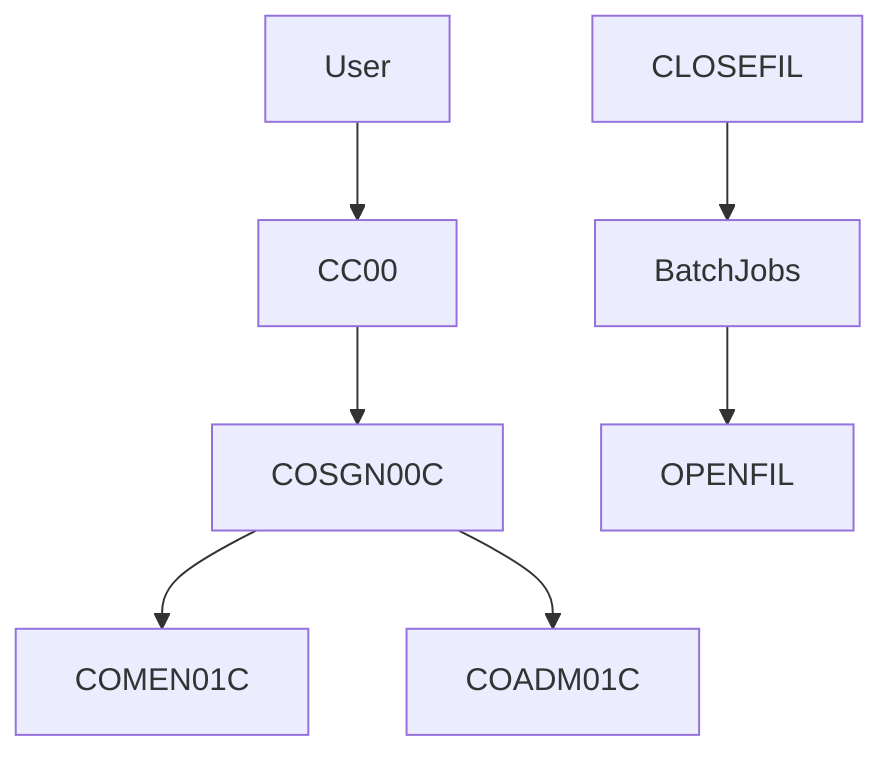

# System context and architecture

People use CICS transactions. Batch jobs close the online files, update data, and open the files again. Optional modules add DB2 transaction types, IMS pending authorizations, and MQ request handling.

## Modules

| Module | Files |
|---|---|
| (none) | 20 |
| auth | 40 |
| base | 169 |
| build | 71 |
| trantype | 27 |
| vsammq | 4 |

Module assignment uses the longest matching glob in `docs-toolkit/project-profile.yaml`.

## Sources

- `docs/_work/xref/online-trace.json`
- `app/jcl/CLOSEFIL.jcl:26-30`
- `app/jcl/OPENFIL.jcl:26-30`
- `docs-toolkit/project-profile.yaml`

## Confidence

Confirmed facts are copied from the work files cited above. Header comments remain Unverified. Paragraph purposes remain Inferred where the program fact says so.
