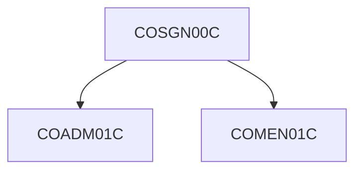
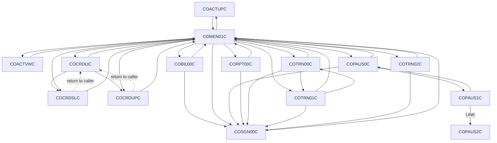
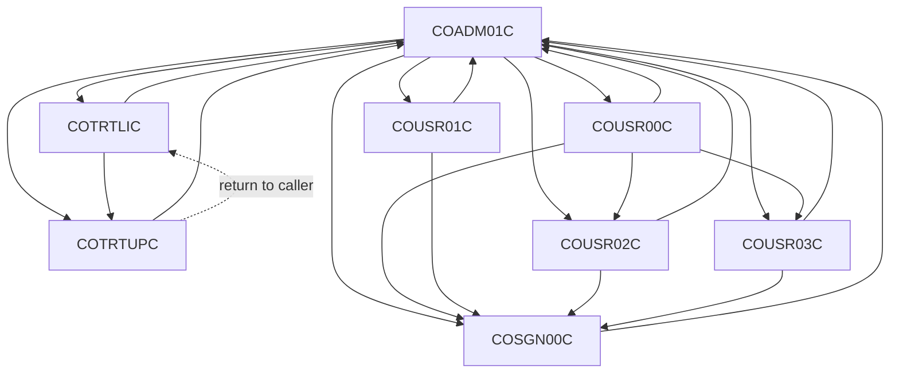

# Navigation flow

Sign-on transfers an admin user to COADM01C and any other user to COMEN01C.

## Resolved screen flow

The diagrams below use the resolved targets of every dynamic transfer (`CDEMO-TO-PROGRAM`, `CCARD-NEXT-PROG`, and the `LIT-*` / `WS-PGM-*` constants). A solid arrow is Confirmed by a literal or `VALUE` clause. A dotted arrow is a return to the calling program through `CDEMO-FROM-PROGRAM`, which is Inferred from the callers found in source. Each program's own sign-off transfer to `COSGN00C` is drawn, but `COSGN00C` is shown only as the start of the menu it leads to.

### User menu (COMEN01C)

### Admin menu (COADM01C)

`COMEN01C` transfers to `COPAUS0C` only when `INQUIRE PROGRAM` returns NORMAL (`app/cbl/COMEN01C.cbl:147-159`). `COCRDLIC` reaches `COCRDSLC` and `COCRDUPC` through `CCARD-NEXT-PROG` (`app/cbl/COCRDLIC.cbl:526`, `app/cbl/COCRDLIC.cbl:554`, values at `app/cbl/COCRDLIC.cbl:195-204`). `COPAUS1C` links to `COPAUS2C` through `WS-PGM-AUTH-FRAUD` (`app/app-authorization-ims-db2-mq/cbl/COPAUS1C.cbl:35`, `app/app-authorization-ims-db2-mq/cbl/COPAUS1C.cbl:248-249`). Per-edge evidence is in the table below and in `docs/_work/online/navigation.json` (`resolved_to`).

## Edge table

The edge table is the full extracted navigation set. Dynamic targets show the programs they resolve to.

| From | To | Mechanism | Confidence | Evidence |
|---|---|---|---|---|
| COACTUPC | CDEMO-TO-PROGRAM (resolves to COMEN01C; Inferred) | XCTL | Inferred | app/cbl/COACTUPC.cbl:956 |
| COACTUPC | LIT-THISTRANID (resolves to CAUP; Confirmed) | RETURN-TRANSID | Confirmed | app/cbl/COACTUPC.cbl:1015 |
| COACTVWC | CDEMO-TO-PROGRAM (resolves to COMEN01C; Inferred) | XCTL | Inferred | app/cbl/COACTVWC.cbl:349 |
| COACTVWC | LIT-THISTRANID (resolves to CAVW; Confirmed) | RETURN-TRANSID | Confirmed | app/cbl/COACTVWC.cbl:402 |
| COADM01C | CA00 | RETURN-TRANSID | Confirmed | app/cbl/COADM01C.cbl:111 |
| COADM01C | CDEMO-TO-PROGRAM (resolves to COSGN00C; Confirmed) | XCTL | Confirmed | app/cbl/COADM01C.cbl:168 |
| COADM01C | CA00 | RETURN-TRANSID | Confirmed | app/cbl/COADM01C.cbl:280 |
| COADM01C | COUSR00C | XCTL | Confirmed | app/cbl/COADM01C.cbl:146 |
| COADM01C | COUSR01C | XCTL | Confirmed | app/cbl/COADM01C.cbl:146 |
| COADM01C | COUSR02C | XCTL | Confirmed | app/cbl/COADM01C.cbl:146 |
| COADM01C | COUSR03C | XCTL | Confirmed | app/cbl/COADM01C.cbl:146 |
| COADM01C | COTRTLIC | XCTL | Confirmed | app/cbl/COADM01C.cbl:146 |
| COADM01C | COTRTUPC | XCTL | Confirmed | app/cbl/COADM01C.cbl:146 |
| COADM01C | COSGN00C | XCTL | Confirmed | app/cbl/COADM01C.cbl:166 |
| COBIL00C | CB00 | RETURN-TRANSID | Confirmed | app/cbl/COBIL00C.cbl:146 |
| COBIL00C | CDEMO-TO-PROGRAM (resolves to COMEN01C, COSGN00C; Confirmed) | XCTL | Confirmed | app/cbl/COBIL00C.cbl:281 |
| COCRDLIC | LIT-MENUPGM (resolves to COMEN01C; Confirmed) | XCTL | Confirmed | app/cbl/COCRDLIC.cbl:402 |
| COCRDLIC | CCARD-NEXT-PROG (resolves to COCRDSLC; Confirmed) | XCTL | Confirmed | app/cbl/COCRDLIC.cbl:538 |
| COCRDLIC | CCARD-NEXT-PROG (resolves to COCRDUPC; Confirmed) | XCTL | Confirmed | app/cbl/COCRDLIC.cbl:566 |
| COCRDLIC | LIT-THISTRANID (resolves to CCLI; Confirmed) | RETURN-TRANSID | Confirmed | app/cbl/COCRDLIC.cbl:615 |
| COCRDSLC | CDEMO-TO-PROGRAM (resolves to COCRDLIC, COMEN01C; Inferred) | XCTL | Inferred | app/cbl/COCRDSLC.cbl:331 |
| COCRDSLC | LIT-THISTRANID (resolves to CCDL; Confirmed) | RETURN-TRANSID | Confirmed | app/cbl/COCRDSLC.cbl:402 |
| COCRDUPC | CDEMO-TO-PROGRAM (resolves to COCRDLIC, COMEN01C; Inferred) | XCTL | Inferred | app/cbl/COCRDUPC.cbl:473 |
| COCRDUPC | LIT-THISTRANID (resolves to CCUP; Confirmed) | RETURN-TRANSID | Confirmed | app/cbl/COCRDUPC.cbl:554 |
| COMEN01C | CM00 | RETURN-TRANSID | Confirmed | app/cbl/COMEN01C.cbl:107 |
| COMEN01C | CDEMO-TO-PROGRAM (resolves to COSGN00C; Confirmed) | XCTL | Confirmed | app/cbl/COMEN01C.cbl:201 |
| COMEN01C | COACTVWC | XCTL | Confirmed | app/cbl/COMEN01C.cbl:185 |
| COMEN01C | COACTUPC | XCTL | Confirmed | app/cbl/COMEN01C.cbl:185 |
| COMEN01C | COCRDLIC | XCTL | Confirmed | app/cbl/COMEN01C.cbl:185 |
| COMEN01C | COCRDSLC | XCTL | Confirmed | app/cbl/COMEN01C.cbl:185 |
| COMEN01C | COCRDUPC | XCTL | Confirmed | app/cbl/COMEN01C.cbl:185 |
| COMEN01C | COTRN00C | XCTL | Confirmed | app/cbl/COMEN01C.cbl:185 |
| COMEN01C | COTRN01C | XCTL | Confirmed | app/cbl/COMEN01C.cbl:185 |
| COMEN01C | COTRN02C | XCTL | Confirmed | app/cbl/COMEN01C.cbl:185 |
| COMEN01C | CORPT00C | XCTL | Confirmed | app/cbl/COMEN01C.cbl:185 |
| COMEN01C | COBIL00C | XCTL | Confirmed | app/cbl/COMEN01C.cbl:185 |
| COMEN01C | COPAUS0C | XCTL | Confirmed | app/cbl/COMEN01C.cbl:185 |
| COMEN01C | COSGN00C | XCTL | Confirmed | app/cbl/COMEN01C.cbl:199 |
| COPAUS0C | CPVS | RETURN-TRANSID | Confirmed | app/app-authorization-ims-db2-mq/cbl/COPAUS0C.cbl:254 |
| COPAUS0C | CDEMO-TO-PROGRAM (resolves to COPAUS1C; Confirmed) | XCTL | Confirmed | app/app-authorization-ims-db2-mq/cbl/COPAUS0C.cbl:322 |
| COPAUS0C | CDEMO-TO-PROGRAM (resolves to COMEN01C, COSGN00C; Confirmed) | XCTL | Confirmed | app/app-authorization-ims-db2-mq/cbl/COPAUS0C.cbl:674 |
| COPAUS1C | CPVD | RETURN-TRANSID | Confirmed | app/app-authorization-ims-db2-mq/cbl/COPAUS1C.cbl:202 |
| COPAUS1C | COPAUS2C | LINK | Confirmed | app/app-authorization-ims-db2-mq/cbl/COPAUS1C.cbl:248 |
| COPAUS1C | CDEMO-TO-PROGRAM (resolves to COPAUS0C; Confirmed) | XCTL | Confirmed | app/app-authorization-ims-db2-mq/cbl/COPAUS1C.cbl:367 |
| CORPT00C | CR00 | RETURN-TRANSID | Confirmed | app/cbl/CORPT00C.cbl:199 |
| CORPT00C | CDEMO-TO-PROGRAM (resolves to COMEN01C, COSGN00C; Confirmed) | XCTL | Confirmed | app/cbl/CORPT00C.cbl:548 |
| CORPT00C | CR00 | RETURN-TRANSID | Confirmed | app/cbl/CORPT00C.cbl:587 |
| COSGN00C | CC00 | RETURN-TRANSID | Confirmed | app/cbl/COSGN00C.cbl:98 |
| COSGN00C | COADM01C | XCTL | Confirmed | app/cbl/COSGN00C.cbl:231 |
| COSGN00C | COMEN01C | XCTL | Confirmed | app/cbl/COSGN00C.cbl:236 |
| COTRN00C | CT00 | RETURN-TRANSID | Confirmed | app/cbl/COTRN00C.cbl:138 |
| COTRN00C | CDEMO-TO-PROGRAM (resolves to COTRN01C; Confirmed) | XCTL | Confirmed | app/cbl/COTRN00C.cbl:192 |
| COTRN00C | CDEMO-TO-PROGRAM (resolves to COMEN01C, COSGN00C; Confirmed) | XCTL | Confirmed | app/cbl/COTRN00C.cbl:518 |
| COTRN01C | CT01 | RETURN-TRANSID | Confirmed | app/cbl/COTRN01C.cbl:136 |
| COTRN01C | CDEMO-TO-PROGRAM (resolves to COMEN01C, COSGN00C, COTRN00C; Confirmed) | XCTL | Confirmed | app/cbl/COTRN01C.cbl:205 |
| COTRN02C | CT02 | RETURN-TRANSID | Confirmed | app/cbl/COTRN02C.cbl:156 |
| COTRN02C | CDEMO-TO-PROGRAM (resolves to COMEN01C, COSGN00C; Confirmed) | XCTL | Confirmed | app/cbl/COTRN02C.cbl:508 |
| COTRN02C | CT02 | RETURN-TRANSID | Confirmed | app/cbl/COTRN02C.cbl:530 |
| COTRTLIC | CDEMO-TO-PROGRAM (resolves to COADM01C; Inferred) | XCTL | Inferred | app/app-transaction-type-db2/cbl/COTRTLIC.cbl:620 |
| COTRTLIC | COTRTUPC | XCTL | Confirmed | app/app-transaction-type-db2/cbl/COTRTLIC.cbl:648 |
| COTRTLIC | CTLI | RETURN-TRANSID | Confirmed | app/app-transaction-type-db2/cbl/COTRTLIC.cbl:910 |
| COTRTUPC | CDEMO-TO-PROGRAM (resolves to COADM01C, COTRTLIC; Inferred) | XCTL | Inferred | app/app-transaction-type-db2/cbl/COTRTUPC.cbl:457 |
| COTRTUPC | LIT-THISTRANID (resolves to CTTU; Confirmed) | RETURN-TRANSID | Confirmed | app/app-transaction-type-db2/cbl/COTRTUPC.cbl:567 |
| COUSR00C | CU00 | RETURN-TRANSID | Confirmed | app/cbl/COUSR00C.cbl:141 |
| COUSR00C | CDEMO-TO-PROGRAM (resolves to COUSR02C; Confirmed) | XCTL | Confirmed | app/cbl/COUSR00C.cbl:196 |
| COUSR00C | CDEMO-TO-PROGRAM (resolves to COUSR03C; Confirmed) | XCTL | Confirmed | app/cbl/COUSR00C.cbl:206 |
| COUSR00C | CDEMO-TO-PROGRAM (resolves to COADM01C, COSGN00C; Confirmed) | XCTL | Confirmed | app/cbl/COUSR00C.cbl:514 |
| COUSR01C | CU01 | RETURN-TRANSID | Confirmed | app/cbl/COUSR01C.cbl:107 |
| COUSR01C | CDEMO-TO-PROGRAM (resolves to COADM01C, COSGN00C; Confirmed) | XCTL | Confirmed | app/cbl/COUSR01C.cbl:175 |
| COUSR02C | CU02 | RETURN-TRANSID | Confirmed | app/cbl/COUSR02C.cbl:135 |
| COUSR02C | CDEMO-TO-PROGRAM (resolves to COADM01C, COSGN00C; Confirmed) | XCTL | Confirmed | app/cbl/COUSR02C.cbl:258 |
| COUSR03C | CU03 | RETURN-TRANSID | Confirmed | app/cbl/COUSR03C.cbl:134 |
| COUSR03C | CDEMO-TO-PROGRAM (resolves to COADM01C, COSGN00C; Confirmed) | XCTL | Confirmed | app/cbl/COUSR03C.cbl:205 |

## Sources

- `app/cbl/COCRDLIC.cbl:187-204`
- `app/cbl/COCRDLIC.cbl:526-567`
- `app/cbl/COMEN01C.cbl:36`
- `app/cbl/COMEN01C.cbl:179-185`
- `app/cbl/COADM01C.cbl:36`
- `app/cbl/COADM01C.cbl:142-146`
- `app/app-authorization-ims-db2-mq/cbl/COPAUS1C.cbl:33-35`
- `app/app-authorization-ims-db2-mq/cbl/COPAUS0C.cbl:33-35`
- `app/app-transaction-type-db2/cbl/COTRTLIC.cbl:43-54`
- `app/cbl/COSGN00C.cbl:230-239`
- `docs/_work/online/navigation.json`

## Confidence

Confirmed facts are copied from the work files cited above. Header comments remain Unverified. Paragraph purposes remain Inferred where the program fact says so.
