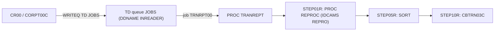

# Batch schedule flow

CA7 and Control-M are separate lists. A job name that appears in both is not one chain.

## CA7 triggers

| From | To | SCHID | Evidence |
|---|---|---|---|
| CLOSEFIL | CBPAUP0J | 030 | app/scheduler/CardDemo.ca7:43 |
| CBPAUP0J | POSTTRAN | 030 | app/scheduler/CardDemo.ca7:70 |
| POSTTRAN | WAITSTEP | 030 | app/scheduler/CardDemo.ca7:97 |
| WAITSTEP | OPENFIL | 030 | app/scheduler/CardDemo.ca7:124 |
| CLOSEFIL | TRANTYPE | 030 | app/scheduler/CardDemo.ca7:162 |
| TRANTYPE | WAITSTEP | 030 | app/scheduler/CardDemo.ca7:189 |
| WAITSTEP | CLOSEFIL1 | 031 | app/scheduler/CardDemo.ca7:216 |
| WAITSTEP | CLOSEFIL2 | 032 | app/scheduler/CardDemo.ca7:217 |
| CLOSEFIL1 | TRANCATG | 031 | app/scheduler/CardDemo.ca7:244 |
| CLOSEFIL2 | TCATBALF | 032 | app/scheduler/CardDemo.ca7:271 |
| TRANCATG | WAITSTEP | 031 | app/scheduler/CardDemo.ca7:298 |
| WAITSTEP | CLOSEFIL | 030 | app/scheduler/CardDemo.ca7:303 |
| TCATBALF | WAITSTEP | 032 | app/scheduler/CardDemo.ca7:330 |
| WAITSTEP | CLOSEFIL | 030 | app/scheduler/CardDemo.ca7:335 |
| CLOSEFIL | READACCT | 030 | app/scheduler/CardDemo.ca7:340 |
| READACCT | READCARD | 030 | app/scheduler/CardDemo.ca7:367 |
| READCARD | READCUST | 030 | app/scheduler/CardDemo.ca7:394 |
| READCUST | READXREF | 030 | app/scheduler/CardDemo.ca7:421 |
| READXREF | WAITSTEP | 030 | app/scheduler/CardDemo.ca7:448 |
| WAITSTEP | OPENFIL | 030 | app/scheduler/CardDemo.ca7:453 |
| CLOSEFIL | CREASTMT | 030 | app/scheduler/CardDemo.ca7:468 |
| CREASTMT | TXT2PDF1 | 030 | app/scheduler/CardDemo.ca7:495 |
| TXT2PDF1 | WAITSTEP | 030 | app/scheduler/CardDemo.ca7:522 |
| WAITSTEP | OPENFIL | 030 | app/scheduler/CardDemo.ca7:527 |
| OPENFIL | CLOSEFIL | 031 | app/scheduler/CardDemo.ca7:532 |
| CLOSEFIL | PRTCATBL | 031 | app/scheduler/CardDemo.ca7:537 |
| PRTCATBL | WAITSTEP | 031 | app/scheduler/CardDemo.ca7:564 |
| WAITSTEP | OPENFIL | 031 | app/scheduler/CardDemo.ca7:569 |

## Control-M conditions

| Folder | From | To | Condition | Evidence |
|---|---|---|---|---|
| DAILY-TransactionBackup | CLOSEFIL | TRANBKP | DAILY-TransactionBackup-CLOSEFIL | app/scheduler/CardDemo.controlm |
| DAILY-TransactionBackup | TRANBKP | WAITSTEP | DAILY-TransactionBackup-TRANBKP | app/scheduler/CardDemo.controlm |
| DAILY-TransactionBackup | WAITSTEP | OPENFIL | DAILY-TransactionBackup-WAITSTEP | app/scheduler/CardDemo.controlm |
| MONTHLY-InterestCalculation | CLOSEFIL | INTCALC | MONTHLY-InterestCalculation-CLOSEFIL | app/scheduler/CardDemo.controlm |
| MONTHLY-InterestCalculation | INTCALC | COMBTRAN | MONTHLY-InterestCalculation-INTCALC | app/scheduler/CardDemo.controlm |
| MONTHLY-InterestCalculation | COMBTRAN | WAITSTEP | MONTHLY-InterestCalculation-COMBTRAN | app/scheduler/CardDemo.controlm |
| MONTHLY-InterestCalculation | WAITSTEP | OPENFIL | MONTHLY-InterestCalculation-WAITSTEP | app/scheduler/CardDemo.controlm |
| WEEKLY-TransactionTypesDBRefresh | MNTTRDB2 | CLOSEFIL | WEEKLY-TransactionTypesDBRefresh-MNTTRDB2 | app/scheduler/CardDemo.controlm |
| WEEKLY-DisclosureGroupsRefresh | CLOSEFIL | DISCGRP | WEEKLY-DisclosureGroupsRefresh-CLOSEFIL | app/scheduler/CardDemo.controlm |
| WEEKLY-DisclosureGroupsRefresh | DISCGRP | WAITSTEP | WEEKLY-DisclosureGroupsRefresh-DISCGRP | app/scheduler/CardDemo.controlm |
| WEEKLY-DisclosureGroupsRefresh | WAITSTEP | OPENFIL | WEEKLY-DisclosureGroupsRefresh-WAITSTEP | app/scheduler/CardDemo.controlm |
| WEEKLY-TransactionTypesDBRefresh | MNTTRDB2 | TRANEXTR | WEEKLY-TransactionTypesDBRefresh-MNTTRDB2 | app/scheduler/CardDemo.controlm |

CA7 jobs CLOSEFIL1 and CLOSEFIL2 name JCL member CLOSEFIL.

## Online submission

Neither scheduler names this path. The online program [CORPT00C](../07-programs/CORPT00C.md) (transaction `CR00`) writes the JCL of job `TRNRPT00` to the extrapartition TD queue [JOBS](../08-data/datasets/JOBS.md), one 80-byte line at a time (`app/cbl/CORPT00C.cbl:497-520`). Confirmed.

`TRNRPT00` executes `PROC=TRANREPT` and overrides `STEP05R.SYMNAMES` and `STEP10R.DATEPARM` with the start and end dates from the screen (`app/cbl/CORPT00C.cbl:94-121`). The step order is from `app/proc/TRANREPT.prc:21`, `:35`, and `:57`. Confirmed. The link from the queue to job execution depends on DD `INREADER` in the CICS region JCL, which is not in this repository, so that edge is Unverified.

## Sources

- `app/scheduler/CardDemo.ca7`
- `app/scheduler/CardDemo.controlm`
- `app/cbl/CORPT00C.cbl:94-121`
- `app/cbl/CORPT00C.cbl:497-520`
- `app/proc/TRANREPT.prc:21-57`
- `app/csd/CARDDEMO.CSD:499-503`
- `docs/_work/batch/schedule.json`

## Confidence

Confirmed facts are copied from the work files cited above. Header comments remain Unverified. Paragraph purposes remain Inferred where the program fact says so.
