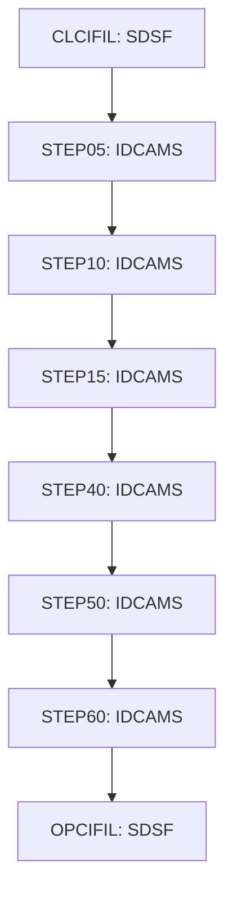

# Job CARDFILE

| Item | Value |
|---|---|
| Source | `app/jcl/CARDFILE.jcl` |
| Member | CARDFILE |
| Job card | `app/jcl/CARDFILE.jcl:1-2` |
| CLASS / MSGCLASS | A / 0 |
| NOTIFY | &SYSUID |
| Job COND |  |
| Steps | 8 |
| Module | base |

## Purpose

Comment in the JCL (Unverified, `app/jcl/CARDFILE.jcl:20`): Close files in CICS region

## Step flow

## Steps

### CLCIFIL

| Item | Value |
|---|---|
| EXEC | `app/jcl/CARDFILE.jcl:22` |
| Program | SDSF |
| PROC |  |
| Application program |  |
| PARM |  |
| COND |  |
| Function (earlier pass) | Operator command |

| DD | Dataset / output | DISP | DCB | Program file and OPEN mode | Control data | Line |
|---|---|---|---|---|---|---|
| ISFOUT | SYSOUT=* |  |  |  |  | `app/jcl/CARDFILE.jcl:23` |
| CMDOUT | SYSOUT=* |  |  |  |  | `app/jcl/CARDFILE.jcl:24` |
| ISFIN | * |  |  |  | in-stream lines 26-27 | `app/jcl/CARDFILE.jcl:25` |

### STEP05

| Item | Value |
|---|---|
| EXEC | `app/jcl/CARDFILE.jcl:33` |
| Program | IDCAMS |
| PROC |  |
| Application program |  |
| PARM |  |
| COND |  |
| Function (earlier pass) | IDCAMS delete |

| DD | Dataset / output | DISP | DCB | Program file and OPEN mode | Control data | Line |
|---|---|---|---|---|---|---|
| SYSPRINT | SYSOUT=* |  |  |  |  | `app/jcl/CARDFILE.jcl:34` |
| SYSIN | * |  |  |  | in-stream lines 36-41; statements: DELETE | `app/jcl/CARDFILE.jcl:35` |

### STEP10

| Item | Value |
|---|---|
| EXEC | `app/jcl/CARDFILE.jcl:47` |
| Program | IDCAMS |
| PROC |  |
| Application program |  |
| PARM |  |
| COND |  |
| Function (earlier pass) | IDCAMS define VSAM cluster |

| DD | Dataset / output | DISP | DCB | Program file and OPEN mode | Control data | Line |
|---|---|---|---|---|---|---|
| SYSPRINT | SYSOUT=* |  |  |  |  | `app/jcl/CARDFILE.jcl:48` |
| SYSIN | * |  |  |  | in-stream lines 50-63; statements: DEFINE; NAME(): AWS.M2.CARDDEMO.CARDDATA.VSAM.KSDS AWS.M2.CARDDEMO.CARDDATA.VSAM.KSDS.DATA AWS.M2.CARDDEMO.CARDDATA.VSAM.KSDS.INDEX | `app/jcl/CARDFILE.jcl:49` |

### STEP15

| Item | Value |
|---|---|
| EXEC | `app/jcl/CARDFILE.jcl:68` |
| Program | IDCAMS |
| PROC |  |
| Application program |  |
| PARM |  |
| COND |  |
| Function (earlier pass) | IDCAMS REPRO copy |

| DD | Dataset / output | DISP | DCB | Program file and OPEN mode | Control data | Line |
|---|---|---|---|---|---|---|
| SYSPRINT | SYSOUT=* |  |  |  |  | `app/jcl/CARDFILE.jcl:69` |
| CARDDATA | AWS.M2.CARDDEMO.CARDDATA.PS | SHR |  |  |  | `app/jcl/CARDFILE.jcl:70-71` |
| CARDVSAM | AWS.M2.CARDDEMO.CARDDATA.VSAM.KSDS | SHR |  |  |  | `app/jcl/CARDFILE.jcl:72-73` |
| SYSIN | * |  |  |  | in-stream lines 75-75; statements: REPRO | `app/jcl/CARDFILE.jcl:74` |

### STEP40

| Item | Value |
|---|---|
| EXEC | `app/jcl/CARDFILE.jcl:80` |
| Program | IDCAMS |
| PROC |  |
| Application program |  |
| PARM |  |
| COND |  |
| Function (earlier pass) | IDCAMS define alternate index |

| DD | Dataset / output | DISP | DCB | Program file and OPEN mode | Control data | Line |
|---|---|---|---|---|---|---|
| SYSPRINT | SYSOUT=* |  |  |  |  | `app/jcl/CARDFILE.jcl:81` |
| SYSIN | * |  |  |  | in-stream lines 83-92; statements: DEFINE; NAME(): AWS.M2.CARDDEMO.CARDDATA.VSAM.AIX AWS.M2.CARDDEMO.CARDDATA.VSAM.AIX.DATA AWS.M2.CARDDEMO.CARDDATA.VSAM.AIX.INDEX | `app/jcl/CARDFILE.jcl:82` |

### STEP50

| Item | Value |
|---|---|
| EXEC | `app/jcl/CARDFILE.jcl:97` |
| Program | IDCAMS |
| PROC |  |
| Application program |  |
| PARM |  |
| COND |  |
| Function (earlier pass) | IDCAMS define path |

| DD | Dataset / output | DISP | DCB | Program file and OPEN mode | Control data | Line |
|---|---|---|---|---|---|---|
| SYSPRINT | SYSOUT=* |  |  |  |  | `app/jcl/CARDFILE.jcl:98` |
| SYSIN | * |  |  |  | in-stream lines 100-102; statements: DEFINE; NAME(): AWS.M2.CARDDEMO.CARDDATA.VSAM.AIX.PATH | `app/jcl/CARDFILE.jcl:99` |

### STEP60

| Item | Value |
|---|---|
| EXEC | `app/jcl/CARDFILE.jcl:107` |
| Program | IDCAMS |
| PROC |  |
| Application program |  |
| PARM |  |
| COND |  |
| Function (earlier pass) | Utility step IDCAMS |

| DD | Dataset / output | DISP | DCB | Program file and OPEN mode | Control data | Line |
|---|---|---|---|---|---|---|
| SYSPRINT | SYSOUT=* |  |  |  |  | `app/jcl/CARDFILE.jcl:108` |
| SYSIN | * |  |  |  | in-stream lines 110-112; statements: BLDINDEX | `app/jcl/CARDFILE.jcl:109` |

### OPCIFIL

| Item | Value |
|---|---|
| EXEC | `app/jcl/CARDFILE.jcl:118` |
| Program | SDSF |
| PROC |  |
| Application program |  |
| PARM |  |
| COND |  |
| Function (earlier pass) | Operator command |

| DD | Dataset / output | DISP | DCB | Program file and OPEN mode | Control data | Line |
|---|---|---|---|---|---|---|
| ISFOUT | SYSOUT=* |  |  |  |  | `app/jcl/CARDFILE.jcl:119` |
| CMDOUT | SYSOUT=* |  |  |  |  | `app/jcl/CARDFILE.jcl:120` |
| ISFIN | * |  |  |  | in-stream lines 122-123 | `app/jcl/CARDFILE.jcl:121` |

## Scheduling and dependencies

| Mechanism | From | To | Evidence |
|---|---|---|---|
| Shell submit | scripts/remote_refresh.sh | CARDFILE | `scripts/remote_refresh.sh:20` |
| Shell submit | scripts/run_full_batch.sh | CARDFILE | `scripts/run_full_batch.sh:20` |

## Parameters

Symbols left as parameters (not resolved): `&SYSUID`.

## Sources

- `app/jcl/CARDFILE.jcl`
- `docs/_work/structure/jcl/CARDFILE.json`
- `docs/_work/jobs/CARDFILE.json`

## Confidence

Steps, DDs, conditions and control-data summaries are Confirmed from the JCL. OPEN modes come from the program source. Comments are Unverified.
