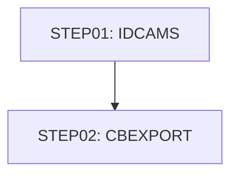

# Job CBEXPORT

| Item | Value |
|---|---|
| Source | `app/jcl/CBEXPORT.jcl` |
| Member | CBEXPORT |
| Job card | `app/jcl/CBEXPORT.jcl:1-2` |
| CLASS / MSGCLASS | A / 0 |
| NOTIFY | &SYSUID |
| Job COND |  |
| Steps | 2 |
| Module | base |

## Purpose

No descriptive comment in the JCL.

Application programs run by this job: [CBEXPORT](../../07-programs/CBEXPORT.md).

CBEXPORT: CBEXPORT is a batch COBOL program that produces a branch-migration export file. It reads the customer (CUSTFILE), account (ACCTFILE), card cross-reference (XREFFILE), transaction (TRANSACT) and card (CARDFILE) indexed files sequentially and writes every record into one 500-byte multi-record file EXPFILE using the CVEXPORT layout. Each record gets a type code (C, A, X, T, D), a run timestamp, a global sequence number and constant branch '0001' / region 'NORTH'; several numeric fields are packed into COMP or COMP-3 to save space. At the end it displays per-type and total counts. Any open, read or write error abends the program via CEE3ABD. (Inferred, from the program analysis)

## Step flow

## Steps

### STEP01

| Item | Value |
|---|---|
| EXEC | `app/jcl/CBEXPORT.jcl:24` |
| Program | IDCAMS |
| PROC |  |
| Application program |  |
| PARM |  |
| COND |  |
| Function (earlier pass) | IDCAMS delete |

| DD | Dataset / output | DISP | DCB | Program file and OPEN mode | Control data | Line |
|---|---|---|---|---|---|---|
| SYSPRINT | SYSOUT=* |  |  |  |  | `app/jcl/CBEXPORT.jcl:25` |
| SYSIN | * |  |  |  | in-stream lines 27-38; statements: DELETE SET DEFINE; NAME(): AWS.M2.CARDDEMO.EXPORT.DATA AWS.M2.CARDDEMO.EXPORT.DATA.DATA AWS.M2.CARDDEMO.EXPORT.DATA.INDEX | `app/jcl/CBEXPORT.jcl:26` |

### STEP02

| Item | Value |
|---|---|
| EXEC | `app/jcl/CBEXPORT.jcl:43` |
| Program | [CBEXPORT](../../07-programs/CBEXPORT.md) |
| PROC |  |
| Application program |  |
| PARM |  |
| COND |  |
| Function (earlier pass) | Executes program CBEXPORT |

| DD | Dataset / output | DISP | DCB | Program file and OPEN mode | Control data | Line |
|---|---|---|---|---|---|---|
| STEPLIB | AWS.M2.CARDDEMO.LOADLIB | SHR |  |  |  | `app/jcl/CBEXPORT.jcl:44-45` |
| CUSTFILE | AWS.M2.CARDDEMO.CUSTDATA.VSAM.KSDS | SHR |  | CUSTOMER-INPUT OPEN INPUT (`app/cbl/CBEXPORT.cbl:35-39`) |  | `app/jcl/CBEXPORT.jcl:49-50` |
| ACCTFILE | AWS.M2.CARDDEMO.ACCTDATA.VSAM.KSDS | SHR |  | ACCOUNT-INPUT OPEN INPUT (`app/cbl/CBEXPORT.cbl:41-45`) |  | `app/jcl/CBEXPORT.jcl:51-52` |
| XREFFILE | AWS.M2.CARDDEMO.CARDXREF.VSAM.KSDS | SHR |  | XREF-INPUT OPEN INPUT (`app/cbl/CBEXPORT.cbl:47-51`) |  | `app/jcl/CBEXPORT.jcl:53-54` |
| TRANSACT | AWS.M2.CARDDEMO.TRANSACT.VSAM.KSDS | SHR |  | TRANSACTION-INPUT OPEN INPUT (`app/cbl/CBEXPORT.cbl:53-57`) |  | `app/jcl/CBEXPORT.jcl:55-56` |
| CARDFILE | AWS.M2.CARDDEMO.CARDDATA.VSAM.KSDS | SHR |  | CARD-INPUT OPEN INPUT (`app/cbl/CBEXPORT.cbl:59-63`) |  | `app/jcl/CBEXPORT.jcl:57-58` |
| EXPFILE | AWS.M2.CARDDEMO.EXPORT.DATA | SHR |  | EXPORT-OUTPUT OPEN OUTPUT (`app/cbl/CBEXPORT.cbl:65-69`) |  | `app/jcl/CBEXPORT.jcl:62-63` |
| SYSOUT | SYSOUT=* |  |  |  |  | `app/jcl/CBEXPORT.jcl:67` |
| SYSPRINT | SYSOUT=* |  |  |  |  | `app/jcl/CBEXPORT.jcl:68` |

Return codes and abends set by CBEXPORT: abend via CEE3ABD (`app/cbl/CBEXPORT.cbl:579`).

## Scheduling and dependencies

Not referenced by the CA7 or Control-M exports or the shell scripts (see the gap report).

## Parameters

Symbols left as parameters (not resolved): `&SYSUID`.

## Sources

- `app/jcl/CBEXPORT.jcl`
- `docs/_work/structure/jcl/CBEXPORT.json`
- `docs/_work/jobs/CBEXPORT.json`

## Confidence

Steps, DDs, conditions and control-data summaries are Confirmed from the JCL. OPEN modes come from the program source. Comments are Unverified.
