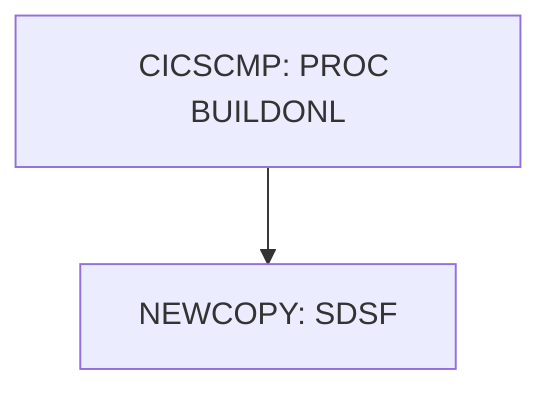

# Job CICCMP

| Item | Value |
|---|---|
| Source | `samples/jcl/CICCMP.jcl` |
| Member | CICCMP |
| Job card | `samples/jcl/CICCMP.jcl:1-2` |
| CLASS / MSGCLASS | A / H |
| NOTIFY | &SYSUID |
| Job COND |  |
| Steps | 2 |
| Module | build |

## Purpose

Comment in the JCL (Unverified, `samples/jcl/CICCMP.jcl:4`): change CICSPGMN to your program name everywhere

## Step flow

## Steps

### CICSCMP

| Item | Value |
|---|---|
| EXEC | `samples/jcl/CICCMP.jcl:41` |
| Program |  |
| PROC | BUILDONL |
| Application program |  |
| PARM |  |
| COND |  |
| Function (earlier pass) | Executes procedure BUILDONL |

No DD statements.

### NEWCOPY

| Item | Value |
|---|---|
| EXEC | `samples/jcl/CICCMP.jcl:45` |
| Program | SDSF |
| PROC |  |
| Application program |  |
| PARM |  |
| COND | `(4,LT)` |
| Function (earlier pass) | Operator command |

| DD | Dataset / output | DISP | DCB | Program file and OPEN mode | Control data | Line |
|---|---|---|---|---|---|---|
| ISFOUT | SYSOUT=* |  |  |  |  | `samples/jcl/CICCMP.jcl:46` |
| CMDOUT | SYSOUT=* |  |  |  |  | `samples/jcl/CICCMP.jcl:47` |
| ISFIN | * |  |  |  | in-stream lines 49-49 | `samples/jcl/CICCMP.jcl:48` |

## Scheduling and dependencies

Not referenced by the CA7 or Control-M exports or the shell scripts (see the gap report).

## JCL library, INCLUDE and SET

| Statement | Text | Line |
|---|---|---|
| JCLLIB | ORDER=&HLQ..CARDDEMO.PRC.UTIL | `samples/jcl/CICCMP.jcl:37` |
| SET | HLQ=AWS.M2 | `samples/jcl/CICCMP.jcl:32` |
| SET | MEMNAME=CICSPGMN | `samples/jcl/CICCMP.jcl:33` |

## Parameters

Symbols left as parameters (not resolved): `&HLQ`, `&MEMNAME`, `&SYSUID`.

## Sources

- `samples/jcl/CICCMP.jcl`
- `docs/_work/structure/jcl/CICCMP.json`
- `docs/_work/jobs/CICCMP.json`

## Confidence

Steps, DDs, conditions and control-data summaries are Confirmed from the JCL. OPEN modes come from the program source. Comments are Unverified.
