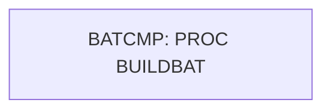

# Job CNJBATMP

| Item | Value |
|---|---|
| Source | `samples/jcl/BATCMP.jcl` |
| Member | BATCMP |
| Job card | `samples/jcl/BATCMP.jcl:1-2` |
| CLASS / MSGCLASS | A / H |
| NOTIFY | &SYSUID |
| Job COND |  |
| Steps | 1 |
| Module | build |

## Purpose

Comment in the JCL (Unverified, `samples/jcl/BATCMP.jcl:4`): change BATCHPGM to your program name everywhere

## Step flow

## Steps

### BATCMP

| Item | Value |
|---|---|
| EXEC | `samples/jcl/BATCMP.jcl:42` |
| Program |  |
| PROC | BUILDBAT |
| Application program |  |
| PARM |  |
| COND |  |
| Function (earlier pass) | Executes procedure BUILDBAT |

No DD statements.

## Scheduling and dependencies

Not referenced by the CA7 or Control-M exports or the shell scripts (see the gap report).

## JCL library, INCLUDE and SET

| Statement | Text | Line |
|---|---|---|
| JCLLIB | ORDER=&HLQ..CARDDEMO.PRC.UTIL | `samples/jcl/BATCMP.jcl:38` |
| SET | MEMNAME=BATCHPGM | `samples/jcl/BATCMP.jcl:33` |
| SET | HLQ=AWS.M2 | `samples/jcl/BATCMP.jcl:34` |

## Parameters

Symbols left as parameters (not resolved): `&HLQ`, `&MEMNAME`, `&SYSUID`.

## Sources

- `samples/jcl/BATCMP.jcl`
- `docs/_work/structure/jcl/BATCMP.json`
- `docs/_work/jobs/CNJBATMP.json`

## Confidence

Steps, DDs, conditions and control-data summaries are Confirmed from the JCL. OPEN modes come from the program source. Comments are Unverified.
