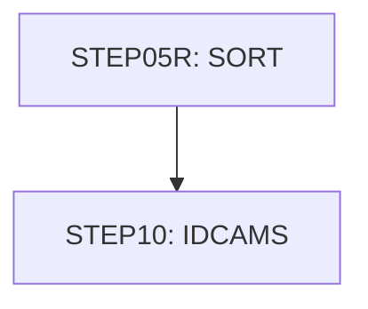

# Job COMBTRAN

| Item | Value |
|---|---|
| Source | `app/jcl/COMBTRAN.jcl` |
| Member | COMBTRAN |
| Job card | `app/jcl/COMBTRAN.jcl:1-2` |
| CLASS / MSGCLASS | A / 0 |
| NOTIFY | &SYSUID |
| Job COND |  |
| Steps | 2 |
| Module | base |

## Purpose

Comment in the JCL (Unverified, `app/jcl/COMBTRAN.jcl:20`): Sort current transaction file and system generated transactions

## Step flow

## Steps

### STEP05R

| Item | Value |
|---|---|
| EXEC | `app/jcl/COMBTRAN.jcl:22` |
| Program | SORT |
| PROC |  |
| Application program |  |
| PARM |  |
| COND |  |
| Function (earlier pass) | SORT control |

| DD | Dataset / output | DISP | DCB | Program file and OPEN mode | Control data | Line |
|---|---|---|---|---|---|---|
| SORTIN | AWS.M2.CARDDEMO.TRANSACT.BKUP(0) | SHR |  |  |  | `app/jcl/COMBTRAN.jcl:23-24` |
| SORTIN (concat) | AWS.M2.CARDDEMO.SYSTRAN(0) | SHR |  |  |  | `app/jcl/COMBTRAN.jcl:25-26` |
| SYMNAMES | * |  |  |  | in-stream lines 28-28 | `app/jcl/COMBTRAN.jcl:27` |
| SYSIN | * |  |  |  | in-stream lines 30-30; statements: SORT | `app/jcl/COMBTRAN.jcl:29` |
| SYSOUT | SYSOUT=* |  |  |  |  | `app/jcl/COMBTRAN.jcl:32` |
| SORTOUT | AWS.M2.CARDDEMO.TRANSACT.COMBINED(+1) | (NEW,CATLG,DELETE) | (*.SORTIN) |  |  | `app/jcl/COMBTRAN.jcl:33-37` |

### STEP10

| Item | Value |
|---|---|
| EXEC | `app/jcl/COMBTRAN.jcl:41` |
| Program | IDCAMS |
| PROC |  |
| Application program |  |
| PARM |  |
| COND |  |
| Function (earlier pass) | IDCAMS REPRO copy |

| DD | Dataset / output | DISP | DCB | Program file and OPEN mode | Control data | Line |
|---|---|---|---|---|---|---|
| SYSPRINT | SYSOUT=* |  |  |  |  | `app/jcl/COMBTRAN.jcl:42` |
| TRANSACT | AWS.M2.CARDDEMO.TRANSACT.COMBINED(+1) | SHR |  |  |  | `app/jcl/COMBTRAN.jcl:43-44` |
| TRANVSAM | AWS.M2.CARDDEMO.TRANSACT.VSAM.KSDS | SHR |  |  |  | `app/jcl/COMBTRAN.jcl:45-46` |
| SYSIN | * |  |  |  | in-stream lines 48-48; statements: REPRO | `app/jcl/COMBTRAN.jcl:47` |

## Scheduling and dependencies

| Mechanism | From | To | Evidence |
|---|---|---|---|
| Control-M condition MONTHLY-InterestCalculation-INTCALC | INTCALC | COMBTRAN | `app/scheduler/CardDemo.controlm:72` (OUTCOND), `app/scheduler/CardDemo.controlm:76` (INCOND) |
| Control-M condition MONTHLY-InterestCalculation-COMBTRAN | COMBTRAN | WAITSTEP | `app/scheduler/CardDemo.controlm:78` (OUTCOND), `app/scheduler/CardDemo.controlm:82` (INCOND) |
| Shell submit | scripts/run_full_batch.sh | COMBTRAN | `scripts/run_full_batch.sh:58` |
| Shell submit | scripts/run_interest_calc.sh | COMBTRAN | `scripts/run_interest_calc.sh:26` |

## Parameters

Symbols left as parameters (not resolved): `&SYSUID`.

## Sources

- `app/jcl/COMBTRAN.jcl`
- `docs/_work/structure/jcl/COMBTRAN.json`
- `docs/_work/jobs/COMBTRAN.json`

## Confidence

Steps, DDs, conditions and control-data summaries are Confirmed from the JCL. OPEN modes come from the program source. Comments are Unverified.
