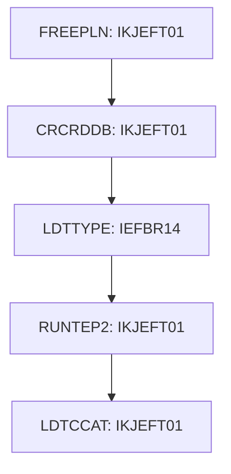

# Job CREADB2

| Item | Value |
|---|---|
| Source | `app/app-transaction-type-db2/jcl/CREADB21.jcl` |
| Member | CREADB21 |
| Job card | `app/app-transaction-type-db2/jcl/CREADB21.jcl:1-2` |
| CLASS / MSGCLASS | A / A |
| NOTIFY | &SYSUID |
| Job COND |  |
| Steps | 5 |
| Module | trantype |

## Purpose

Comment in the JCL (Unverified, `app/app-transaction-type-db2/jcl/CREADB21.jcl:19`): Create CARDDEMO Database in DAZ1 subsystem (SSID=DAZ1)   ****** 00040021

## Step flow

## Steps

### FREEPLN

| Item | Value |
|---|---|
| EXEC | `app/app-transaction-type-db2/jcl/CREADB21.jcl:40` |
| Program | IKJEFT01 |
| PROC |  |
| Application program |  |
| PARM |  |
| COND |  |
| Function (earlier pass) | Utility step IKJEFT01 |

| DD | Dataset / output | DISP | DCB | Program file and OPEN mode | Control data | Line |
|---|---|---|---|---|---|---|
| STEPLIB | OEM.DB2.DAZ1.SDSNEXIT | SHR |  |  |  | `app/app-transaction-type-db2/jcl/CREADB21.jcl:41` |
| STEPLIB (concat) | OEMA.DB2.VERSIONA.SDSNLOAD | SHR |  |  |  | `app/app-transaction-type-db2/jcl/CREADB21.jcl:42` |
| SYSPRINT | SYSOUT=* |  |  |  |  | `app/app-transaction-type-db2/jcl/CREADB21.jcl:43` |
| SYSTSPRT | SYSOUT=* |  |  |  |  | `app/app-transaction-type-db2/jcl/CREADB21.jcl:44` |
| SYSUDUMP | SYSOUT=* |  |  |  |  | `app/app-transaction-type-db2/jcl/CREADB21.jcl:45` |
| SYSTSIN | &LBNM..CNTL(DB2FREE) | SHR |  |  |  | `app/app-transaction-type-db2/jcl/CREADB21.jcl:46` |

### CRCRDDB

| Item | Value |
|---|---|
| EXEC | `app/app-transaction-type-db2/jcl/CREADB21.jcl:52` |
| Program | IKJEFT01 |
| PROC |  |
| Application program |  |
| PARM |  |
| COND |  |
| Function (earlier pass) | Utility step IKJEFT01 |

| DD | Dataset / output | DISP | DCB | Program file and OPEN mode | Control data | Line |
|---|---|---|---|---|---|---|
| STEPLIB | OEM.DB2.&DB2S..RUNLIB.LOAD | SHR |  |  |  | `app/app-transaction-type-db2/jcl/CREADB21.jcl:53` |
| STEPLIB (concat) | OEMA.DB2.VERSIONA.SDSNLOAD | SHR |  |  |  | `app/app-transaction-type-db2/jcl/CREADB21.jcl:54` |
| SYSTSPRT | SYSOUT=* |  |  |  |  | `app/app-transaction-type-db2/jcl/CREADB21.jcl:55` |
| SYSUDUMP | SYSOUT=* |  |  |  |  | `app/app-transaction-type-db2/jcl/CREADB21.jcl:56` |
| SYSPRINT | SYSOUT=* |  |  |  |  | `app/app-transaction-type-db2/jcl/CREADB21.jcl:57` |
| SYSTSIN | &LBNM..CNTL(DB2TIAD1) | SHR |  |  |  | `app/app-transaction-type-db2/jcl/CREADB21.jcl:58` |
| SYSIN | &LBNM..CNTL(DB2CREAT) | SHR |  |  |  | `app/app-transaction-type-db2/jcl/CREADB21.jcl:59` |

### LDTTYPE

| Item | Value |
|---|---|
| EXEC | `app/app-transaction-type-db2/jcl/CREADB21.jcl:64` |
| Program | IEFBR14 |
| PROC |  |
| Application program |  |
| PARM |  |
| COND | `(0,NE)` |
| Function (earlier pass) | Utility step IEFBR14 |

No DD statements.

### RUNTEP2

| Item | Value |
|---|---|
| EXEC | `app/app-transaction-type-db2/jcl/CREADB21.jcl:65` |
| Program | IKJEFT01 |
| PROC |  |
| Application program |  |
| PARM |  |
| COND |  |
| Function (earlier pass) | Utility step IKJEFT01 |

| DD | Dataset / output | DISP | DCB | Program file and OPEN mode | Control data | Line |
|---|---|---|---|---|---|---|
| STEPLIB | OEM.DB2.&DB2S..RUNLIB.LOAD | SHR |  |  |  | `app/app-transaction-type-db2/jcl/CREADB21.jcl:66` |
| STEPLIB (concat) | OEMA.DB2.VERSIONA.SDSNLOAD | SHR |  |  |  | `app/app-transaction-type-db2/jcl/CREADB21.jcl:67` |
| SYSTSPRT | SYSOUT=* |  |  |  |  | `app/app-transaction-type-db2/jcl/CREADB21.jcl:68` |
| SYSUDUMP | SYSOUT=* |  |  |  |  | `app/app-transaction-type-db2/jcl/CREADB21.jcl:69` |
| SYSPRINT | SYSOUT=* |  |  |  |  | `app/app-transaction-type-db2/jcl/CREADB21.jcl:70` |
| SYSTSIN | &LBNM..CNTL(DB2TEP41) | SHR |  |  |  | `app/app-transaction-type-db2/jcl/CREADB21.jcl:71` |
| SYSIN | &LBNM..CNTL(DB2LTTYP) | SHR |  |  |  | `app/app-transaction-type-db2/jcl/CREADB21.jcl:72` |

### LDTCCAT

| Item | Value |
|---|---|
| EXEC | `app/app-transaction-type-db2/jcl/CREADB21.jcl:77` |
| Program | IKJEFT01 |
| PROC |  |
| Application program |  |
| PARM |  |
| COND | `(0,NE)` |
| Function (earlier pass) | Utility step IKJEFT01 |

| DD | Dataset / output | DISP | DCB | Program file and OPEN mode | Control data | Line |
|---|---|---|---|---|---|---|
| STEPLIB | OEM.DB2.&DB2S..RUNLIB.LOAD | SHR |  |  |  | `app/app-transaction-type-db2/jcl/CREADB21.jcl:78` |
| STEPLIB (concat) | OEMA.DB2.VERSIONA.SDSNLOAD | SHR |  |  |  | `app/app-transaction-type-db2/jcl/CREADB21.jcl:79` |
| SYSTSPRT | SYSOUT=* |  |  |  |  | `app/app-transaction-type-db2/jcl/CREADB21.jcl:80` |
| SYSUDUMP | SYSOUT=* |  |  |  |  | `app/app-transaction-type-db2/jcl/CREADB21.jcl:81` |
| SYSPRINT | SYSOUT=* |  |  |  |  | `app/app-transaction-type-db2/jcl/CREADB21.jcl:82` |
| SYSTSIN | &LBNM..CNTL(DB2TEP41) | SHR |  |  |  | `app/app-transaction-type-db2/jcl/CREADB21.jcl:83` |
| SYSIN | &LBNM..CNTL(DB2LTCAT) | SHR |  |  |  | `app/app-transaction-type-db2/jcl/CREADB21.jcl:84` |

## Scheduling and dependencies

Not referenced by the CA7 or Control-M exports or the shell scripts (see the gap report).

## JCL library, INCLUDE and SET

| Statement | Text | Line |
|---|---|---|
| SET | CODER=AWS | `app/app-transaction-type-db2/jcl/CREADB21.jcl:28` |
| SET | LBNM=&CODER..M2.CARDDEMO | `app/app-transaction-type-db2/jcl/CREADB21.jcl:29` |
| SET | DB2S=DAZ1 | `app/app-transaction-type-db2/jcl/CREADB21.jcl:30` |

## Parameters

Symbols left as parameters (not resolved): `&DB2S`, `&LBNM`, `&SYSUID`.

## Sources

- `app/app-transaction-type-db2/jcl/CREADB21.jcl`
- `docs/_work/structure/jcl/CREADB21.json`
- `docs/_work/jobs/CREADB2.json`

## Confidence

Steps, DDs, conditions and control-data summaries are Confirmed from the JCL. OPEN modes come from the program source. Comments are Unverified.
