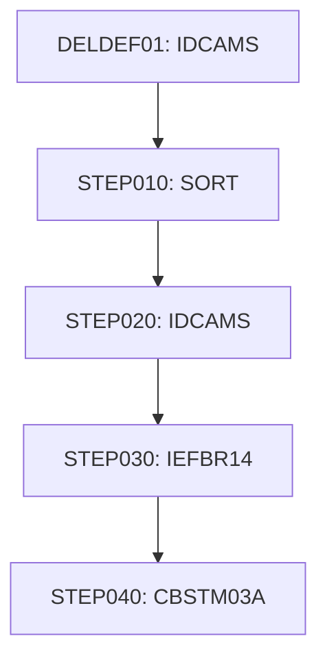

# Job CREASTMT

| Item | Value |
|---|---|
| Source | `app/jcl/CREASTMT.JCL` |
| Member | CREASTMT |
| Job card | `app/jcl/CREASTMT.JCL:1-2` |
| CLASS / MSGCLASS | A / H |
| NOTIFY | &SYSUID |
| Job COND |  |
| Steps | 5 |
| Module | base |

## Purpose

Comment in the JCL (Unverified, `app/jcl/CREASTMT.JCL:19`): This JCL will create statement for each CARD present in the XREF

Application programs run by this job: [CBSTM03A](../../07-programs/CBSTM03A.md).

CBSTM03A: CBSTM03A is the batch account-statement program; it writes each statement in two formats, an 80-byte plain-text file (STMTFILE) and a 100-byte HTML file (HTMLFILE). All file access goes through subroutine CBSTM03B. It first displays the job's DD names from the z/OS TIOT, then uses an ALTER/GO TO state machine to open the transaction file, load every transaction into an in-memory table grouped by card number (max 51 cards x 10 transactions), and open the cross-reference, customer and account files. For each card cross-reference record it reads the customer and account by key, writes a statement header (name, address, account id, balance, FICO score), lists that card's transactions and prints their total. Read failures for cross-reference, customer or account abend the run. The header says the program deliberately uses control-block addressing, ALTER/GO TO, COMP/COMP-3, a 2-D array and a subroutine call to exercise modernization tooling. (Inferred, from the program analysis)

## Step flow

## Steps

### DELDEF01

| Item | Value |
|---|---|
| EXEC | `app/jcl/CREASTMT.JCL:22` |
| Program | IDCAMS |
| PROC |  |
| Application program |  |
| PARM |  |
| COND |  |
| Function (earlier pass) | IDCAMS delete |

| DD | Dataset / output | DISP | DCB | Program file and OPEN mode | Control data | Line |
|---|---|---|---|---|---|---|
| SYSPRINT | SYSOUT=* |  |  |  |  | `app/jcl/CREASTMT.JCL:23` |
| SYSIN | * |  |  |  | in-stream lines 25-39; statements: DELETE SET DEFINE; NAME(): AWS.M2.CARDDEMO.TRXFL.DATA AWS.M2.CARDDEMO.TRXFL.INDEX AWS.M2.CARDDEMO.TRXFL.VSAM.KSDS | `app/jcl/CREASTMT.JCL:24` |

### STEP010

| Item | Value |
|---|---|
| EXEC | `app/jcl/CREASTMT.JCL:44` |
| Program | SORT |
| PROC |  |
| Application program |  |
| PARM |  |
| COND |  |
| Function (earlier pass) | SORT control |

| DD | Dataset / output | DISP | DCB | Program file and OPEN mode | Control data | Line |
|---|---|---|---|---|---|---|
| SORTIN | AWS.M2.CARDDEMO.TRANSACT.VSAM.KSDS | SHR |  |  |  | `app/jcl/CREASTMT.JCL:45` |
| SYSPRINT | SYSOUT=* |  |  |  |  | `app/jcl/CREASTMT.JCL:46` |
| SYSOUT | SYSOUT=* |  |  |  |  | `app/jcl/CREASTMT.JCL:47` |
| SORTOUT | AWS.M2.CARDDEMO.TRXFL.SEQ | (NEW,CATLG,DELETE) | (LRECL=350,BLKSIZE=3500,RECFM=FB) |  |  | `app/jcl/CREASTMT.JCL:48-51` |
| SYSIN | * |  |  |  | in-stream lines 53-54; statements: SORT OUTREC | `app/jcl/CREASTMT.JCL:52` |

### STEP020

| Item | Value |
|---|---|
| EXEC | `app/jcl/CREASTMT.JCL:56` |
| Program | IDCAMS |
| PROC |  |
| Application program |  |
| PARM |  |
| COND | `(0,NE)` |
| Function (earlier pass) | IDCAMS REPRO copy |

| DD | Dataset / output | DISP | DCB | Program file and OPEN mode | Control data | Line |
|---|---|---|---|---|---|---|
| SYSPRINT | SYSOUT=* |  |  |  |  | `app/jcl/CREASTMT.JCL:57` |
| INFILE | AWS.M2.CARDDEMO.TRXFL.SEQ | SHR |  |  |  | `app/jcl/CREASTMT.JCL:58` |
| OUTFILE | AWS.M2.CARDDEMO.TRXFL.VSAM.KSDS | SHR |  |  |  | `app/jcl/CREASTMT.JCL:59` |
| SYSIN | * |  |  |  | in-stream lines 61-61; statements: REPRO | `app/jcl/CREASTMT.JCL:60` |

### STEP030

| Item | Value |
|---|---|
| EXEC | `app/jcl/CREASTMT.JCL:66` |
| Program | IEFBR14 |
| PROC |  |
| Application program |  |
| PARM |  |
| COND | `(0,NE)` |
| Function (earlier pass) | Utility step IEFBR14 |

| DD | Dataset / output | DISP | DCB | Program file and OPEN mode | Control data | Line |
|---|---|---|---|---|---|---|
| HTMLFILE | AWS.M2.CARDDEMO.STATEMNT.HTML | (MOD,DELETE,DELETE) | (LRECL=80,BLKSIZE=3200,RECFM=FB) |  |  | `app/jcl/CREASTMT.JCL:67-71` |
| STMTFILE | AWS.M2.CARDDEMO.STATEMNT.PS | (MOD,DELETE,DELETE) | (LRECL=80,BLKSIZE=8000,RECFM=FB) |  |  | `app/jcl/CREASTMT.JCL:72-75` |

### STEP040

| Item | Value |
|---|---|
| EXEC | `app/jcl/CREASTMT.JCL:79` |
| Program | [CBSTM03A](../../07-programs/CBSTM03A.md) |
| PROC |  |
| Application program |  |
| PARM |  |
| COND | `(0,NE)` |
| Function (earlier pass) | Executes program CBSTM03A |

| DD | Dataset / output | DISP | DCB | Program file and OPEN mode | Control data | Line |
|---|---|---|---|---|---|---|
| STEPLIB | AWS.M2.CARDDEMO.LOADLIB | SHR |  |  |  | `app/jcl/CREASTMT.JCL:80` |
| SYSPRINT | SYSOUT=* |  |  |  |  | `app/jcl/CREASTMT.JCL:81` |
| SYSOUT | SYSOUT=* |  |  |  |  | `app/jcl/CREASTMT.JCL:82` |
| TRNXFILE | AWS.M2.CARDDEMO.TRXFL.VSAM.KSDS | SHR |  |  |  | `app/jcl/CREASTMT.JCL:83` |
| XREFFILE | AWS.M2.CARDDEMO.CARDXREF.VSAM.KSDS | SHR |  |  |  | `app/jcl/CREASTMT.JCL:84` |
| ACCTFILE | AWS.M2.CARDDEMO.ACCTDATA.VSAM.KSDS | SHR |  |  |  | `app/jcl/CREASTMT.JCL:85` |
| CUSTFILE | AWS.M2.CARDDEMO.CUSTDATA.VSAM.KSDS | SHR |  |  |  | `app/jcl/CREASTMT.JCL:86` |
| STMTFILE | AWS.M2.CARDDEMO.STATEMNT.PS | (NEW,CATLG,DELETE) | (LRECL=80,BLKSIZE=8000,RECFM=FB) | STMT-FILE OPEN OUTPUT (`app/cbl/CBSTM03A.CBL:39`) |  | `app/jcl/CREASTMT.JCL:87-91` |
| HTMLFILE | AWS.M2.CARDDEMO.STATEMNT.HTML | (NEW,CATLG,DELETE) | (LRECL=100,BLKSIZE=800,RECFM=FB) | HTML-FILE OPEN OUTPUT (`app/cbl/CBSTM03A.CBL:40`) |  | `app/jcl/CREASTMT.JCL:92-96` |

Return codes and abends set by CBSTM03A: abend via CEE3ABD (`app/cbl/CBSTM03A.CBL:923`).

## Scheduling and dependencies

| Mechanism | From | To | Evidence |
|---|---|---|---|
| CA7 trigger | CLOSEFIL | CREASTMT | `app/scheduler/CardDemo.ca7:468` |
| CA7 trigger | CREASTMT | TXT2PDF1 | `app/scheduler/CardDemo.ca7:495` |

## Parameters

Symbols left as parameters (not resolved): `&SYSUID`.

## Sources

- `app/jcl/CREASTMT.JCL`
- `docs/_work/structure/jcl/CREASTMT.json`
- `docs/_work/jobs/CREASTMT.json`

## Confidence

Steps, DDs, conditions and control-data summaries are Confirmed from the JCL. OPEN modes come from the program source. Comments are Unverified.
