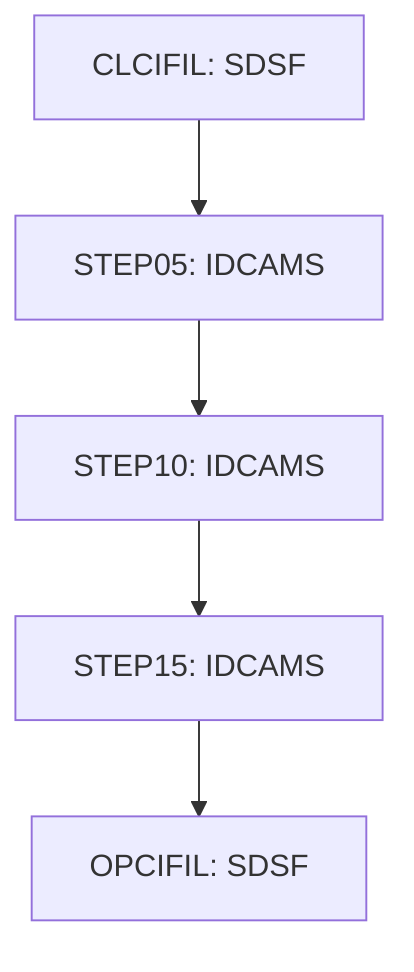

# Job CUSTFILE

| Item | Value |
|---|---|
| Source | `app/jcl/CUSTFILE.jcl` |
| Member | CUSTFILE |
| Job card | `app/jcl/CUSTFILE.jcl:1-2` |
| CLASS / MSGCLASS | A / 0 |
| NOTIFY | &SYSUID |
| Job COND |  |
| Steps | 5 |
| Module | base |

## Purpose

Comment in the JCL (Unverified, `app/jcl/CUSTFILE.jcl:20`): Close files in CICS region

## Step flow

## Steps

### CLCIFIL

| Item | Value |
|---|---|
| EXEC | `app/jcl/CUSTFILE.jcl:22` |
| Program | SDSF |
| PROC |  |
| Application program |  |
| PARM |  |
| COND |  |
| Function (earlier pass) | Operator command |

| DD | Dataset / output | DISP | DCB | Program file and OPEN mode | Control data | Line |
|---|---|---|---|---|---|---|
| ISFOUT | SYSOUT=* |  |  |  |  | `app/jcl/CUSTFILE.jcl:23` |
| CMDOUT | SYSOUT=* |  |  |  |  | `app/jcl/CUSTFILE.jcl:24` |
| ISFIN | * |  |  |  | in-stream lines 26-26 | `app/jcl/CUSTFILE.jcl:25` |

### STEP05

| Item | Value |
|---|---|
| EXEC | `app/jcl/CUSTFILE.jcl:32` |
| Program | IDCAMS |
| PROC |  |
| Application program |  |
| PARM |  |
| COND |  |
| Function (earlier pass) | IDCAMS delete |

| DD | Dataset / output | DISP | DCB | Program file and OPEN mode | Control data | Line |
|---|---|---|---|---|---|---|
| SYSPRINT | SYSOUT=* |  |  |  |  | `app/jcl/CUSTFILE.jcl:33` |
| SYSIN | * |  |  |  | in-stream lines 35-37; statements: DELETE | `app/jcl/CUSTFILE.jcl:34` |

### STEP10

| Item | Value |
|---|---|
| EXEC | `app/jcl/CUSTFILE.jcl:43` |
| Program | IDCAMS |
| PROC |  |
| Application program |  |
| PARM |  |
| COND |  |
| Function (earlier pass) | IDCAMS define VSAM cluster |

| DD | Dataset / output | DISP | DCB | Program file and OPEN mode | Control data | Line |
|---|---|---|---|---|---|---|
| SYSPRINT | SYSOUT=* |  |  |  |  | `app/jcl/CUSTFILE.jcl:44` |
| SYSIN | * |  |  |  | in-stream lines 46-59; statements: DEFINE; NAME(): AWS.M2.CARDDEMO.CUSTDATA.VSAM.KSDS AWS.M2.CARDDEMO.CUSTDATA.VSAM.KSDS.DATA AWS.M2.CARDDEMO.CUSTDATA.VSAM.KSDS.INDEX | `app/jcl/CUSTFILE.jcl:45` |

### STEP15

| Item | Value |
|---|---|
| EXEC | `app/jcl/CUSTFILE.jcl:64` |
| Program | IDCAMS |
| PROC |  |
| Application program |  |
| PARM |  |
| COND |  |
| Function (earlier pass) | IDCAMS REPRO copy |

| DD | Dataset / output | DISP | DCB | Program file and OPEN mode | Control data | Line |
|---|---|---|---|---|---|---|
| SYSPRINT | SYSOUT=* |  |  |  |  | `app/jcl/CUSTFILE.jcl:65` |
| CUSTDATA | AWS.M2.CARDDEMO.CUSTDATA.PS | SHR |  |  |  | `app/jcl/CUSTFILE.jcl:66-67` |
| CUSTVSAM | AWS.M2.CARDDEMO.CUSTDATA.VSAM.KSDS | SHR |  |  |  | `app/jcl/CUSTFILE.jcl:68-69` |
| SYSIN | * |  |  |  | in-stream lines 71-71; statements: REPRO | `app/jcl/CUSTFILE.jcl:70` |

### OPCIFIL

| Item | Value |
|---|---|
| EXEC | `app/jcl/CUSTFILE.jcl:76` |
| Program | SDSF |
| PROC |  |
| Application program |  |
| PARM |  |
| COND |  |
| Function (earlier pass) | Operator command |

| DD | Dataset / output | DISP | DCB | Program file and OPEN mode | Control data | Line |
|---|---|---|---|---|---|---|
| ISFOUT | SYSOUT=* |  |  |  |  | `app/jcl/CUSTFILE.jcl:77` |
| CMDOUT | SYSOUT=* |  |  |  |  | `app/jcl/CUSTFILE.jcl:78` |
| ISFIN | * |  |  |  | in-stream lines 80-80 | `app/jcl/CUSTFILE.jcl:79` |

## Scheduling and dependencies

| Mechanism | From | To | Evidence |
|---|---|---|---|
| Shell submit | scripts/remote_refresh.sh | CUSTFILE | `scripts/remote_refresh.sh:26` |
| Shell submit | scripts/run_full_batch.sh | CUSTFILE | `scripts/run_full_batch.sh:26` |

## Parameters

Symbols left as parameters (not resolved): `&SYSUID`.

## Sources

- `app/jcl/CUSTFILE.jcl`
- `docs/_work/structure/jcl/CUSTFILE.json`
- `docs/_work/jobs/CUSTFILE.json`

## Confidence

Steps, DDs, conditions and control-data summaries are Confirmed from the JCL. OPEN modes come from the program source. Comments are Unverified.
