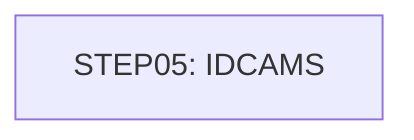

# Job DALYREJS

| Item | Value |
|---|---|
| Source | `app/jcl/DALYREJS.jcl` |
| Member | DALYREJS |
| Job card | `app/jcl/DALYREJS.jcl:1` |
| CLASS / MSGCLASS | A / 0 |
| NOTIFY | &SYSUID |
| Job COND |  |
| Steps | 1 |
| Module | base |

## Purpose

Comment in the JCL (Unverified, `app/jcl/DALYREJS.jcl:19`): DELETE TRANSACATION MASTER VSAM FILE IF ONE ALREADY EXISTS

## Step flow

## Steps

### STEP05

| Item | Value |
|---|---|
| EXEC | `app/jcl/DALYREJS.jcl:21` |
| Program | IDCAMS |
| PROC |  |
| Application program |  |
| PARM |  |
| COND |  |
| Function (earlier pass) | IDCAMS define GDG |

| DD | Dataset / output | DISP | DCB | Program file and OPEN mode | Control data | Line |
|---|---|---|---|---|---|---|
| SYSPRINT | SYSOUT=* |  |  |  |  | `app/jcl/DALYREJS.jcl:22` |
| SYSIN | * |  |  |  | in-stream lines 24-28; statements: DEFINE; NAME(): AWS.M2.CARDDEMO.DALYREJS | `app/jcl/DALYREJS.jcl:23` |

## Scheduling and dependencies

Not referenced by the CA7 or Control-M exports or the shell scripts (see the gap report).

## Parameters

Symbols left as parameters (not resolved): `&SYSUID`.

## Sources

- `app/jcl/DALYREJS.jcl`
- `docs/_work/structure/jcl/DALYREJS.json`
- `docs/_work/jobs/DALYREJS.json`

## Confidence

Steps, DDs, conditions and control-data summaries are Confirmed from the JCL. OPEN modes come from the program source. Comments are Unverified.
