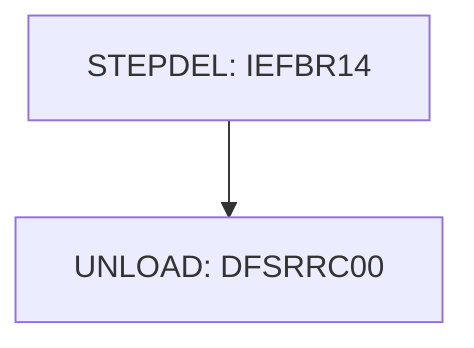

# Job DBPAUTP0

| Item | Value |
|---|---|
| Source | `app/app-authorization-ims-db2-mq/jcl/DBPAUTP0.jcl` |
| Member | DBPAUTP0 |
| Job card | `app/app-authorization-ims-db2-mq/jcl/DBPAUTP0.jcl:1-2` |
| CLASS / MSGCLASS | A / X |
| NOTIFY | &SYSUID |
| Job COND |  |
| Steps | 2 |
| Module | auth |

## Purpose

Comment in the JCL (Unverified, `app/app-authorization-ims-db2-mq/jcl/DBPAUTP0.jcl:5`): DELETE OUTPUT DATASET

## Step flow

## Steps

### STEPDEL

| Item | Value |
|---|---|
| EXEC | `app/app-authorization-ims-db2-mq/jcl/DBPAUTP0.jcl:7` |
| Program | IEFBR14 |
| PROC |  |
| Application program |  |
| PARM |  |
| COND |  |
| Function (earlier pass) | Utility step IEFBR14 |

| DD | Dataset / output | DISP | DCB | Program file and OPEN mode | Control data | Line |
|---|---|---|---|---|---|---|
| SYSPRINT | SYSOUT=* |  |  |  |  | `app/app-authorization-ims-db2-mq/jcl/DBPAUTP0.jcl:8` |
| SYSUT1 | AWS.M2.CARDDEMO.IMSDATA.DBPAUTP0 | (MOD,DELETE) |  |  |  | `app/app-authorization-ims-db2-mq/jcl/DBPAUTP0.jcl:9-10` |

### UNLOAD

| Item | Value |
|---|---|
| EXEC | `app/app-authorization-ims-db2-mq/jcl/DBPAUTP0.jcl:15-16` |
| Program | DFSRRC00 |
| PROC |  |
| Application program | DFSURGU0 (no source in repository) via DFSRRC00 PARM |
| PARM | `(ULU,DFSURGU0,DBPAUTP0)` |
| COND |  |
| Function (earlier pass) | IMS (ULU program DFSURGU0 PSB DBPAUTP0) |

| DD | Dataset / output | DISP | DCB | Program file and OPEN mode | Control data | Line |
|---|---|---|---|---|---|---|
| STEPLIB | OEMA.IMS.IMSP.SDFSRESL | SHR |  |  |  | `app/app-authorization-ims-db2-mq/jcl/DBPAUTP0.jcl:18` |
| STEPLIB (concat) | AWS.M2.CARDDEMO.LOADLIB | SHR |  |  |  | `app/app-authorization-ims-db2-mq/jcl/DBPAUTP0.jcl:19` |
| DFSRESLB | OEMA.IMS.IMSP.SDFSRESL | SHR |  |  |  | `app/app-authorization-ims-db2-mq/jcl/DBPAUTP0.jcl:20` |
| IMS | OEM.IMS.IMSP.PSBLIB | SHR |  |  |  | `app/app-authorization-ims-db2-mq/jcl/DBPAUTP0.jcl:21` |
| IMS (concat) | OEM.IMS.IMSP.DBDLIB | SHR |  |  |  | `app/app-authorization-ims-db2-mq/jcl/DBPAUTP0.jcl:22` |
| SYSPRINT | SYSOUT=* |  |  |  |  | `app/app-authorization-ims-db2-mq/jcl/DBPAUTP0.jcl:23` |
| DFSURGU1 | AWS.M2.CARDDEMO.IMSDATA.DBPAUTP0 | (,CATLG,DELETE) | (LRECL=27990,RECFM=VB,BLKSIZE=0) |  |  | `app/app-authorization-ims-db2-mq/jcl/DBPAUTP0.jcl:25-29` |
| DDPAUTP0 | OEM.IMS.IMSP.PAUTHDB | SHR |  |  |  | `app/app-authorization-ims-db2-mq/jcl/DBPAUTP0.jcl:31` |
| DDPAUTX0 | OEM.IMS.IMSP.PAUTHDBX | SHR |  |  |  | `app/app-authorization-ims-db2-mq/jcl/DBPAUTP0.jcl:32` |
| DFSVSAMP | OEMPP.IMS.V15R01MB.PROCLIB(DFSVSMDB) | SHR |  |  |  | `app/app-authorization-ims-db2-mq/jcl/DBPAUTP0.jcl:33` |
| DFSCTL | * |  |  |  | in-stream lines 35-35 | `app/app-authorization-ims-db2-mq/jcl/DBPAUTP0.jcl:34` |
| SYSUDUMP | SYSOUT=* |  | (RECFM=FBA,LRECL=133) |  |  | `app/app-authorization-ims-db2-mq/jcl/DBPAUTP0.jcl:36-38` |
| RECON1 | OEM.IMS.IMSP.RECON1 | SHR |  |  |  | `app/app-authorization-ims-db2-mq/jcl/DBPAUTP0.jcl:40` |
| RECON2 | OEM.IMS.IMSP.RECON2 | SHR |  |  |  | `app/app-authorization-ims-db2-mq/jcl/DBPAUTP0.jcl:41` |
| RECON3 | OEM.IMS.IMSP.RECON3 | SHR |  |  |  | `app/app-authorization-ims-db2-mq/jcl/DBPAUTP0.jcl:42` |
| DFSWRK01 | DUMMY |  |  |  |  | `app/app-authorization-ims-db2-mq/jcl/DBPAUTP0.jcl:44` |
| DFSSRT01 | DUMMY |  |  |  |  | `app/app-authorization-ims-db2-mq/jcl/DBPAUTP0.jcl:45` |

## Scheduling and dependencies

Not referenced by the CA7 or Control-M exports or the shell scripts (see the gap report).

## Parameters

Symbols left as parameters (not resolved): `&SYSUID`.

## Sources

- `app/app-authorization-ims-db2-mq/jcl/DBPAUTP0.jcl`
- `docs/_work/structure/jcl/DBPAUTP0.json`
- `docs/_work/jobs/DBPAUTP0.json`

## Confidence

Steps, DDs, conditions and control-data summaries are Confirmed from the JCL. OPEN modes come from the program source. Comments are Unverified.
