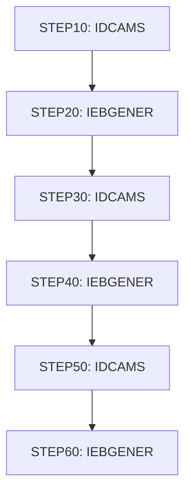

# Job DEFGDGD

| Item | Value |
|---|---|
| Source | `app/jcl/DEFGDGD.jcl` |
| Member | DEFGDGD |
| Job card | `app/jcl/DEFGDGD.jcl:1` |
| CLASS / MSGCLASS | A / 0 |
| NOTIFY | &SYSUID |
| Job COND |  |
| Steps | 6 |
| Module | base |

## Purpose

Comment in the JCL (Unverified, `app/jcl/DEFGDGD.jcl:2`): RESTART=STEP30                                                     JOB05067

## Step flow

## Steps

### STEP10

| Item | Value |
|---|---|
| EXEC | `app/jcl/DEFGDGD.jcl:24` |
| Program | IDCAMS |
| PROC |  |
| Application program |  |
| PARM |  |
| COND |  |
| Function (earlier pass) | IDCAMS define GDG |

| DD | Dataset / output | DISP | DCB | Program file and OPEN mode | Control data | Line |
|---|---|---|---|---|---|---|
| SYSPRINT | SYSOUT=* |  |  |  |  | `app/jcl/DEFGDGD.jcl:25` |
| SYSIN | * |  |  |  | in-stream lines 27-31; statements: DEFINE; NAME(): AWS.M2.CARDDEMO.TRANTYPE.BKUP | `app/jcl/DEFGDGD.jcl:26` |

### STEP20

| Item | Value |
|---|---|
| EXEC | `app/jcl/DEFGDGD.jcl:36` |
| Program | IEBGENER |
| PROC |  |
| Application program |  |
| PARM |  |
| COND | `(0,NE)` |
| Function (earlier pass) | Utility step IEBGENER |

| DD | Dataset / output | DISP | DCB | Program file and OPEN mode | Control data | Line |
|---|---|---|---|---|---|---|
| SYSPRINT | SYSOUT=* |  |  |  |  | `app/jcl/DEFGDGD.jcl:37` |
| SYSIN | DUMMY |  |  |  |  | `app/jcl/DEFGDGD.jcl:38` |
| SYSUT1 | AWS.M2.CARDDEMO.TRANTYPE.PS | SHR |  |  |  | `app/jcl/DEFGDGD.jcl:39` |
| SYSUT2 | AWS.M2.CARDDEMO.TRANTYPE.BKUP(+1) | (NEW,CATLG) | (LRECL=60,RECFM=FB,BLKSIZE=600) |  |  | `app/jcl/DEFGDGD.jcl:40-43` |

### STEP30

| Item | Value |
|---|---|
| EXEC | `app/jcl/DEFGDGD.jcl:47` |
| Program | IDCAMS |
| PROC |  |
| Application program |  |
| PARM |  |
| COND | `(0,NE)` |
| Function (earlier pass) | IDCAMS define GDG |

| DD | Dataset / output | DISP | DCB | Program file and OPEN mode | Control data | Line |
|---|---|---|---|---|---|---|
| SYSPRINT | SYSOUT=* |  |  |  |  | `app/jcl/DEFGDGD.jcl:48` |
| SYSIN | * |  |  |  | in-stream lines 50-54; statements: DEFINE; NAME(): AWS.M2.CARDDEMO.TRANCATG.PS.BKUP | `app/jcl/DEFGDGD.jcl:49` |

### STEP40

| Item | Value |
|---|---|
| EXEC | `app/jcl/DEFGDGD.jcl:59` |
| Program | IEBGENER |
| PROC |  |
| Application program |  |
| PARM |  |
| COND | `(0,NE)` |
| Function (earlier pass) | Utility step IEBGENER |

| DD | Dataset / output | DISP | DCB | Program file and OPEN mode | Control data | Line |
|---|---|---|---|---|---|---|
| SYSPRINT | SYSOUT=* |  |  |  |  | `app/jcl/DEFGDGD.jcl:60` |
| SYSIN | DUMMY |  |  |  |  | `app/jcl/DEFGDGD.jcl:61` |
| SYSUT1 | AWS.M2.CARDDEMO.TRANCATG.PS | SHR |  |  |  | `app/jcl/DEFGDGD.jcl:62` |
| SYSUT2 | AWS.M2.CARDDEMO.TRANCATG.PS.BKUP(+1) | (NEW,CATLG) | (LRECL=60,RECFM=FB,BLKSIZE=600) |  |  | `app/jcl/DEFGDGD.jcl:63-66` |

### STEP50

| Item | Value |
|---|---|
| EXEC | `app/jcl/DEFGDGD.jcl:70` |
| Program | IDCAMS |
| PROC |  |
| Application program |  |
| PARM |  |
| COND |  |
| Function (earlier pass) | IDCAMS define GDG |

| DD | Dataset / output | DISP | DCB | Program file and OPEN mode | Control data | Line |
|---|---|---|---|---|---|---|
| SYSPRINT | SYSOUT=* |  |  |  |  | `app/jcl/DEFGDGD.jcl:71` |
| SYSIN | * |  |  |  | in-stream lines 73-77; statements: DEFINE; NAME(): AWS.M2.CARDDEMO.DISCGRP.BKUP | `app/jcl/DEFGDGD.jcl:72` |

### STEP60

| Item | Value |
|---|---|
| EXEC | `app/jcl/DEFGDGD.jcl:82` |
| Program | IEBGENER |
| PROC |  |
| Application program |  |
| PARM |  |
| COND | `(0,NE)` |
| Function (earlier pass) | Utility step IEBGENER |

| DD | Dataset / output | DISP | DCB | Program file and OPEN mode | Control data | Line |
|---|---|---|---|---|---|---|
| SYSPRINT | SYSOUT=* |  |  |  |  | `app/jcl/DEFGDGD.jcl:83` |
| SYSIN | DUMMY |  |  |  |  | `app/jcl/DEFGDGD.jcl:84` |
| SYSUT1 | AWS.M2.CARDDEMO.DISCGRP.PS | SHR |  |  |  | `app/jcl/DEFGDGD.jcl:85` |
| SYSUT2 | AWS.M2.CARDDEMO.DISCGRP.BKUP(+1) | (NEW,CATLG) | (LRECL=50,RECFM=FB,BLKSIZE=500) |  |  | `app/jcl/DEFGDGD.jcl:86-89` |

## Scheduling and dependencies

Not referenced by the CA7 or Control-M exports or the shell scripts (see the gap report).

## Parameters

Symbols left as parameters (not resolved): `&SYSUID`.

## Sources

- `app/jcl/DEFGDGD.jcl`
- `docs/_work/structure/jcl/DEFGDGD.json`
- `docs/_work/jobs/DEFGDGD.json`

## Confidence

Steps, DDs, conditions and control-data summaries are Confirmed from the JCL. OPEN modes come from the program source. Comments are Unverified.
