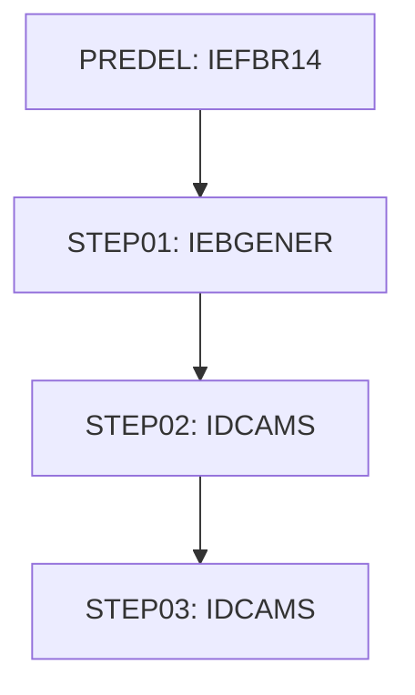

# Job DUSRSECJ

| Item | Value |
|---|---|
| Source | `app/jcl/DUSRSECJ.jcl` |
| Member | DUSRSECJ |
| Job card | `app/jcl/DUSRSECJ.jcl:1-2` |
| CLASS / MSGCLASS | A / H |
| NOTIFY | &SYSUID |
| Job COND |  |
| Steps | 4 |
| Module | base |

## Purpose

Comment in the JCL (Unverified, `app/jcl/DUSRSECJ.jcl:20`): PRE DELETE STEP

## Step flow

## Steps

### PREDEL

| Item | Value |
|---|---|
| EXEC | `app/jcl/DUSRSECJ.jcl:23` |
| Program | IEFBR14 |
| PROC |  |
| Application program |  |
| PARM |  |
| COND |  |
| Function (earlier pass) | Utility step IEFBR14 |

| DD | Dataset / output | DISP | DCB | Program file and OPEN mode | Control data | Line |
|---|---|---|---|---|---|---|
| DD01 | AWS.M2.CARDDEMO.USRSEC.PS | (MOD,DELETE,DELETE) |  |  |  | `app/jcl/DUSRSECJ.jcl:25-26` |

### STEP01

| Item | Value |
|---|---|
| EXEC | `app/jcl/DUSRSECJ.jcl:32` |
| Program | IEBGENER |
| PROC |  |
| Application program |  |
| PARM |  |
| COND |  |
| Function (earlier pass) | Utility step IEBGENER |

| DD | Dataset / output | DISP | DCB | Program file and OPEN mode | Control data | Line |
|---|---|---|---|---|---|---|
| SYSUT1 | * |  |  |  | in-stream lines 35-44 | `app/jcl/DUSRSECJ.jcl:34` |
| SYSUT2 | AWS.M2.CARDDEMO.USRSEC.PS | (NEW,CATLG,DELETE) | (LRECL=80,RECFM=FB,DSORG=PS,BLKSIZE=0) |  |  | `app/jcl/DUSRSECJ.jcl:46-49` |
| SYSPRINT | SYSOUT=* |  |  |  |  | `app/jcl/DUSRSECJ.jcl:51` |
| SYSIN | DUMMY |  |  |  |  | `app/jcl/DUSRSECJ.jcl:52` |

### STEP02

| Item | Value |
|---|---|
| EXEC | `app/jcl/DUSRSECJ.jcl:58` |
| Program | IDCAMS |
| PROC |  |
| Application program |  |
| PARM |  |
| COND |  |
| Function (earlier pass) | IDCAMS delete |

| DD | Dataset / output | DISP | DCB | Program file and OPEN mode | Control data | Line |
|---|---|---|---|---|---|---|
| SYSPRINT | SYSOUT=* |  |  |  |  | `app/jcl/DUSRSECJ.jcl:60` |
| SYSIN | * |  |  |  | in-stream lines 62-73; statements: DELETE SET DEFINE; NAME(): AWS.M2.CARDDEMO.USRSEC.VSAM.KSDS AWS.M2.CARDDEMO.USRSEC.VSAM.KSDS.DAT AWS.M2.CARDDEMO.USRSEC.VSAM.KSDS.IDX | `app/jcl/DUSRSECJ.jcl:61` |

### STEP03

| Item | Value |
|---|---|
| EXEC | `app/jcl/DUSRSECJ.jcl:80` |
| Program | IDCAMS |
| PROC |  |
| Application program |  |
| PARM |  |
| COND |  |
| Function (earlier pass) | IDCAMS REPRO copy |

| DD | Dataset / output | DISP | DCB | Program file and OPEN mode | Control data | Line |
|---|---|---|---|---|---|---|
| IN | AWS.M2.CARDDEMO.USRSEC.PS | SHR |  |  |  | `app/jcl/DUSRSECJ.jcl:82` |
| OUT | AWS.M2.CARDDEMO.USRSEC.VSAM.KSDS | SHR |  |  |  | `app/jcl/DUSRSECJ.jcl:83` |
| SYSOUT | SYSOUT=* |  |  |  |  | `app/jcl/DUSRSECJ.jcl:84` |
| SYSPRINT | SYSOUT=* |  |  |  |  | `app/jcl/DUSRSECJ.jcl:85` |
| SYSIN | * |  |  |  | in-stream lines 87-87; statements: REPRO | `app/jcl/DUSRSECJ.jcl:86` |

## Scheduling and dependencies

| Mechanism | From | To | Evidence |
|---|---|---|---|
| Shell submit | scripts/remote_refresh.sh | DUSRSECJ | `scripts/remote_refresh.sh:44` |
| Shell submit | scripts/run_full_batch.sh | DUSRSECJ | `scripts/run_full_batch.sh:41` |

## Parameters

Symbols left as parameters (not resolved): `&SYSUID`.

## Sources

- `app/jcl/DUSRSECJ.jcl`
- `docs/_work/structure/jcl/DUSRSECJ.json`
- `docs/_work/jobs/DUSRSECJ.json`

## Confidence

Steps, DDs, conditions and control-data summaries are Confirmed from the JCL. OPEN modes come from the program source. Comments are Unverified.
