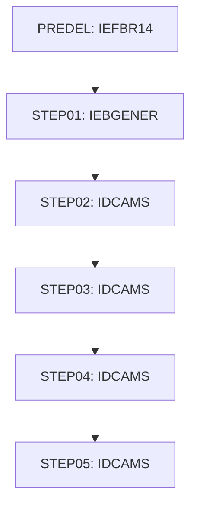

# Job ESDSRRDS

| Item | Value |
|---|---|
| Source | `app/jcl/ESDSRRDS.jcl` |
| Member | ESDSRRDS |
| Job card | `app/jcl/ESDSRRDS.jcl:1-2` |
| CLASS / MSGCLASS | A / H |
| NOTIFY | &SYSUID |
| Job COND |  |
| Steps | 6 |
| Module | base |

## Purpose

Comment in the JCL (Unverified, `app/jcl/ESDSRRDS.jcl:21`): PRE DELETE STEP

## Step flow

## Steps

### PREDEL

| Item | Value |
|---|---|
| EXEC | `app/jcl/ESDSRRDS.jcl:24` |
| Program | IEFBR14 |
| PROC |  |
| Application program |  |
| PARM |  |
| COND |  |
| Function (earlier pass) | Utility step IEFBR14 |

| DD | Dataset / output | DISP | DCB | Program file and OPEN mode | Control data | Line |
|---|---|---|---|---|---|---|
| DD01 | AWS.M2.CARDDEMO.ESDSRRDS.PS | (MOD,DELETE,DELETE) |  |  |  | `app/jcl/ESDSRRDS.jcl:26-27` |

### STEP01

| Item | Value |
|---|---|
| EXEC | `app/jcl/ESDSRRDS.jcl:33` |
| Program | IEBGENER |
| PROC |  |
| Application program |  |
| PARM |  |
| COND |  |
| Function (earlier pass) | Utility step IEBGENER |

| DD | Dataset / output | DISP | DCB | Program file and OPEN mode | Control data | Line |
|---|---|---|---|---|---|---|
| SYSUT1 | * |  |  |  | in-stream lines 36-45 | `app/jcl/ESDSRRDS.jcl:35` |
| SYSUT2 | AWS.M2.CARDDEMO.ESDSRRDS.PS | (NEW,CATLG,DELETE) | (LRECL=80,RECFM=FB,DSORG=PS,BLKSIZE=0) |  |  | `app/jcl/ESDSRRDS.jcl:47-50` |
| SYSPRINT | SYSOUT=* |  |  |  |  | `app/jcl/ESDSRRDS.jcl:52` |
| SYSIN | DUMMY |  |  |  |  | `app/jcl/ESDSRRDS.jcl:53` |

### STEP02

| Item | Value |
|---|---|
| EXEC | `app/jcl/ESDSRRDS.jcl:59` |
| Program | IDCAMS |
| PROC |  |
| Application program |  |
| PARM |  |
| COND |  |
| Function (earlier pass) | IDCAMS delete |

| DD | Dataset / output | DISP | DCB | Program file and OPEN mode | Control data | Line |
|---|---|---|---|---|---|---|
| SYSPRINT | SYSOUT=* |  |  |  |  | `app/jcl/ESDSRRDS.jcl:61` |
| SYSIN | * |  |  |  | in-stream lines 63-72; statements: DELETE SET DEFINE; NAME(): AWS.M2.CARDDEMO.USRSEC.VSAM.ESDS AWS.M2.CARDDEMO.USRSEC.VSAM.ESDS.DAT | `app/jcl/ESDSRRDS.jcl:62` |

### STEP03

| Item | Value |
|---|---|
| EXEC | `app/jcl/ESDSRRDS.jcl:79` |
| Program | IDCAMS |
| PROC |  |
| Application program |  |
| PARM |  |
| COND |  |
| Function (earlier pass) | IDCAMS REPRO copy |

| DD | Dataset / output | DISP | DCB | Program file and OPEN mode | Control data | Line |
|---|---|---|---|---|---|---|
| IN | AWS.M2.CARDDEMO.ESDSRRDS.PS | SHR |  |  |  | `app/jcl/ESDSRRDS.jcl:81` |
| OUT | AWS.M2.CARDDEMO.USRSEC.VSAM.ESDS | SHR |  |  |  | `app/jcl/ESDSRRDS.jcl:82` |
| SYSOUT | SYSOUT=* |  |  |  |  | `app/jcl/ESDSRRDS.jcl:83` |
| SYSPRINT | SYSOUT=* |  |  |  |  | `app/jcl/ESDSRRDS.jcl:84` |
| SYSIN | * |  |  |  | in-stream lines 86-86; statements: REPRO | `app/jcl/ESDSRRDS.jcl:85` |

### STEP04

| Item | Value |
|---|---|
| EXEC | `app/jcl/ESDSRRDS.jcl:93` |
| Program | IDCAMS |
| PROC |  |
| Application program |  |
| PARM |  |
| COND |  |
| Function (earlier pass) | IDCAMS delete |

| DD | Dataset / output | DISP | DCB | Program file and OPEN mode | Control data | Line |
|---|---|---|---|---|---|---|
| SYSPRINT | SYSOUT=* |  |  |  |  | `app/jcl/ESDSRRDS.jcl:95` |
| SYSIN | * |  |  |  | in-stream lines 97-106; statements: DELETE SET DEFINE; NAME(): AWS.M2.CARDDEMO.USRSEC.VSAM.RRDS AWS.M2.CARDDEMO.USRSEC.VSAM.RRDS.DAT | `app/jcl/ESDSRRDS.jcl:96` |

### STEP05

| Item | Value |
|---|---|
| EXEC | `app/jcl/ESDSRRDS.jcl:113` |
| Program | IDCAMS |
| PROC |  |
| Application program |  |
| PARM |  |
| COND |  |
| Function (earlier pass) | IDCAMS REPRO copy |

| DD | Dataset / output | DISP | DCB | Program file and OPEN mode | Control data | Line |
|---|---|---|---|---|---|---|
| IN | AWS.M2.CARDDEMO.ESDSRRDS.PS | SHR |  |  |  | `app/jcl/ESDSRRDS.jcl:115` |
| OUT | AWS.M2.CARDDEMO.USRSEC.VSAM.RRDS | SHR |  |  |  | `app/jcl/ESDSRRDS.jcl:116` |
| SYSOUT | SYSOUT=* |  |  |  |  | `app/jcl/ESDSRRDS.jcl:117` |
| SYSPRINT | SYSOUT=* |  |  |  |  | `app/jcl/ESDSRRDS.jcl:118` |
| SYSIN | * |  |  |  | in-stream lines 120-120; statements: REPRO | `app/jcl/ESDSRRDS.jcl:119` |

## Scheduling and dependencies

Not referenced by the CA7 or Control-M exports or the shell scripts (see the gap report).

## Parameters

Symbols left as parameters (not resolved): `&SYSUID`.

## Sources

- `app/jcl/ESDSRRDS.jcl`
- `docs/_work/structure/jcl/ESDSRRDS.json`
- `docs/_work/jobs/ESDSRRDS.json`

## Confidence

Steps, DDs, conditions and control-data summaries are Confirmed from the JCL. OPEN modes come from the program source. Comments are Unverified.
