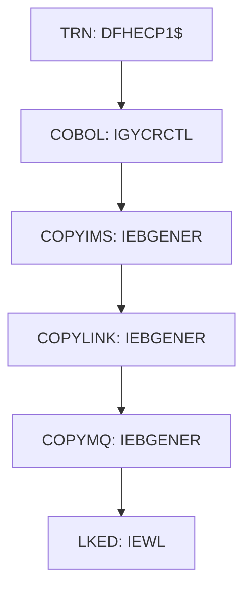

# Job IMSMQCMP

| Item | Value |
|---|---|
| Source | `samples/jcl/IMSMQCMP.jcl` |
| Member | IMSMQCMP |
| Job card | `samples/jcl/IMSMQCMP.jcl:1` |
| CLASS / MSGCLASS | A /  |
| NOTIFY | &SYSUID |
| Job COND |  |
| Steps | 6 |
| Module | build |

## Purpose

Comment in the JCL (Unverified, `samples/jcl/IMSMQCMP.jcl:19`): Sample IMS MQ CICS COBOL Compile JCL                     ******

## Step flow

## Steps

### TRN

| Item | Value |
|---|---|
| EXEC | `samples/jcl/IMSMQCMP.jcl:28` |
| Program | DFHECP1$ |
| PROC |  |
| Application program |  |
| PARM | `'CICS,DLI,COBOL3'` |
| COND |  |
| Function (earlier pass) | Executes program DFHECP1$ |

| DD | Dataset / output | DISP | DCB | Program file and OPEN mode | Control data | Line |
|---|---|---|---|---|---|---|
| STEPLIB | &CICSHLQ..CICS.SDFHLOAD | SHR |  |  |  | `samples/jcl/IMSMQCMP.jcl:29` |
| SYSIN | &HLQ..COBOL.SRC(IMSMQPGM) | SHR |  |  |  | `samples/jcl/IMSMQCMP.jcl:30` |
| SYSPRINT | SYSOUT=* |  |  |  |  | `samples/jcl/IMSMQCMP.jcl:31` |
| SYSPUNCH | &&SYSCIN | (,PASS) | BLKSIZE=400 |  |  | `samples/jcl/IMSMQCMP.jcl:32-35` |

### COBOL

| Item | Value |
|---|---|
| EXEC | `samples/jcl/IMSMQCMP.jcl:37-38` |
| Program | IGYCRCTL |
| PROC |  |
| Application program |  |
| PARM | `'NODYNAM,OBJECT,RENT,APOST,MAP,XREF'` |
| COND | `(4,LT)` |
| Function (earlier pass) | Utility step IGYCRCTL |

| DD | Dataset / output | DISP | DCB | Program file and OPEN mode | Control data | Line |
|---|---|---|---|---|---|---|
| STEPLIB | IGY.SIGYCOMP.V63 | SHR |  |  |  | `samples/jcl/IMSMQCMP.jcl:39` |
| STEPLIB (concat) | CEE.SCEERUN | SHR |  |  |  | `samples/jcl/IMSMQCMP.jcl:40` |
| STEPLIB (concat) | CEE.SCEERUN2 | SHR |  |  |  | `samples/jcl/IMSMQCMP.jcl:41` |
| SYSPRINT | SYSOUT=* |  |  |  |  | `samples/jcl/IMSMQCMP.jcl:42` |
| SYSLIN | &&LOADSET | (MOD,PASS) | (BLKSIZE=3200) |  |  | `samples/jcl/IMSMQCMP.jcl:43-45` |
| SYSUT1 |  |  |  |  |  | `samples/jcl/IMSMQCMP.jcl:46` |
| SYSUT2 |  |  |  |  |  | `samples/jcl/IMSMQCMP.jcl:47` |
| SYSUT3 |  |  |  |  |  | `samples/jcl/IMSMQCMP.jcl:48` |
| SYSUT4 |  |  |  |  |  | `samples/jcl/IMSMQCMP.jcl:49` |
| SYSUT5 |  |  |  |  |  | `samples/jcl/IMSMQCMP.jcl:50` |
| SYSUT6 |  |  |  |  |  | `samples/jcl/IMSMQCMP.jcl:51` |
| SYSUT7 |  |  |  |  |  | `samples/jcl/IMSMQCMP.jcl:52` |
| SYSUT8 |  |  |  |  |  | `samples/jcl/IMSMQCMP.jcl:53` |
| SYSUT9 |  |  |  |  |  | `samples/jcl/IMSMQCMP.jcl:54` |
| SYSUT10 |  |  |  |  |  | `samples/jcl/IMSMQCMP.jcl:55` |
| SYSUT11 |  |  |  |  |  | `samples/jcl/IMSMQCMP.jcl:56` |
| SYSUT12 |  |  |  |  |  | `samples/jcl/IMSMQCMP.jcl:57` |
| SYSUT13 |  |  |  |  |  | `samples/jcl/IMSMQCMP.jcl:58` |
| SYSUT14 |  |  |  |  |  | `samples/jcl/IMSMQCMP.jcl:59` |
| SYSUT15 |  |  |  |  |  | `samples/jcl/IMSMQCMP.jcl:60` |
| SYSMDECK |  |  |  |  |  | `samples/jcl/IMSMQCMP.jcl:61` |
| SYSLIB | CEE.SCEESAMP | SHR |  |  |  | `samples/jcl/IMSMQCMP.jcl:62` |
| SYSLIB (concat) | &CICSHLQ..CICS.SDFHCOB | SHR |  |  |  | `samples/jcl/IMSMQCMP.jcl:63` |
| SYSLIB (concat) | &MQHLQ..SCSQCOBC | SHR |  |  |  | `samples/jcl/IMSMQCMP.jcl:64` |
| SYSLIB (concat) | &HLQ..COBCOPY | SHR |  |  |  | `samples/jcl/IMSMQCMP.jcl:65` |
| SYSIN | &&SYSCIN | (OLD,DELETE) |  |  |  | `samples/jcl/IMSMQCMP.jcl:66` |

### COPYIMS

| Item | Value |
|---|---|
| EXEC | `samples/jcl/IMSMQCMP.jcl:71` |
| Program | IEBGENER |
| PROC |  |
| Application program |  |
| PARM |  |
| COND | `(4,LT)` |
| Function (earlier pass) | Utility step IEBGENER |

| DD | Dataset / output | DISP | DCB | Program file and OPEN mode | Control data | Line |
|---|---|---|---|---|---|---|
| SYSPRINT | SYSOUT=* |  |  |  |  | `samples/jcl/IMSMQCMP.jcl:72` |
| SYSUT1 | * |  |  |  | in-stream lines 74-75 | `samples/jcl/IMSMQCMP.jcl:73` |
| SYSUT2 | &&COPYIMS | (NEW,PASS) | (LRECL=80,BLKSIZE=400,RECFM=FB) |  |  | `samples/jcl/IMSMQCMP.jcl:76-78` |
| SYSPRINT | SYSOUT=* |  |  |  |  | `samples/jcl/IMSMQCMP.jcl:79` |
| SYSIN | DUMMY |  |  |  |  | `samples/jcl/IMSMQCMP.jcl:80` |

### COPYLINK

| Item | Value |
|---|---|
| EXEC | `samples/jcl/IMSMQCMP.jcl:82` |
| Program | IEBGENER |
| PROC |  |
| Application program |  |
| PARM |  |
| COND | `(4,LT)` |
| Function (earlier pass) | Utility step IEBGENER |

| DD | Dataset / output | DISP | DCB | Program file and OPEN mode | Control data | Line |
|---|---|---|---|---|---|---|
| SYSUT1 | * |  |  |  | in-stream lines 84-84; statements: INCLUDE | `samples/jcl/IMSMQCMP.jcl:83` |
| SYSUT2 | &&COPYLINK | (NEW,PASS) | (LRECL=80,BLKSIZE=400,RECFM=FB) |  |  | `samples/jcl/IMSMQCMP.jcl:85-87` |
| SYSPRINT | SYSOUT=* |  |  |  |  | `samples/jcl/IMSMQCMP.jcl:88` |
| SYSIN | DUMMY |  |  |  |  | `samples/jcl/IMSMQCMP.jcl:89` |

### COPYMQ

| Item | Value |
|---|---|
| EXEC | `samples/jcl/IMSMQCMP.jcl:91` |
| Program | IEBGENER |
| PROC |  |
| Application program |  |
| PARM |  |
| COND | `(4,LT)` |
| Function (earlier pass) | Utility step IEBGENER |

| DD | Dataset / output | DISP | DCB | Program file and OPEN mode | Control data | Line |
|---|---|---|---|---|---|---|
| SYSUT1 | * |  |  |  | in-stream lines 93-93; statements: INCLUDE | `samples/jcl/IMSMQCMP.jcl:92` |
| SYSUT2 | &&COPYMQ | (NEW,PASS) | (LRECL=80,BLKSIZE=400,RECFM=FB) |  |  | `samples/jcl/IMSMQCMP.jcl:94-96` |
| SYSPRINT | SYSOUT=* |  |  |  |  | `samples/jcl/IMSMQCMP.jcl:97` |
| SYSIN | DUMMY |  |  |  |  | `samples/jcl/IMSMQCMP.jcl:98` |

### LKED

| Item | Value |
|---|---|
| EXEC | `samples/jcl/IMSMQCMP.jcl:100` |
| Program | IEWL |
| PROC |  |
| Application program |  |
| PARM | `'LIST,XREF'` |
| COND | `(4,LT)` |
| Function (earlier pass) | Utility step IEWL |

| DD | Dataset / output | DISP | DCB | Program file and OPEN mode | Control data | Line |
|---|---|---|---|---|---|---|
| SYSLIB | &MQHLQ..SCSQLOAD | SHR |  |  |  | `samples/jcl/IMSMQCMP.jcl:101` |
| SYSLIB (concat) | SYS1.LINKLIB | SHR |  |  |  | `samples/jcl/IMSMQCMP.jcl:102` |
| SYSLIB (concat) | CEE.SCEELKED | SHR |  |  |  | `samples/jcl/IMSMQCMP.jcl:103` |
| SYSLIB (concat) | &CICSHLQ..CICS.SDFHLOAD | SHR |  |  |  | `samples/jcl/IMSMQCMP.jcl:104` |
| SYSLIB (concat) | &IMSHLQ..SDFSRESL | SHR |  |  |  | `samples/jcl/IMSMQCMP.jcl:105` |
| CSQSTUB | &MQHLQ..SCSQLOAD | SHR |  |  |  | `samples/jcl/IMSMQCMP.jcl:106` |
| SYSLIN | &&COPYLINK | (OLD,DELETE) |  |  |  | `samples/jcl/IMSMQCMP.jcl:107` |
| SYSLIN (concat) | &&COPYMQ | (OLD,DELETE) |  |  |  | `samples/jcl/IMSMQCMP.jcl:108` |
| SYSLIN (concat) | &&LOADSET | (OLD,DELETE) |  |  |  | `samples/jcl/IMSMQCMP.jcl:109` |
| SYSLIN (concat) | &&COPYIMS | (OLD,DELETE) |  |  |  | `samples/jcl/IMSMQCMP.jcl:110` |
| SYSPRINT | SYSOUT=* |  |  |  |  | `samples/jcl/IMSMQCMP.jcl:111` |
| SYSLMOD | &HLQ..CICSLOAD(IMSMQPGM) | SHR |  |  |  | `samples/jcl/IMSMQCMP.jcl:112-113` |
| SYSUT1 |  |  |  |  |  | `samples/jcl/IMSMQCMP.jcl:114` |

## Scheduling and dependencies

Not referenced by the CA7 or Control-M exports or the shell scripts (see the gap report).

## JCL library, INCLUDE and SET

| Statement | Text | Line |
|---|---|---|
| SET | HLQ=AWS.M2 | `samples/jcl/IMSMQCMP.jcl:23` |
| SET | CICSHLQ=CICSTS | `samples/jcl/IMSMQCMP.jcl:24` |
| SET | IMSHLQ=IMS | `samples/jcl/IMSMQCMP.jcl:25` |
| SET | MQHLQ=MQ | `samples/jcl/IMSMQCMP.jcl:26` |

## Parameters

Symbols left as parameters (not resolved): `&&COPYIMS`, `&&COPYLINK`, `&&COPYMQ`, `&&LOADSET`, `&&SYSCIN`, `&CICSHLQ`, `&HLQ`, `&IMSHLQ`, `&MQHLQ`, `&SYSUID`.

## Sources

- `samples/jcl/IMSMQCMP.jcl`
- `docs/_work/structure/jcl/IMSMQCMP.json`
- `docs/_work/jobs/IMSMQCMP.json`

## Confidence

Steps, DDs, conditions and control-data summaries are Confirmed from the JCL. OPEN modes come from the program source. Comments are Unverified.
