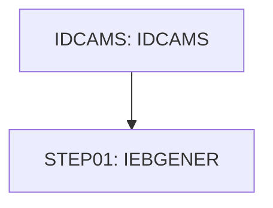

# Job INTRDRJ1

| Item | Value |
|---|---|
| Source | `app/jcl/INTRDRJ1.JCL` |
| Member | INTRDRJ1 |
| Job card | `app/jcl/INTRDRJ1.JCL:1-2` |
| CLASS / MSGCLASS | A / H |
| NOTIFY | &SYSUID |
| Job COND |  |
| Steps | 2 |
| Module | base |

## Purpose

Comment in the JCL (Unverified, `app/jcl/INTRDRJ1.JCL:4`): THIS INTRDR JOB WILL TRIGGER ANOTHER JCL

## Step flow

## Steps

### IDCAMS

| Item | Value |
|---|---|
| EXEC | `app/jcl/INTRDRJ1.JCL:6` |
| Program | IDCAMS |
| PROC |  |
| Application program |  |
| PARM |  |
| COND |  |
| Function (earlier pass) | IDCAMS REPRO copy |

| DD | Dataset / output | DISP | DCB | Program file and OPEN mode | Control data | Line |
|---|---|---|---|---|---|---|
| SYSPRINT | SYSOUT=* |  |  |  |  | `app/jcl/INTRDRJ1.JCL:7` |
| IN | AWS.M2.CARDEMO.FTP.TEST | SHR |  |  |  | `app/jcl/INTRDRJ1.JCL:8` |
| OUT | AWS.M2.CARDEMO.FTP.TEST.BKUP | SHR |  |  |  | `app/jcl/INTRDRJ1.JCL:9` |
| SYSIN | * |  |  |  | in-stream lines 11-11; statements: REPRO | `app/jcl/INTRDRJ1.JCL:10` |

### STEP01

| Item | Value |
|---|---|
| EXEC | `app/jcl/INTRDRJ1.JCL:14` |
| Program | IEBGENER |
| PROC |  |
| Application program |  |
| PARM |  |
| COND |  |
| Function (earlier pass) | Utility step IEBGENER |

| DD | Dataset / output | DISP | DCB | Program file and OPEN mode | Control data | Line |
|---|---|---|---|---|---|---|
| SYSPRINT | SYSOUT=* |  |  |  |  | `app/jcl/INTRDRJ1.JCL:15` |
| SYSIN | DUMMY |  |  |  |  | `app/jcl/INTRDRJ1.JCL:16` |
| SYSUT1 | AWS.M2.CARDDEMO.JCL(INTRDRJ2) | SHR |  |  |  | `app/jcl/INTRDRJ1.JCL:17` |
| SYSUT2 | SYSOUT=(A,INTRDR) |  | (LRECL=80,BLKSIZE=80) |  |  | `app/jcl/INTRDRJ1.JCL:18` |

## Scheduling and dependencies

Not referenced by the CA7 or Control-M exports or the shell scripts (see the gap report).

## Parameters

Symbols left as parameters (not resolved): `&SYSUID`.

## Sources

- `app/jcl/INTRDRJ1.JCL`
- `docs/_work/structure/jcl/INTRDRJ1.json`
- `docs/_work/jobs/INTRDRJ1.json`

## Confidence

Steps, DDs, conditions and control-data summaries are Confirmed from the JCL. OPEN modes come from the program source. Comments are Unverified.
