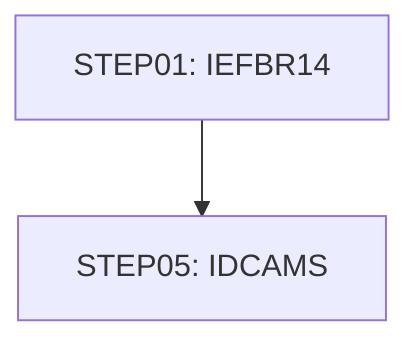

# Job LISTFILS

| Item | Value |
|---|---|
| Source | `samples/jcl/LISTCAT.jcl` |
| Member | LISTCAT |
| Job card | `samples/jcl/LISTCAT.jcl:1` |
| CLASS / MSGCLASS | A / 0 |
| NOTIFY | &SYSUID |
| Job COND |  |
| Steps | 2 |
| Module | build |

## Purpose

Comment in the JCL (Unverified, `samples/jcl/LISTCAT.jcl:19`): List catalog for all the files in CARDDEMO application

## Step flow

## Steps

### STEP01

| Item | Value |
|---|---|
| EXEC | `samples/jcl/LISTCAT.jcl:21` |
| Program | IEFBR14 |
| PROC |  |
| Application program |  |
| PARM |  |
| COND |  |
| Function (earlier pass) | Utility step IEFBR14 |

| DD | Dataset / output | DISP | DCB | Program file and OPEN mode | Control data | Line |
|---|---|---|---|---|---|---|
| DD1 | AWS.M2.CARDDEMO.LISTCAT | (MOD,DELETE,DELETE) | (RECFM=FBA,LRECL=133,BLKSIZE=0) |  |  | `samples/jcl/LISTCAT.jcl:22-26` |

### STEP05

| Item | Value |
|---|---|
| EXEC | `samples/jcl/LISTCAT.jcl:27` |
| Program | IDCAMS |
| PROC |  |
| Application program |  |
| PARM |  |
| COND | `(0,NE)` |
| Function (earlier pass) | Utility step IDCAMS |

| DD | Dataset / output | DISP | DCB | Program file and OPEN mode | Control data | Line |
|---|---|---|---|---|---|---|
| SYSPRINT | AWS.M2.CARDDEMO.LISTCAT | (NEW,CATLG,DELETE) | (RECFM=FBA,LRECL=133,BLKSIZE=0) |  |  | `samples/jcl/LISTCAT.jcl:28-32` |
| SYSIN | * |  |  |  | in-stream lines 34-35; statements: LISTCAT | `samples/jcl/LISTCAT.jcl:33` |

## Scheduling and dependencies

Not referenced by the CA7 or Control-M exports or the shell scripts (see the gap report).

## Parameters

Symbols left as parameters (not resolved): `&SYSUID`.

## Sources

- `samples/jcl/LISTCAT.jcl`
- `docs/_work/structure/jcl/LISTCAT.json`
- `docs/_work/jobs/LISTFILS.json`

## Confidence

Steps, DDs, conditions and control-data summaries are Confirmed from the JCL. OPEN modes come from the program source. Comments are Unverified.
