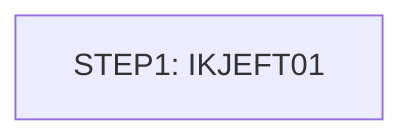

# Job MNTTRDB2

| Item | Value |
|---|---|
| Source | `app/app-transaction-type-db2/jcl/MNTTRDB2.jcl` |
| Member | MNTTRDB2 |
| Job card | `app/app-transaction-type-db2/jcl/MNTTRDB2.jcl:1-2` |
| CLASS / MSGCLASS | A / H |
| NOTIFY | &SYSUID |
| Job COND |  |
| Steps | 1 |
| Module | trantype |

## Purpose

Comment in the JCL (Unverified, `app/app-transaction-type-db2/jcl/MNTTRDB2.jcl:5`): USE THIS JOB TO MAINTAIN DB2 TRANSACTION TABLE, INSERTING,      *//

Application programs run by this job: [COBTUPDT](../../07-programs/COBTUPDT.md).

COBTUPDT: COBTUPDT is a batch DB2 program that applies transaction type maintenance records from a sequential input file (DD INPFILE) to the CARDDEMO.TRANSACTION_TYPE table. Each 53-byte record carries an action code, a 2-character transaction type code and a 50-character description. Action 'A' inserts, 'U' updates the description, 'D' deletes, and '*' lines are skipped as comments. Any other action, a SQL error or a row-not-found on update/delete is displayed and sets RETURN-CODE 4, but processing continues with the next record. The input file is closed and the program ends with STOP RUN after end of file. (Inferred, from the program analysis)

## Step flow

## Steps

### STEP1

| Item | Value |
|---|---|
| EXEC | `app/app-transaction-type-db2/jcl/MNTTRDB2.jcl:21` |
| Program | IKJEFT01 |
| PROC |  |
| Application program | [COBTUPDT](../../07-programs/COBTUPDT.md) via TSO DSN RUN PROGRAM |
| PARM |  |
| COND |  |
| Function (earlier pass) | RUN PROGRAM(COBTUPDT) PLAN(CARDDEMO) |

| DD | Dataset / output | DISP | DCB | Program file and OPEN mode | Control data | Line |
|---|---|---|---|---|---|---|
| STEPLIB | OEM.DB2.DAZ1.SDSNEXIT | SHR |  |  |  | `app/app-transaction-type-db2/jcl/MNTTRDB2.jcl:22` |
| STEPLIB (concat) | OEMA.DB2.VERSIONA.SDSNLOAD | SHR |  |  |  | `app/app-transaction-type-db2/jcl/MNTTRDB2.jcl:23` |
| STEPLIB (concat) | AWS.M2.CARDDEMO.LOADLIB | SHR |  |  |  | `app/app-transaction-type-db2/jcl/MNTTRDB2.jcl:24` |
| DBRMLIB | AWS.M2.CARDDEMO.DBRMLIB | SHR |  |  |  | `app/app-transaction-type-db2/jcl/MNTTRDB2.jcl:25` |
| SYSTSPRT | SYSOUT=* |  |  |  |  | `app/app-transaction-type-db2/jcl/MNTTRDB2.jcl:26` |
| INPFILE | INPFILE | SHR |  | TR-RECORD OPEN INPUT (`app/app-transaction-type-db2/cbl/COBTUPDT.cbl:31-34`) |  | `app/app-transaction-type-db2/jcl/MNTTRDB2.jcl:27` |
| SYSTSIN | * |  |  |  | in-stream lines 29-30; statements: DSN RUN; RUN PROGRAM(COBTUPDT) | `app/app-transaction-type-db2/jcl/MNTTRDB2.jcl:28` |

Return codes and abends set by COBTUPDT: RETURN-CODE 4 (`app/app-transaction-type-db2/cbl/COBTUPDT.cbl:232`).

## Scheduling and dependencies

| Mechanism | From | To | Evidence |
|---|---|---|---|
| Control-M condition WEEKLY-TransactionTypesDBRefresh-MNTTRDB2 | MNTTRDB2 | CLOSEFIL | `app/scheduler/CardDemo.controlm:28` (OUTCOND), `app/scheduler/CardDemo.controlm:34` (INCOND) |
| Control-M condition WEEKLY-TransactionTypesDBRefresh-MNTTRDB2 | MNTTRDB2 | TRANEXTR | `app/scheduler/CardDemo.controlm:28` (OUTCOND), `app/scheduler/CardDemo.controlm:59` (INCOND) |

## Parameters

Symbols left as parameters (not resolved): `&SYSUID`.

## Sources

- `app/app-transaction-type-db2/jcl/MNTTRDB2.jcl`
- `docs/_work/structure/jcl/MNTTRDB2.json`
- `docs/_work/jobs/MNTTRDB2.json`

## Confidence

Steps, DDs, conditions and control-data summaries are Confirmed from the JCL. OPEN modes come from the program source. Comments are Unverified.
