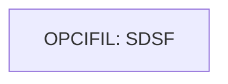

# Job OPENFIL

| Item | Value |
|---|---|
| Source | `app/jcl/OPENFIL.jcl` |
| Member | OPENFIL |
| Job card | `app/jcl/OPENFIL.jcl:1-2` |
| CLASS / MSGCLASS | A / 0 |
| NOTIFY | &SYSUID |
| Job COND |  |
| Steps | 1 |
| Module | base |

## Purpose

Comment in the JCL (Unverified, `app/jcl/OPENFIL.jcl:20`): Open files in CICS region

## Step flow

## Steps

### OPCIFIL

| Item | Value |
|---|---|
| EXEC | `app/jcl/OPENFIL.jcl:22` |
| Program | SDSF |
| PROC |  |
| Application program |  |
| PARM |  |
| COND |  |
| Function (earlier pass) | Operator command |

| DD | Dataset / output | DISP | DCB | Program file and OPEN mode | Control data | Line |
|---|---|---|---|---|---|---|
| ISFOUT | SYSOUT=* |  |  |  |  | `app/jcl/OPENFIL.jcl:23` |
| CMDOUT | SYSOUT=* |  |  |  |  | `app/jcl/OPENFIL.jcl:24` |
| ISFIN | * |  |  |  | in-stream lines 26-30 | `app/jcl/OPENFIL.jcl:25` |

## Scheduling and dependencies

| Mechanism | From | To | Evidence |
|---|---|---|---|
| CA7 trigger | WAITSTEP | OPENFIL | `app/scheduler/CardDemo.ca7:124` |
| CA7 trigger | WAITSTEP | OPENFIL | `app/scheduler/CardDemo.ca7:453` |
| CA7 trigger | WAITSTEP | OPENFIL | `app/scheduler/CardDemo.ca7:527` |
| CA7 trigger | OPENFIL | CLOSEFIL | `app/scheduler/CardDemo.ca7:532` |
| CA7 trigger | WAITSTEP | OPENFIL | `app/scheduler/CardDemo.ca7:569` |
| Control-M condition DAILY-TransactionBackup-WAITSTEP | WAITSTEP | OPENFIL | `app/scheduler/CardDemo.controlm:17` (OUTCOND), `app/scheduler/CardDemo.controlm:21` (INCOND) |
| Control-M condition MONTHLY-InterestCalculation-WAITSTEP | WAITSTEP | OPENFIL | `app/scheduler/CardDemo.controlm:84` (OUTCOND), `app/scheduler/CardDemo.controlm:88` (INCOND) |
| Control-M condition WEEKLY-DisclosureGroupsRefresh-WAITSTEP | WAITSTEP | OPENFIL | `app/scheduler/CardDemo.controlm:47` (OUTCOND), `app/scheduler/CardDemo.controlm:51` (INCOND) |
| Shell submit | scripts/remote_refresh.sh | OPENFIL | `scripts/remote_refresh.sh:50` |
| Shell submit | scripts/run_full_batch.sh | OPENFIL | `scripts/run_full_batch.sh:66` |
| Shell submit | scripts/run_interest_calc.sh | OPENFIL | `scripts/run_interest_calc.sh:34` |
| Shell submit | scripts/run_posting.sh | OPENFIL | `scripts/run_posting.sh:34` |

## Parameters

Symbols left as parameters (not resolved): `&SYSUID`.

## Sources

- `app/jcl/OPENFIL.jcl`
- `docs/_work/structure/jcl/OPENFIL.json`
- `docs/_work/jobs/OPENFIL.json`

## Confidence

Steps, DDs, conditions and control-data summaries are Confirmed from the JCL. OPEN modes come from the program source. Comments are Unverified.
