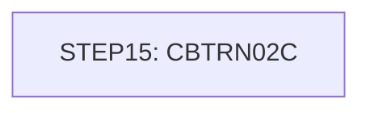

# Job POSTTRAN

| Item | Value |
|---|---|
| Source | `app/jcl/POSTTRAN.jcl` |
| Member | POSTTRAN |
| Job card | `app/jcl/POSTTRAN.jcl:1-2` |
| CLASS / MSGCLASS | A / 0 |
| NOTIFY | &SYSUID |
| Job COND |  |
| Steps | 1 |
| Module | base |

## Purpose

Comment in the JCL (Unverified, `app/jcl/POSTTRAN.jcl:20`): Process and load daily transaction file and create transaction

Application programs run by this job: [CBTRN02C](../../07-programs/CBTRN02C.md).

CBTRN02C: CBTRN02C is a batch COBOL program (run by job POSTTRAN, step STEP15) that posts the daily transaction file. It reads the sequential DALYTRAN file and validates each record against the card cross-reference KSDS (XREFFILE) and the account master KSDS (ACCTFILE): unknown card (reason 100), unknown account (101), over credit limit (102) or received after account expiration (103). Valid transactions are posted: the transaction category balance (TCATBALF, keyed by account/type/category) is created or incremented, the account current balance and cycle credit/debit totals are updated and rewritten, and the transaction is written to the transaction master (TRANFILE) with a current processing timestamp. Invalid transactions are written to the DALYREJS file with an 80-byte reason trailer. At the end it displays processed/rejected counts and sets return code 4 if any record was rejected; fatal file errors abend with code 999. (Inferred, from the program analysis)

## Step flow

## Steps

### STEP15

| Item | Value |
|---|---|
| EXEC | `app/jcl/POSTTRAN.jcl:23` |
| Program | [CBTRN02C](../../07-programs/CBTRN02C.md) |
| PROC |  |
| Application program |  |
| PARM |  |
| COND |  |
| Function (earlier pass) | Executes program CBTRN02C |

| DD | Dataset / output | DISP | DCB | Program file and OPEN mode | Control data | Line |
|---|---|---|---|---|---|---|
| STEPLIB | AWS.M2.CARDDEMO.LOADLIB | SHR |  |  |  | `app/jcl/POSTTRAN.jcl:24-25` |
| SYSPRINT | SYSOUT=* |  |  |  |  | `app/jcl/POSTTRAN.jcl:26` |
| SYSOUT | SYSOUT=* |  |  |  |  | `app/jcl/POSTTRAN.jcl:27` |
| TRANFILE | AWS.M2.CARDDEMO.TRANSACT.VSAM.KSDS | SHR |  | TRANSACT-FILE OPEN OUTPUT (`app/cbl/CBTRN02C.cbl:34-38`) |  | `app/jcl/POSTTRAN.jcl:28-29` |
| DALYTRAN | AWS.M2.CARDDEMO.DALYTRAN.PS | SHR |  | DALYTRAN-FILE OPEN INPUT (`app/cbl/CBTRN02C.cbl:29-32`) |  | `app/jcl/POSTTRAN.jcl:30-31` |
| XREFFILE | AWS.M2.CARDDEMO.CARDXREF.VSAM.KSDS | SHR |  | XREF-FILE OPEN INPUT (`app/cbl/CBTRN02C.cbl:40-44`) |  | `app/jcl/POSTTRAN.jcl:32-33` |
| DALYREJS | AWS.M2.CARDDEMO.DALYREJS(+1) | (NEW,CATLG,DELETE) | (RECFM=F,LRECL=430,BLKSIZE=0) | DALYREJS-FILE OPEN OUTPUT (`app/cbl/CBTRN02C.cbl:46-49`) |  | `app/jcl/POSTTRAN.jcl:34-38` |
| ACCTFILE | AWS.M2.CARDDEMO.ACCTDATA.VSAM.KSDS | SHR |  | ACCOUNT-FILE OPEN I-O (`app/cbl/CBTRN02C.cbl:51-55`) |  | `app/jcl/POSTTRAN.jcl:39-40` |
| TCATBALF | AWS.M2.CARDDEMO.TCATBALF.VSAM.KSDS | SHR |  | TCATBAL-FILE OPEN I-O (`app/cbl/CBTRN02C.cbl:57-61`) |  | `app/jcl/POSTTRAN.jcl:41-42` |

Return codes and abends set by CBTRN02C: RETURN-CODE 4 (`app/cbl/CBTRN02C.cbl:230`); abend via CEE3ABD (`app/cbl/CBTRN02C.cbl:711`).

## Scheduling and dependencies

| Mechanism | From | To | Evidence |
|---|---|---|---|
| CA7 trigger | CBPAUP0J | POSTTRAN | `app/scheduler/CardDemo.ca7:70` |
| CA7 trigger | POSTTRAN | WAITSTEP | `app/scheduler/CardDemo.ca7:97` |
| Shell submit | scripts/run_full_batch.sh | POSTTRAN | `scripts/run_full_batch.sh:47` |
| Shell submit | scripts/run_posting.sh | POSTTRAN | `scripts/run_posting.sh:26` |

## Parameters

Symbols left as parameters (not resolved): `&SYSUID`.

## Sources

- `app/jcl/POSTTRAN.jcl`
- `docs/_work/structure/jcl/POSTTRAN.json`
- `docs/_work/jobs/POSTTRAN.json`

## Confidence

Steps, DDs, conditions and control-data summaries are Confirmed from the JCL. OPEN modes come from the program source. Comments are Unverified.
