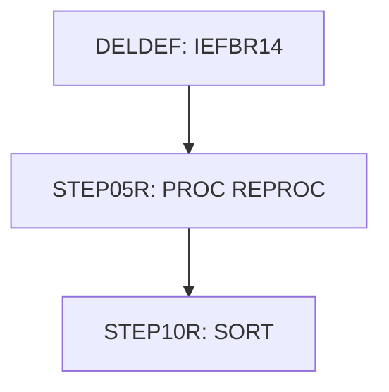

# Job PRTCATBL

| Item | Value |
|---|---|
| Source | `app/jcl/PRTCATBL.jcl` |
| Member | PRTCATBL |
| Job card | `app/jcl/PRTCATBL.jcl:1-2` |
| CLASS / MSGCLASS | A / 0 |
| NOTIFY | &SYSUID |
| Job COND |  |
| Steps | 3 |
| Module | base |

## Purpose

Comment in the JCL (Unverified, `app/jcl/PRTCATBL.jcl:27`): Unload the processed transaction category balance file

## Step flow

## Steps

### DELDEF

| Item | Value |
|---|---|
| EXEC | `app/jcl/PRTCATBL.jcl:21` |
| Program | IEFBR14 |
| PROC |  |
| Application program |  |
| PARM |  |
| COND |  |
| Function (earlier pass) | Utility step IEFBR14 |

| DD | Dataset / output | DISP | DCB | Program file and OPEN mode | Control data | Line |
|---|---|---|---|---|---|---|
| THEFILE | AWS.M2.CARDDEMO.TCATBALF.REPT | (MOD,DELETE) |  |  |  | `app/jcl/PRTCATBL.jcl:22-25` |

### STEP05R

| Item | Value |
|---|---|
| EXEC | `app/jcl/PRTCATBL.jcl:29-30` |
| Program |  |
| PROC | REPROC |
| Application program |  |
| PARM |  |
| COND |  |
| Function (earlier pass) | Executes procedure REPROC (IDCAMS REPRO) |

| DD | Dataset / output | DISP | DCB | Program file and OPEN mode | Control data | Line |
|---|---|---|---|---|---|---|
| PRC001.FILEIN | AWS.M2.CARDDEMO.TCATBALF.VSAM.KSDS | SHR |  |  |  | `app/jcl/PRTCATBL.jcl:32-33` |
| PRC001.FILEOUT | AWS.M2.CARDDEMO.TCATBALF.BKUP(+1) | (NEW,CATLG,DELETE) | (LRECL=50,RECFM=FB,BLKSIZE=0) |  |  | `app/jcl/PRTCATBL.jcl:35-39` |

Datasets supplied by PROC REPROC for this step:

| Dataset | Usage | Line |
|---|---|---|
| AWS.M2.CARDDEMO.CNTL(REPROCT) | R | `app/proc/REPROC.prc:27-28` |

### STEP10R

| Item | Value |
|---|---|
| EXEC | `app/jcl/PRTCATBL.jcl:43` |
| Program | SORT |
| PROC |  |
| Application program |  |
| PARM |  |
| COND |  |
| Function (earlier pass) | SORT control |

| DD | Dataset / output | DISP | DCB | Program file and OPEN mode | Control data | Line |
|---|---|---|---|---|---|---|
| SORTIN | AWS.M2.CARDDEMO.TCATBALF.BKUP(+1) | SHR |  |  |  | `app/jcl/PRTCATBL.jcl:44-45` |
| SYMNAMES | * |  |  |  | in-stream lines 47-50 | `app/jcl/PRTCATBL.jcl:46` |
| SYSIN | * |  |  |  | in-stream lines 52-56; statements: SORT OUTREC | `app/jcl/PRTCATBL.jcl:51` |
| SYSOUT | SYSOUT=* |  |  |  |  | `app/jcl/PRTCATBL.jcl:58` |
| SORTOUT | AWS.M2.CARDDEMO.TCATBALF.REPT | (NEW,CATLG,DELETE) | (LRECL=40,RECFM=FB,BLKSIZE=0) |  |  | `app/jcl/PRTCATBL.jcl:59-63` |

## Scheduling and dependencies

| Mechanism | From | To | Evidence |
|---|---|---|---|
| CA7 trigger | CLOSEFIL | PRTCATBL | `app/scheduler/CardDemo.ca7:537` |
| CA7 trigger | PRTCATBL | WAITSTEP | `app/scheduler/CardDemo.ca7:564` |

## JCL library, INCLUDE and SET

| Statement | Text | Line |
|---|---|---|
| JCLLIB | ORDER=('AWS.M2.CARDDEMO.PROC') | `app/jcl/PRTCATBL.jcl:19` |

## Parameters

Symbols left as parameters (not resolved): `&SYSUID`.

## Sources

- `app/jcl/PRTCATBL.jcl`
- `docs/_work/structure/jcl/PRTCATBL.json`
- `docs/_work/jobs/PRTCATBL.json`

## Confidence

Steps, DDs, conditions and control-data summaries are Confirmed from the JCL. OPEN modes come from the program source. Comments are Unverified.
