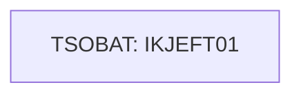

# Job RACFCMDS

| Item | Value |
|---|---|
| Source | `samples/jcl/RACFCMDS.jcl` |
| Member | RACFCMDS |
| Job card | `samples/jcl/RACFCMDS.jcl:1-2` |
| CLASS / MSGCLASS | A / Y |
| NOTIFY | &SYSUID |
| Job COND |  |
| Steps | 1 |
| Module | build |

## Purpose

Comment in the JCL (Unverified, `samples/jcl/RACFCMDS.jcl:22`): Adding a transaction to a profile (CARD)

## Step flow

## Steps

### TSOBAT

| Item | Value |
|---|---|
| EXEC | `samples/jcl/RACFCMDS.jcl:19` |
| Program | IKJEFT01 |
| PROC |  |
| Application program |  |
| PARM |  |
| COND |  |
| Function (earlier pass) | Utility step IKJEFT01 |

| DD | Dataset / output | DISP | DCB | Program file and OPEN mode | Control data | Line |
|---|---|---|---|---|---|---|
| SYSTSPRT | SYSOUT=* |  |  |  |  | `samples/jcl/RACFCMDS.jcl:21` |
| SYSTSIN | * |  |  |  | in-stream lines 24-24 | `samples/jcl/RACFCMDS.jcl:23` |
| SYSTSIN | * |  |  |  | in-stream lines 29-29 | `samples/jcl/RACFCMDS.jcl:28` |

## Scheduling and dependencies

Not referenced by the CA7 or Control-M exports or the shell scripts (see the gap report).

## Parameters

Symbols left as parameters (not resolved): `&SYSUID`.

## Sources

- `samples/jcl/RACFCMDS.jcl`
- `docs/_work/structure/jcl/RACFCMDS.json`
- `docs/_work/jobs/RACFCMDS.json`

## Confidence

Steps, DDs, conditions and control-data summaries are Confirmed from the JCL. OPEN modes come from the program source. Comments are Unverified.
