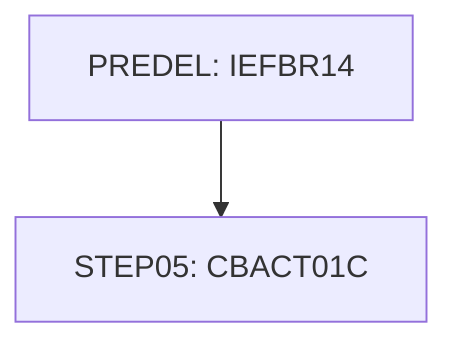

# Job READACCT

| Item | Value |
|---|---|
| Source | `app/jcl/READACCT.jcl` |
| Member | READACCT |
| Job card | `app/jcl/READACCT.jcl:1-2` |
| CLASS / MSGCLASS | A / H |
| NOTIFY | &SYSUID |
| Job COND |  |
| Steps | 2 |
| Module | base |

## Purpose

Comment in the JCL (Unverified, `app/jcl/READACCT.jcl:20`): PRE DELETE STEP

Application programs run by this job: [CBACT01C](../../07-programs/CBACT01C.md).

CBACT01C: CBACT01C is a batch COBOL program that reads the account master KSDS (ACCTFILE) sequentially and writes three derived extract files. For each account it displays the record, writes a fixed-layout copy to OUTFILE (with the reissue date reformatted by assembler routine COBDATFT and a 2525.00 default for zero cycle debit), writes an ARRYFILE record with an OCCURS 5 balance array partly filled with literal amounts, and writes two variable-length records (12 and 39 bytes) to VBRCFILE. Any open, read, write or close error displays the file status and abends with code 999. The output contents (hardcoded amounts, multiple record formats) suggest the program exercises file formats rather than implementing a production business process (Inferred from the literals in 1400-POPUL-ARRAY-RECORD and the default in 1300-POPUL-ACCT-RECORD). (Inferred, from the program analysis)

## Step flow

## Steps

### PREDEL

| Item | Value |
|---|---|
| EXEC | `app/jcl/READACCT.jcl:22` |
| Program | IEFBR14 |
| PROC |  |
| Application program |  |
| PARM |  |
| COND |  |
| Function (earlier pass) | Utility step IEFBR14 |

| DD | Dataset / output | DISP | DCB | Program file and OPEN mode | Control data | Line |
|---|---|---|---|---|---|---|
| DD01 | AWS.M2.CARDDEMO.ACCTDATA.PSCOMP | (MOD,DELETE,DELETE) |  |  |  | `app/jcl/READACCT.jcl:23-24` |
| DD02 | AWS.M2.CARDDEMO.ACCTDATA.ARRYPS | (MOD,DELETE,DELETE) |  |  |  | `app/jcl/READACCT.jcl:25-26` |
| DD03 | AWS.M2.CARDDEMO.ACCTDATA.VBPS | (MOD,DELETE,DELETE) |  |  |  | `app/jcl/READACCT.jcl:27-28` |

### STEP05

| Item | Value |
|---|---|
| EXEC | `app/jcl/READACCT.jcl:32` |
| Program | [CBACT01C](../../07-programs/CBACT01C.md) |
| PROC |  |
| Application program |  |
| PARM |  |
| COND |  |
| Function (earlier pass) | Executes program CBACT01C |

| DD | Dataset / output | DISP | DCB | Program file and OPEN mode | Control data | Line |
|---|---|---|---|---|---|---|
| STEPLIB | AWS.M2.CARDDEMO.LOADLIB | SHR |  |  |  | `app/jcl/READACCT.jcl:33-34` |
| ACCTFILE | AWS.M2.CARDDEMO.ACCTDATA.VSAM.KSDS | SHR |  | ACCTFILE-FILE OPEN INPUT (`app/cbl/CBACT01C.cbl:29-33`) |  | `app/jcl/READACCT.jcl:35-36` |
| OUTFILE | AWS.M2.CARDDEMO.ACCTDATA.PSCOMP | (NEW,CATLG,DELETE) | (LRECL=107,RECFM=FB,DSORG=PS,BLKSIZE=0) | OUT-FILE OPEN OUTPUT (`app/cbl/CBACT01C.cbl:35-38`) |  | `app/jcl/READACCT.jcl:37-40` |
| ARRYFILE | AWS.M2.CARDDEMO.ACCTDATA.ARRYPS | (NEW,CATLG,DELETE) | (LRECL=110,RECFM=FB,DSORG=PS,BLKSIZE=0) | ARRY-FILE OPEN OUTPUT (`app/cbl/CBACT01C.cbl:40-43`) |  | `app/jcl/READACCT.jcl:41-44` |
| VBRCFILE | AWS.M2.CARDDEMO.ACCTDATA.VBPS | (NEW,CATLG,DELETE) | (LRECL=84,RECFM=VB,DSORG=PS,BLKSIZE=0) | VBRC-FILE OPEN OUTPUT (`app/cbl/CBACT01C.cbl:45-48`) |  | `app/jcl/READACCT.jcl:45-48` |
| SYSOUT | SYSOUT=* |  |  |  |  | `app/jcl/READACCT.jcl:49` |
| SYSPRINT | SYSOUT=* |  |  |  |  | `app/jcl/READACCT.jcl:50` |

Return codes and abends set by CBACT01C: abend via CEE3ABD (`app/cbl/CBACT01C.cbl:410`).

## Scheduling and dependencies

| Mechanism | From | To | Evidence |
|---|---|---|---|
| CA7 trigger | CLOSEFIL | READACCT | `app/scheduler/CardDemo.ca7:340` |
| CA7 trigger | READACCT | READCARD | `app/scheduler/CardDemo.ca7:367` |

## Parameters

Symbols left as parameters (not resolved): `&SYSUID`.

## Sources

- `app/jcl/READACCT.jcl`
- `docs/_work/structure/jcl/READACCT.json`
- `docs/_work/jobs/READACCT.json`

## Confidence

Steps, DDs, conditions and control-data summaries are Confirmed from the JCL. OPEN modes come from the program source. Comments are Unverified.
