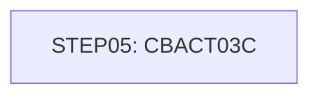

# Job READXREF

| Item | Value |
|---|---|
| Source | `app/jcl/READXREF.jcl` |
| Member | READXREF |
| Job card | `app/jcl/READXREF.jcl:1-2` |
| CLASS / MSGCLASS | A / 0 |
| NOTIFY | &SYSUID |
| Job COND |  |
| Steps | 1 |
| Module | base |

## Purpose

Comment in the JCL (Unverified, `app/jcl/READXREF.jcl:20`): RUN THE PROGRAM THAT READS THE XREF MASTER VSAM FILE

Application programs run by this job: [CBACT03C](../../07-programs/CBACT03C.md).

CBACT03C: CBACT03C is a batch COBOL utility that prints the card cross-reference file. It opens the indexed file XREFFILE (50-byte records keyed by card number, layout CVACT03Y linking card number, customer id and account id) for sequential input, reads every record into CARD-XREF-RECORD and DISPLAYs it to SYSOUT until end of file. It writes no files. Any open, read or close error displays the file status as NNNN and abends with code 999 via CEE3ABD. (Inferred, from the program analysis)

## Step flow

## Steps

### STEP05

| Item | Value |
|---|---|
| EXEC | `app/jcl/READXREF.jcl:22` |
| Program | [CBACT03C](../../07-programs/CBACT03C.md) |
| PROC |  |
| Application program |  |
| PARM |  |
| COND |  |
| Function (earlier pass) | Executes program CBACT03C |

| DD | Dataset / output | DISP | DCB | Program file and OPEN mode | Control data | Line |
|---|---|---|---|---|---|---|
| STEPLIB | AWS.M2.CARDDEMO.LOADLIB | SHR |  |  |  | `app/jcl/READXREF.jcl:23-24` |
| XREFFILE | AWS.M2.CARDDEMO.CARDXREF.VSAM.KSDS | SHR |  | XREFFILE-FILE OPEN INPUT (`app/cbl/CBACT03C.cbl:29-33`) |  | `app/jcl/READXREF.jcl:25-26` |
| SYSOUT | SYSOUT=* |  |  |  |  | `app/jcl/READXREF.jcl:27` |
| SYSPRINT | SYSOUT=* |  |  |  |  | `app/jcl/READXREF.jcl:28` |

Return codes and abends set by CBACT03C: abend via CEE3ABD (`app/cbl/CBACT03C.cbl:158`).

## Scheduling and dependencies

| Mechanism | From | To | Evidence |
|---|---|---|---|
| CA7 trigger | READCUST | READXREF | `app/scheduler/CardDemo.ca7:421` |
| CA7 trigger | READXREF | WAITSTEP | `app/scheduler/CardDemo.ca7:448` |

## Parameters

Symbols left as parameters (not resolved): `&SYSUID`.

## Sources

- `app/jcl/READXREF.jcl`
- `docs/_work/structure/jcl/READXREF.json`
- `docs/_work/jobs/READXREF.json`

## Confidence

Steps, DDs, conditions and control-data summaries are Confirmed from the JCL. OPEN modes come from the program source. Comments are Unverified.
