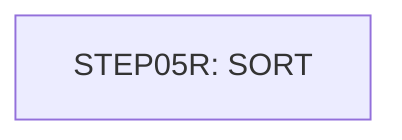

# Job SORTTEST

| Item | Value |
|---|---|
| Source | `samples/jcl/SORTTEST.jcl` |
| Member | SORTTEST |
| Job card | `samples/jcl/SORTTEST.jcl:1-2` |
| CLASS / MSGCLASS | A / 0 |
| NOTIFY | &SYSUID |
| Job COND |  |
| Steps | 1 |
| Module | build |

## Purpose

Comment in the JCL (Unverified, `samples/jcl/SORTTEST.jcl:37`): Ver: CardDemo_v1.0-57-g40b7caa-110 Date: 2022-08-19 18:00:43 CDT

## Step flow

## Steps

### STEP05R

| Item | Value |
|---|---|
| EXEC | `samples/jcl/SORTTEST.jcl:19` |
| Program | SORT |
| PROC |  |
| Application program |  |
| PARM |  |
| COND |  |
| Function (earlier pass) | SORT control |

| DD | Dataset / output | DISP | DCB | Program file and OPEN mode | Control data | Line |
|---|---|---|---|---|---|---|
| SORTIN | AWS.M2.CARDDEMO.TRANSACT.BKUP(0) | SHR |  |  |  | `samples/jcl/SORTTEST.jcl:20-21` |
| SYMNAMES | * |  |  |  | in-stream lines 23-25 | `samples/jcl/SORTTEST.jcl:22` |
| SYSIN | * |  |  |  | in-stream lines 27-28; statements: SORT INCLUDE | `samples/jcl/SORTTEST.jcl:26` |
| SYSOUT | SYSOUT=* |  |  |  |  | `samples/jcl/SORTTEST.jcl:30` |
| SORTOUT | AWS.M2.CARDDEMO.TRANSACT.DALY(+1) | (NEW,CATLG,DELETE) | (*.SORTIN) |  |  | `samples/jcl/SORTTEST.jcl:31-35` |

## Scheduling and dependencies

Not referenced by the CA7 or Control-M exports or the shell scripts (see the gap report).

## Parameters

Symbols left as parameters (not resolved): `&SYSUID`.

## Sources

- `samples/jcl/SORTTEST.jcl`
- `docs/_work/structure/jcl/SORTTEST.json`
- `docs/_work/jobs/SORTTEST.json`

## Confidence

Steps, DDs, conditions and control-data summaries are Confirmed from the JCL. OPEN modes come from the program source. Comments are Unverified.
