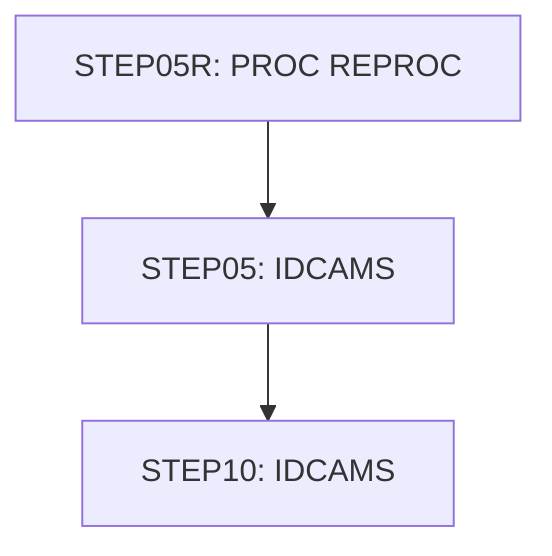

# Job TRANBKP

| Item | Value |
|---|---|
| Source | `app/jcl/TRANBKP.jcl` |
| Member | TRANBKP |
| Job card | `app/jcl/TRANBKP.jcl:1-2` |
| CLASS / MSGCLASS | A / 0 |
| NOTIFY | &SYSUID |
| Job COND |  |
| Steps | 3 |
| Module | base |

## Purpose

Comment in the JCL (Unverified, `app/jcl/TRANBKP.jcl:21`): Repro the processed transaction file

## Step flow

## Steps

### STEP05R

| Item | Value |
|---|---|
| EXEC | `app/jcl/TRANBKP.jcl:23-24` |
| Program |  |
| PROC | REPROC |
| Application program |  |
| PARM |  |
| COND |  |
| Function (earlier pass) | Executes procedure REPROC (IDCAMS REPRO) |

| DD | Dataset / output | DISP | DCB | Program file and OPEN mode | Control data | Line |
|---|---|---|---|---|---|---|
| PRC001.FILEIN | AWS.M2.CARDDEMO.TRANSACT.VSAM.KSDS | SHR |  |  |  | `app/jcl/TRANBKP.jcl:26-27` |
| PRC001.FILEOUT | AWS.M2.CARDDEMO.TRANSACT.BKUP(+1) | (NEW,CATLG,DELETE) | (LRECL=350,RECFM=FB,BLKSIZE=0) |  |  | `app/jcl/TRANBKP.jcl:29-33` |

Datasets supplied by PROC REPROC for this step:

| Dataset | Usage | Line |
|---|---|---|
| AWS.M2.CARDDEMO.CNTL(REPROCT) | R | `app/proc/REPROC.prc:27-28` |

### STEP05

| Item | Value |
|---|---|
| EXEC | `app/jcl/TRANBKP.jcl:37` |
| Program | IDCAMS |
| PROC |  |
| Application program |  |
| PARM |  |
| COND |  |
| Function (earlier pass) | IDCAMS delete |

| DD | Dataset / output | DISP | DCB | Program file and OPEN mode | Control data | Line |
|---|---|---|---|---|---|---|
| SYSPRINT | SYSOUT=* |  |  |  |  | `app/jcl/TRANBKP.jcl:38` |
| SYSIN | * |  |  |  | in-stream lines 40-45; statements: DELETE | `app/jcl/TRANBKP.jcl:39` |

### STEP10

| Item | Value |
|---|---|
| EXEC | `app/jcl/TRANBKP.jcl:51` |
| Program | IDCAMS |
| PROC |  |
| Application program |  |
| PARM |  |
| COND | `(4,LT)` |
| Function (earlier pass) | IDCAMS define VSAM cluster |

| DD | Dataset / output | DISP | DCB | Program file and OPEN mode | Control data | Line |
|---|---|---|---|---|---|---|
| SYSPRINT | SYSOUT=* |  |  |  |  | `app/jcl/TRANBKP.jcl:52` |
| SYSIN | * |  |  |  | in-stream lines 54-67; statements: DEFINE; NAME(): AWS.M2.CARDDEMO.TRANSACT.VSAM.KSDS AWS.M2.CARDDEMO.TRANSACT.VSAM.KSDS.DATA AWS.M2.CARDDEMO.TRANSACT.VSAM.KSDS.INDEX | `app/jcl/TRANBKP.jcl:53` |

## Scheduling and dependencies

| Mechanism | From | To | Evidence |
|---|---|---|---|
| Control-M condition DAILY-TransactionBackup-CLOSEFIL | CLOSEFIL | TRANBKP | `app/scheduler/CardDemo.controlm:5` (OUTCOND), `app/scheduler/CardDemo.controlm:9` (INCOND) |
| Control-M condition DAILY-TransactionBackup-TRANBKP | TRANBKP | WAITSTEP | `app/scheduler/CardDemo.controlm:11` (OUTCOND), `app/scheduler/CardDemo.controlm:15` (INCOND) |
| Shell submit | scripts/run_full_batch.sh | TRANBKP | `scripts/run_full_batch.sh:29` |
| Shell submit | scripts/run_full_batch.sh | TRANBKP | `scripts/run_full_batch.sh:55` |
| Shell submit | scripts/run_interest_calc.sh | TRANBKP | `scripts/run_interest_calc.sh:23` |
| Shell submit | scripts/run_posting.sh | TRANBKP | `scripts/run_posting.sh:23` |

## JCL library, INCLUDE and SET

| Statement | Text | Line |
|---|---|---|
| JCLLIB | ORDER=('AWS.M2.CARDDEMO.PROC') | `app/jcl/TRANBKP.jcl:19` |

## Parameters

Symbols left as parameters (not resolved): `&SYSUID`.

## Sources

- `app/jcl/TRANBKP.jcl`
- `docs/_work/structure/jcl/TRANBKP.json`
- `docs/_work/jobs/TRANBKP.json`

## Confidence

Steps, DDs, conditions and control-data summaries are Confirmed from the JCL. OPEN modes come from the program source. Comments are Unverified.
