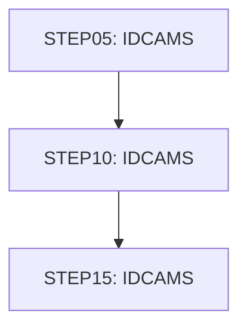

# Job TRANCATG

| Item | Value |
|---|---|
| Source | `app/jcl/TRANCATG.jcl` |
| Member | TRANCATG |
| Job card | `app/jcl/TRANCATG.jcl:1-2` |
| CLASS / MSGCLASS | A / 0 |
| NOTIFY | &SYSUID |
| Job COND |  |
| Steps | 3 |
| Module | base |

## Purpose

Comment in the JCL (Unverified, `app/jcl/TRANCATG.jcl:20`): DELETE TRANSACTION CATEGORY TYPE VSAM FILE IF ONE ALREADY EXISTS

## Step flow

## Steps

### STEP05

| Item | Value |
|---|---|
| EXEC | `app/jcl/TRANCATG.jcl:22` |
| Program | IDCAMS |
| PROC |  |
| Application program |  |
| PARM |  |
| COND |  |
| Function (earlier pass) | IDCAMS delete |

| DD | Dataset / output | DISP | DCB | Program file and OPEN mode | Control data | Line |
|---|---|---|---|---|---|---|
| SYSPRINT | SYSOUT=* |  |  |  |  | `app/jcl/TRANCATG.jcl:23` |
| SYSIN | * |  |  |  | in-stream lines 25-27; statements: DELETE SET | `app/jcl/TRANCATG.jcl:24` |

### STEP10

| Item | Value |
|---|---|
| EXEC | `app/jcl/TRANCATG.jcl:33` |
| Program | IDCAMS |
| PROC |  |
| Application program |  |
| PARM |  |
| COND |  |
| Function (earlier pass) | IDCAMS define VSAM cluster |

| DD | Dataset / output | DISP | DCB | Program file and OPEN mode | Control data | Line |
|---|---|---|---|---|---|---|
| SYSPRINT | SYSOUT=* |  |  |  |  | `app/jcl/TRANCATG.jcl:34` |
| SYSIN | * |  |  |  | in-stream lines 36-49; statements: DEFINE; NAME(): AWS.M2.CARDDEMO.TRANCATG.VSAM.KSDS AWS.M2.CARDDEMO.TRANCATG.VSAM.KSDS.DATA AWS.M2.CARDDEMO.TRANCATG.VSAM.KSDS.INDEX | `app/jcl/TRANCATG.jcl:35` |

### STEP15

| Item | Value |
|---|---|
| EXEC | `app/jcl/TRANCATG.jcl:54` |
| Program | IDCAMS |
| PROC |  |
| Application program |  |
| PARM |  |
| COND |  |
| Function (earlier pass) | IDCAMS REPRO copy |

| DD | Dataset / output | DISP | DCB | Program file and OPEN mode | Control data | Line |
|---|---|---|---|---|---|---|
| SYSPRINT | SYSOUT=* |  |  |  |  | `app/jcl/TRANCATG.jcl:55` |
| TRANCATG | AWS.M2.CARDDEMO.TRANCATG.PS | SHR |  |  |  | `app/jcl/TRANCATG.jcl:56-57` |
| TCATVSAM | AWS.M2.CARDDEMO.TRANCATG.VSAM.KSDS | OLD |  |  |  | `app/jcl/TRANCATG.jcl:58-59` |
| SYSIN | * |  |  |  | in-stream lines 61-61; statements: REPRO | `app/jcl/TRANCATG.jcl:60` |

## Scheduling and dependencies

| Mechanism | From | To | Evidence |
|---|---|---|---|
| CA7 trigger | CLOSEFIL1 | TRANCATG | `app/scheduler/CardDemo.ca7:244` |
| CA7 trigger | TRANCATG | WAITSTEP | `app/scheduler/CardDemo.ca7:298` |
| Shell submit | scripts/remote_refresh.sh | TRANCATG | `scripts/remote_refresh.sh:38` |

## Parameters

Symbols left as parameters (not resolved): `&SYSUID`.

## Sources

- `app/jcl/TRANCATG.jcl`
- `docs/_work/structure/jcl/TRANCATG.json`
- `docs/_work/jobs/TRANCATG.json`

## Confidence

Steps, DDs, conditions and control-data summaries are Confirmed from the JCL. OPEN modes come from the program source. Comments are Unverified.
