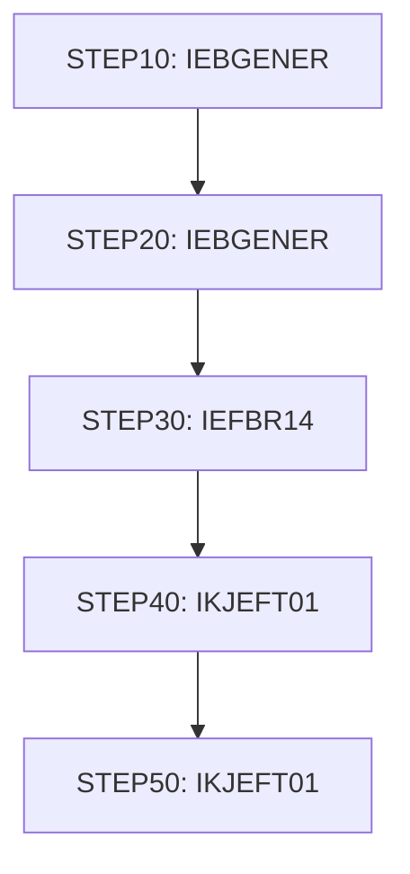

# Job TRANEXTR

| Item | Value |
|---|---|
| Source | `app/app-transaction-type-db2/jcl/TRANEXTR.jcl` |
| Member | TRANEXTR |
| Job card | `app/app-transaction-type-db2/jcl/TRANEXTR.jcl:1-2` |
| CLASS / MSGCLASS | A / 0 |
| NOTIFY | &SYSUID |
| Job COND |  |
| Steps | 5 |
| Module | trantype |

## Purpose

Comment in the JCL (Unverified, `app/app-transaction-type-db2/jcl/TRANEXTR.jcl:19`): This JCL will extract reference data for  use in Transaction

## Step flow

## Steps

### STEP10

| Item | Value |
|---|---|
| EXEC | `app/app-transaction-type-db2/jcl/TRANEXTR.jcl:31` |
| Program | IEBGENER |
| PROC |  |
| Application program |  |
| PARM |  |
| COND |  |
| Function (earlier pass) | Utility step IEBGENER |

| DD | Dataset / output | DISP | DCB | Program file and OPEN mode | Control data | Line |
|---|---|---|---|---|---|---|
| SYSPRINT | SYSOUT=* |  |  |  |  | `app/app-transaction-type-db2/jcl/TRANEXTR.jcl:32` |
| SYSIN | DUMMY |  |  |  |  | `app/app-transaction-type-db2/jcl/TRANEXTR.jcl:33` |
| SYSUT1 | &HLQ..TRANTYPE.PS | SHR |  |  |  | `app/app-transaction-type-db2/jcl/TRANEXTR.jcl:34` |
| SYSUT2 | &HLQ..TRANTYPE.BKUP(+1) | (NEW,CATLG) | (LRECL=60,RECFM=FB,BLKSIZE=600) |  |  | `app/app-transaction-type-db2/jcl/TRANEXTR.jcl:35-38` |

### STEP20

| Item | Value |
|---|---|
| EXEC | `app/app-transaction-type-db2/jcl/TRANEXTR.jcl:42` |
| Program | IEBGENER |
| PROC |  |
| Application program |  |
| PARM |  |
| COND | `(0,NE)` |
| Function (earlier pass) | Utility step IEBGENER |

| DD | Dataset / output | DISP | DCB | Program file and OPEN mode | Control data | Line |
|---|---|---|---|---|---|---|
| SYSPRINT | SYSOUT=* |  |  |  |  | `app/app-transaction-type-db2/jcl/TRANEXTR.jcl:43` |
| SYSIN | DUMMY |  |  |  |  | `app/app-transaction-type-db2/jcl/TRANEXTR.jcl:44` |
| SYSUT1 | &HLQ..TRANCATG.PS | SHR |  |  |  | `app/app-transaction-type-db2/jcl/TRANEXTR.jcl:45` |
| SYSUT2 | &HLQ..TRANCATG.PS.BKUP(+1) | (NEW,CATLG) | (LRECL=60,RECFM=FB,BLKSIZE=600) |  |  | `app/app-transaction-type-db2/jcl/TRANEXTR.jcl:46-49` |

### STEP30

| Item | Value |
|---|---|
| EXEC | `app/app-transaction-type-db2/jcl/TRANEXTR.jcl:53` |
| Program | IEFBR14 |
| PROC |  |
| Application program |  |
| PARM |  |
| COND | `(0,NE)` |
| Function (earlier pass) | Utility step IEFBR14 |

| DD | Dataset / output | DISP | DCB | Program file and OPEN mode | Control data | Line |
|---|---|---|---|---|---|---|
| DD01 | &HLQ..TRANTYPE.PS | (MOD,DELETE,DELETE) |  |  |  | `app/app-transaction-type-db2/jcl/TRANEXTR.jcl:54-57` |
| DD02 | &HLQ..TRANCATG.PS | (MOD,DELETE,DELETE) |  |  |  | `app/app-transaction-type-db2/jcl/TRANEXTR.jcl:58-61` |

### STEP40

| Item | Value |
|---|---|
| EXEC | `app/app-transaction-type-db2/jcl/TRANEXTR.jcl:65` |
| Program | IKJEFT01 |
| PROC |  |
| Application program | DSNTIAUL (no source in repository) via TSO DSN RUN PROGRAM |
| PARM |  |
| COND | `(0,NE)` |
| Function (earlier pass) | RUN PROGRAM(DSNTIAUL) - |

| DD | Dataset / output | DISP | DCB | Program file and OPEN mode | Control data | Line |
|---|---|---|---|---|---|---|
| STEPLIB | OEM.DB2.DAZ1.RUNLIB.LOAD | SHR |  |  |  | `app/app-transaction-type-db2/jcl/TRANEXTR.jcl:66` |
| STEPLIB (concat) | OEMA.DB2.VERSIONA.SDSNLOAD | SHR |  |  |  | `app/app-transaction-type-db2/jcl/TRANEXTR.jcl:67` |
| SYSTSPRT | SYSOUT=* |  |  |  |  | `app/app-transaction-type-db2/jcl/TRANEXTR.jcl:68` |
| SYSPRINT | SYSOUT=* |  |  |  |  | `app/app-transaction-type-db2/jcl/TRANEXTR.jcl:69` |
| SYSUDUMP | SYSOUT=* |  |  |  |  | `app/app-transaction-type-db2/jcl/TRANEXTR.jcl:70` |
| SYSPUNCH | DUMMY |  |  |  |  | `app/app-transaction-type-db2/jcl/TRANEXTR.jcl:71` |
| SYSREC00 | &HLQ..TRANTYPE.PS | (NEW,CATLG,DELETE) |  |  |  | `app/app-transaction-type-db2/jcl/TRANEXTR.jcl:72-74` |
| SYSIN | * |  |  |  | in-stream lines 76-84; statements: SELECT; tables: CARDDEMO.TRANSACTION_TYPE | `app/app-transaction-type-db2/jcl/TRANEXTR.jcl:75` |
| SYSTSIN | * |  |  |  | in-stream lines 87-90; statements: DSN RUN; RUN PROGRAM(DSNTIAUL) | `app/app-transaction-type-db2/jcl/TRANEXTR.jcl:86` |

### STEP50

| Item | Value |
|---|---|
| EXEC | `app/app-transaction-type-db2/jcl/TRANEXTR.jcl:95` |
| Program | IKJEFT01 |
| PROC |  |
| Application program | DSNTIAUL (no source in repository) via TSO DSN RUN PROGRAM |
| PARM |  |
| COND | `(4,LT)` |
| Function (earlier pass) | RUN PROGRAM(DSNTIAUL) - |

| DD | Dataset / output | DISP | DCB | Program file and OPEN mode | Control data | Line |
|---|---|---|---|---|---|---|
| STEPLIB | OEM.DB2.DAZ1.RUNLIB.LOAD | SHR |  |  |  | `app/app-transaction-type-db2/jcl/TRANEXTR.jcl:96` |
| STEPLIB (concat) | OEMA.DB2.VERSIONA.SDSNLOAD | SHR |  |  |  | `app/app-transaction-type-db2/jcl/TRANEXTR.jcl:97` |
| SYSTSPRT | SYSOUT=* |  |  |  |  | `app/app-transaction-type-db2/jcl/TRANEXTR.jcl:98` |
| SYSPRINT | SYSOUT=* |  |  |  |  | `app/app-transaction-type-db2/jcl/TRANEXTR.jcl:99` |
| SYSUDUMP | SYSOUT=* |  |  |  |  | `app/app-transaction-type-db2/jcl/TRANEXTR.jcl:100` |
| SYSPUNCH | DUMMY |  |  |  |  | `app/app-transaction-type-db2/jcl/TRANEXTR.jcl:101` |
| SYSREC00 | &HLQ..TRANCATG.PS | (NEW,CATLG,DELETE) |  |  |  | `app/app-transaction-type-db2/jcl/TRANEXTR.jcl:102-104` |
| SYSIN | * |  |  |  | in-stream lines 106-115; statements: SELECT; tables: CARDDEMO.TRANSACTION_TYPE_CATEGORY | `app/app-transaction-type-db2/jcl/TRANEXTR.jcl:105` |
| SYSTSIN | * |  |  |  | in-stream lines 118-121; statements: DSN RUN; RUN PROGRAM(DSNTIAUL) | `app/app-transaction-type-db2/jcl/TRANEXTR.jcl:117` |

## Scheduling and dependencies

| Mechanism | From | To | Evidence |
|---|---|---|---|
| Control-M condition WEEKLY-TransactionTypesDBRefresh-MNTTRDB2 | MNTTRDB2 | TRANEXTR | `app/scheduler/CardDemo.controlm:28` (OUTCOND), `app/scheduler/CardDemo.controlm:59` (INCOND) |

## JCL library, INCLUDE and SET

| Statement | Text | Line |
|---|---|---|
| SET | HLQ=AWS.M2.CARDDEMO | `app/app-transaction-type-db2/jcl/TRANEXTR.jcl:25` |

## Parameters

Symbols left as parameters (not resolved): `&HLQ`, `&SYSUID`.

## Sources

- `app/app-transaction-type-db2/jcl/TRANEXTR.jcl`
- `docs/_work/structure/jcl/TRANEXTR.json`
- `docs/_work/jobs/TRANEXTR.json`

## Confidence

Steps, DDs, conditions and control-data summaries are Confirmed from the JCL. OPEN modes come from the program source. Comments are Unverified.
