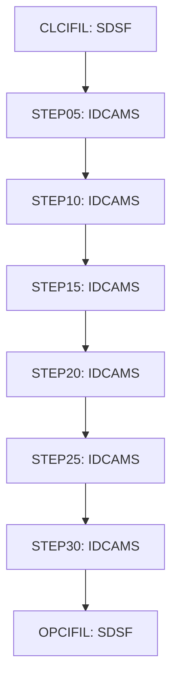

# Job TRANFILE

| Item | Value |
|---|---|
| Source | `app/jcl/TRANFILE.jcl` |
| Member | TRANFILE |
| Job card | `app/jcl/TRANFILE.jcl:1-2` |
| CLASS / MSGCLASS | A / 0 |
| NOTIFY | &SYSUID |
| Job COND |  |
| Steps | 8 |
| Module | base |

## Purpose

Comment in the JCL (Unverified, `app/jcl/TRANFILE.jcl:20`): Close files in CICS region

## Step flow

## Steps

### CLCIFIL

| Item | Value |
|---|---|
| EXEC | `app/jcl/TRANFILE.jcl:22` |
| Program | SDSF |
| PROC |  |
| Application program |  |
| PARM |  |
| COND |  |
| Function (earlier pass) | Operator command |

| DD | Dataset / output | DISP | DCB | Program file and OPEN mode | Control data | Line |
|---|---|---|---|---|---|---|
| ISFOUT | SYSOUT=* |  |  |  |  | `app/jcl/TRANFILE.jcl:23` |
| CMDOUT | SYSOUT=* |  |  |  |  | `app/jcl/TRANFILE.jcl:24` |
| ISFIN | * |  |  |  | in-stream lines 26-27 | `app/jcl/TRANFILE.jcl:25` |

### STEP05

| Item | Value |
|---|---|
| EXEC | `app/jcl/TRANFILE.jcl:32` |
| Program | IDCAMS |
| PROC |  |
| Application program |  |
| PARM |  |
| COND |  |
| Function (earlier pass) | IDCAMS delete |

| DD | Dataset / output | DISP | DCB | Program file and OPEN mode | Control data | Line |
|---|---|---|---|---|---|---|
| SYSPRINT | SYSOUT=* |  |  |  |  | `app/jcl/TRANFILE.jcl:33` |
| SYSIN | * |  |  |  | in-stream lines 35-40; statements: DELETE | `app/jcl/TRANFILE.jcl:34` |

### STEP10

| Item | Value |
|---|---|
| EXEC | `app/jcl/TRANFILE.jcl:46` |
| Program | IDCAMS |
| PROC |  |
| Application program |  |
| PARM |  |
| COND |  |
| Function (earlier pass) | IDCAMS define VSAM cluster |

| DD | Dataset / output | DISP | DCB | Program file and OPEN mode | Control data | Line |
|---|---|---|---|---|---|---|
| SYSPRINT | SYSOUT=* |  |  |  |  | `app/jcl/TRANFILE.jcl:47` |
| SYSIN | * |  |  |  | in-stream lines 49-62; statements: DEFINE; NAME(): AWS.M2.CARDDEMO.TRANSACT.VSAM.KSDS AWS.M2.CARDDEMO.TRANSACT.VSAM.KSDS.DATA AWS.M2.CARDDEMO.TRANSACT.VSAM.KSDS.INDEX | `app/jcl/TRANFILE.jcl:48` |

### STEP15

| Item | Value |
|---|---|
| EXEC | `app/jcl/TRANFILE.jcl:67` |
| Program | IDCAMS |
| PROC |  |
| Application program |  |
| PARM |  |
| COND |  |
| Function (earlier pass) | IDCAMS REPRO copy |

| DD | Dataset / output | DISP | DCB | Program file and OPEN mode | Control data | Line |
|---|---|---|---|---|---|---|
| SYSPRINT | SYSOUT=* |  |  |  |  | `app/jcl/TRANFILE.jcl:68` |
| TRANSACT | AWS.M2.CARDDEMO.DALYTRAN.PS.INIT | SHR |  |  |  | `app/jcl/TRANFILE.jcl:69-70` |
| TRANVSAM | AWS.M2.CARDDEMO.TRANSACT.VSAM.KSDS | SHR |  |  |  | `app/jcl/TRANFILE.jcl:71-72` |
| SYSIN | * |  |  |  | in-stream lines 74-74; statements: REPRO | `app/jcl/TRANFILE.jcl:73` |

### STEP20

| Item | Value |
|---|---|
| EXEC | `app/jcl/TRANFILE.jcl:79` |
| Program | IDCAMS |
| PROC |  |
| Application program |  |
| PARM |  |
| COND |  |
| Function (earlier pass) | IDCAMS define alternate index |

| DD | Dataset / output | DISP | DCB | Program file and OPEN mode | Control data | Line |
|---|---|---|---|---|---|---|
| SYSPRINT | SYSOUT=* |  |  |  |  | `app/jcl/TRANFILE.jcl:80` |
| SYSIN | * |  |  |  | in-stream lines 82-91; statements: DEFINE; NAME(): AWS.M2.CARDDEMO.TRANSACT.VSAM.AIX AWS.M2.CARDDEMO.TRANSACT.VSAM.AIX.DATA AWS.M2.CARDDEMO.TRANSACT.VSAM.AIX.INDEX | `app/jcl/TRANFILE.jcl:81` |

### STEP25

| Item | Value |
|---|---|
| EXEC | `app/jcl/TRANFILE.jcl:96` |
| Program | IDCAMS |
| PROC |  |
| Application program |  |
| PARM |  |
| COND |  |
| Function (earlier pass) | IDCAMS define path |

| DD | Dataset / output | DISP | DCB | Program file and OPEN mode | Control data | Line |
|---|---|---|---|---|---|---|
| SYSPRINT | SYSOUT=* |  |  |  |  | `app/jcl/TRANFILE.jcl:97` |
| SYSIN | * |  |  |  | in-stream lines 99-101; statements: DEFINE; NAME(): AWS.M2.CARDDEMO.TRANSACT.VSAM.AIX.PATH | `app/jcl/TRANFILE.jcl:98` |

### STEP30

| Item | Value |
|---|---|
| EXEC | `app/jcl/TRANFILE.jcl:106` |
| Program | IDCAMS |
| PROC |  |
| Application program |  |
| PARM |  |
| COND |  |
| Function (earlier pass) | Utility step IDCAMS |

| DD | Dataset / output | DISP | DCB | Program file and OPEN mode | Control data | Line |
|---|---|---|---|---|---|---|
| SYSPRINT | SYSOUT=* |  |  |  |  | `app/jcl/TRANFILE.jcl:107` |
| SYSIN | * |  |  |  | in-stream lines 109-111; statements: BLDINDEX | `app/jcl/TRANFILE.jcl:108` |

### OPCIFIL

| Item | Value |
|---|---|
| EXEC | `app/jcl/TRANFILE.jcl:116` |
| Program | SDSF |
| PROC |  |
| Application program |  |
| PARM |  |
| COND |  |
| Function (earlier pass) | Operator command |

| DD | Dataset / output | DISP | DCB | Program file and OPEN mode | Control data | Line |
|---|---|---|---|---|---|---|
| ISFOUT | SYSOUT=* |  |  |  |  | `app/jcl/TRANFILE.jcl:117` |
| CMDOUT | SYSOUT=* |  |  |  |  | `app/jcl/TRANFILE.jcl:118` |
| ISFIN | * |  |  |  | in-stream lines 120-121 | `app/jcl/TRANFILE.jcl:119` |

## Scheduling and dependencies

| Mechanism | From | To | Evidence |
|---|---|---|---|
| Shell submit | scripts/remote_refresh.sh | TRANFILE | `scripts/remote_refresh.sh:29` |

## Parameters

Symbols left as parameters (not resolved): `&SYSUID`.

## Sources

- `app/jcl/TRANFILE.jcl`
- `docs/_work/structure/jcl/TRANFILE.json`
- `docs/_work/jobs/TRANFILE.json`

## Confidence

Steps, DDs, conditions and control-data summaries are Confirmed from the JCL. OPEN modes come from the program source. Comments are Unverified.
