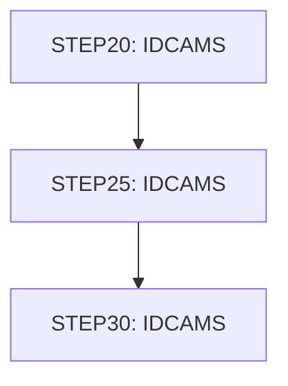

# Job TRANIDX

| Item | Value |
|---|---|
| Source | `app/jcl/TRANIDX.jcl` |
| Member | TRANIDX |
| Job card | `app/jcl/TRANIDX.jcl:1-2` |
| CLASS / MSGCLASS | A / 0 |
| NOTIFY | &SYSUID |
| Job COND |  |
| Steps | 3 |
| Module | base |

## Purpose

Comment in the JCL (Unverified, `app/jcl/TRANIDX.jcl:20`): CREATE ALTERNATE INDEX ON PROCESSED TIMESTAMP

## Step flow

## Steps

### STEP20

| Item | Value |
|---|---|
| EXEC | `app/jcl/TRANIDX.jcl:22` |
| Program | IDCAMS |
| PROC |  |
| Application program |  |
| PARM |  |
| COND |  |
| Function (earlier pass) | IDCAMS define alternate index |

| DD | Dataset / output | DISP | DCB | Program file and OPEN mode | Control data | Line |
|---|---|---|---|---|---|---|
| SYSPRINT | SYSOUT=* |  |  |  |  | `app/jcl/TRANIDX.jcl:23` |
| SYSIN | * |  |  |  | in-stream lines 25-34; statements: DEFINE; NAME(): AWS.M2.CARDDEMO.TRANSACT.VSAM.AIX AWS.M2.CARDDEMO.TRANSACT.VSAM.AIX.DATA AWS.M2.CARDDEMO.TRANSACT.VSAM.AIX.INDEX | `app/jcl/TRANIDX.jcl:24` |

### STEP25

| Item | Value |
|---|---|
| EXEC | `app/jcl/TRANIDX.jcl:39` |
| Program | IDCAMS |
| PROC |  |
| Application program |  |
| PARM |  |
| COND |  |
| Function (earlier pass) | IDCAMS define path |

| DD | Dataset / output | DISP | DCB | Program file and OPEN mode | Control data | Line |
|---|---|---|---|---|---|---|
| SYSPRINT | SYSOUT=* |  |  |  |  | `app/jcl/TRANIDX.jcl:40` |
| SYSIN | * |  |  |  | in-stream lines 42-44; statements: DEFINE; NAME(): AWS.M2.CARDDEMO.TRANSACT.VSAM.AIX.PATH | `app/jcl/TRANIDX.jcl:41` |

### STEP30

| Item | Value |
|---|---|
| EXEC | `app/jcl/TRANIDX.jcl:49` |
| Program | IDCAMS |
| PROC |  |
| Application program |  |
| PARM |  |
| COND |  |
| Function (earlier pass) | Utility step IDCAMS |

| DD | Dataset / output | DISP | DCB | Program file and OPEN mode | Control data | Line |
|---|---|---|---|---|---|---|
| SYSPRINT | SYSOUT=* |  |  |  |  | `app/jcl/TRANIDX.jcl:50` |
| SYSIN | * |  |  |  | in-stream lines 52-54; statements: BLDINDEX | `app/jcl/TRANIDX.jcl:51` |

## Scheduling and dependencies

| Mechanism | From | To | Evidence |
|---|---|---|---|
| Shell submit | scripts/run_full_batch.sh | TRANIDX | `scripts/run_full_batch.sh:62` |
| Shell submit | scripts/run_interest_calc.sh | TRANIDX | `scripts/run_interest_calc.sh:30` |
| Shell submit | scripts/run_posting.sh | TRANIDX | `scripts/run_posting.sh:30` |

## Parameters

Symbols left as parameters (not resolved): `&SYSUID`.

## Sources

- `app/jcl/TRANIDX.jcl`
- `docs/_work/structure/jcl/TRANIDX.json`
- `docs/_work/jobs/TRANIDX.json`

## Confidence

Steps, DDs, conditions and control-data summaries are Confirmed from the JCL. OPEN modes come from the program source. Comments are Unverified.
