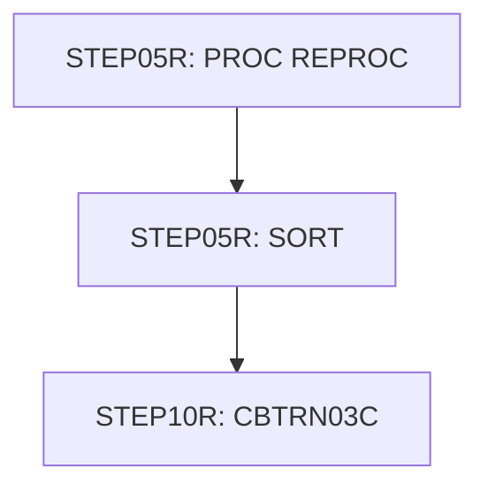

# Job TRANREPT

| Item | Value |
|---|---|
| Source | `app/jcl/TRANREPT.jcl` |
| Member | TRANREPT |
| Job card | `app/jcl/TRANREPT.jcl:1-2` |
| CLASS / MSGCLASS | A / 0 |
| NOTIFY | &SYSUID |
| Job COND |  |
| Steps | 3 |
| Module | base |

## Purpose

Comment in the JCL (Unverified, `app/jcl/TRANREPT.jcl:21`): Unload the processed transaction file

Application programs run by this job: [CBTRN03C](../../07-programs/CBTRN03C.md).

CBTRN03C: CBTRN03C is a batch COBOL program (job TRANREPT, step STEP10R) that prints the 'Daily Transaction Report' (DALYREPT). It reads a start/end date from the DATEPARM file and then reads the posted transaction file TRANFILE sequentially (in TRANREPT.jcl a backup of the transaction master, filtered by date and sorted by card number). For each transaction in the date range it looks up the account id in the card cross-reference (CARDXREF) and the type and category descriptions (TRANTYPE, TRANCATG), and writes a 133-byte detail line to TRANREPT. It prints headers, page totals every 20 lines, an 'Account Total' on every card-number change and a final page total and grand total. Missing reference data or any file error abends the step with code 999. (Inferred, from the program analysis)

## Step flow

## Steps

### STEP05R

| Item | Value |
|---|---|
| EXEC | `app/jcl/TRANREPT.jcl:23-24` |
| Program |  |
| PROC | REPROC |
| Application program |  |
| PARM |  |
| COND |  |
| Function (earlier pass) | Executes procedure REPROC (IDCAMS REPRO) |

| DD | Dataset / output | DISP | DCB | Program file and OPEN mode | Control data | Line |
|---|---|---|---|---|---|---|
| PRC001.FILEIN | AWS.M2.CARDDEMO.TRANSACT.VSAM.KSDS | SHR |  |  |  | `app/jcl/TRANREPT.jcl:26-27` |
| PRC001.FILEOUT | AWS.M2.CARDDEMO.TRANSACT.BKUP(+1) | (NEW,CATLG,DELETE) | (LRECL=350,RECFM=FB,BLKSIZE=0) |  |  | `app/jcl/TRANREPT.jcl:29-33` |

Datasets supplied by PROC REPROC for this step:

| Dataset | Usage | Line |
|---|---|---|
| AWS.M2.CARDDEMO.CNTL(REPROCT) | R | `app/proc/REPROC.prc:27-28` |

### STEP05R

| Item | Value |
|---|---|
| EXEC | `app/jcl/TRANREPT.jcl:37` |
| Program | SORT |
| PROC |  |
| Application program |  |
| PARM |  |
| COND |  |
| Function (earlier pass) | SORT control |

| DD | Dataset / output | DISP | DCB | Program file and OPEN mode | Control data | Line |
|---|---|---|---|---|---|---|
| SORTIN | AWS.M2.CARDDEMO.TRANSACT.BKUP(+1) | SHR |  |  |  | `app/jcl/TRANREPT.jcl:38-39` |
| SYMNAMES | * |  |  |  | in-stream lines 41-44 | `app/jcl/TRANREPT.jcl:40` |
| SYSIN | * |  |  |  | in-stream lines 46-48; statements: SORT INCLUDE | `app/jcl/TRANREPT.jcl:45` |
| SYSOUT | SYSOUT=* |  |  |  |  | `app/jcl/TRANREPT.jcl:50` |
| SORTOUT | AWS.M2.CARDDEMO.TRANSACT.DALY(+1) | (NEW,CATLG,DELETE) | (*.SORTIN) |  |  | `app/jcl/TRANREPT.jcl:51-55` |

Datasets supplied by PROC  for this step:

| Dataset | Usage | Line |
|---|---|---|
| AWS.M2.CARDDEMO.CNTL(REPROCT) | R | `app/proc/REPROC.prc:27-28` |

### STEP10R

| Item | Value |
|---|---|
| EXEC | `app/jcl/TRANREPT.jcl:59` |
| Program | [CBTRN03C](../../07-programs/CBTRN03C.md) |
| PROC |  |
| Application program |  |
| PARM |  |
| COND |  |
| Function (earlier pass) | Executes program CBTRN03C |

| DD | Dataset / output | DISP | DCB | Program file and OPEN mode | Control data | Line |
|---|---|---|---|---|---|---|
| STEPLIB | AWS.M2.CARDDEMO.LOADLIB | SHR |  |  |  | `app/jcl/TRANREPT.jcl:60-61` |
| SYSOUT | SYSOUT=* |  |  |  |  | `app/jcl/TRANREPT.jcl:62` |
| SYSPRINT | SYSOUT=* |  |  |  |  | `app/jcl/TRANREPT.jcl:63` |
| TRANFILE | AWS.M2.CARDDEMO.TRANSACT.DALY(+1) | SHR |  | TRANSACT-FILE OPEN INPUT (`app/cbl/CBTRN03C.cbl:29-31`) |  | `app/jcl/TRANREPT.jcl:65-66` |
| CARDXREF | AWS.M2.CARDDEMO.CARDXREF.VSAM.KSDS | SHR |  | XREF-FILE OPEN INPUT (`app/cbl/CBTRN03C.cbl:33-37`) |  | `app/jcl/TRANREPT.jcl:67-68` |
| TRANTYPE | AWS.M2.CARDDEMO.TRANTYPE.VSAM.KSDS | SHR |  | TRANTYPE-FILE OPEN INPUT (`app/cbl/CBTRN03C.cbl:39-43`) |  | `app/jcl/TRANREPT.jcl:69-70` |
| TRANCATG | AWS.M2.CARDDEMO.TRANCATG.VSAM.KSDS | SHR |  | TRANCATG-FILE OPEN INPUT (`app/cbl/CBTRN03C.cbl:45-49`) |  | `app/jcl/TRANREPT.jcl:71-72` |
| DATEPARM | AWS.M2.CARDDEMO.DATEPARM | SHR |  | DATE-PARMS-FILE OPEN INPUT (`app/cbl/CBTRN03C.cbl:55-57`) |  | `app/jcl/TRANREPT.jcl:73-74` |
| TRANREPT | AWS.M2.CARDDEMO.TRANREPT(+1) | (NEW,CATLG,DELETE) | (LRECL=133,RECFM=FB,BLKSIZE=0) | REPORT-FILE OPEN OUTPUT (`app/cbl/CBTRN03C.cbl:51-53`) |  | `app/jcl/TRANREPT.jcl:76-80` |

Return codes and abends set by CBTRN03C: abend via CEE3ABD (`app/cbl/CBTRN03C.cbl:630`).

## Scheduling and dependencies

Not referenced by the CA7 or Control-M exports or the shell scripts (see the gap report).

## JCL library, INCLUDE and SET

| Statement | Text | Line |
|---|---|---|
| JCLLIB | ORDER=('AWS.M2.CARDDEMO.PROC') | `app/jcl/TRANREPT.jcl:19` |

## Parameters

Symbols left as parameters (not resolved): `&SYSUID`.

## Sources

- `app/jcl/TRANREPT.jcl`
- `docs/_work/structure/jcl/TRANREPT.json`
- `docs/_work/jobs/TRANREPT.json`

## Confidence

Steps, DDs, conditions and control-data summaries are Confirmed from the JCL. OPEN modes come from the program source. Comments are Unverified.
