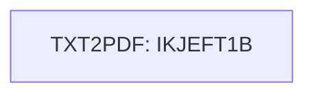

# Job TXT2PDF1

| Item | Value |
|---|---|
| Source | `app/jcl/TXT2PDF1.JCL` |
| Member | TXT2PDF1 |
| Job card | `app/jcl/TXT2PDF1.JCL:1` |
| CLASS / MSGCLASS | A / X |
| NOTIFY | &SYSUID |
| Job COND |  |
| Steps | 1 |
| Module | base |

## Purpose

No descriptive comment in the JCL.

## Step flow

## Steps

### TXT2PDF

| Item | Value |
|---|---|
| EXEC | `app/jcl/TXT2PDF1.JCL:24-26` |
| Program | IKJEFT1B |
| PROC |  |
| Application program |  |
| PARM | `('')` |
| COND | `(0,NE)` |
| Function (earlier pass) | Utility step IKJEFT1B |

| DD | Dataset / output | DISP | DCB | Program file and OPEN mode | Control data | Line |
|---|---|---|---|---|---|---|
| STEPLIB | AWS.M2.LBD.TXT2PDF.LOAD | SHR |  |  |  | `app/jcl/TXT2PDF1.JCL:28-29` |
| SYSEXEC | AWS.M2.LBD.TXT2PDF.EXEC | SHR |  |  |  | `app/jcl/TXT2PDF1.JCL:31` |
| INDD | AWS.M2.CARDDEMO.STATEMNT.PS | SHR |  |  |  | `app/jcl/TXT2PDF1.JCL:33` |
| SYSPRINT | SYSOUT=* |  |  |  |  | `app/jcl/TXT2PDF1.JCL:35` |
| SYSTSPRT | SYSOUT=* |  |  |  |  | `app/jcl/TXT2PDF1.JCL:36` |
| SYSTSIN | * |  |  |  | in-stream lines 38-39 | `app/jcl/TXT2PDF1.JCL:37` |

## Scheduling and dependencies

| Mechanism | From | To | Evidence |
|---|---|---|---|
| CA7 trigger | CREASTMT | TXT2PDF1 | `app/scheduler/CardDemo.ca7:495` |
| CA7 trigger | TXT2PDF1 | WAITSTEP | `app/scheduler/CardDemo.ca7:522` |

## Parameters

Symbols left as parameters (not resolved): `&SYSUID`.

## Sources

- `app/jcl/TXT2PDF1.JCL`
- `docs/_work/structure/jcl/TXT2PDF1.json`
- `docs/_work/jobs/TXT2PDF1.json`

## Confidence

Steps, DDs, conditions and control-data summaries are Confirmed from the JCL. OPEN modes come from the program source. Comments are Unverified.
