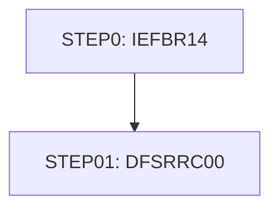

# Job UNLDPADB

| Item | Value |
|---|---|
| Source | `app/app-authorization-ims-db2-mq/jcl/UNLDPADB.JCL` |
| Member | UNLDPADB |
| Job card | `app/app-authorization-ims-db2-mq/jcl/UNLDPADB.JCL:1-2` |
| CLASS / MSGCLASS | A / H |
| NOTIFY | &SYSUID |
| Job COND |  |
| Steps | 2 |
| Module | auth |

## Purpose

Comment in the JCL (Unverified, `app/app-authorization-ims-db2-mq/jcl/UNLDPADB.JCL:23`): EXECUTE IMS PROGRAM

Application programs run by this job: [PAUDBUNL](../../07-programs/PAUDBUNL.md).

PAUDBUNL: PAUDBUNL is a batch IMS DL/I unload utility (entry DLITCBL with PCB mask PAUTBPCB; run by UNLDPADB.JCL as DLI with PSB PAUTBUNL) that copies the pending authorization database to two sequential files. It reads every PAUTSUM0 summary root with unqualified GN calls; for each summary with a numeric account id it writes the 100-byte summary to OUTFIL1 and then reads each PAUTDTL1 child with GNP and writes a record of the packed account id (ROOT-SEG-KEY) plus the 200-byte detail to OUTFIL2. It ends at end of database ('GB'); unexpected IMS statuses or open failures end with RETURN-CODE 16. (Inferred, from the program analysis)

## Step flow

## Steps

### STEP0

| Item | Value |
|---|---|
| EXEC | `app/app-authorization-ims-db2-mq/jcl/UNLDPADB.JCL:25` |
| Program | IEFBR14 |
| PROC |  |
| Application program |  |
| PARM |  |
| COND |  |
| Function (earlier pass) | Utility step IEFBR14 |

| DD | Dataset / output | DISP | DCB | Program file and OPEN mode | Control data | Line |
|---|---|---|---|---|---|---|
| SYSPRINT | SYSOUT=* |  |  |  |  | `app/app-authorization-ims-db2-mq/jcl/UNLDPADB.JCL:27` |
| SYSOUT | SYSOUT=* |  |  |  |  | `app/app-authorization-ims-db2-mq/jcl/UNLDPADB.JCL:29` |
| SYSDUMP | SYSOUT=* |  |  |  |  | `app/app-authorization-ims-db2-mq/jcl/UNLDPADB.JCL:31` |
| DD1 | AWS.M2.CARDDEMO.PAUTDB.ROOT.FILEO | (OLD,DELETE,DELETE) |  |  |  | `app/app-authorization-ims-db2-mq/jcl/UNLDPADB.JCL:33-34` |
| DD2 | AWS.M2.CARDDEMO.PAUTDB.CHILD.FILEO | (OLD,DELETE,DELETE) |  |  |  | `app/app-authorization-ims-db2-mq/jcl/UNLDPADB.JCL:35-36` |

### STEP01

| Item | Value |
|---|---|
| EXEC | `app/app-authorization-ims-db2-mq/jcl/UNLDPADB.JCL:38-39` |
| Program | DFSRRC00 |
| PROC |  |
| Application program | [PAUDBUNL](../../07-programs/PAUDBUNL.md) via DFSRRC00 PARM |
| PARM | `'DLI,PAUDBUNL,PAUTBUNL,,,,,,,,,,,N'` |
| COND |  |
| Function (earlier pass) | IMS DLI program PAUDBUNL PSB PAUTBUNL |

| DD | Dataset / output | DISP | DCB | Program file and OPEN mode | Control data | Line |
|---|---|---|---|---|---|---|
| STEPLIB | OEMA.IMS.IMSP.SDFSRESL | SHR |  |  |  | `app/app-authorization-ims-db2-mq/jcl/UNLDPADB.JCL:40` |
| STEPLIB (concat) | OEMA.IMS.IMSP.SDFSRESL.V151 | SHR |  |  |  | `app/app-authorization-ims-db2-mq/jcl/UNLDPADB.JCL:41` |
| STEPLIB (concat) | AWS.M2.CARDDEMO.LOADLIB | SHR |  |  |  | `app/app-authorization-ims-db2-mq/jcl/UNLDPADB.JCL:42` |
| DFSRESLB | OEMA.IMS.IMSP.SDFSRESL | SHR |  |  |  | `app/app-authorization-ims-db2-mq/jcl/UNLDPADB.JCL:43` |
| IMS | OEM.IMS.IMSP.PSBLIB | SHR |  |  |  | `app/app-authorization-ims-db2-mq/jcl/UNLDPADB.JCL:45` |
| IMS (concat) | OEM.IMS.IMSP.DBDLIB | SHR |  |  |  | `app/app-authorization-ims-db2-mq/jcl/UNLDPADB.JCL:46` |
| OUTFIL1 | AWS.M2.CARDDEMO.PAUTDB.ROOT.FILEO | (NEW,CATLG,DELETE) | (LRECL=100,BLKSIZE=0,RECFM=FB) | OPFILE1 OPEN OUTPUT (`app/app-authorization-ims-db2-mq/cbl/PAUDBUNL.CBL:26-29`) |  | `app/app-authorization-ims-db2-mq/jcl/UNLDPADB.JCL:48-51` |
| OUTFIL2 | AWS.M2.CARDDEMO.PAUTDB.CHILD.FILEO | (NEW,CATLG,DELETE) | (LRECL=206,BLKSIZE=0,RECFM=FB) | OPFILE2 OPEN OUTPUT (`app/app-authorization-ims-db2-mq/cbl/PAUDBUNL.CBL:32-35`) |  | `app/app-authorization-ims-db2-mq/jcl/UNLDPADB.JCL:53-56` |
| DDPAUTP0 | OEM.IMS.IMSP.PAUTHDB | SHR |  |  |  | `app/app-authorization-ims-db2-mq/jcl/UNLDPADB.JCL:58` |
| DDPAUTX0 | OEM.IMS.IMSP.PAUTHDBX | SHR |  |  |  | `app/app-authorization-ims-db2-mq/jcl/UNLDPADB.JCL:59` |
| DFSVSAMP | OEMPP.IMS.V15R01MB.PROCLIB(DFSVSMDB) | SHR |  |  |  | `app/app-authorization-ims-db2-mq/jcl/UNLDPADB.JCL:62-63` |
| IMSLOGR | DUMMY |  |  |  |  | `app/app-authorization-ims-db2-mq/jcl/UNLDPADB.JCL:64` |
| IEFRDER | DUMMY |  |  |  |  | `app/app-authorization-ims-db2-mq/jcl/UNLDPADB.JCL:65` |
| SYSPRINT | SYSOUT=* |  |  |  |  | `app/app-authorization-ims-db2-mq/jcl/UNLDPADB.JCL:66` |
| SYSUDUMP | SYSOUT=* |  |  |  |  | `app/app-authorization-ims-db2-mq/jcl/UNLDPADB.JCL:67` |
| IMSERR | SYSOUT=* |  |  |  |  | `app/app-authorization-ims-db2-mq/jcl/UNLDPADB.JCL:68` |

Return codes and abends set by PAUDBUNL: RETURN-CODE 16 (`app/app-authorization-ims-db2-mq/cbl/PAUDBUNL.CBL:313`).

## Scheduling and dependencies

Not referenced by the CA7 or Control-M exports or the shell scripts (see the gap report).

## Parameters

Symbols left as parameters (not resolved): `&SYSUID`.

## Sources

- `app/app-authorization-ims-db2-mq/jcl/UNLDPADB.JCL`
- `docs/_work/structure/jcl/UNLDPADB.json`
- `docs/_work/jobs/UNLDPADB.json`

## Confidence

Steps, DDs, conditions and control-data summaries are Confirmed from the JCL. OPEN modes come from the program source. Comments are Unverified.
