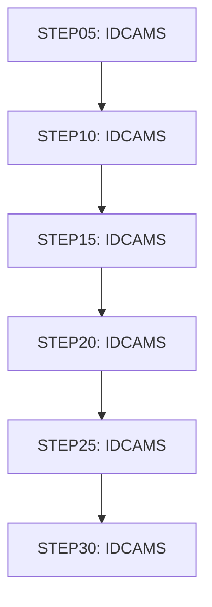

# Job XREFFILE

| Item | Value |
|---|---|
| Source | `app/jcl/XREFFILE.jcl` |
| Member | XREFFILE |
| Job card | `app/jcl/XREFFILE.jcl:1-2` |
| CLASS / MSGCLASS | A / 0 |
| NOTIFY | &SYSUID |
| Job COND |  |
| Steps | 6 |
| Module | base |

## Purpose

Comment in the JCL (Unverified, `app/jcl/XREFFILE.jcl:20`): DELETE CARD XREF VSAM FILE IF ONE ALREADY EXISTS

## Step flow

## Steps

### STEP05

| Item | Value |
|---|---|
| EXEC | `app/jcl/XREFFILE.jcl:22` |
| Program | IDCAMS |
| PROC |  |
| Application program |  |
| PARM |  |
| COND |  |
| Function (earlier pass) | IDCAMS delete |

| DD | Dataset / output | DISP | DCB | Program file and OPEN mode | Control data | Line |
|---|---|---|---|---|---|---|
| SYSPRINT | SYSOUT=* |  |  |  |  | `app/jcl/XREFFILE.jcl:23` |
| SYSIN | * |  |  |  | in-stream lines 25-30; statements: DELETE | `app/jcl/XREFFILE.jcl:24` |

### STEP10

| Item | Value |
|---|---|
| EXEC | `app/jcl/XREFFILE.jcl:36` |
| Program | IDCAMS |
| PROC |  |
| Application program |  |
| PARM |  |
| COND |  |
| Function (earlier pass) | IDCAMS define VSAM cluster |

| DD | Dataset / output | DISP | DCB | Program file and OPEN mode | Control data | Line |
|---|---|---|---|---|---|---|
| SYSPRINT | SYSOUT=* |  |  |  |  | `app/jcl/XREFFILE.jcl:37` |
| SYSIN | * |  |  |  | in-stream lines 39-52; statements: DEFINE; NAME(): AWS.M2.CARDDEMO.CARDXREF.VSAM.KSDS AWS.M2.CARDDEMO.CARDXREF.VSAM.KSDS.DATA AWS.M2.CARDDEMO.CARDXREF.VSAM.KSDS.INDEX | `app/jcl/XREFFILE.jcl:38` |

### STEP15

| Item | Value |
|---|---|
| EXEC | `app/jcl/XREFFILE.jcl:57` |
| Program | IDCAMS |
| PROC |  |
| Application program |  |
| PARM |  |
| COND |  |
| Function (earlier pass) | IDCAMS REPRO copy |

| DD | Dataset / output | DISP | DCB | Program file and OPEN mode | Control data | Line |
|---|---|---|---|---|---|---|
| SYSPRINT | SYSOUT=* |  |  |  |  | `app/jcl/XREFFILE.jcl:58` |
| XREFDATA | AWS.M2.CARDDEMO.CARDXREF.PS | SHR |  |  |  | `app/jcl/XREFFILE.jcl:59-60` |
| XREFVSAM | AWS.M2.CARDDEMO.CARDXREF.VSAM.KSDS | SHR |  |  |  | `app/jcl/XREFFILE.jcl:61-62` |
| SYSIN | * |  |  |  | in-stream lines 64-64; statements: REPRO | `app/jcl/XREFFILE.jcl:63` |

### STEP20

| Item | Value |
|---|---|
| EXEC | `app/jcl/XREFFILE.jcl:69` |
| Program | IDCAMS |
| PROC |  |
| Application program |  |
| PARM |  |
| COND |  |
| Function (earlier pass) | IDCAMS define alternate index |

| DD | Dataset / output | DISP | DCB | Program file and OPEN mode | Control data | Line |
|---|---|---|---|---|---|---|
| SYSPRINT | SYSOUT=* |  |  |  |  | `app/jcl/XREFFILE.jcl:70` |
| SYSIN | * |  |  |  | in-stream lines 72-82; statements: DEFINE; NAME(): AWS.M2.CARDDEMO.CARDXREF.VSAM.AIX AWS.M2.CARDDEMO.CARDXREF.VSAM.AIX.DATA AWS.M2.CARDDEMO.CARDXREF.VSAM.AIX.INDEX | `app/jcl/XREFFILE.jcl:71` |

### STEP25

| Item | Value |
|---|---|
| EXEC | `app/jcl/XREFFILE.jcl:87` |
| Program | IDCAMS |
| PROC |  |
| Application program |  |
| PARM |  |
| COND |  |
| Function (earlier pass) | IDCAMS define path |

| DD | Dataset / output | DISP | DCB | Program file and OPEN mode | Control data | Line |
|---|---|---|---|---|---|---|
| SYSPRINT | SYSOUT=* |  |  |  |  | `app/jcl/XREFFILE.jcl:88` |
| SYSIN | * |  |  |  | in-stream lines 90-92; statements: DEFINE; NAME(): AWS.M2.CARDDEMO.CARDXREF.VSAM.AIX.PATH | `app/jcl/XREFFILE.jcl:89` |

### STEP30

| Item | Value |
|---|---|
| EXEC | `app/jcl/XREFFILE.jcl:97` |
| Program | IDCAMS |
| PROC |  |
| Application program |  |
| PARM |  |
| COND |  |
| Function (earlier pass) | Utility step IDCAMS |

| DD | Dataset / output | DISP | DCB | Program file and OPEN mode | Control data | Line |
|---|---|---|---|---|---|---|
| SYSPRINT | SYSOUT=* |  |  |  |  | `app/jcl/XREFFILE.jcl:98` |
| SYSIN | * |  |  |  | in-stream lines 100-102; statements: BLDINDEX | `app/jcl/XREFFILE.jcl:99` |

## Scheduling and dependencies

| Mechanism | From | To | Evidence |
|---|---|---|---|
| Shell submit | scripts/remote_refresh.sh | XREFFILE | `scripts/remote_refresh.sh:23` |
| Shell submit | scripts/run_full_batch.sh | XREFFILE | `scripts/run_full_batch.sh:23` |

## Parameters

Symbols left as parameters (not resolved): `&SYSUID`.

## Sources

- `app/jcl/XREFFILE.jcl`
- `docs/_work/structure/jcl/XREFFILE.json`
- `docs/_work/jobs/XREFFILE.json`

## Confidence

Steps, DDs, conditions and control-data summaries are Confirmed from the JCL. OPEN modes come from the program source. Comments are Unverified.
