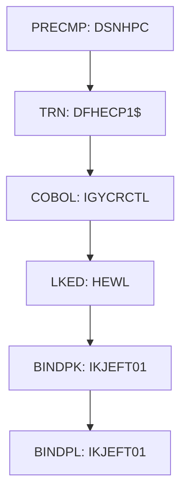

# PROC BLDCIDB2

| Item | Value |
|---|---|
| Source | `samples/proc/BLDCIDB2.prc` |
| Member | BLDCIDB2 |
| Job card | `` |
| CLASS / MSGCLASS |  /  |
| NOTIFY |  |
| Job COND |  |
| Steps | 6 |
| Module |  |

PROC/PEND statements: PROC BLDONL `samples/proc/BLDCIDB2.prc:25-39`

Executed by: CIDBCMP step CICSCMP (`samples/jcl/CICDBCMP.jcl:54`)

## Purpose

No descriptive comment in the JCL.

## Step flow

## Conditional execution

| Statement | Condition | Steps inside | Line |
|---|---|---|---|
| IF | `RC` | LKED, BINDPK, BINDPL | `samples/proc/BLDCIDB2.prc:109` |
| ENDIF |  |  | `samples/proc/BLDCIDB2.prc:177` |

## Steps

### PRECMP

| Item | Value |
|---|---|
| EXEC | `samples/proc/BLDCIDB2.prc:46-47` |
| Program | DSNHPC |
| PROC |  |
| Application program |  |
| PARM | `'HOST(IBMCOB),XREF,SOURCE,FLAG(I),APOST'` |
| COND |  |
| Function (earlier pass) |  |

| DD | Dataset / output | DISP | DCB | Program file and OPEN mode | Control data | Line |
|---|---|---|---|---|---|---|
| STEPLIB | &SDSNEXIT | SHR |  |  |  | `samples/proc/BLDCIDB2.prc:48` |
| STEPLIB (concat) | &SDSNLOAD | SHR |  |  |  | `samples/proc/BLDCIDB2.prc:49` |
| SYSIN | &SRCLIB(&MEMNAME) | SHR |  |  |  | `samples/proc/BLDCIDB2.prc:50` |
| SYSCIN | &&DSNHOUT | (NEW,PASS) | (BLKSIZE=&SYSLBLK) |  |  | `samples/proc/BLDCIDB2.prc:51-53` |
| DBRMLIB | &DBRMLIB(&MEMNAME) | OLD |  |  |  | `samples/proc/BLDCIDB2.prc:54` |
| SYSLIB | &DCLLIB | SHR |  |  |  | `samples/proc/BLDCIDB2.prc:55` |
| SYSLIB (concat) | &COPYLIB | SHR |  |  |  | `samples/proc/BLDCIDB2.prc:56` |
| SYSLIB (concat) | &CPYBKS | SHR |  |  |  | `samples/proc/BLDCIDB2.prc:57` |
| SYSPRINT | SYSOUT=* |  |  |  |  | `samples/proc/BLDCIDB2.prc:58` |
| SYSTERM | SYSOUT=* |  |  |  |  | `samples/proc/BLDCIDB2.prc:59` |
| SYSUDUMP | SYSOUT=* |  |  |  |  | `samples/proc/BLDCIDB2.prc:60` |
| SYSUT1 |  |  |  |  |  | `samples/proc/BLDCIDB2.prc:61` |
| SYSUT2 |  |  |  |  |  | `samples/proc/BLDCIDB2.prc:62` |

### TRN

| Item | Value |
|---|---|
| EXEC | `samples/proc/BLDCIDB2.prc:68-69` |
| Program | DFHECP1$ |
| PROC |  |
| Application program |  |
| PARM | `'NOSEQ'` |
| COND | `(0,NE,PRECMP)` |
| Function (earlier pass) |  |

| DD | Dataset / output | DISP | DCB | Program file and OPEN mode | Control data | Line |
|---|---|---|---|---|---|---|
| STEPLIB | &SDFHLOAD | SHR |  |  |  | `samples/proc/BLDCIDB2.prc:70` |
| SYSIN | &&DSNHOUT | (OLD,DELETE) |  |  |  | `samples/proc/BLDCIDB2.prc:71` |
| SYSPRINT | SYSOUT=* |  |  |  |  | `samples/proc/BLDCIDB2.prc:72` |
| SYSPUNCH | &&SYSCIN | (,PASS) | BLKSIZE=400 |  |  | `samples/proc/BLDCIDB2.prc:73-76` |

### COBOL

| Item | Value |
|---|---|
| EXEC | `samples/proc/BLDCIDB2.prc:80-81` |
| Program | IGYCRCTL |
| PROC |  |
| Application program |  |
| PARM | `'RENT,NODYNAM,NOSEQ'` |
| COND | `(0,NE)` |
| Function (earlier pass) |  |

| DD | Dataset / output | DISP | DCB | Program file and OPEN mode | Control data | Line |
|---|---|---|---|---|---|---|
| STEPLIB | &COBLIB | SHR |  |  |  | `samples/proc/BLDCIDB2.prc:82` |
| SYSLIB | &DCLLIB | SHR |  |  |  | `samples/proc/BLDCIDB2.prc:83` |
| SYSLIB (concat) | &COPYLIB | SHR |  |  |  | `samples/proc/BLDCIDB2.prc:84` |
| SYSLIB (concat) | &CPYBKS | SHR |  |  |  | `samples/proc/BLDCIDB2.prc:85` |
| SYSLIB (concat) | &SDFHCOB | SHR |  |  |  | `samples/proc/BLDCIDB2.prc:86` |
| SYSLIB (concat) | &SDFHMAC | SHR |  |  |  | `samples/proc/BLDCIDB2.prc:87` |
| SYSPRINT | SYSOUT=* |  |  |  |  | `samples/proc/BLDCIDB2.prc:88` |
| SYSIN | &&SYSCIN | (OLD,DELETE) |  |  |  | `samples/proc/BLDCIDB2.prc:89` |
| SYSLIN | &&LOADSET | (MOD,PASS) | (BLKSIZE=&SYSLBLK) |  |  | `samples/proc/BLDCIDB2.prc:90-92` |
| SYSUT1 |  |  |  |  |  | `samples/proc/BLDCIDB2.prc:93` |
| SYSUT2 |  |  |  |  |  | `samples/proc/BLDCIDB2.prc:94` |
| SYSUT3 |  |  |  |  |  | `samples/proc/BLDCIDB2.prc:95` |
| SYSUT4 |  |  |  |  |  | `samples/proc/BLDCIDB2.prc:96` |
| SYSUT5 |  |  |  |  |  | `samples/proc/BLDCIDB2.prc:97` |
| SYSUT6 |  |  |  |  |  | `samples/proc/BLDCIDB2.prc:98` |
| SYSUT7 |  |  |  |  |  | `samples/proc/BLDCIDB2.prc:99` |
| SYSUT8 |  |  |  |  |  | `samples/proc/BLDCIDB2.prc:100` |
| SYSUT9 |  |  |  |  |  | `samples/proc/BLDCIDB2.prc:101` |
| SYSUT10 |  |  |  |  |  | `samples/proc/BLDCIDB2.prc:102` |
| SYSUT11 |  |  |  |  |  | `samples/proc/BLDCIDB2.prc:103` |
| SYSUT12 |  |  |  |  |  | `samples/proc/BLDCIDB2.prc:104` |
| SYSUT13 |  |  |  |  |  | `samples/proc/BLDCIDB2.prc:105` |
| SYSUT14 |  |  |  |  |  | `samples/proc/BLDCIDB2.prc:106` |
| SYSUT15 |  |  |  |  |  | `samples/proc/BLDCIDB2.prc:107` |
| SYSMDECK |  |  |  |  |  | `samples/proc/BLDCIDB2.prc:108` |

### LKED

| Item | Value |
|---|---|
| EXEC | `samples/proc/BLDCIDB2.prc:114` |
| Program | HEWL |
| PROC |  |
| Application program |  |
| PARM |  |
| COND | `(0,NE)` |
| Function (earlier pass) |  |

| DD | Dataset / output | DISP | DCB | Program file and OPEN mode | Control data | Line |
|---|---|---|---|---|---|---|
| SYSLIB | &LIBPRFX..SCEELKEX | SHR |  |  |  | `samples/proc/BLDCIDB2.prc:115` |
| SYSLIB (concat) | &LIBPRFX..SCEELKED | SHR |  |  |  | `samples/proc/BLDCIDB2.prc:116` |
| SYSLIB (concat) | &SDFHLOAD | SHR |  |  |  | `samples/proc/BLDCIDB2.prc:117` |
| SYSLIB (concat) | &SDFHCOB | SHR |  |  |  | `samples/proc/BLDCIDB2.prc:118` |
| SYSLIB (concat) | &SDSNLOAD | SHR |  |  |  | `samples/proc/BLDCIDB2.prc:119` |
| SYSLIB (concat) | ISP.SISPLOAD | SHR |  |  |  | `samples/proc/BLDCIDB2.prc:120` |
| SYSLIB (concat) | GDDM.SADMMOD | SHR |  |  |  | `samples/proc/BLDCIDB2.prc:121` |
| SYSLIB (concat) | &LOADLIB | SHR |  |  |  | `samples/proc/BLDCIDB2.prc:122` |
| SYSPRINT | SYSOUT=* |  |  |  |  | `samples/proc/BLDCIDB2.prc:123` |
| SYSLIN | &SDFHCOB(DFHEILIC) | SHR |  |  |  | `samples/proc/BLDCIDB2.prc:124` |
| SYSLIN (concat) | &&LOADSET | (OLD,DELETE) |  |  |  | `samples/proc/BLDCIDB2.prc:125` |
| SYSLIN (concat) |  |  |  |  |  | `samples/proc/BLDCIDB2.prc:126` |
| SYSLMOD | &LOADLIB(&MEMNAME) | SHR |  |  |  | `samples/proc/BLDCIDB2.prc:127-129` |
| SYSUT1 |  |  |  |  |  | `samples/proc/BLDCIDB2.prc:130` |
| SYSIN | DUMMY |  |  |  |  | `samples/proc/BLDCIDB2.prc:131` |

### BINDPK

| Item | Value |
|---|---|
| EXEC | `samples/proc/BLDCIDB2.prc:135` |
| Program | IKJEFT01 |
| PROC |  |
| Application program |  |
| PARM |  |
| COND | `(0,NE)` |
| Function (earlier pass) |  |

| DD | Dataset / output | DISP | DCB | Program file and OPEN mode | Control data | Line |
|---|---|---|---|---|---|---|
| STEPLIB | OEM.DB2.DAZ1.SDSNEXIT | SHR |  |  |  | `samples/proc/BLDCIDB2.prc:136` |
| STEPLIB (concat) | OEMA.DB2.VERSIONA.SDSNLOAD | SHR |  |  |  | `samples/proc/BLDCIDB2.prc:137` |
| DBRMLIB | &DBRMLIB(&MEMNAME) | SHR |  |  |  | `samples/proc/BLDCIDB2.prc:138` |
| SYSPRINT | SYSOUT=* |  |  |  |  | `samples/proc/BLDCIDB2.prc:139` |
| SYSTSPRT | SYSOUT=* |  |  |  |  | `samples/proc/BLDCIDB2.prc:140` |
| SYSUDUMP | SYSOUT=* |  |  |  |  | `samples/proc/BLDCIDB2.prc:141` |
| SYSTSIN | * |  |  |  | in-stream lines 143-152; statements: DSN BIND END | `samples/proc/BLDCIDB2.prc:142` |

### BINDPL

| Item | Value |
|---|---|
| EXEC | `samples/proc/BLDCIDB2.prc:158` |
| Program | IKJEFT01 |
| PROC |  |
| Application program |  |
| PARM |  |
| COND | `(4,LT,BINDPK)` |
| Function (earlier pass) |  |

| DD | Dataset / output | DISP | DCB | Program file and OPEN mode | Control data | Line |
|---|---|---|---|---|---|---|
| STEPLIB | OEM.DB2.DAZ1.SDSNEXIT | SHR |  |  |  | `samples/proc/BLDCIDB2.prc:159` |
| STEPLIB (concat) | OEMA.DB2.VERSIONA.SDSNLOAD | SHR |  |  |  | `samples/proc/BLDCIDB2.prc:160` |
| DBRMLIB | &DBRMLIB(&MEMNAME) | SHR |  |  |  | `samples/proc/BLDCIDB2.prc:161` |
| SYSPRINT | SYSOUT=* |  |  |  |  | `samples/proc/BLDCIDB2.prc:162` |
| SYSTSPRT | SYSOUT=* |  |  |  |  | `samples/proc/BLDCIDB2.prc:163` |
| DEBUGLST | SYSOUT=* |  |  |  |  | `samples/proc/BLDCIDB2.prc:164` |
| SYSUDUMP | SYSOUT=* |  |  |  |  | `samples/proc/BLDCIDB2.prc:165` |
| SYSTSIN | * |  |  |  | in-stream lines 167-175; statements: DSN BIND END | `samples/proc/BLDCIDB2.prc:166` |

## Scheduling and dependencies

Not referenced by the CA7 or Control-M exports or the shell scripts (see the gap report).

## Parameters

Symbols left as parameters (not resolved): `&&DSNHOUT`, `&&LOADSET`, `&&SYSCIN`, `&COBLIB`, `&COPYLIB`, `&CPYBKS`, `&DBRMLIB`, `&DCLLIB`, `&LIBPRFX`, `&LOADLIB`, `&MEMNAME`, `&SDFHCOB`, `&SDFHLOAD`, `&SDFHMAC`, `&SDSNEXIT`, `&SDSNLOAD`, `&SRCLIB`, `&SYSLBLK`.

## Sources

- `samples/proc/BLDCIDB2.prc`
- `docs/_work/structure/jcl/BLDCIDB2.json`

## Confidence

Steps, DDs, conditions and control-data summaries are Confirmed from the JCL. OPEN modes come from the program source. Comments are Unverified.
