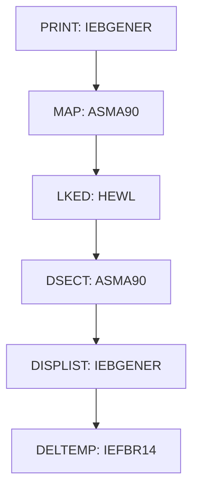

# PROC BUILDBMS

| Item | Value |
|---|---|
| Source | `samples/proc/BUILDBMS.prc` |
| Member | BUILDBMS |
| Job card | `` |
| CLASS / MSGCLASS |  /  |
| NOTIFY |  |
| Job COND |  |
| Steps | 6 |
| Module |  |

PROC/PEND statements: PROC BUILDBMS `samples/proc/BUILDBMS.prc:23-29`

Executed by: CBLDBMS step STEP1 (`samples/jcl/BMSCMP.jcl:38`)

## Purpose

No descriptive comment in the JCL.

## Step flow

## Steps

### PRINT

| Item | Value |
|---|---|
| EXEC | `samples/proc/BUILDBMS.prc:36` |
| Program | IEBGENER |
| PROC |  |
| Application program |  |
| PARM |  |
| COND |  |
| Function (earlier pass) |  |

| DD | Dataset / output | DISP | DCB | Program file and OPEN mode | Control data | Line |
|---|---|---|---|---|---|---|
| SYSPRINT | SYSOUT=* |  |  |  |  | `samples/proc/BUILDBMS.prc:37` |
| SYSUT2 | &&TEMPM | (,PASS) | (RECFM=FB,LRECL=80,BLKSIZE=400) |  |  | `samples/proc/BUILDBMS.prc:38-40` |
| SYSIN | DUMMY |  |  |  |  | `samples/proc/BUILDBMS.prc:41` |
| SYSUT1 | &SRCCODE(&MAPNAME) | SHR |  |  |  | `samples/proc/BUILDBMS.prc:42-43` |

### MAP

| Item | Value |
|---|---|
| EXEC | `samples/proc/BUILDBMS.prc:49` |
| Program | ASMA90 |
| PROC |  |
| Application program |  |
| PARM | `'SYSPARM(MAP),DECK,NOLOAD'` |
| COND |  |
| Function (earlier pass) |  |

| DD | Dataset / output | DISP | DCB | Program file and OPEN mode | Control data | Line |
|---|---|---|---|---|---|---|
| SYSPRINT | SYSOUT=* |  |  |  |  | `samples/proc/BUILDBMS.prc:50` |
| SYSLIB | &CICSMAC | SHR |  |  |  | `samples/proc/BUILDBMS.prc:52` |
| SYSLIB (concat) | SYS1.MACLIB | SHR |  |  |  | `samples/proc/BUILDBMS.prc:53` |
| SYSLIB (concat) | CEE.SCEEMAC | SHR |  |  |  | `samples/proc/BUILDBMS.prc:54` |
| SYSUT1 |  |  |  |  |  | `samples/proc/BUILDBMS.prc:55` |
| SYSUT2 |  |  |  |  |  | `samples/proc/BUILDBMS.prc:56` |
| SYSUT3 |  |  |  |  |  | `samples/proc/BUILDBMS.prc:57` |
| SYSPUNCH | &&MAP | (,PASS) | (RECFM=FB,LRECL=80,BLKSIZE=400) |  |  | `samples/proc/BUILDBMS.prc:58-60` |
| SYSIN | &&TEMPM | (OLD,PASS) |  |  |  | `samples/proc/BUILDBMS.prc:61` |
| SYSLIN | DUMMY |  |  |  |  | `samples/proc/BUILDBMS.prc:62` |

### LKED

| Item | Value |
|---|---|
| EXEC | `samples/proc/BUILDBMS.prc:68` |
| Program | HEWL |
| PROC |  |
| Application program |  |
| PARM | `'LIST,LET,XREF'` |
| COND |  |
| Function (earlier pass) |  |

| DD | Dataset / output | DISP | DCB | Program file and OPEN mode | Control data | Line |
|---|---|---|---|---|---|---|
| SYSPRINT | SYSOUT=* |  |  |  |  | `samples/proc/BUILDBMS.prc:69` |
| SYSLMOD | &LOADLIB(&MAPNAME) | SHR |  |  |  | `samples/proc/BUILDBMS.prc:70` |
| SYSUT1 |  |  |  |  |  | `samples/proc/BUILDBMS.prc:71` |
| SYSLIN | &&MAP | (OLD,DELETE) |  |  |  | `samples/proc/BUILDBMS.prc:72` |

### DSECT

| Item | Value |
|---|---|
| EXEC | `samples/proc/BUILDBMS.prc:78` |
| Program | ASMA90 |
| PROC |  |
| Application program |  |
| PARM | `'SYSPARM(DSECT),DECK,NOLOAD'` |
| COND |  |
| Function (earlier pass) |  |

| DD | Dataset / output | DISP | DCB | Program file and OPEN mode | Control data | Line |
|---|---|---|---|---|---|---|
| SYSPRINT | &LISTING(&MAPNAME) | SHR |  |  |  | `samples/proc/BUILDBMS.prc:81` |
| SYSLIB | &CICSMAC | SHR |  |  |  | `samples/proc/BUILDBMS.prc:82` |
| SYSLIB (concat) | SYS1.MACLIB | SHR |  |  |  | `samples/proc/BUILDBMS.prc:83` |
| SYSLIB (concat) | CEE.SCEEMAC | SHR |  |  |  | `samples/proc/BUILDBMS.prc:84` |
| SYSUT1 |  |  |  |  |  | `samples/proc/BUILDBMS.prc:85` |
| SYSUT2 |  |  |  |  |  | `samples/proc/BUILDBMS.prc:86` |
| SYSUT3 |  |  |  |  |  | `samples/proc/BUILDBMS.prc:87` |
| SYSPUNCH | &CPYBKS(&MAPNAME) | OLD | (RECFM=FB,LRECL=80,BLKSIZE=400) |  |  | `samples/proc/BUILDBMS.prc:88-90` |
| SYSIN | &&TEMPM | (OLD,PASS) |  |  |  | `samples/proc/BUILDBMS.prc:91` |
| SYSLIN | DUMMY |  |  |  |  | `samples/proc/BUILDBMS.prc:92` |

### DISPLIST

| Item | Value |
|---|---|
| EXEC | `samples/proc/BUILDBMS.prc:96` |
| Program | IEBGENER |
| PROC |  |
| Application program |  |
| PARM |  |
| COND |  |
| Function (earlier pass) |  |

| DD | Dataset / output | DISP | DCB | Program file and OPEN mode | Control data | Line |
|---|---|---|---|---|---|---|
| SYSPRINT | SYSOUT=* |  |  |  |  | `samples/proc/BUILDBMS.prc:97` |
| SYSUT1 | &LISTING(&MAPNAME) | SHR |  |  |  | `samples/proc/BUILDBMS.prc:98` |
| SYSUT2 | SYSOUT=* |  |  |  |  | `samples/proc/BUILDBMS.prc:99` |
| SYSPRINT | SYSOUT=* |  |  |  |  | `samples/proc/BUILDBMS.prc:100` |
| SYSIN | DUMMY |  |  |  |  | `samples/proc/BUILDBMS.prc:101` |

### DELTEMP

| Item | Value |
|---|---|
| EXEC | `samples/proc/BUILDBMS.prc:103` |
| Program | IEFBR14 |
| PROC |  |
| Application program |  |
| PARM |  |
| COND |  |
| Function (earlier pass) |  |

| DD | Dataset / output | DISP | DCB | Program file and OPEN mode | Control data | Line |
|---|---|---|---|---|---|---|
| TEMPM | &&TEMPM | (OLD,DELETE) |  |  |  | `samples/proc/BUILDBMS.prc:104` |

## Scheduling and dependencies

Not referenced by the CA7 or Control-M exports or the shell scripts (see the gap report).

## Parameters

Symbols left as parameters (not resolved): `&&MAP`, `&&TEMPM`, `&CICSMAC`, `&CPYBKS`, `&LISTING`, `&LOADLIB`, `&MAPNAME`, `&SRCCODE`.

## Sources

- `samples/proc/BUILDBMS.prc`
- `docs/_work/structure/jcl/BUILDBMS.json`

## Confidence

Steps, DDs, conditions and control-data summaries are Confirmed from the JCL. OPEN modes come from the program source. Comments are Unverified.
