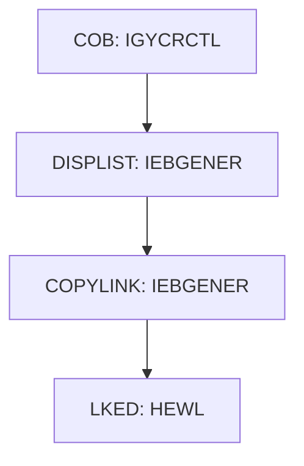

# PROC BUILDONL

| Item | Value |
|---|---|
| Source | `samples/proc/BUILDONL.prc` |
| Member | BUILDONL |
| Job card | `` |
| CLASS / MSGCLASS |  /  |
| NOTIFY |  |
| Job COND |  |
| Steps | 4 |
| Module |  |

PROC/PEND statements: PROC BLDONL `samples/proc/BUILDONL.prc:25-34`

Executed by: CICCMP step CICSCMP (`samples/jcl/CICCMP.jcl:41`)

## Purpose

No descriptive comment in the JCL.

## Step flow

## Steps

### COB

| Item | Value |
|---|---|
| EXEC | `samples/proc/BUILDONL.prc:39-40` |
| Program | IGYCRCTL |
| PROC |  |
| Application program |  |
| PARM | `(CICS,NODYNAM,RENT,NOSEQ)` |
| COND |  |
| Function (earlier pass) |  |

| DD | Dataset / output | DISP | DCB | Program file and OPEN mode | Control data | Line |
|---|---|---|---|---|---|---|
| STEPLIB | &COBLIB | SHR |  |  |  | `samples/proc/BUILDONL.prc:41` |
| STEPLIB (concat) | &DFHLOAD | SHR |  |  |  | `samples/proc/BUILDONL.prc:42` |
| SYSLIB | &CPYBKS | SHR |  |  |  | `samples/proc/BUILDONL.prc:43` |
| SYSLIB (concat) | &DFHCOB | SHR |  |  |  | `samples/proc/BUILDONL.prc:44` |
| SYSLIB (concat) | CEE.SCEESAMP | SHR |  |  |  | `samples/proc/BUILDONL.prc:45` |
| SYSPRINT | &LISTING(&MEM) | SHR |  |  |  | `samples/proc/BUILDONL.prc:47` |
| SYSIN | &SOURCE(&MEM) | SHR |  |  |  | `samples/proc/BUILDONL.prc:48` |
| SYSLIN | &&LOADSET | (MOD,PASS) |  |  |  | `samples/proc/BUILDONL.prc:49-50` |
| SYSUT1 |  |  |  |  |  | `samples/proc/BUILDONL.prc:51` |
| SYSUT2 |  |  |  |  |  | `samples/proc/BUILDONL.prc:52` |
| SYSUT3 |  |  |  |  |  | `samples/proc/BUILDONL.prc:53` |
| SYSUT4 |  |  |  |  |  | `samples/proc/BUILDONL.prc:54` |
| SYSUT5 |  |  |  |  |  | `samples/proc/BUILDONL.prc:55` |
| SYSUT6 |  |  |  |  |  | `samples/proc/BUILDONL.prc:56` |
| SYSUT7 |  |  |  |  |  | `samples/proc/BUILDONL.prc:57` |
| SYSUT8 |  |  |  |  |  | `samples/proc/BUILDONL.prc:58` |
| SYSUT9 |  |  |  |  |  | `samples/proc/BUILDONL.prc:59` |
| SYSUT10 |  |  |  |  |  | `samples/proc/BUILDONL.prc:60` |
| SYSUT11 |  |  |  |  |  | `samples/proc/BUILDONL.prc:61` |
| SYSUT12 |  |  |  |  |  | `samples/proc/BUILDONL.prc:62` |
| SYSUT13 |  |  |  |  |  | `samples/proc/BUILDONL.prc:63` |
| SYSUT14 |  |  |  |  |  | `samples/proc/BUILDONL.prc:64` |
| SYSUT15 |  |  |  |  |  | `samples/proc/BUILDONL.prc:65` |
| SYSMDECK |  |  |  |  |  | `samples/proc/BUILDONL.prc:66` |

### DISPLIST

| Item | Value |
|---|---|
| EXEC | `samples/proc/BUILDONL.prc:70` |
| Program | IEBGENER |
| PROC |  |
| Application program |  |
| PARM |  |
| COND |  |
| Function (earlier pass) |  |

| DD | Dataset / output | DISP | DCB | Program file and OPEN mode | Control data | Line |
|---|---|---|---|---|---|---|
| SYSPRINT | SYSOUT=* |  |  |  |  | `samples/proc/BUILDONL.prc:71` |
| SYSUT1 | &LISTING(&MEM) | SHR |  |  |  | `samples/proc/BUILDONL.prc:72` |
| SYSUT2 | SYSOUT=* |  |  |  |  | `samples/proc/BUILDONL.prc:73` |
| SYSPRINT | SYSOUT=* |  |  |  |  | `samples/proc/BUILDONL.prc:74` |
| SYSIN | DUMMY |  |  |  |  | `samples/proc/BUILDONL.prc:75` |

### COPYLINK

| Item | Value |
|---|---|
| EXEC | `samples/proc/BUILDONL.prc:79` |
| Program | IEBGENER |
| PROC |  |
| Application program |  |
| PARM |  |
| COND |  |
| Function (earlier pass) |  |

| DD | Dataset / output | DISP | DCB | Program file and OPEN mode | Control data | Line |
|---|---|---|---|---|---|---|
| SYSPRINT | SYSOUT=* |  |  |  |  | `samples/proc/BUILDONL.prc:80` |
| SYSUT1 | &DFHSAMP(DFHEILID) | SHR |  |  |  | `samples/proc/BUILDONL.prc:81` |
| SYSUT2 | &&COPYLINK | (NEW,PASS) | (LRECL=80,BLKSIZE=400,RECFM=FB) |  |  | `samples/proc/BUILDONL.prc:82-84` |
| SYSPRINT | SYSOUT=* |  |  |  |  | `samples/proc/BUILDONL.prc:85` |
| SYSIN | DUMMY |  |  |  |  | `samples/proc/BUILDONL.prc:86` |

### LKED

| Item | Value |
|---|---|
| EXEC | `samples/proc/BUILDONL.prc:91-92` |
| Program | HEWL |
| PROC |  |
| Application program |  |
| PARM | `'LIST,XREF,LET,MAP,AMODE(31),RMODE(ANY)'` |
| COND |  |
| Function (earlier pass) |  |

| DD | Dataset / output | DISP | DCB | Program file and OPEN mode | Control data | Line |
|---|---|---|---|---|---|---|
| SYSPRINT | SYSOUT=* |  |  |  |  | `samples/proc/BUILDONL.prc:95` |
| SYSLIB | &DFHLOAD | SHR |  |  |  | `samples/proc/BUILDONL.prc:96` |
| SYSLIB (concat) | SYS1.LINKLIB | SHR |  |  |  | `samples/proc/BUILDONL.prc:97` |
| SYSLIB (concat) | CSF.SCSFMOD0 | SHR |  |  |  | `samples/proc/BUILDONL.prc:98` |
| SYSLIB (concat) | CEE.SCEELKED | SHR |  |  |  | `samples/proc/BUILDONL.prc:99` |
| SYSLIB (concat) | CEE.SCEELKEX | SHR |  |  |  | `samples/proc/BUILDONL.prc:100` |
| SYSLIB (concat) | &LOADLIB | SHR |  |  |  | `samples/proc/BUILDONL.prc:101` |
| SYSLIN | &&LOADSET | (OLD,DELETE) |  |  |  | `samples/proc/BUILDONL.prc:102` |
| SYSLIN (concat) | &&COPYLINK | (OLD,DELETE) |  |  |  | `samples/proc/BUILDONL.prc:103` |
| SYSLMOD | &LOADLIB(&MEM) | SHR |  |  |  | `samples/proc/BUILDONL.prc:104-107` |
| SYSUT1 |  |  | BLKSIZE=1024 |  |  | `samples/proc/BUILDONL.prc:108` |

## Scheduling and dependencies

Not referenced by the CA7 or Control-M exports or the shell scripts (see the gap report).

## Parameters

Symbols left as parameters (not resolved): `&&COPYLINK`, `&&LOADSET`, `&COBLIB`, `&CPYBKS`, `&DFHCOB`, `&DFHLOAD`, `&DFHSAMP`, `&LISTING`, `&LOADLIB`, `&MEM`, `&SOURCE`.

## Sources

- `samples/proc/BUILDONL.prc`
- `docs/_work/structure/jcl/BUILDONL.json`

## Confidence

Steps, DDs, conditions and control-data summaries are Confirmed from the JCL. OPEN modes come from the program source. Comments are Unverified.
