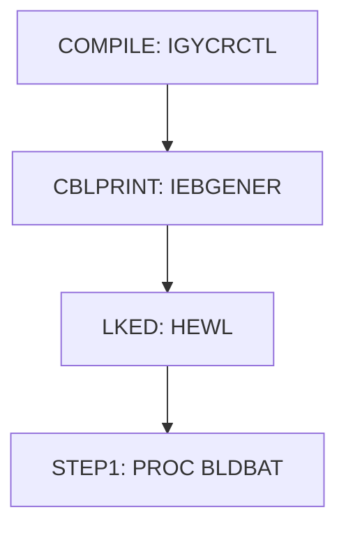

# JCL template COMPILE_BATCH.JCL

| Item | Value |
|---|---|
| Source | `scripts/compile_batch.jcl.template` |
| Member | COMPILE_BATCH.JCL |
| Job card | `scripts/compile_batch.jcl.template:1-2` |
| CLASS / MSGCLASS | A / 0 |
| NOTIFY | &SYSUID |
| Job COND |  |
| Steps | 4 |
| Module |  |

PROC/PEND statements: PROC BLDBAT `scripts/compile_batch.jcl.template:7`, PEND  `scripts/compile_batch.jcl.template:62`

Executed by: no EXEC PROC= reference in the repository JCL

## Purpose

No descriptive comment in the JCL.

## Step flow

## Steps

### COMPILE

| Item | Value |
|---|---|
| EXEC | `scripts/compile_batch.jcl.template:8-9` |
| Program | IGYCRCTL |
| PROC |  |
| Application program |  |
| PARM | `(APOST,LIST,MAP,NUMBER)` |
| COND |  |
| Function (earlier pass) |  |

| DD | Dataset / output | DISP | DCB | Program file and OPEN mode | Control data | Line |
|---|---|---|---|---|---|---|
| STEPLIB | IGY.SIGYCOMP.V63 | SHR |  |  |  | `scripts/compile_batch.jcl.template:10-11` |
| SYSIN | AWS.M2.CARDDEMO.CBL(&MEM) | SHR |  |  |  | `scripts/compile_batch.jcl.template:12-13` |
| SYSLIB | AWS.M2.CARDDEMO.CPY | SHR |  |  |  | `scripts/compile_batch.jcl.template:14-15` |
| SYSPRINT | AWS.M2.CARDDEMO.LISTING(&MEM) | SHR |  |  |  | `scripts/compile_batch.jcl.template:16-17` |
| SYSLIN | &&LOADSET | (MOD,PASS) |  |  |  | `scripts/compile_batch.jcl.template:18-19` |
| SYSUT1 |  |  |  |  |  | `scripts/compile_batch.jcl.template:20` |
| SYSUT2 |  |  |  |  |  | `scripts/compile_batch.jcl.template:21` |
| SYSUT3 |  |  |  |  |  | `scripts/compile_batch.jcl.template:22` |
| SYSUT4 |  |  |  |  |  | `scripts/compile_batch.jcl.template:23` |
| SYSUT5 |  |  |  |  |  | `scripts/compile_batch.jcl.template:24` |
| SYSUT6 |  |  |  |  |  | `scripts/compile_batch.jcl.template:25` |
| SYSUT7 |  |  |  |  |  | `scripts/compile_batch.jcl.template:26` |
| SYSUT8 |  |  |  |  |  | `scripts/compile_batch.jcl.template:27` |
| SYSUT9 |  |  |  |  |  | `scripts/compile_batch.jcl.template:28` |
| SYSUT10 |  |  |  |  |  | `scripts/compile_batch.jcl.template:29` |
| SYSUT11 |  |  |  |  |  | `scripts/compile_batch.jcl.template:30` |
| SYSUT12 |  |  |  |  |  | `scripts/compile_batch.jcl.template:31` |
| SYSUT13 |  |  |  |  |  | `scripts/compile_batch.jcl.template:32` |
| SYSUT14 |  |  |  |  |  | `scripts/compile_batch.jcl.template:33` |
| SYSUT15 |  |  |  |  |  | `scripts/compile_batch.jcl.template:34` |
| SYSMDECK |  |  |  |  |  | `scripts/compile_batch.jcl.template:35` |

### CBLPRINT

| Item | Value |
|---|---|
| EXEC | `scripts/compile_batch.jcl.template:40` |
| Program | IEBGENER |
| PROC |  |
| Application program |  |
| PARM |  |
| COND |  |
| Function (earlier pass) |  |

| DD | Dataset / output | DISP | DCB | Program file and OPEN mode | Control data | Line |
|---|---|---|---|---|---|---|
| SYSPRINT | SYSOUT=* |  |  |  |  | `scripts/compile_batch.jcl.template:41` |
| SYSUT1 | AWS.M2.CARDDEMO.LISTING(&MEM) | SHR |  |  |  | `scripts/compile_batch.jcl.template:42-43` |
| SYSUT2 | SYSOUT=* |  |  |  |  | `scripts/compile_batch.jcl.template:44` |
| SYSIN | DUMMY |  |  |  |  | `scripts/compile_batch.jcl.template:45` |

### LKED

| Item | Value |
|---|---|
| EXEC | `scripts/compile_batch.jcl.template:51` |
| Program | HEWL |
| PROC |  |
| Application program |  |
| PARM | `'LIST,XREF'` |
| COND |  |
| Function (earlier pass) |  |

| DD | Dataset / output | DISP | DCB | Program file and OPEN mode | Control data | Line |
|---|---|---|---|---|---|---|
| SYSPRINT | SYSOUT=* |  |  |  |  | `scripts/compile_batch.jcl.template:52` |
| SYSLIB | SYS1.LINKLIB | SHR |  |  |  | `scripts/compile_batch.jcl.template:53` |
| SYSLIB (concat) | CSF.SCSFMOD0 | SHR |  |  |  | `scripts/compile_batch.jcl.template:54` |
| SYSLIB (concat) | CEE.SCEELKED | SHR |  |  |  | `scripts/compile_batch.jcl.template:55` |
| SYSLIB (concat) | CEE.SCEELKEX | SHR |  |  |  | `scripts/compile_batch.jcl.template:56` |
| SYSLIB (concat) | AWS.M2.CARDDEMO.LOADLIB | SHR |  |  |  | `scripts/compile_batch.jcl.template:57` |
| SYSLIN | &&LOADSET | (OLD,DELETE) |  |  |  | `scripts/compile_batch.jcl.template:58` |
| SYSLMOD | AWS.M2.CARDDEMO.LOADLIB(&MEM) | SHR |  |  |  | `scripts/compile_batch.jcl.template:59-60` |
| SYSUT1 |  |  | BLKSIZE=1024 |  |  | `scripts/compile_batch.jcl.template:61` |

### STEP1

| Item | Value |
|---|---|
| EXEC | `scripts/compile_batch.jcl.template:64` |
| Program |  |
| PROC | BLDBAT |
| Application program |  |
| PARM |  |
| COND |  |
| Function (earlier pass) |  |

No DD statements.

## Scheduling and dependencies

Not referenced by the CA7 or Control-M exports or the shell scripts (see the gap report).

## Parameters

Symbols left as parameters (not resolved): `&&LOADSET`, `&MEM`, `&SYSUID`.

## Sources

- `scripts/compile_batch.jcl.template`
- `docs/_work/structure/jcl/COMPILE_BATCH.JCL.json`

## Confidence

Steps, DDs, conditions and control-data summaries are Confirmed from the JCL. OPEN modes come from the program source. Comments are Unverified.
