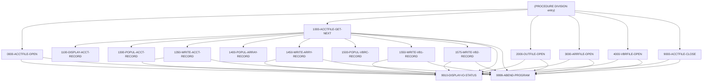

# Program CBACT01C

| Item | Value |
|---|---|
| Source | `app/cbl/CBACT01C.cbl` |
| Lines | 430 total, 358 code, 51 comment, 21 blank |
| PROGRAM-ID | CBACT01C |
| Author | AWS |
| Runtime | batch-main |
| Module | base |
| CICS transactions | None in CSD |
| JCL steps | [READACCT](../06-batch/jobs/READACCT.md).STEP05 (`app/jcl/READACCT.jcl:32`) |
| Paragraphs | 17 |
| Semantic analysis | validated (batch B02) |
| Version banner | * Ver: CardDemo_v2.0-25-gdb72e6b-235 Date: 2025-04-29 11:01:27 CDT |

## Summary

CBACT01C is a batch COBOL program that reads the account master KSDS (ACCTFILE) sequentially and writes three derived extract files. For each account it displays the record, writes a fixed-layout copy to OUTFILE (with the reissue date reformatted by assembler routine COBDATFT and a 2525.00 default for zero cycle debit), writes an ARRYFILE record with an OCCURS 5 balance array partly filled with literal amounts, and writes two variable-length records (12 and 39 bytes) to VBRCFILE. Any open, read, write or close error displays the file status and abends with code 999. The output contents (hardcoded amounts, multiple record formats) suggest the program exercises file formats rather than implementing a production business process (Inferred from the literals in 1400-POPUL-ARRAY-RECORD and the default in 1300-POPUL-ACCT-RECORD). (Confirmed)

Evidence: `app/cbl/CBACT01C.cbl:1-5`, `app/cbl/CBACT01C.cbl:28-85`, `app/cbl/CBACT01C.cbl:141-160`, `app/cbl/CBACT01C.cbl:165-198`

Header comment (Unverified, `app/cbl/CBACT01C.cbl:1-8`): PROGRAM     : CBACT01C.CBL Application : CardDemo Type        : BATCH COBOL Program FUNCTION    : READ THE ACCOUNT FILE AND WRITE INTO FILES. All Rights Reserved. http://www.apache.org/licenses/LICENSE-2.0

## Divisions and sections

| Division / section | Lines | Notes |
|---|---|---|
| IDENTIFICATION DIVISION | `app/cbl/CBACT01C.cbl:22-25` |  |
| ENVIRONMENT DIVISION | `app/cbl/CBACT01C.cbl:26-49` |  |
| DATA DIVISION | `app/cbl/CBACT01C.cbl:50-139` |  |
| PROCEDURE DIVISION | `app/cbl/CBACT01C.cbl:140-430` |  |
| ENVIRONMENT / INPUT-OUTPUT SECTION | `app/cbl/CBACT01C.cbl:27-49` |  |
| DATA / FILE SECTION | `app/cbl/CBACT01C.cbl:51-85` |  |
| DATA / WORKING-STORAGE SECTION | `app/cbl/CBACT01C.cbl:86-139` |  |

## Files and data stores

| File | ASSIGN | Org | Access | Record key | Alt key | Status field | OPEN modes | Physical dataset (JCL) | Evidence |
|---|---|---|---|---|---|---|---|---|---|
| ACCTFILE-FILE | ACCTFILE | INDEXED | SEQUENTIAL | FD-ACCT-ID |  | ACCTFILE-STATUS | INPUT (line 319) | AWS.M2.CARDDEMO.ACCTDATA.VSAM.KSDS (READACCT.STEP05 `app/jcl/READACCT.jcl:35-36`) | `app/cbl/CBACT01C.cbl:29-33`, FD `app/cbl/CBACT01C.cbl:52` |
| OUT-FILE | OUTFILE | SEQUENTIAL | SEQUENTIAL |  |  | OUTFILE-STATUS | OUTPUT (line 336) | AWS.M2.CARDDEMO.ACCTDATA.PSCOMP (READACCT.STEP05 `app/jcl/READACCT.jcl:37-40`) | `app/cbl/CBACT01C.cbl:35-38`, FD `app/cbl/CBACT01C.cbl:56` |
| ARRY-FILE | ARRYFILE | SEQUENTIAL | SEQUENTIAL |  |  | ARRYFILE-STATUS | OUTPUT (line 354) | AWS.M2.CARDDEMO.ACCTDATA.ARRYPS (READACCT.STEP05 `app/jcl/READACCT.jcl:41-44`) | `app/cbl/CBACT01C.cbl:40-43`, FD `app/cbl/CBACT01C.cbl:71` |
| VBRC-FILE | VBRCFILE | SEQUENTIAL | SEQUENTIAL |  |  | VBRCFILE-STATUS | OUTPUT (line 372) | AWS.M2.CARDDEMO.ACCTDATA.VBPS (READACCT.STEP05 `app/jcl/READACCT.jcl:45-48`) | `app/cbl/CBACT01C.cbl:45-48`, FD `app/cbl/CBACT01C.cbl:80-84` |

CRUD summary from the program facts:

| Store | Kind | Ops | Evidence |
|---|---|---|---|
| VBRC-FILE | logical | C | `app/cbl/CBACT01C.cbl:290-305` |
| ACCTFILE-FILE | logical | R | `app/cbl/CBACT01C.cbl:166-319` |
| ARRY-FILE | logical | C | `app/cbl/CBACT01C.cbl:264` |
| OUT-FILE | logical | C | `app/cbl/CBACT01C.cbl:243` |

## Embedded CICS, SQL and DL/I commands

No EXEC blocks.

## Calls, transfers and callers

| Mechanism | Target | Parameters | Paragraph | Lines |
|---|---|---|---|---|
| CALL static | COBDATFT | CODATECN-REC | 1300-POPUL-ACCT-RECORD | `app/cbl/CBACT01C.cbl:231` |
| CALL system/LE | CEE3ABD | ABCODE, TIMING | 9999-ABEND-PROGRAM | `app/cbl/CBACT01C.cbl:410` |

## Copybooks

| Copybook | Statement | Resolution | Resolved path | REPLACING | Line |
|---|---|---|---|---|---|
| [CVACT01Y](../08-data/layouts/CVACT01Y.md) | COPY | inventory | app/cpy/CVACT01Y.cpy |  | `app/cbl/CBACT01C.cbl:89` |
| [CODATECN](../08-data/layouts/CODATECN.md) | COPY | inventory | app/cpy/CODATECN.cpy |  | `app/cbl/CBACT01C.cbl:90` |

## Data division items

Every data entry coded in this source (copybook contents are on the copybook pages). Lengths are computed from PIC and USAGE.

| Section | Lvl | Name | PIC | Usage | Len | OCCURS | REDEFINES | VALUE | 88-levels | Line |
|---|---|---|---|---|---|---|---|---|---|---|
| FILE | 01 | FD-ACCTFILE-REC |  |  |  |  |  |  |  | 53 |
| FILE | 05 | FD-ACCT-ID | 9(11) |  | 11 |  |  |  |  | 54 |
| FILE | 05 | FD-ACCT-DATA | X(289) |  | 289 |  |  |  |  | 55 |
| FILE | 01 | OUT-ACCT-REC |  |  |  |  |  |  |  | 57 |
| FILE | 05 | OUT-ACCT-ID | 9(11) |  | 11 |  |  |  |  | 58 |
| FILE | 05 | OUT-ACCT-ACTIVE-STATUS | X(01) |  | 1 |  |  |  |  | 59 |
| FILE | 05 | OUT-ACCT-CURR-BAL | S9(10)V99 |  | 12 |  |  |  |  | 60 |
| FILE | 05 | OUT-ACCT-CREDIT-LIMIT | S9(10)V99 |  | 12 |  |  |  |  | 61 |
| FILE | 05 | OUT-ACCT-CASH-CREDIT-LIMIT | S9(10)V99 |  | 12 |  |  |  |  | 62 |
| FILE | 05 | OUT-ACCT-OPEN-DATE | X(10) |  | 10 |  |  |  |  | 63 |
| FILE | 05 | OUT-ACCT-EXPIRAION-DATE | X(10) |  | 10 |  |  |  |  | 64 |
| FILE | 05 | OUT-ACCT-REISSUE-DATE | X(10) |  | 10 |  |  |  |  | 65 |
| FILE | 05 | OUT-ACCT-CURR-CYC-CREDIT | S9(10)V99 |  | 12 |  |  |  |  | 66 |
| FILE | 05 | OUT-ACCT-CURR-CYC-DEBIT | S9(10)V99 | COMP-3 | 7 |  |  |  |  | 67 |
| FILE | 05 | OUT-ACCT-GROUP-ID | X(10) |  | 10 |  |  |  |  | 69 |
| FILE | 01 | ARR-ARRAY-REC |  |  |  |  |  |  |  | 72 |
| FILE | 05 | ARR-ACCT-ID | 9(11) |  | 11 |  |  |  |  | 73 |
| FILE | 05 | ARR-ACCT-BAL |  |  |  | 5 |  |  |  | 74 |
| FILE | 10 | ARR-ACCT-CURR-BAL | S9(10)V99 |  | 12 |  |  |  |  | 75 |
| FILE | 10 | ARR-ACCT-CURR-CYC-DEBIT | S9(10)V99 | COMP-3 | 7 |  |  |  |  | 76 |
| FILE | 05 | ARR-FILLER | X(04) |  | 4 |  |  |  |  | 78 |
| FILE | 01 | VBR-REC | X(80) |  | 80 |  |  |  |  | 85 |
| WORKING-STORAGE | 01 | ACCTFILE-STATUS |  |  |  |  |  |  |  | 91 |
| WORKING-STORAGE | 05 | ACCTFILE-STAT1 | X |  | 1 |  |  |  |  | 92 |
| WORKING-STORAGE | 05 | ACCTFILE-STAT2 | X |  | 1 |  |  |  |  | 93 |
| WORKING-STORAGE | 01 | OUTFILE-STATUS |  |  |  |  |  |  |  | 94 |
| WORKING-STORAGE | 05 | OUTFILE-STAT1 | X |  | 1 |  |  |  |  | 95 |
| WORKING-STORAGE | 05 | OUTFILE-STAT2 | X |  | 1 |  |  |  |  | 96 |
| WORKING-STORAGE | 01 | ARRYFILE-STATUS |  |  |  |  |  |  |  | 97 |
| WORKING-STORAGE | 05 | ARRYFILE-STAT1 | X |  | 1 |  |  |  |  | 98 |
| WORKING-STORAGE | 05 | ARRYFILE-STAT2 | X |  | 1 |  |  |  |  | 99 |
| WORKING-STORAGE | 01 | VBRCFILE-STATUS |  |  |  |  |  |  |  | 100 |
| WORKING-STORAGE | 05 | VBRCFILE-STAT1 | X |  | 1 |  |  |  |  | 101 |
| WORKING-STORAGE | 05 | VBRCFILE-STAT2 | X |  | 1 |  |  |  |  | 102 |
| WORKING-STORAGE | 01 | IO-STATUS |  |  |  |  |  |  |  | 104 |
| WORKING-STORAGE | 05 | IO-STAT1 | X |  | 1 |  |  |  |  | 105 |
| WORKING-STORAGE | 05 | IO-STAT2 | X |  | 1 |  |  |  |  | 106 |
| WORKING-STORAGE | 01 | TWO-BYTES-BINARY | 9(4) | BINARY | 2 |  |  |  |  | 107 |
| WORKING-STORAGE | 01 | TWO-BYTES-ALPHA |  | BINARY |  |  | TWO-BYTES-BINARY |  |  | 108 |
| WORKING-STORAGE | 05 | TWO-BYTES-LEFT | X |  | 1 |  |  |  |  | 109 |
| WORKING-STORAGE | 05 | TWO-BYTES-RIGHT | X |  | 1 |  |  |  |  | 110 |
| WORKING-STORAGE | 01 | IO-STATUS-04 |  |  |  |  |  |  |  | 111 |
| WORKING-STORAGE | 05 | IO-STATUS-0401 | 9 |  | 1 |  |  | 0 |  | 112 |
| WORKING-STORAGE | 05 | IO-STATUS-0403 | 999 |  | 3 |  |  | 0 |  | 113 |
| WORKING-STORAGE | 01 | APPL-RESULT | S9(9) | COMP | 4 |  |  |  | APPL-AOK = 0; APPL-EOF = 16 | 115 |
| WORKING-STORAGE | 01 | END-OF-FILE | X(01) |  | 1 |  |  | 'N' |  | 119 |
| WORKING-STORAGE | 01 | ABCODE | S9(9) | BINARY | 4 |  |  |  |  | 120 |
| WORKING-STORAGE | 01 | TIMING | S9(9) | BINARY | 4 |  |  |  |  | 121 |
| WORKING-STORAGE | 01 | WS-RECD-LEN | 9(04) |  | 4 |  |  |  |  | 122 |
| WORKING-STORAGE | 01 | VBRC-REC1 |  |  |  |  |  |  |  | 123 |
| WORKING-STORAGE | 05 | VB1-ACCT-ID | 9(11) |  | 11 |  |  |  |  | 124 |
| WORKING-STORAGE | 05 | VB1-ACCT-ACTIVE-STATUS | X(01) |  | 1 |  |  |  |  | 125 |
| WORKING-STORAGE | 01 | VBRC-REC2 |  |  |  |  |  |  |  | 126 |
| WORKING-STORAGE | 05 | VB2-ACCT-ID | 9(11) |  | 11 |  |  |  |  | 127 |
| WORKING-STORAGE | 05 | VB2-ACCT-CURR-BAL | S9(10)V99 |  | 12 |  |  |  |  | 128 |
| WORKING-STORAGE | 05 | VB2-ACCT-CREDIT-LIMIT | S9(10)V99 |  | 12 |  |  |  |  | 129 |
| WORKING-STORAGE | 05 | VB2-ACCT-REISSUE-YYYY | X(04) |  | 4 |  |  |  |  | 130 |
| WORKING-STORAGE | 01 | WS-ACCT-REISSUE-DATE |  |  |  |  |  |  |  | 131 |
| WORKING-STORAGE | 05 | WS-ACCT-REISSUE-YYYY | X(04) |  | 4 |  |  |  |  | 132 |
| WORKING-STORAGE | 05 | WS-FILLER-1 | X(01) |  | 1 |  |  |  |  | 133 |
| WORKING-STORAGE | 05 | WS-ACCT-REISSUE-MM | X(02) |  | 2 |  |  |  |  | 134 |
| WORKING-STORAGE | 05 | WS-FILLER-2 | X(01) |  | 1 |  |  |  |  | 135 |
| WORKING-STORAGE | 05 | WS-ACCT-REISSUE-DD | X(02) |  | 2 |  |  |  |  | 136 |
| WORKING-STORAGE | 01 | WS-REISSUE-DATE | X(10) |  | 10 |  | WS-ACCT-REISSUE-DATE |  |  | 137 |

## Statement inventory

Every procedure statement the parser recorded, by kind. Each one is listed with its line under Paragraph details.

| Kind | Count |
|---|---|
| Decisions (IF, EVALUATE, WHEN, loops, handlers) | 23 |
| Calculations | 3 |
| File I/O | 10 |
| EXEC CICS / SQL / DLI | 0 |
| CALL | 2 |
| PERFORM | 35 |
| GO TO | 0 |
| MOVE literal | 29 |
| MOVE field | 35 |
| SET | 0 |
| STRING, UNSTRING, INSPECT, INITIALIZE, COPY, ENTRY and others | 2 |
| DISPLAY | 30 |
| GOBACK, STOP RUN, RETURN, XCTL | 1 |
| Not classified by the parser | 0 |

## Control flow

| Paragraph | Lines | Logic | Performs | Performed by | Reachable |
|---|---|---|---|---|---|
| [(PROCEDURE DIVISION entry)](#para-procedure-division-entry) | 141-160 | Displays a start banner, opens ACCTFILE for input and OUTFILE, ARRYFILE and VBRCFILE for output, then loops calling 1000-ACCTFILE-GET-NEXT until END-OF-FILE = 'Y', displaying ACCOUNT-RECORD after each successful read. Finally closes the account file, displays an end banner and GOBACKs. (Confirmed) | 0000-ACCTFILE-OPEN, 1000-ACCTFILE-GET-NEXT, 2000-OUTFILE-OPEN, 3000-ARRFILE-OPEN, 4000-VBRFILE-OPEN, 9000-ACCTFILE-CLOSE |  | yes |
| [1000-ACCTFILE-GET-NEXT](#para-1000-acctfile-get-next) | 165-198 | Reads the next ACCTFILE record sequentially into ACCOUNT-RECORD. On status '00' it initializes the array record, displays the account, builds and writes the OUTFILE record, the ARRYFILE record and two variable-length VBRCFILE records. Status '10' sets APPL-RESULT 16 and END-OF-FILE 'Y'; any other status displays 'ERROR READING ACCOUNT FILE', shows the file status and abends. (Confirmed) | 1100-DISPLAY-ACCT-RECORD, 1300-POPUL-ACCT-RECORD, 1350-WRITE-ACCT-RECORD, 1400-POPUL-ARRAY-RECORD, 1450-WRITE-ARRY-RECORD, 1500-POPUL-VBRC-RECORD, 1550-WRITE-VB1-RECORD, 1575-WRITE-VB2-RECORD, 9910-DISPLAY-IO-STATUS, 9999-ABEND-PROGRAM | (PROCEDURE DIVISION entry) | yes |
| [1100-DISPLAY-ACCT-RECORD](#para-1100-display-acct-record) | 200-213 | Displays every ACCOUNT-RECORD field (ACCT-ID through ACCT-GROUP-ID) with a label, followed by a separator line. (Confirmed) |  | 1000-ACCTFILE-GET-NEXT | yes |
| [1300-POPUL-ACCT-RECORD](#para-1300-popul-acct-record) | 215-240 | Moves account id, status, balances, limits, open and expiration dates to OUT-ACCT-REC. Passes ACCT-REISSUE-DATE to assembler routine COBDATFT with CODATECN-TYPE '2' and CODATECN-OUTTYPE '2' and stores CODATECN-0UT-DATE as OUT-ACCT-REISSUE-DATE. Copies cycle credit, substitutes 2525.00 for the cycle debit when ACCT-CURR-CYC-DEBIT is zero, and copies the group id. (Confirmed) |  | 1000-ACCTFILE-GET-NEXT | yes |
| [1350-WRITE-ACCT-RECORD](#para-1350-write-acct-record) | 242-251 | Writes OUT-ACCT-REC to OUTFILE; if OUTFILE-STATUS is neither '00' nor '10' it displays the status and abends. (Confirmed) | 9910-DISPLAY-IO-STATUS, 9999-ABEND-PROGRAM | 1000-ACCTFILE-GET-NEXT | yes |
| [1400-POPUL-ARRAY-RECORD](#para-1400-popul-array-record) | 253-261 | Fills ARR-ARRAY-REC with ACCT-ID, ACCT-CURR-BAL in occurrences 1 and 2, and hardcoded amounts (debits 1005.00 and 1525.00, balance -1025.00 and debit -2500.00 in occurrence 3). (Confirmed) |  | 1000-ACCTFILE-GET-NEXT | yes |
| [1450-WRITE-ARRY-RECORD](#para-1450-write-arry-record) | 263-274 | Writes ARR-ARRAY-REC to ARRYFILE; abends if ARRYFILE-STATUS is neither '00' nor '10'. (Confirmed) | 9910-DISPLAY-IO-STATUS, 9999-ABEND-PROGRAM | 1000-ACCTFILE-GET-NEXT | yes |
| [1500-POPUL-VBRC-RECORD](#para-1500-popul-vbrc-record) | 276-285 | Builds VBRC-REC1 (account id and active status) and VBRC-REC2 (account id, current balance, credit limit and the 4-character reissue year from WS-ACCT-REISSUE-YYYY), and displays both. (Confirmed) |  | 1000-ACCTFILE-GET-NEXT | yes |
| [1550-WRITE-VB1-RECORD](#para-1550-write-vb1-record) | 287-300 | Sets WS-RECD-LEN to 12, moves VBRC-REC1 into VBR-REC and writes a 12-byte variable record; abends if VBRCFILE-STATUS is neither '00' nor '10'. (Confirmed) | 9910-DISPLAY-IO-STATUS, 9999-ABEND-PROGRAM | 1000-ACCTFILE-GET-NEXT | yes |
| [1575-WRITE-VB2-RECORD](#para-1575-write-vb2-record) | 302-315 | Sets WS-RECD-LEN to 39, moves VBRC-REC2 into VBR-REC and writes a 39-byte variable record; abends if VBRCFILE-STATUS is neither '00' nor '10'. (Confirmed) | 9910-DISPLAY-IO-STATUS, 9999-ABEND-PROGRAM | 1000-ACCTFILE-GET-NEXT | yes |
| [0000-ACCTFILE-OPEN](#para-0000-acctfile-open) | 317-333 | Opens ACCTFILE-FILE for input; a status other than '00' displays 'ERROR OPENING ACCTFILE', shows the status and abends. (Confirmed) | 9910-DISPLAY-IO-STATUS, 9999-ABEND-PROGRAM | (PROCEDURE DIVISION entry) | yes |
| [2000-OUTFILE-OPEN](#para-2000-outfile-open) | 334-350 | Opens OUT-FILE for output; a status other than '00' displays 'ERROR OPENING OUTFILE' with the status and abends. (Confirmed) | 9910-DISPLAY-IO-STATUS, 9999-ABEND-PROGRAM | (PROCEDURE DIVISION entry) | yes |
| [3000-ARRFILE-OPEN](#para-3000-arrfile-open) | 352-368 | Opens ARRY-FILE for output; a status other than '00' displays 'ERROR OPENING ARRAYFILE' with the status and abends. (Confirmed) | 9910-DISPLAY-IO-STATUS, 9999-ABEND-PROGRAM | (PROCEDURE DIVISION entry) | yes |
| [4000-VBRFILE-OPEN](#para-4000-vbrfile-open) | 370-386 | Opens VBRC-FILE for output; a status other than '00' displays 'ERROR OPENING VBRC FILE' with the status and abends. (Confirmed) | 9910-DISPLAY-IO-STATUS, 9999-ABEND-PROGRAM | (PROCEDURE DIVISION entry) | yes |
| [9000-ACCTFILE-CLOSE](#para-9000-acctfile-close) | 388-404 | Closes ACCTFILE-FILE; a status other than '00' displays 'ERROR CLOSING ACCOUNT FILE', shows the status and abends. The three output files are not closed here. (Confirmed) | 9910-DISPLAY-IO-STATUS, 9999-ABEND-PROGRAM | (PROCEDURE DIVISION entry) | yes |
| [9999-ABEND-PROGRAM](#para-9999-abend-program) | 406-410 | Displays 'ABENDING PROGRAM' and calls CEE3ABD with abend code 999 and timing 0. (Confirmed) |  | 0000-ACCTFILE-OPEN, 1000-ACCTFILE-GET-NEXT, 1350-WRITE-ACCT-RECORD, 1450-WRITE-ARRY-RECORD, 1550-WRITE-VB1-RECORD, 1575-WRITE-VB2-RECORD, 2000-OUTFILE-OPEN, 3000-ARRFILE-OPEN, 4000-VBRFILE-OPEN, 9000-ACCTFILE-CLOSE | yes |
| [9910-DISPLAY-IO-STATUS](#para-9910-display-io-status) | 413-426 | Formats IO-STATUS as a 4-digit display value: for non-numeric or '9x' statuses the second byte is converted to its binary value; otherwise the 2-digit status is right-aligned in '0000'. Displays 'FILE STATUS IS: NNNN' with the result. (Confirmed) |  | 0000-ACCTFILE-OPEN, 1000-ACCTFILE-GET-NEXT, 1350-WRITE-ACCT-RECORD, 1450-WRITE-ARRY-RECORD, 1550-WRITE-VB1-RECORD, 1575-WRITE-VB2-RECORD, 2000-OUTFILE-OPEN, 3000-ARRFILE-OPEN, 4000-VBRFILE-OPEN, 9000-ACCTFILE-CLOSE | yes |

## Paragraph details

### Para (PROCEDURE DIVISION entry)

Lines `app/cbl/CBACT01C.cbl:141-160`. 

Logic: Displays a start banner, opens ACCTFILE for input and OUTFILE, ARRYFILE and VBRCFILE for output, then loops calling 1000-ACCTFILE-GET-NEXT until END-OF-FILE = 'Y', displaying ACCOUNT-RECORD after each successful read. Finally closes the account file, displays an end banner and GOBACKs. (Confirmed)

Statements in source order:

- `DISPLAY 'START OF EXECUTION OF PROGRAM CBACT01C'` at `app/cbl/CBACT01C.cbl:141`
- PERFORM 0000-ACCTFILE-OPEN at `app/cbl/CBACT01C.cbl:142`
- PERFORM 2000-OUTFILE-OPEN at `app/cbl/CBACT01C.cbl:143`
- PERFORM 3000-ARRFILE-OPEN at `app/cbl/CBACT01C.cbl:144`
- PERFORM 4000-VBRFILE-OPEN at `app/cbl/CBACT01C.cbl:145`
- LOOP `UNTIL END-OF-FILE = 'Y'` at `app/cbl/CBACT01C.cbl:147` (io-status)
- Inline PERFORM `UNTIL END-OF-FILE = 'Y'` at `app/cbl/CBACT01C.cbl:147`
- IF `END-OF-FILE = 'N'` at `app/cbl/CBACT01C.cbl:148` (io-status)
- PERFORM 1000-ACCTFILE-GET-NEXT at `app/cbl/CBACT01C.cbl:149`
- IF `END-OF-FILE = 'N'` at `app/cbl/CBACT01C.cbl:150` (io-status)
- `DISPLAY ACCOUNT-RECORD` at `app/cbl/CBACT01C.cbl:151`
- PERFORM 9000-ACCTFILE-CLOSE at `app/cbl/CBACT01C.cbl:156`
- `DISPLAY 'END OF EXECUTION OF PROGRAM CBACT01C'` at `app/cbl/CBACT01C.cbl:158`
- Ends with GOBACK at `app/cbl/CBACT01C.cbl:160`

### Para 1000-ACCTFILE-GET-NEXT

Lines `app/cbl/CBACT01C.cbl:165-198`. 

Logic: Reads the next ACCTFILE record sequentially into ACCOUNT-RECORD. On status '00' it initializes the array record, displays the account, builds and writes the OUTFILE record, the ARRYFILE record and two variable-length VBRCFILE records. Status '10' sets APPL-RESULT 16 and END-OF-FILE 'Y'; any other status displays 'ERROR READING ACCOUNT FILE', shows the file status and abends. (Confirmed)

Rules: [BR-CBACT01C-003](../09-business-rules-catalog.md#br-cbact01c-003)

Statements in source order:

- File I/O `READ ACCTFILE-FILE INTO ACCOUNT-RECORD` at `app/cbl/CBACT01C.cbl:166`
- IF `ACCTFILE-STATUS = '00'` at `app/cbl/CBACT01C.cbl:167` (io-status)
- MOVE `0` TO APPL-RESULT at `app/cbl/CBACT01C.cbl:168`
- `INITIALIZE ARR-ARRAY-REC` at `app/cbl/CBACT01C.cbl:169`
- PERFORM 1100-DISPLAY-ACCT-RECORD at `app/cbl/CBACT01C.cbl:170`
- PERFORM 1300-POPUL-ACCT-RECORD at `app/cbl/CBACT01C.cbl:171`
- PERFORM 1350-WRITE-ACCT-RECORD at `app/cbl/CBACT01C.cbl:172`
- PERFORM 1400-POPUL-ARRAY-RECORD at `app/cbl/CBACT01C.cbl:173`
- PERFORM 1450-WRITE-ARRY-RECORD at `app/cbl/CBACT01C.cbl:174`
- `INITIALIZE VBRC-REC1` at `app/cbl/CBACT01C.cbl:175`
- PERFORM 1500-POPUL-VBRC-RECORD at `app/cbl/CBACT01C.cbl:176`
- PERFORM 1550-WRITE-VB1-RECORD at `app/cbl/CBACT01C.cbl:177`
- PERFORM 1575-WRITE-VB2-RECORD at `app/cbl/CBACT01C.cbl:178`
- IF `ACCTFILE-STATUS = '10'` at `app/cbl/CBACT01C.cbl:180` (io-status)
- MOVE `16` TO APPL-RESULT at `app/cbl/CBACT01C.cbl:181`
- MOVE `12` TO APPL-RESULT at `app/cbl/CBACT01C.cbl:183`
- IF `APPL-AOK` at `app/cbl/CBACT01C.cbl:186` (io-status)
- IF `APPL-EOF` at `app/cbl/CBACT01C.cbl:189` (io-status)
- MOVE `'Y'` TO END-OF-FILE at `app/cbl/CBACT01C.cbl:190`
- `DISPLAY 'ERROR READING ACCOUNT FILE'` at `app/cbl/CBACT01C.cbl:192`
- `MOVE ACCTFILE-STATUS TO IO-STATUS` at `app/cbl/CBACT01C.cbl:193`
- PERFORM 9910-DISPLAY-IO-STATUS at `app/cbl/CBACT01C.cbl:194`
- PERFORM 9999-ABEND-PROGRAM at `app/cbl/CBACT01C.cbl:195`

### Para 1100-DISPLAY-ACCT-RECORD

Lines `app/cbl/CBACT01C.cbl:200-213`. 

Logic: Displays every ACCOUNT-RECORD field (ACCT-ID through ACCT-GROUP-ID) with a label, followed by a separator line. (Confirmed)

Statements in source order:

- `DISPLAY 'ACCT-ID :' ACCT-ID` at `app/cbl/CBACT01C.cbl:201`
- `DISPLAY 'ACCT-ACTIVE-STATUS :' ACCT-ACTIVE-STATUS` at `app/cbl/CBACT01C.cbl:202`
- `DISPLAY 'ACCT-CURR-BAL :' ACCT-CURR-BAL` at `app/cbl/CBACT01C.cbl:203`
- `DISPLAY 'ACCT-CREDIT-LIMIT :' ACCT-CREDIT-LIMIT` at `app/cbl/CBACT01C.cbl:204`
- `DISPLAY 'ACCT-CASH-CREDIT-LIMIT :' ACCT-CASH-CREDIT-LIMIT` at `app/cbl/CBACT01C.cbl:205`
- `DISPLAY 'ACCT-OPEN-DATE :' ACCT-OPEN-DATE` at `app/cbl/CBACT01C.cbl:206`
- `DISPLAY 'ACCT-EXPIRAION-DATE :' ACCT-EXPIRAION-DATE` at `app/cbl/CBACT01C.cbl:207`
- `DISPLAY 'ACCT-REISSUE-DATE :' ACCT-REISSUE-DATE` at `app/cbl/CBACT01C.cbl:208`
- `DISPLAY 'ACCT-CURR-CYC-CREDIT :' ACCT-CURR-CYC-CREDIT` at `app/cbl/CBACT01C.cbl:209`
- `DISPLAY 'ACCT-CURR-CYC-DEBIT :' ACCT-CURR-CYC-DEBIT` at `app/cbl/CBACT01C.cbl:210`
- `DISPLAY 'ACCT-GROUP-ID :' ACCT-GROUP-ID` at `app/cbl/CBACT01C.cbl:211`
- `DISPLAY '-------------------------------------------------'` at `app/cbl/CBACT01C.cbl:212`

### Para 1300-POPUL-ACCT-RECORD

Lines `app/cbl/CBACT01C.cbl:215-240`. 

Logic: Moves account id, status, balances, limits, open and expiration dates to OUT-ACCT-REC. Passes ACCT-REISSUE-DATE to assembler routine COBDATFT with CODATECN-TYPE '2' and CODATECN-OUTTYPE '2' and stores CODATECN-0UT-DATE as OUT-ACCT-REISSUE-DATE. Copies cycle credit, substitutes 2525.00 for the cycle debit when ACCT-CURR-CYC-DEBIT is zero, and copies the group id. (Confirmed)

Rules: [BR-CBACT01C-001](../09-business-rules-catalog.md#br-cbact01c-001), [BR-CBACT01C-002](../09-business-rules-catalog.md#br-cbact01c-002)

Statements in source order:

- `MOVE ACCT-ID TO OUT-ACCT-ID` at `app/cbl/CBACT01C.cbl:216`
- `MOVE ACCT-ACTIVE-STATUS TO OUT-ACCT-ACTIVE-STATUS` at `app/cbl/CBACT01C.cbl:217`
- `MOVE ACCT-CURR-BAL TO OUT-ACCT-CURR-BAL` at `app/cbl/CBACT01C.cbl:218`
- `MOVE ACCT-CREDIT-LIMIT TO OUT-ACCT-CREDIT-LIMIT` at `app/cbl/CBACT01C.cbl:219`
- `MOVE ACCT-CASH-CREDIT-LIMIT TO OUT-ACCT-CASH-CREDIT-LIMIT` at `app/cbl/CBACT01C.cbl:220`
- `MOVE ACCT-OPEN-DATE TO OUT-ACCT-OPEN-DATE` at `app/cbl/CBACT01C.cbl:221`
- `MOVE ACCT-EXPIRAION-DATE TO OUT-ACCT-EXPIRAION-DATE` at `app/cbl/CBACT01C.cbl:222`
- `MOVE ACCT-REISSUE-DATE TO CODATECN-INP-DATE WS-REISSUE-DATE` at `app/cbl/CBACT01C.cbl:223-224`
- MOVE `'2'` TO CODATECN-TYPE at `app/cbl/CBACT01C.cbl:225`
- MOVE `'2'` TO CODATECN-OUTTYPE at `app/cbl/CBACT01C.cbl:226`
- CALL COBDATFT at `app/cbl/CBACT01C.cbl:231`
- `MOVE CODATECN-0UT-DATE TO OUT-ACCT-REISSUE-DATE` at `app/cbl/CBACT01C.cbl:233`
- `MOVE ACCT-CURR-CYC-CREDIT TO OUT-ACCT-CURR-CYC-CREDIT` at `app/cbl/CBACT01C.cbl:235`
- IF `ACCT-CURR-CYC-DEBIT EQUAL TO ZERO` at `app/cbl/CBACT01C.cbl:236` (business-candidate)
- MOVE `2525.00` TO OUT-ACCT-CURR-CYC-DEBIT at `app/cbl/CBACT01C.cbl:237`
- `MOVE ACCT-GROUP-ID TO OUT-ACCT-GROUP-ID` at `app/cbl/CBACT01C.cbl:239`

### Para 1350-WRITE-ACCT-RECORD

Lines `app/cbl/CBACT01C.cbl:242-251`. 

Logic: Writes OUT-ACCT-REC to OUTFILE; if OUTFILE-STATUS is neither '00' nor '10' it displays the status and abends. (Confirmed)

Statements in source order:

- File I/O `WRITE OUT-ACCT-REC` at `app/cbl/CBACT01C.cbl:243`
- IF `OUTFILE-STATUS NOT = '00' AND OUTFILE-STATUS NOT = '10'` at `app/cbl/CBACT01C.cbl:245` (io-status)
- `DISPLAY 'ACCOUNT FILE WRITE STATUS IS:' OUTFILE-STATUS` at `app/cbl/CBACT01C.cbl:246`
- `MOVE OUTFILE-STATUS TO IO-STATUS` at `app/cbl/CBACT01C.cbl:247`
- PERFORM 9910-DISPLAY-IO-STATUS at `app/cbl/CBACT01C.cbl:248`
- PERFORM 9999-ABEND-PROGRAM at `app/cbl/CBACT01C.cbl:249`

### Para 1400-POPUL-ARRAY-RECORD

Lines `app/cbl/CBACT01C.cbl:253-261`. 

Logic: Fills ARR-ARRAY-REC with ACCT-ID, ACCT-CURR-BAL in occurrences 1 and 2, and hardcoded amounts (debits 1005.00 and 1525.00, balance -1025.00 and debit -2500.00 in occurrence 3). (Confirmed)

Statements in source order:

- `MOVE ACCT-ID TO ARR-ACCT-ID` at `app/cbl/CBACT01C.cbl:254`
- `MOVE ACCT-CURR-BAL TO ARR-ACCT-CURR-BAL(1)` at `app/cbl/CBACT01C.cbl:255`
- MOVE `1005.00` TO ARR-ACCT-CURR-CYC-DEBIT(1) at `app/cbl/CBACT01C.cbl:256`
- `MOVE ACCT-CURR-BAL TO ARR-ACCT-CURR-BAL(2)` at `app/cbl/CBACT01C.cbl:257`
- MOVE `1525.00` TO ARR-ACCT-CURR-CYC-DEBIT(2) at `app/cbl/CBACT01C.cbl:258`
- MOVE `-1025.00` TO ARR-ACCT-CURR-BAL(3) at `app/cbl/CBACT01C.cbl:259`
- MOVE `-2500.00` TO ARR-ACCT-CURR-CYC-DEBIT(3) at `app/cbl/CBACT01C.cbl:260`

### Para 1450-WRITE-ARRY-RECORD

Lines `app/cbl/CBACT01C.cbl:263-274`. 

Logic: Writes ARR-ARRAY-REC to ARRYFILE; abends if ARRYFILE-STATUS is neither '00' nor '10'. (Confirmed)

Statements in source order:

- File I/O `WRITE ARR-ARRAY-REC` at `app/cbl/CBACT01C.cbl:264`
- IF `ARRYFILE-STATUS NOT = '00' AND ARRYFILE-STATUS NOT = '10'` at `app/cbl/CBACT01C.cbl:266-267` (io-status)
- `DISPLAY 'ACCOUNT FILE WRITE STATUS IS:' ARRYFILE-STATUS` at `app/cbl/CBACT01C.cbl:268-269`
- `MOVE ARRYFILE-STATUS TO IO-STATUS` at `app/cbl/CBACT01C.cbl:270`
- PERFORM 9910-DISPLAY-IO-STATUS at `app/cbl/CBACT01C.cbl:271`
- PERFORM 9999-ABEND-PROGRAM at `app/cbl/CBACT01C.cbl:272`

### Para 1500-POPUL-VBRC-RECORD

Lines `app/cbl/CBACT01C.cbl:276-285`. 

Logic: Builds VBRC-REC1 (account id and active status) and VBRC-REC2 (account id, current balance, credit limit and the 4-character reissue year from WS-ACCT-REISSUE-YYYY), and displays both. (Confirmed)

Statements in source order:

- `MOVE ACCT-ID TO VB1-ACCT-ID VB2-ACCT-ID` at `app/cbl/CBACT01C.cbl:277-278`
- `MOVE ACCT-ACTIVE-STATUS TO VB1-ACCT-ACTIVE-STATUS` at `app/cbl/CBACT01C.cbl:279`
- `MOVE ACCT-CURR-BAL TO VB2-ACCT-CURR-BAL` at `app/cbl/CBACT01C.cbl:280`
- `MOVE ACCT-CREDIT-LIMIT TO VB2-ACCT-CREDIT-LIMIT` at `app/cbl/CBACT01C.cbl:281`
- `MOVE WS-ACCT-REISSUE-YYYY TO VB2-ACCT-REISSUE-YYYY` at `app/cbl/CBACT01C.cbl:282`
- `DISPLAY 'VBRC-REC1:' VBRC-REC1` at `app/cbl/CBACT01C.cbl:283`
- `DISPLAY 'VBRC-REC2:' VBRC-REC2` at `app/cbl/CBACT01C.cbl:284`

### Para 1550-WRITE-VB1-RECORD

Lines `app/cbl/CBACT01C.cbl:287-300`. 

Logic: Sets WS-RECD-LEN to 12, moves VBRC-REC1 into VBR-REC and writes a 12-byte variable record; abends if VBRCFILE-STATUS is neither '00' nor '10'. (Confirmed)

Statements in source order:

- MOVE `12` TO WS-RECD-LEN at `app/cbl/CBACT01C.cbl:288`
- `MOVE VBRC-REC1 TO VBR-REC(1:WS-RECD-LEN)` at `app/cbl/CBACT01C.cbl:289`
- File I/O `WRITE VBR-REC` at `app/cbl/CBACT01C.cbl:290`
- IF `VBRCFILE-STATUS NOT = '00' AND VBRCFILE-STATUS NOT = '10'` at `app/cbl/CBACT01C.cbl:292-293` (io-status)
- `DISPLAY 'ACCOUNT FILE WRITE STATUS IS:' VBRCFILE-STATUS` at `app/cbl/CBACT01C.cbl:294-295`
- `MOVE VBRCFILE-STATUS TO IO-STATUS` at `app/cbl/CBACT01C.cbl:296`
- PERFORM 9910-DISPLAY-IO-STATUS at `app/cbl/CBACT01C.cbl:297`
- PERFORM 9999-ABEND-PROGRAM at `app/cbl/CBACT01C.cbl:298`

### Para 1575-WRITE-VB2-RECORD

Lines `app/cbl/CBACT01C.cbl:302-315`. 

Logic: Sets WS-RECD-LEN to 39, moves VBRC-REC2 into VBR-REC and writes a 39-byte variable record; abends if VBRCFILE-STATUS is neither '00' nor '10'. (Confirmed)

Statements in source order:

- MOVE `39` TO WS-RECD-LEN at `app/cbl/CBACT01C.cbl:303`
- `MOVE VBRC-REC2 TO VBR-REC(1:WS-RECD-LEN)` at `app/cbl/CBACT01C.cbl:304`
- File I/O `WRITE VBR-REC` at `app/cbl/CBACT01C.cbl:305`
- IF `VBRCFILE-STATUS NOT = '00' AND VBRCFILE-STATUS NOT = '10'` at `app/cbl/CBACT01C.cbl:307-308` (io-status)
- `DISPLAY 'ACCOUNT FILE WRITE STATUS IS:' VBRCFILE-STATUS` at `app/cbl/CBACT01C.cbl:309-310`
- `MOVE VBRCFILE-STATUS TO IO-STATUS` at `app/cbl/CBACT01C.cbl:311`
- PERFORM 9910-DISPLAY-IO-STATUS at `app/cbl/CBACT01C.cbl:312`
- PERFORM 9999-ABEND-PROGRAM at `app/cbl/CBACT01C.cbl:313`

### Para 0000-ACCTFILE-OPEN

Lines `app/cbl/CBACT01C.cbl:317-333`. 

Logic: Opens ACCTFILE-FILE for input; a status other than '00' displays 'ERROR OPENING ACCTFILE', shows the status and abends. (Confirmed)

Statements in source order:

- MOVE `8` TO APPL-RESULT at `app/cbl/CBACT01C.cbl:318`
- File I/O `OPEN INPUT ACCTFILE-FILE` at `app/cbl/CBACT01C.cbl:319`
- IF `ACCTFILE-STATUS = '00'` at `app/cbl/CBACT01C.cbl:320` (io-status)
- MOVE `0` TO APPL-RESULT at `app/cbl/CBACT01C.cbl:321`
- MOVE `12` TO APPL-RESULT at `app/cbl/CBACT01C.cbl:323`
- IF `APPL-AOK` at `app/cbl/CBACT01C.cbl:325` (io-status)
- `DISPLAY 'ERROR OPENING ACCTFILE'` at `app/cbl/CBACT01C.cbl:328`
- `MOVE ACCTFILE-STATUS TO IO-STATUS` at `app/cbl/CBACT01C.cbl:329`
- PERFORM 9910-DISPLAY-IO-STATUS at `app/cbl/CBACT01C.cbl:330`
- PERFORM 9999-ABEND-PROGRAM at `app/cbl/CBACT01C.cbl:331`

### Para 2000-OUTFILE-OPEN

Lines `app/cbl/CBACT01C.cbl:334-350`. 

Logic: Opens OUT-FILE for output; a status other than '00' displays 'ERROR OPENING OUTFILE' with the status and abends. (Confirmed)

Statements in source order:

- MOVE `8` TO APPL-RESULT at `app/cbl/CBACT01C.cbl:335`
- File I/O `OPEN OUTPUT OUT-FILE` at `app/cbl/CBACT01C.cbl:336`
- IF `OUTFILE-STATUS = '00'` at `app/cbl/CBACT01C.cbl:337` (io-status)
- MOVE `0` TO APPL-RESULT at `app/cbl/CBACT01C.cbl:338`
- MOVE `12` TO APPL-RESULT at `app/cbl/CBACT01C.cbl:340`
- IF `APPL-AOK` at `app/cbl/CBACT01C.cbl:342` (io-status)
- `DISPLAY 'ERROR OPENING OUTFILE' OUTFILE-STATUS` at `app/cbl/CBACT01C.cbl:345`
- `MOVE OUTFILE-STATUS TO IO-STATUS` at `app/cbl/CBACT01C.cbl:346`
- PERFORM 9910-DISPLAY-IO-STATUS at `app/cbl/CBACT01C.cbl:347`
- PERFORM 9999-ABEND-PROGRAM at `app/cbl/CBACT01C.cbl:348`

### Para 3000-ARRFILE-OPEN

Lines `app/cbl/CBACT01C.cbl:352-368`. 

Logic: Opens ARRY-FILE for output; a status other than '00' displays 'ERROR OPENING ARRAYFILE' with the status and abends. (Confirmed)

Statements in source order:

- MOVE `8` TO APPL-RESULT at `app/cbl/CBACT01C.cbl:353`
- File I/O `OPEN OUTPUT ARRY-FILE` at `app/cbl/CBACT01C.cbl:354`
- IF `ARRYFILE-STATUS = '00'` at `app/cbl/CBACT01C.cbl:355` (io-status)
- MOVE `0` TO APPL-RESULT at `app/cbl/CBACT01C.cbl:356`
- MOVE `12` TO APPL-RESULT at `app/cbl/CBACT01C.cbl:358`
- IF `APPL-AOK` at `app/cbl/CBACT01C.cbl:360` (io-status)
- `DISPLAY 'ERROR OPENING ARRAYFILE' ARRYFILE-STATUS` at `app/cbl/CBACT01C.cbl:363`
- `MOVE ARRYFILE-STATUS TO IO-STATUS` at `app/cbl/CBACT01C.cbl:364`
- PERFORM 9910-DISPLAY-IO-STATUS at `app/cbl/CBACT01C.cbl:365`
- PERFORM 9999-ABEND-PROGRAM at `app/cbl/CBACT01C.cbl:366`

### Para 4000-VBRFILE-OPEN

Lines `app/cbl/CBACT01C.cbl:370-386`. 

Logic: Opens VBRC-FILE for output; a status other than '00' displays 'ERROR OPENING VBRC FILE' with the status and abends. (Confirmed)

Statements in source order:

- MOVE `8` TO APPL-RESULT at `app/cbl/CBACT01C.cbl:371`
- File I/O `OPEN OUTPUT VBRC-FILE` at `app/cbl/CBACT01C.cbl:372`
- IF `VBRCFILE-STATUS = '00'` at `app/cbl/CBACT01C.cbl:373` (io-status)
- MOVE `0` TO APPL-RESULT at `app/cbl/CBACT01C.cbl:374`
- MOVE `12` TO APPL-RESULT at `app/cbl/CBACT01C.cbl:376`
- IF `APPL-AOK` at `app/cbl/CBACT01C.cbl:378` (io-status)
- `DISPLAY 'ERROR OPENING VBRC FILE' VBRCFILE-STATUS` at `app/cbl/CBACT01C.cbl:381`
- `MOVE VBRCFILE-STATUS TO IO-STATUS` at `app/cbl/CBACT01C.cbl:382`
- PERFORM 9910-DISPLAY-IO-STATUS at `app/cbl/CBACT01C.cbl:383`
- PERFORM 9999-ABEND-PROGRAM at `app/cbl/CBACT01C.cbl:384`

### Para 9000-ACCTFILE-CLOSE

Lines `app/cbl/CBACT01C.cbl:388-404`. 

Logic: Closes ACCTFILE-FILE; a status other than '00' displays 'ERROR CLOSING ACCOUNT FILE', shows the status and abends. The three output files are not closed here. (Confirmed)

Statements in source order:

- Calculation `ADD 8 TO ZERO GIVING APPL-RESULT` at `app/cbl/CBACT01C.cbl:389`
- File I/O `CLOSE ACCTFILE-FILE` at `app/cbl/CBACT01C.cbl:390`
- IF `ACCTFILE-STATUS = '00'` at `app/cbl/CBACT01C.cbl:391` (io-status)
- Calculation `SUBTRACT APPL-RESULT FROM APPL-RESULT` at `app/cbl/CBACT01C.cbl:392`
- Calculation `ADD 12 TO ZERO GIVING APPL-RESULT` at `app/cbl/CBACT01C.cbl:394`
- IF `APPL-AOK` at `app/cbl/CBACT01C.cbl:396` (io-status)
- `DISPLAY 'ERROR CLOSING ACCOUNT FILE'` at `app/cbl/CBACT01C.cbl:399`
- `MOVE ACCTFILE-STATUS TO IO-STATUS` at `app/cbl/CBACT01C.cbl:400`
- PERFORM 9910-DISPLAY-IO-STATUS at `app/cbl/CBACT01C.cbl:401`
- PERFORM 9999-ABEND-PROGRAM at `app/cbl/CBACT01C.cbl:402`

### Para 9999-ABEND-PROGRAM

Lines `app/cbl/CBACT01C.cbl:406-410`. 

Logic: Displays 'ABENDING PROGRAM' and calls CEE3ABD with abend code 999 and timing 0. (Confirmed)

Statements in source order:

- `DISPLAY 'ABENDING PROGRAM'` at `app/cbl/CBACT01C.cbl:407`
- MOVE `0` TO TIMING at `app/cbl/CBACT01C.cbl:408`
- MOVE `999` TO ABCODE at `app/cbl/CBACT01C.cbl:409`
- CALL CEE3ABD at `app/cbl/CBACT01C.cbl:410`

### Para 9910-DISPLAY-IO-STATUS

Lines `app/cbl/CBACT01C.cbl:413-426`. 

Logic: Formats IO-STATUS as a 4-digit display value: for non-numeric or '9x' statuses the second byte is converted to its binary value; otherwise the 2-digit status is right-aligned in '0000'. Displays 'FILE STATUS IS: NNNN' with the result. (Confirmed)

Statements in source order:

- IF `IO-STATUS NOT NUMERIC OR IO-STAT1 = '9'` at `app/cbl/CBACT01C.cbl:414-415` (io-status)
- `MOVE IO-STAT1 TO IO-STATUS-04(1:1)` at `app/cbl/CBACT01C.cbl:416`
- MOVE `0` TO TWO-BYTES-BINARY at `app/cbl/CBACT01C.cbl:417`
- `MOVE IO-STAT2 TO TWO-BYTES-RIGHT` at `app/cbl/CBACT01C.cbl:418`
- `MOVE TWO-BYTES-BINARY TO IO-STATUS-0403` at `app/cbl/CBACT01C.cbl:419`
- `DISPLAY 'FILE STATUS IS: NNNN' IO-STATUS-04` at `app/cbl/CBACT01C.cbl:420`
- MOVE `'0000'` TO IO-STATUS-04 at `app/cbl/CBACT01C.cbl:422`
- `MOVE IO-STATUS TO IO-STATUS-04(3:2)` at `app/cbl/CBACT01C.cbl:423`
- `DISPLAY 'FILE STATUS IS: NNNN' IO-STATUS-04` at `app/cbl/CBACT01C.cbl:424`

## Business rules

| Rule | Category | Statement | Paragraph | Source | Confidence |
|---|---|---|---|---|---|
| [BR-CBACT01C-001](../09-business-rules-catalog.md#br-cbact01c-001) | transformation | When the account's current-cycle debit (ACCT-CURR-CYC-DEBIT) is zero, the extract record carries a fixed cycle debit of 2525.00 in OUT-ACCT-CURR-CYC-DEBIT instead of zero. | 1300-POPUL-ACCT-RECORD | `app/cbl/CBACT01C.cbl:236-238` | Confirmed |
| [BR-CBACT01C-002](../09-business-rules-catalog.md#br-cbact01c-002) | transformation | The account reissue date is reformatted for the extract by calling COBDATFT with input type '2' (YYYY-MM-DD-IN) and output type '2' (YYYYMMDD-OP); the converted CODATECN-0UT-DATE becomes OUT-ACCT-REISSUE-DATE. | 1300-POPUL-ACCT-RECORD | `app/cbl/CBACT01C.cbl:223-233`, `app/cpy/CODATECN.cpy:19-21`, `app/cpy/CODATECN.cpy:36-38` | Inferred |
| [BR-CBACT01C-003](../09-business-rules-catalog.md#br-cbact01c-003) | error-policy | Any account-file read status other than '00' (record) or '10' (end of file) stops the job: the program displays 'ERROR READING ACCOUNT FILE', the file status, and abends with code 999 via CEE3ABD. | 1000-ACCTFILE-GET-NEXT | `app/cbl/CBACT01C.cbl:180-197`, `app/cbl/CBACT01C.cbl:406-410` | Confirmed |

Decision coverage: 1 of 1 business-candidate decision points are linked to a rule or a no-rule reason (1 inside rule ranges).

## Error handling

| Paragraph | Kind | Detail | Lines |
|---|---|---|---|
| (PROCEDURE DIVISION entry) | check | `UNTIL END-OF-FILE = 'Y'` | `app/cbl/CBACT01C.cbl:147` |
| (PROCEDURE DIVISION entry) | check | `END-OF-FILE = 'N'` | `app/cbl/CBACT01C.cbl:148` |
| (PROCEDURE DIVISION entry) | check | `END-OF-FILE = 'N'` | `app/cbl/CBACT01C.cbl:150` |
| 1000-ACCTFILE-GET-NEXT | check | `ACCTFILE-STATUS = '00'` | `app/cbl/CBACT01C.cbl:167` |
| 1000-ACCTFILE-GET-NEXT | check | `ACCTFILE-STATUS = '10'` | `app/cbl/CBACT01C.cbl:180` |
| 1000-ACCTFILE-GET-NEXT | check | `APPL-AOK` | `app/cbl/CBACT01C.cbl:186` |
| 1000-ACCTFILE-GET-NEXT | check | `APPL-EOF` | `app/cbl/CBACT01C.cbl:189` |
| 1350-WRITE-ACCT-RECORD | check | `OUTFILE-STATUS NOT = '00' AND OUTFILE-STATUS NOT = '10'` | `app/cbl/CBACT01C.cbl:245` |
| 1450-WRITE-ARRY-RECORD | check | `ARRYFILE-STATUS NOT = '00' AND ARRYFILE-STATUS NOT = '10'` | `app/cbl/CBACT01C.cbl:266-267` |
| 1550-WRITE-VB1-RECORD | check | `VBRCFILE-STATUS NOT = '00' AND VBRCFILE-STATUS NOT = '10'` | `app/cbl/CBACT01C.cbl:292-293` |
| 1575-WRITE-VB2-RECORD | check | `VBRCFILE-STATUS NOT = '00' AND VBRCFILE-STATUS NOT = '10'` | `app/cbl/CBACT01C.cbl:307-308` |
| 0000-ACCTFILE-OPEN | check | `ACCTFILE-STATUS = '00'` | `app/cbl/CBACT01C.cbl:320` |
| 0000-ACCTFILE-OPEN | check | `APPL-AOK` | `app/cbl/CBACT01C.cbl:325` |
| 2000-OUTFILE-OPEN | check | `OUTFILE-STATUS = '00'` | `app/cbl/CBACT01C.cbl:337` |
| 2000-OUTFILE-OPEN | check | `APPL-AOK` | `app/cbl/CBACT01C.cbl:342` |
| 3000-ARRFILE-OPEN | check | `ARRYFILE-STATUS = '00'` | `app/cbl/CBACT01C.cbl:355` |
| 3000-ARRFILE-OPEN | check | `APPL-AOK` | `app/cbl/CBACT01C.cbl:360` |
| 4000-VBRFILE-OPEN | check | `VBRCFILE-STATUS = '00'` | `app/cbl/CBACT01C.cbl:373` |
| 4000-VBRFILE-OPEN | check | `APPL-AOK` | `app/cbl/CBACT01C.cbl:378` |
| 9000-ACCTFILE-CLOSE | check | `ACCTFILE-STATUS = '00'` | `app/cbl/CBACT01C.cbl:391` |
| 9000-ACCTFILE-CLOSE | check | `APPL-AOK` | `app/cbl/CBACT01C.cbl:396` |
| 9999-ABEND-PROGRAM | abend | CALL CEE3ABD | `app/cbl/CBACT01C.cbl:410` |
| 9910-DISPLAY-IO-STATUS | check | `IO-STATUS NOT NUMERIC OR IO-STAT1 = '9'` | `app/cbl/CBACT01C.cbl:414-415` |

## Observations and SME questions

- anomaly: OUT-ACCT-CURR-CYC-DEBIT is only assigned when ACCT-CURR-CYC-DEBIT is zero (constant 2525.00); for a non-zero debit the account value is never moved, so the output field keeps whatever value the previous record (or initial storage) left in the FD record area. (`app/cbl/CBACT01C.cbl:234-238`)
- hardcoded-value: The array output record is populated with literal amounts 1005.00, 1525.00, -1025.00 and -2500.00 instead of account data; occurrences 4 and 5 stay at INITIALIZE values. This looks like test-data generation for the ARRYFILE layout. (`app/cbl/CBACT01C.cbl:253-261`)
- anomaly: 9000-ACCTFILE-CLOSE closes only ACCTFILE-FILE; OUT-FILE, ARRY-FILE and VBRC-FILE opened for OUTPUT are never explicitly closed before GOBACK (relies on runtime implicit close). (`app/cbl/CBACT01C.cbl:388-404`)
- anomaly: Each account record is displayed twice: field by field in 1100-DISPLAY-ACCT-RECORD and again as the whole ACCOUNT-RECORD in the main loop. (`app/cbl/CBACT01C.cbl:147-153`)
- anomaly: Write-status checks accept file status '10' (end of file) as success for output WRITE statements, a status that does not normally apply to WRITE; the error message for all three output files says 'ACCOUNT FILE WRITE STATUS IS:'. (`app/cbl/CBACT01C.cbl:245-250`)
- earlier pass: DD name OUTFILE is used with more than one dataset name across jobs. Each name is tied to the JCL line in physical_names. (Confirmed, `app/cbl/CBACT01C.cbl:35-38`)
- SME question: Is the 2525.00 substitution for a zero cycle debit (and the missing move for non-zero debits) intended test-data behaviour, or a defect? Which downstream consumer reads OUTFILE? (`app/cbl/CBACT01C.cbl:236-238`)
- SME question: Are the literal amounts in the ARRYFILE record (1005.00, 1525.00, -1025.00, -2500.00) meant for testing array/COMP-3 layouts only? Is ARRYFILE used by any production process? (`app/cbl/CBACT01C.cbl:253-261`)

## Sources

- `app/cbl/CBACT01C.cbl`
- `docs/_work/structure/programs/CBACT01C.json`
- `docs/_work/semantic/programs/CBACT01C.json`
- `docs/_work/programs/CBACT01C.json`

## Confidence

Structure tables (divisions, items, paragraphs, statements, line numbers) are Confirmed: they are parsed from the source. Paragraph logic and rule statements carry their own Confirmed/Inferred tag from the batch analysis, and every rule anchor was checked against the cited lines. Decision-point classes are a keyword heuristic used only for coverage measurement. Header comments are Unverified.
