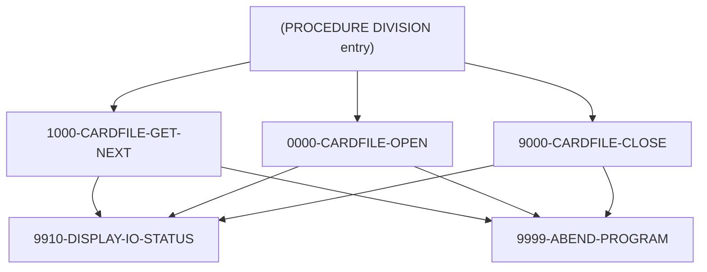

# Program CBACT02C

| Item | Value |
|---|---|
| Source | `app/cbl/CBACT02C.cbl` |
| Lines | 178 total, 129 code, 34 comment, 15 blank |
| PROGRAM-ID | CBACT02C |
| Author | AWS |
| Runtime | batch-main |
| Module | base |
| CICS transactions | None in CSD |
| JCL steps | [READCARD](../06-batch/jobs/READCARD.md).STEP05 (`app/jcl/READCARD.jcl:22`) |
| Paragraphs | 6 |
| Semantic analysis | validated (batch B02) |
| Version banner | * Ver: CardDemo_v2.0-25-gdb72e6b-235 Date: 2025-04-29 11:01:27 CDT |

## Summary

CBACT02C is a batch COBOL utility that prints the card master file. It opens the indexed card file CARDFILE (150-byte records keyed by card number, layout CVACT02Y) for sequential input, reads every record into CARD-RECORD and DISPLAYs it to SYSOUT until end of file. It writes no files. Any open, read or close error displays the file status as NNNN and abends with code 999 via CEE3ABD. (Confirmed)

Evidence: `app/cbl/CBACT02C.cbl:1-5`, `app/cbl/CBACT02C.cbl:28-45`, `app/cbl/CBACT02C.cbl:70-116`

Header comment (Unverified, `app/cbl/CBACT02C.cbl:1-8`): Program     : CBACT02C.CBL Application : CardDemo Type        : BATCH COBOL Program Function    : Read and print card data file. All Rights Reserved. http://www.apache.org/licenses/LICENSE-2.0

## Divisions and sections

| Division / section | Lines | Notes |
|---|---|---|
| IDENTIFICATION DIVISION | `app/cbl/CBACT02C.cbl:22-25` |  |
| ENVIRONMENT DIVISION | `app/cbl/CBACT02C.cbl:26-34` |  |
| DATA DIVISION | `app/cbl/CBACT02C.cbl:35-69` |  |
| PROCEDURE DIVISION | `app/cbl/CBACT02C.cbl:70-178` |  |
| ENVIRONMENT / INPUT-OUTPUT SECTION | `app/cbl/CBACT02C.cbl:27-34` |  |
| DATA / FILE SECTION | `app/cbl/CBACT02C.cbl:36-41` |  |
| DATA / WORKING-STORAGE SECTION | `app/cbl/CBACT02C.cbl:42-69` |  |

## Files and data stores

| File | ASSIGN | Org | Access | Record key | Alt key | Status field | OPEN modes | Physical dataset (JCL) | Evidence |
|---|---|---|---|---|---|---|---|---|---|
| CARDFILE-FILE | CARDFILE | INDEXED | SEQUENTIAL | FD-CARD-NUM |  | CARDFILE-STATUS | INPUT (line 120) | AWS.M2.CARDDEMO.CARDDATA.VSAM.KSDS (READCARD.STEP05 `app/jcl/READCARD.jcl:25-26`) | `app/cbl/CBACT02C.cbl:29-33`, FD `app/cbl/CBACT02C.cbl:37` |

CRUD summary from the program facts:

| Store | Kind | Ops | Evidence |
|---|---|---|---|
| CARDFILE-FILE | logical | R | `app/cbl/CBACT02C.cbl:93-120` |

## Embedded CICS, SQL and DL/I commands

No EXEC blocks.

## Calls, transfers and callers

| Mechanism | Target | Parameters | Paragraph | Lines |
|---|---|---|---|---|
| CALL system/LE | CEE3ABD | ABCODE, TIMING | 9999-ABEND-PROGRAM | `app/cbl/CBACT02C.cbl:158` |

## Copybooks

| Copybook | Statement | Resolution | Resolved path | REPLACING | Line |
|---|---|---|---|---|---|
| [CVACT02Y](../08-data/layouts/CVACT02Y.md) | COPY | inventory | app/cpy/CVACT02Y.cpy |  | `app/cbl/CBACT02C.cbl:45` |

## Data division items

Every data entry coded in this source (copybook contents are on the copybook pages). Lengths are computed from PIC and USAGE.

| Section | Lvl | Name | PIC | Usage | Len | OCCURS | REDEFINES | VALUE | 88-levels | Line |
|---|---|---|---|---|---|---|---|---|---|---|
| FILE | 01 | FD-CARDFILE-REC |  |  |  |  |  |  |  | 38 |
| FILE | 05 | FD-CARD-NUM | X(16) |  | 16 |  |  |  |  | 39 |
| FILE | 05 | FD-CARD-DATA | X(134) |  | 134 |  |  |  |  | 40 |
| WORKING-STORAGE | 01 | CARDFILE-STATUS |  |  |  |  |  |  |  | 46 |
| WORKING-STORAGE | 05 | CARDFILE-STAT1 | X |  | 1 |  |  |  |  | 47 |
| WORKING-STORAGE | 05 | CARDFILE-STAT2 | X |  | 1 |  |  |  |  | 48 |
| WORKING-STORAGE | 01 | IO-STATUS |  |  |  |  |  |  |  | 50 |
| WORKING-STORAGE | 05 | IO-STAT1 | X |  | 1 |  |  |  |  | 51 |
| WORKING-STORAGE | 05 | IO-STAT2 | X |  | 1 |  |  |  |  | 52 |
| WORKING-STORAGE | 01 | TWO-BYTES-BINARY | 9(4) | BINARY | 2 |  |  |  |  | 53 |
| WORKING-STORAGE | 01 | TWO-BYTES-ALPHA |  | BINARY |  |  | TWO-BYTES-BINARY |  |  | 54 |
| WORKING-STORAGE | 05 | TWO-BYTES-LEFT | X |  | 1 |  |  |  |  | 55 |
| WORKING-STORAGE | 05 | TWO-BYTES-RIGHT | X |  | 1 |  |  |  |  | 56 |
| WORKING-STORAGE | 01 | IO-STATUS-04 |  |  |  |  |  |  |  | 57 |
| WORKING-STORAGE | 05 | IO-STATUS-0401 | 9 |  | 1 |  |  | 0 |  | 58 |
| WORKING-STORAGE | 05 | IO-STATUS-0403 | 999 |  | 3 |  |  | 0 |  | 59 |
| WORKING-STORAGE | 01 | APPL-RESULT | S9(9) | COMP | 4 |  |  |  | APPL-AOK = 0; APPL-EOF = 16 | 61 |
| WORKING-STORAGE | 01 | END-OF-FILE | X(01) |  | 1 |  |  | 'N' |  | 65 |
| WORKING-STORAGE | 01 | ABCODE | S9(9) | BINARY | 4 |  |  |  |  | 66 |
| WORKING-STORAGE | 01 | TIMING | S9(9) | BINARY | 4 |  |  |  |  | 67 |

## Statement inventory

Every procedure statement the parser recorded, by kind. Each one is listed with its line under Paragraph details.

| Kind | Count |
|---|---|
| Decisions (IF, EVALUATE, WHEN, loops, handlers) | 12 |
| Calculations | 3 |
| File I/O | 3 |
| EXEC CICS / SQL / DLI | 0 |
| CALL | 1 |
| PERFORM | 10 |
| GO TO | 0 |
| MOVE literal | 11 |
| MOVE field | 7 |
| SET | 0 |
| STRING, UNSTRING, INSPECT, INITIALIZE, COPY, ENTRY and others | 0 |
| DISPLAY | 9 |
| GOBACK, STOP RUN, RETURN, XCTL | 1 |
| Not classified by the parser | 0 |

## Control flow

| Paragraph | Lines | Logic | Performs | Performed by | Reachable |
|---|---|---|---|---|---|
| [(PROCEDURE DIVISION entry)](#para-procedure-division-entry) | 71-87 | Displays a start banner, opens CARDFILE, loops calling 1000-CARDFILE-GET-NEXT until END-OF-FILE = 'Y' and displays CARD-RECORD after each successful read, then closes the file, displays an end banner and GOBACKs. (Confirmed) | 0000-CARDFILE-OPEN, 1000-CARDFILE-GET-NEXT, 9000-CARDFILE-CLOSE |  | yes |
| [1000-CARDFILE-GET-NEXT](#para-1000-cardfile-get-next) | 92-116 | Reads the next CARDFILE record into CARD-RECORD. Status '00' sets APPL-RESULT 0; '10' sets 16 and END-OF-FILE 'Y'; any other status displays 'ERROR READING CARDFILE', the file status, and abends. (Confirmed) | 9910-DISPLAY-IO-STATUS, 9999-ABEND-PROGRAM | (PROCEDURE DIVISION entry) | yes |
| [0000-CARDFILE-OPEN](#para-0000-cardfile-open) | 118-134 | Opens CARDFILE-FILE for input; a status other than '00' displays 'ERROR OPENING CARDFILE', the status, and abends. (Confirmed) | 9910-DISPLAY-IO-STATUS, 9999-ABEND-PROGRAM | (PROCEDURE DIVISION entry) | yes |
| [9000-CARDFILE-CLOSE](#para-9000-cardfile-close) | 136-152 | Closes CARDFILE-FILE; a status other than '00' displays 'ERROR CLOSING CARDFILE', the status, and abends. (Confirmed) | 9910-DISPLAY-IO-STATUS, 9999-ABEND-PROGRAM | (PROCEDURE DIVISION entry) | yes |
| [9999-ABEND-PROGRAM](#para-9999-abend-program) | 154-158 | Displays 'ABENDING PROGRAM' and calls CEE3ABD with ABCODE 999 and TIMING 0. (Confirmed) |  | 0000-CARDFILE-OPEN, 1000-CARDFILE-GET-NEXT, 9000-CARDFILE-CLOSE | yes |
| [9910-DISPLAY-IO-STATUS](#para-9910-display-io-status) | 161-174 | Formats IO-STATUS into the 4-digit IO-STATUS-04 (binary conversion of the second byte for non-numeric or '9x' statuses, otherwise zero-padded) and displays 'FILE STATUS IS: NNNN' with it. (Confirmed) |  | 0000-CARDFILE-OPEN, 1000-CARDFILE-GET-NEXT, 9000-CARDFILE-CLOSE | yes |

## Paragraph details

### Para (PROCEDURE DIVISION entry)

Lines `app/cbl/CBACT02C.cbl:71-87`. 

Logic: Displays a start banner, opens CARDFILE, loops calling 1000-CARDFILE-GET-NEXT until END-OF-FILE = 'Y' and displays CARD-RECORD after each successful read, then closes the file, displays an end banner and GOBACKs. (Confirmed)

Statements in source order:

- `DISPLAY 'START OF EXECUTION OF PROGRAM CBACT02C'` at `app/cbl/CBACT02C.cbl:71`
- PERFORM 0000-CARDFILE-OPEN at `app/cbl/CBACT02C.cbl:72`
- LOOP `UNTIL END-OF-FILE = 'Y'` at `app/cbl/CBACT02C.cbl:74` (io-status)
- Inline PERFORM `UNTIL END-OF-FILE = 'Y'` at `app/cbl/CBACT02C.cbl:74`
- IF `END-OF-FILE = 'N'` at `app/cbl/CBACT02C.cbl:75` (io-status)
- PERFORM 1000-CARDFILE-GET-NEXT at `app/cbl/CBACT02C.cbl:76`
- IF `END-OF-FILE = 'N'` at `app/cbl/CBACT02C.cbl:77` (io-status)
- `DISPLAY CARD-RECORD` at `app/cbl/CBACT02C.cbl:78`
- PERFORM 9000-CARDFILE-CLOSE at `app/cbl/CBACT02C.cbl:83`
- `DISPLAY 'END OF EXECUTION OF PROGRAM CBACT02C'` at `app/cbl/CBACT02C.cbl:85`
- Ends with GOBACK at `app/cbl/CBACT02C.cbl:87`

### Para 1000-CARDFILE-GET-NEXT

Lines `app/cbl/CBACT02C.cbl:92-116`. 

Logic: Reads the next CARDFILE record into CARD-RECORD. Status '00' sets APPL-RESULT 0; '10' sets 16 and END-OF-FILE 'Y'; any other status displays 'ERROR READING CARDFILE', the file status, and abends. (Confirmed)

Statements in source order:

- File I/O `READ CARDFILE-FILE INTO CARD-RECORD` at `app/cbl/CBACT02C.cbl:93`
- IF `CARDFILE-STATUS = '00'` at `app/cbl/CBACT02C.cbl:94` (io-status)
- MOVE `0` TO APPL-RESULT at `app/cbl/CBACT02C.cbl:95`
- IF `CARDFILE-STATUS = '10'` at `app/cbl/CBACT02C.cbl:98` (io-status)
- MOVE `16` TO APPL-RESULT at `app/cbl/CBACT02C.cbl:99`
- MOVE `12` TO APPL-RESULT at `app/cbl/CBACT02C.cbl:101`
- IF `APPL-AOK` at `app/cbl/CBACT02C.cbl:104` (io-status)
- IF `APPL-EOF` at `app/cbl/CBACT02C.cbl:107` (io-status)
- MOVE `'Y'` TO END-OF-FILE at `app/cbl/CBACT02C.cbl:108`
- `DISPLAY 'ERROR READING CARDFILE'` at `app/cbl/CBACT02C.cbl:110`
- `MOVE CARDFILE-STATUS TO IO-STATUS` at `app/cbl/CBACT02C.cbl:111`
- PERFORM 9910-DISPLAY-IO-STATUS at `app/cbl/CBACT02C.cbl:112`
- PERFORM 9999-ABEND-PROGRAM at `app/cbl/CBACT02C.cbl:113`

### Para 0000-CARDFILE-OPEN

Lines `app/cbl/CBACT02C.cbl:118-134`. 

Logic: Opens CARDFILE-FILE for input; a status other than '00' displays 'ERROR OPENING CARDFILE', the status, and abends. (Confirmed)

Statements in source order:

- MOVE `8` TO APPL-RESULT at `app/cbl/CBACT02C.cbl:119`
- File I/O `OPEN INPUT CARDFILE-FILE` at `app/cbl/CBACT02C.cbl:120`
- IF `CARDFILE-STATUS = '00'` at `app/cbl/CBACT02C.cbl:121` (io-status)
- MOVE `0` TO APPL-RESULT at `app/cbl/CBACT02C.cbl:122`
- MOVE `12` TO APPL-RESULT at `app/cbl/CBACT02C.cbl:124`
- IF `APPL-AOK` at `app/cbl/CBACT02C.cbl:126` (io-status)
- `DISPLAY 'ERROR OPENING CARDFILE'` at `app/cbl/CBACT02C.cbl:129`
- `MOVE CARDFILE-STATUS TO IO-STATUS` at `app/cbl/CBACT02C.cbl:130`
- PERFORM 9910-DISPLAY-IO-STATUS at `app/cbl/CBACT02C.cbl:131`
- PERFORM 9999-ABEND-PROGRAM at `app/cbl/CBACT02C.cbl:132`

### Para 9000-CARDFILE-CLOSE

Lines `app/cbl/CBACT02C.cbl:136-152`. 

Logic: Closes CARDFILE-FILE; a status other than '00' displays 'ERROR CLOSING CARDFILE', the status, and abends. (Confirmed)

Statements in source order:

- Calculation `ADD 8 TO ZERO GIVING APPL-RESULT` at `app/cbl/CBACT02C.cbl:137`
- File I/O `CLOSE CARDFILE-FILE` at `app/cbl/CBACT02C.cbl:138`
- IF `CARDFILE-STATUS = '00'` at `app/cbl/CBACT02C.cbl:139` (io-status)
- Calculation `SUBTRACT APPL-RESULT FROM APPL-RESULT` at `app/cbl/CBACT02C.cbl:140`
- Calculation `ADD 12 TO ZERO GIVING APPL-RESULT` at `app/cbl/CBACT02C.cbl:142`
- IF `APPL-AOK` at `app/cbl/CBACT02C.cbl:144` (io-status)
- `DISPLAY 'ERROR CLOSING CARDFILE'` at `app/cbl/CBACT02C.cbl:147`
- `MOVE CARDFILE-STATUS TO IO-STATUS` at `app/cbl/CBACT02C.cbl:148`
- PERFORM 9910-DISPLAY-IO-STATUS at `app/cbl/CBACT02C.cbl:149`
- PERFORM 9999-ABEND-PROGRAM at `app/cbl/CBACT02C.cbl:150`

### Para 9999-ABEND-PROGRAM

Lines `app/cbl/CBACT02C.cbl:154-158`. 

Logic: Displays 'ABENDING PROGRAM' and calls CEE3ABD with ABCODE 999 and TIMING 0. (Confirmed)

Statements in source order:

- `DISPLAY 'ABENDING PROGRAM'` at `app/cbl/CBACT02C.cbl:155`
- MOVE `0` TO TIMING at `app/cbl/CBACT02C.cbl:156`
- MOVE `999` TO ABCODE at `app/cbl/CBACT02C.cbl:157`
- CALL CEE3ABD at `app/cbl/CBACT02C.cbl:158`

### Para 9910-DISPLAY-IO-STATUS

Lines `app/cbl/CBACT02C.cbl:161-174`. 

Logic: Formats IO-STATUS into the 4-digit IO-STATUS-04 (binary conversion of the second byte for non-numeric or '9x' statuses, otherwise zero-padded) and displays 'FILE STATUS IS: NNNN' with it. (Confirmed)

Statements in source order:

- IF `IO-STATUS NOT NUMERIC OR IO-STAT1 = '9'` at `app/cbl/CBACT02C.cbl:162-163` (io-status)
- `MOVE IO-STAT1 TO IO-STATUS-04(1:1)` at `app/cbl/CBACT02C.cbl:164`
- MOVE `0` TO TWO-BYTES-BINARY at `app/cbl/CBACT02C.cbl:165`
- `MOVE IO-STAT2 TO TWO-BYTES-RIGHT` at `app/cbl/CBACT02C.cbl:166`
- `MOVE TWO-BYTES-BINARY TO IO-STATUS-0403` at `app/cbl/CBACT02C.cbl:167`
- `DISPLAY 'FILE STATUS IS: NNNN' IO-STATUS-04` at `app/cbl/CBACT02C.cbl:168`
- MOVE `'0000'` TO IO-STATUS-04 at `app/cbl/CBACT02C.cbl:170`
- `MOVE IO-STATUS TO IO-STATUS-04(3:2)` at `app/cbl/CBACT02C.cbl:171`
- `DISPLAY 'FILE STATUS IS: NNNN' IO-STATUS-04` at `app/cbl/CBACT02C.cbl:172`

## Business rules

No business rules identified: CBACT02C is a pure file-print utility: it opens the card KSDS (CARDFILE) for sequential input, DISPLAYs every CARD-RECORD to SYSOUT, and closes the file. It makes no data-driven decisions; its only conditional logic is file-status handling (end of file, abend code 999 on any I/O error).

Decision coverage: 0 of 0 business-candidate decision points are linked to a rule or a no-rule reason (0 inside rule ranges).

## Error handling

| Paragraph | Kind | Detail | Lines |
|---|---|---|---|
| (PROCEDURE DIVISION entry) | check | `UNTIL END-OF-FILE = 'Y'` | `app/cbl/CBACT02C.cbl:74` |
| (PROCEDURE DIVISION entry) | check | `END-OF-FILE = 'N'` | `app/cbl/CBACT02C.cbl:75` |
| (PROCEDURE DIVISION entry) | check | `END-OF-FILE = 'N'` | `app/cbl/CBACT02C.cbl:77` |
| 1000-CARDFILE-GET-NEXT | check | `CARDFILE-STATUS = '00'` | `app/cbl/CBACT02C.cbl:94` |
| 1000-CARDFILE-GET-NEXT | check | `CARDFILE-STATUS = '10'` | `app/cbl/CBACT02C.cbl:98` |
| 1000-CARDFILE-GET-NEXT | check | `APPL-AOK` | `app/cbl/CBACT02C.cbl:104` |
| 1000-CARDFILE-GET-NEXT | check | `APPL-EOF` | `app/cbl/CBACT02C.cbl:107` |
| 0000-CARDFILE-OPEN | check | `CARDFILE-STATUS = '00'` | `app/cbl/CBACT02C.cbl:121` |
| 0000-CARDFILE-OPEN | check | `APPL-AOK` | `app/cbl/CBACT02C.cbl:126` |
| 9000-CARDFILE-CLOSE | check | `CARDFILE-STATUS = '00'` | `app/cbl/CBACT02C.cbl:139` |
| 9000-CARDFILE-CLOSE | check | `APPL-AOK` | `app/cbl/CBACT02C.cbl:144` |
| 9999-ABEND-PROGRAM | abend | CALL CEE3ABD | `app/cbl/CBACT02C.cbl:158` |
| 9910-DISPLAY-IO-STATUS | check | `IO-STATUS NOT NUMERIC OR IO-STAT1 = '9'` | `app/cbl/CBACT02C.cbl:162-163` |

## Observations and SME questions

- security: The whole CARD-RECORD, including CARD-NUM and CARD-CVV-CD, is written to SYSOUT unmasked. (`app/cbl/CBACT02C.cbl:74-81`)
- dead-code: A second DISPLAY CARD-RECORD inside 1000-CARDFILE-GET-NEXT is commented out (unlike the sibling programs CBACT03C and CBCUS01C, which display each record twice). (`app/cbl/CBACT02C.cbl:94-96`)

## Sources

- `app/cbl/CBACT02C.cbl`
- `docs/_work/structure/programs/CBACT02C.json`
- `docs/_work/semantic/programs/CBACT02C.json`
- `docs/_work/programs/CBACT02C.json`

## Confidence

Structure tables (divisions, items, paragraphs, statements, line numbers) are Confirmed: they are parsed from the source. Paragraph logic and rule statements carry their own Confirmed/Inferred tag from the batch analysis, and every rule anchor was checked against the cited lines. Decision-point classes are a keyword heuristic used only for coverage measurement. Header comments are Unverified.
