# Program CBACT04C

| Item | Value |
|---|---|
| Source | `app/cbl/CBACT04C.cbl` |
| Lines | 652 total, 552 code, 53 comment, 47 blank |
| PROGRAM-ID | CBACT04C |
| Author | AWS |
| Runtime | subprogram, batch-main |
| Module | base |
| CICS transactions | None in CSD |
| JCL steps | [INTCALC](../06-batch/jobs/INTCALC.md).STEP15 (`app/jcl/INTCALC.jcl:22`) |
| Paragraphs | 23 |
| Semantic analysis | validated (batch B02) |
| Version banner | * Ver: CardDemo_v2.0-25-gdb72e6b-235 Date: 2025-04-29 11:01:28 CDT |

## Summary

CBACT04C is the batch interest calculator. It reads the transaction category balance file TCATBALF sequentially (records grouped by account id) and, for each category, looks up the annual interest rate in the disclosure group file DISCGRP by account group, transaction type and category, falling back to the 'DEFAULT' group. For non-zero rates it computes monthly interest as balance x rate / 1200 and writes an interest transaction (type '01', category 5) to the sequential TRANSACT file, using the run date passed in PARM-DATE to build transaction ids. At each change of account it adds the accumulated interest to the account balance in ACCTFILE (opened I-O), resets the cycle credit and debit totals and rewrites the account. Missing accounts, cross-references or default rates and any I/O error abend the job with code 999. (Confirmed)

Evidence: `app/cbl/CBACT04C.cbl:1-5`, `app/cbl/CBACT04C.cbl:28-57`, `app/cbl/CBACT04C.cbl:175-232`, `app/cbl/CBACT04C.cbl:350-370`, `app/cbl/CBACT04C.cbl:462-515`

Header comment (Unverified, `app/cbl/CBACT04C.cbl:1-8`): Program     : CBACT04C.CBL Application : CardDemo Type        : BATCH COBOL Program Function    : This is a interest calculator program. All Rights Reserved. http://www.apache.org/licenses/LICENSE-2.0

## Divisions and sections

| Division / section | Lines | Notes |
|---|---|---|
| IDENTIFICATION DIVISION | `app/cbl/CBACT04C.cbl:22-24` |  |
| ENVIRONMENT DIVISION | `app/cbl/CBACT04C.cbl:25-58` |  |
| DATA DIVISION | `app/cbl/CBACT04C.cbl:59-179` |  |
| PROCEDURE DIVISION | `app/cbl/CBACT04C.cbl:180-652` | USING EXTERNAL-PARMS |
| ENVIRONMENT / INPUT-OUTPUT SECTION | `app/cbl/CBACT04C.cbl:26-58` |  |
| DATA / FILE SECTION | `app/cbl/CBACT04C.cbl:60-93` |  |
| DATA / WORKING-STORAGE SECTION | `app/cbl/CBACT04C.cbl:94-174` |  |
| DATA / LINKAGE SECTION | `app/cbl/CBACT04C.cbl:175-179` |  |

## Files and data stores

| File | ASSIGN | Org | Access | Record key | Alt key | Status field | OPEN modes | Physical dataset (JCL) | Evidence |
|---|---|---|---|---|---|---|---|---|---|
| TCATBAL-FILE | TCATBALF | INDEXED | SEQUENTIAL | FD-TRAN-CAT-KEY |  | TCATBALF-STATUS | INPUT (line 236) | AWS.M2.CARDDEMO.TCATBALF.VSAM.KSDS (INTCALC.STEP15 `app/jcl/INTCALC.jcl:27-28`) | `app/cbl/CBACT04C.cbl:28-32`, FD `app/cbl/CBACT04C.cbl:61` |
| XREF-FILE | XREFFILE | INDEXED | RANDOM | FD-XREF-CARD-NUM | FD-XREF-ACCT-ID | XREFFILE-STATUS | INPUT (line 254) | AWS.M2.CARDDEMO.CARDXREF.VSAM.KSDS (INTCALC.STEP15 `app/jcl/INTCALC.jcl:29-30`) | `app/cbl/CBACT04C.cbl:34-39`, FD `app/cbl/CBACT04C.cbl:69` |
| ACCOUNT-FILE | ACCTFILE | INDEXED | RANDOM | FD-ACCT-ID |  | ACCTFILE-STATUS | I-O (line 291) | AWS.M2.CARDDEMO.ACCTDATA.VSAM.KSDS (INTCALC.STEP15 `app/jcl/INTCALC.jcl:33-34`) | `app/cbl/CBACT04C.cbl:41-45`, FD `app/cbl/CBACT04C.cbl:84` |
| DISCGRP-FILE | DISCGRP | INDEXED | RANDOM | FD-DISCGRP-KEY |  | DISCGRP-STATUS | INPUT (line 272) | AWS.M2.CARDDEMO.DISCGRP.VSAM.KSDS (INTCALC.STEP15 `app/jcl/INTCALC.jcl:35-36`) | `app/cbl/CBACT04C.cbl:47-51`, FD `app/cbl/CBACT04C.cbl:76` |
| TRANSACT-FILE | TRANSACT | SEQUENTIAL | SEQUENTIAL |  |  | TRANFILE-STATUS | OUTPUT (line 309) | AWS.M2.CARDDEMO.SYSTRAN(+1) (INTCALC.STEP15 `app/jcl/INTCALC.jcl:37-41`) | `app/cbl/CBACT04C.cbl:53-56`, FD `app/cbl/CBACT04C.cbl:89` |

CRUD summary from the program facts:

| Store | Kind | Ops | Evidence |
|---|---|---|---|
| TRANSACT-FILE | logical | C | `app/cbl/CBACT04C.cbl:309` |
| TCATBAL-FILE | logical | R | `app/cbl/CBACT04C.cbl:236-326` |
| XREF-FILE | logical | R | `app/cbl/CBACT04C.cbl:254-394` |
| ACCOUNT-FILE | logical | R, U | `app/cbl/CBACT04C.cbl:291-373` |
| DISCGRP-FILE | logical | R | `app/cbl/CBACT04C.cbl:272-444` |

## Embedded CICS, SQL and DL/I commands

No EXEC blocks.

## Calls, transfers and callers

| Mechanism | Target | Parameters | Paragraph | Lines |
|---|---|---|---|---|
| CALL system/LE | CEE3ABD | ABCODE, TIMING | 9999-ABEND-PROGRAM | `app/cbl/CBACT04C.cbl:632` |

## Copybooks

| Copybook | Statement | Resolution | Resolved path | REPLACING | Line |
|---|---|---|---|---|---|
| [CVTRA01Y](../08-data/layouts/CVTRA01Y.md) | COPY | inventory | app/cpy/CVTRA01Y.cpy |  | `app/cbl/CBACT04C.cbl:97` |
| [CVACT03Y](../08-data/layouts/CVACT03Y.md) | COPY | inventory | app/cpy/CVACT03Y.cpy |  | `app/cbl/CBACT04C.cbl:102` |
| [CVTRA02Y](../08-data/layouts/CVTRA02Y.md) | COPY | inventory | app/cpy/CVTRA02Y.cpy |  | `app/cbl/CBACT04C.cbl:107` |
| [CVACT01Y](../08-data/layouts/CVACT01Y.md) | COPY | inventory | app/cpy/CVACT01Y.cpy |  | `app/cbl/CBACT04C.cbl:112` |
| [CVTRA05Y](../08-data/layouts/CVTRA05Y.md) | COPY | inventory | app/cpy/CVTRA05Y.cpy |  | `app/cbl/CBACT04C.cbl:117` |

## Data division items

Every data entry coded in this source (copybook contents are on the copybook pages). Lengths are computed from PIC and USAGE.

| Section | Lvl | Name | PIC | Usage | Len | OCCURS | REDEFINES | VALUE | 88-levels | Line |
|---|---|---|---|---|---|---|---|---|---|---|
| FILE | 01 | FD-TRAN-CAT-BAL-RECORD |  |  |  |  |  |  |  | 62 |
| FILE | 05 | FD-TRAN-CAT-KEY |  |  |  |  |  |  |  | 63 |
| FILE | 10 | FD-TRANCAT-ACCT-ID | 9(11) |  | 11 |  |  |  |  | 64 |
| FILE | 10 | FD-TRANCAT-TYPE-CD | X(02) |  | 2 |  |  |  |  | 65 |
| FILE | 10 | FD-TRANCAT-CD | 9(04) |  | 4 |  |  |  |  | 66 |
| FILE | 05 | FD-FD-TRAN-CAT-DATA | X(33) |  | 33 |  |  |  |  | 67 |
| FILE | 01 | FD-XREFFILE-REC |  |  |  |  |  |  |  | 70 |
| FILE | 05 | FD-XREF-CARD-NUM | X(16) |  | 16 |  |  |  |  | 71 |
| FILE | 05 | FD-XREF-CUST-NUM | 9(09) |  | 9 |  |  |  |  | 72 |
| FILE | 05 | FD-XREF-ACCT-ID | 9(11) |  | 11 |  |  |  |  | 73 |
| FILE | 05 | FD-XREF-FILLER | X(14) |  | 14 |  |  |  |  | 74 |
| FILE | 01 | FD-DISCGRP-REC |  |  |  |  |  |  |  | 77 |
| FILE | 05 | FD-DISCGRP-KEY |  |  |  |  |  |  |  | 78 |
| FILE | 10 | FD-DIS-ACCT-GROUP-ID | X(10) |  | 10 |  |  |  |  | 79 |
| FILE | 10 | FD-DIS-TRAN-TYPE-CD | X(02) |  | 2 |  |  |  |  | 80 |
| FILE | 10 | FD-DIS-TRAN-CAT-CD | 9(04) |  | 4 |  |  |  |  | 81 |
| FILE | 05 | FD-DISCGRP-DATA | X(34) |  | 34 |  |  |  |  | 82 |
| FILE | 01 | FD-ACCTFILE-REC |  |  |  |  |  |  |  | 85 |
| FILE | 05 | FD-ACCT-ID | 9(11) |  | 11 |  |  |  |  | 86 |
| FILE | 05 | FD-ACCT-DATA | X(289) |  | 289 |  |  |  |  | 87 |
| FILE | 01 | FD-TRANFILE-REC |  |  |  |  |  |  |  | 90 |
| FILE | 05 | FD-TRANS-ID | X(16) |  | 16 |  |  |  |  | 91 |
| FILE | 05 | FD-ACCT-DATA | X(334) |  | 334 |  |  |  |  | 92 |
| WORKING-STORAGE | 01 | TCATBALF-STATUS |  |  |  |  |  |  |  | 98 |
| WORKING-STORAGE | 05 | TCATBALF-STAT1 | X |  | 1 |  |  |  |  | 99 |
| WORKING-STORAGE | 05 | TCATBALF-STAT2 | X |  | 1 |  |  |  |  | 100 |
| WORKING-STORAGE | 01 | XREFFILE-STATUS |  |  |  |  |  |  |  | 103 |
| WORKING-STORAGE | 05 | XREFFILE-STAT1 | X |  | 1 |  |  |  |  | 104 |
| WORKING-STORAGE | 05 | XREFFILE-STAT2 | X |  | 1 |  |  |  |  | 105 |
| WORKING-STORAGE | 01 | DISCGRP-STATUS |  |  |  |  |  |  |  | 108 |
| WORKING-STORAGE | 05 | DISCGRP-STAT1 | X |  | 1 |  |  |  |  | 109 |
| WORKING-STORAGE | 05 | DISCGRP-STAT2 | X |  | 1 |  |  |  |  | 110 |
| WORKING-STORAGE | 01 | ACCTFILE-STATUS |  |  |  |  |  |  |  | 113 |
| WORKING-STORAGE | 05 | ACCTFILE-STAT1 | X |  | 1 |  |  |  |  | 114 |
| WORKING-STORAGE | 05 | ACCTFILE-STAT2 | X |  | 1 |  |  |  |  | 115 |
| WORKING-STORAGE | 01 | TRANFILE-STATUS |  |  |  |  |  |  |  | 118 |
| WORKING-STORAGE | 05 | TRANFILE-STAT1 | X |  | 1 |  |  |  |  | 119 |
| WORKING-STORAGE | 05 | TRANFILE-STAT2 | X |  | 1 |  |  |  |  | 120 |
| WORKING-STORAGE | 01 | IO-STATUS |  |  |  |  |  |  |  | 122 |
| WORKING-STORAGE | 05 | IO-STAT1 | X |  | 1 |  |  |  |  | 123 |
| WORKING-STORAGE | 05 | IO-STAT2 | X |  | 1 |  |  |  |  | 124 |
| WORKING-STORAGE | 01 | TWO-BYTES-BINARY | 9(4) | BINARY | 2 |  |  |  |  | 125 |
| WORKING-STORAGE | 01 | TWO-BYTES-ALPHA |  | BINARY |  |  | TWO-BYTES-BINARY |  |  | 126 |
| WORKING-STORAGE | 05 | TWO-BYTES-LEFT | X |  | 1 |  |  |  |  | 127 |
| WORKING-STORAGE | 05 | TWO-BYTES-RIGHT | X |  | 1 |  |  |  |  | 128 |
| WORKING-STORAGE | 01 | IO-STATUS-04 |  |  |  |  |  |  |  | 129 |
| WORKING-STORAGE | 05 | IO-STATUS-0401 | 9 |  | 1 |  |  | 0 |  | 130 |
| WORKING-STORAGE | 05 | IO-STATUS-0403 | 999 |  | 3 |  |  | 0 |  | 131 |
| WORKING-STORAGE | 01 | APPL-RESULT | S9(9) | COMP | 4 |  |  |  | APPL-AOK = 0; APPL-EOF = 16 | 133 |
| WORKING-STORAGE | 01 | END-OF-FILE | X(01) |  | 1 |  |  | 'N' |  | 137 |
| WORKING-STORAGE | 01 | ABCODE | S9(9) | BINARY | 4 |  |  |  |  | 138 |
| WORKING-STORAGE | 01 | TIMING | S9(9) | BINARY | 4 |  |  |  |  | 139 |
| WORKING-STORAGE | 01 | COBOL-TS |  |  |  |  |  |  |  | 141 |
| WORKING-STORAGE | 05 | COB-YYYY | X(04) |  | 4 |  |  |  |  | 142 |
| WORKING-STORAGE | 05 | COB-MM | X(02) |  | 2 |  |  |  |  | 143 |
| WORKING-STORAGE | 05 | COB-DD | X(02) |  | 2 |  |  |  |  | 144 |
| WORKING-STORAGE | 05 | COB-HH | X(02) |  | 2 |  |  |  |  | 145 |
| WORKING-STORAGE | 05 | COB-MIN | X(02) |  | 2 |  |  |  |  | 146 |
| WORKING-STORAGE | 05 | COB-SS | X(02) |  | 2 |  |  |  |  | 147 |
| WORKING-STORAGE | 05 | COB-MIL | X(02) |  | 2 |  |  |  |  | 148 |
| WORKING-STORAGE | 05 | COB-REST | X(05) |  | 5 |  |  |  |  | 149 |
| WORKING-STORAGE | 01 | DB2-FORMAT-TS | X(26) |  | 26 |  |  |  |  | 150 |
| WORKING-STORAGE | 01 | FILLER |  |  |  |  | DB2-FORMAT-TS |  |  | 151 |
| WORKING-STORAGE | 06 | DB2-YYYY | X(004) |  | 4 |  |  |  |  | 152 |
| WORKING-STORAGE | 06 | DB2-STREEP-1 | X |  | 1 |  |  |  |  | 153 |
| WORKING-STORAGE | 06 | DB2-MM | X(002) |  | 2 |  |  |  |  | 154 |
| WORKING-STORAGE | 06 | DB2-STREEP-2 | X |  | 1 |  |  |  |  | 155 |
| WORKING-STORAGE | 06 | DB2-DD | X(002) |  | 2 |  |  |  |  | 156 |
| WORKING-STORAGE | 06 | DB2-STREEP-3 | X |  | 1 |  |  |  |  | 157 |
| WORKING-STORAGE | 06 | DB2-HH | X(002) |  | 2 |  |  |  |  | 158 |
| WORKING-STORAGE | 06 | DB2-DOT-1 | X |  | 1 |  |  |  |  | 159 |
| WORKING-STORAGE | 06 | DB2-MIN | X(002) |  | 2 |  |  |  |  | 160 |
| WORKING-STORAGE | 06 | DB2-DOT-2 | X |  | 1 |  |  |  |  | 161 |
| WORKING-STORAGE | 06 | DB2-SS | X(002) |  | 2 |  |  |  |  | 162 |
| WORKING-STORAGE | 06 | DB2-DOT-3 | X |  | 1 |  |  |  |  | 163 |
| WORKING-STORAGE | 06 | DB2-MIL | 9(002) |  | 2 |  |  |  |  | 164 |
| WORKING-STORAGE | 06 | DB2-REST | X(04) |  | 4 |  |  |  |  | 165 |
| WORKING-STORAGE | 01 | WS-MISC-VARS |  |  |  |  |  |  |  | 166 |
| WORKING-STORAGE | 05 | WS-LAST-ACCT-NUM | X(11) |  | 11 |  |  | SPACES |  | 167 |
| WORKING-STORAGE | 05 | WS-MONTHLY-INT | S9(09)V99 |  | 11 |  |  |  |  | 168 |
| WORKING-STORAGE | 05 | WS-TOTAL-INT | S9(09)V99 |  | 11 |  |  |  |  | 169 |
| WORKING-STORAGE | 05 | WS-FIRST-TIME | X(01) |  | 1 |  |  | 'Y' |  | 170 |
| WORKING-STORAGE | 01 | WS-COUNTERS |  |  |  |  |  |  |  | 171 |
| WORKING-STORAGE | 05 | WS-RECORD-COUNT | 9(09) |  | 9 |  |  | 0 |  | 172 |
| WORKING-STORAGE | 05 | WS-TRANID-SUFFIX | 9(06) |  | 6 |  |  | 0 |  | 173 |
| LINKAGE | 01 | EXTERNAL-PARMS |  |  |  |  |  |  |  | 176 |
| LINKAGE | 05 | PARM-LENGTH | S9(04) | COMP | 2 |  |  |  |  | 177 |
| LINKAGE | 05 | PARM-DATE | X(10) |  | 10 |  |  |  |  | 178 |

## Statement inventory

Every procedure statement the parser recorded, by kind. Each one is listed with its line under Paragraph details.

| Kind | Count |
|---|---|
| Decisions (IF, EVALUATE, WHEN, loops, handlers) | 47 |
| Calculations | 5 |
| File I/O | 17 |
| EXEC CICS / SQL / DLI | 0 |
| CALL | 1 |
| PERFORM | 56 |
| GO TO | 0 |
| MOVE literal | 62 |
| MOVE field | 42 |
| SET | 0 |
| STRING, UNSTRING, INSPECT, INITIALIZE, COPY, ENTRY and others | 2 |
| DISPLAY | 27 |
| GOBACK, STOP RUN, RETURN, XCTL | 1 |
| Not classified by the parser | 0 |

## Control flow

```mermaid
flowchart TD
    P0["(PROCEDURE DIVISION entry)"]
    P1["0000-TCATBALF-OPEN"]
    P2["0100-XREFFILE-OPEN"]
    P3["0200-DISCGRP-OPEN"]
    P4["0300-ACCTFILE-OPEN"]
    P5["0400-TRANFILE-OPEN"]
    P6["1000-TCATBALF-GET-NEXT"]
    P7["1050-UPDATE-ACCOUNT"]
    P8["1100-GET-ACCT-DATA"]
    P9["1110-GET-XREF-DATA"]
    P10["1200-GET-INTEREST-RATE"]
    P11["1200-A-GET-DEFAULT-INT-RATE"]
    P12["1300-COMPUTE-INTEREST"]
    P13["1300-B-WRITE-TX"]
    P14["1400-COMPUTE-FEES"]
    P15["9000-TCATBALF-CLOSE"]
    P16["9100-XREFFILE-CLOSE"]
    P17["9200-DISCGRP-CLOSE"]
    P18["9300-ACCTFILE-CLOSE"]
    P19["9400-TRANFILE-CLOSE"]
    P20["Z-GET-DB2-FORMAT-TIMESTAMP"]
    P21["9999-ABEND-PROGRAM"]
    P22["9910-DISPLAY-IO-STATUS"]
    P0 --> P1
    P0 --> P2
    P0 --> P3
    P0 --> P4
    P0 --> P5
    P0 --> P6
    P0 --> P7
    P0 --> P8
    P0 --> P9
    P0 --> P10
    P0 --> P12
    P0 --> P14
    P0 --> P15
    P0 --> P16
    P0 --> P17
    P0 --> P18
    P0 --> P19
    P1 --> P22
    P1 --> P21
    P2 --> P22
    P2 --> P21
    P3 --> P22
    P3 --> P21
    P4 --> P22
    P4 --> P21
    P5 --> P22
    P5 --> P21
    P6 --> P22
    P6 --> P21
    P7 --> P22
    P7 --> P21
    P8 --> P22
    P8 --> P21
    P9 --> P22
    P9 --> P21
    P10 --> P11
    P10 --> P22
    P10 --> P21
    P11 --> P22
    P11 --> P21
    P12 --> P13
    P13 --> P22
    P13 --> P21
    P13 --> P20
    P15 --> P22
    P15 --> P21
    P16 --> P22
    P16 --> P21
    P17 --> P22
    P17 --> P21
    P18 --> P22
    P18 --> P21
    P19 --> P22
    P19 --> P21
```

| Paragraph | Lines | Logic | Performs | Performed by | Reachable |
|---|---|---|---|---|---|
| [(PROCEDURE DIVISION entry)](#para-procedure-division-entry) | 181-232 | Opens TCATBALF (input), XREFFILE, DISCGRP (input), ACCTFILE (I-O) and TRANSACT (output). For each transaction-category-balance record it counts and displays it; when TRANCAT-ACCT-ID differs from WS-LAST-ACCT-NUM it rewrites the previous account (except the first time), resets WS-TOTAL-INT, and reads the new account and its cross-reference. It then looks up the interest rate by account group, type and category and, when DIS-INT-RATE is not 0, computes interest and (stub) fees. Finally closes all five files. (Confirmed) | 0000-TCATBALF-OPEN, 0100-XREFFILE-OPEN, 0200-DISCGRP-OPEN, 0300-ACCTFILE-OPEN, 0400-TRANFILE-OPEN, 1000-TCATBALF-GET-NEXT, 1050-UPDATE-ACCOUNT, 1100-GET-ACCT-DATA, 1110-GET-XREF-DATA, 1200-GET-INTEREST-RATE, 1300-COMPUTE-INTEREST, 1400-COMPUTE-FEES, 9000-TCATBALF-CLOSE, 9100-XREFFILE-CLOSE, 9200-DISCGRP-CLOSE, 9300-ACCTFILE-CLOSE, 9400-TRANFILE-CLOSE |  | yes |
| [0000-TCATBALF-OPEN](#para-0000-tcatbalf-open) | 234-250 | Opens TCATBAL-FILE for input; on a status other than '00' displays 'ERROR OPENING TRANSACTION CATEGORY BALANCE', the status, and abends. (Confirmed) | 9910-DISPLAY-IO-STATUS, 9999-ABEND-PROGRAM | (PROCEDURE DIVISION entry) | yes |
| [0100-XREFFILE-OPEN](#para-0100-xreffile-open) | 252-268 | Opens XREF-FILE for input; on a status other than '00' displays 'ERROR OPENING CROSS REF FILE' with the status and abends. (Confirmed) | 9910-DISPLAY-IO-STATUS, 9999-ABEND-PROGRAM | (PROCEDURE DIVISION entry) | yes |
| [0200-DISCGRP-OPEN](#para-0200-discgrp-open) | 270-286 | Opens DISCGRP-FILE for input; on a status other than '00' displays 'ERROR OPENING DALY REJECTS FILE', the status, and abends. (Confirmed) | 9910-DISPLAY-IO-STATUS, 9999-ABEND-PROGRAM | (PROCEDURE DIVISION entry) | yes |
| [0300-ACCTFILE-OPEN](#para-0300-acctfile-open) | 289-305 | Opens ACCOUNT-FILE for I-O (update); on a status other than '00' displays 'ERROR OPENING ACCOUNT MASTER FILE', the status, and abends. (Confirmed) | 9910-DISPLAY-IO-STATUS, 9999-ABEND-PROGRAM | (PROCEDURE DIVISION entry) | yes |
| [0400-TRANFILE-OPEN](#para-0400-tranfile-open) | 307-323 | Opens TRANSACT-FILE for output; on a status other than '00' displays 'ERROR OPENING TRANSACTION FILE', the status, and abends. (Confirmed) | 9910-DISPLAY-IO-STATUS, 9999-ABEND-PROGRAM | (PROCEDURE DIVISION entry) | yes |
| [1000-TCATBALF-GET-NEXT](#para-1000-tcatbalf-get-next) | 325-348 | Reads the next TCATBAL-FILE record into TRAN-CAT-BAL-RECORD. Status '10' sets END-OF-FILE 'Y'; a status other than '00'/'10' displays 'ERROR READING TRANSACTION CATEGORY FILE', the status, and abends. (Confirmed) | 9910-DISPLAY-IO-STATUS, 9999-ABEND-PROGRAM | (PROCEDURE DIVISION entry) | yes |
| [1050-UPDATE-ACCOUNT](#para-1050-update-account) | 350-370 | Adds WS-TOTAL-INT to ACCT-CURR-BAL, sets ACCT-CURR-CYC-CREDIT and ACCT-CURR-CYC-DEBIT to 0, and rewrites the account record; a rewrite status other than '00' displays 'ERROR RE-WRITING ACCOUNT FILE' and abends. (Confirmed) | 9910-DISPLAY-IO-STATUS, 9999-ABEND-PROGRAM | (PROCEDURE DIVISION entry) | yes |
| [1100-GET-ACCT-DATA](#para-1100-get-acct-data) | 372-391 | Reads ACCOUNT-FILE randomly by FD-ACCT-ID into ACCOUNT-RECORD, displaying 'ACCOUNT NOT FOUND: ' on invalid key. Any status other than '00' (including not found) displays 'ERROR READING ACCOUNT FILE' and abends. (Confirmed) | 9910-DISPLAY-IO-STATUS, 9999-ABEND-PROGRAM | (PROCEDURE DIVISION entry) | yes |
| [1110-GET-XREF-DATA](#para-1110-get-xref-data) | 393-413 | Reads XREF-FILE by alternate key FD-XREF-ACCT-ID into CARD-XREF-RECORD, displaying 'ACCOUNT NOT FOUND: ' on invalid key. Any status other than '00' displays 'ERROR READING XREF FILE' and abends. (Confirmed) | 9910-DISPLAY-IO-STATUS, 9999-ABEND-PROGRAM | (PROCEDURE DIVISION entry) | yes |
| [1200-GET-INTEREST-RATE](#para-1200-get-interest-rate) | 415-440 | Reads DISCGRP-FILE by account group id, transaction type and category. On invalid key displays 'DISCLOSURE GROUP RECORD MISSING' / 'TRY WITH DEFAULT GROUP CODE'. Statuses other than '00' or '23' abend; on '23' it sets FD-DIS-ACCT-GROUP-ID to 'DEFAULT' and performs 1200-A-GET-DEFAULT-INT-RATE. (Confirmed) | 1200-A-GET-DEFAULT-INT-RATE, 9910-DISPLAY-IO-STATUS, 9999-ABEND-PROGRAM | (PROCEDURE DIVISION entry) | yes |
| [1200-A-GET-DEFAULT-INT-RATE](#para-1200-a-get-default-int-rate) | 443-460 | Re-reads DISCGRP-FILE with the 'DEFAULT' group id and the same type/category; any status other than '00' displays 'ERROR READING DEFAULT DISCLOSURE GROUP' and abends. (Confirmed) | 9910-DISPLAY-IO-STATUS, 9999-ABEND-PROGRAM | 1200-GET-INTEREST-RATE | yes |
| [1300-COMPUTE-INTEREST](#para-1300-compute-interest) | 462-470 | Computes WS-MONTHLY-INT = (TRAN-CAT-BAL * DIS-INT-RATE) / 1200, adds it to WS-TOTAL-INT for the account, and performs 1300-B-WRITE-TX. (Confirmed) | 1300-B-WRITE-TX | (PROCEDURE DIVISION entry) | yes |
| [1300-B-WRITE-TX](#para-1300-b-write-tx) | 473-515 | Builds an interest transaction: TRAN-ID = PARM-DATE followed by the incremented 6-digit WS-TRANID-SUFFIX, type '01', category '05', source 'System', description 'Int. for a/c ' + ACCT-ID, amount WS-MONTHLY-INT, blank merchant fields, card number XREF-CARD-NUM, and current DB2-format timestamp as origin and processing time. Writes it to TRANSACT; a status other than '00' displays 'ERROR WRITING TRANSACTION RECORD' and abends. (Confirmed) | 9910-DISPLAY-IO-STATUS, 9999-ABEND-PROGRAM, Z-GET-DB2-FORMAT-TIMESTAMP | 1300-COMPUTE-INTEREST | yes |
| [1400-COMPUTE-FEES](#para-1400-compute-fees) | 518-520 | Empty placeholder (comment 'To be implemented'); only EXIT. (Confirmed) |  | (PROCEDURE DIVISION entry) | yes |
| [9000-TCATBALF-CLOSE](#para-9000-tcatbalf-close) | 522-538 | Closes TCATBAL-FILE; a status other than '00' displays 'ERROR CLOSING TRANSACTION BALANCE FILE' and abends. (Confirmed) | 9910-DISPLAY-IO-STATUS, 9999-ABEND-PROGRAM | (PROCEDURE DIVISION entry) | yes |
| [9100-XREFFILE-CLOSE](#para-9100-xreffile-close) | 541-557 | Closes XREF-FILE; a status other than '00' displays 'ERROR CLOSING CROSS REF FILE' and abends. (Confirmed) | 9910-DISPLAY-IO-STATUS, 9999-ABEND-PROGRAM | (PROCEDURE DIVISION entry) | yes |
| [9200-DISCGRP-CLOSE](#para-9200-discgrp-close) | 559-575 | Closes DISCGRP-FILE; a status other than '00' displays 'ERROR CLOSING DISCLOSURE GROUP FILE' and abends. (Confirmed) | 9910-DISPLAY-IO-STATUS, 9999-ABEND-PROGRAM | (PROCEDURE DIVISION entry) | yes |
| [9300-ACCTFILE-CLOSE](#para-9300-acctfile-close) | 577-593 | Closes ACCOUNT-FILE; a status other than '00' displays 'ERROR CLOSING ACCOUNT FILE' and abends. (Confirmed) | 9910-DISPLAY-IO-STATUS, 9999-ABEND-PROGRAM | (PROCEDURE DIVISION entry) | yes |
| [9400-TRANFILE-CLOSE](#para-9400-tranfile-close) | 595-611 | Closes TRANSACT-FILE; a status other than '00' displays 'ERROR CLOSING TRANSACTION FILE' and abends. (Confirmed) | 9910-DISPLAY-IO-STATUS, 9999-ABEND-PROGRAM | (PROCEDURE DIVISION entry) | yes |
| [Z-GET-DB2-FORMAT-TIMESTAMP](#para-z-get-db2-format-timestamp) | 613-626 | Moves FUNCTION CURRENT-DATE into COBOL-TS and reformats it into DB2-FORMAT-TS as YYYY-MM-DD-HH.MM.SS.hh0000. (Confirmed) |  | 1300-B-WRITE-TX | yes |
| [9999-ABEND-PROGRAM](#para-9999-abend-program) | 628-632 | Displays 'ABENDING PROGRAM' and calls CEE3ABD with ABCODE 999 and TIMING 0. (Confirmed) |  | 0000-TCATBALF-OPEN, 0100-XREFFILE-OPEN, 0200-DISCGRP-OPEN, 0300-ACCTFILE-OPEN, 0400-TRANFILE-OPEN, 1000-TCATBALF-GET-NEXT, 1050-UPDATE-ACCOUNT, 1100-GET-ACCT-DATA, 1110-GET-XREF-DATA, 1200-A-GET-DEFAULT-INT-RATE, 1200-GET-INTEREST-RATE, 1300-B-WRITE-TX, 9000-TCATBALF-CLOSE, 9100-XREFFILE-CLOSE, 9200-DISCGRP-CLOSE, 9300-ACCTFILE-CLOSE, 9400-TRANFILE-CLOSE | yes |
| [9910-DISPLAY-IO-STATUS](#para-9910-display-io-status) | 635-648 | Formats IO-STATUS into the 4-digit IO-STATUS-04 (binary conversion of the second byte for non-numeric or '9x' statuses, otherwise zero-padded) and displays 'FILE STATUS IS: NNNN' with it. (Confirmed) |  | 0000-TCATBALF-OPEN, 0100-XREFFILE-OPEN, 0200-DISCGRP-OPEN, 0300-ACCTFILE-OPEN, 0400-TRANFILE-OPEN, 1000-TCATBALF-GET-NEXT, 1050-UPDATE-ACCOUNT, 1100-GET-ACCT-DATA, 1110-GET-XREF-DATA, 1200-A-GET-DEFAULT-INT-RATE, 1200-GET-INTEREST-RATE, 1300-B-WRITE-TX, 9000-TCATBALF-CLOSE, 9100-XREFFILE-CLOSE, 9200-DISCGRP-CLOSE, 9300-ACCTFILE-CLOSE, 9400-TRANFILE-CLOSE | yes |

## Paragraph details

### Para (PROCEDURE DIVISION entry)

Lines `app/cbl/CBACT04C.cbl:181-232`. 

Logic: Opens TCATBALF (input), XREFFILE, DISCGRP (input), ACCTFILE (I-O) and TRANSACT (output). For each transaction-category-balance record it counts and displays it; when TRANCAT-ACCT-ID differs from WS-LAST-ACCT-NUM it rewrites the previous account (except the first time), resets WS-TOTAL-INT, and reads the new account and its cross-reference. It then looks up the interest rate by account group, type and category and, when DIS-INT-RATE is not 0, computes interest and (stub) fees. Finally closes all five files. (Confirmed)

Rules: [BR-CBACT04C-001](../09-business-rules-catalog.md#br-cbact04c-001), [BR-CBACT04C-002](../09-business-rules-catalog.md#br-cbact04c-002)

Statements in source order:

- `DISPLAY 'START OF EXECUTION OF PROGRAM CBACT04C'` at `app/cbl/CBACT04C.cbl:181`
- PERFORM 0000-TCATBALF-OPEN at `app/cbl/CBACT04C.cbl:182`
- PERFORM 0100-XREFFILE-OPEN at `app/cbl/CBACT04C.cbl:183`
- PERFORM 0200-DISCGRP-OPEN at `app/cbl/CBACT04C.cbl:184`
- PERFORM 0300-ACCTFILE-OPEN at `app/cbl/CBACT04C.cbl:185`
- PERFORM 0400-TRANFILE-OPEN at `app/cbl/CBACT04C.cbl:186`
- LOOP `UNTIL END-OF-FILE = 'Y'` at `app/cbl/CBACT04C.cbl:188` (io-status)
- Inline PERFORM `UNTIL END-OF-FILE = 'Y'` at `app/cbl/CBACT04C.cbl:188`
- IF `END-OF-FILE = 'N'` at `app/cbl/CBACT04C.cbl:189` (io-status)
- PERFORM 1000-TCATBALF-GET-NEXT at `app/cbl/CBACT04C.cbl:190`
- IF `END-OF-FILE = 'N'` at `app/cbl/CBACT04C.cbl:191` (io-status)
- Calculation `ADD 1 TO WS-RECORD-COUNT` at `app/cbl/CBACT04C.cbl:192`
- `DISPLAY TRAN-CAT-BAL-RECORD` at `app/cbl/CBACT04C.cbl:193`
- IF `TRANCAT-ACCT-ID NOT= WS-LAST-ACCT-NUM` at `app/cbl/CBACT04C.cbl:194` (business-candidate)
- IF `WS-FIRST-TIME NOT = 'Y'` at `app/cbl/CBACT04C.cbl:195` (pseudo-conversation)
- PERFORM 1050-UPDATE-ACCOUNT at `app/cbl/CBACT04C.cbl:196`
- MOVE `'N'` TO WS-FIRST-TIME at `app/cbl/CBACT04C.cbl:198`
- MOVE `0` TO WS-TOTAL-INT at `app/cbl/CBACT04C.cbl:200`
- `MOVE TRANCAT-ACCT-ID TO WS-LAST-ACCT-NUM` at `app/cbl/CBACT04C.cbl:201`
- `MOVE TRANCAT-ACCT-ID TO FD-ACCT-ID` at `app/cbl/CBACT04C.cbl:202`
- PERFORM 1100-GET-ACCT-DATA at `app/cbl/CBACT04C.cbl:203`
- `MOVE TRANCAT-ACCT-ID TO FD-XREF-ACCT-ID` at `app/cbl/CBACT04C.cbl:204`
- PERFORM 1110-GET-XREF-DATA at `app/cbl/CBACT04C.cbl:205`
- `MOVE ACCT-GROUP-ID TO FD-DIS-ACCT-GROUP-ID` at `app/cbl/CBACT04C.cbl:210`
- `MOVE TRANCAT-CD TO FD-DIS-TRAN-CAT-CD` at `app/cbl/CBACT04C.cbl:211`
- `MOVE TRANCAT-TYPE-CD TO FD-DIS-TRAN-TYPE-CD` at `app/cbl/CBACT04C.cbl:212`
- PERFORM 1200-GET-INTEREST-RATE at `app/cbl/CBACT04C.cbl:213`
- IF `DIS-INT-RATE NOT = 0` at `app/cbl/CBACT04C.cbl:214` (business-candidate)
- PERFORM 1300-COMPUTE-INTEREST at `app/cbl/CBACT04C.cbl:215`
- PERFORM 1400-COMPUTE-FEES at `app/cbl/CBACT04C.cbl:216`
- PERFORM 1050-UPDATE-ACCOUNT at `app/cbl/CBACT04C.cbl:220`
- PERFORM 9000-TCATBALF-CLOSE at `app/cbl/CBACT04C.cbl:224`
- PERFORM 9100-XREFFILE-CLOSE at `app/cbl/CBACT04C.cbl:225`
- PERFORM 9200-DISCGRP-CLOSE at `app/cbl/CBACT04C.cbl:226`
- PERFORM 9300-ACCTFILE-CLOSE at `app/cbl/CBACT04C.cbl:227`
- PERFORM 9400-TRANFILE-CLOSE at `app/cbl/CBACT04C.cbl:228`
- `DISPLAY 'END OF EXECUTION OF PROGRAM CBACT04C'` at `app/cbl/CBACT04C.cbl:230`
- Ends with GOBACK at `app/cbl/CBACT04C.cbl:232`

### Para 0000-TCATBALF-OPEN

Lines `app/cbl/CBACT04C.cbl:234-250`. 

Logic: Opens TCATBAL-FILE for input; on a status other than '00' displays 'ERROR OPENING TRANSACTION CATEGORY BALANCE', the status, and abends. (Confirmed)

Statements in source order:

- MOVE `8` TO APPL-RESULT at `app/cbl/CBACT04C.cbl:235`
- File I/O `OPEN INPUT TCATBAL-FILE` at `app/cbl/CBACT04C.cbl:236`
- IF `TCATBALF-STATUS = '00'` at `app/cbl/CBACT04C.cbl:237` (io-status)
- MOVE `0` TO APPL-RESULT at `app/cbl/CBACT04C.cbl:238`
- MOVE `12` TO APPL-RESULT at `app/cbl/CBACT04C.cbl:240`
- IF `APPL-AOK` at `app/cbl/CBACT04C.cbl:242` (io-status)
- `DISPLAY 'ERROR OPENING TRANSACTION CATEGORY BALANCE'` at `app/cbl/CBACT04C.cbl:245`
- `MOVE TCATBALF-STATUS TO IO-STATUS` at `app/cbl/CBACT04C.cbl:246`
- PERFORM 9910-DISPLAY-IO-STATUS at `app/cbl/CBACT04C.cbl:247`
- PERFORM 9999-ABEND-PROGRAM at `app/cbl/CBACT04C.cbl:248`

### Para 0100-XREFFILE-OPEN

Lines `app/cbl/CBACT04C.cbl:252-268`. 

Logic: Opens XREF-FILE for input; on a status other than '00' displays 'ERROR OPENING CROSS REF FILE' with the status and abends. (Confirmed)

Statements in source order:

- MOVE `8` TO APPL-RESULT at `app/cbl/CBACT04C.cbl:253`
- File I/O `OPEN INPUT XREF-FILE` at `app/cbl/CBACT04C.cbl:254`
- IF `XREFFILE-STATUS = '00'` at `app/cbl/CBACT04C.cbl:255` (io-status)
- MOVE `0` TO APPL-RESULT at `app/cbl/CBACT04C.cbl:256`
- MOVE `12` TO APPL-RESULT at `app/cbl/CBACT04C.cbl:258`
- IF `APPL-AOK` at `app/cbl/CBACT04C.cbl:260` (io-status)
- `DISPLAY 'ERROR OPENING CROSS REF FILE' XREFFILE-STATUS` at `app/cbl/CBACT04C.cbl:263`
- `MOVE XREFFILE-STATUS TO IO-STATUS` at `app/cbl/CBACT04C.cbl:264`
- PERFORM 9910-DISPLAY-IO-STATUS at `app/cbl/CBACT04C.cbl:265`
- PERFORM 9999-ABEND-PROGRAM at `app/cbl/CBACT04C.cbl:266`

### Para 0200-DISCGRP-OPEN

Lines `app/cbl/CBACT04C.cbl:270-286`. 

Logic: Opens DISCGRP-FILE for input; on a status other than '00' displays 'ERROR OPENING DALY REJECTS FILE', the status, and abends. (Confirmed)

Statements in source order:

- MOVE `8` TO APPL-RESULT at `app/cbl/CBACT04C.cbl:271`
- File I/O `OPEN INPUT DISCGRP-FILE` at `app/cbl/CBACT04C.cbl:272`
- IF `DISCGRP-STATUS = '00'` at `app/cbl/CBACT04C.cbl:273` (io-status)
- MOVE `0` TO APPL-RESULT at `app/cbl/CBACT04C.cbl:274`
- MOVE `12` TO APPL-RESULT at `app/cbl/CBACT04C.cbl:276`
- IF `APPL-AOK` at `app/cbl/CBACT04C.cbl:278` (io-status)
- `DISPLAY 'ERROR OPENING DALY REJECTS FILE'` at `app/cbl/CBACT04C.cbl:281`
- `MOVE DISCGRP-STATUS TO IO-STATUS` at `app/cbl/CBACT04C.cbl:282`
- PERFORM 9910-DISPLAY-IO-STATUS at `app/cbl/CBACT04C.cbl:283`
- PERFORM 9999-ABEND-PROGRAM at `app/cbl/CBACT04C.cbl:284`

### Para 0300-ACCTFILE-OPEN

Lines `app/cbl/CBACT04C.cbl:289-305`. 

Logic: Opens ACCOUNT-FILE for I-O (update); on a status other than '00' displays 'ERROR OPENING ACCOUNT MASTER FILE', the status, and abends. (Confirmed)

Statements in source order:

- MOVE `8` TO APPL-RESULT at `app/cbl/CBACT04C.cbl:290`
- File I/O `OPEN I-O ACCOUNT-FILE` at `app/cbl/CBACT04C.cbl:291`
- IF `ACCTFILE-STATUS = '00'` at `app/cbl/CBACT04C.cbl:292` (io-status)
- MOVE `0` TO APPL-RESULT at `app/cbl/CBACT04C.cbl:293`
- MOVE `12` TO APPL-RESULT at `app/cbl/CBACT04C.cbl:295`
- IF `APPL-AOK` at `app/cbl/CBACT04C.cbl:297` (io-status)
- `DISPLAY 'ERROR OPENING ACCOUNT MASTER FILE'` at `app/cbl/CBACT04C.cbl:300`
- `MOVE ACCTFILE-STATUS TO IO-STATUS` at `app/cbl/CBACT04C.cbl:301`
- PERFORM 9910-DISPLAY-IO-STATUS at `app/cbl/CBACT04C.cbl:302`
- PERFORM 9999-ABEND-PROGRAM at `app/cbl/CBACT04C.cbl:303`

### Para 0400-TRANFILE-OPEN

Lines `app/cbl/CBACT04C.cbl:307-323`. 

Logic: Opens TRANSACT-FILE for output; on a status other than '00' displays 'ERROR OPENING TRANSACTION FILE', the status, and abends. (Confirmed)

Statements in source order:

- MOVE `8` TO APPL-RESULT at `app/cbl/CBACT04C.cbl:308`
- File I/O `OPEN OUTPUT TRANSACT-FILE` at `app/cbl/CBACT04C.cbl:309`
- IF `TRANFILE-STATUS = '00'` at `app/cbl/CBACT04C.cbl:310` (io-status)
- MOVE `0` TO APPL-RESULT at `app/cbl/CBACT04C.cbl:311`
- MOVE `12` TO APPL-RESULT at `app/cbl/CBACT04C.cbl:313`
- IF `APPL-AOK` at `app/cbl/CBACT04C.cbl:315` (io-status)
- `DISPLAY 'ERROR OPENING TRANSACTION FILE'` at `app/cbl/CBACT04C.cbl:318`
- `MOVE TRANFILE-STATUS TO IO-STATUS` at `app/cbl/CBACT04C.cbl:319`
- PERFORM 9910-DISPLAY-IO-STATUS at `app/cbl/CBACT04C.cbl:320`
- PERFORM 9999-ABEND-PROGRAM at `app/cbl/CBACT04C.cbl:321`

### Para 1000-TCATBALF-GET-NEXT

Lines `app/cbl/CBACT04C.cbl:325-348`. 

Logic: Reads the next TCATBAL-FILE record into TRAN-CAT-BAL-RECORD. Status '10' sets END-OF-FILE 'Y'; a status other than '00'/'10' displays 'ERROR READING TRANSACTION CATEGORY FILE', the status, and abends. (Confirmed)

Statements in source order:

- File I/O `READ TCATBAL-FILE INTO TRAN-CAT-BAL-RECORD` at `app/cbl/CBACT04C.cbl:326`
- IF `TCATBALF-STATUS = '00'` at `app/cbl/CBACT04C.cbl:327` (io-status)
- MOVE `0` TO APPL-RESULT at `app/cbl/CBACT04C.cbl:328`
- IF `TCATBALF-STATUS = '10'` at `app/cbl/CBACT04C.cbl:330` (io-status)
- MOVE `16` TO APPL-RESULT at `app/cbl/CBACT04C.cbl:331`
- MOVE `12` TO APPL-RESULT at `app/cbl/CBACT04C.cbl:333`
- IF `APPL-AOK` at `app/cbl/CBACT04C.cbl:336` (io-status)
- IF `APPL-EOF` at `app/cbl/CBACT04C.cbl:339` (io-status)
- MOVE `'Y'` TO END-OF-FILE at `app/cbl/CBACT04C.cbl:340`
- `DISPLAY 'ERROR READING TRANSACTION CATEGORY FILE'` at `app/cbl/CBACT04C.cbl:342`
- `MOVE TCATBALF-STATUS TO IO-STATUS` at `app/cbl/CBACT04C.cbl:343`
- PERFORM 9910-DISPLAY-IO-STATUS at `app/cbl/CBACT04C.cbl:344`
- PERFORM 9999-ABEND-PROGRAM at `app/cbl/CBACT04C.cbl:345`

### Para 1050-UPDATE-ACCOUNT

Lines `app/cbl/CBACT04C.cbl:350-370`. 

Logic: Adds WS-TOTAL-INT to ACCT-CURR-BAL, sets ACCT-CURR-CYC-CREDIT and ACCT-CURR-CYC-DEBIT to 0, and rewrites the account record; a rewrite status other than '00' displays 'ERROR RE-WRITING ACCOUNT FILE' and abends. (Confirmed)

Rules: [BR-CBACT04C-004](../09-business-rules-catalog.md#br-cbact04c-004)

Statements in source order:

- Calculation `ADD WS-TOTAL-INT TO ACCT-CURR-BAL` at `app/cbl/CBACT04C.cbl:352`
- MOVE `0` TO ACCT-CURR-CYC-CREDIT at `app/cbl/CBACT04C.cbl:353`
- MOVE `0` TO ACCT-CURR-CYC-DEBIT at `app/cbl/CBACT04C.cbl:354`
- File I/O `REWRITE FD-ACCTFILE-REC FROM ACCOUNT-RECORD` at `app/cbl/CBACT04C.cbl:356`
- IF `ACCTFILE-STATUS = '00'` at `app/cbl/CBACT04C.cbl:357` (io-status)
- MOVE `0` TO APPL-RESULT at `app/cbl/CBACT04C.cbl:358`
- MOVE `12` TO APPL-RESULT at `app/cbl/CBACT04C.cbl:360`
- IF `APPL-AOK` at `app/cbl/CBACT04C.cbl:362` (io-status)
- `DISPLAY 'ERROR RE-WRITING ACCOUNT FILE'` at `app/cbl/CBACT04C.cbl:365`
- `MOVE ACCTFILE-STATUS TO IO-STATUS` at `app/cbl/CBACT04C.cbl:366`
- PERFORM 9910-DISPLAY-IO-STATUS at `app/cbl/CBACT04C.cbl:367`
- PERFORM 9999-ABEND-PROGRAM at `app/cbl/CBACT04C.cbl:368`

### Para 1100-GET-ACCT-DATA

Lines `app/cbl/CBACT04C.cbl:372-391`. 

Logic: Reads ACCOUNT-FILE randomly by FD-ACCT-ID into ACCOUNT-RECORD, displaying 'ACCOUNT NOT FOUND: ' on invalid key. Any status other than '00' (including not found) displays 'ERROR READING ACCOUNT FILE' and abends. (Confirmed)

Rules: [BR-CBACT04C-006](../09-business-rules-catalog.md#br-cbact04c-006)

Statements in source order:

- File I/O `READ ACCOUNT-FILE INTO ACCOUNT-RECORD` at `app/cbl/CBACT04C.cbl:373`
- HANDLER `INVALID KEY` at `app/cbl/CBACT04C.cbl:374` (io-status)
- `DISPLAY 'ACCOUNT NOT FOUND: ' FD-ACCT-ID` at `app/cbl/CBACT04C.cbl:375`
- IF `ACCTFILE-STATUS = '00'` at `app/cbl/CBACT04C.cbl:378` (io-status)
- MOVE `0` TO APPL-RESULT at `app/cbl/CBACT04C.cbl:379`
- MOVE `12` TO APPL-RESULT at `app/cbl/CBACT04C.cbl:381`
- IF `APPL-AOK` at `app/cbl/CBACT04C.cbl:383` (io-status)
- `DISPLAY 'ERROR READING ACCOUNT FILE'` at `app/cbl/CBACT04C.cbl:386`
- `MOVE ACCTFILE-STATUS TO IO-STATUS` at `app/cbl/CBACT04C.cbl:387`
- PERFORM 9910-DISPLAY-IO-STATUS at `app/cbl/CBACT04C.cbl:388`
- PERFORM 9999-ABEND-PROGRAM at `app/cbl/CBACT04C.cbl:389`

### Para 1110-GET-XREF-DATA

Lines `app/cbl/CBACT04C.cbl:393-413`. 

Logic: Reads XREF-FILE by alternate key FD-XREF-ACCT-ID into CARD-XREF-RECORD, displaying 'ACCOUNT NOT FOUND: ' on invalid key. Any status other than '00' displays 'ERROR READING XREF FILE' and abends. (Confirmed)

Statements in source order:

- File I/O `READ XREF-FILE INTO CARD-XREF-RECORD KEY IS FD-XREF-ACCT-ID` at `app/cbl/CBACT04C.cbl:394-395`
- HANDLER `INVALID KEY` at `app/cbl/CBACT04C.cbl:396` (io-status)
- `DISPLAY 'ACCOUNT NOT FOUND: ' FD-XREF-ACCT-ID` at `app/cbl/CBACT04C.cbl:397`
- IF `XREFFILE-STATUS = '00'` at `app/cbl/CBACT04C.cbl:400` (io-status)
- MOVE `0` TO APPL-RESULT at `app/cbl/CBACT04C.cbl:401`
- MOVE `12` TO APPL-RESULT at `app/cbl/CBACT04C.cbl:403`
- IF `APPL-AOK` at `app/cbl/CBACT04C.cbl:405` (io-status)
- `DISPLAY 'ERROR READING XREF FILE'` at `app/cbl/CBACT04C.cbl:408`
- `MOVE XREFFILE-STATUS TO IO-STATUS` at `app/cbl/CBACT04C.cbl:409`
- PERFORM 9910-DISPLAY-IO-STATUS at `app/cbl/CBACT04C.cbl:410`
- PERFORM 9999-ABEND-PROGRAM at `app/cbl/CBACT04C.cbl:411`

### Para 1200-GET-INTEREST-RATE

Lines `app/cbl/CBACT04C.cbl:415-440`. 

Logic: Reads DISCGRP-FILE by account group id, transaction type and category. On invalid key displays 'DISCLOSURE GROUP RECORD MISSING' / 'TRY WITH DEFAULT GROUP CODE'. Statuses other than '00' or '23' abend; on '23' it sets FD-DIS-ACCT-GROUP-ID to 'DEFAULT' and performs 1200-A-GET-DEFAULT-INT-RATE. (Confirmed)

Rules: [BR-CBACT04C-003](../09-business-rules-catalog.md#br-cbact04c-003)

Statements in source order:

- File I/O `READ DISCGRP-FILE INTO DIS-GROUP-RECORD` at `app/cbl/CBACT04C.cbl:416`
- HANDLER `INVALID KEY` at `app/cbl/CBACT04C.cbl:417` (io-status)
- `DISPLAY 'DISCLOSURE GROUP RECORD MISSING'` at `app/cbl/CBACT04C.cbl:418`
- `DISPLAY 'TRY WITH DEFAULT GROUP CODE'` at `app/cbl/CBACT04C.cbl:419`
- IF `DISCGRP-STATUS = '00' OR '23'` at `app/cbl/CBACT04C.cbl:422` (io-status)
- MOVE `0` TO APPL-RESULT at `app/cbl/CBACT04C.cbl:423`
- MOVE `12` TO APPL-RESULT at `app/cbl/CBACT04C.cbl:425`
- IF `APPL-AOK` at `app/cbl/CBACT04C.cbl:428` (io-status)
- `DISPLAY 'ERROR READING DISCLOSURE GROUP FILE'` at `app/cbl/CBACT04C.cbl:431`
- `MOVE DISCGRP-STATUS TO IO-STATUS` at `app/cbl/CBACT04C.cbl:432`
- PERFORM 9910-DISPLAY-IO-STATUS at `app/cbl/CBACT04C.cbl:433`
- PERFORM 9999-ABEND-PROGRAM at `app/cbl/CBACT04C.cbl:434`
- IF `DISCGRP-STATUS = '23'` at `app/cbl/CBACT04C.cbl:436` (io-status)
- MOVE `'DEFAULT'` TO FD-DIS-ACCT-GROUP-ID at `app/cbl/CBACT04C.cbl:437`
- PERFORM 1200-A-GET-DEFAULT-INT-RATE at `app/cbl/CBACT04C.cbl:438`

### Para 1200-A-GET-DEFAULT-INT-RATE

Lines `app/cbl/CBACT04C.cbl:443-460`. 

Logic: Re-reads DISCGRP-FILE with the 'DEFAULT' group id and the same type/category; any status other than '00' displays 'ERROR READING DEFAULT DISCLOSURE GROUP' and abends. (Confirmed)

Statements in source order:

- File I/O `READ DISCGRP-FILE INTO DIS-GROUP-RECORD` at `app/cbl/CBACT04C.cbl:444`
- IF `DISCGRP-STATUS = '00'` at `app/cbl/CBACT04C.cbl:446` (io-status)
- MOVE `0` TO APPL-RESULT at `app/cbl/CBACT04C.cbl:447`
- MOVE `12` TO APPL-RESULT at `app/cbl/CBACT04C.cbl:449`
- IF `APPL-AOK` at `app/cbl/CBACT04C.cbl:452` (io-status)
- `DISPLAY 'ERROR READING DEFAULT DISCLOSURE GROUP'` at `app/cbl/CBACT04C.cbl:455`
- `MOVE DISCGRP-STATUS TO IO-STATUS` at `app/cbl/CBACT04C.cbl:456`
- PERFORM 9910-DISPLAY-IO-STATUS at `app/cbl/CBACT04C.cbl:457`
- PERFORM 9999-ABEND-PROGRAM at `app/cbl/CBACT04C.cbl:458`

### Para 1300-COMPUTE-INTEREST

Lines `app/cbl/CBACT04C.cbl:462-470`. 

Logic: Computes WS-MONTHLY-INT = (TRAN-CAT-BAL * DIS-INT-RATE) / 1200, adds it to WS-TOTAL-INT for the account, and performs 1300-B-WRITE-TX. (Confirmed)

Rules: [BR-BASE-CBACT04C-001](../09-business-rules-catalog.md#br-base-cbact04c-001)

Statements in source order:

- Calculation `COMPUTE WS-MONTHLY-INT = ( TRAN-CAT-BAL * DIS-INT-RATE) / 1200` at `app/cbl/CBACT04C.cbl:464-465` (no ROUNDED)
- Calculation `ADD WS-MONTHLY-INT TO WS-TOTAL-INT` at `app/cbl/CBACT04C.cbl:467`
- PERFORM 1300-B-WRITE-TX at `app/cbl/CBACT04C.cbl:468`

### Para 1300-B-WRITE-TX

Lines `app/cbl/CBACT04C.cbl:473-515`. 

Logic: Builds an interest transaction: TRAN-ID = PARM-DATE followed by the incremented 6-digit WS-TRANID-SUFFIX, type '01', category '05', source 'System', description 'Int. for a/c ' + ACCT-ID, amount WS-MONTHLY-INT, blank merchant fields, card number XREF-CARD-NUM, and current DB2-format timestamp as origin and processing time. Writes it to TRANSACT; a status other than '00' displays 'ERROR WRITING TRANSACTION RECORD' and abends. (Confirmed)

Rules: [BR-CBACT04C-005](../09-business-rules-catalog.md#br-cbact04c-005)

Statements in source order:

- Calculation `ADD 1 TO WS-TRANID-SUFFIX` at `app/cbl/CBACT04C.cbl:474`
- `STRING PARM-DATE, WS-TRANID-SUFFIX DELIMITED BY SIZE INTO TRAN-ID` at `app/cbl/CBACT04C.cbl:476-479`
- MOVE `'01'` TO TRAN-TYPE-CD at `app/cbl/CBACT04C.cbl:482`
- MOVE `'05'` TO TRAN-CAT-CD at `app/cbl/CBACT04C.cbl:483`
- MOVE `'System'` TO TRAN-SOURCE at `app/cbl/CBACT04C.cbl:484`
- `STRING 'Int. for a/c ' , ACCT-ID DELIMITED BY SIZE INTO TRAN-DESC` at `app/cbl/CBACT04C.cbl:485-488`
- `MOVE WS-MONTHLY-INT TO TRAN-AMT` at `app/cbl/CBACT04C.cbl:490`
- MOVE `0` TO TRAN-MERCHANT-ID at `app/cbl/CBACT04C.cbl:491`
- `MOVE SPACES TO TRAN-MERCHANT-NAME` at `app/cbl/CBACT04C.cbl:492`
- `MOVE SPACES TO TRAN-MERCHANT-CITY` at `app/cbl/CBACT04C.cbl:493`
- `MOVE SPACES TO TRAN-MERCHANT-ZIP` at `app/cbl/CBACT04C.cbl:494`
- `MOVE XREF-CARD-NUM TO TRAN-CARD-NUM` at `app/cbl/CBACT04C.cbl:495`
- PERFORM Z-GET-DB2-FORMAT-TIMESTAMP at `app/cbl/CBACT04C.cbl:496`
- `MOVE DB2-FORMAT-TS TO TRAN-ORIG-TS` at `app/cbl/CBACT04C.cbl:497`
- `MOVE DB2-FORMAT-TS TO TRAN-PROC-TS` at `app/cbl/CBACT04C.cbl:498`
- File I/O `WRITE FD-TRANFILE-REC FROM TRAN-RECORD` at `app/cbl/CBACT04C.cbl:500`
- IF `TRANFILE-STATUS = '00'` at `app/cbl/CBACT04C.cbl:501` (io-status)
- MOVE `0` TO APPL-RESULT at `app/cbl/CBACT04C.cbl:502`
- MOVE `12` TO APPL-RESULT at `app/cbl/CBACT04C.cbl:504`
- IF `APPL-AOK` at `app/cbl/CBACT04C.cbl:507` (io-status)
- `DISPLAY 'ERROR WRITING TRANSACTION RECORD'` at `app/cbl/CBACT04C.cbl:510`
- `MOVE TRANFILE-STATUS TO IO-STATUS` at `app/cbl/CBACT04C.cbl:511`
- PERFORM 9910-DISPLAY-IO-STATUS at `app/cbl/CBACT04C.cbl:512`
- PERFORM 9999-ABEND-PROGRAM at `app/cbl/CBACT04C.cbl:513`

### Para 1400-COMPUTE-FEES

Lines `app/cbl/CBACT04C.cbl:518-520`. 

Logic: Empty placeholder (comment 'To be implemented'); only EXIT. (Confirmed)

### Para 9000-TCATBALF-CLOSE

Lines `app/cbl/CBACT04C.cbl:522-538`. 

Logic: Closes TCATBAL-FILE; a status other than '00' displays 'ERROR CLOSING TRANSACTION BALANCE FILE' and abends. (Confirmed)

Statements in source order:

- MOVE `8` TO APPL-RESULT at `app/cbl/CBACT04C.cbl:523`
- File I/O `CLOSE TCATBAL-FILE` at `app/cbl/CBACT04C.cbl:524`
- IF `TCATBALF-STATUS = '00'` at `app/cbl/CBACT04C.cbl:525` (io-status)
- MOVE `0` TO APPL-RESULT at `app/cbl/CBACT04C.cbl:526`
- MOVE `12` TO APPL-RESULT at `app/cbl/CBACT04C.cbl:528`
- IF `APPL-AOK` at `app/cbl/CBACT04C.cbl:530` (io-status)
- `DISPLAY 'ERROR CLOSING TRANSACTION BALANCE FILE'` at `app/cbl/CBACT04C.cbl:533`
- `MOVE TCATBALF-STATUS TO IO-STATUS` at `app/cbl/CBACT04C.cbl:534`
- PERFORM 9910-DISPLAY-IO-STATUS at `app/cbl/CBACT04C.cbl:535`
- PERFORM 9999-ABEND-PROGRAM at `app/cbl/CBACT04C.cbl:536`

### Para 9100-XREFFILE-CLOSE

Lines `app/cbl/CBACT04C.cbl:541-557`. 

Logic: Closes XREF-FILE; a status other than '00' displays 'ERROR CLOSING CROSS REF FILE' and abends. (Confirmed)

Statements in source order:

- MOVE `8` TO APPL-RESULT at `app/cbl/CBACT04C.cbl:542`
- File I/O `CLOSE XREF-FILE` at `app/cbl/CBACT04C.cbl:543`
- IF `XREFFILE-STATUS = '00'` at `app/cbl/CBACT04C.cbl:544` (io-status)
- MOVE `0` TO APPL-RESULT at `app/cbl/CBACT04C.cbl:545`
- MOVE `12` TO APPL-RESULT at `app/cbl/CBACT04C.cbl:547`
- IF `APPL-AOK` at `app/cbl/CBACT04C.cbl:549` (io-status)
- `DISPLAY 'ERROR CLOSING CROSS REF FILE'` at `app/cbl/CBACT04C.cbl:552`
- `MOVE XREFFILE-STATUS TO IO-STATUS` at `app/cbl/CBACT04C.cbl:553`
- PERFORM 9910-DISPLAY-IO-STATUS at `app/cbl/CBACT04C.cbl:554`
- PERFORM 9999-ABEND-PROGRAM at `app/cbl/CBACT04C.cbl:555`

### Para 9200-DISCGRP-CLOSE

Lines `app/cbl/CBACT04C.cbl:559-575`. 

Logic: Closes DISCGRP-FILE; a status other than '00' displays 'ERROR CLOSING DISCLOSURE GROUP FILE' and abends. (Confirmed)

Statements in source order:

- MOVE `8` TO APPL-RESULT at `app/cbl/CBACT04C.cbl:560`
- File I/O `CLOSE DISCGRP-FILE` at `app/cbl/CBACT04C.cbl:561`
- IF `DISCGRP-STATUS = '00'` at `app/cbl/CBACT04C.cbl:562` (io-status)
- MOVE `0` TO APPL-RESULT at `app/cbl/CBACT04C.cbl:563`
- MOVE `12` TO APPL-RESULT at `app/cbl/CBACT04C.cbl:565`
- IF `APPL-AOK` at `app/cbl/CBACT04C.cbl:567` (io-status)
- `DISPLAY 'ERROR CLOSING DISCLOSURE GROUP FILE'` at `app/cbl/CBACT04C.cbl:570`
- `MOVE DISCGRP-STATUS TO IO-STATUS` at `app/cbl/CBACT04C.cbl:571`
- PERFORM 9910-DISPLAY-IO-STATUS at `app/cbl/CBACT04C.cbl:572`
- PERFORM 9999-ABEND-PROGRAM at `app/cbl/CBACT04C.cbl:573`

### Para 9300-ACCTFILE-CLOSE

Lines `app/cbl/CBACT04C.cbl:577-593`. 

Logic: Closes ACCOUNT-FILE; a status other than '00' displays 'ERROR CLOSING ACCOUNT FILE' and abends. (Confirmed)

Statements in source order:

- MOVE `8` TO APPL-RESULT at `app/cbl/CBACT04C.cbl:578`
- File I/O `CLOSE ACCOUNT-FILE` at `app/cbl/CBACT04C.cbl:579`
- IF `ACCTFILE-STATUS = '00'` at `app/cbl/CBACT04C.cbl:580` (io-status)
- MOVE `0` TO APPL-RESULT at `app/cbl/CBACT04C.cbl:581`
- MOVE `12` TO APPL-RESULT at `app/cbl/CBACT04C.cbl:583`
- IF `APPL-AOK` at `app/cbl/CBACT04C.cbl:585` (io-status)
- `DISPLAY 'ERROR CLOSING ACCOUNT FILE'` at `app/cbl/CBACT04C.cbl:588`
- `MOVE ACCTFILE-STATUS TO IO-STATUS` at `app/cbl/CBACT04C.cbl:589`
- PERFORM 9910-DISPLAY-IO-STATUS at `app/cbl/CBACT04C.cbl:590`
- PERFORM 9999-ABEND-PROGRAM at `app/cbl/CBACT04C.cbl:591`

### Para 9400-TRANFILE-CLOSE

Lines `app/cbl/CBACT04C.cbl:595-611`. 

Logic: Closes TRANSACT-FILE; a status other than '00' displays 'ERROR CLOSING TRANSACTION FILE' and abends. (Confirmed)

Statements in source order:

- MOVE `8` TO APPL-RESULT at `app/cbl/CBACT04C.cbl:596`
- File I/O `CLOSE TRANSACT-FILE` at `app/cbl/CBACT04C.cbl:597`
- IF `TRANFILE-STATUS = '00'` at `app/cbl/CBACT04C.cbl:598` (io-status)
- MOVE `0` TO APPL-RESULT at `app/cbl/CBACT04C.cbl:599`
- MOVE `12` TO APPL-RESULT at `app/cbl/CBACT04C.cbl:601`
- IF `APPL-AOK` at `app/cbl/CBACT04C.cbl:603` (io-status)
- `DISPLAY 'ERROR CLOSING TRANSACTION FILE'` at `app/cbl/CBACT04C.cbl:606`
- `MOVE TRANFILE-STATUS TO IO-STATUS` at `app/cbl/CBACT04C.cbl:607`
- PERFORM 9910-DISPLAY-IO-STATUS at `app/cbl/CBACT04C.cbl:608`
- PERFORM 9999-ABEND-PROGRAM at `app/cbl/CBACT04C.cbl:609`

### Para Z-GET-DB2-FORMAT-TIMESTAMP

Lines `app/cbl/CBACT04C.cbl:613-626`. 

Logic: Moves FUNCTION CURRENT-DATE into COBOL-TS and reformats it into DB2-FORMAT-TS as YYYY-MM-DD-HH.MM.SS.hh0000. (Confirmed)

Statements in source order:

- `MOVE FUNCTION CURRENT-DATE TO COBOL-TS` at `app/cbl/CBACT04C.cbl:614`
- `MOVE COB-YYYY TO DB2-YYYY` at `app/cbl/CBACT04C.cbl:615`
- `MOVE COB-MM TO DB2-MM` at `app/cbl/CBACT04C.cbl:616`
- `MOVE COB-DD TO DB2-DD` at `app/cbl/CBACT04C.cbl:617`
- `MOVE COB-HH TO DB2-HH` at `app/cbl/CBACT04C.cbl:618`
- `MOVE COB-MIN TO DB2-MIN` at `app/cbl/CBACT04C.cbl:619`
- `MOVE COB-SS TO DB2-SS` at `app/cbl/CBACT04C.cbl:620`
- `MOVE COB-MIL TO DB2-MIL` at `app/cbl/CBACT04C.cbl:621`
- MOVE `'0000'` TO DB2-REST at `app/cbl/CBACT04C.cbl:622`
- MOVE `'-'` TO DB2-STREEP-1 DB2-STREEP-2 DB2-STREEP-3 at `app/cbl/CBACT04C.cbl:623`
- MOVE `'.'` TO DB2-DOT-1 DB2-DOT-2 DB2-DOT-3 at `app/cbl/CBACT04C.cbl:624`

### Para 9999-ABEND-PROGRAM

Lines `app/cbl/CBACT04C.cbl:628-632`. 

Logic: Displays 'ABENDING PROGRAM' and calls CEE3ABD with ABCODE 999 and TIMING 0. (Confirmed)

Statements in source order:

- `DISPLAY 'ABENDING PROGRAM'` at `app/cbl/CBACT04C.cbl:629`
- MOVE `0` TO TIMING at `app/cbl/CBACT04C.cbl:630`
- MOVE `999` TO ABCODE at `app/cbl/CBACT04C.cbl:631`
- CALL CEE3ABD at `app/cbl/CBACT04C.cbl:632`

### Para 9910-DISPLAY-IO-STATUS

Lines `app/cbl/CBACT04C.cbl:635-648`. 

Logic: Formats IO-STATUS into the 4-digit IO-STATUS-04 (binary conversion of the second byte for non-numeric or '9x' statuses, otherwise zero-padded) and displays 'FILE STATUS IS: NNNN' with it. (Confirmed)

Statements in source order:

- IF `IO-STATUS NOT NUMERIC OR IO-STAT1 = '9'` at `app/cbl/CBACT04C.cbl:636-637` (io-status)
- `MOVE IO-STAT1 TO IO-STATUS-04(1:1)` at `app/cbl/CBACT04C.cbl:638`
- MOVE `0` TO TWO-BYTES-BINARY at `app/cbl/CBACT04C.cbl:639`
- `MOVE IO-STAT2 TO TWO-BYTES-RIGHT` at `app/cbl/CBACT04C.cbl:640`
- `MOVE TWO-BYTES-BINARY TO IO-STATUS-0403` at `app/cbl/CBACT04C.cbl:641`
- `DISPLAY 'FILE STATUS IS: NNNN' IO-STATUS-04` at `app/cbl/CBACT04C.cbl:642`
- MOVE `'0000'` TO IO-STATUS-04 at `app/cbl/CBACT04C.cbl:644`
- `MOVE IO-STATUS TO IO-STATUS-04(3:2)` at `app/cbl/CBACT04C.cbl:645`
- `DISPLAY 'FILE STATUS IS: NNNN' IO-STATUS-04` at `app/cbl/CBACT04C.cbl:646`

## Business rules

| Rule | Category | Statement | Paragraph | Source | Confidence |
|---|---|---|---|---|---|
| [BR-BASE-CBACT04C-001](../09-business-rules-catalog.md#br-base-cbact04c-001) | calculation | Monthly interest for a category balance is the category balance times the disclosure interest rate, divided by 1200. | 1300-COMPUTE-INTEREST | `app/cbl/CBACT04C.cbl:464-465` | Confirmed / review: confirmed |
| [BR-CBACT04C-001](../09-business-rules-catalog.md#br-cbact04c-001) | decision | Transaction-category balances are processed as a control break on account id: when TRANCAT-ACCT-ID changes, the previously accumulated interest is posted to the previous account (not on the first record), the interest total is reset to zero, and the new account record and its card cross-reference are read. | (PROCEDURE DIVISION entry) | `app/cbl/CBACT04C.cbl:194-206` | Confirmed |
| [BR-CBACT04C-002](../09-business-rules-catalog.md#br-cbact04c-002) | decision | Interest (and the future fee calculation) is generated for a transaction category only when the disclosure-group interest rate DIS-INT-RATE for the account group, transaction type and category is non-zero; zero-rate categories produce no interest transaction. | (PROCEDURE DIVISION entry) | `app/cbl/CBACT04C.cbl:210-217` | Confirmed |
| [BR-CBACT04C-003](../09-business-rules-catalog.md#br-cbact04c-003) | routing | When no disclosure group record exists for the account's group id, type and category (status '23'), the interest rate is taken from the disclosure group with group id 'DEFAULT' for the same type and category; if that default record is also missing the job abends. | 1200-GET-INTEREST-RATE | `app/cbl/CBACT04C.cbl:436-439`, `app/cbl/CBACT04C.cbl:416-426`, `app/cbl/CBACT04C.cbl:444-459` | Confirmed |
| [BR-CBACT04C-004](../09-business-rules-catalog.md#br-cbact04c-004) | calculation | Monthly interest of all categories of an account is summed in WS-TOTAL-INT; at the account break the total is added to the account's current balance and the current-cycle credit and debit totals are reset to zero before the account is rewritten. | 1050-UPDATE-ACCOUNT | `app/cbl/CBACT04C.cbl:352-356`, `app/cbl/CBACT04C.cbl:467` | Confirmed |
| [BR-CBACT04C-005](../09-business-rules-catalog.md#br-cbact04c-005) | transformation | Each computed monthly interest amount is posted as a system transaction: id = run date parameter (PARM-DATE) + 6-digit running sequence, type '01', category 5, source 'System', description 'Int. for a/c ' followed by the account id, amount = monthly interest, card number from the account's cross-reference, and the current timestamp as both origin and processing timestamp. | 1300-B-WRITE-TX | `app/cbl/CBACT04C.cbl:474-498` | Confirmed |
| [BR-CBACT04C-006](../09-business-rules-catalog.md#br-cbact04c-006) | error-policy | A transaction-category balance whose account is missing from the account master (or has no card cross-reference) is not skipped: the program displays 'ACCOUNT NOT FOUND: ' with the id and abends the run with code 999. | 1100-GET-ACCT-DATA | `app/cbl/CBACT04C.cbl:373-390`, `app/cbl/CBACT04C.cbl:394-412` | Confirmed |

Decision coverage: 2 of 2 business-candidate decision points are linked to a rule or a no-rule reason (2 inside rule ranges).

## Error handling

| Paragraph | Kind | Detail | Lines |
|---|---|---|---|
| (PROCEDURE DIVISION entry) | check | `UNTIL END-OF-FILE = 'Y'` | `app/cbl/CBACT04C.cbl:188` |
| (PROCEDURE DIVISION entry) | check | `END-OF-FILE = 'N'` | `app/cbl/CBACT04C.cbl:189` |
| (PROCEDURE DIVISION entry) | check | `END-OF-FILE = 'N'` | `app/cbl/CBACT04C.cbl:191` |
| 0000-TCATBALF-OPEN | check | `TCATBALF-STATUS = '00'` | `app/cbl/CBACT04C.cbl:237` |
| 0000-TCATBALF-OPEN | check | `APPL-AOK` | `app/cbl/CBACT04C.cbl:242` |
| 0100-XREFFILE-OPEN | check | `XREFFILE-STATUS = '00'` | `app/cbl/CBACT04C.cbl:255` |
| 0100-XREFFILE-OPEN | check | `APPL-AOK` | `app/cbl/CBACT04C.cbl:260` |
| 0200-DISCGRP-OPEN | check | `DISCGRP-STATUS = '00'` | `app/cbl/CBACT04C.cbl:273` |
| 0200-DISCGRP-OPEN | check | `APPL-AOK` | `app/cbl/CBACT04C.cbl:278` |
| 0300-ACCTFILE-OPEN | check | `ACCTFILE-STATUS = '00'` | `app/cbl/CBACT04C.cbl:292` |
| 0300-ACCTFILE-OPEN | check | `APPL-AOK` | `app/cbl/CBACT04C.cbl:297` |
| 0400-TRANFILE-OPEN | check | `TRANFILE-STATUS = '00'` | `app/cbl/CBACT04C.cbl:310` |
| 0400-TRANFILE-OPEN | check | `APPL-AOK` | `app/cbl/CBACT04C.cbl:315` |
| 1000-TCATBALF-GET-NEXT | check | `TCATBALF-STATUS = '00'` | `app/cbl/CBACT04C.cbl:327` |
| 1000-TCATBALF-GET-NEXT | check | `TCATBALF-STATUS = '10'` | `app/cbl/CBACT04C.cbl:330` |
| 1000-TCATBALF-GET-NEXT | check | `APPL-AOK` | `app/cbl/CBACT04C.cbl:336` |
| 1000-TCATBALF-GET-NEXT | check | `APPL-EOF` | `app/cbl/CBACT04C.cbl:339` |
| 1050-UPDATE-ACCOUNT | check | `ACCTFILE-STATUS = '00'` | `app/cbl/CBACT04C.cbl:357` |
| 1050-UPDATE-ACCOUNT | check | `APPL-AOK` | `app/cbl/CBACT04C.cbl:362` |
| 1100-GET-ACCT-DATA | check | `INVALID KEY` | `app/cbl/CBACT04C.cbl:374` |
| 1100-GET-ACCT-DATA | check | `ACCTFILE-STATUS = '00'` | `app/cbl/CBACT04C.cbl:378` |
| 1100-GET-ACCT-DATA | check | `APPL-AOK` | `app/cbl/CBACT04C.cbl:383` |
| 1110-GET-XREF-DATA | check | `INVALID KEY` | `app/cbl/CBACT04C.cbl:396` |
| 1110-GET-XREF-DATA | check | `XREFFILE-STATUS = '00'` | `app/cbl/CBACT04C.cbl:400` |
| 1110-GET-XREF-DATA | check | `APPL-AOK` | `app/cbl/CBACT04C.cbl:405` |
| 1200-GET-INTEREST-RATE | check | `INVALID KEY` | `app/cbl/CBACT04C.cbl:417` |
| 1200-GET-INTEREST-RATE | check | `DISCGRP-STATUS = '00' OR '23'` | `app/cbl/CBACT04C.cbl:422` |
| 1200-GET-INTEREST-RATE | check | `APPL-AOK` | `app/cbl/CBACT04C.cbl:428` |
| 1200-GET-INTEREST-RATE | check | `DISCGRP-STATUS = '23'` | `app/cbl/CBACT04C.cbl:436` |
| 1200-A-GET-DEFAULT-INT-RATE | check | `DISCGRP-STATUS = '00'` | `app/cbl/CBACT04C.cbl:446` |
| 1200-A-GET-DEFAULT-INT-RATE | check | `APPL-AOK` | `app/cbl/CBACT04C.cbl:452` |
| 1300-B-WRITE-TX | check | `TRANFILE-STATUS = '00'` | `app/cbl/CBACT04C.cbl:501` |
| 1300-B-WRITE-TX | check | `APPL-AOK` | `app/cbl/CBACT04C.cbl:507` |
| 9000-TCATBALF-CLOSE | check | `TCATBALF-STATUS = '00'` | `app/cbl/CBACT04C.cbl:525` |
| 9000-TCATBALF-CLOSE | check | `APPL-AOK` | `app/cbl/CBACT04C.cbl:530` |
| 9100-XREFFILE-CLOSE | check | `XREFFILE-STATUS = '00'` | `app/cbl/CBACT04C.cbl:544` |
| 9100-XREFFILE-CLOSE | check | `APPL-AOK` | `app/cbl/CBACT04C.cbl:549` |
| 9200-DISCGRP-CLOSE | check | `DISCGRP-STATUS = '00'` | `app/cbl/CBACT04C.cbl:562` |
| 9200-DISCGRP-CLOSE | check | `APPL-AOK` | `app/cbl/CBACT04C.cbl:567` |
| 9300-ACCTFILE-CLOSE | check | `ACCTFILE-STATUS = '00'` | `app/cbl/CBACT04C.cbl:580` |
| 9300-ACCTFILE-CLOSE | check | `APPL-AOK` | `app/cbl/CBACT04C.cbl:585` |
| 9400-TRANFILE-CLOSE | check | `TRANFILE-STATUS = '00'` | `app/cbl/CBACT04C.cbl:598` |
| 9400-TRANFILE-CLOSE | check | `APPL-AOK` | `app/cbl/CBACT04C.cbl:603` |
| 9999-ABEND-PROGRAM | abend | CALL CEE3ABD | `app/cbl/CBACT04C.cbl:632` |
| 9910-DISPLAY-IO-STATUS | check | `IO-STATUS NOT NUMERIC OR IO-STAT1 = '9'` | `app/cbl/CBACT04C.cbl:636-637` |

## Observations and SME questions

- anomaly: The ELSE branch that performs 1050-UPDATE-ACCOUNT when END-OF-FILE is 'Y' sits inside PERFORM UNTIL END-OF-FILE = 'Y' (test before), so it is never reached: once 1000-TCATBALF-GET-NEXT sets END-OF-FILE to 'Y' the loop ends. As written, the accumulated interest of the last account in TCATBALF is never added to its balance (its interest transactions are still written). (`app/cbl/CBACT04C.cbl:187-222`)
- dead-code: 1400-COMPUTE-FEES is an empty stub ('To be implemented'); no fees are calculated. (`app/cbl/CBACT04C.cbl:518-520`)
- anomaly: The disclosure-group open error message reads 'ERROR OPENING DALY REJECTS FILE' although the file opened is DISCGRP-FILE (copy/paste text). (`app/cbl/CBACT04C.cbl:270-285`)
- hardcoded-value: Interest transactions are hardcoded as TRAN-TYPE-CD '01', TRAN-CAT-CD '05', TRAN-SOURCE 'System', and the fallback disclosure group id is the literal 'DEFAULT'. (`app/cbl/CBACT04C.cbl:481-483`)
- anomaly: The interest COMPUTE has no ROUNDED clause, so monthly interest is truncated to cents; negative category balances (credits) produce negative interest transactions because there is no sign check. (`app/cbl/CBACT04C.cbl:464-465`)
- anomaly: The card number on the interest transaction comes from the cross-reference read by alternate key FD-XREF-ACCT-ID, which returns one card for the account; with several cards per account the choice depends on alternate-index order. (`app/cbl/CBACT04C.cbl:393-398`)
- earlier pass: DD name DISCGRP is used with more than one dataset name across jobs. Each name is tied to the JCL line in physical_names. (Confirmed, `app/cbl/CBACT04C.cbl:47-51`)
- earlier pass: DD name TRANSACT is used with more than one dataset name across jobs. Each name is tied to the JCL line in physical_names. (Confirmed, `app/cbl/CBACT04C.cbl:53-56`)
- SME question: The end-of-file branch that would post interest to the last account is unreachable. Is the last account's balance update handled elsewhere, or is this a known defect? (`app/cbl/CBACT04C.cbl:187-222`)
- SME question: Should interest be charged on negative (credit) category balances, and should the monthly interest be rounded rather than truncated? (`app/cbl/CBACT04C.cbl:464-465`)
- SME question: Which fees should 1400-COMPUTE-FEES calculate, and is resetting the cycle credit/debit totals in this interest step the intended cycle-close point? (`app/cbl/CBACT04C.cbl:350-354`)

## Sources

- `app/cbl/CBACT04C.cbl`
- `docs/_work/structure/programs/CBACT04C.json`
- `docs/_work/semantic/programs/CBACT04C.json`
- `docs/_work/programs/CBACT04C.json`

## Confidence

Structure tables (divisions, items, paragraphs, statements, line numbers) are Confirmed: they are parsed from the source. Paragraph logic and rule statements carry their own Confirmed/Inferred tag from the batch analysis, and every rule anchor was checked against the cited lines. Decision-point classes are a keyword heuristic used only for coverage measurement. Header comments are Unverified.
