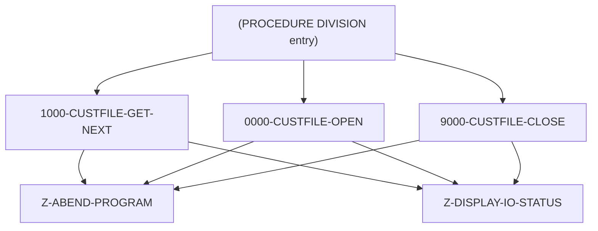

# Program CBCUS01C

| Item | Value |
|---|---|
| Source | `app/cbl/CBCUS01C.cbl` |
| Lines | 178 total, 130 code, 33 comment, 15 blank |
| PROGRAM-ID | CBCUS01C |
| Author | AWS |
| Runtime | batch-main |
| Module | base |
| CICS transactions | None in CSD |
| JCL steps | [READCUST](../06-batch/jobs/READCUST.md).STEP05 (`app/jcl/READCUST.jcl:21`) |
| Paragraphs | 6 |
| Semantic analysis | validated (batch B02) |
| Version banner | * Ver: CardDemo_v2.0-25-gdb72e6b-235 Date: 2025-04-29 11:01:28 CDT |

## Summary

CBCUS01C is a batch COBOL utility that prints the customer master file. It opens the indexed file CUSTFILE (500-byte records keyed by 9-digit customer id, layout CVCUS01Y) for sequential input, reads every record into CUSTOMER-RECORD and DISPLAYs it to SYSOUT until end of file. It writes no files. Any open, read or close error displays the file status as NNNN and abends with code 999 via CEE3ABD. (Confirmed)

Evidence: `app/cbl/CBCUS01C.cbl:1-5`, `app/cbl/CBCUS01C.cbl:28-45`, `app/cbl/CBCUS01C.cbl:70-116`

Header comment (Unverified, `app/cbl/CBCUS01C.cbl:1-8`): Program     : CBCUS01C.CBL Application : CardDemo Type        : BATCH COBOL Program Function    : Read and print customer data file. All Rights Reserved. http://www.apache.org/licenses/LICENSE-2.0

## Divisions and sections

| Division / section | Lines | Notes |
|---|---|---|
| IDENTIFICATION DIVISION | `app/cbl/CBCUS01C.cbl:22-25` |  |
| ENVIRONMENT DIVISION | `app/cbl/CBCUS01C.cbl:26-34` |  |
| DATA DIVISION | `app/cbl/CBCUS01C.cbl:35-69` |  |
| PROCEDURE DIVISION | `app/cbl/CBCUS01C.cbl:70-178` |  |
| ENVIRONMENT / INPUT-OUTPUT SECTION | `app/cbl/CBCUS01C.cbl:27-34` |  |
| DATA / FILE SECTION | `app/cbl/CBCUS01C.cbl:36-41` |  |
| DATA / WORKING-STORAGE SECTION | `app/cbl/CBCUS01C.cbl:42-69` |  |

## Files and data stores

| File | ASSIGN | Org | Access | Record key | Alt key | Status field | OPEN modes | Physical dataset (JCL) | Evidence |
|---|---|---|---|---|---|---|---|---|---|
| CUSTFILE-FILE | CUSTFILE | INDEXED | SEQUENTIAL | FD-CUST-ID |  | CUSTFILE-STATUS | INPUT (line 120) | AWS.M2.CARDDEMO.CUSTDATA.VSAM.KSDS (READCUST.STEP05 `app/jcl/READCUST.jcl:24-25`) | `app/cbl/CBCUS01C.cbl:29-33`, FD `app/cbl/CBCUS01C.cbl:37` |

CRUD summary from the program facts:

| Store | Kind | Ops | Evidence |
|---|---|---|---|
| CUSTFILE-FILE | logical | R | `app/cbl/CBCUS01C.cbl:93-120` |

## Embedded CICS, SQL and DL/I commands

No EXEC blocks.

## Calls, transfers and callers

| Mechanism | Target | Parameters | Paragraph | Lines |
|---|---|---|---|---|
| CALL system/LE | CEE3ABD | ABCODE, TIMING | Z-ABEND-PROGRAM | `app/cbl/CBCUS01C.cbl:158` |

## Copybooks

| Copybook | Statement | Resolution | Resolved path | REPLACING | Line |
|---|---|---|---|---|---|
| [CVCUS01Y](../08-data/layouts/CVCUS01Y.md) | COPY | inventory | app/cpy/CVCUS01Y.cpy |  | `app/cbl/CBCUS01C.cbl:45` |

## Data division items

Every data entry coded in this source (copybook contents are on the copybook pages). Lengths are computed from PIC and USAGE.

| Section | Lvl | Name | PIC | Usage | Len | OCCURS | REDEFINES | VALUE | 88-levels | Line |
|---|---|---|---|---|---|---|---|---|---|---|
| FILE | 01 | FD-CUSTFILE-REC |  |  |  |  |  |  |  | 38 |
| FILE | 05 | FD-CUST-ID | 9(09) |  | 9 |  |  |  |  | 39 |
| FILE | 05 | FD-CUST-DATA | X(491) |  | 491 |  |  |  |  | 40 |
| WORKING-STORAGE | 01 | CUSTFILE-STATUS |  |  |  |  |  |  |  | 46 |
| WORKING-STORAGE | 05 | CUSTFILE-STAT1 | X |  | 1 |  |  |  |  | 47 |
| WORKING-STORAGE | 05 | CUSTFILE-STAT2 | X |  | 1 |  |  |  |  | 48 |
| WORKING-STORAGE | 01 | IO-STATUS |  |  |  |  |  |  |  | 50 |
| WORKING-STORAGE | 05 | IO-STAT1 | X |  | 1 |  |  |  |  | 51 |
| WORKING-STORAGE | 05 | IO-STAT2 | X |  | 1 |  |  |  |  | 52 |
| WORKING-STORAGE | 01 | TWO-BYTES-BINARY | 9(4) | BINARY | 2 |  |  |  |  | 53 |
| WORKING-STORAGE | 01 | TWO-BYTES-ALPHA |  | BINARY |  |  | TWO-BYTES-BINARY |  |  | 54 |
| WORKING-STORAGE | 05 | TWO-BYTES-LEFT | X |  | 1 |  |  |  |  | 55 |
| WORKING-STORAGE | 05 | TWO-BYTES-RIGHT | X |  | 1 |  |  |  |  | 56 |
| WORKING-STORAGE | 01 | IO-STATUS-04 |  |  |  |  |  |  |  | 57 |
| WORKING-STORAGE | 05 | IO-STATUS-0401 | 9 |  | 1 |  |  | 0 |  | 58 |
| WORKING-STORAGE | 05 | IO-STATUS-0403 | 999 |  | 3 |  |  | 0 |  | 59 |
| WORKING-STORAGE | 01 | APPL-RESULT | S9(9) | COMP | 4 |  |  |  | APPL-AOK = 0; APPL-EOF = 16 | 61 |
| WORKING-STORAGE | 01 | END-OF-FILE | X(01) |  | 1 |  |  | 'N' |  | 65 |
| WORKING-STORAGE | 01 | ABCODE | S9(9) | BINARY | 4 |  |  |  |  | 66 |
| WORKING-STORAGE | 01 | TIMING | S9(9) | BINARY | 4 |  |  |  |  | 67 |

## Statement inventory

Every procedure statement the parser recorded, by kind. Each one is listed with its line under Paragraph details.

| Kind | Count |
|---|---|
| Decisions (IF, EVALUATE, WHEN, loops, handlers) | 12 |
| Calculations | 3 |
| File I/O | 3 |
| EXEC CICS / SQL / DLI | 0 |
| CALL | 1 |
| PERFORM | 10 |
| GO TO | 0 |
| MOVE literal | 11 |
| MOVE field | 7 |
| SET | 0 |
| STRING, UNSTRING, INSPECT, INITIALIZE, COPY, ENTRY and others | 0 |
| DISPLAY | 10 |
| GOBACK, STOP RUN, RETURN, XCTL | 1 |
| Not classified by the parser | 0 |

## Control flow

| Paragraph | Lines | Logic | Performs | Performed by | Reachable |
|---|---|---|---|---|---|
| [(PROCEDURE DIVISION entry)](#para-procedure-division-entry) | 71-87 | Displays a start banner, opens CUSTFILE, loops calling 1000-CUSTFILE-GET-NEXT until END-OF-FILE = 'Y' and displays CUSTOMER-RECORD after each successful read, then closes the file, displays an end banner and GOBACKs. (Confirmed) | 0000-CUSTFILE-OPEN, 1000-CUSTFILE-GET-NEXT, 9000-CUSTFILE-CLOSE |  | yes |
| [1000-CUSTFILE-GET-NEXT](#para-1000-custfile-get-next) | 92-116 | Reads the next CUSTFILE record into CUSTOMER-RECORD and displays it on status '00'. Status '10' sets APPL-RESULT 16 and END-OF-FILE 'Y'; any other status displays 'ERROR READING CUSTOMER FILE', the file status, and abends. (Confirmed) | Z-ABEND-PROGRAM, Z-DISPLAY-IO-STATUS | (PROCEDURE DIVISION entry) | yes |
| [0000-CUSTFILE-OPEN](#para-0000-custfile-open) | 118-134 | Opens CUSTFILE-FILE for input; a status other than '00' displays 'ERROR OPENING CUSTFILE', the status, and abends. (Confirmed) | Z-ABEND-PROGRAM, Z-DISPLAY-IO-STATUS | (PROCEDURE DIVISION entry) | yes |
| [9000-CUSTFILE-CLOSE](#para-9000-custfile-close) | 136-152 | Closes CUSTFILE-FILE; a status other than '00' displays 'ERROR CLOSING CUSTOMER FILE', the status, and abends. (Confirmed) | Z-ABEND-PROGRAM, Z-DISPLAY-IO-STATUS | (PROCEDURE DIVISION entry) | yes |
| [Z-ABEND-PROGRAM](#para-z-abend-program) | 154-158 | Displays 'ABENDING PROGRAM' and calls CEE3ABD with ABCODE 999 and TIMING 0. (Confirmed) |  | 0000-CUSTFILE-OPEN, 1000-CUSTFILE-GET-NEXT, 9000-CUSTFILE-CLOSE | yes |
| [Z-DISPLAY-IO-STATUS](#para-z-display-io-status) | 161-174 | Formats IO-STATUS into the 4-digit IO-STATUS-04 (binary conversion of the second byte for non-numeric or '9x' statuses, otherwise zero-padded) and displays 'FILE STATUS IS: NNNN' with it. (Confirmed) |  | 0000-CUSTFILE-OPEN, 1000-CUSTFILE-GET-NEXT, 9000-CUSTFILE-CLOSE | yes |

## Paragraph details

### Para (PROCEDURE DIVISION entry)

Lines `app/cbl/CBCUS01C.cbl:71-87`. 

Logic: Displays a start banner, opens CUSTFILE, loops calling 1000-CUSTFILE-GET-NEXT until END-OF-FILE = 'Y' and displays CUSTOMER-RECORD after each successful read, then closes the file, displays an end banner and GOBACKs. (Confirmed)

Statements in source order:

- `DISPLAY 'START OF EXECUTION OF PROGRAM CBCUS01C'` at `app/cbl/CBCUS01C.cbl:71`
- PERFORM 0000-CUSTFILE-OPEN at `app/cbl/CBCUS01C.cbl:72`
- LOOP `UNTIL END-OF-FILE = 'Y'` at `app/cbl/CBCUS01C.cbl:74` (io-status)
- Inline PERFORM `UNTIL END-OF-FILE = 'Y'` at `app/cbl/CBCUS01C.cbl:74`
- IF `END-OF-FILE = 'N'` at `app/cbl/CBCUS01C.cbl:75` (io-status)
- PERFORM 1000-CUSTFILE-GET-NEXT at `app/cbl/CBCUS01C.cbl:76`
- IF `END-OF-FILE = 'N'` at `app/cbl/CBCUS01C.cbl:77` (io-status)
- `DISPLAY CUSTOMER-RECORD` at `app/cbl/CBCUS01C.cbl:78`
- PERFORM 9000-CUSTFILE-CLOSE at `app/cbl/CBCUS01C.cbl:83`
- `DISPLAY 'END OF EXECUTION OF PROGRAM CBCUS01C'` at `app/cbl/CBCUS01C.cbl:85`
- Ends with GOBACK at `app/cbl/CBCUS01C.cbl:87`

### Para 1000-CUSTFILE-GET-NEXT

Lines `app/cbl/CBCUS01C.cbl:92-116`. 

Logic: Reads the next CUSTFILE record into CUSTOMER-RECORD and displays it on status '00'. Status '10' sets APPL-RESULT 16 and END-OF-FILE 'Y'; any other status displays 'ERROR READING CUSTOMER FILE', the file status, and abends. (Confirmed)

Statements in source order:

- File I/O `READ CUSTFILE-FILE INTO CUSTOMER-RECORD` at `app/cbl/CBCUS01C.cbl:93`
- IF `CUSTFILE-STATUS = '00'` at `app/cbl/CBCUS01C.cbl:94` (io-status)
- MOVE `0` TO APPL-RESULT at `app/cbl/CBCUS01C.cbl:95`
- `DISPLAY CUSTOMER-RECORD` at `app/cbl/CBCUS01C.cbl:96`
- IF `CUSTFILE-STATUS = '10'` at `app/cbl/CBCUS01C.cbl:98` (io-status)
- MOVE `16` TO APPL-RESULT at `app/cbl/CBCUS01C.cbl:99`
- MOVE `12` TO APPL-RESULT at `app/cbl/CBCUS01C.cbl:101`
- IF `APPL-AOK` at `app/cbl/CBCUS01C.cbl:104` (io-status)
- IF `APPL-EOF` at `app/cbl/CBCUS01C.cbl:107` (io-status)
- MOVE `'Y'` TO END-OF-FILE at `app/cbl/CBCUS01C.cbl:108`
- `DISPLAY 'ERROR READING CUSTOMER FILE'` at `app/cbl/CBCUS01C.cbl:110`
- `MOVE CUSTFILE-STATUS TO IO-STATUS` at `app/cbl/CBCUS01C.cbl:111`
- PERFORM Z-DISPLAY-IO-STATUS at `app/cbl/CBCUS01C.cbl:112`
- PERFORM Z-ABEND-PROGRAM at `app/cbl/CBCUS01C.cbl:113`

### Para 0000-CUSTFILE-OPEN

Lines `app/cbl/CBCUS01C.cbl:118-134`. 

Logic: Opens CUSTFILE-FILE for input; a status other than '00' displays 'ERROR OPENING CUSTFILE', the status, and abends. (Confirmed)

Statements in source order:

- MOVE `8` TO APPL-RESULT at `app/cbl/CBCUS01C.cbl:119`
- File I/O `OPEN INPUT CUSTFILE-FILE` at `app/cbl/CBCUS01C.cbl:120`
- IF `CUSTFILE-STATUS = '00'` at `app/cbl/CBCUS01C.cbl:121` (io-status)
- MOVE `0` TO APPL-RESULT at `app/cbl/CBCUS01C.cbl:122`
- MOVE `12` TO APPL-RESULT at `app/cbl/CBCUS01C.cbl:124`
- IF `APPL-AOK` at `app/cbl/CBCUS01C.cbl:126` (io-status)
- `DISPLAY 'ERROR OPENING CUSTFILE'` at `app/cbl/CBCUS01C.cbl:129`
- `MOVE CUSTFILE-STATUS TO IO-STATUS` at `app/cbl/CBCUS01C.cbl:130`
- PERFORM Z-DISPLAY-IO-STATUS at `app/cbl/CBCUS01C.cbl:131`
- PERFORM Z-ABEND-PROGRAM at `app/cbl/CBCUS01C.cbl:132`

### Para 9000-CUSTFILE-CLOSE

Lines `app/cbl/CBCUS01C.cbl:136-152`. 

Logic: Closes CUSTFILE-FILE; a status other than '00' displays 'ERROR CLOSING CUSTOMER FILE', the status, and abends. (Confirmed)

Statements in source order:

- Calculation `ADD 8 TO ZERO GIVING APPL-RESULT` at `app/cbl/CBCUS01C.cbl:137`
- File I/O `CLOSE CUSTFILE-FILE` at `app/cbl/CBCUS01C.cbl:138`
- IF `CUSTFILE-STATUS = '00'` at `app/cbl/CBCUS01C.cbl:139` (io-status)
- Calculation `SUBTRACT APPL-RESULT FROM APPL-RESULT` at `app/cbl/CBCUS01C.cbl:140`
- Calculation `ADD 12 TO ZERO GIVING APPL-RESULT` at `app/cbl/CBCUS01C.cbl:142`
- IF `APPL-AOK` at `app/cbl/CBCUS01C.cbl:144` (io-status)
- `DISPLAY 'ERROR CLOSING CUSTOMER FILE'` at `app/cbl/CBCUS01C.cbl:147`
- `MOVE CUSTFILE-STATUS TO IO-STATUS` at `app/cbl/CBCUS01C.cbl:148`
- PERFORM Z-DISPLAY-IO-STATUS at `app/cbl/CBCUS01C.cbl:149`
- PERFORM Z-ABEND-PROGRAM at `app/cbl/CBCUS01C.cbl:150`

### Para Z-ABEND-PROGRAM

Lines `app/cbl/CBCUS01C.cbl:154-158`. 

Logic: Displays 'ABENDING PROGRAM' and calls CEE3ABD with ABCODE 999 and TIMING 0. (Confirmed)

Statements in source order:

- `DISPLAY 'ABENDING PROGRAM'` at `app/cbl/CBCUS01C.cbl:155`
- MOVE `0` TO TIMING at `app/cbl/CBCUS01C.cbl:156`
- MOVE `999` TO ABCODE at `app/cbl/CBCUS01C.cbl:157`
- CALL CEE3ABD at `app/cbl/CBCUS01C.cbl:158`

### Para Z-DISPLAY-IO-STATUS

Lines `app/cbl/CBCUS01C.cbl:161-174`. 

Logic: Formats IO-STATUS into the 4-digit IO-STATUS-04 (binary conversion of the second byte for non-numeric or '9x' statuses, otherwise zero-padded) and displays 'FILE STATUS IS: NNNN' with it. (Confirmed)

Statements in source order:

- IF `IO-STATUS NOT NUMERIC OR IO-STAT1 = '9'` at `app/cbl/CBCUS01C.cbl:162-163` (io-status)
- `MOVE IO-STAT1 TO IO-STATUS-04(1:1)` at `app/cbl/CBCUS01C.cbl:164`
- MOVE `0` TO TWO-BYTES-BINARY at `app/cbl/CBCUS01C.cbl:165`
- `MOVE IO-STAT2 TO TWO-BYTES-RIGHT` at `app/cbl/CBCUS01C.cbl:166`
- `MOVE TWO-BYTES-BINARY TO IO-STATUS-0403` at `app/cbl/CBCUS01C.cbl:167`
- `DISPLAY 'FILE STATUS IS: NNNN' IO-STATUS-04` at `app/cbl/CBCUS01C.cbl:168`
- MOVE `'0000'` TO IO-STATUS-04 at `app/cbl/CBCUS01C.cbl:170`
- `MOVE IO-STATUS TO IO-STATUS-04(3:2)` at `app/cbl/CBCUS01C.cbl:171`
- `DISPLAY 'FILE STATUS IS: NNNN' IO-STATUS-04` at `app/cbl/CBCUS01C.cbl:172`

## Business rules

No business rules identified: CBCUS01C is a pure file-print utility: it opens the customer KSDS (CUSTFILE) for sequential input, DISPLAYs every CUSTOMER-RECORD to SYSOUT, and closes the file. Its only conditional logic is file-status handling (end of file, abend code 999 on any I/O error).

Decision coverage: 0 of 0 business-candidate decision points are linked to a rule or a no-rule reason (0 inside rule ranges).

## Error handling

| Paragraph | Kind | Detail | Lines |
|---|---|---|---|
| (PROCEDURE DIVISION entry) | check | `UNTIL END-OF-FILE = 'Y'` | `app/cbl/CBCUS01C.cbl:74` |
| (PROCEDURE DIVISION entry) | check | `END-OF-FILE = 'N'` | `app/cbl/CBCUS01C.cbl:75` |
| (PROCEDURE DIVISION entry) | check | `END-OF-FILE = 'N'` | `app/cbl/CBCUS01C.cbl:77` |
| 1000-CUSTFILE-GET-NEXT | check | `CUSTFILE-STATUS = '00'` | `app/cbl/CBCUS01C.cbl:94` |
| 1000-CUSTFILE-GET-NEXT | check | `CUSTFILE-STATUS = '10'` | `app/cbl/CBCUS01C.cbl:98` |
| 1000-CUSTFILE-GET-NEXT | check | `APPL-AOK` | `app/cbl/CBCUS01C.cbl:104` |
| 1000-CUSTFILE-GET-NEXT | check | `APPL-EOF` | `app/cbl/CBCUS01C.cbl:107` |
| 0000-CUSTFILE-OPEN | check | `CUSTFILE-STATUS = '00'` | `app/cbl/CBCUS01C.cbl:121` |
| 0000-CUSTFILE-OPEN | check | `APPL-AOK` | `app/cbl/CBCUS01C.cbl:126` |
| 9000-CUSTFILE-CLOSE | check | `CUSTFILE-STATUS = '00'` | `app/cbl/CBCUS01C.cbl:139` |
| 9000-CUSTFILE-CLOSE | check | `APPL-AOK` | `app/cbl/CBCUS01C.cbl:144` |
| Z-ABEND-PROGRAM | abend | CALL CEE3ABD | `app/cbl/CBCUS01C.cbl:158` |
| Z-DISPLAY-IO-STATUS | check | `IO-STATUS NOT NUMERIC OR IO-STAT1 = '9'` | `app/cbl/CBCUS01C.cbl:162-163` |

## Observations and SME questions

- anomaly: Each customer record is displayed twice: once in 1000-CUSTFILE-GET-NEXT after a successful read and again in the main loop. (`app/cbl/CBCUS01C.cbl:94-96`)
- security: The whole CUSTOMER-RECORD, including CUST-SSN, CUST-GOVT-ISSUED-ID and date of birth, is written to SYSOUT unmasked. (`app/cbl/CBCUS01C.cbl:74-81`)

## Sources

- `app/cbl/CBCUS01C.cbl`
- `docs/_work/structure/programs/CBCUS01C.json`
- `docs/_work/semantic/programs/CBCUS01C.json`
- `docs/_work/programs/CBCUS01C.json`

## Confidence

Structure tables (divisions, items, paragraphs, statements, line numbers) are Confirmed: they are parsed from the source. Paragraph logic and rule statements carry their own Confirmed/Inferred tag from the batch analysis, and every rule anchor was checked against the cited lines. Decision-point classes are a keyword heuristic used only for coverage measurement. Header comments are Unverified.
