# Program CBEXPORT

| Item | Value |
|---|---|
| Source | `app/cbl/CBEXPORT.cbl` |
| Lines | 582 total, 396 code, 91 comment, 95 blank |
| PROGRAM-ID | CBEXPORT |
| Author | CARDDEMO TEAM |
| Runtime | batch-main |
| Module | base |
| CICS transactions | None in CSD |
| JCL steps | [CBEXPORT](../06-batch/jobs/CBEXPORT.md).STEP02 (`app/jcl/CBEXPORT.jcl:43`) |
| Paragraphs | 21 |
| Semantic analysis | validated (batch B02) |
| Version banner | * Ver: CardDemo_v2.0-44-gb6e9c27-254 Date: 2025-10-16 14:07:18 CDT |

## Summary

CBEXPORT is a batch COBOL program that produces a branch-migration export file. It reads the customer (CUSTFILE), account (ACCTFILE), card cross-reference (XREFFILE), transaction (TRANSACT) and card (CARDFILE) indexed files sequentially and writes every record into one 500-byte multi-record file EXPFILE using the CVEXPORT layout. Each record gets a type code (C, A, X, T, D), a run timestamp, a global sequence number and constant branch '0001' / region 'NORTH'; several numeric fields are packed into COMP or COMP-3 to save space. At the end it displays per-type and total counts. Any open, read or write error abends the program via CEE3ABD. (Confirmed)

Evidence: `app/cbl/CBEXPORT.cbl:4-30`, `app/cbl/CBEXPORT.cbl:34-92`, `app/cbl/CBEXPORT.cbl:149-158`, `app/cbl/CBEXPORT.cbl:269-310`, `app/cbl/CBEXPORT.cbl:554-573`

Header comment (Unverified, `app/cbl/CBEXPORT.cbl:1-8`): Program     : CBEXPORT.CBL Application : CardDemo Type        : BATCH COBOL Program Function    : Export Customer Data for Branch Migration Reads normalized CardDemo files and creates multi-record export file for data migration

## Divisions and sections

| Division / section | Lines | Notes |
|---|---|---|
| IDENTIFICATION DIVISION | `app/cbl/CBEXPORT.cbl:1-31` |  |
| ENVIRONMENT DIVISION | `app/cbl/CBEXPORT.cbl:32-70` |  |
| DATA DIVISION | `app/cbl/CBEXPORT.cbl:71-145` |  |
| PROCEDURE DIVISION | `app/cbl/CBEXPORT.cbl:146-582` |  |
| ENVIRONMENT / INPUT-OUTPUT SECTION | `app/cbl/CBEXPORT.cbl:33-70` |  |
| DATA / FILE SECTION | `app/cbl/CBEXPORT.cbl:72-93` |  |
| DATA / WORKING-STORAGE SECTION | `app/cbl/CBEXPORT.cbl:94-145` |  |

## Files and data stores

| File | ASSIGN | Org | Access | Record key | Alt key | Status field | OPEN modes | Physical dataset (JCL) | Evidence |
|---|---|---|---|---|---|---|---|---|---|
| CUSTOMER-INPUT | CUSTFILE | INDEXED | SEQUENTIAL | CUST-ID |  | WS-CUSTOMER-STATUS | INPUT (line 200) | AWS.M2.CARDDEMO.CUSTDATA.VSAM.KSDS (CBEXPORT.STEP02 `app/jcl/CBEXPORT.jcl:49-50`) | `app/cbl/CBEXPORT.cbl:35-39`, FD `app/cbl/CBEXPORT.cbl:74` |
| ACCOUNT-INPUT | ACCTFILE | INDEXED | SEQUENTIAL | ACCT-ID |  | WS-ACCOUNT-STATUS | INPUT (line 207) | AWS.M2.CARDDEMO.ACCTDATA.VSAM.KSDS (CBEXPORT.STEP02 `app/jcl/CBEXPORT.jcl:51-52`) | `app/cbl/CBEXPORT.cbl:41-45`, FD `app/cbl/CBEXPORT.cbl:77` |
| XREF-INPUT | XREFFILE | INDEXED | SEQUENTIAL | XREF-CARD-NUM |  | WS-XREF-STATUS | INPUT (line 214) | AWS.M2.CARDDEMO.CARDXREF.VSAM.KSDS (CBEXPORT.STEP02 `app/jcl/CBEXPORT.jcl:53-54`) | `app/cbl/CBEXPORT.cbl:47-51`, FD `app/cbl/CBEXPORT.cbl:80` |
| TRANSACTION-INPUT | TRANSACT | INDEXED | SEQUENTIAL | TRAN-ID |  | WS-TRANSACTION-STATUS | INPUT (line 221) | AWS.M2.CARDDEMO.TRANSACT.VSAM.KSDS (CBEXPORT.STEP02 `app/jcl/CBEXPORT.jcl:55-56`) | `app/cbl/CBEXPORT.cbl:53-57`, FD `app/cbl/CBEXPORT.cbl:83` |
| CARD-INPUT | CARDFILE | INDEXED | SEQUENTIAL | CARD-NUM |  | WS-CARD-STATUS | INPUT (line 228) | AWS.M2.CARDDEMO.CARDDATA.VSAM.KSDS (CBEXPORT.STEP02 `app/jcl/CBEXPORT.jcl:57-58`) | `app/cbl/CBEXPORT.cbl:59-63`, FD `app/cbl/CBEXPORT.cbl:86` |
| EXPORT-OUTPUT | EXPFILE | INDEXED | SEQUENTIAL | EXPORT-SEQUENCE-NUM |  | WS-EXPORT-STATUS | OUTPUT (line 235) | AWS.M2.CARDDEMO.EXPORT.DATA (CBEXPORT.STEP02 `app/jcl/CBEXPORT.jcl:62-63`) | `app/cbl/CBEXPORT.cbl:65-69`, FD `app/cbl/CBEXPORT.cbl:89-91` |

CRUD summary from the program facts:

| Store | Kind | Ops | Evidence |
|---|---|---|---|
| CUSTOMER-INPUT | logical | R | `app/cbl/CBEXPORT.cbl:200-260` |
| ACCOUNT-INPUT | logical | R | `app/cbl/CBEXPORT.cbl:207-329` |
| XREF-INPUT | logical | R | `app/cbl/CBEXPORT.cbl:214-393` |
| CARD-INPUT | logical | R | `app/cbl/CBEXPORT.cbl:228-513` |
| EXPORT-OUTPUT | logical | C | `app/cbl/CBEXPORT.cbl:235` |
| TRANSACTION-INPUT | logical | R | `app/cbl/CBEXPORT.cbl:221-448` |

## Embedded CICS, SQL and DL/I commands

No EXEC blocks.

## Calls, transfers and callers

| Mechanism | Target | Parameters | Paragraph | Lines |
|---|---|---|---|---|
| CALL system/LE | CEE3ABD |  | 9999-ABEND-PROGRAM | `app/cbl/CBEXPORT.cbl:579` |

## Copybooks

| Copybook | Statement | Resolution | Resolved path | REPLACING | Line |
|---|---|---|---|---|---|
| [CVCUS01Y](../08-data/layouts/CVCUS01Y.md) | COPY | inventory | app/cpy/CVCUS01Y.cpy |  | `app/cbl/CBEXPORT.cbl:75` |
| [CVACT01Y](../08-data/layouts/CVACT01Y.md) | COPY | inventory | app/cpy/CVACT01Y.cpy |  | `app/cbl/CBEXPORT.cbl:78` |
| [CVACT03Y](../08-data/layouts/CVACT03Y.md) | COPY | inventory | app/cpy/CVACT03Y.cpy |  | `app/cbl/CBEXPORT.cbl:81` |
| [CVTRA05Y](../08-data/layouts/CVTRA05Y.md) | COPY | inventory | app/cpy/CVTRA05Y.cpy |  | `app/cbl/CBEXPORT.cbl:84` |
| [CVACT02Y](../08-data/layouts/CVACT02Y.md) | COPY | inventory | app/cpy/CVACT02Y.cpy |  | `app/cbl/CBEXPORT.cbl:87` |
| [CVEXPORT](../08-data/layouts/CVEXPORT.md) | COPY | inventory | app/cpy/CVEXPORT.cpy |  | `app/cbl/CBEXPORT.cbl:96` |

## Data division items

Every data entry coded in this source (copybook contents are on the copybook pages). Lengths are computed from PIC and USAGE.

| Section | Lvl | Name | PIC | Usage | Len | OCCURS | REDEFINES | VALUE | 88-levels | Line |
|---|---|---|---|---|---|---|---|---|---|---|
| FILE | 01 | EXPORT-OUTPUT-RECORD | X(500) |  | 500 |  |  |  |  | 92 |
| WORKING-STORAGE | 01 | WS-FILE-STATUS-AREA |  |  |  |  |  |  |  | 99 |
| WORKING-STORAGE | 05 | WS-CUSTOMER-STATUS | X(02) |  | 2 |  |  |  | WS-CUSTOMER-EOF = '10'; WS-CUSTOMER-OK = '00' | 100 |
| WORKING-STORAGE | 05 | WS-ACCOUNT-STATUS | X(02) |  | 2 |  |  |  | WS-ACCOUNT-EOF = '10'; WS-ACCOUNT-OK = '00' | 103 |
| WORKING-STORAGE | 05 | WS-XREF-STATUS | X(02) |  | 2 |  |  |  | WS-XREF-EOF = '10'; WS-XREF-OK = '00' | 106 |
| WORKING-STORAGE | 05 | WS-TRANSACTION-STATUS | X(02) |  | 2 |  |  |  | WS-TRANSACTION-EOF = '10'; WS-TRANSACTION-OK = '00' | 109 |
| WORKING-STORAGE | 05 | WS-CARD-STATUS | X(02) |  | 2 |  |  |  | WS-CARD-EOF = '10'; WS-CARD-OK = '00' | 112 |
| WORKING-STORAGE | 05 | WS-EXPORT-STATUS | X(02) |  | 2 |  |  |  | WS-EXPORT-OK = '00' | 115 |
| WORKING-STORAGE | 01 | WS-EXPORT-CONTROL |  |  |  |  |  |  |  | 119 |
| WORKING-STORAGE | 05 | WS-EXPORT-DATE | X(10) |  | 10 |  |  |  |  | 120 |
| WORKING-STORAGE | 05 | WS-EXPORT-TIME | X(08) |  | 8 |  |  |  |  | 121 |
| WORKING-STORAGE | 05 | WS-FORMATTED-TIMESTAMP | X(26) |  | 26 |  |  |  |  | 122 |
| WORKING-STORAGE | 05 | WS-SEQUENCE-COUNTER | 9(09) |  | 9 |  |  | 0 |  | 123 |
| WORKING-STORAGE | 01 | WS-TIMESTAMP-FIELDS |  |  |  |  |  |  |  | 126 |
| WORKING-STORAGE | 05 | WS-CURRENT-DATE |  |  |  |  |  |  |  | 127 |
| WORKING-STORAGE | 10 | WS-CURR-YEAR | 9(04) |  | 4 |  |  |  |  | 128 |
| WORKING-STORAGE | 10 | WS-CURR-MONTH | 9(02) |  | 2 |  |  |  |  | 129 |
| WORKING-STORAGE | 10 | WS-CURR-DAY | 9(02) |  | 2 |  |  |  |  | 130 |
| WORKING-STORAGE | 05 | WS-CURRENT-TIME |  |  |  |  |  |  |  | 131 |
| WORKING-STORAGE | 10 | WS-CURR-HOUR | 9(02) |  | 2 |  |  |  |  | 132 |
| WORKING-STORAGE | 10 | WS-CURR-MINUTE | 9(02) |  | 2 |  |  |  |  | 133 |
| WORKING-STORAGE | 10 | WS-CURR-SECOND | 9(02) |  | 2 |  |  |  |  | 134 |
| WORKING-STORAGE | 10 | WS-CURR-HUNDREDTH | 9(02) |  | 2 |  |  |  |  | 135 |
| WORKING-STORAGE | 01 | WS-EXPORT-STATISTICS |  |  |  |  |  |  |  | 138 |
| WORKING-STORAGE | 05 | WS-CUSTOMER-RECORDS-EXPORTED | 9(09) |  | 9 |  |  | 0 |  | 139 |
| WORKING-STORAGE | 05 | WS-ACCOUNT-RECORDS-EXPORTED | 9(09) |  | 9 |  |  | 0 |  | 140 |
| WORKING-STORAGE | 05 | WS-XREF-RECORDS-EXPORTED | 9(09) |  | 9 |  |  | 0 |  | 141 |
| WORKING-STORAGE | 05 | WS-TRAN-RECORDS-EXPORTED | 9(09) |  | 9 |  |  | 0 |  | 142 |
| WORKING-STORAGE | 05 | WS-CARD-RECORDS-EXPORTED | 9(09) |  | 9 |  |  | 0 |  | 143 |
| WORKING-STORAGE | 05 | WS-TOTAL-RECORDS-EXPORTED | 9(09) |  | 9 |  |  | 0 |  | 144 |

## Statement inventory

Every procedure statement the parser recorded, by kind. Each one is listed with its line under Paragraph details.

| Kind | Count |
|---|---|
| Decisions (IF, EVALUATE, WHEN, loops, handlers) | 21 |
| Calculations | 15 |
| File I/O | 22 |
| EXEC CICS / SQL / DLI | 0 |
| CALL | 1 |
| PERFORM | 45 |
| GO TO | 0 |
| MOVE literal | 15 |
| MOVE field | 62 |
| SET | 0 |
| STRING, UNSTRING, INSPECT, INITIALIZE, COPY, ENTRY and others | 10 |
| DISPLAY | 37 |
| GOBACK, STOP RUN, RETURN, XCTL | 1 |
| Not classified by the parser | 0 |

## Control flow

```mermaid
flowchart TD
    P0["0000-MAIN-PROCESSING"]
    P1["1000-INITIALIZE"]
    P2["1050-GENERATE-TIMESTAMP"]
    P3["1100-OPEN-FILES"]
    P4["2000-EXPORT-CUSTOMERS"]
    P5["2100-READ-CUSTOMER-RECORD"]
    P6["2200-CREATE-CUSTOMER-EXP-REC"]
    P7["3000-EXPORT-ACCOUNTS"]
    P8["3100-READ-ACCOUNT-RECORD"]
    P9["3200-CREATE-ACCOUNT-EXP-REC"]
    P10["4000-EXPORT-XREFS"]
    P11["4100-READ-XREF-RECORD"]
    P12["4200-CREATE-XREF-EXPORT-RECORD"]
    P13["5000-EXPORT-TRANSACTIONS"]
    P14["5100-READ-TRANSACTION-RECORD"]
    P15["5200-CREATE-TRAN-EXP-REC"]
    P16["5500-EXPORT-CARDS"]
    P17["5600-READ-CARD-RECORD"]
    P18["5700-CREATE-CARD-EXPORT-RECORD"]
    P19["6000-FINALIZE"]
    P20["9999-ABEND-PROGRAM"]
    P0 --> P1
    P0 --> P4
    P0 --> P7
    P0 --> P10
    P0 --> P13
    P0 --> P16
    P0 --> P19
    P1 --> P2
    P1 --> P3
    P3 --> P20
    P4 --> P5
    P4 --> P6
    P5 --> P20
    P6 --> P20
    P7 --> P8
    P7 --> P9
    P8 --> P20
    P9 --> P20
    P10 --> P11
    P10 --> P12
    P11 --> P20
    P12 --> P20
    P13 --> P14
    P13 --> P15
    P14 --> P20
    P15 --> P20
    P16 --> P17
    P16 --> P18
    P17 --> P20
    P18 --> P20
```

| Paragraph | Lines | Logic | Performs | Performed by | Reachable |
|---|---|---|---|---|---|
| [0000-MAIN-PROCESSING](#para-0000-main-processing) | 149-158 | Performs 1000-INITIALIZE, then 2000-EXPORT-CUSTOMERS, 3000-EXPORT-ACCOUNTS, 4000-EXPORT-XREFS, 5000-EXPORT-TRANSACTIONS and 5500-EXPORT-CARDS in that order, then 6000-FINALIZE, and ends with GOBACK. (Confirmed) | 1000-INITIALIZE, 2000-EXPORT-CUSTOMERS, 3000-EXPORT-ACCOUNTS, 4000-EXPORT-XREFS, 5000-EXPORT-TRANSACTIONS, 5500-EXPORT-CARDS, 6000-FINALIZE |  | yes |
| [1000-INITIALIZE](#para-1000-initialize) | 161-169 | Displays 'CBEXPORT: Starting Customer Data Export', performs 1050-GENERATE-TIMESTAMP and 1100-OPEN-FILES, then displays WS-EXPORT-DATE and WS-EXPORT-TIME. (Confirmed) | 1050-GENERATE-TIMESTAMP, 1100-OPEN-FILES | 0000-MAIN-PROCESSING | yes |
| [1050-GENERATE-TIMESTAMP](#para-1050-generate-timestamp) | 172-195 | Accepts the system date (YYYYMMDD) and time, formats WS-EXPORT-DATE as YYYY-MM-DD and WS-EXPORT-TIME as HH:MM:SS, and strings them with '.00' into WS-FORMATTED-TIMESTAMP. (Confirmed) |  | 1000-INITIALIZE | yes |
| [1100-OPEN-FILES](#para-1100-open-files) | 198-240 | Opens CUSTOMER-INPUT, ACCOUNT-INPUT, XREF-INPUT, TRANSACTION-INPUT and CARD-INPUT for INPUT and EXPORT-OUTPUT for OUTPUT. After each OPEN, when the status condition (WS-CUSTOMER-OK, WS-ACCOUNT-OK, WS-XREF-OK, WS-TRANSACTION-OK, WS-CARD-OK, WS-EXPORT-OK) is false it displays 'ERROR: Cannot open <file>, Status: ' with the status field and performs 9999-ABEND-PROGRAM. (Confirmed) | 9999-ABEND-PROGRAM | 1000-INITIALIZE | yes |
| [2000-EXPORT-CUSTOMERS](#para-2000-export-customers) | 243-255 | Reads customer records sequentially until WS-CUSTOMER-EOF, creating one export record per customer, then displays the customer export count. (Confirmed) | 2100-READ-CUSTOMER-RECORD, 2200-CREATE-CUSTOMER-EXP-REC | 0000-MAIN-PROCESSING | yes |
| [2100-READ-CUSTOMER-RECORD](#para-2100-read-customer-record) | 258-266 | Reads the next CUSTOMER-INPUT record; a status other than '00' or '10' displays 'ERROR: Reading CUSTOMER-INPUT, Status: ' and abends. (Confirmed) | 9999-ABEND-PROGRAM | 2000-EXPORT-CUSTOMERS | yes |
| [2200-CREATE-CUSTOMER-EXP-REC](#para-2200-create-customer-exp-rec) | 269-310 | Initializes EXPORT-RECORD, sets type 'C', timestamp, next sequence number, branch '0001' and region 'NORTH', maps all CUSTOMER-RECORD fields into EXPORT-CUSTOMER-DATA (address lines and phones into OCCURS arrays), writes the 500-byte record (abend on bad status) and increments the customer and total counters. (Confirmed) | 9999-ABEND-PROGRAM | 2000-EXPORT-CUSTOMERS | yes |
| [3000-EXPORT-ACCOUNTS](#para-3000-export-accounts) | 312-324 | Reads account records sequentially until WS-ACCOUNT-EOF, creating one export record per account, then displays the account export count. (Confirmed) | 3100-READ-ACCOUNT-RECORD, 3200-CREATE-ACCOUNT-EXP-REC | 0000-MAIN-PROCESSING | yes |
| [3100-READ-ACCOUNT-RECORD](#para-3100-read-account-record) | 327-335 | Reads the next ACCOUNT-INPUT record; a status other than '00' or '10' displays 'ERROR: Reading ACCOUNT-INPUT, Status: ' and abends. (Confirmed) | 9999-ABEND-PROGRAM | 3000-EXPORT-ACCOUNTS | yes |
| [3200-CREATE-ACCOUNT-EXP-REC](#para-3200-create-account-exp-rec) | 338-373 | Initializes EXPORT-RECORD, sets type 'A' and the common header, maps all ACCOUNT-RECORD fields into EXPORT-ACCOUNT-DATA (balance and cash limit become COMP-3, cycle debit COMP), writes the record (abend on bad status) and increments counters. (Confirmed) | 9999-ABEND-PROGRAM | 3000-EXPORT-ACCOUNTS | yes |
| [4000-EXPORT-XREFS](#para-4000-export-xrefs) | 376-388 | Reads cross-reference records sequentially until WS-XREF-EOF, creating one export record each, then displays the count. (Confirmed) | 4100-READ-XREF-RECORD, 4200-CREATE-XREF-EXPORT-RECORD | 0000-MAIN-PROCESSING | yes |
| [4100-READ-XREF-RECORD](#para-4100-read-xref-record) | 391-399 | Reads the next XREF-INPUT record; a status other than '00' or '10' displays 'ERROR: Reading XREF-INPUT, Status: ' and abends. (Confirmed) | 9999-ABEND-PROGRAM | 4000-EXPORT-XREFS | yes |
| [4200-CREATE-XREF-EXPORT-RECORD](#para-4200-create-xref-export-record) | 402-428 | Initializes EXPORT-RECORD, sets type 'X' and the common header, maps card number, customer id and account id (COMP) into EXPORT-CARD-XREF-DATA, writes the record (abend on bad status) and increments counters. (Confirmed) | 9999-ABEND-PROGRAM | 4000-EXPORT-XREFS | yes |
| [5000-EXPORT-TRANSACTIONS](#para-5000-export-transactions) | 431-443 | Reads transaction records sequentially until WS-TRANSACTION-EOF, creating one export record each, then displays the count. (Confirmed) | 5100-READ-TRANSACTION-RECORD, 5200-CREATE-TRAN-EXP-REC | 0000-MAIN-PROCESSING | yes |
| [5100-READ-TRANSACTION-RECORD](#para-5100-read-transaction-record) | 446-454 | Reads the next TRANSACTION-INPUT record; a status other than '00' or '10' displays 'ERROR: Reading TRANSACTION-INPUT, Status: ' and abends. (Confirmed) | 9999-ABEND-PROGRAM | 5000-EXPORT-TRANSACTIONS | yes |
| [5200-CREATE-TRAN-EXP-REC](#para-5200-create-tran-exp-rec) | 457-493 | Initializes EXPORT-RECORD, sets type 'T' and the common header, maps all TRAN-RECORD fields into EXPORT-TRANSACTION-DATA (amount COMP-3, merchant id COMP), writes the record (abend on bad status) and increments counters. (Confirmed) | 9999-ABEND-PROGRAM | 5000-EXPORT-TRANSACTIONS | yes |
| [5500-EXPORT-CARDS](#para-5500-export-cards) | 496-508 | Reads card records sequentially until WS-CARD-EOF, creating one export record each, then displays the count. (Confirmed) | 5600-READ-CARD-RECORD, 5700-CREATE-CARD-EXPORT-RECORD | 0000-MAIN-PROCESSING | yes |
| [5600-READ-CARD-RECORD](#para-5600-read-card-record) | 511-519 | Reads the next CARD-INPUT record; a status other than '00' or '10' displays 'ERROR: Reading CARD-INPUT, Status: ' and abends. (Confirmed) | 9999-ABEND-PROGRAM | 5500-EXPORT-CARDS | yes |
| [5700-CREATE-CARD-EXPORT-RECORD](#para-5700-create-card-export-record) | 522-551 | Initializes EXPORT-RECORD, sets type 'D' and the common header, maps card number, account id (COMP), CVV (COMP), embossed name, expiration date and active status into EXPORT-CARD-DATA, writes the record (abend on bad status) and increments counters. (Confirmed) | 9999-ABEND-PROGRAM | 5500-EXPORT-CARDS | yes |
| [6000-FINALIZE](#para-6000-finalize) | 554-573 | Closes CUSTOMER-INPUT, ACCOUNT-INPUT, XREF-INPUT, TRANSACTION-INPUT, CARD-INPUT and EXPORT-OUTPUT (statuses not checked), displays 'CBEXPORT: Export completed' and the counters WS-CUSTOMER-RECORDS-EXPORTED, WS-ACCOUNT-RECORDS-EXPORTED, WS-XREF-RECORDS-EXPORTED, WS-TRAN-RECORDS-EXPORTED, WS-CARD-RECORDS-EXPORTED and WS-TOTAL-RECORDS-EXPORTED. (Confirmed) |  | 0000-MAIN-PROCESSING | yes |
| [9999-ABEND-PROGRAM](#para-9999-abend-program) | 576-579 | Displays 'CBEXPORT: ABENDING PROGRAM' and calls CEE3ABD without parameters. (Confirmed) |  | 1100-OPEN-FILES, 2100-READ-CUSTOMER-RECORD, 2200-CREATE-CUSTOMER-EXP-REC, 3100-READ-ACCOUNT-RECORD, 3200-CREATE-ACCOUNT-EXP-REC, 4100-READ-XREF-RECORD, 4200-CREATE-XREF-EXPORT-RECORD, 5100-READ-TRANSACTION-RECORD, 5200-CREATE-TRAN-EXP-REC, 5600-READ-CARD-RECORD, 5700-CREATE-CARD-EXPORT-RECORD | yes |

## Paragraph details

### Para 0000-MAIN-PROCESSING

Lines `app/cbl/CBEXPORT.cbl:149-158`. 

Logic: Performs 1000-INITIALIZE, then 2000-EXPORT-CUSTOMERS, 3000-EXPORT-ACCOUNTS, 4000-EXPORT-XREFS, 5000-EXPORT-TRANSACTIONS and 5500-EXPORT-CARDS in that order, then 6000-FINALIZE, and ends with GOBACK. (Confirmed)

Rules: [BR-CBEXPORT-001](../09-business-rules-catalog.md#br-cbexport-001)

Statements in source order:

- PERFORM 1000-INITIALIZE at `app/cbl/CBEXPORT.cbl:151`
- PERFORM 2000-EXPORT-CUSTOMERS at `app/cbl/CBEXPORT.cbl:152`
- PERFORM 3000-EXPORT-ACCOUNTS at `app/cbl/CBEXPORT.cbl:153`
- PERFORM 4000-EXPORT-XREFS at `app/cbl/CBEXPORT.cbl:154`
- PERFORM 5000-EXPORT-TRANSACTIONS at `app/cbl/CBEXPORT.cbl:155`
- PERFORM 5500-EXPORT-CARDS at `app/cbl/CBEXPORT.cbl:156`
- PERFORM 6000-FINALIZE at `app/cbl/CBEXPORT.cbl:157`
- Ends with GOBACK at `app/cbl/CBEXPORT.cbl:158`

### Para 1000-INITIALIZE

Lines `app/cbl/CBEXPORT.cbl:161-169`. 

Logic: Displays 'CBEXPORT: Starting Customer Data Export', performs 1050-GENERATE-TIMESTAMP and 1100-OPEN-FILES, then displays WS-EXPORT-DATE and WS-EXPORT-TIME. (Confirmed)

Statements in source order:

- `DISPLAY 'CBEXPORT: Starting Customer Data Export'` at `app/cbl/CBEXPORT.cbl:163`
- PERFORM 1050-GENERATE-TIMESTAMP at `app/cbl/CBEXPORT.cbl:165`
- PERFORM 1100-OPEN-FILES at `app/cbl/CBEXPORT.cbl:166`
- `DISPLAY 'CBEXPORT: Export Date: ' WS-EXPORT-DATE` at `app/cbl/CBEXPORT.cbl:168`
- `DISPLAY 'CBEXPORT: Export Time: ' WS-EXPORT-TIME` at `app/cbl/CBEXPORT.cbl:169`

### Para 1050-GENERATE-TIMESTAMP

Lines `app/cbl/CBEXPORT.cbl:172-195`. 

Logic: Accepts the system date (YYYYMMDD) and time, formats WS-EXPORT-DATE as YYYY-MM-DD and WS-EXPORT-TIME as HH:MM:SS, and strings them with '.00' into WS-FORMATTED-TIMESTAMP. (Confirmed)

Statements in source order:

- `ACCEPT WS-CURRENT-DATE FROM DATE YYYYMMDD` at `app/cbl/CBEXPORT.cbl:175`
- `ACCEPT WS-CURRENT-TIME FROM TIME` at `app/cbl/CBEXPORT.cbl:176`
- `STRING WS-CURR-YEAR '-' WS-CURR-MONTH '-' WS-CURR-DAY DELIMITED BY SIZE INTO WS-EXPORT-DATE` at `app/cbl/CBEXPORT.cbl:179-181`
- `STRING WS-CURR-HOUR ':' WS-CURR-MINUTE ':' WS-CURR-SECOND DELIMITED BY SIZE INTO WS-EXPORT-TIME` at `app/cbl/CBEXPORT.cbl:185-187`
- `STRING WS-EXPORT-DATE ' ' WS-EXPORT-TIME '.00' DELIMITED BY SIZE INTO WS-FORMATTED-TIMESTAMP` at `app/cbl/CBEXPORT.cbl:191-193`

### Para 1100-OPEN-FILES

Lines `app/cbl/CBEXPORT.cbl:198-240`. 

Logic: Opens CUSTOMER-INPUT, ACCOUNT-INPUT, XREF-INPUT, TRANSACTION-INPUT and CARD-INPUT for INPUT and EXPORT-OUTPUT for OUTPUT. After each OPEN, when the status condition (WS-CUSTOMER-OK, WS-ACCOUNT-OK, WS-XREF-OK, WS-TRANSACTION-OK, WS-CARD-OK, WS-EXPORT-OK) is false it displays 'ERROR: Cannot open <file>, Status: ' with the status field and performs 9999-ABEND-PROGRAM. (Confirmed)

Rules: [BR-CBEXPORT-003](../09-business-rules-catalog.md#br-cbexport-003)

Statements in source order:

- File I/O `OPEN INPUT CUSTOMER-INPUT` at `app/cbl/CBEXPORT.cbl:200`
- IF `NOT WS-CUSTOMER-OK` at `app/cbl/CBEXPORT.cbl:201` (business-candidate)
- `DISPLAY 'ERROR: Cannot open CUSTOMER-INPUT, Status: ' WS-CUSTOMER-STATUS` at `app/cbl/CBEXPORT.cbl:202-203`
- PERFORM 9999-ABEND-PROGRAM at `app/cbl/CBEXPORT.cbl:204`
- File I/O `OPEN INPUT ACCOUNT-INPUT` at `app/cbl/CBEXPORT.cbl:207`
- IF `NOT WS-ACCOUNT-OK` at `app/cbl/CBEXPORT.cbl:208` (business-candidate)
- `DISPLAY 'ERROR: Cannot open ACCOUNT-INPUT, Status: ' WS-ACCOUNT-STATUS` at `app/cbl/CBEXPORT.cbl:209-210`
- PERFORM 9999-ABEND-PROGRAM at `app/cbl/CBEXPORT.cbl:211`
- File I/O `OPEN INPUT XREF-INPUT` at `app/cbl/CBEXPORT.cbl:214`
- IF `NOT WS-XREF-OK` at `app/cbl/CBEXPORT.cbl:215` (business-candidate)
- `DISPLAY 'ERROR: Cannot open XREF-INPUT, Status: ' WS-XREF-STATUS` at `app/cbl/CBEXPORT.cbl:216-217`
- PERFORM 9999-ABEND-PROGRAM at `app/cbl/CBEXPORT.cbl:218`
- File I/O `OPEN INPUT TRANSACTION-INPUT` at `app/cbl/CBEXPORT.cbl:221`
- IF `NOT WS-TRANSACTION-OK` at `app/cbl/CBEXPORT.cbl:222` (business-candidate)
- `DISPLAY 'ERROR: Cannot open TRANSACTION-INPUT, Status: ' WS-TRANSACTION-STATUS` at `app/cbl/CBEXPORT.cbl:223-224`
- PERFORM 9999-ABEND-PROGRAM at `app/cbl/CBEXPORT.cbl:225`
- File I/O `OPEN INPUT CARD-INPUT` at `app/cbl/CBEXPORT.cbl:228`
- IF `NOT WS-CARD-OK` at `app/cbl/CBEXPORT.cbl:229` (business-candidate)
- `DISPLAY 'ERROR: Cannot open CARD-INPUT, Status: ' WS-CARD-STATUS` at `app/cbl/CBEXPORT.cbl:230-231`
- PERFORM 9999-ABEND-PROGRAM at `app/cbl/CBEXPORT.cbl:232`
- File I/O `OPEN OUTPUT EXPORT-OUTPUT` at `app/cbl/CBEXPORT.cbl:235`
- IF `NOT WS-EXPORT-OK` at `app/cbl/CBEXPORT.cbl:236` (business-candidate)
- `DISPLAY 'ERROR: Cannot open EXPORT-OUTPUT, Status: ' WS-EXPORT-STATUS` at `app/cbl/CBEXPORT.cbl:237-238`
- PERFORM 9999-ABEND-PROGRAM at `app/cbl/CBEXPORT.cbl:239`

### Para 2000-EXPORT-CUSTOMERS

Lines `app/cbl/CBEXPORT.cbl:243-255`. 

Logic: Reads customer records sequentially until WS-CUSTOMER-EOF, creating one export record per customer, then displays the customer export count. (Confirmed)

Statements in source order:

- `DISPLAY 'CBEXPORT: Processing customer records'` at `app/cbl/CBEXPORT.cbl:245`
- PERFORM 2100-READ-CUSTOMER-RECORD at `app/cbl/CBEXPORT.cbl:247`
- LOOP `UNTIL WS-CUSTOMER-EOF` at `app/cbl/CBEXPORT.cbl:249` (io-status)
- Inline PERFORM `UNTIL WS-CUSTOMER-EOF` at `app/cbl/CBEXPORT.cbl:249`
- PERFORM 2200-CREATE-CUSTOMER-EXP-REC at `app/cbl/CBEXPORT.cbl:250`
- PERFORM 2100-READ-CUSTOMER-RECORD at `app/cbl/CBEXPORT.cbl:251`
- `DISPLAY 'CBEXPORT: Customers exported: ' WS-CUSTOMER-RECORDS-EXPORTED` at `app/cbl/CBEXPORT.cbl:254-255`

### Para 2100-READ-CUSTOMER-RECORD

Lines `app/cbl/CBEXPORT.cbl:258-266`. 

Logic: Reads the next CUSTOMER-INPUT record; a status other than '00' or '10' displays 'ERROR: Reading CUSTOMER-INPUT, Status: ' and abends. (Confirmed)

Statements in source order:

- File I/O `READ CUSTOMER-INPUT` at `app/cbl/CBEXPORT.cbl:260`
- IF `NOT WS-CUSTOMER-OK AND NOT WS-CUSTOMER-EOF` at `app/cbl/CBEXPORT.cbl:262` (io-status)
- `DISPLAY 'ERROR: Reading CUSTOMER-INPUT, Status: ' WS-CUSTOMER-STATUS` at `app/cbl/CBEXPORT.cbl:263-264`
- PERFORM 9999-ABEND-PROGRAM at `app/cbl/CBEXPORT.cbl:265`

### Para 2200-CREATE-CUSTOMER-EXP-REC

Lines `app/cbl/CBEXPORT.cbl:269-310`. 

Logic: Initializes EXPORT-RECORD, sets type 'C', timestamp, next sequence number, branch '0001' and region 'NORTH', maps all CUSTOMER-RECORD fields into EXPORT-CUSTOMER-DATA (address lines and phones into OCCURS arrays), writes the 500-byte record (abend on bad status) and increments the customer and total counters. (Confirmed)

Rules: [BR-CBEXPORT-002](../09-business-rules-catalog.md#br-cbexport-002), [BR-CBEXPORT-004](../09-business-rules-catalog.md#br-cbexport-004)

Statements in source order:

- `INITIALIZE EXPORT-RECORD` at `app/cbl/CBEXPORT.cbl:271`
- MOVE `'C'` TO EXPORT-REC-TYPE at `app/cbl/CBEXPORT.cbl:274`
- `MOVE WS-FORMATTED-TIMESTAMP TO EXPORT-TIMESTAMP` at `app/cbl/CBEXPORT.cbl:275`
- Calculation `ADD 1 TO WS-SEQUENCE-COUNTER` at `app/cbl/CBEXPORT.cbl:276`
- `MOVE WS-SEQUENCE-COUNTER TO EXPORT-SEQUENCE-NUM` at `app/cbl/CBEXPORT.cbl:277`
- MOVE `'0001'` TO EXPORT-BRANCH-ID at `app/cbl/CBEXPORT.cbl:278`
- MOVE `'NORTH'` TO EXPORT-REGION-CODE at `app/cbl/CBEXPORT.cbl:279`
- `MOVE CUST-ID TO EXP-CUST-ID` at `app/cbl/CBEXPORT.cbl:282`
- `MOVE CUST-FIRST-NAME TO EXP-CUST-FIRST-NAME` at `app/cbl/CBEXPORT.cbl:283`
- `MOVE CUST-MIDDLE-NAME TO EXP-CUST-MIDDLE-NAME` at `app/cbl/CBEXPORT.cbl:284`
- `MOVE CUST-LAST-NAME TO EXP-CUST-LAST-NAME` at `app/cbl/CBEXPORT.cbl:285`
- `MOVE CUST-ADDR-LINE-1 TO EXP-CUST-ADDR-LINE(1)` at `app/cbl/CBEXPORT.cbl:286`
- `MOVE CUST-ADDR-LINE-2 TO EXP-CUST-ADDR-LINE(2)` at `app/cbl/CBEXPORT.cbl:287`
- `MOVE CUST-ADDR-LINE-3 TO EXP-CUST-ADDR-LINE(3)` at `app/cbl/CBEXPORT.cbl:288`
- `MOVE CUST-ADDR-STATE-CD TO EXP-CUST-ADDR-STATE-CD` at `app/cbl/CBEXPORT.cbl:289`
- `MOVE CUST-ADDR-COUNTRY-CD TO EXP-CUST-ADDR-COUNTRY-CD` at `app/cbl/CBEXPORT.cbl:290`
- `MOVE CUST-ADDR-ZIP TO EXP-CUST-ADDR-ZIP` at `app/cbl/CBEXPORT.cbl:291`
- `MOVE CUST-PHONE-NUM-1 TO EXP-CUST-PHONE-NUM(1)` at `app/cbl/CBEXPORT.cbl:292`
- `MOVE CUST-PHONE-NUM-2 TO EXP-CUST-PHONE-NUM(2)` at `app/cbl/CBEXPORT.cbl:293`
- `MOVE CUST-SSN TO EXP-CUST-SSN` at `app/cbl/CBEXPORT.cbl:294`
- `MOVE CUST-GOVT-ISSUED-ID TO EXP-CUST-GOVT-ISSUED-ID` at `app/cbl/CBEXPORT.cbl:295`
- `MOVE CUST-DOB-YYYY-MM-DD TO EXP-CUST-DOB-YYYY-MM-DD` at `app/cbl/CBEXPORT.cbl:296`
- `MOVE CUST-EFT-ACCOUNT-ID TO EXP-CUST-EFT-ACCOUNT-ID` at `app/cbl/CBEXPORT.cbl:297`
- `MOVE CUST-PRI-CARD-HOLDER-IND TO EXP-CUST-PRI-CARD-HOLDER-IND` at `app/cbl/CBEXPORT.cbl:298`
- `MOVE CUST-FICO-CREDIT-SCORE TO EXP-CUST-FICO-CREDIT-SCORE` at `app/cbl/CBEXPORT.cbl:299`
- File I/O `WRITE EXPORT-OUTPUT-RECORD FROM EXPORT-RECORD` at `app/cbl/CBEXPORT.cbl:301`
- IF `NOT WS-EXPORT-OK` at `app/cbl/CBEXPORT.cbl:303` (business-candidate)
- `DISPLAY 'ERROR: Writing export record, Status: ' WS-EXPORT-STATUS` at `app/cbl/CBEXPORT.cbl:304-305`
- PERFORM 9999-ABEND-PROGRAM at `app/cbl/CBEXPORT.cbl:306`
- Calculation `ADD 1 TO WS-CUSTOMER-RECORDS-EXPORTED` at `app/cbl/CBEXPORT.cbl:309`
- Calculation `ADD 1 TO WS-TOTAL-RECORDS-EXPORTED` at `app/cbl/CBEXPORT.cbl:310`

### Para 3000-EXPORT-ACCOUNTS

Lines `app/cbl/CBEXPORT.cbl:312-324`. 

Logic: Reads account records sequentially until WS-ACCOUNT-EOF, creating one export record per account, then displays the account export count. (Confirmed)

Statements in source order:

- `DISPLAY 'CBEXPORT: Processing account records'` at `app/cbl/CBEXPORT.cbl:314`
- PERFORM 3100-READ-ACCOUNT-RECORD at `app/cbl/CBEXPORT.cbl:316`
- LOOP `UNTIL WS-ACCOUNT-EOF` at `app/cbl/CBEXPORT.cbl:318` (io-status)
- Inline PERFORM `UNTIL WS-ACCOUNT-EOF` at `app/cbl/CBEXPORT.cbl:318`
- PERFORM 3200-CREATE-ACCOUNT-EXP-REC at `app/cbl/CBEXPORT.cbl:319`
- PERFORM 3100-READ-ACCOUNT-RECORD at `app/cbl/CBEXPORT.cbl:320`
- `DISPLAY 'CBEXPORT: Accounts exported: ' WS-ACCOUNT-RECORDS-EXPORTED` at `app/cbl/CBEXPORT.cbl:323-324`

### Para 3100-READ-ACCOUNT-RECORD

Lines `app/cbl/CBEXPORT.cbl:327-335`. 

Logic: Reads the next ACCOUNT-INPUT record; a status other than '00' or '10' displays 'ERROR: Reading ACCOUNT-INPUT, Status: ' and abends. (Confirmed)

Statements in source order:

- File I/O `READ ACCOUNT-INPUT` at `app/cbl/CBEXPORT.cbl:329`
- IF `NOT WS-ACCOUNT-OK AND NOT WS-ACCOUNT-EOF` at `app/cbl/CBEXPORT.cbl:331` (io-status)
- `DISPLAY 'ERROR: Reading ACCOUNT-INPUT, Status: ' WS-ACCOUNT-STATUS` at `app/cbl/CBEXPORT.cbl:332-333`
- PERFORM 9999-ABEND-PROGRAM at `app/cbl/CBEXPORT.cbl:334`

### Para 3200-CREATE-ACCOUNT-EXP-REC

Lines `app/cbl/CBEXPORT.cbl:338-373`. 

Logic: Initializes EXPORT-RECORD, sets type 'A' and the common header, maps all ACCOUNT-RECORD fields into EXPORT-ACCOUNT-DATA (balance and cash limit become COMP-3, cycle debit COMP), writes the record (abend on bad status) and increments counters. (Confirmed)

Statements in source order:

- `INITIALIZE EXPORT-RECORD` at `app/cbl/CBEXPORT.cbl:340`
- MOVE `'A'` TO EXPORT-REC-TYPE at `app/cbl/CBEXPORT.cbl:343`
- `MOVE WS-FORMATTED-TIMESTAMP TO EXPORT-TIMESTAMP` at `app/cbl/CBEXPORT.cbl:344`
- Calculation `ADD 1 TO WS-SEQUENCE-COUNTER` at `app/cbl/CBEXPORT.cbl:345`
- `MOVE WS-SEQUENCE-COUNTER TO EXPORT-SEQUENCE-NUM` at `app/cbl/CBEXPORT.cbl:346`
- MOVE `'0001'` TO EXPORT-BRANCH-ID at `app/cbl/CBEXPORT.cbl:347`
- MOVE `'NORTH'` TO EXPORT-REGION-CODE at `app/cbl/CBEXPORT.cbl:348`
- `MOVE ACCT-ID TO EXP-ACCT-ID` at `app/cbl/CBEXPORT.cbl:351`
- `MOVE ACCT-ACTIVE-STATUS TO EXP-ACCT-ACTIVE-STATUS` at `app/cbl/CBEXPORT.cbl:352`
- `MOVE ACCT-CURR-BAL TO EXP-ACCT-CURR-BAL` at `app/cbl/CBEXPORT.cbl:353`
- `MOVE ACCT-CREDIT-LIMIT TO EXP-ACCT-CREDIT-LIMIT` at `app/cbl/CBEXPORT.cbl:354`
- `MOVE ACCT-CASH-CREDIT-LIMIT TO EXP-ACCT-CASH-CREDIT-LIMIT` at `app/cbl/CBEXPORT.cbl:355`
- `MOVE ACCT-OPEN-DATE TO EXP-ACCT-OPEN-DATE` at `app/cbl/CBEXPORT.cbl:356`
- `MOVE ACCT-EXPIRAION-DATE TO EXP-ACCT-EXPIRAION-DATE` at `app/cbl/CBEXPORT.cbl:357`
- `MOVE ACCT-REISSUE-DATE TO EXP-ACCT-REISSUE-DATE` at `app/cbl/CBEXPORT.cbl:358`
- `MOVE ACCT-CURR-CYC-CREDIT TO EXP-ACCT-CURR-CYC-CREDIT` at `app/cbl/CBEXPORT.cbl:359`
- `MOVE ACCT-CURR-CYC-DEBIT TO EXP-ACCT-CURR-CYC-DEBIT` at `app/cbl/CBEXPORT.cbl:360`
- `MOVE ACCT-ADDR-ZIP TO EXP-ACCT-ADDR-ZIP` at `app/cbl/CBEXPORT.cbl:361`
- `MOVE ACCT-GROUP-ID TO EXP-ACCT-GROUP-ID` at `app/cbl/CBEXPORT.cbl:362`
- File I/O `WRITE EXPORT-OUTPUT-RECORD FROM EXPORT-RECORD` at `app/cbl/CBEXPORT.cbl:364`
- IF `NOT WS-EXPORT-OK` at `app/cbl/CBEXPORT.cbl:366` (business-candidate)
- `DISPLAY 'ERROR: Writing export record, Status: ' WS-EXPORT-STATUS` at `app/cbl/CBEXPORT.cbl:367-368`
- PERFORM 9999-ABEND-PROGRAM at `app/cbl/CBEXPORT.cbl:369`
- Calculation `ADD 1 TO WS-ACCOUNT-RECORDS-EXPORTED` at `app/cbl/CBEXPORT.cbl:372`
- Calculation `ADD 1 TO WS-TOTAL-RECORDS-EXPORTED` at `app/cbl/CBEXPORT.cbl:373`

### Para 4000-EXPORT-XREFS

Lines `app/cbl/CBEXPORT.cbl:376-388`. 

Logic: Reads cross-reference records sequentially until WS-XREF-EOF, creating one export record each, then displays the count. (Confirmed)

Statements in source order:

- `DISPLAY 'CBEXPORT: Processing cross-reference records'` at `app/cbl/CBEXPORT.cbl:378`
- PERFORM 4100-READ-XREF-RECORD at `app/cbl/CBEXPORT.cbl:380`
- LOOP `UNTIL WS-XREF-EOF` at `app/cbl/CBEXPORT.cbl:382` (io-status)
- Inline PERFORM `UNTIL WS-XREF-EOF` at `app/cbl/CBEXPORT.cbl:382`
- PERFORM 4200-CREATE-XREF-EXPORT-RECORD at `app/cbl/CBEXPORT.cbl:383`
- PERFORM 4100-READ-XREF-RECORD at `app/cbl/CBEXPORT.cbl:384`
- `DISPLAY 'CBEXPORT: Cross-references exported: ' WS-XREF-RECORDS-EXPORTED` at `app/cbl/CBEXPORT.cbl:387-388`

### Para 4100-READ-XREF-RECORD

Lines `app/cbl/CBEXPORT.cbl:391-399`. 

Logic: Reads the next XREF-INPUT record; a status other than '00' or '10' displays 'ERROR: Reading XREF-INPUT, Status: ' and abends. (Confirmed)

Statements in source order:

- File I/O `READ XREF-INPUT` at `app/cbl/CBEXPORT.cbl:393`
- IF `NOT WS-XREF-OK AND NOT WS-XREF-EOF` at `app/cbl/CBEXPORT.cbl:395` (io-status)
- `DISPLAY 'ERROR: Reading XREF-INPUT, Status: ' WS-XREF-STATUS` at `app/cbl/CBEXPORT.cbl:396-397`
- PERFORM 9999-ABEND-PROGRAM at `app/cbl/CBEXPORT.cbl:398`

### Para 4200-CREATE-XREF-EXPORT-RECORD

Lines `app/cbl/CBEXPORT.cbl:402-428`. 

Logic: Initializes EXPORT-RECORD, sets type 'X' and the common header, maps card number, customer id and account id (COMP) into EXPORT-CARD-XREF-DATA, writes the record (abend on bad status) and increments counters. (Confirmed)

Statements in source order:

- `INITIALIZE EXPORT-RECORD` at `app/cbl/CBEXPORT.cbl:404`
- MOVE `'X'` TO EXPORT-REC-TYPE at `app/cbl/CBEXPORT.cbl:407`
- `MOVE WS-FORMATTED-TIMESTAMP TO EXPORT-TIMESTAMP` at `app/cbl/CBEXPORT.cbl:408`
- Calculation `ADD 1 TO WS-SEQUENCE-COUNTER` at `app/cbl/CBEXPORT.cbl:409`
- `MOVE WS-SEQUENCE-COUNTER TO EXPORT-SEQUENCE-NUM` at `app/cbl/CBEXPORT.cbl:410`
- MOVE `'0001'` TO EXPORT-BRANCH-ID at `app/cbl/CBEXPORT.cbl:411`
- MOVE `'NORTH'` TO EXPORT-REGION-CODE at `app/cbl/CBEXPORT.cbl:412`
- `MOVE XREF-CARD-NUM TO EXP-XREF-CARD-NUM` at `app/cbl/CBEXPORT.cbl:415`
- `MOVE XREF-CUST-ID TO EXP-XREF-CUST-ID` at `app/cbl/CBEXPORT.cbl:416`
- `MOVE XREF-ACCT-ID TO EXP-XREF-ACCT-ID` at `app/cbl/CBEXPORT.cbl:417`
- File I/O `WRITE EXPORT-OUTPUT-RECORD FROM EXPORT-RECORD` at `app/cbl/CBEXPORT.cbl:419`
- IF `NOT WS-EXPORT-OK` at `app/cbl/CBEXPORT.cbl:421` (business-candidate)
- `DISPLAY 'ERROR: Writing export record, Status: ' WS-EXPORT-STATUS` at `app/cbl/CBEXPORT.cbl:422-423`
- PERFORM 9999-ABEND-PROGRAM at `app/cbl/CBEXPORT.cbl:424`
- Calculation `ADD 1 TO WS-XREF-RECORDS-EXPORTED` at `app/cbl/CBEXPORT.cbl:427`
- Calculation `ADD 1 TO WS-TOTAL-RECORDS-EXPORTED` at `app/cbl/CBEXPORT.cbl:428`

### Para 5000-EXPORT-TRANSACTIONS

Lines `app/cbl/CBEXPORT.cbl:431-443`. 

Logic: Reads transaction records sequentially until WS-TRANSACTION-EOF, creating one export record each, then displays the count. (Confirmed)

Statements in source order:

- `DISPLAY 'CBEXPORT: Processing transaction records'` at `app/cbl/CBEXPORT.cbl:433`
- PERFORM 5100-READ-TRANSACTION-RECORD at `app/cbl/CBEXPORT.cbl:435`
- LOOP `UNTIL WS-TRANSACTION-EOF` at `app/cbl/CBEXPORT.cbl:437` (io-status)
- Inline PERFORM `UNTIL WS-TRANSACTION-EOF` at `app/cbl/CBEXPORT.cbl:437`
- PERFORM 5200-CREATE-TRAN-EXP-REC at `app/cbl/CBEXPORT.cbl:438`
- PERFORM 5100-READ-TRANSACTION-RECORD at `app/cbl/CBEXPORT.cbl:439`
- `DISPLAY 'CBEXPORT: Transactions exported: ' WS-TRAN-RECORDS-EXPORTED` at `app/cbl/CBEXPORT.cbl:442-443`

### Para 5100-READ-TRANSACTION-RECORD

Lines `app/cbl/CBEXPORT.cbl:446-454`. 

Logic: Reads the next TRANSACTION-INPUT record; a status other than '00' or '10' displays 'ERROR: Reading TRANSACTION-INPUT, Status: ' and abends. (Confirmed)

Statements in source order:

- File I/O `READ TRANSACTION-INPUT` at `app/cbl/CBEXPORT.cbl:448`
- IF `NOT WS-TRANSACTION-OK AND NOT WS-TRANSACTION-EOF` at `app/cbl/CBEXPORT.cbl:450` (io-status)
- `DISPLAY 'ERROR: Reading TRANSACTION-INPUT, Status: ' WS-TRANSACTION-STATUS` at `app/cbl/CBEXPORT.cbl:451-452`
- PERFORM 9999-ABEND-PROGRAM at `app/cbl/CBEXPORT.cbl:453`

### Para 5200-CREATE-TRAN-EXP-REC

Lines `app/cbl/CBEXPORT.cbl:457-493`. 

Logic: Initializes EXPORT-RECORD, sets type 'T' and the common header, maps all TRAN-RECORD fields into EXPORT-TRANSACTION-DATA (amount COMP-3, merchant id COMP), writes the record (abend on bad status) and increments counters. (Confirmed)

Statements in source order:

- `INITIALIZE EXPORT-RECORD` at `app/cbl/CBEXPORT.cbl:459`
- MOVE `'T'` TO EXPORT-REC-TYPE at `app/cbl/CBEXPORT.cbl:462`
- `MOVE WS-FORMATTED-TIMESTAMP TO EXPORT-TIMESTAMP` at `app/cbl/CBEXPORT.cbl:463`
- Calculation `ADD 1 TO WS-SEQUENCE-COUNTER` at `app/cbl/CBEXPORT.cbl:464`
- `MOVE WS-SEQUENCE-COUNTER TO EXPORT-SEQUENCE-NUM` at `app/cbl/CBEXPORT.cbl:465`
- MOVE `'0001'` TO EXPORT-BRANCH-ID at `app/cbl/CBEXPORT.cbl:466`
- MOVE `'NORTH'` TO EXPORT-REGION-CODE at `app/cbl/CBEXPORT.cbl:467`
- `MOVE TRAN-ID TO EXP-TRAN-ID` at `app/cbl/CBEXPORT.cbl:470`
- `MOVE TRAN-TYPE-CD TO EXP-TRAN-TYPE-CD` at `app/cbl/CBEXPORT.cbl:471`
- `MOVE TRAN-CAT-CD TO EXP-TRAN-CAT-CD` at `app/cbl/CBEXPORT.cbl:472`
- `MOVE TRAN-SOURCE TO EXP-TRAN-SOURCE` at `app/cbl/CBEXPORT.cbl:473`
- `MOVE TRAN-DESC TO EXP-TRAN-DESC` at `app/cbl/CBEXPORT.cbl:474`
- `MOVE TRAN-AMT TO EXP-TRAN-AMT` at `app/cbl/CBEXPORT.cbl:475`
- `MOVE TRAN-MERCHANT-ID TO EXP-TRAN-MERCHANT-ID` at `app/cbl/CBEXPORT.cbl:476`
- `MOVE TRAN-MERCHANT-NAME TO EXP-TRAN-MERCHANT-NAME` at `app/cbl/CBEXPORT.cbl:477`
- `MOVE TRAN-MERCHANT-CITY TO EXP-TRAN-MERCHANT-CITY` at `app/cbl/CBEXPORT.cbl:478`
- `MOVE TRAN-MERCHANT-ZIP TO EXP-TRAN-MERCHANT-ZIP` at `app/cbl/CBEXPORT.cbl:479`
- `MOVE TRAN-CARD-NUM TO EXP-TRAN-CARD-NUM` at `app/cbl/CBEXPORT.cbl:480`
- `MOVE TRAN-ORIG-TS TO EXP-TRAN-ORIG-TS` at `app/cbl/CBEXPORT.cbl:481`
- `MOVE TRAN-PROC-TS TO EXP-TRAN-PROC-TS` at `app/cbl/CBEXPORT.cbl:482`
- File I/O `WRITE EXPORT-OUTPUT-RECORD FROM EXPORT-RECORD` at `app/cbl/CBEXPORT.cbl:484`
- IF `NOT WS-EXPORT-OK` at `app/cbl/CBEXPORT.cbl:486` (business-candidate)
- `DISPLAY 'ERROR: Writing export record, Status: ' WS-EXPORT-STATUS` at `app/cbl/CBEXPORT.cbl:487-488`
- PERFORM 9999-ABEND-PROGRAM at `app/cbl/CBEXPORT.cbl:489`
- Calculation `ADD 1 TO WS-TRAN-RECORDS-EXPORTED` at `app/cbl/CBEXPORT.cbl:492`
- Calculation `ADD 1 TO WS-TOTAL-RECORDS-EXPORTED` at `app/cbl/CBEXPORT.cbl:493`

### Para 5500-EXPORT-CARDS

Lines `app/cbl/CBEXPORT.cbl:496-508`. 

Logic: Reads card records sequentially until WS-CARD-EOF, creating one export record each, then displays the count. (Confirmed)

Statements in source order:

- `DISPLAY 'CBEXPORT: Processing card records'` at `app/cbl/CBEXPORT.cbl:498`
- PERFORM 5600-READ-CARD-RECORD at `app/cbl/CBEXPORT.cbl:500`
- LOOP `UNTIL WS-CARD-EOF` at `app/cbl/CBEXPORT.cbl:502` (io-status)
- Inline PERFORM `UNTIL WS-CARD-EOF` at `app/cbl/CBEXPORT.cbl:502`
- PERFORM 5700-CREATE-CARD-EXPORT-RECORD at `app/cbl/CBEXPORT.cbl:503`
- PERFORM 5600-READ-CARD-RECORD at `app/cbl/CBEXPORT.cbl:504`
- `DISPLAY 'CBEXPORT: Cards exported: ' WS-CARD-RECORDS-EXPORTED` at `app/cbl/CBEXPORT.cbl:507-508`

### Para 5600-READ-CARD-RECORD

Lines `app/cbl/CBEXPORT.cbl:511-519`. 

Logic: Reads the next CARD-INPUT record; a status other than '00' or '10' displays 'ERROR: Reading CARD-INPUT, Status: ' and abends. (Confirmed)

Statements in source order:

- File I/O `READ CARD-INPUT` at `app/cbl/CBEXPORT.cbl:513`
- IF `NOT WS-CARD-OK AND NOT WS-CARD-EOF` at `app/cbl/CBEXPORT.cbl:515` (io-status)
- `DISPLAY 'ERROR: Reading CARD-INPUT, Status: ' WS-CARD-STATUS` at `app/cbl/CBEXPORT.cbl:516-517`
- PERFORM 9999-ABEND-PROGRAM at `app/cbl/CBEXPORT.cbl:518`

### Para 5700-CREATE-CARD-EXPORT-RECORD

Lines `app/cbl/CBEXPORT.cbl:522-551`. 

Logic: Initializes EXPORT-RECORD, sets type 'D' and the common header, maps card number, account id (COMP), CVV (COMP), embossed name, expiration date and active status into EXPORT-CARD-DATA, writes the record (abend on bad status) and increments counters. (Confirmed)

Statements in source order:

- `INITIALIZE EXPORT-RECORD` at `app/cbl/CBEXPORT.cbl:524`
- MOVE `'D'` TO EXPORT-REC-TYPE at `app/cbl/CBEXPORT.cbl:527`
- `MOVE WS-FORMATTED-TIMESTAMP TO EXPORT-TIMESTAMP` at `app/cbl/CBEXPORT.cbl:528`
- Calculation `ADD 1 TO WS-SEQUENCE-COUNTER` at `app/cbl/CBEXPORT.cbl:529`
- `MOVE WS-SEQUENCE-COUNTER TO EXPORT-SEQUENCE-NUM` at `app/cbl/CBEXPORT.cbl:530`
- MOVE `'0001'` TO EXPORT-BRANCH-ID at `app/cbl/CBEXPORT.cbl:531`
- MOVE `'NORTH'` TO EXPORT-REGION-CODE at `app/cbl/CBEXPORT.cbl:532`
- `MOVE CARD-NUM TO EXP-CARD-NUM` at `app/cbl/CBEXPORT.cbl:535`
- `MOVE CARD-ACCT-ID TO EXP-CARD-ACCT-ID` at `app/cbl/CBEXPORT.cbl:536`
- `MOVE CARD-CVV-CD TO EXP-CARD-CVV-CD` at `app/cbl/CBEXPORT.cbl:537`
- `MOVE CARD-EMBOSSED-NAME TO EXP-CARD-EMBOSSED-NAME` at `app/cbl/CBEXPORT.cbl:538`
- `MOVE CARD-EXPIRAION-DATE TO EXP-CARD-EXPIRAION-DATE` at `app/cbl/CBEXPORT.cbl:539`
- `MOVE CARD-ACTIVE-STATUS TO EXP-CARD-ACTIVE-STATUS` at `app/cbl/CBEXPORT.cbl:540`
- File I/O `WRITE EXPORT-OUTPUT-RECORD FROM EXPORT-RECORD` at `app/cbl/CBEXPORT.cbl:542`
- IF `NOT WS-EXPORT-OK` at `app/cbl/CBEXPORT.cbl:544` (business-candidate)
- `DISPLAY 'ERROR: Writing export record, Status: ' WS-EXPORT-STATUS` at `app/cbl/CBEXPORT.cbl:545-546`
- PERFORM 9999-ABEND-PROGRAM at `app/cbl/CBEXPORT.cbl:547`
- Calculation `ADD 1 TO WS-CARD-RECORDS-EXPORTED` at `app/cbl/CBEXPORT.cbl:550`
- Calculation `ADD 1 TO WS-TOTAL-RECORDS-EXPORTED` at `app/cbl/CBEXPORT.cbl:551`

### Para 6000-FINALIZE

Lines `app/cbl/CBEXPORT.cbl:554-573`. 

Logic: Closes CUSTOMER-INPUT, ACCOUNT-INPUT, XREF-INPUT, TRANSACTION-INPUT, CARD-INPUT and EXPORT-OUTPUT (statuses not checked), displays 'CBEXPORT: Export completed' and the counters WS-CUSTOMER-RECORDS-EXPORTED, WS-ACCOUNT-RECORDS-EXPORTED, WS-XREF-RECORDS-EXPORTED, WS-TRAN-RECORDS-EXPORTED, WS-CARD-RECORDS-EXPORTED and WS-TOTAL-RECORDS-EXPORTED. (Confirmed)

Statements in source order:

- File I/O `CLOSE CUSTOMER-INPUT` at `app/cbl/CBEXPORT.cbl:556`
- File I/O `CLOSE ACCOUNT-INPUT` at `app/cbl/CBEXPORT.cbl:557`
- File I/O `CLOSE XREF-INPUT` at `app/cbl/CBEXPORT.cbl:558`
- File I/O `CLOSE TRANSACTION-INPUT` at `app/cbl/CBEXPORT.cbl:559`
- File I/O `CLOSE CARD-INPUT` at `app/cbl/CBEXPORT.cbl:560`
- File I/O `CLOSE EXPORT-OUTPUT` at `app/cbl/CBEXPORT.cbl:561`
- `DISPLAY 'CBEXPORT: Export completed'` at `app/cbl/CBEXPORT.cbl:563`
- `DISPLAY 'CBEXPORT: Customers Exported: ' WS-CUSTOMER-RECORDS-EXPORTED` at `app/cbl/CBEXPORT.cbl:564-565`
- `DISPLAY 'CBEXPORT: Accounts Exported: ' WS-ACCOUNT-RECORDS-EXPORTED` at `app/cbl/CBEXPORT.cbl:566-567`
- `DISPLAY 'CBEXPORT: XRefs Exported: ' WS-XREF-RECORDS-EXPORTED` at `app/cbl/CBEXPORT.cbl:568`
- `DISPLAY 'CBEXPORT: Transactions Exported: ' WS-TRAN-RECORDS-EXPORTED` at `app/cbl/CBEXPORT.cbl:569-570`
- `DISPLAY 'CBEXPORT: Cards Exported: ' WS-CARD-RECORDS-EXPORTED` at `app/cbl/CBEXPORT.cbl:571`
- `DISPLAY 'CBEXPORT: Total Records Exported: ' WS-TOTAL-RECORDS-EXPORTED` at `app/cbl/CBEXPORT.cbl:572-573`

### Para 9999-ABEND-PROGRAM

Lines `app/cbl/CBEXPORT.cbl:576-579`. 

Logic: Displays 'CBEXPORT: ABENDING PROGRAM' and calls CEE3ABD without parameters. (Confirmed)

Statements in source order:

- `DISPLAY 'CBEXPORT: ABENDING PROGRAM'` at `app/cbl/CBEXPORT.cbl:578`
- CALL CEE3ABD at `app/cbl/CBEXPORT.cbl:579`

## Business rules

| Rule | Category | Statement | Paragraph | Source | Confidence |
|---|---|---|---|---|---|
| [BR-CBEXPORT-001](../09-business-rules-catalog.md#br-cbexport-001) | decision | The branch-migration export is a full, unfiltered extract: every customer, account, card cross-reference, transaction and card record is exported, in that fixed order (one entity type after another), with no selection criteria. | 0000-MAIN-PROCESSING | `app/cbl/CBEXPORT.cbl:151-157`, `app/cbl/CBEXPORT.cbl:249-252` | Confirmed |
| [BR-CBEXPORT-002](../09-business-rules-catalog.md#br-cbexport-002) | transformation | Each export record carries a type code identifying the entity ('C' customer, 'A' account, 'X' card cross-reference, 'T' transaction, 'D' card), the run timestamp, a sequence number incremented across all record types, branch id '0001' and region code 'NORTH'. | 2200-CREATE-CUSTOMER-EXP-REC | `app/cbl/CBEXPORT.cbl:273-279`, `app/cbl/CBEXPORT.cbl:343-348`, `app/cbl/CBEXPORT.cbl:407-412`, `app/cbl/CBEXPORT.cbl:462-467`, `app/cbl/CBEXPORT.cbl:527-532` | Confirmed |
| [BR-CBEXPORT-003](../09-business-rules-catalog.md#br-cbexport-003) | error-policy | Any failure to open a source or export file, or any read status other than success/end-of-file, stops the export with an error message naming the file and its status and an abend via CEE3ABD. | 1100-OPEN-FILES | `app/cbl/CBEXPORT.cbl:200-240`, `app/cbl/CBEXPORT.cbl:262-266`, `app/cbl/CBEXPORT.cbl:331-335`, `app/cbl/CBEXPORT.cbl:395-399`, `app/cbl/CBEXPORT.cbl:450-454`, `app/cbl/CBEXPORT.cbl:515-519` | Confirmed |
| [BR-CBEXPORT-004](../09-business-rules-catalog.md#br-cbexport-004) | error-policy | A failed write of any export record (status not '00') aborts the whole export run; no record is skipped silently. | 2200-CREATE-CUSTOMER-EXP-REC | `app/cbl/CBEXPORT.cbl:301-307`, `app/cbl/CBEXPORT.cbl:364-370`, `app/cbl/CBEXPORT.cbl:419-425`, `app/cbl/CBEXPORT.cbl:484-490`, `app/cbl/CBEXPORT.cbl:542-548` | Confirmed |

Decision coverage: 11 of 11 business-candidate decision points are linked to a rule or a no-rule reason (11 inside rule ranges).

## Error handling

| Paragraph | Kind | Detail | Lines |
|---|---|---|---|
| 2000-EXPORT-CUSTOMERS | check | `UNTIL WS-CUSTOMER-EOF` | `app/cbl/CBEXPORT.cbl:249` |
| 2100-READ-CUSTOMER-RECORD | check | `NOT WS-CUSTOMER-OK AND NOT WS-CUSTOMER-EOF` | `app/cbl/CBEXPORT.cbl:262` |
| 3000-EXPORT-ACCOUNTS | check | `UNTIL WS-ACCOUNT-EOF` | `app/cbl/CBEXPORT.cbl:318` |
| 3100-READ-ACCOUNT-RECORD | check | `NOT WS-ACCOUNT-OK AND NOT WS-ACCOUNT-EOF` | `app/cbl/CBEXPORT.cbl:331` |
| 4000-EXPORT-XREFS | check | `UNTIL WS-XREF-EOF` | `app/cbl/CBEXPORT.cbl:382` |
| 4100-READ-XREF-RECORD | check | `NOT WS-XREF-OK AND NOT WS-XREF-EOF` | `app/cbl/CBEXPORT.cbl:395` |
| 5000-EXPORT-TRANSACTIONS | check | `UNTIL WS-TRANSACTION-EOF` | `app/cbl/CBEXPORT.cbl:437` |
| 5100-READ-TRANSACTION-RECORD | check | `NOT WS-TRANSACTION-OK AND NOT WS-TRANSACTION-EOF` | `app/cbl/CBEXPORT.cbl:450` |
| 5500-EXPORT-CARDS | check | `UNTIL WS-CARD-EOF` | `app/cbl/CBEXPORT.cbl:502` |
| 5600-READ-CARD-RECORD | check | `NOT WS-CARD-OK AND NOT WS-CARD-EOF` | `app/cbl/CBEXPORT.cbl:515` |
| 9999-ABEND-PROGRAM | abend | CALL CEE3ABD | `app/cbl/CBEXPORT.cbl:579` |

## Observations and SME questions

- anomaly: EXPORT-OUTPUT is declared ORGANIZATION INDEXED with RECORD KEY EXPORT-SEQUENCE-NUM, but EXPORT-SEQUENCE-NUM belongs to EXPORT-RECORD in WORKING-STORAGE (COPY CVEXPORT), not to the FD record EXPORT-OUTPUT-RECORD; the FD also states RECORDING MODE F. A record key outside the file's record area is not valid COBOL, so the intended organization (KSDS vs sequential) needs confirmation. (`app/cbl/CBEXPORT.cbl:65-69`)
- hardcoded-value: Every export record is stamped with branch id '0001' and region 'NORTH' regardless of the data. (`app/cbl/CBEXPORT.cbl:278-279`)
- security: Customer SSN, government id, and card CVV are copied in clear text into the export file (CVV stored as binary COMP, which is not encryption). (`app/cbl/CBEXPORT.cbl:293-294`)
- unchecked-io: 6000-FINALIZE closes all six files without checking any file status. (`app/cbl/CBEXPORT.cbl:556-561`)
- anomaly: WS-FORMATTED-TIMESTAMP (X(26)) is built from date (10) + space + time (8) + '.00' = 22 characters; STRING does not pad, so the last 4 bytes are never set by the program. (`app/cbl/CBEXPORT.cbl:190-193`)
- anomaly: 9999-ABEND-PROGRAM calls CEE3ABD with no abend code or timing parameters, unlike other CardDemo batch programs which pass ABCODE 999. (`app/cbl/CBEXPORT.cbl:576-579`)
- earlier pass: DD name TRANSACT is used with more than one dataset name across jobs. Each name is tied to the JCL line in physical_names. (Confirmed, `app/cbl/CBEXPORT.cbl:53-57`)
- SME question: Is EXPFILE meant to be a VSAM KSDS keyed by sequence number or a plain sequential file? The SELECT says INDEXED but the key is not in the FD record. (`app/cbl/CBEXPORT.cbl:65-69`)
- SME question: Should branch id and region code be parameters instead of the constants '0001' and 'NORTH'? (`app/cbl/CBEXPORT.cbl:278-279`)
- SME question: Is exporting SSN and CVV in clear text acceptable for the migration file, or must they be masked/encrypted? (`app/cbl/CBEXPORT.cbl:536-538`)

## Sources

- `app/cbl/CBEXPORT.cbl`
- `docs/_work/structure/programs/CBEXPORT.json`
- `docs/_work/semantic/programs/CBEXPORT.json`
- `docs/_work/programs/CBEXPORT.json`

## Confidence

Structure tables (divisions, items, paragraphs, statements, line numbers) are Confirmed: they are parsed from the source. Paragraph logic and rule statements carry their own Confirmed/Inferred tag from the batch analysis, and every rule anchor was checked against the cited lines. Decision-point classes are a keyword heuristic used only for coverage measurement. Header comments are Unverified.
