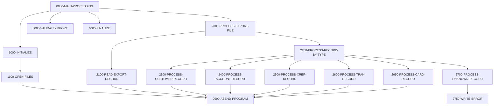

# Program CBIMPORT

| Item | Value |
|---|---|
| Source | `app/cbl/CBIMPORT.cbl` |
| Lines | 487 total, 337 code, 74 comment, 76 blank |
| PROGRAM-ID | CBIMPORT |
| Author | CARDDEMO TEAM |
| Runtime | batch-main |
| Module | base |
| CICS transactions | None in CSD |
| JCL steps | [CBIMPORT](../06-batch/jobs/CBIMPORT.md).STEP01 (`app/jcl/CBIMPORT.jcl:22`) |
| Paragraphs | 16 |
| Semantic analysis | validated (batch B02) |
| Version banner | * Ver: CardDemo_v2.0-44-gb6e9c27-254 Date: 2025-10-16 14:07:18 CDT |

## Summary

CBIMPORT is the batch counterpart of CBEXPORT for branch migration. It reads the 500-byte multi-record export file EXPFILE (layout CVEXPORT) and splits it by record type into sequential customer (CUSTOUT), account (ACCTOUT), card cross-reference (XREFOUT), transaction (TRNXOUT) and card (CARDOUT) files in the standard CardDemo layouts, unpacking COMP/COMP-3 fields. Records with an unknown type are logged to the 132-byte error file ERROUT and skipped. The validation step is a stub that always reports no errors. It ends by displaying read, import, error and unknown-type counts; open, read and master-file write errors abend the run via CEE3ABD. (Confirmed)

Evidence: `app/cbl/CBIMPORT.cbl:4-32`, `app/cbl/CBIMPORT.cbl:36-109`, `app/cbl/CBIMPORT.cbl:165-171`, `app/cbl/CBIMPORT.cbl:270-285`, `app/cbl/CBIMPORT.cbl:425-446`

Header comment (Unverified, `app/cbl/CBIMPORT.cbl:1-8`): Program     : CBIMPORT.CBL Application : CardDemo Type        : BATCH COBOL Program Function    : Import Customer Data from Branch Migration Export Reads multi-record export file and splits it into separate normalized target files (CUSTOMER, ACCOUN

## Divisions and sections

| Division / section | Lines | Notes |
|---|---|---|
| IDENTIFICATION DIVISION | `app/cbl/CBIMPORT.cbl:1-33` |  |
| ENVIRONMENT DIVISION | `app/cbl/CBIMPORT.cbl:34-72` |  |
| DATA DIVISION | `app/cbl/CBIMPORT.cbl:73-161` |  |
| PROCEDURE DIVISION | `app/cbl/CBIMPORT.cbl:162-487` |  |
| ENVIRONMENT / INPUT-OUTPUT SECTION | `app/cbl/CBIMPORT.cbl:35-72` |  |
| DATA / FILE SECTION | `app/cbl/CBIMPORT.cbl:74-110` |  |
| DATA / WORKING-STORAGE SECTION | `app/cbl/CBIMPORT.cbl:111-161` |  |

## Files and data stores

| File | ASSIGN | Org | Access | Record key | Alt key | Status field | OPEN modes | Physical dataset (JCL) | Evidence |
|---|---|---|---|---|---|---|---|---|---|
| EXPORT-INPUT | EXPFILE | INDEXED | SEQUENTIAL | EXPORT-SEQUENCE-NUM |  | WS-EXPORT-STATUS | INPUT (line 198) | AWS.M2.CARDDEMO.EXPORT.DATA (CBIMPORT.STEP01 `app/jcl/CBIMPORT.jcl:28-29`) | `app/cbl/CBIMPORT.cbl:37-41`, FD `app/cbl/CBIMPORT.cbl:76-78` |
| CUSTOMER-OUTPUT | CUSTOUT | SEQUENTIAL | SEQUENTIAL |  |  | WS-CUSTOMER-STATUS | OUTPUT (line 205) | AWS.M2.CARDDEMO.CUSTDATA.IMPORT (CBIMPORT.STEP01 `app/jcl/CBIMPORT.jcl:33-37`) | `app/cbl/CBIMPORT.cbl:43-46`, FD `app/cbl/CBIMPORT.cbl:81-83` |
| ACCOUNT-OUTPUT | ACCTOUT | SEQUENTIAL | SEQUENTIAL |  |  | WS-ACCOUNT-STATUS | OUTPUT (line 212) | AWS.M2.CARDDEMO.ACCTDATA.IMPORT (CBIMPORT.STEP01 `app/jcl/CBIMPORT.jcl:38-42`) | `app/cbl/CBIMPORT.cbl:48-51`, FD `app/cbl/CBIMPORT.cbl:86-88` |
| XREF-OUTPUT | XREFOUT | SEQUENTIAL | SEQUENTIAL |  |  | WS-XREF-STATUS | OUTPUT (line 219) | AWS.M2.CARDDEMO.CARDXREF.IMPORT (CBIMPORT.STEP01 `app/jcl/CBIMPORT.jcl:43-47`) | `app/cbl/CBIMPORT.cbl:53-56`, FD `app/cbl/CBIMPORT.cbl:91-93` |
| TRANSACTION-OUTPUT | TRNXOUT | SEQUENTIAL | SEQUENTIAL |  |  | WS-TRANSACTION-STATUS | OUTPUT (line 226) | AWS.M2.CARDDEMO.TRANSACT.IMPORT (CBIMPORT.STEP01 `app/jcl/CBIMPORT.jcl:48-52`) | `app/cbl/CBIMPORT.cbl:58-61`, FD `app/cbl/CBIMPORT.cbl:96-98` |
| CARD-OUTPUT | CARDOUT | SEQUENTIAL | SEQUENTIAL |  |  | WS-CARD-STATUS | OUTPUT (line 233) | No JCL step found for this program | `app/cbl/CBIMPORT.cbl:63-66`, FD `app/cbl/CBIMPORT.cbl:101-103` |
| ERROR-OUTPUT | ERROUT | SEQUENTIAL | SEQUENTIAL |  |  | WS-ERROR-STATUS | OUTPUT (line 240) | AWS.M2.CARDDEMO.IMPORT.ERRORS (CBIMPORT.STEP01 `app/jcl/CBIMPORT.jcl:56-60`) | `app/cbl/CBIMPORT.cbl:68-71`, FD `app/cbl/CBIMPORT.cbl:106-108` |

CRUD summary from the program facts:

| Store | Kind | Ops | Evidence |
|---|---|---|---|
| EXPORT-INPUT | logical | R | `app/cbl/CBIMPORT.cbl:198-261` |
| ACCOUNT-OUTPUT | logical | C | `app/cbl/CBIMPORT.cbl:212` |
| TRANSACTION-OUTPUT | logical | C | `app/cbl/CBIMPORT.cbl:226` |
| XREF-OUTPUT | logical | C | `app/cbl/CBIMPORT.cbl:219` |
| ERROR-OUTPUT | logical | C | `app/cbl/CBIMPORT.cbl:439` |
| CUSTOMER-OUTPUT | logical | C | `app/cbl/CBIMPORT.cbl:205` |
| CARD-OUTPUT | logical | C | `app/cbl/CBIMPORT.cbl:233` |

## Embedded CICS, SQL and DL/I commands

No EXEC blocks.

## Calls, transfers and callers

| Mechanism | Target | Parameters | Paragraph | Lines |
|---|---|---|---|---|
| CALL system/LE | CEE3ABD |  | 9999-ABEND-PROGRAM | `app/cbl/CBIMPORT.cbl:484` |

## Copybooks

| Copybook | Statement | Resolution | Resolved path | REPLACING | Line |
|---|---|---|---|---|---|
| [CVCUS01Y](../08-data/layouts/CVCUS01Y.md) | COPY | inventory | app/cpy/CVCUS01Y.cpy |  | `app/cbl/CBIMPORT.cbl:84` |
| [CVACT01Y](../08-data/layouts/CVACT01Y.md) | COPY | inventory | app/cpy/CVACT01Y.cpy |  | `app/cbl/CBIMPORT.cbl:89` |
| [CVACT03Y](../08-data/layouts/CVACT03Y.md) | COPY | inventory | app/cpy/CVACT03Y.cpy |  | `app/cbl/CBIMPORT.cbl:94` |
| [CVTRA05Y](../08-data/layouts/CVTRA05Y.md) | COPY | inventory | app/cpy/CVTRA05Y.cpy |  | `app/cbl/CBIMPORT.cbl:99` |
| [CVACT02Y](../08-data/layouts/CVACT02Y.md) | COPY | inventory | app/cpy/CVACT02Y.cpy |  | `app/cbl/CBIMPORT.cbl:104` |
| [CVEXPORT](../08-data/layouts/CVEXPORT.md) | COPY | inventory | app/cpy/CVEXPORT.cpy |  | `app/cbl/CBIMPORT.cbl:113` |

## Data division items

Every data entry coded in this source (copybook contents are on the copybook pages). Lengths are computed from PIC and USAGE.

| Section | Lvl | Name | PIC | Usage | Len | OCCURS | REDEFINES | VALUE | 88-levels | Line |
|---|---|---|---|---|---|---|---|---|---|---|
| FILE | 01 | EXPORT-INPUT-RECORD | X(500) |  | 500 |  |  |  |  | 79 |
| FILE | 01 | ERROR-OUTPUT-RECORD | X(132) |  | 132 |  |  |  |  | 109 |
| WORKING-STORAGE | 01 | WS-FILE-STATUS-AREA |  |  |  |  |  |  |  | 116 |
| WORKING-STORAGE | 05 | WS-EXPORT-STATUS | X(02) |  | 2 |  |  |  | WS-EXPORT-EOF = '10'; WS-EXPORT-OK = '00' | 117 |
| WORKING-STORAGE | 05 | WS-CUSTOMER-STATUS | X(02) |  | 2 |  |  |  | WS-CUSTOMER-OK = '00' | 120 |
| WORKING-STORAGE | 05 | WS-ACCOUNT-STATUS | X(02) |  | 2 |  |  |  | WS-ACCOUNT-OK = '00' | 122 |
| WORKING-STORAGE | 05 | WS-XREF-STATUS | X(02) |  | 2 |  |  |  | WS-XREF-OK = '00' | 124 |
| WORKING-STORAGE | 05 | WS-TRANSACTION-STATUS | X(02) |  | 2 |  |  |  | WS-TRANSACTION-OK = '00' | 126 |
| WORKING-STORAGE | 05 | WS-CARD-STATUS | X(02) |  | 2 |  |  |  | WS-CARD-OK = '00' | 128 |
| WORKING-STORAGE | 05 | WS-ERROR-STATUS | X(02) |  | 2 |  |  |  | WS-ERROR-OK = '00' | 130 |
| WORKING-STORAGE | 01 | WS-IMPORT-CONTROL |  |  |  |  |  |  |  | 134 |
| WORKING-STORAGE | 05 | WS-IMPORT-DATE | X(10) |  | 10 |  |  |  |  | 135 |
| WORKING-STORAGE | 05 | WS-IMPORT-TIME | X(08) |  | 8 |  |  |  |  | 136 |
| WORKING-STORAGE | 01 | WS-IMPORT-STATISTICS |  |  |  |  |  |  |  | 139 |
| WORKING-STORAGE | 05 | WS-TOTAL-RECORDS-READ | 9(09) |  | 9 |  |  | 0 |  | 140 |
| WORKING-STORAGE | 05 | WS-CUSTOMER-RECORDS-IMPORTED | 9(09) |  | 9 |  |  | 0 |  | 141 |
| WORKING-STORAGE | 05 | WS-ACCOUNT-RECORDS-IMPORTED | 9(09) |  | 9 |  |  | 0 |  | 142 |
| WORKING-STORAGE | 05 | WS-XREF-RECORDS-IMPORTED | 9(09) |  | 9 |  |  | 0 |  | 143 |
| WORKING-STORAGE | 05 | WS-TRAN-RECORDS-IMPORTED | 9(09) |  | 9 |  |  | 0 |  | 144 |
| WORKING-STORAGE | 05 | WS-CARD-RECORDS-IMPORTED | 9(09) |  | 9 |  |  | 0 |  | 145 |
| WORKING-STORAGE | 05 | WS-ERROR-RECORDS-WRITTEN | 9(09) |  | 9 |  |  | 0 |  | 146 |
| WORKING-STORAGE | 05 | WS-UNKNOWN-RECORD-TYPE-COUNT | 9(09) |  | 9 |  |  | 0 |  | 147 |
| WORKING-STORAGE | 01 | WS-ERROR-RECORD |  |  |  |  |  |  |  | 152 |
| WORKING-STORAGE | 05 | ERR-TIMESTAMP | X(26) |  | 26 |  |  |  |  | 153 |
| WORKING-STORAGE | 05 | FILLER | X(01) |  | 1 |  |  | '\|' |  | 154 |
| WORKING-STORAGE | 05 | ERR-RECORD-TYPE | X(01) |  | 1 |  |  |  |  | 155 |
| WORKING-STORAGE | 05 | FILLER | X(01) |  | 1 |  |  | '\|' |  | 156 |
| WORKING-STORAGE | 05 | ERR-SEQUENCE | 9(07) |  | 7 |  |  |  |  | 157 |
| WORKING-STORAGE | 05 | FILLER | X(01) |  | 1 |  |  | '\|' |  | 158 |
| WORKING-STORAGE | 05 | ERR-MESSAGE | X(50) |  | 50 |  |  |  |  | 159 |
| WORKING-STORAGE | 05 | FILLER | X(43) |  | 43 |  |  | SPACES |  | 160 |

## Statement inventory

Every procedure statement the parser recorded, by kind. Each one is listed with its line under Paragraph details.

| Kind | Count |
|---|---|
| Decisions (IF, EVALUATE, WHEN, loops, handlers) | 22 |
| Calculations | 8 |
| File I/O | 21 |
| EXEC CICS / SQL / DLI | 0 |
| CALL | 1 |
| PERFORM | 29 |
| GO TO | 0 |
| MOVE literal | 5 |
| MOVE field | 61 |
| SET | 0 |
| STRING, UNSTRING, INSPECT, INITIALIZE, COPY, ENTRY and others | 5 |
| DISPLAY | 29 |
| GOBACK, STOP RUN, RETURN, XCTL | 1 |
| Not classified by the parser | 0 |

## Control flow

| Paragraph | Lines | Logic | Performs | Performed by | Reachable |
|---|---|---|---|---|---|
| [0000-MAIN-PROCESSING](#para-0000-main-processing) | 165-171 | Performs 1000-INITIALIZE, 2000-PROCESS-EXPORT-FILE, 3000-VALIDATE-IMPORT (a stub) and 4000-FINALIZE, and ends with GOBACK. (Confirmed) | 1000-INITIALIZE, 2000-PROCESS-EXPORT-FILE, 3000-VALIDATE-IMPORT, 4000-FINALIZE |  | yes |
| [1000-INITIALIZE](#para-1000-initialize) | 174-193 | Displays a start message, formats WS-IMPORT-DATE (YYYY-MM-DD) and WS-IMPORT-TIME (HH:MM:SS) from FUNCTION CURRENT-DATE, opens all files and displays the import date and time. (Confirmed) | 1100-OPEN-FILES | 0000-MAIN-PROCESSING | yes |
| [1100-OPEN-FILES](#para-1100-open-files) | 196-245 | Opens EXPORT-INPUT for INPUT and CUSTOMER-OUTPUT, ACCOUNT-OUTPUT, XREF-OUTPUT, TRANSACTION-OUTPUT, CARD-OUTPUT and ERROR-OUTPUT for OUTPUT. After each OPEN, when its status condition (for example WS-EXPORT-OK, WS-CUSTOMER-OK, WS-ERROR-OK) is false it displays 'ERROR: Cannot open <file>, Status: ' with the status field and performs 9999-ABEND-PROGRAM. (Confirmed) | 9999-ABEND-PROGRAM | 1000-INITIALIZE | yes |
| [2000-PROCESS-EXPORT-FILE](#para-2000-process-export-file) | 248-256 | Reads export records until WS-EXPORT-EOF, counting each in WS-TOTAL-RECORDS-READ and dispatching it by record type. (Confirmed) | 2100-READ-EXPORT-RECORD, 2200-PROCESS-RECORD-BY-TYPE | 0000-MAIN-PROCESSING | yes |
| [2100-READ-EXPORT-RECORD](#para-2100-read-export-record) | 259-267 | Reads the next EXPORT-INPUT record into EXPORT-RECORD; a status other than '00' or '10' displays 'ERROR: Reading EXPORT-INPUT, Status: ' and abends. (Confirmed) | 9999-ABEND-PROGRAM | 2000-PROCESS-EXPORT-FILE | yes |
| [2200-PROCESS-RECORD-BY-TYPE](#para-2200-process-record-by-type) | 270-285 | EVALUATEs EXPORT-REC-TYPE: 'C' customer, 'A' account, 'X' cross-reference, 'T' transaction, 'D' card; any other value goes to 2700-PROCESS-UNKNOWN-RECORD. (Confirmed) | 2300-PROCESS-CUSTOMER-RECORD, 2400-PROCESS-ACCOUNT-RECORD, 2500-PROCESS-XREF-RECORD, 2600-PROCESS-TRAN-RECORD, 2650-PROCESS-CARD-RECORD, 2700-PROCESS-UNKNOWN-RECORD | 2000-PROCESS-EXPORT-FILE | yes |
| [2300-PROCESS-CUSTOMER-RECORD](#para-2300-process-customer-record) | 288-320 | Initializes CUSTOMER-RECORD, moves every EXP-CUST-* field (array elements to address lines 1-3 and phones 1-2) into it, writes it to CUSTOUT (abend on status not '00') and increments the customer counter. (Confirmed) | 9999-ABEND-PROGRAM | 2200-PROCESS-RECORD-BY-TYPE | yes |
| [2400-PROCESS-ACCOUNT-RECORD](#para-2400-process-account-record) | 323-349 | Initializes ACCOUNT-RECORD, moves every EXP-ACCT-* field into it (unpacking COMP/COMP-3 to display), writes it to ACCTOUT (abend on status not '00') and increments the account counter. (Confirmed) | 9999-ABEND-PROGRAM | 2200-PROCESS-RECORD-BY-TYPE | yes |
| [2500-PROCESS-XREF-RECORD](#para-2500-process-xref-record) | 352-369 | Initializes CARD-XREF-RECORD, moves card number, customer id and account id, writes it to XREFOUT (abend on status not '00') and increments the xref counter. (Confirmed) | 9999-ABEND-PROGRAM | 2200-PROCESS-RECORD-BY-TYPE | yes |
| [2600-PROCESS-TRAN-RECORD](#para-2600-process-tran-record) | 372-399 | Initializes TRAN-RECORD, moves every EXP-TRAN-* field into it, writes it to TRNXOUT (abend on status not '00') and increments the transaction counter. (Confirmed) | 9999-ABEND-PROGRAM | 2200-PROCESS-RECORD-BY-TYPE | yes |
| [2650-PROCESS-CARD-RECORD](#para-2650-process-card-record) | 402-422 | Initializes CARD-RECORD, moves card number, account id, CVV, embossed name, expiration date and active status, writes it to CARDOUT (abend on status not '00') and increments the card counter. (Confirmed) | 9999-ABEND-PROGRAM | 2200-PROCESS-RECORD-BY-TYPE | yes |
| [2700-PROCESS-UNKNOWN-RECORD](#para-2700-process-unknown-record) | 425-434 | Increments WS-UNKNOWN-RECORD-TYPE-COUNT, fills WS-ERROR-RECORD with current date/time, the record type, the export sequence number and 'Unknown record type encountered', and writes it via 2750-WRITE-ERROR. (Confirmed) | 2750-WRITE-ERROR | 2200-PROCESS-RECORD-BY-TYPE | yes |
| [2750-WRITE-ERROR](#para-2750-write-error) | 437-446 | Writes WS-ERROR-RECORD to ERROUT; on a bad status only displays 'ERROR: Writing error record, Status: '. Always increments WS-ERROR-RECORDS-WRITTEN. (Confirmed) |  | 2700-PROCESS-UNKNOWN-RECORD | yes |
| [3000-VALIDATE-IMPORT](#para-3000-validate-import) | 449-452 | Placeholder: displays 'CBIMPORT: Import validation completed' and 'CBIMPORT: No validation errors detected' without any checks. (Confirmed) |  | 0000-MAIN-PROCESSING | yes |
| [4000-FINALIZE](#para-4000-finalize) | 455-478 | Closes EXPORT-INPUT and the six output files (statuses not checked), displays 'CBIMPORT: Import completed' and the counters WS-TOTAL-RECORDS-READ, WS-CUSTOMER-RECORDS-IMPORTED, WS-ACCOUNT-RECORDS-IMPORTED, WS-XREF-RECORDS-IMPORTED, WS-TRAN-RECORDS-IMPORTED, WS-CARD-RECORDS-IMPORTED, WS-ERROR-RECORDS-WRITTEN and WS-UNKNOWN-RECORD-TYPE-COUNT. (Confirmed) |  | 0000-MAIN-PROCESSING | yes |
| [9999-ABEND-PROGRAM](#para-9999-abend-program) | 481-484 | Displays 'CBIMPORT: ABENDING PROGRAM' and calls CEE3ABD without parameters. (Confirmed) |  | 1100-OPEN-FILES, 2100-READ-EXPORT-RECORD, 2300-PROCESS-CUSTOMER-RECORD, 2400-PROCESS-ACCOUNT-RECORD, 2500-PROCESS-XREF-RECORD, 2600-PROCESS-TRAN-RECORD, 2650-PROCESS-CARD-RECORD | yes |

## Paragraph details

### Para 0000-MAIN-PROCESSING

Lines `app/cbl/CBIMPORT.cbl:165-171`. 

Logic: Performs 1000-INITIALIZE, 2000-PROCESS-EXPORT-FILE, 3000-VALIDATE-IMPORT (a stub) and 4000-FINALIZE, and ends with GOBACK. (Confirmed)

Statements in source order:

- PERFORM 1000-INITIALIZE at `app/cbl/CBIMPORT.cbl:167`
- PERFORM 2000-PROCESS-EXPORT-FILE at `app/cbl/CBIMPORT.cbl:168`
- PERFORM 3000-VALIDATE-IMPORT at `app/cbl/CBIMPORT.cbl:169`
- PERFORM 4000-FINALIZE at `app/cbl/CBIMPORT.cbl:170`
- Ends with GOBACK at `app/cbl/CBIMPORT.cbl:171`

### Para 1000-INITIALIZE

Lines `app/cbl/CBIMPORT.cbl:174-193`. 

Logic: Displays a start message, formats WS-IMPORT-DATE (YYYY-MM-DD) and WS-IMPORT-TIME (HH:MM:SS) from FUNCTION CURRENT-DATE, opens all files and displays the import date and time. (Confirmed)

Statements in source order:

- `DISPLAY 'CBIMPORT: Starting Customer Data Import'` at `app/cbl/CBIMPORT.cbl:176`
- `MOVE FUNCTION CURRENT-DATE(1:4) TO WS-IMPORT-DATE(1:4)` at `app/cbl/CBIMPORT.cbl:178`
- MOVE `'-'` TO WS-IMPORT-DATE(5:1) at `app/cbl/CBIMPORT.cbl:179`
- `MOVE FUNCTION CURRENT-DATE(5:2) TO WS-IMPORT-DATE(6:2)` at `app/cbl/CBIMPORT.cbl:180`
- MOVE `'-'` TO WS-IMPORT-DATE(8:1) at `app/cbl/CBIMPORT.cbl:181`
- `MOVE FUNCTION CURRENT-DATE(7:2) TO WS-IMPORT-DATE(9:2)` at `app/cbl/CBIMPORT.cbl:182`
- `MOVE FUNCTION CURRENT-DATE(9:2) TO WS-IMPORT-TIME(1:2)` at `app/cbl/CBIMPORT.cbl:184`
- MOVE `':'` TO WS-IMPORT-TIME(3:1) at `app/cbl/CBIMPORT.cbl:185`
- `MOVE FUNCTION CURRENT-DATE(11:2) TO WS-IMPORT-TIME(4:2)` at `app/cbl/CBIMPORT.cbl:186`
- MOVE `':'` TO WS-IMPORT-TIME(6:1) at `app/cbl/CBIMPORT.cbl:187`
- `MOVE FUNCTION CURRENT-DATE(13:2) TO WS-IMPORT-TIME(7:2)` at `app/cbl/CBIMPORT.cbl:188`
- PERFORM 1100-OPEN-FILES at `app/cbl/CBIMPORT.cbl:190`
- `DISPLAY 'CBIMPORT: Import Date: ' WS-IMPORT-DATE` at `app/cbl/CBIMPORT.cbl:192`
- `DISPLAY 'CBIMPORT: Import Time: ' WS-IMPORT-TIME` at `app/cbl/CBIMPORT.cbl:193`

### Para 1100-OPEN-FILES

Lines `app/cbl/CBIMPORT.cbl:196-245`. 

Logic: Opens EXPORT-INPUT for INPUT and CUSTOMER-OUTPUT, ACCOUNT-OUTPUT, XREF-OUTPUT, TRANSACTION-OUTPUT, CARD-OUTPUT and ERROR-OUTPUT for OUTPUT. After each OPEN, when its status condition (for example WS-EXPORT-OK, WS-CUSTOMER-OK, WS-ERROR-OK) is false it displays 'ERROR: Cannot open <file>, Status: ' with the status field and performs 9999-ABEND-PROGRAM. (Confirmed)

Rules: [BR-CBIMPORT-003](../09-business-rules-catalog.md#br-cbimport-003)

Statements in source order:

- File I/O `OPEN INPUT EXPORT-INPUT` at `app/cbl/CBIMPORT.cbl:198`
- IF `NOT WS-EXPORT-OK` at `app/cbl/CBIMPORT.cbl:199` (business-candidate)
- `DISPLAY 'ERROR: Cannot open EXPORT-INPUT, Status: ' WS-EXPORT-STATUS` at `app/cbl/CBIMPORT.cbl:200-201`
- PERFORM 9999-ABEND-PROGRAM at `app/cbl/CBIMPORT.cbl:202`
- File I/O `OPEN OUTPUT CUSTOMER-OUTPUT` at `app/cbl/CBIMPORT.cbl:205`
- IF `NOT WS-CUSTOMER-OK` at `app/cbl/CBIMPORT.cbl:206` (business-candidate)
- `DISPLAY 'ERROR: Cannot open CUSTOMER-OUTPUT, Status: ' WS-CUSTOMER-STATUS` at `app/cbl/CBIMPORT.cbl:207-208`
- PERFORM 9999-ABEND-PROGRAM at `app/cbl/CBIMPORT.cbl:209`
- File I/O `OPEN OUTPUT ACCOUNT-OUTPUT` at `app/cbl/CBIMPORT.cbl:212`
- IF `NOT WS-ACCOUNT-OK` at `app/cbl/CBIMPORT.cbl:213` (business-candidate)
- `DISPLAY 'ERROR: Cannot open ACCOUNT-OUTPUT, Status: ' WS-ACCOUNT-STATUS` at `app/cbl/CBIMPORT.cbl:214-215`
- PERFORM 9999-ABEND-PROGRAM at `app/cbl/CBIMPORT.cbl:216`
- File I/O `OPEN OUTPUT XREF-OUTPUT` at `app/cbl/CBIMPORT.cbl:219`
- IF `NOT WS-XREF-OK` at `app/cbl/CBIMPORT.cbl:220` (business-candidate)
- `DISPLAY 'ERROR: Cannot open XREF-OUTPUT, Status: ' WS-XREF-STATUS` at `app/cbl/CBIMPORT.cbl:221-222`
- PERFORM 9999-ABEND-PROGRAM at `app/cbl/CBIMPORT.cbl:223`
- File I/O `OPEN OUTPUT TRANSACTION-OUTPUT` at `app/cbl/CBIMPORT.cbl:226`
- IF `NOT WS-TRANSACTION-OK` at `app/cbl/CBIMPORT.cbl:227` (business-candidate)
- `DISPLAY 'ERROR: Cannot open TRANSACTION-OUTPUT, Status: ' WS-TRANSACTION-STATUS` at `app/cbl/CBIMPORT.cbl:228-229`
- PERFORM 9999-ABEND-PROGRAM at `app/cbl/CBIMPORT.cbl:230`
- File I/O `OPEN OUTPUT CARD-OUTPUT` at `app/cbl/CBIMPORT.cbl:233`
- IF `NOT WS-CARD-OK` at `app/cbl/CBIMPORT.cbl:234` (business-candidate)
- `DISPLAY 'ERROR: Cannot open CARD-OUTPUT, Status: ' WS-CARD-STATUS` at `app/cbl/CBIMPORT.cbl:235-236`
- PERFORM 9999-ABEND-PROGRAM at `app/cbl/CBIMPORT.cbl:237`
- File I/O `OPEN OUTPUT ERROR-OUTPUT` at `app/cbl/CBIMPORT.cbl:240`
- IF `NOT WS-ERROR-OK` at `app/cbl/CBIMPORT.cbl:241` (error-flag)
- `DISPLAY 'ERROR: Cannot open ERROR-OUTPUT, Status: ' WS-ERROR-STATUS` at `app/cbl/CBIMPORT.cbl:242-243`
- PERFORM 9999-ABEND-PROGRAM at `app/cbl/CBIMPORT.cbl:244`

### Para 2000-PROCESS-EXPORT-FILE

Lines `app/cbl/CBIMPORT.cbl:248-256`. 

Logic: Reads export records until WS-EXPORT-EOF, counting each in WS-TOTAL-RECORDS-READ and dispatching it by record type. (Confirmed)

Statements in source order:

- PERFORM 2100-READ-EXPORT-RECORD at `app/cbl/CBIMPORT.cbl:250`
- LOOP `UNTIL WS-EXPORT-EOF` at `app/cbl/CBIMPORT.cbl:252` (io-status)
- Inline PERFORM `UNTIL WS-EXPORT-EOF` at `app/cbl/CBIMPORT.cbl:252`
- Calculation `ADD 1 TO WS-TOTAL-RECORDS-READ` at `app/cbl/CBIMPORT.cbl:253`
- PERFORM 2200-PROCESS-RECORD-BY-TYPE at `app/cbl/CBIMPORT.cbl:254`
- PERFORM 2100-READ-EXPORT-RECORD at `app/cbl/CBIMPORT.cbl:255`

### Para 2100-READ-EXPORT-RECORD

Lines `app/cbl/CBIMPORT.cbl:259-267`. 

Logic: Reads the next EXPORT-INPUT record into EXPORT-RECORD; a status other than '00' or '10' displays 'ERROR: Reading EXPORT-INPUT, Status: ' and abends. (Confirmed)

Statements in source order:

- File I/O `READ EXPORT-INPUT INTO EXPORT-RECORD` at `app/cbl/CBIMPORT.cbl:261`
- IF `NOT WS-EXPORT-OK AND NOT WS-EXPORT-EOF` at `app/cbl/CBIMPORT.cbl:263` (io-status)
- `DISPLAY 'ERROR: Reading EXPORT-INPUT, Status: ' WS-EXPORT-STATUS` at `app/cbl/CBIMPORT.cbl:264-265`
- PERFORM 9999-ABEND-PROGRAM at `app/cbl/CBIMPORT.cbl:266`

### Para 2200-PROCESS-RECORD-BY-TYPE

Lines `app/cbl/CBIMPORT.cbl:270-285`. 

Logic: EVALUATEs EXPORT-REC-TYPE: 'C' customer, 'A' account, 'X' cross-reference, 'T' transaction, 'D' card; any other value goes to 2700-PROCESS-UNKNOWN-RECORD. (Confirmed)

Rules: [BR-CBIMPORT-001](../09-business-rules-catalog.md#br-cbimport-001)

Statements in source order:

- EVALUATE `EXPORT-REC-TYPE` at `app/cbl/CBIMPORT.cbl:272` (business-candidate)
- WHEN `'C'` at `app/cbl/CBIMPORT.cbl:273` (business-candidate)
- PERFORM 2300-PROCESS-CUSTOMER-RECORD at `app/cbl/CBIMPORT.cbl:274`
- WHEN `'A'` at `app/cbl/CBIMPORT.cbl:275` (business-candidate)
- PERFORM 2400-PROCESS-ACCOUNT-RECORD at `app/cbl/CBIMPORT.cbl:276`
- WHEN `'X'` at `app/cbl/CBIMPORT.cbl:277` (business-candidate)
- PERFORM 2500-PROCESS-XREF-RECORD at `app/cbl/CBIMPORT.cbl:278`
- WHEN `'T'` at `app/cbl/CBIMPORT.cbl:279` (business-candidate)
- PERFORM 2600-PROCESS-TRAN-RECORD at `app/cbl/CBIMPORT.cbl:280`
- WHEN `'D'` at `app/cbl/CBIMPORT.cbl:281` (business-candidate)
- PERFORM 2650-PROCESS-CARD-RECORD at `app/cbl/CBIMPORT.cbl:282`
- WHEN `OTHER` at `app/cbl/CBIMPORT.cbl:283` (business-candidate)
- PERFORM 2700-PROCESS-UNKNOWN-RECORD at `app/cbl/CBIMPORT.cbl:284`

### Para 2300-PROCESS-CUSTOMER-RECORD

Lines `app/cbl/CBIMPORT.cbl:288-320`. 

Logic: Initializes CUSTOMER-RECORD, moves every EXP-CUST-* field (array elements to address lines 1-3 and phones 1-2) into it, writes it to CUSTOUT (abend on status not '00') and increments the customer counter. (Confirmed)

Statements in source order:

- `INITIALIZE CUSTOMER-RECORD` at `app/cbl/CBIMPORT.cbl:290`
- `MOVE EXP-CUST-ID TO CUST-ID` at `app/cbl/CBIMPORT.cbl:293`
- `MOVE EXP-CUST-FIRST-NAME TO CUST-FIRST-NAME` at `app/cbl/CBIMPORT.cbl:294`
- `MOVE EXP-CUST-MIDDLE-NAME TO CUST-MIDDLE-NAME` at `app/cbl/CBIMPORT.cbl:295`
- `MOVE EXP-CUST-LAST-NAME TO CUST-LAST-NAME` at `app/cbl/CBIMPORT.cbl:296`
- `MOVE EXP-CUST-ADDR-LINE(1) TO CUST-ADDR-LINE-1` at `app/cbl/CBIMPORT.cbl:297`
- `MOVE EXP-CUST-ADDR-LINE(2) TO CUST-ADDR-LINE-2` at `app/cbl/CBIMPORT.cbl:298`
- `MOVE EXP-CUST-ADDR-LINE(3) TO CUST-ADDR-LINE-3` at `app/cbl/CBIMPORT.cbl:299`
- `MOVE EXP-CUST-ADDR-STATE-CD TO CUST-ADDR-STATE-CD` at `app/cbl/CBIMPORT.cbl:300`
- `MOVE EXP-CUST-ADDR-COUNTRY-CD TO CUST-ADDR-COUNTRY-CD` at `app/cbl/CBIMPORT.cbl:301`
- `MOVE EXP-CUST-ADDR-ZIP TO CUST-ADDR-ZIP` at `app/cbl/CBIMPORT.cbl:302`
- `MOVE EXP-CUST-PHONE-NUM(1) TO CUST-PHONE-NUM-1` at `app/cbl/CBIMPORT.cbl:303`
- `MOVE EXP-CUST-PHONE-NUM(2) TO CUST-PHONE-NUM-2` at `app/cbl/CBIMPORT.cbl:304`
- `MOVE EXP-CUST-SSN TO CUST-SSN` at `app/cbl/CBIMPORT.cbl:305`
- `MOVE EXP-CUST-GOVT-ISSUED-ID TO CUST-GOVT-ISSUED-ID` at `app/cbl/CBIMPORT.cbl:306`
- `MOVE EXP-CUST-DOB-YYYY-MM-DD TO CUST-DOB-YYYY-MM-DD` at `app/cbl/CBIMPORT.cbl:307`
- `MOVE EXP-CUST-EFT-ACCOUNT-ID TO CUST-EFT-ACCOUNT-ID` at `app/cbl/CBIMPORT.cbl:308`
- `MOVE EXP-CUST-PRI-CARD-HOLDER-IND TO CUST-PRI-CARD-HOLDER-IND` at `app/cbl/CBIMPORT.cbl:309`
- `MOVE EXP-CUST-FICO-CREDIT-SCORE TO CUST-FICO-CREDIT-SCORE` at `app/cbl/CBIMPORT.cbl:310`
- File I/O `WRITE CUSTOMER-RECORD` at `app/cbl/CBIMPORT.cbl:312`
- IF `NOT WS-CUSTOMER-OK` at `app/cbl/CBIMPORT.cbl:314` (business-candidate)
- `DISPLAY 'ERROR: Writing customer record, Status: ' WS-CUSTOMER-STATUS` at `app/cbl/CBIMPORT.cbl:315-316`
- PERFORM 9999-ABEND-PROGRAM at `app/cbl/CBIMPORT.cbl:317`
- Calculation `ADD 1 TO WS-CUSTOMER-RECORDS-IMPORTED` at `app/cbl/CBIMPORT.cbl:320`

### Para 2400-PROCESS-ACCOUNT-RECORD

Lines `app/cbl/CBIMPORT.cbl:323-349`. 

Logic: Initializes ACCOUNT-RECORD, moves every EXP-ACCT-* field into it (unpacking COMP/COMP-3 to display), writes it to ACCTOUT (abend on status not '00') and increments the account counter. (Confirmed)

Rules: [BR-CBIMPORT-004](../09-business-rules-catalog.md#br-cbimport-004)

Statements in source order:

- `INITIALIZE ACCOUNT-RECORD` at `app/cbl/CBIMPORT.cbl:325`
- `MOVE EXP-ACCT-ID TO ACCT-ID` at `app/cbl/CBIMPORT.cbl:328`
- `MOVE EXP-ACCT-ACTIVE-STATUS TO ACCT-ACTIVE-STATUS` at `app/cbl/CBIMPORT.cbl:329`
- `MOVE EXP-ACCT-CURR-BAL TO ACCT-CURR-BAL` at `app/cbl/CBIMPORT.cbl:330`
- `MOVE EXP-ACCT-CREDIT-LIMIT TO ACCT-CREDIT-LIMIT` at `app/cbl/CBIMPORT.cbl:331`
- `MOVE EXP-ACCT-CASH-CREDIT-LIMIT TO ACCT-CASH-CREDIT-LIMIT` at `app/cbl/CBIMPORT.cbl:332`
- `MOVE EXP-ACCT-OPEN-DATE TO ACCT-OPEN-DATE` at `app/cbl/CBIMPORT.cbl:333`
- `MOVE EXP-ACCT-EXPIRAION-DATE TO ACCT-EXPIRAION-DATE` at `app/cbl/CBIMPORT.cbl:334`
- `MOVE EXP-ACCT-REISSUE-DATE TO ACCT-REISSUE-DATE` at `app/cbl/CBIMPORT.cbl:335`
- `MOVE EXP-ACCT-CURR-CYC-CREDIT TO ACCT-CURR-CYC-CREDIT` at `app/cbl/CBIMPORT.cbl:336`
- `MOVE EXP-ACCT-CURR-CYC-DEBIT TO ACCT-CURR-CYC-DEBIT` at `app/cbl/CBIMPORT.cbl:337`
- `MOVE EXP-ACCT-ADDR-ZIP TO ACCT-ADDR-ZIP` at `app/cbl/CBIMPORT.cbl:338`
- `MOVE EXP-ACCT-GROUP-ID TO ACCT-GROUP-ID` at `app/cbl/CBIMPORT.cbl:339`
- File I/O `WRITE ACCOUNT-RECORD` at `app/cbl/CBIMPORT.cbl:341`
- IF `NOT WS-ACCOUNT-OK` at `app/cbl/CBIMPORT.cbl:343` (business-candidate)
- `DISPLAY 'ERROR: Writing account record, Status: ' WS-ACCOUNT-STATUS` at `app/cbl/CBIMPORT.cbl:344-345`
- PERFORM 9999-ABEND-PROGRAM at `app/cbl/CBIMPORT.cbl:346`
- Calculation `ADD 1 TO WS-ACCOUNT-RECORDS-IMPORTED` at `app/cbl/CBIMPORT.cbl:349`

### Para 2500-PROCESS-XREF-RECORD

Lines `app/cbl/CBIMPORT.cbl:352-369`. 

Logic: Initializes CARD-XREF-RECORD, moves card number, customer id and account id, writes it to XREFOUT (abend on status not '00') and increments the xref counter. (Confirmed)

Statements in source order:

- `INITIALIZE CARD-XREF-RECORD` at `app/cbl/CBIMPORT.cbl:354`
- `MOVE EXP-XREF-CARD-NUM TO XREF-CARD-NUM` at `app/cbl/CBIMPORT.cbl:357`
- `MOVE EXP-XREF-CUST-ID TO XREF-CUST-ID` at `app/cbl/CBIMPORT.cbl:358`
- `MOVE EXP-XREF-ACCT-ID TO XREF-ACCT-ID` at `app/cbl/CBIMPORT.cbl:359`
- File I/O `WRITE CARD-XREF-RECORD` at `app/cbl/CBIMPORT.cbl:361`
- IF `NOT WS-XREF-OK` at `app/cbl/CBIMPORT.cbl:363` (business-candidate)
- `DISPLAY 'ERROR: Writing xref record, Status: ' WS-XREF-STATUS` at `app/cbl/CBIMPORT.cbl:364-365`
- PERFORM 9999-ABEND-PROGRAM at `app/cbl/CBIMPORT.cbl:366`
- Calculation `ADD 1 TO WS-XREF-RECORDS-IMPORTED` at `app/cbl/CBIMPORT.cbl:369`

### Para 2600-PROCESS-TRAN-RECORD

Lines `app/cbl/CBIMPORT.cbl:372-399`. 

Logic: Initializes TRAN-RECORD, moves every EXP-TRAN-* field into it, writes it to TRNXOUT (abend on status not '00') and increments the transaction counter. (Confirmed)

Statements in source order:

- `INITIALIZE TRAN-RECORD` at `app/cbl/CBIMPORT.cbl:374`
- `MOVE EXP-TRAN-ID TO TRAN-ID` at `app/cbl/CBIMPORT.cbl:377`
- `MOVE EXP-TRAN-TYPE-CD TO TRAN-TYPE-CD` at `app/cbl/CBIMPORT.cbl:378`
- `MOVE EXP-TRAN-CAT-CD TO TRAN-CAT-CD` at `app/cbl/CBIMPORT.cbl:379`
- `MOVE EXP-TRAN-SOURCE TO TRAN-SOURCE` at `app/cbl/CBIMPORT.cbl:380`
- `MOVE EXP-TRAN-DESC TO TRAN-DESC` at `app/cbl/CBIMPORT.cbl:381`
- `MOVE EXP-TRAN-AMT TO TRAN-AMT` at `app/cbl/CBIMPORT.cbl:382`
- `MOVE EXP-TRAN-MERCHANT-ID TO TRAN-MERCHANT-ID` at `app/cbl/CBIMPORT.cbl:383`
- `MOVE EXP-TRAN-MERCHANT-NAME TO TRAN-MERCHANT-NAME` at `app/cbl/CBIMPORT.cbl:384`
- `MOVE EXP-TRAN-MERCHANT-CITY TO TRAN-MERCHANT-CITY` at `app/cbl/CBIMPORT.cbl:385`
- `MOVE EXP-TRAN-MERCHANT-ZIP TO TRAN-MERCHANT-ZIP` at `app/cbl/CBIMPORT.cbl:386`
- `MOVE EXP-TRAN-CARD-NUM TO TRAN-CARD-NUM` at `app/cbl/CBIMPORT.cbl:387`
- `MOVE EXP-TRAN-ORIG-TS TO TRAN-ORIG-TS` at `app/cbl/CBIMPORT.cbl:388`
- `MOVE EXP-TRAN-PROC-TS TO TRAN-PROC-TS` at `app/cbl/CBIMPORT.cbl:389`
- File I/O `WRITE TRAN-RECORD` at `app/cbl/CBIMPORT.cbl:391`
- IF `NOT WS-TRANSACTION-OK` at `app/cbl/CBIMPORT.cbl:393` (business-candidate)
- `DISPLAY 'ERROR: Writing transaction record, Status: ' WS-TRANSACTION-STATUS` at `app/cbl/CBIMPORT.cbl:394-395`
- PERFORM 9999-ABEND-PROGRAM at `app/cbl/CBIMPORT.cbl:396`
- Calculation `ADD 1 TO WS-TRAN-RECORDS-IMPORTED` at `app/cbl/CBIMPORT.cbl:399`

### Para 2650-PROCESS-CARD-RECORD

Lines `app/cbl/CBIMPORT.cbl:402-422`. 

Logic: Initializes CARD-RECORD, moves card number, account id, CVV, embossed name, expiration date and active status, writes it to CARDOUT (abend on status not '00') and increments the card counter. (Confirmed)

Statements in source order:

- `INITIALIZE CARD-RECORD` at `app/cbl/CBIMPORT.cbl:404`
- `MOVE EXP-CARD-NUM TO CARD-NUM` at `app/cbl/CBIMPORT.cbl:407`
- `MOVE EXP-CARD-ACCT-ID TO CARD-ACCT-ID` at `app/cbl/CBIMPORT.cbl:408`
- `MOVE EXP-CARD-CVV-CD TO CARD-CVV-CD` at `app/cbl/CBIMPORT.cbl:409`
- `MOVE EXP-CARD-EMBOSSED-NAME TO CARD-EMBOSSED-NAME` at `app/cbl/CBIMPORT.cbl:410`
- `MOVE EXP-CARD-EXPIRAION-DATE TO CARD-EXPIRAION-DATE` at `app/cbl/CBIMPORT.cbl:411`
- `MOVE EXP-CARD-ACTIVE-STATUS TO CARD-ACTIVE-STATUS` at `app/cbl/CBIMPORT.cbl:412`
- File I/O `WRITE CARD-RECORD` at `app/cbl/CBIMPORT.cbl:414`
- IF `NOT WS-CARD-OK` at `app/cbl/CBIMPORT.cbl:416` (business-candidate)
- `DISPLAY 'ERROR: Writing card record, Status: ' WS-CARD-STATUS` at `app/cbl/CBIMPORT.cbl:417-418`
- PERFORM 9999-ABEND-PROGRAM at `app/cbl/CBIMPORT.cbl:419`
- Calculation `ADD 1 TO WS-CARD-RECORDS-IMPORTED` at `app/cbl/CBIMPORT.cbl:422`

### Para 2700-PROCESS-UNKNOWN-RECORD

Lines `app/cbl/CBIMPORT.cbl:425-434`. 

Logic: Increments WS-UNKNOWN-RECORD-TYPE-COUNT, fills WS-ERROR-RECORD with current date/time, the record type, the export sequence number and 'Unknown record type encountered', and writes it via 2750-WRITE-ERROR. (Confirmed)

Rules: [BR-CBIMPORT-002](../09-business-rules-catalog.md#br-cbimport-002)

Statements in source order:

- Calculation `ADD 1 TO WS-UNKNOWN-RECORD-TYPE-COUNT` at `app/cbl/CBIMPORT.cbl:427`
- `MOVE FUNCTION CURRENT-DATE TO ERR-TIMESTAMP` at `app/cbl/CBIMPORT.cbl:429`
- `MOVE EXPORT-REC-TYPE TO ERR-RECORD-TYPE` at `app/cbl/CBIMPORT.cbl:430`
- `MOVE EXPORT-SEQUENCE-NUM TO ERR-SEQUENCE` at `app/cbl/CBIMPORT.cbl:431`
- MOVE `'Unknown record type encountered'` TO ERR-MESSAGE at `app/cbl/CBIMPORT.cbl:432`
- PERFORM 2750-WRITE-ERROR at `app/cbl/CBIMPORT.cbl:434`

### Para 2750-WRITE-ERROR

Lines `app/cbl/CBIMPORT.cbl:437-446`. 

Logic: Writes WS-ERROR-RECORD to ERROUT; on a bad status only displays 'ERROR: Writing error record, Status: '. Always increments WS-ERROR-RECORDS-WRITTEN. (Confirmed)

Statements in source order:

- File I/O `WRITE ERROR-OUTPUT-RECORD FROM WS-ERROR-RECORD` at `app/cbl/CBIMPORT.cbl:439`
- IF `NOT WS-ERROR-OK` at `app/cbl/CBIMPORT.cbl:441` (error-flag)
- `DISPLAY 'ERROR: Writing error record, Status: ' WS-ERROR-STATUS` at `app/cbl/CBIMPORT.cbl:442-443`
- Calculation `ADD 1 TO WS-ERROR-RECORDS-WRITTEN` at `app/cbl/CBIMPORT.cbl:446`

### Para 3000-VALIDATE-IMPORT

Lines `app/cbl/CBIMPORT.cbl:449-452`. 

Logic: Placeholder: displays 'CBIMPORT: Import validation completed' and 'CBIMPORT: No validation errors detected' without any checks. (Confirmed)

Statements in source order:

- `DISPLAY 'CBIMPORT: Import validation completed'` at `app/cbl/CBIMPORT.cbl:451`
- `DISPLAY 'CBIMPORT: No validation errors detected'` at `app/cbl/CBIMPORT.cbl:452`

### Para 4000-FINALIZE

Lines `app/cbl/CBIMPORT.cbl:455-478`. 

Logic: Closes EXPORT-INPUT and the six output files (statuses not checked), displays 'CBIMPORT: Import completed' and the counters WS-TOTAL-RECORDS-READ, WS-CUSTOMER-RECORDS-IMPORTED, WS-ACCOUNT-RECORDS-IMPORTED, WS-XREF-RECORDS-IMPORTED, WS-TRAN-RECORDS-IMPORTED, WS-CARD-RECORDS-IMPORTED, WS-ERROR-RECORDS-WRITTEN and WS-UNKNOWN-RECORD-TYPE-COUNT. (Confirmed)

Statements in source order:

- File I/O `CLOSE EXPORT-INPUT` at `app/cbl/CBIMPORT.cbl:457`
- File I/O `CLOSE CUSTOMER-OUTPUT` at `app/cbl/CBIMPORT.cbl:458`
- File I/O `CLOSE ACCOUNT-OUTPUT` at `app/cbl/CBIMPORT.cbl:459`
- File I/O `CLOSE XREF-OUTPUT` at `app/cbl/CBIMPORT.cbl:460`
- File I/O `CLOSE TRANSACTION-OUTPUT` at `app/cbl/CBIMPORT.cbl:461`
- File I/O `CLOSE CARD-OUTPUT` at `app/cbl/CBIMPORT.cbl:462`
- File I/O `CLOSE ERROR-OUTPUT` at `app/cbl/CBIMPORT.cbl:463`
- `DISPLAY 'CBIMPORT: Import completed'` at `app/cbl/CBIMPORT.cbl:465`
- `DISPLAY 'CBIMPORT: Total Records Read: ' WS-TOTAL-RECORDS-READ` at `app/cbl/CBIMPORT.cbl:466-467`
- `DISPLAY 'CBIMPORT: Customers Imported: ' WS-CUSTOMER-RECORDS-IMPORTED` at `app/cbl/CBIMPORT.cbl:468-469`
- `DISPLAY 'CBIMPORT: Accounts Imported: ' WS-ACCOUNT-RECORDS-IMPORTED` at `app/cbl/CBIMPORT.cbl:470-471`
- `DISPLAY 'CBIMPORT: XRefs Imported: ' WS-XREF-RECORDS-IMPORTED` at `app/cbl/CBIMPORT.cbl:472`
- `DISPLAY 'CBIMPORT: Transactions Imported: ' WS-TRAN-RECORDS-IMPORTED` at `app/cbl/CBIMPORT.cbl:473-474`
- `DISPLAY 'CBIMPORT: Cards Imported: ' WS-CARD-RECORDS-IMPORTED` at `app/cbl/CBIMPORT.cbl:475`
- `DISPLAY 'CBIMPORT: Errors Written: ' WS-ERROR-RECORDS-WRITTEN` at `app/cbl/CBIMPORT.cbl:476`
- `DISPLAY 'CBIMPORT: Unknown Record Types: ' WS-UNKNOWN-RECORD-TYPE-COUNT` at `app/cbl/CBIMPORT.cbl:477-478`

### Para 9999-ABEND-PROGRAM

Lines `app/cbl/CBIMPORT.cbl:481-484`. 

Logic: Displays 'CBIMPORT: ABENDING PROGRAM' and calls CEE3ABD without parameters. (Confirmed)

Statements in source order:

- `DISPLAY 'CBIMPORT: ABENDING PROGRAM'` at `app/cbl/CBIMPORT.cbl:483`
- CALL CEE3ABD at `app/cbl/CBIMPORT.cbl:484`

## Business rules

| Rule | Category | Statement | Paragraph | Source | Confidence |
|---|---|---|---|---|---|
| [BR-CBIMPORT-001](../09-business-rules-catalog.md#br-cbimport-001) | routing | Each export record is routed to its normalized target file by EXPORT-REC-TYPE: 'C' to the customer file, 'A' to the account file, 'X' to the card cross-reference file, 'T' to the transaction file, 'D' to the card file; any other type is treated as an unknown record. | 2200-PROCESS-RECORD-BY-TYPE | `app/cbl/CBIMPORT.cbl:272-284` | Confirmed |
| [BR-CBIMPORT-002](../09-business-rules-catalog.md#br-cbimport-002) | error-policy | A record with an unknown type is not imported and does not stop the run: it is counted, logged to the error file with timestamp, type, sequence number and 'Unknown record type encountered', and processing continues. | 2700-PROCESS-UNKNOWN-RECORD | `app/cbl/CBIMPORT.cbl:427-433`, `app/cbl/CBIMPORT.cbl:439-446` | Confirmed |
| [BR-CBIMPORT-003](../09-business-rules-catalog.md#br-cbimport-003) | error-policy | Failure to open any file, a read error on the export file (status not '00'/'10'), or a failed write to any target master file aborts the import via CEE3ABD. | 1100-OPEN-FILES | `app/cbl/CBIMPORT.cbl:198-245`, `app/cbl/CBIMPORT.cbl:263-267`, `app/cbl/CBIMPORT.cbl:314-318`, `app/cbl/CBIMPORT.cbl:343-347`, `app/cbl/CBIMPORT.cbl:363-367`, `app/cbl/CBIMPORT.cbl:393-397`, `app/cbl/CBIMPORT.cbl:416-420` | Confirmed |
| [BR-CBIMPORT-004](../09-business-rules-catalog.md#br-cbimport-004) | transformation | Imported records are rebuilt field by field into the standard CardDemo master layouts (customer 500, account 300, cross-reference 50, transaction 350, card 150 bytes), converting the export's packed (COMP/COMP-3) numeric fields back to the display formats of CVCUS01Y, CVACT01Y, CVACT03Y, CVTRA05Y and CVACT02Y. No field is validated or altered. | 2400-PROCESS-ACCOUNT-RECORD | `app/cbl/CBIMPORT.cbl:325-341`, `app/cbl/CBIMPORT.cbl:290-312`, `app/cbl/CBIMPORT.cbl:354-361`, `app/cbl/CBIMPORT.cbl:374-391`, `app/cbl/CBIMPORT.cbl:404-414` | Confirmed |

Decision coverage: 18 of 18 business-candidate decision points are linked to a rule or a no-rule reason (18 inside rule ranges).

## Error handling

| Paragraph | Kind | Detail | Lines |
|---|---|---|---|
| 2000-PROCESS-EXPORT-FILE | check | `UNTIL WS-EXPORT-EOF` | `app/cbl/CBIMPORT.cbl:252` |
| 2100-READ-EXPORT-RECORD | check | `NOT WS-EXPORT-OK AND NOT WS-EXPORT-EOF` | `app/cbl/CBIMPORT.cbl:263` |
| 9999-ABEND-PROGRAM | abend | CALL CEE3ABD | `app/cbl/CBIMPORT.cbl:484` |

## Observations and SME questions

- conflict: The header says the import validates data integrity using checksums, but 3000-VALIDATE-IMPORT only displays 'Import validation completed' and 'No validation errors detected' without performing any check. (`app/cbl/CBIMPORT.cbl:449-452`)
- anomaly: EXPORT-INPUT is declared INDEXED with RECORD KEY EXPORT-SEQUENCE-NUM, which is defined in WORKING-STORAGE (COPY CVEXPORT) rather than in the FD record EXPORT-INPUT-RECORD; the same defect exists in CBEXPORT. (`app/cbl/CBIMPORT.cbl:37-41`)
- unchecked-io: A failed write to the error file only displays a message; processing continues and WS-ERROR-RECORDS-WRITTEN is still incremented. (`app/cbl/CBIMPORT.cbl:438-446`)
- anomaly: ERR-SEQUENCE is PIC 9(07) while EXPORT-SEQUENCE-NUM is PIC 9(9), so sequence numbers above 9,999,999 are truncated in error records; ERR-TIMESTAMP receives the raw 21-character FUNCTION CURRENT-DATE rather than a formatted timestamp. (`app/cbl/CBIMPORT.cbl:429-431`)
- conflict: The header lists four target files (CUSTOMER, ACCOUNT, CARD-XREF, TRANSACTION), but the program also writes a fifth, CARD-OUTPUT (CARDOUT). (`app/cbl/CBIMPORT.cbl:63-66`)
- unchecked-io: 4000-FINALIZE closes all files without checking their status. (`app/cbl/CBIMPORT.cbl:457-463`)
- SME question: What checksum or integrity validation is 3000-VALIDATE-IMPORT supposed to perform (the header promises checksums)? (`app/cbl/CBIMPORT.cbl:449-452`)
- SME question: Should a write failure on the error file abend the run, as failures on the master target files do? (`app/cbl/CBIMPORT.cbl:438-446`)

## Sources

- `app/cbl/CBIMPORT.cbl`
- `docs/_work/structure/programs/CBIMPORT.json`
- `docs/_work/semantic/programs/CBIMPORT.json`
- `docs/_work/programs/CBIMPORT.json`

## Confidence

Structure tables (divisions, items, paragraphs, statements, line numbers) are Confirmed: they are parsed from the source. Paragraph logic and rule statements carry their own Confirmed/Inferred tag from the batch analysis, and every rule anchor was checked against the cited lines. Decision-point classes are a keyword heuristic used only for coverage measurement. Header comments are Unverified.
